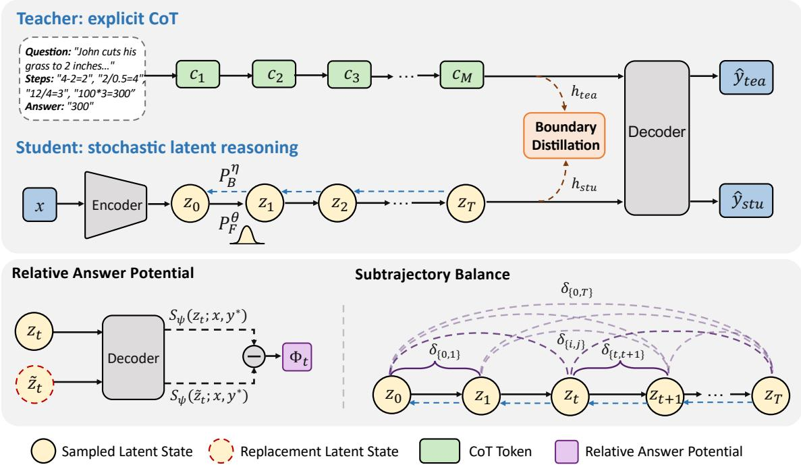
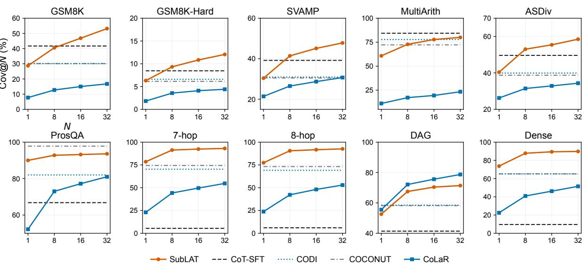
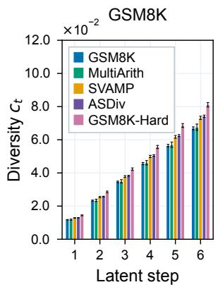
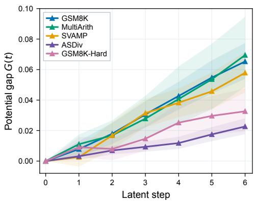
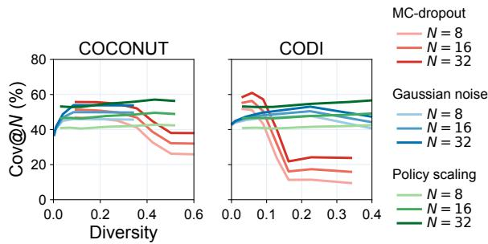
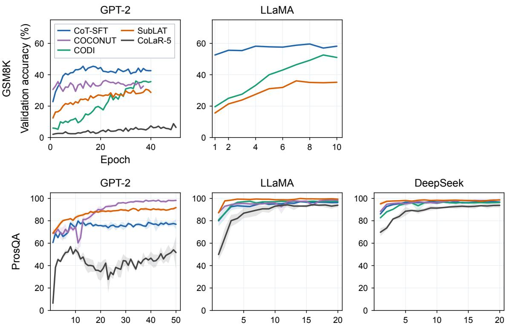

# Latent Path Exploration via Potential-Guided Subtrajectory Balance

Xiaoling Zeng Worcester Polytechnic Institute xzeng4@wpi.edu

Qi Zhang Worcester Polytechnic Institute qzhang9@wpi.edu

## Abstract

Continuous latent reasoning enables language models to perform intermediate computation without generating explicit reasoning traces. Advances in stochastic latent reasoning allow multiple paths to be sampled in continuous space, but stochasticity alone does not ensure effective exploration. A key challenge is guiding stochastic transitions between intermediate latent states toward useful reasoning paths. We introduce SUBLAT, which couples a relative answer potential with Subtrajectory Balance to learn stochastic latent exploration. The relative potential evaluates the answer support of sampled states against replacement states, with a correctness signal at the terminal state. Subtrajectory Balance relates potential differences to forward and backward transition densities across subtrajectories of different lengths. The model is jointly trained with answer supervision, CoT supervision, and representation distillation. Experiments on arithmetic and deductive reasoning show increasing solution coverage with larger sampling budgets across in-domain and out-of-domain bench marks, as well as improvements on several structural OOD benchmarks. Trajectory analyses reveal progressive divergence among sampled latent paths and higher mean relative potentials for correct trajectories across arithmetic benchmarks.

## 1 Introduction

Chain-of-Thought (CoT) reasoning enables Large Language Models (LLMs) to solve complex problems through explicit intermediate steps (Wei et al., 2022). Continuous latent reasoning instead performs intermediate reasoning in continuous space without verbalizing each step. COCONUT recursively feeds hidden states back into the model to form continuous reasoning trajectories (Hao et al., 2024), and CODI distills explicit CoT into latent reasoning by aligning teacher and student representations before answer generation (Shen et al.,

2025). These methods allow explicit CoT to guide latent reasoning without requiring the student to reproduce the teacher’s reasoning in text.

Beyond learning a single latent trajectory, exploring alternative reasoning paths can uncover solutions missed by a single attempt (Wang et al., 2023). Recent work extends this capability to continuous latent space through inference-time perturbations and learned stochastic policies (You et al., 2026a; Wang et al., 2026; Zhou et al., 2026; You et al., 2026b). However, perturbation-based exploration is sensitive to noise strength and may increase trajectory diversity without improving solution coverage. Learned stochastic policies avoid relying solely on external perturbations, but training their intermediate transitions remains challenging when supervision is concentrated on final outcomes (Williams and Tureci, 2026; Zhao et al., 2026).

One way to guide stochastic transitions is to evaluate intermediate states through their support for the target answer. Answer likelihood provides such a signal (Tao et al., 2026), but also reflects information from the question context, making the contribution of individual latent states difficult to assess. We therefore compare each sampled state with a replacement state under the same question and target answer, drawing on the idea of counterfactual comparison (Meulemans et al., 2023). This comparison measures relative answer support between latent states rather than absolute likelihood. To guide latent exploration, we propose SUBLAT, which couples Subtrajectory Balance with a relative answer potential to learn stochastic latent reasoning trajectories. A Gaussian forward policy samples successive latent states, while the balance objective relates potential differences to accumulated forward and backward transition log densities across subtrajectories of different lengths (Madan et al., 2023; Lahlou et al., 2023). This objective incorporates intermediate answer support and terminal correctness into stochastic policy learning. Following CODI (Shen et al., 2025), we jointly train an explicit CoT pathway and distill its representations into the latent student, alongside answer supervision. At inference, SUBLAT requires only the learned forward policy and answer decoder, without access to the teacher. Experiments on arithmetic and deductive reasoning show increasing solution coverage with larger sampling budgets across in-domain and OOD benchmarks. Trajectory analyses further reveal progressive diversification of sampled latent paths across reasoning steps.

  
Figure 1: Illustration of SUBLAT for learning stochastic latent exploration through relative answer potentials and Subtrajectory Balance. The explicit CoT teacher provides a reference representation at the reasoning boundary, <sup>���</sup> while the student samples latent trajectories through a stochastic forward policy P<sup>θ</sup> . The relative answer potential Φ<sub>t</sub> provides intermediate credit for sampled latent states. Subtrajectory Balance couples potential differences with forward and backward transition flows for multi-scale credit assignment along latent trajectories.

Our main contributions are as follows:

• We develop a relative answer potential that measures the answer support of intermediate latent states through controlled comparisons.

• We formulate potential-guided stochastic policy learning using Subtrajectory Balance, linking state evaluations to transitions at multiple temporal scales.

• Experiments show increasing solution coverage with latent sampling, while further analyses distinguish effective exploration from latent dispersion and relate answer potentials to solution correctness.

## 2 Related Work

Continuous latent reasoning and exploration. Early work on implicit reasoning showed that explicit CoT steps can be progressively internalized into hidden computation (Deng et al., 2023). Continuous latent reasoning further replaces explicit intermediate steps with sequences of continuous hidden representations. COCONUT recurrently feeds hidden states back into the language model and gradually replaces textual reasoning steps with continuous thoughts (Hao et al., 2024), while CODI transfers explicit CoT reasoning into continuous space through self-distillation (Shen et al., 2025). LRT uses a lightweight reasoning network to generate latent reasoning embeddings from the language model’s hidden representations, which are then fed back to the base model for answer generation (Jiang et al., 2026). More recent work considers multiple latent reasoning paths. Parallel latent test-time scaling applies MC-dropout and Gaussian perturbations to sample alternative trajectories at inference time (You et al., 2026a). GTS trains a Gaussian thought sampler on a frozen backbone with GRPO-style optimization (Wang et al., 2026), while SLPO learns a surrogate transition density for policy optimization over stochastic latent trajectories (You et al., 2026b). SUBLAT instead learns the stochastic transition policy jointly with the latent reasoner, using teacher supervision and state-level credit rather than inference-time perturbation.

Credit assignment for latent reasoning. Finalanswer supervision provides little information about intermediate latent computation. RLTT propagates outcome rewards across the iterations of looped language models (Williams and Tureci, 2026), and LTC values a latent thought by sampling multiple answers from its downstream context (Zhao et al., 2026). TIPS uses correct-answer likelihood to define an information potential and assigns turn-level rewards from changes in this potential (Xie et al., 2026). Our relative answer potential also uses answer likelihood, but evaluates a visited state against a matched replacement while keeping the question and target answer fixed. This contrast follows the idea of counterfactual credit assignment, where contribution is evaluated relative to an alternative rather than from outcome value alone (Meulemans et al., 2023).

Flow-based trajectory learning. GFlowNets provide a framework for learning stochastic policies by relating probability flow to reward (Bengio et al., 2023). Trajectory Balance enforces flow consistency over complete trajectories (Whitammer et al., 2022), while Subtrajectory Balance extends this constraint to partial trajectories of different lengths (Madan et al., 2023; Pan et al., 2023). Continuous GFlowNets formulate these balance conditions with transition densities in continuous state spaces (Lahlou et al., 2023). Flow-based objectives have also been applied to reasoning. Flow of Reasoning learns distributions over explicit graphstructured reasoning paths (Yu et al., 2025), while Latent Thought Flow applies Subtrajectory Balance to variable-length latent reasoning with answerquality and computation-cost rewards and deterministic backward transitions (Zou et al., 2026). In contrast, SUBLAT combines a relative answer potential with a learned Gaussian backward policy to guide fixed-length stochastic latent trajectories.

## 3 Method

We introduce SUBLAT, a framework for learning stochastic latent reasoning paths by coupling a relative answer potential with Subtrajectory Balance. CoT supervision and representation distillation guide latent reasoning, while the potentialbased balance objective optimizes the stochastic transition policy.

## 3.1 Stochastic Latent Reasoning

Given a question x, SUBLAT generates a sequence of continuous latent states $z _ { 1 : T } = ( z _ { 1 } , \dots , z _ { T } )$ before answer generation. A forward policy $P _ { F } ^ { \theta }$ samples successive latent states, guided by an explicit CoT pathway with reference rationale c and gold answer $y ^ { \star } = ( y _ { 1 } ^ { \star } , \ldots , y _ { L } ^ { \star } )$ . The teacher and student share language model parameters $\psi ,$ and $\theta$ denotes the forward policy parameters.

Stochastic latent paths. The question is encoded into a deterministic source state $z _ { 0 } ~ = ~ f _ { \psi } ( x )$ From this state, the forward policy generates a latent trajectory $\tau ~ = ~ ( z _ { 1 } , \dots , z _ { T } )$ with density $\begin{array} { r } { P _ { F } ^ { \theta } ( \tau \mid x ) = \dot { \prod } _ { t = 0 } ^ { T - 1 } P _ { F } ^ { \theta } ( z _ { t + 1 } \mid z _ { t } , x ) } \end{array}$ . Each transition follows a state-conditioned diagonal Gaussian with a residual mean update:

$$
\begin{array} { r } { P _ { F } ^ { \theta } ( \cdot \mid z _ { t } , x ) = \mathcal { N } \Big ( z _ { t } + v _ { \theta } , \mathrm { d i a g } \Big [ ( \sigma _ { F } ^ { \theta } ) ^ { 2 } \Big ] \Big ) . } \end{array}\tag{1}
$$

where the residual update $v _ { \theta } ( z _ { t } , x )$ determines the transition mean and $\sigma _ { F } ^ { \theta } ( z _ { t } , x ) ~ > ~ 0$ controls its spread. To backpropagate through the sampled latent states, we use the reparameterization $z _ { t + 1 } =$ $z _ { t } + v _ { \theta } ( z _ { t } , x ) + \sigma _ { F } ^ { \theta } ( z _ { t } , x ) \odot \epsilon _ { t }$ with $\epsilon _ { t } \sim \mathcal { N } ( 0 , I _ { d } )$

Student answer supervision. After T latent transitions, the terminal state $z _ { T }$ is used as a single latent input for answer generation. Given the gold answer $y ^ { \star } = ( y _ { 1 } ^ { \star } , \ldots , y _ { L } ^ { \star } )$ , we minimize

$$
\mathcal { L } _ { \mathrm { a n s } } = - \frac { 1 } { L } \sum _ { s = 1 } ^ { L } \log p _ { \psi } \left( y _ { s } ^ { \star } \mid x , z _ { T } , y _ { < s } ^ { \star } \right) .\tag{2}
$$

CoT supervision and distillation. Following CODI (Shen et al., 2025), we jointly train an explicit CoT pathway and distill its representations into the latent student. Given a reference rationale $^ { c , }$ the teacher models the concatenated rationale and answer $r = [ c ; y ^ { \star } ]$

$$
\mathcal { L } _ { \mathrm { C o T } } = - \frac { 1 } { N _ { r } } \sum _ { s = 1 } ^ { N _ { r } } \log p _ { \psi } \left( r _ { s } \mid \boldsymbol { x } , r _ { < s } \right) ,\tag{3}
$$

where $N _ { r }$ is the number of supervised tokens in $r .$ At the answer boundary, the teacher representation is conditioned on the explicit rationale, while the student representation is conditioned on the complete latent trajectory. Let $H _ { \psi } ^ { l } ( \cdot )$ denote the layer-l hidden representation at the last token of the answer prefix $p .$ The corresponding representations are

$$
h _ { \mathrm { t e a } } ^ { l } = H _ { \psi } ^ { l } ( [ x ; c ; p ] ) , \quad h _ { \mathrm { s t u } } ^ { l } = H _ { \psi } ^ { l } ( [ x ; z _ { 0 : T } ; p ] ) .\tag{4}
$$

We align the teacher and student representations across a set of layers M:

$$
\mathcal { L } _ { \mathrm { K D } } = \frac { 1 } { \left| M \right| } \sum _ { l \in M } \frac { 1 } { s _ { l } } D _ { \mathrm { S L 1 } } \Big ( h _ { \mathrm { s t u } } ^ { l } , \mathrm { s g } ( h _ { \mathrm { t e a } } ^ { l } ) \Big ) .\tag{5}
$$

where $D _ { \mathrm { S L 1 } }$ denotes smooth $\ell _ { 1 }$ distance, sg stops gradients through the teacher representation, and s<sub>l</sub> normalizes the representation scale at layer l.

## 3.2 Relative Answer Potential and Subtrajectory Balance

Sampling multiple latent trajectories can uncover solutions missed by a single path, but stochasticity alone does not ensure effective exploration. We introduce a relative answer potential to evaluate intermediate latent states. Subtrajectory Balance then relates potential differences to transition densities across subtrajectories of different lengths.

Relative answer potential. For a sampled state $z _ { t } ,$ we first measure its support for the gold answer $y ^ { \star }$ using the average log-likelihood

$$
S _ { \psi } ( z _ { t } ; x , y ^ { \star } ) = \frac { 1 } { L } \sum _ { s = 1 } ^ { L } \log p _ { \psi } ( y _ { s } ^ { \star } \mid x , z _ { t } , y _ { < s } ^ { \star } ) .\tag{6}
$$

Answer likelihood reflects support for the target answer from both the latent state and question context. To assess the contribution of $z _ { t } ,$ , we compare it with a replacement state $\widetilde { z } _ { t }$ drawn from another question’s trajectory at the same reasoning step:

$$
\Delta _ { t } = S _ { \psi } ( z _ { t } ; x , y ^ { \star } ) - S _ { \psi } ( \widetilde { z } _ { t } ; x , y ^ { \star } ) .\tag{7}
$$

Both scores are conditioned on the same question x and gold answer $y ^ { \star }$ , so $\Delta _ { t }$ measures relative answer support between the sampled and replacement states. We center the contrast at the source state, defining $\Phi _ { t } = \Delta _ { t } - \Delta _ { 0 }$ with $\Phi _ { 0 } = 0$

Answer likelihood alone does not determine whether the decoded answer is correct. We therefore augment the terminal potential with a correctness reward $R = \mathbb { I } [ \hat { y } _ { \mathrm { g r e e d y } } = y ^ { \star } ]$ , where $\hat { y } _ { \mathrm { g r e e d y } }$ is greedily decoded from the terminal state of the sampled trajectory. The resulting balance potential is

$$
\Phi _ { t } ^ { \prime } = \Phi _ { t } + \mathbb { I } [ t = T ] R .\tag{8}
$$

The potential combines intermediate credit with terminal correctness, while answer supervision propagates through the reparameterized latent trajectory.

Subtrajectory Balance. We use Subtrajectory Balance to connect changes in the potential $\Phi _ { t } ^ { \prime }$ with stochastic transitions along the sampled trajectory. To define the balance objective, we introduce a backward policy $P _ { B } ^ { \eta } ( z _ { t } \mid z _ { t + 1 } , x )$ that models reverse transitions using a separate state-conditioned diagonal Gaussian. For a contiguous subtrajectory $\tau _ { i : j } = ( z _ { i } , \ldots , z _ { j } )$ , where $0 \leq i < j \leq T$ , the potential change across the subtrajectory is related to the accumulated forward and backward densities $\begin{array} { r } { P _ { F } ^ { \theta } ( \tau _ { i : j } \ | \ x ) = \prod _ { t = i } ^ { j - 1 } P _ { F } ^ { \theta } ( z _ { t + 1 } \ | \ z _ { t } , x ) } \end{array}$ and $\begin{array} { r } { P _ { B } ^ { \eta } ( \tau _ { i : j } \mid x ) = \prod _ { t = i } ^ { j - 1 } P _ { B } ^ { \eta } ( z _ { t } \mid z _ { t + 1 } , x ) } \end{array}$ . The balance residual for a subtrajectory $\tau _ { i : j }$ is defined as:

$$
\begin{array} { l } { \displaystyle \delta _ { i , j } = \Phi _ { i } ^ { \prime } - \Phi _ { j } ^ { \prime } + \frac 1 d \Big [ \log P _ { F } ^ { \theta } ( \tau _ { i : j } \mid x ) } \\ { \displaystyle - \log P _ { B } ^ { \eta } ( \tau _ { i : j } \mid x ) \Big ] . } \end{array}\tag{9}
$$

The factor $1 / d$ normalizes the log-density ratio by the latent dimension. A zero residual matches the normalized log-density ratio to the potential change $\Phi _ { j } ^ { \prime } - \Phi _ { i } ^ { \prime }$ over the subtrajectory.

We impose the balance constraint over all contiguous subtrajectories, yielding the multi-scale objective:

$$
{ \mathcal { L } } _ { \mathrm { S u b T B } } = { \frac { \sum _ { 0 \leq i < j \leq T } \lambda ^ { j - i } \delta _ { i , j } ^ { 2 } } { \sum _ { 0 \leq i < j \leq T } \lambda ^ { j - i } } } .\tag{10}
$$

The length weight $\lambda \ \in \ ( 0 , 1 ]$ controls the relative contribution of subtrajectories. Smaller λ emphasizes shorter subtrajectories, whereas $\lambda = 1$ weights all subtrajectories equally. All subtrajectory residuals include potential differences and transition densities, with an additional terminal correctness reward for those ending at T.

## 3.3 Training Objective and Inference

SUBLAT combines answer and teacher supervision with the Subtrajectory Balance objective to jointly optimize the stochastic latent policy. The full training objective is:

$$
\begin{array} { r } { \begin{array} { r } { \mathcal { L } = \mathcal { L } _ { \mathrm { a n s } } + \lambda _ { \mathrm { C o T } } \mathcal { L } _ { \mathrm { C o T } } + \lambda _ { \mathrm { K D } } \mathcal { L } _ { \mathrm { K D } } } \\ { + \lambda _ { \mathrm { f l o w } } \mathcal { L } _ { \mathrm { S u b T B } } + \lambda _ { \mathrm { d r i f t } } \mathcal { L } _ { \mathrm { d r i f t } } . } \end{array} } \end{array}\tag{11}
$$

To stabilize the residual transitions without directly regularizing stochasticity, we penalize the magnitude of the mean updates, ${ \mathcal { L } } _ { \mathrm { d r i f t } }$ $\begin{array} { r } { \frac { 1 } { T d } \sum _ { t = 0 } ^ { T - 1 } \| v _ { \theta } ( z _ { t } , x ) \| _ { 2 } ^ { 2 } } \end{array}$ The coefficients $\lambda _ { \mathrm { C o T } } .$ $\lambda _ { \mathrm { K D } } , \lambda _ { \mathrm { f l o w } }$ , and $\lambda _ { \mathrm { d r i f t } }$ weight these objectives.

Inference. Given a question x, we initialize $z _ { \mathrm { 0 } } =$ $f _ { \psi } ( x )$ and sample $T$ successive transitions $z _ { t + 1 } \sim$ $P _ { F } ^ { \theta } ( \cdot \mid z _ { t } , x )$ from the learned forward policy. The terminal state $z _ { T }$ conditions answer generation.

## 4 Experimental Setup

Our experiments assess reasoning accuracy and OOD generalization, examine how solution coverage scales with latent sampling, and investigate how the relative answer potential and Subtrajectory Balance shape stochastic latent exploration.

Datasets and tasks. We consider both arithmetic and deductive reasoning tasks. For arithmetic reasoning, we train on GSM8K-Aug (Deng et al., 2023), an augmented version of GSM8K (Cobbe et al., 2021), and evaluate on the GSM8K and four OOD benchmarks: GSM8K-Hard (Gao et al., 2023) with larger numbers, SVAMP (Patel et al., 2021) with varied linguistic structures, MultiArith (Roy and Roth, 2015) with multi-step arithmetic, and ASDiv (Miao et al., 2020) with diverse problem types. For deductive reasoning, we train on ProsQA (Hao et al., 2024) and evaluate on its official test set and four OOD splits. The 7-hop and 8-hop splits increase reasoning depth, while DAG and Dense vary the graph structure.

Baselines and models. We compare SUBLAT with four representative reasoning baselines. CoT-SFT (Wei et al., 2022) provides an explicit CoT reference, while COCONUT (Hao et al., 2024) and CODI (Shen et al., 2025) represent two approaches to continuous reasoning through curriculum training and self-distillation, respectively. We further include CoLaR (Tan et al., 2026), which enables stochastic exploration through a probabilistic latent head. We use CoLaR-5, whose average latent reasoning length is approximately six steps, providing a stochastic baseline with a comparable reasoning budget. Experiments on GSM8K-Aug use GPT-2 Small (Radford et al., 2019) and Llama-3.2-1B-Instruct (Grattafiori et al., 2024), covering both a compact pretrained model and a modern instruction-tuned backbone. For ProsQA, we additionally evaluate DeepSeek-R1-Distill-Qwen-1.5B (Guo et al., 2025) to examine the methods on a reasoning-oriented distilled model. Training configurations and evaluation protocols are detailed in Appendix A.

## 5 Experimental Results

## 5.1 Main results

Tables 1 and 2 report in-domain and OOD accuracy on arithmetic and deductive reasoning, comparing explicit CoT (CoT-SFT), deterministic latent reasoning (COCONUT and CODI), and stochastic latent reasoning (CoLaR and SUBLAT) under the same backbone.

Arithmetic reasoning. SUBLAT consistently outperforms CoLaR across both backbones, achieving 28.20% versus 7.63% on GSM8K with GPT-2 and 34.09% versus 25.46% with Llama, alongside higher OOD averages. With GPT-2, COCONUT and CODI retain stronger in-domain and OOD performance. With Llama, however, SUBLAT surpasses COCONUT on GSM8K and all four OOD benchmarks, while CODI achieves the highest accuracy among latent reasoning methods.

Deductive reasoning. The advantage is more pronounced on deductive reasoning. With GPT-2, it achieves the highest OOD average (69.34%), outperforming COCONUT, CODI, and CoLaR, with leading results on 7-hop, 8-hop, and Dense. With Llama and DeepSeek, SUBLAT achieves the highest in-domain accuracy (99.52% and 98.61%), surpassing all baselines. Its OOD averages exceed those of COCONUT and CoLaR on both backbones, while CODI retains higher averages. These results indicate that the learned latent reasoning paths remain effective under changes in reasoning depth and graph structure.

## 5.2 Coverage Scaling with Latent Sampling

We measure how the coverage scales as the sampling budget increases. COCONUT and CODI reason along a deterministic latent trajectory. For SUBLAT and CoLaR, we sample a new latent trajectory for each of 32 independent attempts per question. For a sampling budget N, solution coverage (You et al., 2026a) is defined as

$$
\mathrm { C o v } @ N = \frac { 1 } { | \mathcal { D } | } \sum _ { x \in \mathcal { D } } \mathbb { 1 } \left[ \exists k \leq N : \hat { y } _ { x } ^ { ( k ) } = y _ { x } ^ { \star } \right] ,\tag{12}
$$

the fraction of questions answered correctly by at least one of N sampled trajectories, where ${ \hat { y } } _ { x } ^ { ( k ) }$ is the answer from the k-th trajectory.

We evaluate coverage with GPT-2 at sampling budgets $N \in \{ 1 , 8 , 1 6 , 3 2 \}$ . Figure 2 shows that GSM8K coverage increases from 28.47% at $N = 1$

Table 1: Arithmetic reasoning results on GSM8K and four OOD benchmarks. Accuracy (Acc. %) reports the mean and sample standard deviation over five inference runs. #L denotes reasoning length, and <sup>†</sup> indicates publicly released checkpoints.
<table><tr><td rowspan="3">Method</td><td colspan="2">In-domain</td><td colspan="6">Out-of-domain</td></tr><tr><td colspan="2">GSM8K test</td><td>GSM8K-Hard</td><td>SVAMP</td><td>MultiArith</td><td>ASDiv</td><td colspan="2">OOD Avg.</td></tr><tr><td>Acc.</td><td>#L</td><td>Acc.</td><td>Acc.</td><td>Acc.</td><td>Acc.</td><td> $\operatorname { A c c } .$ </td><td>#L</td></tr><tr><td colspan="9">GPT-2 SMALL</td></tr><tr><td>CoT-SFT</td><td> $4 1 . 7 0 { \scriptstyle \pm 0 . 8 2 }$ </td><td>27.33</td><td> $8 . 4 6 _ { \pm 0 . 1 4 }$ </td><td> $3 9 . 1 8 _ { \pm 0 . 6 0 }$ </td><td> $8 4 . 3 3 { \scriptstyle \pm 0 . 9 9 }$ </td><td> $4 9 . 6 0 _ { \pm 0 . 4 4 }$ </td><td>45.39</td><td>18.84</td></tr><tr><td>COCONUT</td><td> $3 0 . 1 4 { \scriptstyle \pm 0 . 4 3 }$ </td><td>6.00</td><td> $6 . 1 4 { \scriptstyle \pm 0 . 2 6 }$ </td><td> $3 0 . 4 8 { \scriptstyle \pm 0 . 6 5 }$ </td><td> $7 2 . 2 2 { \scriptstyle \pm 1 . 0 4 }$ </td><td> $3 8 . 7 1 { \scriptstyle \pm 0 . 4 2 }$ </td><td>36.89</td><td>6.00</td></tr><tr><td>CODI</td><td> $2 9 . 5 3 { \scriptstyle \pm 0 . 8 1 }$ </td><td>6.00</td><td> $6 . 5 3 { \scriptstyle \pm 0 . 0 9 }$ </td><td> $3 1 . 0 9 { \scriptstyle \pm 0 . 2 1 }$ </td><td> $7 8 . 1 3 { \scriptstyle \pm 0 . 4 9 }$ </td><td> $4 0 . 1 6 { \scriptstyle \pm 0 . 3 7 }$ </td><td>38.98</td><td>6.00</td></tr><tr><td>CoLaR-5</td><td> $7 . 6 3 _ { \pm 0 . 4 1 }$ </td><td>5.97</td><td> $1 . 7 7 _ { \pm 0 . 1 5 }$ </td><td> $2 0 . 8 0 { \scriptstyle \pm 0 . 6 5 }$ </td><td> $1 2 . 7 8 _ { \pm 0 . 9 7 }$ </td><td> $2 5 . 9 6 _ { \pm 0 . 2 3 }$ </td><td>15.33</td><td>4.45</td></tr><tr><td>SUBLAT</td><td> $2 8 . 2 0 { \scriptstyle \pm 0 . 8 0 }$ </td><td>6.00</td><td> $5 . 6 1 _ { \pm 0 . 2 6 }$ </td><td> $3 0 . 0 6 _ { \pm 0 . 7 2 }$ </td><td> $6 0 . 7 8 { \scriptstyle \pm 1 . 9 6 }$ </td><td> $4 0 . 1 2 _ { \pm 0 . 5 6 }$ </td><td>34.14</td><td>6.00</td></tr><tr><td colspan="9"> $\mathrm { L L A M A } - 3 . 2 \mathrm { - } 1 \mathrm { B } \mathrm { - } \mathrm { I N S T R U C T }$ </td></tr><tr><td>CoT-SFT</td><td> $5 2 . 4 0 { \scriptstyle \pm 0 . 5 8 }$ </td><td>24.70</td><td> $1 2 . 4 5 _ { \pm 0 . 2 0 }$ </td><td> $6 1 . 4 2 _ { \pm 0 . 3 7 }$ </td><td> $9 9 . 2 2 _ { \pm 0 . 6 3 }$ </td><td> $6 4 . 2 1 _ { \pm 0 . 4 0 }$ </td><td>59.32</td><td>16.85</td></tr><tr><td>COCONUT†</td><td> $3 3 . 2 4 { \scriptstyle \pm 0 . 6 3 }$ </td><td>6.00</td><td> $7 . 4 9 _ { \pm 0 . 4 2 }$ </td><td> $4 7 . 0 0 { \scriptstyle \pm 0 . 7 2 }$ </td><td> $8 3 . 6 7 _ { \pm 1 . 3 4 }$ </td><td> $5 7 . 6 2 _ { \pm 0 . 8 3 }$ </td><td>48.94</td><td>6.00</td></tr><tr><td>CODI</td><td> $5 0 . 0 7 { \scriptstyle \pm 0 . 3 7 }$ </td><td>6.00</td><td> $1 1 . 4 3 _ { \pm 0 . 2 7 }$ </td><td> $5 5 . 2 8 { \scriptstyle \pm 0 . 7 3 }$ </td><td> $9 7 . 2 2 _ { \pm 0 . 6 8 }$ </td><td> $6 4 . 8 6 { \scriptstyle \pm 0 . 3 6 }$ </td><td>57.20</td><td>6.00</td></tr><tr><td>CoLaR-5†</td><td> $2 5 . 4 6 { \scriptstyle \pm 0 . 3 3 }$ </td><td>5.62</td><td> $5 . 4 7 _ { \pm 0 . 1 3 }$ </td><td> $4 8 . 8 4 _ { \pm 0 . 2 7 }$ </td><td> $8 7 . 3 3 { \scriptstyle \pm 0 . 8 4 }$ </td><td> $5 3 . 3 4 { \scriptstyle \pm 0 . 1 3 }$ </td><td>48.75</td><td>3.92</td></tr><tr><td>SUBLAT</td><td> $3 4 . 0 9 { \scriptstyle \pm 0 . 2 7 }$ </td><td>6.00</td><td> $7 . 6 7 _ { \pm 0 . 3 8 }$ </td><td> $4 9 . 0 0 { \scriptstyle \pm 0 . 6 7 }$ </td><td> $8 8 . 3 3 { \scriptstyle \pm 0 . 8 1 }$ </td><td> $5 9 . 8 6 _ { \pm 0 . 2 9 }$ </td><td>51.22</td><td>6.00</td></tr></table>

Table 2: Deductive reasoning results on ProsQA and four structural OOD benchmarks. Accuracy is reported as mean ± sample standard deviation across three training seeds, each averaged over five inference runs. <sup>†</sup> indicates a publicly released checkpoint evaluated over five inference runs.

$$
7 1 . 9 3 { \scriptstyle \pm 3 . 6 3 }
$$

$$
1 1 . 5 7 { \scriptstyle \pm 4 . 0 1 }
$$

$$
\mathrm { G P T } { \cdot } 2 \ \mathrm { S M A L L }
$$

$$
9 8 . 0 1 _ { \pm 0 . 1 2 }
$$

$$
7 3 . 2 8 { \scriptstyle \pm 5 . 5 8 }
$$

$$
1 0 . 5 0 { \scriptstyle \pm 4 . 4 0 }
$$

$$
3 6 . 4 0 { \scriptstyle \pm 7 . 9 8 }
$$

$$
8 2 . 4 8 { \scriptstyle \pm 1 . 0 3 }
$$

$$
7 2 . 4 6 { \scriptstyle \pm 0 . 7 1 }
$$

$$
6 9 . 9 4 { \scriptstyle \pm 0 . 7 3 }
$$

$$
2 2 . 0 0 { \scriptstyle \pm 8 . 9 1 }
$$

$$
5 8 . 6 8 { \scriptstyle \pm 1 . 6 0 }
$$

$$
7 0 . 0 7 { \scriptstyle \pm 0 . 6 9 }
$$

$$
5 9 . 2 9 _ { \pm 0 . 8 9 }
$$

$$
6 5 . 6 5 { \scriptstyle \pm 2 . 6 8 }
$$

$$
6 5 . 7 7 { \scriptstyle \pm 0 . 8 8 }
$$

$$
5 2 . 3 5 { \scriptstyle \pm 2 . 8 2 }
$$

$$
2 9 . 1 1 _ { \pm 1 0 . 6 3 }
$$

$$
2 8 . 4 7 _ { \pm 1 0 . 6 9 }
$$

$$
8 8 . 9 3 { \scriptstyle \pm 0 . 7 2 }
$$

$$
4 9 . 4 1 _ { \pm 4 . 5 7 }
$$

$$
7 7 . 0 3 { \scriptstyle \pm 1 . 0 6 }
$$

$$
7 7 . 2 0 { \scriptstyle \pm 0 . 5 5 }
$$

$$
2 7 . 7 1 _ { \pm 1 0 . 9 9 }
$$

$$
5 0 . 7 0 { \scriptstyle \pm 1 . 5 8 }
$$

$$
7 2 . 4 5 { \scriptstyle \pm 1 . 6 3 }
$$

$$
\mathrm { L L A M A } { - } 3 . 2 { - } 1 \mathrm { B } { \mathrm { - } } \mathrm { I N S T R U C T }
$$

$$
9 5 . 1 1 { \scriptstyle \pm 1 . 4 1 }
$$

$$
1 0 . 6 0 { \scriptstyle \pm 1 . 7 7 }
$$

$$
1 0 . 7 2 { \scriptstyle \pm 1 . 4 8 }
$$

$$
8 8 . 9 7 _ { \pm 1 0 . 6 1 }
$$

$$
3 6 . 1 4 { \scriptstyle \pm 9 . 4 3 }
$$

$$
9 8 . 1 1 { \scriptstyle \pm 0 . 3 4 }
$$

$$
5 3 . 3 7 { \scriptstyle \pm 6 . 4 4 }
$$

$$
4 9 . 6 2 _ { \pm 6 . 0 9 }
$$

$$
6 5 . 2 9 { \scriptstyle \pm 3 . 1 7 }
$$

$$
5 1 . 3 3 { \scriptstyle \pm 3 . 1 4 }
$$

$$
9 7 . 4 7 { \scriptstyle \pm 1 . 0 1 }
$$

$$
6 6 . 2 7 { \scriptstyle \pm 1 . 8 5 }
$$

$$
6 5 . 5 5 { \scriptstyle \pm 1 . 2 4 }
$$

$$
6 0 . 4 5 { \scriptstyle \pm 0 . 3 2 }
$$

$$
6 3 . 7 1 { \scriptstyle \pm 2 . 2 7 }
$$

$$
9 0 . 6 0 { \scriptstyle \pm 1 . 9 5 }
$$

$$
6 4 . 5 1 { \scriptstyle \pm 5 . 7 4 }
$$

$$
5 3 . 9 9 _ { \pm 6 . 4 6 }
$$

$$
7 4 . 8 1 _ { \pm 1 . 8 1 }
$$

$$
9 9 . 5 2 _ { \pm 0 . 2 9 }
$$

$$
4 3 . 4 2 _ { \pm 4 . 5 2 }
$$

$$
6 4 . 6 8 { \scriptstyle \pm 4 . 5 2 }
$$

$$
5 4 . 0 5 { \scriptstyle \pm 8 . 0 6 }
$$

$$
7 8 . 6 2 { \scriptstyle \pm 5 . 5 8 }
$$

$$
4 2 . 1 1 { \scriptstyle \pm 4 . 4 6 }
$$

$$
9 6 . 5 6 { \scriptstyle \pm 0 . 3 0 }
$$

$$
1 0 . 3 3 { \scriptstyle \pm 1 . 6 0 }
$$

$$
1 2 . 4 1 { \scriptstyle \pm 0 . 5 7 }
$$

$$
9 4 . 4 6 _ { \pm 0 . 4 2 }
$$

$$
5 4 . 1 0 { \scriptstyle \pm 8 . 7 1 }
$$

$$
9 8 . 4 7 { \scriptstyle \pm 0 . 5 8 }
$$

$$
4 7 . 3 7 { \scriptstyle \pm 3 . 7 2 }
$$

$$
5 2 . 2 7 _ { \pm 1 0 . 2 1 }
$$

$$
6 3 . 8 0 { \scriptstyle \pm 2 . 0 3 }
$$

$$
9 6 . 5 1 _ { \pm 0 . 0 6 }
$$

$$
6 9 . 7 7 { \scriptstyle \pm 3 . 0 1 }
$$

$$
5 9 . 5 0 { \scriptstyle \pm 4 . 6 8 }
$$

$$
6 8 . 0 2 _ { \pm 4 . 2 8 }
$$

$$
5 9 . 2 9 { \scriptstyle \pm 1 . 1 6 }
$$

$$
6 3 . 1 1 { \scriptstyle \pm 3 . 1 4 }
$$

$$
9 2 . 7 6 { \scriptstyle \pm 0 . 2 1 }
$$

$$
6 2 . 3 0 { \scriptstyle \pm 5 . 1 1 }
$$

$$
5 7 . 1 3 { \scriptstyle \pm 4 . 7 0 }
$$

$$
9 8 . 6 1 _ { \pm 0 . 2 4 }
$$

$$
6 3 . 9 3 { \scriptstyle \pm 1 . 5 9 }
$$

$$
6 8 . 5 3 { \scriptstyle \pm 5 . 1 0 }
$$

$$
6 4 . 1 8 { \scriptstyle \pm 0 . 1 8 }
$$

$$
5 4 . 9 1 _ { \pm 7 . 9 7 }
$$

$$
6 6 . 5 8 { \scriptstyle \pm 1 . 4 6 }
$$

$$
4 3 . 6 9 _ { \pm 6 . 7 0 }
$$

to 53.15% at $N = 3 2$ . SUBLAT exceeds CoLaR across all evaluated budgets, with a widening gap as N increases. Coverage also increases on all four arithmetic OOD benchmarks, exceeding the accuracy references of COCONUT and CODI at $N = 3 2$ . On ProsQA, SUBLAT shows consistent coverage growth across the test set and all four structural OOD splits. At N = 32, coverage reaches approximately 90% on 7-hop, 8-hop, and

Dense, exceeding the references of the deterministic latent baselines on these splits. CoLaR achieves higher coverage on DAG at larger budgets, suggesting that the relative effectiveness of latent sampling varies across graph structures. These results show that solution coverage increases with the sampling budget across arithmetic and deductive reasoning, including under OOD shifts.

  
Figure 2: Solution coverage (%) versus sampling budget N on GSM8K (top) and ProsQA (bottom), each with four OOD benchmarks. Orange curves denote SUBLAT, and blue curves denote CoLaR. Horizontal lines indicate Cov@1 for CoT-SFT, CODI, and COCONUT.

## 5.3 Latent Exploration and Potential Separation

We now examine the structure of these sampled trajectories from two perspectives: how they spread through latent space and how their relative answer potentials evolve with different outcomes.

Latent trajectory diversity. Following You et al. (2026a), we measure diversity at step t by the average pairwise cosine dissimilarity among the K sampled latent states of each question,

$$
c _ { t } = \frac { 1 } { | \mathcal { D } | } \sum _ { x \in \mathcal { D } } \frac { 2 } { K ( K - 1 ) } \sum _ { k < l } \left[ 1 - \cos \left( z _ { t } ^ { ( k ) } , z _ { t } ^ { ( l ) } \right) \right]\tag{13}
$$

Here, $z _ { t } ^ { ( k ) }$ is the latent state of the k-th sampled trajectory at reasoning step t.

Figure 3 shows that latent trajectory diversity increases steadily across reasoning steps on GSM8K, ProsQA, and their respective OOD benchmarks. Trajectories sampled from the same question remain relatively close at early steps and gradually diverge as latent transitions accumulate. Despite differences in diversity magnitude between arithmetic and deductive reasoning, this pattern holds across both reasoning tasks, indicating that stochastic exploration unfolds progressively over the latent reasoning process.

Potential separation. For each question x, let $\mu _ { t } ^ { + } ( x )$ and $\mu _ { t } ^ { - } ( x )$ denote the mean relative answer potentials $\Phi _ { t }$ of correct and incorrect trajectories at step t, respectively. We compute the withinquestion potential gap over the set M of questions with both correct and incorrect trajectories:

  
Figure 3: Latent trajectory diversity of SUBLAT across reasoning steps on GSM8K (left) and ProsQA (right), including their respective OOD benchmarks. Error bars indicate 95% confidence intervals.

$$
G ( t ) = \frac { 1 } { | \mathcal { M } | } \sum _ { x \in \mathcal { M } } \left[ \mu _ { t } ^ { + } ( x ) - \mu _ { t } ^ { - } ( x ) \right] ,\tag{14}
$$

where a positive $G ( t )$ indicates that correct trajectories receive higher potential on average.

Figure 4 shows positive mean potential gaps across all five arithmetic benchmarks after the source state, with increasing separation at later reasoning steps. Correct trajectories thus receive higher relative potentials on average, indicating an association between the learned potential and answer correctness.

  
Figure 4: Within-question relative answer potential gap G(t) on GSM8K and four arithmetic OOD benchmarks. Gaps are averaged over questions with both outcomes among 32 sampled trajectories per question. Shaded regions indicate 95% confidence intervals.

  
Figure 5: Coverage versus latent diversity on GSM8K with GPT-2 at sampling budgets N. MC-dropout (red) and AGN (blue) perturb COCONUT (left) and CODI (right), while policy scaling (green) varies the learned transition standard deviation of SUBLAT.

## 5.4 Exploration under Generic Latent Perturbations

We next examine whether greater latent dispersion alone leads to higher solution coverage. Following You et al. (2026a), we apply MC-dropout and additive Gaussian noise (AGN) to COCONUT and CODI at inference time, varying the dropout rate over $p \in [ 0 . 1 , 0 . 7 ]$ and the relative noise scale over $\sigma \in [ 0 . 0 5 , 0 . 7 ]$ . For SUBLAT, we instead scale the learned policy standard deviation by α, varying the scaling factor over $\alpha \in [ 1 , 4 ]$ . We compare coverage against mean pairwise cosine dissimilarity across sampled trajectories, averaged over reasoning steps and questions.

Figure 5 shows that greater latent diversity does not necessarily lead to higher solution coverage. For both COCONUT and CODI, MC-dropout improves coverage at moderate perturbation strengths, but stronger perturbations increase diversity while reducing coverage. AGN yields relatively limited coverage gains as the sampling budget increases. Although MC-dropout on CODI reaches a higher peak, its coverage declines under stronger perturbations. Unlike generic perturbations, SUBLAT achieves strong coverage with its learned stochastic policy, while maintaining coverage across a broader range of exploration scales.

Table 3: Ablations on GSM8K with GPT-2. Greedy uses the mean latent path, Cov@N samples N latent trajectories.
<table><tr><td rowspan="2">Method</td><td rowspan="2">Greedy (%)</td><td colspan="3">Cov@N (%)</td></tr><tr><td>1</td><td>8</td><td>32</td></tr><tr><td>SUBLAT</td><td>29.71</td><td>28.47</td><td>40.56</td><td>53.15</td></tr><tr><td>w/o relative potential</td><td>28.32</td><td>27.03</td><td>39.20</td><td>49.76</td></tr><tr><td>w/o SubTB</td><td>24.94</td><td>25.32</td><td>36.38</td><td>44.03</td></tr></table>

## 5.5 Ablation Studies

We examine the contributions of the relative answer potential and Subtrajectory Balance through ablations on GSM8K.

Relative Potential. To assess the contribution of relative potential, we replace it with the absolute answer likelihood. This reduces greedy accuracy and coverage across all sampling budgets, indicating that relative potential provides a more informative learning signal for stochastic latent reasoning.

Subtrajectory Balance. To assess the contribution of Subtrajectory Balance (SubTB), we remove its training objective. As shown in Table 3, greedy accuracy drops from 29.71% to 24.94%, while coverage decreases across all sampling budgets, reaching 44.03% at $N = 3 2$ compared to 53.15% for SUBLAT. These results indicate that SubTB benefits both greedy reasoning and latent exploration.

## 6 Conclusion

We introduced SUBLAT, a stochastic latent reasoning framework that combines Subtrajectory Balance with a relative answer potential. Experiments on arithmetic and deductive reasoning demonstrate improved solution coverage with larger sampling budgets. Further analyses show that higher relative potentials are associated with greater answer correctness, while increased latent diversity alone does not guarantee better solution coverage. These findings highlight the importance of effective exploration for reasoning in continuous latent spaces.

## Limitations

Our experiments focus on arithmetic and deductive reasoning with a fixed latent horizon. Extending SUBLAT to more complex tasks and adaptive latent horizons remains a direction for future work. Moreover, the relative answer potential relies on gold answers during training and cannot directly guide answer selection at inference time. While increased sampling improves solution coverage, it does not guarantee correct answer selection. Future work could explore efficient sampling and answer selection strategies to translate coverage gains into reasoning accuracy.

## References

Yoshua Bengio, Salem Lahlou, Tristan Deleu, Edward J Hu, Mo Tiwari, and Emmanuel Bengio. 2023. Gflownet foundations. Journal of Machine Learning Research, 24(210):1–55.

Karl Cobbe, Vineet Kosaraju, Mohammad Bavarian, Mark Chen, Heewoo Jun, Lukasz Kaiser, Matthias Plappert, Jerry Tworek, Jacob Hilton, Reiichiro Nakano, et al. 2021. Training verifiers to solve math word problems. arXiv preprint arXiv:2110.14168.

Yuntian Deng, Kiran Prasad, Roland Fernandez, Paul Smolensky, Vishrav Chaudhary, and Stuart Shieber. 2023. Implicit chain of thought reasoning via knowledge distillation. arXiv preprint arXiv:2311.01460.

Luyu Gao, Aman Madaan, Shuyan Zhou, Uri Alon, Pengfei Liu, Yiming Yang, Jamie Callan, and Graham Neubig. 2023. Pal: Program-aided language models. In International conference on machine learning, pages 10764–10799. PMLR.

Aaron Grattafiori, Abhimanyu Dubey, Abhinav Jauhri, Abhinav Pandey, Abhishek Kadian, Ahmad Al-Dahle, Aiesha Letman, Akhil Mathur, Alan Schelten, Alex Vaughan, et al. 2024. The llama 3 herd of models. arXiv preprint arXiv:2407.21783.

Daya Guo, Dejian Yang, Haowei Zhang, Junxiao Song, Peiyi Wang, Qihao Zhu, Runxin Xu, Ruoyu Zhang, Shirong Ma, Xiao Bi, et al. 2025. Deepseek-r1: Incentivizing reasoning capability in llms via reinforcement learning. arXiv preprint arXiv:2501.12948.

Shibo Hao, Sainbayar Sukhbaatar, DiJia Su, Xian Li, Zhiting Hu, Jason Weston, and Yuandong Tian. 2024. Training large language models to reason in a continuous latent space. arXiv preprint arXiv:2412.06769.

Cong Jiang, Xiaofeng Zhang, Fangzhi Zhu, XiaoWei Chen, Junxiong Zhu, and Zheng Zhang. 2026. Rethinking llm reasoning: From explicit trajectories to latent representations. In The Fourteenth International Conference on Learning Representations.

Salem Lahlou, Tristan Deleu, Pablo Lemos, Dinghuai Zhang, Alexandra Volokhova, Alex Hernández-Garcıa, Léna Néhale Ezzine, Yoshua Bengio, and Nikolay Malkin. 2023. A theory of continuous generative flow networks. In International Conference on Machine Learning, pages 18269–18300. PMLR.

Kanika Madan, Jarrid Rector-Brooks, Maksym Korablyov, Emmanuel Bengio, Moksh Jain, Andrei Cristian Nica, Tom Bosc, Yoshua Bengio, and Nikolay Malkin. 2023. Learning gflownets from partial episodes for improved convergence and stability. In International Conference on Machine Learning, pages 23467–23483. PMLR.

Alexander Meulemans, Simon Schug, Seijin Kobayashi, Nathaniel D. Daw, and Gregory Wayne. 2023. Would i have gotten that reward? long-term credit assignment by counterfactual contribution analysis. In Advances in Neural Information Processing Systems, volume 36.

Shen-Yun Miao, Chao-Chun Liang, and Keh-Yih Su. 2020. A diverse corpus for evaluating and developing english math word problem solvers. In Proceedings of the 58th annual meeting of the Association for Computational Linguistics, pages 975–984.

Ling Pan, Nikolay Malkin, Dinghuai Zhang, and Yoshua Bengio. 2023. Better training of gflownets with local credit and incomplete trajectories. In International Conference on Machine Learning, pages 26878–26890. PMLR.

Arkil Patel, Satwik Bhattamishra, and Navin Goyal. 2021. Are nlp models really able to solve simple math word problems? In Proceedings of the 2021 conference ofthe North American chapter ofthe associationfor computational linguistics: human language technologies, pages 2080–2094.

Alec Radford, Jeffrey Wu, Rewon Child, David Luan, Dario Amodei, Ilya Sutskever, et al. 2019. Language models are unsupervised multitask learners. OpenAI blog, 1(8):9.

Subhro Roy and Dan Roth. 2015. Solving general arithmetic word problems. In Proceedings of the 2015 conference on empirical methods in natural language processing, pages 1743–1752.

Zhenyi Shen, Hanqi Yan, Linhai Zhang, Zhanghao Hu, Yali Du, and Yulan He. 2025. Codi: Compressing chain-of-thought into continuous space via selfdistillation. In Proceedings ofthe 2025 Conference on Empirical Methods in Natural Language Processing, pages 677–693.

Wenhui Tan, Jiaze Li, Jianzhong Ju, Zhenbo Luo, Ruihua Song, and Jian Luan. 2026. Think silently, think fast: Dynamic latent compression of llm reasoning chains. Advances in Neural Information Processing Systems, 38:4646–4668.

Leitian Tao, Baolin Peng, Wenlin Yao, Tao Ge, Hao Cheng, Mike Hang Wang, Jianfeng Gao, and Sharon

Li. 2026. TRACE: Turn-level reward assignment via credit estimation for long-horizon agents. Preprint, arXiv:2607.13988.

Minghan Wang, Ye Bai, Thuy-Trang Vu, Ehsan Shareghi, and Gholamreza Haffari. 2026. Gts: Inference-time scaling of latent reasoning with a learnable gaussian thought sampler. arXiv preprint arXiv:2602.14077.

Xuezhi Wang, Jason Wei, Dale Schuurmans, Quoc V. Le, Ed H. Chi, Sharan Narang, Aakanksha Chowdhery, and Denny Zhou. 2023. Self-consistency improves chain of thought reasoning in language models. In International Conference on Learning Representations.

Jason Wei, Xuezhi Wang, Dale Schuurmans, Maarten Bosma, Fei Xia, Ed Chi, Quoc V Le, Denny Zhou, et al. 2022. Chain-of-thought prompting elicits reasoning in large language models. Advances in neural information processing systems, 35:24824–24837.

Esmeralda S Whitammer, Moksh Jain, Emmanuel Bengio, Chen Sun, and Yoshua Bengio. 2022. Trajectory balance: Improved credit assignment in gflownets. Advances in neural information processing systems, 35:5955–5967.

Jonathan Williams and Esin Tureci. 2026. Prioritize the process, not just the outcome: Rewarding latent thought trajectories improves reasoning in looped language models. arXiv preprint arXiv:2602.10520.

Yutao Xie, Nathaniel Thomas, Nicklas Hansen, Yang Fu, Li Erran Li, and Xiaolong Wang. 2026. TIPS: Turnlevel information-potential reward shaping for searchaugmented LLMs. In International Conference on Learning Representations.

Runyang You, Yongqi Li, Meng Liu, Wenjie Wang, Liqiang Nie, and Wenjie Li. 2026a. Parallel test-time scaling for latent reasoning models. In Proceedings of the 64th Annual Meeting of the Association for Computational Linguistics (Volume 1: Long Papers), pages 44703–44717.

Runyang You, Zhiyuan Liu, Yongqi Li, and Wenjie Li. 2026b. SLPO: Scaling latent reasoning via a surrogate policy. Preprint, arXiv:2607.19691.

Fangxu Yu, Lai Jiang, Haoqiang Kang, Shibo Hao, and Lianhui Qin. 2025. Flow of reasoning: Training LLMs for divergent reasoning with minimal examples. In Proceedings of the 42nd International Conference on Machine Learning, volume 267 of Proceedings of Machine Learning Research, pages 73115–73145. PMLR.

Xuyang Zhao, Liting Zhang, Zichen Xu, Yong Chen, Wenjia Zeng, Shiwan Zhao, and Qicheng Li. 2026. Latent thought credit: Multi-answer credit assignment for latent reasoning. Preprint, arXiv:2608.01593.

Yuyan Zhou, Jiarui Yu, Hande Dong, Zhezheng Hao, Hong Wang, Jianqing Zhang, and Qiang Lin. 2026. Lepo: Latent reasoning policy optimization for large language models. In Findings ofthe Associationfor Computational Linguistics: ACL 2026, pages 14416– 14427.

Xiandong Zou, Jing Huang, Jianshu Li, and Pan Zhou. 2026. Latent thought flow: Efficient latent reasoning in large language models. Preprint, arXiv:2606.16222.

## A Experimental Details

## A.1 Datasets and Evaluation

We train arithmetic reasoning models on GSM8K-Aug, which contains 385,620 augmented training examples. Methods requiring reference rationales use 385,531 examples after removing records without an available rationale. Checkpoint selection uses a fixed 500-example validation split, with the official GSM8K test set reserved for evaluation. Arithmetic evaluation includes GSM8K (1,319 examples), GSM8K-Hard (1,319), SVAMP (1,000), MultiArith (180), and ASDiv (2,249).

ProsQA contains 17,886 training, 300 validation, and 500 test examples. We evaluate structural generalization on the 7-hop, 8-hop, DAG, and Dense splits. The 7-hop and 8-hop splits extend reasoning depth, while DAG and Dense introduce changes in graph structure. Table 4 summarizes the datasets and evaluation benchmarks.

## A.2 Implementation details.

We follow the original training procedures for CoT-SFT, COCONUT, CODI, and CoLaR, using the same backbone and training data across methods. COCONUT and SUBLAT are initialized from the same corresponding CoT-SFT checkpoints. For each setting, the best validation checkpoint is used for test and OOD evaluation. Tables 5, 6, and 7 summarize method-specific training configurations, with additional settings for SUBLAT in Table 8. SUBLAT uses $T = 6$ stochastic latent transitions and AdamW with a global batch size of 128. The forward and backward policies use learning rates of $1 0 ^ { - 4 }$ and $5 \times 1 0 ^ { - 5 }$ , respectively. Datasetand backbone-specific LoRA learning rates and weight decay are reported in Table 7. Following CODI (Shen et al., 2025), we remove the final segment of each reference rationale before teacher supervision while retaining the gold answer. During inference, we follow the CoLaR evaluation protocol with a generation temperature of 1.0 and top-p of 0.9. For GSM8K-Aug, we report mean accuracy and sample standard deviation over five inference runs. For ProsQA, we average five inference runs per training seed and report statistics across three seeds, except GPT-2 CODI, which uses one public checkpoint and reports statistics over five inference runs. For Figure 3 and Figure 4, pointwise 95% confidence intervals are estimated using 2,000 bootstrap resamples at the question level.

## A.3 Training Pseudocode

Figure 6 summarizes the training procedure of SUB-LAT. Each batch samples a latent trajectory, evaluates the relative answer potential, and applies Subtrajectory Balance over contiguous latent segments. Answer supervision, CoT teacher learning, boundary distillation, and drift regularization are optimized jointly with the transition objective. The balance objective uses detached potentials, while answer supervision backpropagates through the reparameterized latent trajectory.

## B Additional Analyses

## B.1 Training Dynamics and Cost

Figure 7 shows validation accuracy during training on GSM8K-Aug and ProsQA. Solid lines indicate the mean across available seeds, with shaded regions showing one standard deviation. SUBLAT improves throughout training on both tasks. On ProsQA, Llama and DeepSeek reach high accuracy early, while GPT-2 converges more gradually, reflecting differences in training dynamics across backbones.

Table 9 reports GPU-hours per epoch and training budgets on GSM8K-Aug. On two H100 GPUs, SUBLAT requires 6.91 GPU-hours per epoch, compared with 3.71 for COCONUT. The additional cost comes from evaluating sampled and replacement states and optimizing bidirectional transition policies.

## B.2 Qualitative Analysis of Latent States

Table 10 presents the top three vocabulary projections at each latent step for COCONUT, CODI, and SUBLAT on the same GSM8K example, using their respective vocabulary heads. All three methods predict the correct answer, 840. The teacher trace includes 30, which also appears in the projections of COCONUT and CODI. In contrast, SUB-LAT projects 560 and 280, corresponding to the partial products in $2 0 \times 2 8 + 1 0 \times 2 8 = 8 4 0$ , with the addition operator appearing near the final step. These projections suggest an alternative decomposition of the problem, distinct from the explicit CoT reference. This observation is consistent with SUBLAT’s training design. The relative answer potential and Subtrajectory Balance guide stochastic transitions through answer-based signals, while boundary distillation transfers teacher representations without imposing the explicit CoT sequence on the latent student.

Table 4: Training and evaluation benchmarks.
<table><tr><td>Dataset</td><td>Training</td><td>Validation</td><td>In-domain test</td><td>Transfer benchmarks</td></tr><tr><td>GSM8K-Aug</td><td>385,620</td><td>500</td><td>GSM8K (1,319)</td><td>GSM-Hard, SVAMP, MultiArith, ASDiv</td></tr><tr><td>ProsQA</td><td>17,886</td><td>300</td><td>ProsQA (500)</td><td>7-hop, 8-hop, DAG, Dense</td></tr></table>

Table 5: Training hyperparameters for Coconut models.
<table><tr><td></td><td>GSM8K</td><td colspan="3">ProsQA</td></tr><tr><td>Hyperparameter</td><td>GPT-2</td><td>GPT-2</td><td>LLaMA</td><td>DeepSeek</td></tr><tr><td>Latent Tokens Per Stage</td><td>2</td><td>1</td><td>1</td><td>1</td></tr><tr><td>Stage 0 Epochs</td><td>0</td><td>5</td><td>5</td><td>5</td></tr><tr><td>Epochs Per Stage</td><td>3</td><td>5</td><td>5</td><td>5</td></tr><tr><td>Max Latent Stage</td><td>3</td><td>6</td><td>6</td><td>6</td></tr><tr><td>Total Epochs</td><td>37</td><td>50</td><td>20</td><td>20</td></tr><tr><td>Batch Size</td><td>128</td><td>128</td><td>128</td><td>128</td></tr><tr><td>Learning Rate</td><td> $1 \times 1 0 ^ { - 4 }$ </td><td> $1 \times 1 0 ^ { - 4 }$ </td><td> $5 \times 1 0 ^ { - 5 }$ </td><td> $5 \times 1 0 ^ { - 5 }$ </td></tr><tr><td>Weight Decay</td><td>0.01</td><td>0.01</td><td>0.1</td><td>0.1</td></tr><tr><td>BF16 Precision</td><td>x</td><td>x</td><td>√</td><td>√</td></tr><tr><td>Reset Optimizer Between Stages</td><td>√</td><td>√</td><td>√</td><td>√</td></tr></table>

Table 6: Training hyperparameters for CODI models.
<table><tr><td rowspan="2">Hyperparameter</td><td colspan="2">GSM8K</td><td colspan="2">ProsQA</td></tr><tr><td>GPT-2</td><td>LLaMA</td><td>LLaMA</td><td>DeepSeek</td></tr><tr><td>Latent Loss Weight (α)</td><td>1</td><td>1</td><td>1</td><td>1</td></tr><tr><td>CoT Loss Weight (β)</td><td>1</td><td>1</td><td>1</td><td>1</td></tr><tr><td>Distillation Loss Weight (δ)</td><td>1</td><td>20</td><td>1</td><td>1</td></tr><tr><td>Num Latent Tokens</td><td>6</td><td>6</td><td>6</td><td>6</td></tr><tr><td>Total Epochs</td><td>40</td><td>10</td><td>20</td><td>20</td></tr><tr><td>Batch Size</td><td>128</td><td>128</td><td>128</td><td>128</td></tr><tr><td>Learning Rate</td><td> $3 \times 1 0 ^ { - 3 }$ </td><td> $8 \times 1 0 ^ { - 4 }$ </td><td> $2 \times 1 0 ^ { - 4 }$ </td><td> $^ { 2 } _ { 0 . 0 1 } \times 1 0 ^ { - 4 }$ </td></tr><tr><td>Weight Decay</td><td>0.1</td><td>0.1</td><td>0.01</td><td></td></tr><tr><td>BF16 Precision</td><td>√</td><td>√</td><td>√</td><td>√</td></tr><tr><td>Projection Dim</td><td>768</td><td>2048</td><td>2048</td><td>1536</td></tr><tr><td>LoRA Rank</td><td>128</td><td>128</td><td>128</td><td>128</td></tr><tr><td>LoRA Alpha</td><td>32</td><td>32</td><td>32</td><td>32</td></tr></table>

Table 7: Training hyperparameters for SUBLAT.
<table><tr><td></td><td colspan="2">GSM8K-Aug</td><td colspan="3">ProsQA</td></tr><tr><td>Hyperparameter</td><td>GPT-2</td><td>LLaMA</td><td>GPT-2</td><td>LLaMA</td><td>DeepSeek</td></tr><tr><td>Answer Loss Weight</td><td>1</td><td>1</td><td>1</td><td>1</td><td>1</td></tr><tr><td>CoT Loss Weight  $\left( \lambda _ { \mathrm { C o T } } \right)$ </td><td>1</td><td>1</td><td>1</td><td>1</td><td>1</td></tr><tr><td>Distillation Loss Weight (λKD)</td><td>1</td><td>1</td><td>1</td><td>1</td><td>1</td></tr><tr><td>SubTB Loss Weight  $( \lambda _ { \mathrm { H o w } } )$ </td><td>1</td><td>1</td><td>1</td><td>1</td><td>1</td></tr><tr><td>Drift Loss Weight (λdrift)</td><td>0.05</td><td>0.05</td><td>0.05</td><td>0.05</td><td>0.05</td></tr><tr><td>Num Latent Tokens</td><td>6</td><td>6</td><td>6</td><td>6</td><td>6</td></tr><tr><td>Total Epochs</td><td>40</td><td>10</td><td>50</td><td>20</td><td>20</td></tr><tr><td>Batch Size</td><td>128</td><td>128</td><td>128</td><td>128</td><td>128</td></tr><tr><td>LoRA Learning Rate</td><td> $3 \times 1 0 ^ { - 3 }$ </td><td></td><td> $1 0 ^ { - 4 }$ </td><td> $1 0 ^ { - 4 }$ </td><td>10⁻4</td></tr><tr><td>Forward Learning Rate</td><td> $1 0 ^ { - 4 }$ </td><td> $\begin{array} { c } { { 8 \times 1 0 ^ { - 4 } } } \\ { { 1 0 ^ { - 4 } } } \end{array}$ </td><td> $1 0 ^ { - 4 }$ </td><td> $1 0 ^ { - 4 }$ </td><td>10⁻4</td></tr><tr><td>Backward Learning Rate</td><td> $5 \times 1 0 ^ { - 5 }$ </td><td> $5 \times 1 0 ^ { - 5 }$ </td><td> $5 \times 1 0 ^ { - 5 } $ </td><td> $5 \times 1 0 ^ { - 5 }$ </td><td> $5 \times 1 0 ^ { - 5 }$ </td></tr><tr><td>Weight Decay</td><td>0.1</td><td>0.1</td><td></td><td>0.01</td><td>0.01</td></tr><tr><td>BF16 Precision</td><td>√</td><td>√</td><td>√</td><td>√</td><td>√</td></tr><tr><td>LoRA Rank</td><td>128</td><td>128</td><td>128</td><td>128</td><td>128</td></tr><tr><td>LoRA Alpha</td><td>32</td><td>32</td><td>32</td><td>32</td><td>32</td></tr></table>

Table 8: SUBLAT training configuration.
<table><tr><td>Configuration</td><td>Value</td><td>Configuration</td><td>Value</td></tr><tr><td>Latent horizon</td><td>6</td><td>Effective batch size</td><td>128</td></tr><tr><td>Trajectories per question</td><td>1</td><td>Precision</td><td>BF16</td></tr><tr><td>Optimizer</td><td>AdamW</td><td>SubTB length weight</td><td>0.9</td></tr><tr><td>Training seeds</td><td colspan="3">12 (GSM8K-Aug) / 11, 12, 13 (ProsQA)</td></tr></table>

Table 9: Training cost on GSM8K-Aug. GPU-hours per epoch are computed from the number of allocated GPUs and elapsed training time.
<table><tr><td>Method</td><td>Hardware</td><td>GPU-h/Epoch Epochs</td><td></td></tr><tr><td>CoT-SFT</td><td>1×GH200</td><td>0.35</td><td>40</td></tr><tr><td>CODI</td><td>1×A100</td><td>0.78</td><td>40</td></tr><tr><td>COCONUT</td><td>2×H100</td><td>3.71</td><td>37</td></tr><tr><td>SUBLAT</td><td>2×H100</td><td>6.91</td><td>40</td></tr></table>

Table 10: Vocabulary projections of latent states on a GSM8K example. Rows 1–3 show the top three tokens at each latent step using each model’s vocabulary head, with ⊔ indicating a leading space. Teacher shows CODI’s greedy CoT output, and Golden gives the reference solution.
<table><tr><td>Token rank</td><td>1</td><td>2</td><td>3</td><td>4</td><td>5</td><td>6</td><td>Answer</td></tr><tr><td colspan="8">COCONUT</td></tr><tr><td>1</td><td>###</td><td>L30</td><td>720</td><td>L30</td><td>280</td><td>L30</td><td rowspan="3">840</td></tr><tr><td>2</td><td>&lt;|start-latent|&gt;</td><td>30</td><td>Upacks</td><td>L50</td><td>###</td><td>30</td></tr><tr><td>3</td><td>with</td><td>L3000</td><td>Uget</td><td>L60</td><td>Upacks</td><td>L50</td></tr><tr><td colspan="8">CODI</td></tr><tr><td>1</td><td>+</td><td>L30</td><td>S</td><td>L30</td><td>S</td><td>L30</td><td rowspan="3">840</td></tr><tr><td>2</td><td>Lof</td><td>30</td><td>»</td><td>30</td><td>»</td><td>30</td></tr><tr><td>3</td><td>11</td><td>L40</td><td>，</td><td>L40</td><td>，</td><td>L40</td></tr><tr><td colspan="8">SUBLAT</td></tr><tr><td>1 2</td><td>40</td><td>L560</td><td>L560</td><td>L560</td><td>L560</td><td>L560</td><td rowspan="2">840</td></tr><tr><td>3</td><td>L560</td><td>40</td><td>280</td><td>280</td><td>280 40</td><td>280</td></tr><tr><td></td><td>280</td><td>280</td><td>40</td><td>40</td><td></td><td>十</td><td>840</td></tr><tr><td>Teacher</td><td colspan="7">«20+10=30»</td></tr><tr><td>Golden</td><td colspan="6">«28*20=560&gt;«10*28=280»&lt;280+560=840&gt;»&gt;</td><td>840</td></tr></table>

```python
class CausalSubTBTraining:
def __init__(self):
self,num latent = 6
self.lambda_subtb = 1
self.lambda_drift = 0.05
self.llm = get_gpt2_model()
def forward(self, x, y, c, p, K=1):
# x: question; y: answer; c: CoT; p: answer prefix.
# K: number of sampled latent trajectories per question.
# Latent rollout and answer CE.
z, drift = self.rollout(x)
# Forward and backward log densities averaged over latent dimensions.
log_pf, log_pb = self.edge_log_probabilities(z, x)
score = self.probe_trajectory(z, x, y, p)
answer_loss = -score[:, -1].mean()
# Counterfactual potential: replace across questions.
z_cf = (torch.zeros_like(z) if z.shape[0] == K
else z.detach().roll(-K, dims=0))
score_cf = self.probe_trajectory(z_cf, x, y, p)
phi = score - score_cf
phi = phi - phi[:, :1]
with torch.no_grad():
y_hat = self.greedy_decode(x, z[:, -1], p)
reward = self.answer_exact_match(y_hat, y)
reward = reward.to(device=phi.device, dtype=phi.dtype)
phi = phi.detach().clone()
phi[:, -1] += reward.reshape(-1)
# Subtrajectory balance.
zero = log_pf.new_zeros(log_pf.shape[0], 1)
pf = torch.cat([zero, log_pf.cumsum(1)], 1)
pb = torch.cat([zero, log_pb.cumsum(1)], 1)
residuals, weights = [], []
for i in range(z.shape[1] - 1):
for j in range(i + 1, z.shape[1]):
residuals.append(phi[:, i] - phi[:, j]
+ pf[:, j] - pf[:, i] - pb[:, j] + pb[:, i])
weights.append(0.9 ** (j - i))
residuals = torch.stack(residuals, 1)
weights = residuals.new_tensor(weights)
subtb_loss = ((residuals.square() * weights).sum(1)
/ weights.sum()).mean()
# Teacher learning.
teacher_loss = self._teacher_cot_loss(x, c, y, p)
ht, valid = self._teacher_boundary_hidden(x, c, p)
# Student boundary uses the complete latent prefix.
hs = self._boundary_hidden_from_states(z, x, p)
# Knowledge distillation.
layer_losses = []
if valid.any():
for student, teacher in zip(hs, ht):
teacher = teacher.detach().float()
loss = F.smooth_l1_loss(
student.float(), teacher, reduction="none")
loss = loss.mean(-1)[valid].mean()
# Normalisation after SmoothL1.
if valid.sum().item() >= 2:
scale = teacher[valid].std().clamp_min(1e-6)
scale = torch.nan_to_num(
scale, nan=1., posinf=1., neginf=1.)
loss = loss / scale
layer_losses.append(loss)
kd_loss = (torch.stack(layer_losses).mean()
if layer_losses else score.new_zeros(()))
# Drift regularisation.
drift_loss = drift.float().square().mean()
return (answer_loss + teacher_loss + kd_loss
+ self.lambda_subtb * subtb_loss
+ self.lambda_drift * drift_loss)
```  
Figure 6: Illustrative implementation of SUBLAT training.

  
Figure 7: Validation accuracy over training on GSM8K-Aug and ProsQA.