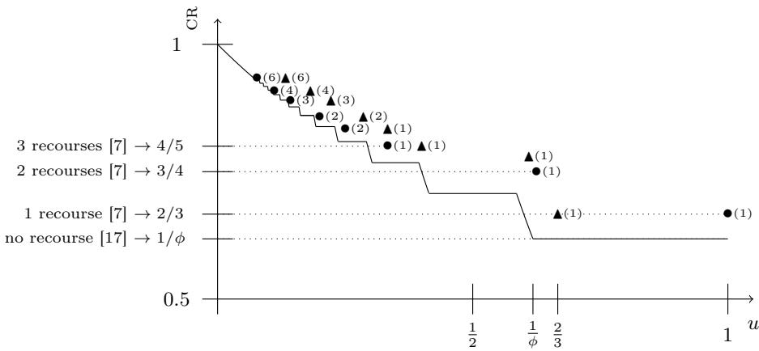
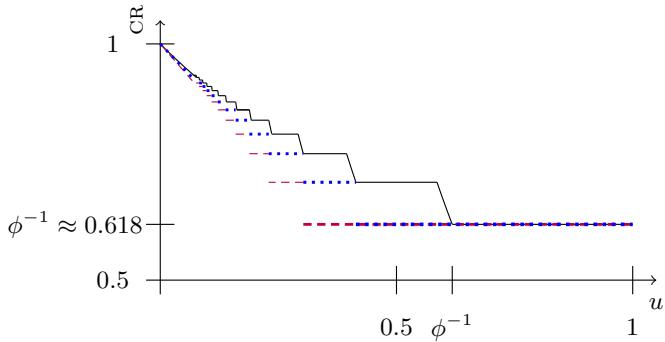
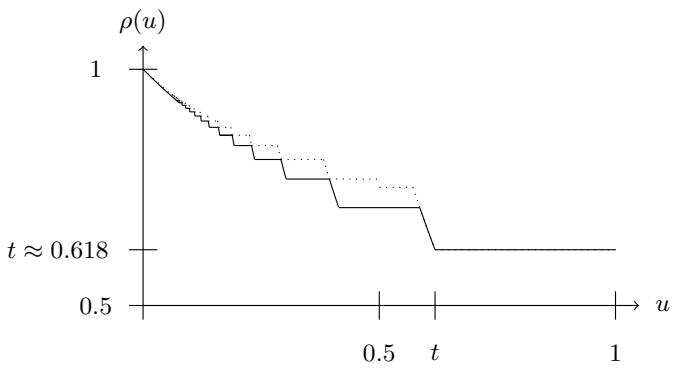

# Leveraging Recourse and Size Bounds for Online Knapsack with Removable Items<sup>⋆</sup>

Dimitris Fotakis<sup>1,2[0000−0001−6864−8960]</sup>, Laurent Gourvès<sup>3[0000−0002−5076−1583]</sup>,

Aris Pagourtzis<sup>1,2[0000−0002−6220−3722]</sup>, and Panagiotis Patsilinakos<sup>3[0009−0007−9540−2334]</sup>

<sup>1</sup> National Technical University of Athens, Greece

<sup>2</sup> Archimedes, Athena Research Center, Greece

3 Université Paris-Dauphine, Université PSL, CNRS, LAMSADE, Paris, France fotakis@cs.ntua.gr, laurent.gourves@dauphine.fr, pagour@cs.ntua.gr, panagiotis.patsilinakos@dauphine.psl.eu

Abstract. In the online unweighted knapsack problem, items arrive sequentially and must be accepted or rejected immediately for a boundedcapacity knapsack, aiming to maximize the total size of accepted items. When decisions are irrevocable, no algorithm achieves a non-trivial competitive ratio. An essential relaxation that circumvents this impossibility is to allow previously accepted items to be removed from the knapsack (a.k.a. removal). In this work, we investigate possible further improvements on the competitive ratio with removal by bringing together two other previously proposed model extensions: knowledge of an upper bound on the item sizes (a.k.a. bound awareness) and ability to reinsert previously rejected items (a.k.a. recourse). Our contributions are twofold. First, we establish close upper and lower bounds on the competitive ratio under bound awareness, removal and recourse. We show that significant improvements on the best known competitive ratio are possible when the upper bound on the item sizes is not too restrictive and only few uses of recourse are available. Second, we introduce the notion of adaptive online algorithms which do not require to know any upper bound on the item sizes but still achieve performance guarantees comparable to the ones obtained under the bound awareness model.

Keywords: Unweighted Knapsack · Adaptive Online Algorithms · Removable Items · Recourse

## 1 Introduction

We study the online unweighted knapsack problem in which some items, to be placed in a knapsack of capacity 1, are disclosed over time. Each item $o _ { i }$ has a size $| o _ { i } | \in ( 0 , 1 ]$ . Starting from an initial empty set S, item $o _ { i }$ is revealed at round i during which it must be decided to pack $o _ { i }$ in $S$ or not. The value of S, denoted by v(S) and defined as $\textstyle \sum _ { o _ { i } \in S } | o _ { i } |$ , should never exceed the capacity.

<sup>⋆</sup> A preliminary version of this work appeared in IWOCA 2026 [11].

The goal is to maximize $v ( S )$ when the instance stops, given that the number of items is not known in advance.

The competitive ratio (cr for short) $\rho$ of a deterministic online algorithm is the worst case ratio between the value of its solution $\hat { S }$ and the value of an optimal solution $S ^ { \ast } \colon \rho : = v ( \hat { S } ) / v ( S ^ { \ast } )$ . Every cr of this article is in [0, 1]. Unfortunately, no deterministic algorithm can exhibit a non-trivial cr (i.e., bounded away from zero by any constant)<sup>4</sup> for the online unweighted knapsack problem [19]. This is mostly due to the fact that decisions are irrevocable. An essential relaxation that circumvents this impossibility is to allow items to be removed from $S$ after their insertion. Iwama and Taketomi showed that the online unweighted knapsack problem with removable items admits a $\phi ^ { - 1 }$ -competitive algorithm with $\phi ^ { - 1 } : = \textstyle { \frac { \sqrt { 5 } - 1 } { 2 } } \approx 0 . 6 1 8$ , and that no deterministic online algorithm can achieve a better cr [17].

Refined models have been proposed for improving upon the $\phi ^ { - 1 }$ -competitive algorithm. One such model is recourse, in which a recourse operation allows one item that was previously rejected to be eventually packed. Concretely, an item may be discarded from the solution upon its arrival and temporarily stored in a bufer. Subsequently, this item may eventually be inserted into the solution, which requires a so-called recourse operation. Items removed after being packed can also be stored in the bufer and reinserted by a recourse operation.

In contrast to the unlimited number of removals, the number of recourse operations is typically small, as such operations can be costly in practice. Böckenhauer et al. have demonstrated (among other results) that the online unweighted knapsack problem with at most $r \in \{ 1 , 2 , 3 \}$ recourse operation(s) and remov-$\mathrm { a b l e ^ { 5 } }$ items admits a deterministic $\textstyle { \frac { r + 1 } { r + 2 } }$ -competitive algorithm, and that no algorithm can achieve better cr with r recourse operation(s) [6, 7]. Consequently, a single recourse operation sufices to improve upon the ratio of $\phi ^ { - 1 }$

The second model assumes that item sizes are upper-bounded by a value strictly smaller than the knapsack capacity. Moreover, when dealing repeatedly with such bounded instances, this bound can be known in advance and with precision.

Accordingly, bound awareness refers to the ability to know from the outset an upper bound $u \in ( 0 , 1 ]$ such that $| o _ { i } | \le \mathbb { 1 }$ u holds for every item $o _ { i }$ . As u approaches $0 ,$ , the instance becomes increasingly constrained; however, the potential errors of an algorithm have a diminishing impact on the cr. When items are removable and their sizes are upper bounded by $u ,$ Gourvès and Pagourtzis [12] proposed an algorithm parameterized by $u$ whose cr $\rho ( u )$ improves upon $\phi ^ { - 1 }$ whenever $u \leq \phi ^ { - 1 }$ , given that $\phi ^ { - 1 }$ is known to be the optimal cr (without recourse) when $u \in ( \phi ^ { - 1 } , 1 ] \ [ 1 7 ]$ . Figure 1 comprises an illustration of $\rho ( u )$ while its formal definition is given in Theorem 3.

In comparison with the $\textstyle { \frac { r + 1 } { r + 2 } }$ -competitive algorithm of Böckenhauer et $a l .$ $\rho ( u )$ exceeds $2 / 3$ for $u \ : < \ : 0 . 6$ , exceeds $3 / 4$ for $u \ : < \ : 0 . 4$ , and exceeds $4 / 5$ for $u < 5 / 1 7$

The approaches of [7] and [12] are complementary yet incomparable: the former considers recourse without bound awareness, while the latter assumes bound awareness but allows no recourse.

## 1.1 Contribution

Our objective in this article is to extend the results of [7] and [12].

To this end, we explore in Section 2 the possibility of combining recourse with bound awareness for the online unweighted knapsack problem with removable items. We establish both upper and lower bounds on the optimal cr, given an upper bound u on item sizes and a fixed limit on the number of recourse operations. Our bounds, established for many discrete values of u (typically $u = 1 / k$ for integers $k )$ , increase as $u = 1 / k$ decreases, as does the number of possible recourse operations (on the order of $k / 2$ for the lower bound and of k for the upper bound). Our most significant results concern the most relevant cases in which u is large (so the instance is only weakly constrained) and the number of possible recourse operations is small.

Figure 1 provides an illustration where bullets (resp., triangles) correspond to lower (resp., upper) bounds on the optimal cr for a small number of recourse operations (this number is indicated in parentheses, to the right of the bullet/triangle). Concretely, having ${ \pmb { \Delta } } ( r )$ at coordinates $( x , y )$ means that for instances whose items have size at most $x ,$ every algorithm using at most r recourse operations has cr at most y. Having $\bullet ( r )$ at coordinates $( x , y )$ means that there exists a y-competitive algorithm using at most r recourse operations for instances whose items have size at most x.

Our second approach, developed in Section 3, overcomes a drawback of bounded awareness. We continue to assume that item sizes are upper-bounded by a value u but u is not known in advance. Therefore, we propose an adaptive version of the parametric algorithm of [12]: its cr is approximately the same, but the parameter u is updated each time a (larger) new item is disclosed. Finally, an adaptive version of the algorithm that allows for one recourse operation is proposed, thereby improving the previously established competitive ratio.

Importantly, our adaptive algorithm yields a learning-augmented variant that can use an uncertain upper-bound prediction to match non-adaptive performance when correct, degrading by only a small factor in the worst case when incorrect.

All our bounds on crs are for deterministic algorithms for the online unweighted knapsack problem with removable items, so we often omit this information.

## 1.2 Additional Related Work

We have already mentioned the most related to our work earlier results. Some additional related work is described below.

  
Fig. 1. Bounds on the cr as a function of u. The solid curve depicts $\rho ( u )$ , the cr of the bound aware algorithm of [12]. Bullets and triangles correspond to lower and upper bounds on the optimal cr when recourse is allowed (only drawn for a small number of recourse operations). The maximum number of recourse operations is indicated in parentheses. On the left are the crs from [17, 7], which are independent of u.

Regarding the possibility of item removal, an alternative model was proposed by Han et al. [13] where removal induces a cost either proportional to the item’s size (by a value $f$ known as the buyback factor) or equal to 1. The objective is to maximize the worth of packed items minus the cost of removed items, counting only those that were removed after been packed. Under this model, Han et al. studied the unweighted online knapsack problem [13], obtaining ratios that tend to $1 / 2$ when the buyback cost tends to 0. Babaiof et al. [2] considered, among others, the online weighted knapsack problem with a known upper bound $u \leq 1$ on the size of any item. They gave a deterministic algorithm for the case u $< 1 / 2$ whose competitive ratio is $( 1 - 2 u ) / ( 1 + 2 f + 2 \sqrt { f ( 1 + f ) } )$ , which becomes $_ { 1 } - 2 u$ when $f = 0 .$ . This is below the ratio $\phi ^ { - 1 }$ of [17] except for very small values of u, and is also inferior to the ratios obtained in [12] for every value of the item size bound u. However, the results of [2] hold for the weighted case as well; note that no deterministic algorithm can achieve any non-trivial cr for the online weighted knapsack, by removal only [18]. Another result of [2] is a randomized algorithm whose cr tends to $1 / 3$ as f goes to 0. Randomized algorithms for the online knapsack problem with (costless) removal can be found in [14, 10].

A variant to the idea of recourse was proposed by Böckenhauer et al. [3], where the possibility to reserve an item $( { \mathrm { i . e . } }$ , postpone the decision about it) is studied. In that model items are non-removable and the decision on which to restore is taken at the end, assuming that the algorithm is informed once the instance ends and can take action afterwards. Assuming that reserving an item costs α times its value, the authors characterize the best competitive ratio for all possible values of $\alpha \in ( 0 , 1 )$ . The best ratio in [3] is $1 / 2$ , obtained for small values of α $( \leq 1 / 6 )$ , and the performance deteriorates as α increases. Note that in [7] they achieve a $2 / 3$ cr with just one use of recourse and no information about the end of the instance; however, the two models are incomparable as in [3] there is no limit on the number of items that can be restored from the reserve, while in [7] there is no cost for reserving items in the recourse and bringing them into the solution. Another model supposes that the items can be placed in a bufer of size $K > 1$ before a selection of them is put in a knapsack of size 1 [15]; this model also assumes that the algorithm is informed when the input ends. Reservation with removability has been considered in [9].

Other proposed approaches for online knapsack include the possibility of augmentation of the knapsack size [18], the possibility of items being split and partially included in the knapsack [16], and the study of the advice complexity of the problem [8, 4]. The work of Zhou et al. on the weighted knapsack problem also makes (restrictive) assumptions about both the size of objects and their weight-to-size ratio [21].

For more information about the online knapsack problem, the interested reader may refer to a recent survey by Böckenhauer et al. [5].

## 2 Algorithms with Recourse

## 2.1 Lower Bounds on the Best Competitive Ratio

We propose (and analyze the cr of) Algorithm 1 where for some integer $k \geq 3$ an upper bound on the item sizes of $u = 1 / k$ is assumed and at most $\lfloor k / 2 \rfloor$ recourse operations are allowed. Small and large items have size in $( 0 , \frac { 1 } { k + 2 } \overline { { ] } }$ and $\textstyle { \big ( } { \frac { 1 } { k + 2 } } , { \frac { 1 } { k } } { \big ] }$ , respectively. It follows that any feasible solution contains at most $k + 1$ large items. Upon the arrival of item $o _ { i } ,$ the high-level strategy of Algorithm 1 is to maintain a solution $S$ according to the following rules: $( i )$ do not modify $S$ if $\begin{array} { r } { v ( S ) \geq \frac { k + 1 } { k + 2 } ; } \end{array}$ (ii) when $\begin{array} { r } { v ( S ) < \frac { k + 1 } { k + 2 } } \end{array}$ , attempt to exploit $o _ { i }$ together with at most $\left\lfloor { \frac { k } { 2 } } \right\rfloor$ items from the bufer (via recourse operations) in order to construct a feasible solution of value at least ${ \frac { k + 1 } { k + 2 } } ; ( i i i )$ if step (ii) fails, retain in the current solution the $\lceil \frac { k } { 2 } \rceil$ smallest large items, the $\left\lfloor { \frac { k } { 2 } } \right\rfloor$ largest large items, and all small items revealed so far.

Theorem 1. For an integer $k \geq 3$ , Algorithm 1 is $\textstyle { \frac { k + 1 } { k + 2 } }$ -competitive when $u \leq$ $1 / k .$ . In addition, Algorithm 1 uses at most $\left\lfloor { \frac { k } { 2 } } \right\rfloor$ recourse operations.

Proof. The proof is by induction until it possibly happens that a feasible solution of value at least $\textstyle { \frac { k + 1 } { k + 2 } }$ is built. As soon as the current solution has value at least $\textstyle { \frac { k + 1 } { k + 2 } }$ (which occurs at line $^ { 4 , }$ or when the while loop at line 12 is executed,<sup>6</sup> or at line 16), the algorithm is clearly $\textstyle { \frac { k + 1 } { k + 2 } }$ -competitive because the optimal value is at most 1.

Consider the cases other than those of lines 4, 12, and 16. First, observe that if $\textstyle v ( S ) < { \frac { k + 1 } { k + 2 } }$ , then every small item disclosed so far belongs to $S _ { ; }$ and every item placed in the bufer is large. Indeed, an item is put into S if it fits (cf. line 7), which is always the case for small items because their size is at most $\frac { 1 } { k { + } 2 }$

Algorithm 1 at most $\left\lfloor { \frac { k } { 2 } } \right\rfloor$ recourse operations, $u \leq 1 / k ,$ , for any integer $k \geq 3$   
1: $S  \emptyset \quad \quad \triangleright$ Small and large items have size in $( 0 , \frac { 1 } { k + 2 } ]$ and $\textstyle { \big ( } { \frac { 1 } { k + 2 } } , { \frac { 1 } { k } } { \big ] }$ , respectively   
2: while a new item $o _ { i }$ arrives do   
3: if $\textstyle v ( S ) \geq { \frac { k + 1 } { k + 2 } }$ then   
4: Put $o _ { i }$ in the bufer   
5: else   
6: if $v ( S \cup \{ o _ { i } \} ) \leq 1$ then   
7: $S \gets S \cup \{ o _ { i } \}$   
8: else   
9: if $\begin{array} { r } { v ( \{ o \in S : | o | > \frac { 1 } { k + 2 } \} \cup \{ o _ { i } \} ) \le 1 } \end{array}$ then   
10: $S \gets S \cup \{ o _ { i } \}$   
11: while $v ( S ) > 1$ do   
12: Remove a small item from $S$ ▷ chosen arbitrarily   
13: else   
14: T ← collection of all sets of at most $k + 1$ elements of $\big \{ o _ { 1 } , \dotsc , o _ { i } \big \}$   
which contain at most $\left\lfloor { \frac { k } { 2 } } \right\rfloor$ bufered items   
15: if $\exists T \in \mathcal { T }$ such that $1 \geq v ( T ) \geq \frac { k + 1 } { k + 2 }$ then   
16: $S \gets T$   
17: else   
18: Keep in $S$ the $\lceil \frac { k } { 2 } \rceil$ smallest large items seen so far, the $\left\lfloor { \frac { k } { 2 } } \right\rfloor$ largest   
large items seen so far, and every small item seen so far

Let $O P T _ { i }$ $\left( \mathrm { r e s p . , } S _ { i } \right)$ be an optimal solution (resp., the solution produced by Algorithm 1) for the item set $\{ o _ { 1 } , \ldots , o _ { i } \}$ . Let $S _ { i } ^ { s }$ and $S _ { i } ^ { \ell }$ denote the restriction of $S _ { i }$ to small and large items of $\big \{ o _ { 1 } , \ldots , o _ { i } \big \}$ , respectively. Let $Q _ { i }$ be a subset of large items taken in $\big \{ o _ { 1 } , \ldots , o _ { i } \big \}$ whose value is maximum under the constraint $v ( Q _ { i } ) \leq$ 1. We claim that Algorithm 1 maintains a feasible solution which guarantees

$$
v ( S _ { j } ^ { \ell } ) \geq \frac { k + 1 } { k + 2 } v ( Q _ { j } )\tag{1}
$$

for $j = 1 . . i - 1$ until it possibly happens that $\textstyle v ( S _ { i } ) \geq { \frac { k + 1 } { k + 2 } }$ . The base case $( j = 1 )$ of the induction hypothesis (1) holds trivially: if $o _ { 1 }$ is large then $S _ { 1 } ^ { \ell } = Q _ { 1 } = \{ o _ { 1 } \}$ otherwise $S _ { 1 } ^ { \ell } = Q _ { 1 } = \varnothing$ , so $\dot { v } ( S _ { 1 } ^ { \ell } ) = v ( Q _ { 1 } )$ . From now on, we assume that (1) holds for $j = i - 1$ , right before $o _ { i }$ is disclosed. Our proof also relies on the following observation whose proof is given in Appendix 4.1.

Observation 1 $\begin{array} { r } { v ( S _ { j } ^ { \ell } ) \geq \frac { k + 1 } { k + 2 } v ( Q _ { j } ) } \end{array}$ implies $\begin{array} { r } { v ( S _ { j } ) \geq \frac { k + 1 } { k + 2 } v ( O P T _ { j } ) } \end{array}$

At line 7 of Algorithm $1 , o _ { i }$ is put into the current solution because it fits. If $o _ { i }$ is small, then $S _ { i } ^ { \ell } = S _ { i - 1 } ^ { \ell } ,$ , and $\begin{array} { r } { Q _ { i } = Q _ { i - 1 } , \thinspace \mathrm { s o } \ v ( S _ { i } ^ { \ell } ) = v ( S _ { i - 1 } ^ { \ell } ) \geq \frac { k + 1 } { k + 2 } v ( Q _ { i - 1 } ) = } \end{array}$ $\frac { k + 1 } { k + 2 }  { \boldsymbol { v } } ( Q _ { i } )$ . If $o _ { i }$ is large, then $S _ { i } ^ { \ell } = S _ { i - 1 } ^ { \ell } \cup \{ o _ { i } \}$ , and $v ( Q _ { i } ) \leq v ( Q _ { i - 1 } ) + | o _ { i } |$ , so $\begin{array} { r } { v ( S _ { i } ^ { \ell } ) \ = \ v ( S _ { i - 1 } ^ { \ell } ) + | o _ { i } | \ \geq \ \frac { k + 1 } { k + 2 } v ( Q _ { i - 1 } ) + | o _ { i } | \ \geq \ \frac { k + 1 } { k + 2 } v ( Q _ { i } ) } \end{array}$ . In both cases, the insertion of $o _ { i }$ maintains the property of being ${ \frac { k + 1 } { k + 2 } } \mathrm { - c o m p e t i t i v e } .$

The last case to be analyzed is line 18. In this context we have $\begin{array} { r } { v ( S _ { i - 1 } ) < \frac { k + 1 } { k + 2 } } \end{array}$ $v ( S _ { i - 1 } \cup \{ o _ { i } \} ) > 1$ and $v ( S _ { i - 1 } ^ { \ell } \cup \{ o _ { i } \} ) > 1$ , implying that $o _ { i }$ is a large item.

Suppose that at some point $i , \ \{ o _ { 1 } , \ldots , o _ { i } \}$ contains for the first time a set Y of $k + 1$ large items such that $v ( Y ) \leq 1$ . This means that $o _ { i } ~ \in ~ Y$ . Since Algorithm 1 maintains the $\lceil \frac { k } { 2 } \rceil$ smallest large items seen so far, it can exploit $o _ { i }$ and the $\left\lfloor { \frac { k } { 2 } } \right\rfloor$ recourse operations to produce a set $Y ^ { \prime }$ of $k + 1$ large items such that $v ( Y ^ { \prime } ) ^ { - } \leq v ( Y ) \leq 1$ . Since every large item has size at least $\frac { 1 } { k { + } 2 }$ , it holds that $\begin{array} { r } { v ( Y ^ { \prime } ) \geq \frac { k + 1 } { k + 2 } } \end{array}$ . Thus, the algorithm is able to produce a feasible solution of value at least $\frac { k + 1 } { k + 2 }$ as soon as a feasible set of $k + 1$ large items exists.

It remains to consider the case where every set $Y$ of large items such that $v ( Y ) \leq 1$ satisfies $| Y | \le k$ . This is true, in particular, for $S _ { i } ^ { \ell }$ . Moreover, $S _ { i } ^ { \ell }$ cannot contain less than k large items because the test of line 9 is false. Indeed, any set of k large items has size at most 1 because every item has size at most $1 / k . \mathrm { O n e }$ cannot take a large item of the bufer, say $\hat { o } \notin S _ { i } ^ { \ell }$ , and have $v ( S _ { i } ^ { \ell } \cup \{ \overset { } { o } \} ) \leq 1$ because every set $\dot { Y }$ of large items such that $v ( Y ) \leq 1$ satisfies $| Y | \le k$ . This means that $\begin{array} { r } { \dot { v } ( S _ { i } ^ { \ell } \cup \{ \hat { o } \} ) > 1 \Rightarrow v ( S _ { i } ^ { \ell } ) > 1 - \frac { 1 } { k } = \frac { k - 1 } { k } . \mathrm { ~ I f ~ } v ( Q _ { i } ) \leq \frac { k + 1 } { k + 2 } } \end{array}$ , then $\begin{array} { r } { \frac { v ( S _ { i } ^ { \ell } ) } { v ( Q _ { i } ) } > \frac { k - 1 } { k } \cdot \frac { k + 2 } { k + 1 } \geq \frac { k + 1 } { k + 2 } } \end{array}$ when $k \geq 3$

The final case is when $\begin{array} { r } { v ( Q _ { i } ) > \frac { k + 1 } { k + 2 } } \end{array}$ . By the definition of $Q _ { i } , v ( Q _ { i } )$ is nondecreasing with i. Let us suppose that i is the first moment that $\begin{array} { r } { v ( Q _ { i } ) > \frac { k + 1 } { k + 2 } } \end{array}$ This means that $Q _ { i }$ contains $o _ { i }$ . Let $\{ o _ { 1 } ^ { \prime } , \dotsc , o _ { \lceil \frac { k } { 2 } \rceil } ^ { \prime } \} \cup \{ p _ { 1 } , \dotsc , p _ { \lfloor \frac { k } { 2 } \rfloor } \}$ denote the k (large) items of $Q _ { i - 1 }$ where we assume w.l.o.g. that $| o _ { 1 } ^ { \prime } | \leq | o _ { 2 } ^ { \prime } | \stackrel { - } { \leq } \cdot \cdot \cdot \leq | o _ { \lceil \frac { k } { 2 } \rceil } ^ { \prime } | \leq$ $| p _ { 1 } | \leq | p _ { 2 } | \leq . . . \leq | p _ { \lfloor \frac { k } { 2 } \rfloor } |$ . We have $Q _ { i } = Q _ { i - 1 } \varDelta \{ o _ { 1 } ^ { \prime } , o _ { i } \}$

Since $S _ { i - 1 } ^ { \ell }$ keeps the $\left\lfloor { \frac { k } { 2 } } \right\rfloor$ largest items seen so far, we can assume that $\{ p _ { 1 } , . . . , p _ { \lfloor \frac { k } { 2 } \rfloor } \} \subseteq S _ { i - 1 } ^ { \ell }$ . In other words, at most $\left\lfloor { \frac { k } { 2 } } \right\rfloor$ recourse operations are needed to produce $Q _ { i }$ from $S _ { i - 1 } ^ { \ell }$ because $\{ p _ { 1 } , \ldots , p _ { \lfloor \frac { k } { 2 } \rfloor } \}$ and $o _ { i }$ are accessible without any recourse. Thus, $Q _ { i } \in \mathcal { T }$ at line 14 of Algorithm 1, meaning that the algorithm can produce a solution of value at least $\frac { \tilde { k } { + } 1 } { k { + } 2 }$

Finally, the following Observation 2, shows that Algorithm 1 is correct: it produces a feasible solution and uses at most $\lfloor k / 2 \rfloor$ recourse operations . ⊓⊔

## Observation 2 Algorithm 1 is correct.

Proof. Let us first consider how many times the recourse is used. By construction, recourse is made for possibly multiple items but during a single round, and for each recourse a solution whose value is between $\frac { k + 1 } { k + 2 }$ and 1 is produced.

At line 14, at most $\lfloor k / 2 \rfloor$ items are taken from the bufer. No recourse is necessary for building $S _ { i }$ from $S _ { i - 1 }$ and $o _ { i }$ at line 18. Indeed, we have seen in the proof of Theorem 1 that $S _ { i - 1 }$ contains exactly k large items. More precisely, $S _ { i - 1 }$ contains the $\lceil \frac { k } { 2 } \rceil$ smallest large items, say $\{ a _ { 1 } , \dotsc , a _ { \lceil \frac { k } { 2 } \rceil } \}$ , and the $\Big \lfloor \frac { \bar { k } } { 2 } \Big \rfloor$ largest large items, say $\{ b _ { 1 } , \dotsc , b _ { \lfloor \frac { k } { 2 } \rfloor } \}$ , of $\left\{ o _ { 1 } , \ldots , o _ { i - 1 } \right\}$ , where $| a _ { 1 } | \leq \ldots \leq | a _ { \lceil \frac { k } { 2 } \rceil } | \leq$ $| b _ { 1 } | \leq \ldots \leq | b _ { \lfloor \frac { k } { 2 } \rfloor } |$ . If $| o _ { i } | < \bar { | a } _ { \lceil \frac { k } { 2 } \rceil } |$ , then $S _ { i } = S _ { i - 1 } \varDelta \{ o _ { i } , a _ { \lceil \frac { k } { 2 } \rceil } \}$ $\mathrm { I f } \left| o _ { i } \right| > \left| b _ { 1 } \right|$ , then $S _ { i } = S _ { i - 1 } \varDelta \{ o _ { i } \bar { , } b _ { 1 } \}$ . If $| a _ { \lceil \frac { k } { 2 } \rceil } | \leq | o _ { i } | \leq | b _ { 1 } |$ , then $S _ { i } = S _ { i - 1 }$

It remains to prove that the algorithm maintains a solution whose value does not exceed 1. It is immediate at lines 7, 12 and 16. Let us show that $v ( S _ { i } ) \leq 1$ holds at line 18. We have $\textstyle v ( S _ { i } ^ { \ell } ) < { \frac { k + 1 } { k + 2 } }$ because $S _ { i } ^ { \ell } \in \mathcal { T }$ . We also know that $\begin{array} { r } { v ( S _ { i } ^ { s } ) \leq \frac { 1 } { k } - \frac { 1 } { k + 2 } } \end{array}$ because $\begin{array} { r } { v ( S _ { i } ^ { s } ) = v ( S _ { i - 1 } ^ { s ^ { \prime } } ) = v ( S _ { i - 1 } ) - v ( S _ { i - 1 } ^ { \ell } ) < \frac { k + 1 } { k + 2 } - v ( S _ { i - 1 } ^ { \ell } ) } \end{array}$ and $v ( S _ { i - 1 } ^ { \ell } ) > 1 - | o _ { i } | \geq 1 - 1 / k$ . Thus, it holds that $v ( S _ { i } ) = v ( S _ { i } ^ { s } ) + v ( S _ { i } ^ { \ell } ) \leq$ $\begin{array} { r } { \frac { k + 1 } { k + 2 } + \frac { 1 } { k } - \frac { 1 } { k + 2 } \leq 1 } \end{array}$ when $k \geq 2$ ⊓⊔

Extending Theorem 1 to $k = 2$ yields a cr of $3 / 4$ using at most one recourse operation when $u \leq 1 / 2$ . In fact, a modified version of Algorithm 1, Algorithm 4, using four classes of items (small, medium, large and extra-large) gives the following stronger result.

Theorem 2. There exists a deterministic ${ \frac { 3 } { 4 } } \cdot$ -competitive algorithm using at most one recourse operation when $u \leq 5 / 8$

```latex
Algorithm 4 at most 1 recourse operation and $u \leq 5 / 8$
1: S ← ∅, ▷ Small, medium, large and extra-large items have size in $( 0 , \textstyle { \frac { 1 } { 4 } } ] , \ ( \textstyle { \frac { 1 } { 4 } } , \textstyle { \frac { 3 } { 8 } } ] .$
$\textstyle { \left( { \frac { 3 } { 8 } } , { \frac { 1 } { 2 } } \right) } .$ , and $\textstyle \left[ { \frac { 1 } { 2 } } , { \frac { 5 } { 8 } } \right]$ , respectively
2: while a new item $o _ { i }$ arrives do
3: if $\textstyle v ( S ) \geq { \frac { 3 } { 4 } }$ then
4: Put $o _ { i }$ in the bufer
5: else
6: if $v ( S \cup \{ o _ { i } \} ) \leq 1$ then
7: $S \gets S \cup \{ o _ { i } \}$
8: else
9: Let $S ^ { \ell } = \{ o \in S : | o | > { \frac { 1 } { 4 } } \}$
10: if $v ( S ^ { \ell } \cup \{ o _ { i } \} ) \leq 1$ then
11: $S \gets S \cup \{ o _ { i } \}$
12: while $v ( S ) > 1$ do
13: Remove a small item from S (chosen arbitrarily)
14: else
15: T ← collection of all sets of at most 3 elements of $\left\{ o _ { 1 } , \ldots , o _ { i } \right\}$
which contain at most 1 item of the bufer
16: $\mathbf { i f } \ \exists T \in \mathcal { T }$ such that $\begin{array} { r } { 1 \ge v ( T ) \ge \frac { 3 } { 4 } } \end{array}$ then
17: $S \gets T$
18: else
19: If $S ^ { \ell } \cup \{ o _ { i } \}$ contains two extra-large items, then place the
largest one into the bufer, and keep the smallest one.
Otherwise, if $S ^ { \ell } \cup \{ o _ { i } \}$ contains an extra large item and a
large item, then place the large item into the bufer and
keep the extra-large item. Otherwise, if $S ^ { \ell } \cup \{ o _ { i } \}$ contains
3 items $( \mathrm { i . e . , 3 }$ medium items, or 2 medium items and 1
large item), then place the median one into the bufer, and
keep the remaining 2 items (i.e., the smallest and the
largest)
```

For the proof, we are going to analyze Algorithm 4 which tries to produce a solution whose value is between $3 / 4$ and 1. Such a solution is called a target solution. We are particularly interested in non-small items, i.e., items whose size is strictly larger than $1 / 4$ . More specifically, we say that an item o is small, medium, large, and extra-large when $| o | \in ( 0 , \frac { 1 } { 4 } ] , | o | \in ( \frac { 1 } { 4 } , \frac { 3 } { 8 } ] , | o | \in ( \frac { 3 } { 8 } , \frac { 1 } { 2 } )$ , and $| o | \in \ [ \frac { 1 } { 2 } , \frac { 5 } { 8 } ]$ , respectively. Hence, non-small items are either medium, large or extra-large. At line 19, we use the notion of median item. Given three items $\{ o _ { a } , o _ { b } , o _ { c } \}$ , we say that $o _ { b }$ is a median item if $\left| o _ { a } \right| \leq \left| o _ { b } \right| \leq \left| o _ { c } \right|$

Proof. Algorithm 4 follows the same line as Algorithm 1. The same goes for their analyses. Indeed, using the same notations and arguments as in the proof of Theorem 1 it is not dificult to prove that Algorithm 4 is 3/4-competitive, except when line 19 is executed. This case happens when

$$
v ( S _ { i - 1 } ^ { \ell } \cup \{ o _ { i } \} ) > 1\tag{2}
$$

and

$$
v ( S _ { i - 1 } ^ { \ell } ) \leq v ( S _ { i - 1 } ) < 3 / 4\tag{3}
$$

hold, where $S _ { i - 1 } ^ { \ell }$ designates $S ^ { \ell }$ right before $o _ { i }$ is disclosed. By construction, $S _ { i - 1 }$ contains all the small items disclosed so far. It follows from (2) that $o _ { i }$ is non-small.

Since u $, < 3 / 4$ , and because non-small items have size strictly larger than $1 / 4 ,$ , a combination of non-small items whose value lies in the interval $[ 3 / 4 , 1 ]$ must contain two or three elements. Table 1 provides the list of combinations of two or three non-small items, and the possibility that they satisfy the lower and upper bounds for being a target solution.

Table 1. Eight combinations of non-small items and comments on their total value. For example, “always $\geq 3 / 4 ^ { \mathfrak { n } }$ means that the total value of the corresponding combination is always above $3 / 4$ , whereas “possibly $> 1 ^ { \mathfrak { s } }$ indicates that the total value may exceed 1.
<table><tr><td>#1|2 medium items #2|1 medium item + 1 large item #3|1 medium item + 1 extra large item #42 large items #5|3 medium items #6|1 large item + 1 extra large item</td><td>possibly  $\overline { { < 3 / 4 } }$  always ≤ 1 possibly &lt; 3/4| always ≤ 1 always ≥ 3/4 always ≤ 1 always ≥ 3/4 | always ≤ 1 always ≥ 3/4 possibly &gt; 1 always ≥ 3/4 possibly &gt; 1 #7|2 extra large items always ≥ 3/4 possibly &gt; 1 #8|2 medium items + 1 large item always ≥ 3/4 possibly &gt; 1</td></tr></table>

For every other combination of non-small items it is guaranteed that its value is out of the interval $[ 3 / 4 , 1 ]$ . Combinations $\# 3$ and $\# 4$ are particularly interesting because they are guaranteed to be target solutions.

Note that $| S _ { i - 1 } ^ { \ell } | \in \{ 1 , 2 \}$ because $| S _ { i - 1 } ^ { \ell } | = 0$ and $| S _ { i - 1 } ^ { \ell } | \geq 3$ would contradict (2) and (3), respectively.

Having just a medium item in $S _ { i - 1 } ^ { \ell }$ would contradict (2). Inequality (3) would be contradicted if $S _ { i - 1 } ^ { \ell }$ contained one of the following combinations of two nonsmall items: 1 extra-large item plus another non-small item, or 2 large items. Thus, the only possibilities for the composition of $S _ { i - 1 } ^ { \ell }$ are: 1 large item, 1 extralarge item, 2 medium items, and 1 medium plus 1 large items. All the possible cases are listed in Table 2.

Table 2. All the possible cases at line 19.
<table><tr><td rowspan=1 colspan=1>composition of $\overline { { S _ { i - 1 } ^ { \ell } } }$ </td><td rowspan=1 colspan=1>Oi is extra-large</td><td rowspan=1 colspan=1>[oi is large</td><td rowspan=1 colspan=1>oi is medium</td></tr><tr><td rowspan=4 colspan=1>1 extra-large item1 large item2 medium items1 medium and 1 large items</td><td rowspan=1 colspan=1>case 1</td><td rowspan=1 colspan=1>case 2</td><td rowspan=4 colspan=1>case 3case 6case 9case 12</td></tr><tr><td rowspan=2 colspan=1>case 4case 7</td><td rowspan=1 colspan=1>case 5</td></tr><tr><td rowspan=1 colspan=1>case 8</td></tr><tr><td rowspan=1 colspan=1>case 10</td><td rowspan=1 colspan=1>case 11</td></tr></table>

For cases 3, 5, 7, 10 and $^ { 1 1 , }$ a target solution similar to combinations #3 or #4 can be created, so they are incompatible with the execution of line 19. Case 6 does not occur because it contradicts (2). Thus, line 19 covers all the remaining cases (1,2, 4, 8, 9, and 12), meaning that Algorithm 4 is correct.

Let $Q _ { j }$ be a set of non-small items of largest value within $\big \{ o _ { 1 } , \dotsc , o _ { j } \big \}$ , without exceeding 1, for $j = 1 . . i .$ As shown in the proof of Theorem 1, it sufices to prove $\begin{array} { r } { v ( S _ { i } ^ { \ell } ) \geq \frac { 3 } { 4 } v ( Q _ { i } ) } \end{array}$ to get that Algorithm 4 is $\frac 3 4$ -competitive at step i. And as in the proof of Theorem 1, we make the induction hypothesis that $\begin{array} { r } { v ( S _ { i - 1 } ^ { \ell } ) \geq \frac { 3 } { 4 } v ( Q _ { i - 1 } ) } \end{array}$ .

Consider the cases 1, 2 and 4. By construction, the algorithm maintains one extra-large item in $S _ { i } ^ { \ell }$ , so $v ( S _ { i } ^ { \ell } ) \ge 1 / 2$ . If $Q _ { i }$ consists of a single non-small item, then $v ( Q _ { i } ) \leq 5 / 8$ . We deduce that $\begin{array} { r } { \frac { v ( S _ { i } ^ { \ell } ) } { v ( Q _ { i } ) } \geq \frac { 1 } { 2 } \cdot \frac { 8 } { 5 } = \frac { 4 } { 5 } > \frac { 3 } { 4 } } \end{array}$ . Suppose $Q _ { i }$ consists of two non-small items. If there is a medium item in $Q _ { i } ,$ then it is possible to produce a combination $\# 3$ with a single recourse (use the extra-large item of $S _ { i } ^ { \ell } )$ , and reach the value of at least $3 / 4 \colon$ contradiction with the fact that no such combination exists in $\tau .$ . Every pair of non-small items which does not include any medium item has value at least $3 / 4$ , so we again reach a contradiction. Finally, suppose that $Q _ { i }$ consists of three non-small items. Then, $Q _ { i }$ must include a medium item, implying that it is possible to produce a combination $\# 3$ with a single recourse: contradiction.

Consider the cases $^ { 8 , }$ 9 and 12. By construction, the algorithm maintains two non-small items in $S _ { i } ^ { \ell }$ , the smallest and the largest, $S _ { i } ^ { \ell }$ is either a pair of medium items or a medium and a large items, and $\begin{array} { r } { v ( \bar { S _ { i } ^ { \ell } } ) > 2 \cdot \frac { 1 } { 4 } = \frac { 1 } { 2 } . \mathrm { ~ I f ~ } \bar { Q _ { i } } } \end{array}$ consists of a single non-small item, then $v ( Q _ { i } ) \leq 5 / 8$ , and we deduce that $\begin{array} { r } { \frac { v ( S _ { i } ^ { \ell } ) } { v ( Q _ { i } ) } \geq \frac { 1 } { 2 } \cdot \frac { 8 } { 5 } > \frac { 3 } { 4 } } \end{array}$

Suppose $Q _ { i }$ consists of two non-small items. If there is an extra-large item in $Q _ { i } ,$ , then it is possible to produce a combination $\# 3$ with a single recourse (use a medium item of $S _ { i } ^ { \ell } )$ , and reach the value of at least $3 / 4 \colon$ contradiction with the fact that no such combination exists in $\tau$

Suppose $Q _ { i }$ consists of two medium items. Because $v ( Q _ { i } ) \geq v ( S _ { i } ^ { \ell } ) , S _ { i } ^ { \ell }$ also contains two medium items. Since, by construction, the algorithm keeps the smallest and the largest items, we have $v ( S _ { i } ^ { \ell } ) = x + y$ where $\begin{array} { r } { \frac { 1 } { 4 } < x \le y \le \frac { 3 } { 8 } } \end{array}$ 2 and $v ( Q _ { i } ) \leq 2 y$ , so $\begin{array} { r } { \frac { v ( S _ { i } ^ { \ell } ) } { v ( Q _ { i } ) } \geq \frac { 1 / 4 + 3 / 8 } { 2 \cdot 3 / 8 } = \frac { 5 } { 6 } > \frac { 3 } { 4 } } \end{array}$

Suppose $Q _ { i }$ consists of a medium and a large items. Since, by construction, the algorithm keeps the smallest and the largest non-small items, $S _ { i } ^ { \ell }$ also contains a medium and a large items. Moreover, the large item of $S _ { i } ^ { \ell }$ is at least as large as the large item of $Q _ { i }$ . We have $v ( S _ { i } ^ { \ell } ) = x + y$ where $\begin{array} { r } { \frac { 1 } { 4 } < \dot { x } \le \frac { 3 } { 8 } < y \le \frac { 1 } { 2 } } \end{array}$ , and $\begin{array} { r } { v ( Q _ { i } ) \leq \frac { 3 } { 8 } + y , \mathrm { s o } \frac { v ( S _ { i } ^ { \ell } ) } { v ( Q _ { i } ) } \geq \frac { 1 / 4 + y } { 3 / 8 + y } \geq \frac { 1 / 4 + 3 / 8 } { 2 \cdot 3 / 8 } = \frac { 5 } { 6 } > \frac { 3 } { 4 } } \end{array}$

Suppose $Q _ { i }$ consists of two large items, corresponding to combination $\# 4$ whose value is always in $[ 3 / 4 , 1 ]$ . Such a target solution belongs to $\tau$ because at most one recourse is needed to produce it: contradiction.

The remaining case is when $Q _ { i }$ <sub>i</sub> consists of three items, say $\left\{ o _ { k } , o _ { j } , o _ { i } \right\}$ where $k < j < i$ . The set $Q _ { i }$ satisfies $v ( Q _ { i } ) \geq 3 / 4$ , and it must contain three medium items, or two medium items plus one large item, otherwise $v ( Q _ { i } ) > 1$ . We claim that a contradiction is reached because a single recourse is enough for constructing a solution $T \in \mathcal T$ such that $\boldsymbol { v } ( T ) \in [ \frac { 3 } { 4 } , 1 ]$ with the use of $o _ { i }$ and the non-small items of $S _ { i - 1 } ^ { \ell }$

Indeed, by construction, the algorithm keeps the smallest non-small item, so we have $S _ { i - 1 } ^ { \ell } = \{ o _ { a } , o _ { b } \}$ where $o _ { i } \notin \{ o _ { a } , o _ { b } \} , | o _ { a } | \leq | o _ { b } |$ , and $| o _ { a } | \leq \operatorname* { m i n } \{ | o _ { k } | , | o _ { j } | \}$ Suppose without loss of generality that $o _ { a } ~ \neq ~ o _ { j }$ (otherwise, swap $o _ { j }$ and $o _ { k }$ in our reasoning). One can use (if necessary) the recourse to get $o _ { j }$ and produce the set $\left\{ o _ { a } , o _ { i } , o _ { j } \right\}$ such that $v ( \{ o _ { a } , o _ { i } , o _ { j } \} ) \le v ( \{ o _ { k } , o _ { i } , o _ { j } \} ) \le 1$ . Moreover, $v ( \{ o _ { a } , o _ { i } , o _ { j } \} ) \ge 3 / 4$ because every member of $\left\{ o _ { a } , o _ { i } , o _ { j } \right\}$ is non-small. ⊓⊔

Compared with [7], for identical competitive ratios, our results use fewer recourse operations, albeit under the assumption of bounded item sizes. Likewise, compared with [12], for identical bounds on item sizes, we achieve better competitive ratios thanks to the use of recourse.

## 2.2 Upper Bounds on the Best Competitive Ratio

It is known from [7, Thm. 1] that deterministic algorithms that use at most r recourse operations have a cr of at most $\textstyle { \frac { r + 1 } { r + 2 } }$ . This bound is established via instances in which the largest item has size $\frac { r + 1 } { r + 2 } + \varepsilon$ . Consequently, both the size of the largest item and the upper bound on the cr increase with r. However, it is also known that the optimal cr increases as u decreases [12]. This motivates the need for novel upper bounds on the cr that reflect this dependence on u.

Lemma 1. For every integer $k \geq 3 .$ , there exists an upper bound $o f \ { \frac { 2 k - 1 } { 2 k } }$ on the competitive ratio of deterministic algorithms with at most $k - 2$ recourse operations when $\begin{array} { r } { \frac { 1 } { k } < u \leq 1 } \end{array}$

Proof. Take any online algorithm and suppose that an adversary reveals the following instance: $k - 1$ large items of size $\textstyle { \frac { 1 } { k } } + \varepsilon$ followed by 2k small items of size $\scriptstyle { \frac { 1 } { 2 k } }$ , where $\textstyle { \frac { 1 } { 2 k } } \gg \varepsilon > 0$ . The instance can be interrupted at any moment if the algorithm’s solution is (asymptotically) $\textstyle ( 1 - { \frac { 1 } { 2 k } } )$ -approximate, or worse.

The first k items fit into the knapsack. If the algorithm discards any of them, then the cr is at most $\textstyle 1 - { \frac { 1 } { 2 k - 1 } }$ as $\varepsilon  0$ . Indeed, the optimal solution has value $\begin{array} { r } { ( k - 1 ) ( \frac { 1 } { k } + \varepsilon ) + \frac { 1 } { 2 k } } \end{array}$ whereas the algorithm’s solution has value at most $\begin{array} { r } { ( k - 1 ) \big ( \frac { 1 } { k } + \varepsilon \big ) } \end{array}$ . Henceforth, we assume that the first k items belong to the solution.

When the $( k + 1 )$ -th item is revealed, it does not fit into the current solution, while the optimal value remains $\begin{array} { r } { ( k - 1 ) ( \frac { 1 } { k } + \varepsilon ) + \frac { 1 } { 2 k } = 1 - \frac { 1 } { 2 k } + ( k - 1 ) \varepsilon } \end{array}$ . The optimal value increases to 1 only upon the arrival of the final item, when the optimum consists of 2k small items. At this point, the algorithm may (i) replace 1 large item with 1 small item, or (ii) bufer a small item, or (iii) replace 1 large item with 2 small items.

Action (i) decreases the value of the current solution by $\textstyle { \frac { 1 } { 2 k } } + \varepsilon$ , yielding a cr of $\scriptstyle 1 - { \frac { 1 } { 2 k - 1 } }$ ; hence, the adversary can terminate the instance. Actions (ii) and (iii) do not significantly afect the solution value, but action (iii) can be performed at most $k - 2$ times, as each use requires a recourse operation.

Since the instance contains $k - 1$ large items, the algorithm must either perform action (i), or reach the end of the instance, where the optimal value is 1 while the algorithm’s solution has value at most $\begin{array} { r } { ( k - 1 ) ( \frac { 1 } { k } + \varepsilon ) + \frac { 1 } { 2 k } = } \end{array}$ $\textstyle 1 - { \frac { 1 } { 2 k } } + ( k - 1 ) \varepsilon$ . In any case, the cr is at most $\textstyle 1 - { \frac { 1 } { 2 k } }$ as $\varepsilon \to 0$ ⊓⊔

In the same spirit as Lemma 1, the following upper bounds can be derived.

Lemma 2. For every integer $k \geq 2 .$ , there exists an upper bound of $\frac { 2 k } { 2 k + 1 }$ on the cr of deterministic algorithms with at most $k - 1$ recourse operations when $\frac { 2 } { 2 k + 1 } < u \leq 1$

Proof. Take any online algorithm and suppose that an adversary discloses the following instance: k large items of size $\frac { \bar { 2 } } { 2 k + 1 } + \varepsilon$ followed by $2 k + 1$ small items of size $\frac { 1 } { 2 k + 1 }$ . We suppose that $\frac { 1 } { 2 k + 1 } \gg \varepsilon > 0$ . The size of the largest item is $\frac { 2 } { 2 k + 1 } + \varepsilon$ . The instance can be interrupted at any moment by the adversary when the solution maintained by the algorithm is (asymptotically) $\scriptstyle ( 1 - { \frac { 1 } { 2 k + 1 } } ) -$ approximate, or worse.

The first k items (which are identical) fit into the knapsack. If one of these items is not kept by the algorithm, then the competitive ratio is at most $\textstyle 1 - { \frac { 1 } { k } }$ when ε tends to 0. From now on we suppose that the k first items of the instance belong to the solution.

When the $( k + 1 )$ -th item of the instance is disclosed, it does not fit into the solution. However, the value of an optimal solution $k ( \frac { 2 } { 2 k + 1 } + \varepsilon )$ does not change. The optimal value changes only if the very last item is disclosed (i.e., it becomes 1 with $2 k + 1$ small items).

In between, the algorithm can (1) replace one large item with one small item, or (2) bufer a small item, or (3) replace one large item with two small items.

Note that the first action decreases the value of the current solution by ${ \frac { 1 } { 2 k + 1 } } +$ ε, giving a competitive ratio of $\textstyle { 1 - { \frac { 1 } { 2 k } } }$ when ε tends to zero. Therefore, the adversary can stop the instance if the first action is done. The second and third actions do not significantly change the value of the current solution (no decrease or a decrease by ε). However, the third action can be performed at most $k - 1$ times because each of them requires a recourse.

Since the instance comprises k large items, the algorithm is forced, either to do the first action, or to reach the very end of the instance where the value of the optimum becomes 1 and the algorithm’s solution has value at most $\textstyle k ( { \frac { 2 } { 2 k + 1 } } + \varepsilon ) =$ $\begin{array} { r } { 1 - \frac { 1 } { 2 k + 1 } + k \varepsilon } \end{array}$ . In any case, the competitive ratio is at best $\textstyle 1 - { \frac { 1 } { 2 k + 1 } }$ when ε goes to zero. ⊓⊔

We now present a complementary upper bound on the cr for the case of a single recourse operation.

Lemma 3. The competitive ratio of any algorithm with at most one recourse operation is upper-bounded by $\scriptstyle { \sqrt { \frac { 9 - { \sqrt { 1 7 } } } { 8 } } }$ ≈ 0.78 when $\textstyle u \geq { \frac { 9 - { \sqrt { 1 7 } } } { 8 } } \approx 0 . 6 1$

Proof. Let $\textstyle s = { \frac { 9 - { \sqrt { 1 7 } } } { 8 } } \approx 0 . 6 1$ . The first items $o _ { 1 }$ and $O _ { 2 }$ have size $1 - s + \varepsilon$ and $s ,$ respectively.<sup>7</sup> If o does not replace $o _ { 1 }$ , then the competitive ratio is $\textstyle { \frac { 1 - s } { s } }$ when $\varepsilon$ goes to 0. From now $\mathrm { o n . }$ , suppose that $\left\{ o _ { 2 } \right\}$ is the current solution and $o _ { 1 }$ is in the bufer. The third item $o _ { 3 }$ has size $1 - s + \varepsilon .$ If the solution remains $\left\{ o _ { 2 } \right\}$ then we get a ratio of $\frac { s } { 2 ( 1 - s + \varepsilon ) }$ which tends to ${ \frac { s } { 2 ( 1 - s ) } } = { \sqrt { s } }$ when ε goes to 0. Otherwise, one can use the recourse to produce the solution $\left\{ o _ { 1 } , o _ { 3 } \right\}$ . Then, a fourth item $o _ { 4 }$ of size $1 - s$ is disclosed. The optimum $\{ o _ { 2 } , o _ { 4 } \}$ has size one, and the size of the current solution is at most $2 ( 1 - s + \varepsilon )$ , so the competitive ratio tends to $2 ( 1 - s ) = { \sqrt { s } }$ when ε goes to 0. Given that $s > 1 - s + \varepsilon$ and ${ \frac { 1 - s } { s } } < { \sqrt { s } } ,$ we get an upper bound of $\sqrt { s } \approx 0 . 7 8$ when u $\geq s$ ⊓⊔

Let us summarize the bounds on the cr when a single recourse operation is possible (see Figure 1). There exist lower bounds of $4 / 5$ when $u \leq 1 / 3$ (Theorem $1 ) , 3 / 4$ when $u \leq 5 / 8$ (Theorem 2), and $2 / 3$ when $u \leq 1 ~ ( [ 7 ,$ Thm. 2]). There exist upper bounds of $5 / 6$ when $u > 1 / 3$ (Lemma $1 , k = 3 )$ , 4/5 when $u > 2 / 5$ (Lemma $2 , k = 2 ) , ( ( 9 - { \sqrt { 1 7 } } ) / 8 ) ^ { 1 / 2 }$ when $u \geq ( 9 - { \sqrt { 1 7 } } ) / 8$ (Lemma 3), and $2 / 3$ when $u > 2 / 3$ ([7, Thm. 1]).

In this section, we have proposed upper and lower bounds on the cr for certain combinations of upper bounds on object sizes, along with a limit on the number of allowable recourse operations. It would be interesting either to provide results for all possible combinations or to show that, for some combinations, recourse does not yield any significant improvement in the optimal cr. For example, what would be the best cr for all u with at most one recourse? Our results provide answers for $u \geq 1 / 3$ , and we believe that a single recourse can only marginally improve the situation when u is very close to zero. Resolving this conjecture would be of great interest.

## 3 Adaptive Algorithms

## 3.1 An Adaptive Algorithm with Removal Only

Algorithms that are aware of an upper bound on item sizes and whose cr is lower bounded by $\textstyle { \frac { 1 } { \phi } } ;$ , but can exceed $\frac { 1 } { \phi }$ for most size upper bounds, exist [12]. Importantly, the smaller the size bound, the stronger the cr guarantees they provide (almost tight per upper bound). This raises the question:

Can we design algorithms whose competitive ratio (inversely) depends on the maximum item size, without any prior information?

Crucially, we want our adaptive algorithms’ cr to still be lower bounded by $\displaystyle { \frac { 1 } { \phi } } ,$ in the worst case.

We begin by stating some useful definitions and theorems for the case of removable items without recourse. Consider an upper bound $u \in ( 0 , 1 ]$ on the size of every item. In this section, we explicitly consider u to be the maximum item size in the instance (unknown to the algorithm). Then, in [12] the following is shown:

Theorem 3 ([12]). For all integers $k > 0$ , there exists a $\gamma _ { k }$ -competitive algorithm for a known $u \in ( 0 , \frac { 1 - \check { \gamma } _ { k } } { \gamma _ { k } ^ { 2 } } ]$ , where $\gamma _ { k }$ is a constant defined as $\gamma _ { k } =$ $\frac { k - 2 + \sqrt { k ^ { 2 } + 4 } } { 2 k }$ . In addition, $f o r$ all integers $k \geq 2$ , the same algorithm is $\frac { 1 - u } { ( k - 1 ) u } -$ competitive when $\begin{array} { r } { u \in \big ( \frac { 1 - \gamma _ { k } } { \gamma _ { k } ^ { 2 } } , \frac { 1 } { k - 1 } \big ] } \end{array}$

For all positive integers k, $\gamma _ { k } \in ( 0 , 1 ]$ increases with $k ,$ and $\textstyle \gamma _ { 1 } = { \frac { { \sqrt { 5 } } - 1 } { 2 } } = { \frac { 1 } { \phi } }$ We will refer to this algorithm of [12] as “NonAdaptive” here.

NonAdaptive can be adapted to get improved guarantees (compared to $\frac { 1 } { \phi }$ [17]) without knowing the item size upper bound u in advance, at the cost of a small penalty in the cr. Our adaptive version, Algorithm 2 (a.k.a. Adaptive), follows NonAdaptive with the addition of lines 3, 4 and 5. These lines are used to dynamically update the value of k whereas NonAdaptive directly uses a fixed value, optimal for the given item size upper bound u.

The adaptive version updates an over-estimation of the upper bound (setting $k ^ { \prime } = \operatorname* { m a x } \{ k _ { c u r r } - 2 , 1 \}$ in line 5) whenever a larger item arrives and continues running with the corresponding threshold. We show that it preserves the guarantee of NonAdaptive tuned from the start to the final over-estimation. Since the true bound is smaller, the corresponding approximation guarantee is preserved.

Informally, NonAdaptive defines a threshold $1 - \gamma _ { k }$ and classifies items as small or non-small. When a new item does not fit into the knapsack and the guarantee is not met, items are removed based on the total sum of non-small item sizes. Specifically, when the sum of non-small item sizes is infeasible, it removes the largest item, otherwise it removes small items until it gets a feasible solution.

Definition 1 (k-small items). An item o is said to be k-small $i f \left| o \right| \le 1 - \gamma _ { k }$

The challenge is to identify the case where Adaptive might remove an important item that NonAdaptive would not. In this case Adaptive would delete its current largest item: For a current estimation of $k ,$ say $k ^ { \prime } ,$ the $k ^ { \prime } .$ non-small items seen-so-far do not fit in the knapsack, but for a later estimation, say $k ^ { \prime \prime } .$ some of these items could be considered $k ^ { \prime \prime }$ -small by NonAdaptive - allowing the rest to fit in the knapsack, not triggering the large item deletion. However, the over-estimation of the upper bound raises the non-small size threshold. Moreover, we target a lower cr which is easier to satisfy. Thus, as non-small items accumulate, the desired cr is achieved before they exceed the knapsack capacity.

The proofs of Observation 3 and Claim 1 are included in Appendix 4.3.

Observation 3 Consider that the item upper bound is u. Then the optimal parameter k for NonAdaptive to guarantee the best possible approximation is:

$$
k ^ { * } = \operatorname* { m a x } \Big \{ k \in { \mathbb { N } } \ \big \vert \ \frac { 2 } { k - 1 + \sqrt { ( k - 1 ) ^ { 2 } + 4 } } \geq u \Big \}
$$

Theorem 4. For all positive integers k, Algorithm 2, a.k.a. Adaptive, is $\gamma _ { k ^ { \prime } } .$ competitive when $\begin{array} { r } { u \leq \frac { 2 } { k - 1 + \sqrt { ( k - 1 ) ^ { 2 } + 4 } } } \end{array}$ where $k ^ { \prime } = \operatorname* { m a x } \{ k - 2 , 1 \}$ . In particular, Adaptive is $\gamma _ { \hat { k } }$ -competitive where $\hat { k } = \operatorname* { m a x } \{ k ^ { * } - 2 , 1 \}$

Algorithm 2 : Adaptive   
1: S ← ∅, MaxItem ← 0, B ← ∅   
2: while a new item $o _ { i }$ arrives do   
3: MaxItem ← max{MaxItem, |o |}   
4: $\begin{array} { r } { k _ { c u r r } \gets \operatorname* { m a x } \Big \{ k \in { \mathbb { N } } \ \Big | \ \frac { 2 } { k - 1 + \sqrt { ( k - 1 ) ^ { 2 } + 4 } } \geq M a x I t e m \Big \} } \end{array}$   
▷ Optimal k considering MaxItem as the upper bound   
5: k<sup>′</sup> ← max $\{ k _ { c u r r } - 2 , 1 \}$   
6: if $v ( S ) \geq \gamma _ { k ^ { \prime } }$ then   
7: Reject $o _ { i }$ ▷ S is not changed afterwards   
8: else   
9: $S \gets S \cup \{ o _ { i } \}$   
10: if v(S) > 1 then   
11: Let $B = \left\{ o \in S : | o | > 1 - \gamma _ { k ^ { \prime } } \right\}$ ▷ Reset B   
12: if B contains a subset $\hat { S }$ such that $1 \geq v ( \hat { S } ) \geq \gamma _ { k ^ { \prime } }$ then   
13: $S  \hat { S }$ ▷ S is not changed afterwards   
14: else if $v ( B ) > 1$ then   
15: Remove the largest item of S   
16: else   
17: while $v ( S ) > 1$ do   
18: Remove from S one element of S \ B ▷ chosen arbitrarily

Proof. It sufices to consider $k = k ^ { * }$ , since $\gamma _ { k }$ is increasing. By Theorem $3$ we have that NonAdaptive is guaranteed to achieve approximation $\gamma _ { \hat { k } }$ whenever $\begin{array} { r } { u \le \frac { 2 } { k - 1 + \sqrt { ( k - 1 ) ^ { 2 } + 4 } } } \end{array}$ . That is since for any $\begin{array} { r } { k \geq 3 , \ \frac { 2 } { k - 1 + \sqrt { ( k - 1 ) ^ { 2 } + 4 } } \ \leq \ \frac { 1 } { k - 1 } \ \leq \ } \end{array}$ $\begin{array} { r } { \frac { 1 - \gamma _ { k - 1 } } { \gamma _ { k - 1 } ^ { 2 } } \leq \frac { 1 - \gamma _ { \hat { k } } } { \gamma _ { \hat { k } } ^ { 2 } } } \end{array}$ (from properties in [12] and $\gamma _ { k - 2 } < \gamma _ { k - 1 } )$ . Finally for $k < 3$ $\hat { k } = 1$ and NonAdaptive gives $\mathrm { C R } \ \gamma _ { 1 }$ for any u.

As Adaptive runs, it computes the optimal parameter $k _ { c u r r }$ for NonAdaptive based on the largest item seen so far, using Observation $^ { 3 , }$ and sets $k ^ { \prime } =$ max $\left\{ k _ { c u r r } - 2 , 1 \right\} ( \mathrm { i . e . }$ , when the largest item size revealed is $u ,$ we have $\boldsymbol { k } ^ { \prime } = \boldsymbol { \hat { k } } )$ The algorithm then updates the set B of non-small items according to $k ^ { \prime }$ and follows the same thresholds and removal rules as NonAdaptive with parameter $k ^ { \prime }$

We use the following claim.

Claim 1 Ifthe largest item size seen so far satisfies MaxItem $\begin{array} { r } { \le \frac { 2 } { 4 - 1 + \sqrt { ( 4 - 1 ) ^ { 2 } + 4 } } } \end{array}$ $( i . e . , k \ge 4 )$ , then Adaptive has never removed any item in set $B$

While $k ^ { \prime } \ge 2$ , Claim 1 shows that no non-small item is removed before the desired cr is reached. If the algorithm removes small items to restore feasibility, then just before the last removal the value is greater than 1, and the removed item has size at most $1 - \gamma _ { k ^ { \prime } }$ . The remaining value is therefore greater than $\gamma _ { k ^ { \prime } }$ Since $k ^ { \prime }$ can only decrease, this solution satisfies every subsequent threshold and is not changed afterwards. The same holds if line 13 produces a solution of value at least $\gamma _ { k ^ { \prime } }$

Consequently, either the desired cr has already been reached, or no item has been removed while $k ^ { \prime } \ge 2$ . If the input ends in the latter case, the solution contains all the items and is optimal. $\operatorname { I f } k ^ { \prime }$ becomes 1, the solution still contains all the previously seen items, unless the desired cr has already been reached. If its value is at least $\gamma _ { 1 } .$ , the algorithm does not change it. Otherwise, NonAdaptive run with parameter 1 from the beginning would have kept the same items, and Algorithm 2 subsequently follows its rules, with the possible earlier selection of a subset of B of value at least $\gamma _ { 1 }$ . Theorem 3 therefore gives cr $\gamma _ { 1 }$ in this case. In every case, the cr is at least $\gamma _ { \hat { k } }$ ⊓⊔

Learning-Augmented Variant The adaptive algorithm also allows to create a learning-augmented via predictions version (cf. [1, 20]).

The goal is to design algorithms that leverage predictive input, motivated by modern ML systems’ ability to provide such insight. We are interested in two performance measures: (a) Consistency, the worst-case cr when predictions are perfect, and (b) Robustness, the worst-case cr when predictions are arbitrarily incorrect. In our setting, the prediction concerns the true item-size upper bound.

For our version, we identify the following key property:

Lemma 4. Items of size up to $\frac { 2 } { k - 1 + \sqrt { ( k - 1 ) ^ { 2 } + 4 } } \ a r e \ \{ k - c \} - s m a l l , \ f o r \ k > c \geq 3$

This implies that the deletion order of previously seen items is irrelevant when targeting $\mathrm { ~ a ~ } \gamma _ { k - 3 }$ approximation. This allows us to follow the non-adaptive strategy of [12] and, if the prediction is invalidated, switch to Adaptive’s strategy.

Specifically, the algorithm needs to follow the following basic steps:

1. For the prediction of the item-size upper bound $u _ { p } \in ( 0 , 1 ]$ , let $k _ { p }$ be the optimal value of $k ,$ according to Observation 3.

2. If $k _ { p } < 4$ , then run Adaptive until completion, else continue.

3. Start by running algorithm Adaptive.

4. If at any step it holds that $k ^ { \prime } \in \{ k _ { p } , k _ { p } - 1 , k _ { p } - 2 \}$ , then keep the current knapsack state as is and start running NonAdaptive with parameter $k _ { p }$ from there on.

5. If at any step an item o arrives such that $| o | > u _ { p }$ , then recalculate the new $k _ { c u r r }$ (as in line 4 of Adaptive), keep the current knapsack state as is, and start running Adaptive setting

$$
k ^ { \prime } = \operatorname* { m a x } \{ 1 , \operatorname* { m i n } \{ k _ { p } - 3 , k _ { c u r r } - 2 \} \} .
$$

Use this assignment in every subsequent iteration and do not use the prediction again.

The tests in steps 4 and 5 are performed after updating MaxItem and $k _ { c u r r } .$ but before processing the arriving item. Step 5 takes precedence over step 4.

Theorem 5. There exists an algorithm that, given a prediction of the item-size upper bound, achieves Consistency at least the guarantee of NonAdaptive from $\it { 1 2 }$ with parameter $k ^ { * }$ and Robustness $o f \gamma _ { k ^ { * } - 3 }$ for all $k ^ { * } \geq 4$ . For $1 \leq k ^ { * } < 4 ,$ it guarantees both Consistency and Robustness $o f \gamma _ { \hat { k } }$ , where $\hat { k } = \operatorname* { m a x } \{ k ^ { * } - 2 , 1 \}$

## 3.2 Adaptive Algorithm with Removal and Recourse

In this section, we extend the previous result by turning our attention to adaptive algorithms (with unknown item size upper bound) that can also use a recourse.

The goal is to incorporate the recourse into a new version of the adaptive algorithm so that we can create an equivalent of Theorem 4, that guarantees a cr even closer to the best possible that the non adaptive algorithm can achieve. Specifically, we aim for a cr of at least $\gamma _ { \hat { k } + 1 }$ when $k ^ { * } \geq 3$ . The main logic is as follows:

Maintain the same strategy as Adaptive and keep considering items of size larger than $1 - \gamma _ { k ^ { \prime } }$ to be non-small, where $k ^ { \prime } = \operatorname* { m a x } \{ k _ { c u r r } - 2 , 1 \}$ , but only terminate if the sum of collected items gives cr (at least) γ<sub>k</sub>′′ , where $k ^ { \prime \prime } =$ max $\{ k _ { c u r r } - 1 , 1 \}$ . That ${ \mathrm { i s } } ,$ run the algorithm as if we were trying to get $\mathrm { C R } \ \gamma _ { \hat { k } } ,$ but only accept the solution if a cr of $\gamma _ { \hat { k } + 1 }$ is satisfied instead. While doing so, also keep track of the items of size larger than $1 - \gamma _ { k ^ { \prime \prime } }$ , i.e., “non-very-small items”. I.e., the items we should have considered as “non-small” if we were aiming for cr of $\gamma _ { \hat { k } + 1 }$ , by the logic of NonAdaptive.

Unlike non-small items in the proof of Theorem $^ { 4 , }$ which always additively guarantee the desired cr before becoming infeasible, non-very-small items lack this property. As a result, the adaptive algorithm may remove items that it could later combine with new arrivals to achieve the target ratio. With careful analysis, we identify the unique case where this occurs and show that the algorithm can detect it and use a single recourse when needed.

Algorithm 3 AdaptiveWithRecourse   
1: $\overline { { S  \emptyset } }$   
2: MaxItem ← 0   
3: $B  \emptyset$   
4: while a new item $o _ { i }$ arrives do   
5: MaxItem ← max{MaxItem, |o<sub>i</sub>|}   
6: $k _ { c u r r } \gets$ max $\begin{array} { r } { \Big \{ k \in \mathbb { N } \ \big \vert \ \frac { 2 } { k - 1 + \sqrt { ( k - 1 ) ^ { 2 } + 4 } } } \end{array}$ ≥ MaxItemo ▷ Optimal k considering   
MaxItem as the upper bound.   
7: $k ^ { \prime } \gets \operatorname* { m a x } \{ k _ { c u r r } - 2 , 1 \}$   
8: $k ^ { \prime \prime } \gets \operatorname* { m a x } \dot { \{ k _ { c u r r } - 1 , 1 \} }$   
9: if $v ( S ) \geq \gamma _ { k ^ { \prime \prime } }$ then   
10: Reject $o _ { i }$ ▷ $S$ is not changed afterwards   
11: else   
12: $S \gets S \cup \{ o _ { i } \}$   
13: if $v ( S ) > 1$ then   
14: Let $B = \left\{ o \in S : | o | > 1 - \gamma _ { k ^ { \prime } } \right\}$ ▷ Reset B   
15: if S contains a subset $\hat { S }$ such that $1 \geq v ( \hat { S } ) \geq \gamma _ { k ^ { \prime \prime } }$ then   
16: $S  \hat { S }$ ▷ S is not changed afterwards   
17: break   
18: if $v ( B ) > 1$ or $B = \varnothing$ then   
19: Remove the largest item of S (send to the bufer)   
20: else if $| B | = 1 \land \exists o ^ { \prime } \in$ Deleted Items s.t.: $( S \cup \{ o ^ { \prime } \} ) \ \backslash$ B contains a   
subset $\hat { S }$ such that $1 \geq v ( \hat { S } ) \geq \gamma _ { k ^ { \prime \prime } }$ then   
21: Use the recourse to bring item $o ^ { \prime }$ back and set:   
22: $S  \hat { S }$ ▷ $S$ is not changed afterwards   
23: break   
24: else   
25: while $v ( S ) > 1$ do   
26: Remove from S the smallest element of $S \setminus B$ (send to the   
bufer)

When B is empty, the algorithm removes the largest item, as NonAdaptive would do. Otherwise, it deletes small items in increasing order. If the two algorithms delete diferent items before reaching the target, Algorithm 3 retains at least as much value as NonAdaptive. Upon the next non-very-small item, either a target solution is available among the current items, or it can be obtained by a single recourse. The technical analysis is given in Appendix 4.4.

Theorem 6. For all positive integers k, Algorithm 3 is γ<sub>˜</sub>-competitive when $\begin{array} { r } { u \leq \frac { 2 } { k - 1 + \sqrt { ( k - 1 ) ^ { 2 } + 4 } } } \end{array}$ , where $\tilde { k } = \operatorname* { m a x } \{ k - 1 , 1 \}$ , using at most one recourse.

In Figure 2, we show the performance of, Adaptive and AdaptiveWith-Recourse, compared to the upper-bound aware algorithm of [12].

  
Fig. 2. The black continuous lines represent the cr of NonAdaptive, the red dashed the cr of Adaptive and the blue dotted the cr of AdaptiveWithRecourse.

Acknowledgments. This work has been partially supported by project MIS 5154714 of the National Recovery and Resilience Plan Greece 2.0 funded by the European Union under the NextGenerationEU Program. Panagiotis Patsilinakos has received support under the program “Investissements d’Avenir” launched by the French Government, project PSL JRC 2024 - N 2024- 488. This work received the support of “Partenariat Hubert Curien France/Grèce – ARISTOTE”.

## References

1. ALPS: https://algorithms-with-predictions.github.io/

2. Babaiof, M., Hartline, J.D., Kleinberg, R.D.: Selling ad campaigns: online algorithms with cancellations. In: EC. pp. 61–70. ACM (2009)

3. Böckenhauer, H., Burjons, E., Hromkovic, J., Lotze, H., Rossmanith, P.: Online simple knapsack with reservation costs. In: STACS. pp. 16:1–16:18. LIPIcs, Schloss Dagstuhl - Leibniz-Zentrum für Informatik (2021)

4. Böckenhauer, H., Frei, F., Rossmanith, P.: Removable online knapsack and advice. In: STACS. pp. 18:1–18:17. LIPIcs, Schloss Dagstuhl - Leibniz-Zentrum für Informatik (2024)

5. Böckenhauer, H., Hromkovic, J., Komm, D., Rossmanith, P., Stocker, M.: A survey of online knapsack problems. Discret. Appl. Math. 378, 492–507 (2026)

6. Böckenhauer, H., Klasing, R., Mömke, T., Rossmanith, P., Stocker, M., Wehner, D.: Online knapsack with removal and recourse. In: IWOCA. LNCS, vol. 13889, pp. 123–135. Springer (2023)

7. Böckenhauer, H., Klasing, R., Mömke, T., Rossmanith, P., Stocker, M., Wehner, D.: Online knapsack with removal and recourse. J. Comput. Syst. Sci. 155, 103697 (2026)

8. Böckenhauer, H., Komm, D., Královic, R., Rossmanith, P.: The online knapsack problem: Advice and randomization. Theor. Comput. Sci. 527, 61–72 (2014)

9. Burjons, E., Gehnen, M., Lotze, H., Mock, D., Rossmanith, P.: The online simple knapsack problem with reservation and removability. In: MFCS. pp. 29:1–29:12. LIPIcs, Schloss Dagstuhl - Leibniz-Zentrum für Informatik (2023)

10. Cygan, M., Jez, L., Sgall, J.: Online knapsack revisited. Theory of Computing Systems 58(1), 153–190 (2016)

11. Fotakis, D., Gourvès, L., Pagourtzis, A., Patsilinakos, P.: Removable online knapsack: Exploiting recourse and bounded item sizes. In: Combinatorial Algorithms: 37th International Workshop, IWOCA 2026, Clermont-Ferrand, France, June 8–11, 2026, Proceedings. pp. 296–310. Springer-Verlag, Berlin, Heidelberg (2026). https://doi.org/10.1007/978-3-032-27732-9\_21, https://doi.org/10.1007/978-3-032-27732-9\_21

12. Gourvès, L., Pagourtzis, A.: Removable online knapsack with bounded size items. In: SOFSEM. LNCS, vol. 14519, pp. 283–296. Springer (2024)

13. Han, X., Kawase, Y., Makino, K.: Online unweighted knapsack problem with removal cost. Algorithmica 70(1), 76–91 (2014)

14. Han, X., Kawase, Y., Makino, K.: Randomized algorithms for online knapsack problems. Theor. Comput. Sci. 562, 395–405 (2015)

15. Han, X., Kawase, Y., Makino, K., Yokomaku, H.: Online knapsack problems with a resource bufer. In: ISAAC. LIPIcs, vol. 149, pp. 28:1–28:14. Schloss Dagstuhl - Leibniz-Zentrum für Informatik (2019)

16. Han, X., Makino, K.: Online removable knapsack with limited cuts. Theor. Comput. Sci. 411(44-46), 3956–3964 (2010)

17. Iwama, K., Taketomi, S.: Removable online knapsack problems. In: ICALP 2002, Malaga, Spain, July 8-13, 2002, Proceedings. pp. 293–305 (2002)

18. Iwama, K., Zhang, G.: Online knapsack with resource augmentation. Information Processing Letters 110(22), 1016–1020 (2010)

19. Marchetti-Spaccamela, A., Vercellis, C.: Stochastic on-line knapsack problems. Math. Program. 68, 73–104 (1995)

20. Mitzenmacher, M., Vassilvitskii, S.: Algorithms with Predictions, p. 646–662. Cambridge University Press (2021)

21. Zhou, Y., Chakrabarty, D., Lukose, R.M.: Budget constrained bidding in keyword auctions and online knapsack problems. In: WINE. LNCS, vol. 5385, pp. 566–576. Springer (2008)

## 4 Appendix

## 4.1 Proof of Observation 1

Observation 1 $\begin{array} { r } { v ( S _ { j } ^ { \ell } ) \geq \frac { k + 1 } { k + 2 } v ( Q _ { j } ) } \end{array}$ implies $\begin{array} { r } { v ( S _ { j } ) \geq \frac { k + 1 } { k + 2 } v ( O P T _ { j } ) } \end{array}$

Proof. Let $O P T _ { i } ^ { s }$ and $O P T _ { i } ^ { \ell }$ be the restrictions of $O P T _ { i }$ to small and large items, respectively. We have

$$
v ( O P T _ { j } ) = v ( O P T _ { j } ^ { s } ) + v ( O P T _ { j } ^ { \ell } ) \mathrm { ~ a n d ~ } v ( S _ { j } ) = v ( S _ { j } ^ { s } ) + v ( S _ { j } ^ { \ell } )\tag{4}
$$

for $j = 1 . . i .$ . By the definition of $Q _ { i }$ , we know that

$$
v ( Q _ { j } ) \geq v ( O P T _ { j } ^ { \ell } )\tag{5}
$$

holds for $j = 1 . . i$ . As previously mentioned, the algorithm puts every small item in the current solution until we possibly have $\begin{array} { r } { v ( S _ { i } ) \geq \frac { k + 1 } { k + 2 } } \end{array}$ , meaning that

$$
v ( S _ { j } ^ { s } ) \geq v ( O P T _ { j } ^ { s } )\tag{6}
$$

holds for $j = 1 . . i - 1$ . Combining (1), (4), (5), and (6) gives $v ( S _ { j } ) = v ( S _ { j } ^ { s } ) +$ $\begin{array} { r } { v ( S _ { j } ^ { \ell } ) \geq v ( O P T _ { j } ^ { s } ) + \frac { k + 1 } { k + 2 } v ( Q _ { j } ) \geq v ( O P T _ { j } ^ { s } ) + \frac { k + 1 } { k + 2 } v ( O P T _ { j } ^ { \ell } ) \geq \frac { k + 1 } { k + 2 } v ( O P T _ { j } ) } \end{array}$ ⊓⊔

## 4.2 Useful Details from [12]

In this section we list further useful details from [12]. The competitive ratios are achieved by NonAdaptive introduced in the same work.

Algorithm 5   
1: S ← ∅   
2: while a new item $o _ { i }$ arrives do   
3: if $v ( S ) \geq \gamma _ { k }$ then   
4: Reject o<sub>i</sub> ▷ S is not changed afterwards   
5: else   
6: $S \gets S \cup \{ o _ { i } \}$   
7: if $v ( S ) > 1$ then   
8: Let $B = \left\{ o \in S : | o | > 1 - \gamma _ { k } \right\}$   
9: if v(B) > 1 then   
10: if B contains a subset S<sup>ˆ</sup> such that $1 \geq v ( \hat { S } ) \geq \gamma _ { k }$ then   
11: $S  \hat { S }$ ▷ S is not changed afterwards   
12: else   
13: Remove the largest item of S   
14: else   
15: while $v ( S ) > 1$ do   
16: Remove from S one element of S \ B ▷ chosen arbitrarily

The competitive ratios given in [12] (and the equivalent upper bounds), $\rho ( u )$ of deterministic online algorithms for the unweighted knapsack problem with removable items are depicted in Figure 3. The lower (solid) and upper (dotted) bounds on $\rho ( u )$ are non-increasing functions of u. One can observe that the competitive ratio is always above t, where $t = \phi ^ { - 1 }$ , and the performance guarantee increases (and tends to 1) as the size of the items reduces.

Along with Theorem 3 mentioned in Section 3, the following theorem complements the result and corresponds to the “sloped” segments of the cr figure, providing an (almost tight) approximation guarantee for all possible values of u.

Theorem 7. For all integers $k \geq 2$ , Algorithm 5 is $\frac { 1 - u } { ( k - 1 ) u }$ -competitive when $\begin{array} { r } { u \in \big ( \frac { 1 - \gamma _ { k } } { \gamma _ { k } ^ { 2 } } , \frac { 1 } { k - 1 } \big ] } \end{array}$

  
Fig. 3. Lower (solid) and upper (dotted) bounds on the competitive ratio ρ as a function of u.

The rationale of $\gamma _ { k }$ originates from the following equality:

$$
( k - 1 ) ( 1 - \gamma _ { k } ) + \frac { 1 - \gamma _ { k } } { \gamma _ { k } } = \gamma _ { k }\tag{7}
$$

Other useful technical properties of $\gamma _ { k }$ (valid for all positive integers $k ,$ except for (11), which requires $k \geq 2 )$ are:

$$
0 < 1 - \gamma _ { k } \leq \frac { 1 - \gamma _ { k } } { \gamma _ { k } } < 1 / k \leq \frac { 1 - \gamma _ { k } } { \gamma _ { k } ^ { 2 } }\tag{8}
$$

$$
( k - 1 ) \frac { 1 - \gamma _ { k } } { \gamma _ { k } ^ { 2 } } \leq 1\tag{9}
$$

$$
( k + 1 ) ( 1 - \gamma _ { k } ) \geq \gamma _ { k }\tag{10}
$$

$$
\mathrm { 1 - } \frac { \mathrm { 1 - } \gamma _ { k } } { \gamma _ { k } ^ { 2 } } \_ \mathrm { - } \_ \mathrm { 2 }
$$

$$
\begin{array} { r } { \overline { { ( k - 1 ) \frac { 1 - \gamma _ { k } } { \gamma _ { k } ^ { 2 } } } } = \gamma _ { k } } \end{array}\tag{11}
$$

## 4.3 Proofs from the Adaptive Algorithm with Removal Analysis

Observation 3. Consider that the item upper bound is u. Then the optimal parameter $k ^ { * }$ for NonAdaptive to guarantee the best possible approximation is:

$$
k ^ { * } = \operatorname* { m a x } \Big \{ k \in { \mathbb { N } } \big \vert \frac { 2 } { k - 1 + \sqrt { ( k - 1 ) ^ { 2 } + 4 } } \geq u \Big \}
$$

Proof. The observation easily follows from Theorems 3 and 7. Specifically, as mentioned in [12], $\frac { 2 } { k - 1 + \sqrt { ( k - 1 ) ^ { 2 } + 4 } }$ is the solution of the equation $\frac { 1 - u } { ( k - 1 ) u } = \gamma _ { k - 1 }$ for $k \geq 2 .$ . I.e., where the approximation guarantee given by Theorem 7 for k is equal to the approximation guarantee given by Theorem 3 for $k - 1$ , making $k - 1$ a better parameter for any larger $u ^ { \prime } > u$

Furthermore, for $k ^ { \prime } = k + 1$ and any $\begin{array} { r } { u > \frac { 2 } { k ^ { \prime } - 1 + \sqrt { ( k ^ { \prime } - 1 ) ^ { 2 } + 4 } } } \end{array}$ Theorem 3 guarantees a better or equal approximation ratio using parameter $k , \mathrm { i . e . , } \gamma _ { k }$ . That is since $\frac { 2 } { k ^ { \prime } - 1 + \sqrt { ( k ^ { \prime } - 1 ) ^ { 2 } + 4 } }$ is the solution to $\begin{array} { r } { \frac { 1 - u } { ( k ^ { \prime } - 1 ) u } = \gamma _ { k ^ { \prime } - 1 } = \gamma _ { k } } \end{array}$ by substitution.

Finally, notice that for $k = 1$ , the ratio becomes $\mathrm { ~ 1 ~ } \left( \mathrm { i . e . } \right.$ ., larger or equal to $\operatorname { a n y } u )$ ⊓⊔

Claim 1: As long as the largest item size, MaxItem, seen so far by the algorithm satisfies MaxItem $\begin{array} { r } { \leq \frac { 2 } { 4 - 1 + \sqrt { ( 4 - 1 ) ^ { 2 } + 4 } } \ ( \mathrm { i . e . , } \ k \geq 4 ) } \end{array}$ , Algorithm 2 has never removed an item from set $B , \mathrm { i . e . } .$ , a non-small item.<sup>8</sup>

Proof. We prove the claim by showing that because we are checking for a set S satisfying an approximation ratio of $\gamma _ { k ^ { \prime } }$ , instead of $\gamma _ { k _ { c u r r } } 9$ , the sum of items in B will always become larger than $\gamma _ { k ^ { \prime } }$ before becoming infeasible (i.e., larger than 1). We show this by using Lemmas 5 and 6.

Specifically, by definition, at any point, the algorithm has seen items of size up to

$$
\frac { 2 } { k _ { c u r r } - 1 + \sqrt { ( k _ { c u r r } - 1 ) ^ { 2 } + 4 } } .
$$

By step 11 of the algorithm, resetting B at an overflow, all items in B at that point must be of size strictly greater than $1 - \gamma _ { k ^ { \prime } } = 1 - \gamma _ { k _ { c u r r } - 2 }$

By Lemma 5 we have that

$$
( k - 1 ) ( 1 - \gamma _ { k - 2 } ) \ge \gamma _ { k - 2 } \Rightarrow ( k _ { c u r r } - 1 ) ( 1 - \gamma _ { k _ { c u r r } - 2 } ) \ge \gamma _ { k _ { c u r r } - 2 } = \gamma _ { k } ,
$$

This means that whenever there are $k _ { c u r r } - 1$ items in $B _ { ; }$ there is a set $S \subseteq B$ that satisfies $v ( S ) > \gamma _ { k ^ { \prime } }$

Finally, by Lemma 6, we have:

$$
( k _ { c u r r } - 1 ) \frac { 2 } { k _ { c u r r } - 1 + \sqrt { ( k _ { c u r r } - 1 ) ^ { 2 } + 4 } } \leq 1 .
$$

The right part of the product on the left side of the inequality is an upper bound on the largest possible item size seen so far. Thus, whenever there are $k _ { c u r r } - 1$ items in $B ,$ they can fit in the knapsack and would be returned as the algorithm’s solution. ⊓⊔

Lemma 5. For $k \geq 3$

$$
( k - 1 ) ( 1 - \gamma _ { k - 2 } ) \geq \gamma _ { k - 1 } \geq \gamma _ { k - 2 }
$$

Proof. It sufices to prove the first inequality, the second stands by definition of $\gamma _ { k }$ as an increasing function in [12].

We prove this by using the stronger Lemma $^ { 7 , }$ described and proven in $\mathrm { A p \mathrm { - } }$ pendix 4.4: For all integers $k \geq 3$ and $0 \leq n < k - 2$

$$
1 > ( k - n - 1 ) ( 1 - \gamma _ { k - 2 } ) + n ( 1 - \gamma _ { k - 1 } ) \geq \gamma _ { k - 1 }
$$

Specifically, all we need to note is that $1 - \gamma _ { k - 2 } > 1 - \gamma _ { k - 1 }$ , since $\gamma _ { k - 1 } > \gamma _ { k - 2 }$ Thus, applying the lemma for $n = k - 3$ we get:

$$
2 ( 1 - \gamma _ { k - 2 } ) + ( k - 3 ) ( 1 - \gamma _ { k - 1 } ) \geq \gamma _ { k - 1 } \Rightarrow\tag{12}
$$

$$
( k - 1 ) ( 1 - \gamma _ { k - 2 } ) \geq \gamma _ { k - 1 }\tag{13}
$$

Which is the desired inequality.

Lemma 6. For $k \geq 1$

$$
( k - 1 ) \frac { 2 } { k - 1 + \sqrt { ( k - 1 ) ^ { 2 } + 4 } } \leq 1 .
$$

Proof. For $k = 1$ , the left hand side is 0 so the inequality holds.

For $k > 1$ , we first notice that the denominator, on the left side, $k - 1 +$ $\sqrt { ( k - 1 ) ^ { 2 } + 4 }$ , is positive. Thus the inequality is equivalent to:

$$
2 ( k - 1 ) \leq k - 1 + { \sqrt { ( k - 1 ) ^ { 2 } + 4 } } \Rightarrow\tag{14}
$$

$$
( k - 1 ) \leq \sqrt { ( k - 1 ) ^ { 2 } + 4 }\tag{15}
$$

Which stands for all $k > 1$

## 4.4 Formal Definition and Analysis of Algorithm AdaptiveWithRecourse

We begin by providing the formal description of algorithm AdaptiveWithRecourse:

Similarly to the previous case of Algorithm $^ { 2 , }$ our strategy is to show that our adaptive algorithm will behave almost exactly, in this case, as the non adaptive algorithm would have if it was running for $\tilde { k }$ from the beginning. Then, should an approximation-wise noticeable diference have emerged, we can identify it and use the recourse to “reverse” it to the required degree such that a solution with the targeted approximation is provided. Critically, we can always do this before the input ends.

We begin the analysis of the algorithm by stating some key observations and lemmata.

For the analysis, apart from the previous definition of the set of non-small items, B (and its instance $B _ { i }$ at step i), we also need to define an equivalent set of “non-very-small-items". That is, items of size $> 1 - \gamma _ { k ^ { \prime \prime } } \ ( \mathrm { i . e . , } \ k -$ 1-non-small items in the general case). We equivalently use the terms $C$ and $C _ { i }$ for this set. $\mathrm { B y }$ definition, $B _ { i } \subseteq C _ { i }$ at any i. Even though Algorithm 3 still defines the set of non-small items to generally be $k - 2$ -non-small items, in this case we want to compare its behavior to the non-adaptive algorithm, Algorithm $5 ,$ run with parameter $k - 1$ (since we are trying to guarantee $\gamma _ { k - 1 }$ approximation in this case). Here $k = k _ { c u r r }$ within the phase under consideration, and $B _ { i }$ and $C _ { i }$ refer to the corresponding subsets of the currently held items.

Observation 4 By Lemma ${ 5 , }$ we have that the main condition used in the analysis ofAlgorithm $\textit { 2 , i . e . }$ that no item in the current set ofnon-small items $B _ { i }$ will be deleted, also stands for Algorithm 3 before reaching the target, when $k _ { c u r r } \ge 3$ where we are trying to reach $\gamma _ { k - 1 }$ approximation.

The proof is identical to Claim 1. All we have to notice is that in that specific proof we didn’t use Lemma 5 tightly: We only needed that $( k - 1 ) ( 1 - \gamma _ { k - 2 } ) \geq$ $\gamma _ { k - 2 }$ when it is also $( k { - } 1 ) ( 1 { - } \gamma _ { k { - } 2 } ) \geq \gamma _ { k { - } 1 }$ . The additional largest-item deletion in line 18 is performed only when $B = \varnothing$ , so it does not remove a non-small item.

The following lemma is key to understanding the structure of non-small items. To maintain the narrative, we state the Lemma here and provide its proof after the proof of the main theorem, towards the end of the section:

Lemma 7. For all integers $k \geq 3$ and $0 \leq n < k - 2$

$$
1 > ( k - n - 1 ) ( 1 - \gamma _ { k - 2 } ) + n ( 1 - \gamma _ { k - 1 } ) \geq \gamma _ { k - 1 } .
$$

Corollary 1. Lemma $\gamma$ in combination with Lemma 6 show that whenever there are $k - 1$ non-very-small-items such that at least two of them are non-small, then their sum is a feasible solution of at least $\gamma _ { k - 1 }$ approximation ratio.

Observation 5 If Algorithm 3 deletes an item while $k _ { \mathrm { c u r r } } = k \geq 3$ and has not reached its target, its solution after that iteration has value greater than $\gamma _ { k - 2 } , I f$ $k _ { \mathrm { c u r r } }$ subsequently decreases, the new target is already satisfied.

Proof. By Observation 4, all deleted items have size at most $1 - \gamma _ { k - 2 }$ . Immediately before the last deletion that restores feasibility, the solution has value greater than 1. Therefore, afterwards its value is greater than $\gamma _ { k - 2 }$ . Further iterations with the same parameter preserve this bound. If the parameter decreases to $j \le k - 1$ , the new target is $\begin{array} { r } { \gamma _ { \operatorname* { m a x } \{ j - 1 , 1 \} } \ \leq \ \gamma _ { k - 2 } . } \end{array}$ , so line 9 applies before processing the new item.

The following lemma completes the picture of the possible structures of nonsmall-items that could provide the approximation ratio:

Lemma 8. For any $k \geq 2$

$$
1 > k ( 1 - \gamma _ { k - 1 } ) \geq \gamma _ { k - 1 }
$$

That ${ \mathrm { i s } } ,$ if k non-very-small items fit in the knapsack, then their sum gives the required approximation.

The proof of the main theorem distinguishes the case where B is empty from the case where there is exactly one non-small item. In the former case, Algorithm 3 removes the largest item, as Algorithm 5 would do. In the latter case, we compare the values of the two solutions and show that the next nonvery-small item either gives a target solution directly or allows the use of one recourse. By Observation $5 ,$ a change in $k _ { \mathrm { c u r r } }$ before termination can occur only before any deletion.

We are now ready to conclude with the formal proof of Theorem $6 { : }$

Theorem 6. For all positive integers k, Algorithm 3 is $\gamma _ { \tilde { k } } .$ -competitive when $\begin{array} { r } { u \leq \frac { 2 } { k - 1 + \sqrt { ( k - 1 ) ^ { 2 } + 4 } } } \end{array}$ , where $\tilde { k } = \operatorname* { m a x } \{ k - 1 , 1 \}$ , using at most one recourse.

Proof. Since $\gamma _ { k }$ increases with $k ,$ it sufices to prove the guarantee for $k = k ^ { * }$ of Observation 3. We first consider a phase during which $k _ { \mathrm { c u r r } } = k \geq 3$ . Write

$$
\beta = \gamma _ { k - 1 } , \qquad a = 1 - \gamma _ { k - 2 } , \qquad c = 1 - \beta .
$$

Thus $a \mathrm { ~ > ~ } c , B = \{ o \in S : | o | > a \}$ and $C = \{ o \in S : | o | > c \}$ . Algorithm 5 run with parameter $k - 1$ guarantees approximation $\beta$ for the item-size upper bound of this phase, by Theorem 3 and the same argument used in the proof of Theorem 4.

Suppose that an item causes $v ( S ) > 1$ , but the test in line 15 finds no subset with value in $[ \beta , 1 ]$ . Then $v ( C ) > 1$ . Otherwise, deleting items outside $C ,$ each of size at most $c = 1 - \beta$ , until feasibility is restored would leave a subset of value greater than $\beta ,$ a contradiction. Just before the new item arrived, the solution contained at most $k - 1$ items in $C { : }$ a feasible set of k such items would already reach the target by Lemma 8. By Lemma $6 ,$ any $k - 1$ items fit. Hence the current set $C$ has exactly k items. By Corollary 1, at most one of them belongs to $B ,$ since otherwise a subset of $k - 1$ items would reach the target.

If $B = \varnothing$ , Algorithm 3 removes the largest item. This is exactly the choice of Algorithm 5 when $v ( C ) > 1$ . It restores feasibility, since the removed item is at least as large as the arriving item. Until the first deletion with $B \neq \varnothing$ , the two algorithms therefore have the same solution, unless Algorithm 3 has already reached its target.

Consider that first deletion with $B \neq \varnothing ,$ and let $z \geq a$ be the size of its unique non-small item. Let $d _ { 0 }$ be the size of the smallest other item in $C ,$ let R be the total size of the remaining $k - 2$ items in $C ,$ and let w be the total size of the items outside C. Algorithm 3 deletes all items outside $C$ and then the item of size $d _ { 0 } .$ , leaving value $z + R ;$ Algorithm 5 removes the item of size $z ,$ leaving value $d _ { 0 } + R + w$ . The former solution is feasible by Lemma 6. The latter is feasible because z is the largest item and the solution was feasible before the arrival. Neither has value at least $\beta ,$ since both are subsets tested in line 15.

In fact, the failed test also implies $z + R + w < \beta .$ If this were false, starting with the feasible set of value $z + R < \beta$ and adding items outside $C$ until reaching $\beta$ would produce a subset of value at most $\beta + c = 1$ . Since $d _ { 0 }$ is the smallest of the $k - 1$ items in $C \backslash B$ , we have $R - d _ { 0 } \geq ( k - 3 ) c$ . By Lemma $^ { 7 , }$

$$
2 a + ( k - 3 ) c \geq \beta .
$$

Consequently,

$$
w < \beta - z - R \leq z - d _ { 0 } .
$$

Thus $z + R > d _ { 0 } + R + w :$ Algorithm 3 retains at least as much value as Algorithm 5. If the input ends now, its competitive ratio is at least $\beta .$ . Until another item in $C$ arrives, items of size at most c fit in both solutions while their values are below $\beta ,$ , and preserve this comparison.

Consider the next item of size greater than c. If a target subset exists, Algorithm 3 finds it. Otherwise the preceding argument again gives exactly k items in $C ,$ , with the same unique non-small item of size z. A second non-small item would yield a target subset by Corollary 1. Let $d _ { 1 }$ be the smallest size among the other $k - 1$ items in $C ,$ and let $R ^ { \prime }$ be the sum of the remaining $k - 2$ sizes. The set of value $z + R ^ { \prime }$ is feasible and has value less than $\beta ,$ so

$$
R ^ { \prime } < \beta - z , \qquad d _ { 1 } \leq \frac { R ^ { \prime } } { k - 2 } < \frac { \beta - z } { k - 2 } .
$$

The previous deletion similarly gives $d _ { 0 } \le R / ( k - 2 ) < ( \beta - z ) / ( k - 2 )$ . By restoring the item of size $d _ { 0 }$ and removing the non-small item, we obtain k items in $C$ with total size

$$
R ^ { \prime } + d _ { 1 } + d _ { 0 } < \frac { k ( \beta - z ) } { k - 2 } < \frac { k ( \beta - a ) } { k - 2 } \leq 1 .\tag{16}
$$

To verify the last inequality, Lemma $7$ gives $2 a + ( k - 2 ) c \geq 1$ . For $k \geq 4 .$ , using $a > c ,$ we obtain

$$
k ( a + c ) = 2 { \bigl ( } 2 a + ( k - 2 ) c { \bigr ) } + ( k - 4 ) ( a - c ) \geq 2 .
$$

Since $\beta - a = 1 - ( a + c )$ , the inequality follows. For $k = 3 .$ , it follows directly from

$$
a + c = { \frac { 5 - { \sqrt { 5 } } - { \sqrt { 2 } } } { 2 } } > { \frac { 2 } { 3 } } .
$$

By Lemma 8, the feasible set in (16) has value greater than $k c \geq \beta .$ . It is available in the test of line 20 by using the previously deleted item of size $d _ { 0 }$ . The algorithm therefore uses one recourse and reaches its target. No further recourse is used.

It remains to consider changes in $k _ { \mathrm { c u r r } }$ . By Observation 5, a decrease after any deletion immediately satisfies the new target. Every change before that has retained all items seen so far, so the preceding comparison with Algorithm 5 begins from the same solution. If $k _ { \mathrm { c u r r } } \in \{ 1 , 2 \}$ , then $k ^ { \prime } = k ^ { \prime \prime } = 1$ . After a failed target subset test, $v ( B ) > 1$ necessarily holds, by the same small-item deletion argument. The algorithm then behaves as Algorithm 5 with parameter 1 and guarantees γ<sub>1</sub>.

Finally, a solution that reaches its current target also meets every later target, since $k _ { \mathrm { c u r r } }$ can only decrease. If the input ends before this happens, the comparison with Algorithm 5 in the final phase gives the claimed ratio. This completes the proof.

Next, we provide the proof of Lemma 7 (restated below):

Lemma 7. For all integers $k \geq 3$ and $0 \leq n < k - 2$

$$
1 > ( k - n - 1 ) ( 1 - \gamma _ { k - 2 } ) + n ( 1 - \gamma _ { k - 1 } ) \geq \gamma _ { k - 1 }
$$

Proof. It sufices to notice that:

$$
2 ( 1 - \gamma _ { k - 2 } ) + ( k - 3 ) ( 1 - \gamma _ { k - 1 } ) \geq \gamma _ { k - 1 } \Rightarrow\tag{17}
$$

$$
2 ( 1 - \gamma _ { k - 2 } ) + ( k - 3 ) ( 1 - \gamma _ { k - 1 } ) - \gamma _ { k - 1 } \geq 0\tag{18}
$$

That is, since $1 - \gamma _ { k - 2 } > 1 - \gamma _ { k - 1 }$ , the inequality becomes stronger as n decreases. Furthermore, the upper bound of 1 follows from $1 - \gamma _ { k - 2 } = 2 / ( k +$ $\sqrt { ( k - 2 ) ^ { 2 } + 4 } ) < 1 / ( k - 1 )$ , since the expression contains $k - 1$ terms, each at most $1 - \gamma _ { k - 2 }$

We first rewrite the left-hand side:

$$
\begin{array} { r } { 2 ( 1 - \gamma _ { k - 2 } ) + ( k - 3 ) ( 1 - \gamma _ { k - 1 } ) - \gamma _ { k - 1 } } \\ { = 2 ( 1 - \gamma _ { k - 2 } ) + ( k - 2 ) ( 1 - \gamma _ { k - 1 } ) - 1 . } \end{array}\tag{19}
$$

From the definition of $\gamma _ { k }$ , we obtain

$$
1 - \gamma _ { k } = \frac { k + 2 - \sqrt { k ^ { 2 } + 4 } } { 2 k } .\tag{20}
$$

Therefore,

$$
\begin{array} { l } { 2 ( 1 - \gamma _ { k - 2 } ) + ( k - 2 ) ( 1 - \gamma _ { k - 1 } ) - 1 } \\ { = \frac { k - \sqrt { ( k - 2 ) ^ { 2 } + 4 } } { k - 2 } + \frac { k - 2 } { 2 ( k - 1 ) } \bigl ( k + 1 - \sqrt { ( k - 1 ) ^ { 2 } + 4 } \bigr ) - 1 . } \end{array}\tag{21}
$$

Multiplying by $2 ( k - 2 ) ( k - 1 ) > 0$ , we see that (18) is equivalent to

$$
N ( k ) \geq 0 ,\tag{22}
$$

where

$$
N ( k ) = ( k ^ { 3 } - 3 k ^ { 2 } + 4 k ) - ( k - 2 ) ^ { 2 } \sqrt { ( k - 1 ) ^ { 2 } + 4 } - 2 ( k - 1 ) \sqrt { ( k - 2 ) ^ { 2 } + 4 } .\tag{23}
$$

For any $x > 0$ , we use the inequality

$$
{ \sqrt { x ^ { 2 } + 4 } } = x { \sqrt { 1 + { \frac { 4 } { x ^ { 2 } } } } } \leq x \left( 1 + { \frac { 1 } { 2 } } \cdot { \frac { 4 } { x ^ { 2 } } } \right) = x + { \frac { 2 } { x } } .\tag{24}
$$

Applying (24) with $x = k - 1$ and $x = k - 2$ (valid for $k \geq 3 )$ , we obtain

$$
\sqrt { ( k - 1 ) ^ { 2 } + 4 } \leq ( k - 1 ) + \frac { 2 } { k - 1 } ,\tag{25}
$$

$$
\sqrt { ( k - 2 ) ^ { 2 } + 4 } \leq ( k - 2 ) + \frac { 2 } { k - 2 } .\tag{26}
$$

Substituting these bounds into $N ( k )$ gives

$N ( k ) \geq k ^ { 3 } - 3 k ^ { 2 } +$ 4k

$$
- ( k - 2 ) ^ { 2 } \left( ( k - 1 ) + { \frac { 2 } { k - 1 } } \right) - 2 ( k - 1 ) \left( ( k - 2 ) + { \frac { 2 } { k - 2 } } \right) .\tag{27}
$$

A direct simplification yields:

$$
N ( k ) \geq \frac { 2 ( k ^ { 2 } - 6 k + 6 ) } { ( k - 1 ) ( k - 2 ) } .\tag{28}
$$

For $k \geq 3$ , we have $( k - 1 ) ( k - 2 ) > 0$ , and

$$
k ^ { 2 } - 6 k + 6 = ( k - 3 ) ^ { 2 } - 3 .\tag{29}
$$

Thus, for all integers $k \geq 5$

$$
k ^ { 2 } - 6 k + 6 \geq 0 ,\tag{30}
$$

and therefore, by (28),

$$
N ( k ) \geq 0 .\tag{31}
$$

It remains to check the cases $k = 3$ and $k = 4$

For $k = 3 .$ , inequality (18) becomes

$$
2 ( 1 - \gamma _ { 1 } ) \geq \gamma _ { 2 } .\tag{32}
$$

We compute and get:

$$
3 - { \sqrt { 5 } } \geq { \frac { \sqrt { 2 } } { 2 } } ,\tag{33}
$$

which is true.

For $k = 4$ , inequality (18) becomes

$$
2 ( 1 - \gamma _ { 2 } ) + ( 1 - \gamma _ { 3 } ) \geq \gamma _ { 3 } ,\tag{34}
$$

or equivalently,

$$
3 - 2 \gamma _ { 2 } \geq 2 \gamma _ { 3 } .\tag{35}
$$

We compute and get:

$$
3 - { \sqrt { 2 } } \geq { \frac { 1 + { \sqrt { 1 3 } } } { 3 } } ,\tag{36}
$$

which is also true.

Therefore, inequality (18) holds for $k = 3 ,$ 4 and for all integers $k \geq 5$ . Hence, it is valid for all integers $k \geq 3$ ⊓⊔

We continue with the proof of Lemma 8 Lemma 8 For any $k \geq 2$

$$
1 > k ( 1 - \gamma _ { k - 1 } ) \geq \gamma _ { k - 1 }
$$

Proof. Since $k \geq 2$ and set $n = k - 1$ . Then $n \geq 1$ , and the inequality

$$
1 > k ( 1 - \gamma _ { k - 1 } ) \geq \gamma _ { k - 1 }\tag{37}
$$

is equivalent to

$$
1 > ( n + 1 ) ( 1 - \gamma _ { n } ) \geq \gamma _ { n } .\tag{38}
$$

Recall that

$$
1 - \gamma _ { n } = \frac { n + 2 - \sqrt { n ^ { 2 } + 4 } } { 2 n } \Rightarrow\tag{39}
$$

$$
( n + 1 ) ( 1 - \gamma _ { n } ) = \frac { ( n + 1 ) \bigl ( n + 2 - \sqrt { n ^ { 2 } + 4 } \bigr ) } { 2 n } .\tag{40}
$$

We first prove that $( n + 1 ) ( 1 - \gamma _ { n } ) < 1$

The inequality

$$
\frac { ( n + 1 ) ( n + 2 - \sqrt { n ^ { 2 } + 4 } ) } { 2 n } < 1\tag{41}
$$

is equivalent, since $2 n > 0$ , to

$$
( n + 1 ) ( n + 2 - \sqrt { n ^ { 2 } + 4 } ) < 2 n \Rightarrow\tag{42}
$$

$$
n ^ { 2 } + n + 2 < ( n + 1 ) { \sqrt { n ^ { 2 } + 4 } } .\tag{43}
$$

Dividing by $n + 1 > 0$ , we obtain

$$
{ \frac { n ^ { 2 } + n + 2 } { n + 1 } } < { \sqrt { n ^ { 2 } + 4 } } \Rightarrow\tag{44}
$$

$$
n + { \frac { 2 } { n + 1 } } < { \sqrt { n ^ { 2 } + 4 } } .\tag{45}
$$

Both sides are positive, so we may square:

$$
\left( n + { \frac { 2 } { n + 1 } } \right) ^ { 2 } < n ^ { 2 } + 4 \Rightarrow\tag{46}
$$

$$
\frac { n } { n + 1 } + \frac { 1 } { ( n + 1 ) ^ { 2 } } < 1 \Rightarrow\tag{47}
$$

$$
{ \frac { n ( n + 1 ) + 1 } { ( n + 1 ) ^ { 2 } } } < 1 \Rightarrow\tag{48}
$$

$$
n ^ { 2 } + n + 1 < n ^ { 2 } + 2 n + 1 .\tag{49}
$$

Which reduces to $n > 0$ , which proves this direction as $n \geq 1$

We now prove that $( n + 1 ) ( 1 - \gamma _ { n } ) \geq \gamma _ { n }$ . By (40) and the definition of $\gamma _ { k }$ this is equivalent to:

$$
{ \frac { ( n + 1 ) \left( n + 2 - { \sqrt { n ^ { 2 } + 4 } } \right) } { 2 n } } \geq { \frac { n - 2 + { \sqrt { n ^ { 2 } + 4 } } } { 2 n } } .\tag{50}
$$

Since $2 n > 0$ the above becomes:

$$
\left( n + 1 \right) \left( n + 2 - \sqrt { n ^ { 2 } + 4 } \right) \geq n - 2 + \sqrt { n ^ { 2 } + 4 } \Rightarrow\tag{51}
$$

$$
( n + 1 ) ( n + 2 ) - ( n - 2 ) \geq ( n + 2 ) { \sqrt { n ^ { 2 } + 4 } } \Rightarrow\tag{52}
$$

$$
n ^ { 2 } + 2 n + 4 \geq ( n + 2 ) { \sqrt { n ^ { 2 } + 4 } } .\tag{53}
$$

Dividing by $n + 2 > 0$ , we find

$$
n + { \frac { 4 } { n + 2 } } \geq { \sqrt { n ^ { 2 } + 4 } } .\tag{54}
$$

Using the inequality

$$
{ \sqrt { n ^ { 2 } + 4 } } \leq n + { \frac { 2 } { n } } ,\tag{55}
$$

valid for $n > 0$ . Thus, for $n \geq 2$ , we get:

$$
n + { \frac { 4 } { n + 2 } } \geq n + { \frac { 2 } { n } } \geq { \sqrt { n ^ { 2 } + 4 } } ,\tag{56}
$$

verifying (54).

For the remaining case $n = 1 \ ( \mathrm { t h a t \ i s , } k = 2 )$ , we evaluate both sides directly and get:

$$
3 - { \sqrt { 5 } } \geq { \frac { - 1 + { \sqrt { 5 } } } { 2 } } ,\tag{57}
$$

Which holds and completes the proof.

## 4.5 Learning-Augmented Version

We begin by describing the strategy of the augmented algorithm. Since we have already presented algorithms Adaptive and Algorithm 5 of [12] and their similarities, we make a more informal presentation, that focuses on presenting the key aspect of how we capitalize on their behavior.

Next, we produce the arguments that prove Theorem 5:

Proof. Whenever $k _ { p } < 4 ,$ we only run Adaptive and ignore the prediction. Thus, we guarantee approximation of $\gamma _ { \hat { k } }$ , where $\hat { k } = \operatorname* { m a x } \{ k ^ { * } - 2 , 1 \}$ , by Theorem 4 which bounds both the robustness and the consistency of the algorithm.

We now focus on the more interesting case where $k _ { p } \geq 4 . \mathrm { I f } k _ { o p t }$ is the optimal k for the real upper bound u according to Observation 3, we break the analysis into the following cases:

Case $k _ { o p t } > k _ { p } .$ . In this case the prediction is not accurate and thus we need to show the robustness bound. We identify two sub-cases:

$k _ { o p t } - 2 > k _ { p } \mathrm { : }$ Then, the algorithm will terminate during the run of Adaptive in step 3 guaranteeing approximation $\gamma _ { \mathrm { { m a x } } \{ k _ { o p t } - 2 , 1 \} } ~ > ~ \gamma _ { k _ { o p t } - 3 }$ (Theorem 4).

$k _ { o p t } - 2 \leq k _ { p } \colon$ Then the algorithm reaches step 4, unless the required guarantee has already been achieved. Notice that our algorithm will immediately switch to Algorithm 5 as soon as $k ^ { \prime } \leq k _ { p }$ . This switch is performed before processing the arriving item. Before this arrival, $k _ { c u r r } \ge k _ { p } + 3$ unless this is the first item. That is, at the point of the switch, all items preceding the arriving item would be considered small, w.r.t to $k _ { p } ,$ by Lemma 4. Thus, using the same logic as in the proof of Theorem 4, all earlier items would have been considered as $k _ { p } - s m a l l$ by Algorithm 5 and their deletion order doesn’t matter. More precisely, by the proof of Theorem 4, any earlier deletion or rejection leaves value at least $\gamma _ { k _ { p } } .$ since until the switch $k ^ { \prime } > k _ { p }$ . Otherwise, all earlier items remain. Thus, unless the value already reaches $\gamma _ { k _ { p } }$ , the current state is the same as for Algorithm 5 with parameter $k _ { p }$ from the beginning. The arriving item is then processed by Algorithm 5. Since $k _ { p } < k _ { o p t }$ (hence $u _ { p } > u )$ , Algorithm 5 will still provide approximation $\gamma _ { k _ { p } }$ , by Theorem 3 [12]. But we have $k _ { p } \geq k _ { o p t } - 2$ which is better than the desired robustness.

Case $k _ { o p t } = k _ { p }$ . First suppose that the prediction is never invalidated. This case follows the same switching argument as the sub case $( k _ { o p t } - 2 \leq k _ { p } )$ of the previous case. All we have to notice is that since now $k _ { o p t } = k _ { p } ,$ Algorithm 5 will guarantee its best possible competitive ratio as stated by Theorem 3 (mentioned in Section 3) of [12]. This proves consistency when $u _ { p } = u ,$ , and robustness otherwise, since this guarantee is at least $\gamma _ { k _ { p } - 1 } \geq \gamma _ { k _ { p } - 3 }$ . If the prediction is invalidated, the argument in the following case applies as well.

Case $k _ { o p t } < k _ { p }$ . I.e., the prediction is not accurate and thus we need to show the robustness bound. An item invalidating the prediction must arrive. The following argument also applies when $k _ { o p t } = k _ { p }$ and the prediction is invalidated. When the first item invalidating the prediction arrives (i.e., an item of size $| o | > u _ { p } )$ , we immediately return to running Adaptive with $k ^ { \prime } =$ max $\{ 1 , \operatorname* { m i n } \{ k _ { p } - 3 , k _ { c u r r } - 2 \} \}$ at every subsequent iteration. By Lemma $^ { 4 , }$ this means that all items preceding this arrival are $\{ k _ { p } - 3 \}$ -small, so their deletion order doesn’t matter when we are targeting an approximation ratio of at most $\gamma _ { k _ { p } - 3 }$ . More precisely, if an earlier deletion has occurred, the last deletion restoring feasibility leaves value greater than $\gamma _ { k _ { p } - 3 } .$ . Selection of a feasible subset or rejection at a termination condition also leaves at least this value. This already sufices, since $k _ { o p t } \leq k _ { p }$ . Otherwise, all earlier items remain. The proof of Theorem 4 applies to the subsequent run because $k ^ { \prime }$ never increases and, whenever $k ^ { \prime } > 1$ , satisfies $k ^ { \prime } \le k _ { c u r r } - 2 \colon$ by Lemmas 5 and $6 , k ^ { \prime } + 1$ non-small items fit and already reach $\gamma _ { k ^ { \prime } }$ , so no non-small item is removed before reaching the target; deleting small items to restore feasibility reaches the target. The case $k ^ { \prime } = 1$ is handled as in that proof. The final guarantee is therefore $\gamma _ { \mathrm { m a x } \{ 1 , \mathrm { m i n } \{ k _ { p } - 3 , k _ { o p t } - 2 \} \} }$ , which is at least $\gamma _ { k _ { o p t } - 3 }$ when $k _ { o p t } \geq 4$ , and at least $\gamma _ { 1 }$ otherwise. Thus the desired guarantee directly follows from the analysis of Adaptive (i.e., proof of Theorem 4).

This concludes the proof.

We finalize with the formal proof of the key lemma:

Lemma 4: Items of size up to $\frac { 2 } { k - 1 + \sqrt { ( k - 1 ) ^ { 2 } + 4 } } \mathrm { ~ a r e ~ } \left\{ k - c \right\} - s m a l l$ , for $k > c \geq 3$

Proof. It sufices to show that

$$
1 - \gamma _ { k - 3 } \geq \frac { 2 } { k - 1 + \sqrt { ( k - 1 ) ^ { 2 } + 4 } }\tag{58}
$$

That is, since $\gamma _ { k }$ is increasing in $k ,$ we have $1 - \gamma _ { k ^ { * } } > 1 - \gamma _ { k }$ whenever $k ^ { * } < k$ Thus $1 - \gamma _ { k - c } > 1 - \gamma _ { k - 3 }$ , when $c > 3$ and $k - c , k - 3$ feasible, $\mathrm { i . e . , } k > c$

Notice that we only care about showing the lemma for $k > c ,$ , since we only need to use it for cases where $k - c$ is $4 \mathit { f e a s i b l e } ^ { \prime \prime }$ , in the sense that $k - c \geq 1$ (as it is for k in general).

By expanding equation (58) we get that it must be:

$$
\begin{array} { c } { { 1 - \displaystyle \frac { ( k - 3 ) - 2 + \sqrt { ( k - 3 ) ^ { 2 } + 4 } } { 2 ( k - 3 ) } \geq \displaystyle \frac { 2 } { k - 1 + \sqrt { ( k - 1 ) ^ { 2 } + 4 } } \Rightarrow } } \\ { { \displaystyle \frac { ( k - 3 ) + 2 - \sqrt { ( k - 3 ) ^ { 2 } + 4 } } { 2 ( k - 3 ) } \geq \displaystyle \frac { 2 } { k - 1 + \sqrt { ( k - 1 ) ^ { 2 } + 4 } } \Rightarrow } } \end{array}
$$

$$
\frac { \left[ ( k - 3 ) + 2 - \sqrt { ( k - 3 ) ^ { 2 } + 4 } \right] \left[ k - 1 + \sqrt { ( k - 1 ) ^ { 2 } + 4 } \right] - 4 ( k - 3 ) } { 2 ( k - 3 ) \left[ k - 1 + \sqrt { ( k - 1 ) ^ { 2 } + 4 } \right] } \geq 0\tag{59}
$$

Notice that the denominator of the fraction in equation 59 is always positive for feasible k, i.e., for $k > 3$

Thus it sufices to show that for $k > 3$

$$
\left[ ( k - 3 ) + 2 - \sqrt { ( k - 3 ) ^ { 2 } + 4 } \right] \left[ k - 1 + \sqrt { ( k - 1 ) ^ { 2 } + 4 } \right] - 4 ( k - 3 ) \geq 0\tag{60}
$$

Set $a = k - 3 > 0$ , so that $k - 1 = a + 2$ . Define:

$$
E = \Big [ ( k - 3 ) + 2 - \sqrt { ( k - 3 ) ^ { 2 } + 4 } \Big ] \Big [ k - 1 + \sqrt { ( k - 1 ) ^ { 2 } + 4 } \Big ] - 4 ( k - 3 ) .\tag{61}
$$

Using the conjugate, we obtain:

$$
\left( ( a + 2 ) - { \sqrt { a ^ { 2 } + 4 } } \right) \left( ( a + 2 ) + { \sqrt { a ^ { 2 } + 4 } } \right) = ( a + 2 ) ^ { 2 } - ( a ^ { 2 } + 4 ) = 4 a ,\tag{62}
$$

which implies:

$$
( a + 2 ) - { \sqrt { a ^ { 2 } + 4 } } = { \frac { 4 a } { ( a + 2 ) + { \sqrt { a ^ { 2 } + 4 } } } } = { \frac { 4 ( k - 3 ) } { ( k - 1 ) + { \sqrt { ( k - 3 ) ^ { 2 } + 4 } } } } .\tag{63}
$$

Substituting (63) into (61), we get:

$$
E = 4 ( k - 3 ) \left( { \frac { ( k - 1 ) + { \sqrt { ( k - 1 ) ^ { 2 } + 4 } } } { ( k - 1 ) + { \sqrt { ( k - 3 ) ^ { 2 } + 4 } } } } - 1 \right)\tag{64}
$$

$$
= 4 ( k - 3 ) \frac { \sqrt { ( k - 1 ) ^ { 2 } + 4 } - \sqrt { ( k - 3 ) ^ { 2 } + 4 } } { ( k - 1 ) + \sqrt { ( k - 3 ) ^ { 2 } + 4 } } .\tag{65}
$$

Since $k > 3$ , we have:

$$
4 ( k - 3 ) > 0 , \quad ( k - 1 ) + \sqrt { ( k - 3 ) ^ { 2 } + 4 } > 0 , \quad \sqrt { ( k - 1 ) ^ { 2 } + 4 } > \sqrt { ( k - 3 ) ^ { 2 } + 4 } ,\tag{66}
$$

and therefore $E \geq 0$ , which proves the inequality.

AI Disclosure. After writing the full version of the paper, chatGPT was used to assist with mathematical proofreading, minor corrections and streamlining the writing.