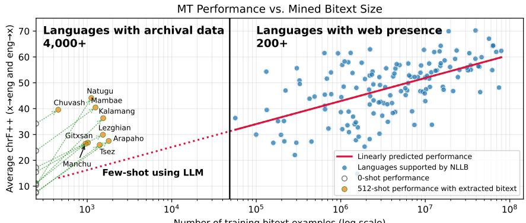
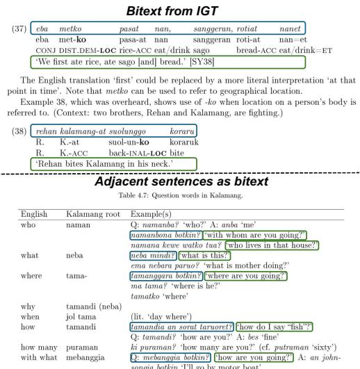
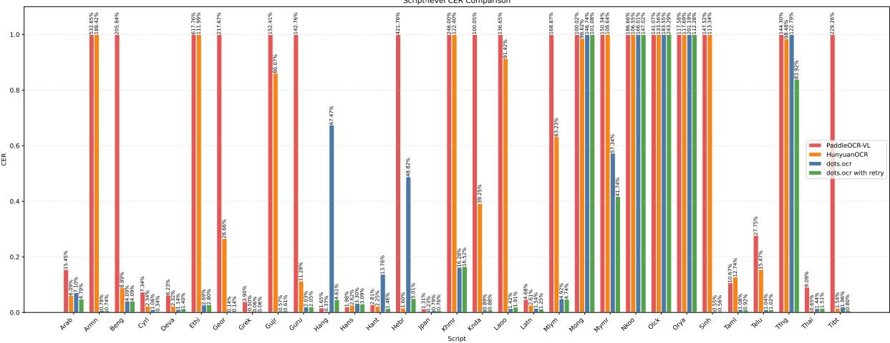
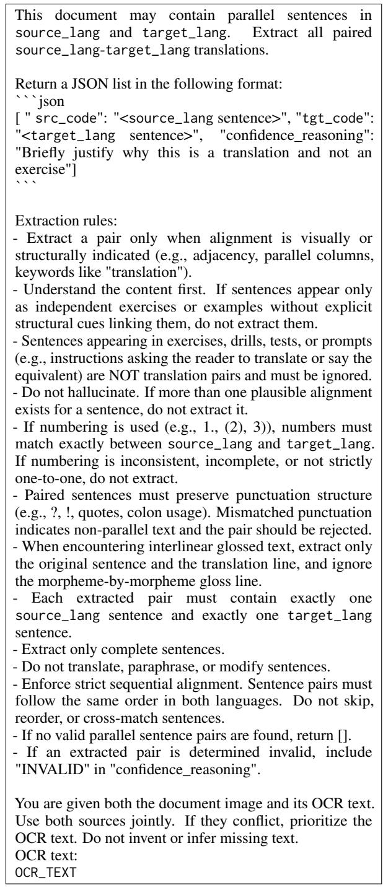
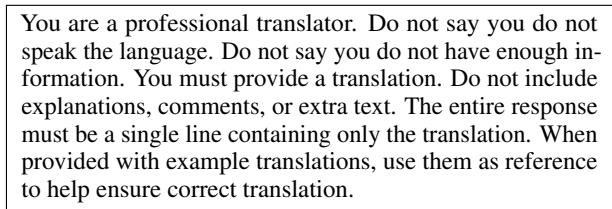
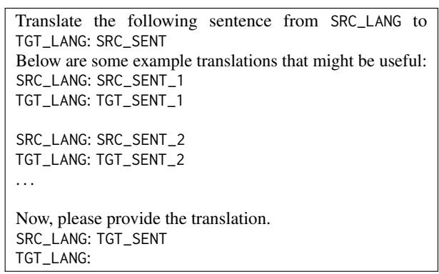
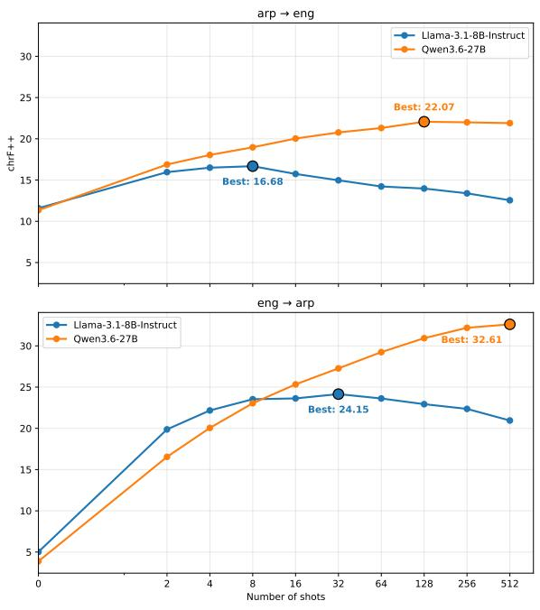
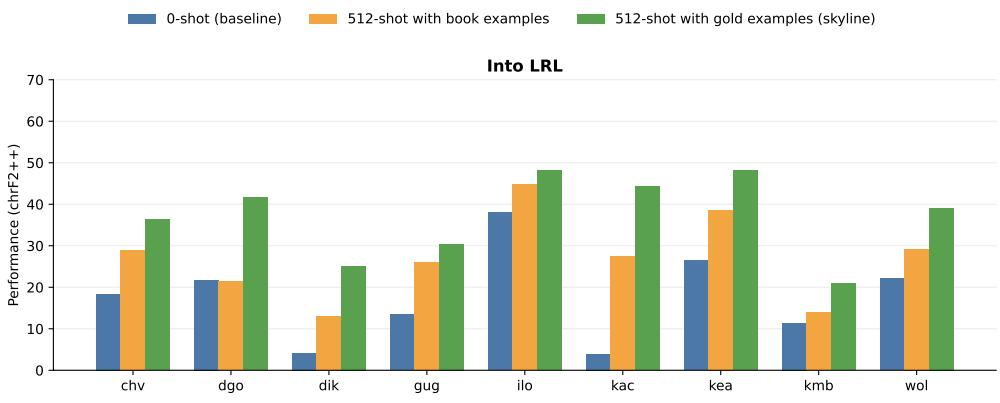
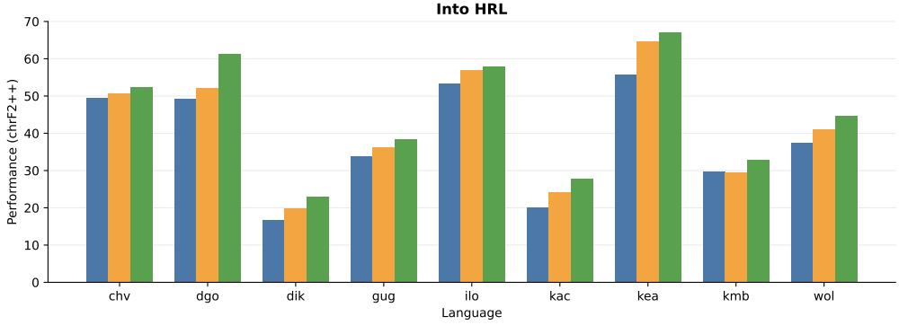

# Mobilizing the Archive: Bitext Extraction at Scale from Archival Documents for Extremely Low-resource Languages

Chutong Meng George Mason University cmeng2@gmu.edu

Alec J. Bateman Barron Associates bateman@barron-associates.com

Antonios Anastasopoulos George Mason University antonis@gmu.edu

## Abstract

While mining parallel sentences from web pages has proven effective for low-resource machine translation, the majority of the world’s languages have little to no web presence. What they do have, though, are resources that are the result of centuries of efforts by linguists, such as grammars, dictionaries, and other documentation materials. We propose extracting translation examples from such linguistic resources, which offer parallel data for languages under-represented online and could potentially scale to thousands more languages. We develop a pipeline to achieve this, leveraging an Optical Character Recognition (OCR) model as well as a vision language model (VLM), to ensure identified content to be aligned with visual layout information. We demonstrate the utility of the extracted bitexts for bootstrapping translation systems across 20 languages, both by training machine translation models and by applying incontext learning for large language models. For in-context learning, we observe improvements of +15.78 and +6.94 chrF2++ over zero-shot translation for into low- and high-resource languages, respectively.1

## 1 Introduction

Modern machine translation (MT) models are typically trained on tens to hundreds of millions of parallel sentences (also termed as bitexts). These data are obtained by aligning parallel documents (Koehn, 2005) or mining from large-scale monolingual web data (Schwenk et al., 2021b; NLLB Team et al., 2022). However, most of the world’s languages lack sufficient web data and, consequently, parallel sentences (Joshi et al., 2020), making data scarcity a challenge for underrepresented languages.

Large language models (LLMs) offer a potential alternative through in-context learning, whereby models can adapt to new tasks from a small number of examples provided in context (Brown et al., 2020; Wei et al., 2022). Recent work has used various linguistic resources, such as grammar book excerpts, dictionaries, morphological analyzers, and interlinear glossed text (IGT), to instruct LLMs to translate unseen low-resource languages (Tanzer et al., 2024; Zhang et al., 2024; Ramos et al., 2025). Among these resources, bitext examples appear to provide the largest gains (Aycock et al., 2025), motivating our focus on extracting parallel examples.

Linguistic resource collections can also provide substantially broader language coverage than webbased bitext mining. For example, the DReaM corpus (Virk et al., 2020) contains grammar books, language overviews, and dictionaries covering more than 4,000 languages, whereas large-scale bitext mining typically supports only around 200 languages reliably (NLLB Team et al., 2022). Although linguistic resources contain fewer parallel sentences, often only a few thousand, we show they can still lead to substantial improvements when used as in-context examples for MT (cf., Fig. 1).

Extracting structured data from heterogeneous linguistic resources at scale, however, is challenging. Prior work either relies on resources with predefined machine-readable structure (Hus and Anastasopoulos, 2024; Tanzer et al., 2024), or requires human effort to identify and extract relevant information based on textual and visual formatting cues (Merx et al., 2024; Aycock et al., 2025). Such approaches are difficult to generalize across previously unseen resources with diverse layouts.

Therefore, in this work, we develop an (almost) fully automatic pipeline for extracting bitexts from heterogeneous linguistic resources in PDF format from the DReaM corpus. Our pipeline consists of two stages. First, we apply optical character recognition (OCR) to recover text. Second, we use a vision language model (VLM) to identify parallel sentences using both the OCR output and page image. Visual information is important because linguistic resources often encode parallelism through visual structure that is lost in plain text, such as IGT, adjacent translations, and parallel columns. Figure 2 shows an example of such incidental bitext. Applying our pipeline to 20 languages, we extract an average of 2,578 bitext examples per language.

  
Figure 1: We illustrate the rough relationship between mined bitext size and MT performance, using nllb-200-3.3B as an example. Archival linguistic resources could extend bitext coverage from around 200 languages to thousands more, while substantially improving few-shot translation quality toward NLLB-level performance.

  
Figure 2: Examples of incidental bitext in a Kalamang book (Visser, 2016). Blue boxes indicate Kalamang sentences, and green boxes indicate English sentences.

## 2 Related Work

We review how previous work extracts structured data from linguistic resources. Appendix A provides additional discussion of existing bitext alignment methods.

## 2.1 Linguistic Resources Based MT

Recent work has shown that grammar books and other linguistic resources can improve MT for unseen languages when used with LLMs (Tanzer et al., 2024). A key challenge, however, is converting heterogeneous and poorly structured archival materials into usable structured data.

Several studies leverage structured or semistructured machine readable resources. Tanzer et al. (2024) use LAT X and plaintext grammar books together with well-formatted parallel sentences from Dictionaria, while Aycock et al. (2025) extract parallel examples based on text formatting.

OCR is frequently used for archival materials. Both Zhang et al. (2024) and Hus and Anastasopoulos (2024) use OCRed grammar books. Merx et al. (2024) OCR Mambai documents, then extract dictionaries based on text formatting and identify parallel sentences using Hunalign (Varga et al., 2007).

Manual intervention is sometimes needed. Zhang et al. (2025), for example, manually extract grammar rules and parallel examples from a grammar book. In some cases, extraction details are unspecified. Pei et al. (2025) extract parallel sentences from a dictionary without describing the procedure.

Unlike this line of prior work which primarily studies how different linguistic resources and prompting strategies impact MT performance, we focus on resource construction itself. We propose to extract useful data from archival linguistic resources with minimal manual intervention.

Most closely related to our work, Setiawan et al. (2026b) combine OCR with an LLM to extract parallel sentences and lexicons from PDF grammar books, but provide limited methodological detail and evaluate only one language. Setiawan et al. (2026a) adopt a two-stage approach to leverage OCR and VLM for dictionary entry extraction, but do not consider bitext extraction or downstream MT evaluation.

<table><tr><td rowspan="2">LRL name</td><td rowspan="2">LRL code</td><td rowspan="2">HRL</td><td rowspan="2">NLLB support</td><td colspan="2">Existing data</td></tr><tr><td>Data source</td><td>Script</td></tr><tr><td>Arapaho</td><td>arp</td><td>eng</td><td>No</td><td>SIGMORPHON 2023</td><td>Latin</td></tr><tr><td>Chuvash</td><td>chv</td><td>eng</td><td>No</td><td>FLORES, BOUQuET</td><td>Cyrillic</td></tr><tr><td>Tsez</td><td>ddo</td><td>eng</td><td>No</td><td>SIGMORPHON 2023</td><td>Latin</td></tr><tr><td>Dogri</td><td>dgo</td><td>eng</td><td>No</td><td>FLORES, BOUQuET</td><td>Devanagari</td></tr><tr><td>Gitxsan</td><td>git</td><td>eng</td><td>No</td><td>SIGMORPHON 2023</td><td>Latin</td></tr><tr><td>Kalamang</td><td>kgv</td><td>eng</td><td>No</td><td>Tanzer et al. (2024)</td><td>Latin</td></tr><tr><td>Lezghian</td><td>lez</td><td>eng</td><td>No</td><td>SIGMORPHON 2023</td><td>Cyrillic</td></tr><tr><td>Mambae</td><td>mgm</td><td>eng</td><td>No</td><td>Merx et al. (2024)</td><td>Latin</td></tr><tr><td>Manchu</td><td>mnc</td><td>eng</td><td>No</td><td>Zhang et al. (2024)</td><td>Latin</td></tr><tr><td>Natügu</td><td>ntu</td><td>eng</td><td>No</td><td>SIGMORPHON 2023</td><td>Latin</td></tr><tr><td>Uspanteco</td><td>usp</td><td>spa</td><td>No</td><td>SIGMORPHON 2023</td><td>Latin</td></tr><tr><td>Southwestern Dinka</td><td>dik</td><td>eng</td><td>Yes</td><td>FLORES, BOUQuET</td><td>Latin</td></tr><tr><td>Paraguayan Guaraní</td><td>gug</td><td>eng</td><td>Yes</td><td>FLORES, BOUQuET</td><td>Latin</td></tr><tr><td>Iloko</td><td>ilo</td><td>eng</td><td>Yes</td><td>FLORES, BOUQuET</td><td>Latin</td></tr><tr><td>Southern Jinghpaw</td><td>kac</td><td>eng</td><td>Yes</td><td>FLORES, BOUQuET</td><td>Latin</td></tr><tr><td>Kabuverdianu</td><td>kea</td><td>eng</td><td>Yes</td><td>FLORES, BOUQuET</td><td>Latin</td></tr><tr><td>Kimbundu</td><td>kmb</td><td>por</td><td>Yes</td><td>FLORES, BOUQuET</td><td>Latin</td></tr><tr><td>Mizo</td><td>lus</td><td>eng</td><td>Yes</td><td>FLORES</td><td>Latin</td></tr><tr><td>Minangkabau</td><td>min</td><td>eng</td><td>Yes</td><td>FLORES</td><td>Latin</td></tr><tr><td>Wolof</td><td>wol</td><td>eng</td><td>Yes</td><td>FLORES, BOUQuET</td><td>Latin</td></tr></table>

Table 1: Summary of languages and their resource status, separated by NLLB support. Kimbundu is paired with Portuguese, for which our collection contains substantially more books, while Uspanteco is paired with Spanish to match its available test set. BOUQuET is only used as a secondary evaluation set where available.

## 3 Languages and Status

We select extremely under-resourced languages studied in prior work, which allows us to evaluate our method using existing test sets. Table 1 summarizes the languages and their resource status.

Our experimental design distinguishes between languages with and without web presence. Languages supported by NLLB (NLLB Team et al., 2022) have at least some, if not abundant, monolingual text online, making it likely that frontier LLMs have encountered them during pre-training. In contrast, other languages can be treated as approximating languages that are unlikely to have been seen in LLM pre-training. The latter group of languages allows us to simulate a setting in which a model is asked to translate a previously unseen language and the only available translation examples are extracted from archival resources.

## 4 Method

We extract and clean up bitexts from multilingual archival PDFs in three steps. First, we apply multilingual OCR to recover text (Section 4.1). Second, we use a VLM to identify bitext based on visual cues (Section 4.2). Finally, we clean and filter the resulting alignments (Section 4.3).

<table><tr><td>Model</td><td>CER (%)↓</td></tr><tr><td>PaddleOCR-VL</td><td>34.13</td></tr><tr><td>HunyuanOCR dots.ocr</td><td>11.37 7.88</td></tr><tr><td>dots.ocr with retry</td><td>5.66</td></tr></table>

Table 2: CER for three OCR models on the synthesized FLORES PDFs.

## 4.1 OCR

Recently developed neural OCR models outperform traditional systems in accuracy and humanreadability (Poznanski et al., 2025), but their multilingual performance had not been comprehensively benchmarked when we began this work. We therefore evaluate 3 multilingual models, dots.ocr (Li et al., 2025), HunyuanOCR (Hunyuan Vision Team et al., 2025), and PaddleOCR-VL (Cui et al., 2025) on synthetic multilingual PDFs.

Inspired by Ignat et al. (2022), we render FLO-RES (NLLB Team et al., 2022) devtest sentences into PDFs using playwright.2 FLORES covers over 200 languages across 31 scripts. We report macro-averaged character error rate (CER) across languages in Table 2, with per-script results in Figure 3 in Appendix B.

dots.ocr performs best and supports the broadest range of scripts, consistent with recent multilingual OCR benchmarks (Kargaran et al., 2026;

Xu et al., 2026). However, it occasionally produces endless repetitions. Following Poznanski et al. (2025), we retry inference with a higher temperature when generation exceeds the length limit, reducing CER from 7.88% to 5.66%.

## 4.2 Vision Language Model

Incidental bitexts often exhibit certain visual properties, such as IGT or adjacent sentences in different languages (Figure 2). We therefore use a VLM that takes a page image and its OCR text as input and identifies candidate bitext pairs based on visual cues. Providing OCR text (1) avoids requiring the VLM to perform OCR, (2) leverages specialized OCR models that perform better on low-resource languages, and (3) enables the VLM to understand the content directly based on text.

We assume that each book primarily contains two languages: a low-resource language (LRL) described in a high-resource language (HRL). The LRL is obtained from the resource metadata. We identify the HRL by applying language identification (langID) to each book, counting sentences per language, and selecting the most frequent language. Since we target specific language directions (e.g., arp-eng), we retain only books matching the target pair. The VLM is expected to have substantial knowledge of the HRL and treat the remaining text as the LRL.

We use Qwen3.5-27B-FP8 (Qwen Team, 2026a) as the backbone VLM, served using vllm (Kwon et al., 2023). Larger models performed substantially better in preliminary experiments, but computational constraints prevented us from using an even larger model. Prompts are provided in Appendix C.

## 4.3 Postprocessing

Raw extracted sentence pairs are noisy. For example, IGT may contain linguistic annotations, dictionaries may provide word-level rather than sentencelevel alignments, and the VLM may produce incorrect alignments. We therefore follow Koehn et al. (2018, 2019) and apply language-agnostic cleaning and filtering (Section 4.3.1). We additionally reconcile orthographic mismatches between archival resources and existing data using language-specific normalization (Section 4.3.2).

We do not consider such postprocessing as a disadvantage, as conventional bitext mining pipelines likewise require extensive cleaning and filtering.

## 4.3.1 Language-agnostic Cleaning and Filtering

We apply the following language-agnostic cleaning and filtering steps:

• Remove IGT annotation symbols (e.g., -, =, and ø) from LRL sentences.

• Remove pairs where either sentence contains only digits or punctuation.

• Remove pairs where one sentence is more than twice as long as the other in characters.

• Remove pairs where neither sentence contains more than two space-separated words.

• Remove pairs with source-target Levenshtein similarity ratio above 0.9.

• Apply langID to both sentences. The HRL sentence must be identified as the HRL, while the LRL sentence must not be.

## 4.3.2 Language-specific Orthography Normalization

Orthographic mismatch, particularly in diacritics and script, is a major challenge in the extremely low-resource settings we are studying. Oftentimes, this is because of genuine diachronic changes in the orthography preferred by language communities and other stakeholders (e.g. documentary linguists) at different times. For all languages, we apply minor corrections for common OCR errors, identified through manual inspection of sampled book pages, plus the following language-specific normalization.

arp, ilo, kac, mgm, mnc We remove diacritics.

chv We transliterate the Latin script used in our resources to the Cyrillic script used by FLORES, following an online document.3

dgo Our resources primarily use the International Phonetic Alphabet (IPA), whereas FLORES uses Devanagari. As we could not find existing conversion schemes, we let the coding agent Codex derive rules by comparing FLORES dev sentences with text from the archival resources.

git We remove diacritics. The SIGMORPHON data additionally uses Combining Low Line (U+0332), e.g., K (K followed by U+0332), which our OCR model fails to recognize. We do not restore it.

<table><tr><td rowspan="2">Lang</td><td colspan="2">BLASER 2.0-QE↑</td></tr><tr><td>Extracted</td><td>Test / FLORES</td></tr><tr><td>dik</td><td>2.935</td><td>3.281</td></tr><tr><td>gug</td><td>3.375</td><td>3.732</td></tr><tr><td>ilo</td><td>3.356</td><td>4.274</td></tr><tr><td>kac</td><td>3.129</td><td>3.570</td></tr><tr><td>kea</td><td>3.293</td><td>3.965</td></tr><tr><td>kmb</td><td>2.470</td><td>3.344</td></tr><tr><td>lus</td><td>2.953</td><td>3.696</td></tr><tr><td>min</td><td>3.245</td><td>4.138</td></tr><tr><td>wol</td><td>3.123</td><td>3.511</td></tr><tr><td>Avg.</td><td>3.098</td><td>3.723</td></tr></table>

Table 3: QE scores for supported languages on extracted and FLORES bitexts. Bold indicates better performance. FLORES bitexts are of higher quality.

lez We convert the Latin script used in our resources to the Cyrillic script used by SIGMOR-PHON, following Haspelmath (1993).

ntu We convert the older orthography used in archival resources to the modern SIGMORPHON orthography following an online resource.4

Table 10 in Appendix D summarizes these procedures. While the reader may be disappointed to see that such manual efforts are still needed in an otherwise fully automatic pipeline, these rules primarily reconcile archival orthographic conventions with modern usage and evaluation standards, rather than fixing bitext extraction itself. We also note that such manual verification processes might be needed regardless, to reconcile archival material orthographies with current community practices.

## 4.4 Intrinsic Evaluation

We evaluate bitext quality using BLASER 2.0- QE (Dale and Costa-jussà, 2024), due to its broad language coverage. For supported languages, we score each sentence pair and report average QE scores for the extracted bitext and corresponding test set in Table 3. Scores for unsupported languages are unreliable and reported separately in Table 12 in the Appendix F.1.

Results The extracted bitexts achieve an average score of 3.098, compared with 3.723 for the test set. Although this gap is substantial, a score of 3 indicates that the sentences are generally equivalent in meaning, with only minor differences permitted under the XSTS scale (Licht et al., 2022) predicted by BLASER 2.0-QE.

<table><tr><td>Lang</td><td>#Extracted</td><td colspan="3">Existing Datasets</td></tr><tr><td></td><td></td><td>#Train</td><td>#Dev</td><td>#Test</td></tr><tr><td colspan="5">Without NLLB support</td></tr><tr><td>arp</td><td>1,796</td><td>36,123</td><td>4,892</td><td>4,892</td></tr><tr><td>chv</td><td>454</td><td></td><td>997 / 504</td><td>1,012/854</td></tr><tr><td>ddo</td><td>1,403</td><td>3,547</td><td>445</td><td>445</td></tr><tr><td>dgo</td><td>137</td><td>一</td><td>498 / 504</td><td>499 / 854</td></tr><tr><td>git</td><td>1,018</td><td>31</td><td>42</td><td>37</td></tr><tr><td>kgv</td><td>1,545</td><td>375</td><td></td><td>100</td></tr><tr><td>lez</td><td>1,533</td><td>634</td><td>88</td><td>87</td></tr><tr><td>mgm</td><td>1,253</td><td>1,187</td><td>一</td><td>50</td></tr><tr><td>mnc</td><td>953</td><td>3</td><td></td><td>102</td></tr><tr><td>ntu</td><td>1,118</td><td>789</td><td>99</td><td>99</td></tr><tr><td>usp</td><td>1,007</td><td>9,116</td><td>232</td><td>633</td></tr><tr><td colspan="5">With NLLB support</td></tr><tr><td>dik</td><td>3,238</td><td>一</td><td>997 / 504</td><td>1,012 / 854</td></tr><tr><td>gug</td><td>910</td><td>一</td><td>997 / 504</td><td>1,012 / 854</td></tr><tr><td>ilo</td><td>14,263</td><td></td><td>997 / 504</td><td>1,012 / 854</td></tr><tr><td>kac</td><td>817</td><td></td><td>997 / 504</td><td>1,012 / 854</td></tr><tr><td>kea</td><td>1,483</td><td>一</td><td>997 / 504</td><td>1,012 / 854</td></tr><tr><td>kmb</td><td>13,067</td><td>一</td><td>997 / 504</td><td>1,012 / 854</td></tr><tr><td>lus</td><td>2,477</td><td></td><td>997</td><td>1,012</td></tr><tr><td>min</td><td>459</td><td>一</td><td>997</td><td>1,012</td></tr><tr><td>wol</td><td>2,632</td><td>一</td><td>997 / 504</td><td>1,012 / 854</td></tr></table>

Table 4: Number of sentences in the extracted and existing datasets. For FLORES, the devtest set is used as the test set. In cells with two numbers, the left one corresponds to FLORES and the right one to BOUQuET.

## 5 MT Experiments for Extrinsic Evaluation

We further assess the quality of extracted bitexts through few-shot LLM translation and MT model fine-tuning.

## 5.1 Training and Evaluation Data

As in Table 1, 11 languages are evaluated by FLO-RES,5 6 are evaluated using the SIGMORPHON 2023 Interlinear Glossing shared task data (Ginn et al., 2023),6 and the remaining 3 rely on test sentences curated in prior work. We additionally use BOUQuET (Andrews et al., 2025) as a secondary evaluation set for the 9 supported languages.

We detokenize the SIGMORPHON test sentences using Moses (Koehn et al., 2007), while leaving other test sets unchanged.

To prevent train-test overlap, we remove extracted sentence pairs whose source or target has Levenshtein similarity ratio above 0.9 with any dev or test sentence.

Table 4 reports the number of extracted sentences after filtering and the sizes of existing datasets.

## 5.2 Experiment Setup

Few-shot experiments We use Qwen3.6-27B (Qwen Team, 2026b) (hereafter Qwen). Additional results with the smaller Llama-3.1-8B (Grattafiori et al., 2024) are reported in Appendix F.2. Prompt templates are provided in Appendix C.

For example retrieval, we score candidate sentences with the input sentence by chrF2++ (Popovic´, 2017) and select the highestscoring pairs. Prior work finds that retrieval method has limited impact on the peak MT performance (Setiawan et al., 2026b). An ablation study in Appendix F.3, though, shows that 512 examples perform best.

Fine-tuning experiments We fine-tune nllb-200-distilled-1.3B (hereafter nllb) using LoRA adapters (Hu et al., 2022). Due to the tiny datasets, we train one multilingual model on all extracted data using temperature-based sampling. More details are in Appendix G.

Baselines For languages supported by NLLB, we compare the fine-tuned nllb against the outof-the-box model. For unsupported LRL-to-HRL translaion, we use the proxy source language codes in Table 7.7 For all languages, we compare fewshot translation using Qwen against zero-shot.

Evaluation Metrics To evaluate, we lowercase hypotheses and references and remove punctuation except apostrophes. We report spBLEU8 with the flores200 tokenizer (NLLB Team et al., 2022) and chrF2++,9 both computed with SacreBLEU (Post, 2018). We compute statistical significance using paired bootstrap resampling (Koehn, 2004).10

## 6 Results and Analysis

We present main results in Section 6.1, analyze the limitations of traditional sentence alignment methods in Section 6.2, discuss the limitations of archival resource utility in Section 6.3, and explore broader applicability in Section 6.4.

## 6.1 Main Results

Tables 5 and 6 report chrF2++ scores for translation in and out of LRLs respectively. Corresponding

<table><tr><td rowspan="2">Lang</td><td colspan="3">Qwen</td><td colspan="2">nllb</td></tr><tr><td>0 shot</td><td>512 shot</td><td></td><td>OOB</td><td>fine-tuned</td></tr><tr><td colspan="6">Without NLLB support</td></tr><tr><td>arp</td><td>3.86</td><td>* 32.90</td><td>↑29.04</td><td></td><td>9.96</td></tr><tr><td>chv</td><td>20.99</td><td>* 30.49</td><td>↑9.50</td><td>一</td><td>5.14</td></tr><tr><td>ddo</td><td>0.17</td><td>*24.24 *</td><td>↑24.07</td><td></td><td>1.93</td></tr><tr><td>dgo</td><td>21.18</td><td>20.68 *</td><td>↓0.50</td><td></td><td>4.12</td></tr><tr><td>git</td><td>5.50</td><td>*23.16</td><td>↑17.66</td><td></td><td>3.56</td></tr><tr><td>kgv</td><td>8.38</td><td> $^ { * } 3 9 . 2 3 \ \uparrow 3 0 . 8 5$ </td><td></td><td></td><td>7.60</td></tr><tr><td>lez</td><td>9.58</td><td> $^ { * } 2 5 . 2 6 \ \uparrow 1 5 . 6 8$ </td><td></td><td></td><td>3.97</td></tr><tr><td>mgm</td><td>17.34</td><td>*37.91</td><td>↑20.57</td><td></td><td>18.78</td></tr><tr><td>mnc</td><td>3.92</td><td> $^ { * } 2 7 . 6 5 \ \uparrow 2 3 . 7 3$ </td><td></td><td></td><td>3.03</td></tr><tr><td>ntu</td><td>5.51</td><td>*48.76</td><td>↑43.25</td><td></td><td>9.39</td></tr><tr><td>usp</td><td>6.51</td><td>*28.09</td><td>↑21.58</td><td></td><td>7.15</td></tr><tr><td>Avg.</td><td>9.36</td><td>30.76</td><td>↑21.40</td><td></td><td>6.78</td></tr><tr><td colspan="6">With NLLB support</td></tr><tr><td>dik</td><td>6.36</td><td>* 16.89</td><td>↑10.53</td><td>19.81</td><td> $^ { * } 1 1 . 2 8 \ \downarrow \ 8 . 5 3$ </td><td></td></tr><tr><td>gug</td><td>14.90</td><td>*26.05 *</td><td>↑11.15</td><td>37.27</td><td>*31.73</td><td>↓5.54</td></tr><tr><td>ilo</td><td>42.39</td><td>*46.76</td><td>↑4.37</td><td>52.56</td><td>*27.83</td><td>↓24.73</td></tr><tr><td>kac</td><td>4.01</td><td> $^ { * } 2 5 . 9 1 \ \uparrow 2 1 . 9 0$ </td><td></td><td>38.56</td><td>*26.03</td><td>↓12.53</td></tr><tr><td>kea</td><td>29.50</td><td> $^ { * } 4 0 . 2 6 \ \uparrow 1 0 . 7 6$ </td><td></td><td>45.33</td><td>* 39.37 *</td><td>↓5.96</td></tr><tr><td>kmb</td><td>12.33</td><td> $^ { * } 1 6 . 1 9 \ \uparrow \ 3 . 8 6$ </td><td></td><td>24.96</td><td>10.46</td><td>↓14.50</td></tr><tr><td>lus</td><td>15.37</td><td> $^ { * } 2 4 . 5 6 \ \uparrow \ 9 . 1 9$ </td><td></td><td>36.70</td><td>*8.73</td><td>↓27.97</td></tr><tr><td>min</td><td>39.36</td><td> $^ { * } 4 3 . 4 0 \ \uparrow \ 4 . 0 4$ </td><td></td><td>49.50</td><td>* *26.02</td><td>↓23.48</td></tr><tr><td>wol</td><td>22.62</td><td> $^ { * } 2 6 . 9 3 \ \uparrow \ 4 . 3 1$ </td><td></td><td>25.72</td><td>*9.01</td><td>↓16.71</td></tr><tr><td>Avg.</td><td>20.76</td><td> $2 9 . 6 6 \ \uparrow \ 8 . 9 0$ </td><td></td><td>36.71</td><td>21.16</td><td>↓15.55</td></tr><tr><td>Avg.</td><td>14.49</td><td>30.27</td><td>↑15.78</td><td>一</td><td></td><td>13.25</td></tr></table>

Table 5: Extracted data improves few-shot translation performance into LRLs. Results are reported in chrF2++(↑). OOB denotes out-of-the-box performance. p-value < 0.05.

spBLEU results are in Appendix Tables 14 and 15.   
Appendix F.5 reports results on BOUQuET.

## 6.2 A Failed Attempt: Bitext Extraction with Existing Sentence Alignment Methods

Extracted bitexts substantially improve Qwen performance for all languages except dgo, with average gains of 15.78 and 6.94 chrF2++ for translation into LRLs and HRLs, respectively. The lack of improvement for dgo is likely due to its automatically derived orthography normalization rules.

Fine-tuning nllb does not improve translation into LRLs, likely because of the limited training data (Koehn and Knowles, 2017). However, it improves translation into HRLs by 3.59 chrF2++ on average. Overall, we show that the extracted bitexts provide useful supervision even at this small scale.

Given OCRed text, we also attempted to mine bitext using established sentence alignment methods. However, they perform poorly.

Sentence Embedding Evaluation State-of-theart sentence alignment methods such as Global Mining (Schwenk et al., 2021b) and Vecalign (Thompson and Koehn, 2019) depend on high-quality sentence embeddings. We therefore evaluate embedding quality for our low-resource languages using xSIM (multilingual similarity search).11 Given aligned bitext, xSIM embeds both source and target sentences into a shared space and retrieves the best target for each source sentence using a margin score (Artetxe and Schwenk, 2019a), where x and y are sentence embeddings and $\mathrm { N N } _ { k } ( \cdot )$ finds the k nearest neighbors:

<table><tr><td rowspan="2">Lang</td><td colspan="3">Qwen</td><td colspan="3">nl1b</td></tr><tr><td>0 shot</td><td>512 shot</td><td></td><td>OOB</td><td>fine-tuned</td><td></td></tr><tr><td colspan="7">Without NLLB support†</td></tr><tr><td>arp</td><td>11.67</td><td>2 22.09</td><td>↑10.42</td><td>8.62</td><td></td><td> $^ { * } 1 2 . 5 9 \ \uparrow \ 3 . 9 7$ </td></tr><tr><td>chv</td><td>47.46</td><td>* 48.66</td><td>↑1.20</td><td>19.72</td><td></td><td> $^ { * } 2 4 . 4 7 \ \uparrow \ 4 . 7 5$ </td></tr><tr><td>ddo</td><td>14.76</td><td> $^ { * } 2 7 . 6 4 \ \uparrow 1 2 . 8 8 $ </td><td></td><td>10.27</td><td> $^ { * } 1 6 . 5 5 \mathrm { ~ ‰ ~ } 6 . 2 8$ </td><td></td></tr><tr><td>dgo</td><td>47.52</td><td> $^ { * } 5 0 . 5 0 \ \uparrow \ 2 . 9 8$ </td><td></td><td>42.86</td><td> $^ { * } 3 9 . 5 3 \ \downarrow \ 3 . 3 3$ </td><td></td></tr><tr><td>git</td><td>25.39</td><td> $^ { * } 3 0 . 4 9 \ \uparrow \ 5 . 1 0$ </td><td></td><td>15.42</td><td> $^ { * } 2 4 . 8 7 \ \uparrow \ 9 . 4 5$ </td><td></td></tr><tr><td>kgv</td><td>13.30</td><td> $^ { * } 3 3 . 3 8 \ \uparrow 2 0 . 0 8$ </td><td></td><td>11.89</td><td> $^ { * } 1 8 . 0 4 \ \uparrow \ 6 . 1 5$ </td><td></td></tr><tr><td>lez</td><td>24.85</td><td> $^ { * } 3 4 . 5 1 \ \uparrow \ 9 . 6 6$  录</td><td></td><td>9.64</td><td> $^ { * } 2 0 . 5 1 \ \uparrow 1 0 . 8 7$ </td><td></td></tr><tr><td>mgm</td><td>30.11</td><td>42.99</td><td>↑12.88</td><td>20.61</td><td> $^ { * } 3 0 . 3 0 \ \uparrow \ 9 . 6 9$ </td><td></td></tr><tr><td>mnc</td><td>18.27</td><td> $^ { * } 2 4 . 8 5 \ \mathrm { ~ } _ { \uparrow \ 6 . 5 8 }$ </td><td></td><td>8.51</td><td> $^ { * } 1 2 . 3 3 \ \uparrow \ 3 . 8 2$ </td><td></td></tr><tr><td>ntu</td><td>15.23</td><td> $^ { * } 4 0 . 0 1 \ \uparrow 2 4 . 7 8$ </td><td></td><td>9.44</td><td> $^ { * } 3 8 . 7 3 \ \uparrow 2 9 . 2 9$ </td><td></td></tr><tr><td>usp</td><td>11.74</td><td>*26.05</td><td>↑14.31</td><td>9.98</td><td> $^ { * } 1 6 . 0 7 \ \uparrow \ 6 . 0 9$ </td><td></td></tr><tr><td>Avg.</td><td>23.66</td><td>34.65</td><td>↑10.99</td><td>15.18</td><td> $2 3 . 0 9 \ \uparrow \ 7 . 9 1$ </td><td></td></tr><tr><td colspan="7">With NLLB support</td></tr><tr><td>dik</td><td>23.94</td><td> $^ { * } 2 5 . 3 9 \ \uparrow \ 1 . 4 5$ </td><td></td><td>29.49</td><td> $^ { * } 2 8 . 9 9 \mathrm { ~ \textbar { ~ } } _ { \downarrow } \ 0 . 5 0$ </td><td></td></tr><tr><td>gug</td><td>42.50</td><td> $^ { * } 4 4 . 0 6 \ \uparrow \ 1 . 5 6$ </td><td></td><td>47.96</td><td> $^ { * } 4 5 . 1 9 \ \downarrow \ 2 . 7 7$ </td><td></td></tr><tr><td>ilo</td><td>56.33</td><td> $^ { * } 5 8 . 0 2 \ \uparrow \ 1 . 6 9$ </td><td></td><td>60.14</td><td> $^ { * } 5 8 . 5 8 \ \downarrow \ 1 . 5 6$ </td><td></td></tr><tr><td>kac</td><td>24.24</td><td> $^ { * } 2 6 . 8 3 \ \uparrow \ 2 . 5 9$ </td><td></td><td>38.29</td><td> $^ { * } 3 7 . 3 6 \ \downarrow \ 0 . 9 3$ </td><td></td></tr><tr><td>kea</td><td>64.93</td><td> $^ { * } 6 9 . 5 9 \mathrm { ~ ‰ ~ } 4 . 6 6$ </td><td></td><td>67.64</td><td></td><td> $6 7 . 1 9 \textrm { ‰}$ </td></tr><tr><td>kmb</td><td>24.96</td><td> $^ { * } 2 5 . 4 2 \ \uparrow \ 0 . 4 6$ </td><td></td><td>30.62</td><td></td><td> $^ { * } 2 9 . 8 9 \mathrm { ~ \downarrow ~ } 0 . 7 3$ </td></tr><tr><td>lus</td><td>34.05</td><td> $^ { * } 3 5 . 8 3 \ \uparrow \ 1 . 7 8$ </td><td></td><td>41.21</td><td></td><td> $^ { * } 3 9 . 0 9 \ \downarrow \ 2 . 1 2$ </td></tr><tr><td>min</td><td>58.25</td><td> $^ { * } 6 0 . 4 0 \ \uparrow \ 2 . 1 5$ </td><td></td><td>60.18</td><td></td><td> $^ { * } 5 6 . 6 6 \ \downarrow \ 3 . 5 2$ </td></tr><tr><td>wol</td><td>38.14</td><td> $^ { * } 3 9 . 7 5 \ \uparrow \ 1 . 6 1$ </td><td></td><td>39.21</td><td></td><td> $^ { * } 3 6 . 7 3 \ \downarrow \ 2 . 4 8$ </td></tr><tr><td>Avg.</td><td>40.82</td><td> $4 2 . 8 I \ \uparrow \ 1 . 9 9$ </td><td></td><td>46.08</td><td></td><td> $4 4 . 4 I ~ \downarrow ~ 1 . 6 7$ </td></tr><tr><td>Avg.</td><td>31.38</td><td> $3 8 . 3 2 \ \uparrow \ 6 . 9 4$ </td><td></td><td>29.09</td><td></td><td> $3 2 . 6 8 \ \uparrow \ 3 . 5 9$ </td></tr></table>

Table 6: Extracted data improves few-shot translation performance into HRLs. Results are reported in chrF2++(↑). †Proxy source language codes are used. \*p-value < 0.05.

$$
= { \frac { \cos ( x , y ) } { \sum _ { z \in \mathrm { N N } _ { k } ( x ) } { \frac { \cos ( x , z ) } { 2 k } } + \sum _ { z \in \mathrm { N N } _ { k } ( y ) } { \frac { \cos ( y , z ) } { 2 k } } } }\tag{1}
$$

We report alignment error against gold alignments. We evaluate LASER2 (Heffernan et al., 2022), LABSE (Feng et al., 2022), and SONAR embeddings (Duquenne et al., 2023) on test sets listed in Table 1. We use LASER2 rather than LASER3 because the latter is language-specific. And for languages unsupported by SONAR, we use the closest supported language code.

<table><tr><td>Lang</td><td>LASER2</td><td>LABSE</td><td colspan="2">SONAR</td></tr><tr><td></td><td>xsim↓</td><td>xsim↓</td><td>lang code</td><td>xsim↓</td></tr><tr><td colspan="5">Without NLLB support†</td></tr><tr><td>arp</td><td>96.89</td><td>94.60</td><td>eng_Latn</td><td>95.34</td></tr><tr><td>chv</td><td>76.19</td><td>33.70</td><td>tat_Cyrl</td><td>33.40</td></tr><tr><td>ddo</td><td>97.08</td><td>90.34</td><td>eng_Latn</td><td>90.79</td></tr><tr><td>dgo</td><td>40.48</td><td>0.80</td><td>hin_Deva</td><td>0.20</td></tr><tr><td>git</td><td>62.16</td><td>43.24</td><td>eng_Latn</td><td>54.05</td></tr><tr><td>kgv</td><td>84.00</td><td>61.00</td><td>ind_Latn</td><td>52.00</td></tr><tr><td>lez</td><td>87.36</td><td>51.72</td><td>rus_Cyrl</td><td>77.01</td></tr><tr><td>mgm</td><td>46.00</td><td>28.00</td><td>ind_Latn</td><td>34.00</td></tr><tr><td>mnc</td><td>93.14</td><td>95.10</td><td>khk_Cyr1</td><td>93.14</td></tr><tr><td>ntu</td><td>80.81</td><td>52.53</td><td>ind_Latn</td><td>70.71</td></tr><tr><td>usp</td><td>96.37</td><td>95.58</td><td>spa_Latn</td><td>94.79</td></tr><tr><td colspan="5">With NLLB support</td></tr><tr><td>dik</td><td>79.45</td><td>38.04</td><td>dik_Latn</td><td>9.58</td></tr><tr><td>gug</td><td>71.74</td><td>17.09</td><td>grn_Latn</td><td>0.10</td></tr><tr><td>ilo</td><td>61.96</td><td>6.62</td><td>ilo_Latn</td><td>0.00</td></tr><tr><td>kac</td><td>91.50</td><td>40.32</td><td>kac_Latn</td><td>0.20</td></tr><tr><td>kea</td><td>22.04</td><td>0.49</td><td>kea_Latn</td><td>0.00</td></tr><tr><td>kmb</td><td>74.01</td><td>39.62</td><td>kmb_Latn</td><td>0.89</td></tr><tr><td>lus</td><td>87.15</td><td>23.22</td><td>lus_Latn</td><td>0.49</td></tr><tr><td>min</td><td>42.59</td><td>1.19</td><td>min_Latn</td><td>0.00</td></tr><tr><td>wol</td><td>76.38</td><td>26.19</td><td>wol_Latn</td><td>0.69</td></tr><tr><td>Avg.</td><td>73.37</td><td>41.97</td><td></td><td>35.37</td></tr></table>

Table 7: xSIM error rate (%) on test sets. SONAR achieves the lowest error rate. †Proxy SONAR language codes are used.

<table><tr><td>Alignment Method</td><td>Precision</td><td>Recall</td><td>F1</td></tr><tr><td>Methods without prior knowledge</td><td></td><td></td><td></td></tr><tr><td>Global Mining</td><td>0.0610</td><td>0.0549</td><td>0.0578</td></tr><tr><td>Local Mining Vecalign</td><td>0.0851 0.2776</td><td>0.2473 0.4560</td><td>0.1266 0.3451</td></tr><tr><td>Hunalign w/o dict.</td><td>0.2435</td><td>0.2582</td><td>0.2507</td></tr><tr><td>VLM (our method)</td><td>1.0000</td><td>0.7657</td><td>0.8673</td></tr><tr><td colspan="4"></td></tr><tr><td>Methods with prior knowledge Hunalign w/ dict.</td><td>0.5876</td><td>0.6264</td><td></td></tr></table>

Table 8: Alignment performance of different methods. VLM achieves the best performance. Its imperfect recall is due to pages dominated by word-level alignments, where sentence-level alignments are overlooked.

Table 7 reports xSIM error rates. Although SONAR performs best overall, error rates remain high for unseen languages such as Mambai (34%) and Kalamang (52%), limiting the effectiveness of embedding-based alignment.

Sentence Alignment Evaluation We evaluate alignment methods on mgm-eng, which has a relatively low SONAR xSIM error rate. Alignment performance on languages with higher xSIM error rates is expected to be worse.

We first segment OCR text into sentences, and use a langID model to separate two languages in the book. We then apply embedding based Global Mining, Local Mining, Vecalign, and non-embedding based Hunalign to OCRed book content page by page. Further details are provided in Appendix E.

<table><tr><td>Lang</td><td colspan="2">Into LRL</td><td colspan="3">Into HRL</td></tr><tr><td></td><td>Gold</td><td>Book</td><td>Gold</td><td>Book</td><td></td></tr><tr><td colspan="6">Without NLLB support</td></tr><tr><td>arp</td><td>48.32</td><td> $^ { * } 3 2 . 9 0 \ \scriptstyle \downarrow 1 5 . 4 2$ </td><td>39.30</td><td></td><td> $^ { * } 2 2 . 0 9 \ \scriptstyle \downarrow 1 7 . 2 1$ </td></tr><tr><td>chv</td><td>33.77</td><td> $^ { * } 3 0 . 4 9 \ \downarrow \ 3 . 2 8$ </td><td>49.96</td><td></td><td> $^ { * } 4 8 . 6 6 \ \downarrow \ 1 . 3 0$ </td></tr><tr><td>ddo</td><td>43.59</td><td> $^ { * } 2 4 . 2 4 \ \scriptstyle \downarrow 1 9 . 3 5 $ </td><td>42.38</td><td></td><td> $^ { * } 2 7 . 6 4 \ \downarrow 1 4 . 7 4$ </td></tr><tr><td>dgo</td><td>34.52</td><td> $^ { * } 2 0 . 6 8 \ \downarrow 1 3 . 8 4$ </td><td>54.62</td><td></td><td> $^ { * } 5 0 . 5 0 \ \downarrow 4 . 1 2$ </td></tr><tr><td>git</td><td>21.28</td><td> $2 3 . 1 6  { \mathrm { ~ \uparrow ~ } } 1 . 8 8$ </td><td>26.08</td><td></td><td> $^ { * } 3 0 . 4 9 \ \uparrow \ 4 . 4 1$ </td></tr><tr><td>kgv</td><td>38.97</td><td> $3 9 . 2 3 \ \uparrow \ 0 . 2 6$ </td><td>34.56</td><td></td><td> $3 3 . 3 8 \ \downarrow \ 1 . 1 8$ </td></tr><tr><td>lez</td><td>32.13</td><td> $^ { * } 2 5 . 2 6 \ \downarrow \ 6 . 8 7$ </td><td>41.42</td><td></td><td> $^ { * } 3 4 . 5 1 \ \downarrow \ 6 . 9 1$ </td></tr><tr><td>mgm</td><td>33.44</td><td> $^ { * } 3 7 . 9 1 \ \uparrow \ 4 . 4 7$ </td><td>42.08</td><td></td><td> $4 2 . 9 9 \ \uparrow \ 0 . 9 1$ </td></tr><tr><td>†mnc</td><td>7.84</td><td> $^ { * } 2 7 . 6 5 \ \uparrow 1 9 . 8 1$ </td><td>20.67</td><td></td><td> $^ { * } 2 4 . 8 5 \ \uparrow \ 4 . 1 8$ </td></tr><tr><td>ntu</td><td>47.79</td><td> $4 8 . 7 6  { \mathrm { ~ \textrm ~ { ~ ~ } ~ } } 0 . 9 7$ </td><td>39.00</td><td></td><td> $4 0 . 0 1 \ \uparrow \ 1 . 0 1$ </td></tr><tr><td>usp</td><td>42.15</td><td> $^ { * } 2 8 . 0 9 \ \scriptstyle { \downarrow 1 4 . 0 6 }$ </td><td>42.21</td><td></td><td> $^ { * } 2 6 . 0 5 \ \scriptstyle \downarrow 1 6 . 1 6$ </td></tr><tr><td colspan="6">With NLLB support</td></tr><tr><td>dik</td><td>23.98</td><td> $^ { * } 1 6 . 8 9 \mathrm { ~ \textbar { ~ } { ~ } } 7 . 0 9$ </td><td>27.09</td><td></td><td> $^ { * } 2 5 . 3 9 \mathrm { ~ \downarrow ~ } 1 . 7 0$ </td></tr><tr><td>gug</td><td>34.84</td><td> $^ { * } 2 6 . 0 5 \ \downarrow \ 8 . 7 9$ </td><td>45.50</td><td></td><td> $^ { * } 4 4 . 0 6 \ \downarrow \ 1 . 4 4$ </td></tr><tr><td>ilo</td><td>51.30</td><td> $^ { * } 4 6 . 7 6 \ \downarrow \ 4 . 5 4$ </td><td>59.09</td><td></td><td> $^ { * } 5 8 . 0 2 \ \scriptstyle { \downarrow } \ 1 . 0 7$ </td></tr><tr><td>kac</td><td>39.84</td><td> $^ { * } 2 5 . 9 1 \ \scriptstyle \downarrow 1 3 . 9 3$ </td><td>29.89</td><td></td><td> $^ { * } 2 6 . 8 3 \ \downarrow \ 3 . 0 6$ </td></tr><tr><td>kea</td><td>57.46</td><td> $^ { * } 4 0 . 2 6 \ \scriptstyle \downarrow 1 7 . 2 0$ </td><td>71.50</td><td></td><td> $^ { * } 6 9 . 5 9 \ \downarrow \ 1 . 9 1$ </td></tr><tr><td>kmb</td><td>33.62</td><td> $^ { * } 1 6 . 1 9 \ \downarrow 1 7 . 4 3$ </td><td>30.32</td><td></td><td> $^ { * } 2 5 . 4 2 \ \downarrow \ 4 . 9 0$ </td></tr><tr><td>lus</td><td>37.17</td><td> $^ { * } 2 4 . 5 6 \ \scriptstyle \downarrow 1 2 . 6 1$ </td><td>38.54</td><td></td><td> $^ { * } 3 5 . 8 3 \ \downarrow 2 . 7 1$ </td></tr><tr><td>min</td><td>51.12</td><td> $^ { * } 4 3 . 4 0 \mathrm { ~ \textbar { ~ } } _ { \downarrow } 7 . 7 2$ </td><td>62.94</td><td></td><td> $^ { * } 6 0 . 4 0 \ \downarrow \ 2 . 5 4$ </td></tr><tr><td>wol</td><td>32.07</td><td> $^ { * } 2 6 . 9 3 \ \downarrow \ 5 . 1 4$ </td><td></td><td>42.06</td><td> $^ { * } 3 9 . 7 5 \ \downarrow \ 2 . 3 1$ </td></tr><tr><td>Avg.</td><td>38.81</td><td> $3 0 . 4 0 ~ \downarrow ~ 8 . 4 1$ </td><td>43.08</td><td></td><td> $3 8 . 9 9 \mathrm { ~ \downarrow ~ } 4 . 0 9$ </td></tr></table>

Table 9: chrF2++ scores for 512-shot translation with Qwen. Extracted bitexts are narrowing the gap to gold in-domain bitexts. †Excluded from the average as it has only 3 gold examples. \*p-value < 0.05.

We manually align 182 sentence pairs from randomly sampled pages of a Mambae manual (Hull, 2001) as groundtruths and report precision, recall, and F1 in Table 8. Without an auxiliary dictionary, traditional alignment methods perform poorly, while VLM achieves highest F1. Beyond poor embedding quality, text preprocessing introduces substantial errors. Sentence segmentation can fail when multiple parallel pairs occur on the same line or when OCR splits a single sentence across multiple lines. LangID errors can cause sentences in the same language to be incorrectly aligned.

VLM-based alignment avoids these failure modes by directly accessing images. It can infer sentence boundaries and correspondences from visual structure without separate sentence splitting, langID, or auxiliary dictionaries, producing substantially better alignment.

## 6.3 Using In-domain Parallel Sentences for Prompting

Section 6.1 assumes no additional parallel examples and uses only potentially out-of-domain extracted bitexts. As a skyline, we use available indomain training or dev set sentences to quantify the gap between in-domain and extracted examples.

Table 9 compares few-shot MT performance with book examples and gold in-domain examples. We use FLORES dev set sentences when available and training set sentences otherwise.

Compared with book examples, in-domain examples improve the average chrF2++ from 30.40 to 38.81 for translation into LRLs and by 4.09 chrF2++ for into HRLs. For most languages, indomain examples substantially outperform book examples, likely due to their higher quality (Table 3). Interestingly, book examples perform better in git, mgm, mnc, and ntu, possibly because more book examples are available and some books overlap with those used to construct the test sets. It suggests that extracting bitexts from books is still a feasible way towards narrowing the gap in LRL translation when gold bitexts are unavailable.

## 6.4 Broader Applicability: CreoleMT

To examine broader applicability, we apply our pipeline to 27 of the lowest-resource Creole languages in Kreyòl-MT (Robinson et al., 2024). Unlike our main experiments, we use only languageagnostic cleaning and filtering, without languagespecific orthographic normalization. We evaluate few-shot experiments using Qwen on the public Kreyòl-MT test set using the same evaluation metrics. Results are reported in Table 17 in Appendix F.6.

Extracted bitexts substantially improve translation into Creole languages from 16.87 to 35.71 chrF2++ on average, and translation into English from 34.54 to 48.79 chrF2++. These results suggest that the pipeline generalizes to a broader set of low-resource languages even without languagespecific human intervention.

## 7 Conclusion

We introduce a vision language model based pipeline for extracting parallel sentences from archival linguistic resources by leveraging their visual structure. Across more than 20 languages, few-shot translation with an LLM using the extracted bitext substantially improves low-resource MT over zero-shot translation, demonstrating the value of archival linguistic resources as a source of parallel data.

## Limitations

Orthography mismatches remain challenging for archival materials. Proper normalization still requires manually designed language-specific rules, while OCR systems can struggle with diacritics and visually similar characters encoded as different Unicode code points (e.g., Latin and Cyrillic a).

Not all archival books are equally suitable sources of parallel data. Many of the books in our collection were published decades ago and may use historical or outdated orthographic conventions that differ from those used in contemporary evaluation data. Moreover, given the heterogeneous nature of archival linguistic resources, some books primarily cover topics such as phonology or grammatical descriptions and may contain relatively little parallel text useful for machine translation. Careful resource selection is therefore important for obtaining high-quality and relevant examples. Future advances in OCR and agentic systems might help automate these steps and further reduce manual intervention.

## Acknowledgments

This material is partially supported by the National Science Foundation under CAREER award 2439202 and partially based upon work supported by the ASA(ALT) SBIR CcoE under Contract No. W51701-25-C-0060. Any opinions, findings and conclusions or recommendations expressed in this material are those of the author(s) and do not necessarily reflect the views of the ASA(ALT) SBIR CcoE. We acknowledge the support by resources provided by the Office of Research Computing at George Mason University (https://orc.gmu. edu) and funded in part by grants from the NSF (Award Number 2018631).

## References

Pierre Andrews, Mikel Artetxe, Mariano Coria Meglioli, Marta R. Costa-jussà, Joe Chuang, David Dale, Mark Duppenthaler, Nathanial Paul Ekberg, Cynthia Gao, Daniel Edward Licht, Jean Maillard, Alexandre Mourachko, Christophe Ropers, Safiyyah Saleem, Eduardo Sánchez, Ioannis Tsiamas, Arina Turkatenko, Albert Ventayol-Boada, and Shireen Yates. 2025. BOUQuET : dataset, benchmark and open initiative for universal quality evaluation in translation. In Proceedings ofthe 2025 Conference on Empirical Methods in Natural Language Processing, pages 27515–27535, Suzhou, China. Association for Computational Linguistics.

Pierre Andrews, Guillaume Wenzek, Kevin Heffernan, Onur Çelebi, Anna Sun, Ammar Kamran, Yingzhe Guo, Alexandre Mourachko, Holger Schwenk, and Angela Fan. 2022. stopes - modular machine translation pipelines. In Proceedings of the 2022 Conference on Empirical Methods in Natural Language Processing: System Demonstrations, pages 258–265, Abu Dhabi, UAE. Association for Computational Linguistics.

Mikel Artetxe and Holger Schwenk. 2019a. Marginbased parallel corpus mining with multilingual sentence embeddings. In Proceedings of the 57th Annual Meeting of the Association for Computational Linguistics, pages 3197–3203, Florence, Italy. Association for Computational Linguistics.

Mikel Artetxe and Holger Schwenk. 2019b. Massively multilingual sentence embeddings for zeroshot cross-lingual transfer and beyond. Transactions of the Association for Computational Linguistics, 7:597–610.

Seth Aycock, David Stap, Di Wu, Christof Monz, and Khalil Sima’an. 2025. Can LLMs really learn to translate a low-resource language from one grammar book? In The Thirteenth International Conference on Learning Representations.

Peter F. Brown, Jennifer C. Lai, and Robert L. Mercer. 1991. Aligning sentences in parallel corpora. In 29th Annual Meeting ofthe Associationfor Computational Linguistics, pages 169–176, Berkeley, California, USA. Association for Computational Linguistics.

Tom Brown, Benjamin Mann, Nick Ryder, Melanie Subbiah, Jared D Kaplan, Prafulla Dhariwal, Arvind Neelakantan, Pranav Shyam, Girish Sastry, Amanda Askell, Sandhini Agarwal, Ariel Herbert-Voss, Gretchen Krueger, Tom Henighan, Rewon Child, Aditya Ramesh, Daniel Ziegler, Jeffrey Wu, Clemens Winter, and 12 others. 2020. Language models are few-shot learners. In Advances in Neural Information Processing Systems, volume 33, pages 1877–1901. Curran Associates, Inc.

Everlyn Asiko Chimoto and Bruce A. Bassett. 2022. Very low resource sentence alignment: Luhya and Swahili. In Proceedings of the Fifth Workshop on Technologies for Machine Translation of Low-Resource Languages (LoResMT 2022), pages 1–8, Gyeongju, Republic of Korea. Association for Computational Linguistics.

Cheng Cui, Ting Sun, Suyin Liang, Tingquan Gao, Zelun Zhang, Jiaxuan Liu, Xueqing Wang, Changda Zhou, Hongen Liu, Manhui Lin, Yue Zhang, Yubo Zhang, Handong Zheng, Jing Zhang, Jun Zhang, Yi Liu, Dianhai Yu, and Yanjun Ma. 2025. Paddleocrvl: Boosting multilingual document parsing via a 0.9b ultra-compact vision-language model. Preprint, arXiv:2510.14528.

David Dale and Marta R. Costa-jussà. 2024. BLASER 2.0: a metric for evaluation and quality estimation

of massively multilingual speech and text translation. In Findings of the Association for Computational Linguistics: EMNLP 2024, pages 16075–16085, Miami, Florida, USA. Association for Computational Linguistics.

Paul-Ambroise Duquenne, Holger Schwenk, and Benoît Sagot. 2023. Sonar: Sentence-level multimodal and language-agnostic representations. Preprint, arXiv:2308.11466.

Fangxiaoyu Feng, Yinfei Yang, Daniel Cer, Naveen Arivazhagan, and Wei Wang. 2022. Language-agnostic BERT sentence embedding. In Proceedings of the 60th Annual Meeting ofthe Associationfor Computational Linguistics (Volume 1: Long Papers), pages 878–891, Dublin, Ireland. Association for Computational Linguistics.

William A. Gale and Kenneth W. Church. 1993. A program for aligning sentences in bilingual corpora. Computational Linguistics, 19(1):75–102.

Michael Ginn, Sarah Moeller, Alexis Palmer, Anna Stacey, Garrett Nicolai, Mans Hulden, and Miikka Silfverberg. 2023. Findings of the SIGMORPHON 2023 shared task on interlinear glossing. In Proceedings of the 20th SIGMORPHON workshop on Computational Research in Phonetics, Phonology, and Morphology, pages 186–201, Toronto, Canada. Association for Computational Linguistics.

Luís Gomes and Gabriel Pereira Lopes. 2016. First steps towards coverage-based sentence alignment. In Proceedings of the Tenth International Conference on Language Resources and Evaluation (LREC’16), pages 2228–2231, Portorož, Slovenia. European Language Resources Association (ELRA).

Aaron Grattafiori, Abhimanyu Dubey, Abhinav Jauhri, Abhinav Pandey, Abhishek Kadian, Ahmad Al-Dahle, Aiesha Letman, Akhil Mathur, Alan Schelten, Alex Vaughan, Amy Yang, Angela Fan, Anirudh Goyal, Anthony Hartshorn, Aobo Yang, Archi Mitra, Archie Sravankumar, Artem Korenev, Arthur Hinsvark, and 542 others. 2024. The llama 3 herd of models. Preprint, arXiv:2407.21783.

Martin Haspelmath. 1993. A Grammar ofLezgian. De Gruyter Mouton, Berlin, Boston.

Kevin Heffernan, Onur Çelebi, and Holger Schwenk. 2022. Bitext mining using distilled sentence representations for low-resource languages. In Findings of the Association for Computational Linguistics: EMNLP 2022, pages 2101–2112, Abu Dhabi, United Arab Emirates. Association for Computational Linguistics.

Edward J Hu, yelong shen, Phillip Wallis, Zeyuan Allen-Zhu, Yuanzhi Li, Shean Wang, Lu Wang, and Weizhu Chen. 2022. LoRA: Low-rank adaptation of large language models. In International Conference on Learning Representations.

Geoffrey Hull. 2001. Mambai Language Manual (Ainaro dialect). Dili: Sebastião Aparício da Silva Project.

Hunyuan Vision Team, Pengyuan Lyu, Xingyu Wan, Gengluo Li, Shangpin Peng, Weinong Wang, Liang Wu, Huawen Shen, Yu Zhou, Canhui Tang, Qi Yang, Qiming Peng, Bin Luo, Hower Yang, Xinsong Zhang, Jinnian Zhang, Houwen Peng, Hongming Yang, Senhao Xie, and 13 others. 2025. Hunyuanocr technical report. Preprint, arXiv:2511.19575.

Jonathan Hus and Antonios Anastasopoulos. 2024. Back to school: Translation using grammar books. In Proceedings of the 2024 Conference on Empirical Methods in Natural Language Processing, pages 20207–20219, Miami, Florida, USA. Association for Computational Linguistics.

Oana Ignat, Jean Maillard, Vishrav Chaudhary, and Francisco Guzmán. 2022. OCR improves machine translation for low-resource languages. In Findings of the Association for Computational Linguistics: ACL 2022, pages 1164–1174, Dublin, Ireland. Association for Computational Linguistics.

Pratik Joshi, Sebastin Santy, Amar Budhiraja, Kalika Bali, and Monojit Choudhury. 2020. The state and fate of linguistic diversity and inclusion in the NLP world. In Proceedings ofthe 58th Annual Meeting of the Association for Computational Linguistics, pages 6282–6293, Online. Association for Computational Linguistics.

Amir Hossein Kargaran, Nafiseh Nikeghbal, Jana Diesner, François Yvon, and Hinrich Schütze. 2026. Glotocr bench: Ocr models still struggle beyond a handful of unicode scripts. Preprint, arXiv:2604.12978.

Philipp Koehn. 2004. Statistical significance tests for machine translation evaluation. In Proceedings ofthe 2004 Conference on Empirical Methods in Natural Language Processing, pages 388–395, Barcelona, Spain. Association for Computational Linguistics.

Philipp Koehn. 2005. Europarl: A parallel corpus for statistical machine translation. In Proceedings of Machine Translation Summit X: Papers, pages 79–86, Phuket, Thailand.

Philipp Koehn, Francisco Guzmán, Vishrav Chaudhary, and Juan Pino. 2019. Findings of the WMT 2019 shared task on parallel corpus filtering for low-resource conditions. In Proceedings of the Fourth Conference on Machine Translation (Volume 3: Shared Task Papers, Day 2), pages 54–72, Florence, Italy. Association for Computational Linguistics.

Philipp Koehn, Hieu Hoang, Alexandra Birch, Chris Callison-Burch, Marcello Federico, Nicola Bertoldi, Brooke Cowan, Wade Shen, Christine Moran, Richard Zens, Chris Dyer, Ondˇrej Bojar, Alexandra Constantin, and Evan Herbst. 2007. Moses: Open source toolkit for statistical machine translation. In

Proceedings of the 45th Annual Meeting of the Associationfor Computational Linguistics Companion Volume Proceedings ofthe Demo and Poster Sessions, pages 177–180, Prague, Czech Republic. Association for Computational Linguistics.

Philipp Koehn, Huda Khayrallah, Kenneth Heafield, and Mikel L. Forcada. 2018. Findings of the WMT 2018 shared task on parallel corpus filtering. In Proceedings ofthe Third Conference on Machine Translation: Shared Task Papers, pages 726–739, Belgium, Brussels. Association for Computational Linguistics.

Philipp Koehn and Rebecca Knowles. 2017. Six challenges for neural machine translation. In Proceedings ofthe First Workshop on Neural Machine Translation, pages 28–39, Vancouver. Association for Computational Linguistics.

Woosuk Kwon, Zhuohan Li, Siyuan Zhuang, Ying Sheng, Lianmin Zheng, Cody Hao Yu, Joseph E. Gonzalez, Hao Zhang, and Ion Stoica. 2023. Efficient memory management for large language model serving with pagedattention. In Proceedings of the ACM SIGOPS 29th Symposium on Operating Systems Principles.

Yumeng Li, Guang Yang, Hao Liu, Bowen Wang, and Colin Zhang. 2025. dots.ocr: Multilingual document layout parsing in a single vision-language model. Preprint, arXiv:2512.02498.

Daniel Licht, Cynthia Gao, Janice Lam, Francisco Guzman, Mona Diab, and Philipp Koehn. 2022. Consistent human evaluation of machine translation across language pairs. In Proceedings ofthe 15th biennial conference ofthe Associationfor Machine Translation in the Americas (Volume 1: Research Track), pages 309–321, Orlando, USA. Association for Machine Translation in the Americas.

Raphaël Merx, Aso Mahmudi, Katrina Langford, Leo Alberto de Araujo, and Ekaterina Vylomova. 2024. Low-resource machine translation through retrieval-augmented LLM prompting: A study on the Mambai language. In Proceedings of the 2nd Workshop on Resources and Technologies for Indigenous, Endangered and Lesser-resourced Languages in Eurasia (EURALI) @ LREC-COLING 2024, pages 1–11, Torino, Italia. ELRA and ICCL.

Robert C. Moore. 2002. Fast and accurate sentence alignment of bilingual corpora. In Proceedings of the 5th Conference of the Association for Machine Translation in the Americas: Technical Papers, pages 135–144, Tiburon, USA. Springer.

NLLB Team, Marta R. Costa-jussà, James Cross, Onur Çelebi, Maha Elbayad, Kenneth Heafield, Kevin Heffernan, Elahe Kalbassi, Janice Lam, Daniel Licht, Jean Maillard, Anna Sun, Skyler Wang, Guillaume Wenzek, Al Youngblood, Bapi Akula, Loic Barrault, Gabriel Mejia Gonzalez, Prangthip Hansanti, and 20 others. 2022. No language left behind: Scaling human-centered machine translation. Preprint, arXiv:2207.04672.

Renhao Pei, Yihong Liu, Peiqin Lin, François Yvon, and Hinrich Schuetze. 2025. Understanding in-context machine translation for low-resource languages: A case study on Manchu. In Proceedings of the 63rd Annual Meeting of the Association for Computational Linguistics (Volume 1: Long Papers), pages 8767– 8788, Vienna, Austria. Association for Computational Linguistics.

Maja Popovic. 2017. ´ chrF++: words helping character n-grams. In Proceedings of the Second Conference on Machine Translation, pages 612–618, Copenhagen, Denmark. Association for Computational Linguistics.

Matt Post. 2018. A call for clarity in reporting BLEU scores. In Proceedings of the Third Conference on Machine Translation: Research Papers, pages 186– 191, Brussels, Belgium. Association for Computational Linguistics.

Jake Poznanski, Aman Rangapur, Jon Borchardt, Jason Dunkelberger, Christopher Wilhelm, Kyle Lo, and Luca Soldaini. 2025. olmOCR: Unlocking trillions of tokens in PDFs with vision language models. In Championing Open-source DEvelopment in ML Workshop @ ICML25.

Qwen Team. 2026a. Qwen3.5: Towards native multimodal agents.

Qwen Team. 2026b. Qwen3.6-27B: Flagship-level coding in a 27B dense model.

Rita Ramos, Everlyn Asiko Chimoto, Maartje Ter Hoeve, and Natalie Schluter. 2025. GrammaMT: Improving machine translation with grammar-informed in-context learning. In Proceedings ofthe 63rd Annual Meeting of the Association for Computational Linguistics (Volume 1: Long Papers), pages 29920– 29940, Vienna, Austria. Association for Computational Linguistics.

Nathaniel R. Robinson, Raj Dabre, Ammon Shurtz, Rasul Dent, Onenamiyi Onesi, Claire Bizon Monroc, Loïc Grobol, Hasan Muhammad, Ashi Garg, Naome A. Etori, Vijay Murari Tiyyala, Olanrewaju Samuel, Matthew Dean Stutzman, Bismarck Bamfo Odoom, Sanjeev Khudanpur, Stephen D. Richardson, and Kenton Murray. 2024. Kreyòl-MT: Building MT for Latin American, Caribbean and colonial African creole languages. In Proceedings of the 2024 Conference of the North American Chapter ofthe Associationfor Computational Linguistics: Human Language Technologies (Volume 1: Long Papers), pages 3083–3110, Mexico City, Mexico. Association for Computational Linguistics.

Holger Schwenk, Vishrav Chaudhary, Shuo Sun, Hongyu Gong, and Francisco Guzmán. 2021a. Wiki-Matrix: Mining 135M parallel sentences in 1620 language pairs from Wikipedia. In Proceedings of the 16th Conference ofthe European Chapter ofthe Associationfor Computational Linguistics: Main Volume, pages 1351–1361, Online. Association for Computational Linguistics.

Holger Schwenk, Guillaume Wenzek, Sergey Edunov, Edouard Grave, Armand Joulin, and Angela Fan. 2021b. CCMatrix: Mining billions of high-quality parallel sentences on the web. In Proceedings of the 59th Annual Meeting ofthe Associationfor Computational Linguistics and the 11th International Joint Conference on Natural Language Processing (Volume 1: Long Papers), pages 6490–6500, Online. Association for Computational Linguistics.

Rico Sennrich and Martin Volk. 2010. MT-based sentence alignment for OCR-generated parallel texts. In Proceedings ofthe 9th Conference ofthe Association for Machine Translation in the Americas: Research Papers, Denver, Colorado, USA. Association for Machine Translation in the Americas.

David Setiawan, Temuulen Khishigsuren, Milind Agarwal, Pagnarith Pit, Aso Mahmudi, and Ekaterina Vylomova. 2026a. Mudidi: A two-stage framework for multilingual dictionary digitization with language models. Preprint, arXiv:2606.09435.

David Samuel Setiawan, Raphaël Merx, and Jey Han Lau. 2026b. Context volume drives performance: Tackling domain shift in extremely low-resource translation via rag. Preprint, arXiv:2601.09982.

Steve Sloto, Brian Thompson, Huda Khayrallah, Tobias Domhan, Thamme Gowda, and Philipp Koehn. 2023. Findings of the WMT 2023 shared task on parallel data curation. In Proceedings of the Eighth Conference on Machine Translation, pages 95–102, Singapore. Association for Computational Linguistics.

Garrett Tanzer, Mirac Suzgun, Eline Visser, Dan Jurafsky, and Luke Melas-Kyriazi. 2024. A benchmark for learning to translate a new language from one grammar book. In The Twelfth International Conference on Learning Representations.

Brian Thompson and Philipp Koehn. 2019. Vecalign: Improved sentence alignment in linear time and space. In Proceedings ofthe 2019 Conference on Empirical Methods in Natural Language Processing and the 9th International Joint Conference on Natural Language Processing (EMNLP-IJCNLP), pages 1342– 1348, Hong Kong, China. Association for Computational Linguistics.

Dániel Varga, Péter Halácsy, András Kornai, Viktor Nagy, László Németh, and Viktor Trón. 2007. Parallel corpora for medium density languages. Amsterdam Studies In The Theory And History Of Linguistic Science Series 4, 292:247.

Shafqat Mumtaz Virk, Harald Hammarström, Markus Forsberg, and Søren Wichmann. 2020. The DReaM corpus: A multilingual annotated corpus of grammars for the world’s languages. In Proceedings of the Twelfth Language Resources and Evaluation Conference, pages 878–884, Marseille, France. European Language Resources Association.

Eline Visser. 2016. A grammar sketch of kalamang with a focus on phonetics and phonology.

Jason Wei, Maarten Bosma, Vincent Zhao, Kelvin Guu, Adams Wei Yu, Brian Lester, Nan Du, Andrew M. Dai, and Quoc V Le. 2022. Finetuned language models are zero-shot learners. In International Conference on Learning Representations.

Long Xu, Binghong Wu, TingHao YU, Hao Feng, Zhenyu Huang, Haoqing Jiang, Yunhao Wang, Shuo Huang, and feng zhang. 2026. MORE: A multilingual document parsing benchmark and evaluation. In Forty-third International Conference on Machine Learning.

Chen Zhang, Jiuheng Lin, Xiao Liu, Zekai Zhang, and Yansong Feng. 2025. Read it in two steps: Translating extremely low-resource languages with codeaugmented grammar books. In Proceedings of the 63rd Annual Meeting ofthe Associationfor Computational Linguistics (Volume 1: Long Papers), pages 3977–3997, Vienna, Austria. Association for Computational Linguistics.

Kexun Zhang, Yee Choi, Zhenqiao Song, Taiqi He, William Yang Wang, and Lei Li. 2024. Hire a linguist!: Learning endangered languages in LLMs with in-context linguistic descriptions. In Findings of the Associationfor Computational Linguistics: ACL 2024, pages 15654–15669, Bangkok, Thailand. Association for Computational Linguistics.

## A Related Work on Bitext Alignment

Bitext alignment algorithms have been popular to create sentence-aligned bitext for training MT systems. They can be broadly divided into bitext mining and sentence alignment.

Bitext mining (Schwenk et al., 2021a,b; NLLB Team et al., 2022) relies on language-agnostic multilingual sentence embedding models, such as LaBSE (Feng et al., 2022), LASER (Artetxe and Schwenk, 2019b; Heffernan et al., 2022), and SONAR (Duquenne et al., 2023), which map sentences of similar meanings to proximate points in a shared, fixed-size embedding space, regardless of the language. In the mining process, documents collected from web are first split into sentences, and language identification (langID) is applied to group sentences by language. Sentence embeddings are then computed for each sentence. Margin-based embedding similarities (Artetxe and Schwenk, 2019a) are computed for each pair of sentences, with the ones with highest similarities are used as bitext. The resulting bitext are often noise and require extensive filtering to improve quality (Koehn et al., 2019; Sloto et al., 2023).

Another line of work, sentence alignment, assumes the availability of parallel documents. A pair of parallel documents contain the same content but differ in language. Sentence alignment methods typically use dynamic programming with scoring functions based on sentence lengths (Brown et al., 1991; Gale and Church, 1993) or translation (Moore, 2002; Varga et al., 2007; Sennrich and Volk, 2010; Gomes and Lopes, 2016). The stateof-the art method Vecalign (Thompson and Koehn, 2019) relies on sentence embeddings.

Neither approach is well suited to extracting bitext from grammar books. Unlike parallel documents, grammar books contain substantial descriptive text surrounding example sentences, making document-level sentence alignment inappropriate. Bitext mining is more applicable, but relies on multilingual sentence representations that may generalize poorly to unseen and extremely low-resource languages (Artetxe and Schwenk, 2019b; Chimoto and Bassett, 2022)

## B Script-level OCR Results

We report script-level CER in Figure 3. dots.ocr, without the retry strategy, already clearly outperforms PaddleOCR-VL and HunyuanOCR. However, we observe that decoding with the default temperature of 0.1 sometimes degenerate repetition until the maximum generation length is reached. Therefore, following Poznanski et al. (2025), we retry decoding with progressively higher temperatures of 0.3, 0.5, and 0.8, whenever the generated sequence reaches the maximum token limit. This retry strategy substantially improves recognition performance for the Hang, Hant, and Hebr scripts.

## C Prompts

Figure 4 shows the VLM prompt used for bitext extraction. Figure 5 and Figure 6 show the system and user prompts used in the few-shot experiments, respectively.

## D Orthography Normalization for Main Results

We summarize the orthography normalization strategies in Table 10. The most salient challenge is the inconsistent usage of diacritics between the archival books and existing datasets. We manually reconcile some of these inconsistencies. However, the normalization is not exhaustive, and mismatches in diacritic usage still remain.

## D.1 Normalizing Special Letters for both Example and Test Sentences

Since OCR systems often fail to recognize diacritics and special letters, such as the Combining Low Line character (U+0332), we examine whether these OCR errors substantially affect downstream MT performance. Specifically, we remove diacritics and the Combining Low Line character from both the training and test sets and re-evaluate our few-shot MT experiments for the affected languages: ddo, dik, git, gug, kmb, wol. Our motivation is text will remain intelligible even when diacritics are omitted.

Table 11 compares performance before and after this additional normalization. The results are very similar across the two settings, suggesting that errors involving these characters have only a limited impact on MT performance in our experiments.

## E Applying Existing Alignment Methods

Preprocessing Sentence alignment methods assume two documents containing the same content in different languages. Linguistic resources such as grammar books violate this assumption, so we split the OCR text into two language-specific documents. We segment the text into sentences using a sentence splitter,12 and then apply the langID model from NLLB Team et al. (2022) to each sentence. Because the langID model does not support all low-resource languages, we only trust predictions of high-resource languages. For mgm-eng, for example, sentences classified as eng are assigned to English, while all other sentences are assigned to mgm. We then split the sentences into separate files for each language.

Sentence Mining We consider two variants of sentence mining: Global Mining, applied separately to each book, and Local Mining, applied separately to each page. For each pair of source and target sentences, we compute the margin score (Eq. 1) and keep the highest-scoring pairs. Our implementation is based on stopes (Andrews et al., 2022).

Vecalign We apply Vecalign separately to each page, using the original implementation.13 For simplicity, we disable many-to-many alignments and allow only 1-1 alignments.

  
Figure 3: Script-level CER for dots.ocr, HunyuanOCR, and PaddleOCR-VL. CER values exceeding 100% indicate that the corresponding script is not supported by the model.

Hunalign Due to the poor generalization of sentence embeddings, we also consider nonembedding-based Hunalign (Varga et al., 2007), previously used in Merx et al. (2024) for Mambai alignment. Hunalign relies on a dictionary and sentence lengths. We reuse the dictionary entries from Merx et al. (2024), which were extract based on text formatting. But we note that dictionaries are often not readily available in practice. We apply Hunalign separately to each page.

For Sentence Mining and Vecalign, we tune the score thresholds to maximize F1.

## F Additional Results

## F.1 Intrinsic Evaluation for Unseen Languages

We report BLASER 2.0-QE scores for unsupported languages in Table 12. The quality gap between the extracted examples and the test examples is relatively small. However, because BLASER 2.0- QE may itself be unreliable for these unsupported languages, we treat these scores only as a rough reference and do not use them as a primary evaluation metric.

## F.2 Few-shot Experiments using Llama

We provide additional few-shot results on the 20 main languages using a Llama model (meta-llama/Llama-3.1-8B (Grattafiori et al., 2024)).

Table 13 reports the results. We observe improvements for most translation directions, with average gains of 7.20 and 2.33 chrF2++ for translation in LRL and HRL, respectively. These results suggest that the extracted examples provide substantial benefits even when used with a considerably smaller, less powerful model.

## F.3 Optimize the Number of Bitext Examples

We vary the number of bitext examples from 2 to up to 512 to examine how few-shot MT performance changes with the number of examples. We evaluate Llama-3.1-8B and Qwen3.6-27B on the arp-eng dev set.

As shown in Figure 7, performance of Llama-3.1-8B saturates quickly and plateaus at approximately 8 examples, whereas performance of Qwen3.6-27B continues to improve. Therefore, we perform 512-shot experiment for Qwen3.6-27B and 8-shot for Llama-3.1-8B. We do not evaluate more than 512 examples because gains diminish while memory demands and inference time become prohibitive.

## F.4 spBLEU Scores for the Main Results

We report spBLEU scores for translation into LRLs and HRLs in Table 14 and Table 15, respectively, for the 20 main languages.

The conclusions are similar to those in the main results. Few-shot MT yields substantial gains compared to zero-shot, with average improvements of 8.96 and 5.07 spBLEU for translation into LRLs and HRLs, respectively. Fine-tuning nllb hurts its translation performance on languages it originally supports, but improves translation into HRLs for newly supported languages.

<table><tr><td>Lang</td><td>Books</td><td>Existing Data</td><td>Normalization</td></tr><tr><td>arp</td><td>use diacritics (e.g., é, í, ó)</td><td>no diacritics</td><td>remove diacritics</td></tr><tr><td>chv</td><td>| Latin script</td><td>Cyrillic script</td><td>script conversion</td></tr><tr><td>ddo</td><td>noisy OCR (e.g., ā, ç, g)</td><td>diacritics (e.g., ä, č, š)</td><td>correct OCR errors</td></tr><tr><td>dgo</td><td>IPA</td><td>Devanagari script</td><td>Codex-proposed conversion rules</td></tr><tr><td>dik</td><td>diacritics and noisy OCR (e.g., à, ç, diacritics (e.g., í, ó, ú) ē)</td><td></td><td>correct OCR errors</td></tr><tr><td>git</td><td>use diacritics</td><td>no diacritics; use U+0332</td><td>remove diacritics</td></tr><tr><td>gug</td><td>diacritics (e.g., ç, ë, ô)</td><td>diacritics (e.g., ö, û, ü)</td><td>correct OCR errors</td></tr><tr><td>ilo</td><td>|diacritics (e.g., ã, ç, í)</td><td>few diacritics</td><td>remove diacritics</td></tr><tr><td>kac</td><td>diacritics (e.g., ă, è, ū)</td><td>few diacritics</td><td>remove diacritics</td></tr><tr><td>kea</td><td></td><td>diacritics largely consistent</td><td>none</td></tr><tr><td>kgv</td><td></td><td>orthographies consistent</td><td>none</td></tr><tr><td>kmb</td><td>diacritics (e.g., ā, ġ, ň)</td><td>fewer diacritics (e.g., ã, ñ, ó)</td><td>correct OCR errors</td></tr><tr><td>lez</td><td>|Latin script</td><td>Cyrillic script</td><td>script conversion</td></tr><tr><td>lus</td><td>diacritics (e.g., á, ì, ě)</td><td>fewer diacritics (e.g., á, é, î)</td><td>normalize diacritics</td></tr><tr><td>mgm</td><td>diacritics (e.g., í, ó, ú)</td><td>few diacritics</td><td>remove diacritics</td></tr><tr><td>min</td><td></td><td>orthographies consistent</td><td>none</td></tr><tr><td>mnc</td><td>diacritics (e.g., ī, š, ū)</td><td>no diacritics</td><td>remove diacritics from books</td></tr><tr><td>ntu</td><td>diacritics (e.g., ä, ë, ö)</td><td>no diacritics</td><td>normalize diacritics</td></tr><tr><td>usp</td><td>diacritics largely consistent</td><td></td><td>none</td></tr><tr><td>wol</td><td>diacritics (e.g., å, , ū)</td><td>diacritics (e.g., î, ô, ü)</td><td>normalize diacritics</td></tr></table>

Table 10: Orthographic differences between the archival books and the existing dataset, along with the normalization applied to reconcile them. Differences caused by OCR errors are also included.

## F.5 Evaluation Results on BOUQuET

We compare 512-shot translation using Qwen3.6- 27B against its 0-shot performance on the BOU-QuET test set. For the topline setting, we use incontext examples drawn from the BOUQuET dev set.

Table 16 reports chrF2++ scores for translation into LRLs and HRLs. Using parallel sentences from books as in-context examples yields substantial improvements, with average gains of 9.33 and 3.31 chrF2++ for translation into LRLs and HRLs, respectively.

However, a substantial gap remains relative to the topline setting, which is 10.02 chrF2++ for translation into LRLs and 3.34 chrF2++ for translation into HRLs.

## F.6 Evaluation Results on Kreyòl-MT

We report chrF2++ scores for Qwen 512-shot translation experiments in Table 17. We observe significant improvements for nearly all translation directions, with the exceptions of eng→bah and

eng→gul.

## G Details of NLLB fine-tuning

We fine-tune nllb-200-distilled-1.3B using LoRA adapters with rank 16 appied to all linear modules. We use a batch size of 32 with 8 gradient accumulation steps and a learning rate of $1 \times 1 0 ^ { - 4 }$ The learning rate is linearly warmed up over the first 10% training steps.

For each language not originally supported by NLLB, we add a new special language token.

To upsample lower-resource languages, we use temperature-based sampling. The sampling probability for language i is defined as

$$
p _ { i } = \frac { N _ { i } ^ { 1 / T } } { \sum _ { j } N _ { j } ^ { 1 / T } }
$$

where $N _ { i }$ denotes the number of training sentence pairs for language i, T is the temperature, and $p _ { i }$ is the probability of sampling a sentence pair from language i at each training step. We set $T = 5$

<table><tr><td>Lang</td><td>Standard Norm.</td><td>Further Norm.</td></tr><tr><td>Into-LRL translation</td><td></td><td></td></tr><tr><td>ddo</td><td>24.24</td><td> $2 5 . 8 6  { \mathrm { ~ \textrm ~ { ~ ~ } ~ } } 1 . 6 2$ </td></tr><tr><td>dik</td><td>16.89</td><td> $1 9 . 9 2 \ \uparrow \ 3 . 0 3$ </td></tr><tr><td>git</td><td>23.16</td><td> $2 5 . 1 4  { \mathrm { ~ \uparrow ~ } } 1 . 9 8$ </td></tr><tr><td>gug</td><td>26.05</td><td> $2 4 . 6 3 \ \downarrow \ 1 . 4 2$ </td></tr><tr><td>kmb</td><td>16.19</td><td> $1 6 . 5 2 \ \uparrow \ 0 . 3 3$ </td></tr><tr><td>wol</td><td>26.93</td><td> $2 6 . 6 3 \ \downarrow \ 0 . 3 0$ </td></tr><tr><td>Into-HRL translation</td><td></td><td></td></tr><tr><td>ddo</td><td>27.64</td><td> $2 6 . 9 9 ~ \downarrow ~ 0 . 6 5$ </td></tr><tr><td>dik</td><td>25.39</td><td> $2 5 . 6 6 \ \uparrow \ 0 . 2 7$ </td></tr><tr><td>git</td><td>30.49</td><td></td></tr><tr><td></td><td>44.06</td><td> $2 9 . 0 9 ~ \downarrow ~ 1 . 4 0$ </td></tr><tr><td>gug</td><td></td><td> $4 2 . 3 2 \ \downarrow \ 1 . 7 4$ </td></tr><tr><td>kmb</td><td>25.42</td><td> $2 4 . 4 0 ~ \downarrow ~ 1 . 0 2$ </td></tr><tr><td>wol</td><td>39.75</td><td> $3 8 . 3 1 ~ \downarrow ~ 1 . 4 4$ </td></tr></table>

Table 11: 512 shot chrF2++ scores with Qwen. Standard Norm. applies only the normalization steps in Section 4.3 to the extracted bitext, while Further Norm. additionally removes diacritics from both the extracted and test sentences.
<table><tr><td rowspan="2">Lang</td><td colspan="2">BLASER 2.0-QE↑</td></tr><tr><td>Extracted</td><td>Test</td></tr><tr><td>arp</td><td>2.798</td><td>2.755</td></tr><tr><td>chv</td><td>2.804</td><td>2.792</td></tr><tr><td>ddo</td><td>2.721</td><td>2.466</td></tr><tr><td>dgo</td><td>2.851</td><td>3.683</td></tr><tr><td>git</td><td>2.867</td><td>2.820</td></tr><tr><td>kgv</td><td>2.667</td><td>2.769</td></tr><tr><td>lez</td><td>2.702</td><td>2.556</td></tr><tr><td>mgm</td><td>2.941</td><td>3.048</td></tr><tr><td>mnc</td><td>2.558</td><td>2.514</td></tr><tr><td>ntu</td><td>2.406</td><td>2.468</td></tr><tr><td>usp</td><td>2.148</td><td>2.458</td></tr><tr><td>Avg.</td><td>2.678</td><td>2.757</td></tr></table>

Table 12: BLASER 2.0-QE scores for unsupported languages.

We train for 7,500 steps, corresponding to approximately 5 epochs, and use the final checkpoint for evaluation.

## H Computation Resources

All experiments are conducted on a single A100- 80GB GPU. OCR takes from a few minutes to several hours per book, depending on the number of pages and the script. VLM-based bitext extraction takes approximately 20 minutes per book. MT experiments take between 30 minutes and 36 hours per translation direction, depending on the number of input sentences and bitext examples.

<table><tr><td>Lang</td><td colspan="3">Into LRL</td><td colspan="3">Into HRL</td></tr><tr><td></td><td>0 shot</td><td>8 shot</td><td></td><td>0 shot</td><td></td><td>8 shot</td></tr><tr><td colspan="7">Without NLLB support</td></tr><tr><td>arp</td><td>5.02</td><td></td><td> $^ { * } 2 3 . 3 9 \ \uparrow 1 8 . 3 7$ </td><td>11.88</td><td></td><td> $^ { * } 1 6 . 7 2 \ \uparrow \ 4 . 8 4$ </td></tr><tr><td>chv</td><td>15.56</td><td></td><td> $^ { * } 1 8 . 2 9 \ \uparrow 2 . 7 3$ </td><td>33.42</td><td></td><td> $^ { * } 3 3 . 9 4 \ \uparrow \ 0 . 5 2$ </td></tr><tr><td>ddo</td><td>0.60</td><td></td><td> $^ { * } 1 3 . 4 6 \ \uparrow 1 2 . 8 6$ </td><td>16.19</td><td></td><td> $^ { * } 1 9 . 5 6 \ \uparrow \ 3 . 3 7$ </td></tr><tr><td>dgo</td><td>13.08</td><td></td><td> $^ { * } 1 6 . 5 9 \ \uparrow \ 3 . 5 1$ </td><td>36.84</td><td></td><td> $3 6 . 6 0 \ \downarrow \ 0 . 2 4$ </td></tr><tr><td>git</td><td>7.18</td><td></td><td> $^ { * } 1 1 . 4 7 \ \uparrow \ 4 . 2 9$ </td><td>23.96</td><td></td><td> $2 5 . 5 7 \ \uparrow \ 1 . 6 1$ </td></tr><tr><td>kgv</td><td>12.46</td><td></td><td> $^ { * } 2 5 . 5 3 \ \uparrow 1 3 . 0 7$ </td><td>14.36</td><td></td><td> $^ { * } 2 2 . 7 6 \ \uparrow \ 8 . 4 0$ </td></tr><tr><td>lez</td><td>4.33</td><td></td><td> $^ { * } 1 6 . 0 8 \ \uparrow 1 1 . 7 5$ </td><td>18.87</td><td></td><td> $1 9 . 8 2 \ \uparrow \ 0 . 9 5$ </td></tr><tr><td>mgm</td><td>12.51</td><td></td><td> $^ { * } 2 3 . 8 5 \ \uparrow 1 1 . 3 4$ </td><td>26.43</td><td></td><td> $^ { * } 3 0 . 1 9 \ \uparrow \ 3 . 7 6$ </td></tr><tr><td>mnc</td><td>0.00</td><td></td><td> $^ { * } 1 7 . 1 7 \ \uparrow 1 7 . 1 7$ </td><td>12.81</td><td></td><td> $^ { * } 1 5 . 8 8 \ \uparrow \ 3 . 0 7$ </td></tr><tr><td>ntu</td><td>7.31</td><td></td><td> $^ { * } 3 0 . 5 3 \ \uparrow 2 3 . 2 2$ </td><td>15.26</td><td></td><td> $^ { * } 2 8 . 1 7 \ \uparrow 1 2 . 9 1$ </td></tr><tr><td>usp</td><td>9.57</td><td></td><td> $^ { * } 1 7 . 4 9 \ \uparrow \ 7 . 9 2$ </td><td>11.73</td><td></td><td> $^ { * } 1 7 . 7 0 \ \uparrow \ 5 . 9 7$ </td></tr><tr><td colspan="7">With NLLB support</td></tr><tr><td>dik</td><td>9.98</td><td> $^ { * } 1 1 . 7 5 \ \uparrow 1 . 7 7$ </td><td></td><td>22.19</td><td></td><td> $^ { * } 2 1 . 6 6 \ \downarrow \ 0 . 5 3$ </td></tr><tr><td>gug</td><td>16.56</td><td> $^ { * } 1 8 . 1 7 \ \uparrow \ 1 . 6 1$ </td><td></td><td>30.12</td><td></td><td> $^ { * } 3 0 . 6 1 \ \uparrow \ 0 . 4 9$ </td></tr><tr><td>ilo</td><td>33.26</td><td> $^ { * } 3 4 . 6 4 \ \uparrow \ 1 . 3 8$ </td><td></td><td>44.25</td><td></td><td> $4 4 . 1 4 ~ \downarrow ~ 0 . 1 1$ </td></tr><tr><td>kac</td><td>6.07</td><td></td><td> $^ { * } 1 8 . 8 7 \ \uparrow 1 2 . 8 0$ </td><td>22.30</td><td></td><td> $2 2 . 5 0 \ \uparrow \ 0 . 2 0$ </td></tr><tr><td>kea</td><td>24.92</td><td></td><td> $^ { * } 2 8 . 2 9 \ \uparrow \ 3 . 3 7$ </td><td>51.52</td><td></td><td> $^ { * } 5 3 . 1 3 \ \uparrow \ 1 . 6 1$ </td></tr><tr><td>kmb</td><td>13.09</td><td></td><td> $^ { * } 1 2 . 2 1 \ \downarrow \ 0 . 8 8$ </td><td>20.20</td><td></td><td> $2 0 . 4 8 \ \uparrow \ 0 . 2 8$ </td></tr><tr><td>lus</td><td>25.56</td><td></td><td> $^ { * } 2 2 . 0 0 \ \downarrow \ 3 . 5 6$ </td><td>31.43</td><td></td><td> $^ { * } 3 0 . 9 4 \ \downarrow \ 0 . 4 9$ </td></tr><tr><td>min</td><td>34.78</td><td></td><td> $3 4 . 8 3 \ \uparrow 0 . 0 5$ </td><td>48.30</td><td></td><td> $4 8 . 4 9 \ \uparrow \ 0 . 1 9$ </td></tr><tr><td>wol</td><td>14.08</td><td></td><td> $^ { * } 1 5 . 3 7 \ \uparrow \ 1 . 2 9$ </td><td>24.88</td><td></td><td> $2 4 . 8 1 ~ \downarrow ~ 0 . 0 7$ </td></tr><tr><td>Avg.</td><td>13.30</td><td></td><td> $2 0 . 5 0 \mathrm { ~ ‰ ~ }$ </td><td>25.85</td><td></td><td> $2 8 . 1 8 \ \uparrow \ 2 . 3 3$ </td></tr></table>

Table 13: chrF2++ (↑) scores for few-shot MT using Llama-3.1-8B. $\mathsf { \Phi } ^ { * } \mathrm { p - v a l u e < 0 . 0 5 }$

<table><tr><td rowspan="2">Lang</td><td colspan="3">Qwen</td><td colspan="2">nllb</td></tr><tr><td>0 shot</td><td>512 shot</td><td></td><td>OOB</td><td>fine-tuned</td></tr><tr><td colspan="6">Without NLLB support</td></tr><tr><td>arp</td><td>0.14</td><td> $^ { * } 1 6 . 7 3 \ \uparrow 1 6 . 5 9$ </td><td></td><td></td><td>1.00</td></tr><tr><td>chv</td><td>6.69</td><td> $^ { * } 2 0 . 8 5 \ \uparrow 1 4 . 1 6$ </td><td></td><td></td><td>0.42</td></tr><tr><td>ddo</td><td>0.00</td><td> $^ { * } 1 1 . 8 3 \ \uparrow 1 1 . 8 3$ </td><td></td><td></td><td>0.08</td></tr><tr><td>dgo</td><td>4.21</td><td> $4 . 1 0 \ \downarrow \ 0 . 1 1$ </td><td></td><td></td><td>0.24</td></tr><tr><td>git</td><td>0.07</td><td> $^ { * } 6 . 4 8 \ \uparrow \ 6 . 4 1$ </td><td></td><td></td><td>0.08</td></tr><tr><td>kgv</td><td>0.23</td><td> $^ { * } 1 8 . 5 9 \ \uparrow 1 8 . 3 6$ </td><td></td><td></td><td>0.66</td></tr><tr><td>lez</td><td>0.74</td><td> $^ { * } 1 4 . 9 2 \ \uparrow 1 4 . 1 8$ </td><td></td><td></td><td>0.17</td></tr><tr><td>mgm</td><td>2.16</td><td> $^ { * } 1 0 . 8 1 \ \uparrow \ 8 . 6 5$ </td><td></td><td></td><td>1.98</td></tr><tr><td>mnc</td><td>0.17</td><td> $^ { * } 7 . 3 7 \ \uparrow . 2 0$ </td><td></td><td></td><td>0.04</td></tr><tr><td>ntu</td><td>0.36</td><td> $^ { * } 3 4 . 6 9 \ \uparrow 3 4 . 3 3$ </td><td></td><td></td><td>1.10</td></tr><tr><td>usp</td><td>0.07</td><td> $^ { * } 1 0 . 2 8 \ \uparrow 1 0 . 2 1$ </td><td></td><td></td><td>0.31</td></tr><tr><td>Avg.</td><td>1.35</td><td> $I 4 . 2 4 \ \uparrow 1 2 . 8 9$ </td><td></td><td></td><td>0.55</td></tr><tr><td colspan="6">With NLLB support</td></tr><tr><td>dik</td><td>0.70</td><td> $^ { * } 4 . 4 0 \ \uparrow \ 3 . 7 0$ </td><td></td><td>3.18</td><td> $^ { * } 1 . 6 6 \ \downarrow \ 1 . 5 2$ </td></tr><tr><td>gug</td><td>1.83</td><td> $^ { * } 6 . 6 6 \ \uparrow \ 4 . 8 3$ </td><td></td><td>17.12</td><td> $^ { * } 1 3 . 3 1 \ \downarrow 3 . 8 1$ </td></tr><tr><td>ilo</td><td>15.19</td><td> $^ { * } 1 9 . 4 4 \ \uparrow \ 4 . 2 5$ </td><td></td><td>27.03</td><td> $^ { * } 9 . 3 9 \ _ { \ \downarrow 1 7 . 6 4 }$ </td></tr><tr><td>kac</td><td>0.76</td><td> $^ { * } 6 . 7 2 \ \uparrow \ 5 . 9 6$ </td><td></td><td>14.92</td><td> $^ { * } 7 . 6 4 \ \downarrow 7 . 2 8$ </td></tr><tr><td>kea</td><td>5.64</td><td> $^ { * } 1 3 . 6 4 \ \uparrow \ 8 . 0 0$ </td><td></td><td>23.69</td><td> $^ { * } 1 8 . 0 9 \mathrm { ~ \textbar { ~ } } 5 . 6 0$ </td></tr><tr><td>kmb</td><td>1.71</td><td> $1 . 6 0 \mathrm { ~ ‰ ~ }$ </td><td></td><td>4.31</td><td> $^ { * } 0 . 5 3 \ \downarrow 3 . 7 8$ </td></tr><tr><td>lus</td><td>1.60</td><td> $^ { * } 5 . 2 3 \ \uparrow \ 3 . 6 3$ </td><td>13.28</td><td></td><td> $^ { * } 0 . 8 5 \ _ { \downarrow 1 2 . 4 3 }$ </td></tr><tr><td>min</td><td>12.15</td><td> $^ { * } 1 6 . 5 0 \ \uparrow \ 4 . 3 5$ </td><td>24.05</td><td></td><td> $^ { * } 8 . 6 6 \ \scriptstyle \downarrow 1 5 . 3 9$ </td></tr><tr><td>wol</td><td>4.72</td><td> $^ { * } 7 . 6 4 \ \uparrow \ 2 . 9 2$ </td><td></td><td>6.53</td><td> $^ { * } 1 . 6 0 \ \downarrow \ 4 . 9 3$ </td></tr><tr><td>Avg.</td><td>4.92</td><td> $9 . 0 9 \ \uparrow 4 . 1 7$ </td><td></td><td>14.90</td><td> $6 . 8 6 \ \downarrow \ 8 . 0 4$ </td></tr><tr><td>Avg.</td><td>2.96</td><td> $1 1 . 9 2 \ \uparrow \ 8 . 9 6$ </td><td></td><td>一</td><td>3.39</td></tr></table>

Table 14: spBLEU scores for translation into LRL. p-value < 0.05.

  
Figure 4: Instruction template used for bitext extraction.

  
Figure 5: System prompt template used for few-shot experiments.

  
Figure 6: User prompt template used for few-shot experiments.

  
Figure 7: Few-shot MT experiments on arp dev set with varying numbers of parallel examples. Performance of Qwen3.6-27B continues to improve as more examples are provided, whereas Llama-3.1-8B-instruct plateaus quickly.

<table><tr><td>Lang</td><td colspan="3">Qwen</td><td colspan="3">nllb</td></tr><tr><td></td><td>0 shot</td><td>512 shot</td><td></td><td>OOB</td><td>fine-tuned</td><td></td></tr><tr><td colspan="7">Without NLLB support†</td></tr><tr><td>arp</td><td>2.37</td><td> $^ { * } 7 . 9 8 \ \uparrow . 6 1$ </td><td></td><td>0.67</td><td></td><td> $^ { * } 1 . 5 7 \ \uparrow 0 . 9 0$ </td></tr><tr><td>chv</td><td>25.00</td><td> $^ { * } 2 6 . 2 3 \ \uparrow \ 1 . 2 3$ </td><td></td><td>2.76</td><td></td><td> $^ { * } 5 . 1 0 \ \uparrow \ 2 . 3 4$ </td></tr><tr><td>ddo</td><td>0.31</td><td> $^ { * } 8 . 3 5 \ \mathrm { ~ ‰ ~ }$ </td><td></td><td>0.20</td><td></td><td> $^ { * } 1 . 4 7 \ \uparrow 1 . 2 7$ </td></tr><tr><td>dgo</td><td>24.53</td><td> $^ { * } 2 7 . 7 6 \ \uparrow \ 3 . 2 3$ </td><td></td><td>19.39</td><td> $^ { * } 1 4 . 0 9 \mathrm { ~ \textbar { ~ } } 5 . 3 0$ </td><td></td></tr><tr><td>git</td><td>7.78</td><td> $^ { * } 1 0 . 8 7 \ \uparrow \ 3 . 0 9$ </td><td></td><td>1.40</td><td></td><td> $^ { * } 6 . 1 7 \ \uparrow \ 4 . 7 7$ </td></tr><tr><td>kgv</td><td>3.54</td><td> $^ { * } 2 0 . 5 8 \ \uparrow 1 7 . 0 4$ </td><td></td><td>1.27</td><td></td><td> $^ { * } 7 . 3 2 \ \uparrow \ 6 . 0 5$ </td></tr><tr><td>lez</td><td>6.41</td><td> $^ { * } 1 0 . 9 7 \ \uparrow \ 4 . 5 6$ </td><td></td><td>0.50</td><td> $^ { * } 2 . 5 5 \ \uparrow 2 . 0 5$ </td><td></td></tr><tr><td>mgm</td><td>11.00</td><td> $^ { * } 2 4 . 7 8 \ \uparrow 1 3 . 7 8$ </td><td></td><td>3.66</td><td> $^ { * } 1 3 . 2 9 \ \uparrow \ 9 . 6 3$ </td><td></td></tr><tr><td>mnc</td><td>2.38</td><td> $^ { * } 5 . 4 3 \ \uparrow \ 3 . 0 5$ </td><td></td><td>0.10</td><td></td><td> $0 . 5 6 \mathrm { ~ ‰ ~ }$ </td></tr><tr><td>ntu</td><td>2.92</td><td> $^ { * } 2 1 . 4 2 \ \uparrow 1 8 . 5 0$ </td><td></td><td>0.58</td><td> $^ { * } 1 8 . 2 5 \ \uparrow 1 7 . 6 7$ </td><td></td></tr><tr><td>usp</td><td>0.67</td><td></td><td> $^ { * } 7 . 0 5 \ \uparrow \ 6 . 3 8$ </td><td>0.34</td><td></td><td> $^ { * } 2 . 2 1 \ \uparrow \ 1 . 8 7$ </td></tr><tr><td> $A \nu g .$ </td><td>7.90</td><td></td><td> $I 5 . 5 8 \ \uparrow \ 7 . 6 8$ </td><td>2.81</td><td></td><td> $6 . 6 0 \ \uparrow \ 3 . 7 9$ </td></tr><tr><td colspan="7">With NLLB support</td></tr><tr><td>dik</td><td>9.50</td><td> $^ { * } 1 0 . 6 1 \ \uparrow \ 1 . 1 1$ </td><td></td><td>14.14</td><td> $^ { * } 1 1 . 7 0 \ \downarrow 2 . 4 4$ </td><td></td></tr><tr><td>gug</td><td>23.13</td><td> $^ { * } 2 4 . 8 3 \ \uparrow \ 1 . 7 0$ </td><td></td><td> $2 8 . 4 1$ </td><td> $^ { * } 2 4 . 1 7 \ \downarrow \ 4 . 2 4$ </td><td></td></tr><tr><td>ilo</td><td>36.60</td><td> $^ { * } 3 8 . 6 4 \ \uparrow \ 2 . 0 4$ </td><td></td><td> $4 1 . 7 2$ </td><td> $^ { * } 3 8 . 6 6 \ \downarrow \ 3 . 0 6$ </td><td></td></tr><tr><td>kac</td><td>7.88</td><td> $^ { * } 8 . 5 1 \ \mathrm { ~ } _ { \uparrow } \ 0 . 6 3$ </td><td></td><td> $1 8 . 2 6$ </td><td> $^ { * } 1 5 . 2 7 \mathrm { ~ \textdownarrow ~ } 2 . 9 9$ </td><td></td></tr><tr><td>kea</td><td>46.58</td><td> $^ { * } 5 1 . 9 8 \ \uparrow \ 5 . 4 0 $ </td><td></td><td> $5 0 . 4 1 $ </td><td> $^ { * } 4 8 . 2 0 \ _ { \downarrow } \ 2 . 2 1$ </td><td></td></tr><tr><td>kmb</td><td>9.10</td><td></td><td> $9 . 3 3 \ \uparrow 0 . 2 3$ </td><td> $1 3 . 7 8$ </td><td> $^ { * } 1 1 . 0 6 \ \downarrow 2 . 7 2$ </td><td></td></tr><tr><td>lus</td><td>16.00</td><td> $^ { * } 1 7 . 0 1 \ \uparrow \ 1 . 0 1$ </td><td></td><td> $2 2 . 2 9$ </td><td> $^ { * } 1 8 . 7 5 \ _ { \downarrow } \ 3 . 5 4$ </td><td></td></tr><tr><td>min</td><td>38.20</td><td> $^ { * } 4 1 . 0 7 \ \uparrow \ 2 . 8 7$ </td><td></td><td> $4 1 . 1 7$ </td><td> $^ { * } 3 5 . 7 7 \mathrm { ~ \textdownarrow ~ 5 . 4 0 ~ }$ </td><td></td></tr><tr><td>wol</td><td>18.79</td><td> $^ { * } 2 0 . 5 6 \ \uparrow \ 1 . 7 7$ </td><td></td><td> $2 0 . 9 2$ </td><td></td><td> $^ { * } 1 6 . 4 4 \ \downarrow \ 4 . 4 8$ </td></tr><tr><td>Avg.</td><td>22.86</td><td> $2 4 . 7 3 \ \uparrow \ 1 . 8 7$ </td><td></td><td> $2 7 . 9 0$ </td><td></td><td> $2 4 . 4 5 ~ \downarrow ~ 3 . 4 5$ </td></tr><tr><td>Avg.</td><td>14.63</td><td> $1 9 . 7 0 \ \uparrow \ 5 . 0 7$ </td><td></td><td>14.10</td><td></td><td> $1 4 . 6 3 \ \uparrow \ 0 . 5 3$ </td></tr></table>

Table 15: spBLEU scores for translation into HRL. †Proxy source language codes are used. \*p-value < 0.05.

<table><tr><td rowspan="3">Lang</td><td colspan="4">Into LRL</td><td colspan="4">Into HRL</td></tr><tr><td rowspan="2">0 shot</td><td colspan="4">512 shot</td><td colspan="4">512 shot</td></tr><tr><td>Book</td><td></td><td>Gold</td><td>0 shot</td><td>Book</td><td></td><td>Gold</td></tr><tr><td colspan="9">Without NLLB support</td></tr><tr><td>chv</td><td>18.43</td><td> $^ { * } 2 9 . 0 3 \ \uparrow 1 0 . 6 0$ </td><td></td><td> $^ { * } 3 6 . 3 0 \ \uparrow \ 7 . 2 7$ </td><td>49.41</td><td> $^ { * } 5 0 . 7 6 \ \uparrow \ 1 . 3 5$ </td><td></td><td> $^ { * } 5 2 . 4 5 \ \uparrow \ 1 . 6 9$ </td></tr><tr><td>dgo</td><td>21.79</td><td> $^ { * } 2 1 . 4 4 \ \downarrow \ 0 . 3 5$ </td><td></td><td> $^ { * } 4 1 . 6 2 \ \uparrow 2 0 . 1 8$ </td><td>49.34</td><td> $^ { * } 5 2 . 1 1 \ \uparrow \ 2 . 7 7$ </td><td></td><td> $^ { * } 6 1 . 3 7 \ \uparrow \ 9 . 2 6$ </td></tr><tr><td colspan="9">With NLLB support</td></tr><tr><td>dik</td><td>4.15</td><td> $^ { * } 1 3 . 0 7 \ \uparrow \ 8 . 9 2$ </td><td></td><td> $^ { * } 2 5 . 1 0 \ \uparrow 1 2 . 0 3$ </td><td>16.68</td><td> $^ { * } 1 9 . 9 8 \ \uparrow \ 3 . 3 0$ </td><td></td><td> $^ { * } 2 3 . 0 0 \ \uparrow \ 3 . 0 2$ </td></tr><tr><td>gug</td><td>13.43</td><td> $^ { * } 2 6 . 1 0 \ \uparrow 1 2 . 6 7$ </td><td></td><td> $^ { * } 3 0 . 3 6 \ \uparrow \ 4 . 2 6$ </td><td>33.90</td><td> $^ { * } 3 6 . 2 8 \ \uparrow \ 2 . 3 8$ </td><td></td><td> $^ { * } 3 8 . 4 1 \ \uparrow \ 2 . 1 3$ </td></tr><tr><td>ilo</td><td>38.05</td><td> $^ { * } 4 4 . 7 7 \ \uparrow \ 6 . 7 2$ </td><td></td><td> $^ { * } 4 8 . 1 6 \ \uparrow \ 3 . 3 9$ </td><td>53.27</td><td> $^ { * } 5 7 . 0 0 \ \uparrow \ 3 . 7 3$ </td><td></td><td> $^ { * } 5 7 . 9 8 \ \uparrow \ 0 . 9 8$ </td></tr><tr><td>kac</td><td>3.93</td><td> $^ { * } 2 7 . 5 0 \ \uparrow 2 3 . 5 7$ </td><td></td><td> $^ { * } 4 4 . 3 3 \ \uparrow 1 6 . 8 3$ </td><td>20.14</td><td> $^ { * } 2 4 . 2 7 \ \uparrow \ 4 . 1 3$ </td><td></td><td> $^ { * } 2 7 . 8 7 \ \uparrow \ 3 . 6 0$ </td></tr><tr><td>kea</td><td>26.50</td><td> $^ { * } 3 8 . 6 1 \ \uparrow 1 2 . 1 1$ </td><td></td><td> $^ { * } 4 8 . 1 2 \ \uparrow \ 9 . 5 1$ </td><td>55.68</td><td> $^ { * } 6 4 . 6 1 \ \uparrow \ 8 . 9 3$ </td><td></td><td> $^ { * } 6 6 . 9 7 \ \uparrow \ 2 . 3 6$ </td></tr><tr><td>kmb</td><td>11.34</td><td> $^ { * } 1 3 . 9 6 \ \uparrow \ 2 . 6 2$ </td><td></td><td> $^ { * } 2 0 . 8 7 \ \uparrow \ 6 . 9 1$ </td><td>29.83</td><td> $2 9 . 4 1 ~ \downarrow ~ 0 . 4 2$ </td><td></td><td> $^ { * } 3 2 . 7 9 \ \uparrow \ 3 . 3 8$ </td></tr><tr><td>wol</td><td>22.15</td><td> $^ { * } 2 9 . 2 8 \ \uparrow \ 7 . 1 3$ </td><td></td><td> $^ { * } 3 9 . 0 3 \ \uparrow \ 9 . 7 5$ </td><td>37.48</td><td> $^ { * } 4 1 . 0 3 \ \uparrow \ 3 . 5 5$ </td><td></td><td> $^ { * } 4 4 . 7 4 \ \uparrow \ 3 . 7 1$ </td></tr><tr><td>Avg.</td><td>17.75</td><td> $2 7 . 0 8 \ \uparrow \ 9 . 3 3$ </td><td></td><td> $3 7 . 1 0 \ \uparrow 1 0 . 0 2$ </td><td>38.41</td><td> $4 1 . 7 2 \ \uparrow \ 3 . 3 1$ </td><td></td><td> $4 5 . 0 6 \ \uparrow \ 3 . 3 4$ </td></tr></table>

Table 16: chrF2++ (↑) results for Qwen3.6-27B on the BOUQuET test set. 0-shot performance serves as the baseline for comparison with 512-shot using book examples. The 512-shot setting with gold in-domain examples serves as the topline for comparison with 512-shot prompting using book examples. $\mathfrak { p } \mathrm { - }$ value < 0.05. On the top is a visualization of the results.

<table><tr><td rowspan=1 colspan=1>Lang</td><td rowspan=1 colspan=7>Into Creole            Into English0 shot    512 shot    0 shot    512 shot</td></tr><tr><td rowspan=1 colspan=1>aoa</td><td rowspan=1 colspan=3>9.64 *23.35↑13.71</td><td rowspan=1 colspan=3>10.90  *23.62↑12.72</td><td></td></tr><tr><td rowspan=1 colspan=1>bah</td><td rowspan=1 colspan=3>11.77  *7.61↓4.16</td><td rowspan=1 colspan=3>51.31   51.89↑0.58</td><td></td></tr><tr><td rowspan=1 colspan=1>brc</td><td rowspan=1 colspan=3>10.52 *39.29↑28.77</td><td rowspan=1 colspan=3>15.23  营*44.71↑29.48</td><td></td></tr><tr><td rowspan=1 colspan=1>bzj</td><td rowspan=1 colspan=3>25.12  **28.25↑3.13</td><td rowspan=1 colspan=3>38.73   *48.14↑9.41</td><td></td></tr><tr><td rowspan=1 colspan=1>bzk</td><td rowspan=1 colspan=3>13.10  *36.45↑23.35</td><td rowspan=1 colspan=3>57.61   **62.41↑4.80</td><td></td></tr><tr><td rowspan=1 colspan=1>cri</td><td rowspan=1 colspan=3>11.05 *23.27↑12.22</td><td rowspan=1 colspan=3>9.68   *20.96↑11.28</td><td rowspan=1 colspan=1></td></tr><tr><td rowspan=1 colspan=1>dcr</td><td rowspan=1 colspan=2>10.91  **34.42</td><td rowspan=1 colspan=1>↑23.51</td><td rowspan=1 colspan=3>28.93   *56.06↑27.13</td><td rowspan=1 colspan=1></td></tr><tr><td rowspan=1 colspan=1>fab</td><td rowspan=1 colspan=2>9.51 *22.82</td><td rowspan=1 colspan=1>↑13.31</td><td rowspan=1 colspan=3>10.07   票*23.67↑13.60</td><td rowspan=1 colspan=1></td></tr><tr><td rowspan=1 colspan=1>fng</td><td rowspan=1 colspan=2>12.65 *52.28</td><td rowspan=1 colspan=1>↑39.63</td><td rowspan=1 colspan=1>17.76</td><td rowspan=1 colspan=1>*31.73</td><td rowspan=1 colspan=1>↑13.97</td><td rowspan=1 colspan=1></td></tr><tr><td rowspan=1 colspan=1>fpe</td><td rowspan=1 colspan=1>17.16</td><td rowspan=1 colspan=1>*31.82</td><td rowspan=1 colspan=1>↑14.66</td><td rowspan=1 colspan=1>27.71</td><td rowspan=1 colspan=1>*57.80</td><td rowspan=1 colspan=1>↑30.09</td><td rowspan=1 colspan=1></td></tr><tr><td rowspan=1 colspan=1>gcr</td><td rowspan=1 colspan=1>22.86</td><td rowspan=1 colspan=1>*48.71</td><td rowspan=1 colspan=1>↑25.85</td><td rowspan=1 colspan=1>46.71</td><td rowspan=1 colspan=1>*54.16</td><td rowspan=1 colspan=1>↑7.45</td><td rowspan=1 colspan=1></td></tr><tr><td rowspan=1 colspan=1>gpe</td><td rowspan=1 colspan=1>13.83</td><td rowspan=1 colspan=1>16.02</td><td rowspan=1 colspan=1>↑2.19</td><td rowspan=1 colspan=1>40.62</td><td rowspan=1 colspan=1>*55.44</td><td rowspan=1 colspan=1>↑14.82</td><td rowspan=1 colspan=1></td></tr><tr><td rowspan=1 colspan=1>gul</td><td rowspan=1 colspan=1>38.44</td><td rowspan=1 colspan=1>*32.74</td><td rowspan=1 colspan=1>↓5.70</td><td rowspan=1 colspan=1>67.30</td><td rowspan=1 colspan=1>68.10</td><td rowspan=1 colspan=1>↑0.80</td><td rowspan=1 colspan=1></td></tr><tr><td rowspan=1 colspan=1>gyn</td><td rowspan=1 colspan=1>15.73</td><td rowspan=1 colspan=1>*41.12</td><td rowspan=1 colspan=1>↑25.39</td><td rowspan=1 colspan=1>34.94</td><td rowspan=1 colspan=1>*45.73</td><td rowspan=1 colspan=1>↑10.79</td><td rowspan=1 colspan=1></td></tr><tr><td rowspan=1 colspan=1>icr</td><td rowspan=1 colspan=1>9.90</td><td rowspan=1 colspan=1>53.45</td><td rowspan=1 colspan=1>↑43.55</td><td rowspan=1 colspan=1>30.10</td><td rowspan=1 colspan=1>*64.71</td><td rowspan=1 colspan=1>↑34.61</td><td rowspan=1 colspan=1></td></tr><tr><td rowspan=1 colspan=1>jam</td><td rowspan=1 colspan=1>25.09</td><td rowspan=1 colspan=1>41.20</td><td rowspan=1 colspan=1>↑16.11</td><td rowspan=1 colspan=1>84.90</td><td rowspan=1 colspan=1>*88.82</td><td rowspan=1 colspan=1>↑3.92</td><td rowspan=1 colspan=1></td></tr><tr><td rowspan=1 colspan=1>kri</td><td rowspan=1 colspan=1>21.62</td><td rowspan=1 colspan=1>*45.67</td><td rowspan=1 colspan=1>↑24.05</td><td rowspan=1 colspan=1>38.64</td><td rowspan=1 colspan=1>*47.39</td><td rowspan=1 colspan=1>↑8.75</td><td rowspan=1 colspan=1></td></tr><tr><td rowspan=1 colspan=1>ktu</td><td rowspan=1 colspan=1>13.11</td><td rowspan=1 colspan=1>*50.84</td><td rowspan=1 colspan=1>↑37.73</td><td rowspan=1 colspan=1>27.78</td><td rowspan=1 colspan=1>*43.98</td><td rowspan=1 colspan=1>↑16.20</td><td rowspan=1 colspan=1></td></tr><tr><td rowspan=1 colspan=1>mue</td><td rowspan=1 colspan=1>10.26</td><td rowspan=1 colspan=1>18.55</td><td rowspan=1 colspan=1>↑8.29</td><td rowspan=1 colspan=1>16.40</td><td rowspan=1 colspan=1>*24.56</td><td rowspan=1 colspan=2>↑8.16</td></tr><tr><td rowspan=1 colspan=1>pov</td><td rowspan=1 colspan=1>18.12</td><td rowspan=1 colspan=1>35.52</td><td rowspan=1 colspan=1>↑17.40</td><td rowspan=1 colspan=1>33.06</td><td rowspan=1 colspan=1>49.19</td><td rowspan=1 colspan=2>↑16.13</td></tr><tr><td rowspan=1 colspan=1>pre</td><td rowspan=1 colspan=1>10.95</td><td rowspan=1 colspan=1>51.38</td><td rowspan=1 colspan=1>↑40.43</td><td rowspan=1 colspan=1>14.40</td><td rowspan=1 colspan=1>57.31</td><td rowspan=1 colspan=2>↑42.91</td></tr><tr><td rowspan=1 colspan=1>rcf</td><td rowspan=1 colspan=1>19.10</td><td rowspan=1 colspan=1>*23.99</td><td rowspan=1 colspan=1>↑4.89</td><td rowspan=1 colspan=1>41.46</td><td rowspan=1 colspan=1>*46.42</td><td rowspan=1 colspan=2>↑4.96</td></tr><tr><td rowspan=1 colspan=1>srm</td><td rowspan=1 colspan=1>9.21</td><td rowspan=1 colspan=1>*22.37</td><td rowspan=1 colspan=1>↑13.16</td><td rowspan=1 colspan=1>13.07</td><td rowspan=1 colspan=1>*24.85</td><td rowspan=1 colspan=2>↑11.78</td></tr><tr><td rowspan=1 colspan=1>srn</td><td rowspan=1 colspan=1>21.22</td><td rowspan=1 colspan=1>*37.01</td><td rowspan=1 colspan=1>↑15.79</td><td rowspan=1 colspan=2>39.08  *51.03</td><td rowspan=1 colspan=2>↑11.95</td></tr><tr><td rowspan=1 colspan=1>SVC</td><td rowspan=1 colspan=1>18.43</td><td rowspan=1 colspan=1>*44.67</td><td rowspan=1 colspan=1>↑26.24</td><td rowspan=1 colspan=2>33.39   *59.44</td><td rowspan=1 colspan=2>↑26.05</td></tr><tr><td rowspan=1 colspan=1>tpi</td><td rowspan=1 colspan=1>34.90</td><td rowspan=1 colspan=2>49.84↑14.94</td><td rowspan=1 colspan=2>49.35   水51.66</td><td rowspan=1 colspan=2>↑2.31</td></tr><tr><td rowspan=1 colspan=1>wes</td><td rowspan=1 colspan=3>21.24  **51.50↑30.26</td><td rowspan=1 colspan=4>53.48   *63.66↑10.18</td></tr><tr><td rowspan=1 colspan=1>Avg.</td><td rowspan=1 colspan=3>16.87  35.71↑18.84</td><td rowspan=1 colspan=4>34.54   48.79↑14.25</td></tr></table>

Table 17: chrF2++ scores with Qwen on the Kreyòl-MT public test set. \*p-value < 0.05.