# Multi-View MoE: Letting Every Router Shape Expert Computation

Zelin Zhao†, Tianchi Ma, Junyuan Shang, Shuohuan Wang, Dianhai Yu

ERNIE Team, Baidu

## Abstract

Sparse mixture-of-experts (MoE) models expand parameter capacity by activating only a small subset of experts for each token. Expert selection directly afects model capabilities under a fixed active-expert budget. However, dense evaluation of all experts reveals weak agreement between single-router score rankings and rankings from expert-utility evaluations, especially in middle and deep layers. Obtaining richer signals for selection and computation entails additional cost: selection based on internal expert activations requires preliminary computation, while processing multiple full representations separately through the same expert repeats its computation. We propose Multi-View MoE to improve expert selection with multiple routers and further reuse their preferences to modulate expert computation under a fixed expert budget. Its Multi-Router submodule aggregates sigmoid scores from independently initialized routers. These routers develop highly diferentiated expert preferences during training, allowing experts strongly favored by one router or jointly supported by several routers to be selected. Multi-View further uses each selected expert's relative scores across routers to mix learned latent views into its input, reusing routing preferences for both selection and computation. Each selected expert executes one forward pass, preserving the active-expert count, expert FLOPs, and all-to-all communication volume. On a 24-layer 10B-A1B model trained on 708B tokens, full Multi-View MoE improves the mean score across nine downstream tasks by 1.18 percentage points over the baseline. Its Multi-Router submodule alone yields a 0.6-percentage-point gain and improves the rank correlation between router scores and evaluated expert utility, with relative increases of 8.1% globally and approximately 58% in the layer with the lowest single-router alignment. Controlled mixing interventions further show that the model uses input diferences that depend on both the expert and the token.

Oct 28, 2026

## 1 Introduction

Sparse mixture-of-experts (MoE) models expand parameter capacity by activating a small subset of experts for each token (Shazeer et al., 2017; Fedus et al., 2021). This conditional computation enables larger language models under a limited active-computation budget. Routing scores determine which experts process each token and how their outputs are combined. The resulting capability depends on both expert selection and the computation performed by the selected experts.

Traditional MoE uses a single routing head followed by hard top-k selection. Dense evaluation of all experts reveals limited agreement between the router’s ranking and the ranking obtained from empirical expert-utility evaluation, especially in middle and deep layers (Fig. 2). Unselected experts receive no direct task-loss gradient from that token, so poor selections may become self-reinforcing. This motivates assessing experts from multiple scoring perspectives rather than relying on one router.

Standard MoE uses routing scores to select experts and weight their outputs, but does not reuse them to construct expert inputs. Load-balancing methods regulate expert utilization (Wang et al., 2024a), but do not themselves provide multiple assessments of each expert. Activation-based routing such as AoE obtains expert-specific signals through partial evaluations of all experts, using low-rank factorizations to control the cost (Lv et al., 2025). Evaluating multiple input representations separately would also add expert computation. The challenge is therefore to obtain multiple assessments of experts and use routing preferences to modulate their computation while preserving the active-expert count, expert FLOPs, and communication volume.

We propose Multi-View MoE, a framework that reuses router preferences to improve expert selection and modulate expert computation. Its Multi-Router submodule combines multiple assessments of a shared expert pool: independently initialized sigmoid routing heads produce scores that are summed before one top-k selection. These routers develop highly diferentiated preferences during training. Their aggregation allows experts strongly favored by one router or jointly supported by multiple routers to be selected. This submodule retains a shared expert input while enriching the information used for selection.

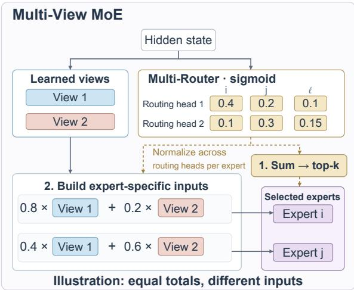  
Figure 1: Router-conditioned expert inputs in Multi-View. Equal total scores can express diferent preferences across routing heads and yield diferent mixed inputs. In this illustrative k = 2 example, experts i and j have score pairs (0.4, 0.1) and (0.2, 0.3), both summing to 0.5. Normalizing across routing heads for each expert gives view proportions (0.8, 0.2) and (0.4, 0.6), respectively. Routing heads and view projections read the same hidden state; each selected expert runs once. The balancing bias is set to zero. Shared experts, output gating, and up-projection are omitted.

Multi-View further uses these diferentiated preferences to modulate each selected expert’s computation. The summed score alone does not retain the routers’ relative preferences: score vectors (0.4, 0.1) and (0.2, 0.3) both sum to 0.5 but express opposite preferences (Fig. 1). Each router is paired with a learned latent projection, and each selected expert’s raw sigmoid scores are normalized across routers to blend the views into its input before evaluation. The projections are shared across experts, while the mixing proportions depend on both the token and the expert. Mixing takes place before dispatch, and each selected expert performs one forward computation, preserving the active-expert count, expert FLOPs, and allto-all communication volume.

On a 24-layer 10B-A1B model trained for 708B tokens, the full Multi-View MoE improves the nine-task downstream mean by 1.18 percentage points over the baseline, reaching 34.25; its Multi-Router submodule alone provides a 0.6-point gain. Routing diagnostics show that this submodule improves global score–utility rank correlation by a relative 8.1%, with a relative gain of approximately 58% in the layer with the lowest single-router alignment (§4.4). Measurements show distinct expert inputs for the same token. At the final MoE layer, permuting view-mixing proportions across experts while fixing expert selection and output gates raises held-out NLL by 0.01340 nats/token; permutation across tokens for the same expert also increases NLL (§4.3). These results show that the trained model uses the correspondence between mixing proportions, experts, and tokens.

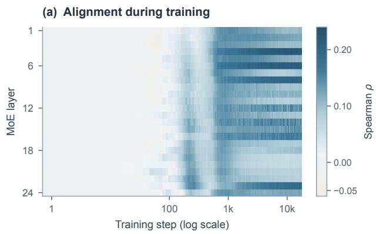

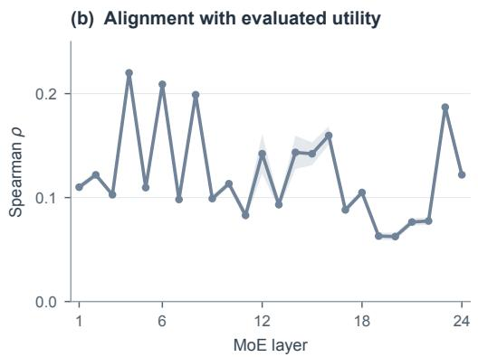  
Figure 2: Agreement between single-router scores and empirical expert-utility evaluation on the 24-layer 10B-A1B backbone. (a) Spearman correlation across training. The logarithmic training-step axis expands the early stage and compresses later intervals to show early-training changes more clearly. (b) Layer-wise means over the 201 logged measurements used in the router comparison; shaded bands show ±1 standard deviation. Scores exclude the load-balancing bias. Expert utility is evaluated using each expert’s output $L ^ { 2 }$ norm, normalized by its mean over sampled tokens (App. B.5).

## Contributions.

• Multi-Router for improved expert ranking. Dense evaluation of all experts reveals weak agreement between single-router score rankings and rankings from expert-utility evaluations, especially in middle and deep layers. Motivated by this observation, the Multi-Router submodule aggregates sigmoid scores from independently initialized routers. These routers develop highly diferentiated expert preferences during training, and their aggregated scores achieve closer agreement with the evaluated utility rankings.

• Multi-View MoE at a fixed expert budget. The framework couples its Multi-Router selection submodule with router-conditioned latent-view mixing. Mixing before dispatch retains one forward computation per selected expert, the active-expert count, expert FLOPs, and all-to-all communication volume.

• Quantitative gains. On a 24-layer 10B-A1B model trained for 708B tokens, full Multi-

View MoE improves the nine-task downstream mean by 1.18 percentage points over the baseline; Multi-Router alone provides a 0.6-point gain. Multi-Router improves global score–utility rank correlation by a relative 8.1%, with a relative gain of approximately 58% in the layer with the lowest single-router alignment.

## 2 Related Work

Sparse MoE and expert specialization. Sparse MoE layers route each token to a small subset of experts and combine their outputs (Shazeer et al., 2017). Token routing with a linear routing head and top-k selection remains common in sparse MoE models (Cai et al., 2024; DeepSeek-AI et al., 2024b; Jiang et al., 2024). Switch Transformer uses top-1 routing (Fedus et al., 2021). Recent large language models also adopt MoE architectures (GLM-5-Team et al., 2026; Wang et al., 2026a). Approaches such as fine-grained experts with an always-active shared expert increase the flexibility of expert specialization (Dai et al., 2024). In these architectures, however, a discrete routing decision determines the active experts, which process a shared token representation.

Router design. Router design addresses routing quality, stability, and load balance through methods including router z-loss (Zoph et al., 2022), expert-choice routing (Zhou et al., 2022), auxiliary-loss-free balancing (Wang et al., 2024a), mitigation of representation collapse (Chi et al., 2022), and attention over experts (Wu et al., 2024a). Expert assignments can fluctuate during training, motivating methods for more stable routing (Dai et al., 2022; Nguyen et al., 2025). Router Upcycling initializes query projections and expert keys from preceding attention layers for dense-to-MoE upcycling, then sums query–key matching scores across routers before softmax selection (Ran et al., 2025). MoR uses a learnable main router to weight sub-router outputs in LoRA expert mixtures for parameter-eficient fine-tuning (Zhang et al., 2025). Our Multi-Router submodule sums scores from separately parameterized sigmoid routing heads during pretraining. Multi-View further uses each expert’s relative scores across routing heads to construct its input.

Multi-representation and latent-space MoE. A separate line of work changes the representations processed by experts. LatentMoE computes router scores from the full hidden state and evaluates experts in a low-dimensional latent space (Elango et al., 2026). Stable LatentMoE modifies this design for training stability while retaining a single down-projection (Kimi Team et al., 2026). We build on this shared-projection architecture. MoLAE factorizes expert weights into shared latent mappings, optionally within expert groups, and expert-specific transformations (Liu et al., 2025b). AoE removes the separate router: experts are ranked by the $L ^ { 2 }$ norms of their lowdimensional internal activations, and only selected experts continue computation; low-rank factorization reduces the cost of this initial evaluation (Lv et al., 2025). MH-MoE splits projected tokens into sub-tokens that share a router and expert pool (Wu et al., 2024b; Huang et al., 2024). Multi-Head LatentMoE instead assigns each sub-token an independent MoE module with its own router and experts (Cui et al., 2026); SliceMoE also explores token slicing (Vejendla, 2025). MoH applies shared and routed components to attention heads rather than to the FFN (Jin et al., 2024).

Multi-View MoE uses K projections of the full hidden state as a shared basis. For each selected expert, raw scores are normalized across routers to determine a token- and expert-dependent mixture before expert computation. The number of projections depends on $K$ , rather than on the number of experts, and expert parameters are shared across views. This changes the representation each expert receives. Prior analyses relate hidden-state geometry to expert-usage patterns (Wang et al., 2026b). Multi-Router retains the shared latent input of LatentMoE while aggregating multiple routing heads; Multi-View further reuses their preferences to modulate expert inputs.

## 3 Method

## 3.1 Preliminaries and framework overview

We study autoregressive language modeling and modify the routing and expert-input interface of a latent-space MoE backbone (Elango et al., 2026). The router reads the hidden state $h \in \mathbb { R } ^ { D }$ and selects k of N routed experts. A down-projection $P ~ \in ~ \mathbb { R } ^ { d \times D }$ supplies the shared input $z ~ = ~ P h$ Each expert maps $\mathbb { R } ^ { d }$ to $\mathbb { R } ^ { d }$ . With selected set $\boldsymbol { \mathcal { S } }$ and output gates $g _ { i }$ , the latent expert aggregation is

$$
y = \sum _ { i \in S } g _ { i } E _ { i } ( z ) .\tag{1}
$$

The backbone up-projects this aggregation to dimension $D$ and combines it with the always-active shared-expert output.

Multi-View retains the shared expert pool and $| S | = k$ , while reusing the preferences of individual routing heads for both selection and input construction. Its Multi-Router submodule aggregates scores; for each selected expert, scores normalized across routers mix latent views before one expert evaluation. Figure 3 shows the computation.

## 3.2 Multi-Router: score aggregation before selection

Multi-Router uses $R$ routing heads $\{ w ^ { ( r ) } \} , w ^ { ( r ) } \in$ $\mathbb { R } ^ { D \times N }$ , to score the shared expert pool from the full hidden state h. Each routing head’s output passes through a sigmoid, and the resulting scores are summed before top-k selection:

$$
\begin{array} { r l } & { \bar { s } _ { i } = \displaystyle \sum _ { r = 1 } ^ { R } \sigma ( w _ { i } ^ { ( r ) \top } h ) , } \\ & { \bar { s } = \mathrm { T o p K } _ { k } ( \bar { s } + b ) . } \end{array}\tag{2}
$$

Here $b \in \mathbb { R } ^ { N }$ is the backbone’s expert-balancing bias, added only for selection. Output gates normalize the uncorrected score sums over the selected experts and apply the backbone’s routedoutput scale:

$$
g _ { i } = \alpha _ { i } \frac { \bar { s } _ { i } } { \sum _ { j \in \mathcal { S } } \bar { s } _ { j } } , \qquad i \in \mathcal { S } .\tag{3}
$$

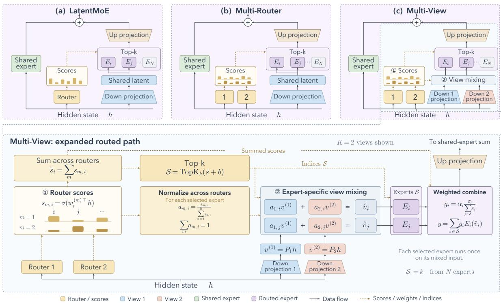  
Figure 3: Comparison of latent-space MoE architectures. Top: (a) LatentMoE uses a router and a shared latent input; (b) Multi-Router sums scores from separately parameterized sigmoid routing heads for top-k selection while retaining the shared input; (c) Multi-View adds distinct down-projections and expert-specific view mixing. Bottom: expansion of the boxed routed path in (c), with matching colors and numbered markers. Balancing bias b is added to summed scores only for selection. Output gates $g _ { i }$ follow Eq. 3. For each selected expert, raw sigmoid scores are normalized across routers to form view proportions $a _ { m , i } .$ , whose sum is one. Each selected expert processes its mixed input once. The aggregated representation y is up-projected and combined with the shared-expert output shown above. $K = 2$ views and selected experts $i , j$ are illustrative; k is the number of active experts out of N. Bars depict example routing scores. Normalization modules and residual paths are omitted for clarity.

Here $\alpha _ { i }$ is the backbone’s learnable scalar for expert i; it scales the expert output, not the view mixture.

Routing heads are initialized with distinct seeds to break symmetry, without a diversity penalty. We use R = 2 by default. In Multi-View (§3.3), each router is paired with one view, so $R = K$ and the two symbols refer to the same count.

Summation after the sigmoid preserves the routing heads as distinct nonlinear scoring functions. Summing logits before the sigmoid instead gives a single linear scorer, since $\begin{array} { r } { \sum _ { r } w _ { i } ^ { ( r ) \top } h = } \end{array}$ $( \sum _ { r } w _ { i } ^ { ( r ) } ) ^ { \top } h$ Post-sigmoid summation lets a strong score from one routing head or support across routing heads afect the shared ranking and supplies the relative contributions used for input mixing. Alternatives and their properties appear in Apps. A.3–A.5, with training comparisons in §4.5.

## 3.3 Multi-View: router-conditioned expert inputs

Multi-View pairs R routing heads with K latent views in a one-to-one correspondence, so $R = K$ Selection and output gating follow the summedscore rules of Multi-Router, while each selected expert’s scores normalized across routers construct its input $\begin{array} { r } { \hat { v } _ { i } \ = \ \sum _ { m } a _ { m , i } v ^ { ( m ) } } \end{array}$ Views are fused before expert evaluation, and each selected expert runs once. This parameterization avoids evaluating experts separately for each view; for nonlinear $E _ { i }$ , it is generally not equivalent to mixing outputs after separate evaluations:

$$
\begin{array} { c } { { E _ { i } \Big ( \displaystyle \sum _ { m } a _ { m , i } v ^ { ( m ) } \Big ) } } \\ { { \mathrm { ~ } \neq \displaystyle \sum _ { m } a _ { m , i } E _ { i } ( v ^ { ( m ) } ) . } } \end{array}
$$

Views. We form K latent views $v ^ { ( m ) } = P _ { m } h \in$ $\mathbb { R } ^ { d }$ , with each $P _ { m } ~ \in ~ \mathbb { R } ^ { d \times D }$ matching the shape of the backbone down-projection. View 1 uses the backbone’s projection $P ;$ the remaining K−1 views use independently initialized perturbations, as described below. Each view projects the full hidden state rather than a subset of its channels. Expert architectures and input dimensions are unchanged.

Routing, mixing, and gating. All R routing heads read h. Routing head m produces $s _ { m , i } =$ $\sigma ( w _ { i } ^ { ( m ) \top } h )$ for every expert i, and these scores determine three operations. (i) Selection: sum across routers, $\begin{array} { r } { \bar { s } _ { i } = \sum _ { m } s _ { m , i } . } \end{array}$ , add the balancing bias, and take one top- $k , S = \mathrm { T o p K } _ { k } ( \bar { s } + b )$ , as in Multi-Router. (ii) View mixing: for each selected expert $i ,$ normalize its raw sigmoid scores across the R routing heads:

$$
a _ { m , i } = \frac { s _ { m , i } } { \sum _ { n = 1 } ^ { R } s _ { n , i } } , \qquad \sum _ { m = 1 } ^ { K } a _ { m , i } = 1 , \quad i \in \mathcal { S } .\tag{4}
$$

These proportions form the convex mixture $\hat { v } _ { i } =$ $\textstyle \sum _ { m } a _ { m , i } v ^ { ( m ) }$ . Neither the balancing bias nor the routed-output scale enters this mixture. (iii) Output gating: use $g _ { i }$ from Eq. 3 to combine the selected experts’ outputs. Thus, output gating normalizes summed scores over experts, whereas input mixing normalizes each expert’s scores across routers. The resulting expert aggregation is

$$
y = \sum _ { i \in S } g _ { i } E _ { i } \Big ( \sum _ { m } a _ { m , i } v ^ { ( m ) } \Big ) .\tag{5}
$$

Equivalently, the input uses a token- and expertdependent efective projection,

$$
P _ { \mathrm { e f f } , i } ( h ) = \sum _ { m } a _ { m , i } ( h ) P _ { m } , \qquad \hat { v } _ { i } = P _ { \mathrm { e f f } , i } ( h ) h .
$$

The projection basis $\{ P _ { m } \}$ is shared across experts; only its mixing coeficients depend on h and i. The implementation mixes the projected vectors, rather than materializing a separate matrix $P _ { \mathrm { e f f } , i }$ for every token–expert pair.

Normalizing each expert’s scores across routers to derive the mixing weights requires no additional mixing network and makes view m’s contribution to expert $i \ ' s$ input depend on the corresponding routing preference. Algorithm 1 gives the forward pass. Learned mixing weights and gradient coupling are evaluated in the corresponding ablation configurations in Section 4.5.

Expert-dependent mixing weights. The index i in $a _ { m , i }$ allows input modulation to vary across experts. If all selected experts for the same token share $\begin{array} { c c l } { { a _ { m , i } } } & { { = } } & { { a _ { m } ( h ) } } \end{array}$ , they receive the same input $\textstyle { \Bigl ( } \sum _ { m } a _ { m } ( h ) P _ { m } { \Bigr ) } h$ This remains token-conditioned modulation, but no longer distinguishes diferent experts for that token. If the weights are further fixed to constants, such as $a _ { m } = 1 / K$ , the mixture can be absorbed into a fixed projection. Multi-View derives $a _ { m , i }$ from the raw scores for expert i, normalized across the R routing heads, making modulation depend on both the token and the expert (App. A.10).

Algorithm 1 Multi-View routed-expert branch for  
ward pass   
Require: hidden state $h ;$ projections $\{ P _ { m } \} _ { m = 1 } ^ { K } ;$   
routing heads $\{ w ^ { ( m ) } \} _ { m = 1 } ^ { \bar { R } } ,$ experts $\{ E _ { i } \} _ { i = 1 } ^ { N } ;$   
active count k; balancing bias $b ;$ routed-output   
scales $\{ \alpha _ { i } \} _ { i = \cdot } ^ { N }$ 1   
1: $v ^ { ( m ) } \gets P _ { m } h$ for $m = 1 , \ldots , K$ ▷ K latent   
views   
2: $s _ { m , i } \gets \sigma ( w _ { i } ^ { ( m ) \top } h )$ ▷ per-router scores on   
full h   
3: $\bar { s } _ { i } \gets \sum _ { m } { s _ { m , i } }$ ▷ summed score per expert   
4: $\boldsymbol { \mathcal { S } } \gets \mathrm { T o p K } _ { k } ( \bar { \boldsymbol { s } } + \boldsymbol { b } )$ ▷ bias only for selection   
5: for $i \in S$ do   
6: $\begin{array} { r } { a _ { m , i } \gets s _ { m , i } / \sum _ { n = 1 } ^ { R } s _ { n , i } } \end{array}$ ▷ normalize   
across routers   
7: $\begin{array} { r } { \hat { v } _ { i } \gets \sum _ { m } a _ { m , i } v ^ { ( m ) } } \end{array}$ ▷ per-expert view   
blend   
8: $g _ { i }  \alpha _ { i } \bar { s } _ { i } / \sum _ { j \in S } \bar { s } _ { j }$ ▷ output gate, Eq. 3   
9: end for   
10: return $\begin{array} { r } { y = \sum _ { i \in \mathcal { S } } g _ { i } E _ { i } ( \hat { v } _ { i } ) } \end{array}$

Initialization. To introduce the additional projections gradually, we retain the backbone downprojection for view 1 and parameterize the others as ramped perturbations, $v ^ { ( m ) } = P h + \gamma ( t ) \Delta P _ { m } h .$ with γ increasing from 0 to 1 early in training. At t = 0, all view projections equal the backbone projection; after the ramp, the view projections are unconstrained. The expert inputs are weighted combinations of these views. This procedure can also initialize the views from an existing checkpoint (App. A.9).

Shared expert parameters. All views use one expert pool, so expert parameters are not duplicated or partitioned across views. Each selected expert processes one mixed input, and gradients propagate through every view with nonzero mixing weight. Multi-Router uses the shared input $z = P h$ for all selected experts; Multi-View adds input modulation through the router-derived coefficients (App. A.10).

## 4 Experiments

## 4.1 Setup

We compare the latent-space MoE baseline, Multi-Router, and score-derived Multi-View on a 24- layer 10B-A1B backbone with top-8 routing and one always-active shared expert (Elango et al., 2026). The three configurations share the training data, token budget, backbone, and optimization settings (App. B.2). Downstream evaluation uses the 708B-token checkpoints on nine tasks (protocol in App. B.4). We use R for the number of routing heads and K for the number of views. The main method Multi-View(K) pairs them one to one, so $R \ : = \ : K$ ; Multi-Router(R) uses R routing heads with a shared expert input.

Training ablations examine router aggregation, learned input-mixing weights, and view-fed scoring. Their losses are averaged over $\mathbf { a } \pm 1 \%$ token window around a common ablation checkpoint. A pair of near-matched runs difers after smoothing by at most 1 $. . 2 \times 1 0 ^ { - 3 }$ , with a mean absolute diference of $7 \times 1 0 ^ { - 4 }$ . Architecture, optimization, and comparison settings are detailed in App. B.3.

## 4.2 Downstream performance

Table 1 compares all three configurations at the same training budget. The nine-task means are 33.07 for the baseline, 33.69 for Multi-Router, and 34.25 for Multi-View. Multi-View improves the mean by 1.18 percentage points over the baseline and by 0.56 over Multi-Router. Gains over Multi-Router reach 2.74 points on GPQA and 2.03 on MMLU-Redux; CMMLU and MMLU improve by 1.43 and 1.17 points, respectively. These results indicate an aggregate benefit from extending selection with multiple routing heads to routerconditioned expert computation.

Training convergence. Figure 4 compares the three configurations through the 708B-token checkpoint used for downstream evaluation. Over the final 1,000 steps, the mean losses are 2.25621 for the baseline, 2.25047 for Multi-Router, and 2.24883 for Multi-View. Multi-Router reduces loss by $5 . 7 4 ~ \times ~ 1 0 ^ { - 3 }$ relative to the baseline, and Multi-View increases this reduction to $7 . 3 8 \times 1 0 ^ { - 3 }$ Multi-View’s lower loss in late training is consistent with its downstream gains.

## 4.3 Router preferences shape expert computation

We probe the score-derived Multi-View checkpoint used for downstream evaluation at 708B tokens. The analysis covers all 24 MoE layers on 256 held-out sequences of 4096 tokens. It examines expert-specific inputs and whether the trained model uses the correspondence between mixing proportions, experts, and tokens.

From preferences to distinct expert inputs. The two routing heads have markedly diferent rankings: across layers, their top-8 Jaccard index averages 0.145 and their top-1 agreement averages 11.2%. For each token, the probe exports the actual view-1 mixing proportion $r _ { 1 , i } ~ = ~ a _ { 1 , i }$ and mixed input of each of its eight selected experts. We compare all 28 pairs of these experts: $D _ { r }$ is their mean absolute proportion diference, and $D _ { v }$ is their mean input distance divided by their mean input norm (App. B.6). Both are zero when all eight experts receive the same proportions or inputs, respectively. Fig. 5(a) summarizes these withintoken diferences across tokens at each layer. The layer-wise medians are 0.27–0.46 for $D _ { r }$ and 0.42– 0.58 for $D _ { v }$ . The selected experts therefore receive distinct inputs according to their view preferences.

The trained model uses the correspondence. At the final MoE layer, we hold the selected experts $\boldsymbol { \mathcal { S } }$ and their output gates $g _ { i }$ fixed to numerical precision and intervene only on the viewmixing proportions. For a replacement proportion $r _ { 1 , i } ^ { \prime } ,$ the two dispatcher channels are rebuilt as $( g _ { i } r _ { 1 , i } ^ { \prime } , g _ { i } ( 1 - r _ { 1 , i } ^ { \prime } ) )$ , preserving their sum $g _ { i }$ Permuting the view proportions among the selected experts of the same token raises NLL by 0.01340 nats/token (95% sequence-bootstrap CI: [0.01256, 0.01435]). Using uniform mixing proportions $( 1 / 2 , 1 / 2 )$ raises NLL by 0.00662; permuting proportions across tokens for the same expert raises it by 0.00223. The respective CIs are [0.00620, 0.00709] and [0.00205, 0.00241]. Expert permutation increases sequence-average NLL for all 256 sequences. These interventions show that the trained checkpoint uses the correspondence between mixing proportions, experts, and tokens. Expert permutation produces the largest increase among these three interventions.

Both views contribute across depth. Applying the view 1-only or view 2-only proportions at the final layer increases NLL by 0.01881 and 0.02042 nats/token, respectively. The trained checkpoint therefore uses both view branches. A separate 80- sequence scan perturbs one layer at a time: expert permutation and uniform mixing increase NLL, with pointwise 95% CIs above zero at all 24 layers. Only the intervened layer’s selections and output gates are fixed; subsequent routing is recomputed, so these are total efects including downstream responses. Additional preference, single-view, and token-group analyses appear in App. B.6.

<table><tr><td></td><td colspan="5">Exams</td><td colspan="4">Knowledge</td><td colspan="3">Science Reasoning</td></tr><tr><td>Method</td><td>CMMLU</td><td>MMLU</td><td>Redux</td><td>Pro</td><td> $\operatorname { A v g } .$ </td><td>HotpotQA</td><td></td><td>SimpleQA PreciseWiki</td><td> $\operatorname { A v g } .$ </td><td>GPQA</td><td>BBH</td><td>Overall</td></tr><tr><td>Baseline (LatentMoE)</td><td>53.71</td><td> $5 7 . 4 8 $ </td><td>59.03</td><td>27.28</td><td>49.38</td><td>22.00</td><td>3.35</td><td>8.64</td><td>11.33</td><td>30.00</td><td>36.10</td><td>33.07</td></tr><tr><td>Multi-Router  $\scriptstyle ( R = 2 )$ </td><td>53.77</td><td>57.50</td><td>58.90</td><td>27.71</td><td>49.47</td><td>22.13</td><td>3.85</td><td>9.16</td><td>11.71</td><td>32.86</td><td>37.31</td><td>33.69</td></tr><tr><td>Multi-View (K=2)</td><td>55.20</td><td>58.67</td><td>60.93</td><td>27.12</td><td>50.48</td><td>22.54</td><td>3.41</td><td>9.02</td><td>11.66</td><td>35.60</td><td>35.76</td><td>34.25</td></tr><tr><td>∆ (MV − Baseline)</td><td>+1.49</td><td>+1.19</td><td>+1.90</td><td>-0.16</td><td>+1.10</td><td>+0.54</td><td>+0.06</td><td>+0.38</td><td>+0.33</td><td>+5.60</td><td>-0.34</td><td>+1.18</td></tr></table>

Table 1: Downstream scores (%) at 708B training tokens. Baseline: latent-space MoE; MR: Multi-Router $( R = 2 )$ MV: score-derived Multi-View $( K = R = 2 ; \mathrm { E q . } 5 )$ . Tasks are grouped into exams, knowledge, science, and reasoning. Avg. is the unweighted within-group mean; Overall is the unweighted mean across all nine tasks. Bold marks the highest displayed score in each column. The final row reports MV minus Baseline in percentage points. Prompt and scoring protocols appear in App. B.4.

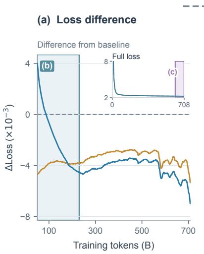

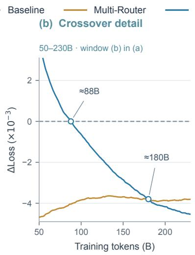

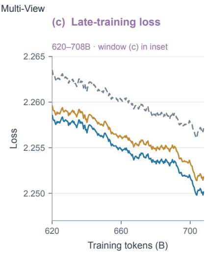  
Figure 4: Training loss of the baseline, Multi-Router, and Multi-View on 10B-A1B through 708B tokens. (a) Loss diference from the baseline; the inset shows the full loss trajectories. (b) Magnification of the blue-bordered window in (a), covering 50–230B tokens. (c) Magnification of the purple-bordered window in the full-loss inset, showing absolute loss over 620–708B tokens. All curves use the same causal exponential moving average (EMA), with a 2,000-step span (α = 2/2001), initialized at the first observation. The final losses reported in the text average the last 1,000 unsmoothed steps.

## 4.4 Alignment of router scores and expert outputs

We compare the baseline and Multi-Router using the normalized expert-output norm. For each sampled token, all 256 experts process its latent input; each output’s $L ^ { 2 }$ norm is divided by that expert’s mean norm over the sampled tokens. Spearman correlation measures agreement between the resulting expert ranking and the router scores before balancing bias (App. B.5). Related work also examines routing quality through expert-pathway optimization, routing-weight analysis, and expertimportance measurements (Li et al., 2025a,b,c; Chen et al., 2026).

<table><tr><td>Method</td><td>Spearman ρ</td></tr><tr><td>Single router</td><td>0.1245</td></tr><tr><td>Multi-Router</td><td>0.1346</td></tr></table>

Table 2: Global alignment between pre-bias router scores and normalized expert-output norms, averaged over 201 matched logged measurements. Multi-Router improves rank correlation by a relative 8.1%. Definitions appear in App. B.5.

Table 2 reports an 8.1% relative improvement in global rank correlation across 24 MoE layers, from 0.1245 to 0.1346. Figure 6 shows the training trajectories and layer-wise comparison, with gains in 17 of 24 layers. The largest relative gain occurs at layer 20, where correlation rises from 0.0625 to 0.0986 (57.7%); layer 7 shows the largest absolute gain, from 0.0982 to 0.1388. These measurements show that aggregating diferentiated routing heads improves alignment between router scores and normalized expert outputs, complementing the downstream and training-loss gains of Multi-Router.

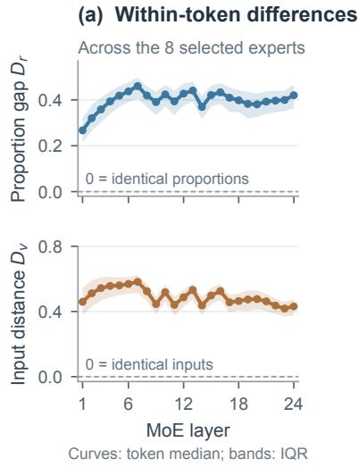

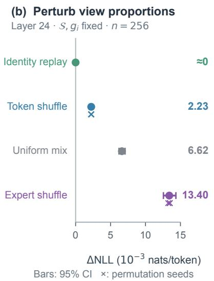

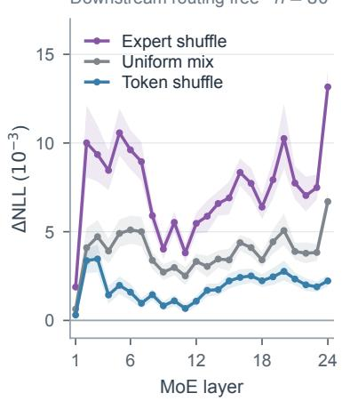  
Figure 5: Expert-specific inputs and controlled mixing interventions in the score-derived Multi-View checkpoint at 708B tokens. (a) Diferences among the eight experts selected for the same token: the mean absolute pairwise diference in view-1 proportions D (top) and the mean pairwise input distance normalized by the mean input norm $D _ { v }$ (bottom). Zero denotes identical proportions or inputs, respectively. Curves show the median across tokens at each layer; bands show the 25th–75th percentiles. (b) Final-layer interventions on 256 sequences, changing view proportions while holding S and output gates g fixed to numerical precision. Whiskers are 95% sequence-bootstrap CIs; crosses mark permutation-seed means. (c) Single-layer interventions on 80 sequences. Bands are pointwise 95% CIs; downstream routing is recomputed. ∆NLL is intervention loss minus the original loss.

## 4.5 Training ablations

Fusion position and routing heads. Multi-Router reduces loss by $4 . 5 \times 1 0 ^ { - 3 }$ with two routing heads and $5 . 1 \times 1 0 ^ { - 3 }$ with three routing heads (Table 3). The additional reduction of $0 . 6 \times 1 0 ^ { - 3 }$ is smaller than the observed run-pair diference of $1 . 2 \times 1 0 ^ { - 3 }$ We use two routing heads by default. Fusion position determines whether the routing heads contribute distinct scoring functions: summing logits before sigmoid collapses them into one linear scorer (§3.2), whereas applying sigmoid to each routing head before summation preserves their nonlinear contributions. The latter distinguishes equal-mean logits with diferent distributions across routing heads.

Fusion operators and routing-head contributions. Diferent fusion rules determine how the scoring views contribute to expert selection. Maximum fusion retains only the strongest score, whereas products and geometric means emphasize joint support. Summation accumulates bounded contributions from all routing heads, allowing either a strong response from one routing head or support across routing heads to increase the aggregate. All evaluated fusion variants reduce loss by $3 . 3 \mathrm { - 4 . 5 \times 1 0 ^ { - 3 } ~ ( F i g . ~ 7 ) }$ . The operator gaps lie within the observed run-pair diference. Beyond selection, Multi-View normalizes each selected expert’s raw scores across routing heads to construct input-mixing proportions (§3.3), connecting selection with multiple routing heads to router-conditioned expert computation.

Learned input mixing. Table 4 compares three learned per-expert mixing parameterizations: symmetric initialization at 0.5, asymmetric initialization, and two independent gates. They reduce loss by $4 . 4 \mathrm { - } 5 . 0 \times 1 0 ^ { - 3 }$ relative to the baseline while retaining the same active-expert budget. The main Multi-View method instead derives mixing weights directly from router scores, reusing the selection signal without an additional mixing network.

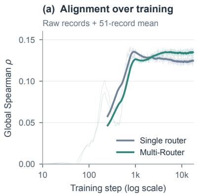

(b) Alignment across all layers  
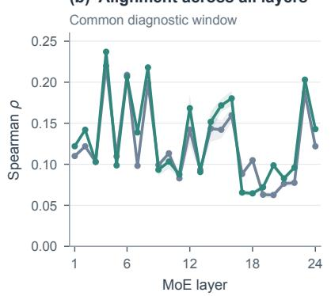

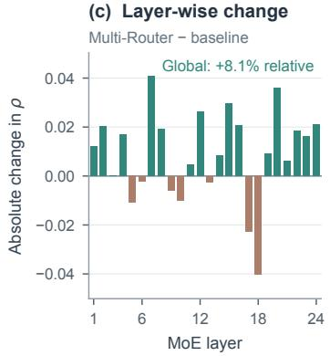

Figure 6: Router-score alignment with normalized expert-output norms. (a) Global Spearman correlation over training; solid curves use a 51-record moving mean and pale curves show raw measurements. (b) Layer-wise means and one-standard-deviation bands over 201 matched logged measurements; metric and aggregation definitions appear in App. B.5. (c) Correlation changes across all 24 layers. Multi-Router improves global correlation by a relative 8.1%, with the largest relative layer-wise gain of 57.7% at layer 20.
<table><tr><td>Method</td><td>∆ loss vs. baseline (↓)</td></tr><tr><td>Single router (baseline; loss 2.3825)</td><td>0.0000</td></tr><tr><td>Multi-Router (R=2, sigmoid-sum)</td><td>-0.0045</td></tr><tr><td>Multi-Router  $\scriptstyle ( R = 3 )$ </td><td>-0.0051</td></tr><tr><td>Fusion position  $\scriptstyle ( R = 2 )$ </td><td></td></tr><tr><td>Logit-sum Probability-normalized sum</td><td>collapses to one router -0.0037</td></tr><tr><td>Fusion operator (post-sigmoid, R=2)</td><td></td></tr><tr><td>Max max  $\mathbf { \Phi } ( s _ { 1 } , s _ { 2 } )$ </td><td>-0.0037</td></tr><tr><td>Max to select, sum to gate</td><td>-0.0036</td></tr><tr><td>Geometric mean</td><td>-0.0037</td></tr><tr><td> $\sqrt { s _ { 1 } s _ { 2 } }$ </td><td></td></tr><tr><td>Product  $s _ { 1 } s _ { 2 }$ </td><td>-0.0034</td></tr><tr><td>Sum + λs1s2 (agreement) Sum − λ|s1 −s2| (disagreement)</td><td>-0.0037</td></tr><tr><td></td><td>-0.0033</td></tr><tr><td>Observed run-pair difference</td><td>±0.0012</td></tr></table>

Table 3: Multi-Router training ablations on 10B-A1B. Loss diferences use the single-router baseline and a ±1% token window around the common ablation checkpoint. All post-sigmoid aggregation operators reduce loss; the final row reports the observed run-pair diference.

Gradient coupling in view-fed scoring. A separate ablation feeds the views into both the scoring and expert-computation paths. Stopping the gradient from mixing weights to views changes the loss diference from −0.0024 to +0.0090, an increase of 0.0114. The forward weight values at fixed parameters are preserved, isolating the benefit of this gradient path within the view-fed configuration.

<table><tr><td>Variant (K=2)</td><td>∆ loss vs. baseline (↓)</td></tr><tr><td>Multi-Router (R=2)</td><td>-0.0045</td></tr><tr><td>Learned per-expert view weights</td><td></td></tr><tr><td>Decoupled gate, init 0.5</td><td>-0.0048</td></tr><tr><td>Decoupled gate, asym. init</td><td>-0.0050</td></tr><tr><td>Two independent gates</td><td>-0.0044</td></tr><tr><td>Coupling between scoring and views</td><td></td></tr><tr><td>Coupled (gradient flows to views)</td><td>-0.0024</td></tr><tr><td>Detached (gradient stopped)</td><td>+0.0090</td></tr><tr><td>Observed run-pair difference</td><td>±0.0012</td></tr></table>

Table 4: Input-mixing training ablations on 10B-A1B. The learned-weight variants use per-expert mixing parameters. In the view-fed coupling pair, both scoring and expert computation read the views; stopping the weight-to-view gradient increases loss by 0.0114 while preserving forward weights at fixed parameters.

## 4.6 Parameter and computational eficiency

Parameter overhead. For the 24-layer 10B-A1B backbone with two routing heads, the Multi-Router submodule adds approximately 0.06% parameters. Multi-View adds one latent-view projection per layer, contributing a further 0.13%, for a total increase of approximately 0.19%.

Expert computation and communication. Each selected expert processes one mixed input, preserving the active-expert count and activated expert FLOPs. Input mixing takes place on the source device before dispatch; each token still sends k vectors of dimension d, preserving allto-all communication volume. Additional work comes from routing, projection, and input mixing; for fixed K, the extra scoring and projection cost scales as $D ( d + N )$ . Appendix A.6 gives the parameter and operation counts, together with same-cluster throughput measurements for the router and view-fed ablation configurations.

## 5 Conclusion

Multi-View MoE reuses routing preferences to improve expert selection and shape expert computation. Motivated by weak agreement between single-router rankings and empirical expert-utility rankings, its Multi-Router submodule combines independently initialized routing heads that learn highly diferentiated preferences. Routing diagnostics show relative rank-correlation gains of 8.1% globally and approximately 58% in the layer with the lowest single-router alignment. Multi-View further uses each selected expert’s relative scores across routing heads to blend latent views into its input before dispatch. Each selected expert runs once, preserving the active-expert count, expert FLOPs, and all-to-all communication volume. On a 24-layer 10B-A1B model trained for 708B tokens, full Multi-View MoE improves the nine-task downstream mean by 1.18 percentage points over the baseline; its Multi-Router submodule alone provides a 0.6-point gain. Controlled mixing interventions show that the model makes efective use of expert- and token-dependent input diferences. These findings establish routing preferences as a signal for both selecting experts and shaping how they process each token.

## Limitations

The experiments use a 24-layer 10B-A1B backbone with a shared training seed and evaluate nine downstream tasks at the 708B-token checkpoint. The controlled interventions measure the trained model’s use of view mixing at that checkpoint.

## References

Yejin Bang, Ziwei Ji, Alan Schelten, Anthony Hartshorn, Tara Fowler, Cheng Zhang, Nicola Cancedda, and Pascale Fung. 2025. HalluLens: LLM hallucination benchmark. In Proceedings of the 63rd Annual Meeting of the Association for Computational Linguistics (Volume 1: Long Papers), pages 24128–24156. Association for Computational Linguistics.

Weilin Cai, Juyong Jiang, Fan Wang, Jing Tang, Sunghun Kim, and Jiayi Huang. 2024. A survey on

mixture of experts in large language models. arXiv preprint arXiv:2407.06204. IEEE Transactions on Knowledge and Data Engineering (TKDE) 2025.

Yuanteng Chen, Peisong Wang, Yuantian Shao, Nanxin Zeng, Chang Xu, and Jian Cheng. 2026. Ban&Pick: Enhancing Performance and Eficiency of MoE-LLMs via Smarter Routing. In Findings of the Association for Computational Linguistics: EMNLP 2026, pages 14228–14253, Budapest, Hungary. Association for Computational Linguistics.

Zewen Chi, Li Dong, Shaohan Huang, Damai Dai, Shuming Ma, Barun Patra, Saksham Singhal, Payal Bajaj, Xia Song, Xian-Ling Mao, Heyan Huang, and Furu Wei. 2022. On the representation collapse of sparse mixture of experts. arXiv preprint arXiv:2204.09179. NeurIPS 2022.

Chenwei Cui, Rockwell Jackson, Benjamin Joseph Herrera, Ana María Tárano, and Hannah Kerner. 2026. Multi-head LatentMoE and Head Parallel: Communication-eficient and deterministic MoE parallelism. arXiv preprint arXiv:2602.04870.

Damai Dai, Chengqi Deng, Chenggang Zhao, R. X. Xu, Huazuo Gao, Deli Chen, Jiashi Li, Wangding Zeng, Xingkai Yu, Y. Wu, Zhenda Xie, Y. K. Li, Panpan Huang, Fuli Luo, Chong Ruan, Zhifang Sui, and Wenfeng Liang. 2024. DeepSeekMoE: Towards ultimate expert specialization in mixture-of-experts language models. arXiv preprint arXiv:2401.06066.

Damai Dai, Li Dong, Shuming Ma, Bo Zheng, Zhifang Sui, Baobao Chang, and Furu Wei. 2022. Stable-MoE: Stable routing strategy for mixture of experts. arXiv preprint arXiv:2204.08396. ACL-2022.

DeepSeek-AI et al. 2024a. DeepSeek-V2: A strong, economical, and eficient mixture-of-experts language model. arXiv preprint arXiv:2405.04434.

DeepSeek-AI et al. 2024b. DeepSeek-V3 technical report. arXiv preprint arXiv:2412.19437.

Venmugil Elango, Nidhi Bhatia, Roger Walefe, Rasoul Shafipour, Tomer Asida, Abhinav Khattar, Nave Assaf, Maximilian Golub, Joey Guman, Tiyasa Mitra, Ritchie Zhao, Ritika Borkar, Ran Zilberstein, Mostofa Patwary, Mohammad Shoeybi, and Bita Rouhani. 2026. LatentMoE: Toward optimal accuracy per FLOP and parameter in mixture of experts. arXiv preprint arXiv:2601.18089.

William Fedus, Barret Zoph, and Noam Shazeer. 2021. Switch Transformers: Scaling to trillion parameter models with simple and eficient sparsity. arXiv preprint arXiv:2101.03961.

Aryo Pradipta Gema, Joshua Ong Jun Leang, Giwon Hong, Alessio Devoto, Alberto Carlo Maria Mancino, Rohit Saxena, Xuanli He, Yu Zhao, Xiaotang Du, Mohammad Reza Ghasemi Madani, Claire Barale, Robert McHardy, Joshua Harris, Jean Kaddour, Emile van Krieken, and Pasquale Minervini. 2024. Are we done with MMLU? arXiv preprint arXiv:2406.04127.

GLM-5-Team et al. 2026. GLM-5: from vibe coding to agentic engineering. arXiv preprint arXiv:2602.15763.

Dan Hendrycks, Collin Burns, Steven Basart, Andy Zou, Mantas Mazeika, Dawn Song, and Jacob Steinhardt. 2020. Measuring massive multitask language understanding. arXiv preprint arXiv:2009.03300.

Shaohan Huang, Xun Wu, Shuming Ma, and Furu Wei. 2024. MH-MoE: Multi-head mixture-of-experts. arXiv preprint arXiv:2411.16205.

Albert Q. Jiang et al. 2024. Mixtral of experts. arXiv preprint arXiv:2401.04088.

Peng Jin, Bo Zhu, Li Yuan, and Shuicheng Yan. 2024. MoH: Multi-head attention as mixture-of-head attention. arXiv preprint arXiv:2410.11842. Accepted by ICML 2025, code: https://github.com/SkyworkAI/MoH.

Kimi Team et al. 2026. Kimi K3: Open frontier intelligence. arXiv preprint arXiv:2607.24653.

Haonan Li, Yixuan Zhang, Fajri Koto, Yifei Yang, Hai Zhao, Yeyun Gong, Nan Duan, and Timothy Baldwin. 2023. CMMLU: Measuring massive multitask language understanding in Chinese. arXiv preprint arXiv:2306.09212.

Zhongyang Li, Ziyue Li, and Tianyi Zhou. 2025a. C3PO: Critical-Layer, Core-Expert, Collaborative Pathway Optimization for Test-Time Expert Re-Mixing. In Conference on Language Modeling (COLM).

Zhongyang Li, Ziyue Li, and Tianyi Zhou. 2025b. R2-T2: Re-Routing in Test-Time for Multimodal Mixture-of-Experts. In Proceedings of the 42nd International Conference on Machine Learning (ICML).

Zhongyang Li, Ziyue Li, and Tianyi Zhou. 2025c. Routing manifold alignment improves generalization of mixture-of-experts LLMs. arXiv preprint arXiv:2511.07419.

Jingyuan Liu, Jianlin Su, Xingcheng Yao, Zhejun Jiang, Guokun Lai, et al. 2025a. Muon is scalable for LLM training. arXiv preprint arXiv:2502.16982.

Zehua Liu, Han Wu, Ruifeng She, Xiaojin Fu, Xiongwei Han, Tao Zhong, and Mingxuan Yuan. 2025b. MoLAE: Mixture of latent experts for parameter-eficient language models. arXiv preprint arXiv:2503.23100.

Ang Lv, Ruobing Xie, Yining Qian, Songhao Wu, Xingwu Sun, Zhanhui Kang, Di Wang, and Rui Yan. 2025. Autonomy-of-experts models. arXiv preprint arXiv:2501.13074.

Tam Nguyen, Ngoc N. Tran, Khai Nguyen, and Richard G. Baraniuk. 2025. Improving routing in sparse mixture of experts with graph of tokens. arXiv preprint arXiv:2505.00792.

Junfeng Ran, Guangxiang Zhao, Yuhan Wu, Dawei Zhu, Longyun Wu, Yikai Zhao, Tong Yang, Lin Sun, Xiangzheng Zhang, and Sujian Li. 2025. Router Upcycling: Leveraging mixture-of-routers in mixture-of-experts upcycling. arXiv preprint arXiv:2509.00679.

David Rein, Betty Li Hou, Asa Cooper Stickland, Jackson Petty, Richard Yuanzhe Pang, Julien Dirani, Julian Michael, and Samuel R. Bowman. 2023. GPQA: A graduate-level Google-proof Q&A benchmark. arXiv preprint arXiv:2311.12022.

Stephen Roller, Sainbayar Sukhbaatar, Arthur Szlam, and Jason Weston. 2021. Hash layers for large sparse models. arXiv preprint arXiv:2106.04426.

Noam Shazeer, Azalia Mirhoseini, Krzysztof Maziarz, Andy Davis, Quoc Le, Geofrey Hinton, and Jef Dean. 2017. Outrageously large neural networks: The sparsely-gated mixture-of-experts layer. arXiv preprint arXiv:1701.06538.

Mirac Suzgun, Nathan Scales, Nathanael Schärli, Sebastian Gehrmann, Yi Tay, Hyung Won Chung, Aakanksha Chowdhery, Quoc V. Le, Ed H. Chi, Denny Zhou, and Jason Wei. 2022. Challenging BIG-Bench tasks and whether chain-of-thought can solve them. arXiv preprint arXiv:2210.09261.

Harshil Vejendla. 2025. SliceMoE: Routing embedding slices instead of tokens for fine-grained and balanced transformer scaling. arXiv preprint arXiv:2510.04286.

Haifeng Wang et al. 2026a. ERNIE 5.0 technical report. arXiv preprint arXiv:2602.04705.

Lean Wang, Huazuo Gao, Chenggang Zhao, Xu Sun, and Damai Dai. 2024a. Auxiliary-loss-free load balancing strategy for mixture-of-experts. arXiv preprint arXiv:2408.15664.

Xi Wang, Soufiane Hayou, and Eric Nalisnick. 2026b. The myth of expert specialization in MoEs: Why routing reflects geometry, not necessarily domain expertise. arXiv preprint arXiv:2604.09780.

Yubo Wang, Xueguang Ma, Ge Zhang, Yuansheng Ni, Abhranil Chandra, Shiguang Guo, Weiming Ren, Aaran Arulraj, Xuan He, Ziyan Jiang, Tianle Li, Max Ku, Kai Wang, Alex Zhuang, Rongqi Fan, Xiang Yue, and Wenhu Chen. 2024b. MMLU-Pro: A more robust and challenging multi-task language understanding benchmark. arXiv preprint arXiv:2406.01574.

Jason Wei, Karina Nguyen, Hyung Won Chung, Yunxin Joy Jiao, Spencer Papay, Amelia Glaese, John Schulman, and William Fedus. 2024. Measuring short-form factuality in large language models. arXiv preprint arXiv:2411.04368.

Shaohua Wu, Jiangang Luo, Xi Chen, Lingjun Li, Xudong Zhao, Tong Yu, Chao Wang, Yue Wang, Fei Wang, Weixu Qiao, Houbo He, Zeru Zhang, Zeyu

Sun, Junxiong Mao, and Chong Shen. 2024a. Yuan 2.0-M32: Mixture of experts with attention router. arXiv preprint arXiv:2405.17976.

Xun Wu, Shaohan Huang, Wenhui Wang, Shuming Ma, Li Dong, and Furu Wei. 2024b. Multi-head mixtureof-experts. In Advances in Neural Information Processing Systems, volume 37.

Zhenda Xie, Yixuan Wei, Huanqi Cao, Chenggang Zhao, Chengqi Deng, et al. 2025. mHC: Manifoldconstrained hyper-connections. arXiv preprint arXiv:2512.24880.

Zhilin Yang, Peng Qi, Saizheng Zhang, Yoshua Bengio, William W. Cohen, Ruslan Salakhutdinov, and Christopher D. Manning. 2018. HotpotQA: A dataset for diverse, explainable multi-hop question answering. arXiv preprint arXiv:1809.09600.

Jia-Chen Zhang, Yu-Jie Xiong, Xi-He Qiu, Chun-Ming Xia, Fei Dai, and Zheng Zhou. 2025. Mixture of routers. arXiv preprint arXiv:2503.23362.

Yanqi Zhou, Tao Lei, Hanxiao Liu, Nan Du, Yanping Huang, Vincent Zhao, Andrew Dai, Zhifeng Chen, Quoc Le, and James Laudon. 2022. Mixture-ofexperts with expert choice routing. arXiv preprint arXiv:2202.09368.

Defa Zhu, Hongzhi Huang, Zihao Huang, Yutao Zeng, Yunyao Mao, et al. 2024. Hyper-connections. arXiv preprint arXiv:2409.19606.

Barret Zoph, Irwan Bello, Sameer Kumar, Nan Du, Yanping Huang, Jef Dean, Noam Shazeer, and William Fedus. 2022. ST-MoE: Designing stable and transferable sparse expert models. arXiv preprint arXiv:2202.08906.

## A Extended Method Discussion

This appendix provides supporting analyses for the main-text method. Algorithm 1 in §3.3 gives the forward pass of the Multi-View routed-expert branch.

## A.1 LatentMoE as the backbone

Because the experts operate in latent space, replacing a selected expert’s input z with a view $v ^ { ( m ) }$ leaves its architecture, width, and hyperparameters unchanged. The existing expert blocks can therefore be reused without increasing expert capacity. Latent-space designs have also been studied in other MoE architectures (Elango et al., 2026; Liu et al., 2025b).

## A.2 Contextual representations and expert inputs

Attention produces a contextual representation h, but the baseline MoE still evaluates all k selected experts at the same projected input $\begin{array} { r l r } { z } & { { } = } & { P h } \end{array}$ The attention representation and the expert inputs are separate architectural choices: multiple projections can give the selected experts diferent inputs derived from the same h. We use the term view for this learned latent projection or the resulting expert input.

## A.3 Choice of fusion position

We consider three positions for combining R router scores. (1) Before the nonlinearity (logit sum): $\begin{array} { r } { \sum _ { r } w _ { i } ^ { ( r ) \top } h = ( \sum _ { r } w _ { i } ^ { ( r ) } ) ^ { \top } h } \end{array}$ is equivalent to a single scorer with weights $\begin{array} { r } { \sum _ { r } w _ { i } ^ { ( r ) } \left( \ S 3 . 2 \right) } \end{array}$ . (2) After the sigmoid (ours): each router first applies its own nonlinearity, after which the resulting scores are combined. (3) After normalization into probabilities: each router’s scores are normalized before summation, removing diferences in their overall scale. Table 3 reports the corresponding training comparisons.

## A.4 Choice of fusion operator

For post-sigmoid fusion, diferent aggregation operators emphasize diferent score patterns. Let $s _ { m } \in ( 0 , 1 )$ denote one router’s score for an expert. An additive operator, $\sum _ { m } s _ { m }$ , allows a high score from one router to increase the aggregate even when other scores are low. Multiplicative operators, $\Pi _ { m } s _ { m }$ and the geometric mean $( \prod _ { m } s _ { m } ) ^ { 1 / R }$ suppress an expert when any router assigns it a near-zero score. We also consider additive operators with an agreement term, $\begin{array} { r } { \sum _ { m } s _ { m } + \lambda \prod _ { m } s _ { m } . } \end{array}$ or a disagreement penalty, $\begin{array} { r } { \sum _ { m } s _ { m } - \lambda \left| s _ { 1 } - s _ { 2 } \right| \ } \end{array}$ both reduce to summation at $\lambda = 0$

Summation has two useful properties, with empirical comparisons in Table 3 and Fig. 7. First, multiplicative aggregation is sensitive to low scores: one near-zero score can suppress an expert regardless of the other routers’ scores. Summation does not impose this requirement for agreement. Second, with $\begin{array} { r } { \bar { s } _ { i } = \sum _ { m } s _ { m , i } . } \end{array}$ , the expert’s output gate in Eq. 3 can be decomposed into perrouter contributions, $\begin{array} { r } { g _ { i } = \sum _ { m } \alpha _ { i } s _ { m , i } / \sum _ { j \in \mathcal { S } } \bar { s } _ { j } } \end{array}$ A product does not have this additive decomposition, and its scale depends on R. The same raw sigmoid scores also supply the input-mixing weights in §3.3: for each selected expert, its scores are normalized across routers, $\begin{array} { r } { a _ { m , i } = s _ { m , i } / \sum _ { n } s _ { n , i } , } \end{array}$ so that $\textstyle \sum _ { m } a _ { m , i } = 1$

We also evaluate a variant that selects experts using maxm $s _ { m , i }$ and gates their outputs using $\sum { s _ { m } } A$ . Selection therefore depends on an expert’s highest router score, while the output weight uses scores from all routers. This separates the efects of score aggregation on selection and gating. Conceptually, it corresponds to choosing one router at the selection stage, analogous to choosing one view for an expert’s input in a hard single-view variant. Table 4 separately reports the evaluated view-mixing variants.

## A.5 Aggregation before selection

The layer aggregates all router scores before a single top-k selection. Every router scores the full expert set $\{ 1 , \ldots , N \}$ , and the number of activated experts remains $k ,$ independent of the number R of routers or $K$ of views. All routing heads contribute to one shared ranking over the full expert pool.

An alternative is to distribute a fixed budget of k selections adaptively among routers. Although this preserves the total budget, each router still ranks experts independently and selects only up to its assigned quota. An expert may therefore be excluded from each local selection even if its aggregate score would place it in the global top-k. We instead aggregate the scores and perform one selection with a fixed total of k experts.

## A.6 Cost accounting in detail

Let L be the number of MoE layers. The hidden dimension is $D ,$ the latent dimension is $d ,$ and there are N routed experts with k active per token. For the main configuration with $R \ = \ K .$ each layer adds $K - 1$ projections of shape $d \times D$ and $R - 1$ routing heads of shape $D \times N$ . Thus,

<table><tr><td>Variant Expert FLOPs</td><td>Throughput</td></tr><tr><td>Multi-Router  $( R = 2 )$  1.00×</td><td>17,375</td></tr><tr><td>Geometric mean 1.00×</td><td>17,424</td></tr><tr><td>Product 1.00×</td><td>17,564</td></tr><tr><td>Coupled views 1.00×</td><td>16,449</td></tr><tr><td>Detached views 1.00×</td><td>16,908</td></tr></table>

Table 5: Same-cluster throughput in tokens/s/card for the listed 10B-A1B ablation configurations. Coupled and detached variants use view-fed scoring. Expert FLOPs are normalized to the backbone. Mainframework parameter counts are given in Eq. 6.

$$
\begin{array} { c } { { \Delta \theta _ { \mathrm { l a y e r } } = ( K - 1 ) D ( d + N ) , } } \\ { { \Delta \theta _ { \mathrm { m o d e l } } = L \Delta \theta _ { \mathrm { l a y e r } } . } } \end{array}\tag{6}
$$

With $L = 2 4 , K = 2 , D = 1 0 2 4 , d = 5 1 2 .$ , and $N \ : = \ : 2 5 6$ , Multi-View adds 786,432 parameters per layer and 18,874,368 in total, approximately 0.19% of the 10B-parameter backbone. Multi-Router adds only the routing heads: 262,144 parameters per layer and 6,291,456 in total, approximately 0.06%.

The expert path still evaluates k unchanged experts on d-dimensional inputs. For each token and layer, the additional projections and scoring matrices require $( K - 1 ) D ( d { + } N )$ multiply–accumulate operations (MACs). Counting one MAC as two FLOPs, and a direct mixture as K multiplications and $K - 1$ additions per coordinate, the additional forward cost for $K \geq 2$ is approximately

$$
\begin{array} { c } { { \Delta F _ { \mathrm { f o r w a r d } } \simeq 2 ( K - 1 ) D ( d + N ) } } \\ { { + k d ( 2 K - 1 ) . } } \end{array}\tag{7}
$$

The estimate covers scoring and projection matrix multiplications and input blending per token and layer. Expert-block FLOPs are unchanged. The implementation still dispatches k vectors of dimension d per token, preserving all-to-all volume (App. A.7).

Table 5 reports throughput for scoring-only and coupled/detached view-fed variants on one cluster.

## A.7 Implementation

Standard MoE implementations permute tokens before all-to-all communication, copying each token’s latent vector once per selected expert into a bufer organized by expert. Multi-View instead constructs the d-dimensional mixed input $\hat { v } _ { i }$ = $\textstyle \sum _ { m } a _ { m , i } v ^ { ( m ) }$ for each selected (token, expert) pair on the token’s device before dispatch. For $T$ tokens, the implementation flattens the $T \times k$ token– expert slots, each with one selected expert as its destination. Each token still dispatches k vectors of dimension d, so the all-to-all volume is unchanged. Dispatching all K views and combining them on the expert’s device would instead multiply that volume by K. The return all-to-all communication, inverse permutation, and gated sum of expert outputs are unchanged.

Because selection uses no per-view quota, load balancing is applied once over the N experts using the backbone’s existing scheme. No auxiliary loss is added for the views.

The expert bias is added after summing the routing-head scores and is used only by top-k selection, $S = \mathrm { T o p K } _ { k } ( \bar { s } + b )$ ; it enters neither the inputmixing weights nor the output gates. The output gates follow Eq. 3: the uncorrected $\bar { s } _ { i }$ are normalized over the selected set and then multiplied by the backbone’s per-expert output scale. For input mixing, Eq. 4 normalizes each selected expert’s raw sigmoid scores across routers, and the resulting coeficients directly form $\begin{array} { r } { \hat { v } _ { i } = \sum _ { m } a _ { m , i } v ^ { ( m ) } } \end{array}$ . The input-ratio computation uses $\epsilon = 1 0 ^ { - 9 }$ for numerical stability, omitted from the mathematical formulas. At fixed parameters, replacing the score sum by its mean and scaling b by $1 / R$ preserves selection, output gates, and view weights. To maintain the bias correspondence during training, its initialization and update increments must also be scaled by $1 / R .$ In Multi-Router, repeating one routing head R times and multiplying its balancing bias by R preserves the forward computation with a single routing head.

Execution-path verification. For the checkpoint probes, we verify the expert IDs, output gates, and mixing weights received by the dispatcher. Appendix B.6 reports these execution checks and identity-replay errors.

## A.8 Interaction with other components

Multi-View modifies the MoE down-projection, router, and permutation step. Attention, including multi-head latent attention (MLA) (DeepSeek-AI et al., 2024a), is unchanged, as is the KV cache. Hyper-connections and their manifoldconstrained variant mHC use multiple residual streams with learned mixing between sublayers (Zhu et al., 2024; Xie et al., 2025). Multi-View accepts the resulting sublayer input h and returns a D-dimensional output, so these designs are architecturally compatible. Multi-token prediction (MTP) (DeepSeek-AI et al., 2024b) adds prediction modules and a loss term, while Multi-View leaves the training objective unchanged. In our configuration, the MTP module uses a dense FFN and is not modified. The method is also compatible in design with fine-grained and shared experts, auxiliary-loss-free balancing, and dense or hash-routed early layers (Roller et al., 2021). It leaves the vocabulary, embeddings, routed and active expert counts, expert blocks, up-projection, and expert-parallel layout unchanged.

## A.9 Warm-starting from a LatentMoE checkpoint

An existing LatentMoE checkpoint provides a possible initialization for Multi-View. View 1 retains the checkpoint’s down-projection and routing head. The remaining views are initialized from the same projection with small perturbations, and their routing heads are initialized to zero. These additional routing heads add the same constant to every expert’s raw score, preserving the raw-score ordering but generally changing normalized output gates. Keeping the balancing bias b unchanged also preserves the actual bias-corrected selection, because the same constant is added to every entry of ${ \bar { s } } + b$ The views can then diferentiate during continued training.

## A.10 Properties: tied views and view diferentiation

Tied-view reduction. Since $\textstyle \sum _ { m } a _ { m , i } = 1$ , tying all $P _ { m } = P$ gives $\begin{array} { r } { \hat { v } _ { i } = ( \sum _ { m } a _ { m , i } ) P h = P h } \end{array}$ for every selected expert. With the same router scores, selected set, and output gates, this recovers Multi-Router with the shared input $z ~ = ~ P h$ All routers continue to score the same expert pool, independently of whether the view projections are tied.

Expert-dependent mixing. For a given token, mixing weights that vary across experts allow those experts to receive diferent inputs. If all selected experts share $a _ { m , i } = a _ { m } ( h )$ , then

$$
\begin{array} { l } { \displaystyle { \hat { v } _ { i } = \sum _ { m } a _ { m } ( h ) P _ { m } h } } \\ { \displaystyle { \quad = \left( \sum _ { m } a _ { m } ( h ) P _ { m } \right) h = P _ { a ( h ) } h , } } \end{array}
$$

All k experts then share an input, but $P _ { a ( h ) }$ can still vary with the token, so input modulation remains. When $a _ { m }$ is constant, including $a _ { m } = 1 / K$ , the mixture can be absorbed into a fixed projection. The main method’s $a _ { m , \cdot }$ i retains both token and expert dependence, providing modulation at this granularity without an additional mixing network.

Per-view load. Aggregate load balancing (App. A.7) controls the number of tokens assigned to each expert, which afects dispatch cost and expert utilization. For the per-view diagnostics, let $u _ { m , i } ( h _ { t } )$ denote the recorded weight of view m at expert i. Define $p _ { m , i } =$ $\begin{array} { r } { \sum _ { t : i \in S ( h _ { t } ) } u _ { m , i } ( h _ { t } ) \big / \sum _ { j } \sum _ { t : j \in S ( h _ { t } ) } u _ { m , j } ( h _ { t } ) } \end{array}$ as the fraction of view m’s recorded weight mass assigned to expert i. Aggregate assignment counts can remain unchanged while $p _ { m , \ast }$ varies. Diferent views can therefore concentrate on diferent subsets even when the aggregate expert load is uniform. We report the coeficient of variation of $p _ { m , \astrosun }$ and the efective expert count $\exp ( H _ { m } )$ where $H _ { m }$ is the entropy of $p _ { m , \cdot } \left( \mathrm { A p p . ~ B . 7 } \right)$ . A low efective count indicates concentration on fewer experts. We also report the ratio of an expert’s selection share to its gate-mass share, which distinguishes changes in assignment frequency from changes in output weighting.

Diferentiation. The tied configuration $\begin{array} { r l } { P _ { 1 } } & { { } = } \end{array}$ $\cdots = P _ { K }$ is symmetric, but it is preserved by a gradient update only when the gradient components of the views coincide. Each $P _ { m }$ receives gradients through the selected experts that assign nonzero mixing weight to view $m ,$ scaled by $a _ { m , i }$ in Eq. 5. Because these weights can vary across experts and tokens, the views can receive diferent updates without an explicit diversity penalty. We assess router disagreement (§4.3) and per-view load (App. B.7). The checkpoint probes in §4.3 measure mixing-weight and expert-input diversity. Controlled interventions in App. B.6 test whether the trained model uses the correspondence between experts, tokens, and mixtures.

<table><tr><td>Component</td><td>Setting</td></tr><tr><td>Layers / hidden size D</td><td>24 / 1024</td></tr><tr><td>Normalization / embeddings</td><td>RMSNorm / untied</td></tr><tr><td>Attention</td><td>MLA, 16 attention heads, gated output</td></tr><tr><td>Query / KV latent rank</td><td>512 /512</td></tr><tr><td>QK dims per attention head (no RoPE + RoPE)</td><td>192 + 64</td></tr><tr><td>Value dim per attention head</td><td>256</td></tr><tr><td>QK-Norm / RoPE base</td><td>yes / 104</td></tr><tr><td>MoE layers</td><td>all 24</td></tr><tr><td>Latent dim d</td><td>512</td></tr><tr><td>Routed experts / active</td><td>256 / 8</td></tr><tr><td>Routed expert FFN</td><td>SwiGLU, intermediate 1024</td></tr><tr><td>Shared experts</td><td>1, intermediate 1024</td></tr><tr><td>Balancing</td><td>expert bias, rate 10−4</td></tr><tr><td>MTP</td><td>1 module, dense FFN 5120, weight 0.3</td></tr></table>

Table 6: Architecture of the 10B-A1B model.

## B Experimental Details and Additional Analyses

## B.1 Full configuration

Appendix B.2 gives the complete architecture and training configuration. The model has hidden dimension $D { = } 1 0 2 4 .$ , 24 layers, latent dimension $d { = } 5 1 2$ , and $N { = } 2 5 6$ routed experts with top-8 selection and one always-active shared expert. Matrix parameters use Muon, while embeddings, the output head, biases, and router weights use AdamW. Training uses a warmup–stable–decay schedule with peak learning rate $6 \times 1 0 ^ { - 4 }$ , 4096- token sequences, approximately 7.9M tokens per optimizer step, and BF16 with FP8 (E4M3) matrix multiplications under 8-way expert parallelism. Each variant in §4 changes one experimental setting.

## B.2 The 10B-A1B configuration

Table 6 specifies the 10B-A1B latent-space MoE, with approximately 10B total and 1B activated parameters. This configuration is used for all main results, ablations, and diagnostics in §4.

Attention. Each layer uses multi-head latent attention (MLA) (DeepSeek-AI et al., 2024a) with 16 attention heads. Queries are compressed to rank 512, and keys and values share a rank-512 latent representation. Each attention head has 192 query– key dimensions without rotary embeddings, 64 decoupled rotary dimensions, and a 256-dimensional value. QK-normalization is applied, rotary embeddings use base $1 0 ^ { 4 }$ , and the attention output is gated. The cache stores the 512-dimensional KV latent and the 64-dimensional rotary key for each token and layer.

MoE. All 24 FFN layers are latent-space MoE layers (Elango et al., 2026), with no preceding dense FFN layers. Each token is projected from

D=1024 to d=512, and 8 of 256 routed experts are activated. Each routed expert is a latent-space SwiGLU FFN with intermediate dimension 1024; one shared expert with the same intermediate dimension is always active. Expert biases are updated at rate $1 0 ^ { - 4 }$ for load balancing (Wang et al., 2024a), and the auxiliary-loss coeficient is 0.

MTP. Following DeepSeek-AI et al. (2024b), one multi-token prediction module predicts one additional future token. Its FFN is a dense SwiGLU with intermediate dimension 5120. Its loss is added to the language-modeling loss with weight 0.3.

Training. The sequence length is 4096 tokens, and the global batch contains 1920 sequences, or approximately 7.9M tokens per step. Matrix parameters use Muon (Liu et al., 2025a) with momentum 0.95 and five Newton–Schulz steps. Embeddings, the output head, biases, and router weights use AdamW with $\beta = ( 0 . 9 , 0 . 9 5 )$ and $\epsilon = 1 0 ^ { - 1 5 }$ The learning rate reaches $6 \times 1 0 ^ { - 4 }$ after 1000 warmup steps and follows a warmup–stable–decay schedule ending at 0. Weight decay is 0.1, and gradients are clipped at 1.0. Training uses BF16 with FP8 (E4M3) matrix multiplications, 8-way expert parallelism, and seed 42. The main baseline, Multi-Router, and Multi-View comparisons use the 708Btoken checkpoints; training ablations use a common checkpoint.

## B.3 Comparability protocol

The loss diferences are of order $1 0 ^ { - 3 }$ , making configuration consistency particularly important. We use the following comparison protocol.

Run-pair reference. A pair of near-matched runs exhibits a systematic loss ofset. Its observed difference provides an empirical reference for the ablation magnitudes in Table 3.

Matched code and configuration. Each variant uses a common code snapshot with one experimental setting changed. Comparisons use configurations recorded during training, including initialization and its scale, optimizer, schedule, and data order.

Complementary diagnostics. We report expert load and utilization (App. B.7) alongside loss to characterize how the expert pool is used.

## B.4 Additional measurements

Downstream protocol. We evaluate the baseline, Multi-Router, and score-derived Multi-View checkpoints from training step 90K, corresponding to 708B tokens at 7.86M tokens per step, on the nine tasks in Table 1. CMMLU (Li et al., 2023), MMLU (Hendrycks et al., 2020), MMLU-Redux (Gema et al., 2024), MMLU-Pro (Wang et al., 2024b), and BBH (Suzgun et al., 2022) use 5-shot prompts. GPQA (Rein et al., 2023) uses 10- shot prompts. These tasks are answered without chain of thought. HotpotQA (Yang et al., 2018), SimpleQA (Wei et al., 2024), and PreciseWikiQA (Bang et al., 2025) use 10-shot prompts with chain of thought and are scored by an LLM judge (DeepSeek-V4-Flash). Group means and the overall mean are unweighted.

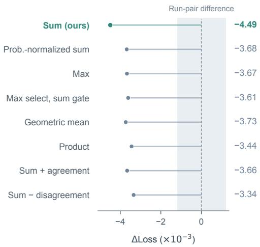  
Figure 7: Training-loss changes for router-fusion variants with $R = 2 .$ All evaluated variants improve over the single-router baseline. The shaded range shows the observed run-pair diference.

Training trajectories and aggregation operators. Figure 4 in the main text shows the training trajectories of the baseline, Multi-Router, and Multi-View through 708B tokens and their loss differences. Figure 7 compares the post-sigmoid fusion operators at the shared ablation checkpoint.

## B.5 Router-score alignment

For a layer and a sampled token set T, let $z _ { t }$ be the latent input of token t. Evaluating all $N = 2 5 6$ experts gives the normalized output-norm proxy

$$
\begin{array} { c } { q _ { t , i } = \displaystyle \| E _ { i } ( z _ { t } ) \| _ { 2 } , } \\ { \mu _ { i } = \displaystyle \frac { 1 } { | T | } \sum _ { t \in T } q _ { t , i } , \quad \quad u _ { t , i } = \displaystyle \frac { q _ { t , i } } { \mu _ { i } } . } \end{array}\tag{8}
$$

The normalization removes each expert’s average output scale. Let $s _ { t , i }$ be the score before balancing bias: the score from a single routing head for the baseline and the summed scores from all routing heads for Multi-Router. Correlation is computed over the N experts for each token:

$$
\rho _ { t } = \mathrm { C o r r } ( \mathrm { r a n k } ( s _ { t } ) , \mathrm { r a n k } ( u _ { t } ) ) .\tag{9}
$$

Token values are averaged within each microbatch to obtain $\rho _ { \ell , p , b }$ for layer ℓ, rank $p ,$ and microbatch b. With participating ranks $\mathcal { P }$ and microbatches $B _ { \ell , p } ,$ the layer and global averages are

$$
\begin{array} { r l } & { \rho _ { \ell } = \displaystyle \frac { 1 } { | \mathcal { P } | } \sum _ { p \in \mathcal { P } } \frac { 1 } { | \mathcal { B } _ { \ell , p } | } \sum _ { b \in \mathcal { B } _ { \ell , p } } \rho _ { \ell , p , b } , } \\ & { \rho _ { \mathrm { g l o b a l } } = \displaystyle \frac { 1 } { 2 4 } \sum _ { \ell = 1 } ^ { 2 4 } \rho _ { \ell } . } \end{array}\tag{10}
$$

For layer-wise summaries, we match the two diagnostic exports by logged step and average the last 201 records available in both exports. Layer-wise bands show one standard deviation over these measurements.

## B.6 Expert-input diversity and controlled mixing interventions

Evaluation protocol. All probes in this subsection use the score-derived two-view checkpoint at step 90K, the same checkpoint used in Table 1. The main evaluation contains 256 held-out sequences of 4096 input tokens, giving 1,048,320 next-token predictions; the clean checkpoint’s NLL is 2.17617 nats/token. The layer scan uses 80 sequences, giving 327,600 predictions. No model parameters are updated.

Diversity definitions. For token t, let $S _ { t }$ be its $k = 8$ selected experts. The probe uses the main method’s actual mixing proportions, $r _ { m , i } ( t ) ~ =$ $\begin{array} { r } { a _ { m , i } ( t ) = s _ { m , i } ( t ) / \sum _ { n } s _ { n , i } ( t ) , \ s _ { 0 } \sum _ { m } r _ { m , i } ( t ) = } \end{array}$ 1 and $r _ { 2 , i } ( t ) = 1 - r _ { 1 , i } ( t )$ . The actual input to expert i is

$$
\hat { v } _ { i } ( t ) = r _ { 1 , i } ( t ) v ^ { ( 1 ) } ( t ) + r _ { 2 , i } ( t ) v ^ { ( 2 ) } ( t ) .
$$

We compute

$$
D _ { r } ( t ) = \frac { 2 } { k ( k - 1 ) } \sum _ { \stackrel { i < j } { i , j \in S _ { t } } } \vert r _ { 1 , i } ( t ) - r _ { 1 , j } ( t ) \vert ,\tag{11}
$$

$$
D _ { v } ( t ) = \frac { \frac { 2 } { k ( k - 1 ) } \sum _ { i , j \in S _ { t } } \Vert \hat { v } _ { i } ( t ) - \hat { v } _ { j } ( t ) \Vert _ { 2 } } { \frac { 1 } { k } \sum _ { i \in S _ { t } } \Vert \hat { v } _ { i } ( t ) \Vert _ { 2 } } .\tag{12}
$$

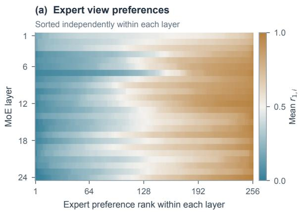

(c) Dependence on both views Downstream routing free · n = 80  
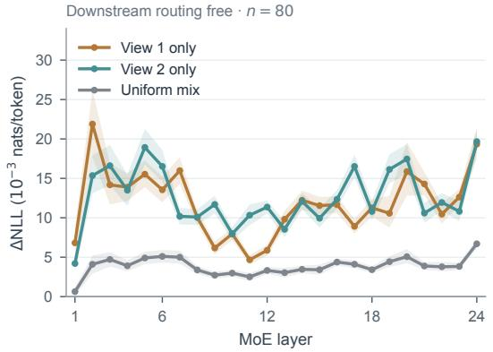

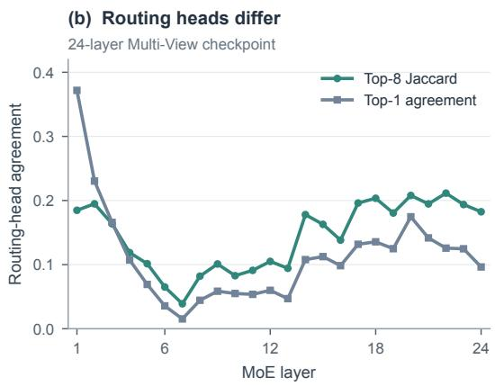

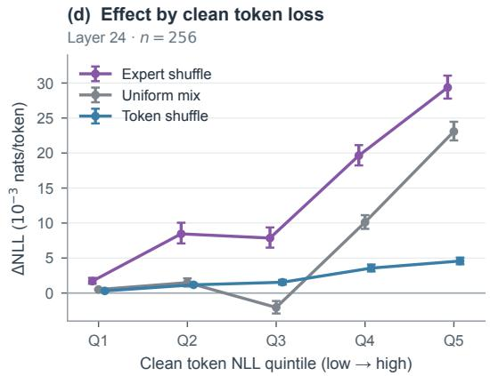  
Figure 8: Additional analyses of the 708B-token Multi-View checkpoint. (a) Mean view-1 share $r _ { 1 , i }$ by expert, with expert ranks determined independently in each layer. (b) Agreement between the two routing heads on 256 sequences. (c) Single-view interventions on 80 sequences, with downstream routing recomputed; bands are point wise 95% CIs. (d) Final-layer efects grouped by clean token-NLL quintile on 256 sequences. The x-axis indexes five groups with equal numbers of predictions; error bars show 95% intervals.

The bands in Fig. 5(a) are the 25th–75th percentiles across tokens. Mean cosine similarity between the two views ranges from 0.059 to 0.530 across layers. The median view-separation norm, divided by the mean of the two view norms, ranges from 0.969 to 1.380. The projections therefore produce distinct views at this checkpoint.

Expert preferences. Fig. 8(a) shows each expert’s mean $r _ { 1 , i }$ over tokens selecting it; experts are sorted independently within each layer. All 256 experts are observed in each layer. The within-token component accounts for 84.8–88.7% of the measured share variance, while grouping by expert ID explains 28.0–73.4%. Across layers, top-8 Jaccard between routing heads ranges from 0.039 to 0.211, and top-1 agreement ranges from 1.5% to 37.2% (Fig. 8(b)).

Interventions and uncertainty. Expert permutation shufles the view proportions among the eight selected experts of each token. Token permutation shufles them among tokens selecting the same expert; 99.96% of selected assignments are permutable. For each selected assignment, a replacement $r _ { 1 , i } ^ { \prime }$ is implemented through the dispatcher channels $( g _ { i } r _ { 1 , i } ^ { \prime } , g _ { i } ( 1 - r _ { 1 , i } ^ { \prime } ) )$ The output gate $g _ { i }$ remains attached to the original assignment and is not permuted. Uniform mixing uses $( g _ { i } / 2 , g _ { i } / 2 )$ ; the two single-view interventions use $( g _ { i } , 0 ) \mathrm { o r } \left( 0 , g _ { i } \right)$ . View projections, expert parameters, the selected expert set, and output gates at the intervened layer are retained. All reported changes use paired predictions on the same sequences. For the final-layer permutation tests, we average three permutation seeds within each sequence and bootstrap sequences to obtain 95% CIs. Table 7 reports the final-layer results. The probe reports mean absolute changes in the view-1 share of 0.408, 0.117, and 0.331 for expert permutation, token permutation, and uniform mixing, respectively.

<table><tr><td>Intervention</td><td>∆NLL</td><td>95% CI</td></tr><tr><td>Identity replay</td><td>0.0003</td><td>[−0.001, 0.002]</td></tr><tr><td>Token permutation</td><td>2.23</td><td>[2.05, 2.41]</td></tr><tr><td>Uniform mixture</td><td>6.62</td><td>[6.20, 7.09]</td></tr><tr><td>Expert permutation</td><td>13.40</td><td>[12.56, 14.35</td></tr><tr><td>View 1 only</td><td>18.81</td><td>[17.58, 20.12]</td></tr><tr><td>View 2 only</td><td>20.42</td><td>[19.32, 21.56]</td></tr></table>

Table 7: Final-layer interventions on 256 held-out sequences. All values, including CIs, are in 10−3 nats/token. Expert selection and output gates $g _ { i }$ are fixed to numerical precision; only view-mixing proportions change.

Execution and replay checks. On a 16- sequence execution-check subset, the dispatcher receives the same expert IDs across interventions; output gates difer by at most $1 . 2 \times 1 0 ^ { - 7 }$ in relative error, and the realized view proportions at the dispatcher difer from their intended values by at most $6 . 0 \times 1 0 ^ { - 8 }$ . Two clean passes agree exactly on 32 sequences. At layer 24, identity replay gives a mean NLL change of $2 . 9 5 \times 1 0 ^ { - 7 }$ nats/token, with a 95% CI spanning zero, and a mean absolute token-level diference of $1 . 1 4 \times 1 0 ^ { - 5 }$ Using replay rather than the clean pass as the paired reference leaves the reported efects unchanged at the displayed precision.

For shallower interventions, rounding-level changes can alter later top-k decisions. At layer 1, identity replay changes the final-layer expert set for 6.3% of tokens in the execution check. On the 80-sequence scan, its mean NLL change is $5 . 5 1 \times 1 0 ^ { - 6 }$ , with $9 5 \% \mathrm { C I } \left[ - 1 . 3 7 , 1 . 5 7 \right] \times 1 0 ^ { - 4 }$ nats/token. The scan estimates total efects with downstream routing recomputed. Its intervals use its own 80-sequence sample and are pointwise intervals for individual layers.

Single-view and token-group results. Both single-view interventions increase NLL at every scanned layer (Fig. 8(c)); their final-layer efects on 256 sequences appear in Table 7. Both branches contribute to prediction in this trained checkpoint. Fig. 8(d) groups predictions into equal-sized quintiles of clean token NLL, with 209,664 predictions per group. Expert permutation has its largest absolute efect in the highest-loss quintile (0.02936 versus 0.00170 in the lowest). Uniform mixing gives a middle-quintile ∆NLL of −0.00206. The largest intervention efects occur in the highestloss group.

## B.7 Aggregate and per-view expert load

Per-view load measurements show how each view’s recorded weight mass is distributed across the shared expert pool. Load balancing acts once on the aggregated assignment over the N experts (App. A.7), so diferent views may concentrate on diferent subsets while the aggregate load remains balanced. We therefore report, for each view, the coeficient of variation (CV) of its recorded weight mass across experts and an efective expert count $\exp ( H _ { m } )$ , where $H _ { m }$ is the entropy of this normalized weight mass (App. A.10). The aggregate load CV is 0.854, compared with 0.862 for the baseline, and the aggregate efective count is 188.7, compared with 187.6 out of 256. The individual views have CVs of 1.155 and 1.144 and efective counts of 149.0 and 150.2. These counts correspond to approximately 58% of the pool for each view and 74% in aggregate. This pattern occurs across MoE layers (layer 2: 218 in aggregate versus 178 and 165; layer 15: 159 versus 123 and 130). Together, the views combine concentrated expert preferences with broader aggregate expert usage.