# NEIGHBORHOOD ELITES: QUALITY-DIVERSITY SEARCH FOR UNCERTAINTY QUANTIFICATION IN QUESTION ANSWERING

Mesut Ceylan∗ 1, Arda Baris Basaran1, Elgar Fleisch1,2, Filipe Barata1

1ETH Zurich, Zurich, Switzerland

2University of St.Gallen, St.Gallen, Switzerland

{ceylanm,abasaran,efleisch,fbarata}@ethz.ch

## ABSTRACT

Large language models (LLMs) are increasingly capable, yet they produce wrong answers indistinguishable from correct ones. In question answering (QA), such an error propagates unnoticed into downstream tasks. Perturbation-based uncertainty quantification (UQ) addresses this by probing a model over a set of input rewrites and reading uncertainty from how much its predictions vary. Yet this set is usually built generically, by free paraphrasing, token-level perturbation, or adversarial search. Such rewrites leave two things uncontrolled that matter in QA: what kind of change is made to the context, and how explicitly the context supports the answer. When neither is controlled, the composition of the set is determined by the generator rather than by design, and the estimate inherits whatever that generator happens to produce. Quality-diversity (QD) search is built to cover a predefined exploration space, so we recast input perturbation as a QD problem and propose neighborhood elites (NE), a neighborhood constructor that spreads answer-preserving rewrites across two axes, the kind of edit and the explicitness of support. We compare NE against three other neighborhood constructors, holding the editor, QA model, uncertainty measure and search objective fixed, and against three scores read from the original context. Across five extractive-QA datasets and five instruction-tuned LLMs, NE improves failure detection against every other constructor in at least 24 of the 25 dataset-model pairs, reaching 0.726 AUROC and 0.211 AUPRC lift over the base rate. Additionally, NE detects failure better than semantic entropy computed over decoder samples, by 0.074 AUROC and 0.062 AUPRC lift, and this advantage widens as the neighborhood grows.

## 1 INTRODUCTION

Large language models (LLMs) have demonstrated strong capabilities in natural language understanding and generation (OpenAI, 2023), question answering and multi-step reasoning (Wei et al., 2022), and program synthesis (Chen et al., 2021; Li et al., 2023). Beyond single prompts, they increasingly act as the reasoning engine of larger systems, from retrieval-augmented generation (RAG) that grounds answers in external corpora (Lewis et al., 2020; Asai et al., 2023) to agentic workflows that plan and call external tools to perform tasks (Yao et al., 2023). In such pipelines, a single wrong answer can propagate through later steps (Zhang et al., 2024), so the usefulness of an LLM depends not only on producing an answer, but also on signaling whether that answer can be trusted.

LLMs hallucinate, presenting fabricated facts with the same assurance they provide to correct answers (Maynez et al., 2020; Ji et al., 2022). They tend to agree with the user rather than correct a mistaken assumption (Sharma et al., 2024), and rarely express doubt or admit when they do not know (Yin et al., 2023). Asking the model how confident it is, is not helpful, as its stated confidence is poorly aligned with its actual accuracy (Xiong et al., 2024). This motivates uncertainty quantification (UQ): estimating how much to trust an answer without relying on the model’s own account of it (Malinin & Gales, 2021; Kuhn et al., 2023; Lin et al., 2024).

UQ methods can be categorized by the signal used to quantify uncertainty. One family relies on the predictive probabilities assigned by the model (Malinin & Gales, 2021), while another measures the variability between multiple predictions. The latter requires only model outputs and is therefore applicable in black-box settings. These approaches differ mainly in the way the predictions are produced. Sampling-based methods sample the model several times on a fixed input (Manakul et al., 2023; Farquhar et al., 2024). Perturbation-based methods instead vary the input, rewriting the prompt in ways that should not change the answer (Gao et al., 2024; Song et al., 2025). In either way, the predictions are compared by meaning rather than surface form, which is what semantic entropy measures (Kuhn et al., 2023).

In the text setting, a perturbation-based estimate is only as informative as the input variants it compares. QD algorithms (Mouret & Clune, 2015; Pugh et al., 2016), coupled with LLMs, can orchestrate the search and assembly of such a set of input variants. The LLM carries out the variations, while quality-diversity steers the search, keeping the best candidate found in each cell it explores, so the set spans many strong candidates rather than a single best one. This pairing has proven use ful across domains, generating diverse code (Lehman et al., 2022), creative writing (Bradley et al., 2024), and adversarial prompts (Samvelyan et al., 2024). It is therefore a natural engine for building a set of input variants that vary systematically across a chosen feature space.

However, existing perturbation-based UQ builds this set generically, by model-generated paraphrases of the question and inserted tokens (Gao et al., 2024), or by searching over word substitutions (Song et al., 2025). A key limitation of these methods is that their rules apply to each rewrite on its own, rather than to the set as a whole. A rewrite is described by the operation applied and by how far it moved from the original, and not by its relation to the answer, though a rephrased question can ask for the same answer more or less directly. The composition of the set is therefore determined largely by the generator, rather than by design.

In extractive QA, a perturbation set has to control two dimensions: how the context is modified and how explicitly the rewrite still supports the answer. The answer is inside of the rewritten input, so a rewrite changes its support whether or not anything records the change. Two contexts can preserve the same answer while differing substantially in how directly they support it: a rewrite may keep the answer in place but reach its support through a referring expression or spread that support across several sentences. The answer has not changed, but recovering it now places greater demands on the model.

To this end, we propose a new perturbation-based UQ method built on a QD search that systematically constructs a variation set across a predefined descriptor space. We refer to this set as the neighborhood of the input. We hypothesize that uncertainty estimated over such structured neighborhoods contains a richer uncertainty signal for detecting model failures than uncertainty derived from less structured variations or repeated sampling of the original input. Since the context passage already contains the answer, the neighborhood consists of whole-passage rewrites leaving that answer unchanged. The search steers the generator toward specified combinations of edit type and answer support, targeting one cell after another rather than accepting whatever it produces. We show that neighborhoods built this way detect failure better than those from free paraphrasing and two alternative constructors. This advantage also holds over repeated decoder sampling on the original context when using the same uncertainty measure. Our contributions are as follows.

• Problem formulation. We propose the notion of an input neighborhood for extractive QA and formulate its construction as a coverage problem over a space with two axes: three kinds of edit and four levels of answer support. A rewrite’s coordinates are fixed by deterministic rules rather than by a model judging its own output. To our knowledge, this is the first perturbation set for UQ built by QD search to cover a space declared in advance.

• Method. We introduce neighborhood elites (NE), an LLM-guided QD search that steers an editor toward the empty cells of a descriptor space spanned by edit type and answer support, and admits a rewrite only when a deterministic check confirms the requested edit was realized. Its rewrites compound along a lineage, each inheriting an already-edited context and applying one further answer-preserving edit, so the neighborhood reaches contexts that no single edit of the original could produce.

• Empirical evaluation. We show across five extractive-QA datasets and five instruction-tuned LLMs that NE improves failure detection over every other constructor in at least 24 of the 25 dataset–model pairs, reaching 0.726 AUROC and 0.211 AUPRC lift over the base rate. It exceeds semantic entropy over decoder samples by 0.074 AUROC and 0.062 AUPRC lift, at the same measure, predictions and instances. Its neighborhoods span roughly twice as many kinds of rewrite as the nearest constructor. NE gains 0.100 AUROC as its neighborhood grows from three rewrites to seven while decoder sampling gains 0.030 from the same number of samples.

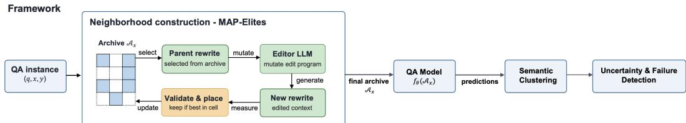  
Figure 1: A MAP-Elites search builds a per-instance archive of answer-preserving context rewrites spread over the descriptor space D (Section 2.2). The frozen QA model $f _ { \theta }$ is queried on K of them, and the semantic entropy of its answers is the uncertainty signal (Section 2.3).

## 2 METHOD

## 2.1 PROBING A QA MODEL BY PERTURBING ITS CONTEXT

Given an instance $( q , x , y )$ , question, context, and gold answer along with a fixed QA model $f _ { \theta }$ , we build a set of alternative contexts that are rewritten yet still contain the answer, query $f _ { \theta }$ on each, and treat disagreement among its answers as an uncertainty signal (Figure 1). Because every rewrite preserves the answer, disagreement among the predictions reflects the model rather than a change in what is being asked.

A neighborhood of answer-preserving context. We are inspired by the local-distribution view of vicinal risk minimization (VRM) (Chapelle et al., 2001), which replaces each training point with a distribution over nearby examples and applies it at inference on a frozen QA model. We associate each context x with a neighborhood $\nu _ { x }$ , a distribution over answer-preserving rewrites x˜ of $x _ { \ast }$ . We never train on $\nu _ { x }$ and never sample it in closed form, but construct it from a finite archive produced by a QD search.

Membership, locality, and coverage. Three considerations shape $\nu _ { x }$ . First, membership is decided by answer preservation alone: x˜ belongs to $\nu _ { x }$ only if $y$ remains recoverable from it. Among qualifying rewrites, $\nu _ { x }$ places more mass on those semantically close to x, so the neighborhood stays local rather than an arbitrary collection of answer-containing contexts. Second, spanning qualitatively different ways of presenting the same answer is not a membership condition but the goal of the search, and we make it concrete through a $3 \times 4$ descriptor space $\mathcal { D } .$ . Its rewrite-type axis ${ \mathcal T } = \{ \mathrm { d i s t r a c t o r } .$ , reorder, style rewrite} names the kind of edit applied, and its support-explicitness axis $\dot { \boldsymbol { S } } = \{ \mathrm { d i r e c t } $ , paraphrastic, discourse-mediated, multi-sentence} records how explicitly the rewritten context states the answer, from a single verbatim supporting sentence to support dispersed across several sentences. Third, covering D is how the search explores the neighborhood broadly rather than resampling one cell of it. The deterministic rule assigning a rewrite to its supportexplicitness cell is in Appendix C.2.2.

The archive as a finite coverage of the neighborhood. Because $\nu _ { x }$ is only defined implicitly, we represent it per instance by a finite archive $\mathbf { \bar { \mathcal { A } } } _ { x } = \{ \tilde { x } _ { 1 } , \dots , \tilde { x } _ { N } \}$ of validated rewrites that spreads across the cells of D. The archive is a coverage of the neighborhood rather than a sample from a known distribution. Its representation comes from occupying many distinct cells of D, not from reproducing any generative frequency. Figure 2 shows one archive, three of its rewrites and the cells they occupy.

## 2.2 CONSTRUCTING THE NEIGHBORHOOD WITH TARGETED MAP-ELITES

We construct the archive $\mathcal { A } _ { x }$ with neighborhood elites (NE), an LLM-guided QD search that separates linguistic variation from archive organization: an editor LLM produces candidate answerpreserving rewrites of x, and MAP-Elites structures their exploration and decides which are kept. The rest of this section specifies NE.

MAP-Elites and the archive. By design, MAP-Elites maintains many high-performing rewrites rather than converging to a single best one (Mouret & Clune, 2015). We partition the archive into the cells of D, each a distinct realized mode of context variation, and every occupied cell keeps its highest-scoring valid rewrite. Coverage is a property of the archive rather than a term in the search objective.

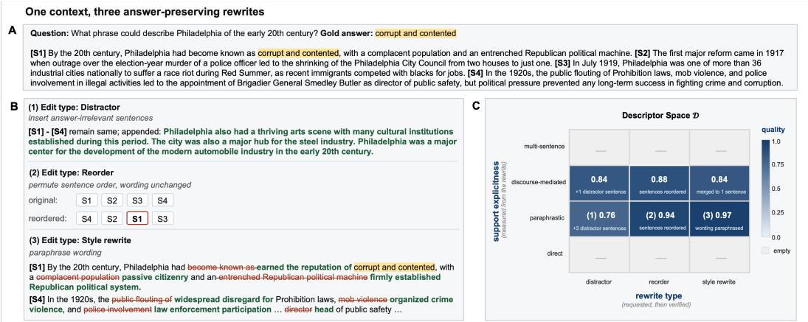  
Figure 2: A SQuAD v1.1 instance: question, gold answer (highlighted), context [S1]–[S4]. B three rewrites, distractor (1), reorder (2) and style rewrite (3), each preserving the gold answer (red deleted, green inserted). C the instance archive over D, one elite per cell, shaded by search objective value (darker higher, grey empty). Edits (1)–(3) are the marked paraphrastic-support cells; 6/12 cells are filled.

Editor LLM and edit programs. The editor LLM is the core component that turns a structured edit request into a natural-language rewrite. Given the question q, the context x, the fixed answer specification, and an edit program (a request for a particular kind of change), editor LLM returns a rewrite that makes that change while keeping the answer to q recoverable. Our edit programs follow the tradition of behavioral and robustness testing for NLP, in which meaning-preserving transformations probe a model’s stability (Ribeiro et al., 2020; Gui et al., 2021). Several of these edits mirror standard operations from this line, such as syntax changes, discourse organization, the placement of the answer’s support, and the surrounding context. We provide the prompt templates that instantiate each edit type, together with their strategy variants in Appendix G.

Evolutionary search with hard inheritance. The QD search begins by applying edit programs directly to x and filling the archive with one rewrite at a time, which seeds the initial cells. Each later step either selects an archived rewrite as a parent or targets an empty cell to widen coverage. It then mutates the edit program and asks the editor to apply it. When a parent rewrite is used, the editor edits that parent rather than x, so edits accumulate over a lineage, and the search reaches rewrites that no single edit of x could produce. Because empty cells are targeted before occupied ones are refined, the archive first spreads across D and only then improves the rewrites it already holds.

Throughout a lineage, we keep the question q, gold answer set, and the original context x fixed for answer preservation, and allow only the current parent to be edited, yielding an offspring. An offspring must therefore be a genuine change to its parent yet still keep the original answer recoverable. This limits semantic drift without preventing multi-step change. Appendix 1 gives the algorithm and Appendix C.6 the scheduling and budget. The constructors we compare against are defined in Section 3.

Archive admission and update. Admission to the archive separates the feasibility of a rewrite from its value under the search objective. Every candidate must clear three deterministic gates before it is scored or placed in archive. The rewrite must first pass the deterministic answer-preservation gate (see Appendix C.4.1). Failed rewrites are discarded from the search. A second gate checks that the rewrite realizes the requested edit type. This gate is a deterministic, rule-based check, and it is independent of the editor. The requested type is taken from the edit program, and the guard compares the output rewrite against the context from which it is edited (the original x for seeds, the parent for offspring). The third check rejects a candidate that is identical to a rewrite already in the archive, so each retained rewrite is distinct.

Concretely, each edit type has a structural signature the guard verifies: a distractor must keep every reference sentence intact as an ordered subsequence while adding at least one sentence; a reorder must keep the same sentences and change only their order; and a style rewrite must change the wording without reducing to a pure reordering or a pure insertion (exact conditions in Appendix C.4.2). A rewrite that fails the rule for its requested edit type is rejected.

Two coordinates then place a surviving rewrite in $\mathcal { D } \colon$ the requested edit type gives its rewrite-type cell, and the produced text is measured to give its support-explicitness cell. Because a rewrite failing its type check is rejected, the rewrite-type axis records the edit actually applied rather than the one requested.

Cell competition and the search objective. Placement of a rewrite in the descriptor space does not guarantee survival. Each cell keeps only a single best rewrite, so the rewrites that land in a cell compete for it. The competition is decided by the search objective, a normalized weighted mean of three terms: semantic closeness to $x ,$ surface edit-magnitude from $x ,$ and fluency (Appendix C.5). A new rewrite takes an empty cell, or replaces the current occupant only if its search objective value is strictly higher. In MAP-Elites terms, this is the fitness function, which ranks the solutions competing for the same cell. We call this term the search objective throughout. Answer preservation is not one of these terms; it is the hard gate that every scored rewrite has already cleared, so it governs admission but not ranking.

## 2.3 FROM NEIGHBORHOOD DISAGREEMENT TO AN UNCERTAINTY SCORE

After search ends, the archive $\mathcal { A } _ { x }$ turns into an uncertainty signal in one step. We query $f _ { \theta }$ once on each rewrite x˜ kept in $A _ { x } ,$ and save its prediction. The uncertainty score reads only the neighborhood. We group the predictions into semantic-equivalence classes and take the dispersion of that class distribution as the per-instance score u(x), so that predictions concentrated in one class indicate confidence and predictions spread across several indicate uncertainty.

We use the discrete form of semantic entropy (Kuhn et al., 2023; Farquhar et al., 2024), which takes the class distribution from the proportion of predictions in each class rather than from their likelihoods, so the score separates surface variation from disagreement in meaning without access to model probabilities. Because u depends only on the multiset of predictions, it sees neither the gold answer nor which constructor built the neighborhood, so any difference in failure detection is attributable to the neighborhood rather than to the measure read from it.

## 3 EXPERIMENTAL SETUP

Editor and QA LLMs. We use a fixed Qwen3-8B model as the editor for all neighborhood constructors. We evaluate the constructed neighborhoods using five frozen instruction-following LLMs from distinct model families within a comparable parameter regime: Gemma3-12B, OLMo2-13B-Instruct, Phi4-14B, Mistral-Nemo-12B, and Falcon3-10B-Instruct. We use all models for inference only, and inference settings are held fixed across experiments.

Datasets. We evaluate five extractive QA benchmarks: SQuAD v1.1 (Rajpurkar et al., 2016), Quoref (Dasigi et al., 2019), NewsQA (Trischler et al., 2017), the Natural Questions partition of MRQA (Fisch et al., 2019; Kwiatkowski et al., 2019), and AdversarialQA (Bartolo et al., 2020). We randomly sample 1000 examples per dataset, shared by all constructors, and normalize each dataset’s reference answers, which may be multiple, into a uniform answer specification used for answer-preserving validation. Dataset statistics are in Appendix H.

Neighborhood constructors. The three comparators share NE’s editor and answer-preservation gate and differ in what they leave out: free paraphrasing has no archive, bucket sampling verifies its edits without evolving them, and the untargeted search evolves them without verifying. Neither of the last two is a single-factor ablation, but between them they bracket the mechanisms NE combines.

1. Free-form paraphrasing (FP). FP generates independent answer-preserving rewrites directly from the original context x. We denote the resulting paraphrases by $\tilde { x } _ { 1 } , \tilde { x } _ { 2 } , \dots , \tilde { x } _ { N }$ , giving the generation pattern $x \to \tilde { x } _ { 1 } , x \to \tilde { x } _ { 2 } , . . . , x \to \tilde { x } _ { N }$ . Each $\tilde { x } _ { i }$ is produced independently from x with the same editor LLM, without a descriptor space, parent–offspring lineage, or evolutionary search. This constructor tests whether conventional free-form reformulation alone provides sufficient predictive variation for uncertainty estimation.

2. Untargeted MAP-Elites (U-ME). U-ME adds parent–offspring generation and descriptor cellbased selection, following $x \to P \to O$ , where x is the original context, $P$ is an archived rewrite selected as the parent, and O is the generated offspring. The parent $P$ guides the generation of O, but inheritance is not enforced, so the offspring may only weakly reflect the parent transformation or may ignore P entirely. Candidate rewrites are validated, assigned to cells, and retained through competition on the search objective.

3. Static bucket sampling (SBS). SBS keeps the archive but removes the search. It issues a fixed budget of independent proposals from the original context x, cycling the three rewrite types in turn under a single prompt strategy, so the generation pattern is $x  \tilde { x } _ { 1 } , \ x  \tilde { x } _ { 2 } , \ . . .$ with no parent and no lineage. Each candidate clears the same gates as NE, including the realization check, and is then placed in the cell given by its rewrite type and its measured support, where it competes on the search objective exactly as in the two MAP-Elites constructors. Placement is therefore decided after generation rather than aimed at. This constructor isolates the evolutionary component of the proposed constructor: it asks whether the archive and its gates alone recover the coverage that lineage and cell targeting produce.

Original-context metrics. We additionally report three scores that measures uncertainty from the original context, and never the correctness of its prediction. NLL is the negative log-likelihood of the QA model’s own greedy answer on x, normalised by answer-token count (Malinin & Gales, 2021). It is one score per instance. Predictive entropy (PE) is the mean of the length-normalised negative log-likelihoods of answers sampled on x, the length-normalised predictive entropy of Malinin & Gales (2021) as used by Kuhn et al. (2023). Decoder semantic entropy (DSE) applies the same discrete semantic entropy we read from a neighborhood, over the same clustering, to decoder samples of x rather than to rewrites of it (Farquhar et al., 2024). For each instance, it draws as many samples as NE’s archive holds rewrites, so against NE the measure, the number of predictions per instance and the instances are all held fixed, and the only difference is whether the variation comes from resampling the decoder or from rewriting the context. Samples are drawn at temperature 0.7 and top-p 0.95, since greedy decoding on a fixed context returns the same answer every time and an entropy of zero.

Grouping answers by meaning. The uncertainty measure requires grouping the predictions by meaning rather than by surface string. We use a frozen natural-language-inference (NLI) model, DeBERTa-v3-base-mnli-fever-anli, and place two answers in the same semanticequivalence class when each entails the other (bidirectional entailment), following the standard construction for semantic entropy (Kuhn et al., 2023). Semantic entropy measures disagreement over answer meanings rather than surface forms. With $p _ { c }$ the fraction of $\dot { K }$ predictions in semantic class c, the discrete semantic entropy is $\begin{array} { r } { H _ { \mathrm { s e m } } = - \sum _ { c } \bar { p } _ { c } \ln { p _ { c } } } \end{array}$

Evaluation metrics. We evaluate each uncertainty score by failure detection, measured by AU-ROC and AUPRC. A reliable score is higher on failures than on correct predictions, so we take an incorrect original-context prediction as the positive class, paired with that instance’s uncertainty score, following established LLM uncertainty and hallucination-detection evaluations (Kuhn et al., 2023; Farquhar et al., 2024; Xiong et al., 2024; Manakul et al., 2023). AUROC measures how well the score ranks failures above correct predictions. AUPRC additionally depends on the failure rate, which differs across methods with their scoring pools, so we report it as $l i f t$ , the AUPRC minus the base rate (the share of instances in the pools whose original-context prediction is incorrect).

## 4 RESULTS

How the neighborhood is built moves detection more than which score is read from it. NE reaches 0.726 AUROC and 0.211 AUPRC lift on the 25-pair macro, ahead of every other method (Table 1). The untargeted search (U-ME) is the nearest constructor, by 0.062 AUROC and 0.060 AUPRC lift. Across the four constructors, which share the same uncertainty measure, detection runs from 0.621 to 0.726. Across the three scores read from the original context it runs from 0.652 to 0.676, less than a quarter as wide, and on AUPRC lift the two spans are 0.113 to 0.211 against 0.130 to 0.149. Section 4 reports where the lead does not hold pair by pair.

NE leads 74 of 75 constructor and 57 of 75 original-context comparisons. Figure 3 plots each of the six differences for all 25 pairs. NE leads SBS and FP in 25 of 25 pairs on both measures, and and U-ME in 24 of 25, trailing by 0.004 AUROC and 0.016 AUPRC lift on Natural Questions with OLMo2-13B. Median differences across these three rows run from +0.063 to +0.109 AUROC. Against the original-context scores, the AUROC counts are 18 of 25 for PE and the NLL, and 21 for Decoder SE, and on AUPRC lift 21, 22, and 19. Of the 150 comparisons, 19 are negative on AUROC, eleven on Natural Questions, six on NewsQA and two on SQuAD v1.1, and all 14 negative AUPRC differences fall on Natural Questions and NewsQA (Table 9 and Table 10). NE trails furthest against the NLL and predictive entropy, by 0.089 and 0.088, both on Natural Questions with OLMo2-13B.

Table 1: Failure detection, macro-averaged over 25 dataset–model pairs. Upper block: construction varies, measure fixed. Lower block: scores read from the original context. A method is scored where it has at least two predictions, the smallest count at which semantic entropy is defined, so n differs by method, and the NLL needs only the greedy answer. AUPRC is lift over the base rate (0.315–0.361). ∆ is the difference from NE on shared instances, with 95% intervals from 2000 bootstrap replicates resampled within each pair.
<table><tr><td rowspan="2">Method</td><td rowspan="2">n</td><td colspan="3">AUROC</td><td colspan="3">AUPRC lift</td></tr><tr><td>Value</td><td></td><td>∆</td><td>Value</td><td></td><td>∆</td></tr><tr><td colspan="7">Neighborhood constructed</td></tr><tr><td>NE</td><td>21,916</td><td>0.726</td><td></td><td></td><td>0.211</td><td></td></tr><tr><td>U-ME</td><td>23,911</td><td>0.661</td><td></td><td>+0.062 [+0.053, +0.070]</td><td>0.148</td><td>+0.060 [+0.048, +0.071]</td></tr><tr><td>SBS</td><td>16,288</td><td>0.642</td><td></td><td>+0.096 [+0.085, +0.106]</td><td>0.122</td><td>+0.101 [+0.090, +0.116]</td></tr><tr><td>FP</td><td>17,862</td><td>0.621</td><td></td><td>+0.114 [+0.105, +0.123]</td><td>0.113</td><td>+0.110 [+0.097, +0.123]</td></tr><tr><td colspan="7">Original context</td></tr><tr><td>PE</td><td>21,916</td><td>0.676</td><td>+0.050 [+0.041, +0.059]</td><td></td><td>0.131</td><td>+0.080 [+0.068, +0.091]</td></tr><tr><td>NLL</td><td>24,975</td><td>0.674</td><td>+0.053 [+0.045, +0.063]</td><td></td><td>0.130</td><td>+0.084 [+0.071, +0.095]</td></tr><tr><td>DSE</td><td>21,916</td><td>0.652</td><td>+0.074 [+0.066, +0.082]</td><td></td><td>0.149</td><td>+0.062 [+0.052, +0.074]</td></tr></table>

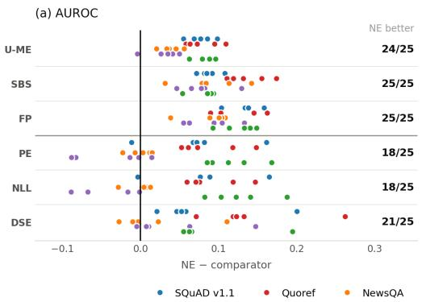

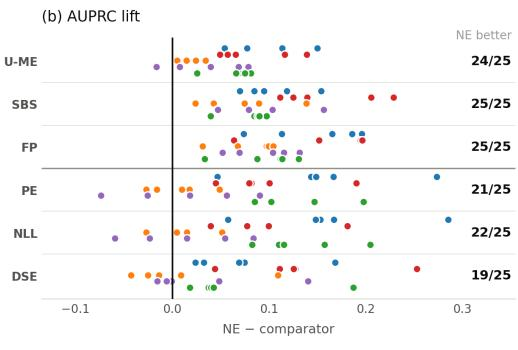  
Figure 3: Per-pair differences, NE minus each comparator on the instances they share, in AUROC (a) and AUPRC lift (b). Each point is one of the 25 dataset–model pairs, with colour and vertical offset both encoding the dataset. The upper three rows are neighborhood constructors, the lower three are scores read from the original context. Points right of zero favour NE, and the count beside each row gives how many of the 25 do. Table 9 and Table 10 in Appendix B.2 list all 150 values.

NE occupies 4.43 of the twelve cells per neighborhood, roughly twice the nearest comparator, while keeping a comparable number of rewrites. Table 2 reports how much of D a single neighborhood occupies. On the macro over five datasets NE reaches 4.43 cells, against 2.33 for U-ME, 2.00 for SBS and 0.98 for FP, while keeping 4.43 rewrites per instance against U-ME’s 5.90. The two figures coincide because NE, like SBS, places exactly 1.00 rewrite in each cell it occupies, while U-ME places 2.53 and FP places 3.77. NE reaches four or more cells on 0.658 of instances, against 0.143 for U-ME, 0.110 for SBS and 0.001 for FP, with a standard deviation of 2.15 cells, about twice that of any comparator. Every constructor occupies fewer cells on Natural Questions and NewsQA than on the other three: NE falls from 5.69 on AdversarialQA and 5.40 on SQuAD v1.1 to 3.33 and 3.07, and SBS from 2.87 on both to 1.17 and 1.27 (Appendix B.3, Table 12).

Table 2: What a single neighborhood covers of the descriptor space D, the grid of twelve cells spanned by edit type and answer support. The first row is the mean number of distinct cells a neighborhood occupies, with the standard deviation in brackets. The lower block pools all 5000 instances. Per-dataset values are in Appendix B.3, Table 12.
<table><tr><td></td><td>FP</td><td>SBS</td><td>U-ME</td><td>NE</td></tr><tr><td>Cells occupied, of twelve</td><td>0.98 (0.66)</td><td>2.00 (1.01)</td><td>2.33 (1.07)</td><td>4.43 (2.15)</td></tr><tr><td>Rewrites kept</td><td>18439</td><td>10024</td><td>29506</td><td>22163</td></tr><tr><td>Rewrites per instance</td><td>3.69</td><td>2.01</td><td>5.90</td><td>4.43</td></tr><tr><td>Rewrites per occupied cell</td><td>3.77</td><td>1.00</td><td>2.53</td><td>1.00</td></tr><tr><td>Instances reaching ≥ 4 cells</td><td>0.001</td><td>0.110</td><td>0.143</td><td>0.658</td></tr></table>

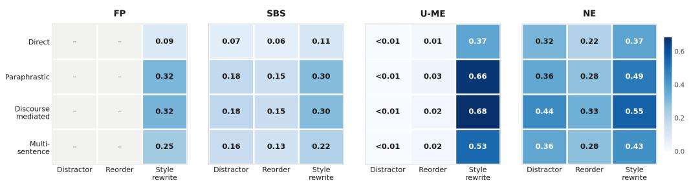  
Figure 4: For each cell, the fraction of the 5000 instances whose neighborhood places at least one rewrite in that cell. The twelve cells of a panel therefore sum to that constructor’s entry in Table 2. A grey cell marked with a dash was never reached, and < 0.01 marks a cell reached by fewer than one instance in a hundred. Rewrite totals by column are in Appendix B.3, Table 11.

NE and SBS reach every cell of D, while U-ME and FP fill the style-rewrite column almost exclusively. Figure 4 reports, for each cell, the share of the 5000 instances whose neighborhood places at least one rewrite there. NE’s largest cell is style rewriting with discourse-mediated support, at 2749 instances (0.55), and its smallest is reordering with direct support, at 1086 (0.22). SBS reaches every cell at lower levels, from 1484 (0.30) down to 300 (0.06). U-ME exceeds NE in the style-rewrite column, with 3411 instances (0.68) in its largest cell, but reaches only 8 (< 0.01) in the corresponding distractor cell, having realized the requested edit in 0.27 of its retained rewrites (Appendix B.3, Table 11), 24 distractors and 430 reorderings among the 23707 whose type resolved. FP reaches the style-rewrite column only, from 470 (0.09) to 1605 (0.32), with no distractor and no reordering among 18439 rewrites, which is what its editor prompt permits. Style rewriting is the most reached edit type for all four constructors, reordering the least for NE and SBS, and distractors the least for U-ME. Direct support is the least reached level in every panel. Per-dataset values are in Appendix B, Figure 5.

NE leads at every neighborhood size, and by more as K grows. Table 3 demonstrates that at K=5, NE reaches 0.765 AUROC and 0.282 AUPRC lift, ahead of U-ME by 0.082 and FP by 0.139, where at K=3 those gaps are 0.068 and 0.098. It leads both other constructors in all 25 dataset– model pairs on AUROC up to K=5, and in at least 23 at every K (Appendix B.2, Table 9). The original-context scores do not move with K: predictive entropy runs from 0.677 to 0.686 across the sweep and the NLL from 0.672 to 0.684.

## 5 DISCUSSION AND CONCLUSION

Principal findings. Our results confirm the hypothesis in both of its parts. Uncertainty measured over a structured neighborhood detects failure better than uncertainty from less structured rewrites, and better than uncertainty from decoder sampling of the original context. Neighborhoods that occupy many cells probe the model along several different kinds of rewrite, and each one is a further chance for its prediction to move, so disagreement accumulates. Holding every constructor on the same instances and matching predictions, and raising the number of neighborhood size K from three to seven, widens the gaps: NE gains 0.100 AUROC across the sweep against 0.047 for FP and 0.030 for decoder sampling (Table 3). A neighborhood confined to one kind of rewrite asks the same question repeatedly, which is why FP, at 0.98 cells, detects failure below NLL. Volume does not compensate for narrow coverage, since U-ME keeps more rewrites per instance than NE (5.90 vs. 4.43), covers half as many cells, and scores lower. Against decoder sampling, the comparison is tighter. Resampling needs the decoder made stochastic before it produces any signal, at temperature 0.7, while NE’s disagreement appears under greedy decoding. NE leads it by 0.074 AUROC and 0.062 AUPRC lift, so a model’s own output distribution on a fixed context carries less signal about failure than the neighborhood of NE around that context. The lead narrows on Natural Questions and NewsQA, the two datasets where every constructor covers the least (Appendix B.3, Figure 5).

Table 3: Failure detection as neighborhood size K increases, on the matched instance pool for each K (evaluation method described in Appendix B.1). SBS cannot supply K rewrites and is omitted.
<table><tr><td></td><td colspan="2"> $K { = } 3$ </td><td colspan="2"> $K { = } 4$ </td><td colspan="2"> $K { = } 5$ </td><td colspan="2"> $K { = } 6$ </td><td colspan="2"> $K { = } 7$ </td></tr><tr><td>Method AUROC AUPRC AUROC AUPRC AUROC AUPRC AUROC AUPRC AUROC AUPRC</td><td></td><td></td><td></td><td></td><td></td><td></td><td></td><td></td><td></td><td></td></tr><tr><td>NE U-ME FP</td><td>0.705 0.637 0.607</td><td>0.215 0.150 0.130</td><td>0.746 0.667 0.622</td><td>0.262 0.184 0.150</td><td>0.765 0.683 0.626</td><td>0.282 0.206 0.151</td><td>0.780 0.685 0.633</td><td>0.301 0.212 0.155</td><td>0.805 0.713 0.654</td><td>0.329 0.252 0.202</td></tr></table>

Practical implications. Resampling the predictions from the QA model reads only what the model does with a single context, which limits what it can reveal. Varying the context draws on a different source of variation, and in our comparison it goes further. Under the same uncertainty measure and sample count, NE detects failure better than over decoder samples. Extracting a richer uncertainty signal from a QD search is mostly a matter of supervising the editor. An editor asked to paraphrase produces one kind of change, so the edit to perform and the cell it should reach have to be stated in the prompt. The rewrite that it returns does not guaranty that the requested edit is applied because the editor repeats itself and does not reliably perform the edit it was asked for. Without a check, 0.17 of retained rewrites are duplicates, and only 0.27 realize the requested type. Neither failure is visible to the search unless a deterministic rule catches it, so these are gates rather than preferences. Without them, the descriptor axis records a request rather than a behavior. Empty cells in the defined descriptor space must also be targeted, since an editor asked for more of the same returns to cells the archive already holds. Detection improves from the 8B editor to the 14B and does not progress beyond that, even as the archives continue to grow, so a larger editor does not result in further gains. Detection keeps improving as the neighborhood grows, so the useful size is determined by the supply of rewrites.

Comparison with prior work. What distinguishes this work from prior perturbation-based UQ is not that we vary the input, but that we decide in advance what the variation should span. Samplingbased methods vary the decoder and hold the input fixed (Kuhn et al., 2023; Wang et al., 2023). Rewrite-based methods vary the question or prompt through free paraphrasing (Elazar et al., 2021), token-level edits with temperature sampling (Gao et al., 2024), or search over token-level mutations (Song et al., 2025), but none of them lays out a descriptor space that neighborhoods are required to cover edit types and answer support axes. Therefore, the neighborhood is whatever the generator happened to produce, and FP shows the consequence. Among any three rewrites of the same passage, its edit magnitude is narrow, spanning 0.06 against 0.31 for NE (Appendix B.6, Figure 7), so its probes of a single instance are close to repetitions of one another. QD search has been used to find inputs that break a model (Samvelyan et al., 2024). We use it to find answer-invariant rewrites instead.

Limitations. A few choices set the scope of what these results show. The axes of the descriptor space took shape through earlier experiments, and it is a design choice rather than a global optimality. Twelve cells may not provide enough resolution for exploring the neighborhood space. Both axes are assigned by rule rather than by a person: the edit type by a deterministic structural check and the support level by a heuristic. Although neither rule is validated against human judgment, both are reproducible, keeping the models out of the decision and applied to the text itself, so realized records what a rewrite does rather than what the editor says it did. The four constructors differ in more than one respect each, so we do not attribute the improvement to any single mechanism. NE also runs ten prompt strategies against two for the untargeted search and one each for the other two constructors, a registry that cell targeting entails rather than an advantage beside it. We provide further limitations in Appendix I.

## REPRODUCIBILITY STATEMENT

Everything needed to reproduce the results is specified in the appendix. The four neighborhood constructors are given as pseudocode over a shared set of operators in Appendix C.1, with the deterministic admission gates in Appendix C.4, the rule that assigns a rewrite to a descriptor cell in Appendix C.2, the search objective that decides cell competition in Appendix C.5, and the per-constructor schedulers in Appendix C.6. The editor prompts are reproduced verbatim in Appendix G, including the system prompt, the per-type operation strings and the ten prompt strategies. Every fixed value is collected in the configuration table of Appendix F and held constant across all datasets and QA models: the random seed, the editor and its decoding parameters, the objec tive weights, the semantic-closeness encoder, the per-example budgets and the evaluation settings. Dataset preparation and the answer specification format are described in Appendix H, prediction scoring and semantic clustering in Appendix D, and the correctness cascade, failure labels and bootstrap procedure in Appendix E. One limit is stated in Appendix I: the editor samples without a fixed per-call seed, so generations are not bit-for-bit reproducible. We therefore treat each run’s archive as a fixed artifact and compute every reported number on it.

## AI USE STATEMENT

Generative AI tools were used to assist with language/manuscript editing, research-code implementation and verification. The authors independently reviewed and verified all AI-assisted content, executed the reported experiments, and take full responsibility for the final manuscript and its claims.

## REFERENCES

Akari Asai, Zeqiu Wu, Yizhong Wang, Avirup Sil, and Hannaneh Hajishirzi. Self-rag: Learning to retrieve, generate, and critique through self-reflection, 2023. URL https://arxiv.org/ abs/2310.11511.

Max Bartolo, Alastair Roberts, Johannes Welbl, Sebastian Riedel, and Pontus Stenetorp. Beat the AI: Investigating adversarial human annotation for reading comprehension. Transactions of the Association for Computational Linguistics, 8:662–678, 2020. doi: 10.1162/tacl a 00338. URL https://aclanthology.org/2020.tacl-1.43/.

Herbie Bradley, Andrew Dai, Hannah Teufel, Jenny Zhang, Koen Oostermeijer, Marco Bellagente, Jeff Clune, Kenneth Stanley, Gregory Schott, and Joel Lehman. Quality-diversity through AI´ feedback. In International Conference on Learning Representations (ICLR), 2024.

Olivier Chapelle, Jason Weston, Leon Bottou, and Vladimir Vapnik. Vicinal risk minimization. In´ Advances in Neural Information Processing Systems 13 (NIPS 2000), pp. 571–577. MIT Press, Denver, 2001. URL http://leon.bottou.org/papers/chapelle-2000.

Mark Chen, Jerry Tworek, Heewoo Jun, Qiming Yuan, Henrique Ponde de Oliveira Pinto, Jared Kaplan, et al. Evaluating large language models trained on code. arXiv preprint arXiv:2107.03374, 2021.

Kyle Cox, Jiawei Xu, Yikun Han, Rong Xu, Tianhao Li, Chi-Yang Hsu, Tianlong Chen, Walter Gerych, and Ying Ding. Mapping from meaning: Addressing the miscalibration of promptsensitive language models. Proceedings of the AAAI Conference on Artificial Intelligence, 39 (22):23696–23703, April 2025. ISSN 2159-5399. doi: 10.1609/aaai.v39i22.34540. URL http: //dx.doi.org/10.1609/aaai.v39i22.34540.

Pradeep Dasigi, Nelson F. Liu, Ana Marasovic, Noah A. Smith, and Matt Gardner. Quoref:´ A reading comprehension dataset with questions requiring coreferential reasoning. In Proceedings of the 2019 Conference on Empirical Methods in Natural Language Processing and

the 9th International Joint Conference on Natural Language Processing (EMNLP-IJCNLP), pp. 5925–5932, Hong Kong, China, 2019. Association for Computational Linguistics. doi: 10.18653/v1/D19-1606. URL https://aclanthology.org/D19-1606/.

Guanting Dong, Jinxu Zhao, Tingfeng Hui, Daichi Guo, Wenlong Wang, Boqi Feng, Yueyan Qiu, Zhuoma Gongque, Keqing He, Zechen Wang, and Weiran Xu. Revisit input perturbation problems for LLMs: A unified robustness evaluation framework for noisy slot filling task. In CCF International Conference on Natural Language Processing and Chinese Computing (NLPCC), pp. 682–694. Springer, 2023.

Yanai Elazar, Nora Kassner, Shauli Ravfogel, Abhilasha Ravichander, Eduard Hovy, Hinrich Schutze, and Yoav Goldberg. Measuring and improving consistency in pretrained language mod-¨ els. Transactions of the Association for Computational Linguistics (TACL), 9:1012–1031, 2021. doi: 10.1162/tacl a 00410.

Sebastian Farquhar, Jannik Kossen, Lorenz Kuhn, and Yarin Gal. Detecting hallucinations in large language models using semantic entropy. Nature, 630(8017):625–630, 2024. doi: 10.1038/ s41586-024-07421-0. URL https://doi.org/10.1038/s41586-024-07421-0.

Adam Fisch, Alon Talmor, Robin Jia, Minjoon Seo, Eunsol Choi, and Danqi Chen. MRQA 2019 shared task: Evaluating generalization in reading comprehension. In Proceedings of the 2nd Workshop on Machine Reading for Question Answering, pp. 1–13, Hong Kong, China, 2019. Association for Computational Linguistics. doi: 10.18653/v1/D19-5801. URL https: //aclanthology.org/D19-5801/.

Xiang Gao, Jiaxin Zhang, Lalla Mouatadid, and Kamalika Das. Spuq: Perturbation-based uncertainty quantification for large language models, 2024. URL https://arxiv.org/abs/ 2403.02509.

Matt Gardner, Yoav Artzi, Victoria Basmov, Jonathan Berant, Ben Bogin, Sihao Chen, Pradeep Dasigi, Dheeru Dua, Yanai Elazar, Ananth Gottumukkala, Nitish Gupta, Hanna Hannane, Gabriel Kinney, Klinton Lepkin, Jason Herman, Amanda Li, Linyong Lin, Shikhar Mheboud, Shikhar Naik, Sameer Sachan, Pontus Stenetorp, Reut Tsarfaty, Amir Talmor, Xi Wang, Danniel Wijaya, Luke Zettlemoyer, and Zexuan Zhong. Evaluating models’ local decision boundaries via contrast sets. In Findings of the Association for Computational Linguistics: EMNLP 2020, pp. 1307– 1323, Online, November 2020. Association for Computational Linguistics. URL https:// aclanthology.org/2020.findings-emnlp.117/.

Tao Gui, Xiao Wang, Qi Zhang, Qin Liu, Yicheng Zou, Xin Zhou, Rui Zheng, Chong Zhang, Qinzhuo Wu, et al. TextFlint: Unified multilingual robustness evaluation toolkit for natural language processing. In Proceedings of the 59th Annual Meeting of the Association for Computational Linguistics and the 11th International Joint Conference on Natural Language Processing (ACL-IJCNLP): System Demonstrations, 2021.

Bairu Hou, Yujian Liu, Kaizhi Qian, Jacob Andreas, Shiyu Chang, and Yang Zhang. Decomposing uncertainty for large language models through input clarification ensembling. In Proceedings of the 41st International Conference on Machine Learning, ICML’24. JMLR.org, 2024.

Mohit Iyyer, John Wieting, Kevin Gimpel, and Luke Zettlemoyer. Adversarial example generation with syntactically controlled paraphrase networks. In Proceedings of the 2018 Conference of the North American Chapter of the Association for Computational Linguistics: Human Language Technologies (NAACL-HLT), 2018.

Ziwei Ji, Nayeon Lee, Rita Frieske, Tiezheng Yu, Dan Su, Yan Xu, Etsuko Ishii, Yejin Bang, Delong Chen, Wenliang Dai, Andrea Madotto, and Pascale Fung. Survey of hallucination in natural language generation. ACM Computing Surveys, 55:1 – 38, 2022. URL https: //api.semanticscholar.org/CorpusID:246652372.

Robin Jia and Percy Liang. Adversarial examples for evaluating reading comprehension systems. In Proceedings of the 2017 Conference on Empirical Methods in Natural Language Processing (EMNLP), 2017. doi: 10.18653/v1/D17-1215. URL https://aclanthology.org/ D17-1215/.

Zhengbao Jiang, Jun Araki, Haibo Ding, and Graham Neubig. How can we know when language models know? on the calibration of language models for question answering. Transactions of the Association for Computational Linguistics, 9:962–977, 2021. doi: 10.1162/tacl a 00407. URL https://aclanthology.org/2021.tacl-1.57/.

Saurav Kadavath, Tom Conerly, Amanda Askell, Tom Henighan, Dawn Drain, Ethan Perez, Nicholas Schiefer, Zac Hatfield-Dodds, and Eli Tran-Johnson et al. Nova DasSarma. Language models (mostly) know what they know, 2022. URL https://arxiv.org/abs/2207. 05221.

Lorenz Kuhn, Yarin Gal, and Sebastian Farquhar. Semantic uncertainty: Linguistic invariances for uncertainty estimation in natural language generation. In International Conference on Learning Representations, 2023. URL https://mlanthology.org/iclr/2023/ kuhn2023iclr-semantic/.

Tom Kwiatkowski, Jennimaria Palomaki, Olivia Redfield, Michael Collins, Ankur Parikh, Chris Alberti, Danielle Epstein, Illia Polosukhin, Jacob Devlin, Kenton Lee, Kristina Toutanova, Llion Jones, Matthew Kelcey, Ming-Wei Chang, Andrew M. Dai, Jakob Uszkoreit, Quoc Le, and Slav Petrov. Natural questions: A benchmark for question answering research. Transactions of the Association for Computational Linguistics, 7:452–466, 2019. doi: 10.1162/tacl a 00276. URL https://aclanthology.org/Q19-1026/.

Joel Lehman, Jonathan Gordon, Shawn Jain, Kamal Ndousse, Cathy Yeh, and Kenneth O. Stanley. Evolution through large models, 2022. URL https://arxiv.org/abs/2206.08896.

Patrick Lewis, Ethan Perez, Aleksandra Piktus, Fabio Petroni, Vladimir Karpukhin, Naman Goyal, Heinrich Kuttler, Mike Lewis, Wen-tau Yih, Tim Rockt¨ aschel, Sebastian Riedel, and Douwe¨ Kiela. Retrieval-augmented generation for knowledge-intensive nlp tasks. In Proceedings of the 34th International Conference on Neural Information Processing Systems, NIPS ’20, Red Hook, NY, USA, 2020. Curran Associates Inc. ISBN 9781713829546.

Raymond Li, Loubna Ben Allal, Yangtian Zi, Niklas Muennighoff, Denis Kocetkov, Chenghao Mou, et al. StarCoder: may the source be with you! Transactions on Machine Learning Research (TMLR), 2023. arXiv:2305.06161.

Stephanie Lin, Jacob Hilton, and Owain Evans. Teaching models to express their uncertainty in words. Transactions on Machine Learning Research, 2022. ISSN 2835-8856. URL https: //openreview.net/forum?id=8s8K2UZGTZ.

Zhen Lin, Shubhendu Trivedi, and Jimeng Sun. Generating with confidence: Uncertainty quantification for black-box large language models. Transactions on Machine Learning Research, 2024. URL https://mlanthology.org/tmlr/2024/lin2024tmlr-generating/.

Andrey Malinin and Mark Gales. Uncertainty estimation in autoregressive structured prediction. In International Conference on Learning Representations, 2021. URL https://openreview. net/forum?id=jN5y-zb5Q7m.

Potsawee Manakul, Adian Liusie, and Mark Gales. SelfcheckGPT: Zero-resource black-box hal lucination detection for generative large language models. In The 2023 Conference on Empirical Methods in Natural Language Processing, 2023. URL https://openreview.net/ forum?id=RwzFNbJ3Ez.

Joshua Maynez, Shashi Narayan, Bernd Bohnet, and Ryan McDonald. On faithfulness and factuality in abstractive summarization, 2020. URL https://arxiv.org/abs/2005.00661.

Elliot Meyerson, Mark J. Nelson, Herbie Bradley, Adam Gaier, Arash Moradi, Amy K. Hoover, and Joel Lehman. Language model crossover: Variation through few-shot prompting. ACM Trans. Evol. Learn. Optim., 4(4), November 2024. ISSN 2688-299X. doi: 10.1145/3694791. URL https://doi.org/10.1145/3694791.

Jean-Baptiste Mouret and Jeff Clune. Illuminating search spaces by mapping elites, 2015. URL https://arxiv.org/abs/1504.04909.

OpenAI. GPT-4 technical report. arXiv preprint arXiv:2303.08774, 2023.

Myle Ott, Michael Auli, David Grangier, and Marc’Aurelio Ranzato. Analyzing uncertainty in neural machine translation. In Proceedings of the 35th International Conference on Machine Learning, volume 80 of Proceedings of Machine Learning Research, pp. 3956–3965. PMLR, 10–15 Jul 2018. URL https://proceedings.mlr.press/v80/ott18a.html.

Justin K. Pugh, Lisa B. Soros, and Kenneth O. Stanley. Quality diversity: A new frontier for evolutionary computation. Frontiers in Robotics and AI, 3:40, 2016. URL https://www.frontiersin.org/journals/robotics-and-ai/ articles/10.3389/frobt.2016.00040/full.

Pranav Rajpurkar, Jian Zhang, Konstantin Lopyrev, and Percy Liang. SQuAD: 100,000+ questions for machine comprehension of text. In Proceedings of the 2016 Conference on Empirical Methods in Natural Language Processing, pp. 2383–2392, Austin, Texas, 2016. Association for Computational Linguistics. doi: 10.18653/v1/D16-1264. URL https://aclanthology. org/D16-1264/.

John W. Ratcliff and David E. Metzener. Pattern matching: The gestalt approach. Dr. Dobb’s Journal, 13(7):46–51, July 1988.

Marco Tulio Ribeiro, Sameer Singh, and Carlos Guestrin. Semantically equivalent adversarial rules for debugging NLP models. In Proceedings of the 56th Annual Meeting of the Association for Computational Linguistics (Volume 1: Long Papers), pp. 856–865, Melbourne, Australia, July 2018. Association for Computational Linguistics. doi: 10.18653/v1/P18-1079. URL https: //aclanthology.org/P18-1079.

Marco Tulio Ribeiro, Tongshuang Wu, Carlos Guestrin, and Sameer Singh. Beyond accuracy: Behavioral testing of nlp models with checklist. In Associationfor Computational Linguistics (ACL), 2020.

Mikayel Samvelyan, Sharath Chandra Raparthy, Andrei Lupu, Eric Hambro, Aram H. Markosyan, Manish Bhatt, Yuning Mao, Minqi Jiang, Jack Parker-Holder, Jakob Foerster, Tim Rocktaschel,¨ and Roberta Raileanu. Rainbow teaming: Open-ended generation of diverse adversarial prompts. In Advances in Neural Information Processing Systems (NeurIPS), 2024.

Gabriel Machado Santos, Rita Maria Da Silva Julia, and Marcelo Zanchetta Do Nascimento. Diverse prompts: Illuminating the prompt space of large language models with map-elites. In 2025 IEEE Congress on Evolutionary Computation (CEC), pp. 1–8, 2025. doi: 10.1109/CEC65147.2025. 11043024.

Mrinank Sharma, Meg Tong, Tomasz Korbak, David Duvenaud, Amanda Askell, Samuel R. Bowman, Esin DURMUS, Zac Hatfield-Dodds, Scott R Johnston, Shauna M Kravec, Timothy Maxwell, Sam McCandlish, Kamal Ndousse, Oliver Rausch, Nicholas Schiefer, Da Yan, Miranda Zhang, and Ethan Perez. Towards understanding sycophancy in language models. In The Twelfth International Conference on Learning Representations, 2024. URL https: //openreview.net/forum?id=tvhaxkMKAn.

Haoyi Song, Ruihan Ji, Naichen Shi, Fan Lai, and Raed Al Kontar. Inv-entropy: A fully probabilistic framework for uncertainty quantification in language models. In The Thirty-ninth Annual Conference on Neural Information Processing Systems, 2025. URL https://openreview. net/forum?id=KMbl8lg5Rv.

Katherine Tian, Eric Mitchell, Allan Zhou, Archit Sharma, Rafael Rafailov, Huaxiu Yao, Chelsea Finn, and Christopher D Manning. Just ask for calibration: Strategies for eliciting calibrated confidence scores from language models fine-tuned with human feedback. In The 2023 Conference on Empirical Methods in Natural Language Processing, 2023. URL https://openreview. net/forum?id=g3faCfrwm7.

Adam Trischler, Tong Wang, Xingdi Yuan, Justin Harris, Alessandro Sordoni, Philip Bachman, and Kaheer Suleman. NewsQA: A machine comprehension dataset. In Proceedings of the 2nd Workshop on Representation Learning for NLP, pp. 191–200, Vancouver, Canada, 2017. Association for Computational Linguistics. doi: 10.18653/v1/W17-2623. URL https: //aclanthology.org/W17-2623/.

Xuezhi Wang, Jason Wei, Dale Schuurmans, Quoc V Le, Ed H. Chi, Sharan Narang, Aakanksha Chowdhery, and Denny Zhou. Self-consistency improves chain of thought reasoning in language models. In The Eleventh International Conference on Learning Representations, 2023. URL https://openreview.net/forum?id=1PL1NIMMrw.

Jason Wei, Xuezhi Wang, Dale Schuurmans, Maarten Bosma, Ed H. Chi, F. Xia, Quoc Le, and Denny Zhou. Chain of thought prompting elicits reasoning in large language models. ArXiv, abs/2201.11903, 2022. URL https://api.semanticscholar.org/ CorpusID:246411621.

Miao Xiong, Zhiyuan Hu, Xinyang Lu, YIFEI LI, Jie Fu, Junxian He, and Bryan Hooi. Can LLMs express their uncertainty? an empirical evaluation of confidence elicitation in LLMs. In The Twelfth International Conference on Learning Representations, 2024. URL https: //openreview.net/forum?id=gjeQKFxFpZ.

Shunyu Yao, Jeffrey Zhao, Dian Yu, Nan Du, Izhak Shafran, Karthik Narasimhan, and Yuan Cao. React: Synergizing reasoning and acting in language models, 2023. URL https://arxiv. org/abs/2210.03629.

Zhangyue Yin, Qiushi Sun, Qipeng Guo, Jiawen Wu, Xipeng Qiu, and Xuanjing Huang. Do large language models know what they don’t know? In Findings of the Association for Computational Linguistics: ACL 2023, 2023. URL https://aclanthology.org/2023. findings-acl.551/.

Muru Zhang, Ofir Press, William Merrill, Alisa Liu, and Noah A. Smith. How language model hallucinations can snowball. In Ruslan Salakhutdinov, Zico Kolter, Katherine Heller, Adrian Weller, Nuria Oliver, Jonathan Scarlett, and Felix Berkenkamp (eds.), Proceedings of the 41st International Conference on Machine Learning, volume 235 of Proceedings of Machine Learning Research, pp. 59670–59684. PMLR, 21–27 Jul 2024. URL https://proceedings.mlr. press/v235/zhang24ay.html.

Tianyi Zhang\*, Varsha Kishore\*, Felix Wu\*, Kilian Q. Weinberger, and Yoav Artzi. Bertscore: Evaluating text generation with bert. In International Conference on Learning Representations, 2020. URL https://openreview.net/forum?id=SkeHuCVFDr.

Lianmin Zheng, Wei-Lin Chiang, Ying Sheng, Siyuan Zhuang, Zhanghao Wu, Yonghao Zhuang, Zi Lin, Zhuohan Li, Dacheng Li, Eric Xing, Hao Zhang, Joseph E. Gonzalez, and Ion Stoica. Judging LLM-as-a-judge with MT-bench and chatbot arena. In Thirty-seventh Conference on Neural Information Processing Systems Datasets and Benchmarks Track, 2023. URL https: //openreview.net/forum?id=uccHPGDlao.

## APPENDIX CONTENTS

• A Related Work

• B Further Results

– B.1 Detection on Matched Instances and Equal Neighborhood Size

– B.2 Failure Detection per Dataset–Model Pair

– B.3 Archive Diagnostics

– B.4 Detection With and Without a Minimum Neighborhood Size

– B.5 Sensitivity to Editor Size

– B.6 Within-neighborhood and Between-neighborhood Variation

– B.7 Model Accuracies

• C Neighborhood Construction

– C.1 Constructor Details

· C.1.1 Neighborhood Elites (NE)

· C.1.2 Untargeted Map Elites (U-ME)

· C.1.3 Free form Paraphrasing (FP)

· C.1.4 Static Bucket Sampling (SBS)

– C.2 Descriptor Space D and Cell Assignment

· C.2.1 Rewrite-type Axis T · C.2.2 Support-Explicitness Axis S · C.2.3 Cell Assignment and Competition C.3 Editor and Edit Programs   
– C.4 Deterministic Gates · C.4.1 Answer-Preserving Validation · C.4.2 Edit-Type Realization Guard   
– C.5 Search Objective   
– C.6 Search and Scheduler · C.6.1 One Evaluation · C.6.2 Targeted Staged Scheduler (NE) · C.6.3 Generational Search (U-ME) · C.6.4 Append Loop (FP)

• D Prediction and Uncertainty Scoring

• E Evaluation Protocol

• F Configuration

• G Editor Prompt Templates

• H Datasets

• I Guarantees and Limitations

## A RELATED WORK

Uncertainty quantification for LLM QA. A prerequisite for reliable QA models is knowing when their answers should be trusted, and post-hoc uncertainty estimation for LLMs comprises several families of methods that differ in what they inspect to estimate it: the probabilities a model assigns to its answer, the confidence it expresses in words, its own judgment of whether output is correct, and the agreement among its repeated outputs. The most direct method assesses confidence from the model’s own output probabilities in the form of token-level likelihood, length-normalized sequence likelihood, or sequence predictive entropy (Ott et al., 2018; Jiang et al., 2021; Malinin & Gales, 2021). However, free-form answers expose a difficult problem. As the same answer can be expressed in many surface forms, token-level probability conflates linguistic variation with genuine uncertainty about the answer. A second studies confidence in words, prompting the model to state how sure it is, as an explicit numerical probability or a qualitative expression of certainty (Lin et al., 2022; Tian et al., 2023; Xiong et al., 2024). A third has the model judge its own answers, estimating the probability that a proposed answer is correct Kadavath et al. (2022). A fourth derives uncertainty from consistency across multiple samples. Self-consistency aggregates agreement over sampled model outputs (Wang et al., 2023), SelfCheckGPT identifies hallucinations by checking whether resampled responses corroborate one another (Manakul et al., 2023), and semantic entropy clusters sampled answers into semantic equivalence classes under bidirectional entailment and taking the entropy over those classes (Kuhn et al., 2023).

Perturbing the input to probe uncertainty. A separate line of work quantifies uncertainty by perturbing the input rather than the output, taking a prediction’s stability under perturbation as a confidence signal. SPUQ perturbs the prompt and aggregates the resulting answers into a confidence score (Gao et al., 2024), while input clarification ensembling generates disambiguated variants of an ambiguous input and ensembles predictions across them (Hou et al., 2024). More recent methods enrich this family: Inv-Entropy studies uncertainty probabilistically, deriving it from the diversity of inputs consistent with a given output and using a genetic algorithm to diversify the perturbations (Song et al., 2025), while paraphrase-based decomposition separates prompt-driven from sampling uncertainty by aggregating predictions over semantically equivalent rewordings (Cox et al., 2025). These methods share the intuition behind the proposed approach. Self-disagreement across variants of a query signals uncertainty. This premise is well founded, since pretrained models are known to answer inconsistently across meaning-preserving paraphrases (Elazar et al., 2021). Nevertheless, they leave two components uncontrolled. First, the rewrites form an unstructured, ad-hoc set with no guarantee of covering distinct kinds of change. Second, they need not preserve the answer, so disagreement can reflect a changed answer rather than genuine uncertainty. Without an explicit construction-time guarantee, answer preservation can be verified only post hoc (e.g., by an LLM judge (Zheng et al., 2023)) rather than enforced by design.

Behavioral testing and answer-preserving perturbations. Beyond uncertainty estimation, input perturbation is the basis of behavioral and robustness testing, which probes a model by perturbing its inputs and checking whether predictions stay consistent (Dong et al., 2023). CheckList casts this as invariance testing: label-preserving perturbations are applied to an input, and the prediction is expected to remain unchanged (Ribeiro et al., 2020). Relatedly, semantically equivalent adversar ial rules identify meaning-preserving rewrites that flip a model’s prediction (Ribeiro et al., 2018). For reading comprehension specifically, TextFlint provides task-level transforms such as inserting distractor sentences and shifting the answer’s position (Gui et al., 2021), and adversarially inserted distractors are a classic stress test of QA models (Jia & Liang, 2017), and syntactically controlled paraphrasing rewrites an input while varying its syntax (Iyyer et al., 2018). These suites are built to measure robustness: they combine answer-preserving and answer-breaking edits such as minimal contrastive edits that flip the gold answer (Gardner et al., 2020) and report how far accuracy falls. Our context edits are drawn from this vocabulary, and we claim none of the edit types as new. What differs is their use: we retain only the answer-preserving edits and repurpose them not as a robustness benchmark but as a probe for post-hoc uncertainty, where disagreement among predictions, rather than a drop in accuracy, is the quantity of interest.

Quality-diversity search with large language models. QD algorithms search for a set of solutions that are individually high-performing yet collectively diverse (Pugh et al., 2016). One type of QD algorithm is MAP-Elites, which partitions a space of behavioral-descriptor cells over the search space and keeps the single best solution found in each. The search result is an archive of the best solutions that spans the space rather than a single optimum (Mouret & Clune, 2015). Driving this search requires a variation operator that turns existing solutions into new candidates, and LLMs have proven effective in that role as mutation operators that rewrite a candidate (Lehman et al., 2022), and as crossover operators that recombine candidates (Meyerson et al., 2024). Paired this way, QD has produced broad, systematically diverse collections of model outputs: diverse adversarial prompts for red-teaming (Samvelyan et al., 2024), open-ended creative text guided by model-based feedback (Bradley et al., 2024), and coverage of the prompt space itself (Santos et al., 2025).

## B FURTHER RESULTS

## B.1 DETECTION ON MATCHED INSTANCES AND EQUAL NEIGHBORHOOD SIZE

Matched evaluation design. Constructors differ in how many valid rewrites they yield, and runs can differ in prediction availability. We therefore build a strict matched evaluation set separately for each dataset, QA model, and neighborhood size K. An example enters the set only if it satisfies all of:

1. Shared instance. The same test instance has a neighborhood built by every constructor and answered by the QA model.

2. Identical original prediction. The original-context prediction agrees across runs after standard answer normalization.

3. Identical failure label. The failure label (the original-context prediction is incorrect) is present and identical for all constructors.

4. Sufficient supply. Every constructor provides at least K valid answer-preserving rewrites for the example.

For every eligible test instance, we then draw exactly K predictions from each constructor, so all constructors are compared on the identical set of examples with an equal number of inputs per example. We sweep $\bar { K } \in \{ 3 , 4 , 5 , 6 , 7 \}$ , building a separate matched set per K; eligibility tightens as K grows, so the set shrinks with K, but within a given (K,dataset–model) it is identical across constructors.

Estimation and reporting. A single choice of which K predictions enter a neighborhood is arbitrary, so we average over that choice rather than fixing it. For each K we run R=2000 repeats; each repeat independently redraws K predictions per example and constructor from the saved archive predictions, then recomputes every uncertainty measure and the resulting AUROC/AUPRC over the fixed matched set (seeding in Appendix E). We report the mean over repeats and the empirical [2.5, 97.5] percentile interval, which quantifies sensitivity to which K variants are selected. Constructors are compared within a repeat: a paired difference ∆ is formed in each repeat and summarized by its own mean and interval. We call ∆ reliably positive when $P ( \Delta \lor 0 ) \ \geq \ 0 . 9 7 5 .$ the fraction of repeats in which it is positive, which is a resampling statement rather than a nullhypothesis test. We report K = 3 by default because it is the largest matched set and the most conservative point for our method, and we sweep K to show how the comparison behaves as the measure gains resolution. Results are macro-averaged over the 25 dataset–model pairs, with incorrect original-context predictions as the positive class. Archive-level quantities, marked where they occur, are computed once over the retained rewrites, with no subselection and hence no interval.

Matched set sizes and base rates. Table 4 gives the size of each matched set and its failure rate. Counts are dataset–model–example observations, so the ceiling is 25000, five datasets of 1000 examples answered by five QA models. At K=3 the matched set holds 15730 of those, and at K=7 it holds 2273. Shrinkage is uneven across datasets: NewsQA falls by a factor of eleven over the sweep and SQuAD v1.1 by under six, so the composition of the set shifts as K grows and not only its size. The base rate is the mean of the 25 per-pair failure rates, which is the convention Table 1 uses. It does not fall monotonically, because the instances surviving at K=7 are drawn disproportionately from the harder datasets.

Table 4: Matched evaluation sets by K. Counts are dataset–model–example observations out of a possible 25000. “Per pair” is the mean over the 25 dataset–model pairs. “Base rate” is the mean of the per-pair failure rates.

<table><tr><td>K</td><td>SQuAD v1.1</td><td>Quoref</td><td>AdversarialQA</td><td>Nat. Questions</td><td>NewsQA</td><td>Total</td><td>Per pair</td><td>Base rate</td></tr><tr><td>3</td><td>3980</td><td>3587</td><td>3673</td><td>2566</td><td>1924</td><td>15730</td><td>629</td><td>0.300</td></tr><tr><td>4</td><td>2866</td><td>2637</td><td>2751</td><td>1822</td><td>1281</td><td>11357</td><td>454</td><td>0.284</td></tr><tr><td>5</td><td>2476</td><td>1924</td><td>2475</td><td>1257</td><td>830</td><td>8962</td><td>358</td><td>0.276</td></tr><tr><td>6</td><td>1786</td><td>1209</td><td>1819</td><td>675</td><td>441</td><td>5930</td><td>237</td><td>0.276</td></tr><tr><td>7</td><td>705</td><td>435</td><td>747</td><td>210</td><td>176</td><td>2273</td><td>91</td><td>0.300</td></tr></table>

Table 5: Per dataset–model paired ∆AUROC (semantic entropy, $K = 3 )$ for the three pairwise contrasts among the constructors FP, U-ME, and NE. ∆ is the mean ∆AUROC and $P = P \bar { ( } \Delta > 0 )$ over 2000 repeats; a positive $\Delta$ favors the first-named constructor. A difference is reliably positive when $P \ge 0 . 9 7 5$
<table><tr><td rowspan="2"></td><td colspan="2">NE – FP</td><td colspan="2">NE – U-ME</td><td colspan="2">U-ME – FP</td></tr><tr><td>∆</td><td>P</td><td>∆</td><td>P</td><td>∆</td><td>P</td></tr><tr><td colspan="7">SQuAD</td></tr><tr><td>Falcon3-10B</td><td>0.090</td><td>1.00</td><td>0.085</td><td>1.00</td><td>0.005</td><td>0.64</td></tr><tr><td>Mistral-Nemo-12B</td><td>0.111</td><td>1.00</td><td>0.058</td><td>1.00</td><td>0.053</td><td>1.00</td></tr><tr><td>Gemma3-12B</td><td>0.108</td><td>1.00</td><td>0.053</td><td>0.99</td><td>0.055</td><td>1.00</td></tr><tr><td>OLMo2-13B</td><td>0.132</td><td>1.00</td><td>0.086</td><td>1.00</td><td>0.047</td><td>1.00</td></tr><tr><td>Phi-4-14B</td><td>0.142</td><td>1.00</td><td>0.085</td><td>1.00</td><td>0.058</td><td>1.00</td></tr><tr><td colspan="7">Quoref</td></tr><tr><td>Falcon3-10B</td><td>0.064</td><td>1.00</td><td>0.067</td><td>1.00</td><td>-0.003</td><td>0.43</td></tr><tr><td>Mistral-Nemo-12B</td><td>0.122</td><td>1.00</td><td>0.082</td><td>1.00</td><td>0.040</td><td>1.00</td></tr><tr><td>Gemma3-12B</td><td>0.130</td><td>1.00</td><td>0.096</td><td>1.00</td><td>0.033</td><td>0.98</td></tr><tr><td>OLMo2-13B</td><td>0.134</td><td>1.00</td><td>0.093</td><td>1.00</td><td>0.042</td><td>1.00</td></tr><tr><td>Phi-4-14B</td><td>0.090</td><td>1.00</td><td>0.071</td><td>1.00</td><td>0.020</td><td>0.90</td></tr><tr><td colspan="7">NewsQA</td></tr><tr><td>Falcon3-10B</td><td>0.072</td><td>1.00</td><td>0.077</td><td>1.00</td><td>-0.005</td><td>0.39</td></tr><tr><td>Mistral-Nemo-12B</td><td>0.081</td><td>1.00</td><td>0.078</td><td>1.00</td><td>0.004</td><td>0.59</td></tr><tr><td>Gemma3-12B</td><td>0.094</td><td>1.00</td><td>0.052</td><td>1.00</td><td>0.043</td><td>1.00</td></tr><tr><td>OLMo2-13B</td><td>0.097</td><td>1.00</td><td>0.114</td><td>1.00</td><td>-0.017</td><td>0.12</td></tr><tr><td>Phi-4-14B</td><td>0.012</td><td>0.81</td><td>0.048</td><td>1.00</td><td>-0.036</td><td>0.01</td></tr><tr><td colspan="7">NaturalQuestions (MRQA)</td></tr><tr><td>Falcon3-10B</td><td>0.088</td><td>1.00</td><td>0.035</td><td>0.96</td><td>0.053</td><td>1.00</td></tr><tr><td>Mistral-Nemo-12B</td><td>0.110</td><td>1.00</td><td>0.043</td><td>0.99</td><td>0.068</td><td>1.00</td></tr><tr><td>Gemma3-12B</td><td>0.095</td><td>1.00</td><td>0.052</td><td>1.00</td><td>0.043</td><td>0.99</td></tr><tr><td>OLMo2-13B</td><td>0.112</td><td>1.00</td><td>0.031</td><td>0.95</td><td>0.081</td><td>1.00</td></tr><tr><td>Phi-4-14B</td><td>0.054</td><td>1.00</td><td>0.038</td><td>0.98</td><td>0.016</td><td>0.82</td></tr><tr><td colspan="7">AdversarialQA</td></tr><tr><td>Falcon3-10B</td><td>0.079</td><td>1.00</td><td>0.050</td><td>1.00</td><td>0.029</td><td>0.99</td></tr><tr><td>Mistral-Nemo-12B</td><td>0.127</td><td>1.00</td><td>0.065</td><td>1.00</td><td>0.062</td><td>1.00</td></tr><tr><td>Gemma3-12B</td><td>0.106</td><td>1.00</td><td>0.078</td><td>1.00</td><td>0.028</td><td>0.98</td></tr><tr><td>OLMo2-13B</td><td>0.108</td><td>1.00</td><td>0.067</td><td>1.00</td><td>0.041</td><td>1.00</td></tr><tr><td>Phi-4-14B</td><td>0.103</td><td>1.00</td><td>0.102</td><td>1.00</td><td>0.001</td><td>0.53</td></tr></table>

Table 6: Per dataset–model paired ∆AUPRC (semantic entropy, $K = 3 )$ for the three pairwise contrasts among the constructors FP, U-ME, and NE. ∆ is the mean ∆AUPRC and $P = \mathsf { \bar { P } } ( \Delta >$ 0) over 2000 repeats; a positive ∆ favors the first-named constructor, and a difference is reliably positive when $\bar { P _ { \mathrm { ~ \scriptsize ~ 2 ~ 0 . 9 7 5 } } }$ . AUPRC is base-rate dependent, so per-pair ∆AUPRC is a noisier statistic than the rank-based ∆AUROC of Table 5.
<table><tr><td rowspan="2">QA model</td><td colspan="2">NE – FP</td><td colspan="2">NE – U-ME</td><td colspan="2">U-ME – FP</td></tr><tr><td>∆</td><td>P</td><td>∆</td><td>P</td><td>∆</td><td>P</td></tr><tr><td colspan="7">SQuAD</td></tr><tr><td>Falcon3-10B</td><td>0.048</td><td>0.98</td><td>0.073</td><td>1.00</td><td>-0.025</td><td>0.15</td></tr><tr><td>Mistral-Nemo-12B</td><td>0.124</td><td>1.00</td><td>0.062</td><td>0.99</td><td>0.062</td><td>1.00</td></tr><tr><td>Gemma3-12B</td><td>0.078</td><td>1.00</td><td>0.049</td><td>0.98</td><td>0.029</td><td>0.94</td></tr><tr><td>OLMo2-13B</td><td>0.133</td><td>1.00</td><td>0.120</td><td>1.00</td><td>0.012</td><td>0.71</td></tr><tr><td>Phi-4-14B</td><td>0.127</td><td>1.00</td><td>0.092</td><td>1.00</td><td>0.035</td><td>0.92</td></tr><tr><td colspan="7">Quoref</td></tr><tr><td>Falcon3-10B</td><td>0.035</td><td>0.95</td><td>0.062</td><td>1.00</td><td>-0.027</td><td>0.10</td></tr><tr><td>Mistral-Nemo-12B</td><td>0.121</td><td>1.00</td><td>0.067</td><td>1.00</td><td>0.054</td><td>1.00</td></tr><tr><td>Gemma3-12B</td><td>0.131</td><td>1.00</td><td>0.076</td><td>1.00</td><td>0.055</td><td>0.99</td></tr><tr><td>OLMo2-13B</td><td>0.136</td><td>1.00</td><td>0.083</td><td>1.00</td><td>0.052</td><td>0.99</td></tr><tr><td>Phi-4-14B</td><td>0.055</td><td>0.99</td><td>0.062</td><td>0.99</td><td>-0.007</td><td>0.38</td></tr><tr><td colspan="7">NewsQA</td></tr><tr><td>Falcon3-10B</td><td>0.071</td><td>1.00</td><td>0.075</td><td>1.00</td><td>-0.004</td><td>0.41</td></tr><tr><td>Mistral-Nemo-12B</td><td>0.087</td><td>1.00</td><td>0.093</td><td>1.00</td><td>-0.005</td><td>0.38</td></tr><tr><td>Gemma3-12B</td><td>0.111</td><td>1.00</td><td>0.050</td><td>0.98</td><td>0.061</td><td>1.00</td></tr><tr><td>OLMo2-13B</td><td>0.100</td><td>1.00</td><td>0.103</td><td>1.00</td><td>-0.004</td><td>0.42</td></tr><tr><td>Phi-4-14B</td><td>-0.019</td><td>0.18</td><td>0.045</td><td>0.98</td><td>-0.063</td><td>0.00</td></tr><tr><td colspan="7">NaturalQuestions (MRQA)</td></tr><tr><td>Falcon3-10B</td><td>0.085</td><td>1.00</td><td>0.028</td><td>0.81</td><td>0.056</td><td>0.98</td></tr><tr><td>Mistral-Nemo-12B</td><td>0.128</td><td>1.00</td><td>0.032</td><td>0.85</td><td>0.096</td><td>1.00</td></tr><tr><td>Gemma3-12B</td><td>0.096</td><td>1.00</td><td>0.066</td><td>0.97</td><td>0.030</td><td>0.82</td></tr><tr><td>OLMo2-13B</td><td>0.128</td><td>1.00</td><td>0.054</td><td>0.95</td><td>0.073</td><td>0.99</td></tr><tr><td>Phi-4-14B</td><td>0.021</td><td>0.77</td><td>0.049</td><td>0.95</td><td>-0.028</td><td>0.17</td></tr><tr><td colspan="7">AdversarialQA</td></tr><tr><td>Falcon3-10B</td><td>0.018</td><td>0.84</td><td>0.025</td><td>0.91</td><td>-0.006</td><td>0.37</td></tr><tr><td>Mistral-Nemo-12B</td><td>0.101</td><td>1.00</td><td>0.050</td><td>1.00</td><td>0.051</td><td>1.00</td></tr><tr><td>Gemma3-12B</td><td>0.073</td><td>1.00</td><td>0.071</td><td>1.00</td><td>0.002</td><td>0.53</td></tr><tr><td>OLMo2-13B</td><td>0.075</td><td>1.00</td><td>0.051</td><td>1.00</td><td>0.024</td><td>0.92</td></tr><tr><td>Phi-4-14B</td><td>0.068</td><td>1.00</td><td>0.089</td><td>1.00</td><td>-0.021</td><td>0.12</td></tr></table>

Table 7: Failure-detection AUROC across K on semantic entropy, macro over the 25 dataset–model pairs (95% subselection percentile intervals).
<table><tr><td>Constructor</td><td>K=3</td><td>K=4</td><td> $K { = } 5$ </td><td> $K { = } 6$ </td><td>K=7</td></tr><tr><td>Semantic entropy</td><td></td><td></td><td></td><td></td><td></td></tr><tr><td>FP</td><td>0.607 [.603, .611]</td><td>0.622 [.619, .626]</td><td>0.626 [.623, .629]</td><td>0.633 [.629, .636]</td><td>0.654 [.648, .658]</td></tr><tr><td>U-ME</td><td>0.637 [.633, .642]</td><td>0.667 [.662, .672]</td><td>0.683 [.679, .687]</td><td>0.685 [.681, .689]</td><td>0.713 [.707, .718]</td></tr><tr><td>NE</td><td>0.705 [.701, .710]</td><td>0.746 [.742, .750]</td><td>0.765 [.761, .768]</td><td>0.780 [.776, .784]</td><td>0.805 [.801, .809]</td></tr></table>

Table 8: Failure-detection AUPRC across $K .$ , on semantic entropy, macro over the 25 dataset–model pairs (95% subselection percentile intervals).
<table><tr><td>Constructor</td><td>K=3</td><td>K=4</td><td>K=5</td><td>K=6</td><td>K=7</td></tr><tr><td>Semantic entropy</td><td></td><td></td><td></td><td></td><td></td></tr><tr><td>FP</td><td>0.430 [.424, .435]</td><td>0.434 [.429, .440]</td><td>0.427 [.422, .432]</td><td>0.431 [.426, .436]</td><td>0.502 [.496, .507]</td></tr><tr><td>U-ME</td><td>0.450 [.443, .457]</td><td>0.468 [.461, .476]</td><td>0.482 [.475, .490]</td><td>0.488 [.481, .495]</td><td>0.552 [.543, .561]</td></tr><tr><td>NE</td><td>0.515 [.508, .522]</td><td>0.546 [.538, .553]</td><td>0.559 [.552, .565]</td><td>0.577 [.571, .583]</td><td>0.629 [.623, .636]</td></tr></table>

## B.2 FAILURE DETECTION PER DATASET–MODEL PAIR

Table 9: Per-pair differences in AUROC between NE and each comparator, for the 25 dataset–model pairs. Positive values favor NE; the 19 of 150 values against NE are underlined. Each difference is computed on the instances the two methods share within that pair under the min K = 2 requirement, so a difference is a within-pair contrast and is not the difference of two separately pooled levels. The NE column gives its AUROC on its own pool for scale and should not be used to recover a comparator level by subtraction. Column means equal the paired macro differences reported in Table 1. Figure 3 plots these values.
<table><tr><td rowspan=1 colspan=9>Neighborhood constructed      Original contextDataset           Model               NE  U-ME   SBS     FP     PE   NLL   DSE</td></tr><tr><td rowspan=1 colspan=9>SQuAD v1.1     Falcon3-10B       0.759+0.086+0.092+0.104+0.067+0.078+0.058</td></tr><tr><td rowspan=1 colspan=4>Gemma3-12B      0.720+0.0683</td><td rowspan=1 colspan=1>+0.072</td><td rowspan=1 colspan=1>+0.135</td><td rowspan=1 colspan=1>+0.082</td><td rowspan=1 colspan=1>+0.077</td><td rowspan=1 colspan=1>+0.201</td></tr><tr><td rowspan=1 colspan=4>Mistral-NeMo-12B0.727+0.055</td><td rowspan=1 colspan=1>+0.082</td><td rowspan=1 colspan=1>+0.134</td><td rowspan=1 colspan=1>-0.011</td><td rowspan=1 colspan=1>-0.004</td><td rowspan=1 colspan=1>+0.021</td></tr><tr><td rowspan=1 colspan=4>OLMo2-13B       0.768 +0.077</td><td rowspan=1 colspan=1>+0.085</td><td rowspan=1 colspan=1>+0.158</td><td rowspan=1 colspan=1>+0.072</td><td rowspan=1 colspan=1>+0.089</td><td rowspan=1 colspan=1>+0.046</td></tr><tr><td rowspan=1 colspan=4>Phi-4-14B         0.786 +0.098</td><td rowspan=1 colspan=1>+0.108</td><td rowspan=1 colspan=1>+0.138</td><td rowspan=1 colspan=1>+0.162</td><td rowspan=1 colspan=1>+0.165</td><td rowspan=1 colspan=1>+0.053</td></tr><tr><td rowspan=1 colspan=3>Quoref           Falcon3-10B       0.719</td><td rowspan=1 colspan=1>+0.058</td><td rowspan=1 colspan=1>+0.111</td><td rowspan=1 colspan=1>+0.090</td><td rowspan=1 colspan=1>+0.118</td><td rowspan=1 colspan=1>+0.119</td><td rowspan=1 colspan=1>+0.119</td></tr><tr><td rowspan=1 colspan=2>Gemma3-12B</td><td rowspan=1 colspan=1>0.781</td><td rowspan=1 colspan=1>+0.109</td><td rowspan=1 colspan=1>+0.155</td><td rowspan=1 colspan=1>+0.163</td><td rowspan=1 colspan=1>+0.148</td><td rowspan=1 colspan=1>+0.147</td><td rowspan=1 colspan=1>+0.262</td></tr><tr><td rowspan=1 colspan=1></td><td rowspan=1 colspan=1>Mistral-NeMo-12B</td><td rowspan=1 colspan=1>0.748</td><td rowspan=1 colspan=1>+0.073</td><td rowspan=1 colspan=1>+0.132</td><td rowspan=1 colspan=1>+0.145</td><td rowspan=1 colspan=1>+0.073</td><td rowspan=1 colspan=1>+0.076</td><td rowspan=1 colspan=1>+0.123</td></tr><tr><td rowspan=1 colspan=1></td><td rowspan=1 colspan=1>OLMo2-13B</td><td rowspan=1 colspan=1>0.776</td><td rowspan=1 colspan=1>+0.095</td><td rowspan=1 colspan=1>+0.174</td><td rowspan=1 colspan=1>+0.163</td><td rowspan=1 colspan=1>+0.061</td><td rowspan=1 colspan=1>+0.060</td><td rowspan=1 colspan=1>+0.132</td></tr><tr><td rowspan=1 colspan=1></td><td rowspan=1 colspan=1>Phi-4-14B</td><td rowspan=1 colspan=1>0.754</td><td rowspan=1 colspan=1>+0.063</td><td rowspan=1 colspan=1>+0.119</td><td rowspan=1 colspan=1>+0.103</td><td rowspan=1 colspan=1>+0.053</td><td rowspan=1 colspan=1>+0.071</td><td rowspan=1 colspan=1>+0.072</td></tr><tr><td rowspan=1 colspan=1>NewsQA</td><td rowspan=1 colspan=1>Falcon3-10B</td><td rowspan=1 colspan=1>0.683</td><td rowspan=1 colspan=1>+0.037</td><td rowspan=1 colspan=1>+0.031</td><td rowspan=1 colspan=1>+0.089</td><td rowspan=1 colspan=1>-0.007</td><td rowspan=1 colspan=1>+0.008</td><td rowspan=1 colspan=1>+0.023</td></tr><tr><td rowspan=1 colspan=1></td><td rowspan=1 colspan=1>Gemma3-12B</td><td rowspan=1 colspan=1>0.665</td><td rowspan=1 colspan=1>+0.034</td><td rowspan=1 colspan=1>+0.142</td><td rowspan=1 colspan=1>+0.109</td><td rowspan=1 colspan=1>+0.012</td><td rowspan=1 colspan=1>+0.013</td><td rowspan=1 colspan=1>+0.111</td></tr><tr><td rowspan=1 colspan=1></td><td rowspan=1 colspan=1>Mistral-NeMo-12B</td><td rowspan=1 colspan=1>0.674</td><td rowspan=1 colspan=1>+0.046</td><td rowspan=1 colspan=1>+0.113</td><td rowspan=1 colspan=1>+0.104</td><td rowspan=1 colspan=1>-0.023</td><td rowspan=1 colspan=1>-0.028</td><td rowspan=1 colspan=1>-0.003</td></tr><tr><td rowspan=1 colspan=1></td><td rowspan=1 colspan=1>OLMo2-13B</td><td rowspan=1 colspan=1>0.716</td><td rowspan=1 colspan=1>+0.056</td><td rowspan=1 colspan=1>+0.079</td><td rowspan=1 colspan=1>+0.101</td><td rowspan=1 colspan=1>+0.015</td><td rowspan=1 colspan=1>+0.002</td><td rowspan=1 colspan=1>-0.010</td></tr><tr><td rowspan=1 colspan=1></td><td rowspan=1 colspan=1>Phi-4-14B</td><td rowspan=1 colspan=1>0.695</td><td rowspan=1 colspan=1>+0.021</td><td rowspan=1 colspan=1>+0.084</td><td rowspan=1 colspan=1>+0.039</td><td rowspan=1 colspan=1>+0.003</td><td rowspan=1 colspan=1>+0.004</td><td rowspan=1 colspan=1>-0.028</td></tr><tr><td rowspan=1 colspan=1>Natural Questions</td><td rowspan=1 colspan=1>Falcon3-10B</td><td rowspan=1 colspan=1>0.712</td><td rowspan=1 colspan=1>+0.026</td><td rowspan=1 colspan=1>+0.065</td><td rowspan=1 colspan=1>+0.063</td><td rowspan=1 colspan=1>-0.014</td><td rowspan=1 colspan=1>-0.016</td><td rowspan=1 colspan=1>+0.063</td></tr><tr><td rowspan=1 colspan=1></td><td rowspan=1 colspan=1>Gemma3-12B</td><td rowspan=1 colspan=1>0.687</td><td rowspan=1 colspan=1>+0.050</td><td rowspan=1 colspan=1>+0.082</td><td rowspan=1 colspan=1>+0.094</td><td rowspan=1 colspan=1>-0.002</td><td rowspan=1 colspan=1>-0.003</td><td rowspan=1 colspan=1>+0.148</td></tr><tr><td rowspan=1 colspan=1></td><td rowspan=1 colspan=1>Mistral-NeMo-12B</td><td rowspan=1 colspan=1>0.682</td><td rowspan=1 colspan=1>+0.041</td><td rowspan=1 colspan=1>+0.129</td><td rowspan=1 colspan=1>+0.133</td><td rowspan=1 colspan=1>-0.083</td><td rowspan=1 colspan=1>-0.068</td><td rowspan=1 colspan=1>+0.010</td></tr><tr><td rowspan=1 colspan=1></td><td rowspan=1 colspan=1>OLMo2-13B</td><td rowspan=1 colspan=1>0.647</td><td rowspan=1 colspan=1>-0.004</td><td rowspan=1 colspan=1>+0.047</td><td rowspan=1 colspan=1>+0.105</td><td rowspan=1 colspan=1>-0.088</td><td rowspan=1 colspan=1>-0.089</td><td rowspan=1 colspan=1>-0.005</td></tr><tr><td rowspan=1 colspan=1></td><td rowspan=1 colspan=1>Phi-4-14B</td><td rowspan=1 colspan=1>0.708</td><td rowspan=1 colspan=1>+0.035</td><td rowspan=1 colspan=1>+0.078</td><td rowspan=1 colspan=1>+0.055</td><td rowspan=1 colspan=1>+0.014</td><td rowspan=1 colspan=1>-0.001</td><td rowspan=1 colspan=1>+0.008</td></tr><tr><td rowspan=1 colspan=1>AdversarialQA</td><td rowspan=1 colspan=1>Falcon3-10B</td><td rowspan=1 colspan=1>0.756</td><td rowspan=1 colspan=1>+0.063</td><td rowspan=1 colspan=1>+0.054</td><td rowspan=1 colspan=1>+0.093</td><td rowspan=1 colspan=1>+0.092</td><td rowspan=1 colspan=1>+0.103</td><td rowspan=1 colspan=1>+0.066</td></tr><tr><td rowspan=1 colspan=2>Gemma3-12B</td><td rowspan=1 colspan=1>0.753</td><td rowspan=1 colspan=1>+0.091+</td><td rowspan=1 colspan=1>0.094</td><td rowspan=1 colspan=1>+0.140</td><td rowspan=1 colspan=1>+0.133</td><td rowspan=1 colspan=1>+0.141</td><td rowspan=1 colspan=1>+0.195</td></tr><tr><td rowspan=2 colspan=2>Mistral-NeMo-12BOLMo2-13B</td><td rowspan=1 colspan=1>0.731</td><td rowspan=1 colspan=1>+0.088</td><td rowspan=1 colspan=1>+0.085</td><td rowspan=1 colspan=1>+0.149</td><td rowspan=1 colspan=1>+0.085</td><td rowspan=1 colspan=1>+0.082</td><td rowspan=1 colspan=1>+0.060</td></tr><tr><td rowspan=1 colspan=1>0.743</td><td rowspan=1 colspan=1>+0.079</td><td rowspan=1 colspan=1>+0.090</td><td rowspan=1 colspan=1>+0.133</td><td rowspan=1 colspan=1>+0.112</td><td rowspan=1 colspan=1>+0.123</td><td rowspan=1 colspan=1>+0.063</td></tr><tr><td rowspan=1 colspan=4>Phi-4-14B         0.749+0.096</td><td rowspan=1 colspan=2>+0.086+0.114</td><td rowspan=1 colspan=1>+0.168</td><td rowspan=1 colspan=1>+0.188</td><td rowspan=1 colspan=1>+0.055</td></tr><tr><td rowspan=1 colspan=9>Pairs favoring NE                              24/25 25/25 25/25 18/25 18/25 21/25Mean difference                              +0.062+0.096+0.114+0.050+0.053+0.074</td></tr></table>

Table 10: Per-pair differences in AUPRC, same protocol and layout as Table 9, with 14 of 150 values against NE. The NE column gives AUPRC lift over the base rate of that pair, as in Table 1, while the differences are differences in AUPRC. A difference in AUPRC and the corresponding difference in AUPRC lift are identical, because both methods face the same base rate on the instances they share. Figure 3 plots these comparisons.
<table><tr><td rowspan=1 colspan=10>Neighborhood constructed      Original contextDataset           Model               NE U-ME   SBS     FP     PE   NLL   DSE</td></tr><tr><td rowspan=1 colspan=7>SQuAD v1.1     Falcon3-10B       0.239+0.077+0.085+0.074</td><td rowspan=1 colspan=3>+0.143+0.153+0.024</td></tr><tr><td rowspan=1 colspan=5>Gemma3-12B      0.190+0.077</td><td rowspan=1 colspan=1>+0.070</td><td rowspan=1 colspan=1>+0.113</td><td rowspan=1 colspan=1>+0.149</td><td rowspan=1 colspan=2>+0.148+0.168</td></tr><tr><td rowspan=1 colspan=5>Mistral-NeMo-12B0.242+0.054</td><td rowspan=1 colspan=1>+0.095</td><td rowspan=1 colspan=1>+0.165</td><td rowspan=1 colspan=1>+0.047</td><td rowspan=1 colspan=1>+0.058</td><td rowspan=1 colspan=1>+0.033</td></tr><tr><td rowspan=1 colspan=5>OLMo2-13B       0.291+0.114</td><td rowspan=1 colspan=1>+0.118</td><td rowspan=1 colspan=1>+0.186</td><td rowspan=1 colspan=1>+0.167</td><td rowspan=1 colspan=1>+0.167</td><td rowspan=1 colspan=1>+0.074</td></tr><tr><td rowspan=1 colspan=3>Phi-4-14B</td><td rowspan=1 colspan=1>0.345</td><td rowspan=1 colspan=1>+0.150</td><td rowspan=1 colspan=1>+0.154</td><td rowspan=1 colspan=1>+0.196</td><td rowspan=1 colspan=1>+0.274</td><td rowspan=1 colspan=1>+0.285</td><td rowspan=1 colspan=1>+0.069</td></tr><tr><td rowspan=1 colspan=3>Quoref           Falcon3-10B</td><td rowspan=1 colspan=1>0.185</td><td rowspan=1 colspan=1>+0.057</td><td rowspan=1 colspan=1>+0.112</td><td rowspan=1 colspan=1>+0.064</td><td rowspan=1 colspan=1>+0.101</td><td rowspan=1 colspan=1>+0.099</td><td rowspan=1 colspan=1>+0.111</td></tr><tr><td rowspan=1 colspan=3>Gemma3-12B</td><td rowspan=1 colspan=1>0.274</td><td rowspan=1 colspan=1>+0.139</td><td rowspan=1 colspan=1>+0.205</td><td rowspan=1 colspan=1>+0.195</td><td rowspan=1 colspan=1>+0.190</td><td rowspan=1 colspan=1>+0.181</td><td rowspan=1 colspan=1>+0.253</td></tr><tr><td rowspan=1 colspan=2></td><td rowspan=1 colspan=1>Mistral-NeMo-12B</td><td rowspan=1 colspan=1>0.230</td><td rowspan=1 colspan=1>+0.049</td><td rowspan=1 colspan=1>+0.139</td><td rowspan=1 colspan=1>+0.152</td><td rowspan=1 colspan=1>+0.045</td><td rowspan=1 colspan=1>+0.040</td><td rowspan=1 colspan=1>+0.127</td></tr><tr><td rowspan=1 colspan=2></td><td rowspan=1 colspan=1>OLMo2-13B</td><td rowspan=1 colspan=1>0.289</td><td rowspan=1 colspan=1>+0.116</td><td rowspan=1 colspan=1>+0.229</td><td rowspan=1 colspan=1>+0.196</td><td rowspan=1 colspan=1>+0.082</td><td rowspan=1 colspan=1>+0.077</td><td rowspan=1 colspan=1>+0.125</td></tr><tr><td rowspan=1 colspan=2></td><td rowspan=1 colspan=1>Phi-4-14B</td><td rowspan=1 colspan=1>0.239</td><td rowspan=1 colspan=1>+0.066</td><td rowspan=1 colspan=1>+0.125</td><td rowspan=1 colspan=1>+0.064</td><td rowspan=1 colspan=1>+0.080</td><td rowspan=1 colspan=1>+0.100</td><td rowspan=1 colspan=1>+0.044</td></tr><tr><td rowspan=1 colspan=2>NewsQA</td><td rowspan=1 colspan=1>Falcon3-10B</td><td rowspan=1 colspan=1>0.143</td><td rowspan=1 colspan=1>+0.005</td><td rowspan=1 colspan=1>+0.024</td><td rowspan=1 colspan=1>+0.067</td><td rowspan=1 colspan=1>-0.016</td><td rowspan=1 colspan=1>+0.005</td><td rowspan=1 colspan=1>+0.009</td></tr><tr><td rowspan=1 colspan=2></td><td rowspan=1 colspan=1>Gemma3-12B</td><td rowspan=1 colspan=1>0.153</td><td rowspan=1 colspan=1>+0.016</td><td rowspan=1 colspan=1>+0.139</td><td rowspan=1 colspan=1>+0.097</td><td rowspan=1 colspan=1>+0.049</td><td rowspan=1 colspan=1>+0.052</td><td rowspan=1 colspan=1>+0.109</td></tr><tr><td rowspan=1 colspan=2></td><td rowspan=1 colspan=1>Mistral-NeMo-12B</td><td rowspan=1 colspan=1>0.131</td><td rowspan=1 colspan=1>+0.034</td><td rowspan=1 colspan=1>+0.090</td><td rowspan=1 colspan=1>+0.100</td><td rowspan=1 colspan=1>-0.027</td><td rowspan=1 colspan=1>-0.027</td><td rowspan=1 colspan=1>-0.014</td></tr><tr><td rowspan=1 colspan=2></td><td rowspan=1 colspan=1>OLMo2-13B</td><td rowspan=1 colspan=1>0.166</td><td rowspan=1 colspan=1>+0.015</td><td rowspan=1 colspan=1>+0.043</td><td rowspan=1 colspan=1>+0.104</td><td rowspan=1 colspan=1>+0.018</td><td rowspan=1 colspan=1>+0.005</td><td rowspan=1 colspan=1>-0.043</td></tr><tr><td rowspan=1 colspan=2></td><td rowspan=1 colspan=1>Phi-4-14B</td><td rowspan=1 colspan=1>0.167</td><td rowspan=1 colspan=1>+0.024</td><td rowspan=1 colspan=1>+0.075</td><td rowspan=1 colspan=1>+0.031</td><td rowspan=1 colspan=1>+0.010</td><td rowspan=1 colspan=1>+0.015</td><td rowspan=1 colspan=1>-0.025</td></tr><tr><td rowspan=1 colspan=2>Natural Questions</td><td rowspan=1 colspan=1>Falcon3-10B</td><td rowspan=1 colspan=1>0.188</td><td rowspan=1 colspan=1>+0.008</td><td rowspan=1 colspan=1>+0.046</td><td rowspan=1 colspan=1>+0.069</td><td rowspan=1 colspan=1>+0.018</td><td rowspan=1 colspan=1>+0.015</td><td rowspan=1 colspan=1>+0.049</td></tr><tr><td rowspan=1 colspan=2></td><td rowspan=1 colspan=1>Gemma3-12B</td><td rowspan=1 colspan=1>0.185</td><td rowspan=1 colspan=1>+0.078</td><td rowspan=1 colspan=1>+0.079</td><td rowspan=1 colspan=1>+0.104</td><td rowspan=1 colspan=1>+0.056</td><td rowspan=1 colspan=1>+0.055</td><td rowspan=1 colspan=1>+0.140</td></tr><tr><td rowspan=1 colspan=2></td><td rowspan=1 colspan=1>Mistral-NeMo-12B</td><td rowspan=1 colspan=1>0.185</td><td rowspan=1 colspan=1>+0.039</td><td rowspan=1 colspan=1>+0.157</td><td rowspan=1 colspan=1>+0.131</td><td rowspan=1 colspan=1>-0.074</td><td rowspan=1 colspan=1>-0.059</td><td rowspan=1 colspan=1>-0.001</td></tr><tr><td rowspan=1 colspan=2></td><td rowspan=1 colspan=1>OLMo2-13B</td><td rowspan=1 colspan=1>0.144</td><td rowspan=1 colspan=1>-0.016</td><td rowspan=1 colspan=1>+0.047</td><td rowspan=1 colspan=1>+0.115</td><td rowspan=1 colspan=1>-0.026</td><td rowspan=1 colspan=1>-0.024</td><td rowspan=1 colspan=1>-0.006</td></tr><tr><td rowspan=1 colspan=2></td><td rowspan=1 colspan=1>Phi-4-14B</td><td rowspan=1 colspan=1>0.234</td><td rowspan=1 colspan=1>+0.069</td><td rowspan=1 colspan=1>+0.104</td><td rowspan=1 colspan=1>+0.052</td><td rowspan=1 colspan=1>+0.090</td><td rowspan=1 colspan=1>+0.084</td><td rowspan=1 colspan=1>-0.016</td></tr><tr><td rowspan=1 colspan=2>AdversarialQA</td><td rowspan=1 colspan=1>Falcon3-10B</td><td rowspan=1 colspan=1>0.200</td><td rowspan=1 colspan=1>+0.026</td><td rowspan=1 colspan=1>+0.040</td><td rowspan=1 colspan=1>+0.034</td><td rowspan=1 colspan=1>+0.103</td><td rowspan=1 colspan=1>+0.110</td><td rowspan=1 colspan=1>+0.018</td></tr><tr><td rowspan=2 colspan=2></td><td rowspan=1 colspan=1>Gemma3-12B</td><td rowspan=1 colspan=1>0.229</td><td rowspan=1 colspan=1>+0.081</td><td rowspan=1 colspan=1>+0.097</td><td rowspan=1 colspan=1>+0.112</td><td rowspan=1 colspan=1>+0.147</td><td rowspan=1 colspan=1>+0.158</td><td rowspan=1 colspan=1>+0.187</td></tr><tr><td rowspan=1 colspan=1></td><td rowspan=1 colspan=1>Mistral-NeMo-12B</td><td rowspan=1 colspan=1>0.195</td><td rowspan=1 colspan=1>+0.073</td><td rowspan=1 colspan=1>+0.085</td><td rowspan=1 colspan=1>+0.131</td><td rowspan=1 colspan=1>+0.085</td><td rowspan=1 colspan=1>+0.083</td><td rowspan=1 colspan=1>+0.037</td></tr><tr><td rowspan=2 colspan=3>Phi-4-14B</td><td rowspan=1 colspan=2>OLMo2-13B</td><td rowspan=1 colspan=1>0.210</td><td rowspan=1 colspan=1>+0.066</td><td rowspan=1 colspan=1>+0.088</td><td rowspan=1 colspan=1>+0.114</td><td rowspan=1 colspan=1>+0.102</td></tr><tr><td rowspan=1 colspan=2>0.223+0.075</td><td rowspan=1 colspan=2>+0.090+0.088</td><td rowspan=1 colspan=1>+0.198</td><td rowspan=1 colspan=1>+0.205</td><td rowspan=1 colspan=1>+0.043</td></tr><tr><td rowspan=1 colspan=10>Pairs favoring NE                              24/25 25/25 25/25 21/25 22/25 19/25Mean difference                              +0.060+0.101+0.110+0.080+0.084+0.062</td></tr></table>

## B.3 ARCHIVE DIAGNOSTICS

Table 11 reports what each constructor spends and what it keeps. Editor calls counts every proposal issued, including those later rejected. Retained is what enters the archive, and distinct removes exact repeats of a rewrite already held, so the two differ only for a constructor without a duplicate check. Realized type is the share of retained rewrites whose realized edit matches the one requested, which is one by construction wherever the realization gate is on. Cells occupied counts distinct cells of D under realized edit types, as in Table 2. The rewrites-by-type rows sum to the retained count for every constructor except U-ME, whose remaining 5799 rewrites have no resolvable realized type.

A cell is left empty when the region holds fewer than one hundred rewrites, which is too few to estimate a rate from, so an empty cell here does not carry the meaning it does in Figure 4, where it marks a region the constructor never reached. U-ME has no distractor column for this reason: across all datasets and QA models its realized distractors amount to 47 scored rewrites against 55,187 style rewrites. That the constructor produces so few is a separate finding, reported in Table 11, and not a statement about how hard those regions are.

Table 11: Archive construction diagnostics, per instance and pooled over the 5000 instances. Rejection reasons are fractions of editor calls and do not sum to the total, since a proposal may fail for more than one reason and only the principal ones are listed.
<table><tr><td></td><td>FP</td><td>SBS</td><td>U-ME</td><td>NE</td></tr><tr><td colspan="5">Per instance, mean over 5000 instances</td></tr><tr><td>Editor calls</td><td>15.43</td><td>25.00</td><td>24.26</td><td>24.21</td></tr><tr><td>Proposals passing the gates</td><td>3.69</td><td>10.35</td><td>21.67</td><td>12.12</td></tr><tr><td>Retained in the archive</td><td>3.69</td><td>2.01</td><td>5.90</td><td>4.43</td></tr><tr><td>Distinct</td><td>3.69</td><td>2.01</td><td>4.94</td><td>4.43</td></tr><tr><td>Duplicate rate</td><td>0.00</td><td>0.00</td><td>0.17</td><td>0.00</td></tr><tr><td>Realized type</td><td>1.00</td><td>1.00</td><td>0.27</td><td>1.00</td></tr><tr><td>Cells occupied, of twelve</td><td>0.98</td><td>2.00</td><td>2.33</td><td>4.43</td></tr><tr><td colspan="5">Totals over the 5000 instances</td></tr><tr><td>Editor calls</td><td>77145</td><td>125000</td><td>121300</td><td>121043</td></tr><tr><td>Retained</td><td>18439</td><td>10024</td><td>29506</td><td>22163</td></tr><tr><td colspan="5">Retained rewrites by realized edit type</td></tr><tr><td>Distractor</td><td>0</td><td>2960</td><td>24</td><td>7408</td></tr><tr><td>Reorder</td><td>0</td><td>2454</td><td>430</td><td>5583</td></tr><tr><td>Style rewrite</td><td>18439</td><td>4610</td><td>23253</td><td>9172</td></tr><tr><td colspan="5">Rejection reasons, as a fraction of editor calls</td></tr><tr><td>Answer no longer recoverable</td><td>0.43</td><td>0.06</td><td>0.10</td><td>0.04</td></tr><tr><td>Requested edit not realized</td><td>0.02</td><td>0.41</td><td></td><td>0.43</td></tr><tr><td>Duplicate of an archived rewrite</td><td>0.02</td><td>0.11</td><td></td><td>0.24</td></tr><tr><td>Unchanged from its parent</td><td></td><td></td><td></td><td>0.22</td></tr><tr><td>Unchanged from the original</td><td>0.01</td><td>0.07</td><td>0.01</td><td>0.06</td></tr><tr><td>Any reason</td><td>0.76</td><td>0.59</td><td>0.11</td><td>0.50</td></tr></table>

Table 12: Distinct cells of D occupied per neighborhood, by dataset. Each entry is a mean over that dataset’s 1000 instances, with the standard deviation in brackets.

<table><tr><td>Dataset</td><td>FP</td><td>SBS</td><td>U-ME</td><td>NE</td></tr><tr><td>SQuAD v1.1</td><td>1.19 (0.68)</td><td>2.87 (0.95)</td><td>2.44 (1.05)</td><td>5.40 (2.26)</td></tr><tr><td>Quoref</td><td>0.99 (0.55)</td><td>1.85 (1.04)</td><td>2.56 (1.03)</td><td>4.67 (2.06)</td></tr><tr><td>AdversarialQA</td><td>1.04 (0.66)</td><td>2.87 (0.90)</td><td>2.38 (1.10)</td><td>5.69 (2.06)</td></tr><tr><td>Natural Questions</td><td>0.92 (0.69)</td><td>1.17 (0.85)</td><td>2.17 (1.10)</td><td>3.33 (2.25)</td></tr><tr><td>NewsQA</td><td>0.76 (0.70)</td><td>1.27 (1.25)</td><td>2.12 (1.06)</td><td>3.07 (2.08)</td></tr><tr><td>Macro</td><td>0.98 (0.66)</td><td>2.00 (1.01)</td><td>2.33 (1.07)</td><td>4.43 (2.15)</td></tr></table>

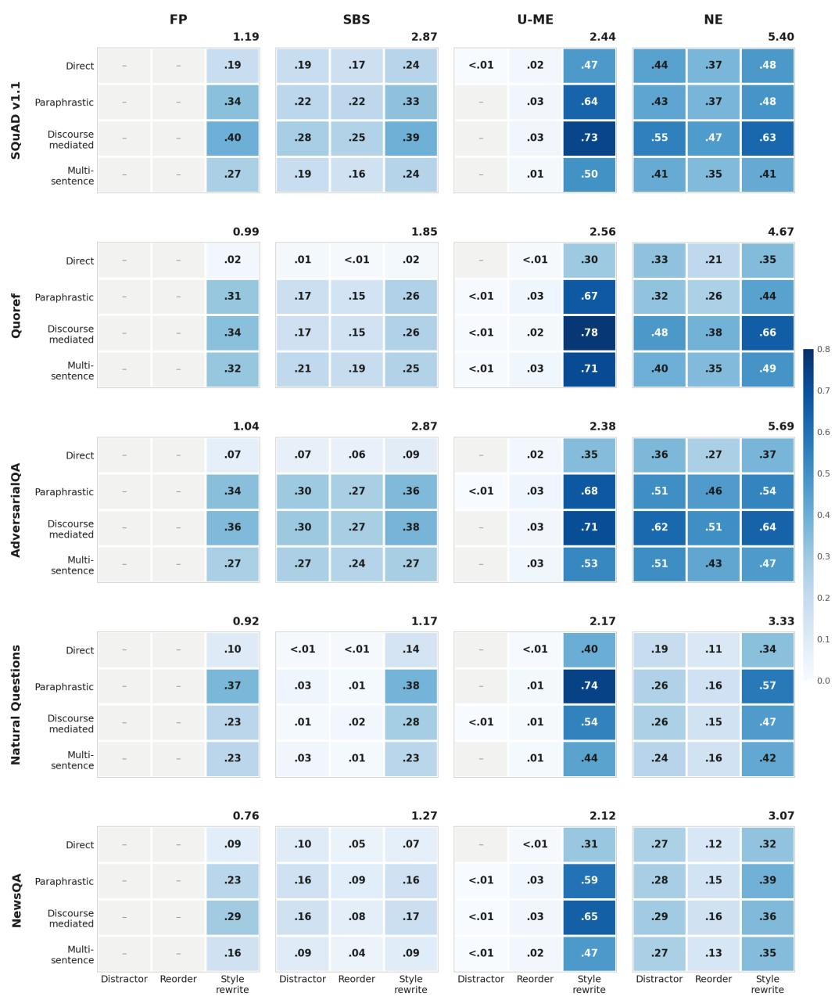  
Figure 5: Descriptor space across datasets. For each cell, the proportion of the 5000 instances whose neighborhood places at least one rewrite in that cell.

## B.4 DETECTION WITH AND WITHOUT A MINIMUM NEIGHBORHOOD SIZE

This section reports the detection results behind Table 1 in full, under two instance populations and three cuts of the data. The first population uses every instance a method scores, whatever the size of the neighborhood it has. The second restricts to instances holding at least two rewrites or samples, which is the smallest count at which semantic entropy is defined, since a single prediction admits no partition to measure. All values are macro-averaged over the 25 dataset–model pairs.

Columns are as defined in Appendix E.

Overall. Tables 13 and 14 give the comparison across all pairs. Imposing the minimum separates the two kinds of score cleanly. All three constructors gain, NE by 0.023 AUROC and 0.022 lift, free paraphrasing by 0.016 and the untargeted search by 0.003, while all three scores read from the original context are unchanged, at 0.676 for predictive entropy, 0.674 for the length-normalised likelihood and 0.652 for decoder semantic entropy. The restriction is definitional rather than tuned, and it moves exactly the methods whose score needs more than one prediction to be defined.

Table 13: Failure detection on thefull archives, with every method scoring each instance from all of the rewrites or samples it has and no minimum imposed.
<table><tr><td></td><td>Method</td><td>AUROC</td><td>AUPRC</td><td>Lift</td><td>Base</td><td>n</td><td>Cov.</td><td>SD</td><td>MIN-MAX</td></tr><tr><td>1</td><td>NE</td><td>0.702</td><td>0.546</td><td>0.189</td><td>0.357</td><td>23739</td><td>0.950</td><td>0.053</td><td>0.602-0.776</td></tr><tr><td>2</td><td>PE</td><td>0.676</td><td>0.488</td><td>0.131</td><td>0.357</td><td>23739</td><td>0.950</td><td>0.047</td><td>0.582–0.772</td></tr><tr><td>3</td><td>NLL</td><td>0.674</td><td>0.492</td><td>0.131</td><td>0.361</td><td>24984</td><td>0.999</td><td>0.050</td><td>0.563–0.761</td></tr><tr><td>4</td><td>U-ME</td><td>0.658</td><td>0.496</td><td>0.146</td><td>0.351</td><td>24060</td><td>0.962</td><td>0.020</td><td>0.624–0.686</td></tr><tr><td>5</td><td>DSE</td><td>0.652</td><td>0.498</td><td>0.149</td><td>0.349</td><td>21920</td><td>0.877</td><td>0.066</td><td>0.518–0.734</td></tr><tr><td>6</td><td>FP</td><td>0.605</td><td>0.421</td><td>0.097</td><td>0.323</td><td>19569</td><td>0.783</td><td>0.031</td><td>0.546–0.651</td></tr></table>

Table 14: Failure detection restricted to instances holding at least two rewrites or samples. Semantic entropy is identically zero on a single prediction, since there is no partition to measure, so two is the smallest count at which the score is defined. NE, PE and DSE sit on an identical population of 21920 instances.
<table><tr><td></td><td>Method</td><td>AUROC</td><td>AUPRC</td><td>Lift</td><td>Base</td><td>n</td><td>Cov.</td><td>SD</td><td>MIN-MAX</td></tr><tr><td>1</td><td>NE</td><td>0.726</td><td>0.561</td><td>0.211</td><td>0.349</td><td>21920</td><td>0.877</td><td>0.038</td><td>0.647-0.786</td></tr><tr><td>2</td><td>PE</td><td>0.676</td><td>0.480</td><td>0.131</td><td>0.349</td><td>21920</td><td>0.877</td><td>0.046</td><td>0.580–0.765</td></tr><tr><td>3</td><td>NLL</td><td>0.674</td><td>0.492</td><td>0.131</td><td>0.361</td><td>24984</td><td>0.999</td><td>0.050</td><td>0.563–0.761</td></tr><tr><td>4</td><td>U-ME</td><td>0.661</td><td>0.497</td><td>0.148</td><td>0.349</td><td>23920</td><td>0.957</td><td>0.019</td><td>0.627–0.689</td></tr><tr><td>5</td><td>DSE</td><td>0.652</td><td>0.498</td><td>0.149</td><td>0.349</td><td>21920</td><td>0.877</td><td>0.066</td><td>0.518–0.734</td></tr><tr><td>6</td><td>FP</td><td>0.621</td><td>0.428</td><td>0.113</td><td>0.315</td><td>17864</td><td>0.715</td><td>0.032</td><td>0.563–0.679</td></tr></table>

By dataset. Tables 15 and 16 break the same comparison down by dataset. NE leads on SQuAD v1.1, Quoref and AdversarialQA under both populations. The two remaining datasets behave differently. On NewsQA the original-context scores lead on the full archives, and the minimum closes most of that gap, taking NE from 0.647 to 0.687 against 0.691 for the length-normalised likelihood. Natural Questions is the one dataset where the likelihood scores lead clearly under both populations. Tables 20 and 21 trace both cases to the share of instances carrying fewer than three rewrites.

By QA model. Tables 17 and 18 give the same cut by QA model. Detection varies far less across models than across datasets, which is what the construction procedure predicts: a neighborhood is built from the context alone and never queries the answering model, so the share of instances holding fewer than three rewrites is 18.5 to 18.6 percent for every model here, while across datasets it ranges from 5.6 to 37.7 percent. NE leads on four of the five models on both measures on the full archives, trailing only on Mistral-Nemo-12B, and on all five under the minimum. Decoder semantic entropy falls close to chance on Gemma3-12B at 0.538 AUROC, where resampling the decoder leaves the answer unchanged while rewriting the context still separates failures.

Pair by pair. Table 19 compares NE against each other method one pair at a time, on the instances the two share. Against the other two constructors the advantage is uniform, in all 25 pairs on

Table 15: Failure detection per dataset on the full archives, macro-averaged over the five QA models. Best value per row in bold.
<table><tr><td>Dataset</td><td>NE</td><td>U-ME</td><td>FP</td><td>DSE</td><td>PE</td><td>NLL</td></tr><tr><td>AUROC</td><td></td><td></td><td></td><td></td><td></td><td></td></tr><tr><td>SQuAD v1.1</td><td>0.742</td><td>0.671</td><td>0.616</td><td>0.676</td><td>0.673</td><td>0.666</td></tr><tr><td>Quoref</td><td>0.740</td><td>0.674</td><td>0.619</td><td>0.614</td><td>0.663</td><td>0.662</td></tr><tr><td>NewsQA</td><td>0.647</td><td>0.636</td><td>0.581</td><td>0.668</td><td>0.686</td><td>0.691</td></tr><tr><td>Natural Questions</td><td>0.638</td><td>0.652</td><td>0.594</td><td>0.643</td><td>0.728</td><td>0.731</td></tr><tr><td>AdversarialQA</td><td>0.741</td><td>0.659</td><td>0.613</td><td>0.658</td><td>0.628</td><td>0.620</td></tr><tr><td>AUPRC</td><td></td><td></td><td></td><td></td><td></td><td></td></tr><tr><td>SQuAD v1.1</td><td>0.480</td><td>0.383</td><td>0.299</td><td>0.413</td><td>0.331</td><td>0.325</td></tr><tr><td>Quoref</td><td>0.510</td><td>0.430</td><td>0.389</td><td>0.392</td><td>0.420</td><td>0.422</td></tr><tr><td>NewsQA</td><td>0.656</td><td>0.659</td><td>0.567</td><td>0.669</td><td>0.680</td><td>0.694</td></tr><tr><td>Natural Questions</td><td>0.432</td><td>0.430</td><td>0.320</td><td>0.426</td><td>0.480</td><td>0.495</td></tr><tr><td>AdversarialQA</td><td>0.654</td><td>0.578</td><td>0.530</td><td>0.591</td><td>0.529</td><td>0.523</td></tr></table>

Table 16: Failure detection per dataset at two or more rewrites, macro-averaged over the five QA models. Best value per row in bold.
<table><tr><td>Dataset</td><td>NE</td><td>U-ME</td><td>FP</td><td>DSE</td><td>PE</td><td>NLL</td></tr><tr><td>AUROC</td><td></td><td></td><td></td><td></td><td></td><td></td></tr><tr><td>SQuAD v1.1</td><td>0.752</td><td>0.672</td><td>0.628</td><td>0.676</td><td>0.678</td><td>0.666</td></tr><tr><td>Quoref</td><td>0.756</td><td>0.674</td><td>0.626</td><td>0.614</td><td>0.665</td><td>0.662</td></tr><tr><td>NewsQA</td><td>0.687</td><td>0.641</td><td>0.611</td><td>0.668</td><td>0.687</td><td>0.691</td></tr><tr><td>Natural Questions</td><td>0.687</td><td>0.654</td><td>0.617</td><td>0.643</td><td>0.722</td><td>0.731</td></tr><tr><td>AdversarialQA</td><td>0.746</td><td>0.662</td><td>0.623</td><td>0.658</td><td>0.628</td><td>0.620</td></tr><tr><td>AUPRC</td><td></td><td></td><td></td><td></td><td></td><td></td></tr><tr><td>SQuAD v1.1</td><td>0.486</td><td>0.383</td><td>0.302</td><td>0.413</td><td>0.331</td><td>0.325</td></tr><tr><td>Quoref</td><td>0.524</td><td>0.430</td><td>0.397</td><td>0.392</td><td>0.424</td><td>0.422</td></tr><tr><td>NewsQA</td><td>0.677</td><td>0.660</td><td>0.571</td><td>0.669</td><td>0.670</td><td>0.694</td></tr><tr><td>Natural Questions</td><td>0.459</td><td>0.431</td><td>0.336</td><td>0.426</td><td>0.446</td><td>0.495</td></tr><tr><td>AdversarialQA</td><td>0.657</td><td>0.579</td><td>0.533</td><td>0.591</td><td>0.530</td><td>0.523</td></tr></table>

Table 17: Failure detection per QA model on the full archives, macro-averaged over the five datasets. Best value per row in bold.
<table><tr><td>QA model</td><td>NE</td><td>U-ME</td><td>FP</td><td>DSE</td><td>PE</td><td>NLL</td></tr><tr><td>AUROC</td><td></td><td></td><td></td><td></td><td></td><td></td></tr><tr><td>Gemma3-12B</td><td>0.698</td><td>0.650</td><td>0.588</td><td>0.538</td><td>0.648</td><td>0.646</td></tr><tr><td>OLMo2-13B-Instruct</td><td>0.708</td><td>0.661</td><td>0.594</td><td>0.685</td><td>0.693</td><td>0.693</td></tr><tr><td>Phi4-14B</td><td>0.713</td><td>0.668</td><td>0.641</td><td>0.707</td><td>0.656</td><td>0.654</td></tr><tr><td>Mistral-Nemo-12B</td><td>0.692</td><td>0.648</td><td>0.578</td><td>0.670</td><td>0.706</td><td>0.705</td></tr><tr><td>Falcon3-10B-Instruct</td><td>0.698</td><td>0.665</td><td>0.621</td><td>0.660</td><td>0.676</td><td>0.672</td></tr><tr><td>AUPRC</td><td></td><td></td><td></td><td></td><td></td><td></td></tr><tr><td>Gemma3-12B</td><td>0.470</td><td>0.405</td><td>0.330</td><td>0.313</td><td>0.375</td><td>0.381</td></tr><tr><td>OLMo2-13B-Instruct</td><td>0.576</td><td>0.520</td><td>0.421</td><td>0.550</td><td>0.528</td><td>0.535</td></tr><tr><td>Phi4-14B</td><td>0.574</td><td>0.512</td><td>0.471</td><td>0.570</td><td>0.467</td><td>0.464</td></tr><tr><td>Mistral-Nemo-12B</td><td>0.572</td><td>0.527</td><td>0.427</td><td>0.547</td><td>0.575</td><td>0.581</td></tr><tr><td>Falcon3-10B-Instruct</td><td>0.539</td><td>0.516</td><td>0.455</td><td>0.511</td><td>0.495</td><td>0.498</td></tr></table>

AUROC. Against the three scores read from the original context the mean margin is comparable but the advantage is less uniform, holding in 18 to 21 pairs of 25.

Where the difference between the two populations comes from. The last two tables account for the gap. Table 20 reports how many rewrites each method holds per instance and how often those instances fail. NE’s low-rewrite instances are markedly harder than the rest, failing at 0.462 at one rewrite and 0.460 at two against 0.330 at three or more, and there are 4401 of them in its 23739 scored instances. Semantic entropy over a single rewrite is identically zero, so all 1819 one-rewrite instances receive the same minimum score, which places the hardest instances at the most confident end of the ranking. Table 21 shows the consequence for NE by dataset. The cost of including those instances tracks their share: it is largest on NewsQA and Natural Questions, where close to a third of instances carry fewer than three rewrites, and negligible on AdversarialQA and SQuAD v1.1, where few do.

Table 18: Failure detection per QA model at two or more rewrites, macro-averaged over the five datasets. Best value per row in bold.
<table><tr><td>QA model</td><td>NE</td><td>U-ME</td><td>FP</td><td>DSE</td><td>PE</td><td>NLL</td></tr><tr><td>AUROC</td></tr><tr><td>Gemma3-12B</td><td>0.652</td><td>0.601</td><td>0.538</td><td>0.647</td><td>0.646</td></tr><tr><td>OLMo2-13B-Instruct</td><td>0.721 0.730</td><td>0.664</td><td>0.609</td><td>0.685</td><td>0.696</td><td>0.693</td></tr><tr><td>Phi4-14B</td><td>0.738</td><td>0.670</td><td>0.662</td><td>0.707</td><td>0.659</td><td>0.654</td></tr><tr><td>Mistral-Nemo-12B</td><td>0.712</td><td>0.650</td><td>0.589</td><td>0.670</td><td>0.704</td><td>0.705</td></tr><tr><td>Falcon3-10B-Instruct</td><td>0.726</td><td>0.668</td><td>0.644</td><td>0.660</td><td>0.674</td><td>0.672</td></tr><tr><td>AUPRC</td></tr><tr><td>Gemma3-12B</td><td>0.485</td><td>0.406</td><td>0.334</td><td>0.313</td><td>0.367</td><td>0.381</td></tr><tr><td>OLMo2-13B-Instruct Phi4-14B</td><td>0.588 0.592</td><td>0.521 0.512</td><td>0.425 0.487</td><td>0.550 0.570</td><td>0.520</td><td>0.535</td></tr><tr><td>Mistral-Nemo-12B</td><td>0.584</td><td>0.527</td><td>0.430</td><td>0.547</td><td>0.462 0.569</td><td>0.464</td></tr><tr><td>Falcon3-10B-Instruct</td><td>0.553</td><td>0.517</td><td>0.463</td><td>0.511</td><td>0.484</td><td>0.581</td></tr><tr><td></td><td></td><td></td><td></td><td></td><td></td><td>0.498</td></tr></table>

Table 19: Per-pair comparison of NE against each other method at two or more rewrites, over the 25 dataset–model pairs. Counts are pairs won by NE against pairs lost, on the instances the two methods share, with the mean difference alongside.
<table><tr><td></td><td colspan="2">AUROC</td><td colspan="2">AUPRC</td></tr><tr><td>NE versus</td><td>Pairs won</td><td>Mean ∆</td><td>Pairs won</td><td>Mean ∆</td></tr><tr><td>U-ME</td><td>25/25</td><td>+0.065</td><td>24/25</td><td>+0.064</td></tr><tr><td>FP</td><td>25/25</td><td>+0.104</td><td>25/25</td><td>+0.133</td></tr><tr><td>DSE</td><td>21/25</td><td>+0.074</td><td>19/25</td><td>+0.062</td></tr><tr><td>PE</td><td>18/25</td><td>+0.050</td><td>21/25</td><td>+0.080</td></tr><tr><td>NLL</td><td>18/25</td><td>+0.052</td><td>19/25</td><td>+0.069</td></tr></table>

Table 20: Rewrites available per instance over each method’s full archive, with the failure rate at each count. Unscored counts instances the method produces no score for at all, against 1000 per dataset–model pair. Predictive entropy is defined at a single sample and is listed for its counts only, which match NE’s because it is computed on the same instances.
<table><tr><td rowspan="3">Method</td><td colspan="4">Instances</td><td colspan="2">Share</td><td colspan="3">Failure rate</td></tr><tr><td>Scored</td><td>N=1</td><td>N=2</td><td>N≥3</td><td>N&lt;3</td><td>Unsc.</td><td>N=1</td><td>N=2</td><td>N≥3</td></tr><tr><td>NE</td><td>23739</td><td>1819</td><td>2582</td><td>19338</td><td>18.5%</td><td>1261</td><td>0.462</td><td>0.460</td><td>0.330</td></tr><tr><td>U-ME</td><td>24060</td><td>140</td><td>505</td><td>23415</td><td>2.7%</td><td>940</td><td>0.679</td><td>0.677</td><td>0.341</td></tr><tr><td>FP</td><td>19569</td><td>1705</td><td>1915</td><td>15949</td><td>18.5%</td><td>5431</td><td>0.407</td><td>0.405</td><td>0.293</td></tr><tr><td>DSE</td><td>21920</td><td>0</td><td>2582</td><td>19338</td><td>11.8%</td><td>3080</td><td></td><td>0.460</td><td>0.330</td></tr><tr><td>PE</td><td>23739</td><td>1819</td><td>2582</td><td>19338</td><td>18.5%</td><td>1261</td><td>0.462</td><td>0.460</td><td>0.330</td></tr><tr><td>NLL</td><td>24984</td><td>一</td><td></td><td></td><td></td><td>16</td><td></td><td></td><td></td></tr></table>

Table 21: Neighborhood elites (NE) only. Detection per dataset on the full archive against the same computation restricted to instances holding at least three rewrites, macro-averaged over the five QA models. ∆ is the full-archive value minus the restricted one.
<table><tr><td></td><td></td><td></td><td colspan="3">AUROC</td><td colspan="3">AUPRC</td></tr><tr><td>Dataset</td><td>Scored</td><td>N&lt;3</td><td>Full</td><td>N≥3</td><td>∆</td><td>Full</td><td>N≥3</td><td>∆</td></tr><tr><td>SQuAD v1.1</td><td>4980</td><td>8.2%</td><td>0.742</td><td>0.759</td><td>-0.017</td><td>0.480</td><td>0.485</td><td>-0.006</td></tr><tr><td>Quoref</td><td>4943</td><td>14.1%</td><td>0.740</td><td>0.767</td><td>-0.027</td><td>0.510</td><td>0.527</td><td>-0.017</td></tr><tr><td>NewsQA</td><td>4438</td><td>37.7%</td><td>0.647</td><td>0.712</td><td>-0.065</td><td>0.656</td><td>0.682</td><td>-0.025</td></tr><tr><td>Natural Questions</td><td>4385</td><td>30.7%</td><td>0.638</td><td>0.709</td><td>-0.071</td><td>0.432</td><td>0.468</td><td>-0.036</td></tr><tr><td>AdversarialQA</td><td>4993</td><td>5.6%</td><td>0.741</td><td>0.748</td><td>-0.007</td><td>0.654</td><td>0.656</td><td>-0.002</td></tr></table>

## B.5 SENSITIVITY TO EDITOR SIZE

This section reports NE with three editors, Qwen3-8B, 14B and 32B. Columns are as defined in Appendix E. Three populations appear and are not interchangeable. The tables use each editor’s own full archive, or that archive restricted to instances holding at least two rewrites or samples. Figure 6 uses a third, the 21031 instances for which NE retains at least two rewrites at all three editor sizes, so the differences it reports are not the differences between the table values.

## B.5.1 DETECTION ACROSS THE THREE EDITOR SIZES

Detection improves from the 8B editor to the 14B and does not improve further at 32B. Figure 6 reports NE at three editor sizes on the 21031 instances for which it retains at least two rewrites at all three. From 8B to 14B, mean AUROC rises by 0.0222 [0.0135, 0.0316] and AUPRC lift by 0.0294 [0.0178, 0.0409], the latter in 22 of 25 pairs. From 14B to 32B, the changes are −0.0055 [−0.0121, 0.0010] AUROC in 9 of 25 pairs and −0.0095 [−0.0186, −0.0008] AUPRC lift in 11 of 25. Neighborhoods grow throughout, from 4.97 rewrites per instance at 8B to 5.91 at 14B and 6.46 at 32B. The first step is uneven across datasets: Natural Questions gains 0.0483 AUROC and NewsQA 0.0256, against 0.0191 for AdversarialQA, 0.0093 for SQuAD v1.1 and 0.0088 for Quoref. In the second step four of five datasets lose, by 0.0101 on Natural Questions, 0.0109 on NewsQA, 0.0049 on SQuAD v1.1 and 0.0027 on Quoref, while AdversarialQA gains 0.0009.

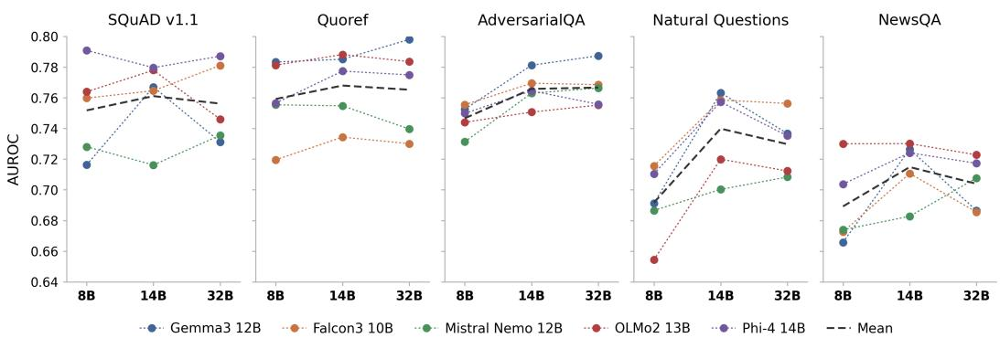  
Figure 6: NE AUROC at three editor sizes, on the 21031 instances for which NE retains at least two rewrites at all three.

## B.5.2 THE 14B EDITOR

U-ME has no 14B run and is absent from every table in this part.

Overall. Tables 22 and 23 give the comparison across all pairs, on the full archives and restricted to instances holding at least two rewrites or samples.

Table 22: Failure detection with the Qwen3-14B editor on the full archives, macro-averaged over the 25 dataset–model pairs.
<table><tr><td></td><td>Method</td><td>AUROC</td><td>AUPRC</td><td>Lift</td><td>Base</td><td>n</td><td>Cov.</td><td>SD</td><td>MIN-MAX</td></tr><tr><td>1</td><td>NE</td><td>0.731</td><td>0.579</td><td>0.222</td><td>0.357</td><td>24133</td><td>0.965</td><td>0.038</td><td>0.653-0.784</td></tr><tr><td>2</td><td>NLL</td><td>0.674</td><td>0.491</td><td>0.130</td><td>0.361</td><td>24993</td><td>1.000</td><td>0.050</td><td>0.563-0.760</td></tr><tr><td>3</td><td>PE</td><td>0.673</td><td>0.486</td><td>0.129</td><td>0.357</td><td>24133</td><td>0.965</td><td>0.047</td><td>0.584–0.770</td></tr><tr><td>4</td><td>DSE</td><td>0.658</td><td>0.511</td><td>0.158</td><td>0.353</td><td>23224</td><td>0.929</td><td>0.066</td><td>0.527–0.753</td></tr><tr><td>5</td><td>FP</td><td>0.638</td><td>0.455</td><td>0.127</td><td>0.328</td><td>21584</td><td>0.863</td><td>0.031</td><td>0.564–0.685</td></tr></table>

By dataset. Tables 24 and 25 break the same comparison down by dataset, macro-averaged over the five QA models.

By QA model. Tables 26 and 27 give the same cut by QA model, macro-averaged over the five datasets.

Table 23: Failure detection with the Qwen3-14B editor, restricted to instances holding at least two rewrites or samples. NE, PE and DSE sit on an identical population of 23224 instances.
<table><tr><td></td><td>Method</td><td>AUROC</td><td>AUPRC</td><td>Lift</td><td>Base</td><td>n</td><td>Cov.</td><td>SD</td><td>MIN-MAX</td></tr><tr><td>1</td><td>NE</td><td>0.744</td><td>0.588</td><td>0.235</td><td>0.353</td><td>23224</td><td>0.929</td><td>0.030</td><td>0.676-0.786</td></tr><tr><td>2</td><td>NLL</td><td>0.674</td><td>0.491</td><td>0.130</td><td>0.361</td><td>24993</td><td>1.000</td><td>0.050</td><td>0.563-0.760</td></tr><tr><td>3</td><td>PE</td><td>0.673</td><td>0.483</td><td>0.129</td><td>0.353</td><td>23224</td><td>0.929</td><td>0.047</td><td>0.584–0.768</td></tr><tr><td>4</td><td>DSE</td><td>0.658</td><td>0.511</td><td>0.158</td><td>0.353</td><td>23224</td><td>0.929</td><td>0.066</td><td>0.527–0.753</td></tr><tr><td>5</td><td>FP</td><td>0.649</td><td>0.460</td><td>0.137</td><td>0.323</td><td>20600</td><td>0.824</td><td>0.031</td><td>0.568–0.693</td></tr></table>

Table 24: Failure detection per dataset with the Qwen3-14B editor on the full archives, macroaveraged over the five QA models. Best per row in bold.
<table><tr><td>Dataset</td><td>NE</td><td>FP</td><td>DSE</td><td>PE</td><td>NLL</td></tr><tr><td>AUROC</td><td></td><td></td><td></td><td></td><td></td></tr><tr><td>SQuAD v1.1</td><td>0.750</td><td>0.649</td><td>0.673</td><td>0.670</td><td>0.666</td></tr><tr><td>Quoref</td><td>0.749</td><td>0.651</td><td>0.616</td><td>0.660</td><td>0.662</td></tr><tr><td>NewsQA</td><td>0.677</td><td>0.619</td><td>0.673</td><td>0.683</td><td>0.691</td></tr><tr><td>Natural Questions</td><td>0.713</td><td>0.623</td><td>0.666</td><td>0.728</td><td>0.730</td></tr><tr><td>AdversarialQA</td><td>0.766</td><td>0.647</td><td>0.660</td><td>0.625</td><td>0.620</td></tr><tr><td>AUPRC</td><td></td><td></td><td></td><td></td><td></td></tr><tr><td>SQuAD v1.1</td><td>0.487</td><td>0.337</td><td>0.414</td><td>0.329</td><td>0.324</td></tr><tr><td>Quoref</td><td>0.512</td><td>0.401</td><td>0.396</td><td>0.420</td><td>0.422</td></tr><tr><td>NewsQA</td><td>0.687</td><td>0.611</td><td>0.675</td><td>0.671</td><td>0.695</td></tr><tr><td>Natural Questions</td><td>0.526</td><td>0.365</td><td>0.477</td><td>0.482</td><td>0.493</td></tr><tr><td>AdversarialQA</td><td>0.684</td><td>0.560</td><td>0.595</td><td>0.528</td><td>0.523</td></tr></table>

Table 25: Failure detection per dataset with the Qwen3-14B editor at two or more rewrites, macroaveraged over the five QA models. Best per row in bold.
<table><tr><td>Dataset</td><td>NE</td><td>FP</td><td>DSE</td><td>PE</td><td>NLL</td></tr><tr><td colspan="6">AUROC</td></tr><tr><td>SQuAD v1.1</td><td>0.758</td><td>0.659</td><td>0.673</td><td>0.672</td><td>0.666</td></tr><tr><td>Quoref</td><td>0.760</td><td>0.658</td><td>0.616</td><td>0.659</td><td>0.662</td></tr><tr><td>NewsQA</td><td>0.709</td><td>0.643</td><td>0.673</td><td>0.684</td><td>0.691</td></tr><tr><td>Natural Questions</td><td>0.729</td><td>0.631</td><td>0.666</td><td>0.724</td><td>0.730</td></tr><tr><td>AdversarialQA</td><td>0.766</td><td>0.657</td><td>0.660</td><td>0.626</td><td>0.620</td></tr><tr><td colspan="6">AUPRC</td></tr><tr><td>SQuAD v1.1</td><td>0.493</td><td>0.340</td><td>0.414</td><td>0.327</td><td>0.324</td></tr><tr><td>Quoref</td><td>0.519</td><td>0.406</td><td>0.396</td><td>0.417</td><td>0.422</td></tr><tr><td>NewsQA</td><td>0.703</td><td>0.621</td><td>0.675</td><td>0.666</td><td>0.695</td></tr><tr><td>Natural Questions</td><td>0.540</td><td>0.372</td><td>0.477</td><td>0.475</td><td>0.493</td></tr><tr><td>AdversarialQA</td><td>0.685</td><td>0.563</td><td>0.595</td><td>0.529</td><td>0.523</td></tr></table>

Pair by pair. Tables 28 and 29 compare NE against each other method one pair at a time, on the instances the two share.

## B.5.3 THE 32B EDITOR

FP and U-ME have no 32B run, so this part compares NE against the three scores read from the original context and carries no constructor comparison. No minimum-rewrite tables are available for this editor.

Overall. Table 30 gives the comparison across all pairs.

By dataset and by QA model. Tables 31 and 32 give the two cuts. Table 24 holds the corresponding per-dataset values for the 14B editor.

Pair by pair. Table 33 compares NE against each other method one pair at a time.

Table 26: Failure detection per QA model with the Qwen3-14B editor on the full archives, macroaveraged over the five datasets. Best per row in bold.
<table><tr><td>QA model</td><td>NE</td><td>FP</td><td>DSE</td><td>PE</td><td>NLL</td></tr><tr><td>AUROC</td><td></td><td></td><td></td><td></td><td></td></tr><tr><td>Gemma3-12B</td><td>0.745</td><td>0.634</td><td>0.543</td><td>0.648</td><td>0.646</td></tr><tr><td>OLMo2-13B-Instruct</td><td>0.738</td><td>0.639</td><td>0.691</td><td>0.689</td><td>0.693</td></tr><tr><td>Phi4-14B</td><td>0.736</td><td>0.663</td><td>0.711</td><td>0.658</td><td>0.653</td></tr><tr><td>Mistral-Nemo-12B</td><td>0.708</td><td>0.607</td><td>0.678</td><td>0.704</td><td>0.705</td></tr><tr><td>Falcon3-10B-Instruct</td><td>0.727</td><td>0.645</td><td>0.664</td><td>0.668</td><td>0.671</td></tr><tr><td>AUPRC</td><td></td><td></td><td></td><td></td><td></td></tr><tr><td>Gemma3-12B</td><td>0.517</td><td>0.377</td><td>0.330</td><td>0.378</td><td>0.381</td></tr><tr><td>OLMo2-13B-Instruct</td><td>0.614</td><td>0.482</td><td>0.552</td><td>0.522</td><td>0.536</td></tr><tr><td>Phi4-14B</td><td>0.592</td><td>0.485</td><td>0.583</td><td>0.472</td><td>0.463</td></tr><tr><td>Mistral-Nemo-12B</td><td>0.594</td><td>0.458</td><td>0.556</td><td>0.571</td><td>0.580</td></tr><tr><td>Falcon3-10B-Instruct</td><td>0.578</td><td>0.473</td><td>0.536</td><td>0.486</td><td>0.496</td></tr></table>

Table 27: Failure detection per QA model with the Qwen3-14B editor at two or more rewrites, macro-averaged over the five datasets. Best per row in bold.
<table><tr><td>QA model</td><td>NE</td><td>FP</td><td>DSE</td><td>PE</td><td>NLL</td></tr><tr><td colspan="6">AUROC</td></tr><tr><td>Gemma3-12B</td><td>0.757</td><td>0.643</td><td>0.543</td><td>0.647</td><td>0.646</td></tr><tr><td>OLMo2-13B-Instruct</td><td>0.753</td><td>0.653</td><td>0.691</td><td>0.690</td><td>0.693</td></tr><tr><td>Phi4-14B</td><td>0.750</td><td>0.674</td><td>0.711</td><td>0.657</td><td>0.653</td></tr><tr><td>Mistral-Nemo-12B</td><td>0.719</td><td>0.617</td><td>0.678</td><td>0.705</td><td>0.705</td></tr><tr><td>Falcon3-10B-Instruct</td><td>0.743</td><td>0.660</td><td>0.664</td><td>0.666</td><td>0.671</td></tr><tr><td colspan="6">AUPRC</td></tr><tr><td>Gemma3-12B</td><td>0.527</td><td>0.382</td><td>0.330</td><td>0.377</td><td>0.381</td></tr><tr><td>OLMo2-13B-Instruct</td><td>0.624</td><td>0.488</td><td>0.552</td><td>0.521</td><td>0.536</td></tr><tr><td>Phi4-14B</td><td>0.601</td><td>0.493</td><td>0.583</td><td>0.467</td><td>0.463</td></tr><tr><td>Mistral-Nemo-12B</td><td>0.601</td><td>0.460</td><td>0.556</td><td>0.569</td><td>0.580</td></tr><tr><td>Falcon3-10B-Instruct</td><td>0.586</td><td>0.479</td><td>0.536</td><td>0.479</td><td>0.496</td></tr></table>

Table 28: Per-pair comparison of NE against each other method with the Qwen3-14B editor on the full archives, over the 25 dataset–model pairs. Counts are pairs won by NE.
<table><tr><td></td><td colspan="2">AUROC</td><td colspan="2">AUPRC</td></tr><tr><td>NE versus</td><td>Pairs won</td><td>Mean ∆</td><td>Pairs won</td><td>Mean ∆</td></tr><tr><td>FP</td><td>25/25</td><td>+0.093</td><td>25/25</td><td>+0.124</td></tr><tr><td>DSE</td><td>19/25</td><td>+0.073</td><td>22/25</td><td>+0.068</td></tr><tr><td>PE</td><td>18/25</td><td>+0.057</td><td>21/25</td><td>+0.093</td></tr><tr><td>NLL</td><td>17/25</td><td>+0.057</td><td>20/25</td><td>+0.088</td></tr></table>

Table 29: Per-pair comparison of NE against each other method with the Qwen3-14B editor at two or more rewrites, over the 25 dataset–model pairs. Counts are pairs won by NE.
<table><tr><td></td><td colspan="2">AUROC</td><td colspan="2">AUPRC</td></tr><tr><td>NE versus</td><td>Pairs won</td><td>Mean ∆</td><td>Pairs won</td><td>Mean ∆</td></tr><tr><td>FP</td><td>25/25</td><td>+0.095</td><td>25/25</td><td>+0.128</td></tr><tr><td>DSE</td><td>23/25</td><td>+0.087</td><td>22/25</td><td>+0.077</td></tr><tr><td>PE</td><td>21/25</td><td>+0.072</td><td>23/25</td><td>+0.105</td></tr><tr><td>NLL</td><td>21/25</td><td>+0.071</td><td>22/25</td><td>+0.097</td></tr></table>

## B.5.4 THE THREE EDITORS SIDE BY SIDE

Table 34 collects the overall values. The three scores read from the original context do not consult the editor, but the instances they are scored on do: each is computed on the population that run makes scorable, so NLL’s n moves from 24984 to 24993 to 25000 across the three and coverage rises for every method.

Table 30: Failure detection with the Qwen3-32B editor on the full archives, macro-averaged over the 25 dataset–model pairs. FP and U-ME have no 32B run.
<table><tr><td></td><td>Method</td><td>AUROC</td><td>AUPRC</td><td>Lift</td><td>Base</td><td>n</td><td>Cov.</td><td>SD</td><td>MIN-MAX</td></tr><tr><td>1</td><td>NE</td><td>0.724</td><td>0.568</td><td>0.211</td><td>0.356</td><td>24475</td><td>0.979</td><td>0.045</td><td>0.634–0.790</td></tr><tr><td>2</td><td>PE</td><td>0.674</td><td>0.486</td><td>0.129</td><td>0.356</td><td>24475</td><td>0.979</td><td>0.046</td><td>0.582–0.762</td></tr><tr><td>3</td><td>NLL</td><td>0.674</td><td>0.491</td><td>0.130</td><td>0.361</td><td>25000</td><td>1.000</td><td>0.049</td><td>0.563–0.762</td></tr><tr><td>4</td><td>DSE</td><td>0.662</td><td>0.512</td><td>0.162</td><td>0.350</td><td>23865</td><td>0.955</td><td>0.068</td><td>0.523–0.743</td></tr></table>

Table 31: Failure detection per dataset with the Qwen3-32B editor on the full archives, macroaveraged over the five QA models. Best per row in bold.
<table><tr><td>Dataset</td><td>NE</td><td>DSE</td><td>PE</td><td>NLL</td></tr><tr><td>AUROC</td><td></td><td></td><td></td><td></td></tr><tr><td>SQuAD v1.1 Quoref</td><td>0.743 0.754</td><td>0.681 0.616</td><td>0.669 0.660</td><td>0.667 0.661</td></tr><tr><td>NewsQA Natural Questions</td><td>0.660 0.701</td><td>0.677 0.667</td><td>0.683 0.727</td><td>0.691 0.730</td></tr><tr><td>AdversarialQA</td><td>0.765</td><td>0.668</td><td>0.630</td><td>0.620</td></tr><tr><td>AUPRC</td><td></td><td></td><td></td><td></td></tr><tr><td>SQuAD v1.1</td><td>0.470</td><td>0.420</td><td>0.325</td><td>0.325</td></tr><tr><td>Quoref</td><td>0.508</td><td>0.399</td><td>0.419</td><td>0.421</td></tr><tr><td>NewsQA</td><td>0.667</td><td>0.671</td><td>0.672</td><td></td></tr><tr><td></td><td></td><td></td><td></td><td>0.695</td></tr><tr><td>Natural Questions</td><td>0.512</td><td>0.470</td><td>0.482</td><td>0.493</td></tr><tr><td></td><td></td><td></td><td></td><td></td></tr><tr><td></td><td></td><td></td><td></td><td></td></tr><tr><td>AdversarialQA</td><td>0.682</td><td>0.601</td><td>0.530</td><td></td></tr><tr><td></td><td></td><td></td><td></td><td>0.524</td></tr><tr><td></td><td></td><td></td><td></td><td></td></tr></table>

Table 32: Failure detection per QA model with the Qwen3-32B editor on the full archives, macroaveraged over the five datasets. Best per row in bold.
<table><tr><td>QA model</td><td>NE</td><td>DSE</td><td>PE</td><td>NLL</td></tr><tr><td colspan="5">AUROC</td></tr><tr><td>Gemma3-12B</td><td>0.727</td><td>0.544</td><td>0.644</td><td>0.646</td></tr><tr><td>OLMo2-13B-Instruct</td><td>0.723</td><td>0.698</td><td>0.689</td><td>0.693</td></tr><tr><td>Phi4-14B</td><td>0.733</td><td>0.718</td><td>0.654</td><td>0.654</td></tr><tr><td>Mistral-Nemo-12B</td><td>0.716</td><td>0.682</td><td>0.710</td><td>0.705</td></tr><tr><td>Falcon3-10B-Instruct</td><td>0.723</td><td>0.666</td><td>0.673</td><td>0.670</td></tr><tr><td colspan="5">AUPRC</td></tr><tr><td>Gemma3-12B</td><td>0.488</td><td>0.317</td><td>0.372</td><td>0.382</td></tr><tr><td>OLMo2-13B-Instruct</td><td>0.592</td><td>0.560</td><td>0.517</td><td>0.535</td></tr><tr><td>Phi4-14B</td><td>0.578</td><td>0.579</td><td>0.469</td><td>0.465</td></tr><tr><td>Mistral-Nemo-12B</td><td>0.593</td><td>0.569</td><td>0.578</td><td>0.581</td></tr><tr><td>Falcon3-10B-Instruct</td><td>0.587</td><td>0.535</td><td>0.493</td><td>0.494</td></tr></table>

Table 33: Per-pair comparison of NE against each other method with the Qwen3-32B editor on the full archives, over the 25 dataset–model pairs. Counts are pairs won by NE.
<table><tr><td></td><td colspan="2">AUROC</td><td colspan="2">AUPRC</td></tr><tr><td>NE versus</td><td>Pairs won</td><td>Mean ∆</td><td>Pairs won</td><td>Mean ∆</td></tr><tr><td>DSE</td><td>19/25</td><td>+0.063</td><td>20/25</td><td>+0.056</td></tr><tr><td>PE</td><td>16/25</td><td>+0.051</td><td>21/25</td><td>+0.082</td></tr><tr><td>NLL</td><td>15/25</td><td>+0.051</td><td>18/25</td><td>+0.076</td></tr></table>

Table 34: Detection and coverage as the editor is scaled, on the full archives, macro-averaged over the 25 dataset–model pairs. Values are each editor’s own full archive, not the matched population of Figure 6.
<table><tr><td></td><td colspan="3">AUROC</td><td colspan="3">Coverage</td></tr><tr><td>Method</td><td>8B</td><td>14B</td><td>32B</td><td>8B</td><td>14B</td><td>32B</td></tr><tr><td>NE</td><td>0.702</td><td>0.731</td><td>0.724</td><td>0.950</td><td>0.965</td><td>0.979</td></tr><tr><td>PE</td><td>0.676</td><td>0.673</td><td>0.674</td><td>0.950</td><td>0.965</td><td>0.979</td></tr><tr><td>NLL</td><td>0.674</td><td>0.674</td><td>0.674</td><td>0.999</td><td>1.000</td><td>1.000</td></tr><tr><td>DSE</td><td>0.652</td><td>0.658</td><td>0.662</td><td>0.877</td><td>0.929</td><td>0.955</td></tr><tr><td colspan="7">No 32B run</td></tr><tr><td>FP</td><td>0.605</td><td>0.638</td><td>一</td><td>0.783</td><td>0.863</td><td>一</td></tr><tr><td>U-ME</td><td>0.658</td><td>一</td><td>一</td><td>0.962</td><td>一</td><td>一</td></tr></table>

## B.6 WITHIN-NEIGHBORHOOD AND BETWEEN-NEIGHBORHOOD VARIATION

The spread reported in Figure 7 is computed over all retained rewrites pooled together, so it confounds two sources of variation. The first is variation within a neighborhood, among the rewrites of a single context. The second is variation between neighborhoods: the level at which each context’s rewrites sit, set by the passage as much as by the constructor. Only the first is available to an uncertainty estimate, since that estimate is computed from the rewrites of one context. We therefore decompose the pooled variance into a within- neighborhood and a between-neighborhood term.

variance within a neighborhoodvariance between neighborhoodsMedianMean  
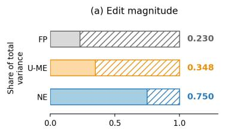

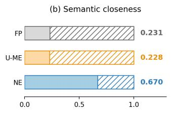

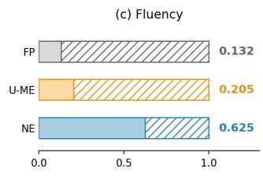

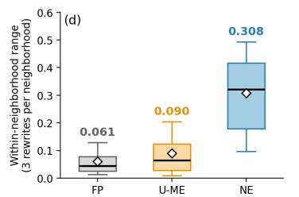

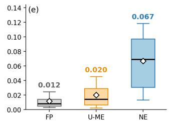

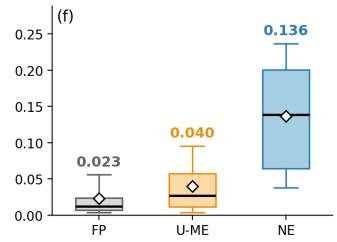  
Figure 7: Where rewrite variation lives, over the full archives and macro-averaged over the 25 dataset–model pairs. (a)–(c) the share of each quality component’s variance that falls within a neighborhood. (d)–(f) the within-neighborhood range of the same component at a fixed count of three rewrites $( m = 3$ per neighborhood, averaged over 200 random subsets, with boxes spanning $p _ { 2 5 } { - } p _ { 7 5 }$ and whiskers $p _ { 1 0 } { - } p _ { 9 0 }$ across neighborhoods. Each panel in (d)–(f) has its own scale.

Decomposition. Fix a constructor, a dataset–model pair, and a quality-score component such as edit magnitude. Each instance has one neighborhood, holding the rewrites the constructor retained for that context. For the between-neighborhood term $\mathrm { V a r } _ { \mathrm { b e t w e e n } } ,$ we average the component’s score over each neighborhood’s own rewrites, which reduces every neighborhood to a single scalar, and take the variance of those numbers across neighborhoods. For the within-neighborhood term $\mathrm { V a r } _ { \mathrm { w i t h i n } }$ we take the variance of the component’ score inside each neighborhood separately, then average those variances over neighborhoods, so that every neighborhood counts once regardless of how many rewrites it holds. We report the share $\mathrm { V a r _ { w i t h i n } / ( V a r _ { w i t h i n } + V a r _ { b e t w e e n } ) }$ , computed per pair and averaged over the 25 pairs.

Range at a fixed neighborhood size. The share in Figure 7 panels (a)–(c) is a ratio of variances and is not affected by how many rewrites a neighborhood holds, but the range in panels (d)–(f) is, since the largest minus the smallest value grows with the number of values compared. Because the constructors retain different numbers of rewrites per neighborhood (Table 11), we hold that count fixed: from every neighborhood holding at least m rewrites we draw 200 random subsets of size m, take the largest minus the smallest value in each, and average over the draws. Panels (d)–(f) report $m { = } 3$ . Here m is a subsample size for this statistic alone.

Results. Figure 7 reports both sources of variation for the three quality components over the full archives. The edit-magnitude shares are 0.75 for NE, 0.35 for U-ME and 0.23 for FP, and the withinneighborhood ranges at m=3 are 0.308, 0.09 and 0.061. Repeating the computation on the $K { = } 3$ matched pool specifically, where all three constructors cover the identical 15730 instances, gives shares of 0.77, 0.39 and 0.23 and ranges of 0.32, 0.10 and 0.06.

## B.7 MODEL ACCURACIES

Table 35 indicates QA performance of the models evaluated in this work.

Table 35: QA performance of each model on each dataset, over the full evaluation population of 1,000 instances per dataset–model pair and $2 5 { , } 0 0 0$ in total. Accuracy is the fraction of instances answered correctly under greedy decoding, using the stored correctness label that defines the failure target throughout the paper. Token F1 is the token overlap between the model’s answer and the reference, which is sensitive to answer length in a way the correctness label is not: Phi4-14B answers at 11.5 words on average on AdversarialQA and 20.7 on NewsQA, against 2.3–4.7 for Gemma3- 12B, and its token F1 falls correspondingly further below its accuracy. Row means are unweighted over the five datasets.

<table><tr><td>Model</td><td></td><td></td><td></td><td>SQuAD v1.1 Quoref NewsQA Natural Questions AdversarialQA Mean</td><td></td><td></td></tr><tr><td colspan="7">Accuracy</td></tr><tr><td>Gemma3-12B</td><td>0.843</td><td>0.781</td><td>0.540</td><td>0.755</td><td>0.636</td><td>0.711</td></tr><tr><td>OLMo2-13B-Instruct</td><td>0.750</td><td>0.698</td><td>0.420</td><td>0.692</td><td>0.531</td><td>0.618</td></tr><tr><td>Phi4-14B</td><td>0.778</td><td>0.764</td><td>0.405</td><td>0.689</td><td>0.554</td><td>0.638</td></tr><tr><td>Mistral-Nemo-12B</td><td>0.729</td><td>0.685</td><td>0.415</td><td>0.657</td><td>0.528</td><td>0.603</td></tr><tr><td>Falcon3-10B-Instruct</td><td>0.759</td><td>0.676</td><td>0.467</td><td>0.699</td><td>0.520</td><td>0.624</td></tr><tr><td>Mean</td><td>0.772</td><td>0.721</td><td>0.449</td><td>0.698</td><td>0.554</td><td>0.639</td></tr><tr><td colspan="7">Token F1</td></tr><tr><td>Gemma3-12B</td><td>0.797</td><td>0.726</td><td>0.596</td><td>0.768</td><td>0.603</td><td>0.698</td></tr><tr><td>OLMo2-13B-Instruct</td><td>0.737</td><td>0.660</td><td>0.483</td><td>0.710</td><td>0.516</td><td>0.621</td></tr><tr><td>Phi4-14B</td><td>0.661</td><td>0.628</td><td>0.363</td><td>0.638</td><td>0.436</td><td>0.545</td></tr><tr><td>Mistral-Nemo-12B</td><td>0.708</td><td>0.631</td><td>0.477</td><td>0.680</td><td>0.483</td><td>0.596</td></tr><tr><td>Falcon3-10B-Instruct</td><td>0.666</td><td>0.540</td><td>0.452</td><td>0.671</td><td>0.416</td><td>0.549</td></tr><tr><td>Mean</td><td>0.714</td><td>0.637</td><td>0.474</td><td>0.693</td><td>0.491</td><td>0.602</td></tr></table>

## C NEIGHBORHOOD CONSTRUCTION

## C.1 CONSTRUCTOR DETAILS

Algorithm 1 and 2 operate per QA example and share four operators.

• EMPTYARCHIVE(D) initializes an empty archive A over the descriptor space $\mathcal { D } = \mathcal { T } \times \mathcal { S }$ (rewrite type × support explicitness).

• EDIT(E, P, σ) (Appendix C.3) has the editor LLM E apply strategy σ to a context P and return an offspring rewrite O. For the seeds, $P = x$

• FI $\mathrm { T N E S S } ( O , x )$ (Appendix C.5) scores O against the original context x as a normalized weighted mean of edit magnitude, fluency, and semantic closeness.

• PLACE(A, O, FITNESS(O, x)) (Appendix C.2.3) files O in the cell given by its realized edit type and its measured support explicitness, replacing the current occupant only if $O \mathrm { { s } }$ search objective value is higher.

The two algorithms differ in what they choose to edit and in how strictly they validate the result. Throughout, the budget B is the per-example attempt budget: the maximum number of editor calls (candidate rewrites attempted) for a single example, used identically by all three constructors.

## C.1.1 NEIGHBORHOOD ELITES (NE)

Algorithm 1 adds three selection operators and a strict acceptance gate as follows:

• SELECTTARGET(A) returns a cell to fill, preferring empty cells (to widen coverage) before weak occupied cells (to improve them).

• SELECTPARENT(A, t) returns the highest-scoring rewrite eligible for target type t, and SELECTSTRATEGY $( \dot { \Sigma } , t )$ a strategy of that type.

Table 36: The four neighborhood constructors. All four use the same editor, the same answerpreservation gate and the same search objective, and they differ in whether they search, in whether they verify the edit, and in whether the rewrite-type axis carries a verified label or a requested one. Static bucket sampling verifies without evolving and the untargeted search evolves without verifying, so between them they bracket the two mechanisms NE combines. D is the twelve-cell descriptor space spanned by edit type and answer support. A dash marks a property the constructor has no machinery for.
<table><tr><td></td><td>FP</td><td>SBS</td><td>U-ME</td><td>NE</td></tr><tr><td>How candidates are generated</td><td></td><td></td><td></td><td></td></tr><tr><td>Archive over D</td><td></td><td>yes</td><td>yes</td><td>yes</td></tr><tr><td>Mutates an archived parent</td><td></td><td></td><td>yes</td><td>yes</td></tr><tr><td>Parent binds the offspring</td><td></td><td></td><td>no</td><td>yes</td></tr><tr><td>Targets empty cells</td><td></td><td>no</td><td>no</td><td>yes</td></tr><tr><td>Edit types requested</td><td></td><td>style only all three</td><td>all three</td><td>all three</td></tr><tr><td>Prompt strategies</td><td>1</td><td>1</td><td>2</td><td>10</td></tr><tr><td colspan="5">What must hold before a rewrite is kept</td></tr><tr><td>Answer recoverable</td><td>gate</td><td>gate</td><td>gate</td><td>gate</td></tr><tr><td>Requested edit realized</td><td>gate</td><td>gate</td><td></td><td>gate</td></tr><tr><td>Distinct from those already kept</td><td>gate</td><td>gate</td><td></td><td>gate</td></tr><tr><td>Differs from its parent</td><td></td><td></td><td></td><td>gate</td></tr><tr><td colspan="5">What the archive records</td></tr><tr><td>Competes within a cell</td><td></td><td>yes</td><td>yes</td><td>yes</td></tr><tr><td>Edit-type axis</td><td>verified</td><td>verified</td><td>requested</td><td>verified</td></tr><tr><td>Editor-call budget</td><td>≤ 50</td><td>25</td><td>25</td><td>25</td></tr></table>

• STRICT $\operatorname { V A L I D } ( O , x , \mathcal { Y } )$ accepts O only if it differs from x and from its parent $P ,$ structurally realizes the requested edit type, is not a duplicate of a rewrite already admitted to the archive, and keeps a complete answer group in the answer spec $\mathcal { V }$ recoverable.

Intuitively, the search is goal-directed. It bootstraps by editing the original context x under each applicable strategy, and from that point on, it repeats a target-mutate-validate loop. It picks a descriptor cell to fill, mutates the best matching rewrite toward that cell under the hard $x \to P \to O$ contract (the original x stays the validity reference), and admits the result only if it truly realizes the requested edit type. Because acceptance verifies the type, requested and realized types coincide, so every occupied cell holds a rewrite that genuinely is what its coordinates indicate, thus the archive’s rewrite-type axis is a faithful behavior label.

## C.1.2 UNTARGETED MAP ELITES (U-ME)

U-ME Algorithm 2 keeps the four shared operators but relaxes the hard variant in three ways as follows:

• No cell targeting. Instead of the three selection operators (SELECT∗), it seeds the archive from a fixed strategy set $\Sigma _ { 0 }$ applied to $x ,$ and each round mutates the strategy $\boldsymbol { \sigma } = ( \boldsymbol { \tau } , \boldsymbol { v } )$ of each of the k best rewrites TOPELITES(A, k) — a new edit type τ and a toggled prompt variant v. A candidate’s cell is known only after it is generated.

• Soft inheritance. The parent rewrite is shown to the editor LLM only as guidance in the edit prompt. The offspring is not required to differ from its parent.

• A weaker gate. It replaces STRICTVALID with VALID, which still requires that $O \neq x ,$ , and that a complete answer group in Y remain recoverable. However, it drops the edit-type realization check and does not enforce edit type uniqueness. Consequently, PLACE operator files each rewrite under the type it was requested, whether or not the editor produced it—a cell labeled DISTRACTOR may hold a paraphrase. Here the rewrite-type axis is a request label, not the verified behavior label of the hard variant; only the support axis is measured from the output.

Algorithm 1 NE (per example)   
Require: context x, question q, answer spec Y, editor LLM E, prompt strategy library Σ, descriptor   
space $\mathcal { D } = \mathcal { T } \times \dot { S } ,$ budget B   
1: A ← EMPTYARCHIVE(D)   
2: for $\sigma \in \Sigma$ applicable to x do ▷ bootstrap   
3: O ← EDIT(E, x, σ)   
4: if STRICTVALID $( O , x , y )$ then   
5: PLACEA, O, FITNESS(O, x)   
6: end if   
7: end for   
8: while budget B remains do   
9: (t, s) ← SELECTTARGET(A)   
10: P ← SELECTPARENT(A, t)   
11: σ ← SELECTSTRATEGY(Σ, t)   
12: O ← EDIT(E, P, σ) ▷ hard inheritance: mutate $P ;$ x stays the reference   
13: if STRICTVALID(O, x, Y) then   
14: PLACEA, O, FITNESS(O, x)   
15: end if   
16: end while   
17: return ELITES(A)

Algorithm 2 U-ME (per instance)   
Require: context x, question q, answer spec Y, editor LLM E, seed prompt strategies $\Sigma _ { 0 } ,$ descriptor   
space $\mathcal { D } = \mathcal { T } \times \dot { S } ,$ attempt budget B   
1: A ← EMPTYARCHIVE(D)   
2: for $\sigma \in \Sigma _ { 0 }$ do ▷ seed from x; no parent   
3: O ← EDIT(E, x, σ)   
4: if VALID(O, x, Y) then   
5: PLACEA, O, FITNESS(O, x)   
6: end if   
7: end for   
8: while budget B remains do   
9: for P ∈ TOPELITES(A, 5) do ▷ global search objective value; no target cell   
10: σ ← MUTATE(P) ▷ new edit type ̸= P’s; toggled prompt variant   
11: O ← EDIT(E, P, σ) ▷ soft inheritance: P is only guidance   
12: if VALID(O, x, Y) then   
13: PLACEA, O, FITNESS(O, x)   
14: end if   
15: end for   
16: end while   
17: return ELITES(A)

## C.1.3 FREE FORM PARAPHRASING (FP)

The paraphrase constructor (Algorithm 3) reuses the same per-example operators as the two MAP-Elites constructors but removes their evolutionary search structure entirely. It does not have archive, cell targeting, and it never selects or mutates a parent. A single fixed strategy $\sigma _ { \mathrm { p a r } }$ (a STYLE REWRITE paraphrase prompt) is applied to the original context x within budget B. Each call is an independent draw, so the candidates are i.i.d. paraphrases of x rather than descendants of one another. This makes the constructor an unstructured, matched-size control. It produces a neighborhood of the same construction cost and the same archive size as the hard archive it is paired with, but with no coverage objective and no behavioral-type structure.

Concretely, the three shared operators keep their exact meaning. EDIT $\cdot ( \mathcal { E } , x , \sigma _ { \mathrm { p a r } } )$ has the editor LLM E produce one paraphrase offspring O of x. Because the parent is always x, there is no inheritance in this setting. STRICTVALID(O, x, Y) is the same strict gate used by the hard variant. O must differ from x, structurally realize STYLE REWRITE, and contain a complete answer group in the answer set $\mathcal { V }$ recoverable such that every admitted paraphrase clears the identical answer-preservation condition. FITNESS $( O , x )$ scores each valid paraphrase exactly as the other methods but here search objective value is only recorded, never used to admit rewrites, or rank them as there are no descriptor cells to compete over. Admission is therefore first-come rather than competitive. Each valid, non-duplicate paraphrase is appended to a flat list $\mathcal { P }$ (in contrast to $\mathrm { P L A C E }$ , which would file it in a descriptor cell and keep only the local rewrite), and the loop stops once $\mathcal { P }$ reaches the matched size K or the attempt budget is hit. A running attempt counter a tracks how many paraphrases have been drawn. It caps the loop at $B$ attempts so that a hard example whose paraphrases repeatedly fail the STRICTVALID gate or duplicate an existing member cannot spin indefinitely, and the neighborhood is returned with a reported shortfall $K - | \mathcal { P } |$ if the cap is reached first. The size K is set to the final elite count of the paired hard- inheritance archive, so the two neighborhoods are the same size by construction and any downstream difference in the uncertainty signal is attributable to how the neighborhood was built, not to how many members it has.

Algorithm 3 FP (per example)   
Require: context $x ,$ question $q ,$ answer set Y, editor LLM E, fixed paraphrase strategy $\sigma _ { \mathrm { p a r } } ,$   
matched size $K ,$ attempt budget B   
1: $\mathcal { P }  \emptyset ; \quad a  0$   
2: while $| \mathcal { P } | < K$ and $a < B$ do   
3: a ← a + 1   
4: $O \gets \mathrm { E D I T } ( \mathcal { E } , x , \sigma _ { \mathrm { p a r } } )$ ▷ independent paraphrase of $x ;$ no parent, no mutation   
5: if $\mathbf { S T R I C T V A L I D } ( \bar { O , } x , \mathcal { y } )$ and $O \notin { \mathcal { P } }$ then   
6: record FITNESS(O, x); append O to P ▷ fitness recorded, does not gate admission   
7: end if   
8: end while   
9: return $\mathcal { P }$

## C.1.4 STATIC BUCKET SAMPLING (SBS)

Static bucket sampling (Algorithm 4) keeps the archive and its gates but removes the search. It spends the same per-example budget B as the two MAP-Elites constructors, and every call is an independent proposal from the original context x under one fixed prompt strategy $\sigma _ { \mathrm { s b s } } ,$ with the requested rewrite type cycling through T in turn. The generation pattern is therefore $x \ \to \ \tilde { x } _ { 1 }$ $x  \tilde { x } _ { 2 } , . . .$ . with no parent and no lineage, so a candidate’s coordinates are known only after it has been produced. Placement is decided after generation rather than aimed at, which is the one property that separates this constructor from NE.

Concretely, the shared operators keep their exact meaning. EDIT $( \mathcal { E } , x , ( \tau , \sigma _ { \mathrm { s b s } } ) )$ has the editor LLM $\mathcal { E }$ produce one rewrite O of x under requested type τ. Because the base is always x, there is no inheritance and the $O \neq P$ condition has nothing to apply to. $\mathbf { S T R I C T V A L I D } ( O , x , \mathcal { Y } )$ is the same strict gate the hard variant uses, read as it is for the paraphrase constructor: $O$ must differ from $x ,$ must structurally realize the requested type $\tau ,$ must not duplicate a rewrite already admitted to the archive, and must keep a complete answer group in the answer spec $\mathcal { V }$ recoverable. PLACE then files the survivor in the cell given by its realized type and its measured support explicitness, where it competes for that cell on the search objective exactly as in the two MAP-Elites constructors. Because the realization check is in force, requested and realized types coincide, so the rewrite-type axis carries a verified behavior label here as it does for NE.

This constructor isolates the evolutionary component of the proposed constructor. It asks whether the archive, the gates, and an explicit request for each edit type are by themselves enough to recover the coverage that lineage and cell targeting produce.

Algorithm 4 Static bucket sampling neighborhood (per example)   
Require: context x, question q, answer spec Y, editor LLM E, fixed prompt strategy $\sigma _ { \mathrm { s b s } } .$ , rewrite   
types T, descriptor space $\begin{array} { r } { \hat { \mathcal { D } } = \mathcal { T } \times \hat { \mathcal { S } } . } \end{array}$ , attempt budget B   
1: A ← EMPTYARCHIVE(D); a ← 0   
2: while $a < B$ do   
3: a ← a + 1   
4: τ ← NEXTTYPE(T, a) ▷ cycle the three types in turn; no target cell   
5: O ← EDIT(E, x, (τ, σsbs)) ▷ independent proposal from x; no parent   
6: if STRICTVALID(O, x, Y) then   
7: PLACEA, O, FITNESS(O, x)   
8: end if   
9: end while   
10: return ELITES(A)

## C.2 DESCRIPTOR SPACE D AND CELL ASSIGNMENT

First, we must distinguish between two objects that are easily confused. The descriptor space D is the fixed behavioral coordinate system, shared by every example and every constructor. The archive $\mathcal { A } _ { x }$ is the concrete, per-example container that stores at most one rewrite (an elite) in each occupied coordinate. In short, D is the map and $\mathcal { A } _ { x }$ is what a given instance places on it: each source QA instance x receives its own archive.

We build an archive $\mathcal { A } _ { x }$ per example per method. Each source QA instance receives its own MAP-Elites archive. The descriptor space D is the Cartesian product of a rewrite-type and a supportexplicitness axes $( \mathcal { D } = \mathcal { T } \times \mathcal { S } )$ where

• T = {distractor, reorder, style rewrite}   
• S = {direct support, paraphrastic support,   
discourse mediated support, multi sentence support},

providing 3 × 4 = 12 possible cells in the archive.

A candidate’s cell in D is fixed by two coordinates obtained differently:

• the T coordinate is the requested edit operation. In the hard-inheritance constructor (and the paraphrase comparator) a candidate is admitted only after the realization gate (Appendix C.4.2) confirms the edit is successfully carried out, so requested and realized types coincide and this coordinate is a verified behavior label; the soft-inheritance constructor omits this gate and files by requested type alone (Table 36).

• the S coordinate is measured from the produced context by the deterministic rule of Appendix C.2.2, and may differ from any support level the editor is asked to target.

Only these two coordinates define a cell in D: the prompt strategy (Appendix G) is not a descriptor, so two candidates from different strategies compete in the same cell whenever their edit type and measured support bucket agree.

## C.2.1 REWRITE-TYPE AXIS T

The rewrite-type axis records what kind ofedit produced the rewrite,

$$
\mathcal T = \{ \mathrm { d i s t r a c t o r , ~ r e o r d e r , ~ s t y l e \mathrm { _ - } r e w r i t { e } } \} .
$$

This axis is the requested edit operation carried in the edit program (operation type), not a type inferred from the output. In the hard-inheritance and the paraphrase constructors, a candidate is admitted only after the realization gate (Appendix C.4.2) confirms the requested edit is actually applied. Requested and realized types therefore coincide for every stored rewrite, and this coordinate is a verified behavior label. The soft-inheritance constructor omits that gate and files by the requested type alone, so there the axis is a request label rather than a verified one (Table 36).

## C.2.2 SUPPORT-EXPLICITNESS AXIS S

The support-explicitness axis registers how directly the edited context states the evidence for the answer,

$$
\mathcal { S } = \{ \mathtt { d i r e c t } , \mathtt { p a r a p h r a s t i c } , \mathtt { d i s c o u r s e \_ m e d i a t e d } , \mathtt { m u l t i \_ s e n t e n c e } \} .
$$

Unlike the rewrite type, this coordinate is not requested but measured from the produced context by a deterministic lexical/structural rule. Intuitively: direct means the answer and its supporting cue sit together in a single clause; discourse mediated means recovering the answer requires following a coreference link; multi sentence means the support is spread across two or more sentences; and paraphrastic is the residual bucket for support that is present but meets none of the above.

Given the question, the edited context, and the gold answer, the cell is assigned by a deterministic pipeline in four steps:

1. Extract question anchors. We tokenize the question , lowercase it, and remove wh-words and configured function words. We keep each remaining token a and tag them with a rule-based tagger (suffix heuristic, not a trained model) into adjective, noun, number, proper noun, or verb. After dropping duplicates we obtain the anchor set Anchor . For a span of text T, anchor coverage is

$$
R _ { \mathrm { a n c h o r } } ( T ) = { \frac { \left| \left\{ a \in A n c h o r _ { Q } : a { \mathrm { o c c u r s i n } } T \right\} \right| } { \left| A n c h o r _ { Q } \right| } } \qquad ( 0 { \mathrm { w h e n } } A n c h o r _ { Q } = \emptyset ) .
$$

Matching is exact at the token level (case insensitive; no stemming, lemmatization).

2. Locate the primary support sentence. We split the context is split sentences by a [.!?]+ regular expression. The rule fixes on primary support sentence where the answer is grounded. The selection prefers in order: the sentence the edit flagged as its support location (if one is recorded), otherwise the first sentence containing the answer.

3. Select the support window. This step decides how much context counts as the support. Among the windows that exist around the primary sentence $S _ { i } ,$ we consider $\{ S _ { i } \} , \{ S _ { i - 1 } , S _ { i } \} , \{ S _ { i } , S _ { i + 1 } \}$ $\{ S _ { i - 1 } , S _ { i } , S _ { i + 1 } \}$ . The $S _ { i }$ is the default best and window replaces the best only on a strict increase in $R _ { a n c h o r } .$ . The ties are resolved in favor of the earlier window in the list above. The selected window finally follows three cases, applied in order:

(a) Pronoun-driven expansion. When the answer sentence leans on a pronoun (e.g., it, this, these) to point back to entity named earlier, it often does not itself carry the question’s key terms. In that case, if a neighboring sentence supplies a term the answer sentence is missing, the window expands to include it, so the support is read across both sentences.

(b) Keep the primary alone when the support is already informative on its own: $R _ { \mathrm { a n c h o r } } \geq 0 . 5$ or it contains at least two distinct anchors (this second condition can retain the primary even when its coverage is below 0.5).

(c) Otherwise expand to the best window. This can reach a neighbor even with no pronoun present.

The number of selected sentences is support sentence count: the extent of the chosen window and it is not a separately verified count of logically necessary evidence sentences.

4. Assign the bucket. On the selected support, we compute three features. The support-sentence count is the number of sentences selected above. The coreference proxy is true when the primary sentence uses a configured coreference marker (Table 39) yet does not itself state all of the question’s anchors so the answer is reached through a referring expression rather than the question’s own words (a multi-sentence support sets this proxy automatically, though rule (a) below fires first). The same-clause test is true when, after the sentence is split into clauses at the delimiters (Table 39), some single clause contains both the answer and at least one question anchor. The bucket is then the first match of:

(a) multi sentence if support sentence count≥ 2;

(b) else discourse mediated if the coreference proxy is true;

(c) else direct if the same-clause test holds and the selected sentence’s coverage is $R _ { \mathrm { a n c h o r } } \geq$ 0.5;

(d) else paraphrastic (residual; also the outcome for no anchors, no detected support, or an empty context).

Clauses for the same-clause test are cut at a fixed set of delimiters (Table 39).

Note that relative who is a clause boundary and is not in the coreference-marker set, so a support of the form “. . . , who is represented by . . . ” is neither same-clause nor coreference-mediated and falls to paraphrastic.

The bucket selected in the final step is the candidate’s S coordinate; together with the requested rewrite type (Appendix C.2.1) it fixes the archive cell (Appendix C.2.3).

## C.2.3 CELL ASSIGNMENT AND COMPETITION

A candidate is filed in the cell given by its requested rewrite type and its measured support bucket. The editor is also parameterized by a prompt strategy—a finer instruction template within a rewrite type (Appendix C.3)—but the strategy is not a descriptor: two candidates produced by different strategies land in the same cell whenever their rewrite type and measured support bucket agree, and they then compete there. (A per-candidate “strategy realized” flag is logged for analysis but plays no role in placement.)

Each occupied cell holds exactly one elite. A valid candidate fills an empty cell, or replaces the incumbent only if its scalar search objective value (Appendix C.5) is strictly greater; ties keep the incumbent. Candidates that fail validation or carry no search score cannot enter $\mathcal { A } _ { x }$

## C.3 EDITOR AND EDIT PROGRAMS

The editor in our study serves as a variation operator that turns one context into a new one. Keeping this separate from the archive machinery is important. The editor provides linguistic variation, while the descriptor space and search (Appendices C.2 and and C.6) decide where a candidate lands and whether it is kept, resulting in an archive. The editor is a fixed local LLM, queried once per candidate. We provide its identity and generation settings (temperature, token limit, decoding) in the configuration table and we keep these parameters fixed across all datasets and QA models.

We describe the editor and its role in this study in three parts. The interface describes the input query components that editor receives, the question, its gold answer, and the context to rewrite, and the outputs it generates. The edit program drives the query with a requested rewrite type paired with a prompt strategy, an edit program the search evolves. The deterministic gates (Appendix C.4) then screen every output, checking whether that answer is preserved and the requested edit is realized before it may enter the archive. All in all, the editor mutates a context under a typed instruction, and only rewrites that keep the answer and realize the edit survive. Below, we describe these steps in depth.

Editor interface. We standardize each editor input and output query schema. Regardless of the edit program, we provide the same set of input fields and we instruct the editor to return the same set of output fields for each query.

We provide three input components to the editor:

• the question q and its gold answer y such that editor receives what the rewrite must keep answerable;

• the base context to rewrite. This is the parent P when we mutate an existing rewrite, or the original context x when we start fresh from a seed;

• the original context x once more, hold aside as a fixed reference for the later checks.

We split the base context from the reference to drive the inheritance mechanism act at the moment of generation, and it is precisely where the three constructors differ. Under the main hard-inheritance constructor, the base is a selected parent rewrite $P$ and the reference is the original x: the editor mutates $P$ while x stays pinned as the fixed validity reference, and the child must differ from both $( O \neq P$ and $O \neq x )$ . The soft-inheritance, U-ME constructor still supplies a parent, but only as guidance. The child is not required to move away from it $( O \neq P$ is not enforced). The LLMparaphrase uses no parent at all: it always edits the original $x ,$ so its base and reference coincide, exactly as for a seed. The three are compared in full in Appendix C.1 (Table 36).

The editor returns four fields, but only one is load-bearing:

Table 37: The ten prompt strategies grouped by rewrite type. Candidates from different strategies can occupy the same cell in descriptor space D, where they compete on quality. We detail the prompt templates in Appendix G.
<table><tr><td>Rewrite type</td><td>Prompt strategies</td></tr><tr><td>distractor</td><td>distractor_support-proximal distractor_question_overlap</td></tr><tr><td>reorder</td><td>reorder_adjacent_swap reorder_support_back reorder_global</td></tr><tr><td>style_rewrite</td><td>support_direct_consolidation lexical-paraphrase_biased paraphrase_biased controlled_coreference_rewrite</td></tr></table>

• EDITED CONTEXT is the rewritten context. We use only this field downstream: we measure its descriptor (Appendix C.2) and send it to the gates (Appendix C.4).

• EXPECTED ANSWER is the editor’s own guess at the answer in its rewrite. We record this field and compare it to y, but it never decides admission.

• STATUS and EDIT RATIONALE is for the diagnostic purposes only.

Please note we employ only deterministic gates for validation decisions rather than an editor so the validations are editor-independent (Appendix C.4.1). We provide the exact prompts we used in Appendix G.

Edit program. We query the editor with an edit program, which is a requested rewrite type (operation type ∈ T) paired with a prompt strategy. The two levels play different roles. The rewrite type names the behavior we want such as a distractor, a reorder, or a style rewrite. Once realized, it becomes the candidate’s T coordinate in descriptor space (Appendix C.2.1).

However, a bare rewrite type the lacks the refinement necessary to guide a general-purpose editor. An instruction as broad as ”rewrite this in a different style” admits countless outputs and gives the search no way to aim for a particular kind of rewrite. Therefore, we provide concrete guidance to fill in the missing specificity for realizing the rewrite type with prompt strategies.

For a style rewrite, for instance, support direct consolidation prompt strategy asks the editor to pull the answer’s support into a single clause, whereas multi sentence factored asks it to spread that support across several sentences. Both are style rewrites, yet they push the output toward different support-explicitness cells. An edit program is thus a (type, strategy) pair: (style rewrite, multi sentence factored) or (distractor, distractor question overlap). This structure indicates both the target behavior and the tactic used to realize it. We provide the full set of strategies and their rewrite types in Table 37.

This two-level design is what lets an LLM act as a controllable variation operator. The type fixes the axis of behavior; the strategy aims within it. The style strategies bias the output toward different support-explicitness cells: two candidates from different strategies that land in the cell compete there. The strategy is therefore a means, not a coordinate: it is how a candidate is steered, not how it isfiled. Many strategies map to one rewrite type, and two candidates from different strategies that land in the same cell simply compete there (Appendix C.2.3).

## C.4 DETERMINISTIC GATES

We admit a candidate rewrite into the archive only after it passes deterministic checks that consult neither the QA model $f _ { \theta }$ nor the editor. The rewrite must be non-empty, must differ from the original x (and, for offspring, from the parent P), and must not duplicate a rewrite already in the archive. Two substantive gates then decide admissibility: answer preservation and edit-type realization. Together they form the STRICTVALID operator used by the NE and the FP (Appendix C.1). The U-ME uses the lighter VALID operator, which applies answer preservation but omits the realization guard.

Table 38: The three edit types: the prompt intention (what the editor is asked to do) and the deterministic condition verified between the child and its realization reference (the parent P for offspring, the original context x for seeds).
<table><tr><td>Rewrite type</td><td>Prompt intention</td><td>Deterministic realization condition</td></tr><tr><td>distractor</td><td>Add plausible but answer-irrelevant material while preserving the evi- dence.</td><td>The child differs from the reference, adds at least one sentence, and retains every reference sentence as an exact ordered subsequence.</td></tr><tr><td>reorder</td><td>Change sentence order without adding, deleting, or paraphrasing sentences.</td><td>The reference has at least two sentences; the child differs from it and has the same normalized sentence multiset in a different order.</td></tr><tr><td>style_rewrite</td><td>Rewrite substantive wording or syntax.</td><td>The child&#x27;s token sequence changes, and the child is not merely a sentence permu- tation and not merely a sentence insertion.</td></tr></table>

## C.4.1 ANSWER-PRESERVING VALIDATION

We require the gold answer to remain recoverable from the edited context. We test this with a deterministic lexical check against an answer specification (AnswerSpec).

• An AnswerSpec may list several alternative answer groups (for example, acceptable variants of the gold answer). The edited context passes if every required value of at least one group is lexically recoverable in it.

• Passing this gate certifies only that the answer remains recoverable, not that the edit preserves every source fact. The editor may drop or alter unrelated details and the candidate still passes. We therefore call the edits answer-preserving, not meaning- or information-preserving.

• We log the editor’s EXPECTED ANSWER (Appendix C.3) and compare it to the gold answer, but a mismatch does not block admission; only the AnswerSpec test gates.

## C.4.2 EDIT-TYPE REALIZATION GUARD

We file a candidate under the edit type it requested (Appendix C.2.1), so we verify that the editor actually performed that type; otherwise the axis would record a request rather than a behavior. We reject a candidate that fails as EDIT TYPE NOT REALIZED. Table 38 gives the per-type conditions; two requirements apply to all three types:

• Reference. We compare the child against the realization reference (the original x for seeds, the parent P for offspring) and require every accepted child to also differ from the original x.

• Normalization. Every comparison runs on a canonicalform of the text, one standardized rendering that all cosmetically-different variants map so that formatting alone is never mistaken for an edit. For the sentence-level checks, we split the context into sentences at .!? (discarding those end marks) and standardize each sentence’s Unicode form (NFKC) and spacing. Two sentences that differ only in punctuation or spacing then considered as identical. For the style rewrite check, we reduce each context to its ordered list of words (case-folded \w+ tokens), punctuation dropped and case ignored, so The and the are the same word. Then we compare those lists we obtain. Only a genuine change in wording or in sentence order therefore registers as an edit.

Because admission verifies the type, requested and realized types coincide for every rewrite stored under the hard-inheritance constructor and the FP (which realizes style rewrite), which makes the T axis a verified behavior label. The U-ME omits this guard and files by the requested type alone (Table 36). The guard certifies edit structure, not semantics. Therefore, it does not establish distractor irrelevance or paraphrase faithfulness.

## C.5 SEARCH OBJECTIVE

The search objective value is the scalar fitness MAP-Elites uses to select a cell’s best rewrite. Because MAP-Elites keeps only one rewrite per occupied cell, it needs a scalar to decide, among several valid rewrites that fall in the same descriptor cell of D, which one to keep (Appendix C.2.3). The value of the search objective is that scalar ranks only candidates that have already cleared the gates (Appendix C.4). It never decides admissibility, and it plays no part in the uncertainty assessment. Because validity is already guaranteed by the deterministic gate, the value is free to express a preference among the valid candidates competing for a cell. In our study, we favor rewrites that vary the surface form while remaining fluent and close to the original meaning.

We keep this heuristic intentionally free of any language-model judge, for two reasons. First, computational cost: MAP-Elites scores every candidate it generates, so a judge would add a model inference call to each of the many search iterations per example, limiting the feasibility at the scale at which we build archives. Second, determinism and reproducibility: a deterministic score makes each archive exactly reproducible, whereas a judge would inject stochasticity, version drift, and prompt sensitivity into the experimental flow, for no stronger validity guarantee than the deterministic gate already provides. Our choice is also standard QD practice: classic MAP-Elites uses a cheap, deterministic scalar fitness, so we follow the mainstream QD design rather than deviating from it.

We combine three component scores as a normalized weighted mean,

$$
F i t n e s s ( c ) ~ = ~ \frac { w _ { \mathrm { e d i t } } q _ { \mathrm { e d i t } } ( c ) + w _ { \mathrm { f l u } } q _ { \mathrm { f l u } } ( c ) + w _ { \mathrm { s e m } } q _ { \mathrm { s e m } } ( c ) } { w _ { \mathrm { e d i t } } + w _ { \mathrm { f l u } } + w _ { \mathrm { s e m } } } ,
$$

with fixed weights given in the configuration table and held constant across all datasets and QA models.

• Edit-Magnitude Score $q _ { \mathrm { e d i t } }$ measures how much the candidate’s text changed relative to the original context x. We compare two unit sequences, the tokens (or sentences) a of original x and b of the candidate c, with difflib.SequenceMatcher (Ratcliff & Metzener, 1988), which identifies their matching and differing regions (a diff), and summarize the difference by the change ratio

$$
R ( a , b ) = { \frac { \sum _ { \mathrm { n o n - m a t c h i n g ~ b l o c k s } } \operatorname* { m a x } ( \# \mathrm { d e l e t e d } , \# \mathrm { i n s e r t e d } ) } { \operatorname* { m a x } ( | a | , | b | , 1 ) } } ,
$$

the size of the non-matching regions as a fraction of the longer sequence. $q _ { \mathrm { e d i t } }$ is the mean of this ratio over tokens and over sentences, plus an answer-span change-concentration term when the answer’s span can be located.1 It is a surface measure, not a parse-based notion of syntactic difference.

• Fluency $q _ { \mathrm { f l u } }$ is a deterministic proxy: the mean of a length-balance term, a flag for the absence of runs of three or more repeated punctuation marks, and a printability check. It is not a learned or human-validated fluency model.

• Semantic closeness $q _ { \mathrm { s e m } }$ is the BERTScore F1 (Zhang\* et al., 2020) between the original context x and the child, computed after validation, using a fixed encoder recorded in the configuration table.

qedit and $q _ { \mathrm { s e m } }$ are computed on the same pair $( x \to c )$ and pull in opposite directions. $q _ { \mathrm { e d i t } }$ rewards moving away from the original surface form, and $q _ { \mathrm { s e m } }$ rewards staying close to its meaning. Therefore, their balance expresses exactly the neighbor we aim to form: surface-different but meaning preserving. Admissibility thus remains fully deterministic and model-free (Appendix C.4); a neural model enters only through the non-gating closeness term $q _ { \mathrm { s e m } }$

## C.6 SEARCH AND SCHEDULER

The search is the per-example procedure that spends a fixed evaluation budget B to populate and then improve the archive $A _ { x }$ . Each evaluation is one editor call: we form a single edit program, generate one context, and pass it through the gates, descriptor assignment, and competition described above. The budget counts attempts rather than successes. Rejected, discarded, and accepted candidates each consume one unit so a harder instance yields a sparser archive within the same budget rather than more calls. NE, U-ME and SBS each spend 25 evaluations per example whereas FP consumes up to 50 attempts. All four reuse the same editor (Appendix C.3) and the same gates (Appendix C.4). They differ only in how the next edit program is chosen and how an accepted context is stored. Table 36 compares the four construction methods.

## C.6.1 ONE EVALUATION

Given an edit program, every evaluation proceeds the same way. The editor produces one context (Appendix C.3); the deterministic gates accept or reject it (Appendix C.4); and an accepted context is stored. The three archive-based constructors store it by placement: the context is assigned to its cell from its measured descriptor (Appendix C.2) and competes for that cell by search objective score (Appendix C.5), filling the cell if empty or replacing the occupant only if its score is strictly higher. FP has no grid and instead appends the accepted context to a flat list. Insertion is sequential in every case. The archive (or list) is updated after each evaluation.

## C.6.2 TARGETED STAGED SCHEDULER (NE)

NE spends its budget in three stages, bootstrap, coverage, then fitness. Each stage has a distinct objective. Bootstrap and coverage together may use up to B − r evaluations, where B is the perexample budget and r is a reserve budget held for the fitness-improvement stage (here B = 25 and r = 5, so at most 20 evaluations precede the reserve). The reserve is protected capacity, not a fixed count. If coverage stops early the fitness stage inherits the unused evaluations, and if no action is possible even the reserve may go unspent.

Bootstrap. We seed the archive with one attempt per strategy. For each (rewrite type, strategy) pair, taken in a fixed order, we generate a single candidate directly from the original context x with no parent. This populates initial cells cheaply and gives the later stages candidate rewrites to mutate. With the ten strategies of Appendix C.3, bootstrap issues up to ten attempts.

Coverage. The coverage stage spends the pre-reserve budget filling empty cells. Each iteration chooses a target cell, a parent, and a strategy:

• Target. We consider only empty cells still worth trying, which we call actionable. A cell qualifies if it has been attempted fewer than twice, at least one strategy can target it, and the archive holds at least one rewrite eligible as its parent. Among the actionable cells we pick the one attempted the fewest times so far, breaking ties by a seeded random draw.

• Parent. We rank rewrites by decreasing search objective score and take the first eligible one. For distractor and reorder the parent must already occupy the target support cell, since these edits inherit their parent’s support coordinate (Appendix C.2.2). For style rewrite any elite may serve and the strategy itself aims at the cell.

• Strategy. Among strategies compatible with the target cell, we take the globally least-attempted, skipping any that has no eligible parent.

Coverage ends when no empty cell is actionable, when a patience of five consecutive attempts fails to occupy a new cell, or when the budget reaches the fitness-reserve boundary.

Fitness improvement. The fitness-improvement stage spends the reserve improving occupied cells, weakest first. We order the current archived rewrites by increasing search objective score and cycle through them. For each, we propose a new candidate for that rewrite’s cell using the least-attempted compatible strategy, and it replaces the occupant only if its search objective value is strictly greater (Appendix C.5). Because a candidate is placed by its own measured descriptor, an improvement attempt may land in a different cell than intended. Targeting is therefore besteffort, and final placement always follows the realized descriptor. The stage ends when the budget is exhausted or no cell admits a further attempt.

Illustration. The split among the three stages is emergent, not configured. On one SQuAD instance the 25 evaluations divided into 10 bootstrap, 4 coverage, and 11 fitness improvement, filling

6 of the 12 cells: all ten strategies were eligible at bootstrap, coverage halted after four attempts once no empty cell remained actionable, and the remaining eleven evaluations fell to the fitness stage.

## C.6.3 GENERATIONAL SEARCH (U-ME)

U-ME spends the same 25-evaluation budget as an untargeted, generational loop. It never aims at a particular cell, and a candidate’s cell is known only after it is generated and measured. It begins by generating five seeds directly from x with no parent, cycling through the three rewrite types (distractor, reorder, style rewrite, then distractor and reorder again) under the fixed prompt variant support rewrite aggressive. It then repeats a generational step until the budget is spent. As in NE, we rank the current rewrites by decreasing search objective score, take up to the top five, and generate exactly one offspring from each. Each offspring’s edit program is a deterministic mutation of its parent’s. The requested rewrite type is changed to a different type, and the prompt variant is toggled between the constructors’s two variants (support rewrite aggressive and local conservative). In this case, the mutation is a function of the attempt index rather than a random draw. Offspring are validated, placed, and compete exactly as in Appendix C.6.1, except that this constructor applies the lighter validity gate: it requires answer preservation without the realization guard (Appendix C.4) and files each rewrite by its requested type. The loop stops when the budget is exhausted or when no elite is available to serve as a parent.

## C.6.4 APPEND LOOP (FP)

FP has no archive, no parent and no cell targeting. It draws independent paraphrases of the original context x and appends the valid ones until it matches the size of the main method’s archive. For each test instance, we set the target count K to the number of accepted elites in that example’s NE archive, so the constructor is compared at the same neighborhood size. We then attempt up to 50 proposals, each a single fixed edit program, a style rewrite under the llm paraphrase prompt generated from x with no parent. Each proposal passes through the same gates as the paraphraserealizing main-method candidates (Appendix C.4) and is additionally rejected if it duplicates an already-accepted paraphrase (exact match after Unicode NFKC and whitespace normalization). Accepted paraphrases are appended in acceptance order; unlike the archive-based constructors there is no cell, no competition and no replacement. The search objective is recorded but never used to admit or rank (Appendix C.5). The loop stops at K accepted paraphrases or 50 attempts, whichever comes first. We allow more attempts here than the 25 of the MAP-Elites constructors because FP reache K less reliably; the larger attempt budget strengthens the FP, making the matched-K comparison conservative.

## D PREDICTION AND UNCERTAINTY SCORING

We turn each archive into one uncertainty score by asking the frozen QA model to answer every rewrite in the neighborhood and measuring how much its answers disagree. The steps below fix the parts of that computation that the main text states only in outline: the query, the meaning-based grouping, and the properties of the resulting scores.

We query $f _ { \theta }$ once on each archived rewrite and never on the original context x. For an instance (q, x, y) we hold the question q fixed, present each rewrite kept in $\mathcal { A } _ { x }$ to $f _ { \theta }$ under a single fixed prompt. The prompt provides the same instruction for every dataset and QA model, and the question before the context and asking for the answer alone (shown below). We keep the first cleaned line of the answer, with any answer: preamble removed, as the prediction: one per rewrite. Decoding is greedy (we set the temperature 0, at most 64 new tokens), so the predictions are deterministic given the archive. We exclude x itself, because whether $f _ { \theta }$ answers x correctly is the failure we later try to detect, and it must not enter the signal used to detect it. How many of these predictions, K, enter each score is fixed by the evaluation protocol (Appendix E).

QA-model prompt. Every query uses the same system and user messages:

System prompt (QA model)   
You are a question answering system with highest accuracy.

User template (QA model)   
Answer the question using only the provided context.   
Question:   
{question}   
Context:   
{context}   
Return only the answer, make sure that answer is correct and do not   
generate a sentence explaining or describing the answer.

We deliver these through each model’s chat template (with any thinking mode disabled) or, for a model that exposes no chat template, as a single plain-text prompt with System:, User:, and Assistant: labels; the wording is identical across datasets and QA models, and only the chattemplate control tokens differ.

We group the predictions by meaning in two stages, where the second stage only merges the classes the first stage forms and never splits them. We first collapse identical predictions into exact-answer classes under a fixed normalization, then merge classes that carry the same meaning with a frozen NLI model (DeBERTa-v3-base-mnli-fever-anli), following the semantic entropy construction of Kuhn et al. (2023). For two exact classes, we render one representative of each as the question-conditioned statement ”The answer to "q" is a.” and classify the pair in both directions. The two classes are equivalent when the model’s top label is entailment each way. In addition, the semantic classes are the connected components of this relation, so a chain of equivalent pairs joins a single cluster. For example, if a neighborhood yields the predictions Uruguay, uruguay., the Uruguay national team, and Argentina, normalization already places Uruguay and uruguay. in one exact class; the model then judges the Uruguay national team equivalent and merges it in, while Argentina stays apart, so the four raw strings collapse to two answer meanings. The model sees only the question and the predictions; it never sees the gold answer y or the failure label, and no context is included. The normalization behind the exact classes strips any answer:-style prefix and keeps the first line, applies Unicode NFKC and maps common Unicode punctuation to ASCII, lower-cases, deletes punctuation, drops the articles a, an, and the, collapses whitespace, and rewrites a pure number-word answer (for example twenty-one) as digits; it applies no stemming and no accent folding.

## E EVALUATION PROTOCOL

Correctness and failure labels. We score each constructor by how well its neighborhood-derived uncertainty separates correct from incorrect original-context predictions. The prediction we flag is fθ’s answer on the original context x, and we judge its correctness with a permissive match against the instance’s answer specification: the answer counts as correct if it matches any accepted gold group—alternative gold answers are singleton groups, so matching any one suffices—through a cascade of increasingly permissive checks: an exact match; a normalized match (the normalization of Appendix D, extended with month-name date canonicalization); a conservative containment test, in which a short gold string that appears verbatim inside the normalized prediction counts as a match; and, last, a bidirectional-entailment test using the same NLI model as the semantic clustering (Appendix D). The failure label is the negation of this correctness, and the cascade is permissive in the direction that matters: a paraphrase of the gold answer is scored correct rather than counted as a failure, so surface variation does not inflate the failure set.

Failure detection: AUROC and AUPRC. We compute AUROC and AUPRC within each of the 25 dataset–model pairs and report the macro-average over pairs, so every pair carries equal weight whatever its size. AUPRC is reported as lift over the pair’s base rate, because base rates move with the pool and range from 0.315 to 0.361 across methods. A difference between two methods is computed on the instances both of them score, and its 95% interval comes from 2000 bootstrap replicates that resample instances within each pair and recompute the macro-average. This bootstrap is distinct from the sub-selection repeats of the matched design (Appendix B.1), which also number 2000 but resample which K rewrites enter a neighborhood rather than which instances enter a pair.

Scoring pool. We score every method on the instances it generates. Each dataset–model pair contributes 1000 instances, and a method scores an instance when it has at least two predictions for it. Two is the smallest count at which semantic entropy is defined, since the measure is identically zero on a single prediction. The restriction is imposed by the measure rather than chosen: the three scores read from the original context are defined on a single prediction and none of them improves under it, so the restriction cannot be what produces the comparison we report. Unless a table states otherwise, no subselection is applied and every rewrite a constructor retained for an instance enters that instance’s score.

Reported columns. The result tables throughout the appendix share a common set of columns, defined once here. The number of instances scored differs by method, so we report it as n, alongside coverage, the share of the 1000 instances per pair that a method scores at all. Base rates therefore differ by method as well, and AUPRC is reported beside the base rate it sits above, because AUPRC is not comparable across populations of different prevalence; lift is AUPRC minus that base rate. Where a table reports SD, MIN and MAX, these summarise the 25 per-pair AUROC values and describe how evenly a method performs across pairs, not how precisely its mean is estimated.

## F CONFIGURATION

We fix a single configuration for all experiments and report it here for reproducibility. Every value is held constant across datasets and QA models. Table 39 lists the settings, grouped by component (editor, support-explicitness rule, fitness (search objective) score, gates, and search); the mechanisms that use them are described in the referenced appendices.

Table 39: Configuration used throughout, held fixed across all datasets and QA models.
<table><tr><td>Setting</td><td>Value</td></tr><tr><td>Random seed</td><td>7</td></tr><tr><td>Editor (Appendix C.3)</td><td></td></tr><tr><td>Model</td><td>Qwen3-8B (local MLX, 8-bit)</td></tr><tr><td>Decoding parameters</td><td>temperature 0.7; sampling on; max new tokens 1200</td></tr><tr><td>Support-explicitness rule (Appendix C.2.2)</td><td></td></tr><tr><td>Sentence-split / token patterns</td><td> $[ \ , \ ! \ ? ] + \ / \ [ \tt A - Z a - Z 0 - 9 ] + ( \tt ^ { \prime } \ [ \tt A - Z a - z 0 - 9 ] + ) \ ?$ </td></tr><tr><td>Anchor overlap threshold; multi-sentence min</td><td>0.5; 2</td></tr><tr><td>POS kept by anchor tagger Coreference markers</td><td>adjective, noun, number, proper noun, verb {he, she, they, them, it, its, his, her, their, this, that, these,</td></tr><tr><td></td><td>those, former, latter, such}</td></tr><tr><td>Clause-split delimiters</td><td>comma, colon, semicolon, parenthesis; and, but, because, while, although, though; which, who, that, where, when</td></tr><tr><td>Search objective score (Appendix C.5)</td><td></td></tr><tr><td>Weights  $( w _ { \mathrm { e d i t } } , w _ { \mathrm { f l u } } , w _ { \mathrm { s e m } } )$ </td><td>(0.3, 0.2, 0.1); normalizer ∑ w = 0.6</td></tr><tr><td>Semantic-closeness encoder</td><td>BERTScore F1, RoBERTa-large (English default), no baseline rescaling</td></tr><tr><td>Gates (Appendix C.4)</td><td></td></tr><tr><td>Realization guard</td><td>FP: on; SBS: on; U-ME: off; NE: on</td></tr><tr><td>Search (Appendix C.6)</td><td></td></tr><tr><td>Budget</td><td>FP: up to 50 attempts; SBS, U-ME, NE: 25 evaluations each</td></tr><tr><td>Hard staged scheduler</td><td>bootstrap_attempts-per_strategy= 1; coverage-patience= 5; target_attempt_limit=2;</td></tr><tr><td>Soft-inheritance</td><td>quality-evaluation_reserve=5; target_selection=least_attempted_seeded init_seed_candidates= 5; parent_selection=best;</td></tr><tr><td></td><td>offspring-per_iteration= 5; prompt variants {support_rewrite_aggressive, local_conservative}</td></tr><tr><td>LLM paraphrase Static bucket sampling</td><td>K = matched hard-archive elite count; max_attempts= 50 requested type cycles T in turn under one fixed prompt</td></tr><tr><td></td><td>strategy local_conservative no parent, no cell targeting</td></tr><tr><td>Prediction and uncertainty scoring (Appendix D) QA decoding</td><td></td></tr><tr><td>QA prompt</td><td>greedy: temperature 0; sampling off; max new tokens 64 grounded_qa (question before context; answer only; fixed</td></tr><tr><td>Semantic-clustering model</td><td>across datasets and QA models) DeBERTa-v3-base-mnli-fever-anli (HFNLI</td></tr><tr><td></td><td>backend)</td></tr><tr><td>Equivalence rule</td><td>bidirectional entailment, argmax label both directions; max pairwise comparisons 128</td></tr><tr><td>Evaluation (Appendix E)</td><td></td></tr><tr><td>Neighborhood size K Sub-selection repeats</td><td> $\{ 3 , 4 , 5 , 6 , 7 \}$  ; separate matched pool per K R = 2000; report mean and empirical [2.5, 97.5] percentile</td></tr><tr><td></td><td>interval</td></tr><tr><td>Per-draw seed</td><td>first 64 bits of SHA-256(seed, dataset, QA model, constructor, instance, K, repeat)</td></tr></table>

## G EDITOR PROMPT TEMPLATES

The two MAP-Elites constructors uses one fixed prompt template on each query with two parts. The system prompt states the editor’s role and the rules it must follow and is identical on every query. The user prompt contains one query’s task: the question q, the gold answer y, and three contexts in an A → B → C structure where A is the original context x (the fixed validity reference), B is the base the editor rewrites (the parent P, or x for a seed), and C is the child it must produce. A part that changes from query to query is the edit program: a requested rewrite type paired with a prompt strategy (Appendix C.3; the ten strategies appear in Table 37). The editor’s identity and generation settings are in the configuration table (Appendix F).

We build each query’s user prompt by filling the template’s blanks with the example’s fields and the edit program. The inheritance block supplies B: the seed version when there is no parent (so B = x), or the offspring version when there is a parent to build on (B = P). The edit program fills two further fields. The rewrite type supplies the text at {edit type guidance} and the strategy the text at {prompt variant guidance}. We then send the system prompt and the filled user prompt to the editor together.

System prompt (MAP-Elites)   
You are a controlled evidence editor for question-answering datasets.   
Produce exactly the requested invariant edit while preserving the   
correct answer and every fact needed to support it. Treat the original   
context only as the immutable validity reference A. When a parent B is   
provided, mutate B; do not independently rewrite A.   
Return structured output only. Respond with exactly four lines   
starting with:   
'STATUS:', 'EDITED\_CONTEXT:', 'EXPECTED\_ANSWER:', and   
'EDIT\_RATIONALE:'.   
EXPECTED\_ANSWER is bookkeeping only and must copy the provided   
original answer exactly without paraphrasing or expanding it. Use   
STATUS: proposed when you can produce a valid answer-preserving edit.   
Use STATUS: failed when you cannot produce one safely.

User prompt   
ORIGINAL VALIDITY REFERENCE (A)   
Question: {question}   
Fixed original answer: {answer}   
Original context: {original\_context}   
{inheritance\_block}   
REQUESTED CHILD CONTRACT (C)   
Child rewrite type: {requested\_edit\_type}   
Child prompt variant: {prompt\_variant}   
Required textual operation: {edit\_type\_guidance}   
Mutation-magnitude guidance: {prompt\_variant\_guidance}   
The textual-operation contract takes precedence over the prompt   
variant. Do not substitute a different edit type. The dataset answer   
specification is fixed: copy the answer exactly, preserve its   
evidence, and do not introduce a new supported answer.   
If a parent B is provided, C must differ from B after Unicode and   
whitespace normalization.

Inheritance block. We use the following block for a seed candidate:

Seed inheritance block   
SEED MUTATION BASE (B)   
No archived parent exists. For this seed only, use original context A   
as B.

We indicate the parent and the explicit delta for an offspring:

Offspring inheritance block   
ARCHIVED PARENT MUTATION BASE (B)   
Parent candidate id: {parent\_candidate\_id}   
Parent edited context: {parent\_edited\_context}   
EXPLICIT MUTATION DELTA (B -> C)   
Rewrite type: {parent\_edit\_type} -> {child\_edit\_type}   
Prompt variant: {parent\_prompt\_variant} -> {child\_prompt\_variant}   
Apply this delta to B. B is the text to modify; A is only the validity   
reference.

Broad operation strings. The requested rewrite type fills Required textual operation field in user prompt with one of:

Broad operation strings   
distractor: retain every sentence of mutation base B in the same order   
and add at least one new plausible sentence that is irrelevant to   
answering the question   
reorder: change the order of at least two complete sentences from   
mutation base B without adding, deleting, or paraphrasing those   
sentences   
style\_rewrite: rewrite the wording or syntax of substantive text from   
mutation base B; a mere sentence insertion or sentence reordering does   
not satisfy this operation

If the strategy and the required edit type ever conflict, the editor must satisfy the edit type as the strategy shapes only how the edit is carried out.

Per-strategy guidance. Each of the ten strategies (Table 37) supplies the Mutation-magnitude guidance field in user prompt. A per-candidate “strategy realized” flag does not gate cell placement; only the broad-type realization guard can reject (Appendix C.4.2). These guidance strings are:

Per-strategy guidance strings   
distractor\_support\_proximal:   
Retain mutation base B verbatim and insert exactly one plausible but   
answer-irrelevant sentence immediately before or after the sentence   
containing the fixed answer. The inserted sentence must not state,   
contradict, or help derive the answer.   
distractor\_question\_overlap:   
Retain mutation base B verbatim and insert exactly one plausible but   
answer-irrelevant sentence. Reuse meaningful non-answer terms from   
the question so the distractor is lexically tempting, but do not   
state, contradict, or help derive the fixed answer.   
reorder\_adjacent\_swap:   
Swap exactly one adjacent pair of complete sentences in mutation   
base B. Keep every sentence byte-for-byte otherwise and add or   
delete nothing.

reorder\_support\_back:   
Move the complete sentence containing the fixed answer to the final   
sentence position. Preserve the relative order and exact wording of   
every other sentence.   
reorder\_global:   
Globally permute at least three complete sentences from mutation   
base B. This must not be only one adjacent swap; preserve every   
sentence exactly and add or delete nothing.   
support\_direct\_consolidation:   
Rewrite the support into one self-contained sentence in which the   
fixed answer and the question-defining relation are explicit in the   
same clause. Avoid a pronoun that requires another sentence to   
resolve the answer.   
lexical\_paraphrase\_biased:   
Prefer a fluent paraphrase that preserves the exact answer and   
supporting meaning, but changes wording substantially. Keep the   
support in a single sentence when possible. Reduce direct lexical   
copying from the original wording.   
paraphrase\_biased:   
Prefer a fluent paraphrase or style rewrite that keeps the answer   
span stable while   
changing wording and sentence form.   
controlled\_coreference\_rewrite:   
Rewrite the support using one explicit, unambiguous antecedent   
followed by a controlled pronoun or referring expression. The   
supporting relation should require resolving that reference, while   
the fixed answer remains verbatim and fully supported.   
multi\_sentence\_factored:   
Prefer a rewrite that splits or distributes the supporting   
information across multiple sentences. The original answer must   
remain recoverable from the edited context, but the evidence may be   
spread across multiple sentences.

Three further variant strings appear in the editor code but not in the hard staged registry: support rewrite aggressive and local conservative are the prompt variants used by the U-ME (Appendix C.6.3). The FP uses a single fixed llm paraphrase prompt (Appendix C.6.4).

FP prompt. The FP does not use the templates above. It requests a direct paraphrase of the original context and never conditions on a parent, so it uses its own fixed system and user prompt without A → B → C structure, inheritance block, and per-strategy guidance. It shares only the four-line output contract and the chat-format delivery. Its two prompts are:

System prompt (LLM-paraphrase)   
You are a controlled evidence paraphraser for question-answering   
datasets. Rewrite the provided original context directly, without   
using or imagining a parent edit. Preserve every fact, omission,   
evidential relation, and the correct answer. Do not add distractors,   
new claims, interpretations, or unsupported details.   
Return structured output only. Respond with exactly four lines   
starting with: 'STATUS:', 'EDITED\_CONTEXT:', 'EXPECTED\_ANSWER:', and   
'EDIT\_RATIONALE:'.   
EXPECTED\_ANSWER is bookkeeping only and must copy the fixed answer   
exactly. Use STATUS: proposed only when the result is a faithful   
answer-preserving paraphrase; otherwise use STATUS: failed.

User prompt (LLM-paraphrase)   
Question: {question}   
Fixed answer: {answer}   
Original context to paraphrase: {context}   
Task: Produce one fluent paraphrase of the complete original context.   
Change substantive wording and/or syntax so the text is observably   
different, while preserving the fixed answer string and all evidence   
needed to answer the question. Do not merely reorder sentences, insert   
a sentence, summarize, omit information, or introduce any new   
information.

Output format and parsing. A valid response is four indicated field lines:

Output format   
STATUS: proposed   
EDITED\_CONTEXT: {complete edited context}   
EXPECTED\_ANSWER: {exact copy of the fixed original answer}   
EDIT\_RATIONALE: {explanation of the edit and answer preservation}

If the editor cannot produce the edit successfully, we expect it to return STATUS: failed with an empty edited context. The parser reads the lines beginning with the four exact fields; a proposed response with no edited context is marked malformed. Only EDITED CONTEXT is consumed downstream; EXPECTED ANSWER is compared to the gold answer but does not gate admission (Appendix C.4).

## H DATASETS

We evaluate on five extractive QA datasets chosen to span domains and difficulty. SQuAD v1.1 (Rajpurkar et al., 2016) provides standard Wikipedia-based span questions; Quoref (Dasigi et al., 2019) targets questions whose answers require resolving coreference; NewsQA (Trischler et al., 2017) draws on news articles with longer contexts; the Natural Questions partition of MRQA (Fisch et al., 2019; Kwiatkowski et al., 2019) supplies naturally occurring information-seeking questions; and AdversarialQA (Bartolo et al., 2020) contributes model-adversarial questions that are hard by construction. All five are extractive, so the gold answer is a span recoverable from the context. We provide dataset statistics in Table 40

We draw a fixed sample of 1000 examples per dataset and share it across all constructors. Sampling is random without replacement under the global seed (7), and the same sampled example identifiers are used by every constructor within a dataset, so constructors are never compared on different examples. We filter the questions such that only answerable questions remain as samples in our study. Therefore, we discard the examples with empty context, question, or answer. All of the samples included in the experiments have at least one gold answer.

We map every dataset’s gold answers into one uniform format, an answer specification, before any validation or scoring, such that the downstream checks do not depend on how a dataset store its answers. A question’s answer specification is the set of answer strings that count as correct, with the rule that matching any of them suffices. For instance, a question whose listed gold answers are {”Franklin D. Roosevelt”, ”FDR”, ”Roosevelt Franklin D.´’, ”Roosevelt”} yields an answer specification accepting all four, and a prediction matching any one of them (under the normalization of Appendix D) answers the question. This uniform representation is what lets answer preservation (Appendix C.4) and the failure label (Appendix E) apply identically across datasets.

Per-dataset original-context accuracy, which characterizes how hard each dataset is for the QA models, is reported with the results in Appendix B.7, providing the failure-detection task a base rate on every dataset.

Table 40: The five evaluation datasets, with statistics over the sampled 1000 examples each. All lengths are whitespace-word counts; answer length is that of the primary (first) gold answer. “Multigold” is the fraction of questions with more than one gold answer.
<table><tr><td>Dataset</td><td>Context (mean/max)</td><td>Question (mean)</td><td>Answer (mean)</td><td>Multi-gold</td></tr><tr><td>SQuAD v1.1</td><td>120.9/486</td><td>10.0</td><td>3.1</td><td>11.2</td></tr><tr><td>Quoref</td><td>334.9/781</td><td>15.4</td><td>1.7</td><td>9.0</td></tr><tr><td>NewsQA</td><td>704.0/1980</td><td>7.8</td><td>5.5</td><td>0.0</td></tr><tr><td>NaturalQuestions (MRQA)</td><td>161.9/800</td><td>9.1</td><td>4.4</td><td>9.8</td></tr><tr><td>AdversarialQA</td><td>116.0/327</td><td>9.8</td><td>3.1</td><td>0.0</td></tr></table>

## I GUARANTEES AND LIMITATIONS

Two properties hold for every rewrite in the archive by construction. First, admission is deterministic and independent of the QA model $f _ { \boldsymbol { \theta } } { : }$ a rewrite is stored only once it clears the gates of Appendix C.4, none of which query fθ. A pretrained model (BERTScore) enters only at the later ranking stage, when the search objective score ranks the valid rewrites within a cell. It can change which valid rewrite is kept, never whether an invalid one is admitted (Appendix C.5). Second, the rewrite-type axis T is a verified label, not merely a requested one, for NE, SBS and FP: their realization guard rejects any rewrite that does not exhibit the requested edit. U-ME omits that guard and labels by request alone (Table 36).

Three properties are deliberately not certified, and we do not claim them. First, meaning is not verified: the support-explicitness axis records where the answer’s cues sit, not that meaning is preserved, and its paraphrastic bucket is a residual with no paraphrase test (Appendix C.2.2). Likewise an inserted distractor is checked only to be a genuinely new sentence, not to be answer-irrelevant (Appendix C.4.2). Second, the search objecive terms are lightweight surface proxies, they are not learned by a model or human judgments of syntax, fluency, or semantics. They shape ranking only, never admission (Appendix C.5). Third, generations are not bit-for-bit reproducible: the editor samples without a fixed per-call seed, so we treat each run’s archive as a fixed artifact and compute all results on it (Appendix C.6). Wherever a property is imposed by the prompt rather than checked by a gate, we report it as requested, not verified.