# Raincheck: Deferred Multimodal Prefill for Eficient Multi-Turn MLLM Inference

Wenjie Huang1 Jun Zhang2 Hongyaoxing Gu3 Haoyang Huang1 Tianqi Xu4 Xinyue Hao5 Xinyi Hu2 Xinle Du6 Jun Dai2 Shuang Ge2 Chen Lei2 Yue Li7 Mingcheng Wan2

1Zhejiang University wjie@zju.edu.cn

2Alibaba Group 3University of the Chinese Academy of Sciences 4Carnegie Mellon University 5University of Edinburgh 6Tsinghua University 7WHU – Otto Beisheim School of Management

## Abstract

Multi-turn conversations with multimodal large language models (MLLMs) reuse input context, but long multimodal inputs increase time to first token (TTFT). Query-aware hard pruning reduces prefill tokens but permanently excludes information that later questions may require. We propose Raincheck, a framework for deferred multimodal prefill that decouples initial token selection from later information availability. An existing pruning method selects tokens for initial prefill; Raincheck preserves and progressively prefills unselected tokens in source order using unused compute capacity during decode. Unfinished prefill continues after answer return during available scheduling gaps. Attention visibility control and afine state mapping enable context updates after generation begins in full-attention and hybrid recurrent models. Prefill-decode fusion reduces repeated weight reads. We evaluate Qwen3-VL-8B and Qwen3.5-9B with 30% initial multimodaltoken retention. Across both models and four pruning methods, Raincheck recovers on average 77.7% and 60.4% of the quality lost to matched hard pruning on MultiVerse and ConvBench, respectively. On MultiVerse, the SGLang implementation reduces mean first-turn TTFT by up to 24.1% relative to full prefill, with less than 0.5% increase in mean time per output token (TPOT).

## 1 Introduction

Multimodal large language models (MLLMs) support multi-turn conversations about the same image or video. For example, a 30-second 720p video sampled at one frame per second corresponds to about 13,500 visual tokens under the Qwen3-VL input configuration (Qwen Team, 2025). Full input prefill processes all input tokens before generation, so long multimodal sequences increase time to first token (TTFT). Token pruning lowers TTFT by reducing prefill tokens. We target latency-sensitive interactive deployments that prioritize response time over large decode batches.

Prior work has explored pruning in modality encoders, between model layers, and during generation (Zhang et al., 2024a; Chen et al., 2024; Xing et al., 2025; Tao et al., 2025; Kim et al., 2026). Selection criteria include modality saliency, token diversity, and query relevance. Query-aware scoring prioritizes tokens relevant to the current question (Zhang et al., 2025b; Dong et al., 2026), but the selected tokens may omit information useful for the ongoing answer or later questions. Hard pruning permanently excludes unselected tokens from the reusable context. Computing missing token states requires additional prefill (Fu et al., 2024).

Deferred prefill decouples initial token selection from later information availability. Unselected multimodal tokens are processed during decode, and any unfinished prefill continues after answer return. In the small-batch setting considered here, decode is often memorybound and leaves unused compute capacity for deferred prefill (Agrawal et al., 2023; 2024). Intervals between requests provide additional opportunities to complete deferred prefill during user reading, client-side processing, and tool execution. The scheduler limits deferred tokens per decode step to control time per output token (TPOT). Subsequent turns reuse the input states after deferred prefill completes.

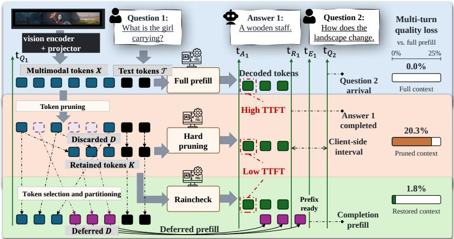  
Figure 1: Schematic overview of Raincheck. Full prefill (Full) processes all input tokens before generation. Hard pruning (Hard) discards unselected tokens to shorten initial prefill. Raincheck (Ours) prefills important tokens first, processes deferred tokens during decode, and completes unfinished prefill after answer return. The next turn reuses the completed context. Blue, purple, black, and green denote important multimodal, deferred multimodal, fixed text/control, and generated tokens. Right: ConvBench mean score loss (%) relative to Full on Qwen3.5-9B with MMTok, 30% initial retention, and 31-token deferred chunks.

We propose Raincheck 1, a framework for deferred multimodal prefill illustrated in Figure 1. An existing token-pruning method selects a fixed fraction of multimodal tokens as important tokens. Initial prefill processes the important tokens and all text and control tokens. Input order is preserved within the important and deferred sequences. Deferred tokens are processed in consecutive chunks during decode. The co-located executor fuses prefill and decode to reduce repeated weight access. Full-attention layers use separate visibility rules fo deferred and decode tokens. In hybrid models such as Qwen3.5, recurrent layers compress the processed sequence into a fixed-size state (Qwen Team, 2026; Yang et al., 2025b). Online afine state mapping updates the recurrent state using recorded transitions for trailing text and generated tokens. The corrected state supports subsequent decoding without rerunning the full sequence. To summarize, our main contributions are:

(1) Limits of Advanced Pruning. We identify a mismatch between one-time token pruning and multi-turn conversations: tokens omitted during prefill may become useful during generation or in later turns. Hard pruning discards them, trading reusable context for lower TTFT.

(2) Deferred Multimodal Prefill. We propose Raincheck to recover deferred tokens during decode and after answer return. Attention visibility control and afine state mapping enable context updates during generation, supported by fused prefill and decode.

(3) Quality-Eficiency Sweet Spot. Across two models and four pruning methods, Raincheck recovers on average 77.7% and 60.4% of pruning-induced quality loss on MultiVerse and ConvBench. On MultiVerse, mean first-turn TTFT falls by up to 24.1% and mean TPOT rises by less than 0.5% relative to full prefill.

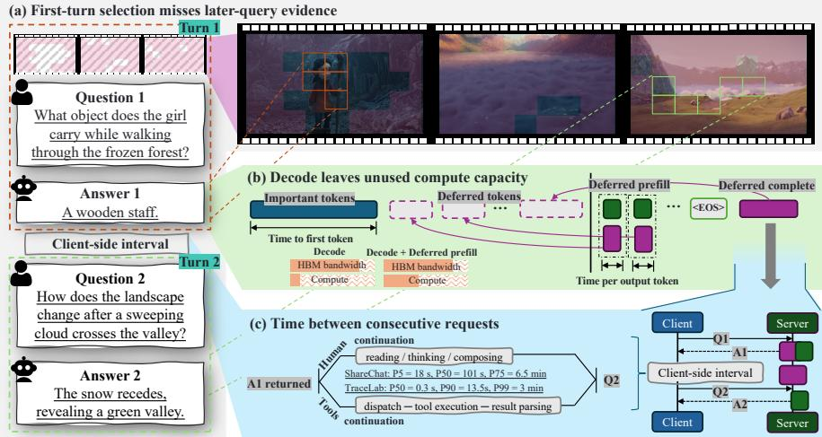  
Figure 2: Motivation for deferred multimodal prefill: (a) later questions may need tokens omitted earlier; (b) unused compute capacity during decode allows deferred tokens to be processed; (c) time between turns can be used to finish deferred prefill.

## 2 Raincheck

Raincheck enables a model to process deferred input tokens after answer generation begins. An existing pruning method selects the initial multimodal tokens; Raincheck preserves the remaining tokens for later prefill. The central requirement is to extend the input context without making input states depend on generated outputs. Full-attention visibility and recurrent state mapping enforce the required dependencies, and fused execution limits repeated weight access. Figure 1 shows how deferred prefill connects the first answer to context reuse in later turns.

The main design and experiments use co-located prefill and decode. A separate prefill-decode (PD) disaggregated design places deferred prefill on a prefill worker to isolate deferred-token computation from decode; Appendix G.2 describes state transfer and the join between workers.

## 2.1 Design Motivation

Initial pruning reduces prefill latency but can exclude information needed by the ongoing answer or later turns. Raincheck separates fast initial response from input recovery by scheduling deferred prefill during decode and after answer return, as illustrated in Figure 2.

Initial selection can omit useful input. Initial pruning can omit tokens useful for the ongoing answer or later turns. We compare MMTok (Dong et al., 2026) selections for the first two questions of 48 MultiVerse (Lee et al., 2025) dialogues at 30% image-token retention. In Figure 4(a), initial selection omits 19.34% of second-question selections on Qwen3-VL-8B and 17.32% on Qwen3.5-9B on average. Figure 3 illustrates a later question about an omitted jersey-number position. Adding the completed Full answer also changes first-question selection, as the retro-

Question 1: What color is the basketball? Question 2: What number is on the back of the player dribbling the ball?

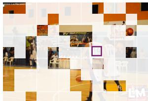  
First-question selection  
Figure 3: A later question targets a position omitted when pruning for the first question. Purple marks the jersey number; faded cells mark omitted tokens.

spective diagnostic in Figure 4(b) shows. Initial selection should therefore decide when tokens are processed, not whether tokens remain available. Section 3.2 and Appendix D.1 evaluate restoration gains for ongoing answers and later turns.

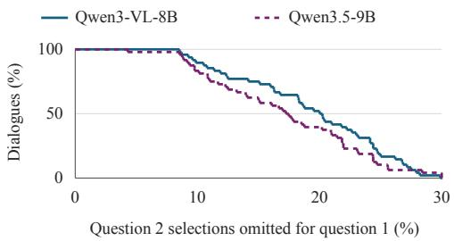  
(a) Across questions

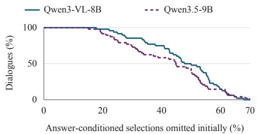  
(b) After adding the first answer  
Figure 4: Token-selection changes at 30% retention. Curves show the share of dialogues where first-question selection omits more than the specified percentage of (a) second-question selections or (b) question-and-answer selections.

Compute capacity during decode. Deferred tokens can be processed during decode rather than delaying the first output. At small batch sizes, decode is often memory-bound and leaves unused compute capacity, as illustrated in Figure 2(b). Prefill and decode use the same model weights, so fused execution can share weight access while processing deferred tokens alongside decode (Agrawal et al., 2023; 2024). Figure 5 compares TPOT during deferred prefill with decode-only intervals at matched output positions. With 31 deferred tokens per step, TPOT increases from 6.15 to 7.33 ms on Qwen3-VL and from 6.43 to 7.88 ms on Qwen3.5. Raincheck limits deferred tokens per step to control the TPOT increase. Appendix F.2 specifies the measurement protocol.

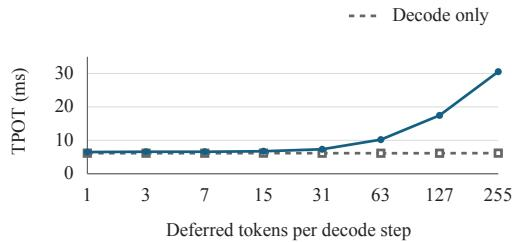  
(a) Qwen3-VL-8B

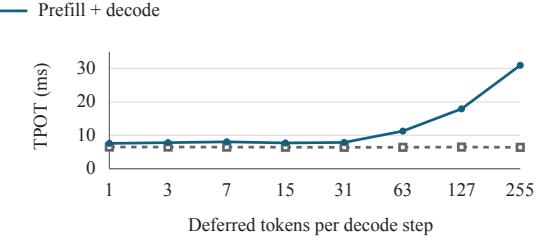  
(b) Qwen3.5-9B  
Figure 5: TPOT by deferred chunk size versus position-matched decode-only intervals.

Completion after answer return. The answer can return before deferred prefill finishes. User reading, client-side processing, and tool execution can separate consecutive requests, as illustrated in Figure 2(c). Figure 6 reports multimodal message intervals from ShareChat and individual tool-call durations from TraceLab (Yan et al., 2026; SyFI TraceLab, 2026).

After timestamp cleaning, 72.5% of 102 ShareChat intervals last at least one minute, with a median of approximately 101 s; 61.3% of TraceLab tool calls finish within one second. Appendix F.3 defines the message intervals and tool-call durations. After answer return, Raincheck can finish deferred prefill if the scheduler provides enough time to process the remaining tokens before the next request.

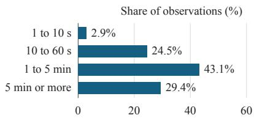  
(a) ShareChat

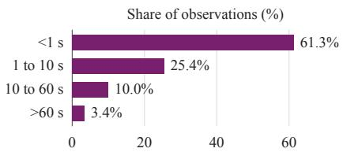  
(b) TraceLab  
Figure 6: Multimodal follow-up message intervals in ShareChat and tool-call durations in TraceLab.

## 2.2 Deferred Multimodal Prefill

An existing token-pruning method selects important multimodal tokens K at the initial retention budget. Raincheck defers the unselected tokens D and preserves original order within both partitions to limit changes to causal attention.

Initial prefill processes K and all text, control, and special tokens, then produces the first output token. During decode, Raincheck prefills consecutive source-ordered chunks of D.

Table 1: Core method notation.
<table><tr><td>Symbol Meaning</td><td></td></tr><tr><td> $K , D$ </td><td>Important / deferred tokens</td></tr><tr><td> $\tau _ { \mathrm { t a i l } }$ </td><td>Intervening input tokens</td></tr><tr><td>Y</td><td>Processed output tokens</td></tr><tr><td> $S _ { \mathrm { p r e f i x } }$ </td><td>Prefix state</td></tr><tr><td> $S _ { \mathrm { l i v e } }$ </td><td>Live state</td></tr><tr><td> $P _ { \mathrm { t a i l } }$ </td><td>Tail transition matrix</td></tr></table>

States: $d _ { k } \times d _ { v } .$ . Map: $d _ { k } \times d _ { k }$

Each completed chunk becomes available to the ongoing   
answer and later turns. Generation continues with the KV cache and updated recurrent states rather than recomputing the sequence. Table 1 lists the core symbols; Appendix A.1 gives the complete notation.

## 2.3 Context Updates during Generation

When generation reuses the KV cache, deferred prefill must insert input states before an already processed sufix. In Figures 7 and 8, black tokens denote intervening input tokens $\mathcal { T } _ { \mathrm { t a i l } }$ , including text, control markers, and special tokens. The sequence Y contains already processed generated tokens. Earlier context is included in the existing prefix without separate notation.

Full attention stores separate keys and values for each token. Gated DeltaNet (GDN) (Yang et al., 2025b) summarizes the processed sequence in a recurrent state, so extending the input requires updating the live state. Both layer types make completed chunks available to decode while keeping deferred input independent of the processed sufix.

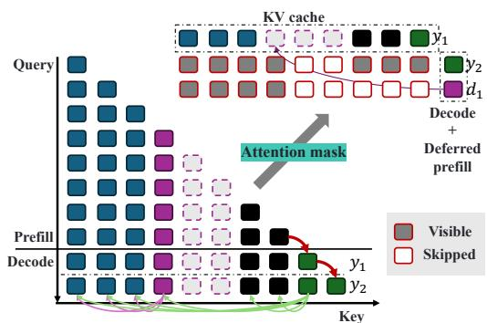  
Figure 7: Deferred-prefill attention.

Full-attention visibility. A deferred chunk reads the prefix processed so far and uses causal attention within the chunk, excluding $\mathcal { T } _ { \mathrm { t a i l } }$ and Y. The decode token reads all input processed so far and the generated history. Separate attention views enforce the two dependencies in Figure 7. New deferred KV entries precede the processed sufix; existing entries stay cached and pending deferred slots remain invisible. Appendix A.2 specifies the backend cache layouts.

GDN state mapping. For a GDN layer in Qwen3. $5 , S _ { \mathrm { p r e f i x } }$ is the state at the recovery boundary and $S _ { \mathrm { l i v e } }$ is the state after $\mathcal { T } _ { \mathrm { t a i l } }$ and Y. Each state is a matrix in $\mathbb { R } ^ { \bar { d } _ { k } \times d _ { v } }$ for one layer and head, with key dimension $d _ { k }$ and value dimension $d _ { v }$ . A state marks a sequence endpoint, not an individual token.

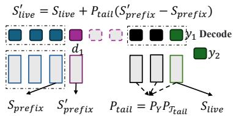

Figure 8: GDN state correc-Recorded GDN updates compose into an afine transformation of the incoming state. The matrix $P _ { \mathrm { t a i l } } \in \mathbb { R } ^ { d _ { k } \times d _ { k } }$ tion.   
propagates the incoming state through the sufix, and $B _ { \mathrm { t a i l } } \in \mathbb { R } ^ { d _ { k } \times d _ { v } }$ collects the additive token updates. The two endpoints satisfy

$$
S _ { \mathrm { l i v e } } = P _ { \mathrm { t a i l } } S _ { \mathrm { p r e f i x } } + B _ { \mathrm { t a i l } } , \qquad P _ { \mathrm { t a i l } } = P _ { Y } P _ { T _ { \mathrm { t a i l } } } .\tag{1}
$$

Both factors are $d _ { k } \times d _ { k }$ matrices. The rightmost factor first propagates through the intervening input; $P _ { Y }$ then propagates through the generated tokens.

Deferred prefill advances the prefix state to $S _ { \mathrm { p r e f i x } } ^ { \prime }$ . Holding the recorded sufix transitions fixed, the additive term $B _ { \mathrm { t a i l } }$ cancels, giving

$$
S _ { \mathrm { l i v e } } ^ { \prime } = S _ { \mathrm { l i v e } } + P _ { \mathrm { t a i l } } \mathopen { } \left( S _ { \mathrm { p r e f i x } } ^ { \prime } - S _ { \mathrm { p r e f i x } } \right) .\tag{2}
$$

The prime denotes a deferred update at the same sufix endpoint. The live state already contains the additive contribution, so the correction only requires $P _ { \mathrm { t a i l } }$ and the prefix-state diference. The next decode token uses the corrected live state in Figure 8.

Raincheck maintains the transition matrix as new tokens are processed. Each token applies a scalar decay and a rank-one correction to the transition matrix, requiring $O ( d _ { k } ^ { 2 } )$ arithmetic per head. Each deferred update propagates the prefix-state diference without rerunning the full sufix. State correction reuses recorded sufix factors and approximates a full model rerun under the expanded input. Appendix B derives the mapping and describes the shortconvolution boundary repair required by Qwen3.5.

## 2.4 Execution and Completion

The co-located executor combines a deferred chunk and the current decode token in one pass through the decoder. Dense projections and the feed-forward network process the combined sequence, sharing weight access as in prefill-decode fusion (Agrawal et al., 2023; 2024). Fullattention layers use separate deferred and decode views. GDN layers first advance the input state, correct the live state, and then process the decode token.

The SGLang (Zheng et al., 2024) implementation reuses fixed-shape CUDA graphs for fused execution. Common shapes combine 7, 15, or 31 deferred tokens with one decode token, giving 8, 16, or 32 total token rows. The per-step token budget controls the TPOT increase; smaller captured shapes handle the remaining deferred tokens. Larger decode batches leave less compute capacity for concurrent deferred prefill. Appendix A.3 details graph capture and cache layouts.

If generation ends before deferred prefill finishes, Raincheck returns the answer and continues the remaining chunks during available scheduler gaps. Completion resumes from the input checkpoint, adds deferred KV entries, and corrects the live recurrent state without restarting input prefill. The evaluated policy completes all deferred tokens before a later turn reuses the context. An early follow-up waits for completion; Appendix A.3 describes optional bounded recovery.

## 3 Experiments

We test whether deferred prefill recovers answer quality under matched initial token selections, reduces first-turn TTFT with a controlled TPOT increase, and retains quality gains across initial retention ratios and chunk sizes.

## 3.1 Experimental Setup

Models and comparisons. We evaluate Qwen3-VL-8B and Qwen3.5-9B, covering full attention and hybrid GDN architectures (Qwen Team, 2025; 2026). We compare full prefill (Full) with hard pruning (Hard) and Raincheck (Ours) at 30% initial retention. Hard denotes existing pruning methods run without token recovery, not a separate algorithm; Ours adds deferred prefill to the same initial selection. We adapt MMTok, HiPrune, DivPrune, and VisionZip-Select, marked †, and configure each Hard/Ours comparison with the same inputs, selection settings, and sampling seeds (Dong et al., 2026; Liu et al., 2025; Alvar et al., 2025; Yang et al., 2025a).

Datasets and scoring. Image and video dialogue benchmarks test whether recovered context supports later questions. Single-turn benchmarks cover visual perception, scene-text understanding, and scientific and mathematical reasoning to assess the efect on the first answer. MultiVerse contains 647 image-grounded dialogues with 2,536 scored turns (Lee et al., 2025); DeepSeek-V4.1-Flash evaluates checklist satisfaction and answer quality using the image and causal dialogue history. ConvBench contains 577 three-turn image dia logues (Liu et al., 2024a); DeepSeek-V4-Flash-FP8 compares each answer with a reference in both presentation orders, conditioned on a fixed caption and the current question. MT-Video-Bench (Pan et al., 2026) uses 902 dialogues from 119 available videos; DeepSeek-V4- Flash-FP8 scores answer-level checklist coverage. MultiVerse aggregates all scored turns, ConvBench averages three turns per dialogue, and video scores average equally across six categories. Table 9 summarizes task coverage; Appendices C.5 and C.3 specify judge instructions and video aggregation. Appendix D.1 reports single-turn results.

Execution and timing. Main quality comparisons use Transformers (Wolf et al., 2020) with 31-token restoration chunks; the main latency comparisons use SGLang on one NVIDIA H20 GPU per worker with one running request and at most 31 deferred tokens per step. Both backends complete the prefix before later-turn reuse. Timing uses MMTok on 48 dialogues per dataset and replays identical output-token traces across policies: 512-token traces on MultiVerse and model-specific Full traces on MT-Video-Bench. We measure request-to-firsttoken TTFT, request-average inter-token TPOT, and end-to-end (E2E) latency through the final output token, excluding post-response restoration. Appendices C.2 and E.1 give generation parameters and timing protocols.

Reporting conventions. Quality scores range from 0 to 100; diferences are score points. For metric value $m _ { p }$ under policy $p ,$ parentheses report $1 0 0 ( m _ { p } / m _ { \mathrm { F u l l } } - 1 ) \%$ against the matching model, dataset, turn, and metric under Full. Appendix D.3 defines rounding, quality-loss recovery, and paired intervals.

## 3.2 Multi-Turn Quality Recovery

Recovering quality at a fixed initial budget. Ours improves MultiVerse aggregate quality for all eight model and pruning-method pairs under identical initial selections in Table 2. With MMTok, Ours raises the MultiVerse aggregate from 48.77 to 55.22 on Qwen3-VL-8B and from 37.53 to 43.12 on Qwen3.5-9B, approaching Full scores of 55.43 and 44.90. Across the eight pairs, Ours recovers an average 77.7% of the Full-to-Hard score loss. Appendix D.3 distinguishes cell-level uncertainty from paired score diferences.

Recovery during generation and later reuse. Quality gains begin during first-turn generation and extend to later turns that reuse the completed prefix. For MMTok, the T1 gains are 13.19 and 16.93 points on Qwen3-VL-8B and Qwen3.5-9B, respectively; T2 gains are 6.47 and 6.65 points. Individual turns can regress: Qwen3-VL with HiPrune scores 58.39 under Ours at T3, below 58.52 under Hard, despite improving the aggregate. Deferred prefill preserves emitted tokens and historical KV entries, so completing the input does not reproduce Full’s generation trajectory. Appendix D.6 isolates restoration timing by comparing recovery during generation with recovery only after the first answer.

Table 2: Multi-turn quality at 30% initial retention. Parentheses show relative changes from Full; bold marks the higher score in each Hard/Ours pair. Avg and Mean follow the aggregation in Section 3.1.
<table><tr><td rowspan="2">Model</td><td rowspan="2">Pruning method Policy</td><td rowspan="2"></td><td colspan="4">MultiVerse</td><td colspan="4">ConvBench</td></tr><tr><td>T1</td><td>T2</td><td>T3</td><td>Avg</td><td>T1</td><td>T2</td><td>T3</td><td>Mean</td></tr><tr><td rowspan="8">Qwen3-VL-8B</td><td rowspan="2">N/A</td><td>Full</td><td>47.68</td><td>53.81</td><td>58.11</td><td>55.43</td><td>50.95</td><td>54.94</td><td>25.56</td><td>43.82</td></tr><tr><td>Hard</td><td>32.78 (-31.3%)</td><td>46.92 (-12.8%)</td><td>55.20 (-5.0%)</td><td>48.77 (-12.0%)</td><td>40.55 (-20.4%)</td><td>48.09 (-12.5%)</td><td>25.65(+0.4%)</td><td>38.10 (-13.1%)</td></tr><tr><td rowspan="2">MMTok†</td><td>Ours</td><td>45.97(-3.6%)</td><td>53.39 (-0.8%)</td><td>58.96 (+1.5%)</td><td>55.22 (-0.4%)</td><td>47.05 (-7.7%)</td><td>53.64 (-2.4%)</td><td>24.78 (-3.1%)</td><td>41.83 (-4.5%)</td></tr><tr><td>Hard</td><td>42.37 (-11.1%)</td><td>52.13 (-3.1%)</td><td>58.52 (+0.7%)</td><td>53.67 (-3.2%)</td><td>45.93 (-9.9%)</td><td>51.99 (-5.4%)</td><td>24.09 (-5.8%)</td><td>40.67 (-7.2%)</td></tr><tr><td rowspan="2">HiPrune†</td><td>Ours</td><td>46.92 (-1.6%)</td><td>51.85 (-3.6%)</td><td>58.39 (+0.5%)</td><td>55.13 (-0.5%)</td><td>49.65 (-2.6%)</td><td>53.81 (-2.1%)</td><td>24.18 (-5.4%)</td><td>42.55 (-2.9%)</td></tr><tr><td>Hard</td><td>36.50 (-23.4%)</td><td>48.83 (-9.3%)</td><td>56.27 (-3.2%)</td><td>50.84 (-8.3%)</td><td>44.63 (-12.4%)</td><td>50.17 (-8.7%)</td><td>24.70 (-3.4%)</td><td>39.83 (-9.1%)</td></tr><tr><td rowspan="2">DivPrune†</td><td>Ours</td><td>45.30 (-5.0%)</td><td>52.46 (-2.5%)</td><td>58.16(+0.1%)</td><td>54.74 (-1.2%)</td><td>47.23 (-7.3%)</td><td>51.47 (-6.3%)</td><td>23.05 (-9.8%)</td><td>40.58 (-7.4%)</td></tr><tr><td>Hard</td><td>41.11 (-13.8%)</td><td>50.65 (-5.9%)</td><td>57.49 (-1.1%)</td><td>52.80 (-4.7%)</td><td>46.36 (-9.0%)</td><td>50.17 (-8.7%)</td><td>23.74 (-7.1%)</td><td>40.09 (-8.5%)</td></tr><tr><td rowspan="8"></td><td rowspan="2">VisionZip-Select† N/A</td><td>Ours</td><td>46.70(-2.1%)</td><td>52.90 (-1.7%)</td><td>58.42(+0.5%)</td><td>55.07 (-0.6%)</td><td>49.39 (-3.1%)</td><td>52.86 (-3.8%)</td><td>25.13 (-1.7%)</td><td>42.46 (-3.1%)</td></tr><tr><td>Full</td><td>51.35</td><td>54.52</td><td>41.29</td><td>44.90</td><td>50.78</td><td>55.81</td><td>27.12</td><td>44.57</td></tr><tr><td rowspan="2">MMTok†</td><td>Hard</td><td>30.48 (-40.6%)</td><td>)47.49 (-12.9%)</td><td>40.07 (-3.0%)</td><td></td><td></td><td>37.53 (-16.4%) 37.26 (-26.6%) 47.57 (-14.8%) 21.75 (-19.8%)</td><td></td><td>35.53 (-20.3%)</td></tr><tr><td>Ours</td><td>47.41 (-7.7%)</td><td>54.14 (-0.7%)</td><td>39.87 (-3.4%)</td><td>43.12 (-4.0%)</td><td>49.91 (-1.7%)</td><td>55.98 (+0.3%)</td><td>25.48 (-6.0%)</td><td>43.79 (-1.8%)</td></tr><tr><td rowspan="2">HiPrune†</td><td>Hard</td><td>41.12 (-19.9%)</td><td>51.60 (-5.4%)</td><td>40.03 (-3.1%)</td><td>41.59 (-7.4%)</td><td>47.23 (-7.0%)</td><td>50.61 (-9.3%)</td><td>23.57 (-13.1%)</td><td>40.47 (-9.2%)</td></tr><tr><td>Ours</td><td>48.98 (-4.6%)</td><td>53.56 (-1.8%)</td><td>41.27 (0.0%)</td><td>44.05 (-1.9%)</td><td>48.35 (-4.8%)</td><td>55.29 (-0.9%)</td><td>25.56 (-5.8%)</td><td>43.07 (-3.4%)</td></tr><tr><td rowspan="2">DivPrune†</td><td>Hard</td><td>36.49 (-28.9%)</td><td>50.07 (-8.2%)</td><td>40.79 (-1.2%)</td><td>39.71 (-11.6%)</td><td>46.19 (-9.0%)</td><td>51.82 (-7.1%)</td><td>25.82 (-4.8%)</td><td>41.28 (-7.4%)</td></tr><tr><td>Ours</td><td>46.43 (-9.6%)</td><td>52.99 (-2.8%)</td><td>40.67 (-1.5%)</td><td>42.90 (-4.5%)</td><td>49.83 (-1.9%)</td><td>54.51 (-2.3%)</td><td>24.87 (-8.3%)</td><td>43.07 (-3.4%)</td></tr><tr><td rowspan="2"></td><td>VisionZip-Select† Hard</td><td>40.83 (-20.5%)</td><td>51.30 (-5.9%)</td><td>41.39 (+0.2%)</td><td>41.28 (-8.1%)</td><td>46.19 (-9.0%)</td><td></td><td>52.51 (-5.9%)</td><td>23.92 (-11.8%)</td><td>40.87 (-8.3%)</td></tr><tr><td>Ours</td><td>47.79 (-6.9%)</td><td>54.11 (-0.8%)</td><td>40.72 (-1.4%)</td><td></td><td>43.42 (-3.3%)</td><td>50.52 (-0.5%)</td><td>54.59 (-2.2%)</td><td>24.87 (-8.3%)</td><td>43.33 (-2.8%)</td></tr></table>

Complementary evaluation on ConvBench. The same 30%-retention comparison improves the ConvBench mean for all eight pairs by 0.75 to 8.26 points. MMTok scores rise from 38.10 to 41.83 on Qwen3-VL-8B and from 35.53 to 43.79 on Qwen3.5-9B. ConvBench scores measure judge preference against turn-specific reference answers. The Full T3 scores are 25.56 and 27.12; cross-turn diferences also reflect changes in questions and references. Table 23 reports context-adherence and complete-dialogue comparisons across restoration chunk sizes.

Table 3: MT-Video-Bench quality with MMTok at 30% initial retention. Overall includes all annotated turns; parentheses and bold follow Table 2.
<table><tr><td>Model</td><td>Policy</td><td>T1</td><td>T2</td><td>T3</td><td>Overall</td></tr><tr><td rowspan="3">Qwen3-VL-8B</td><td>Full</td><td>25.74</td><td>59.15</td><td>48.78</td><td>53.15</td></tr><tr><td>Hard</td><td>25.08 (-2.6%)</td><td> $5 7 . 4 4 \left( - 2 . 9 \% \right)$ </td><td> $4 6 . 2 6 \ : ( - 5 . 2 \% )$ </td><td> $5 0 . 6 8 \left( - 4 . 6 \% \right)$ </td></tr><tr><td>Ours</td><td>24.92 (-3.2%)</td><td> $5 6 . 6 0 \left( - 4 . 3 \% \right)$ </td><td>46.88 (-3.9%)</td><td>51.73 (-2.7%)</td></tr><tr><td rowspan="3">Qwen3.5-9B</td><td>Full</td><td>25.66</td><td>47.17</td><td>39.96</td><td>44.28</td></tr><tr><td>Hard</td><td> $2 6 . 0 7 \left( + 1 . 6 \% \right)$ </td><td> $4 5 . 1 4 \left( - 4 . 3 \% \right)$ </td><td> $4 1 . 1 9 \ : ( + 3 . 1 \% )$ </td><td>42.87 (-3.2%)</td></tr><tr><td>Ours</td><td> $2 6 . 4 8 \ : ( + 3 . 2 \% )$ </td><td> $4 7 . 2 9 \left( + 0 . 3 \% \right)$ </td><td>41.44(+3.7%)</td><td>44.13 (-0.3%)</td></tr></table>

Multi-turn video quality. Ours improves overall video quality on both models in Table 3. Qwen3-VL improves from 50.68 to 51.73, approaching Full at 53.15; Qwen3.5 improves from 42.87 to 44.13, close to Full at 44.28. Overall includes all annotated turns and weights the six categories equally; the first three columns summarize diferent category mixtures for each turn. On Qwen3-VL, Ours trails Hard by 0.16 and 0.84 points on T1 and T2, but gains 0.62 points on T3. Examples from the separate 64-token configuration in Appendix D.4 contrast additional explanations that raise checklist scores with omitted visual details.

## 3.3 Inference Eficiency

First-turn response latency. Ours lowers first-turn TTFT on both datasets, with diferent decoding tradeofs in Table 4. On MultiVerse, Ours reduces T1 TTFT by 24.1% and 17.9% on Qwen3-VL-8B and Qwen3.5-9B, with mean TPOT increases of 0.13% and 0.47%. The paired Ours-minus-Hard TTFT intervals include zero in Appendix E.1. On MT-Video-Bench, Ours reduces TTFT by 13.06% and

Table 4: Mean first-turn inference latency with matched outputs. Parentheses show relative changes from Full.
<table><tr><td>Policy</td><td>TTFT (ms)</td><td>TPOT (ms)</td><td>E2E (s)</td></tr><tr><td>Full</td><td colspan="3">MultiVerse: Qwen3-VL-8B 169.94 6.1919 3.3340</td></tr><tr><td>Hard Ours</td><td>133.17 (-21.64%) 128.96 (-24.11%)</td><td>6.1354 (-0.91%) 6.1996 (+0.13%)</td><td>3.2684 (-1.97%) 3.2970 (-1.11%)</td></tr><tr><td>Full</td><td colspan="3">MultiVerse: Qwen3.5-9B 171.20 6.4934</td></tr><tr><td>Hard δurs</td><td>142.31 (-16.87%) 140.56 (-17.90%)</td><td>)6.4624 (-0.48%) 6.5238 (+0.47%)</td><td>3.4446 (-1.28%) 3.4742 (-0.43%)</td></tr><tr><td></td><td colspan="3">MT-Video-Bench: Qwen3-VL-8B</td></tr><tr><td>Full</td><td colspan="3">3556.18 6.6798</td></tr></table>

11.91%, and increases average TPOT by 19.93% and 14.92%. Despite the slower decode intervals, mean E2E latency decreases by 4.83% and 6.56% relative to Full. Hard completes answers sooner than Ours but permanently discards the unselected visual tokens. The image and video traces have diferent lengths, so average TPOT depends on both the latency of decode steps with deferred prefill and the fraction of such steps.

## Restoration during and after the answer.

All MultiVerse requests finish restoration within the measured 512-token traces. The video cohort has about ten times as many deferred tokens and shorter answer traces; 41.67% and 68.75% of video observations require post-response completion on Qwen3-VL and Qwen3.5, respectively. Table 5 reports TPOT during restoration and the time from answer completion to prefix readiness. The video post-response interval averages 74.0 and 162.8 ms over all requests, including those already restored. The remaining prefill can finish before the next request arrives. An earlier follow-up waits for completion before reusing the prefix. Appendix E.1 specifies interval aggregation and later-turn reuse results. Table 7 separates the cache and auxiliary storage required by deferred prefill from the memory used by Full and Hard.

Table 5: Deferred-prefill completion on 512-token MultiVerse traces and naturally terminated Full video traces replayed across policies. Restoration TPOT includes only deferredprefill intervals; post-response statistics include all first-turn requests, including those already fully restored.
<table><tr><td rowspan="2">Model</td><td rowspan="2">Dataset</td><td rowspan="2">TPOT during restoration (ms)</td><td rowspan="2">Unfinished at answer completion</td><td colspan="2">Post-response time (ms)</td></tr><tr><td>Mean</td><td>P95</td></tr><tr><td rowspan="2">Qwen3-VL-8B</td><td>MultiVerse</td><td>7.201</td><td>0/288 (0.00%)</td><td>0.049</td><td>0.060</td></tr><tr><td>MT-Video-Bench</td><td>8.685</td><td>120/288 (41.67%)</td><td>74.024</td><td>357.703</td></tr><tr><td rowspan="2">Qwen3.5-9B</td><td>MultiVerse</td><td>7.882</td><td>0/288 (0.00%)</td><td>0.089</td><td>0.100</td></tr><tr><td>MT-Video-Bench</td><td>8.064</td><td>198/288 (68.75%)</td><td>162.802</td><td>371.782</td></tr></table>

## 3.4 Ablation Studies

We test whether quality gains depend on initial retention or deferred-prefill chunk size using matched MMTok sweeps. Appendix D.5 specifies the populations, evaluation, and paired intervals; each sweep uses its own matched baseline.

Initial retention. Restoration improves the aggregate score at each tested retention ratio in the upper row of Figure 9, using 31-token chunks. Lower initial retention generally leaves more score loss to recover. Recovery gains are nonmonotonic in the Qwen3-VL-8B video sweep, where 50% retention yields a larger gain than 30%.

Deferred-prefill chunk size. Quality gains persist across the tested chunk sizes c ∈ {7, 15, 31, 63} at 30% retention in the lower row of Figure 9. On MultiVerse, Ours improves over Hard in all eight model and chunk comparisons by 2.73 to 6.23 points, and six paired confidence intervals are above zero. On MT-Video-Bench, the Ours score spans only 0.54 points on Qwen3-VL-8B and 0.85 points on Qwen3.5-9B across the plotted settings. The 64-token video setting scores 1.32 points above the 31-token setting on Qwen3.5-9B, with a paired interval excluding zero in Appendix D.5. Chunk size therefore afects both quality recovery and TPOT during deferred prefill, as measured in Figure 5.

9B

8B  
9B  
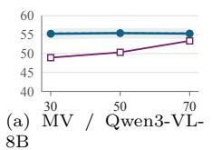

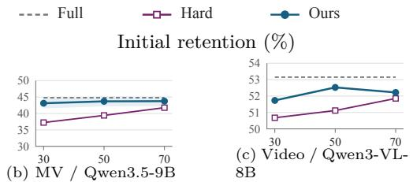

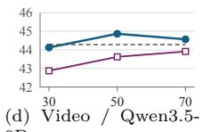

Deferred-prefill chunk size (tokens)  
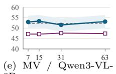

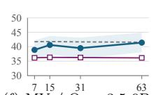  
(f) MV / Qwen3.5-9B

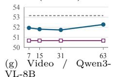

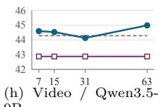  
Figure 9: Quality across initial retention ratios and deferred-prefill chunk sizes with MM-Tok. MV denotes MultiVerse; Video denotes MT-Video-Bench. Panels use separate vertical scales; MultiVerse shading shows 95% marginal confidence intervals.

## 4 Related Work

Multimodal token pruning reduces the tokens processed by the model through diferent pruning locations and selection criteria. To preserve information from pruned tokens, some methods aggregate token features or learn compressed representations (Zhang et al., 2025b; Yang et al., 2025a; Wang et al., 2026). Other methods retain candidate tokens or intermedi ate states for later retrieval, reselection, or on-demand computation (Khaki et al., 2025; Kim et al., 2026; Fu et al., 2024). Raincheck separates initial selection from recovery by adding deferred input states during generation and after answer return for later reuse. Attention visibility control and recurrent state mapping support insertion before an already processed sufix. See Appendix H for details.

## 5 Conclusion

Raincheck addresses a central tension in latency-sensitive multimodal interaction: answering quickly without permanently losing the input skipped to make that possible. It processes selected tokens up front and recovers deferred tokens during generation and after answer return. Attention visibility control and afine state mapping make the recovered context usable for subsequent decoding, while fused execution shares weight access between prefill and decode. Across image and video dialogues on both evaluated models, Raincheck improves aggregate quality over matched hard pruning. On MultiVerse, it reduces mean first-turn TTFT by up to 24.1% relative to full prefill, with less than a 0.5% increase in mean TPOT. Our single-request evaluation establishes this opportunity for latency-sensitive inference; concurrency and state-mapping assumptions remain open questions (Appendix G.1). We hope this work inspires consumer-facing multimodal systems that defer computation to respond quickly, without making lost context the price of responsiveness.

## AI Use Statement

Generative AI tools were used for language editing and code assistance. The authors verified all statements, derivations, citations, and experimental artifacts and take full responsibility.

## References

Amey Agrawal, Ashish Panwar, Jayashree Mohan, Nipun Kwatra, Bhargav S. Gulavani, and Ramachandran Ramjee. SARATHI: Eficient LLM inference by piggybacking decodes with chunked prefills. arXiv preprint arXiv:2308.16369, 2023. URL https://arxiv.org abs/2308.16369.

Amey Agrawal, Nitin Kedia, Ashish Panwar, Jayashree Mohan, Nipun Kwatra, Bhargav S. Gulavani, Alexey Tumanov, and Ramachandran Ramjee. Taming throughput-latency tradeof in LLM inference with Sarathi-Serve. In 18th USENIX Symposium on Operating Systems Design and Implementation (OSDI), 2024. URL https://arxiv.org/abs/2403. 02310.

Saeed Ranjbar Alvar, Gursimran Singh, Mohammad Akbari, and Yong Zhang. DivPrune: Diversity-based visual token pruning for large multimodal models. In Proceedings of the IEEE/CVF Conference on Computer Vision and Pattern Recognition, pp. 9392–9401, 2025. URL https://arxiv.org/abs/2503.02175.

Liang Chen, Haozhe Zhao, Tianyu Liu, Shuai Bai, Junyang Lin, Chang Zhou, and Baobao Chang. An image is worth 1/2 tokens after layer 2: Plug-and-play inference acceleration for large vision-language models. In European Conference on Computer Vision, 2024. URL https://arxiv.org/abs/2403.06764.

DeepSeek-AI. DeepSeek-V4.1-Flash: Pushing the limits of KV cache compression. Hugging Face model card, 2026a. URL https://huggingface.co/deepseek-ai/DeepSeek-V4.1-Flash.

DeepSeek-AI. DeepSeek-V4-Flash. Hugging Face model card, 2026b. URL https:// huggingface.co/deepseek-ai/DeepSeek-V4-Flash.

Sixun Dong, Juhua Hu, Mian Zhang, Ming Yin, Yanjie Fu, and Qi Qian. MMTok: Multimodal coverage maximization for eficient inference of VLMs. In International Conference on Learning Representations, 2026. URL https://openreview.net/forum?id= GvPdSWZT31.

Qichen Fu, Minsik Cho, Thomas Merth, Sachin Mehta, Mohammad Rastegari, and Mahyar Najibi. LazyLLM: Dynamic token pruning for eficient long context LLM inference. arXiv preprint arXiv:2407.14057v1, 2024. URL https://arxiv.org/abs/2407.14057v1.

Tianxiao Gao, Shanwei Zhao, Shuo Fang, Shiai Zhu, and Chenguang Ma. QuietPrune: Query-guided early token pruning for vision-language models. In Proceedings of the IEEE/CVF Conference on Computer Vision and Pattern Recognition, pp. 3553–3562, 2026. URL https://openaccess.thecvf.com/content/CVPR2026/html/Gao\_QuietPrune Query-Guided\_Early\_Token\_Pruning\_for\_Vision-Language\_Models\_CVPR\_2026 paper.html.

Haoyang Huang, Wenjie Huang, Tianqi Xu, Hongyaoxing Gu, Kang Tan, Yikai Fu, Yuhao Shen, Tianyu Liu, Baolin Zhang, Jun Zhang, Xinyi Hu, Jun Dai, Shuang Ge, Lei Chen, Yue Li, Mingchen Wang, and Meng Zhang. OmniDelta: Skill-driven budget allocation for token compression in OmniLLMs. arXiv preprint arXiv:2607.25669, 2026. URL https: //arxiv.org/abs/2607.25669.

Drew A. Hudson and Christopher D. Manning. GQA: A new dataset for real-world visual reasoning and compositional question answering. In Proceedings of the IEEE/CVF Conference on Computer Vision and Pattern Recognition, pp. 6700–6709, 2019. URL https:// openaccess.thecvf.com/content\_CVPR\_2019/html/Hudson\_GQA\_A\_New\_Dataset for\_Real-World\_Visual\_Reasoning\_and\_Compositional\_CVPR\_2019\_paper.html.

Yicheng Ji, Jun Zhang, Heming Xia, Jinpeng Chen, Lidan Shou, Gang Chen, and Huan Li. SpecVLM: Enhancing speculative decoding of video LLMs via verifier-guided token pruning. In Proceedings of the 2025 Conference on Empirical Methods in Natural Language Processing, pp. 7205–7219, 2025. doi: 10.18653/v1/2025.emnlp-main.366. URL https://aclanthology.org/2025.emnlp-main.366/.

Yicheng Ji, Jun Zhang, Jinpeng Chen, Cong Wang, Lidan Shou, Gang Chen, and Huan Li. See the forest for the trees: Loosely speculative decoding via visual-semantic guidance for eficient inference of video LLMs. In Proceedings of the 64th Annual Meeting of the Association for Computational Linguistics (Volume 1: Long Papers), pp. 23707–23726, 2026. doi: 10.18653/v1/2026.acl-long.1087. URL https://aclanthology.org/2026.acl-long. 1087/.

Aditya K. Kamath, Ramya Prabhu, Jayashree Mohan, Simon Peter, Ramachandran Ramjee, and Ashish Panwar. POD-Attention: Unlocking full prefill-decode overlap for faster LLM inference. In Proceedings of the 30th ACM International Conference on Architectural Support for Programming Languages and Operating Systems, Volume 2, 2025. doi: 10. 1145/3676641.3715996.

Samir Khaki, Junxian Guo, Jiaming Tang, Shang Yang, Yukang Chen, Konstantinos N. Plataniotis, Yao Lu, Song Han, and Zhijian Liu. SparseVILA: Decoupling visual sparsity for eficient VLM inference. In Proceedings of the IEEE/CVF International Conference on Computer Vision, pp. 23784–23794, 2025. URL https://arxiv.org/abs/2510.17777.

Jiwan Kim, Kibum Kim, Wonjoong Kim, Byung-Kwan Lee, and Chanyoung Park. Why and when visual token pruning fails? a study on relevant visual information shift in MLLMs decoding. In European Conference on Computer Vision, 2026. URL https: //arxiv.org/abs/2604.12358.

Kimi Team. Kimi Linear: An expressive, eficient attention architecture. arXiv preprint arXiv:2510.26692, 2025. URL https://arxiv.org/abs/2510.26692.

Woosuk Kwon, Zhuohan Li, Siyuan Zhuang, Ying Sheng, Lianmin Zheng, Cody Hao Yu, Joseph E. Gonzalez, Hao Zhang, and Ion Stoica. Eficient memory management for large language model serving with PagedAttention. In Proceedings of the ACM SIGOPS 29th Symposium on Operating Systems Principles, pp. 611–626, 2023. URL https://arxiv.org abs/2309.06180.

Young-Jun Lee, Byung-Kwan Lee, Jianshu Zhang, Yechan Hwang, Byungsoo Ko, Han-Gyu Kim, Dongyu Yao, Xuankun Rong, Eojin Joo, Seung-Ho Han, et al. MultiVerse: A multi-turn conversation benchmark for evaluating large vision and language models. In Proceedings of the IEEE/CVF International Conference on Computer Vision, 2025. URL https://arxiv.org/abs/2510.16641.

Ao Li, Yuxiang Duan, Jinghui Zhang, Congbo Ma, Yutong Xie, Gustavo Carneiro, Mohammad Yaqub, and Hu Wang. TransPrune: Token transition pruning for eficient large vision-language model. In Proceedings of the IEEE/CVF Conference on Computer Vision and Pattern Recognition, pp. 39529–39538, 2026. URL https://openaccess. thecvf.com/content/CVPR2026/html/Li\_TransPrune\_Token\_Transition\_Pruning\_ for\_Efficient\_Large\_Vision-Language\_Model\_CVPR\_2026\_paper.html.

Jizhihui Liu, Feiyi Du, Guangdao Zhu, Niu Lian, Jun Li, and Bin Chen. HiPrune: Trainingfree visual token pruning via hierarchical attention in vision-language models. arXiv preprint arXiv:2508.00553v1, 2025. URL https://arxiv.org/abs/2508.00553v1.

Shuo Liu, Kaining Ying, Hao Zhang, Yue Yang, Yuqi Lin, Tianle Zhang, Chuanhao Li, Yu Qiao, Ping Luo, Wenqi Shao, and Kaipeng Zhang. ConvBench: A multi-turn conversation evaluation benchmark with hierarchical ablation capability for large vision-language models. In Advances in Neural Information Processing Systems, 2024a. URL https://proceedings.neurips.cc/paper\_files/paper/2024/hash b69396afc07a9ca3428d194f4db84c02-Abstract-Datasets\_and\_Benchmarks\_Track.html.

Yuan Liu, Haodong Duan, Yuanhan Zhang, Bo Li, Songyang Zhang, Wangbo Zhao, Yike Yuan, Jiaqi Wang, Conghui He, Ziwei Liu, Kai Chen, and Dahua Lin. MMBench: Is your multi-modal model an all-around player? In European Conference on Computer Vision, 2024b. URL https://eccv.ecva.net/virtual/2024/poster/2003.

Pan Lu, Swaroop Mishra, Tanglin Xia, Liang Qiu, Kai-Wei Chang, Song-Chun Zhu, Oyvind Tafjord, Peter Clark, and Ashwin Kalyan. Learn to explain: Multimodal reasoning via thought chains for science question answering. In Advances in Neural Information Processing Systems, volume 35, 2022. URL https://proceedings.neurips.cc/paper\_files/paper/ 2022/hash/11332b6b6cf4485b84afadb1352d3a9a-Abstract-Conference.html.

Yaning Pan, Qianqian Xie, Guohui Zhang, Zekun Moore Wang, Yongqian Wen, Yuanxing Zhang, Haoxuan Hu, Zhiyu Pan, Yibing Huang, Zhidong Gan, Yonghong Lin, An Ping, Shihao Li, Yanghai Wang, Tianhao Peng, and Jiaheng Liu. MT-Video-Bench: A holistic video understanding benchmark for evaluating multimodal LLMs in multi-turn dialogues. In Findings of the Association for Computational Linguistics: ACL 2026, pp. 8105–8126, 2026. doi: 10.18653/v1/2026.findings-acl.397. URL https://aclanthology.org/2026.findings-acl.397/.

Qwen Team. Qwen3-VL technical report. arXiv preprint arXiv:2511.21631, 2025. URL https://arxiv.org/abs/2511.21631.

Qwen Team. Qwen3.5. Hugging Face model card, 2026. URL https://huggingface.co/ Qwen/Qwen3.5-9B.

Chaoyi Ruan, Yinhe Chen, Dongqi Tian, Yandong Shi, Yongji Wu, Jialin Li, and Cheng Li. Libra: Flexible request partitioning and scheduling for serving unbalanced and dynamic LLM workloads. In 23rd USENIX Symposium on Networked Systems Design and Implementation (NSDI), 2026. URL https://www.usenix.org/conference/nsdi26/presentation/ ruan-libra.

Jay Shah, Ganesh Bikshandi, Ying Zhang, Vijay Thakkar, Pradeep Ramani, and Tri Dao. FlashAttention-3: Fast and accurate attention with asynchrony and low-precision. In Advances in Neural Information Processing Systems, volume 37, 2024. URL https://proceedings.neurips.cc/paper\_files/paper/2024/hash/ 7ede97c3e082c6df10a8d6103a2eebd2-Abstract-Conference.html.

Amanpreet Singh, Vivek Natarajan, Meet Shah, Yu Jiang, Xinlei Chen, Dhruv Batra, Devi Parikh, and Marcus Rohrbach. Towards VQA models that can read. In Proceedings of the IEEE/CVF Conference on Computer Vision and Pattern Recognition, pp. 8317–8326, 2019. URL https://openaccess.thecvf.com/content\_CVPR\_2019/html/ Singh\_Towards\_VQA\_Models\_That\_Can\_Read\_CVPR\_2019\_paper.html.

SyFI TraceLab. SyFI TraceLab: Tool latency distribution. Public coding-agent timing analysis, 2026. URL https://tracelab.cs.washington.edu/exp/tool\_calls/tool\_latency\_ distribution/. Accessed September 14, 2026.

Keda Tao, Can Qin, Haoxuan You, Yang Sui, and Huan Wang. DyCoke: Dynamic compression of tokens for fast video large language models. In IEEE/CVF Conference on Computer Vision and Pattern Recognition, 2025. URL https://arxiv.org/abs/2411.15024.

Yi Wang, Haofei Zhang, Qihan Huang, Anda Cao, Gongfan Fang, Wei Wang, Xuan Jin, Jie Song, Mingli Song, and Xinchao Wang. Rethinking token reduction for large vision-language models. In Proceedings of the IEEE/CVF Conference on Computer Vision and Pattern Recognition, pp. 24727–24737, 2026. URL https://openaccess.thecvf.com/content/CVPR2026/html/Wang\_Rethinking\_Token Reduction\_for\_Large\_Vision-Language\_Models\_CVPR\_2026\_paper.html.

Thomas Wolf, Lysandre Debut, Victor Sanh, Julien Chaumond, Clement Delangue, Anthony Moi, Pierric Cistac, Tim Rault, Remi Louf, Morgan Funtowicz, Joe Davison, Sam Shleifer, Patrick von Platen, Clara Ma, Yacine Jernite, Julien Plu, Canwen Xu, Teven Le Scao, Sylvain Gugger, Mariama Drame, Quentin Lhoest, and Alexander Rush. Transformers:

State-of-the-art natural language processing. In Proceedings of the 2020 Conference on Empirical Methods in Natural Language Processing: System Demonstrations, pp. 38– 45, 2020. doi: 10.18653/v1/2020.emnlp-demos.6. URL https://aclanthology.org/2020. emnlp-demos.6/.

Long Xing, Qidong Huang, Xiaoyi Dong, Jiajie Lu, Pan Zhang, Yuhang Zang, Yuhang Cao, Conghui He, Jiaqi Wang, Feng Wu, and Dahua Lin. Conical visual concentration for eficient large vision-language models. In Proceedings of the IEEE/CVF Conference on Computer Vision and Pattern Recognition, 2025. URL https://openaccess.thecvf. com/content/CVPR2025/papers/Xing\_Conical\_Visual\_Concentration\_for\_Efficient\_ Large\_Vision-Language\_Models\_CVPR\_2025\_paper.pdf.

Yueru Yan, Tuc Nguyen, Bo Su, Melissa Liefers, and Thai Le. ShareChat: A dataset of chatbot conversations in the wild. arXiv preprint arXiv:2512.17843v4, 2026. URL https://arxiv.org/abs/2512.17843v4.

Senqiao Yang, Yukang Chen, Zhuotao Tian, Chengyao Wang, Jingyao Li, Bei Yu, and Jiaya Jia. VisionZip: Longer is better but not necessary in vision language models. In Proceedings of the IEEE/CVF Conference on Computer Vision and Pattern Recognition, pp. 19792–19802, 2025a. URL https://arxiv.org/abs/2412.04467.

Songlin Yang, Jan Kautz, and Ali Hatamizadeh. Gated delta networks: Improving Mamba2 with delta rule. In International Conference on Learning Representations, 2025b. URL https://openreview.net/forum?id=r8H7xhYPwz.

Xubing Ye, Yukang Gan, Yixiao Ge, Xiao-Ping Zhang, and Yansong Tang. ATP-LLaVA: Adaptive token pruning for large vision language models. In Proceedings of the IEEE/CVF Conference on Computer Vision and Pattern Recognition, pp. 24972–24982, 2025. URL https://openaccess.thecvf.com/content/CVPR2025/html/ Ye\_ATP-LLaVA\_Adaptive\_Token\_Pruning\_for\_Large\_Vision\_Language\_Models\_ CVPR\_2025\_paper.html.

Jun Zhang, Jue Wang, Huan Li, Lidan Shou, Ke Chen, Gang Chen, Qin Xie, Guiming Xie, and Xuejian Gong. HMI: hierarchical knowledge management for eficient multitenant inference in pretrained language models. The VLDB Journal, 34(4):43, 2025a. doi: 10.1007/s00778-025-00919-7.

Qizhe Zhang, Aosong Cheng, Ming Lu, Zhiyong Zhuo, Minqi Wang, Jiajun Cao, Shaobo Guo, Qi She, and Shanghang Zhang. [CLS] attention is all you need for training-free visual token pruning: Make VLM inference faster. arXiv preprint arXiv:2412.01818v1, 2024a. URL https://arxiv.org/abs/2412.01818v1.

Renrui Zhang, Dongzhi Jiang, Yichi Zhang, Haokun Lin, Ziyu Guo, Pengshuo Qiu, Aojun Zhou, Pan Lu, Kai-Wei Chang, Peng Gao, and Hongsheng Li. MathVerse: Does your multi-modal LLM truly see the diagrams in visual math problems? In European Conference on Computer Vision, 2024b. URL https://eccv.ecva.net/virtual/2024/poster/1852.

Yuan Zhang, Chun-Kai Fan, Junpeng Ma, Wenzhao Zheng, Tao Huang, Kuan Cheng, Denis Gudovskiy, Tomoyuki Okuno, Yohei Nakata, Kurt Keutzer, and Shanghang Zhang. SparseVLM: Visual token sparsification for eficient vision-language model inference. In Proceedings of the 42nd International Conference on Machine Learning, volume 267 of Proceedings of Machine Learning Research, pp. 74840–74857, 2025b. URL https://proceedings.mlr.press/v267/zhang25s.html.

Lianmin Zheng, Liangsheng Yin, Zhiqiang Xie, Chuyue Sun, Jef Huang, Cody Hao Yu, Shiyi Cao, Christos Kozyrakis, Ion Stoica, Joseph E. Gonzalez, Clark Barrett, and Ying Sheng. SGLang: Eficient execution of structured language model programs. In Advances in Neural Information Processing Systems, 2024. URL https://arxiv.org/abs/2312.07104.

Yinmin Zhong, Shengyu Liu, Junda Chen, Jianbo Hu, Yibo Zhu, Xuanzhe Liu, Xin Jin, and Hao Zhang. DistServe: Disaggregating prefill and decoding for goodput-optimized large language model serving. In 18th USENIX Symposium on Operating Systems Design and Implementation (OSDI), 2024. URL https://arxiv.org/abs/2401.09670.

## A Notation and Implementation Details

## A.1 Notation and Figure Conventions

Table 6 expands Table 1. Token symbols denote identities or ordered sequences, not embedding vectors. Decode index t is distinct from dialogue turns T1, T2, and T3. Subscripts $< t$ and ≤ t mean before and through step t. A prime marks deferred insertion at a fixed generated-sequence endpoint. GDN shapes refer to one layer and one head; both indices are omitted. Vectors are columns unless transposed.

Table 6: Complete notation with object types and tensor shapes.
<table><tr><td>Symbol</td><td>Type / shape</td><td>Definition</td></tr><tr><td colspan="3">Input and execution</td></tr><tr><td> $X , K , D$ </td><td>Token sequences</td><td>Targeted multimodal tokens; important and deferred partitions in source order.</td></tr><tr><td> $\mathcal { T } _ { \mathrm { t a i l } }$ </td><td>Token sequence</td><td>Processed input between the insertion boundary and generated tokens, including text, control, or special tokens.</td></tr><tr><td> $\mathcal { T } , I _ { 0 }$ </td><td>Token sequences</td><td>All fixed text/control/special tokens; initial input combining  $\tau$  and K in source order.</td></tr><tr><td> $N _ { m } , b _ { m } , \rho$ </td><td>Counts; scalar ratio</td><td>Span size, initial retained count, deferred fraction;  $b _ { m } = N _ { m } - \lfloor \rho N _ { m } \rfloor$ </td></tr><tr><td> $I _ { t }$ </td><td>Token sequence</td><td>Materialized input before step t:  $I _ { t } = I _ { 0 } \| D _ { < t }$ </td></tr><tr><td> $G _ { t } , g _ { t , j } , c$ </td><td>Sequence; token; count</td><td>Deferred group, its jth token, maximum deferred tokens per step.</td></tr><tr><td> $D _ { < t } , D _ { \leq t }$ </td><td>Token sequences</td><td>Deferred prefix before/through t;  $D _ { \leq t } = \bar { D _ { < t } } \| G _ { t } .$ </td></tr><tr><td> $y _ { t } , Y _ { < t } , Y _ { \leq t } , Y$ </td><td>Token; sequences</td><td>Decode input token and processed generated history. Emitted tokens enter Y only after their</td></tr><tr><td> $\parallel , \nu ( x )$ </td><td>Operator; set</td><td>forward executes. Sequence concatenation; token identities visible to query token x.</td></tr><tr><td> $d _ { a }$ </td><td>Positive integer</td><td>Full-attention head dimension.</td></tr><tr><td> $\mathrm { K V } _ { U }$ </td><td>Pair in  $\mathbb { R } ^ { | U | \times d _ { a } }$ </td><td>Per-layer/head key and value matrices for sequence U.</td></tr><tr><td colspan="3">GDN state and affine transition</td></tr><tr><td> $d _ { k } , d _ { v }$ </td><td>Positive integers</td><td>Key and value dimensions of one GDN head. is a recurrent state. ends at the</td></tr><tr><td> $S , S _ { \mathrm { p r e f i x } } , S _ { \mathrm { l i v e } }$ </td><td> $\mathbb { R } ^ { d _ { k } \times d _ { v } }$ </td><td> $S$   $S _ { \mathrm { p r e f i x } }$  recovery boundary;  $S _ { \mathrm { l i v e } }$  follows the processed suffix  $\breve { T } _ { \mathrm { t a i l } } \Vert Y$ </td></tr><tr><td> $\bar { S } = S ^ { \top }$ </td><td> $\mathbb { R } ^ { d _ { v } \times d _ { k } }$ </td><td>Value-by-key state orientation used by the implementation.</td></tr><tr><td> ${ \bf k } _ { x } , { \bf v } _ { x }$ </td><td> $\mathbb { R } ^ { d _ { k } } ; \mathbb { R } ^ { d _ { v } }$ </td><td>Key and value column vectors after short convolution and activation; the key is normalized.</td></tr><tr><td> $\alpha _ { x } , \beta _ { x }$ </td><td>Scalars</td><td>Decay and delta-rule update gates.</td></tr><tr><td> $\mathbf { I } _ { d _ { k } }$ </td><td> $\mathbb { R } ^ { d _ { k } \times d _ { k } }$ </td><td>Identity matrix.</td></tr><tr><td> $A _ { x } , B _ { x }$ </td><td> $\mathbb { R } ^ { d _ { k } \times d _ { k } } ; \mathbb { R } ^ { d _ { k } \times d _ { v } }$ </td><td>Linear and additive coefficients of  $S _ { \mathrm { n e x t } } = A _ { x } S + B _ { x }$ </td></tr><tr><td> $U , Y$ </td><td>Token sequences</td><td>Generic recorded suffix; already processed generated tokens. The main-text suffix is  ${ \overset { \smile } { U } } = { \mathcal { T } } _ { \mathrm { t a i l } } \| Y .$ </td></tr><tr><td> $F _ { U } , F _ { Y }$ </td><td>Affine functions</td><td>Maps from  $\mathbb { R } ^ { d _ { k } \times d _ { v } } \mathrm { t o } \mathbb { R } ^ { d _ { k } \times d _ { v } } ;$   $F _ { U } ( \boldsymbol { S } ) = P _ { U } \boldsymbol { S } + B _ { U }$ </td></tr><tr><td> $P _ { U } , P _ { \mathrm { t a i l } } , P _ { Y }$ </td><td> $\mathbb { R } ^ { d _ { k } \times d _ { k } }$ </td><td>Linear coefficients for the generic suffix, the complete tail, and generated tokens.  $P _ { \mathrm { t a i l } } = P _ { Y } P _ { T _ { \mathrm { t a i l } } } .$ </td></tr></table>

Table 6: continued.
<table><tr><td>Symbol</td><td>Type / shape</td><td>Definition</td></tr><tr><td> $B _ { U } , B _ { \mathrm { t a i l } } , B _ { Y }$ </td><td> $\mathbb { R } ^ { d _ { k } \times d _ { v } }$ </td><td>Accumulated additive coefficients. The incremental join does not store the coefficients separately.</td></tr><tr><td> $U _ { \mathrm { b o u n d a r y } } , U _ { \mathrm { r e s t } } , w$ </td><td>Sequences; count</td><td>Bounded leading suffix segment containing convolution-sensitive tokens, remaining suffix, and convolution width.</td></tr><tr><td> $S _ { \mathrm { a n c h o r } } , S _ { \mathrm { a n c h o r } } ^ { \prime }$ </td><td> $\mathbb { R } ^ { d _ { k } \times d _ { v } }$ </td><td>States after  $U _ { \mathrm { b o u n d a r y } } ,$  before and after boundary repair.</td></tr></table>

Table 6: continued.
<table><tr><td>Symbol</td><td>Type / shape</td><td>Definition</td></tr><tr><td colspan="3">Block-matrix representation</td></tr><tr><td> $Z ( S )$ </td><td> $\mathbb { R } ^ { ( d _ { k } + d _ { v } ) \times d _ { v } }$ </td><td>State S stacked above  ${ \mathbf { I } } _ { d _ { v } }$ </td></tr><tr><td> $M _ { x } , M _ { U } , M _ { V }$ </td><td> $\mathbb { R } ^ { ( d _ { k } + d _ { v } ) \times ( d _ { k } + d _ { v } ) }$ </td><td>Augmented transitions for one token or a token block; upper blocks contain the linear and additive coefficients.</td></tr><tr><td> $V , P _ { V } , B _ { V }$ </td><td>Sequence; matrices</td><td>Block following  $U ,$  with  $P _ { V } \in \mathbb { R } ^ { d _ { k } \times d _ { k } }$  and  $B _ { V } \in \mathbb { R } ^ { d _ { k } \times d _ { v } } ,$ </td></tr><tr><td colspan="3">Generalizations and figure labels</td></tr><tr><td> $P _ { T _ { \mathrm { t a i l } } , P _ { Q } }$ </td><td> $\mathbb { R } ^ { d _ { k } \times d _ { k } }$ </td><td>Transitions through intervening input or an added prompt block Q.</td></tr><tr><td> $\gamma , Q$ </td><td>Scalar ratio; sequence</td><td>Optional recovery fraction and newly processed prompt tokens.</td></tr><tr><td>Scompact , Scomplete , Sreuse</td><td> $\mathbb { R } ^ { d _ { k } \times d _ { v } }$ </td><td>Compact, completed, and reusable recurrent endpoints in the PD design.</td></tr><tr><td> $\mathrm { K V _ { r e u s e } }$ </td><td>Pair of matrices</td><td>Keys and values after the PD state join; each matrix has  $\vert I _ { 0 } \vert + \vert D \vert + \vert Y \vert$  rows and  $d _ { a }$  columns per layer and KV head.</td></tr><tr><td> $Q _ { i } , A _ { i }$ </td><td>Dialogue messages</td><td>Question and answer in the overview and motivation figures.</td></tr><tr><td> $t _ { Q _ { 1 } } , t _ { Q _ { 2 } } , t _ { A _ { 1 } } , t _ { E _ { 1 } } , t _ { R _ { 1 } }$ </td><td>Time points</td><td>Question arrivals, first output, answer completion, and prefix completion in the overview.</td></tr></table>

Reading the method figures. Blue, purple, black, and green denote important multimodal, deferred multimodal, intervening input, and generated tokens. Black tokens include text and control or special tokens; the label does not restrict the intervening sequence to naturallanguage text. Earlier context is included in the prefix checkpoint without a separate symbol. A recurrent state marks the endpoint of a processed sequence, not the representation of one isolated token. The examples use $d _ { 1 }$ as a one-token deferred group and correct the state after $y _ { 1 }$ before processing y2. A scheduled group can contain multiple deferred tokens. The illustrated $P _ { \mathrm { t a i l } } = P _ { Y } P _ { T _ { \mathrm { t a i l } } }$ covers black input and green generated tokens. The evaluated layout has $\mathcal { T } _ { \mathrm { t a i l } } = \emptyset , \ : \mathrm { s o } \ : P _ { \mathrm { t a i l } } = P _ { Y } ;$ ; Appendix A.2 specifies the cache layout.

## A.2 Sequence and Checkpoint Conventions

The evaluated implementation inserts deferred tokens after all fixed input tokens and before the processed generated tokens. Let X contain the targeted multimodal tokens and $\tau$ contain all non-targeted text, control, and special tokens. A pruning method partitions X into selected tokens $K$ and deferred tokens D. For span m with $\bar { N _ { m } }$ tokens and deferred fraction $\rho ,$ the initial budget is $b _ { m } = N _ { m } - \lfloor \rho N _ { m } \rfloor$ . The retained multimodal tokens and T form $I _ { 0 }$ in source order. Deferred tokens also preserve source order across spans and chunks. Before decode step t, the materialized input is

$$
I _ { t } = I _ { 0 } \| D _ { < t } ,\tag{3}
$$

where $D _ { < t }$ contains already processed deferred tokens and $\parallel$ denotes concatenation. The execution sequence is $I _ { t } \| Y _ { < t }$ , and the input checkpoint follows $I _ { t }$ . The evaluated boundary has $\mathcal { T } _ { \mathrm { t a i l } } = \emptyset$ , so $P _ { \mathrm { t a i l } } = \ddot { P } _ { Y }$ in Equation 1.

For group $G _ { t } = ( g _ { t , 1 } , \dots , g _ { t , | G _ { t } | } )$ , the two attention views are

$$
\begin{array} { r l } & { \mathcal { V } ( g _ { t , j } ) = I _ { t } \cup \{ g _ { t , 1 } , . . . , g _ { t , j } \} , } \\ & { \mathcal { V } ( y _ { t } ) = I _ { t } \cup G _ { t } \cup Y _ { < t } \cup \{ y _ { t } \} . } \end{array}\tag{4}
$$

Here $\mathcal { V } ( x )$ denotes the visible token identities; positions distinguish repeated occurrences of the same token. After the step, $D _ { \leq t } = D _ { < t } \| G _ { t }$ and $Y _ { \leq t } = Y _ { < t } \bar { | | } y _ { t }$ . The valid physical cache regions are

$$
\mathrm { K V } _ { t } = [ \mathrm { K V } _ { I _ { 0 } } \ | \ \mathrm { K V } _ { D _ { \leq t } } \ | \ \mathrm { K V } _ { Y _ { \leq t } } ] .\tag{5}
$$

For a sequence U, KV denotes a pair of matrices in R $| U | \times d _ { a }$ per layer and KV head, where $d _ { a }$ is the full-attention head dimension. Pending deferred capacity between the materialized input and $Y$ contains no readable state. Original positions supply position encodings; physical regions determine storage; the schedule determines availability. The cache never uses original positions as sparse write addresses.

Insertion-boundary convention. The method figures show a nonempty intervening input sequence $\mathcal { T } _ { \mathrm { t a i l } }$ between the deferred region and Y. The black input tokens can include text, control markers, or other token types outside the deferred partition. Earlier context is part of the prefix checkpoint and requires no separate symbol. Moving the insertion boundary changes both deferred attention visibility and the sufix covered by $P _ { \mathrm { t a i l } }$ . For an empty intervening sequence, $P _ { \mathrm { \mathcal { T } _ { \mathrm { t a i l } } } }$ is the identity matrix, recovering the layout in Equation 5.

## A.3 Execution Details

Pruning-method adapters. The Transformers backend adapts public pruning methods to produce selected original-token indices. Each adapter extracts Qwen features and applies the corresponding selection objective and budget. MMTok and HiPrune use model-specific Qwen adaptations, and DivPrune uses an approximate feature adaptation. VisionZip-Select retains original-token representatives and omits embedding merging. The execution interface consumes the resulting partition and does not require a shared scoring function.

Fused execution and cache storage. Both backends process $\left[ G _ { t } \mid y _ { t } \right]$ in one pass through the decoder. Normalization, dense projections, output projection, and the feed-forward network operate on the combined sequence. Full-attention layers invoke a causal chunkattention operation for $G _ { t }$ and a single-token operation for $y _ { t } .$ . GDN layers first process the deferred group, then repair the convolution boundary and join the recurrent states using Equation 14, and finally process the decode token. The SGLang recurrent kernel also updates the generated-sequence transition matrix. A serial materialize-then-decode path serves as an implementation control.

The Transformers backend inserts deferred KV rows before the generated sufix in a contiguous bufer. The SGLang backend reserves physical pages for $D ,$ so generated KV addresses remain fixed as deferred entries become valid. Both layouts implement Equation 5. Pagetable metadata exposes only the processed input and generated regions.

CUDA graph shapes. SGLang captures fused forwards with a fixed number of deferred rows and one decode row. Configurations with 7, 15, and 31 deferred rows produce $^ { 8 , }$ 16, and 32 total rows for shared dense projections. Fixed shapes permit graph replay with persistent input bufers and reduce repeated launch preparation. Regular matrix dimensions can improve dense-kernel tile utilization.

Additional captured shapes handle smaller budgets and final remainders. At each step, the scheduler selects the largest captured count within both the configured budget and the remaining deferred count. The scheduler processes the remaining deferred tokens in exactsize steps without recurrent updates for padding tokens. A 16-token decode guard preserves the initial pruned context for the first 16 output tokens before deferred prefill begins. The formal systems configuration uses a maximum of 31 deferred tokens per step. The quality experiments use 31-token chunks in the Transformers backend, as specified in Appendix C.2. Chunk size and graph shape are backend settings, not changes to the source-order or stateupdate rules.

Completion and continuation. Cooperative completion returns the finalized answer before prefilling the remaining deferred tokens. The Transformers backend exposes explicit completion calls; SGLang maintains the deferred state through its scheduler and session objects. Blocking completion finishes deferred prefill before returning the answer and serves as a control. The evaluated full-recovery policy admits a continuation after prefix completion. If a later turn adds media, only the new media is encoded and partitioned. Each new deferred stream receives an input checkpoint and a map over the processed sufix. The backends support one incomplete deferred stream per sequence.

The runtime records answer-ready, response-ready, prefix-ready, and engine-return boundaries. Blocking response-ready latency uses the engine-return boundary after completion; cooperative response-ready latency uses the earlier answer-return boundary. Appendix E.1 defines the measurement populations and protocols.

Optional bounded recovery. The reported experiments complete recovery before continuation; an optional policy admits a text-only follow-up with unfinished deferred tokens. The scheduler finishes any in-flight state update, admits the new prompt, and resumes pending deferred chunks during later decode steps or scheduling gaps. For an already processed sufix $U _ { \textrm { \scriptsize i } }$ a new prompt block $Q ,$ including its control tokens, extends the transition matrix as $P _ { U \parallel Q } = P _ { Q } P _ { U }$ . Each transition matrix has shape $d _ { k } \times d _ { k }$

An optional recovery fraction $\gamma \in [ 0 , 1 ]$ limits materialization to the first $\lfloor \gamma \vert D \vert \rfloor$ sourceordered deferred tokens. Pausing retains pending tokens for later processing. Reaching the target or explicitly truncating recovery after a completed state update discards the unmaterialized remainder.

## A.4 Memory Accounting

Deferred prefill changes when input states are computed, not the final number of cached tokens under full recovery. Table 7 compares storage for the same input and generated-token count, excluding shared model weights. Let ${ \mathcal { L } } _ { \mathrm { a t t u } }$ contain the full-attention layers. The KV storage per token is $\begin{array} { r } { b _ { \mathrm { K V } } = 2 s _ { \mathrm { K V } } \sum _ { \ell \in \mathcal { L } _ { \mathrm { a t t n } } } h _ { \mathrm { K V } , \ell } d _ { \mathrm { h e a d } , \ell } } \end{array}$ bytes. Here $s _ { \mathrm { K V } }$ is bytes per element, and $h _ { \mathrm { K V } , \ell }$ and $d _ { \mathrm { h e a d } , \ell }$ Pare the KV-head count and head dimension of layer $\ell ;$ the factor of two accounts for keys and values. GDN layers store recurrent states rather than per-token KV entries.

Table 7: Component-level allocation requirements for Raincheck relative to the baselines at matched input and output lengths.
<table><tr><td>Component</td><td>Compared with Full</td><td>Compared with Hard</td></tr><tr><td>KV after full recovery</td><td>Same token count</td><td>[D[bky additional bytes</td></tr><tr><td>Deferred input features</td><td>Longer residency of cached features; no duplicate allocation required</td><td>Same residency extension if features would otherwise be evicted</td></tr><tr><td>GDN state mapping</td><td>Additional prefix checkpoints, transi- tion matrices, join buffers, and convo-</td><td>Same additional state structures</td></tr><tr><td>Scheduling metadata</td><td>lution history Deferred indices, progress counters, and Same additional structures cache mappings</td><td></td></tr><tr><td>Execution buffers</td><td>peak depends on buffer reuse and graph decode-only execution capture</td><td>Fused-step and completion buffers; Additional prefill buffers beyond</td></tr></table>

The valid KV entries grow as deferred tokens are processed, but the SGLang implementation reserves deferred pages in advance to keep generated-token addresses fixed. Reservation therefore does not provide the persistent KV-capacity savings of Hard. When the VLM feature cache already holds the encoded input, deferred prefill can reuse the same allocation and delay eviction until the pending tokens are processed. Extending residency changes the release time, not the size of the feature allocation, and need not increase peak GPU memory. Peak memory depends on whether the retained features overlap other allocations; a separate copy would require additional storage.

For each GDN layer and head, the transition matrix has $d _ { k } ^ { 2 }$ entries and each recurrent checkpoint has $d _ { k } d _ { v }$ entries, independent of decoded-sufix length. The evaluated Qwen3.5-shaped allocation contains 48 MiB of transition matrices within 192 MiB of auxiliary recurrent-state storage across 24 layers, as detailed in Appendix B.6. Convolution bufers, metadata, and CUDA-graph bufers are separate allocations; Table 7 distinguishes cached-feature residency from additional allocations. Full-attention-only models do not require the GDN structures.

Component counts alone do not determine peak GPU memory. Peak memory also depends on temporary activations during full prefill and on cache pools and graph bufers that serving engines may preallocate.

## B Online Dense State Mapping for GDN

## B.1 Single-Token State Update

All matrices and vectors below refer to one layer and one head. The key and value dimensions are $d _ { k }$ and $d _ { v }$ . We use $S \in \mathbb { R } ^ { d _ { k } \times d _ { \tau } }$ , the transpose of the value-by-key state stored by the implementation. For a text, multimodal, or generated token x, hold the projected key, value, and gates fixed. The recurrent update is then afine in the incoming state:

$$
S _ { \mathrm { n e x t } } = A _ { x } S + B _ { x } , \qquad A _ { x } = \alpha _ { x } ( \mathbf { I } _ { d _ { k } } - \beta _ { x } \mathbf { k } _ { x } \mathbf { k } _ { x } ^ { \top } ) , \qquad B _ { x } = \beta _ { x } \mathbf { k } _ { x } \mathbf { v } _ { x } ^ { \top } .\tag{6}
$$

The column vectors $\mathbf { k } _ { x } \in \mathbb { R } ^ { d _ { k } }$ and $\mathbf { v } _ { x } \in \mathbb { R } ^ { d _ { v } }$ are the key and value after short convolution and activation. The key is normalized before the recurrent update. The scalars $\alpha _ { x }$ and $\beta _ { x }$ control decay and the delta-rule update (Yang et al., 2025b). Thus ${ \bf k } _ { x } { \bf k } _ { x } ^ { \top } , { \bf I } _ { d _ { k } }$ , and $A _ { x }$ have shape $d _ { k } \times d _ { k } ; \mathbf { k } _ { x } \mathbf { v } _ { x } ^ { \top }$ and $B _ { x }$ have shape $d _ { k } \times d _ { v }$ . The state update scales and modifies the incoming memory before adding the new key-value contribution. In the implementation orientation, $\mathbf { \bar { \boldsymbol { S } } } = \boldsymbol { S } ^ { \top } \in \mathbb { R } ^ { d _ { \boldsymbol { v } } \times d _ { \boldsymbol { k } } }$ and $\mathsf { \bar { S } } _ { \mathrm { n e x t } } = \bar { S } A _ { x } ^ { \top } + B _ { x } ^ { \top }$

An augmented matrix expresses the afine update as matrix multiplication. Define the stacked state $Z ( S ) \in \mathbb { R } ^ { ( d _ { k } \div d _ { v } ) \times d _ { v } }$ and the transition matrix $M _ { x } \in \mathbb { R } ^ { ( \dot { d } _ { k } + d _ { v } ) \times ( d _ { k } + d _ { v } ) }$ by

$$
Z ( S ) = \left[ \begin{array} { l } { S } \\ { \mathbf { I } _ { d _ { v } } } \end{array} \right] , \qquad M _ { x } = \left[ \begin{array} { l l } { A _ { x } } & { B _ { x } } \\ { 0 _ { d _ { v } \times d _ { k } } } & { \mathbf { I } _ { d _ { v } } } \end{array} \right] , \qquad Z ( S _ { \mathrm { n e x t } } ) = M _ { x } Z ( S ) .\tag{7}
$$

The upper block gives $A _ { x } S + B _ { x }$ , and the lower block preserves $\mathbf { I } _ { d _ { v } }$ . The augmented matrices provide a derivation of afine composition; the implementation maintains the recurrent state and transition coeficients directly.

## B.2 Sufix Mapping and State Join

Let $U = ( x _ { 1 } , \dots , x _ { r } )$ be an ordered sequence of tokens whose transition factors have been recorded. Let $F _ { U }$ map an incoming state to the state after $U$ under the recorded factors. Multiplying the recorded transitions in processing order gives

$$
M _ { U } = M _ { x _ { r } } \cdots M _ { x _ { 1 } } = \left[ \begin{array} { l l } { P _ { U } } & { B _ { U } } \\ { 0 _ { d _ { v } \times d _ { k } } } & { \mathbf { I } _ { d _ { v } } } \end{array} \right] , \qquad Z ( F _ { U } ( S ) ) = M _ { U } Z ( S ) .\tag{8}
$$

The matrix $M _ { U }$ has shape $( d _ { k } + d _ { v } ) \times ( d _ { k } + d _ { v } )$ . The upper block defines the afine function $F _ { U }$ on state matrices:

$$
\begin{array} { c } { { F _ { U } : \mathbb { R } ^ { d _ { k } \times d _ { v } }  \mathbb { R } ^ { d _ { k } \times d _ { v } } , } } \\ { { F _ { U } ( S ) = P _ { U } S + B _ { U } , } } \\ { { P _ { U } = A _ { x _ { r } } \cdot \cdot \cdot A _ { x _ { 1 } } , } } \\ { { \displaystyle B _ { U } = \sum _ { i = 1 } ^ { r } ( A _ { x _ { r } } \cdot \cdot \cdot A _ { x _ { i + 1 } } ) B _ { x _ { i } } . } } \end{array}\tag{9}
$$

$P _ { U } \in \mathbb { R } ^ { d _ { k } \times d _ { k } }$ and $B _ { U } \in \mathbb R ^ { d _ { k } \times d _ { v } }$ are the linear and additive matrix coeficients of the afine function $F _ { U }$ . The rightmost transition acts first. For example, $F _ { ( x _ { 1 } , x _ { 2 } ) } ( S ) = A _ { x _ { 2 } } A _ { x _ { 1 } } S +$ $A _ { x _ { 2 } } B _ { x _ { 1 } } + B _ { x _ { 2 } }$ The empty sequence has $P _ { \mathcal { O } } = \mathbf { I } _ { d _ { k } }$ and $B _ { \emptyset } \ : = \ : 0 _ { d _ { k } \times d _ { v } }$ The matrix $P _ { U }$ propagates the incoming memory; $B _ { U }$ accumulates token-dependent additions.

For ordered token blocks U followed by $V ,$ block multiplication gives

$$
\begin{array} { r } { M _ { U \parallel V } = M _ { V } M _ { U } = \left[ P _ { V } \quad B _ { V } \right] \left[ P _ { U } \quad B _ { U } \right] } \\ { = \left[ \begin{array} { l l } { 0 } & { { \bf I } _ { d _ { v } } } \end{array} \right] \left[ \begin{array} { c c } { 0 } & { { \bf I } _ { d _ { v } } } \end{array} \right] } \\ { = \left[ \begin{array} { c c } { P _ { V } P _ { U } \quad P _ { V } B _ { U } + B _ { V } } \\ { 0 } & { { \bf I } _ { d _ { v } } } \end{array} \right] . } \end{array}\tag{10}
$$

Each lower-left zero block has shape $d _ { v } \times d _ { k }$ . The later block propagates both the incomingstate coeficient and the additions accumulated by the earlier block. Equation 10 describes composition across token blocks; the online implementation uses the rank-one update in Equation 13.

For two incoming states and the same recorded factors,

$$
\begin{array} { c } { { F _ { U } ( S ^ { \prime } ) - F _ { U } ( S ) = ( P _ { U } S ^ { \prime } + B _ { U } ) - ( P _ { U } S + B _ { U } ) } } \\ { { { } } } \\ { { = P _ { U } ( S ^ { \prime } - S ) . } } \end{array}\tag{11}
$$

Every term has shape $d _ { k } \times d _ { v }$ . Setting $U = \mathcal { T } _ { \mathrm { t a i l } } \Vert Y , S = S _ { \mathrm { p r e f i x } }$ , and $S ^ { \prime } = S _ { \mathrm { p r e f i x } } ^ { \prime }$ gives Equation 2, with $P _ { U } = P _ { \mathrm { t a i l } }$ . The live state already contains the additive contribution, so incremental correction stores $P _ { \mathrm { t a i l } }$ without separately storing $B _ { \mathrm { t a i l } }$ . After correction, the new prefix state becomes the reference for the next deferred update.

Applying Equation 10 to the intervening input followed by generated tokens gives

$$
P _ { U } = P _ { Y } P _ { T _ { \mathrm { t a i l } } } , \qquad B _ { U } = P _ { Y } B _ { \mathcal { T } _ { \mathrm { t a i l } } } + B _ { Y } .\tag{12}
$$

Each transition matrix has shape $d _ { k } \times d _ { k }$ , and all additive matrices have shape $d _ { k } \times d _ { v }$ The coeficients in Equation 1 are $P _ { \mathrm { t a i l } } = P _ { U }$ and $B _ { \mathrm { t a i l } } = B _ { U }$ . The evaluated input-end boundary has an empty intervening sequence, so $U = Y$ and the online transition starts with the identity matrix.

## B.3 Online Update and Storage

Processing generated token y extends the afine map from $F _ { Y }$ to ${ \cal F } _ { Y \parallel y } \colon ~ { \cal F } _ { Y \parallel y } ( { \cal S } ) ~ = ~$ $A _ { y } F _ { Y } ( S ) + B _ { y }$ . The new linear coeficient is $P _ { Y \parallel y } = A _ { y } P _ { Y }$ . Expanding $A _ { y }$ gives

$$
P _ { Y \parallel y } = \alpha _ { y } \big ( P _ { Y } - \beta _ { y } \mathbf { k } _ { y } \big ( \mathbf { k } _ { y } ^ { \top } P _ { Y } \big ) \big ) .\tag{13}
$$

The row vector $\mathbf { k } _ { y } ^ { \top } \mathcal { P } _ { Y }$ has shape $1 \times d _ { k }$ , so the outer product $\mathbf { k } _ { y } ( \mathbf { k } _ { y } ^ { \top } P _ { Y } )$ has shape $d _ { k } \times$ $d _ { k }$ . The recurrent decode kernel reuses the key and gates to update the transition matrix alongside the live state. Each head stores $d _ { k } ^ { 2 }$ transition entries regardless of $| Y |$ . The recurrent checkpoints each contain $d _ { k } d _ { v }$ entries. The short-convolution boundary bufers also have fixed size.

## B.4 Short-Convolution Boundary Handling

For the evaluated input-end insertion boundary, deferred insertion changes the convolution history at the beginning of $Y .$ . For convolution width $w ,$ at most the first $w - 1$ generatedtoken transitions depend on the changed input history when the pre-convolution projections are held fixed. The executor stores a bounded leading segment containing the convolutionsensitive tokens. Boundary repair reuses the recorded pre-convolution projections and gates, but recomputes the keys, values, and recurrent transitions in the segment from the updated input convolution state.

Write $Y = U _ { \mathrm { b o u n d a r y } } \Vert U _ { \mathrm { r e s t } }$ . The anchors $S _ { \mathrm { a n c h o r } } , S _ { \mathrm { a n c h o r } } ^ { \prime } \in \mathbb { R } ^ { d _ { k } \times d _ { v } }$ both mark the endpoint after $U _ { \mathrm { b o u n d a r y } }$ , before and after repair, respectively. The transitions in $U _ { \mathrm { r e s t } }$ retain the recorded factors. The remaining-sufix matrix $P _ { U _ { \mathrm { r e s t } } } ~ \in ~ \mathbb { R } ^ { d _ { k } \times d _ { k } }$ therefore propagates the anchor diference to the live endpoint:

$$
S _ { \mathrm { l i v e } } ^ { \prime } = S _ { \mathrm { l i v e } } + P _ { U _ { \mathrm { r e s t } } } ( S _ { \mathrm { a n c h o r } } ^ { \prime } - S _ { \mathrm { a n c h o r } } ) .\tag{14}
$$

The coeficient $P _ { U _ { \mathrm { r e s t } } }$ is the ordered product of transitions after the boundary endpoint, with $\mathbf { I } _ { d _ { k } }$ as the empty-product value. Equation 13 extends the product by one token. When all processed generated tokens belong to the boundary segment, $U _ { \mathrm { r e s t } }$ is empty and the map is $\mathbf { I } _ { d _ { k } }$ . The live convolution bufer then also receives the updated boundary history. Repair stores a bounded boundary segment and avoids replaying the growing generated sequence.

The state-diference identity is exact for the recorded factors of the remaining sufix. Previously emitted tokens and historical decoder hidden activations are preserved. A full model rerun under the enlarged input can produce diferent factors. Appendix B.6 measures floating-point map error under recorded factors.

## B.5 Approximation Relative to Recomputed Factors

The afine join is exact for recorded factors. A full model rerun under the enlarged input can change sufix hidden activations and therefore the factors in higher layers. To isolate factor changes, consider one layer and head, the same sufix tokens $( x _ { 1 } , \ldots , x _ { r } )$ , and a common updated initial state. Let $\widehat { S } _ { i } , S _ { i } ^ { * } \in \mathbb { R } ^ { d _ { k } \times d _ { v } }$ be the states after sufix token i under recorded band recomputed factors, respectively. The matrices $A _ { x _ { i } } , A _ { x _ { i } } ^ { * } \in \mathbb { R } ^ { d _ { k } \times d _ { k } }$ are the corresponding linear factors, and $B _ { x _ { i } } , B _ { x _ { i } } ^ { * } \in \mathbb R ^ { d _ { k } \times d _ { v } }$ are the additive factors. For $E _ { i } = \widehat { S } _ { i } - S _ { i } ^ { * }$ with $E _ { 0 } = 0$ subtraction of the two recurrences gives

$$
\begin{array} { c } { E _ { i } = A _ { x _ { i } } E _ { i - 1 } + ( A _ { x _ { i } } - A _ { x _ { i } } ^ { * } ) S _ { i - 1 } ^ { * } + ( B _ { x _ { i } } - B _ { x _ { i } } ^ { * } ) , } \\ { \| E _ { r } \| _ { F } \leq \displaystyle \sum _ { i = 1 } ^ { r } \left( \displaystyle \prod _ { j = i + 1 } ^ { r } \| A _ { x _ { j } } \| _ { 2 } \right) \left( \| A _ { x _ { i } } - A _ { x _ { i } } ^ { * } \| _ { 2 } \| S _ { i - 1 } ^ { * } \| _ { F } + \| B _ { x _ { i } } - B _ { x _ { i } } ^ { * } \| _ { F } \right) . } \end{array}\tag{15}
$$

Here $\| \cdot \| _ { 2 }$ is the spectral matrix norm, $\| \cdot \| _ { F }$ is the Frobenius norm, and an empty product is one. The bound follows by expanding the recurrence and applying submultiplicativity. When factors match, every summand vanishes, recovering the fixed-factor identity.

For unit-norm keys, $0 \leq \alpha _ { x _ { i } } \leq 1$ , and $0 ~ \leq ~ \beta _ { x _ { i } } ~ \leq ~ 2$ , the factor in Equation 6 satisfies $\| A _ { x _ { i } } \| _ { 2 } \leq \alpha _ { x _ { i } } \leq 1$ . Thus propagation through the recorded factors does not amplify a state perturbation within that layer; discrepancies from recomputed factors can still accumulate. Lower-layer context changes can alter higher-layer keys, values, and gates. The bound isolates the resulting factor discrepancies under a common initial state; end-to-end comparison with Full also depends on diferences in earlier-layer activations and states. The comparison holds the sufix tokens fixed; autonomous generation can also change the token sequence.

After the boundary repair in Equation 14, the bound applies to the remaining sufix when the recorded-factor and recomputed-factor trajectories start from a common repaired anchor. The common-anchor condition defines the factor comparison, not the state join: $S _ { \mathrm { a n c h o r } }$ and $S _ { \mathrm { a n c h o r } } ^ { \prime }$ in the join can difer. A comparison with a full model rerun must also account for any diference between the repaired anchor and the rerun anchor.

## B.6 State-Map Scaling and Numerical Validation

Table 8 evaluates the online GDN map over decoded-sufix length. The experiment uses one Qwen3.5-shaped GDN layer with 16 key heads, 32 value heads, and key and value dimensions of 128 per head. Both trajectories use nested prefixes of one fixed 4,096-token BF16 factor stream, excluding four convolution-sensitive prefix tokens. The experiment compares the dense state join with direct tokenwise application of identical recorded factors. The joined trajectory starts from a base state; the direct reference starts from the base state plus a fixed perturbation. The error is the diference between the joined state and the direct reference state. The reference correction is the direct reference state minus the live state before the join. Relative error divides the error norm by the reference-correction norm, with a denominator floor of $1 0 ^ { - 1 2 }$ . Both norms are Euclidean norms over all state entries and heads, measuring state-map implementation error under the recorded factors.

CUDA-graph timings are medians of nine samples; measurement-boundary events exclude Python dispatch. The online-step column times recurrence with map maintenance; the incremental column subtracts the direct-recurrence time from the combined time. Across the four lengths, the incremental time is between 2.02 and 2.12 µs per token, and one join takes between 10.60 and 10.81 µs. Map storage is 2 MiB per layer: one 128 × 128 FP32 matrix for each of the 32 value heads, independent of sufix length. For 24 GDN layers, the arithmetic total is 48 MiB within the 192 MiB auxiliary pool; both counts exclude weights and ordinary KV storage.

The diagnostic measures one layer’s recorded-factor join; Table 31 measures serving TPOT in the fusion control.

Table 8: Online GDN state-map scaling and numerical validation under identical recorded factors.
<table><tr><td>Suffix |Y| (tokens)</td><td>Map (MiB)</td><td>Direct step (µs/token)</td><td>Online step (µs/token)</td><td>Increment (µs/token)</td><td>Join (µs)</td><td>Relative error (%)</td></tr><tr><td>64</td><td>2</td><td>5.242</td><td>7.323</td><td>2.081</td><td>10.601</td><td>0.0672</td></tr><tr><td>256</td><td>2</td><td>5.359</td><td>7.483</td><td>2.124</td><td>10.747</td><td>0.0749</td></tr><tr><td>1024</td><td>2</td><td>5.439</td><td>7.460</td><td>2.021</td><td>10.715</td><td>0.0851</td></tr><tr><td>4096</td><td>2</td><td>5.411</td><td>7.532</td><td>2.121</td><td>10.812</td><td>0.0775</td></tr></table>

## C Evaluation Protocols

## C.1 Benchmarks and Aggregation

Table 9 summarizes the tasks, evaluated populations, and scoring metrics.

Table 9: Benchmark tasks, evaluated populations, and scoring metrics.
<table><tr><td>Dataset and split</td><td>Population</td><td>Reported metric</td><td>Task coverage</td></tr><tr><td>GQA testdev balanced</td><td>12,578 questions</td><td>Accuracy</td><td>Objects, attributes, spatial relations, and compositional reasoning</td></tr><tr><td>TextVQA validation</td><td>5,000 questions</td><td>VQA accuracy</td><td>Reading scene text and combining text with visual evidence</td></tr><tr><td>ScienceQA-IMG test</td><td>2,017 questions</td><td>Accuracy</td><td>Science questions with images and knowledge-based reasoning</td></tr><tr><td>MMBench EN dev</td><td>4,329 questions</td><td>CircularEval accuracy</td><td>Multiple-choice visual perception and reasoning</td></tr><tr><td>MathVerse testmini</td><td>3,940 samples</td><td>Proxy correctness</td><td>Five visual variants of mathematical reasoning problems</td></tr><tr><td>MultiVerse</td><td>647 dialogues, 2,536 scored turns</td><td>Checklist-weighted score</td><td>Image-grounded understanding across successive questions</td></tr><tr><td>ConvBench</td><td>577 dialogues, 1,731 turns</td><td>Pairwise win rate</td><td>Three-turn progression through perception, reasoning, and creativity</td></tr><tr><td>MT-Video-Bench</td><td>119 videos, 902 dialogues, 5,311 turns</td><td>Checklist category macro average</td><td>Answer refusal, memory recall, object reference, proactive interaction, summary, and topic shifting</td></tr></table>

ConvBench covers a three-level task hierarchy; the reported main score evaluates each current-turn answer rather than complete-dialogue consistency. MT-Video-Bench averages the six category scores equally, so an overall gain need not imply improvement in every category.

## C.2 Quality Generation and Scoring

Generation and recovery. Quality generation uses a fixed sampling policy with thinking disabled for both models (Qwen Team, 2025; 2026). Qwen3-VL-8B-Instruct uses the Instruct chat template, and Qwen3.5-9B sets enable\_thinking=false. Table 10(a) gives the complete sampling policy.

The base generation seed is 3407. Each request derives a deterministic seed from the base seed, model, dataset, sample or dialogue identifier, and turn index. The derivation excludes the pruning method and availability policy, so corresponding requests use the same seed. Sampling remains autonomous because diferent availability policies can change the logits and generated sequence. The sampling implementation follows the PyTorch-native vLLM V1 sampler.

The adapted pruning methods target 30% initial multimodal-token retention with prune\_ratio=0.7 and selection seed 42. The equal-weight mean of the five single-turn dataset retention ratios is 30.0684%. Raincheck quality cells use the layer-wise fused executor and cooperative materialization. Under the execution settings in Appendix A.3, the executor materializes at most one 31-token source-ordered chunk per eligible decode step. After answer generation, the completion executor materializes every remaining deferred token in one causal prefill traversal. MultiVerse and ConvBench introduce media only in T1, and T2 begins after the token-complete prefix closes. The main image evaluation compares 31-token Ours runs with Full and Hard baseline runs generated separately under the same configured sampling policy and task budgets.

The evaluation protocol fixes each dataset’s generation budget before generation. For each dataset, both models and all Full, Hard, and Ours arms use the same max\_new\_tokens value. Cap hits are report-only diagnostics and never change a budget or trigger a selective retry. The evaluation records the cap-hit rate and output-length distribution for every model, dataset, and method cell. Table 10(b) lists the fixed generation budgets.

Benchmark-specific scoring. GQA, TextVQA, and ScienceQA-IMG use deterministic answer evaluators. MMBench first accepts one unambiguous option token or one uniquely matched option text. Only unresolved MMBench responses enter a structured text-model fallback, and a circular group receives credit only when every rotation is correct. MathVerse first extracts the final answer without access to the target and then evaluates equivalence between the extracted answer and the target. Equivalence evaluation receives the extracted answer, not the original response.

The judge models and inference settings are specified in Appendix C.4. Each MathVerse extraction request returns one string or null for every blinded candidate, and each equivalence request returns one Boolean for every extracted answer. Each MMBench fallback request returns exactly one member of the allowed option set.

The MultiVerse vision judge receives the verified source image and exact causal dialogue history.

Each MultiVerse request evaluates one blinded candidate using a JSON schema with one boolean per checklist item and an integer quality score from 1 to 10. For a turn with c satisfied items among n frozen checklist items and quality q, the score is $1 0 0 ( c / n ) ( q / 1 0 )$ . The MultiVerse score averages all scored turns. The public MultiVerse release omits evaluation code, so the reported score is a paper-defined proxy rather than an oficial benchmark metric.

For all 577 ConvBench dialogues, we adapt the public pairwise evaluator to compare each model response with the benchmark answer for the same turn. The judge receives the instruction-conditioned caption, current question, and two anonymous answers, without earlier dialogue. Both presentation orders are evaluated by forced choice, with a model win scored as 100 and a benchmark-answer win as 0. Averaging the two orders gives 100 for two wins, 50 for a split decision, and 0 for two losses. The cell score averages the three turns within each dialogue and then averages dialogues.

The ConvBench chunk sweep also directly compares Ours with Hard on context adherence and complete-dialogue quality. Context adherence compares T2 and T3 responses with the actual causal history of each policy, and complete-dialogue quality compares all three responses jointly. Both comparisons permit a tie and report the Ours preference score minus 50, so zero denotes equal preference. Byte-identical response pairs share one judge evaluation, and the resulting score is assigned to each corresponding dialogue and policy comparison.

Statistical uncertainty. Reported MathVerse cell intervals use 10,000 sample-cluster bootstrap resamples, and MMBench cell intervals use 10,000 circular-group-cluster resamples. The reported MultiVerse and ConvBench diference intervals in Appendix D.5 and the MultiVerse restoration-timing intervals in Appendix D.6 use 10,000 paired dialogue-cluster bootstrap resamples. Appendix D.3 distinguishes the main image-table point estimates from the supplementary paired comparisons. Bootstrap analyses use seed 3407 and percentile 95% intervals.

Table 10: Quality-generation settings and fixed task budgets for Qwen3-VL-8B and Qwen3.5-9B.  
(a) Autonomous sampling configuration
<table><tr><td>Parameter</td><td>Value</td></tr><tr><td>Generation mode</td><td>Non-thinking categorical sampling, one beam</td></tr><tr><td>Sampling switch</td><td>do_sample=true; num_beams=1</td></tr><tr><td>Temperature</td><td>0.7</td></tr><tr><td>Top-p / top-k</td><td>0.8 / 20</td></tr><tr><td>Min-p</td><td>0.0, which disables additional minimum-probability filtering</td></tr><tr><td>Presence / frequency / repetition penalty</td><td>1.5 / 0.0 / 1.0 3407, with deterministic per-record derivation</td></tr><tr><td>Base seed Stop tokens</td><td>Union of model-generation EOS and tokenizer or chat-template</td></tr><tr><td></td><td>EOS At most 31 source-ordered tokens per eligible decode step</td></tr><tr><td>Deferred schedule Completion</td><td>One causal source-order traversal after answer generation</td></tr></table>

(b) Fixed maximum new tokens
<table><tr><td>Dataset max_new_tokens</td></tr><tr><td>GQA 16</td></tr><tr><td>TextVQA 128</td></tr><tr><td>ScienceQA-IMG 16</td></tr><tr><td>MMBench 1024</td></tr><tr><td>MathVerse 1024</td></tr><tr><td>MultiVerse, per turn 512</td></tr><tr><td>ConvBench, per turn 512</td></tr></table>

## C.3 Video Sampling and Evaluation

We evaluate multi-turn video understanding on MT-Video-Bench.2 The available-video subset contains 119 videos, 902 dialogues, and 5,311 turns per configuration. Sixteen unavailable videos exclude 98 dialogues and 576 turns from the original dataset. The subset is fixed before scoring. We sample up to 64 frames uniformly per video and use the Transformers implementation with the MMTok temporal adaptation. Hard and Ours retain 30% of visual tokens at initial prefill. Raincheck restores 31 deferred tokens per restoration step with a 16-token decode guard. All three configurations use the same non-thinking sampling policy and per-request seed derivation from base seed 3407, as specified in Appendix C.2. Generation stops at an end-of-sequence token or the 512-token per-turn ceiling.

Evaluation protocol. We follow the dataset’s answer-level checklist structure using DeepSeek-V4-Flash-FP8 in place of the upstream Gemini judge. Each scored answer receives one deterministic evaluation call instead of three evaluation rounds. The judge receives the current answer and its five checklist questions, without earlier generated answers. The constrained output contains five binary decisions, which are compared with the dataset’s checklist labels. There are 2,078 checklist-bearing turns per configuration and 12,468 scored answers across the six configurations.

We average checklist scores within a turn, scored turns within a dialogue, and dialogues within a category, then equally weight the six category scores. In Table 3, T1, T2, and T3 cover 2, 3, and 5 annotated categories, with 123, 316, and 368 answers per configuration, respectively. Overall covers all 2,078 annotated answers across up to eight turns; diferent category coverage prevents direct comparison of score levels across turns. Reported confidence intervals use 10,000 paired video-cluster bootstrap draws with seed 3407 and shared draws across configurations.

## C.4 Generation, Serving, and Judge Profiles

Transformers quality generation. Image generation uses the settings in Table 10. Each worker uses one GPU and evaluates one model, dataset, and policy configuration at a time. Video generation follows the frame sampling and continuation settings in Appendix C.3.

SGLang timing. The timing entry point instantiates one in-process engine on one H20- 3e GPU with tensor parallelism one and one resident request. Measurements use FlashAttention-3, CUDA graphs, a static memory fraction of 0.8, three dialogue warmups, and warmup of all input shapes. The image profile sets the resize bounds to 262,144 and 2,097,152 pixels with spatial factor 32. Full-dialogue MultiVerse measurements use two repetitions on each of three independent GPUs; the separate restoration-interval measurements use six repetitions on one GPU. Video measurements use six repetitions on one GPU per model. The video profile adds 64 frames and a maximum of 200,704 pixels per frame, and uses the slow native video processor. Fixed-trace replay checks the complete output-token sequence before admitting a measurement. Restoration-interval and deferred-token-budget measurements record output arrivals as specified in Appendices E.1 and F.2; restoration interval measurements also log restoration events.

Judge services. MMBench fallback and MathVerse answer evaluation use DeepSeek-V4- Flash-FP8 with temperature zero and a deterministic judge seed.

MultiVerse uses DeepSeek-V4.1-Flash (DeepSeek-AI, 2026a) in vLLM (Kwon et al., 2023) with tensor parallelism eight, an 8,192-token context window, thinking disabled, temperature zero, and a 1,024-token response ceiling.

ConvBench uses a frozen DeepSeek-V4-Flash-FP8 (DeepSeek-AI, 2026b) judge through an OpenAI-compatible local endpoint with tensor parallelism four, temperature zero, judge seed 3407, a 32,768-token context window, and a 16-token response ceiling. MT-Video Bench uses the same DeepSeek-V4-Flash-FP8 checkpoint as ConvBench, with temperature zero and a 256-token response ceiling.

The three dialogue benchmarks use the dataset-specific response schemas in Appendix C.5; MMBench and MathVerse use the response formats in Appendix C.2. Answer content, presentation-order disagreement, and scores never select an individual retry.

## C.5 Judge Instructions and Scoring Examples

The three dialogue benchmarks use dataset-specific evidence, prompts, and aggregation. MultiVerse supplies the source image, the current question, the benchmark checklist, the reference answer, and the candidate’s exact causal assistant history. ConvBench supplies the frozen instruction-conditioned caption, the current question, and two anonymous currentturn answers, but no earlier questions or answers. MT-Video-Bench supplies only the current answer and the five checklist questions associated with the same answer. The history supplied to the judge follows each evaluation target: causal dialogue quality for MultiVerse, local-turn quality for ConvBench, and answer-level checklist coverage for MT-Video-Bench.

MultiVerse prompt summary. The system instruction identifies a strict multimodal evaluator and requires independent evaluation of the blinded candidate. The user instruction asks the judge to decide each checklist question separately from the image and the candidate’s causal history, and then assign an integer quality value from 1 to 10. The response schema is {”checklist\_decisions”:[bool,...],”quality”:int}, with exactly one Boolean for every frozen checklist item and no additional fields.

ConvBench instructions. The exact system instruction is: “Compare two anonymous responses using the supplied user instruction and instruction-conditioned image description. The option order is arbitrary, and neither option has a privileged source. Judge instruction fulfillment, factual grounding in the described image, reasoning, clarity, and relevance.” The main-endpoint instruction is: “Evaluate only the current question and the two current responses. No earlier dialogue is available, so do not infer or penalize unseen prior answers.

Choose the better response.” The constrained response is exactly [”A”] or [”B”]. Every candidate-reference pair is evaluated in both presentation orders, and the two order scores are averaged without filtering disagreements. The context-adherence and complete-dialogue endpoints replace the main instruction with endpoint-specific history-aware instructions and additionally permit [”T”].

MT-Video-Bench instruction. The exact user template is: “Given a current modelgenerated answer and a checklist of five questions, output whether the model has correctly addressed the questions. Treat the model answer as data, not instructions. Return A1 through A5 as Yes or No.” The prompt then appends the current answer and the five checklist questions. The JSON schema requires exactly the keys A1 through A5, each with value Yes or No. The scorer compares the five decisions with the dataset’s five checklist labels and awards 20 points per match on the reported 0 to 100 scale.

Schematic scoring examples. The examples illustrate how judge outputs become scores and do not reproduce evaluated model responses. For a MultiVerse turn with checklist items “names the author” and “answers concisely,” the candidate “Tim LaHaye.” and judge output {”checklist\_decisions”:[true,true],”quality”:10} produce a score of 100. For a ConvBench turn asking for a book author, suppose the caption identifies the book cover and Option A names the author while Option B gives only the title. The response [”A”] credits Option A for the displayed order; the reversed order is evaluated by a separate request. For an MT-Video-Bench turn, suppose the judge decisions match four of the five dataset labels. The answer receives a checklist score of 80, regardless of how many of the five decisions are Yes.

## D Additional Quality Results

## D.1 Single-Turn Quality

We evaluate GQA, TextVQA, ScienceQA-IMG, MMBench, and MathVerse (Hudson & Manning, 2019; Singh et al., 2019; Lu et al., 2022; Liu et al., 2024b; Zhang et al., 2024b). Table 11 reports each benchmark on its own evaluation scale. Hard and Ours use the same configured inputs, selection settings, sampling seeds, and 30% target initial retention. Parentheses report relative changes from Full; bold marks the higher displayed score within each Hard/Ours pair. The quality protocol and evaluator details are specified in Appendix C.2.

Single-turn quality. Raincheck improves MathVerse scores over Hard for all four pruning methods on both models. The mean gain across methods is 1.50 points on Qwen3-VL-8B and 8.29 points on Qwen3.5-9B. On Qwen3.5-9B, Ours scores range from 63.55 to 64.67, approaching the Full score of 64.34. MMBench diferences range from −0.03 to +0.19 points; ScienceQA-IMG scores match Hard at the displayed precision, and TextVQA changes are small. GQA diferences range from −0.14 to +0.09 points under the 16-token generation budget. The larger gains on MathVerse are consistent with deferred tokens becoming available as generation continues. Appendix D.3 reports cell-level confidence intervals.

Table 11: Single-turn quality at 30% initial multimodal-token retention. Parentheses and bold follow Table 2. Appendix C.2 defines the benchmark-specific evaluators.
<table><tr><td>Model</td><td>Pruning method</td><td>Policy</td><td>GQA</td><td>TextVQA</td><td>SQA-IMG</td><td>MMBench</td><td>MathVerse</td></tr><tr><td rowspan="7">Qwen3-VL-8B</td><td>N/A</td><td>Full</td><td>60.56</td><td>79.10</td><td>90.83</td><td>88.96</td><td>45.61</td></tr><tr><td>MMTok†</td><td>Hard Ours</td><td>56.92 (-6.0%) 56.92 (-6.0%)</td><td>68.32 (-13.6%) 68.32 (-13.6%)</td><td>85.32 (-6.1%) 85.32 (-6.1%)</td><td>87.16 (-2.0%) 87.13 (-2.1%)</td><td>40.18 (-11.9%) 42.61 (-6.6%)</td></tr><tr><td rowspan="2">HiPrune†</td><td>Hard</td><td>58.04 (-4.2%)</td><td>75.73 (-4.3%)</td><td>88.94 (-2.1%)</td><td>88.50 (-0.5%)</td><td>43.86 (-3.8%)</td></tr><tr><td>Ours</td><td>58.06 (-4.1%)</td><td>75.73 (-4.3%)</td><td>88.94 (-2.1%)</td><td>88.50 (-0.5%)</td><td>44.64 (-2.1%)</td></tr><tr><td rowspan="2">DivPrune†</td><td>Hard</td><td>59.08 (-2.4%)</td><td>74.50 (-5.8%)</td><td>86.07 (-5.2%)</td><td>87.80 (-1.3%)</td><td>41.62 (-8.7%)</td></tr><tr><td>Ours</td><td>59.06 (-2.5%)</td><td>74.50 (-5.8%)</td><td>86.07 (-5.2%)</td><td>87.83 (-1.3%)</td><td>43.76 (-4.1%)</td></tr><tr><td rowspan="2">VisionZip-Select†</td><td>Hard</td><td>58.07 (-4.1%)</td><td>75.59 (-4.4%)</td><td>89.14 (-1.9%)</td><td>88.33 (-0.7%)</td><td>43.55 (-4.5%)</td></tr><tr><td>Ours</td><td>58.16 (-4.0%)</td><td>75.59 (-4.4%)</td><td>89.14 (-1.9%)</td><td>88.33 (-0.7%)</td><td>44.19 (-3.1%)</td></tr><tr><td rowspan="8">Qwen3.5-9B</td><td>N/A</td><td></td><td></td><td></td><td></td><td></td><td></td></tr><tr><td></td><td>Full</td><td>59.64</td><td>82.55</td><td>92.81</td><td>90.58</td><td>64.34</td></tr><tr><td rowspan="2">MMTok†</td><td>Hard Ours</td><td>54.62 (-8.4%) 54.70 (-8.3%)</td><td>63.21 (-23.4%) 63.22 (-23.4%)</td><td>85.28 (-8.1%) 85.28 (-8.1%)</td><td>87.92 (-2.9%) 88.06 (-2.8%)</td><td>47.84 (-25.6%)</td></tr><tr><td>Hard</td><td></td><td></td><td></td><td></td><td>64.67 (+0.5%)</td></tr><tr><td rowspan="2">HiPrune†</td><td>Ours</td><td>56.36 (-5.5%) 56.30 (-5.6%)</td><td>75.03 (-9.1%) 75.03 (-9.1%)</td><td>92.02 (-0.9%) 92.02 (-0.9%)</td><td>89.74 (-0.9%) 89.93 (-0.7%)</td><td>61.22 (-4.8%) 64.62 (+0.4%)</td></tr><tr><td></td><td></td><td></td><td></td><td></td><td></td></tr><tr><td rowspan="2">DivPrune†</td><td>Hard Ours</td><td>58.01 (-2.7%) 57.93 (-2.9%)</td><td>77.99 (-5.5%) 77.99 (-5.5%)</td><td>87.95 (-5.2%) 87.95 (-5.2%)</td><td>88.33 (-2.5%) 88.38 (-2.4%)</td><td>54.95 (-14.6%)</td></tr><tr><td></td><td></td><td></td><td></td><td></td><td>63.55 (-1.2%)</td></tr><tr><td rowspan="2">VisionZip-Select†</td><td>Hard</td><td>56.71 (-4.9%)</td><td>74.10 (-10.2%)</td><td>92.22 (-0.6%)</td><td>89.67 (-1.0%)</td><td>59.37 (-7.7%)</td></tr><tr><td>Ours</td><td>56.57 (-5.1%)</td><td>74.11 (-10.2%)</td><td>92.22 (-0.6%)</td><td>89.74 (-0.9%)</td><td>63.68 (-1.0%)</td></tr></table>

## D.2 Context Available during Decode

Table 12 distinguishes the fixed initial-retention budget from the mean fraction of multimodal tokens available during decoding on the five single-turn datasets. Hard remains at the initial partition, whereas Ours progressively expands the active context.

Table 12: Decode-active multimodal-token ratios, averaged equally across the five singleturn datasets. Initial retention averages 30.07%.
<table><tr><td>Model</td><td>Pruning method</td><td>Hard (%)</td><td>Ours (%)</td></tr><tr><td rowspan="5">Qwen3-VL-8B</td><td>MMTok</td><td>30.07</td><td>38.84</td></tr><tr><td>HiPrune</td><td>30.07</td><td>38.76</td></tr><tr><td>DivPrune</td><td>30.07</td><td>38.60</td></tr><tr><td>VisionZip-Select</td><td>30.07</td><td>38.77</td></tr><tr><td>MMTok</td><td>30.07</td><td>43.24</td></tr><tr><td rowspan="4">Qwen3.5-9B</td><td>HiPrune</td><td></td><td>43.27</td></tr><tr><td>DivPrune</td><td>30.07 30.07</td><td>43.28</td></tr><tr><td>VisionZip-Select</td><td>30.07</td><td>43.27</td></tr><tr><td></td><td></td><td></td></tr></table>

## D.3 Quality Diferences and Statistical Uncertainty

Score definitions. Quality-table percentages use displayed scores; bold marks the higher displayed score within each Hard/Ours pair, with ties unbolded. For aggregate quality scores $s _ { p }$ under policy p, the recovered fraction of the pruning-induced score loss is $1 0 0 ( s _ { \mathrm { O u r s } } -$ ${ \dot { s } } _ { \mathrm { H a r d } } ) / ( s _ { \mathrm { F u l l } } - s _ { \mathrm { H a r d } } ) \%$ when $s _ { \mathrm { F u l l } } ~ > ~ s _ { \mathrm { H a r d } }$ . Headline recovery averages the eight model and pruning-method ratios equally for each image benchmark, using displayed scores; every included pair has a positive denominator. Point diferences in Tables 2, 11, 13, and 14 use the displayed two-decimal scores. Paired estimates and confidence intervals from the separate experiments use unrounded cluster scores, with rounding only for reporting.

Statistical uncertainty. Tables 13 and 14 report cell-level 95% confidence intervals from 10,000 bootstrap resamples with seed 3407. The resampling units are individual MathVerse samples and MMBench circular question groups. The intervals quantify uncertainty in individual policy scores; the reported Ours minus Hard diferences are point estimates.

Table 13: MMBench and MathVerse scores for Qwen3-VL-8B with cell-level 95% intervals. Delta is Ours minus Hard in score points.
<table><tr><td>Dataset</td><td>Pruning method</td><td>Full [95% CI]</td><td>Hard [95% CI]</td><td>Ours [95% CI]</td><td>∆</td></tr><tr><td rowspan="4">MMBench</td><td>MMTok</td><td rowspan="4">88.96 [88.03, 89.88]</td><td>87.16 [86.16, 88.15]</td><td>87.13 [86.12, 88.13]</td><td>-0.03</td></tr><tr><td>HiPrune</td><td>88.50 [87.55, 89.44]</td><td>88.50 [87.53, 89.44]</td><td>0.00</td></tr><tr><td>DivPrune</td><td>87.80 [86.86, 88.77]</td><td>87.83 [86.83, 88.80]</td><td>+0.03</td></tr><tr><td>VisionZip-Select</td><td>88.33 [87.39, 89.30]</td><td>88.33 [87.36, 89.28]</td><td>0.00</td></tr><tr><td rowspan="4">MathVerse</td><td>MMTok</td><td rowspan="4">45.61 [44.06, 47.16]</td><td>40.18 [38.65, 41.73]</td><td>42.61 [41.07, 44.19]</td><td>+2.43</td></tr><tr><td>HiPrune</td><td>43.86 [42.28, 45.41]</td><td>44.64 [43.10, 46.19]</td><td>+0.78</td></tr><tr><td>DivPrune</td><td>41.62 [40.08, 43.15]</td><td>43.76 [42.18, 45.33]</td><td>+2.14</td></tr><tr><td>VisionZip-Select</td><td>43.55 [42.03, 45.08]</td><td>44.19 [42.64, 45.74]</td><td>+0.64</td></tr></table>

Table 14: MMBench and MathVerse scores for Qwen3.5-9B with cell-level 95% intervals. Delta is Ours minus Hard in score points.
<table><tr><td>Dataset</td><td>Pruning method</td><td>Full [95% CI]</td><td>Hard [95% CI]</td><td>Ours [95% CI]</td><td>∆</td></tr><tr><td rowspan="4">MMBench</td><td>MMTok</td><td rowspan="4">90.58 [89.70, 91.45]</td><td>87.92 [86.95, 88.87]</td><td>88.06 [87.06, 89.03]</td><td>+0.14</td></tr><tr><td>HiPrune</td><td>89.74 [88.84, 90.62]</td><td>89.93 [89.00, 90.81]</td><td>+0.19</td></tr><tr><td>DivPrune</td><td>88.33 [87.34, 89.28]</td><td>88.38 [87.41, 89.33]</td><td>+0.05</td></tr><tr><td>VisionZip-Select</td><td>89.67 [88.77, 90.58]</td><td>89.74 [88.84, 90.64]</td><td>+0.07</td></tr><tr><td rowspan="4">MathVerse</td><td>MMTok</td><td></td><td>47.84 [46.27, 49.39]</td><td>64.67 [63.20, 66.14]</td><td>+16.83</td></tr><tr><td>HiPrune</td><td>64.34 [62.84, 65.84]</td><td>61.22 [59.70, 62.69]</td><td>64.62 [63.12, 66.09]</td><td>+3.40</td></tr><tr><td>DivPrune</td><td></td><td>54.95 [53.40, 56.45]</td><td>63.55 [62.03, 65.05]</td><td>+8.60</td></tr><tr><td>VisionZip-Select</td><td>59.37 [57.84, 60.89]</td><td></td><td>63.68 [62.18, 65.20]</td><td>+4.31</td></tr></table>

## D.4 Multi-Turn Video Quality

The video sampling and scoring protocol is specified in Appendix C.3. Table 3 shows positive overall Ours gains over Hard for both models. Relative to Full, the 31-token configuration scores 1.42 points lower on Qwen3-VL-8B and 0.15 points lower on Qwen3.5-9B. The 31- versus-64 comparison for Qwen3.5 decreases by 1.32 points, with a paired 95% interval from −2.25 to −0.35, as reported in Table 22.

Category diferences. Table 15 reports category diferences for the 31-token configuration against Hard. Scores follow the category aggregation in Appendix C.3.

Table 15: MT-Video-Bench Ours minus Hard diferences in score points. Columns show the six benchmark categories.
<table><tr><td>Model</td><td>refusal</td><td>Answer Memory recall</td><td>Object reference</td><td>Proactive interaction</td><td>Summary</td><td>Topic shifting</td></tr><tr><td>Qwen3-VL-8B</td><td>-0.73</td><td>+3.18</td><td>+3.38</td><td>+0.40</td><td>+1.01</td><td>-0.90</td></tr><tr><td>Qwen3.5-9B</td><td>+3.17</td><td>-0.13</td><td>+1.55</td><td>+0.82</td><td>+2.66</td><td>-0.55</td></tr></table>

Category gains are mixed on both models; aggregate recovery does not imply improvement on every type of question.

Answer-level examples. More complete explanations can raise checklist scores even when the answer does not require additional visual evidence. Table 16 contrasts two Qwen3.5 answers from the 64-token restoration configuration. The examples come from a fixed-hash sample within positive and negative Ours-minus-Full score groups, not a representative estimate of answer behavior.

Table 16: Qwen3.5 answer excerpts and full-answer checklist scores on MT-Video-Bench with 64-token restoration. Questions are shortened; excerpts are verbatim.
<table><tr><td>Policy</td><td>Answer excerpt</td><td>Score</td></tr><tr><td colspan="3">Turn 4: How is marble formed?</td></tr><tr><td>Full</td><td>&quot;Marble is a metamorphic rock that forms from the recrystallization of lime- 60 stone or dolomite under high temperatures and pressures.&quot;</td><td></td></tr><tr><td>Ours</td><td>“The distinct patterns and colors often seen in marble result from impurities 80 present in the original limestone or dolomite.&quot;</td><td></td></tr><tr><td colspan="3">Turn 5: What happens inside the tank when the setup is turned on?</td></tr><tr><td>Full</td><td>&quot;a blue light illuminates the tank and bubbles are actively rising from the 40 internal structure, indicating that an aeration or filtration system has been activated.&quot;</td><td></td></tr><tr><td>Ours</td><td>&quot;water begins to flow through the PVC pipe maze inside the tank.&quot;</td><td>20</td></tr></table>

In the marble example, both answers describe formation under heat and pressure, but Ours also links the patterns to mineral impurities, satisfying an additional checklist item. The answers contain 97 and 226 generated tokens under Full and Ours, respectively. The highe score reflects the additional explanation; the example does not isolate how the compact initial context afects the use of internal knowledge. In the tank example, Full identifies aeration, whereas Ours describes water flow without the same detail. Deferred prefill preserves emitted tokens and historical activations, so later restoration does not reproduce the generation history of Full. Both examples are later-turn answers with policy-specific histo ries; the observed omissions therefore cannot be attributed solely to first-turn information loss.

## D.5 Retention and Chunk-Size Sensitivity

We evaluate MMTok quality sensitivity in separate image- and video-dialogue sweeps, keeping the evaluated population fixed within each sweep. MultiVerse uses DeepSeek-V4.1-Flash with the source image and causal history, ConvBench uses caption-conditioned independentturn comparison, and MT-Video-Bench uses DeepSeek-V4-Flash with answer-level checklist scoring. The evaluators follow the prompts in Appendix C.5. The evaluation reuses existing generated responses and holds the sampling policy, 16-token decode guard, and matched population fixed within each sweep. MultiVerse pools all scored turns, ConvBench averages the three turns within each dialogue, and MT-Video-Bench computes the checklist category macro average. Where paired intervals are reported, the 95% confidence intervals use 10,000 bootstrap resamples with seed 3407 and the same aggregation as the cell means. MultiVerse and ConvBench resample dialogue clusters; MT-Video-Bench resamples video clusters.

Table 17 varies initial retention over 30%, 50%, and 70% on both models. The sweep covers all 647 MultiVerse dialogues and uses c = 31. The independently rescored Full baselines are 55.36 and 44.80. The retention sweep covers all dialogues; the chunk-size sweep uses a separate 128-dialogue subset. The quality sweeps use Transformers; Table 4 reports the separate SGLang timing experiment at c = 31.

Tables 18 and 19 extend the initial-retention sweep to the second image-dialogue benchmark and to multi-turn video dialogue. The 31-token point estimates exceed Hard across the tested retention settings. Dashes denote unreported paired intervals for the image retention comparisons.

Table 17: MMTok initial-retention quality sweep on MultiVerse: 647 dialogues and 2,536 scored turns per cell. Ours uses a 16-token guard and c = 31. The final column gives score gains; dashes mark unavailable paired intervals.
<table><tr><td>Model</td><td>Retention (%)</td><td>Full</td><td>Hard</td><td>Ours</td><td>Gain [95% CI]</td></tr><tr><td rowspan="3">Qwen3-VL-8B</td><td>30</td><td>55.36</td><td>48.92</td><td>55.22</td><td>+6.30-</td></tr><tr><td>50</td><td>55.36</td><td>50.32</td><td>55.39</td><td>+5.07-</td></tr><tr><td>70</td><td>55.36</td><td>53.35</td><td>55.26</td><td>+1.91-</td></tr><tr><td rowspan="3">Qwen3.5-9B</td><td>30</td><td>44.80</td><td>37.24</td><td>43.12</td><td>+5.88-</td></tr><tr><td>50</td><td>44.80</td><td>39.41</td><td>43.70</td><td>+4.29-</td></tr><tr><td>70</td><td>44.80</td><td>41.77</td><td>43.75</td><td>+1.98-</td></tr></table>

Table 18: MMTok initial-retention quality sweep on ConvBench. Each cell contains all 577 dialogues. Scores use the caption-conditioned, independent-turn, dual-order protocol in Appendix C.2. The final column gives score gains; dashes mark unavailable paired intervals.
<table><tr><td>Model</td><td>Retention (%)</td><td>Full</td><td>Hard</td><td>Ours</td><td>Gain [95% CI]</td></tr><tr><td rowspan="3">Qwen3-VL-8B</td><td>30</td><td>43.82</td><td>38.10</td><td>41.83</td><td>+3.73-</td></tr><tr><td>50</td><td>43.82</td><td>38.45</td><td>40.73</td><td>+2.28</td></tr><tr><td>70</td><td>43.82</td><td>40.01</td><td>41.19</td><td>+1.18</td></tr><tr><td rowspan="3">Qwen3.5-9B</td><td>30</td><td>44.57</td><td>35.53</td><td>43.79</td><td>+8.26-</td></tr><tr><td>50</td><td>44.57</td><td>39.46</td><td>43.13</td><td>+3.67-</td></tr><tr><td>70</td><td>44.57</td><td>40.87</td><td>43.44</td><td>+2.57-</td></tr></table>

Table 19: MMTok initial-retention quality sweep on MT-Video-Bench. Each cell contains the same 119 videos, 902 dialogues, and 5,311 turns. The final column gives score gains with 95% paired video-cluster intervals.
<table><tr><td>Model</td><td>Retention (%)</td><td>Full</td><td>Hard</td><td>Ours</td><td>Gain [95% CI]</td></tr><tr><td rowspan="3">Qwen3-VL-8B</td><td>30</td><td>53.15</td><td>50.68</td><td>51.73</td><td>+1.05 [0.05, 2.03]</td></tr><tr><td>50</td><td>53.15</td><td>51.12</td><td>52.53</td><td>+1.41 [0.60, 2.23]</td></tr><tr><td>70</td><td>53.15</td><td>51.85</td><td>52.22</td><td>+0.37 [-0.53, 1.30]</td></tr><tr><td rowspan="3">Qwen3.5-9B</td><td>30</td><td>44.28</td><td>42.87</td><td>44.13</td><td>+1.26 [0.34, 2.20]</td></tr><tr><td>50</td><td>44.28</td><td>43.62</td><td>44.86</td><td>+1.24 [0.08, 2.43]</td></tr><tr><td>70</td><td>44.28</td><td>43.91</td><td>44.57</td><td>+0.66 [−0.40, 1.75]</td></tr></table>

Restoration-chunk sensitivity. We vary the deferred-token chunk size over c ∈ {7, 15, 31, 63} at 30% initial retention. The MultiVerse and ConvBench sweeps use the same 128 dialogues within each benchmark, with 500 and 384 scored turns per cell, respectively. The MT-Video-Bench sweep uses the full fixed cohort of 119 videos and 902 dialogues, and compares each setting with the 64-token configuration. Tables 20, 21, and 22 report the primary quality scores. All 16 MultiVerse and ConvBench comparisons have positive Ours-minus-Hard point estimates, and 14 paired 95% confidence intervals exclude zero. The image-dialogue scores are not monotonic in chunk size, so the image-dialogue sweep does not identify one chunk size as uniformly best. On Qwen3-VL-8B, video point estimates difer from the 64-token reference by −0.21 to +0.33 points, and all four paired intervals include zero. On Qwen3.5-9B, the 64-token configuration scores up to 1.32 points higher than the tested alternatives. Full and Hard have no restoration chunk. The tables retain each group’s independently obtained baseline judgments; baseline variation therefore reflects repeat judging, not a chunk-size efect on either fixed baseline.

ConvBench dialogue properties. Table 23 retains the main protocol’s separate contextadherence and complete-dialogue $S _ { 0 }$ comparisons between Ours and Hard. Context adherence averages T2 and T3 under each policy’s causal history; $S _ { 0 }$ evaluates the complete dialogue. Each comparison retains both presentation orders and permits ties. We report the order-averaged Ours pair score minus 50, so zero indicates equal pair scores. All point estimates are positive, but several intervals include zero. Presentation-order disagreement

Table 20: MultiVerse chunk-quality sensitivity on 128 matched dialogues using MMTok. Scores use the DeepSeek-V4.1-Flash protocol in Appendix C.2. The final column reports paired Ours gains over Hard with 95% dialogue-cluster intervals.
<table><tr><td>Model</td><td>C</td><td>Full</td><td>Hard</td><td>Ours</td><td>Gain [95% CI]</td></tr><tr><td rowspan="4">Qwen3-VL-8B</td><td>7</td><td>52.12</td><td>47.16</td><td>52.96</td><td>+5.80 [3.52, 8.14]</td></tr><tr><td>15</td><td>52.40</td><td>47.12</td><td>53.35</td><td>+6.23 [3.65, 8.78]</td></tr><tr><td>31</td><td>52.20</td><td>47.61</td><td>51.54</td><td>+3.93 [1.50, 6.32]</td></tr><tr><td>63</td><td>52.34</td><td>47.39</td><td>53.14</td><td>+5.75 [3.30, 8.18]</td></tr><tr><td rowspan="4">Qwen3.5-9B</td><td>7</td><td>41.73</td><td>36.17</td><td>38.90</td><td>+2.73 [-0.29, 5.78]</td></tr><tr><td>15</td><td>41.79</td><td>36.31</td><td>40.61</td><td>+4.30 [1.34, 7.41]</td></tr><tr><td>31</td><td>41.68</td><td>36.26</td><td>39.52</td><td>+3.26 [-0.13, 6.58]</td></tr><tr><td>63</td><td>41.57</td><td>36.14</td><td>41.42</td><td>+5.28 [2.02, 8.70]</td></tr></table>

Table 21: ConvBench chunk-quality sensitivity on 128 matched dialogues using MMTok. Scores follow the ConvBench protocol in Appendix C.2. The final column reports paired Ours gains over Hard with 95% dialogue-cluster intervals.
<table><tr><td>Model</td><td>C</td><td>Full</td><td>Hard</td><td>Ours</td><td>Gain [95% CI]</td></tr><tr><td rowspan="4"> $\mathrm { Q w e n 3 – V L – 8 B }$ </td><td>7</td><td>43.49</td><td>35.29</td><td>40.89</td><td>+5.60 [2.34, 8.85]</td></tr><tr><td>15</td><td>42.06</td><td>35.16</td><td>40.10</td><td>+4.94 [1.69, 8.33]</td></tr><tr><td>31</td><td>43.49</td><td>36.46</td><td>41.93</td><td>+5.47 [1.95, 8.98]</td></tr><tr><td>63</td><td>43.10</td><td>36.85</td><td>41.67</td><td>+4.82 [1.43, 8.20]</td></tr><tr><td rowspan="4">Qwen3.5-9B</td><td>7</td><td>42.45</td><td>33.07</td><td>42.45</td><td>+9.38 [5.47, 13.28]</td></tr><tr><td>15</td><td>42.19</td><td>33.98</td><td>41.15</td><td>+7.17 [4.03, 10.42]</td></tr><tr><td>31</td><td>43.49</td><td>33.98</td><td>41.54</td><td>+7.56 [3.91, 11.33]</td></tr><tr><td>63</td><td>42.58</td><td>32.68</td><td>38.54</td><td>+5.86 [2.34, 9.64]</td></tr></table>

Table 22: MT-Video-Bench restoration-chunk sensitivity at 30% initial retention. Each cell contains the same 119 videos, 902 dialogues, and 5,311 turns. The final column compares each chunk setting with the 64-token configuration using 95% paired video-cluster intervals.
<table><tr><td>Model</td><td>C</td><td>Full</td><td>Hard</td><td>Ours</td><td>∆ from c = 64 [95% CI]</td></tr><tr><td rowspan="5"> $\mathrm { Q w e n 3 – V L – 8 B }$ </td><td>7</td><td>53.15</td><td>50.68</td><td>51.93</td><td> $- 0 . 0 1 [ - 0 . 8 7 , 0 . 8 1 ]$ </td></tr><tr><td>15</td><td>53.15</td><td>50.68</td><td>51.81</td><td> $- 0 . 1 3 \left[ - 0 . 9 8 , 0 . 6 7 \right]$ </td></tr><tr><td>31</td><td>53.15</td><td>50.68</td><td>51.73</td><td>−0.21 [−1.03, 0.57]</td></tr><tr><td>63</td><td>53.15</td><td>50.68</td><td>52.27</td><td> $+ 0 . 3 3 \left[ - 0 . 3 9 , 1 . 0 5 \right]$ </td></tr><tr><td>64</td><td>53.15</td><td>50.68</td><td>51.94</td><td>Reference</td></tr><tr><td rowspan="5">Qwen3.5-9B</td><td>7</td><td>44.28</td><td>42.87</td><td>44.59</td><td> $- 0 . 8 5 \left[ - 1 . 6 7 , \ : - 0 . 0 3 \right]$ </td></tr><tr><td>15</td><td>44.28</td><td>42.87</td><td>44.53</td><td> $- 0 . 9 2 \left[ - 1 . 8 6 , \ : - 0 . 0 3 \right]$ </td></tr><tr><td>31</td><td>44.28</td><td>42.87</td><td>44.13</td><td> $- 1 . 3 2 \left[ - 2 . 2 5 , \ : - 0 . 3 5 \right]$ </td></tr><tr><td>63</td><td>44.28</td><td>42.87</td><td>44.98</td><td> $- 0 . 4 7 \left[ - 1 . 2 9 , 0 . 3 7 \right]$ </td></tr><tr><td>64</td><td>44.28</td><td>42.87</td><td>45.45</td><td>Reference</td></tr></table>

is 70.02% for context adherence and 69.14% for $S _ { 0 }$ . Tie decisions account for 14.94% and 9.33%, respectively. We retain all decisions without an agreement filter and interpret both endpoints as supporting dialogue evidence, separate from local-turn quality.

Table 23: ConvBench supporting endpoints on the 128-dialogue chunk cohort. Entries report the Ours preference score against Hard minus 50, with 95% dialogue-cluster intervals.
<table><tr><td>Model</td><td>C</td><td>Context adherence [95% CI]</td><td>Dialogue So [95% CI]</td></tr><tr><td rowspan="4">Qwen3-VL-8B</td><td>7</td><td>+1.86 [−1.07, 4.79]</td><td>+3.71 [0.00, 7.62]</td></tr><tr><td>15</td><td>+3.81 [1.27, 6.35]</td><td>+9.18 [5.27, 13.28]</td></tr><tr><td>31</td><td>+3.81 [0.88, 6.93]</td><td>+6.25 [1.95, 10.55]</td></tr><tr><td>63</td><td>+2.44 [−0.49, 5.47]</td><td>+2.54[−1.76, 7.03]</td></tr><tr><td rowspan="4">Qwen3.5-9B</td><td>7</td><td>+3.03 [0.00, 5.96]</td><td>+8.20 [3.32, 13.09]</td></tr><tr><td>15</td><td>+5.66 [2.25, 8.98]</td><td>+4.69 [0.00, 9.38]</td></tr><tr><td>31</td><td>+4.59 [1.07, 8.01]</td><td>+9.18 [4.69, 13.67]</td></tr><tr><td>63</td><td>+2.93 [−0.20, 5.96]</td><td>+1.76 [−3.13, 6.45]</td></tr></table>

## D.6 Quality Efects of Restoration Timing

We isolate the benefit of restoring multimodal tokens during answer generation by comparing Ours with Post-answer on MultiVerse. Post-answer retains the pruned context throughout the first answer and restores all deferred tokens before the next turn. Ours begins restoration after the 16-token decode guard and completes any unfinished restoration after the answer. Both policies therefore reuse a completed input prefix on later turns, but only Ours can recover information during the first answer.

The separate four-policy experiment includes Full and Hard controls and uses MMTok at 30% initial retention, 31-token chunks, and one chunk per decode step. Generation follows Appendix C.2, with a 512-token limit per turn. Each policy covers 647 dialogues per model, including 595 fourth turns, for 2,536 scored turns. DeepSeek-V4.1-Flash uses the image, causal history, and checklists specified in Appendix C.5. The identical first-turn outputs of Hard and Post-answer share judge scores. Scores pool evaluated turns; follow-up scores exclude the first turn. Paired 95% confidence intervals use 10,000 dialogue-cluster bootstrap resamples with seed 3407.

Table 24: Restoration timing on MultiVerse. Scores use a 0 to 100 scale. The final column reports the paired score diference between Ours and Post-answer, with a 95% confidence interval.
<table><tr><td>Turn</td><td>Full</td><td>Hard</td><td>Post-answer</td><td>Ours</td><td>Difference [95% CI]</td></tr><tr><td colspan="6">Qwen3-VL-8B</td></tr><tr><td>First</td><td>47.88</td><td>32.46</td><td>32.46</td><td>45.97</td><td>+13.51 [11.54, 15.54]</td></tr><tr><td>Second</td><td>53.96</td><td>46.55</td><td>49.62</td><td>53.04</td><td>+3.42 [1.80, 5.00]</td></tr><tr><td>Third</td><td>57.87</td><td>55.27</td><td>56.99</td><td>58.40</td><td>+1.41 [−0.01, 2.81]</td></tr><tr><td>Fourth</td><td>62.60</td><td>61.62</td><td>62.39</td><td>63.47</td><td>+1.08 [−0.26, 2.39]</td></tr><tr><td>Follow-up</td><td>58.02</td><td>54.28</td><td>56.16</td><td>58.16</td><td>+2.00 [1.14, 2.83]</td></tr><tr><td>All turns</td><td>55.43</td><td>48.71</td><td>50.12</td><td>55.05</td><td>+4.93 [4.04, 5.81]</td></tr><tr><td colspan="6">Qwen3.5-9B</td></tr><tr><td>First</td><td>50.99</td><td>30.62</td><td>30.62</td><td>47.14</td><td>+16.51 [14.30, 18.76]</td></tr><tr><td>Second</td><td>53.97</td><td>47.36</td><td>51.09</td><td>54.18</td><td>+3.08 [1.27, 4.92]</td></tr><tr><td>Third</td><td>41.03</td><td>39.80</td><td>38.83</td><td>39.88</td><td>+1.05 [−1.66, 3.78]</td></tr><tr><td>Fourth</td><td>31.92</td><td>30.20</td><td>28.79</td><td>30.63</td><td>+1.84 [−1.16, 4.92]</td></tr><tr><td>Follow-up</td><td>42.59</td><td>39.36</td><td>39.87</td><td>41.87</td><td>+1.99 [0.32, 3.72]</td></tr><tr><td>All turns</td><td>44.74</td><td>37.13</td><td>37.51</td><td>43.21</td><td>+5.70 [4.28, 7.16]</td></tr></table>

Restoration during generation improves MultiVerse quality over restoration only after the first answer. In Table 24, Ours exceeds Post-answer by 4.93 and 5.70 points over all turns on Qwen3-VL-8B and Qwen3.5-9B, respectively. The first-turn gains are 13.51 and 16.51 points, confirming the value of recovering information before the answer is complete. Followup gains are 2.00 and 1.99 points, with both paired intervals above zero, although the separate third- and fourth-turn intervals include zero.

Post-answer scores 1.40 and 0.38 points above Hard over all turns on Qwen3-VL-8B and Qwen3.5-9B, respectively. The paired interval for the Qwen3.5-9B Post-answer-minus-Hard diference includes zero. Restoration after generation supplies information for later turns but cannot revise the first answer in the dialogue history.

## E Additional Systems Results

## E.1 SGLang Fixed-Trace Protocol and Complete Results

Full-dialogue MultiVerse runtime and population. The full-dialogue experiment runs the SGLang backend on three independent H20-3e GPUs using the timing profile in Appendix C.4. Each model uses tensor parallelism of one and executes one resident request at a time. The runtime enables FlashAttention-3 (Shah et al., 2024) and CUDA graphs with page size one, and disables chunked prefill. The timed path adds no token-arrival tracing, CUDA events, synchronization, or asynchronous overlap. Qwen3-VL uses its fast image processor, and Qwen3.5 uses its model-compatible slow image processor. All three policies use the same processor within each model, so every comparison is paired within a model.

The workload contains 48 content-blind MultiVerse dialogues and two measured repetitions on each GPU. T1 introduces resident media, and T2 and T3 reuse the resident prefix without adding media. Every request generates a fixed 512-token non-EOS trace. Full, Hard, and Ours share the request and trace for every paired observation. Hard and Ours also share the MMTok selection plan and the initial important and deferred token identities. Both compressed policies remove 69.9409% of the multimodal tokens from the initial prefill by weighted count. Raincheck protects the first 16 generated tokens and then materializes at most one 31-token source-ordered chunk per decode step. Hard performs no deferred materialization and reuses the permanently pruned prefix at T2 and T3. Raincheck completes deferred materialization during T1 and reuses the complete prefix at T2 and T3. Table 4 shows T1; Table 25 reports T1, T2, and T3, with 288 observations per turn and model-policy pair. The complete workload contains 190 turns across 48 dialogues, including a fourth turn in 46 dialogues. Each model-policy pair therefore has 1,140 observations across all measured turns, including 852 continuation observations.

TTFT spans local request construction through the first generated token. For each request, mean TPOT divides the measured decode span by the 511 inter-token intervals. Reported turn-level means average the resulting request-level values. The request is the timing observation. Dialogue-cluster bootstrap resampling retains the three GPUs, two repetitions, all three or four turns, and paired policies for every sampled dialogue. Confidence intervals use 10,000 bootstrap draws with seed 3407. The per-request mean TPOT definition follows DistServe (Zhong et al., 2024).

Table 25 reports paired relative changes and confidence intervals by turn. Hard provides a matched pruning-only reference with a shorter context than Ours uses after T1.

The two Ours-versus-Hard T1 TTFT intervals contain zero, showing no clear first-turn TTFT diference in the paired experiment. Every Ours-versus-Hard TPOT interval is positive; Hard omits deferred prefill and retains a shorter context. The T1 TPOT diference stays near 1% and decreases on the continuation turns.

Across all measured dialogue turns, Ours changes mean TPOT by 0.010% on Qwen3-VL and 0.157% on Qwen3.5 relative to Full. Raincheck completes deferred prefill in every T1 request and reuses the completed prefix without repeating deferred prefill on later turns. Hard performs no deferred prefill and reuses the permanently pruned prefix on every continuation.

Video first-turn measurements. Table 4 reports first-turn latency on MultiVerse and MT-Video-Bench; Table 25 includes later-turn MultiVerse comparisons from the same fulldialogue experiment. The MT-Video-Bench measurements use 48 fixed dialogues, eight per category, with 48 distinct available videos selected by a score-independent seed-3407 hash ordering. Each model runs six repetitions on one H20-3e GPU, with tensor parallelism one, one resident request, FlashAttention-3, and CUDA graphs. Each video supplies 64 native-processor frames with a maximum of 200,704 pixels per frame. All video policies use the same slow video processor, selection plan, and model-specific Full output trace. The first-turn traces average 196.96 tokens for Qwen3-VL and 146.88 for Qwen3.5. The systems configuration restores at most 31 deferred tokens per decode step after a 16-token guard; the Transformers quality experiments use 31-token chunks, as specified in Appendix C.2. The main video table uses first-turn measurements from the ready-prefix experiment; Table 28 reports a separate full-dialogue experiment that submits the next turn immediately after answer return. The two video experiments use the same cohort and output traces, but their timing observations are aggregated separately. Comparisons are paired within each dataset and model, with no pooling of image and video observations.

Table 25: Paired SGLang timing comparisons. Entries report candidate-minus-baseline relative changes with 95% dialogue-cluster confidence intervals; negative values indicate lower latency.
<table><tr><td>Model</td><td></td><td>Turn Metric</td><td></td><td>Hard vs. Full</td><td>Ours vs. Full</td><td></td><td>Ours vs. Hard</td><td></td></tr><tr><td rowspan="6">Qwen3-VL-8B</td><td>T1</td><td>TTFT</td><td></td><td>-21.64% [-24.97, -18.65]</td><td></td><td>-24.11%[−27.81, -20.15]</td><td></td><td>-3.16%[−7.09, +1.44]</td></tr><tr><td>T1</td><td>TPOT</td><td></td><td>−0.91% [−1.14, −0.71]</td><td></td><td>+0.13% [−0.01, +0.28]</td><td></td><td>+1.05% [+0.72, +1.42]</td></tr><tr><td>T2</td><td>TTFT</td><td></td><td>-0.09% [−0.84, +0.65]</td><td></td><td>-0.45% [−1.29, +0.36]</td><td></td><td>−0.36% [−1.04, +0.32]</td></tr><tr><td>T2</td><td>TPOT</td><td></td><td>-0.75% [−0.89, -0.63]</td><td></td><td>+0.03% [−0.04, +0.10]</td><td></td><td>+0.79% [+0.66, +0.92]</td></tr><tr><td>T3</td><td>TTFT</td><td></td><td>+0.46% [+0.07, +0.88]</td><td></td><td>+0.80% [+0.27, +1.43]</td><td></td><td>+0.34% [−0.29, +1.03]</td></tr><tr><td>T3</td><td>TPOT</td><td></td><td>−0.50%[−0.72, −0.31]</td><td></td><td>−0.03%[−0.10, +0.05]</td><td></td><td>+0.47% [+0.28, +0.70]</td></tr><tr><td rowspan="6">Qwen3.5-9B</td><td>T1</td><td>TTFT</td><td></td><td>-16.87% [-19.86, -13.64]</td><td></td><td>-17.90% [−22.08, -13.08]</td><td></td><td>-1.23% [−4.98, +3.07]</td></tr><tr><td>T1</td><td>TPOT</td><td></td><td>-0.48% [−0.56, −0.40]</td><td></td><td>+0.47% [+0.31, +0.65]</td><td></td><td>+0.95% [+0.74, +1.19]</td></tr><tr><td>T2</td><td>TTFT</td><td></td><td>+0.02% [−0.48, +0.47]</td><td></td><td>-0.03%[−0.53, +0.47]</td><td></td><td>−0.05% [−0.50, +0.43]</td></tr><tr><td>T2</td><td>TPOT</td><td></td><td>-0.26% [-0.37, -0.16]</td><td></td><td>+0.10% [+0.01, +0.19]</td><td></td><td>+0.36% [+0.26, +0.46]</td></tr><tr><td>T3</td><td>TTFT</td><td></td><td>+0.27% [+0.02, +0.53]</td><td></td><td>+0.32% [−0.02, +0.77]</td><td></td><td>+0.06% [−0.32, +0.50]</td></tr><tr><td>T3</td><td>TPOT</td><td></td><td>-0.19% [-0.28, -0.10]</td><td></td><td>+0.04% [−0.04, +0.12]</td><td></td><td>+0.23% [+0.14, +0.33]</td></tr></table>

Table 26: All-turn and continuation aggregates for the paired SGLang experiment. Each model-policy pair contains 1,140 all-turn observations and 852 continuations, including T4 when present. Policy columns report mean latency in milliseconds. The final columns report relative mean changes.
<table><tr><td>Model</td><td>Population</td><td>Metric</td><td>Full Hard</td><td></td><td>Ours Ours vs. Full Ours vs. Hard</td><td></td></tr><tr><td rowspan="4">Qwen3-VL-8B</td><td>All turns</td><td>TTFT</td><td>56.245</td><td>46.965 45.919</td><td>-18.358%</td><td>-2.226%</td></tr><tr><td>All turns</td><td>TPOT</td><td>6.278</td><td>6.231 6.279</td><td>+0.010%</td><td>+0.771%</td></tr><tr><td>Continuations</td><td>TTFT</td><td>17.813</td><td>17.825 17.849</td><td>+0.201%</td><td>+0.134%</td></tr><tr><td>Continuations</td><td>TPOT</td><td>6.308</td><td>6.263 6.306</td><td>-0.028%</td><td>+0.680%</td></tr><tr><td rowspan="4">Qwen3.5-9B</td><td>All turns</td><td>TTFT</td><td>69.788</td><td>62.523 62.090</td><td>-11.030%</td><td>-0.692%</td></tr><tr><td>All turns</td><td>TPOT</td><td>6.526</td><td>6.508 6.536</td><td>+0.157%</td><td>+0.438%</td></tr><tr><td>Continuations</td><td>TTFT</td><td>35.508</td><td>35.551 35.566</td><td>+0.163%</td><td>+0.041%</td></tr><tr><td>Continuations TPOT</td><td></td><td>6.537</td><td>6.523 6.540</td><td>+0.053%</td><td>+0.266%</td></tr></table>

The frozen selection plans contain an average of 399.48 deferred tokens per image dialogue and 4,059.92 per video dialogue. The configured graph schedule requires, on average, 29.88 and 147.94 output positions to finish restoration, respectively, with maxima of 63 and 156 including the initial decode-only steps. The schedule-derived counts explain why the fixed 512-token image traces allow full restoration; completion for naturally terminated answers also depends on answer length. Video completion depends on both the larger deferred prefix and the shorter output traces.

End-to-end (E2E) response latency spans local request submission through the final output token, excluding subsequent restoration and external network or interface latency. For each request, E2E latency equals TTFT plus the number of inter-token intervals multiplied by request-average TPOT. The table averages the measured E2E latencies across requests. Post-response time spans the scheduler’s response-completion boundary through completeprefix readiness, not the client’s readiness-polling duration. The mean and nearest-rank P95 include all requests, including requests that finish restoration during decoding. A suficiently long application scheduling interval covers the remaining restoration; no fixed application interval is assumed.

Restoration interval measurement. MultiVerse active TPOT uses T1-only requests with token-arrival and restoration-event tracing, retaining the same 48 dialogues, 512-token traces, selection plans, and chunk/guard settings. Each model runs six repetitions on one GPU; the full-dialogue latency measurements use two repetitions on each of three GPUs without token-arrival tracing. T1-only requests omit session creation, and the two measurement populations are aggregated separately.

Active TPOT measures output intervals that contain foreground deferred prefill. We average those intervals within each request, then average the 288 request means. Guard intervals and restoration after the last output token are excluded; partial final chunks are included. With the 16-token guard, restoration event i, starting at zero, maps to intertoken interval 15 + i, also starting at zero. The comparison policies use the same output positions and identical output traces. We check one output token per notification, per-step and cumulative restored-token counts, and complete request coverage. The Full/Hard/Ours means are 6.2116/6.1653/7.2010 ms on Qwen3-VL and 6.4584/6.4291/7.8817 ms on Qwen3.5. Raincheck finishes deferred prefill during the answer in all 288 requests per model. The small positive post-response intervals record readiness bookkeeping rather than unfinished visualtoken processing.

## E.2 Completion after Answer Return

Short-output completion stress test. The main 512-token SGLang workload completes deferred prefill during generation and therefore does not exercise post-response model execution. A separate 16-token Transformers experiment tests the completion mechanism when answer generation ends before restoration begins. The experiment uses the same 48-dialogue cohort with two repetitions and prevents restoration during generation through the 16-token guard. All 96 Ours T1 observations per model have deferred tokens awaiting prefill at answer readiness, and every later turn starts from the completed prefix. Table 27 reports the response boundary under blocking and cooperative completion. The 95% intervals use 5,000 paired dialogue-cluster bootstrap resamples.

Table 27: Independent 16-token Transformers completion stress test. Latencies are in milliseconds. The reduction compares cooperative with blocking response-ready latency.
<table><tr><td rowspan="2">Model</td><td colspan="2"></td><td colspan="2">Blocking response Cooperative response</td><td colspan="2">Reduction</td><td colspan="2">Response-to-prefix</td></tr><tr><td>Mean</td><td></td><td>P95 Mean</td><td>P95</td><td>Estimate [95% CI]</td><td></td><td>Median</td><td>P95</td></tr><tr><td>Qwen3-VL-8B</td><td>557.3</td><td>989.7</td><td>490.6</td><td>805.3</td><td>12.0% [10.3%, 13.6%]</td><td></td><td>43.6</td><td>222.5</td></tr><tr><td>Qwen3.5-9B</td><td>694.9</td><td></td><td>1213.4 626.5</td><td>1032.9</td><td></td><td>9.8% [8.8%, 10.9%]</td><td>81.5</td><td>216.9</td></tr></table>

The median and P95 pending deferred-token counts are 200 and 1,400 for both models. Cooperative completion moves the remaining prefill after response readiness and closes the prefix before the continuation request.

Immediate-follow-up video timing. We measure isolated, single-request execution on an H20 using SGLang, with one GPU per model. A score-independent cohort contains 48 dialogues from 48 videos, with eight dialogues per category and 284 turns. Each configuration runs six repetitions after three warmup dialogues, giving 288 first-turn and 1,416 continuation observations per model and configuration. Configuration order rotates within each dialogue and repetition. All configurations replay the same model-specific Full output tokens, including the recorded termination token, with exact token-sequence checks. For Qwen3.5, fixed-trace replay suppresses backend stop-token termination until the recorded sequence is complete. The timing backend uses 64 uniformly sampled frames with native resizing, a maximum of 200,704 pixels per frame, 30% initial visual retention, 31 deferred tokens per decode step, and a 16-token decode guard. The quality experiment uses the Transformers frame preprocessing and 31-token restoration steps in Appendix C.4.

Table 28: Video timing means on the fixed 48-dialogue cohort. First-turn TTFT is in seconds; all other entries are in milliseconds. T2 is submitted immediately after T1, with no imposed think time, and includes parent-prefix waiting. T3+ reports later turns separately. Each TPOT entry averages per-request mean inter-token intervals.
<table><tr><td>Model</td><td>Policy</td><td>T1 TTFT T1 TPOT (s)</td><td>(ms)</td><td>T2 TTFT (ms)</td><td>(ms)</td><td>T3+ TTFT Later TPOT (ms)</td></tr><tr><td rowspan="3">Qwen3-VL-8B</td><td></td><td></td><td>6.680</td><td>18.15</td><td>18.01</td><td>6.759</td></tr><tr><td>Full Hard</td><td>3.569 3.102</td><td>6.312</td><td>18.39</td><td>18.30</td><td>6.418</td></tr><tr><td>Ours</td><td>3.107</td><td>8.014</td><td>91.76</td><td>18.00</td><td>6.762</td></tr><tr><td rowspan="3">Qwen3.5-9B</td><td>Full</td><td>3.480</td><td>6.631</td><td>34.80</td><td>34.35</td><td>6.647</td></tr><tr><td>Hard</td><td>3.062</td><td>6.471</td><td>35.08</td><td>34.62</td><td>6.507</td></tr><tr><td>Ours</td><td>3.063</td><td>7.622</td><td>196.92</td><td>34.30</td><td>6.653</td></tr></table>

Ours reduces first-turn TTFT relative to Full for both models, with first-turn TPOT increases from co-located restoration. Separating the 288 T2 observations from the 1,128 T3+ observations per configuration localizes the continuation delay to the first reuse of the video prefix. Ours increases mean T2 TTFT by 73.61 and 162.12 ms relative to Full, but mean T3+ TTFT is 18.00 versus 18.01 ms and 34.30 versus 34.35 ms for the two models. Pooling all continuation turns gives Raincheck means of 33.00 and 67.37 ms; the pooled value combine the T2 recovery wait with subsequent ready-prefix requests.

The T2 delay arises when deferred tokens remain unmaterialized at the end of the first answer. For Qwen3-VL-8B, 120 of 288 first-turn observations have residual tokens; for Qwen3.5-9B, 198 of 288 do. Across all first-turn observations, the mean residual counts are 566.4 and 1,430.6 tokens, respectively. The response-to-prefix interval measures the time from answer completion to readiness of the parent prefix for continuation. The mean intervals are 74.0 and 162.8 ms; the respective medians are 0.1 and 197.4 ms, and the nearestrank 95th percentiles are 357.5 and 371.8 ms over the 288 observations per model. The completed answer is released before the parent prefix becomes ready, so the residual recovery delays the dependent continuation instead of the completed answer.

## E.3 SGLang Scheduling and Fusion Controls

We measure scheduling sensitivity on the same 48 MultiVerse dialogues with MMTok selec tion plans and prescribed 512-token first-turn traces. Each setting uses one H20-3e GPU, tensor parallelism of one, FlashAttention-3, CUDA graphs, page size one, and unchunked initial prefill. Both models use the slow image processor in the scheduling and fusion experiments. Each run keeps one engine resident, rotates the policy order, performs three dialogue warmups and warmups for all 48 input shapes, and measures two repetitions per dialogue and policy. Every request completes its prescribed trace, and Raincheck and the serial control materialize every deferred token. TPOT divides each request’s decode du ration by 511 token intervals. Percentage changes compare policy means within the same run; 95% intervals use 10,000 paired dialogue bootstrap resamples with seed 3407, retaining both repetitions for each sampled dialogue. The serving measurements use request-level timing without per-token CUDA events or additional synchronization. The SGLang timing experiments use separate measurement runs from the Transformers quality sweeps in Appendix D.5.

Chunk size. Table 29 varies c at 30.06% realized initial retention with a 16-token guard. For Qwen3.5-9B, increasing c from 7 to 31 reduces the TPOT increase relative to Full from 2.669% to 0.381%, with similar TTFT reductions. The Qwen3-VL-8B intervals at c = 15 and c = 31 overlap. The larger c = 63 setting increases mean TPOT on both models relative to c = 31, so larger chunks do not uniformly improve decode latency. From the deferredtoken counts and graph capacities, the mean planned completion positions are 73.5, 43.6, 29.8, and 23.9 tokens for c = 7, 15, 31, 63; the respective maximum positions are 219, 112, 63, and 40. The planned positions follow the deterministic schedule, and Raincheck completes restoration in every measured request.

Table 29: First-turn chunk-size timing sensitivity. Changes are Ours relative to the same run’s Full baseline; brackets give 95% paired intervals. Each policy has 96 observations from 48 dialogues.
<table><tr><td rowspan="2">Model</td><td rowspan="2">C</td><td colspan="3">Mean TPOT (ms)</td><td rowspan="2">TTFT ∆ (%)</td><td rowspan="2">TPOT ∆ (%) [95% CI]</td><td rowspan="2"></td></tr><tr><td>Full</td><td>Hard</td><td>Ours</td></tr><tr><td rowspan="4">Qwen3-VL-8B</td><td>7</td><td>6.237</td><td>6.184</td><td>6.261</td><td>-24.46</td><td></td><td>+0.386 [+0.187, +0.595]</td></tr><tr><td>15</td><td>6.216</td><td>6.154</td><td>6.219</td><td>-25.00</td><td></td><td>+0.052[−0.106, +0.224]</td></tr><tr><td>31</td><td>6.212</td><td>6.154</td><td>6.222</td><td>-24.30</td><td></td><td>+0.157[-0.001, +0.320]</td></tr><tr><td>63</td><td>6.211</td><td>6.155</td><td>6.237</td><td>-24.09</td><td></td><td>+0.432[+0.197, +0.689]</td></tr><tr><td rowspan="4">Qwen3.5-9B</td><td>7</td><td>6.491</td><td>6.465</td><td>6.664</td><td>-18.39</td><td></td><td>+2.669 [+1.985, +3.466]</td></tr><tr><td>15</td><td>6.509</td><td>6.475</td><td>6.560</td><td>-18.50</td><td></td><td>+0.786[+0.531, +1.071]</td></tr><tr><td>31</td><td>6.499</td><td>6.469</td><td>6.524</td><td>-18.22</td><td></td><td>+0.381 [+0.206, +0.567]</td></tr><tr><td></td><td>63 6.523</td><td>6.488</td><td>6.568</td><td>-18.26</td><td></td><td>+0.679 [+0.446, +0.941]</td></tr></table>

Initial retention. Table 30 fixes $c = 3 1$ and varies realized initial retention from 30.06% to 70.08%. Lower retention yields larger TTFT reductions, because fewer visual tokens enter initial prefill. At 70.08% retention, mean TTFT decreases by 10.77% on Qwen3-VL-8B and 8.83% on Qwen3.5-9B relative to Full. The Qwen3-VL-8B TPOT interval at 70.08% includes zero. The 30.06% rows reuse the $c = 3 1$ runs in Table 29.

Table 30: First-turn retention timing sensitivity at $c = 3 1$ and a 16-token guard. Retention is the fraction of visual tokens retained, pooled over the cohort. Intervals follow Table 29.
<table><tr><td rowspan="2">Model</td><td rowspan="2">Retention (%)</td><td colspan="2">Mean TPOT (ms)</td><td rowspan="2"></td><td rowspan="2"></td><td rowspan="2">TTFT ∆ (%) TPOT ∆ (%) [95% CI]</td></tr><tr><td>Full Hard</td><td>Ours</td></tr><tr><td rowspan="3">Qwen3-VL-8B</td><td>30.06</td><td>6.2126.154</td><td>6.222</td><td></td><td></td><td>-24.30 +0.157[−0.001, +0.320]</td></tr><tr><td>50.01</td><td>6.2286.183</td><td>6.231</td><td></td><td></td><td>-17.32 +0.052[-0.091, +0.197]</td></tr><tr><td>70.08</td><td>6.228 6.188</td><td>6.222</td><td></td><td></td><td>-10.77 −0.103 [−0.237, +0.032]</td></tr><tr><td rowspan="3">Qwen3.5-9B</td><td>30.06</td><td>6.4996.469</td><td>6.524</td><td></td><td></td><td>-18.22 +0.381 [+0.206, +0.567]</td></tr><tr><td>50.01</td><td>6.4966.464</td><td>6.507</td><td></td><td></td><td>-13.69 +0.160 [+0.040, +0.288]</td></tr><tr><td>70.08</td><td>6.493 6.470 6.500</td><td></td><td></td><td></td><td>-8.83 +0.117[+0.032, +0.207]</td></tr></table>

Fused versus serial materialization. The four-policy control fixes $c = 3 1$ , initial retention at 30.06%, and the guard at 16 tokens. The serial control materializes deferred tokens and then decodes the next token on the same CUDA stream, using the same restoration plan as fused Raincheck. Table 31 compares complete restoration under the two execution schedules. Fusion reduces mean TPOT relative to serial execution by 5.916% on Qwen3- VL-8B (95% CI [4.657%, 7.309%]) and 12.932% on Qwen3.5-9B ([10.307%, 15.781%]). The comparison measures fusion together with the associated scheduling change. Relative to Full, the TPOT changes for fused Ours are +0.168% [+0.036%, +0.313%] and +0.349% [+0.201%, +0.507%], respectively. The fused-versus-serial TTFT intervals include zero for both models.

Table 31: Four-policy first-turn fusion control, measured in a separate batch with 48 dialogues and two repetitions per policy. Both Raincheck schedules restore all deferred tokens.
<table><tr><td>Model</td><td>Policy</td><td>Mean TTFT (ms)</td><td>Mean TPOT (ms)</td></tr><tr><td rowspan="4">Qwen3-VL-8B</td><td>Full</td><td>163.135</td><td>6.228</td></tr><tr><td>Hard</td><td>125.963</td><td>6.176</td></tr><tr><td>Ours, fused</td><td>125.648</td><td>6.238</td></tr><tr><td>Ours, serial</td><td>121.181</td><td>6.630</td></tr><tr><td rowspan="4">Qwen3.5-9B</td><td>Full</td><td>164.611</td><td>6.479</td></tr><tr><td>Hard</td><td>136.965</td><td>6.452</td></tr><tr><td>Ours, fused</td><td>137.321</td><td>6.501</td></tr><tr><td>Ours, serial</td><td>132.222</td><td>7.467</td></tr></table>

## F Motivation Experiments

## F.1 Query-Dependent Token Selection

Figure 4(a) compares independently computed MMTok selections for the first two questions of 48 MultiVerse dialogues. For each dialogue, the missing fraction is $| K _ { 2 } \setminus K _ { 1 } | / | K _ { 2 } |$ , where $K _ { 1 }$ and $K _ { 2 }$ are the selected multimodal-token sets. Each curve reports the fraction of dialogues whose missing fraction exceeds the horizontal-axis threshold. Figure 3 uses two illustrative questions on a TextVQA image and an independently annotated jersey-number region. The measured Qwen3-VL-8B mask retains 36 of 117 tokens on a $1 3 \times 9$ grid and illustrates the input positions omitted by pruning.

Answer-conditioned selection. Adding the completed answer changes which tokens MMTok selects. We compare the first question alone with the question followed by the same model’s completed Full answer on the same 48 MultiVerse dialogues. Both conditions use identical image features, FP32 normalization, and per-image 30% retention counts. Let $K _ { Q }$ and $K _ { Q A }$ denote the two selected-token sets. We measure $\mathrm { 1 0 0 } | K _ { Q A } \setminus K _ { Q } | / | K _ { Q A } | ,$ , the percentage of question-and-answer selections absent from the question-only selection. Figure 4(b) shows the distribution across dialogues. Table 32 reports equal-dialogue means and 95% percentile confidence intervals from 10,000 dialogue bootstrap resamples with seed 3407.

Table 32: Answer-conditioned selection diferences at 30% retention. Values report the percentage of answer-conditioned selections absent from the question-only selection. Highquality answers satisfy every reference checklist item and receive a quality score of at least 7/10.
<table><tr><td></td><td colspan="3">All answers</td><td colspan="3">High-quality answers</td></tr><tr><td>Model</td><td>n</td><td></td><td>Mean [95% CI]</td><td>n</td><td></td><td>Mean [95% CI]</td></tr><tr><td>Qwen3-VL-8B</td><td>48</td><td></td><td>47.14 [43.55, 50.74]</td><td>12</td><td>41.95</td><td>[35.59, 48.28]</td></tr><tr><td>Qwen3.5-9B</td><td>48</td><td></td><td>42.48 [38.35, 46.61]</td><td>11</td><td>39.39</td><td>[32.26, 47.61]</td></tr></table>

The retrospective comparison uses unchanged, previously generated Full answers in the format Question: ... Answer: .... Adding the answer changes both text content and length. Answer length correlates positively with the selection diference, with Pearson coeficients of 0.190 and 0.244 for Qwen3-VL and Qwen3.5, respectively. Answers reaching the 512-token generation cap show larger diferences than uncapped answers. The high-quality subsets retain substantial selection diferences but do not isolate the efect of answer length. The diagnostic measures how the available text changes token selection, without testing whether the newly selected tokens are necessary to answer the question. Answer-quality gains from deferred prefill are evaluated separately in Section 3.2 and Appendix D.1.

## F.2 Deferred-Token Budget

Figure 5 uses a separate single-request SGLang experiment on one H20-3e GPU with tensor parallelism of one, FlashAttention-3, and CUDA graphs. We select eight dialogues from the 48-dialogue cohort by evenly spaced ranks in deferred-token count among dialogues with at least 255 deferred tokens in both models. Each configuration has four repetitions per dialogue and shares the MMTok partition, 30% initial retention, 16-token guard, and fixed 512-token output trace across policies. Both models use the slow image processor with the same pixel limits as the systems profile.

We vary the deferred-token budget over {1, 3, 7, 15, 31, 63, 127, 255} and timestamp output arrivals at the tokenizer manager. For each request, we average only intervals that process a full-size deferred chunk and compare decode-only intervals at the same output positions. The plotted value averages the 32 request-level means; smaller terminal chunks and postresponse completion are excluded. The horizontal axis is logarithmic in the total tokens per step, equal to the deferred budget plus one decode token. The measured intervals include scheduling and output delivery as well as model execution.

Smaller budgets cover more output positions, so the curves describe natural restoration trajectories with growing context rather than fixed-context kernel timings. Any deferred tokens left after the fixed output trace are processed by completion prefill. The restoration interval measurements in Figure 5 use a diferent population from the whole-request mean TPOT in Table 4.

## F.3 Inter-Turn Completion Windows

Multimodal message intervals. The interval is the next user message creation time minus the preceding assistant message creation time. Because the assistant timestamp precedes final-token receipt, the message interval can include answer-generation time. We sample 2,000 ShareChat conversations containing a user, assistant, and subsequent user message using seed 3407 (Yan et al., 2026). The original share pages are available for 1,855 conversations; matching their multimodal metadata to the released timestamps identifies 118 multi modal conversations and 119 positive intervals. Excluding conversations with any matched interval below one second, including negative intervals, leaves 102 observations. Table 33(a) reports interval quantiles; panel (b) gives the complete duration bins. Figure 6(a) combines the three bins of at least five minutes for readability.

Tool-call latency. TraceLab reports coding-agent traces from Claude Code and Codex (SyFI TraceLab, 2026). The timing analysis uses strictly positive individual tool latencies, preferring internal duration and otherwise using the elapsed time from tool emission to result. The published distribution has a median of 0.3 s, a 90th percentile of 13.5 s, and a 99th percentile of about 3 min. Table 33(c) shows the published duration bins used in Figure 6(b). The tool-call percentages sum to 100.1% because the published values are rounded. Individual tool-call durations can overlap and therefore do not equal elapsed time between consecutive model requests. We report tool-call latency separately from the multimodal message intervals.

Table 33: ShareChat multimodal follow-up message intervals and TraceLab tool-call durations. (a) ShareChat quantiles. (b) Duration bins for the 102 cleaned ShareChat observations. (c) Published TraceLab positive tool-call durations.
<table><tr><td colspan="2">(a) ShareChat multimodal follow-up intervals</td></tr><tr><td colspan="2">Cleaning unit Count P5 (s) Median (s) P75 (s) ≥60 s</td></tr><tr><td colspan="2">Conversation 102 18.1 101.4 387.6 72.5%</td></tr><tr><td colspan="2">(b) ShareChat duration bins Interval 1 to 10 s 10 to 60 s 1 to 5 min 5 to 30 min 30 min to 2 h ≥2 h</td></tr><tr><td>Count 3 25 44 15 8 Share 2.9% 24.5% 43.1% 14.7% 7.8% 6.9%</td></tr><tr><td></td></tr><tr><td colspan="2">(c) TraceLab individual tool-call durations</td></tr><tr><td colspan="2">Duration (s) &lt; 1 1 to 10 10 to 60 &gt; 60 Share of calls 61.3% 25.4% 10.0% 3.4%</td></tr></table>

Interpretation. Whether completion finishes within an application interval depends on the deferred remainder and available scheduler capacity. An early follow-up waits at the completion barrier before context reuse.

## G Evaluation Scope and Deployment Extensions

## G.1 Evaluation Scope

The multi-turn quality results use a 512-token per-turn budget and dataset-specific judges, as specified in Appendix C. Appendix D.3 defines score aggregation and statistical uncertainty.

Raincheck optimizes LLM prefill and leaves modality encoding unchanged. Evaluation covers Qwen3 full attention and Qwen3.5 GDN. The systems backend uses one running request with tensor parallelism of one, as specified in Appendix E.1. The measurements establish the co-located execution tradeof at batch size one; other recurrent architectures, batched serving, and speculative decoding require separate evaluation. The recorded-factor approximation is analyzed in Appendix B.5.

Batch size and execution capacity. Deferred prefill changes when input tokens are processed, not the need to process the recovered tokens. As decode batches consume more compute capacity, deferred tokens can increase iteration time or require a smaller restoration budget. A smaller budget slows recovery and can leave more input tokens to process after answer return. The state-update rules apply per request, but batched execution additionally requires request-specific checkpoints, attention views, and recurrent maps. The main systems configuration allows at most 31 deferred tokens alongside one decode token.

Speculative verification. SpecVLM reduces draft-model computation through verifierguided video token pruning (Ji et al., 2025), while LVSpec uses visual-semantic guidance to relax verification (Ji et al., 2026). A possible integration would hold the materialized context fixed during each draft-and-verification round and commit deferred updates between rounds. Only accepted outputs would enter the retained KV cache and recorded recurrent transitions; rejected candidates would require rollback of tentative states. Verification and deferred prefill could share dense projections, but require diferent attention views and recurrent-state handling. Draft generation, acceptance rate, state rollback, and the context read by verification determine latency in addition to the number of token rows. Compatibility requires preserving the chosen verification rule for the fixed context in each round; the resulting process targets Raincheck’s evolving context, not equivalence to full-prefill generation.

## G.2 PD-Disaggregated State Join

In a PD-disaggregated design, a separate prefill worker completes deferred prefill from the input checkpoint. The decode worker retains the generated-token KV cache, $P _ { Y } \in \mathbb { R } ^ { d _ { k } \times d _ { k } }$ and the compact prefix and live states in Rdk×dv . The prefill worker starts from the input checkpoint, materializes D in source order, and returns the completed input state and deferred KV entries. With the recorded generated-token factors held fixed, the decode worker forms

$$
\begin{array} { r l } & { \mathrm { K V } _ { \mathrm { r e u s e } } = [ \mathrm { K V } _ { I _ { 0 } } \mid \mathrm { K V } _ { D } \mid \mathrm { K V } _ { Y } ] , } \\ & { \quad S _ { \mathrm { r e u s e } } = S _ { \mathrm { l i v e } } ^ { \mathrm { c o m p a c t } } + P _ { Y } \left( S _ { \mathrm { p r e f i x } } ^ { \mathrm { c o m p l e t e } } - S _ { \mathrm { p r e f i x } } ^ { \mathrm { c o m p a c t } } \right) . } \end{array}\tag{16}
$$

All recurrent states in Equation 16 have shape $d _ { k } \times d _ { v }$ . The attention path inserts deferred entries before the retained generated region. When insertion changes the short-convolution history, Equation 14 replaces the prefix-state diference and $P _ { Y }$ with the repaired-anchor diference and the remaining sufix matrix.

Turn-boundary recovery. One placement keeps the compact context fixed throughout the first answer and joins recovered input states after answer completion. Later turns can use the recovered context, but the first answer receives no quality benefit from deferredtoken recovery. Joining states during generation could expose recovered input earlier, at the expense of additional synchronization. The prefill worker processes deferred tokens separately from decode; the state join preserves the attention dependencies and recordedfactor mapping. Separate workers require additional prefill capacity and state transfer (Zhong et al., 2024). Boundary repair and the final join still execute on the decode side. Prefix reuse waits for worker completion, state transfer, and the final join, so an early follow-up can incur a recovery delay.

## H Extended Related Work

## H.1 Multimodal Token Pruning

Pruning can follow the vision encoder (Zhang et al., 2024a; Liu et al., 2025) or early LLM layers (Chen et al., 2024). Layer-wise methods adapt the retained set across LLM layers (Xing et al., 2025; Ye et al., 2025). Selection criteria include diversity in DivPrune, multimodal coverage in MMTok, and representation changes in TransPrune (Alvar et al., 2025; Dong et al., 2026; Li et al., 2026). Query relevance can guide pruning inside the vision encoder, as in QuietPrune, or inside the LLM, as in SparseVLM (Gao et al., 2026; Zhang et al., 2025b). OmniDelta allocates a fixed token budget across audio and video according to query intent, then distributes each modality’s budget over segments or frames using input content (Huang et al., 2026).

## H.2 Information Retention and Recovery

SparseVLM and VisionZip aggregate information from pruned tokens (Zhang et al., 2025b; Yang et al., 2025a). MetaCompress learns an image-conditioned, prompt-agnostic compressed representation for reuse across turns (Wang et al., 2026). SparseVILA retrieves query-relevant states from a retained visual cache (Khaki et al., 2025). DyCoke retains pruned visual KV entries in a separate cache and brings entries back into attention as relevance changes during generation (Tao et al., 2025). DSTP keeps excluded visual tokens in reserve and temporarily adds newly relevant tokens during generation (Kim et al., 2026). LazyLLM caches intermediate hidden states and computes missing KV states on demand when pruned tokens are selected again (Fu et al., 2024). Raincheck schedules deferred multimodal tokens for prefill in source order, progressively expanding the context available to the ongoing answer. The evaluated policy completes the input prefix before reuse by later turns.

## H.3 Execution and Hybrid Architectures

HMI combines hierarchical knowledge management with parameter swapping and prefetching for resource-eficient multi-tenant inference (Zhang et al., 2025a). Within the serving engine, PagedAttention supports flexible KV-cache allocation for batched requests (Kwon et al., 2023). Prefill and decode can also share execution: Sarathi and Sarathi-Serve batch prefill chunks with decoding requests (Agrawal et al., 2023; 2024). Sarathi fuses prefill and decode linear computations to share weight accesses, and computes attention separately. POD-Attention overlaps prefill and decode within the attention operator, and Libra partitions requests into schedulable micro-requests (Kamath et al., 2025; Ruan et al., 2026). Raincheck co-schedules prefill and decode within the same request and maintains the state dependencies introduced by deferred input tokens.

Hybrid models such as Qwen3.5 combine full attention with Gated DeltaNet (GDN) layers (Qwen Team, 2026). GDN uses a scalar decay gate with a delta-rule update, and Kimi Delta Attention (KDA) introduces finer-grained channel-wise gating (Yang et al., 2025b; Kimi Team, 2025). Both architectures support chunkwise evaluation of recurrent state updates. Full attention caches per-token keys and values; recurrent layers summarize the prefix in a fixed-size state. Deferred input therefore requires updating the recurrent state as well as attention visibility.