# Reasoning or Pattern Exploitation? Mechanistic Insights from RL-Trained Language Models

Aishik Nagar1 Cheston Tan2,3

'Carnegie Mellon University

2Institute of High Performance Computing (IHPC), Agency for Science, Technology and Research (A\*STAR) 3Centre for Frontier AI Research (CFAR), Agency for Science, Technology and Research (A\*STAR)

## Abstract

Large language models (LLMs) are increasingly described as acquiring “reasoning" skills after reinforcement learning with verifiable rewards. However, whether these gains reflect genuine reasoning or more superficial adaptations remains underexplored. In this work. we probe LLMs trained in a finite and exhaustively analyzable logical domain, namely Tic-Tac-Toe, and trace how internal representations evolve across reinforcement learning (RL) with Group Relative Policy Optimization (GRPO). Quantitatively, RL yields high accuracy and robustness across prompt variations, suggesting emergence of game reasoning. Mechanistic interpretability, however, paints a different picture: features extracted with sparse autoencoders (SAEs) reveal that models primarily adapt to rely more heavily on information already explicit in the prompt, such as whose turn it is, game progression and board occupancy. In comparison, high-level concepts like board symmetries and strategic forks remain weakly represented, raising concerns that reasoning benchmarks overestimate their abilities. This suggests that RL-driven “reasoning"may be conflating task-specific adaptations based on input information with reasoning ability. We provide, for the first time: (i) A systematic interpretability pipeline tracing representation dynamics across RL training in small-scale LLMs. (ii) An extension of SAE-based feature discovery to hypothesis-driven testing in a finite logical domain. (iii) An interpretabilitybased demonstration that RL post-training neither adds nor removes concept information: it reorganises which features dominate the rep. resentation, with causal interventions locating the decision downstream of it, in the late-layer state.

## 1 Introduction

Large language models (LLMs) are frequently described as acquiring reasoning abilities through reinforcement learning with chain-of-thought (Guo et al., 2025; Tang et al., 2024; Wang et al., 2025a). Gains on reasoning benchmarks are widely celebrated as evidence of higher-order cognitive skills (Li et al., 2025; Xu et al., 2025; Sun et al., 2025). At the same time, small reasoning models,often with just a few billion or fewer parameters, are increasingly being embedded into agentic systems and reasoning tasks, offering efficient, modular alternatives for structured decision-making and autonomous workflows (Belcak et al., 2025; Wang et al., 2026a; Mitra et al., 2023). This raises an important question: whether RL training on small models truly improves reasoning abilities or instead reflects superficial adaptations to the reasoning training tasks. A growing body of work warns that LLM reasoning may be overstated: models can exploit shallow patterns, perform reward hacking, overfit to training data, or depend on distributional cues (Hua et al., 2025; Xie et al., 2025; Wu et al., 2025). Counterfactual and symbolic-perturbation studies repeatedly find that accuracy degrades substantially when presentation changes while the underlying logical content does not (Mirzadeh et al., 2024; Wu et al., 2024b; Dziri et al., 2023).

For systematically evaluating reasoning capabilities, games can provide a structured domain. From Othello and Checkers to Go, grid-worlds and board games have long served as testbeds for systematic evaluations of logical reasoning (Joshi et al., 2024; Spies et al., 2024; Dao and Vu, 2025). Studies of LLMs in these domains reveal that while models can track state and generate legal moves or actions, they often fail to capture higher-order concepts such as symmetries, forks or long-horizon threats (Yang et al., 2024b; Wu et al., 2024a; Zhang et al., 2024). This raises whether RL agents in games are learning to reason, or just extracting surface-level features.

Mechanistic interpretability offers a way to answer this question. Sparse autoencoders (SAEs) and related methods make it possible to identify feature circuits, track representation dynamics and gauge abstraction in models (Templeton et al., 2026; Galichin et al., 2026; Karvonen et al., 2024). Empirical studies of model world representations suggest that LLMs do encode structured features (Hendel et al., 2023; Gurnee and Tegmark, 2024; Engels et al., 2025), but whether these support genuine reasoning remains debated (Venhoff et al., 2025; Ma et al., 2026). What is missing is a direct mechanistic readout of what RL training itself changes inside the model. Prior interpretability work has focused on the final trained model artifacts, while prior RL-reasoning work has focused on behaviour rather than internals. We close that gap on a fully solvable domain, tracing representation change across the GRPO training, not just at its endpoints.

In this work, we combine reinforcement learning with interpretability to trace which internal representations emerge and change during RL training in small LLMs on the closed logical domain of Tic-Tac-Toe, and ask whether those representations support reasoning or reflect adaptation to prompt-level features. The game's simplicity lets us fully enumerate states, rigorously control for symmetry, and cleanly distinguish shallow features (turn order, board occupancy) from higher-order abstractions (strategic threats, forks, symmetries). We train widely-used instruction-tuned models (0.5— 1.5B parameters) with GRPO and probe their internal representations with SAEs at each checkpoint, tracing how reinforcement learning changes the representations across training. The explorationvs-exploitation question for RL post-training has been studied at the policy level. Our contribution is at the representation level: using SAEs and a controlled hypothesis set, we measure how popular post-training recipes like GRPO actually reshape representation dynamics, and whether quantitative performance gains truly entail the emergence of higher-order reasoning in small reasoning models.

Our findings are that reinforcement learning dramatically improves quantitative performance compared to supervised fine-tuning, consistent with prior reports (Dang and Ngo, 2025; Srivastava et al., 2025). However, mechanistic analysis shows that the improvements arise from improved usage of prompt-level features, not the development of strategic higher level reasoning. In other words, models become better at exploiting what is already present in the input, rather than reasoning beyond it.

## 2 Related Work

Reasoning in language models. Surveys consolidate a fast-growing literature on LLM reasoning spanning symbolic logic, mathematics and games (Li et al., 2025; Xu et al., 2025; Gallotta et al. 2024), and reinforcement learning is widely credited with unlocking reasoning beyond supervised fine-tuning (Guo et al., 2025; Tang et al., 2024; Dang and Ngo, 2025). Critics counter that these benchmarks reward task-specific shortcuts rather than structural reasoning (Hua et al., 2025; Zhao et al., 2026; Wu et al., 2025), and that failures in self-verification and abstraction expose how fragile the claims are (Stechly et al., 2025; Hazra et al., 2025; Toh et al., 2025). We ask what this training changes inside the model.

Games as reasoning benchmarks. Games give structured testbeds where reasoning can be precisely defined. OthelloGPT showed that transformers track state and legal moves while failing to generalize abstractions such as board symmetries (He et al., 2024), with similar results in checkers, Gomoku and maze solving (Joshi et al., 2024; Todd et al., 2024; Dao and Vu, 2025). Models track local features but stay brittle on forks, forced wins and symmetry invariance (Chen et al., 2024; Zhang et al., 2024), which motivates our mechanistic approach.

Mechanistic interpretability. Sparse autoencoders (SAEs) have become a central method for opening the black box of LLMs, allowing the discovery of monosemantic features (Huben et al., 2024; Templeton et al., 2026; Marks et al., 2025) and making it possible to trace how features evolve with training, building on dictionary-learning approaches (Faruqui et al., 2015; Karvonen et al., 2024). Applied to reasoning domains, SAEs reveal that LLMs encode shallow patterns more readily than abstract structures (He et al., 2024; Spies et al., 2024), raising the possibility that reinforcement learning amplifies prompt-level features without inducing genuine reasoning.

Relation to the closest prior work. Our study differs from the nearest interpretability work in what is under the microscope. Karvonen et al. (2024) benchmark dictionary-learning quality on from-scratch board-game models, so their object of study is the SAE method itself, whereas ours is RL post-training of instruction-tuned LLMs with SAEs as the instrument. He et al. (2024) analyse a from-scratch OthelloGPT at a single endpoint, whereas we compare checkpoints along the training trajectory. Galichin et al. (2026) and Venhoff et al. (2025) find reasoning-associated features in already-trained models, and our results refine theirs: those features are discourse-level, while the ones RL strengthens here are prompt-level.

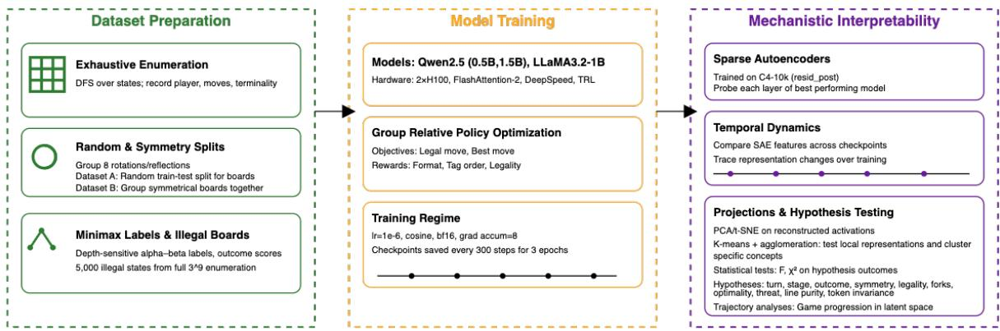  
Figure 1: Overview of our experimental setup

## 3 Methodology

We study reasoning development under reinforcement learning in small LLMs using a controlled, fully interpretable environment: Tic-Tac-Toe. Figure 1 describes our experimental setup, which was broadly split into 3 parts: dataset preparation, model training and mechanistic analysis.

## 3.1 Models and Training

Experiments used three models: Qwen2.5 0.5B Instruct, Qwen2.5 1.5B Instruct (Yang et al., 2024a), and Llama3.2 1B Instruct (Grattafiori et al., 2024). Models were trained with Group Relative Policy Optimization (GRPO) (Tang et al., 2024; Guo et al., 2025). Supervised fine-tuning (SFT) was attempted as a baseline but failed, with models repeating the input prompt rather than learning valid continuations (Dang and Ngo, 2025; Srivastava et al., 2025).

Training was performed on 2×H100 GPUs with Transformers reinforcement learninglibrary (von Werra et al., 2020), flashattention-2 (Dao, 2023) and DeepSpeed (Rasley et al., 2020). Hyperparameters: learning rate 1 × 10-6, cosine scheduler, bf16 precision, gradient accumulation 8. Checkpoints were saved every 300 steps up to 2240 steps (3 epochs).

## 3.2 Datasets

Two datasets were constructed. Random split with 80-10-10 train/validation/test partition over all legal Tic-Tac-Toe states and Canonical symmetry split where all eight symmetry variants of a board (rotations and reflections) were grouped by canonical ID. Each symmetry class was placed entirely in train or test, preventing symmetry leakage. We treat the two splits as separate designs answering different questions. The random split measures performance when symmetric variants of a test board are available in training, while the canonical split measures generalisation to unseen symmetry groups. Full dataset statistics are provided in Table 9.

Generation. States were produced via exhaustive depth-first traversal from the empty board. Each state records: current player, legal moves, terminality, minimax-computed best moves, and canonical symmetry ID. Player moves were encoded as integers: 1–9 for X, 10–18 for O. Illegal boards (5,000) for hypothesis testing were added by enumerating all 39 possible states and discarding unreachable ones. (Details of algorithm described in App. 6)

Dataset fields. Each entry includes: board (numeric and ASCII), natural language descriptions, move sequences, outcome labels, legal moves, best moves, and symmetry identifiers.

## 3.3 Objectives and Rewards

We trained models under two objectives. Given a board state, models had to either: Predict a legal move (legal move experiments) or, predict the most optimal move (best move experiments). We also included standard format rewards: (i) legality, (ii) format compliance (<think>...</think><answer>...</answer>), (iii) single-tag correctness. Rewards were equally weighted. Best-move training was initialized either from scratch or from the best legal-move checkpoint of the model for the given dataset (random or symmetry) to compare the difference in performance and convergence speeds. Although each step predicts a single move, the objective spans the full game. The labels come from full-depth minimax (Algo. 8) over an exhaustive state space, so every decision a complete game could visit is present with its optimal label. We also verify multiturn play explicitly in App. H.

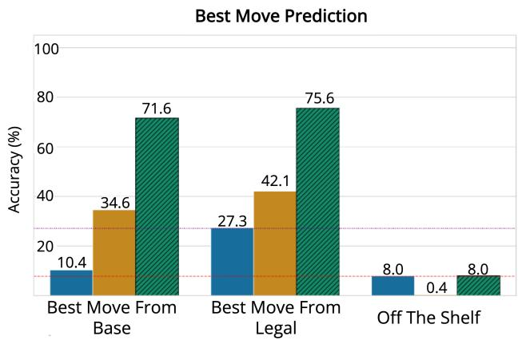

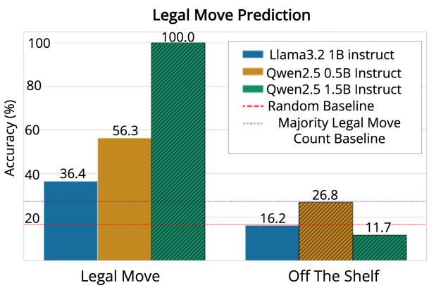

Figure 2: Best performance of each model and training setting for the legal move and best move prediction tasks on the random-split dataset. Complete performance plots for all settings (different board and move token representations) and datasets can be found in Appendix Figure 7.  
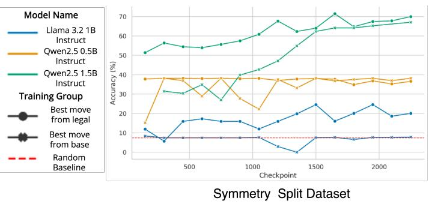

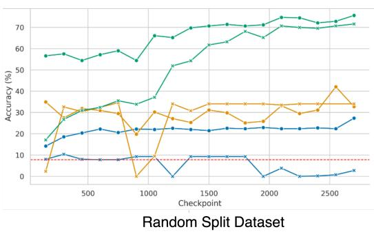  
Figure 3: Progression of model performance across model checkpoints for the two datasets. Complete progression plots for all settings (different board and move token representations) can be found in Appendix Figure 6.

## 3.4 Evaluation

At each checkpoint, we evaluated on both natural language and ASCII board formats, with robustness tested by random symbol substitution, replacing the player symbols X and O with random characters. Baseline models used structured generation to generate a chain-of-thought reasoning string followed by a move prediction.

## 3.5 Mechanistic Interpretability

To analyze internal representations we used sparse autoencoders (SAEs) (Huben et al., 2024; Templeton et al., 2026; Marks et al., 2025), trained on a generic corpus (NeelNanda/c4-10k) to extract general-purpose features and then applied to hypothesis-driven testing in our controlled domain (Algo. 1). We train on a generic distribution rather than on Tic-Tac-Toe activations, since Engels et al. (2025) show that SAEs trained on narrow corpora produce features that look clean but mirror the corpus rather than the model's internal geometry, so in-domain training could imprint task-specific structure onto the dictionary. Generic-corpus SAEs instead read out which concepts the model already represents, and the domain lets hypotheses about symmetry, strategy and game dynamics be defined exactly.

For each layer of each model, we trained SAEs on activations (resid\_post) using the configuration in Engels et al. (2025). Reconstructed activations were projected using PCA and t-SNE for visualization (Algo. 2). Board states in the projections were labeled along multiple axes: player turn, game stage, outcome, strategic situation (Algo. 3), symmetry group, legality, and correctness of model predictions. To test the models’ capabilities on general board and game understanding, the representations of the illegal boards were compared with those of the legal boards used for training and testing. Similarly to quantitative evaluation, model representations were also tested for robustness using token invariance. The player symbols X and O were replaced with the fixed pair P and Q (a second variant uses A and B) to check if the models can generalize their developed representations to variances in prompt input without changes in the task setting. The complete set of algorithms for hypothesis testing can be found in the Appendix section A. Clustering with k-means and hierarchical agglomeration was performed to automatically identify the feature groups, and statistical tests (F-tests, $\chi ^ { 2 } )$ evaluated the dependence between clusters and the previously defined game hypotheses. Manual analysis of the concepts and boards was done to identify higher level patterns. The resulting corpus spans eight checkpoints, eleven layers each and eight hypothesis-family tests per configuration. We find the decodability results replicate across all three models (App. F), and we report the dominant-axis reorganisation for Qwen2.5-1.5B, the best performing model, where it is clearest.

## 4 Results

We present quantitative results first, then the mechanistic analysis. Together they give a coherent picture: reinforcement learning amplifies promptlevel cues but leaves higher-order abstractions largely untouched.

## 4.1 Quantitative Results

Summary. Across three models, two objectives, two splits and four input modalities, GRPO improves performance over off-the-shelf and SFT baselines, most on natural-language prompts, while symmetry-controlled curves closely track randomsplit curves (Fig. 3), indicating limited use of symmetry-aware structure. Further ablations are in App. B and B.1.

Input condition ablations reveal modality dependence. Performance is not consistent across input modalities. ASCII board representations induce the largest accuracy drop for both objectives across all models, with the best performing Qwen2.5 1.5B model losing a relative 40% (73% to 44%) against natural language (full reports in App. Fig. 7). Random symbol substitution (symbol swap in prompts) causes a smaller, consistent decrease relative to the standard NL condition. The combined (ASCII + random symbol substitution) setting yields the most severe degradation, often approaching baseline. These asymmetries indicate that GRPO improved robustness to superficial token perturbations but did not produce modalityinvariant board understanding: the models rely on the natural-language scaffold to parse state, and accuracy drops steeply when forced to build a spatial map from ASCII. This adds evidence to reports that LLM “reasoning" is entangled with input format and context cues rather than abstract structure (Hua et al., 2025; Wu et al., 2025; Cosentino and Shekkizhar, 2024).

Symmetry split has minimal impact on learning curves. Learning curves under symmetrycontrolled splitting remain close to random-split curves (Fig. 3). If models learned symmetry-aware abstractions, symmetry-based training should change performance. Instead, we measure this directly and find the models pick corresponding moves on symmetry-related boards barely half the time, 56.7% on fully trained symmetry groups against 57.7% on never-seen ones (App. I).

Terminal-state detection, not easy positions, is learned first. Raw accuracy across difficulty bins is misleading, because the chance level itself varies with the number of legal moves. We therefore score each non-terminal state against a uniformrandom legal-move policy. For Qwen2.5-1.5B at the best-move checkpoint, low-branching positions (≤ 2 legal moves) reach 83.1% against a 76.0% chance level, high-branching positions (≥ 5) reach 63.6% against 39.2%. Normalized for chance, skill is 29.7% on low-branching versus 40.2% on highbranching positions, so the apparent easy-position advantage is a chance artifact. What the models do acquire immediately is terminal-state detection (97.8% already at the first checkpoint), while we see above-chance move selection emerge only gradually and at a similar rate across bins. The instantly acquired competence is recognition of a promptvisible property (a completed line), consistent with GRPO strengthening reliance on prompt-level cues rather than instilling search. Per-position breakdowns are in App. N.

Format alone does not explain GRPO gains. Forcing off-the-shelf models to emit the exact required <think>/<answer> template through structured generation isolates the format component of the reward. Under that identical template they reach 0.4–8.0% best-move accuracy against 27– 76% for GRPO models, which rules out format compliance as the primary driver (App. M).

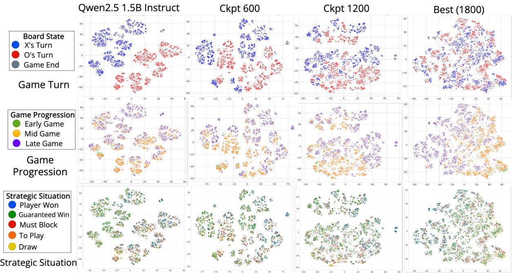

Figure 4: Model representations dynamics of Qwen2.5 1.5B (layer 12) through reasoning (GRPO) training. The figure represents the same projections colored based on three hypotheses: (H1) whose turn it is (Game Turn), (H2) which stage of the game it is (Game Progression) and (H3) what is the logical play for the given board (Strategic Situation). It is evident that while the base model only clearly represents the game turn, during the course of training, the model evolves to represents the boards based on game progression in addition to game turn, leading to improvement in performance. However, logic for strategic situations does not play a big role in model representations and no clear patterns emerge over the course of training. Full training dynamics across all layers and over all hypotheses tested are provided in Appendix Section C.
<table><tr><td></td><td colspan="3">Trajectory at L12</td><td colspan="10">Per-layer at converged ckpt</td></tr><tr><td>Hypothesis</td><td>Base</td><td>Mid</td><td>Final</td><td>L4</td><td>L8</td><td>L12</td><td>L13</td><td>L14</td><td>L15</td><td>L16</td><td>L17</td><td>L18</td><td>L20</td><td>L24</td></tr><tr><td>H1 turn identity</td><td>5285</td><td>366</td><td>316</td><td>270</td><td>140</td><td>316</td><td>114</td><td>269</td><td>188</td><td>95</td><td>2208</td><td>5379</td><td>1508</td><td>5484</td></tr><tr><td>H2 game progression</td><td>274</td><td>1686</td><td>2330</td><td>1151</td><td>594</td><td>2330</td><td>412</td><td>1278</td><td>287</td><td>358</td><td>747</td><td>284</td><td>114</td><td>400</td></tr><tr><td>H3 strategic situation</td><td>82</td><td>181</td><td>194</td><td>123</td><td>68</td><td>194</td><td>63</td><td>136</td><td>53</td><td>69</td><td>187</td><td>86</td><td>32</td><td>126</td></tr><tr><td>H4 symmetry class</td><td>26</td><td>9</td><td>12</td><td>4</td><td>3</td><td>12</td><td>3</td><td>5</td><td>2</td><td>2</td><td>13</td><td>42</td><td>7</td><td>23</td></tr><tr><td>H7 line-purity template</td><td>11</td><td>38</td><td>39</td><td>28</td><td>24</td><td>39</td><td>27</td><td>33</td><td>36</td><td>23</td><td>22</td><td>13</td><td>17</td><td>12</td></tr></table>

Table 1: F-statistic on the principal t-SNE axis (Qwen2.5-1.5B, NL). Larger F means hypothesis-labelled boards separate more cleanly on the dominant axis. Trajectory (left) is the GRPO-from-base run at layer 12: H1 mid-layer F drops 17× and re-emerges in late layers and H2 progression grows 8.5×, while H3/H4 stay weak. Per-layer (right) is the converged checkpoint: H2 peaks at layer 12, H4 stays at noise at every layer, and late layers (L17–L24) recover H1 for output decoding. The mid-layer locus is a property of the reorganisation, not of layer choice.

Representation and behaviour come apart out of distribution. We run an out-of-distribution test using the unreachable (illegal) boards, which no model was trained on. Probes separate them from legal boards at AUC 1.00 at every layer, so the representation registers that these states are unlike training data, yet the policy emits ordinary legal continuations on them exactly as it does on legal boards. Information present in the representation is therefore not information the behaviour acts on, the same gap the mechanistic analysis below documents for strategic structure (App. D).

## 4.2 Mechanistic Analysis

We group hypotheses into two classes: Promptlevel features explicitly available from the input (H1 turn identity; H2 game progression), and high-level game abstractions (H3 strategic situation: must-block, guaranteed win, etc.; H4 symmetry class; H5 legality; H6 best-move correctness; H7 line-purity). Game progression bins use move counts: early = 0−3, mid = 4−6, late = 7-9. The controlled domain allows hypothesis-driven tests that are hard to do in open-ended corpora. GRPO increases separability for H1 turn identity and H2 progression, but does not produce clean structure for H3 strategic situation, H4 symmetry, or H6 optimality (Fig. 4). Table 1 reports the one-way ANOVA F on the dominant t-SNE axis. We compute these over all 5,478 states, so the degrees of freedom follow from the class counts, (1, 5476) for H1 and (2, 5475) for H2, and every F we report is significant at $p < 1 0 ^ { - 6 8 }$ (App. L). Since that holds of every value in the table, we rest the argument on relative magnitudes, on the effect sizes in Table 11 and on the assumption-free permutation tests in App. F. We see that H1 turn representation decreases 17× and H2 progression representation increases 8.5× over GRPO training, while H3 and H4 stay at noise level. H5 and H6 are quantified in the same form in App. F. The asymmetry also appears behaviourally: terminalstate detection is near ceiling from the first checkpoint, whereas chance-corrected differences across branching and tie structure are small. Prompt-level structure (H2) is thus amplified by an order of magnitude and concentrated in mid layers, while strategic and symmetry abstractions (H3, H4) are not, at any layer or point in training.

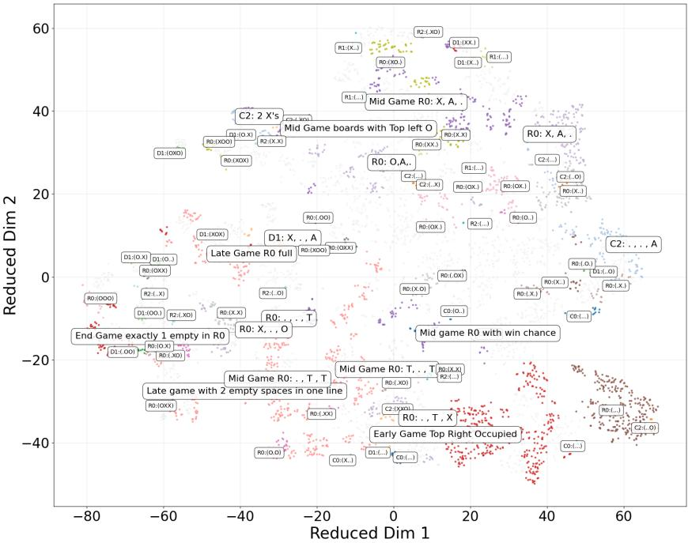  
Figure 5: Clustering of board state representations based on structural line purity for Qwen2.5 1.5B (layer 12) on text-form boards. Labels mark dominant line-purity clusters (common row, column, or diagonal patterns), with smaller labels denoting automatically mined subclusters from agglomerative k-means. Manually annotated clusters merge related subclusters across groups for clarity. For instance, late-game states with a single empty cell in the top row cluster together. In labels, R/C/D denote rows, columns, and diagonals. O and X are player tokens. “." is empty, T is taken (either player), A is any of X/O/empty. Full cluster maps for all layers, models, and modalities appear in Appendix Figure 22. The key finding is that these local structures are already present in the base model and are retained through GRPO, while the macroscopic arrangement is what changes, acquiring the game-progression axis. Symmetry-class membership never organises the clusters.

Full-space probes reproduce the result without the SAE. The SAE pipeline interprets concepts through a dictionary, a projection and clustering. As an independent test, we repeat every hypothesis test with classifiers trained on the raw residual stream, with none of those steps in the path (Table 2, with the protocol and cross-model replication provided in App. F). We find the prompt-level properties already at ceiling in the base model, so what GRPO amplifies is their prominence in the representation rather than their presence.

## 4.2.1 Macroscopic Representation Changes under GRPO

Turn and progression are the first-class axes. At initialization, clusters align most with H1 (whose turn), a strong axis already present in base models. With GRPO a second macroscopic axis for H2 (game progression) emerges and stretches across the manifold (Fig. 4, middle row), consistent with reports that small LLMs first acquire representations tied to immediately accessible features (Spies et al., 2024; Gurnee and Tegmark, 2024).

<table><tr><td>Hypothesis</td><td>Base</td><td>Final ckpt</td></tr><tr><td>H1 turn identity</td><td>1.000</td><td>1.000</td></tr><tr><td>H2 game progression</td><td>1.000</td><td>1.000</td></tr><tr><td>H5 legality</td><td>1.000</td><td>1.000</td></tr><tr><td>H7 line purity</td><td>0.861</td><td>0.856</td></tr><tr><td>H3 strategic situation</td><td>0.686</td><td>0.684</td></tr><tr><td>H4 symmetry-group similarity</td><td>0.70</td><td>0.70</td></tr></table>

Table 2: Probe decodability (cross-validated AUC, middle layer of Qwen2.5-1.5B) read from raw activations. Prompt-level properties (H1, H2) and legality (H5) are already perfectly decodable in the base model, so GRPO cannot be adding missing information, and the properties with headroom (H3, H4) do not move across training. A non-linear MLP probe raises H3 by at most 0.06 and likewise does not move it across training, so GRPO changes which features dominate the representation, not which concepts are recoverable.

Strategic abstractions do not emerge. Labelling by H3 (strategic situation, e.g. must block, guaranteed win) yields scattered speckles with no clean clusters even at peak performance late in training (Fig. 4, bottom row). Occasional microislands appear for immediate tactics such as onemove wins, but these may track structural organization of the boards rather than logical abstraction.

Input structure and local clusters. We see the ASCII drop mechanistically as well: crisp SAE detectors aligned to lexical markers support H1/H2 under natural-language boards, but the base-model turn pattern is absent under ASCII. Beneath the macroscopic axes we recover local pockets of high line purity (Fig. 5), already present in the base model and retained after training, while symmetryclass membership never organises the clusters (App. E).

## 4.2.2 Layerwise representational change

We locate the most substantial reorganization in the middle layers, around layer 12 in Qwen2.5- 1.5B. Early and late layers stay comparatively stable across GRPO training, as the layerwise dynamics map in App. C shows. Middle layers gain a well-defined game-progression axis while turn structure decreases mid-network, the layer-12 turn F falling from 5285 to 316 (Table 1). Turn structure re-emerges in the late layers of the converged checkpoint (F of 2208, 5379 and 5484 at layers 17, 18 and 24), where it is decoded for output.

GRPO updates therefore reshape mid-layer manifolds to better capture prompt-level structure while leaving early and late layers comparatively unchanged across training. This explains why models gain robustness to prompt variation without forming new higher-order abstractions: the learning signal improves already-accessible mid-layer features rather than rewriting the pipeline. Two explanations (reward shape, architectural compute) are in App. J.

## 4.2.3 Causal interventions locate the decision in late layers

Feature presence does not establish feature use, so we perform causal intervention through activation patching (Algo. 7) on 100 minimal board pairs whose optimal moves differ (App. G). Running the model on one board while overwriting the residual stream at the answer position with the paired board's activations flips the prediction to the paired optimum in 66 of 100 pairs at layer 25 of 28, against an unpatched rate of 10 $( p < 1 0 ^ { - 1 4 } )$ . Two controls establish that the donor's board content is what transfers: a random unrelated donor moves the prediction in only 12 of 100 cases, and the same patch at layers 13, 17 and 21 leaves behaviour unchanged, so the effect is not generic disruption. Steering along a mid-layer turn direction likewise leaves the output intact where norm-matched random directions at the same magnitude disrupt it, so the reorganised mid-layer axis is not what the move is computed from. Both interventions converge on the same picture: the late-layer state in which turn structure re-emerges is where the board is decoded into a move, which is what the output-decoding interpretation of Table 1 predicts.

## 5 Conclusion

We provide the first mechanistic trace of RL based reasoning training dynamics on small LLMs in a fully analyzable logical domain. RL post-training neither adds nor removes concept information: it reorganises which features dominate the representation mid-network, while the decision is carried downstream in the late-layer state. Gains thus stem from heavier use of prompt-level cues, not from new higher-order abstractions. We thus provide an interpretability-first blueprint for studying reasoning in controlled settings.

## Limitations

We highlight limitations directly relevant to interpreting our claims. Further discussion is in Appendix J.

Scope: small models, GRPO, one solvable domain. Our findings are specific to 0.5-1.5Bparameter instruction-tuned models post-trained with GRPO on Tic-Tac-Toe. Mid-layer reorganisation and prompt-level adaptation mirror trends reported in larger models. We do not claim to characterise frontier-scale RLHF, other RL objectives such as PPO or DPO, or open-ended reasoning Within the scope we do claim, the pattern holds across two model families and a threefold range of scale, varying data composition and initialisation rather than the training seed. Extension to richer logical domains, such as Connect Four, simple algebra, and grid-world planning, and to alternative RL recipes is a natural next step.

Where representations are measured. We read activations at the last prompt token and at eleven of the twenty-eight layers, and we sample the training trajectory every 300 steps. Reasoning circuits that are built transiently inside the generated reasoning trace, at an unsampled layer, or appearing and reversing within a checkpoint interval would not enter this measurement. The sampled layers do span the full depth, covering both the mid-network locus of the reorganisation and the late layers where patching locates the decision.

A closed hypothesis set. Clustering is automatic, but H1-H7 are specified by us from the structure of the game. An abstraction the model does represent that falls outside this set is not tested for, so our negative results are statements about these seven hypotheses rather than about every abstraction the task allows. The set is nonetheless exhaustive for the reasoning that our chosen formulation defines, and we did not specify line purity (H7) in advance: it came out of automatic subcluster mining, so the procedure can surface structure we did not anticipate.

## References

Sangmin Bae, Yujin Kim, Reza Bayat, Sungnyun Kim, Jiyoun Ha, Tal Schuster, Adam Fisch, Hrayr Harutyunyan, Ziwei Ji, Aaron Courville, and 1 others. 2026. Mixture-of-recursions: Learning dynamic recursive depths for adaptive token-level computation. Advances in Neural Information Processing Systems, 38:96572-96617.

Peter Belcak, Greg Heinrich, Shizhe Diao, Yonggan Fu, Xin Dong, Saurav Muralidharan, Yingyan Celine Lin, and Pavlo Molchanov. 2025. Small language models are the future of agentic ai. arXiv.org.

Junzhe Chen, Xuming Hu, Shuodi Liu, Shiyu Huang, Wei-Wei Tu, Zhaofeng He, and Lijie Wen. 2024. Llmarena: Assessing capabilities of large language models in dynamic multi-agent environments. In Proceedings of the 62nd Annual Meeting of the Association for Computational Linguistics (Volume 1: Long Papers), pages 13055–13077.

Romain Cosentino and Sarath Shekkizhar. 2024. Reasoning in large language models: A geometric perspective. arXiv preprint arXiv:2407.02678.

Quy-Anh Dang and Chris Ngo. 2025. Reinforcement learning for reasoning in small llms: What works and what doesn't. arXiv.org.

Alan Dao and Dinh Bach Vu. 2025. Alphamaze: Enhancing large language models’ spatial intelligence via grpo. arXiv.org.

Tri Dao. 2023. Flashattention-2: Faster attention with better parallelism and work partitioning. International Conference on Learning Representations.

Nouha Dziri, Ximing Lu, Melanie Sclar, Xiang Lorraine Li, Liwei Jiang, Bill Yuchen Lin, Sean Welleck, Peter West, Chandra Bhagavatula, Ronan Le Bras, and 1 others. 2023. Faith and fate: Limits of transformers on compositionality. Advances in neural information processing systems, 36:70293–70332.

Ronen Eldan and Yuanzhi Li. 2023. Tinystories: How small can language models be and still speak coherent english? arXiv preprint arXiv:2305.07759.

Josh Engels, Eric Michaud, Isaac Liao, Wes Gurnee, and Max Tegmark. 2025. Not all language model features are one-dimensionally linear. In International Conference on Learning Representations, volume 2025, pages 84591–84622.

Manaal Faruqui, Yulia Tsvetkov, Dani Yogatama, Chris Dyer, and Noah Smith. 2015. Sparse overcomplete word vector representations. Annual Meeting of the Association for Computational Linguistics, pages 1491–1500.

Andrey Galichin, Alexey Dontsov, Polina Druzhinina, Anton Razzhigaev, Oleg Y Rogov, Elena Tutubalina, and Ivan Oseledets. 2026. I have covered all the bases here: Interpreting reasoning features in large

language models via sparse autoencoders. Proceedings of the AAAI Conference on Artificial Intelligence, 40(36):30771–30779.

Roberto Gallotta, Graham Todd, Marvin Zammit, Sam Earle, Antonios Liapis, Julian Togelius, and Georgios N Yannakakis. 2024. Large language models and games: A survey and roadmap. IEEE Transactions on Games, pages 1–18.

Alexi Gladstone, Ganesh Nanduru, Md. Mofijul Islam, Peixuan Han, Hyeonjeong Ha, Aman Chadha, Yilun Du, Heng Ji, Jundong Li, and Tariq Iqbal. 2025. Energy-based transformers are scalable learners and thinkers. arXiv.org.

Aaron Grattafiori, Abhimanyu Dubey, Abhinav Jauhri, Abhinav Pandey, Abhishek Kadian, Ahmad Al-Dahle, Aiesha Letman, Akhil Mathur, Alan Schelten, Alex Vaughan, and 1 others. 2024. The llama 3 herd of models. arXiv preprint arXiv:2407.21783.

Daya Guo, Dejian Yang, Haowei Zhang, Junxiao Song, Ruoyu Zhang, Runxin Xu, Qihao Zhu, Shirong Ma, Peiyi Wang, Xiao Bi, and 1 others. 2025. Deepseek-r1: Incentivizing reasoning capability in 1lms via reinforcement learning. arXiv preprint arXiv:2501.12948.

Wes Gurnee and Max Tegmark. 2024. Language models represent space and time. In International Conference on Learning Representations, volume 2024, pages 2483–2503.

Rishi Hazra, Gabriele Venturato, Pedro Zuidberg Dos Martires, and Luc De Raedt. 2025. Have large language models learned to reason? a characterization via 3-sat phase transition. arXiv.org, abs/2504.03930.

Zhengfu He, Xuyang Ge, Qiong Tang, Tianxiang Sun, Qinyuan Cheng, and Xipeng Qiu. 2024. Dictionary learning improves patch-free circuit discovery in mechanistic interpretability: A case study on othellogpt. arXiv.org.

Roee Hendel, Mor Geva, and Amir Globerson. 2023. Incontext learning creates task vectors. Findings of the Association for Computational Linguistics: EMNLP 2023, pages 9318–9333.

Dylan Hillier, Leon Guertler, Cheston Tan, Palaash Agrawal, Ruirui Chen, and Bobby Cheng. 2024. Super tiny language models. arXiv.org.

Wenyue Hua, Kaijie Zhu, Lingyao Li, Lizhou Fan, Mingyu Jin, Shuhang Lin, Haochen Xue, Zelong Li, JinDong Wang, and Yongfeng Zhang. 2025. Disentangling logic: The role of context in large language model reasoning capabilities. Findings of the Association for Computational Linguistics: ACL 2025, pages 19219–19242.

Robert Huben, Hoagy Cunningham, Logan Smith, Aidan Ewart, and Lee Sharkey. 2024. Sparse autoencoders find highly interpretable features in language models. In International Conference on Learning Representations, volume 2024, pages 7827–7845.

Abhinav Joshi, Vaibhav Sharma, and Ashutosh Modi 2024. Checkersgpt: Learning world models through language modeling. In Annual Meeting of the Association for Computational Linguistics, pages 576–588. Association for Computational Linguistics.

Adam Karvonen, Benjamin Wright, C. Rager, Rico Angell, Jannik Brinkmann, L. Smith, C. M. Verdun, David Bau, and Samuel Marks. 2024. Measuring progress in dictionary learning for language model interpretability with board game models. Advances in Neural Information Processing Systems 37, 37:83091-83118.

Zhong-Zhi Li, Duzhen Zhang, Ming-Liang Zhang, Jiaxin Zhang, Zengyan Liu, Yuxuan Yao, Haotian Xu, Junhao Zheng, Pei-Jie Wang, Xiuyi Chen, and 1 others. 2025. From system 1 to system 2: A survey of reasoning large language models. IEEE Transactions on Pattern Analysis and Machine Intelligence, 48(3):3335–3354.

Xueguang Ma, Qian Liu, Dongfu Jiang, Ge Zhang, Zejun Ma, and Wenhu Chen. 2026. General-reasoner: Advancing llm reasoning across all domains. Advances in Neural Information Processing Systems, 38:56596–56618.

Samuel Marks, Can Rager, Eric Michaud, Yonatan Belinkov, David Bau, and Aaron Mueller. 2025. Sparse feature circuits: Discovering and editing interpretable causal graphs in language models. In International Conference on Learning Representations, volume 2025, pages 23888–23923.

Iman Mirzadeh, Keivan Alizadeh-Vahid, Hooman Shahrokhi, Oncel Tuzel, Samy Bengio, and Mehrdad Farajtabar. 2024. GSM-Symbolic: Understanding the limitations of mathematical reasoning in large language models. International Conference on Learning Representations.

Arindam Mitra, Luciano Del Corro, Shweti Mahajan, Andres Codas, Clarisse Simoes, Sahaj Agarwal, Xuxi Chen, Anastasia Razdaibiedina, Erik Jones, Kriti Aggarwal, and 1 others. 2023. Orca 2: Teaching small language models how to reason. arXiv.org.

Jeff Rasley, Samyam Rajbhandari, Rohan Ruwase, and Yuxiong He. 2020. Deepspeed: System optimizations enable training deep learning models with over 100 billion parameters. In Knowledge Discovery and Data Mining, pages 254–268.

Andrew Shin. 2025. Can a gamer train a mathematical reasoning model? arXiv.org.

Alex F Spies, William Edwards, Michael I Ivanitskiy, Adrians Skapars, Tilman Räuker, Katsumi Inoue, Alessandra Russo, and Murray Shanahan. 2024. Transformers use causal world models in mazesolving tasks. arXiv preprint arXiv:2412.11867.

Gaurav Srivastava, Shuxiang Cao, and Xuan Wang. 2025. Towards reasoning ability of small language models. arXiv.org.

Kaya Stechly, Karthik Valmeekam, and Subbarao Kambhampati. 2025. On the self-verification limitations of large language models on reasoning and planning tasks. In International conference on learning representations, volume 2025, pages 98190–98243.

Haoran Sun, Yusen Wu, Peng Wang, Wei Chen, Yukun Cheng, Xiaotie Deng, and Xu Chu. 2025. Game theory meets large language models: A systematic survey with taxonomy and new frontiers, 2025. Proceedings of the Thirty-ThirdInternational Joint Conference on Artificial Intelligence.

Yunhao Tang, Daniel Zhaohan Guo, Zeyu Zheng, Daniele Calandriello, Rémi Munos, Mark Rowland, Pierre Harvey Richemond, Michal Valko, Bernardo Ávila Pires, and Bilal Piot. 2024. Generalized preference optimization: a unified approach to offline alignment. In Proceedings of the 41st International Conference on Machine Learning, ICML'24. JMLR.org.

Adly Templeton, Tom Conerly, Jonathan Marcus, Jack Lindsey, Trenton Bricken, Brian Chen, Adam Pearce, Craig Citro, E. Ameisen, Andy Jones, and 1 others. 2026. Scaling monosemanticity: Extracting interpretable features from claude 3 sonnet. arXiv.org.

Graham Todd, Alexander G Padula, Matthew Stephenson, Éric Piette, Dennis J Soemers, and Julian Togelius. 2024. Gavel: Generating games via evolution and language models. Advances in Neural Information Processing Systems, 37:110723–110745.

Vernon YH Toh, Yew Ken Chia, Deepanway Ghosal, and Soujanya Poria. 2025. The jumping reasoning curve? tracking the evolution of reasoning performance in gpt-[n] and o-[n] models on multimodal puzzles. arXiv.org.

Oguzhan Topsakal, Colby Jacob Edell, and Jackson Bailey Harper. 2024. Evaluating large language models with grid-based game competitions: an extensible llm benchmark and leaderboard. arXiv.org.

Constantin Venhoff, Iván Arcuschin, Philip Torr, Arthur Conmy, and Neel Nanda. 2025. Understanding reasoning in thinking language models via steering vectors. arXiv.org.

Leandro von Werra, Younes Belkada, Lewis Tunstall, Edward Beeching, Tristan Thrush, Nathan Lambert, Shengyi Huang, Kashif Rasul, and Quentin Gallouédec. 2020. Trl: Transformer reinforcement learning. https://github.com/huggingface/trl.

Chengyu Wang, Taolin Zhang, Richang Hong, and Jun Huang. 2026a. A short survey on small reasoning models: Training, inference, applications and research directions. Frontiers of Computer Science, 20(11).

Haozhe Wang, Qixin Xu, Che Liu, Junhong Wu, Fangzhen Lin, and Wenhu Chen. 2025a. Emergent hierarchical reasoning in llms through reinforcement learning. arXiv.org.

Shangshang Wang, Julian Asilis, Ömer Faruk Akgül, Enes Bilgin, Ollie Liu, and Willie Neiswanger. 2026b. Tina: Tiny reasoning models via lora. In International Conference on Learning Representations, volume 2026, pages 90106–90140.

Xinyi Wang, Shawn Tan, Mingyu Jin, William Yang Wang, Rameswar Panda, and Yikang Shen. 2025b. Do larger language models imply better generalization? a pretraining scaling law for implicit reasoning. In ICML 2025 Workshop on Methods and Opportunities at Small Scale.

Juncheng Wu, Sheng Liu, Haoqin Tu, Hang Yu, Xiaoke Huang, James Zou, Cihang Xie, and Yuyin Zhou. 2025. Knowledge or reasoning? a close look at how llms think across domains. arXiv.org.

Shuang Wu, Liwen Zhu, Tao Yang, Shiwei Xu, Qiang Fu, Yang Wei, and Haobo Fu. 2024a. Enhance reasoning for large language models in the game werewolf. arXiv.org.

Zhaofeng Wu, Linlu Qiu, Alexis Ross, Ekin Akyürek, Boyuan Chen, Bailin Wang, Najoung Kim, Jacob Andreas, and Yoon Kim. 2024b. Reasoning or reciting? exploring the capabilities and limitations of language models through counterfactual tasks. In Proceedings of the 2024 Conference of the North American Chapter of the Association for Computational Linguistics: Human Language Technologies (Volume 1: Long Papers), pages 1819–1862. Association for Computational Linguistics.

Chulin Xie, Yangsibo Huang, Chiyuan Zhang, Da Yu, Xinyun Chen, Bill Yuchen Lin, Bo Li, Badih Ghazi, and Ravi Kumar. 2025. On memorization of large language models in logical reasoning. Proceedings of the 14th International Joint Conference on Natural Language Processing and the 4th Conference of the Asia-Pacific Chapter of the Association for Computational Linguistics, pages 2742–2785.

Fengli Xu, Qianyue Hao, Zefang Zong, Jingwei Wang, Yunke Zhang, Jingyi Wang, Xiaochong Lan, Jiahui Gong, Tianjian Ouyang, Fanjin Meng, and 1 others. 2025. Towards large reasoning models: A survey of reinforced reasoning with large language models. Patterns, 6(10):101370.

Qwen An Yang, Baosong Yang, Beichen Zhang, Binyuan Hui, Bo Zheng, Bowen Yu, Chengyuan Li, Dayiheng Liu, Fei Huang, Guanting Dong, and 1 others. 2024a. Qwen2.5 technical report. arXiv.org.

Yunhao Yang, Leonard Berthellemy, and Ufuk Topcu. 2024b. Reasoning, memorization, and fine-tuning language models for non-cooperative games. arXiv preprint arXiv:2410.14890.

Yadong Zhang, Shaoguang Mao, Tao Ge, Xun Wang, Adrian de Wynter, Yan Xia, Wenshan Wu, Ting Song, Man Lan, and Furu Wei. 2024. Llm as a mastermind: A survey of strategic reasoning with large language models. arXiv preprint arXiv:2404.01230.

Chengshuai Zhao, Zhen Tan, Pingchuan Ma, Dawei Li, Bohan Jiang, Yancheng Wang, Yingzhen Yang, and Huan Liu. 2026. Is chain-of-thought reasoning of llms a mirage? a data distribution lens. In Findings of the Association for Computational Linguistics: ACL 2026, pages 15231–15261.

Qinglin Zhu, Runcong Zhao, Hanqi Yan, Yulan He, Yudong Chen, and Lin Gui. 2025. Soft reasoning: Navigating solution spaces in large language models through controlled embedding exploration. International Conference on Machine Learning.

## A Algorithms for Hypothesis Testing

This section details the algorithms used for Sparse Autoencoder (SAE) feature discovery, board state analysis, and hypothesis testing.

Algorithm 1 SAE Feature Discovery and Clustering   
Require: Language Model M, Target Layer L   
Ensure: Trained SAE S, Feature Clusters C   
1: $ { S _ { p a t h } } \gets$ Path to cached SAE for M, L   
2: if $ { S _ { p a t h } }$ exists then   
3: $\mathscr { S } \gets \mathrm { L o a d S A E } ( S _ { p a t h } )$   
4: else   
5: $\mathcal { D } _ { t r a i n }$ ← Load text corpus (e.g., C4-10k)   
6: $\mathcal { A } _ { t r a i n }$ ← Extract activations from M at layer $L$ on $\mathscr { D } _ { t r a i n }$   
7: $\pmb { S } \gets \mathrm { T r a i n S A E } ( \mathcal { A } _ { t r a i n } )$   
8: Save $\mathrm { S A E } ( S , S _ { p a t h } )$   
9: end if   
10: $W _ { d e c }  S$ decoder\_weights   
11: $W _ { n o r m }  W _ { d e c } / \| W _ { d e c } \| _ { 2 }$ Normalize feature vectors   
12: Labels ← SpectralClustering $( W _ { n o r m } )$   
13: C ← Group feature indices by Labels   
14: return $s , \mathcal { C }$

Algorithm 2 t-SNE Dimensionality Reduction and Caching   
Require: Model M, SAE S, Tic-Tac-Toe Dataset D, Target Cluster Indices $\mathcal { T } _ { c l u s t e r }$   
Ensure: 2D Reduced Activations R, Associated Board Metadata $B _ { m e t a }$   
1: $C a c h e _ { p a t h }$ ← Path to cached t-SNE results for M, layer, style   
2: if $C a c h e _ { p a t h }$ exists then   
3: R, $B _ { m e t a }$ ← LoadFromCache $( C a c h e _ { p a t h } )$   
4: return $R , B _ { m e t a }$   
5: end if   
6: $B _ { m e t a } \gets$ Get unique boards from D   
7: Prompts ← {GeneratePrompt(b) for $b \in B _ { m e t a } \}$   
8: $\mathbf { \mathcal { A } } _ { o r i g } $ Get activations from M for Prompts   
9: $f _ { a c t s } \gets S . { \mathrm { e n c o d e } } ( A _ { o r i g } )$   
10: mask ← Zeros like $f _ { a c t s }$   
11: mask $[ : , \mathcal { T } _ { c l u s t e r } ] \gets 1$   
12: $\mathcal { A } _ { r e c o n }  \mathcal { S } .$ decode $( f _ { a c t s } \odot$ mask) Filter with cluster features   
13: $R \gets \mathrm { t - S N E } ( \mathcal { A } _ { r e c o n } , \mathbf { n } _ { - }$ \_components $= 2 )$   
14: SaveToCache $( C a c h e _ { p a t h } , R , B _ { m e t a } )$   
15: return $R , B _ { m e t a }$

Algorithm 3 Game-Theoretic Strategic Situation Analysis   
Require: Reduced Activations R, Board Metadata Bmeta   
Ensure: Saved plot colored by game-theoretic state   
1: function EVALUATE(board, player) Memoized function   
2: winner, terminal ← CheckTerminal(board)   
3: if terminal then   
4: return 1 if winner = player, 0 if draw, −1 if loss   
5: end if   
6: best\_outcome ← -2 ▶ Losing is the default   
7: for move in LegalMoves(board) do   
8: next\_board ← ApplyMove(board, move, player)   
9: outcome ← Evaluate(next\_board, opponent(player))   
10: if outcome = −1 then   
11: return 1 ▶ Opponent loss is a win for me   
12: end if   
13: best\_outcome ← max(best\_outcome, -outcome)   
14: end for   
15: return best\_outcome   
16: end function   
17: Categories ← ]   
18: for board b in Bmeta do   
19: winner, terminal ← CheckTerminal(b)   
20: if terminal then   
21: Append "Player Won" or "Draw" to Categories   
22: else   
23: gt\_eval ← Evaluate(b, CurrentPlayer(b))   
24: has\_threat ← OpponentHasImmediateWin(b, CurrentPlayer(b))   
25: if gt\_eval = 1 then   
26: Append "Guaranteed Win"   
27: else if has\_threat then   
28: Append "Must Block"   
29: else if gt\_eval = 0 then   
30: Append "Draw"   
31: else   
32: Append "To Play" Forced loss, no immediate threat   
33: end if   
34: end if   
35: end for   
36: Plot R, coloring points by Categories. Save figure.

Algorithm 4 Cluster-Based Statistical Analysis   
Require: Clustered Boards $\mathcal { C } _ { b o a r d s }$ (map from cluster ID to board lists)   
Ensure: Printed statistical test results   
1: ClusterFeatures ← {}   
2: for cluster cid in $\mathcal { C } _ { b o a r d s }$ do   
3: $F e a t u r e s _ { c i d } \gets [ ]$   
4: for board b in $\mathcal { C } _ { b o a r d s } [ c i d ]$ do   
5: Append {'piece\_count' : CountPieces(b), 'center' : GetCenter(b), . . . } to Featurescid   
6: end for   
7: ClusterFeatures[cid] ← Featurescid   
8: end for   
9: Example for a continuous feature   
10: Dataanova ← [[fl'piece\_count'] for f in ClusterFeatures[cid]] for cid in $\mathcal { C } _ { b o a r d s } ]$   
11: $F , p \gets \mathrm { A N O V A } ( D a t a _ { a n o v a } )$   
12: Print("Piece Count", $F , p )$   
13: Example for a categorical feature   
14: $T a b l e _ { c h i 2 } \gets$ BuildContingencyTable('center', ClusterFeatures)   
15: $\chi ^ { 2 } , p \gets \mathrm { C h i S q u a r e d T e s t } ( T a b l e _ { c h i 2 } )$   
16: Print("Center Control", $\chi ^ { 2 } , p )$

```latex
Algorithm 5 Hybrid Hierarchical-Agglomerative Analysis
Require: Reduced Activations R, Board Metadata $B _ { m e t a }$
Ensure: Saved hybrid plot visualization
1: $L 0 _ { l a b e l s } \gets \mathrm { K M e a n s } ( R , n _ { - } c l u s t e r s = 1 8 )$
2: $L 0 _ { a n a l y s i s } \gets \mathrm { A n a l y z e C l u s t e r s } ( L 0 _ { l a b e l s } )$ ▶ For L0 properties
3: $M a p _ { L 0 \_ t o \_ S u b }  \{ \}$
4: for cluster cid from 0 to 17 do
5: $L 0 _ { i n d i c e s } $ Indices where $L 0 _ { l a b e l s } = c i d$
6: $R _ { s u b } \gets R [ L 0 _ { i n d i c e s } ]$
7: $k _ { m i c r o } \gets \operatorname* { m a x } ( 5 , \lfloor \lfloor L 0 _ { i n d i c e s } \lvert / 1 0 \rfloor )$
8: Microlabels ← KMeans $( R _ { s u b } , n _ { - } c l u s t e r s = k _ { m i c r o } )$
9: PatternMap ← {} Map pattern key to list of global indices
10: for micro-cluster mcid in $k _ { m i c r o }$ do
11: $M C _ { i n d i c e s } $ Global indices for micro-cluster mcid
12: purity, pattern_key ← CalculateDominantLinePattern $\left( B _ { m e t a } [ M C _ { i n d i c e s } ] \right)$
13: if purity ≥ THRESHOLD then
14: Append $M C _ { i n d i c e s }$ to PatternMap[pattern_key]
15: end if
16: end for
17: MapL0_to_Sub[cid] ← {MergeIndicesByPattern(PatternMap)}
18: end for
19: Visualize: For each L0 cluster, draw its convex hull. Inside, color and annotate each discovered pure
sub-cluster from $M a p _ { L 0 \_ t o \_ S u b }$ based on its defining line pattern.
```

Algorithm 6 Illegal vs. Legal Board Comparison Analysis   
Require: Model M, SAE S, Legal Dataset $\mathcal { D } _ { L }$ , Illegal Dataset $\mathcal { D } _ { I }$   
Ensure: Saved comparison visualizations   
1: $B _ { L } \gets \mathrm { S a m p l e } ( \mathcal { D } _ { L } , N _ { l e g a l } )$   
2: BI ← Sample $( \mathcal { D } _ { I } , N _ { i l l e g a l } )$   
3: $B _ { c o m b i n e d }  [ ]$   
4: for b in $B _ { L }$ do   
5: Append {′board' : b,′ type' :' legal'} to Bcombined   
6: end for   
7: for b in $B _ { I }$ do   
8: Append {'board' : b,′ type' :′ illegal', reasons' : b.reasons} to Bcombined   
9: end for   
10: R ← Run t-SNE on SAE-reconstructed activations for $B _ { c o m b i n e d }$ As in Alg. 2   
11: Plot 1: Legality View   
12: Plot R, coloring points blue if 'legal' and red if ’illegal’. Save figure.   
13: Plot 2: Pattern Agglomeration View   
14: Labelskmeans ← KMeans(R, n\_clusters = k)   
15: for cluster cid from 0 to k — 1 do   
16: Clusterindices ← Indices where Label $\textprime s _ { k m e a n s } =$ cid   
17: PatternStats ← FindDominantLinePatterns $( B _ { c o m b i n e d } [ C l u s t e r _ { i n d i c e s } ] )$   
18: Annotate cluster centroid with top patterns, showing their legal/illegal counts.   
19: end for   
20: Plot R colored by legality. Overlay cluster annotations and convex hulls. Save figure.

Algorithm 7 Causal Intervention via Activation Patching   
Require: Model M, SAE S, Dataset D, Target Cluster Indices $\mathcal { T } _ { c l u s t e r }$   
Ensure: Printed intervention success/failure reports   
1: for square i from 0 to 8 do   
2: $b _ { d i r t y } , b _ { c l e a n }$ ← FindBoardPair(i, D) Boards differ only at square i   
3: if no pair found then   
4: continue   
5: end if   
6: Pdirty, Pclean ← Prompt $\left( b _ { d i r t y } \right)$ , Prompt(bclean)   
7: aclean ← GetActivation(M, Pclean)   
8: fclean ← S.encode(aclean)   
9: function PATCHHOOK(adirty\_runtime)   
10: $f _ { d i r t y } \gets S$ encode(adirty\_runtime)   
11: $f _ { d i r t y } [ \mathcal { T } _ { c l u s t e r } ] \gets f _ { c l e a n } [ \mathcal { T } _ { c l u s t e r } ]$ ▶ The patch   
12: return S.decode( fdirty)   
13: end function   
14: $l o g i t s _ { o r i g } \gets \mathcal { M } ( p _ { d i r t y } )$   
15: logitspatched ← M.run\_with\_hooks $( p _ { d i r t y } .$ , hook = PatchHook)   
16: $m o v e _ { o r i g } \gets \mathrm { G e t M o v e } ( l o g i t s _ { o r i g } )$   
17: movepatched ← GetMove(logitspatched)   
18: moveexpected ← GetBestMove $\left( b _ { c l e a n } \right)$   
19: Print results comparing moveorig, movepatched, moveexpected.   
20: end for

Algorithm 8 Depth-Sensitive Minimax Evaluation   
Require: Board state B, current player P, current depth d   
Ensure: Game-theoretic score s, best move index m   
1: function MINIMAXGETSCORE(B, P, d)   
2: winner, is\_terminal ← CheckWinner(B)   
3: if is\_terminal then   
4: if winner = 1 then   
5: return 10 – d, None ▶ Faster wins are better   
6: else if winner = 2 then   
7: return −10 + d, None Slower losses are better   
8: else   
9: return 0, None Draw   
10: end if   
11: end if   
12: EmptyCells ← FindEmptyCells(B)   
13: if P = 1 then Maximizing   
14: max\_eval ← -∞, best\_move ← None   
15: for move in EmptyCells do   
16: Bnew ← ApplyMove(B, move, P)   
17: evaluation, \_ ← MinimaxGetScore(Bnew, Player 2, d + 1)   
18: if evaluation > max\_eval then   
19: max\_eval ← evaluation, best\_move ← move   
20: end if   
21: end for   
22: return max\_eval, best\_move   
23: else ▶ P = 2, Minimizing   
24: min\_eval ← ∞, best\_move ← None   
25: for move in EmptyCells do   
26: Bnew ← ApplyMove(B, move, P)   
27: evaluation, \_ ← MinimaxGetScore(Bnew, Player 1, d + 1)   
28: if evaluation ≤ min eval then   
29: min\_eval ← evaluation, best\_move ← move   
30: end if   
31: end for   
32: return min\_eval, best\_move   
33: end if   
34: end function

Algorithm 9 Strategic Threat Detection and Fork Analysis   
Require: Board state B, player P   
Ensure: Count of immediate threats for player P   
1: function COUNTLINETHREATS(B, P)   
2: threats ← 0   
3: L ← All 8 winning lines of the board   
4: for line in L do   
5: pieces ← GetPiecesOnLine(B, line)   
6: if count(pieces, P) = 2 and count(pieces, empty) = 1 then   
7: threats ← threats + 1   
8: end if   
9: end for   
10: return threats   
11: end function   
Require: Board state B, player P   
Ensure: Boolean indicating if a fork opportunity exists for player P   
1: function HASFORK(B, P)   
2: OpenSquares ← FindEmptyCells(B)   
3: for square in OpenSquares do   
4: $B _ { t e m p } \gets \mathrm { A p p l y M o v e } ( B ,$ square, P)   
5: if CountLineThreats(Btemp, P) ≥ 2 then   
6: return true   
7: end if   
8: end for   
9: return false   
10: end function

Algorithm 10 Board Canonical Form Generation   
Require: A 3 × 3 board matrix B   
Ensure: The lexicographically smallest (canonical) representation of the board   
1: function GETCANONICALFORM(B)   
2: Symmetries ←[]   
3: $B _ { c u r r e n t }  B$   
4: for $i = 1$ to 4 do   
5: Append Flatten $\left( B _ { c u r r e n t } \right)$ to Symmetries   
6: $B _ { f l i p p e d }  \mathrm { F l i p L e f t R i g h t } ( B _ { c u r r e n t } )$   
7: Append Flatten $( B _ { f l i p p e d } )$ to Symmetries   
8: $B _ { c u r r e n t }  \mathrm { R o t a t e 9 0 D e g r e e s } ( B _ { c u r r e n t } )$   
9: end for   
10: return min(Symmetries)   
11: end function

## B Quantitative analysis

This section provides the complete set of quantitative results for all settings. For both random and symmetry datasets, we conducted evaluations for both text based natural language board representations as well as ascii based board representations. These were done to evaluate both legal move and best move objectives across all trained model checkpoints. Model's robustness to the prompt variations was tested by random symbol substitution, choosing random alphanumeric characters to replace the player symbols X and O for the same board.

## B.1 Additional behavioural results

Scaling helps within limits. Qwen2.5 1.5B achieves the strongest results, surpassing Llama3.2 1B and Qwen2.5 0.5B on both objectives at their best checkpoints (Fig. 2). The weaker models hover near smart baselines on best-move prediction, consistent with observations that small LMs often require targeted signals to form task circuits (Hillier et al., 2024; Eldan and Li, 2023; Wang et al., 2026b) Even the strongest model plateaus short of perfect best-move play (legal: up to 100%, best move: 71% under symmetry split and 74% under random split), foreshadowing the representational limits seen mechanistically. Differences between the 0.5B Qwen and 1B Llama also suggest pretraining quality matters for downstream “reasoning" (Wang et al., 2025b).

Objective difficulty: accuracy on legal  best. Legal-move prediction is substantially easier than best-move selection (Fig. 2), matching reports that models master surface constraints before long-horizon structure (Topsakal et al., 2024; Chen et al., 2024; Zhang et al., 2024). Outcome-aware analysis (full reports provided in appendix Fig. 8) show peaks on tactically imminent positions (large |score|) and dips on low-magnitude, ambiguous states where lookahead or symmetry reasoning should matter (Spies et al. 2024; Dao and Vu, 2025).

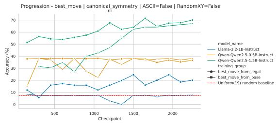

(a) Progression, best move, Natural language board representation, random-False  
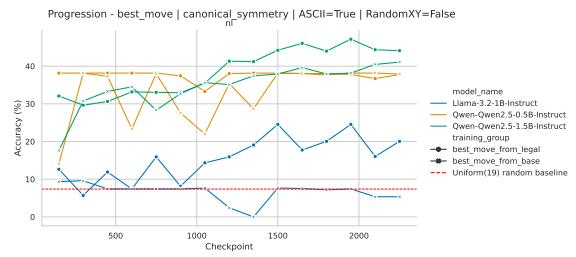  
(b) Progression, best move, Natural language board representation, random-True

(c) Progression, best move, ASCI board representation, random-False  
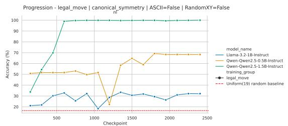

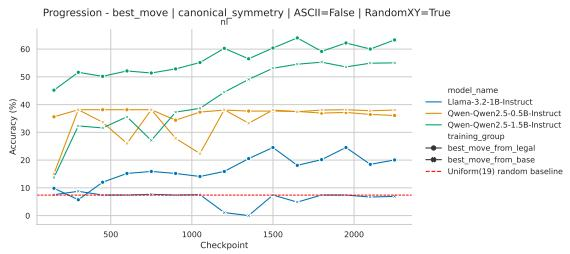

(e) Progression, legal move, Natural language board representation, random-False  
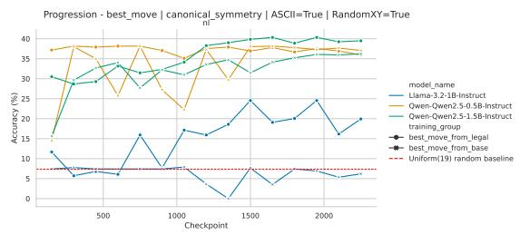

(d) Progression, best move, ASCII board representation, random-True  
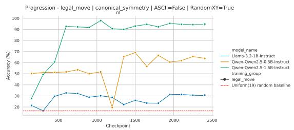

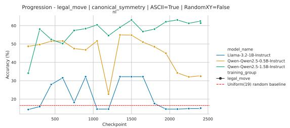  
(g) Progression, legal move, ASCI board representation, random-False

(f) Progression, legal move, Natural language board representation, random-True  
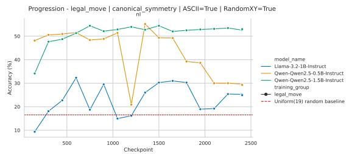  
(h) Progression, legal move, ASCII board representation, random-True  
Figure 6: Progression analysis across board representations and randomization.

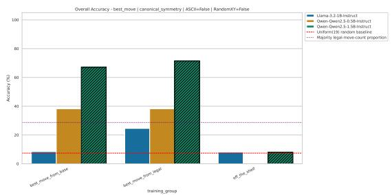

(a) Overall, best move, Natural language board representation, random-False  
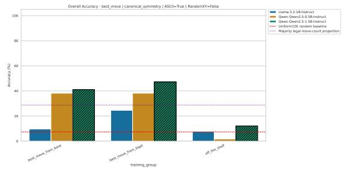  
(c) Overall, best move, ASCII board representation, random-False

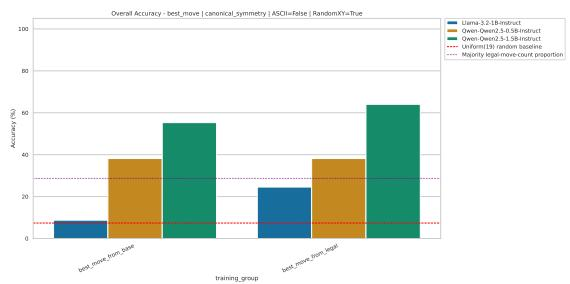

(b) Overall, best move, Natural language board representation, random-True  
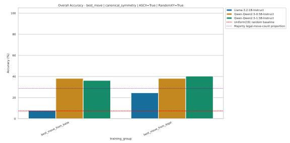  
(d) Overall, best move, ASCII board representation, random-True

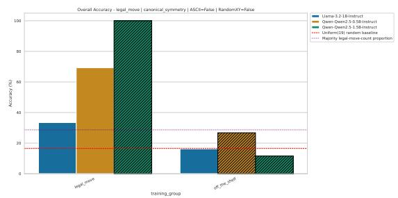  
(e) Overall, legal move, Natural language board representation, random-False

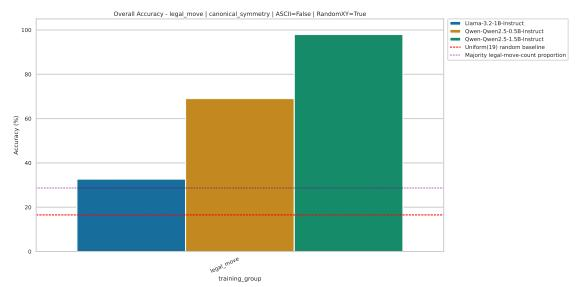  
(f) Overall, legal move, Natural language board representation, random-True

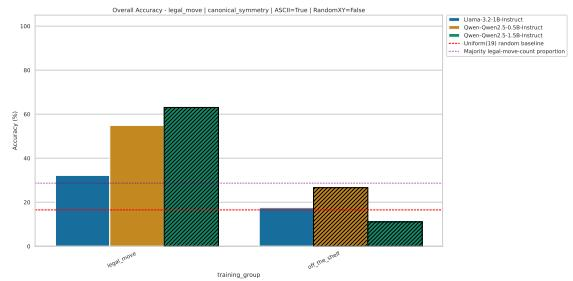  
(g) Overall, legal move, ASCI board representation random-False

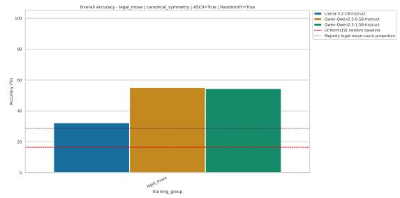  
(h) Overall, legal move, ASCI board representation, random-True  
Figure 7: Overall performance across board representations and randomization.

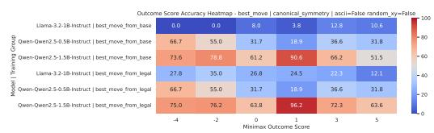

(a) Heatmap, best move, Natural language board representation, random-False  
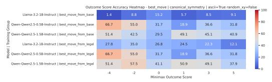  
(c) Heatmap, best move, ASCII board representation, random-False

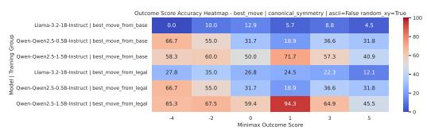

(b) Heatmap, best move, Natural language board representation, random-True  
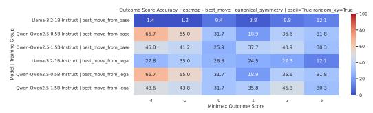  
(d) Heatmap, best move, ASCII board representation, random-True


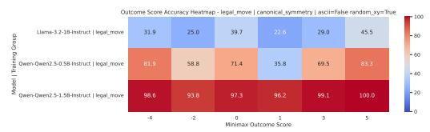

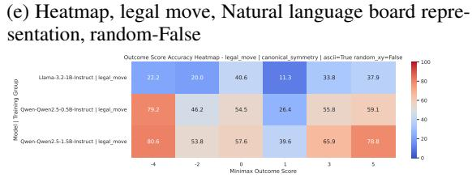  
(g) Heatmap, legal move, ASCII board representation, random-False

(f) Heatmap, legal move, Natural language board representation, random-True  
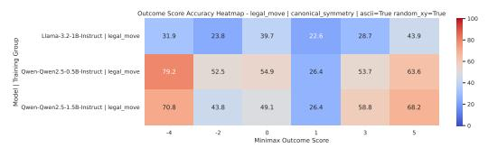  
(h) Heatmap, legal move, ASCI board representation, random-True  
Figure 8: Outcome score heatmaps across board representations and randomization.

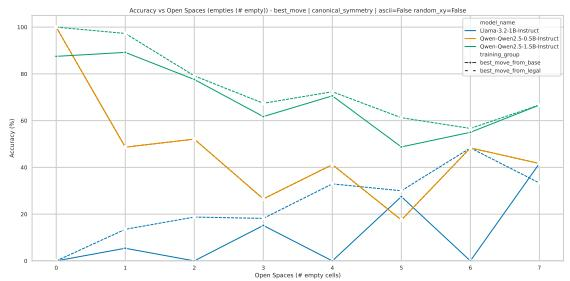  
(a) Open spaces, best move, Natural language board representation, random-False

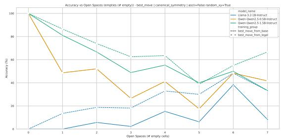  
(b) Open spaces, best move, Natural language board representation, random-True

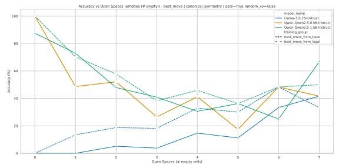  
(c) Open spaces, best move, ASCI board representation, random-False

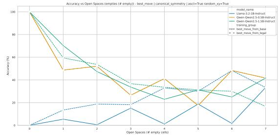  
(d) Open spaces, best move, ASCII board representation random-True

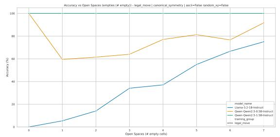  
(e) Open spaces, legal move, Natural language board representation, random-False

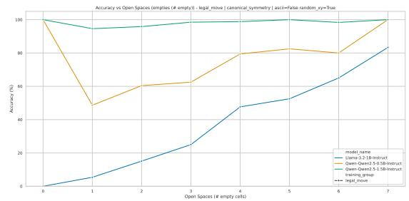

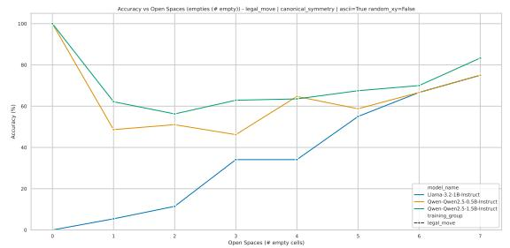  
(g) Open spaces, legal move, ASCI board representation, random-False

(f) Open spaces, legal move, Natural language board representation, random-True  
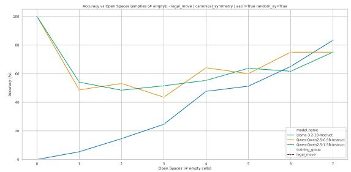  
(h) Open spaces, legal move, ASCI board representation random-True  
Figure 9: Open spaces analysis across board representations and randomization.

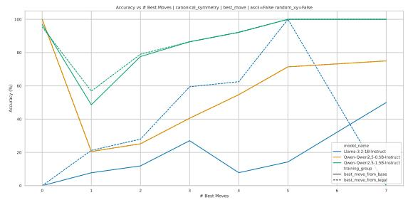

(a) Complexity, best move, Natural language board representation, random-False  
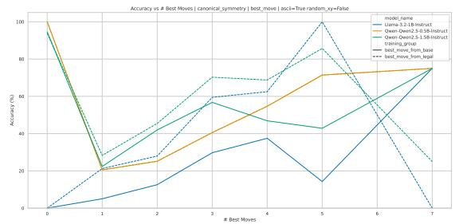  
(c) Complexity, best move, ASCII board representation, random-False

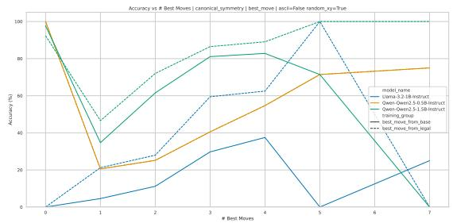

(b) Complexity, best move, Natural language board representation, random-True  
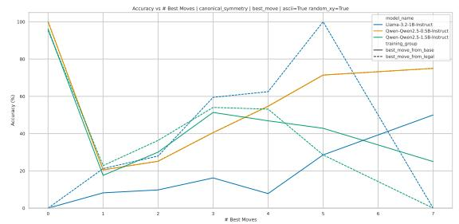  
(d) Complexity, best move, ASCII board representation, random-True

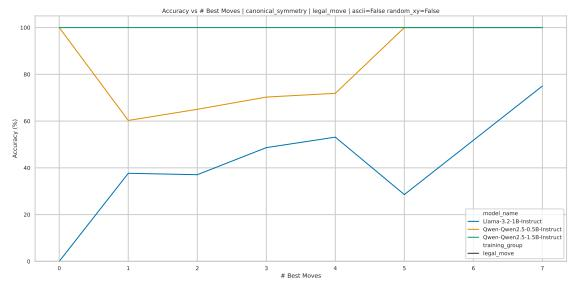  
(e) Complexity, legal move, Natural language board representation, random-False

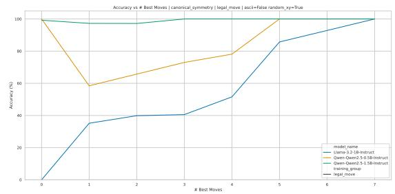

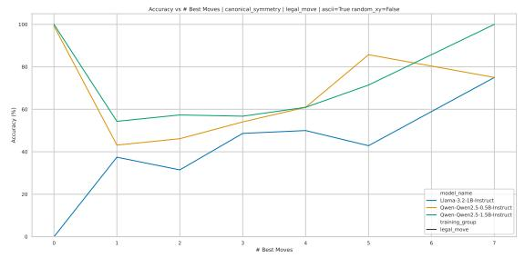  
(g) Complexity, legal move, ASCII board representation, random-False

(f) Complexity, legal move, Natural language board representation, random-True  
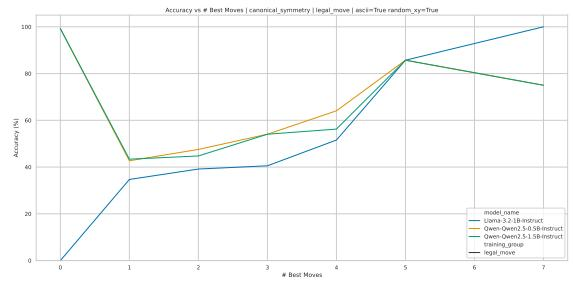  
(h) Complexity, legal move, ASCII board representation, random-True  
Figure 10: Complexity analysis across board representations and randomization.

## C Additional Mechanistic Interpretability Results

The plots below map the hypotheses from SAE probing across all layers and along training checkpoints for both natural language and ascii representations. Due to size constraints on the main paper, the plots have been compressed to allow the PDF to stay within 50MB. Complete plots have been provided with the supplemental submission for further investigation.

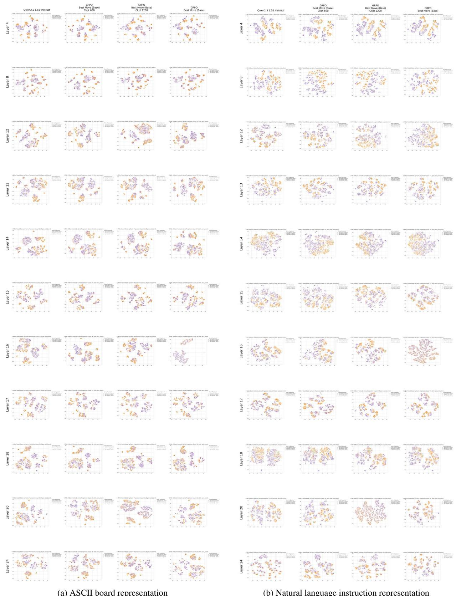  
Figure 11: Hypothesis testing: Game progression.

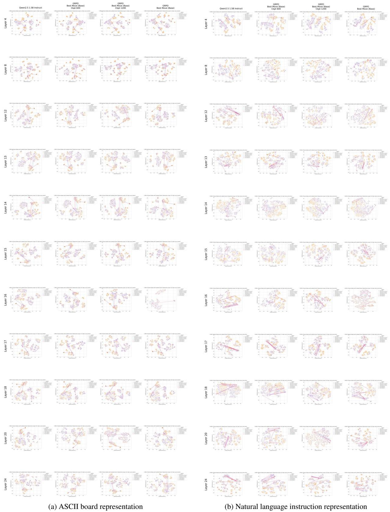  
Figure 12: Hypothesis testing: Game trajectories.

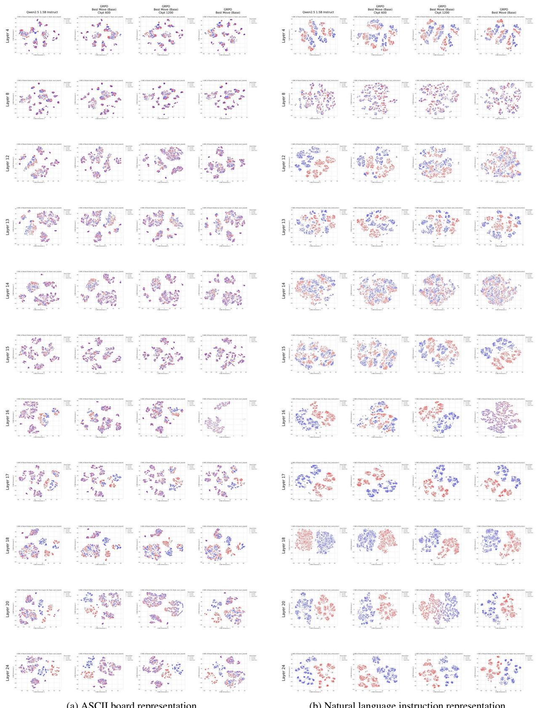  
Figure 13: Hypothesis testing: Game turn.

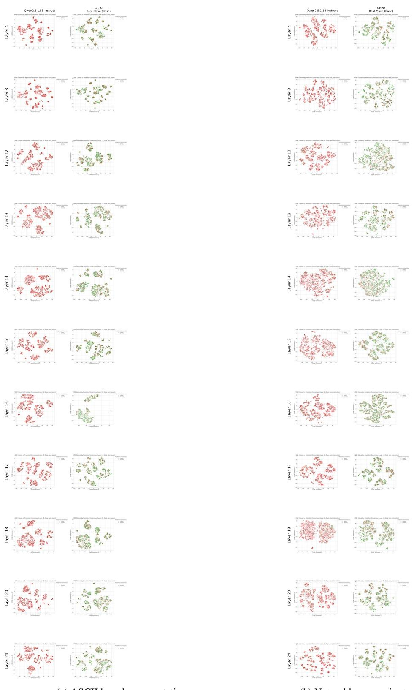  
(a) ASCII board representation  
(b) Natural language instruction representation  
Figure 14: Hypothesis testing: Prediction correctness.

  
(b) Natural language instruction representation  
Figure 15: Hypothesis testing: Illegal vs Legal boards.

  
Figure 16: Hypothesis testing: Strategic situations.

  
Figure 17: Hypothesis testing: Symmetry.

  
Figure 18: Hypothesis testing: Threat detection.

  
Figure 19: Hypothesis testing: Turn-by-turn paired analysis.

  
Figure 20: Hypothesis testing: Winner identification.

  
Figure 21: Hypothesis testing: Winner identification with best labels.

(b) Natural language instruction representation

  
Figure 22: KMeans clustering: Dominant line patterns.

  
Figure 23: KMeans clustering: Global extremes (normalized).

  
Figure 24: KMeans clustering: Hypothesis summary (normalized).

## D Illegal boards: an out-of-distribution generalization test

The unreachable boards test whether the model internalised the rules that generate valid states. Models were never trained to flag illegality, so proposing legal continuations on unreachable boards is expected under the objective, and we present this result as illustrative rather than as evidence about constraint encoding. The informative result is a dissociation between representation and policy: probes separate legal from unreachable boards at AUC 1.00 at every layer (App. F), partly reflecting surface count differences, so the distinguishing information is present in the representations even though the policy never acts on it. In the SAE geometry, illegal boards sit near legal clusters matched by simple line patterns rather than by legality constraints (details in Appendix Figs. 8, 15). The representation thus generalises by line-pattern similarity, a distinction also emphasized in recent small-model reasoning studies (Dang and Ngo, 2025; Srivastava et al., 2025; Shin, 2025).

## E Input modality and local cluster structure

Input structure matters: ASCII vs. natural language. The quantitative drop under ASCII boards is reflected mechanistically: SAE features for tokenized NL boards contain many crisp detectors aligned to lexical markers (“Row 1", “empty") and ordinal positions, cleanly supporting H1/H2 as seen in Figures 5 and 4 (middle row). The base-model game-turn macro pattern visible under NL inputs is absent under ASCII (App. Fig. 13). This suggests that reasoning training does not make the models robust to true “reasoning". This asymmetry aligns with context-dependence findings (Hua et al., 2025) and data-distribution sensitivity (Zhao et al., 2026), and helps explain why random symbol substitution hurts slightly while ASCII hurts substantially in the overall plots.

Local clusters in model representations. We define line purity of a subcluster as the largest fraction of its boards sharing a row, column, or diagonal pattern, and report subclusters with purity ≥ 0.7. K-means followed by agglomerative refinement over SAE-PCA space recovers crisp local pockets capturing patterns like “late-game, exactly one empty in R0" or “mid-game R0: X . . , center taken" (Fig. 5). These structures are present in the base model and retained after training, while the macroscopic arrangement evolves to add game progression. Symmetry-class membership is absent at the cluster level: the canonical-symmetry ratio falls below 0.7 in only 4 of 792 clusters, all of them end-game clusters where progression rather than symmetry drives membership (App. Fig. 17).

## F Full-dimensional probe analysis

The SAE pipeline in the main paper reads concepts out through a sparse dictionary, a t-SNE projection and clustering. To confirm that our conclusions are not artifacts of that pipeline, we repeat the hypothesis tests directly on the model's raw activations. For each hypothesis H1-H7 we train classifiers to predict the corresponding board property from the raw residual-stream activations at the last prompt token, with no SAE, no t-SNE and no clustering anywhere in the path. We use logistic regression and linear discriminant analysis (LDA) as linear probes, together with a one-hidden-layer MLP as a non-linear reference. All probes use five-fold stratified cross-validation and are scored by macro one-versus-rest AUC, and significance is assessed against label-permutation null distributions. Every number is computed on held-out folds.

<table><tr><td>Hypothesis</td><td>Base model</td><td>Final checkpoint</td></tr><tr><td>H1 turn identity</td><td> $1 . 0 0 0 \pm 0 . 0 0 0$ </td><td> $1 . 0 0 0 \pm 0 . 0 0 0$ </td></tr><tr><td>H2 game progression</td><td> $1 . 0 0 0 \pm 0 . 0 0 0$ </td><td> $1 . 0 0 0 \pm 0 . 0 0 0$ </td></tr><tr><td>H3 strategic situation</td><td> $0 . 6 8 6 \pm 0 . 0 1 1$ </td><td> $0 . 6 8 4 \pm 0 . 0 1 2$ </td></tr><tr><td>H7 line purity</td><td> $0 . 8 6 1 \pm 0 . 0 1 4$ </td><td> $0 . 8 5 6 \pm 0 . 0 1 1$ </td></tr><tr><td>H5 legality (legal vs. unreachable)</td><td> $1 . 0 0 0 \pm 0 . 0 0 0$ </td><td> $1 . 0 0 0 \pm 0 . 0 0 0$ </td></tr><tr><td>H4 same-symmetry-group similarity (pair test)</td><td>0.70</td><td>0.70</td></tr></table>

Table 3: Linear-probe results at the middle layer of Qwen2.5-1.5B: cross-validated AUC ± standard deviation across folds, for the base model and the final GRPO checkpoint. For H3, MLP probes reach 0.75 (base) and 0.73 (final checkpoint), so at most 0.05 to 0.06 of additional AUC is recoverable non-linearly. H4 uses the pair-separation test described below.

Table 3 compares the base model with the final GRPO checkpoint. Prompt-level properties (H1 turn identity, H2 game progression) and H5 legality are perfectly decodable in both. The higher-order properties are the ones with headroom, and they do not move: H3 strategic situation stays at 0.686 (base) against 0.684 (final checkpoint) with linear probes, and the MLP raises it only to 0.75 and 0.73. H7 line purity is high and likewise stable. H6 best-move correctness is measured in the same form and is reported with the probe grid in the supplementary material.

For H4, the 765 symmetry classes make direct classification impractical. We instead test whether activations of symmetry-related boards are more similar than activations of unrelated boards matched on game stage, summarised as a pair-separation AUC. The resulting 0.70 partly reflects shared piece counts and line patterns, and the informative fact is that it does not grow across training.

Cross-model replication. Table 4 reports logistic-regression AUC ranges across checkpoints at a midnetwork layer for all three models. H1 is at 1.00 at every checkpoint of every model, and H3 stays flat under GRPO in all three, so the decodability findings are not specific to Qwen2.5-1.5B.
<table><tr><td>Model</td><td>H1 turn identity</td><td>H3 strategic situation</td></tr><tr><td>Qwen2.5-1.5B</td><td>1.00 at every checkpoint</td><td>0.68 to 0.70, flat</td></tr><tr><td>Qwen2.5-0.5B</td><td>1.00 at every checkpoint</td><td>0.61 to 0.65, flat</td></tr><tr><td>Llama-3.2-1B</td><td>1.00 at every checkpoint</td><td>0.65 to 0.70, flat</td></tr></table>

Table 4: Logistic-regression AUC ranges across GRPO checkpoints at a mid-network layer. “Flat" means the range shows no upward trend under GRPO training. The dominant-axis reorganisation itself is clearest in Qwen2.5-1.5B and noisier in the smaller models, so we scope that claim to Qwen2.5-1.5B.

Permutation nulls. Table 5 reports permutation tests with 999 label permutations per comparison, using the LDA probe at the middle layer of Qwen2.5-1.5B on a held-out split. Every observed value exceeds the maximum of its 999 shuffled nulls, which attains the smallest p available at this resolution, and all comparisons remain significant after Benjamini-Hochberg correction at any conventional threshold. The nulls also address probe capacity directly: if this probe width could fit its way to high AUC, the permuted labels would show it, and they do not (null mean 0.50, null maximum 0.61).

<table><tr><td>Hypothesis</td><td>Observed (base)</td><td>Observed (final)</td><td>Largest null</td><td>p</td></tr><tr><td>H1 turn identity</td><td>1.000</td><td>1.000</td><td>0.57</td><td>0.001</td></tr><tr><td>H2 game progression</td><td>0.996</td><td>0.994</td><td>0.58</td><td>0.001</td></tr><tr><td>H3 strategic situation</td><td>0.650</td><td>0.651</td><td>0.56</td><td>0.001</td></tr><tr><td>H7 line purity</td><td>0.834</td><td>0.818</td><td>0.61</td><td>0.001</td></tr><tr><td>H5 legality</td><td>1.000</td><td>1.000</td><td>0.56</td><td>0.001</td></tr></table>

Table 5: Permutation tests (999 label permutations per comparison, LDA probe, middle layer, Qwen2.5-1.5B, held-out split): observed AUC for the base model and the final checkpoint, against the largest value in the shuffled null distribution. Even H3, the weakest hypothesis, sits far above its null ceiling, so the finding is that strategic information is limited and static under GRPO, not that it is absent.

Dominant-axis statistic without t-SNE. As a projection-free counterpart to the t-SNE ANOVA of Table 1, we compute the variance explained by class means along the first principal component of the raw activations. This statistic makes no separability claim. It measures how prominently a property organises the single largest axis of variation, which is the quantity behind the inversion reported in the main paper, and unlike a t-SNE embedding the variance a principal component captures and discards is exactly measurable. At the middle layer the turn share falls from 0.151 (base) to 0.062 (final checkpoint) while the progression share holds near 0.20, reproducing the direction of the inversion with no t-SNE in the path.

Interpretation. Prompt-level properties are perfectly readable before RL starts, so the amplification claim concerns how prominently information is organised and how heavily it is used, not whether it exists. The properties with headroom are the higher-order ones, and RL leaves them unchanged. Turn information never becomes less decodable. It moves off the dominant variance axis mid-network while remaining perfectly present, which refines the inversion in Table 1: what changes under GRPO is which features dominate the representation, not which concepts are recoverable.

## G Causal interventions: activation patching and steering

Activation patching. We construct 100 minimal board pairs. The two boards in a pair are identical except that one opponent piece is relocated, the same player is to move, and each board has a unique optimal move, with the two optimal moves differing. We call the board whose prompt is run the receiver and the board supplying activations the donor. The design instantiates Algorithm 7 using standard interchange-intervention and causal-tracing methodology (Vig et al., 2020; Geiger et al., 2021), localising the causal effect by layer as in Meng et al. (2022), in the paired-input form of Wang et al. (2023). At a single layer we overwrite the residual-stream activations at the answer position of the receiver's forward pass with the donor's activations. Everything else the model processes is the receiver, and the question is which board's optimal move it now emits. The controls follow the activation-patching recommendations of Zhang and Nanda (2024).

Unpatched, the model plays the receiver-optimal move on 72 of 100 pairs and the donor-optimal move on 10 of 100, which is its ordinary error rate. Patched at layer 25 of 28, it plays the donor-optimal move on 66 of 100 pairs. Two controls rule out trivial explanations. The same patch at layers 13, 17 and 21 leaves behaviour unchanged, so arbitrary tampering does not redirect the answer. Injecting activations from a random unrelated board instead of the paired donor transfers that board's move in only 12 of 100 cases, so the effect is specific to the donor's board content rather than generic disruption. The difference of 66 against 12 of 100 is significant at p < 10−14by a two-proportion test.

Steering. A complementary experiment probes the same question from the other side, using differencein-means activation addition (Turner et al., 2023; Panickssery et al., 2024). The steering direction connects the average internal state of X-to-move boards to that of O-to-move boards, and multiples of it are added to the activations during generation at each of six layers. The output never flips between the X and O move-token ranges, at any layer or magnitude, while norm-matched random directions at extreme magnitudes do disrupt outputs, which establishes that the intervention reaches the computation. The reorganised mid-layer turn axis therefore does not by itself drive the move, independently confirming what the layer-resolved patching shows.

Interpretation. Both interventions place the decision in the same location. Board information becomes causally decisive where it consolidates in late layers, and the mid-layer axes that GRPO reorganises are not individually sufficient to drive behaviour. This is the causal counterpart of the representational result: what training reshapes mid-network is not where the answer is produced, which is exactly the output-decoding interpretation of the late-layer re-emergence of turn structure in Table 1.

## H Full-game arena evaluation

To connect per-state accuracy to multi-turn play, models play complete games from the empty board, alternating moves until a win, a draw or a forfeit, where an illegal or unparseable move ends the game in the opponent's favour. The field mixes frontier API models with the GRPO-trained and untrained models, and every move is also scored against the minimax optimum (Algorithm 8).

<table><tr><td></td><td>GRPO-trained</td><td>Untrained</td></tr><tr><td>Elo</td><td>1525</td><td>1287</td></tr><tr><td>Games</td><td>154</td><td>160</td></tr><tr><td>Own forfeits</td><td>0</td><td>121</td></tr><tr><td>Per-move minimax-optimality (completed games)</td><td>77%</td><td>not measurable</td></tr><tr><td>Draws against the flash-tier frontier model</td><td>16 of 16</td><td>0</td></tr></table>

Table 6: Arena results for GRPO-trained against untrained Qwen2.5-1.5B. Per-move minimax-optimality is not measurable for the untrained model because it forfeits most of its games before completion. Elo is order-dependent and X always moves first, so the comparison between the two rows rather than the absolute rating is the informative quantity.

Table 6 compares the two. Training eliminates forfeits (0 against 121), yields 77 percent per-move minimax-optimality in completed games, and turns every game against the flash-tier model into a draw. The trained model's 84 losses were all genuine on-board losses against stronger frontier models, not forfeits. Training on the single-move objective therefore transfers directly to sequential play, as the argument in Sec. 3 predicts.

## I Behavioural equivariance and memorisation

Behavioural equivariance over the full state space. Two boards related by a rotation or reflection are the same position in different orientations, so a policy that uses symmetry should choose corresponding moves on both. For every pair of symmetry-related non-terminal boards over all 5,478 states, we test whether the predicted moves correspond under the transformation relating the two boards. On pairs where each board has a unique optimal move, a symmetry-respecting policy must score 100 percent, so the unique-optimum column of Table 7 has an exact ceiling. Scores sit far below that ceiling on every subset, and held-out symmetry groups score no lower than training symmetry groups, so the policy does not use symmetry and this finding is not an artifact of the split design.

<table><tr><td>Split</td><td>Symmetry groups</td><td>Pairs</td><td>Equivariance (%)</td><td>Unique-optimum (%)</td><td>n</td></tr><tr><td>Canonical</td><td>Training</td><td>1,484</td><td>56.7 (54.2–59.2)</td><td>60.0 (56.7–63.2)</td><td>857</td></tr><tr><td>Canonical</td><td>Held-out</td><td>653</td><td>57.7 (53.9–61.5)</td><td>62.7 (57.6–67.5)</td><td>359</td></tr><tr><td>Random</td><td>All</td><td>2,119</td><td>56.1 (54.0–58.2)</td><td>60.5 (57.8–63.3)</td><td>1,214</td></tr></table>

Table 7: Behavioural equivariance of Qwen2.5-1.5B: percentage of symmetry-related board pairs whose predicted moves correspond under the relating transformation, with 95 percent Wilson intervals in parentheses. “Uniqueoptimum" restricts to the n pairs where each board has a unique optimal move, on which a symmetry-respecting policy must score 100 percent.

Memorisation check. Table 8 compares best-move accuracy on training states with accuracy on held-out states. Held-out accuracy matches training accuracy within the intervals for every model and split, which argues against verbatim state memorisation as the driver of performance.

Why the canonical split is necessary. Under the random split, every one of the 549 test states has at least one symmetric sibling in training. For symmetry groups of size eight, the probability that a test state has no sibling in an 80 percent training sample is about 1 in 78,000. Holding out entire symmetry groups is therefore the only way to obtain fully unseen symmetry groups at scale, which is why the two splits are separate designs in Sec. 3 rather than two arms of one comparison.

<table><tr><td>Model</td><td>Split</td><td>Training states</td><td>Held-out states</td></tr><tr><td>Qwen2.5-1.5B</td><td>Random</td><td>78.7 (77.5–79.9)</td><td>77.1 (74.5–79.5)</td></tr><tr><td>Qwen2.5-1.5B</td><td>Canonical</td><td>72.9 (71.4–74.2)</td><td>71.9 (69.7–74.0)</td></tr><tr><td>Qwen2.5-0.5B</td><td>Random</td><td>43.0 (41.5–44.5)</td><td>43.4 (40.5–46.4)</td></tr><tr><td>Qwen2.5-0.5B</td><td>Canonical</td><td>36.5 (35.0–38.1)</td><td>36.3 (34.0–38.6)</td></tr></table>

Table 8: Best-move accuracy (%) on training against held-out states, with 95 percent Wilson intervals in parentheses.

<table><tr><td>Statistic</td><td>Count</td></tr><tr><td>Possible board assignments  $( 3 ^ { 9 } )$ </td><td>19,683</td></tr><tr><td>Reachable legal states Terminal / non-terminal</td><td>5,478</td></tr><tr><td>Symmetry groups</td><td>958 / 4,520</td></tr><tr><td>Of size  $1 / 2 / \dot { 4 } / 8$ </td><td>765</td></tr><tr><td>Random split (train/val/test)</td><td> $6 / 6 / 1 4 1 / 6 1 2$  4,382/547/549</td></tr><tr><td>Canonical-symmetry split</td><td></td></tr><tr><td>Illegal boards</td><td>3,825/830/823 5,000</td></tr></table>

Table 9: Dataset statistics. The canonical-symmetry split is assigned at the symmetry-group level, and the illegal boards are balanced across violation categories.

## J Extended limitations and discussion

This appendix expands the limitations called out in the main paper and records additional caveats.

Memorisation vs abstraction in a small domain. With only 5,478 reachable states and 80% of them in training, memorisation and abstraction are hard to disambiguate in principle. Our claim is more specific. Strategic abstractions (forks, threats, winning sequences) do not emerge in the mid-layer feature space, while an easier-to-template abstraction (game progression) does. The asymmetry between H2 and H3 in Table 1 is the most direct evidence against an alternative interpretation in which the model has learned competent pattern-completion across the board. Under that interpretation, both H2 and H3 should strengthen, however only H2 does. Four further pieces of convergent evidence support this: Symmetrycontrolled curves track random-split curves rather than separating, which a template-memoriser would not produce. Chance-corrected skill on held-out non-terminal states is substantial in every branching bin, and accuracy on held-out states matches accuracy on training states within the intervals for every model and split (App. I), neither of which a memoriser of an 80% training set would produce. The ASCII modality drop (73% to 44% on Qwen2.5-1.5B) shows the representation is tied to natural-language token boundaries rather than to abstract board state. Illegal boards elicit legal continuations rather than flags. Each piece is weak alone. Together they argue against the strongest interpretation in which memorisation and abstraction reduce to the same thing at this scale.

Why strategic abstractions stay weak. Table 1 shows H2 growing by \~8.5×, H3 by only \~2×, and H4 staying at noise. Two complementary explanations cover this asymmetry.

(i) Reward shape. GRPO rewards the correctness of the emitted move. It does not reward faithfulness of any internal computation. When prompt-level cues already determine the answer, such as forced wins, low-branching positions, and late game, there is no gradient pressure to internalise a search-based abstraction. Near-ceiling terminal-state detection from the first checkpoint, alongside only gradual chancecorrected gains on non-terminal states, is the signature of a policy that has learned to exploit cues without learning to plan.

(ii) Architectural constraints. Autoregressive transformers commit a fixed amount of compute per generated token. This biases the optimisation toward extractive features rather than search-heavy ones (Venhoff et al., 2025; Cosentino and Shekkizhar, 2024). They also lack any built-in equivariance to the dihedral $D _ { 4 }$ group acting on the board, so symmetry-aware structure must be learned end-to-end from data. The flat H4 row of Table 1 is consistent with this: there is neither an architectural prior pushing the model toward symmetry-aware features nor a training signal rewarding them, and at no probed layer does symmetry-class membership exceed noise. Architectures that allocate variable compute have, in principle, more room to develop reusable strategic circuits. Examples include energy-based transformers (Gladstone et al., 2025), mixture-of-recursions (Bae et al., 2026), soft-reasoning embedding exploration (Zhu et al., 2025), and diffusion language models (?). We see this as a productive target for follow-up mechanistic studies.

Domain simplicity is a feature, not a bug. We chose Tic-Tac-Toe for its closed structure and exhaustive solvability. The trade-off is that the domain does not capture open-ended or probabilistic reasoning. For the present study this is a feature, not a bug. Representational dynamics can be measured against ground truth. Negative findings about strategic abstraction are unambiguous. Extending the framework to incrementally larger logical domains (Connect Four, simple algebra, grid-world planning) is an obvious next step.

Reward composition. The GRPO reward we use combines legality, format compliance, and correctness with equal weight. The structured-output baseline (Table 12) rules out the format component as a primary driver. A fuller decomposition (Table 12) shows that GRPO improvements hold across NL/ASCII inputs and random symbol substitution. It also shows that warm-starting best-move training from a legal-move checkpoint adds a consistent uplift over training from base. A complete reward-component ablation, for example dropping the format term, would clarify which aspects of the optimisation drive each effect. We leave this to a follow-up.

Evaluation scope. Our metrics are per-state best-move accuracy under controlled prompt perturbations (NL/ASCII, random symbol substitution, illegal boards). Tic-Tac-Toe is solved, so per-state optimality with respect to the minimax oracle (Algorithm 8) is equivalent to perfect play against an arbitrary opponent. The “best move" label encodes the entire continuation. We therefore do not separately report vs-MCTS curves in the main paper. Full multi-turn game evaluation, in an arena mixing the trained, untrained and frontier models, is reported in App. H.

Generalisation and abstraction. The framework isolates structural reasoning from prompt-level adaptation. It does not exhaust all possible forms of abstraction. The absence of high-level reasoning signals here does not imply that such capabilities cannot emerge under different training, reward, or architecture choices. It indicates that under the GRPO and small-transformer setting we study, the optimisation favours strengthening existing prompt-level features over conceptual reorganisation.

## K Behavioural rollouts

We include one success and one failure rollout from Qwen2.5-1.5B (best-move checkpoint, NL prompt). Rollouts make concrete the pattern in Table 13. The model succeeds when the answer is extractable from the prompt. It fails confidently when mid-game lookahead is required.

Success: low-branching forced position. Board: Row 0: empty, O, X. Row 1: X, empty, X. Row 2: O, empty, O. Player 1 to move. The position has three legal moves and a unique optimal answer. The model emits a brief rationale that mentions cell (1, 1) as the relevant square and outputs the correct token 5. The verbalised reasoning is partly wrong. It claims a win is achievable along (0, 0), (1, 1), (2, 2), which is not the case from this state. The answer token is still optimal. This is consistent with prior reports that explanations and decisions can decouple (Stechly et al., 2025).

Failure: terminal state misread as open. Board: Row 0: O, empty, empty. Row 1: X, X, O. Row 2: empty, X, empty. Player 2 to move. The position has three legal moves. The model verbally asserts that “the board is currently full" and that any of the 18 tokens is acceptable. It eventually emits 16. It misreads occupancy despite the explicit board-state listing in the prompt. This failure mode appears most often on mid-game positions. It explains a substantial share of the unique-best-move accuracy gap in Table 13.

These rollouts illustrate the central thesis. The model has internalised which prompt features predict the answer. It has not internalised how to verify a board state and search for a good move. Mid-game positions, where prompt features under-determine the answer, are exactly where this strategy breaks down. A curriculum that front-loads such positions would force the gradient off pure extraction and into verification.

## K.1 Reasoning traces show verbalised look-ahead

The chain-of-thought traces also contain explicit multi-step plans, which we exhibit qualitatively here, since a common concern is that a single-move objective gives the model no room to plan.

Board: Row 0: O, O, X. Row 1: X, X, empty. Row 2: empty, O, X. Player 2 to move. On this board the strongest checkpoint writes an explicit conditional plan: “If Player 2 plays in (1,2), Player 1 will have to play in (1,1) . . . to block the win . . . Therefore, Player 2 should play in (1,2) to force a win". The chosen move is minimax-optimal. In the same trace, however, the verbalised board description misstates the piece counts and the row contents.

Board: Row 0: empty, X, empty. Row 1: empty, X, empty. Row 2: empty, O, empty. A second example shows the same dissociation. The trace claims two O pieces and a single empty square, both false, and the chosen move is still optimal.

Multi-step planning is thus explicitly attempted in the language substrate, with both the incentive and the room to develop, while the verbalised state is often ungrounded. This is consistent with prompt-level feature use rather than grounded internal search, and it is why the mechanistic readout, rather than the trace, is what settles the question.

## L Cluster-vs-hypothesis statistics: full sweep

The main paper reports as its primary statistic the F-statistic on the principal t-SNE axis (Table 1). Here we add a snapshot of three complementary cluster-vs-hypothesis metrics at layer 12 (Table 11).

We use t-SNE coordinates from the cached pipeline (Algorithm 2) and run K-means with k = 18 on the 2D projections. We then compute three statistics for each hypothesis: the one-way ANOVA F on the principal t-SNE axis (does the dominant axis separate the hypothesis classes?), Cramér's V on the cluster-vs-hypothesis contingency table (overall strength of association), and adjusted mutual information (AMI, chance-corrected). All three agree on the same H1→H2 inversion seen in the main paper. These three statistics are computed from the same clustering, so they are consistency checks rather than independent evidence, and the independent measurement is the probe analysis of App. F, which uses no SAE, projection or clustering. Because the ANOVA runs across hypothesis classes over all 5,478 states with degrees of freedom fixed by the class counts, every $F$ in these tables is nominally significant at any conventional threshold, so the informative comparisons are the relative magnitudes together with the effect sizes (V, AMI) reported here.

<table><tr><td>Statistic</td><td> $F$ </td><td> $\mathrm { d f }$ </td><td>Nominal  $p$ </td></tr><tr><td>H1 turn, base model</td><td>5285</td><td>(1, 5476)</td><td> $< 1 0 ^ { - 3 0 0 }$ </td></tr><tr><td>H1 turn, final checkpoint</td><td>316</td><td>(1, 5476)</td><td> $< 1 0 ^ { - 6 8 }$ </td></tr><tr><td>H2 progression, base model</td><td>274</td><td>(2, 5475)</td><td> $< 1 0 ^ { - 1 0 0 }$ </td></tr><tr><td>H2 progression, final checkpoint</td><td>2330</td><td>(2, 5475)</td><td> $< 1 0 ^ { - 3 0 0 }$ </td></tr></table>

Table 10: Degrees of freedom and nominal $p$ for the central layer-12 F values of Table 1. Both are fixed by the design: the numerator is the number of hypothesis classes minus one and the denominator is 5,478 minus the number of classes. Every value is significant at any conventional threshold, which is why the paper compares relative magnitudes rather than resting on significance.

<table><tr><td rowspan="2">Hypothesis</td><td colspan="3">Base</td><td colspan="3">GRPO best ckpt</td></tr><tr><td> $F$ </td><td>V</td><td>AMI</td><td> $F$ </td><td>V</td><td>AMI</td></tr><tr><td>H1 turn identity</td><td>5285</td><td>0.70</td><td>0.33</td><td>316</td><td>0.36</td><td>0.07</td></tr><tr><td>H2 game progression</td><td>274</td><td>0.48</td><td>0.13</td><td>2330</td><td>0.62</td><td>0.22</td></tr><tr><td>H3 strategic situation</td><td>82</td><td>0.24</td><td>0.05</td><td>194</td><td>0.22</td><td>0.05</td></tr><tr><td>H4 symmetry class</td><td>26</td><td>0.56</td><td>0.13</td><td>12</td><td>0.47</td><td>0.07</td></tr><tr><td>H7 line-purity template</td><td>11</td><td>0.40</td><td>0.25</td><td>39</td><td>0.40</td><td>0.22</td></tr></table>

Table 11: Cluster-vs-hypothesis statistics at layer 12 of Qwen2.5-1.5B (NL prompt), comparing the base model and the converged GRPO-from-base run. $F$ is the ANOVA on the principal t-SNE axis. V is Cramér's V on the K-means cluster by hypothesis contingency table. AMI is adjusted mutual information. The H1 to H2 inversion is consistent across all three measures. H1 weakens (e.g. V 0.70 → 0.36), H2 strengthens (V 0.48 →0.62), H3 and H4 stay weak, and H7 is stable.

## M Reward decomposition: full table

<table><tr><td>Model</td><td>Setting</td><td>NL</td><td>NL+XY</td><td>ASCII</td><td>ASCII+XY</td></tr><tr><td>Qwen2.5-1.5B</td><td>Off-the-shelf legal</td><td>11.7</td><td></td><td>11.1</td><td></td></tr><tr><td></td><td>GRPO legal</td><td>100.0</td><td>96.5</td><td>65.6</td><td>54.5</td></tr><tr><td></td><td>Off-the-shelf best</td><td>8.0</td><td></td><td>12.2</td><td></td></tr><tr><td></td><td>GRPO best (from base)</td><td>71.6</td><td>61.9</td><td>47.4</td><td>41.9</td></tr><tr><td></td><td>GRPO best (from legal)</td><td>75.6</td><td>70.1</td><td>50.3</td><td>50.5</td></tr><tr><td>Qwen2.5-0.5B</td><td>Off-the-shelf legal</td><td>26.8</td><td></td><td>26.6</td><td></td></tr><tr><td></td><td>GRPO legal</td><td>56.3</td><td>53.4</td><td>49.2</td><td>50.8</td></tr><tr><td></td><td>Off-the-shelf best</td><td>0.4</td><td></td><td>1.7</td><td></td></tr><tr><td></td><td>GRPO best (from base)</td><td>34.6</td><td>34.1</td><td>34.1</td><td>34.1</td></tr><tr><td></td><td>GRPO best (from legal)</td><td>42.1</td><td>37.7</td><td>37.3</td><td>33.5</td></tr><tr><td>Llama3.2-1B</td><td>Off-the-shelf legal</td><td>16.2</td><td></td><td>17.5</td><td></td></tr><tr><td></td><td>GRPO legal</td><td>36.4</td><td>32.4</td><td>33.9</td><td>29.9</td></tr><tr><td></td><td>Off-the-shelf best</td><td>8.0</td><td></td><td>7.7</td><td></td></tr><tr><td></td><td>GRPO best (from base)</td><td>10.4</td><td>10.4</td><td>9.3</td><td>10.4</td></tr><tr><td></td><td>GRPO best (from legal)</td><td>27.3</td><td>26.2</td><td>22.6</td><td>22.2</td></tr></table>

Table 12: Best-checkpoint accuracy (%) for each model, training group, and input perturbation. $\mathrm { ^ { 6 6 } N L { + } X Y ^ { , } }$ is a natural-language prompt with random symbol substitution applied. $\mathrm { ^ { 6 6 } A S C I I ^ { 3 } }$ is an ASCII board input. “"marks settings where the off-the-shelf evaluations were not run under the corresponding random symbol substitution. The structured-output $O f f - t h e - s h e l f$ rows isolate the format component of the GRPO reward. The gap to the GRPO rows in the same column quantifies the contribution of the correctness signal. The persistent ASCII degradation across both legal-move and best-move objectives indicates that GRPO does not produce input-format-invariant board understanding.

## N Per-position behavioural breakdown

<table><tr><td rowspan="2">Model</td><td colspan="2">Branching (#legal moves)</td><td colspan="2">Best-move multiplicity</td><td colspan="2">Game phase</td></tr><tr><td>low  $( \leq 2 )$ </td><td>high  $\left( \geq 5 \right)$ </td><td>unique</td><td> $\geq 2$ </td><td>mid (5–6)</td><td>late  $( \geq 7 )$ </td></tr><tr><td>Qwen2.5-1.5B</td><td>89.4</td><td>63.6</td><td>62.1</td><td>86.9</td><td>73.3</td><td>88.4</td></tr><tr><td>Qwen2.5-0.5B</td><td>62.9</td><td>33.3</td><td>21.8</td><td>44.3</td><td>37.3</td><td>57.8</td></tr><tr><td>Llama3.2-1B</td><td>14.7</td><td>32.3</td><td>18.6</td><td>55.7</td><td>30.7</td><td>17.0</td></tr></table>

Table 13: Per-position best-move accuracy (%) for the strongest GRPO best-move checkpoint per model on the random split (NL prompt, no symbol substitution). Branching is the number of legal moves. Multiplicity is the number of equally-optimal moves. Phase counts ply (move number). Values are raw accuracies, not corrected for the per-state chance level, which itself varies with branching, and the chance-corrected analysis in the main text shows the branching gradient is largely a chance artifact. Llama3.2-1B is an outlier: its late-game accuracy (17%) is below its mid-game accuracy $( 3 1 \% )$ , indicating that even basic terminal-state recognition was not internalised. The raw gradient recurs at lower absolute accuracy for Qwen2.5-0.5B (low-branch 63% vs. high-branch 33%).