# Scaling Mathematical Proof Supervision from Structured Textbooks

Youqing Fang1,3∗, Zhouqi Hua2,3∗, Yinhao Tang1,3, Yuzhe Gu3,4, Lingkai Kong3,4, Bin Liu1, Weiming Zhang1, Kai Chen3, Yanan Sun3†, Wenwei Zhang3†

1University of Science and Technology of China 2Fudan University

3Shanghai AI Laboratory 4Shanghai Jiao Tong University

Mathematical supervision for language models is typically flattened into isolated problem–solution pairs, discarding the curricular organization and evidential structure of the original sources. We introduce TOME-Math (Textbook-Oriented Mathematical Evidence), a large-scale corpus that converts 2,118 textbooks spanning the core areas of university-level mathematics subjects into approximately 380K structured proof-supervision records while preserving chapter order, proposition–proof links, dependency references, and source provenance. Leveraging these structural signals, we explore curriculum learning across multiple mathematical subjects and characterize scaling patterns with supervision volume and source breadth. At full scale, finetuning on TOME-Math raises the unweighted mean score across our held-out evaluations and established public benchmarks by 16.7 percentage points over the base model, while exceeding all three public instructiondata baselines evaluated in aggregate. Our findings highlight structured textbooks as both a scalable source of mathematical supervision and an empirical framework for studying the impact of data organization on mathematical reasoning. We will release the corpus to facilitate further research on structured mathematical supervision.

Project page: https://tome-math.github.io/

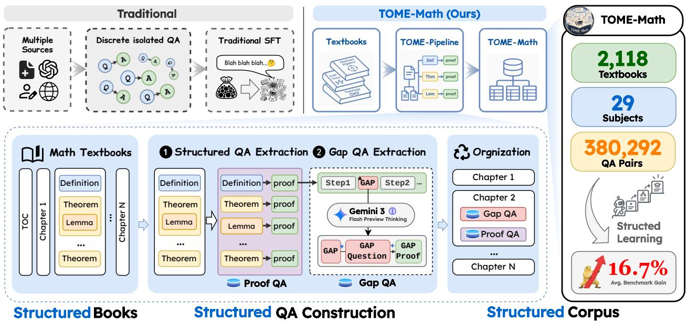  
Figure 1: Overview of TOME-Math. Top-left: Traditional pipelines reduce diverse sources to isolated QAs. Bottom-left: TOME-Math preserves textbook structure through structured QA construction and curriculumbased SFT. Right: TOME-Math comprises 380,292 QAs from 2,118 textbooks spanning 29 subjects.

## 1. Introduction

Mathematical reasoning in large language models has advanced rapidly, driven in part by improvements in training data and in part by advances in reasoning-time computation [1, 2, 4, 10, 13, 15, 21, 27–29, 37, 38, 42]. On the data side, recent eforts have expanded mathematical supervision to millions of QA pairs (i.e., Question-Answer pairs) and in doing so have revealed that properties such as question diversity, solution format, and teacher-model quality significantly shape downstream performance [18, 31, 39, 40]. These findings suggest a broader principle: The value of mathematical supervision is not determined by the number of training examples alone, but also by how those examples are constructed and organized.

Despite this, the dominant paradigm for mathematical supervision remains the isolated problem–solution pair. Whether the original knowledge comes from competition archives, grade-school word problems, web exercises, or synthetic augmentation, the resulting training data typically takes the uniform shape of problem → solution [7, 14, 39]. This representation is convenient to scale, but it does not explicitly leverage the organizational structure that many source materials already possess.

Mathematical textbooks are a notable case in point. A textbook is not merely a collection of solved problems, but a carefully structured body of knowledge. Definitions introduce core concepts, lemmas and theorems develop them, proofs establish their validity, and exercises reinforce understanding. These elements are organized within a chapter hierarchy that reflects prerequisite relations, conceptual dependencies, and pedagogical progression. Prior work has explored textbooks as a source of mathematical pretraining data, problem–solution pairs, and proof supervision [3, 16, 19, 30, 33, 35, 41]. However, textbooks are often treated primarily as sources of mathematical content, leaving their native structure underexplored. In particular, it remains unclear how to scale natural-language proof supervision while preserving chapter order, proposition dependencies, source locations, and exercises in a unified framework.

To address this gap, we introduce TOME-Math (Textbook-Oriented Mathematical Evidence), a large-scale proof-supervision resource constructed from 2,118 mathematics textbooks. Central to TOME-Math is the notion of structured mathematical supervision, which preserves structure at three levels. First, hierarchical structure retains the native organization of textbooks, including chapters, propositions, and their ordering. Second, dependency structure connects theorem-level proof questions with the intermediate proof obligations derived from gaps in their proofs. Third, curriculum structure organizes supervision according to textbook order and proof granularity, enabling controlled training over related examples rather than independent QA pairs. Following these principles, TOME-Math contains 380,292 proof-oriented QA pairs spanning 29 mathematical subjects. Figure 1 provides an overview of the construction and organization of the resulting corpus.

We further validate the efectiveness of TOME-Math through supervised fine-tuning (SFT) on a 30B base model [38]. Its retained structure enables controlled studies of how the organization of supervision afects mathematical reasoning. Rather than treating scale as the only variable, TOME-Math allows us to examine the roles of retrieval structure, curriculum order, and source coverage under controlled settings. Empirically, TOME-Math SFT improves the six-benchmark average from 29.17% to 45.83%, while further experiments show consistent benefits from structure-guided retrieval, textbook-aligned curricula, and broader source coverage. Our contributions are:

• We introduce TOME-Math, a large-scale proof-supervision resource constructed from 2,118 mathematics textbooks. Through a structure-preserving pipeline, it produces 380,292 Concept and Gap QA records while retaining chapter progression, proposition–proof links, dependency references, source provenance, and a separate inventory of textbook-authored exercises.

• We demonstrate the overall efectiveness of TOME-Math through full-corpus fine-tuning. On book-heldout textbook exercises and established public benchmarks, TOME-Math achieves the best performance on five of six evaluations, improving the unweighted six-benchmark mean from 29.17% to 45.83% over the base model and outperforming all three public instruction-data baselines in aggregate.

• We systematically investigate how textbook structure contributes to mathematical reasoning at inference and training time. Structure-guided retrieval improves proof-generation pass@1 from 13.25% to 17.38% under a matched context budget; across six subjects and three data scales, forward textbook curricula consistently outperform shufled and reverse schedules; and broader source coverage yields further gains under a fixed training-token budget.

Table 1: Mathematical resources by scale, supervision, and structure. Sizes retain reported units; sources include synthetic seeds. NL = natural language; refs = proposition references.
<table><tr><td>Resource</td><td>Size Source</td><td></td><td>Supervision</td><td>Metadata / structure</td></tr><tr><td colspan="5">Mathematical instruction data</td></tr><tr><td>MATH [2021]</td><td></td><td>12.5K QA Competitions</td><td>Solutions</td><td>Subject, difficulty</td></tr><tr><td>MetaMathQA [2023]</td><td></td><td>395K QA GSM8K, MATH</td><td>Solutions</td><td>Seeds, augmentation types</td></tr><tr><td>OpenMathInstruct-2 [2024]</td><td></td><td>14M QA GSM8K, MATH</td><td>Solutions</td><td>Source labels</td></tr><tr><td>NuminaMath-CoT [2024]</td><td></td><td>~860K QA Exams, web, synthetic Solutions</td><td></td><td>Source labels</td></tr><tr><td colspan="5">Textbook and knowledge-informed resources</td></tr><tr><td>MathPile [2024]</td><td></td><td>9.5B tokens Books, papers, web</td><td>Text</td><td>Sources, file paths</td></tr><tr><td>CollegeMath [2024]</td><td>4,099 QA9 textbooks</td><td></td><td>Short answers</td><td>Book/section/exercise IDs</td></tr><tr><td colspan="5">Proof resources and evaluation</td></tr><tr><td>NaturalProofs [2021]</td><td></td><td>32K proofs 2 textbooks + web</td><td>NL proofs</td><td>Reference graph</td></tr><tr><td>ProofNet [2023]</td><td></td><td>371 examples Textbooks, Putnam</td><td>NL + Lean stmt.</td><td>Book/exercise IDs</td></tr><tr><td>Lean-GAP [2026]</td><td>430 problems 1 textbook</td><td></td><td>Lean statements</td><td>Section/exercise IDs</td></tr><tr><td>AlgGeoTest [2025]</td><td>456 questions Stacks Project</td><td></td><td>Proof judgments</td><td>Statement tags</td></tr><tr><td>TOME-Math (ours)</td><td>380,292 QA 2,118 textbooks</td><td></td><td></td><td>NL + local proofs Chapter order, refs, provenance</td></tr></table>

## 2. Related Work

Mathematical instruction data. GSM8K and MATH provide human-authored problems and solutions for grade-school and competition mathematics [7, 14]. MetaMathQA and OpenMathInstruct-2 scale these seeds through synthetic augmentation [31, 39], while NuminaMath-CoT aggregates diverse sources with chain-ofthought solutions [20]. Their primary supervision unit is a problem–solution pair, accompanied by source, seed-question, or dificulty metadata. Table 1 contrasts this organization with the textbook hierarchy and proposition links retained by TOME-Math.

Textbook and knowledge-informed resources. OpenWebMath and MathPile provide mathematical pretraining text, with MathPile incorporating textbooks alongside papers and web sources [25, 33]. CollegeMath extracts textbook exercises and short answers, while MathScale synthesizes QA using a graph of topics and knowledge points [30]. TheoremQA evaluates theorem application across STEM subjects [6]. These eforts motivate retaining both textbook organization and links to mathematical statements when constructing proof supervision.

Proof resources and evaluation. NaturalProofs preserves statements, proofs, and a reference graph [35, 36], while NaturalProofs-Gen and NaturalProver study reference-grounded proof generation . ProofNet and Lean-GAP connect textbook mathematics to formalization [3, 19], while FormaRL’s uproof provides 5,273 proof problems from 14 textbooks for autoformalization evaluation [16]. Proof2Hybrid’s AlgGeoTest studies proofderived judgments, and the Open Proof Corpus studies automated assessment of human-evaluated model proofs [8, 26]. Building on these directions, TOME-Math combines coverage of 2,118 textbooks with selfcontained local proof obligations, chapter order, and proposition references, supporting controlled studies of source coverage, proof-target format, and training order.

## 3. TOME-Math

## 3.1. Data Construction

Pipeline overview. We construct TOME-Math through a structure-preserving pipeline that converts raw textbook PDFs into two complementary forms of proof supervision: Proof QA derived from explicit proposition– proof units and Gap QA derived from missing proof obligations in Proof QAs. The source collection is selected against university course syllabi and reviewed by domain experts, yielding 2,118 input PDFs after canonicalization and deduplication (as shown in Section 3.2). The pipeline generated the full TOME-Math dataset of 380,292 QA pairs, comprising 174,431 Gap QA pairs and 205,861 Proof QA pairs.

(c) Structured Proof QA Extraction

(a) Data Collection

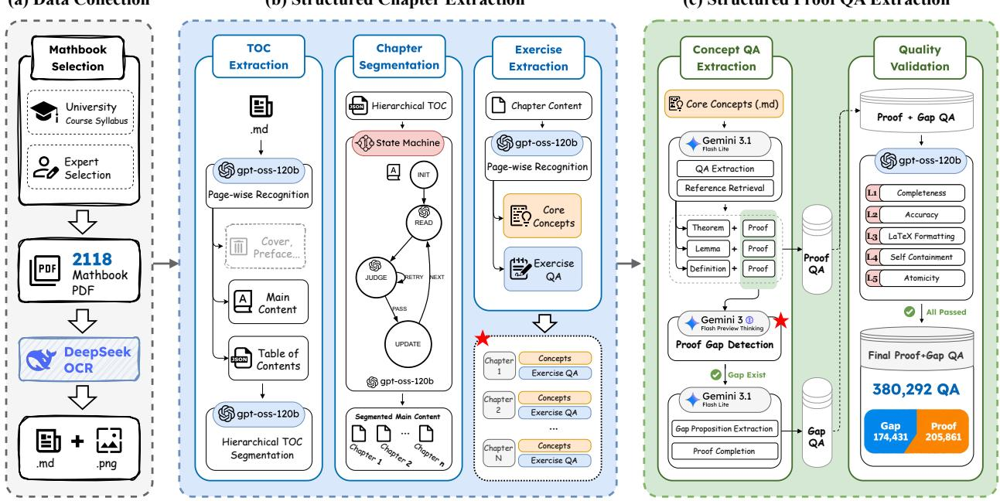  
Figure 2: Overview of TOME-Math construction, from structured textbook parsing and chapter recovery to Proof QA extraction, Gap QA generation, and quality-controlled corpus assembly (Section 3.1).

Document parsing and structured chapter extraction. DeepSeek-OCR [34] converts each PDF into multimodal Markdown together with page images. A page-wise gpt-oss-120b [23] pass separates the table of contents and main body from covers, prefaces, and other front matter, then reconstructs a hierarchical table of contents. Conditioned on this hierarchy, a state machine reads the body in order, judges whether each page belongs to the current chapter, the next chapter, or contains an internal boundary, and retries ambiguous assignments before updating the chapter state. This produces an ordered set of chapter-level documents while preserving the textbook hierarchy. A second page-wise pass separates expository core concepts from textbook exercises within each chapter. The exercises are retained as an independent reservoir, but are excluded from the Proof QA generation path.

Proof QA Extraction and Gap QA construction. For each core concept chapter, we use gemini-3.1- flash-lite-preview [12] to extract theorem–proof, lemma–proof, and definition–proof units and retrieve the earlier propositions needed to interpret each proof. These source-grounded units form the Proof QA stream. We then use gemini-3-flash-preview with thinking enabled [11] to inspect each proof for gaps (i.e., implicit or missing reasoning steps). When a substantive gap is detected, gemini-3.1-flashlite-preview [12] rewrites the missing obligation as a self-contained proposition and completes its proof, producing the Gap QA stream. This structured construction preserves explicit textbook proofs while adding targeted supervision for intermediate reasoning that the source leaves unstated.

Validation and quality control. Quality control is applied at both the structural and semantic levels. The structural checks validate the table-of-contents hierarchy, ambiguous page boundaries, question continuity across pages, question–answer alignment, and standalone completeness. For proposition extraction, a sourceconditioned gpt-oss-120b judge audits candidates along five axes: completeness, accuracy, LATEX formatting, self-containment, and atomicity. Accuracy is treated as critical: invented proof steps, altered mathematical relations, or other content not supported by the source are failure cases rather than stylistic defects. Full module logic, intermediate artifacts, model-allocation details, and the judging rubric are given in Appendix A.

## 3.2. Characterization

TOME-Math comprises 380,292 QA records from 2,118 canonical textbooks across 29 subject categories, summarized in Figure 3. Appendix B provides the detailed corpus characterization, including subject and language coverage, task composition, structural complexity, confidence dynamics, quality, and provenance.

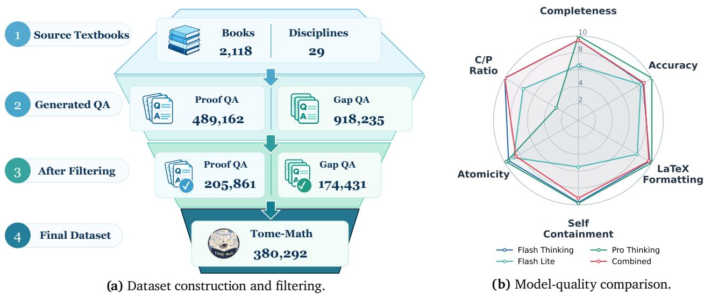  
Figure 3: TOME-Math data composition and quality characterization. (L): dataset scale from source textbooks through filtering to the final corpus. (R): model configurations compared across the quality-control criteria.

Generation Composition. The corpus combines a Proof QA stream of 205,861 records and a Gap QA stream of 174,431 records, drawing on disjoint model assignments (Appendix B). gemini-3-flash-preview -thinking [11] produces 88.9% of Proof QA records, gpt-5-mini [22] produces 53.7% of Gap QA records, and the Gap QA stream retains 174,431 of 918,235 generated candidates, a yield of 19.00%.

Model-quality trade-of. We evaluate model-quality trade-ofalong six dimensions, and combine gemini-3 -flash-preview-thinking (Flash Thinking) for primary extraction and auditing with gemini-3.1 -flash-lite-preview (Flash Lite) for reference-semantic parsing, balancing quality and cost. See more details in Appendix A.6

Provenance and Evaluation Units. Each record carries book, chapter, and source location metadata, with proposition identifiers and resolved references for Proof QA records. We define two evaluation scopes at the book level, held out exercises for item level generalization and held out books for source level generalization, both respecting duplicate groups identified by global content hash.

## 4. Evaluating TOME-Math

## 4.1. Experimental Setup

Base Model. We use Qwen3-30B-A3B-Base [38] as the backbone for all experiments. All SFT variants start from the same checkpoint, and the unmodified checkpoint serves as the base-model baseline.

Evaluation. To obtain a sensitive view of how structured textbook supervision afects learning, we focus on the six core subjects with the largest usable textbook collections in our corpus: abstract algebra, diferential geometry, discrete mathematics, mathematical analysis, probability, and topology. We construct TOME-LONGFORM from their textbook-authored exercises: 300 proof-heavy problems from held-out books, balanced across subjects and the earlier and later halves of each book. To enforce book-level separation, we reserve 64 source books for evaluation and exclude all 15,661 QA records associated with those books from the complete 380,292-record TOME-Math corpus. This leaves 364,631 examples in the actual training split. The evaluation problems are selected separately from the native-exercise reservoir of the held-out books. We sample 16 solutions per problem and score them with a reference-guided step verifier; each solution is reviewed eight times by gpt-5.6-luna [24] and is accepted only if no review identifies a substantive error. For complementary coverage beyond long-form proofs, TOME-OBJECTIVE contains 145 multidisciplinary objective problems scored by final-answer equivalence. We additionally evaluate on MiniF2F [43], ProofNet [3], MATH-500 [14], and AIME2026 [9]. Full construction and scoring details are given in Appendix D.

Table 2: Full-corpus comparison of models independently fine-tuned on each listed SFT corpus. Evaluation covers TOME-LONGFORM (TOME-LF.), TOME-OBJECTIVE(TOME-OBJ.), MiniF2F, ProofNet, MATH-500, and AIME 2026. Scores are reported as percentages; Avg. is the unweighted mean of the six reported scores. Best and second-best results in each column are shown in bold and underlined, respectively.
<table><tr><td>SFT supervision corpus</td><td>TOME-LF</td><td>TOME-OBJ.</td><td>MiniF2F</td><td>ProofNet</td><td>MATH-500</td><td>AIME-26</td><td>Avg.</td></tr><tr><td>None (Qwen3-30B-A3B-Base)</td><td>13.25</td><td>32.93</td><td>34.45</td><td>17.14</td><td>68.80</td><td>8.44</td><td>29.17</td></tr><tr><td>OpenMath1 (1.82M)</td><td>20.16</td><td>33.86</td><td>22.87</td><td>19.25</td><td>70.40</td><td>8.21</td><td>29.13</td></tr><tr><td>MetaMath (395k)</td><td>28.73</td><td>34.66</td><td>40.70</td><td>22.55</td><td>71.20</td><td>9.98</td><td>34.64</td></tr><tr><td>MathInstruct (262k)</td><td>35.87</td><td>40.69</td><td>52.05</td><td>32.93</td><td>73.05</td><td>11.98</td><td>41.10</td></tr><tr><td>TOME-Math (ours; 364.6k)</td><td>43.86</td><td>43.96</td><td>57.43</td><td>42.98</td><td>76.55</td><td>10.19</td><td>45.83</td></tr></table>

## 4.2. Full-Corpus Comparison

We first present the overall efectiveness of the final TOME-Math dataset, before isolating its structural components in Section 5. Table 2 compares the resulting 364,631-example TOME-Math training split with three public mathematics SFT corpora at their available scales. All fine-tuned models start from Qwen3-30B-A3B-Base and use the same fine-tuning setup, difering only in their supervision corpus; each model is trained for one full epoch over its respective corpus, and the unmodified checkpoint is included as a reference. Complete training configurations are provided in Appendix E.2.

Aggregate performance. TOME-Math achieves the best result on five of the six benchmarks and ranks second on AIME 2026. Its largest margins over the strongest public baseline appear on the proof-oriented TOME-LONGFORM and ProofNet evaluations, while its advantages on TOME-OBJECTIVE, MiniF2F, and MATH-500 show that the benefit extends beyond its own evaluation distribution and is not confined to long-form proof generation. Averaged uniformly across the six reported scores, TOME-Math improves the base-model mean from 29.17% to 45.83%, a gain of 16.66 percentage points (16.7 when rounded to one decimal).

Efect of supervision corpus. The ranking is not explained by corpus size alone. OpenMath1 contains 1.82M examples, approximately 4.8× the size of TOME-Math—yet TOME-Math outperforms it on all six benchmarks. It also exceeds the similarly sized MetaMath corpus throughout and improves consistently over the pretrained backbone. These results demonstrate the overall utility of TOME-Math and suggest that the source and form of supervision matter in addition to raw example count. Because the corpora difer in several respects, the comparison does not by itself isolate textbook structure as the causal factor; we examine that structure through controlled retrieval and training studies in Section 5.

## 5. Leveraging Textbook Structure

Beyond providing a large source of proof supervision, TOME-Math exposes structural signals—chapter progression, proposition dependencies, and source provenance—that can be used explicitly at inference time and during training. This section investigates when these signals improve mathematical reasoning. We first evaluate structure-guided retrieval without updating model parameters (Section 5.1). We then study whether textbook order provides an efective curriculum under controlled budgets (Section 5.2), and examine source breadth together with transfer to held-out books from other mathematical fields (Section 5.3). Finally, we examine how these structural choices contribute to the full-corpus TOME-Math training recipe (Section 5.4).

## 5.1. Training-Free Structure-Guided Retrieval

Question and design. Can textbook structure identify useful evidence for mathematical problem solving? We test five paired context policies on all 300 TOME-LONGFORM problems using a frozen Qwen3-30B-A3B-Base model: (i) CLOSED uses no external context; (ii) RANDOM SAME-BOOK samples uniformly from the exercise’s source book; (iii) LOCAL CHAPTER draws only from the exercise chapter and its immediate predecessors; (iv) TOME (PROPS ONLY) retrieves proposition–proof records using chapter position and recovered dependencies; and (v) TOME (PROPS + GAP) extends the same policy to include Gap QA.

Table 3: Training-free structure-guided retrieval on TOME-LONGFORM. Scores are pass@1 (%) on the same 300 problems. Avg. is the mean over six equally sized subjects; the remaining columns report individual subjects. Best results are bolded. See Section 5.1 for details.
<table><tr><td>Context</td><td>Avg.</td><td>Abs. Alg.</td><td>Diff. Geom.</td><td>Discrete</td><td>Math. Anal.</td><td>Prob.</td><td>Topology</td></tr><tr><td>CLOSED</td><td>13.25</td><td>8.50</td><td>5.25</td><td>13.25</td><td>25.75</td><td>20.00</td><td>6.75</td></tr><tr><td>RANDOM SAME-BOOK</td><td>14.00</td><td>9.75</td><td>6.50</td><td>12.50</td><td>24.75</td><td>20.50</td><td>10.00</td></tr><tr><td>LOCAL CHAPTER</td><td>14.71</td><td>10.50</td><td>6.75</td><td>14.50</td><td>25.50</td><td>20.00</td><td>11.00</td></tr><tr><td>TOME (PROPS ONLY)</td><td>15.54</td><td>11.00</td><td>8.50</td><td>15.00</td><td>27.25</td><td>20.50</td><td>11.00</td></tr><tr><td>TOME (PROPS + GAP)</td><td>17.38</td><td>12.75</td><td>10.00</td><td>15.25</td><td>31.75</td><td>21.75</td><td>12.75</td></tr></table>

All context-augmented conditions receive the same context-token budget. They also share the same backbone, prompt, decoding configuration, and reference-guided verifier; the target exercise and material overlapping its reference answer are removed from every retrieval pool. The resulting comparison asks how efectively each policy selects a fixed amount of same-source evidence, rather than whether additional test-time tokens alone help. Appendix F gives the complete retrieval, leakage-control, generation, and scoring protocol.

Results. The results show a clear progression as increasingly structured evidence is introduced. Starting from 13.25% pass@1 in the CLOSED setting, RANDOM SAME-BOOK and LOCAL CHAPTER reach 14.00% and 14.71%, respectively. Retrieving proposition–proof records with textbook structure further improves performance to 15.54%, while augmenting this inventory with Gap QA yields the best overall score of 17.38%, a 4.13-point gain over closed-book generation. In particular, Gap QA contributes an additional 1.84 points over proposition-only retrieval, showing that explicit local proof obligations provide complementary evidence beyond textbook propositions. Among the four context-augmented conditions, the shared token budget shows that their performance diferences arise from evidence selection rather than context quantity.

The advantage of the complete TOME (PROPS + GAP) policy is consistent across all six subjects, with improvements of 1.75–6.00 points over CLOSED. Mathematical analysis and topology show the largest gains (+6.00 points each), while every other subject also improves. By contrast, random same-book or local-chapter context occasionally leaves performance unchanged or lowers it, indicating that access to nearby textbook material alone is not suficient. Together, these results establish the retained textbook structure as an efective inference-time evidence index and show that proposition context and explicit proof obligations work best in combination.

## 5.2. Curriculum Learning Across Subjects and Data Scales

The retrieval study shows that textbook structure can guide the selection of useful evidence at inference time. We next ask whether the same organization can also improve learning when it is used to order supervision, and whether any benefit persists across subjects and data scales.

Setup and comparisons. We evaluate textbook-aligned curricula across six subjects and three per-subject target-token budgets: 0.75M, 1.8M, and 2.4M. Within each subject–scale cell, four schedules reorder the same frozen QA set: SHUFFLE, FORWARD–GAP, REVERSE–GAP, and FORWARD–MIX. Here, Gap QA makes a locally omitted proof obligation explicit. FORWARD–GAP versus REVERSE–GAP isolates chapter direction under a fixed Gap-first policy, while FORWARD–GAP versus FORWARD–MIX isolates Gap-first ordering under a fixed forward progression; comparison with SHUFFLE measures their combined efect. All schedules share the same examples, token budget, initialization, and optimization settings, and are evaluated on the same held-outbook exercises. Appendix G details the normalized chapter stages, schedule construction, nested data scales, and order-preserving training controls.

Overall efect of scale and curriculum. Figure 4 shows that every fine-tuned condition outperforms the shared base checkpoint in all six subjects, even at 0.75M tokens, and that every schedule improves with scale in each subject. Across the 0.75M, 1.8M, and 2.4M budgets, macro-average pass@16 rises from 41.04% to 42.52% and 43.21% for SHUFFLE, and from 45.38% to 48.98% and 50.93% for FORWARD–GAP. Thus, both supervision scale and structured ordering improve solution coverage.

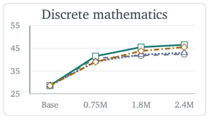

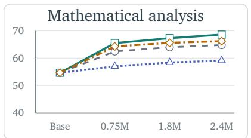  
FORWARD–MIX

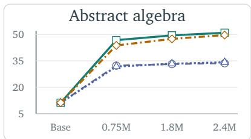

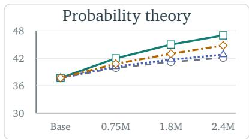

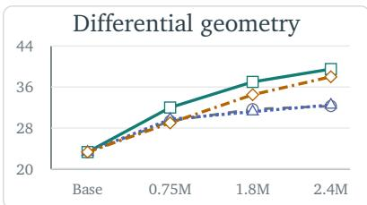

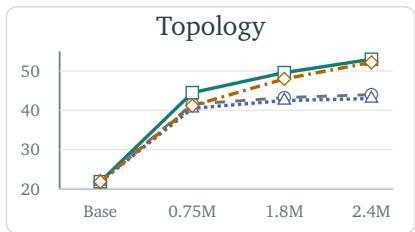  
Figure 4: Curriculum performance across subjects and target-token budgets. Pass@16 is the fraction of problems with at least one verifier-accepted solution among 16 samples. Within each subject–scale cell, all schedules use identical examples and budgets; Base denotes the shared pretrained checkpoint. See Section 5.2 for details.  
(a) Held-out textbook exercises

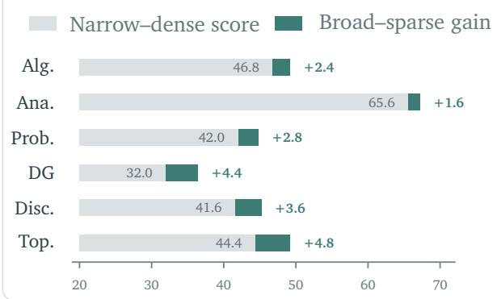

(b) Cross-subject transfer  
target-normalized coeficient
<table><tr><td rowspan=1 colspan=1></td><td rowspan=1 colspan=1>=</td><td rowspan=1 colspan=1>0.92</td><td rowspan=1 colspan=1>1.24</td><td rowspan=1 colspan=1>0.81</td><td rowspan=1 colspan=1>0.96</td><td rowspan=1 colspan=1>0.58</td></tr><tr><td rowspan=1 colspan=1></td><td rowspan=1 colspan=1>0.60</td><td rowspan=1 colspan=1>-</td><td rowspan=1 colspan=1>1.10</td><td rowspan=1 colspan=1>1.00</td><td rowspan=1 colspan=1>0.96</td><td rowspan=1 colspan=1>0.81</td></tr><tr><td rowspan=3 colspan=1></td><td rowspan=1 colspan=1>0.73</td><td rowspan=1 colspan=1>1.01</td><td rowspan=1 colspan=1>-</td><td rowspan=1 colspan=1>0.75</td><td rowspan=1 colspan=1>1.01</td><td rowspan=1 colspan=1>0.85</td></tr><tr><td rowspan=1 colspan=1>0.77</td><td rowspan=1 colspan=1>0.95</td><td rowspan=1 colspan=1>1.29</td><td rowspan=1 colspan=1>-</td><td rowspan=1 colspan=1>1.06</td><td rowspan=1 colspan=1>0.76</td></tr><tr><td rowspan=1 colspan=1>0.64</td><td rowspan=1 colspan=1>0.85</td><td rowspan=1 colspan=1>1.14</td><td rowspan=1 colspan=1>0.94</td><td rowspan=1 colspan=1>-</td><td rowspan=1 colspan=1>0.85</td></tr><tr><td rowspan=2 colspan=4>Alg.  Ana. Prob.</td><td rowspan=1 colspan=1></td><td rowspan=1 colspan=1></td><td rowspan=1 colspan=1></td></tr><tr><td rowspan=1 colspan=1>DG</td><td rowspan=1 colspan=1>Disc.</td><td rowspan=1 colspan=1>Top.</td></tr></table>

Figure 5: Source breadth and cross-subject transfer. (a) Matched-budget pass@16 for 8-book narrow–dense training, with gains from spreading the same budget across 16 books. (b) Target-normalized cross-subject pass@16 for subject-specific checkpoints. Details are in Section 5.3.

Efect of chapter direction and Gap-first ordering. FORWARD–GAP is strongest in all 18 subject–scale cells, and its macro-average margin over SHUFFLE widens from 4.34 points at 0.75M tokens to 6.46 at 1.8M and 7.72 at 2.4M. Controlled comparisons attribute most of this benefit to chapter direction: relative to REVERSE–GAP, the forward schedule gains 5.65, 7.41, and 8.50 points across the three scales. Holding forward progression fixed, Gap-first ordering adds a smaller but consistent 2.37, 1.91, and 1.53 points over FORWARD–MIX. Thus, forward progression is the primary contributor, with Gap-first ordering providing a complementary gain. The same ordering across all 18 subject–scale cells shows that these benefits persist across mathematical domains and supervision budgets.

## 5.3. Source Breadth and Cross-Subject Transfer

Section 5.2 shows that performance improves as the subject-specific training sets expand, but token volume and source count grow together. We therefore ask whether broader textbook coverage helps at a fixed token budget and whether subject-specific supervision generalizes across fields. Figure 5 summarizes these breadth and transfer studies.

Table 4: Full-corpus ablation of the TOME-Math training recipe. See Section 5.4 for details.
<table><tr><td>Variant</td><td>TOME-LF</td><td>TOME-OBJ.</td><td>MiniF2F</td><td>ProofNet</td><td>MATH-500</td><td>AIME-26</td></tr><tr><td>w/o Gap QA (FoRWARD)</td><td>38.72</td><td>38.91</td><td>50.73</td><td>36.21</td><td>73.84</td><td>9.12</td></tr><tr><td>w/o curriculum (SHUFFLE)</td><td>39.87</td><td>40.42</td><td>53.76</td><td>39.12</td><td>75.22</td><td>9.58</td></tr><tr><td>w/o gap-first (FORWARD-MIx)</td><td>40.12</td><td>41.37</td><td>55.61</td><td>41.02</td><td>75.88</td><td>9.93</td></tr><tr><td>TOME-Math (FORWARD-GAP)</td><td>43.86</td><td>43.96</td><td>57.43</td><td>42.98</td><td>76.55</td><td>10.19</td></tr></table>

Source breadth. Figure 5(a) compares the 8-book NARROW–DENSE condition with BROAD–SPARSE, which distributes the same 0.75M-token FORWARD–GAP budget across 16 books while holding all other settings fixed. BROAD–SPARSE improves pass@16 in every subject by 1.6–4.8 points (3.3 on average), with the largest gains in topology (+4.8), diferential geometry (+4.4), and discrete mathematics (+3.6). Thus, source breadth is a distinct scaling axis: the same supervision budget is more efective when spread across twice as many books. Together with the monotonic gains in Section 5.2, this result shows that textbook supervision benefits from both greater volume and broader coverage. Table 12 details the source pools and QA counts.

Cross-subject generalization. Figure 5(b) evaluates each subject-specific 0.75M-token checkpoint on 50 exercises from every other field, normalized by the target specialist’s in-domain score, $T _ { s  t } = P _ { s  t } / P _ { t  t } .$ The macro-average transfer coeficient is 0.92. Topology (0.98) and diferential geometry (0.97) have the strongest source-side means, and eight of the 30 ordered pairs exceed 1.0; both fields reach 1.29 on probability targets. This strong of-diagonal performance shows that subject-specific supervision develops reusable proof and reasoning patterns rather than benefits confined to its training field. It also supports multidisciplinary training at full scale. Full results are in Appendix H.

Taken together, the matched-budget breadth gains and cross-subject transfer connect the controlled studies to the full TOME-Math corpus. Scaling to more books adds source coverage without increasing the token budget, while scaling across subjects supplies supervision that generalizes beyond its domain. These complementary efects explain the efectiveness of the broad, multidisciplinary corpus beyond example count alone.

## 5.4. Full-Corpus Ablation of the TOME-Math Training Recipe

Finally, we ablate curriculum order, Gap-first scheduling, and Gap QA from the full FORWARD–GAP recipe and report pass@1 (%) for all variants. All variants use the book-held-out training split described in Section 4.

Component contributions. Table 4 shows that every ablation lowers pass@1 across all six benchmarks. On the two TOME benchmarks, replacing Gap-first with within-stage mixing costs 3.74 and 2.59 points, while global shufling costs another 0.25 and 0.95 points. Thus, Gap-first is the primary ordering signal, complemented by forward chapter progression. Removing Gap QA causes the largest drops on the four proof benchmarks (5.05–6.77 points), confirming the value of explicit local proof obligations. The complete recipe also leads on MATH-500 and AIME-26, extending the gains beyond proof-focused evaluations.

Structural synergy. The ablations reveal a mutually reinforcing relationship between TOME-Math’s corpus construction and training strategy. Gap QA introduces explicit proof obligations, Gap-first scheduling prioritizes them within each stage, and forward progression exploits the preserved textbook order. The consistent gains across textbook-derived proof tasks, public proof benchmarks, and competition problems establish TOME-Math’s advantage as structured supervision beyond scale alone.

## 6. Conclusion

We introduced TOME-Math, a corpus of 380K proof records from 2,118 textbooks that preserves curricular and dependency structure. It improves performance across textbook-derived and public benchmarks, while controlled studies demonstrate the benefits of structure-guided retrieval, curriculum ordering, and broader source coverage. We hope TOME-Math inspires mathematical reasoning systems that learn not only from more data, but from better-organized knowledge.

## References

[1] Anonymous. Incentivizing self-learning in large language models via reinforcement learning. In Submitted to The Fifteenth International Conference on Learning Representations, 2026. URL https: //openreview.net/forum?id=zL2kRfGRom. under review. 1

[2] Anonymous. Inverseharness: Internalizing agentic reasoning through reinforcement learning. In Submitted to The Fifteenth International Conference on Learning Representations, 2026. URL https: //openreview.net/forum?id=0P4DipCXgj. under review. 1

[3] Zhangir Azerbayev, Bartosz Piotrowski, Hailey Schoelkopf, Edward W. Ayers, Dragomir Radev, and Jeremy Avigad. Proofnet: Autoformalizing and formally proving undergraduate-level mathematics. arXiv preprint arXiv:2302.12433, 2023. 1, 1, 2, 4.1, D.1

[4] Lei Bai, Jiaqi Cao, Chiyu Chen, Guanzhou Chen, Kai Chen, Guangran Cheng, Erfei Cui, Xuanlang Dai, Shengyuan Ding, Shangheng Du, et al. Intern-s2-preview: Scientific agentic foundation model. arXiv preprint arXiv:2608.13505, 2026. 1

[5] Mark Chen, Jerry Tworek, Heewoo Jun, Qiming Yuan, Henrique Ponde de Oliveira Pinto, Jared Kaplan, Harri Edwards, Yuri Burda, Nicholas Joseph, Greg Brockman, Alex Ray, Raul Puri, Gretchen Krueger, Michael Petrov, Heidy Khlaaf, Girish Sastry, Pamela Mishkin, Brooke Chan, Scott Gray, Nick Ryder, Mikhail Pavlov, Alethea Power, Lukasz Kaiser, Mohammad Bavarian, Clemens Winter, Philippe Tillet, Felipe Petroski Such, Dave Cummings, Matthias Plappert, Fotios Chantzis, Elizabeth Barnes, Ariel Herbert-Voss, William Hebgen Guss, Alex Nichol, Alex Paino, Nikolas Tezak, Jie Tang, Igor Babuschkin, Suchir Balaji, Shantanu Jain, William Saunders, Christopher Hesse, Andrew N. Carr, Jan Leike, Joshua Achiam, Vedant Misra, Evan Morikawa, Alec Radford, Matthew Knight, Miles Brundage, Mira Murati, Katie Mayer, Peter Welinder, Bob McGrew, Dario Amodei, Sam McCandlish, Ilya Sutskever, and Wojciech Zaremba. Evaluating large language models trained on code. arXiv preprint arXiv:2107.03374, 2021. D.6

[6] Wenhu Chen, Ming Yin, Max Ku, Pan Lu, Yixin Wan, Xueguang Ma, Jianyu Xu, Xinyi Wang, and Tony Xia. TheoremQA: A theorem-driven question answering dataset. In Proceedings ofthe 2023 Conference on Empirical Methods in Natural Language Processing, 2023. URL https://arxiv.org/abs/2305. 12524. 2

[7] Karl Cobbe, Vineet Kosaraju, Mohammad Bavarian, Mark Chen, Heewoo Jun, Lukasz Kaiser, Matthias Plappert, Jerry Tworek, Jacob Hilton, Reiichiro Nakano, Christopher Hesse, and John Schulman. Training verifiers to solve math word problems. arXiv preprint arXiv:2110.14168, 2021. 1, 2

[8] Jasper Dekoninck, Ivo Petrov, Kristian Minchev, Mislav Balunovic, Martin Vechev, Miroslav Marinov, Maria Drencheva, Lyuba Konova, Milen Shumanov, Kaloyan Tsvetkov, Nikolay Drenchev, Lazar Todorov, Kalina Nikolova, Nikolay Georgiev, Vanesa Kalinkova, and Margulan Ismoldayev. The open proof corpus: A large-scale study of LLM-generated mathematical proofs. arXiv preprint arXiv:2506.21621, 2025. URL https://arxiv.org/abs/2506.21621. 2

[9] Jasper Dekoninck, Nikola Jovanović, Tim Gehrunger, Kári Rögnvaldsson, Ivo Petrov, Chenhao Sun, and Martin Vechev. Beyond benchmarks: MathArena as an evaluation platform for mathematics with LLMs. arXiv preprint arXiv:2605.00674, 2026. URL https://arxiv.org/abs/2605.00674. 4.1

[10] Songyang Gao, Yuzhe Gu, Zijian Wu, Lingkai Kong, Wenwei Zhang, Zhongrui Cai, Fan Zheng, Tianyou Ma, Junhao Shen, Haiteng Zhao, et al. Long-horizon reasoning agent for olympiad-level mathematical problem solving. arXiv preprint arXiv:2512.10739, 2025. 1

[11] Google AI for Developers. Gemini 3 Flash Preview. https://ai.google.dev/gemini-api/ docs/models/gemini-3-flash-preview, 2025. Oficial model documentation; accessed October 21, 2026. 3.1, 3.2

[12] Google AI for Developers. Gemini 3.1 Flash-Lite Preview. https://ai.google.dev/ gemini-api/docs/models/gemini-3.1-flash-lite-preview, 2026. Oficial model documentation; accessed October 21, 2026. 3.1

[13] Daya Guo, Dejian Yang, He Zhang, Junxiao Song, Ruoyu Zhang, Runxin Xu, Qihao Zhu, Shirong Ma, Peiyi Wang, Xiao Bi, et al. Deepseek-r1: Incentivizing reasoning capability in LLMs via reinforcement learning. arXiv preprint arXiv:2501.12948, 2025. 1

[14] Dan Hendrycks, Collin Burns, Saurav Kadavath, Akul Arora, Steven Basart, Eric Tang, Dawn Song, and Jacob Steinhardt. Measuring mathematical problem solving with the MATH dataset. arXiv preprint arXiv:2103.03874, 2021. 1, 1, 2, 4.1, D.1

[15] Zhouqi Hua, Wenwei Zhang, Chengqi Lyu, Yuzhe Gu, Songyang Gao, Kuikun Liu, Dahua Lin, and Kai Chen. The imitation game: Turing machine imitator is length generalizable reasoner. In International Conference on Learning Representations, volume 2026, pages 902–927, 2026. 1

[16] Yanxing Huang, Xinling Jin, Sijie Liang, Peng Li, and Yang Liu. FormaRL: Enhancing autoformalization with no labeled data. In Conference on Language Modeling, 2025. URL https://arxiv.org/ abs/2508.18914. 1, 2

[17] Yanxing Huang, Zihan Tang, Zejin Lin, Peng Li, and Yang Liu. Pessimistic verification for open ended math questions. arXiv preprint arXiv:2511.21522, 2025. URL https://arxiv.org/abs/2511. 21522. D.3

[18] Lingkai Kong, Zijian Wu, Yuzhe Gu, Haiteng Zhao, Zhouqi Hua, Wenyong Huang, Shuang Sun, Zhicheng Xiong, Xiaotian Zhang, Shuya Zhao, et al. Advancedmathbench: A benchmark suite for advanced mathematical proof generation and verification. arXiv preprint arXiv:2607.11849, 2026. 1

[19] Seewoo Lee, Byung-Hak Hwang, Hyojae Lim, Jihoon Hyun, Ilkyoo Choi, Yeachan Park, Jineon Baek, Hyukpyo Hong, Keewoo Lee, Jaeseong Heo, Hyungryul Baik, Chul-hee Lee, and Kyu-Hwan Lee. Leangap: A dataset of formalized graduate algebra problems. arXiv preprint arXiv:2606.02588, 2026. 1, 1, 2

[20] Jia Li, Edward Beeching, Lewis Tunstall, Ben Lipkin, Roman Soletskyi, Shengyi Costa Huang, Kashif Rasul, Longhui Yu, Albert Jiang, Ziju Shen, Zihan Qin, Bin Dong, Li Zhou, Yann Fleureau, Guillaume Lample, and Stanislas Polu. NuminaMath. Hugging Face dataset, 2024. URL https://huggingface. co/datasets/AI-MO/NuminaMath-CoT. 1, 2

[21] OpenAI. Learning to reason with LLMs. OpenAI Blog, 2024. https://openai.com/index/ learning-to-reason-with-llms/. 1

[22] OpenAI. GPT-5 Mini. https://developers.openai.com/api/docs/models/ gpt-5-mini, 2025. Oficial model documentation; accessed October 26, 2026. 3.2

[23] OpenAI. gpt-oss-120b & gpt-oss-20b model card. https://cdn.openai.com/pdf/ 419b6906-9da6-406c-a19d-1bb078ac7637/oai\_gpt-oss\_model\_card.pdf, 2025. Published August 5, 2025. 3.1

[24] OpenAI. GPT-5.6 Luna. https://developers.openai.com/api/docs/models/ gpt-5.6-luna, 2026. Oficial model documentation; accessed October 26, 2026. 4.1

[25] Keiran Paster, Marco Dos Santos, Zhangir Azerbayev, and Jimmy Ba. OpenWebMath: An open dataset of high-quality mathematical web text. arXiv preprint arXiv:2310.06786, 2023. URL https://arxiv. org/abs/2310.06786. 2

[26] Yebo Peng, Zixiang Liu, Yaoming Li, Zhizhuo Yang, Xinye Xu, Bowen Ye, Weijun Yuan, Zihan Wang, and Tong Yang. Proof2Hybrid: Automatic mathematical benchmark synthesis for proof-centric problems. arXiv preprint arXiv:2508.02208, 2025. URL https://arxiv.org/abs/2508.02208. 1, 2

[27] Zhihong Shao, Peiyi Wang, Qihao Zhu, Runxin Xu, Junxiao Song, Xiao Bi, Haowei Zhang, Mingchuan Zhang, YK Li, Yang Wu, et al. Deepseekmath: Pushing the limits of mathematical reasoning in open language models. arXiv preprint arXiv:2402.03300, 2024. 1

[28] Zhihong Shao, Yuxiang Luo, Chengda Lu, ZZ Ren, Jiewen Hu, Tian Ye, Zhibin Gou, Shirong Ma, and Xiaokang Zhang. Deepseekmath-v2: Towards self-verifiable mathematical reasoning. arXiv preprint arXiv:2511.22570, 2025.

[29] Yinhao Tang, Youqing Fang, Yanan Sun, Jiangning Liu, Ziyi Wang, Xun Zhao, Weiming Zhang, Bin Liu, Kuikun Liu, Wenwei Zhang, et al. Is next-chunk reasoning rl really better than sft? revisiting training strategies under no-cot data. arXiv preprint arXiv:2608.23256, 2026. 1

[30] Zhengyang Tang, Xingxing Zhang, Benyou Wang, and Furu Wei. MathScale: Scaling instruction tuning for mathematical reasoning. In Proceedings of the International Conference on Machine Learning, 2024. URL https://arxiv.org/abs/2403.02884. 1, 1, 2

[31] Shubham Toshniwal, Wei Du, Ivan Moshkov, Branislav Kisacanin, Alexan Ayrapetyan, and Igor Gitman. Openmathinstruct-2: Accelerating AI for math with massive open-source instruction data. arXiv preprint arXiv:2410.01560, 2024. 1, 1, 2

[32] Shubham Toshniwal, Ivan Moshkov, Sean Narenthiran, Daria Gitman, Fei Jia, and Igor Gitman. Openmathinstruct-1: A 1.8 million math instruction tuning dataset. In Advances in Neural Information Processing Systems Datasets and Benchmarks Track, 2024. URL https://arxiv.org/abs/ 2402.10176. E.1

[33] Zengzhi Wang, Xuefeng Li, Rui Xia, and Pengfei Liu. MathPile: A billion-token-scale pretraining corpus for math. In Advances in Neural Information Processing Systems Datasets and Benchmarks Track, 2024. URL https://arxiv.org/abs/2312.17120. 1, 1, 2

[34] Haoran Wei, Yaofeng Sun, and Yukun Li. DeepSeek-OCR: Contexts optical compression, 2025. URL https://arxiv.org/abs/2510.18234. 3.1

[35] Sean Welleck, Jiacheng Liu, Ronan Le Bras, Hannaneh Hajishirzi, Yejin Choi, and Kyunghyun Cho. Naturalproofs: Mathematical theorem proving in natural language. arXiv preprint arXiv:2104.01112, 2021. 1, 1, 2

[36] Sean Welleck, Jiacheng Liu, Ximing Lu, Hannaneh Hajishirzi, and Yejin Choi. NaturalProver: Grounded mathematical proof generation with language models. In Advances in Neural Information Processing Systems, 2022. URL https://arxiv.org/abs/2205.12910. 2

[37] An Yang, Beichen Yang, Binyuan Hui, Bo Zheng, Bowen Yu, Chang Zhou, et al. Qwen2.5-math technical report: Toward mathematical expert model via self-improvement. arXiv preprint arXiv:2409.12122, 2024. 1

[38] An Yang, Beichen Yang, Binyuan Hui, Bo Zheng, Bowen Yu, Chengpeng Huang, et al. Qwen3 technical report. arXiv preprint arXiv:2505.09388, 2025. 1, 4.1

[39] Longhui Yu, Weisen Jiang, Han Shi, Jincheng Yu, Zhengying Liu, Yu Zhang, James T. Kwok, Zhenguo Li, Adrian Weller, and Weiyang Liu. Metamath: Bootstrap your own mathematical questions for large language models. arXiv preprint arXiv:2309.12284, 2023. 1, 1, 2, E.1

[40] Xiang Yue, Xingwei Qu, Ge Zhang, Yao Fu, Wenhao Huang, Huan Sun, Yu Su, and Wenhu Chen. Mammoth: Building math generalist models through hybrid instruction tuning. arXiv preprint arXiv:2309.05653, 2024. 1, E.1

[41] Yiming Zhang, Zhonghan Zhao, Wenwei Zhang, Haiteng Zhao, Tianyang Lin, Huanze Tang, Yunhua Zhou, Demin Song, Kuikun Liu, Haochen Ye, et al. Scalable visual pretraining for language intelligence. arXiv preprint arXiv:2607.09657, 2026. 1

[42] Haiteng Zhao, Junhao Shen, Yiming Zhang, Songyang Gao, Kuikun Liu, Tianyou Ma, Fan Zheng, Dahua Lin, Wenwei Zhang, and Kai Chen. Achieving olympia-level geometry large language model agent via complexity boosting reinforcement learning. In International Conference on Learning Representations, volume 2026, pages 37892–37908, 2026. 1

[43] Kunhao Zheng, Jesse Michael Han, and Stanislas Polu. Minif2f: A cross-system benchmark for formal olympiad-level mathematics. arXiv preprint arXiv:2109.00110, 2021. 4.1, D.1

## Appendix Contents

A TOME-Math Construction Details . . . . . . . . . . . . . . . . . . . . . . . . . . . . . . . . . . . . . . . . . . . . . . . . . . . . 14   
A.1 Intermediate representation . . . . . . . . . . . . . . . . . . . . . . . . . . . . . . . . . . . . . . . . . . . . . . . . . . . . . . . . . . . . . . . . 14   
A.2 M1–M2: Table-of-contents and chapter recovery . . . . . . . . . . . . . . . . . . . . . . . . . . . . . . . . . . . . . . . . . . . . . . . . 14   
A.3 M3–M6: Exercise extraction and answer alignment . . . . . . . . . . . . . . . . . . . . . . . . . . . . . . . . . . . . . . . . . . . . . . 14   
A.4 Four-stage proposition pipeline . . . . . . . . . . . . . . . . . . . . . . . . . . . . . . . . . . . . . . . . . . . . . . . . . . . . . . . . . . . . . . 15   
A.5 Proposition extraction and model allocation . . . . . . . . . . . . . . . . . . . . . . . . . . . . . . . . . . . . . . . . . . . . . . . . . . . . 15   
A.6 Model-Quality Evaluation and Model Selection . . . . . . . . . . . . . . . . . . . . . . . . . . . . . . . . . . . . . . . . . . . . . . . . . 16   
B Extended Characterization Analysis . . . . . . . . . . . . . . . . . . . . . . . . . . . . . . . . . . . . . . . . . . . . . . . . . . 17   
B.1 Task and Answer-Format Composition . . . . . . . . . . . . . . . . . . . . . . . . . . . . . . . . . . . . . . . . . . . . . . . . . . . . . . . . 17   
B.2 Subject and Language Coverage . . . . . . . . . . . . . . . . . . . . . . . . . . . . . . . . . . . . . . . . . . . . . . . . . . . . . . . . . . . . . 18   
B.3 Quality Behavior at Subject and Dimension Granularity. . . . . . . . . . . . . . . . . . . . . . . . . . . . . . . . . . . . . . . . . . . 19   
B.4 Corpus Redundancy and Generation Provenance . . . . . . . . . . . . . . . . . . . . . . . . . . . . . . . . . . . . . . . . . . . . . . . . 21   
B.5 Reasoning Scope and Subject Composition Across Level. . . . . . . . . . . . . . . . . . . . . . . . . . . . . . . . . . . . . . . . . . . 22   
B.6 Structural Complexity and Confidence Dynamics . . . . . . . . . . . . . . . . . . . . . . . . . . . . . . . . . . . . . . . . . . . . . . . . 23   
B.7 Structural Dificulty and Record Length . . . . . . . . . . . . . . . . . . . . . . . . . . . . . . . . . . . . . . . . . . . . . . . . . . . . . . . 24   
B.8 Confidence Distributions by Tier and Curriculum Stage . . . . . . . . . . . . . . . . . . . . . . . . . . . . . . . . . . . . . . . . . . . 24   
C Synthesized QA Samples . . . . . . . . . . . . . . . . . . . . . . . . . . . . . . . . . . . . . . . . . . . . . . . . . . . . . . . . . . . 25   
D Evaluation Protocols . . . . . . . . . . . . . . . . . . . . . . . . . . . . . . . . . . . . . . . . . . . . . . . . . . . . . . . . . . . . . . 27   
D.1 Evaluation set construction . . . . . . . . . . . . . . . . . . . . . . . . . . . . . . . . . . . . . . . . . . . . . . . . . . . . . . . . . . . . . . . . . 27   
D.2 Response generation . . . . . . . . . . . . . . . . . . . . . . . . . . . . . . . . . . . . . . . . . . . . . . . . . . . . . . . . . . . . . . . . . . . . . . 28   
D.3 Reference-guided step verification. . . . . . . . . . . . . . . . . . . . . . . . . . . . . . . . . . . . . . . . . . . . . . . . . . . . . . . . . . . . 28   
D.4 Human calibration of the pessimistic verifier . . . . . . . . . . . . . . . . . . . . . . . . . . . . . . . . . . . . . . . . . . . . . . . . . . . 28   
D.5 Objective and additional proof scoring . . . . . . . . . . . . . . . . . . . . . . . . . . . . . . . . . . . . . . . . . . . . . . . . . . . . . . . . 30   
D.6 Metrics and validity checks . . . . . . . . . . . . . . . . . . . . . . . . . . . . . . . . . . . . . . . . . . . . . . . . . . . . . . . . . . . . . . . . . 30   
E Full-Corpus Comparison: Extended Results. . . . . . . . . . . . . . . . . . . . . . . . . . . . . . . . . . . . . . . . . . . . 31   
E.1 Compared corpora. . . . . . . . . . . . . . . . . . . . . . . . . . . . . . . . . . . . . . . . . . . . . . . . . . . . . . . . . . . . . . . . . . . . . . . . 31   
E.2 Training configuration . . . . . . . . . . . . . . . . . . . . . . . . . . . . . . . . . . . . . . . . . . . . . . . . . . . . . . . . . . . . . . . . . . . . . 31   
E.3 All benchmark results . . . . . . . . . . . . . . . . . . . . . . . . . . . . . . . . . . . . . . . . . . . . . . . . . . . . . . . . . . . . . . . . . . . . . 32   
F Training-Free Dependency-Context Study . . . . . . . . . . . . . . . . . . . . . . . . . . . . . . . . . . . . . . . . . . . . . 32   
G Curriculum-Scaling Protocol . . . . . . . . . . . . . . . . . . . . . . . . . . . . . . . . . . . . . . . . . . . . . . . . . . . . . . . . 33   
H Cross-Subject Transfer Protocol and Results . . . . . . . . . . . . . . . . . . . . . . . . . . . . . . . . . . . . . . . . . . . 34

## A. TOME-Math Construction Details

This appendix expands the construction stages summarized in Section 3.1. We distinguish the artifacts produced by the book-structure modules (M1–M3), exercise and answer processing (M4–M6), and the downstream proposition-extraction track.

## A.1. Intermediate representation

DeepSeek-OCR produces one multimodal-Markdown representation of the complete book together with the extracted images. The automated modules materialize the following intermediate artifacts:

<table><tr><td>Artifact</td><td>Contents</td></tr><tr><td>toc.json</td><td>Multilevel table of contents represented by title and heading depth.</td></tr><tr><td>main_text.md</td><td>Textbook body after removing front matter.</td></tr><tr><td>images/</td><td>Merged image directory with normalized references from the Markdown files.</td></tr><tr><td>content/</td><td>One Markdown file for every recovered chapter.</td></tr><tr><td>content_pure/</td><td>Chapter text after exercise segments are removed.</td></tr><tr><td>exercise/</td><td>Chapter-indexed exercise text and formatted per-chapter JSONL files.</td></tr><tr><td>exercise_index.jsonl answer.md</td><td>Multilevel heading path for every exercise section. A detached answer chapter when one is present.</td></tr></table>

## A.2. M1–M2: Table-of-contents and chapter recovery

M1: front matter and table of contents. Starting from the first parsed page, the structure model decides whether a page contains table-of-contents entries and whether the textbook body has begun. For contents pages it extracts pairs of the form {title, level}. Pages that are neither contents nor body are treated as cover or front matter and are discarded. Once the body is detected, a verification pass corrects invalid heading depths and removes entries that belong to prefaces or notation lists. If the model detects body text before extracting any valid contents entries, the whole module is retried, up to five attempts. M1 emits toc.json, main\_text.md, and the merged images/ directory.

M2: hierarchy-conditioned segmentation. The recovered contents are traversed as a tree. Internal entries direct the traversal to their children, while leaf entries trigger a search for the corresponding body span. For each page and the current/next chapter titles, the model returns one of three states: ALL-CURRENT (the page belongs to the current chapter), ALL-NEXT (it belongs to the next chapter), or BOUNDARY (the transition occurs within the page). Boundary pages are checked a second time; a failed check is fed back to the assignment step. A successful transition advances the state machine and writes the completed chapter to content/.

## A.3. M3–M6: Exercise extraction and answer alignment

M3: exercise separation. The structure model first tests whether the table of contents contains dedicated exercise chapters. When it does, those chapters are detached directly. When it does not, each content chapter is scanned for a trailing block of exercises, which is removed from the exposition. The same module constructs the multilevel exercise-title index and detects a separate answer chapter, if present. Its outputs are content\_pure/, exercise/, exercise\_index.jsonl, and optionally answer.md.

M4: exercise serialization. The parser reads each exercise section page by page and emits one JSON record per problem. A record contains question, answer when an answer is printed immediately after the question, and number. The final problem fragment on a page is carried into the next page before serialization so that a page break does not split a question into two records. Problem numbers are preserved for the matching stage.

M5: answer partitioning. The pipeline determines whether numbering is absolute—one number identifies a unique problem in the whole book—or relative, with numbers restarting across chapters. For absolute numbering, the answer chapter is serialized using the same page-wise procedure as M4. For relative numbering, the multilevel heading paths saved by M3 are used to partition the answer chapter before serialization.

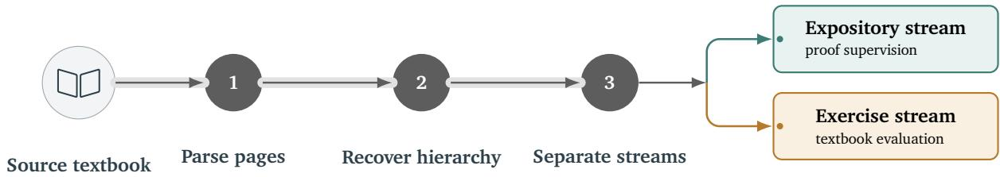  
Figure 6: High-level construction flow. Structural recovery separates expository material from native exercises before the two streams are used for proof supervision and textbook evaluation.

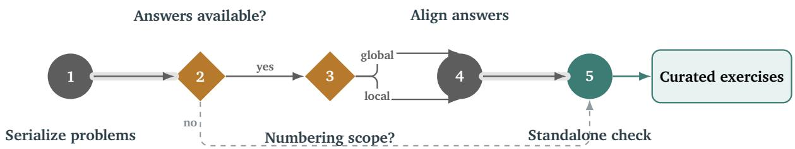  
Figure 7: Exercise evaluation track. Problems are serialized, printed answers are aligned under the book’s numbering scheme when available, and every candidate passes a standalone-completeness check.

M6: matching and filtering. Absolute-number records are joined directly on problem number. Relativenumber records are matched within their recovered chapter, using the section content when necessary. Books without printed answers follow a third, unmatched branch. All branches then pass through a completeness check that removes questions whose statements depend on an unprovided theorem or on the conclusion of another exercise. The module produces a report with the number of exercises and answer coverage for each chapter.

## A.4. Four-stage proposition pipeline

Each pure-content chapter is first split at Markdown headings while preserving its preamble, and the resulting sections are processed concurrently. The four semantic stages are as follows.

1. Proposition extraction. For every section, the model emits structured proposition records with type, number, label, title, content\_tex, and proof\_tex fields.

2. Reference resolution. A book-level proposition library is built from the extracted records. For each proposition with a proof, the model identifies both explicit \ref citations and semantic references to earlier results, storing the matches in resolved\_references.

3. Proof-gap audit. Each proof is checked for unverified lemma assumptions, omitted coordinate or operator transformations, and unsupported jumps marked by phrases such as “obviously” or “clearly.” A candidate gap stores gap\_statement, missing\_logic, sub\_proposition, and a low/medium/high dificulty label.

4. Self-contained refinement. Each candidate sub-proposition is rewritten as an independent mathematical statement by declaring symbols, injecting required definitions, and preserving the source language.

The chapter-level structured output contains the extracted propositions, resolved references, and candidate gaps. A separate Proof QA JSONL stream distinguishes original proposition records from candidate subpropositions with an is\_potential\_gap flag. This schema describes the pipeline output; dataset-level acceptance, deduplication, and split policies are subsequent steps.

## A.5. Proposition extraction and model allocation

The pure content chapters feed the proposition-centered training-data pipeline. The construction log compares three individual Gemini configurations and a hybrid allocation. The later cost-optimization note assigns

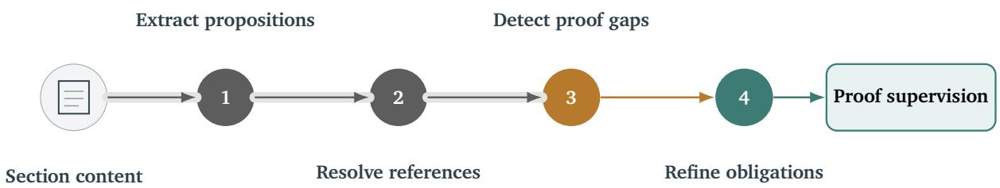  
Figure 8: Proposition-centered proof track. Propositions are linked to their dependencies, local proof gaps are isolated, and selected obligations are refined into proof-supervision questions.

second-stage reference semantics to the lower-cost non-thinking model and pairs it with the thinking model for the remaining reasoning-intensive operations. Because this allocation changed during pipeline development, it is versioned with each run. Table 5 reports the per-book costs recorded in the design document.

Table 5: Model configurations considered for proposition extraction. Cost estimates are those recorded during pipeline design.
<table><tr><td>Configuration</td><td>Cost / book</td></tr><tr><td>Config 1: gemini-3.1-pro-preview-thinking</td><td>$40-50</td></tr><tr><td>Config 2: gemini-3.1-flash-lite-preview</td><td>approx. $5</td></tr><tr><td>Config 3: gemini-3-flash-preview-thinking</td><td>approx. $10</td></tr><tr><td>Config 2 + Config 3 hybrid</td><td>approx. $7</td></tr></table>

## A.6. Model-Quality Evaluation and Model Selection

Evaluation Dimensions. We evaluate model quality along six dimensions:

• Completeness measures the completeness of extracted information;

• Accuracy assesses factual correctness;

• LaTeX Formatting evaluates compliance with LaTeX formatting requirements;

• Self-Containment measures whether each extracted item is independently understandable;

• Atomicity assesses whether each item represents a single, coherent unit

• C/P Ratio measures cost-efectiveness in terms of the cost of generating a single QA pair, with a higher score indicating a lower cost per pair.

Model Configurations. We compare four configurations:

• Flash Thinking refers to gemini-3-flash-preview-thinking

• Flash Lite refers to gemini-3.1-flash-lite-preview

• Pro Thinking refers to gemini-3.1-pro-preview-thinking

• Combined denotes a pipeline combining Flash Thinking for primary extraction and auditing with Flash Lite for reference-semantic parsing.

Results and Analysis. Figure 3 shows that Pro Thinking achieves strong performance in Completeness, Accuracy, LaTeX Formatting, Self-Containment, and Atomicity, but performs less favorably in C/P Ratio, indicating a higher cost per generated QA pair. Flash Lite ofers a more cost-efective alternative, although its lower scores in Completeness and Self-Containment suggest potential limitations in information coverage and the independent interpretability of extracted items. Flash Thinking provides consistently strong performance across the five quality-oriented dimensions, while maintaining a reasonable cost per QA pair. Notably, the Combined pipeline preserves competitive extraction quality while improving cost-efectiveness through the use of Flash Lite for reference-semantic parsing. Overall, these results suggest that the Combined pipeline ofers a favorable balance between extraction quality and the cost of generating individual QA pairs.

## B. Extended Characterization Analysis

This appendix provides the detailed corpus characterization summarized in Section 3.2. We first describe subject and language coverage and task composition, then examine quality behavior, provenance, reasoning scope, structural complexity, and confidence.

## B.1. Task and Answer-Format Composition

Figure 9(a) shows that proof generation accounts for 79.0% of records, an order of magnitude above every other task type. Figure 9(b) crosses task type with answer format. Derivation and calculation binds almost deterministically to the derivation format at 87.0%, while proof generation splits between full textbook proof (51.0%) and concise final proof (41.9%).

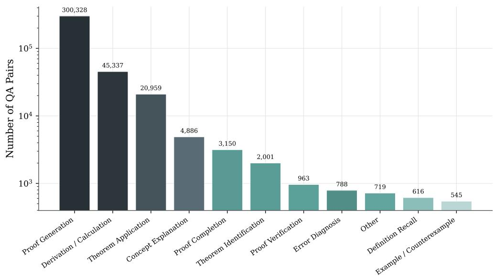

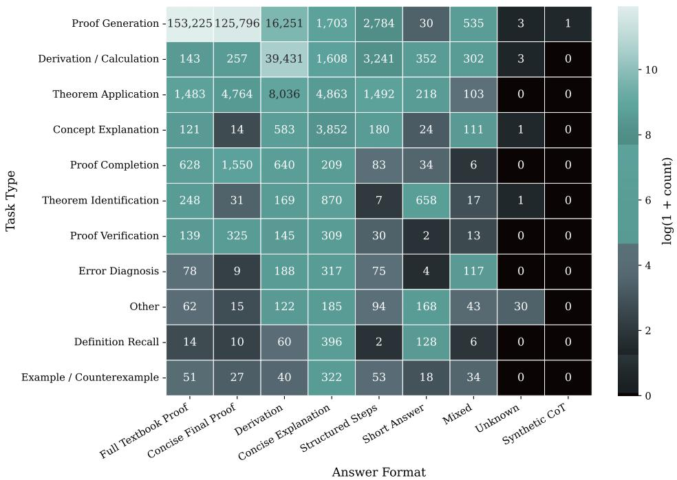  
Figure 9: (a) Distribution of eleven fine grained task types on a logarithmic count axis. (b) Joint distribution of task type and answer format on a logarithmic color scale.

Number of Distinct Source Books

## B.2. Subject and Language Coverage

Figure 10(a)-(b) reports QA volume and distinct source book count for the fifteen most represented subjects. The ten leading subjects account for 84.4% of records. Mathematical analysis draws 66,409 records from 307 books (216 per book), while graph theory draws 24,406 records from only 25 books (976 per book), reflecting broad coverage for analysis-heavy subjects against concentration on specialized books elsewhere. Source language composition varies by educational level. All 337 high school records have mixed-language sources. Undergraduate records comprise 93,537 Chinese, 71,702 English, and 23,500 mixed-language examples; competition records comprise 24,538 Chinese (92.4%) and 2,024 mixed-language examples; and graduate records comprise 109,648 English (66.6%), 35,967 Chinese, and 19,039 mixed-language examples.

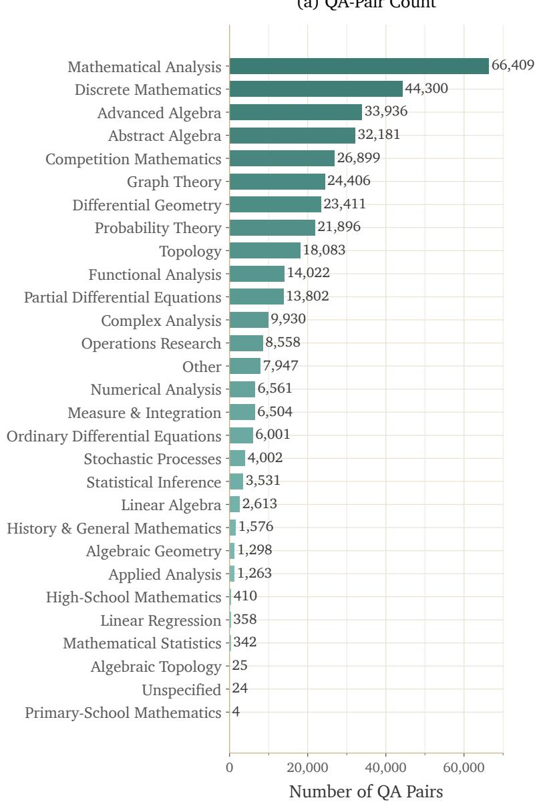

(b) Distinct Source-Book Count  
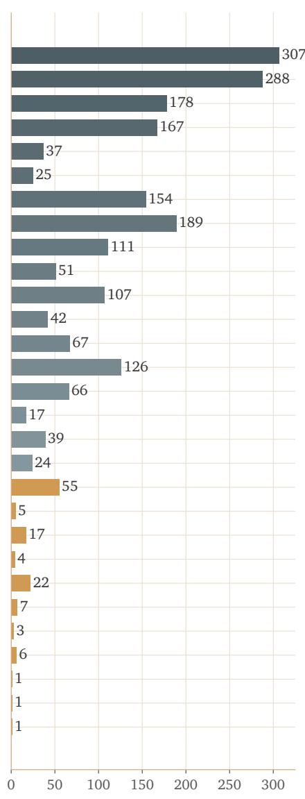  
Figure 10: (a) QA volume and (b) distinct source book count across all subjects, sharing a common subject ordering.

## B.3. Quality Behavior at Subject and Dimension Granularity

Figure 11(a) presents subject-specific quality-tier profiles. Competition mathematics has tier A and tier C shares of 21.6% and 71.5%, respectively, while abstract algebra and topology each have tier A shares above 39%. Figure 11(b) reports results across nine automated audit dimensions. Ambiguity and question–answer consistency pass above 90% of records. Groundedness and evidence alignment assess correspondence with the source material; both pass below 50% of records and have a fail rate of 28.6%. This dimension-level breakdown provides a detailed profile of question–answer quality and source-evidence traceability to guide targeted review.

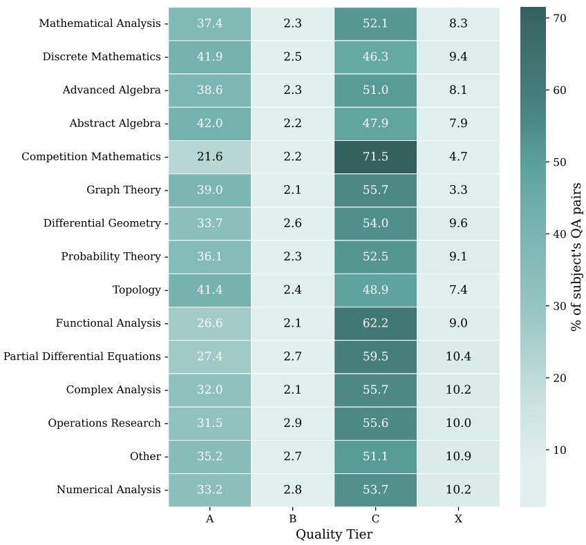

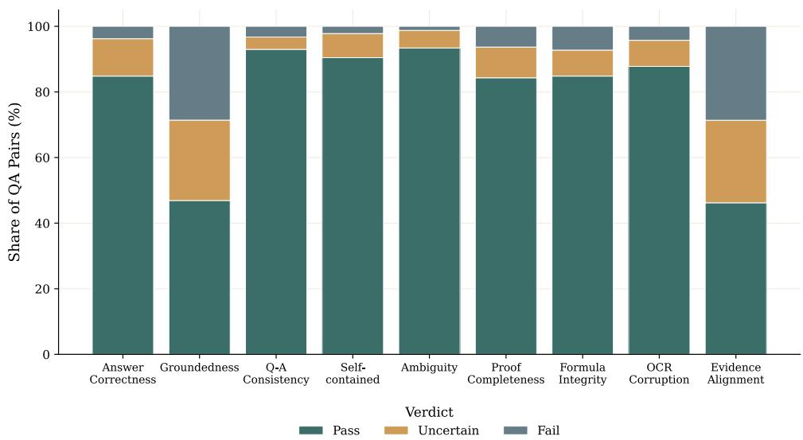  
Figure 11: Quality outcomes decomposed by (a) subject, normalized by row, and (b) pass, uncertain, and fail rates across nine audit dimensions.

Figure 12(a) reports the reasons records are excluded outright. Formula broken and incomplete proof are the two leading causes, together accounting for 36,775 excluded records, with the top four reasons covering 80% of all exclusions. Figure 12(b) corroborates the dimension level asymmetry in Figure 11(b) from an independent signal drawn from human review flags. The flag no verbatim evidence covers 48.4% of the corpus, 2.7 times the frequency of the second most common flag, needs math review.

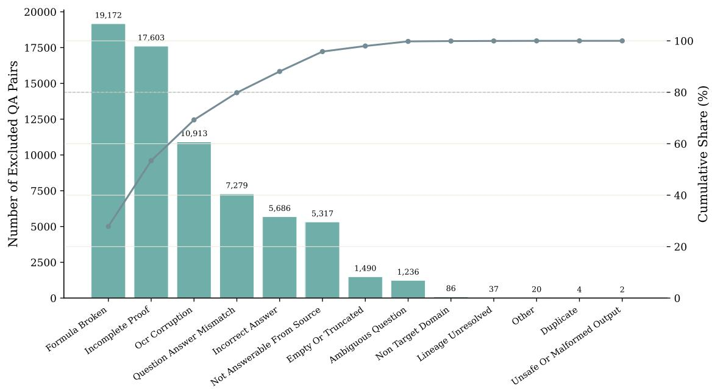

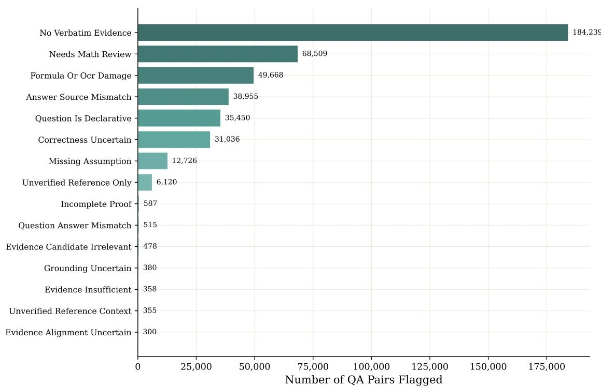  
Figure 12: (a) Pareto distribution of record exclusion reasons, with cumulative share on the secondary axis. (b) Fifteen leading human review flags, with multiple flags permitted per record.

## B.4. Corpus Redundancy and Generation Provenance

Figure 13(a) reports exact duplicate group sizes. Singleton records account for 99.15% of the corpus and duplicate groups account for only 0.85%, with one outlier group of size twenty one isolated from the remaining groups, all of size four or smaller. Figure 13(b) traces the generation composition introduced in Section 3.2 to individual generator models. The Proof QA and Gap QA streams draw on disjoint model assignments, with gemini-3-flash-preview-thinking responsible for 88.9% of Proof QA records and gpt-5-mini responsible for 53.7% of Gap QA records.

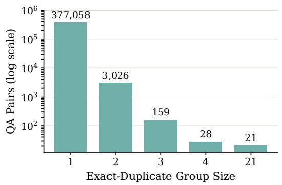

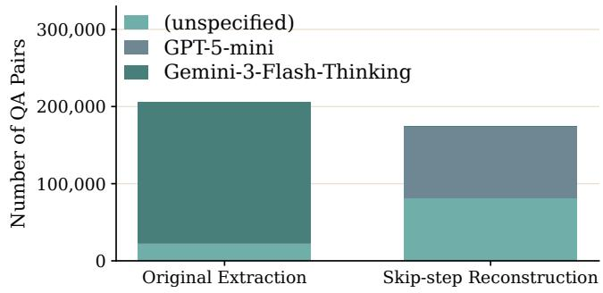  
Figure 13: (a) Exact duplicate group sizes on a logarithmic count axis. (b) Generator model assignment by generation stream.

Figure 14 traces the subject-level concentration in Section B.2 to individual sources. The single highest yield book, Jukna’s Extremal Combinatorics, contributes 3,049 records, 0.80% of the corpus, and the top twenty books are dominated by English language graph theory and combinatorics textbooks together with Chinese competition mathematics series.

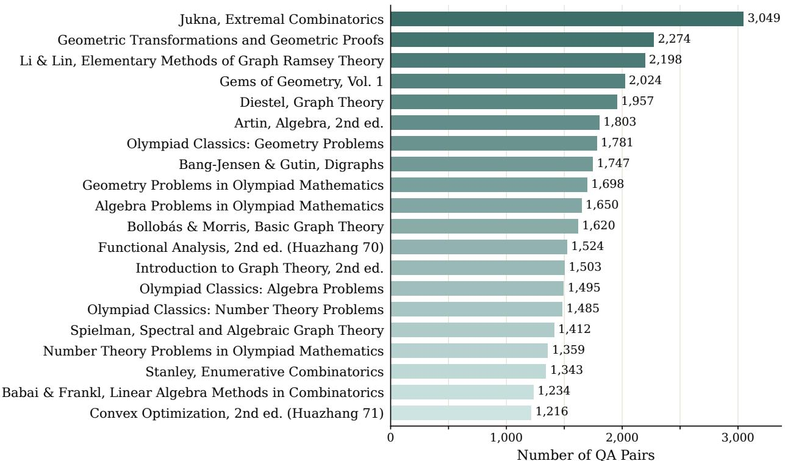  
Figure 14: Twenty highest yield source books out of 2,118 distinct books in the corpus.

## B.5. Reasoning Scope and Subject Composition Across Level

Figure 15(a) examines how reasoning scope, the breadth of chapters and concepts a record draws on, varies with educational level. The combined share of multi step same chapter and cross chapter reasoning reaches 32.5% at the graduate level, compared with 18.7% for undergraduate and 17.7% for competition. Competition and undergraduate report similar single concept shares despite difering in solving dificulty, indicating that reasoning scope captures curriculum breadth rather than solving skill. Figure 15(b) places this finding in the context of subject coverage from Section B.2. Mathematical analysis is the only leading subject with substantial coverage at both undergraduate and graduate levels, while most other leading subjects concentrate on a single level, explaining why level and subject interact strongly in downstream evaluation splits.

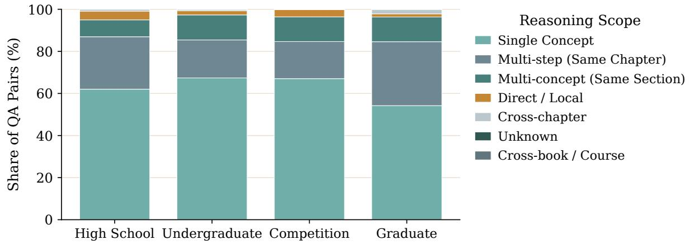

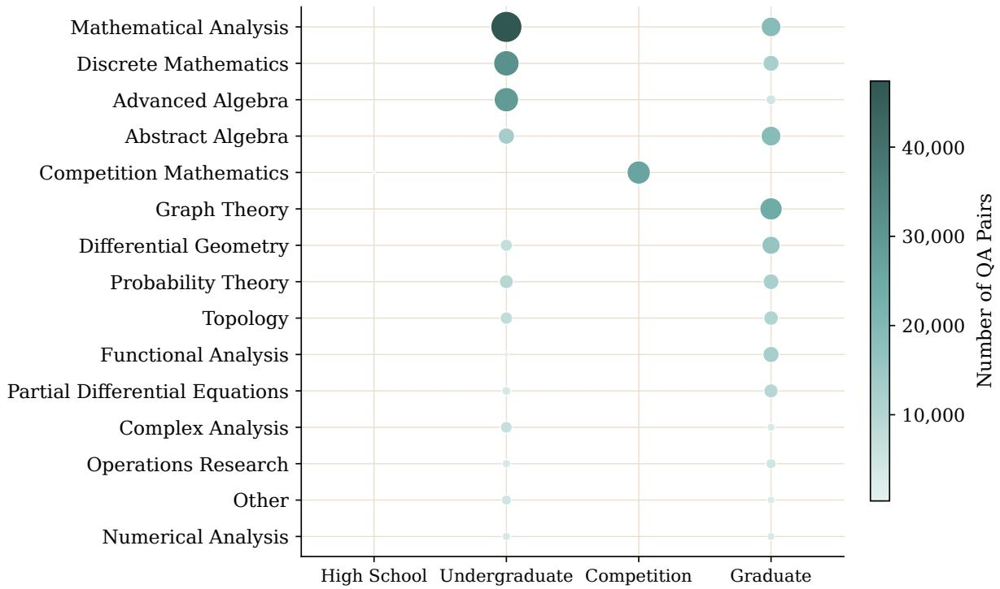  
Figure 15: (a) Percentage composition of reasoning scope within each educational level. (b) Joint distribution of the fifteen most represented subjects and educational level.

## B.6. Structural Complexity and Confidence Dynamics

Each record carries structural metadata (curriculum stage, structural dificulty, concept count, prerequisite depth) and a model-reported confidence score. Figure 16(a)-(b) shows that prerequisite count correlates with estimated reasoning steps at 0.633, stronger than concept count at 0.522; the fitted surface also rises more steeply along the prerequisite-count axis, making prerequisite depth the dominant driver of reasoning-chain length. Figure 16(c) crosses confidence with curriculum stage and dificulty. Confidence falls with dificulty only at later stages, from 0.876 to 0.807 at stage four and from 0.873 to 0.788 at stage five, while stages one through three remain flat. Figure 16(d) shows that answer length correlates with confidence at −0.231, compared with −0.060 for question length, suggesting that longer derivations drive lower confidence.

(a) Concept Count vs. Reasoning Steps  
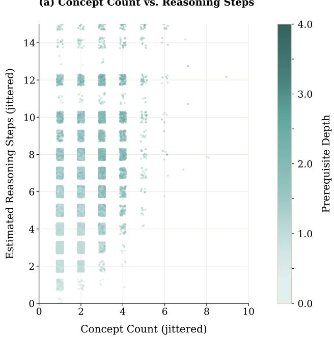

(b) Fitted Reasoning-Steps Surface  
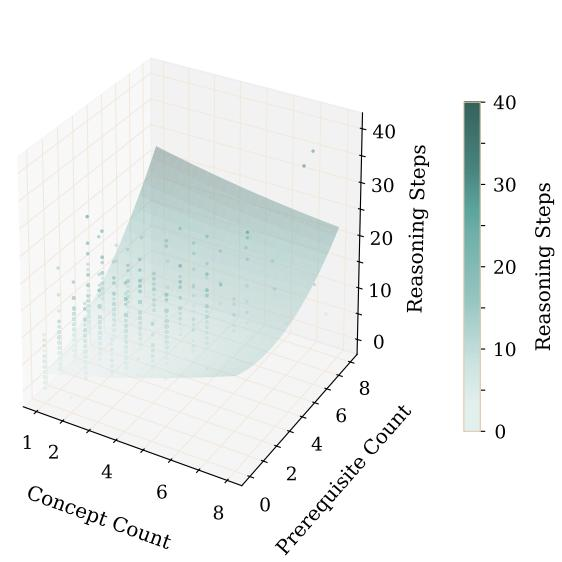

(c) Confidence vs. Stage and Difficulty  
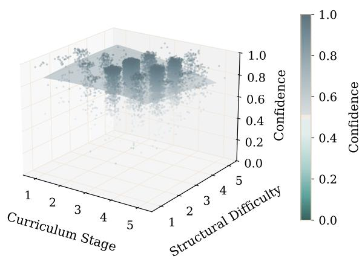

(d) Confidence vs. Question and Answer Length  
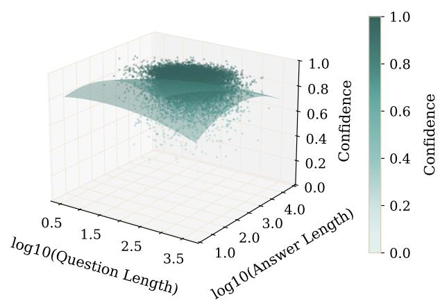  
Figure 16: (a) Joint distribution of concept count and estimated reasoning steps, colored by prerequisite depth. (b) Fitted surface of estimated reasoning steps over concept count and prerequisite count. (c) Fitted surface of model confidence over curriculum stage and structural dificulty. (d) Fitted surface of model confidence over log-scaled question length and answer length.

## B.7. Structural Dificulty and Record Length

Figure 17(a) reports the underlying joint distribution of curriculum stage and structural dificulty. A single cell at stage three, dificulty three holds 194,059 records, 51.0% of the corpus, and stage three overall accounts for 65.9% of records, indicating that structural dificulty tracks curriculum progression closely rather than varying freely within a stage. Figure 17(b) reports the joint distribution of question and answer length by quality tier. The two lengths are positively associated but retain substantial spread within every tier, so tier assignment cannot be inferred from length alone.

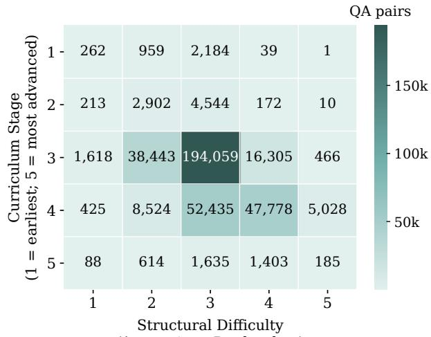  
(1 = easiest; 5 = hardest)

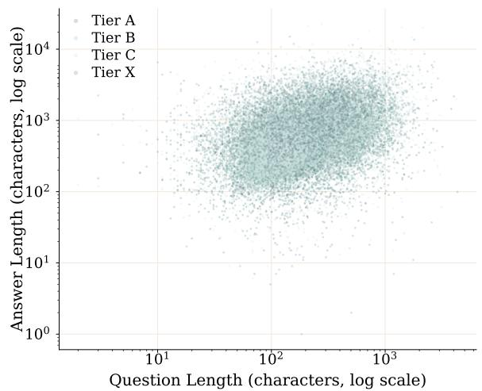  
Figure 17: (a) Joint distribution of curriculum stage and structural dificulty. (b) Question and answer length by quality tier, on logarithmic axes.

## B.8. Confidence Distributions by Tier and Curriculum Stage

Figure 18(a) reports the marginal confidence distribution by quality tier. Mean confidence follows the order tier A at 0.944, tier B at 0.873, and tier C at 0.821, with tier A showing the tightest spread at a standard deviation of 0.030, indicating that confidence separates tier A cleanly from the lower tiers. Figure 18(b) reports the marginal distribution by curriculum stage, which follows a non monotonic pattern of 0.892, 0.865, 0.882, 0.835, and 0.840 across stages one through five, with stage three holding both the largest sample share at 66.0% of the corpus and the tightest spread.

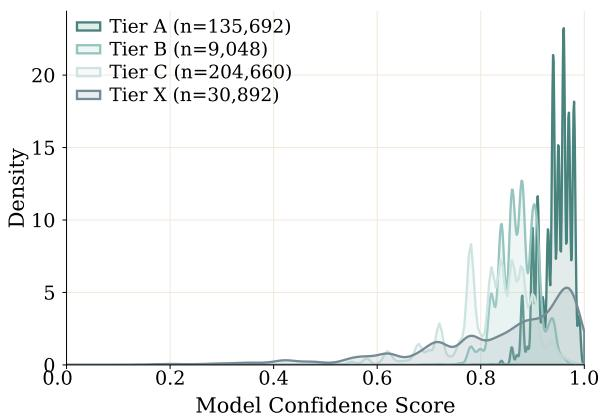

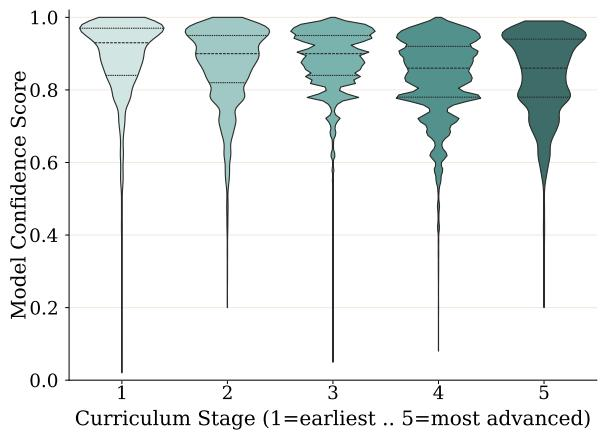  
Figure 18: (a) Kernel density estimate of model-reported confidence by quality tier. (b) Distribution of model confidence across the five curriculum stages.

## C. Synthesized QA Samples

To make the pipeline output concrete, this appendix pairs each synthesized QA with the exact source paragraph it was derived from. We draw all five items from a single textbook—Diestel’s Graph Theory, one of the graphtheory books in the corpus—so that the reader can trace how the same book supplies items at every level of the L1–L5 ladder used in Section 3.2. Each block below reproduces the source excerpt (grey) and the QA record (green) verbatim from the intermediate representation and the release table; only whitespace, LaTeX escaping, and page-break markers were adjusted for typesetting.

## L1 – Direct fact recall (Section 12.3, Tree-decompositions)

## Source excerpt

Let G be a graph, T a tree, and let $\mathcal { V } = ( V _ { t } ) _ { t \in T }$ be a family of bags $V _ { t } \subseteq V ( G )$ indexed by the nodes t of T. The pair   
$( T , \nu )$ is called a tree-decomposition of G if it satisfies the following three conditions:   
(T1) $\textstyle V ( G ) = \bigcup _ { t \in T } V _ { t } ;$   
(T2) for every edge e ∈ G there exists a $t \in T$ such that both ends of e lie in $V _ { t } ;$   
(T3) $V _ { t _ { 1 } } \cap V _ { t _ { 3 } } \subseteq V _ { t _ { 2 } }$ whenever $t _ { 1 } , t _ { 2 } , t _ { 3 } \in T$ satisfy $t _ { 2 } \in t _ { 1 } T t _ { 3 }$

## Synthesized QA

Question. Let G be a graph and let $( T , \nu )$ be a tree decomposition of G, where $\mathcal { V } = \{ V _ { t } : t \in V ( T ) \}$ is a family of bags such that $\textstyle \bigcup _ { t \in T } V _ { t } = V ( G )$ . Given a set of vertices $W \subseteq V ( G )$ , prove that for any $w \in W$ there exists a node $t ^ { \prime } \in V ( T )$ ∪ with w $\bar { \in } V _ { t ^ { \prime } }$

Answer. By definition of a tree decomposition (condition (T1)), $\begin{array} { r } { V ( G ) = \bigcup _ { t \in V ( T ) } V _ { t } , } \end{array}$ i.e. the bags cover all vertices of G. Since $W \subseteq V ( G )$ , every $w \in W$ lies in $\textstyle V ( G ) = \bigcup _ { t \in V ( T ) } V _ { t } .$ , so there exists a node $t ^ { \prime } \in V ( T )$ with $w \in V _ { t ^ { \prime } } . \quad \bigsqcup$

## L2 – Concept explanation (Section 5.4, List colouring)

## Source excerpt

In principle, showing that a given graph is k-choosable is more dificult than proving it to be k-colourable: the latter is just the special case of the former where all lists are equal to $\{ 1 , \ldots , k \}$ . Thus,

$$
\mathrm { c h } ( G ) \geq \chi ( G ) \quad { \mathrm { a n d } } \quad \mathrm { c h } ^ { \prime } ( G ) \geq \chi ^ { \prime } ( G )
$$

for all graphs G.

## Synthesized QA

Question. Explain, in the setting of list colouring, why ch $( G ) \geq \chi ( G )$ and $\mathrm { c h } ^ { \prime } ( G ) \geq \chi ^ { \prime } ( G )$ for every graph G. Answer. In principle, showing that a given graph is k-choosable is more dificult than proving it to be k-colourable: the latter is just the special case of the former where all lists are equal to $\{ 1 , \ldots , k \}$ . Hence any list of size k can be specialized to this uniform list, and the two inequalities follow.

## L3 – Single-concept short proof (Section 1.2, Proposition 1.2.1)

## Source excerpt

Summing d(v) over all $v \in V$ counts every edge twice, so

$$
| E | = { \frac { 1 } { 2 } } \sum _ { v \in V } d ( v ) .
$$

Proposition 1.2.1. The number of vertices of odd degree in a graph is always even.   
Proof. As $\begin{array} { r } { | E | = \frac { 1 } { 2 } \sum _ { v \in V } d ( v ) } \end{array}$ is an integer, $\textstyle \sum _ { v \in V } d ( v )$ is even.

## Synthesized QA

Question. Prove that the number of vertices of odd degree in a graph is always even.

Answer. Since $\begin{array} { r } { | E | = \frac { 1 } { 2 } \sum _ { v \in V } d ( v ) } \end{array}$ is an integer, $\textstyle \sum _ { v \in V } d ( v )$ is even. Reducing this sum modulo $^ { 2 , }$ each even-degree ∈ ∈vertex contributes 0 and each odd-degree vertex contributes 1, so $| V _ { \mathrm { o d d } } | \equiv 0$ (mod 2); the set of odd-degree vertices has even cardinality. □

## L4 – Chapter-local multi-step proof (Section 1.9, Lemma 1.9.3)

## Source excerpt

Proposition 1.9.2. Together with ∅, the cuts in G form a subspace B(G) of ${ \mathcal { E } } ( G )$ . This space is generated by atomic cuts. (A minimal non-empty cut is a bond.)

Lemma 1.9.3. Every cut is a disjoint union $o f$ bonds.

Proof. We apply induction on the size of the cut F considered. For $F = \emptyset$ the assertion is trivial (with the empty union). If $F \neq \emptyset$ is not itself a bond, it properly contains some other non-empty cut $F ^ { \prime }$ . By Proposition 1.9.2, $F \setminus F ^ { \prime } \stackrel { \cdot } { = } F + F ^ { \prime }$ is also a smaller non-empty cut. By the induction hypothesis, both ${ \bf { \bar { \Delta } } } _ { F ^ { \prime } }$ and $F \setminus F ^ { \prime }$ are disjoint unions of bonds, and hence so is $F .$ □

## Synthesized QA

Question. Prove that every cut in a graph is a disjoint union of bonds.

Answer. We apply induction on the size of the cut F. For $F = \emptyset$ the assertion is trivial (with the empty union). If $F \neq \emptyset$ is not itself a bond, it properly contains some other non-empty cut $F ^ { \prime }$ . By Proposition 1.9.2, $F \bar { | } F ^ { \prime } = F + F ^ { \prime }$ is also a smaller non-empty cut. By the induction hypothesis, both ${ \bf { \bar { F } } } ^ { \prime }$ and $F \setminus F ^ { \prime }$ are disjoint unions of bonds, and hence so is F. □

## L5 – Cross-chapter synthesis (Section 12.7, Corollary 12.7.3)

## Source excerpt

Corollary 12.7.3. For every surface S there exists a finite set of graphs $H _ { 1 } , \ldots , H _ { n }$ such that a graph is embeddable in S if and only if it contains none of $H _ { 1 } , \ldots , H _ { r }$ as a minor.

While Corollary 12.7.3 is immediate from the graph minor theorem, it can also be proved more directly. The main step is to prove that the graphs in $\mathcal { K } _ { \mathcal { P ( S ) } }$ do not contain arbitrarily large grids as minors (Lemma 12.7.4). Then their tree-width is bounded (Theorem 12.6.3), so $\kappa _ { \mathcal { P } \left( S \right) }$ is well-quasi-ordered (Theorem 12.4.2) and therefore finite.

## Synthesized QA

Question. Show that for every surface S there exists a finite set of graphs $H _ { 1 } , \ldots , H _ { n }$ such that a graph is embeddable in S if and only if it contains none of $H _ { 1 } , \ldots , H _ { n }$ as a minor.

Answer. By their minimality, the graphs in the Kuratowski set $\mathcal { K } _ { \mathcal { P ( S ) } }$ are incomparable under the minor relation. If their tree-width is bounded, then $\kappa _ { \mathcal { P } \left( S \right) }$ is well-quasi-ordered by the minor relation (Theorem 12.4.2), and hence must be finite. So assume their tree-width is unbounded, and let r be as in Lemma 12.7.4. By Theorem 12.6.3, some $H \in { \mathcal { K } } _ { { \mathcal { P } } ( S ) }$ has a grid minor large enough to contain $H ^ { r }$ By Proposition 1.7.3, $H ^ { r }$ is a topological minor of $H ,$ contrary to the choice of r. □

The five examples illustrate the progression of reasoning across the L1–L5 ladder: L1 applies a defining condition of tree-decomposition; L2 explains the logical relationship between list colouring and ordinary colouring; L3 develops a parity argument from the degree-sum identity; L4 combines chapter-local results with induction; and L5 integrates results on grid minors, tree-width, and well-quasi-ordering with an earlier result on topological minors to establish the finite forbidden-minor characterization of surface embeddability.

## D. Evaluation Protocols

## D.1. Evaluation set construction

TOME-LONGFORM. The long-form component of TOME-EVAL contains 300 textbook-native problems with reference solutions. It covers six subjects, with 25 problems sampled from the first half and 25 from the second half of the chapter sequence in each subject (Table 6). For a problem in the zero-based chapter position i of a book with N chapters, we define the first half by $i / N < 0 . 5$ and the second half by $i / N \ge 0 . 5$ . This 300- problem, six-subject suite is the frozen version used in the completed experiments; it supersedes an earlier 500-problem evaluation snapshot.

Table 6: Composition of the 300-problem book-held-out evaluation set.
<table><tr><td>Subject</td><td>First</td><td>Second</td><td>Books</td><td>Proof</td><td>Other</td><td>Total</td></tr><tr><td>Discrete mathematics</td><td>25</td><td>25</td><td>10</td><td>39</td><td>11</td><td>50</td></tr><tr><td>Mathematical analysis</td><td>25</td><td>25</td><td>10</td><td>29</td><td>21</td><td>50</td></tr><tr><td>Abstract algebra</td><td>25</td><td>25</td><td>10</td><td>46</td><td>4</td><td>50</td></tr><tr><td>Probability theory</td><td>25</td><td>25</td><td>10</td><td>28</td><td>22</td><td>50</td></tr><tr><td>Differential geometry</td><td>25</td><td>25</td><td>12</td><td>43</td><td>7</td><td>50</td></tr><tr><td>Topology</td><td>25</td><td>25</td><td>10</td><td>42</td><td>8</td><td>50</td></tr><tr><td>Total</td><td>150</td><td>150</td><td>62</td><td>227</td><td>73</td><td>300</td></tr></table>

We freeze source books before constructing any training subset. The held-out manifest contains 64 books: ten per subject except diferential geometry, for which fourteen books are held out to provide suficient coverage of later chapters. All 15,661 training records associated with these books are removed from every training scale, leaving 364,631 eligible records. The final problems come from 62 of the held-out books and 212 distinct book–chapter pairs; the two remaining books stay excluded from training although none of their problems is selected.

Filtering and selection. Starting from 5,058 problems in the held-out books, deterministic filters retain 4,316 candidates. We require a 21–4,000 character question and a 200–8,000 character reference solution, and exclude empty, image-dependent, context-dependent, duplicated, and exact train-overlapping items. A Lunabased screen then annotates reference completeness, self-containment, mathematical relevance, task type, and dificulty. We retain only candidates judged self-contained and mathematical with a usable reference derivation. Within each subject–chapter-half cell, we sample across books, cap each book at six problems, and stratify by the auxiliary dificulty label. The base model is not used to select problems.

All 300 selected items are subsequently reviewed and accepted by a mathematics PhD. They comprise 227 proof, 50 calculation, 18 construction, and five explanation problems. We therefore describe this suite as bookheld-out and proof-heavy. We freeze the resulting set before running any model evaluation and use the same version for all comparisons.

TOME-OBJECTIVE. The objective component of TOME-EVAL contains 145 unique problems from 19 subject categories: 81 fill-in-the-blank, 45 multiple-choice, and 19 true–false questions. The suite is complemented by the 30 problems from AIME 2026 and the 500-problem MATH-500 subset of MATH [14]. Every item has a single reference answer; these benchmarks evaluate final-answer correctness rather than agreement with a particular derivation.

Additional proof benchmarks. We also evaluate on MiniF2F [43] and Proof Net [3] as natural-language proof tasks. For each benchmark, we adapt the judging procedures and prompts from its oficial evaluation implementation, using gpt-5.6-luna as the common LLM judge across both benchmarks. The reported scores measure LLM-assessed correctness of the generated natural-language proofs.

## D.2. Response generation

For TOME-LONGFORM, the compared models receive the same question-only prompt and decoding configuration. The reference solution is withheld from the solver. Sixteen rollouts over 300 problems produce 4,800 responses per model.

Table 7: Client-side settings for generating evaluation responses.
<table><tr><td>Setting</td><td>Value</td></tr><tr><td>Responses per question</td><td>16</td></tr><tr><td>Temperature</td><td>0.6</td></tr><tr><td>Top-p</td><td>0.8</td></tr><tr><td>Maximum output tokens</td><td>16,384</td></tr><tr><td>Completions per request</td><td>1</td></tr><tr><td>Presence / frequency penalty</td><td>0/0</td></tr></table>

The objective benchmarks use fixed, benchmark-specific decoding configurations. We sample eight responses per TOME-OBJECTIVE item, 32 per AIME 2026 item, and four per MATH-500 item, keeping the corresponding configuration fixed across compared models.

## D.3. Reference-guided step verification

Input preparation. Before grading, the verifier removes marked thinking segments and retains the final answer when explicit final-channel delimiters are present. It also truncates text at an end-of-message marker. Existing numbered step tags are sorted by their index; otherwise, the answer is split at blank lines. The resulting segments are wrapped in zero-based step tags. Thus, an untagged answer is graded at paragraphlevel granularity rather than using an additional model to infer mathematical steps. The judge receives the problem, the reference solution, and the segmented model response.

Rubric. The rubric prioritizes mathematical validity, problem-specific constraints, and suficient justification. A reference solution is an anchor, not the only acceptable proof: alternative methods, reordered steps, and valid shortcuts are allowed. For numerical or algebraic questions, the final answer must be mathematically correct relative to the reference; a matching conclusion alone is insuficient if its derivation is invalid. Unsupported claims and unjustified leaps are treated conservatively. Invoking an external theorem is insuficient without the hypotheses and explanation needed to check its application. Proof-embedded instructions attempting to relax these standards are ignored. The requested output contains assessment, errors, and first\_error\_step XML fields; the last field is −1 if no error is found.

Eight-review aggregation. Following pessimistic verification [17], each response receives eight separate reviews from gpt-5.6-luna. Let $e _ { i j r }$ be the first-error index from review r of response j to problem i. For eight valid reviews, the binary correctness decision is

$$
y _ { i j } = \prod _ { r = 1 } ^ { 8 } \mathbf { 1 } [ e _ { i j r } = - 1 ] .\tag{1}
$$

Thus, one error vote is suficient to reject a response; this is pessimistic aggregation rather than majority voting. For rejected responses, we retain the earliest flagged step. The evaluation controller accepts a judgment only when all eight reviews complete successfully and the parsed record contains no API error; incomplete rows are removed and retried for up to three attempts.

## D.4. Human calibration of the pessimistic verifier

Scope and sampling. We use a frozen human-calibration protocol to measure both erroneous acceptance and the over-rejection risk introduced by eight-review pessimistic aggregation. Before inspecting any human label, we freeze the verifier prompts, decoding configuration, aggregation rule, model outputs, and sampling

procedure. We then draw 600 responses from the pooled TOME-LONGFORM evaluations, with 100 responses from each of the six subjects. Let

$$
a _ { i j } = \sum _ { r = 1 } ^ { 8 } \mathbf { 1 } [ e _ { i j r } = - 1 ]\tag{2}
$$

be the number of reviews that find no error. Within each subject, we target 25 responses from each of four agreement strata: $a _ { i j } = 8 , a _ { i j } = 7 , 1 \leq a _ { i j } \leq 6$ , and $a _ { i j } = 0$ . The $a _ { i j } = 7$ stratum is sampled separately because a single error vote changes the final pessimistic decision. Within each stratum, responses are distributed across the compared models and major experiment families as evenly as availability permits. If a stratum contains fewer than 25 responses in a subject, we annotate all available cases and reallocate the remainder to the nearest agreement stratum. We retain each response’s sampling probability so that population-level estimates can be inverse-probability weighted rather than treating this deliberately balanced sample as representative of the raw response distribution.

Blinding and annotation materials. Annotators are mathematics PhD holders, or comparably qualified researchers, with expertise appropriate to the assigned subject. For each response, an annotator receives the problem, the reference solution, and the same segmented, step-indexed model response supplied to the automatic verifier. Model identity, training condition, automatic judgments, review agreement, and aggregate score are hidden. The reference is treated as an anchor rather than a unique target: alternative proof methods, reordered arguments, and valid shortcuts are accepted when they establish the requested result. This response-level audit is separate from the earlier human review of the evaluation questions and reference solutions.

Human labels. Each response receives exactly one of the following labels.

• Fully correct: the conclusion and supporting argument are mathematically valid and suficiently justified.

• Correct with a non-substantive issue: the response contains only a stylistic, notational, typographical, or presentation defect that does not afect mathematical validity.

• Substantive error: the response contains a false statement, invalid inference, missing required hypothesis, circular argument, incorrect calculation, materially incomplete proof, or incorrect final answer.

• Unjudgeable: ambiguity or a defect in the problem, reference, or response prevents a reliable correctness decision.

The first two labels map to human acceptance and Substantive error maps to rejection. Unjudgeable cases require adjudication and are not mapped to a binary label beforehand. For every rejected response, the annotator records the zero-based index of the first substantive error and selects an error category: false claim, invalid inference, missing hypothesis, theorem misuse, incomplete proof, algebraic or numerical error, final-answer error, or other. Every annotation also includes a short justification and a high, medium, or low confidence rating. Purely stylistic diferences and harmless notation changes must not trigger rejection.

Independent review and adjudication. One qualified annotator labels all 600 responses. A second qualified annotator independently labels a stratified 30% subset (180 responses), preserving the subject and agreementstratum proportions and remaining blind to the first annotation. All binary disagreements, all Unjudgeable labels, and all low-confidence cases are adjudicated by a third domain-qualified annotator. If the adjudicator finds the evaluation item itself invalid, that problem is removed for every model and all afected aggregate scores are recomputed.

Calibration statistics. Let $h _ { i j } = 1$ denote the adjudicated human acceptance label and let $y _ { i j }$ be the pessimistic verifier decision in Equation 1. Using the recorded sampling weights, we report the false-acceptance rate $\mathrm { P r } ( h _ { i j } = 0 \mid y _ { i j } = 1 )$ , the false-rejection rate $\mathrm { P r } ( h _ { i j } = 1 \mid y _ { i j } = 0 )$ , overall agreement, and the human acceptance rate within each value of $a _ { i j }$ . We additionally report raw agreement and Cohen’s $\kappa$ between the two human annotators, together with exact and within-one-step agreement for the first-error index when both reject. All quantities are reported overall and by subject with 95% bootstrap confidence intervals clustered by problem. Finally, we recompute model-level correctness on the weighted human-labeled subset to test whether the principal model ranking and pairwise conclusions agree with the automatic evaluation.

Table 8: Human calibration of the eight-review pessimistic verifier. All rate entries are percentages and should be reported as the weighted point estimate followed by the problem-clustered 95% bootstrap confidence interval in brackets. H–L denotes human–Luna agreement; H–H denotes agreement between the two human annotators.
<table><tr><td colspan="6">Panel A: Calibration by subject</td></tr><tr><td>Group</td><td>Annotated n</td><td>Human accept</td><td>False accept</td><td>False reject</td><td>H-L agree</td></tr><tr><td>Abstract algebra</td><td>100</td><td>42.1 [35.8, 48.7]</td><td>9.8 [4.2, 17.6]</td><td>19.3 [13.1, 26.5]</td><td>84.7 [79.6, 89.2]</td></tr><tr><td>Differential geometry</td><td>100</td><td>37.8 [31.5, 44.4]</td><td>11.4 [5.6, 19.2]</td><td>20.7 [14.5, 28.0]</td><td>83.5 [78.3, 88.1]</td></tr><tr><td>Discrete mathematics</td><td>100</td><td>52.3 [45.8, 58.7]</td><td>7.2 [2.6, 14.0]</td><td>16.9 [11.2, 23.7]</td><td>87.4 [82.6, 91.5]</td></tr><tr><td>Mathematical analysis</td><td>100</td><td>54.6 [48.1, 60.9]</td><td>6.8 [2.4, 13.4]</td><td>15.8 [10.3, 22.4]</td><td>88.1 [83.5, 92.0]</td></tr><tr><td>Probability</td><td>100</td><td>55.4 [48.9, 61.6]</td><td>7.9 [3.0, 15.0]</td><td>17.5 [11.7, 24.3]</td><td>86.6 [81.7, 90.8]</td></tr><tr><td>Topology</td><td>100</td><td>45.2 [38.7, 51.8]</td><td>9.1 [3.8, 16.8]</td><td>18.6 [12.5, 25.7]</td><td>85.2 [80.2, 89.6]</td></tr><tr><td>Overall</td><td>600</td><td>47.9 [44.6, 51.2]</td><td>8.7 [6.3, 11.5]</td><td>18.1 [15.3, 21.1]</td><td>85.9 [83.8, 87.9]</td></tr><tr><td colspan="6">Panel B: Calibration by number of no-error votes</td></tr><tr><td>Luna votes  $a _ { i j }$ </td><td>Annotated n</td><td>Population share</td><td>Human accept</td><td>Human substantive error</td><td>H-L agree</td></tr><tr><td>8 of 8</td><td>150</td><td>42.3 [40.9, 43.7]</td><td>91.3 [86.4, 94.8]</td><td>7.5 [4.1, 12.3]</td><td>91.3 [86.4, 94.8]</td></tr><tr><td>7 of 8</td><td>150</td><td>7.8 [7.0, 8.7]</td><td>68.4 [60.5, 75.6]</td><td>30.2 [23.1, 38.2]</td><td>31.6 [24.4, 39.5]</td></tr><tr><td>1–6 of 8</td><td>150</td><td>18.1 [17.0, 19.3]</td><td>22.1 [15.9, 29.4]</td><td>76.4 [69.0, 82.7]</td><td>77.9 [70.6, 84.1]</td></tr><tr><td>0 of 8</td><td>150</td><td>31.8 [30.5, 33.1]</td><td>2.8 [0.9, 6.4]</td><td>96.4 [92.3, 98.6]</td><td>97.2 [93.6, 99.1]</td></tr><tr><td colspan="6">Panel C: Human-human reliability on the double-coded subset</td></tr><tr><td>Subset</td><td>Double-coded n</td><td>H-H agree</td><td>Cohen&#x27;s κ</td><td>Exact error step</td><td>Within one step</td></tr><tr><td>Stratified 30% subset</td><td>180</td><td>89.4 [84.9, 93.1]</td><td>0.771 [0.687, 0.842]</td><td>52.8 [43.2, 62.1]</td><td>76.9 [68.5, 84.1]</td></tr></table>

## D.5. Objective and additional proof scoring

For TOME-OBJECTIVE, a low-temperature Qwen2.5-32B-Instruct judge compares the extracted final answer with the reference. It accepts mathematically equivalent expressions and requires every component of a multipart or multiple-selection answer to be correct. The judge receives the problem, reference answer, and prediction, but not the worked reference solution. AIME 2026 and MATH-500 first use the rule-based MATHVerifyEvaluator; cases not resolved by the rule-based parser fall back to the same low-temperature LLM equivalence judge. These evaluators score answer correctness only and do not assess the generated reasoning path. For MiniF2F and Proof Net, we assess natural-language proof correctness using judging procedures and prompts adapted from their oficial evaluation implementations, with gpt-5.6-luna as the common LLM judge.

## D.6. Metrics and validity checks

For a problem with n sampled responses, of which $c _ { i }$ are correct, we use the standard unbiased estimator [5]

$$
{ \widehat { \mathrm { p a s s @ } } } k = { \frac { 1 } { N } } \sum _ { i = 1 } ^ { N } \left( 1 - { \frac { \binom { n - c _ { i } } { k } } { \binom { n } { k } } } \right) .\tag{3}
$$

For TOME-LONGFORM, n = 16 and we report pass@1, pass@2, pass@4, pass@8, and pass@16, with pass@1 and pass@16 as the primary metrics. Because n = k = 16, pass@16 is also the observed fraction of problems solved at least once. We report per-subject scores and their macro average; the equal 50-problem subject sizes make this macro average equal to the overall problem average. For TOME-OBJECTIVE, the mean correctness across its eight samples estimates pass@1; pass@k is computed separately when reported.

For every reported model, we require the complete expected number of rollouts for every problem. For natural-language proof judgments, we additionally require eight successful reviews per response and rejudge any incomplete row. We preserve raw judge outputs and parsed first-error indices for audit.

## E. Full-Corpus Comparison: Extended Results

This appendix expands Section 4.2 (“Full-Corpus Comparison”) with uncertainty estimates and per-corpus training configurations that were omitted from the main text for space. All fine-tuned models share the Qwen3- 30B-A3B-Base initialization and the evaluation protocol described in Appendix D; the compared corpora difer only in their supervision data.

## E.1. Compared corpora

Public SFT corpora. We use the oficial Hugging Face releases of three public corpora. OpenMathInstruct-1 (abbreviated OpenMath1 in our tables) comes from nvidia/OpenMathInstruct-1 at revision 4627efae. MetaMathQA comes from meta-math/MetaMathQA at revision aa4f34d3, and MathInstruct comes from TIGER-Lab/MathInstruct at revision b4fdc323 [32, 39, 40]. OpenMathInstruct-1 is distributed under the NVIDIA Dataset License and MetaMathQA is labeled MIT; Math-Instruct combines source datasets under their respective licenses, including MIT, Apache-2.0, and CC BY-NC 4.0 components. We retain the released training examples (the correct-solution subset for OpenMathInstruct-1), map their native question and response fields to the same user–assistant training template, and apply no additional cross-corpus deduplication.

TOME-Math (ours). We use the frozen full-corpus snapshot produced by the pipeline in Appendix A: 380,292 records before evaluation holdout filtering. Removing all 15,661 records from held-out evaluation books leaves 364,631 training examples. We retain all remaining quality tiers and the corpus’s natural subject distribution, without subject rebalancing or further deduplication.

Table 9: Training corpora compared in Section 4.2.
<table><tr><td>Corpus</td><td>Training examples</td><td>Training tokens</td><td>Notes</td></tr><tr><td>OpenMath1</td><td>1.82M</td><td>368.00M</td><td>Full corpus</td></tr><tr><td>MetaMath</td><td>395k</td><td>96.94M</td><td>Full corpus</td></tr><tr><td>MathInstruct</td><td>262k</td><td>64.10M</td><td>Full corpus</td></tr><tr><td>TOME-Math (ours)</td><td>364,631</td><td>170.92M</td><td>Held-out books excluded</td></tr></table>

## E.2. Training configuration

Each model is trained for exactly one full epoch over its respective training corpus. We use the same optimizer, learning-rate schedule, sequence length, efective batch size, and data format across corpora. The complete TOME-Math release contains 380,292 examples and 195.18M tokens; excluding the 15,661 records associated with the held-out evaluation books leaves 364,631 training examples and approximately 170.92M training tokens.

Table 10: Fine-tuning configuration for the full-corpus comparison.
<table><tr><td>Setting</td><td>Value</td></tr><tr><td>Base model</td><td>Qwen3-30B-A3B-Base</td></tr><tr><td>Optimizer</td><td>AdamW  $( \beta _ { 1 } = 0 . 9 , \beta _ { 2 } = 0 . 9 5 ;$  weight decay = 0.1)</td></tr><tr><td>Learning rate</td><td> $8 \times 1 0 ^ { - 5 }$  , decayed to a minimum of  $8 \times 1 0 ^ { - 6 }$ </td></tr><tr><td>Warmup / schedule</td><td>3% warmup followed by cosine decay (0 warmup steps in the 18-step run)</td></tr><tr><td>Sequence length</td><td>131,072 tokens; global packing</td></tr><tr><td>Effective batch size</td><td>64 (micro-batch size 1/GPU; gradient accumulation 4)</td></tr><tr><td>Epochs</td><td>1</td></tr><tr><td>Hardware</td><td>16× NVIDIA H200 (2 nodes × 8 GPUs)</td></tr></table>

## E.3. All benchmark results

For completeness, Table 11 reproduces the six-benchmark comparison from Table 2. We estimate pass@1 from 16 responses per problem for TOME-LF, MiniF2F, and ProofNet, eight for TOME-OBJECTIVE, four for MATH-500, and 32 for AIME 2026. For MiniF2F and Proof Net, the natural-language proofs are assessed using judging procedures and prompts adapted from their oficial evaluation implementations, with gpt-5.6-luna as the common LLM judge. We compute 95% problem-clustered bootstrap confidence intervals using 2,000 resamples. AIME 2026 has the widest intervals because it contains only 30 problems. The remaining scoring details follow Appendix D.

Table 11: Full-corpus SFT performance (%) across six benchmarks. Each entry reports pass@1 ± the average half-width of its 95% problem-clustered bootstrap confidence interval.
<table><tr><td>Model (training data)</td><td>TOME-LF</td><td>TOME-OBJ.</td><td>MiniF2F</td><td>ProofNet</td><td>MATH-500</td><td>AIME-26</td></tr><tr><td>Qwen3-30B-A3B-Base</td><td>13.25 ±3.35</td><td>32.93 ±8.20</td><td>34.45±6.00</td><td>17.14±3.95</td><td>68.80 ±4.40</td><td>8.44±8.10</td></tr><tr><td>OpenMath1 (1.82M)</td><td>20.16±4.10</td><td>33.86±8.30</td><td>22.87±5.40</td><td>19.25 ±4.15</td><td>70.40 ±4.30</td><td>8.21 ±8.05</td></tr><tr><td>MetaMath (395k)</td><td>28.73 ±4.85</td><td>34.66±8.35</td><td>40.70±6.15</td><td>22.55 ±4.40</td><td>71.20 ±4.30</td><td>9.98±8.70</td></tr><tr><td>MathInstruct (262k)</td><td>35.87±5.20</td><td>40.69±8.65</td><td>52.05±6.20</td><td>32.93 ±5.25</td><td>73.05 ±4.20</td><td>11.98 ±9.10</td></tr><tr><td>TOME-Math (ours; 364.6k)</td><td>43.86±5.40</td><td>43.96±8.75</td><td>57.43±6.10</td><td>42.98±5.45</td><td>76.55±3.90</td><td>10.19±8.75</td></tr></table>

## F. Training-Free Dependency-Context Study

Evaluation set. The study in Section 5.1 uses the 300-problem TOME-LONGFORM evaluation set described in Appendix D. It contains 50 textbook-native problems from each of abstract algebra, diferential geometry, discrete mathematics, mathematical analysis, probability, and topology. The source books are excluded from the TOME-Math training corpus. Every problem is evaluated under all five context conditions, making the comparison paired at the problem level.

Retrieval inventories. Candidate context is drawn only from TOME-Math records associated with the exercise’s source book. The proposition inventory contains extracted definitions, lemmas, theorems, propositions, corollaries, and their associated proof records. The expanded inventory adds the self-contained local proof obligations and answers from the Gap QA stream. Source type, chapter position, and recovered dependency metadata are retained for retrieval.

The five conditions are constructed as follows.

• CLOSED: provide only the exercise.

• RANDOM SAME-BOOK: sample entries uniformly from the same source book, without using chapter or dependency information.

• LOCAL CHAPTER: restrict candidates to the exercise chapter and its immediately preceding chapters, adding locality while ignoring recovered cross-chapter dependencies.

• TOME (PROPS ONLY): retrieve from the proposition inventory using chapter position and the recovered proposition dependencies.

• TOME (PROPS + GAP): use the same structure-guided retrieval procedure over the union of the proposition and Gap QA inventories.

Context and leakage controls. All four context-augmented conditions use the same context-token budget and the same prompt template; only the candidate pool and retrieval constraint change. Retrieved entries are placed before the exercise and identified by their source type. The reference solution is never shown to the solver. Candidates that reproduce the target exercise or overlap with its reference answer under the frozen leakage filter are removed before retrieval. The same filtered inventory is used to construct the random and local baselines, so the comparison does not give the TOME conditions access to otherwise unavailable source material.

Generation and scoring. The solver is the pretrained Qwen3-30B-A3B-Base in every condition. Each problem receives 16 sampled responses under the decoding configuration in Table $7 ;$ adding context does not change the model weights, prompt instruction, or sampling parameters. Responses are graded with the same referenceguided eight-review verifier used for TOME-LONGFORM. We compute pass@1 as the mean binary correctness across the 16 responses for each problem, average within each of the six equally sized subjects, and report their unweighted mean in the Overall column of Table 3.

Result interpretation. The aggregate score increases from 13.25% without context to 14.00% with random same-book context and 14.71% with local context. Proposition-based TOME retrieval reaches 15.54%, and adding the Gap QA inventory raises the score to 17.38%. The final condition is best in every subject, although the intermediate conditions are not monotonically ordered within every subject. Accordingly, the result supports the complete structure-guided retrieval design and the complementary value of Gap QA.

## G. Curriculum-Scaling Protocol

Subject-wise design. The curriculum study in Section 5.2 covers discrete mathematics, mathematical analysis, abstract algebra, probability, diferential geometry, and topology. We train a separate model for each subject so that curriculum order is not confounded with the composition of a multidisciplinary corpus. Every condition is evaluated on the same textbook-native exercises from held-out books in the corresponding subject.

Normalized chapter stages. Textbooks contain diferent numbers of chapters, so raw chapter indices are not directly comparable across books. For an example x from book $b ,$ let $i ( x )$ be its zero-based chapter index and $N _ { b }$ the number of chapters in the book. We define its normalized position as $p ( x ) = i ( x ) / N _ { b }$ and assign it to progress stage $S _ { \lfloor 1 0 p ( x ) \rfloor }$ , yielding ten stages $S _ { 0 } , \ldots , S _ { 9 }$ . Examples from diferent books are interleaved within each stage, preserving their approximate within-book progression without imposing an arbitrary order over books. Gap QA makes a locally omitted proof obligation explicit; all remaining examples are treated as Proof QA.

Exposure schedules. The four schedules difer only in presentation order:

• SHUFFLE globally shufles all examples.

• FORWARD–GAP traverses stages from $S _ { 0 }$ to $S _ { 9 }$ and presents Gap before Non-gap examples within each stage.

• REVERSE–GAP traverses stages from $S _ { 9 }$ to $S _ { 0 }$ while retaining the same Gap-first policy.

• FORWARD–MIX follows the forward stage order but mixes Gap and Non-gap examples within each stage.

Thus, FORWARD–GAP versus REVERSE–GAP is the controlled comparison for chapter direction, and FORWARD– GAP versus FORWARD–MIX is the controlled comparison for stage-wise Gap-first ordering. The comparison with SHUFFLE changes both factors and is interpreted as the combined efect of the structured schedule.

Scales and matched controls. We use per-subject target-token budgets of 0.75M, 1.8M, and 2.4M. Within every subject, both the source-book sets and the QA sets are strictly nested across scales: the 8-book set is contained in the 16-book set, which is contained in the 24-book set, and the corresponding QA sets follow the same nesting. Thus, the three columns in Table 12 are cumulative rather than disjoint. All held-out evaluation books are excluded from every training scale.

Table 12: Cumulative composition of the nested subject-specific training sets used in the curriculum-scaling study. Within each subject and scale, all four schedules use the same books and QA IDs and difer only in presentation order.
<table><tr><td rowspan="2">Subject</td><td colspan="2">0.75M tokens</td><td colspan="2">1.8M tokens</td><td colspan="2">2.4M tokens</td></tr><tr><td>Books</td><td>QA</td><td>Books</td><td>QA</td><td>Books</td><td>QA</td></tr><tr><td>Discrete mathematics</td><td>8</td><td>2,273</td><td>16</td><td>5,258</td><td>24</td><td>6,847</td></tr><tr><td>Mathematical analysis</td><td>8</td><td>2,387</td><td>16</td><td>5,809</td><td>24</td><td>7,630</td></tr><tr><td>Abstract algebra</td><td>8</td><td>2,235</td><td>16</td><td>4,899</td><td>24</td><td>6,831</td></tr><tr><td>Probability</td><td>8</td><td>2,062</td><td>16</td><td>4,694</td><td>24</td><td>6,230</td></tr><tr><td>Differential geometry</td><td>8</td><td>1,899</td><td>16</td><td>4,033</td><td>24</td><td>5,537</td></tr><tr><td>Topology</td><td>8</td><td>1,930</td><td>16</td><td>4,877</td><td>24</td><td>6,571</td></tr><tr><td>Total</td><td>48</td><td>12,786</td><td>96</td><td>29,570</td><td>144</td><td>39,646</td></tr></table>

Target tokens, rather than the number of books or QA pairs, define supervision scale because answer lengths vary across sources and subjects. The realized token totals across the six subjects are 4,499,926, 10,799,935, and 14,399,975 for the three scales, respectively; each subject-level total difers from its nominal target by at most 33 tokens. Within each subject–scale cell, all schedules use identical QA IDs, source books, realized token counts, model initialization, and optimization hyperparameters. Data-loader shufling, sequence packing, and length-based grouping are disabled so that the prescribed exposure order is preserved.

Matched-budget source breadth. The source-breadth comparison in Section 5.3 reuses the 8-book, 0.75Mtoken FORWARD–GAP condition as NARROW–DENSE. For BROAD–SPARSE, we take the corresponding nested 16-book pool and downsample its QA records to the realized token count of the 8-book condition, while retaining examples from all 16 books. The matched pair uses the same optimization steps, schedule construction, initialization, and held-out-book evaluation set. Consequently, this comparison doubles source coverage without increasing the training-token budget; it is distinct from comparing the 0.75M- and 1.8M-token checkpoints in the scale study. Scores in Figure 5(a) are averaged over five pass@16 evaluation runs per checkpoint, with 16 responses sampled per problem in each run.

## H. Cross-Subject Transfer Protocol and Results

Checkpoint selection. The study in Section 5.3 uses one 0.75M-token FORWARD–GAP checkpoint per subject from Section 5.2. Each checkpoint is trained exclusively on data from its corresponding subject; initialization, optimization, and schedule construction are shared across subjects.

Evaluation sets. We evaluate each checkpoint on 50 textbook-native held-out-book exercises in each of the other five subjects. Drawing 16 responses per exercise with the configuration in Table 7 yields 4,000 responses per checkpoint and 24,000 overall. The within-subject diagonal is not evaluated; the corresponding results appear in Section 5.2.

Aggregation. For each ordered source–target pair, pass@16 is computed over 50 exercises. Source and target means average their five of-diagonal scores, and the macro mean weights all 30 pairs equally. Table 13 reports the matrix underlying Figure 5(b). Table 14 reports the complete cross-subject pass@k results for k ∈ {1, 2, 4, 8, 16}.

Table 13: Exact cross-subject pass@16 scores (%) for the 0.75M-token FORWARD–GAP checkpoints. Rows denote training subjects and columns denote held-out evaluation subjects. The diagonal was not evaluated; marginal means exclude it.
<table><tr><td>Train\Eval</td><td>Alg.</td><td>Ana.</td><td>Prob.</td><td>DG</td><td>Disc.</td><td>Top.</td><td>Mean</td></tr><tr><td>Alg.</td><td>一</td><td>60.0</td><td>52.0</td><td>26.0</td><td>40.0</td><td>26.0</td><td>40.8</td></tr><tr><td>Ana.</td><td>28.0</td><td></td><td>46.0</td><td>32.0</td><td>40.0</td><td>36.0</td><td>36.4</td></tr><tr><td>Prob.</td><td>34.0</td><td>66.0</td><td></td><td>24.0</td><td>42.0</td><td>38.0</td><td>40.8</td></tr><tr><td>DG</td><td>36.0</td><td>62.0</td><td>54.0</td><td>一</td><td>44.0</td><td>34.0</td><td>46.0</td></tr><tr><td>Disc.</td><td>30.0</td><td>56.0</td><td>48.0</td><td>30.0</td><td></td><td>38.0</td><td>40.4</td></tr><tr><td>Top.</td><td>34.0</td><td>62.0</td><td>54.0</td><td>32.0</td><td>38.0</td><td>一</td><td>44.0</td></tr><tr><td>Mean</td><td>32.4</td><td>61.2</td><td>50.8</td><td>28.8</td><td>40.8</td><td>34.4</td><td>41.4</td></tr></table>

Table 14: Complete cross-subject pass@k scores (%) for the six 0.75M-token FORWARD–GAP checkpoints. Each block fixes the training subject and reports performance on the other five held-out subject sets. Every target set contains 50 exercises with 16 sampled responses per exercise.
<table><tr><td>Train</td><td>Eval.</td><td>pass@1</td><td>pass@2</td><td>pass@4</td><td>pass@8</td><td>pass@16</td></tr><tr><td colspan="7">Trained on Abstract Algebra</td></tr><tr><td>Alg.</td><td>Ana.</td><td>26.88</td><td>36.92</td><td>45.42</td><td>53.05</td><td>60.00</td></tr><tr><td>Alg.</td><td>Prob.</td><td>20.00</td><td>27.95</td><td>36.09</td><td>43.80</td><td>52.00</td></tr><tr><td>Alg.</td><td>DG</td><td>8.13</td><td>12.03</td><td>16.47</td><td>20.82</td><td>26.00</td></tr><tr><td>Alg.</td><td>Disc.</td><td>15.88</td><td>21.50</td><td>27.38</td><td>33.20</td><td>40.00</td></tr><tr><td>Alg.</td><td>Top.</td><td>10.00</td><td>15.25</td><td>20.06</td><td>23.39</td><td>26.00</td></tr><tr><td colspan="7">Trained on Mathematical Analysis</td></tr><tr><td>Ana.</td><td>Alg.</td><td>11.00</td><td>15.80</td><td>20.10</td><td>24.15</td><td>28.00</td></tr><tr><td>Ana.</td><td>Prob.</td><td>20.13</td><td>27.95</td><td>34.63</td><td>40.43</td><td>46.00</td></tr><tr><td>Ana.</td><td>DG</td><td>8.50</td><td>13.13</td><td>19.05</td><td>25.75</td><td>32.00</td></tr><tr><td>Ana.</td><td>Disc.</td><td>17.38</td><td>22.62</td><td>28.30</td><td>34.17</td><td>40.00</td></tr><tr><td>Ana.</td><td>Top.</td><td>10.25</td><td>16.35</td><td>23.92</td><td>31.13</td><td>36.00</td></tr><tr><td colspan="7">Trained on Probability Theory</td></tr><tr><td>Prob.</td><td>Alg.</td><td>10.50</td><td>16.23</td><td>22.37</td><td>28.38</td><td>34.00</td></tr><tr><td>Prob.</td><td>Ana.</td><td>26.25</td><td>34.98</td><td>44.34</td><td>54.38</td><td>66.00</td></tr><tr><td>Prob.</td><td>DG</td><td>10.13</td><td>14.58</td><td>18.73</td><td>22.07</td><td>24.00</td></tr><tr><td>Prob.</td><td>Disc.</td><td>16.88</td><td>23.17</td><td>29.20</td><td>35.53</td><td>42.00</td></tr><tr><td>Prob.</td><td>Top.</td><td>12.63</td><td>19.38</td><td>26.09</td><td>32.22</td><td>38.00</td></tr><tr><td colspan="7">Trained on Differential Geometry</td></tr><tr><td>DG</td><td>Alg.</td><td>13.25</td><td>19.22</td><td>25.08</td><td>30.56</td><td>36.00</td></tr><tr><td>DG</td><td>Ana.</td><td>29.13</td><td>38.42</td><td>46.22</td><td>54.16</td><td>62.00</td></tr><tr><td>DG</td><td>Prob.</td><td>24.63</td><td>34.03</td><td>42.09</td><td>48.15</td><td>54.00</td></tr><tr><td>DG</td><td>Disc.</td><td>20.88</td><td>26.83</td><td>32.84</td><td>38.46</td><td>44.00</td></tr><tr><td>DG</td><td>Top.</td><td>10.88</td><td>16.43</td><td>22.55</td><td>28.94</td><td>34.00</td></tr><tr><td colspan="7">Trained on Discrete Mathematics</td></tr><tr><td>Disc.</td><td>Alg.</td><td>9.38</td><td>14.85</td><td>20.60</td><td>25.46</td><td>30.00</td></tr><tr><td>Disc.</td><td>Ana.</td><td>23.63</td><td>32.52</td><td>40.80</td><td>48.50</td><td>56.00</td></tr><tr><td>Disc.</td><td>Prob.</td><td>19.50</td><td>27.25</td><td>34.25</td><td>40.73</td><td>48.00</td></tr><tr><td>Disc.</td><td>DG</td><td>7.63</td><td>11.57</td><td>16.50</td><td>22.85</td><td>30.00</td></tr><tr><td>Disc.</td><td>Top.</td><td>10.88</td><td>16.90</td><td>23.61</td><td>30.99</td><td>38.00</td></tr><tr><td colspan="7">Trained on Topology</td></tr><tr><td>Top.</td><td>Alg.</td><td>11.88</td><td>17.53</td><td>23.35</td><td>28.54</td><td>34.00</td></tr><tr><td>Top.</td><td>Ana.</td><td>26.38</td><td>36.17</td><td>45.75</td><td>54.90</td><td>62.00</td></tr><tr><td>Top.</td><td>Prob.</td><td>23.25</td><td>31.08</td><td>38.55</td><td>46.46</td><td>54.00</td></tr><tr><td>Top.</td><td>DG</td><td>7.38</td><td>11.50</td><td>17.02</td><td>23.83</td><td>32.00</td></tr><tr><td>Top.</td><td>Disc.</td><td>16.00</td><td>21.02</td><td>26.21</td><td>32.31</td><td>38.00</td></tr></table>