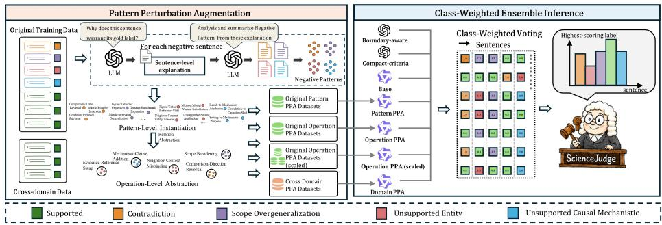

# ScienceJudge: Pattern Perturbation Augmentation for Sentence-Level Scientific Claim Verification

Chuhai Cai1, Xin Chen1, Min Yang1,2, and Feng Jiang1(B)

1 Institute of Artificial Intelligence, Shenzhen University of Advanced Technology, Shenzhen, China

{24000217,25070145}@stu.suat-sz.edu.cn, jiangfeng@suat-sz.edu.cn

2 Shenzhen Institutes of Advanced Technology, Chinese Academy of Sciences, Shenzhen, China

min.yang@siat.ac.cn

Abstract. Sentence-level scientific claim verification determines whether each sentence in an AI-generated scientific paragraph is supported by a given multimodal evidence bundle. Fine-grained reporting errors often preserve fluent and plausible statements while introducing subtle evidence–claim deviations, making them dificult to detect under sparse and imbalanced supervision. We propose Pattern Perturbation Augmentation (PPA), which models reporting errors as label-specific faithfulness breaking transformations and induces reusable error patterns from labeled examples. PPA applies these patterns to supported claims to construct controlled hard negatives and expands their coverage through pattern-level, operation-level, and cross-domain augmentation. Based on these augmented views, we develop ScienceJudge, which integrates PPA-trained vision-language predictors and instruction-guided LLM predictors through class-weighted ensemble inference. On the local development set, ScienceJudge improves the average score from 0.8124 to 0.8692, achieving a Macro-F1 of 0.8466 and a Paragraph Exact Match score of 0.8919. Our submitted system ranks first on the oficial NLPCC 2026 Task 10 Track 1 leaderboard with a final score of 0.6890.

Keywords: Scientific claim verification · Evidence grounding · Data augmentation

## 1 Introduction

Large language models (LLMs) are increasingly used to assist scientific writing and report generation [2, 3, 19]. However, the generated content may not faithfully reflect the underlying data and evidence. Scientific reporting errors are often subtle: a generated statement may remain fluent and scientifically plausible while misattributing an entity, overstating the scope of a finding, reversing a reported relation, or introducing an unsupported causal interpretation. Detecting such errors is therefore essential for reliable AI-assisted scientific writing.

Existing studies generally formulate this problem as evidence-based claim verification, where models determine whether a claim is supported by the available evidence [12, 15, 14]. Prior work has explored rationale modeling, full-document context, multimodal verification over figures and tables, and hard-negative augmentation for robustness [16, 17, 6, 10, 7, 9]. These approaches learn claim–evidence mappings for verification, but their augmentation mechanisms rarely specify which evidence-grounded element should change, how the claim–evidence relation should change, or under which conditions an edit realizes a designated reporting-error category. Consequently, broad perturbations can provide limited coverage of the fine-grained error constructions needed for this task, particularly when negative instances are scarce and imbalanced.

To address this gap, we propose Pattern Perturbation Augmentation (PPA), a structured framework that induces label-specific faithfulness-breaking patterns from observed reporting errors. PPA comprises three complementary strategies. Pattern-Level Instantiation retains a complete pattern—its target slot, relation change, and applicability conditions—to realize fine-grained error constructions. Operation-Level Abstraction derives reusable relation-changing operations from related patterns and applies them across diferent targets and scientific contexts. Cross-Domain Transfer realizes these operations on evidence from additional scientific domains. Scaled Operation PPA is an operation-scale variant that increases the accepted realizations under the same operation inventory. Building on these complementary views, we develop ScienceJudge, which combines separately trained vision-language predictors with instruction-guided LLM predictors through class-weighted ensemble inference.

We evaluate the proposed approach on Track 1 of the NLPCC 2026 Shared Task 10,3 which requires systems to verify each sentence in an AI-generated scientific paragraph against a provided multimodal evidence bundle. On our fixed local development set, ScienceJudge improves the average score from 0.8124 under standard fine-tuning to 0.8692, with a Macro-F1 of 0.8466 and a Paragraph Exact Match score of 0.8919. The submitted system ranks first on the oficial Track 1 final leaderboard with a score of 0.6890. Further analysis shows that preserving fine-grained patterns sharpens category distinctions, cross-domain transfer improves scope recognition, and class-weighted voting prevents diagnostic unsupported predictions from being suppressed by the dominant Supported label.

Our main contributions are summarized as follows:

– We analyze fine-grained scientific reporting errors and induce label-specific faithfulness-breaking patterns that expose recurring evidence deviations under scarce and imbalanced supervision.

– We propose PPA, a structured hard-negative augmentation framework that combines Pattern-Level Instantiation, Operation-Level Abstraction, and Cross-Domain Transfer; an operation-scale variant further examines additional contextual coverage.

– We develop ScienceJudge, integrating PPA-trained vision-language predictors and instruction-guided LLM predictors through class-weighted ensemble inference, and achieve first place on NLPCC 2026 Shared Task 10 Track 1.

## 2 Related Work

## 2.1 Evidence-Based Fact and Scientific Claim Verification

Evidence-based fact verification determines claim veracity by grounding predictions in retrieved evidence [13, 4]. FEVER established the influential retrieval– selection–verification paradigm [12], while SciFact and MultiVerS extended verification to scientific literature with rationale supervision and full-document context [15, 16]. Recent studies further explore explainable verification over longcontext documents and evidence-grounded scientific attribution, including FinD-Ver and SciTrue [21, 11]. Unlike prior settings that mainly formulate verification as claim-level veracity prediction, our task provides the evidence bundle and requires fine-grained diagnosis of sentence-level reporting errors.

## 2.2 Verification over Structured and Multimodal Evidence

Fact verification has increasingly incorporated heterogeneous evidence. FEVER-OUS combines textual and tabular reasoning [1], while recent multimodal verification studies investigate evidence integration across text, images, and tables [18]. In scientific domains, SciVer evaluates claim verification over text, tables, and charts [17], and MuSciClaims introduces figure-grounded scientific claims with manually designed perturbations for diagnostic evaluation [8]. Recent work also studies evidence-cell alignment and atomic reasoning for scientific table verification [5, 20]. SciClaimEval further constructs cross-modal examples from authentic scientific claims and modified supporting evidence [6]. Together, these studies highlight the importance of multimodal grounding and fine-grained reasoning in scientific verification.

## 2.3 Hard-Negative and Counterfactual Data Augmentation

Verification models may exploit annotation artifacts and label-correlated expressions without adequately modeling the claim–evidence relation [10]. Counterfactual data augmentation addresses such shortcuts through minimal labelchanging edits [7], while CrossAug constructs contrastive claim–evidence pairs for evidence-sensitive prediction [9]. Recent scientific benchmarks additionally construct challenging examples through controlled claim perturbations or modifications to supporting tables and figures [8, 6]. However, these approaches primarily focus on constructing diagnostic evaluation datasets, whereas PPA learns fine-grained, label-specific perturbation patterns from observed reporting errors and uses them for training augmentation.

  
Fig. 1. Overview of ScienceJudge. PPA induces label-specific error patterns from labeled training data and realizes them through Pattern-Level Instantiation, Operation-Level Abstraction, and Cross-Domain Transfer. Five local vision-language predictors, including a scaled operation variant, are combined with two instruction-guided LLM predictors through class-weighted ensemble inference.

## 3 Methodology

## 3.1 Task Formulation and Framework Overview

Following the oficial formulation of NLPCC 2026 Shared Task 10 Track 1, the input consists of an AI-generated claim paragraph $C = \{ s _ { 1 } , \ldots , s _ { n } \}$ and an associated multimodal evidence bundle E, which may contain textual descriptions, figure or table captions, and associated images. The paragraph is segmented into n sentences, and the goal is to predict a sentence-level label sequence $Y = \{ y _ { 1 } , . . . , y _ { n } \}$ . Each $y _ { i }$ is selected from five categories: Supported, Unsupported Entity, Scope Overgeneralization, Contradiction, and Unsupported Causal Mechanistic.

Figure 1 presents ScienceJudge, an ensemble framework designed to address the challenges of fine-grained scientific reporting error identification. The key idea is to model reporting errors as recurring faithfulness-breaking transformations over evidence–claim relations and exploit them for controlled augmentation. Specifically, we propose Pattern Perturbation Augmentation (PPA), which hierarchically explores these transformations by preserving fine-grained error structures, abstracting reusable relation-changing operations, and transferring them across scientific contexts. This design enables the model to capture label-specific error characteristics without being restricted to limited observed realizations. Finally, the augmented data are used to train complementary vision-language predictors, which are integrated with instruction-guided LLM predictors through class-weighted ensemble inference to improve robustness under highly imbalanced error categories.

## 3.2 Negative Pattern Induction

Unsupported scientific sentences often preserve most of a faithful claim while changing one local relation between a claim and its evidence. Through analysis of the training examples, we observe that these deviations recur across error categories instead of appearing as isolated generation errors. We therefore view them as label-specific faithfulness-breaking transformations and represent each pattern as

$$
p = \langle a , r , c \rangle ,\tag{1}
$$

where a is the afected semantic anchor, r is the relation-changing edit, and c contains the applicability and label-specific decision conditions. These conditions are natural-language rules that specify suitable source sentences, permitted local edits, and distinctions among neighboring labels. For example, a documentreference shift applies to a Supported sentence with a concrete figure or table anchor; the edit changes that anchor while preserving the proposition’s scope, polarity, and explanatory content.

To induce these patterns from observed errors, we analyze each negative sentence in the oficial training data with GPT-5.5, providing the evidence bundle, claim paragraph, target sentence, gold label, and oficial label definition. The model identifies the altered semantic element and explains how its relation to the evidence difers from that of a faithful statement. A consolidation prompt groups the explanations by their semantic anchors and relation-changing edits, while retaining links to source examples. We then consolidate semantically equivalent constructions and specify their applicability conditions against the official definitions and examples. The resulting inventory includes evidence-anchor substitution, figure–content misbinding, scope expansion, polarity reversal, and unsupported mechanism insertion.

## 3.3 Pattern Perturbation Augmentation

Given the induced pattern inventory, PPA aims to alleviate supervision sparsity by generating controlled hard negatives that preserve label-specific evidence deviations while expanding their realizations. It balances error specificity and transformation generalization: Pattern-Level Instantiation maintains fine-grained error structures within each label, whereas Operation-Level Abstraction derives reusable relation-changing operations shared by related patterns. Cross-Domain Transfer further extends these operations beyond the source scientific distribution.

In-Domain Data Augmentation Within the oficial scientific domain, PPA addresses two forms of supervision sparsity: incomplete coverage of error structures within each label and limited contextual variation of their underlying evidence–claim deviations.

Strategy I: Pattern-Level Instantiation. Fine-grained reporting labels often contain multiple non-interchangeable evidence deviations. For Unsupported Entity, these include shifted evidence anchors, unsupported panel identifiers, figure–content misbindings, and unsupported scientific objects. Although such cases share a label, they rely on diferent local evidence cues. Pattern-level instantiation retains the complete tuple $\langle a , r , c \rangle$ as an augmentation unit. For each pattern, compatible Supported sentences are selected using its applicability conditions, and the prescribed local edit is instantiated. Sampling across the pattern inventory distributes examples over frequent and rare constructions. This path increases coverage of the distinct error structures represented within each label.

Strategy II: Operation-Level Abstraction. Diferent concrete patterns may share the same underlying evidence–claim relation change while difering in their semantic anchors and local contexts. We therefore abstract related patterns into a reusable operation $o = g ( p )$ that retains the label-changing relation and its compatibility constraints. For example, document-reference shifts and unsupported panel identifiers contribute to evidence-anchor substitution; dataset-, setting-, and metric-level expansions contribute to scope broadening; and result-to-mechanism patterns contribute to unsupported mechanism insertion. Operation-level augmentation applies an operation to compatible Supported sentences while varying the semantic targets and local scientific contexts. It therefore expands the contextual combinations in which a stable evidence– claim violation is observed. Scaled Operation PPA uses the same operation inventory, prompts, and quality controls while accepting more realizations per operation; it is the scale variant of this augmentation path.

Cross-Domain Data Augmentation The oficial training data mainly cover computer science and AI research. Cross-domain transfer is motivated by the observation that evidence–claim violations can share structural patterns across domains while their surface realizations vary across scientific fields. The induced operations can therefore be transferred to additional domains without domainspecific redesign.

We collect evidence-linked paragraphs from open-access articles in biomedicine, materials science, and the physical sciences. Their original evidence-grounded sentences provide Supported sources with domain-specific terminology and reporting conventions. Given an induced operation and a target label, PPA selects a compatible Supported sentence from this collection and applies one local evidence–claim transformation. The surrounding scientific content is preserved, so the resulting negative realizes the same relation change in a diferent domain context. A subset of the collected Supported sentences is retained unchanged as controls.

Controlled Instance Generation and Quality Control All PPA strategies share a controlled generation and filtering procedure. Given an evidence bundle, a paragraph containing a compatible Supported sentence, a target label, and a transformation specification, a language model generator produces one locally edited sentence. The specification is a complete pattern for Pattern-Level Instantiation and an abstract operation for the other two strategies. Generation preserves the source topic, non-target scientific content, and sentence fluency, and may abstain when no compatible target is available.

We retain a candidate only when its source sentence can be uniquely matched, exactly one sentence is modified, and the edit satisfies length, sentence-boundary, and transformation-specific checks. These checks distinguish nearby labels: changing a concrete evidence anchor yields Unsupported Entity when the proposition’s applicability is unchanged, whereas expanding that applicability yields Scope Overgeneralization. Duplicate outputs are removed, and the remaining candidates are selected under strategy-specific quotas. We distinguish candidates rejected because of inapplicability or failed checks from valid candidates excluded only after the corresponding quota has been reached.

## 3.4 Instruction-Guided Predictors and Class-Weighted Ensemble Inference

We complement the PPA-trained vision-language predictors with two instructionguided GPT-5.5 predictors used without fine-tuning. Both receive the multimodal evidence, sentence-segmented claims, and label definitions. The Boundaryaware predictor distinguishes commonly confused labels by locating the altered semantic element, whereas the Compact-criteria predictor applies concise evidence-grounded criteria to each label.

ScienceJudge combines seven predictors: Base Training, four PPA-trained vision-language predictors, and the two GPT-5.5 predictors. Each produces one hard-label vote. For a sentence x, we predict

$$
\hat { y } = \arg \operatorname* { m a x } _ { y \in \mathcal { V } } w _ { y } \sum _ { m \in \mathcal { M } } \mathbb { I } [ f _ { m } ( x ) = y ] ,\tag{2}
$$

where $w _ { y }$ is a class-specific vote multiplier. A predefined discrete search on the development set selects (0.8, 1.0, 1.2, 1.0, 2.0) for Supported, Entity, Scope, Contradiction, and Causal, respectively. The weights are fixed for test inference; ties favor Contradiction, Causal, Entity, Scope, and Supported in order.

## 4 Experiments

## 4.1 Experimental Settings

Datasets and Metrics. As shown in Table 1, we use the Track 1 dataset of NLPCC 2026 Shared Task 10 on Scientific Claim Verification,4 which contains 3,333 paragraphs. We split the dataset into 3,000 paragraphs for training and 333 paragraphs for a fixed local development set using a stratified split that approximately preserves the original label distribution. The local development set contains 1,702 claim sentences and is used for model selection, prompt comparison, ensemble tuning, and local evaluation. We adopt the oficial sentence-level Macro-F1 and Paragraph Exact Match (PEM), with their average used as the overall score.

Table 1. Statistics of the base training set and PPA datasets. Columns report sentence counts for each label and the number of paragraphs.
<table><tr><td>Data setting</td><td>Sup. Entity Scope Contra. Causal Para.</td><td></td><td></td><td></td><td></td></tr><tr><td>Base</td><td>14,818</td><td>581</td><td>543</td><td>193</td><td>251 3,000</td></tr><tr><td>Pattern PPA</td><td>4,950</td><td>540</td><td>510</td><td>300</td><td>290 800</td></tr><tr><td>Operation PPA</td><td>2,113</td><td>200</td><td>100</td><td>100</td><td>100 500</td></tr><tr><td>Operation PPA(scaled) 10,849</td><td></td><td>1,000</td><td>500</td><td>500</td><td>500 2,500</td></tr><tr><td>Domain PPA</td><td>3,070</td><td>180</td><td>180</td><td>110</td><td>170 800</td></tr></table>

Training Corpora. Each PPA-based local vision-language predictor is trained on the oficial training data combined with the accepted augmentations from its corresponding PPA variant. We construct separate predictors for Pattern PPA, Operation PPA, Scaled Operation PPA, and Domain PPA. Scaled Operation PPA increases the number of accepted realizations per operation under the same generation procedure and quality constraints, while Merged PPA combines accepted augmentations from all variants.

Implementation Details. All local vision-language predictors use Qwen3-VL-8B-Instruct and are fine-tuned with 4-bit QLoRA using LLaMA-Factory. LoRA uses rank 64 and alpha 128, with all eligible modules including visual components optimized during training.

We use a per-device batch size of 1 and gradient accumulation of 8. Four-way distributed training on four NVIDIA RTX A6000 GPUs yields a global batch size of 32. We use a learning rate of $1 . 0 \times 1 0 ^ { - 4 }$ , a cosine learning-rate scheduler with a warmup ratio of 0.1, bf16 precision, gradient checkpointing, and a maximum image size of 262,144 pixels. We accessed GPT-5.5 through a commercial API in June 2026 (\$43.38 development cost; no external retrieval at test time).

## 4.2 Main Results

Table 2 reports the development-set results of the individual predictors and ensemble systems.

On the local development set, ScienceJudge reaches an average score of 0.8692 (Macro-F1 0.8466; PEM 0.8919), improving by 0.0568 over Base Training. The text-only Qwen3-8B surrogate trails Qwen3-VL-8B both before task adaptation (0.2446 vs. 0.2625) and after Base Training (0.7865 vs. 0.8124), consistent with multimodal evidence providing useful verification cues. Fine-tuning raises the local VLM from 0.2625 to 0.8124, highlighting the importance of taskspecific adaptation for learning the label distinctions and evidence–claim relations required by this task.

Beyond Base Training, Pattern PPA provides the strongest individual local predictor, improving the average score from 0.8124 to 0.8401. Its Entity and Contradiction F1 scores increase from 0.7290 to 0.8000 and from 0.5778 to 0.6667, respectively. This result suggests that recurring evidence-claim deviation patterns can provide useful supervision beyond standard fine-tuning. Within the GPT-5.5 family, the task-specific Boundary-aware and Compact-criteria prompts improve over the generic prompt from 0.2751 to 0.7359 and 0.6221, respectively. The two instructions also provide diferent label specialties: Boundary-aware achieves the strongest Causal F1 (0.9000), whereas Compact-criteria attains higher Entity F1 (0.7294 vs. 0.6946).

Table 2. Development-set results of individual predictors and ensemble systems, including label-wise F1 scores. The bold indicates the best performance.
<table><tr><td rowspan="2">Predictor↓ Metric→</td><td colspan="4">Label-wise F1</td><td colspan="3">Overall</td></tr><tr><td>Sup.</td><td></td><td>Entity Scope Contra. Causal Macro-F1:</td><td></td><td></td><td>PEM</td><td>Avg.</td></tr><tr><td colspan="8">Text-only Surrogate</td></tr><tr><td>Qwen3-8B-Instruct</td><td>0.7963</td><td>0.1754</td><td>0.0339 0.0696</td><td>0.1096</td><td>0.2370</td><td>0.2523</td><td>0.2446</td></tr><tr><td>+ Base Training</td><td>0.9784</td><td>0.7586</td><td>0.7833</td><td>0.5366 0.7692</td><td>0.7652</td><td>0.8078</td><td>0.7865</td></tr><tr><td colspan="8">Our PPA-Based Individual Model</td></tr><tr><td>Qwen3-VL-8B-Instruct</td><td>0.8098</td><td>0.2872 0.0000</td><td>0.1154</td><td>0.0909</td><td>0.2606</td><td>0.2643</td><td>0.2625</td></tr><tr><td>+ Base Training</td><td>0.9828</td><td>0.7290</td><td>0.8033 0.5778</td><td>0.8421</td><td>0.7870</td><td>0.8378</td><td>0.8124</td></tr><tr><td>+ Pattern PPA</td><td>0.9847</td><td>0.8000</td><td>0.8000 0.6667</td><td>0.8254</td><td>0.8154</td><td>0.8649</td><td>0.8401</td></tr><tr><td>+ Operation PPA</td><td>0.9831</td><td>0.7222</td><td>0.8099 0.6316</td><td>0.8197</td><td>0.7933</td><td>0.8438</td><td>0.8186</td></tr><tr><td>+ Operation PPA(scaled)</td><td>0.9801</td><td>0.7647</td><td>0.7931 0.5385</td><td>0.8657</td><td>0.7884</td><td>0.8468</td><td>0.8176</td></tr><tr><td>+ Domain PPA</td><td>0.9831</td><td>0.7966</td><td>0.8305 0.4348</td><td>0.8060</td><td>0.7702</td><td>0.8619</td><td>0.8160</td></tr><tr><td>Merged PPA</td><td>0.9824</td><td>0.7667</td><td>0.8125 0.7059</td><td>0.7419</td><td>0.8019</td><td>0.8529</td><td>0.8274</td></tr><tr><td colspan="8">Our Instruction-Guided Individual Model</td></tr><tr><td>GPT-5.5 (Base)</td><td>0.7555 0.3180</td><td>0.2353</td><td>0.3467</td><td>0.1641</td><td>0.3639</td><td>0.1862</td><td>0.2751</td></tr><tr><td>+ Boundary-aware Instruction</td><td>0.9614</td><td>0.6946 0.5909</td><td>0.5333</td><td>0.9000</td><td>0.7360</td><td>0.7357</td><td>0.7359</td></tr><tr><td>+ Compact-criteria Instruction</td><td>0.9446</td><td>0.7294 0.5424</td><td>0.5000</td><td>0.3061</td><td>0.6045</td><td>0.6396</td><td>0.6221</td></tr><tr><td colspan="8">Our Ensemble Model</td></tr><tr><td>Local VLM Ensemble (5)</td><td>0.9860 0.8174</td><td>0.8305</td><td>0.6875</td><td>0.8387</td><td>0.8320</td><td>0.8799</td><td>0.8560</td></tr><tr><td>Unweighted Voting (7)</td><td>0.9873 0.84300.8348</td><td></td><td>0.6875</td><td>0.8525</td><td>0.8410</td><td>0.8859</td><td>0.8634</td></tr><tr><td>Class-Weighted Voting (7)</td><td>0.9873 0.8430 0.8496</td><td></td><td>0.6875</td><td>0.8657</td><td>0.8466</td><td></td><td>0.8919 0.8692</td></tr></table>

At the system level, the local VLM ensemble reaches 0.8560, unweighted voting over all predictors reaches 0.8634, and class-weighted voting reaches 0.8692. These results suggest that combining PPA-trained vision-language predictors with instruction-guided LLM predictions is beneficial on the development set, while class weighting provides a further modest improvement.

Table 3 reports the oficial final Track 1 leaderboard.5 ScienceJudge, submitted as SUAT-NLP, ranks first with an oficial final score of 0.6890.

## 4.3 How Does PPA Change Local Error Recognition?

We examine the prediction changes that reveal what the augmented corpora add beyond aggregate scores.

Pattern PPA makes reference identity a verifiable cue. Base Training predicts five Unsupported Entity cases as Supported because their scientific propositions remain compatible with the evidence topic; the error lies only in the identity of the cited evidence object. Pattern PPA corrects all five decisions by treating the figure or table reference anchor as part of the claim semantics. The recovered cases include Figure 5 against evidence for Figure 4, Table 5 against evidence for Table 4, and Figure 7 against evidence for Figure 8. Its construction keeps the proposition and local context fixed while replacing the reference anchor, teaching the model that a scientifically plausible conclusion still forms an Unsupported Entity error when it is attributed to the wrong evidence object.

Table 3. Top three systems on the oficial Track 1 leaderboard. The Bold indicates the best performance and underline indicates the second best.
<table><tr><td rowspan="2">Rank System</td><td rowspan="2"></td><td colspan="3">Phase 1</td><td colspan="3">Phase 2</td><td rowspan="2">Avg.</td></tr><tr><td>Macro-F1</td><td>PEM</td><td>Avg.</td><td>Macro-F1</td><td>PEM</td><td>Avg.</td></tr><tr><td>1</td><td>ScienceJudge (Ours)</td><td>0.5659</td><td>0.4710</td><td>0.5185</td><td>0.9053</td><td>0.8136</td><td>0.8595</td><td>0.6890</td></tr><tr><td>2</td><td>System 1</td><td>0.5754</td><td>0.4369</td><td>0.5061</td><td>0.9056</td><td>0.8337</td><td>0.8697</td><td>0.6879</td></tr><tr><td>3</td><td>System 2</td><td>0.4996</td><td>0.3823</td><td>0.4409</td><td>0.7523</td><td>0.6854</td><td>0.7188</td><td>0.5799</td></tr></table>

This efect also reveals the broader mechanism of Pattern PPA. It instantiates induced construction patterns across diverse scientific statements: research content, semantic slots, and surface wording vary, while the core evidence–claim relation that defines the label remains unchanged. These contrasts expand the coverage of evidence–claim configurations associated with each error family, enabling the model to recognize the construction itself instead of relying on a particular figure number, dataset name, or lexical form. The Figure/Table corrections on the development set therefore provide an interpretable window into the model’s broader ability to recognize this family of evidence deviations.

The same contrastive construction covers all labels: it tests evidence alignment for Supported, object identity for Unsupported Entity, mutually incompatible replacements for Contradiction, stated coverage for Scope Overgeneralization, and added mechanisms for Unsupported Causal Mechanistic. The visible Entity correction is one manifestation of broader pattern-recognition capability.

Separate PPA views provide complementary augmentation perspectives. Pattern PPA is designed to emphasize exact evidence binding, Operation PPA transfers relation changes across contexts, and Domain PPA exposes these transformations to diferent scientific language and reporting settings. These strategy-specific views are retained for subsequent decision-level aggregation.

## 4.4 How Does Class-Weighted Ensemble Inference Afect Predictions?

Decision-level fusion preserves complementary recognition views. Merged PPA reaches 0.8274, showing that a pooled corpus retains useful PPA signal, but it remains below the local VLM ensemble (0.8560). A merged predictor must encode all augmentation criteria in one parameterization, whereas separate PPA-

trained vision-language predictors preserve distinct decisions for aggregation. Adding the two GPT-5.5 views further raises the score to 0.8634 despite their weaker standalone results: they recover four missed Unsupported Entity cases and return three local false Scope or Causal alarms to Supported. Their contribution therefore comes from nonredundant evidence–claim decisions rather than standalone strength.

Class weighting acts on a small, identifiable ambiguity set. It changes six sentence labels relative to unweighted voting. Three changes correct genuine label-specific deviations: a claim attributes a larger low-loss region to reshaping the underlying optimization geometry, a local ablation result is presented as representative of all experiments, and a comparison combines an incorrect evidence anchor with an unsupported explanation of an accuracy gap. One additional change switches between two accepted labels. The two new errors instead occur on a malformed one-token fragment and on a factual architectural description that contains no causal claim. Thus, class weighting promotes minority negative-label votes when they identify an explicit causal, scope, or entity cue, while remaining vulnerable when sentence context does not support a wellformed relation decision.

The three corrections complete two additional paragraphs, whereas neither regression breaks an otherwise exact paragraph; this asymmetry accounts for the PEM improvement from 0.8859 to 0.8919. The efect is a narrow class-specific vote adjustment concentrated on ambiguous evidence–claim relations.

## 4.5 Augmentation Quality and Statistical Stability

Augmentation quality. We conduct a stratified manual audit of 100 retained augmentations, with 25 examples sampled from each PPA strategy. Overall, 94% of the audited examples are clearly valid, preserving the intended scientific content while introducing only the designated error type. Pattern, Operation, and Scaled Operation PPA each achieve a 96% clearly-valid rate, while Domain PPA achieves 88%. Most of the remaining ambiguous cases arise from localized scope broadening, suggesting that scope expansion is the primary residual source of content drift. Prompts, augmentation inventories, filtering rules, ensemble configurations, aggregate statistics, and analysis code are publicly available.6

Statistical stability. We use 10,000 paragraph-level paired-bootstrap resamples and 10,000 paired-randomization trials to assess the robustness of the complete system. ScienceJudge improves over Base Training by 0.05684 (95% CI [0.02428, 0.09042]; p = 0.0010), with the confidence interval remaining entirely above zero. This result indicates that the overall improvement is stable under paragraph-level resampling and is unlikely to be explained by sampling variation alone. Because the same development split was used for system selection, we interpret this analysis as post-hoc evidence of statistical stability rather than independent confirmatory testing.

## 5 Conclusion

We presented ScienceJudge, a fine-grained scientific claim verification system built on Pattern Perturbation Augmentation (PPA) and decisionlevel ensemble inference. PPA constructs controlled hard negatives from recurring evidence–claim deviations, while ScienceJudge integrates complementary vision-language and instruction-guided LLM predictors. The system improves the local development score from 0.8124 to 0.8692 and ranks first on the official NLPCC 2026 Shared Task 10 Track 1 leaderboard with a final score of 0.6890. Overall, our results suggest that structured, error-aware augmentation is a promising approach to scientific claim verification under sparse and imbalanced supervision.

## 6 Limitations

The local development set is reused for model selection, ensemble tuning, and evaluation, so local comparisons and statistical tests are post-hoc rather than independent confirmatory evidence. Augmentation quality is evaluated on a manual audit of 100 retained examples, leaving room for larger-scale multiannotator validation. Finally, GPT-5.5 is used for PPA pattern induction and as two instruction-guided ensemble predictors, and its transferability to alternative models and broader scientific domains remains to be studied.

## References

1. Aly, R., Guo, Z., Schlichtkrull, M., Thorne, J., Vlachos, A., Christodoulopoulos, C., Cocarascu, O., Mittal, A.: FEVEROUS: Fact extraction and VERification over unstructured and structured information. In: NeurIPS Datasets and Benchmarks 2021 (2021)

2. Birhane, A., Kasirzadeh, A., Leslie, D., Wachter, S.: Science in the age of large language models. Nature Reviews Physics 5(5), 277–280 (2023)

3. Boyko, J., Cohen, J., Fox, N., Veiga, M.H., Li, J.I.H., Liu, J., Modenesi, B., Rauch, A.H., Reid, K.N., Tribedi, S., Visheratina, A., Xie, X.: An interdisciplinary outlook on large language models for scientific research (2023)

4. Guo, Z., Schlichtkrull, M., Vlachos, A.: A survey on automated fact-checking. Transactions of the Association for Computational Linguistics 10, 178–206 (2022)

5. Ho, X., Kumar, S., Wu, Y.A., Boudin, F., Takasu, A., Aizawa, A.: Table-text alignment: Explaining claim verification against tables in scientific papers. In: Findings of EMNLP 2025. pp. 2509–2517 (2025)

6. Ho, X., Wu, Y.A., Kumar, S., Xia, T.C., Boudin, F., Greiner-Petter, A., Aizawa, A.: SciClaimEval: Cross-modal claim verification in scientific papers. In: LREC 2026. pp. 11060–11071 (2026)

7. Kaushik, D., Hovy, E., Lipton, Z.C.: Learning the diference that makes a diference with counterfactually-augmented data. In: ICLR 2020 (2020)

8. Lal, Y.K., Bandham, M., Hasan, M.S., Kashi, A., Koupaee, M., Balasubramanian, N.: MuSciClaims: Multimodal scientific claim verification. In: IJCNLP-AACL 2025. pp. 3285–3307 (2025)

9. Lee, M., Won, S., Kim, J., Lee, H., Park, C., Jung, K.: CrossAug: A contrastive data augmentation method for debiasing fact verification models. In: CIKM 2021. pp. 3181–3185 (2021)

10. Schuster, T., Shah, D., Yeo, Y.J.S., Roberto Filizzola Ortiz, D., Santus, E., Barzilay, R.: Towards debiasing fact verification models. In: EMNLP-IJCNLP 2019. pp. 3419–3425 (2019)

11. Tan, N., Li, M., Gahegan, M.: SciTrue: Evidence-grounded claim verification in science. In: EACL 2026 (System Demonstrations). pp. 397–406 (2026)

12. Thorne, J., Vlachos, A., Christodoulopoulos, C., Mittal, A.: FEVER: A large-scale dataset for fact extraction and verification. In: NAACL-HLT 2018. pp. 809–819 (2018)

13. Vlachos, A., Riedel, S.: Fact checking: Task definition and dataset construction. In: ACL 2014 Workshop on Language Technologies and Computational Social Science. pp. 18–22 (2014)

14. Vladika, J., Matthes, F.: Scientific fact-checking: A survey of resources and approaches. In: Findings of ACL 2023. pp. 6215–6230 (2023)

15. Wadden, D., Lin, S., Lo, K., Wang, L.L., van Zuylen, M., Cohan, A., Hajishirzi, H.: Fact or fiction: Verifying scientific claims. In: EMNLP 2020. pp. 7534–7550 (2020)

16. Wadden, D., Lo, K., Wang, L.L., Cohan, A., Beltagy, I., Hajishirzi, H.: MultiVerS: Improving scientific claim verification with weak supervision and full-document context. In: Findings of NAACL 2022. pp. 61–76 (2022)

17. Wang, C., Shen, Y., Kuang, Z., Cohan, A., Zhao, Y.: SciVer: Evaluating foundation models for multimodal scientific claim verification. In: ACL 2025. pp. 8562–8579 (2025)

18. Wang, H., Rangapur, A., Xu, X., Liang, Y., Gharwi, H., Yang, C., Shu, K.: Piecing it all together: Verifying multi-hop multimodal claims. In: COLING 2025. pp. 7453– 7469 (2025)

19. Wu, J., Yang, S., Zhan, R., Yuan, Y., Chao, L.S., Wong, D.F.: A survey on LLMgenerated text detection: Necessity, methods, and future directions. Computational Linguistics 51(1), 275–338 (2025)

20. Zhang, Y., Wang, Q., Qian, C., Liu, J., Sun, C., Zhang, D., Abdelzaher, T., Zhai, C., Nakov, P., Ji, H.: Atomic reasoning for scientific table claim verification (2025)

21. Zhao, Y., Long, Y., Jiang, T., Wang, C., Chen, W., Liu, H., Tang, X., Zhang, Y., Zhao, C., Cohan, A.: FinDVer: Explainable claim verification over long and hybrid-content financial documents. In: EMNLP 2024. pp. 14739–14752 (2024)