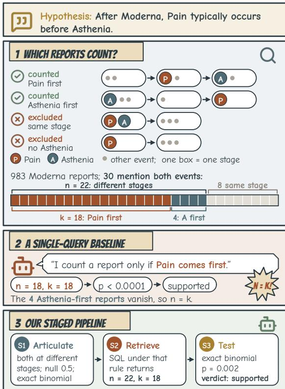
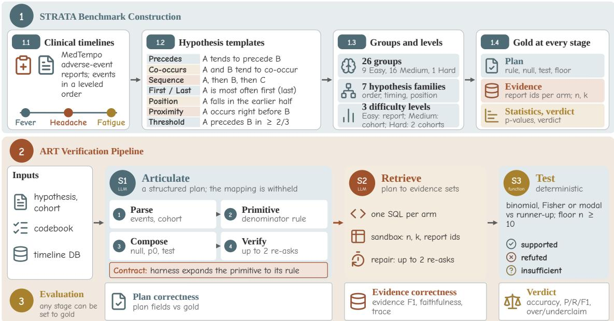
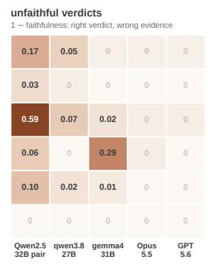
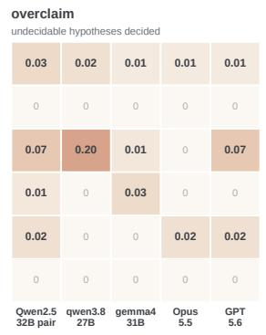
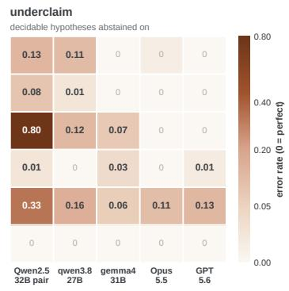
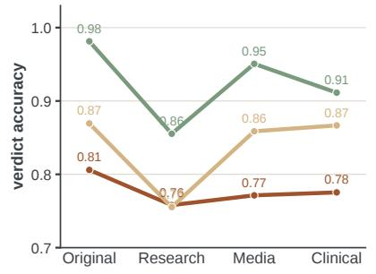
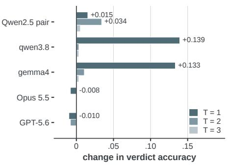
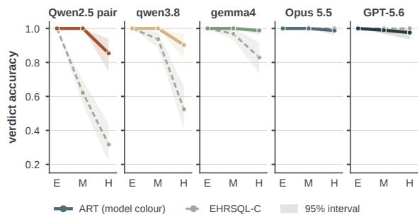
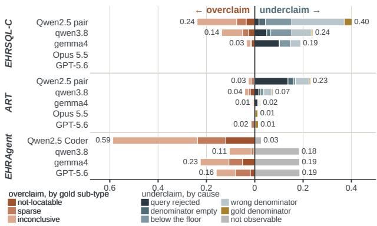

# Testimony from Timelines: Evidence-Grounded Significance Testing of Temporal Clinical Hypotheses

Chengyang He Stevens Institute of Technology Hoboken, NJ, USA che14@stevens.edu

Koduvayur Subbalakshmi   
Stevens Institute of Technology Hoboken, NJ, USA ksubbala@stevens.edu

## Abstract

Ask a language model whether sales tend to dip after a product recall, or whether one side efect tends to follow another after a vaccine, and it answers in a fluent sentence that reads like a finding, with no test behind it. Assertions about how events unfold across many cases fill the Web, and each is a temporal hypothesis that only a significance test over the right records can settle. The verifier must specify the null, select the test and decide which records bear on the hypothesis, and any of these choices can go wrong while the conclusion still comes out right. Yet benchmarks for language-model data analysis grade only the conclusion, with the relevant data handed over. We study the problem in health, where a wrong verdict is costly, and present Strata, a benchmark that grades every decision on the way to a verdict: 8,735 hypotheses over the clinical timelines of vaccine adverse-event reports, with gold plans, evidence sets, �-values and verdicts derived under a released codebook and reproduced by a deterministic oracle. We also propose Art (articulate, retrieve, test), a staged paradigm that exposes each decision as an inspectable output. Extensive experiments with five model configurations show that systems fail mostly at choosing which records count, a verdict–evidence gap that accuracy alone conceals. Art closes most of this gap and brings a 31B open model to within 0.01 of the frontier models under the same paradigm; the frontier models succeed once given the codebook.

## CCS Concepts

• Computing methodologies → Natural language processing;   
• Applied computing → Health informatics.

## Keywords

Temporal reasoning, statistical hypothesis testing, benchmark, clinical timelines, text-to-SQL

## 1 Introduction

Open a browser and the statements come at you. A post says that after a vaccine one symptom tends to arrive before another. A summary says a treatment works in most patients. An assistant answers a question over a public database in a sentence that sounds settled. The Web has always held more such sentences than anyone could check, and language models now write them, summarise them and

Wenlong Zhang Stevens Institute of Technology Hoboken, NJ, USA wzhang71@stevens.edu

Ping Wang∗ Stevens Institute of Technology Hoboken, NJ, USA pwang44@stevens.edu

  
Figure 1: A worked example. (1) Four Moderna reports, one per category; the bar sorts the 30 reports with both events into the numerator � (� = 18), the rest of the denominator � (� − � = 4) and the 8 reports outside �, where the two events share a stage. (2) A single-query baseline and (3) Art, with the same open model.

build the knowledge bases that answer them, in prose as confident as any person’s. Sorting the true ones from the false is the work of fact verification, which checks each against a reference [1, 4, 32]. But many of the statements that matter are not facts waiting in a database. They are hypotheses about a population, and in health the most consequential of them are temporal: that one adverse event tends to follow another after a vaccine, that a symptom comes first, that two events arrive together. No single record settles a hypothesis like this, and the pattern a handful of records seems to show may be chance. What settles it is a significance test, run over the right records against the right null. Verifying such a hypothesis is temporal hypothesis verification. Given a hypothesis about the order or timing of events across a population of clinical timelines, a system states the null, chooses the significance test, decides which timelines can witness it, and returns supported, refuted or insuficient.

  
Figure 2: Overview of the Strata benchmark and the Art pipeline: (1) construction, (2) verification, (3) the measure that scores each stage against its gold.

A growing class oflanguage-model systems promises exactly this [14, 23, 25]. Yet the benchmarks that judge them [25, 39, 40] score the final answer with the relevant data handed over. The decisions that make an answer statistical are never checked, and each of them can be wrong while the verdict is right. Take the hypothesis “after Moderna, Pain typically occurs before Asthenia” (Figure 1). The null is a 50/50 split of the reports in which the two events are ordered. The test is a one-sided exact binomial at � = 0.05 with a floor on the count. A report where the two events share a stage witnesses neither order, so it does not count. Each decision is a stipulation about what the sentence means for this corpus, and the verdict does not show when one is wrong. In Figure 1, a single-query baseline counts only the reports that support the hypothesis and still returns the right verdict: a verdict–evidence gap. A verdict that is right for the wrong reason misleads where the tolerance for error is lowest, and existing benchmarks hold no gold for the decisions behind it.

Strata (STatistical Reasoning Assessment for Temporal Assertions) is, to our knowledge, the first benchmark for this task with gold for every decision: the plan (null, test and conditioning rule), the evidence sets, the test statistics and the verdict. It holds 8,735 hypotheses in 26 template groups and four registers, generated over the MedTempo clinical timelines of vaccine adverse-event reports [17], with a held-out test set of 1,500. Every instance carries its gold verdict (supported, refuted or a sub-typed insuficient) and the gold of every stage that produced it. All of it is computed mechanically from the timelines and reproduced by a deterministic oracle. The stipulations the labels depend on ship as a codebook, written as text that any system can be given. The timelines are the reference, as a knowledge base is for fact verification, and the codebook prescribes the analysis rule.

We also introduce Art (articulate, retrieve, test), a staged verification paradigm for the task. Its first stage articulates the hypothesis as a plan, the second retrieves the evidence sets the plan names, and the third runs the prescribed test deterministically. Each stage has an output schema, and the two model stages have a bounded verify-and-repair loop. Any stage can be filled with gold, and the prompts can state or withhold the codebook. The plan can reach retrieval as prose or as a contract, in which the harness expands each primitive the plan names into its exact rule. These switches separate two things that end-to-end evaluation conflates: the information a system is told and the architecture it is given. Our contributions are:

• A benchmark with gold at every stage of temporal hypothesis verification: Strata, whose cohort hypotheses about the order, adjacency, position and co-occurrence of clinical events are each a significance decision, with the null, test and popula tion following from the temporal shape of each hypothesis. Its 26 groups span seven families and three dificulty levels. Every instance ships its plan, evidence sets, �-values and a three-decision verdict whose insuficient class is sub-typed.

• A generation process that makes the codebook part of the task: hypotheses are enumerated from the timelines by tem plates, and gold is computed by the prescribed test for each hypothesis shape and validated by permutation screens, invariants and an oracle. The rules that turn a temporal sentence into a testable population ship as text.

• A staged verification paradigm, Art, that makes every decision an explicit, checkable output. It articulates a hypothesis as a plan naming its conditioning rule, null and test, retrieves the conditioned evidence sets under a contract resolved by the harness, and decides with the prescribed test, run deterministically.

<table><tr><td>Work</td><td>Null</td><td>Test choice</td><td> $\mathrm { T e s t }$  run</td><td>Temporal hypotheses</td><td>Clinical</td><td>Stage gold</td></tr><tr><td>StatQA [40]</td><td></td><td></td><td>x</td><td>x</td><td>x</td><td>x</td></tr><tr><td>StatFormBench [35]</td><td></td><td></td><td>X</td><td>x</td><td>x</td><td>O</td></tr><tr><td>StatABench [39]</td><td></td><td></td><td></td><td>x</td><td>x</td><td>x</td></tr><tr><td>P-Bench [25]</td><td>x</td><td></td><td></td><td>O</td><td>O</td><td></td></tr><tr><td>DiscoveryBench [23]</td><td></td><td></td><td></td><td>x</td><td>x</td><td></td></tr><tr><td>EHRSQL [20]</td><td>x</td><td>x</td><td>x</td><td>x</td><td></td><td></td></tr><tr><td>EHRAgent [29]</td><td>x</td><td>x</td><td>x</td><td>x</td><td></td><td></td></tr><tr><td>LATCH [14]</td><td>x</td><td>x</td><td></td><td>x</td><td></td><td></td></tr><tr><td>VERITAS [31]</td><td>O</td><td>O</td><td></td><td>x</td><td>V</td><td></td></tr><tr><td>STRATA + ART</td><td></td><td></td><td></td><td></td><td></td><td></td></tr></table>

Table 1: Comparison of representative related work on what each work asks and scores (full version: Appendix A). Test choice: chosen and scored; Test run: the verdict follows from the test result; Stage gold: gold beyond the answer. ✓ yes, ❍ partly, $X \mathbf { n } \mathbf { o } , - \mathbf { n } / \mathbf { a }$

## 2 Related Work

Language models and statistical analysis. Work on language models and statistical hypotheses ranges from choosing a test to running a whole analysis. StatQA [40] asks which test applies, StatFormBench [35] asks for the formulation of a test family, and StatABench [39] scores the final answer of an analysis run with fixed tool functions. P-Bench and Fisher-R1 [25] are closest to our setting. An agent receives a hypothesis with its null stated, a CSV of the relevant data and a glossary, writes R to compute a �-value, and is scored on the decision and the �-value. Agentic systems go further and plan the analysis themselves. LATCH [14] runs LLM-chosen analyses through deterministic R pipelines on EHR data with the method given. VERITAS [31] is a multi-agent coscientist with a deterministic evidence classifier for image-derived cohorts. DiscoveryBench and BLADE [16, 23] evaluate open-ended discovery agents against rubrics. Across this line of work, the data are either handed over as the relevant subset or left entirely to the agent, the hypotheses concern variables in a table, and only the final answer or a rubric is scored. None asks the system to decide which records a statistic is computed over, and none releases gold for that decision or for the null and the test around it.

Temporal reasoning and clinical records. Temporal reasoning with language models has mostly been evaluated on single texts. Benchmarks ask about the order, duration or frequency of events in a passage or a synthetic event graph [11, 36], or in real-world text at several levels [22, 37]. Temporal fact verification judges one statement against its retrieved evidence, grounding its time expressions [1, 3], ordering its events on a timeline [4] or reading a time series [32]. In the clinical domain, temporal relation extraction labels the order of events within one narrative [6, 33], and TIMER [9] and CRAFT [17] extract and refine clinical timelines with language models. Question answering over clinical databases likewise asks for one answer per question: EHRSQL [20] adds an abstention option, EHRAgent [29] a code-writing agent with error-driven retries, and open text-to-SQL models such as OmniSQL [21] are built for the same setting. In all of these, the answer is a fact about one text, one series, one timeline or one query. A temporal hypothesis is an assertion about a population of timelines, and verifying it adds the decisions this paper scores: which timelines can witness the order at all, what chance looks like when events crowd the early stages, and which test decides. Strata brings the two lines together: it poses temporal hypotheses as significance tests over the MedTempo timelines released with CRAFT, and EHRSQL, EHRAgent and DiscoveryBench are adapted to it as baselines. Table 1 compares the closest work, and Appendix A gives the full comparison.

## 3 The Strata Benchmark

## 3.1 Task formulation

The input is a hypothesis ℎ and the timelines of a report set R. Each report’s timeline is a leveled order: a chain ofstages, each holding the MedDRA-coded events [7] reported at that point; a stage is a unit of order in the annotation, not a calendar day. A term’s first mention fixes its stage �� (�) in report �, and events at one stage co-exist, with no order between them. The reports of one vaccine form a cohort $C \subseteq { \mathcal { R } }$ . The hypothesis is stated in natural language in one of four registers and has one of three dificulty levels: an Easy hypothesis concerns one named report and is read of its timeline with no test, a Medium one is tested within one cohort, and a Hard one compares two cohorts. The system sees each report’s vaccine and stages, never its text. A supported hypothesis describes a regularity in what was reported to VAERS, not a causal efect.

A cohort hypothesis asserts a rate over the reports that can witness it. Its denominator $D \subseteq C$ is that set, and its numerator $N \subseteq D$ is the subset that supports it. $\operatorname { F o r } ^ { * } A$ precedes $\boldsymbol { B } ^ { \prime \prime } , \boldsymbol { D } = \{ \boldsymbol { r } \in$ $C : A , B \in r , s _ { r } ( A ) \not = s _ { r } ( B ) \}$ and $N = \{ r \in D : s _ { r } ( A ) < s _ { r } ( B ) \}$ for $^ { * } A$ and � co-occur”, $D = \{ r \in C : A , B \in r \}$ and $N = \{ r \in D$ $s _ { r } ( A ) = s _ { r } ( B ) \}$ , the same-stage reports. The pair $( D , N )$ forms an arm with counts $n = | D |$ and $k = | N |$ . Most hypotheses have one arm and compare $k / n$ with a null ${ \mathit { p } } _ { 0 } ,$ , the rate expected by chance $( p _ { 0 } = 0 . 5$ for an order hypothesis). A two-arm hypothesis tests whether the rates of its arms are equal; the arms are two event pairs in one cohort, the reports of one cohort with and without an event �, compared on their rate of � (both Medium), or one pair in two cohorts (Hard).

Given ℎ and the timelines, a system returns three outputs. The plan � names the quantity compared, the null, the tail, the test family, the number ofarms $K \in \{ 1 , 2 \}$ and the denominatorprimitive, the rule that maps the events and cohort of the hypothesis to �. The evidence $E = \{ ( D _ { j } , N _ { j } ) \} _ { j = 1 } ^ { K }$ lists the reports in each arm; for first/last (argmax) hypotheses each report in $D _ { j }$ also carries the candidate it witnesses, so $E$ partitions $D _ { j }$ by candidate and $N _ { j }$ is the named candidate’s cell. The verdict � follows from the test’s one-sided �-values, $p ^ { + }$ in the asserted direction and $p ^ { - }$ − against it. If some arm has fewer than $n _ { \mathrm { m i n } } = 1 0$ reports (the floor), � is insuficient: notlocatable when some arm is empty and sparse otherwise. Otherwise � is supported if ${ p ^ { + } } \leq \alpha ,$ , refuted if $p ^ { - } \leq \alpha \left( \alpha = 0 . 0 5 \right)$ , and insuficient (inconclusive) if neither; a supported or refuted verdict is decisive. Since � applies to each direction, a decisive verdict has probability at most 0.10 under the null, and 0.045 on average on the test set.

Each output is scored against its own gold, $\pi ^ { * } , E ^ { * }$ and $y ^ { * } ;$ the gold verdict also carries its sub-type and both �-values. At several points the reading of a hypothesis depends on a stipulation about the corpus, not on its wording: whether a report with both events at one stage counts for “precedes”, or whether a tie for “first” leaves the denominator. The benchmark ships these stipulations as the codebook B (Section 4.1) and withholds only the mapping ℎ ↦→ � from wording to rule and test; composing that mapping is what a system is scored on.

<table><tr><td>Test set (Medium / Hard)</td><td>1,500 (1,418 / 82)</td></tr><tr><td>Distinct facts Single-report case study (Easy)</td><td>861 180</td></tr><tr><td>Development set (4–10 hypotheses per group)</td><td>184</td></tr><tr><td>Groups / families / difficulty levels</td><td>26 /  7  /  3</td></tr><tr><td>Registers per hypothesis</td><td>4</td></tr><tr><td></td><td></td></tr><tr><td>Pool: hypotheses (texts)</td><td>8,735 (34,940)</td></tr><tr><td>Easy / Medium / Hard</td><td>3,600 / 5,048 / 87</td></tr><tr><td>Supported / Refuted / Insufficient</td><td>3,459 / 3,455 /  1,821</td></tr><tr><td>Inconclusive / Sparse / Not-locatable</td><td>712 / 495 / 614</td></tr><tr><td>Denominator size n, median (IQR)</td><td>18 (12–34)</td></tr></table>

Table 2: Basic data statistics. Per-group sizes are in the hy- pothesis catalogue (Appendix B); Easy hypotheses have no insuficient class.

## 3.2 Benchmark construction

Source timelines. We use the clinical timelines of MedTempo [17]: 3,166 VAERS adverse-event reports [30] for three COVID-19 vaccines (1,164 Janssen, 1,019 Pfizer, 983 Moderna), with 1,660 event terms and on average 7.2 events over 3.4 stages per report.

Hypotheses. The hypotheses come from 26 template groups in seven hypothesis families: precedes, co-occurs, sequence of three events, first/last (argmax) among candidates, and, to diversify the null, position (an event in the earlier half of a timeline), proximity (two events at consecutive stages) and threshold (a rate of at least a stated bar). The groups yield a pool of 8,735 hypotheses: 3,600 Easy (9 groups), 5,048 Medium (16) and 87 Hard (1). Hard hypotheses are rare because few event pairs are testable in two cohorts at once, and sequence appears at the Easy level only. Each group is rendered in four registers (Original, Research, Media, Clinical) by mechanical slot-filling (Table 8). Each hypothesis is built on a core: its template group, events and cohort, hence its denominator primitive, tested quantity, null and arm structure, which fix the statistic whatever the wording. A core is decisive when its test is significant in one direction. Every decisive core is posed both ways, as a supported hypothesis and its mirror in the opposite direction, so a system that supports both directions of one fact is caught. Each cohort group ships near-equal thirds of the three verdicts (C-V3 and Y-V3 ship more insuficient, Table 8), so its wording cannot predict the label. Not-locatable hypotheses use real cohort vocabulary whose joint count is zero, so only querying the timelines reveals the empty denominator.

Gold labels. Labels are computed mechanically from the timelines. The null follows from the shape of the hypothesis: 0.5 for order hypotheses, the named cell against its strongest competitor for argmax hypotheses, equality of two rates for two-arm hypotheses, a bar stated in the wording for threshold hypotheses, and a rate derived from the data for position and proximity hypotheses. Order and bar hypotheses use a one-sided exact binomial, and data-derived nulls a binomial at the mean per-report chance, a conservative bound on the exact Poisson-binomial test. Argmax hypotheses use an exact binomial on that comparison: an intersection– union test in the asserted direction and, in the opposite direction, a Bonferroni-adjusted union over the competitors (Appendix C); twoarm hypotheses use Fisher’s exact test [12], extended to reports that sit in both arms. Every test has size at most � per direction. Which reports count is the substance of the task: precedes counts only reports with both events at distinct stages, co-occurs admits every report with both and counts the same-stage ones (one co-occurs group splits the cohort on � and counts � anywhere), and first/last drops reports in which candidates tie. The only sample-size gate is the floor of $n _ { \mathrm { m i n } } = 1 0$ reports per arm; it defines the not-locatable and sparse sub-types, while inconclusive comes from the test. Each cohort hypothesis releases both one-sided �-values, the Wilson interval [38] and Cohen’s efect size [8], oriented to the hypothesis as asserted.

Validation. Before shipping, every group cleared a permutation null matched to its hypothesis shape [15], under which decisive labels fall to about � of the cores (Appendix E); six families of invariants hold over all 51,855 instances enumerated before the per-group cap, and a deterministic oracle that parses each template back into the reference SQL reproduces every gold label.

Release. The benchmark ships (Table 2) a 1,500-hypothesis test set, drawn as 61–96 hypotheses per cohort group, balanced across the verdicts (484 / 483 / 533) and fact-disjoint from a development set that draws 4–10 hypotheses from every group; a 180-hypothesis single-report case study; and the full pool of 8,735 hypotheses with its generator. Hypotheses that pose the same statistic over the same events and cohort, such as a hypothesis and its mirror or one hypothesis in two answer formats, share a fact\_id (a bar hypothesis and an order hypothesis on the same counts do not, since their nulls difer); the 1,500 test hypotheses hold 861 facts, the unit of the split and of every interval we report. Report identifiers are pseudonymous, and the full release, with the code, follows acceptance.

## 4 The Proposed Method

Art produces the scored outputs of Section 3.1 in three stages (Figure 2, Algorithm 1): it articulates the hypothesis as a plan naming its null, test and conditioning rule, retrieves the evidence sets the plan conditions on, and tests them with the prescribed test, run deterministically, so the verdict is a statistical decision rather than a model judgment. Each stage has an output schema and can be scored against its gold or filled with gold. The two model stages have a bounded verify-and-repair loop that reads only the contract, the codebook and the data, never the gold; unless stated otherwise, Art includes these loops.

## 4.1 S1: Articulate the plan

From the hypothesis text, its dificulty level and its cohort, the model composes a plan: events, quantity, denominator (a named primitive such as ordered\_pair or all\_present\_unique\_first), arms, null\_kind with �0 or a reference population, tail, test\_family with its rule, and the floor. The prompt states the codebook, organised by situation, with a computed dataset card, the null sources and the test definitions (Appendix E). It withholds the mapping from wording to hypothesis type, so the model composes the plan instead of looking it up; the prompt is zero-shot, since a worked plan would be a row of that mapping, and the harness derives the hypothesis type from the plan by reverse lookup over its fields. A plan that names no known hypothesis type is scored as insuficient (Appendix E). The plan is then checked for consistency with the codebook; on a violation the model is re-asked with the violations named, up to two re-asks.

Testimony from Timelines: Evidence-Grounded Significance Testing of Temporal Clinical Hypotheses
<table><tr><td rowspan="2">Methods</td><td colspan="4">Qwen2.5-32B pair</td><td colspan="4">qwen3.8-27B</td><td colspan="4">gemma4-31B</td><td colspan="4">Opus 5.5</td><td colspan="4">GPT-5.6</td></tr><tr><td>Acc</td><td>P</td><td></td><td></td><td>Acc</td><td></td><td></td><td>R</td><td>F1 Acc</td><td></td><td></td><td>F1</td><td>Acc</td><td></td><td></td><td>R</td><td>F1</td><td>Acc</td><td></td><td>R F1</td></tr><tr><td>EHRSQL</td><td>.528</td><td>.552</td><td>.522</td><td>.516</td><td>.593</td><td>.611</td><td>.588</td><td>.585</td><td>.634</td><td>.647</td><td>.630</td><td>.627</td><td>.867</td><td>.877</td><td>.866</td><td>.868</td><td>.872</td><td>.872</td><td>.871</td><td>.871</td></tr><tr><td>EHRSQL-C</td><td>.577</td><td>.606</td><td>.571</td><td>.571</td><td>.744</td><td>.763</td><td>.740</td><td>.743</td><td>.857</td><td>.887</td><td>.854</td><td>.860</td><td>1.000</td><td>1.000</td><td>1.000</td><td>1.000</td><td>.984</td><td>.984</td><td>.983</td><td>.983</td></tr><tr><td>EHRAgent</td><td>.596</td><td>.689</td><td>.602</td><td>.592</td><td>.838</td><td>.858</td><td>.836</td><td>.842</td><td>.733</td><td>.738</td><td>.732</td><td>.734</td><td></td><td></td><td></td><td></td><td>.796</td><td>.809</td><td>.795</td><td>.798</td></tr><tr><td>DiscoveryBench</td><td></td><td>n/a</td><td></td><td></td><td>.650</td><td>.823</td><td>.647</td><td>.716</td><td>.674</td><td>.763</td><td>.671</td><td>.706</td><td></td><td></td><td></td><td></td><td></td><td></td><td></td><td></td></tr><tr><td>ART (Ours)</td><td>.806</td><td>.878</td><td>.801</td><td>.822</td><td>.869</td><td>.893</td><td>.867</td><td>.878</td><td>.981</td><td>.983</td><td>.981</td><td>.982</td><td>.991</td><td>.991</td><td>.990</td><td>.991</td><td>.981</td><td>.982</td><td></td><td></td></tr><tr><td>ART w/o verify-and-repair</td><td>.757</td><td>.847</td><td>.751</td><td>.771</td><td>.727</td><td>.804</td><td>.720</td><td>.734</td><td>.837</td><td>.879</td><td>.833</td><td>.842</td><td>.999</td><td>.999</td><td>.999</td><td>.999</td><td>.999</td><td>.999</td><td>.981 .999</td><td>.981 .999</td></tr><tr><td>ART w/o harness test (model verdict)</td><td>.517</td><td>.646</td><td>.506</td><td>.484</td><td>.577</td><td>.615</td><td>.568</td><td>.509</td><td>.779</td><td>.812</td><td>.774</td><td>.777</td><td></td><td></td><td></td><td></td><td></td><td></td><td></td><td></td></tr><tr><td>ART w/o contract (plan as prose)</td><td>.663</td><td>.703</td><td>.657</td><td>.668</td><td>.823</td><td>.857</td><td>.819</td><td>.831</td><td>.947</td><td>.949</td><td>.946</td><td>.947</td><td></td><td></td><td></td><td></td><td></td><td></td><td></td><td></td></tr></table>

Table 3: Main results on the test set: verdict accuracy (Acc) and macro P, R and F1 over the three verdicts; leading zeros dropped. Rows below Art remove one of its components. Under the Qwen2.5 pair, the single-query baselines and the agents run Qwen2.5-Coder alone. 95% intervals on Acc are at most ±0.03. Bold/underline: best/second best amon the ada ted baselines and Art. Dash: run not made, to bound API cost; n/a: the agent does not run with this model.

Figure 3: Evidence errors of Art on the test set, by hypothesis family and model (Section 5.3); 0 is perfect in every panel. The colour scale is square-root.  
Algorithm 1 Art on one cohort hypothesis. S1 and S2 call the   
model, each with up to � re-asks (� = 2 in every reported Art row);   
the checks and S3 are deterministic; � is the resolved contract, �   
and � what the checks flag.   
Require: hypothesis ℎ, timelines R, codebook B, re-ask cap �   
Ensure: plan �, evidence �, verdict �   
1: � ← Articulate(ℎ, B ) ⊲ S1   
2: for � ← 1 to � do ⊲ plan repair   
3: � ← PlanChecks(�,ℎ, B)   
4: if � = ∅ then break   
5: � ← Articulate(ℎ, B,� )   
6: if � names no known hypothesis type then return (�, ∅, insuficient)   
7: ← Contract(�) ⊲ rule of �’s primitive   
8: � ← Execute(Retrieve(�, �), R) ⊲ S2   
9: for � ← 1 to � do ⊲ retrieval repair   
10: � ← RowChecks(�, �)   
11: if � = ∅ then break   
12: � ← Execute(Retrieve(�, �,�), R)   
13: (�+, �− ) ← Test(�, �) ⊲ S3   
14: � ← Verdict(�+, �−, min� |�� | ) ⊲ Section 3.1   
15: return (�, �, �)

## 4.2 S2: Retrieve the evidence sets

For each arm the model writes one SQL statement over the timeline database (two tables, three views) that returns one row per report with three Boolean flags (in the denominator, in the numerator, excluded) and an optional cell label for argmax hypotheses. The plan reaches this stage as a contract. The harness resolves the plan’s hypothesis type and writes that type’s conditioning rule and arm plan into the prompt, so the model receives the rule for the one primitive the plan names. Without the contract, S2 receives the plan’s JSON with the full codebook as prose (Section 6.2). The harness executes the statement in a read-only sandbox and aggregates the rows into (�, �) per arm with the identifier sets, so the evidence is auditable against the gold sets. A rejected statement or rows that violate the plan’s primitive are violations; an arm whose denominator equals its numerator, or an empty arm beside a full one, triggers a heuristic recheck, since both can be correct. Either triggers a re-ask, up to two re-asks, and the last answer replaces the earlier ones, so a correct statement that trips a recheck is kept only if the model returns it again. The contract and the checks are written by hand for this corpus and defined against the plan (Appendix E).

  
(c)

Figure 4: Art on the test set: (a) verdict accuracy by hypothesis family; (b) accuracy by paraphrase register, open models; (c) change in verdict accuracy when the cap on re-asks per stage rises from � − 1 to � (Art as reported uses � = 2).
<table><tr><td></td><td>Stage Methods</td><td>Qwen2.5 32B pair</td><td>qwen3.8 27B</td><td>gemma4 31B</td><td>Opus 5.5</td><td>GPT 5.6</td></tr><tr><td rowspan="3">S1</td><td>ART: Articulate (Ours)</td><td>.952</td><td>.915</td><td>.992</td><td>.991</td><td>.991</td></tr><tr><td>Plain prompt</td><td>.871</td><td>.856</td><td>.919</td><td>一</td><td>一</td></tr><tr><td>Plain prompt + CoT</td><td>.923</td><td>.859</td><td>.909</td><td>一</td><td>一</td></tr><tr><td rowspan="2">S2</td><td>ART: Retrieve (Ours)</td><td>.833</td><td>.943</td><td>.989</td><td>1.000</td><td>.991</td></tr><tr><td>OmniSQL-32B</td><td>.740</td><td>n/a</td><td>n/a</td><td>n/a</td><td>n/a</td></tr><tr><td rowspan="2">S3</td><td>ART: Test (Ours)</td><td>1.000</td><td>1.000</td><td>1.000</td><td>1.000</td><td>1.000</td></tr><tr><td>StatQA</td><td>.620</td><td>.628</td><td>.787</td><td>.980</td><td>.981</td></tr></table>

Table 4: Stage baselines on the test set: verdict accuracy with one stage filled by Art’s component or a baseline, the oth- ers gold or deterministic. CoT: zero-shot chain-of-thought. ‡Fine-tuned from Qwen2.5-Coder-32B. Bold: best per column within a stage where a baseline exists. Dash: run not made.

## 4.3 S3: Test the hypothesis

A deterministic function runs the plan’s test on the counts (Table 8): the binomial against the plan’s � (for a data-derived null, $\mathbf { \nabla } \mathcal { P } 0$ is the mean chance over the retrieved denominator), Fisher’s test for two arms (with shared reports exchanged, Appendix C), and, for argmax hypotheses, the named cell against its strongest competitor (Section 3.2); the codebook also admits the asymptotic two-proportion test for large cells. S3 applies the floor and returns the verdict with both tails. Nothing is inferred at this stage, so it needs no verification.

## 5 Experiments

## 5.1 Research questions

The experiments ask whether systems make the decisions of Section 3.1 correctly and whether their verdicts show it. We first ask how well current systems verify these temporal hypotheses end to end, and how the codebook, the model and the staged design each change accuracy (RQ1). We then ask where Art’s gain comes from and where its accuracy still varies: by stage, hypothesis family, paraphrase register and dificulty level (RQ2). Last, we ask whether a correct verdict rests on correct evidence, and whether systems decide exactly the hypotheses the data can decide (RQ3).

## 5.2 Baselines

Three published systems are adapted to the benchmark, all over the same database. EHRSQL [20] follows the single-query text-to-SQL protocol: one prompt per hypothesis asks for one query over our schema that marks each report as in the denominator, the numerator or neither, and the harness runs the query and the test. EHRSQL-C adds the codebook to the prompt, so it difers from Art only in having no plan, no contract and no repair. EHRAgent [29] runs as released, writing and executing its own code with up to 12 error-driven retries and four demonstrations, and runs its own test. It receives the schema, the test functions and the floor but not the codebook, since its knowledge stage writes the plan itself. DiscoveryBench’s reference agent [23] runs on the same tables exported as CSV, with the codebook as its domain knowledge, an instruction to end on a verdict line and up to 25 steps. The agents measure autonomous analysis; EHRSQL-C is the matched comparison.

Stage baselines replace one stage of Art with an established method and leave the other stages gold or deterministic, so each row measures the loss from that stage alone (Table 4): for Articulate, a plain prompt with the dataset description, codebook and plan schema but without Art’s explanations, field rules or verify-andrepair loop, with and without zero-shot chain-of-thought [19]; for Retrieve, OmniSQL [21], fine-tuned from the base of the Qwen2.5 pair’s SQL model, writing the SQL from the gold plan; for Test, the StatQA protocol [40], which gives the model the gold counts and test definitions and asks for the test and the verdict. The matching Art rows fill the same stage with Art’s own component.

## 5.3 Evaluation metrics

The verdict is scored as a three-class prediction, by accuracy and by precision, recall and F1 macro-averaged over supported, refuted and insuficient. Five evidence measures use the stage gold to score the steps behind a verdict. evidence F1 is the F1 between the reports a system placed in an arm’s denominator and the gold set, averaged over arms. faithfulness (of the denominator) is the share of correct verdicts whose denominator is exactly the gold set in every arm. overclaim is the share of gold-insuficient hypotheses given a decisive verdict, and underclaim is the share of decisive hypotheses answered insuficient. trace is the share of hypotheses on which the decisions behind the verdict are jointly right: both evidence sets in every arm, the test family, the null kind and the verdict; the null’s value ${ \mathit { p } } _ { 0 } ,$ the tail and the floor are scored as plan fields and are not part of trace. The trace score extends the FEVER score of fact verification, which credits a verdict only when its evidence is also correct [34], to the whole chain of decisions.

  
Figure 5: Verdict accuracy on one hypothesis shape, A precedes B, by dificulty: Easy, one report (P-R1, 20 hypotheses); Medium, one cohort (P-V1, 95); Hard, two cohorts (P-M2, 82). One panel per model, Art against EHRSQL-C; bands are 95% bootstrap intervals over facts.

## 5.4 Experimental settings

Unless stated otherwise, results are on the 1,500-hypothesis test set in the Original register, run once after every prompt was frozen on the development set; the single-report study (Table 5) and the register reruns (Figure 4b) are the exceptions. A review copy (devel opment set with stage gold, timeline database, outputs, scorer) is at https://anonymous.4open.science/r/STRATA-WWW2027/. Five model configurations fill the model slots: the Qwen2.5 pair (Qwen2.5- 32B-Instruct for planning, Qwen2.5-Coder-32B for SQL [27]); two further open models, qwen3.8-27B [28] and gemma4-31B [13] (qwen3. and gemma4 below), each filling both stages, thinking of; and the frontier models Claude Opus 5.5 [2] and GPT-5.6 [26]. Open models run 4-bit under Ollama on one RTX A5000; frontier models run over their APIs (Appendix E). The three open models run every stage baseline and ablation, and every system that runs with them. The frontier models run EHRSQL, EHRSQL-C, Art, EHRAgent (GPT-5.6), the stage rows of Art, StatQA and the verify-and-repair ablation; the remaining frontier cells and the register reruns, where the single query already scores 0.98–1.00, are not run, to bound API cost. Verdict accuracies carry 95% bootstrap intervals [10] over facts, and paired comparisons use a fact-level sign-flip test (Appendix E). Cost and latency per hypothesis are in Appendix F. All experiments, development runs included, took about 355 GPU-hours and \$246 in API fees.

## 6 Results

## 6.1 RQ1: end-to-end verification

Art is the most accurate end-to-end system for every open model (Table 3): it gains +0.23 over EHRSQL-C for the Qwen2.5 pair, +0.13 for qwen3.8 and +0.12 for gemma4, each $p < 0 . 0 0 1$ by the paired sign-flip test over facts, and gemma4 under Art (0.981) sits within 0.01 of Art with the frontier models, at no marginal API fee.

<table><tr><td>Methods</td><td>Qwen2.5 32B pair</td><td>qwen3.8 27B</td><td>gemma4 31B</td><td>Opus 5.5</td><td>GPT 5.6</td></tr><tr><td>EHRSQL</td><td>.433</td><td>.989</td><td>.744</td><td></td><td></td></tr><tr><td>EHRSQL-C</td><td>.750</td><td>1.000</td><td>1.000</td><td>1.000</td><td>1.000</td></tr><tr><td>ART</td><td>1.000</td><td>1.000</td><td>1.000</td><td>.983</td><td>1.000</td></tr></table>

Table 5: Verdict accuracy on the 180 single-report hypotheses (20 per group). Bold: best per model; a dash marks a run not made.

Accuracy depends first on whether the system is told the codebook: EHRSQL-C gains over EHRSQL 0.05 for the Qwen2.5 pair, 0.15 for qwen3.8, 0.22 for gemma4 and 0.11–0.13 for the frontier models, which then verify 0.98–1.00 of the hypotheses. The frontier models lack only the corpus rules, which no wording states. The Qwen2.5 pair cannot apply them from text alone; the staged design applies them for it (0.806 against 0.577).

At the frontier the single query already solves the verdict (−0.009, $p < 0 . 0 0 1$ , and −0.003, $p = 0 . 7 0 ,$ , for Art against EHRSQL-C), and Art adds an auditable record of plan, evidence sets and test for about twice the tokens (Appendix F).

Agents that write and run their own analysis help the open models (without the codebook, EHRAgent gains 0.07, 0.24 and 0.10 over the single query for the Qwen2.5 pair, qwen3.8 and gemma4) and, in the one frontier run, EHRAgent with GPT-5.6 loses 0.08. Given the codebook, EHRAgent with gemma4 reaches 0.913, above the single query (0.857) and below Art (0.981).1 DiscoveryBench’s agent scores below the single query with the same model and fails to run with Qwen2.5-Coder, whose code calls a library function that no longer exists. An agent writes its own denominator and test, and nothing checks them against the codebook.

## 6.2 RQ2: the staged pipeline

The gain comes from the contract and the verify-and-repair loop together. In Table 4, with the mapping withheld and the codebook given, the verdict is right on 0.915–0.992 of the hypotheses when only S1 is predicted, and the gemma4 planner matches the frontier; a plain prompt with the same codebook and plan schema scores 0.86–0.92 with or without chain-of-thought, below Art’s planner for every open model (0.95, 0.92 and 0.99). Retrieval is where the Qwen2.5 pair loses: Qwen2.5-Coder drops a sixth of the hypotheses even with the gold plan. With the gold plan, qwen3.8 and gemma4 retrieve well, so their remaining loss is the plan. The open models do not compute the test reliably: under the StatQA protocol on the gold counts they are wrong on a fifth to two fifths of hypotheses, and the model’s verdict on Art’s own counts loses 0.2–0.3 (Table 3). The w/o contract row hands the plan to S2 as prose, removing only the resolution of the named primitive into its rule; this costs the Qwen2.5 pair 0.14 and qwen3.8 and gemma4 0.03–0.05, so the weaker the model, the more of the gain the contract carries. Verifyand-repair helps qwen3.8 and gemma4 almost entirely at the first re-ask (+0.14 and +0.13 at � = 1, at most +0.01 after) and costs the frontier models 0.01–0.02, where the rechecks flag correct � = � statements (Figure 4c).

<table><tr><td>Metric</td><td>Methods</td><td>Qwen2.5 32B pair</td><td>qwen3.8 27B</td><td>gemma4 31B</td><td>Opus 5.5</td><td>GPT 5.6</td></tr><tr><td>Acc</td><td>EHRSQL</td><td>.528</td><td>.593</td><td>.634</td><td>.867</td><td>.872</td></tr><tr><td></td><td>EHRSQL-C</td><td>.577</td><td>.744</td><td>.857</td><td>1.000</td><td>.984</td></tr><tr><td></td><td>ART</td><td>.806</td><td>.869</td><td>.981</td><td>.991</td><td>.981</td></tr><tr><td>Ev. F1</td><td>EHRSQL</td><td>.547</td><td>.588</td><td>.692</td><td>.880</td><td>.899</td></tr><tr><td></td><td>EHRSQL-C</td><td>.643</td><td>.751</td><td>.836</td><td>1.000</td><td>1.000</td></tr><tr><td></td><td>ART</td><td>.789</td><td>.914</td><td>.975</td><td>.998</td><td>.993</td></tr><tr><td>Faithful</td><td>EHRSQL</td><td>.263</td><td>.408</td><td>.508</td><td>.867</td><td>.912</td></tr><tr><td></td><td>EHRSQL-C</td><td>.405</td><td>.697</td><td>.861</td><td>1.000</td><td>1.000</td></tr><tr><td></td><td>ART</td><td>.864</td><td>.972</td><td>.945</td><td>.998</td><td>.999</td></tr><tr><td>Trace</td><td>EHRSQL</td><td>.143</td><td>.217</td><td>.305</td><td>.751</td><td>.786</td></tr><tr><td></td><td>EHRSQL-C</td><td>.211</td><td>.516</td><td>.740</td><td>1.000</td><td>.979</td></tr><tr><td></td><td>ART</td><td>.635</td><td>.819</td><td>.918</td><td>.967</td><td>.956</td></tr></table>

Table 6: Evidence behind the verdicts on the test set, for the end-to-end systems that return evidence sets (Section 5.3); Acc repeats Table 3; Ev. F1: Evidence F1; Faithful: Faithfulness. Bold: best per metric and model.

Art’s remaining errors concentrate in a few hypothesis families. Figure 3 breaks its evidence down by family. Overclaim stays below 0.04 in every family except first/last, where qwen3.8 decides 0.20 of the undecidable hypotheses, and the Qwen2.5 pair and GPT-5.6 each decide 0.07. Each dark cell has a cause the plan exposes. The Qwen2.5 pair retrieves the wrong set on first/last (evidence error 0.78) and abstains on 0.80 of the decisive first/last hypotheses; the frontier models underclaim on threshold. One failure does not show in the verdicts: gemma4 is right on 0.97 of proximity hypotheses, but nearly a third of those right verdicts rest on a denominator that admits non-adjacent pairs. Verdict accuracy follows the same pattern (Figure 4a); gemma4 scores at least 0.95 on every family. A second failure escapes every evidence panel: qwen3.8 scores 0.69 on position with every evidence set exact, because on 28 of the 30 negated position hypotheses its plan keeps the tail greater after marking the hypothesis negated; the test runs in the wrong direction and supported and refuted swap (24 and 4). No plan check compares the tail with the negation.

Rewording the test hypotheses in the three other registers costs the open models up to 0.13 under Art (Figure 4b), and the planner alone loses the same amount for qwen3.8 and gemma4 (Appendix D), so paraphrase is paid at planning.

Figure 5 holds the hypothesis shape fixed. Under Art every model verifies the Easy and Medium hypotheses, and the open models lose 0.15 (Qwen2.5 pair), 0.10 (qwen3.8) and 0.01 (gemma4) when a second cohort adds a denominator and a two-arm test. EHRSQL-C loses 0.68, 0.48 and 0.17 over the same steps, while the frontier models stay near 1.0 in both systems. Table 5 gives the 180 single-report hypotheses, where S3 reads the answer of one timeline, with no test: every model but the Qwen2.5 pair scores 0.98–1.00 once given the codebook, the pair reads a named report right on 0.43 of them without it, and only Art brings the pair to 1.000.

## 6.3 RQ3: the verdict and its evidence

Every single-query and Art prediction records the reports it counted, so each of their verdicts can be checked against the gold sets (Table 6); the agents return no evidence sets, so they have no row. End to end, the verdict overstates what a system computed: the verdict– evidence gap. With the Qwen2.5 pair, only 0.41 of EHRSQL-C’s right verdicts rest on the gold denominator, so 0.23 of its 0.577 accuracy does; its trace is 0.21 (Figure 1, panel 2). Without the codebook the gap is wider: EHRSQL’s denominators match the gold on 0.26–0.91 of its right verdicts across the models. Art raises faithfulness and trace for every open model, most for the weakest model, and raises trace by more than accuracy. At the frontier EHRSQL-C and Art are nearly exact on every measure.

  
Figure 6: The insuficient class on the test set, by system and model. Left: overclaim by gold sub-type. Right: underclaim by cause; grey where the cause is not observable. Numbers are row totals.

The insuficient class shows the gap from the other side: a system should decide exactly the hypotheses the data can decide. Figure 6 splits overclaim by gold sub-type and underclaim by cause, separating execution failure (a rejected query, an empty arm) from retrieval error (a wrong denominator or one below the floor). Overclaim comes mostly from the agents and the single-query baselines. EHRAgent with Qwen2.5-Coder decides 0.59 of the undecidable hypotheses, most of them inconclusive, because it runs its own test. EHRSQL-C overclaims mostly on inconclusive hypotheses, where a wrong denominator moves the tail, and fills not-locatable denominators with reports that do not qualify. Art overclaims on at most 0.04 of the undecidable hypotheses overall, because the harness test, not the model, decides when a hypothesis is insuficient.

Underclaim is concentrated in the open models. EHRSQL-C with the Qwen2.5 pair answers insuficient on nearly four decisive hypotheses in ten, mostly on a wrong denominator or one below the floor. Under Art, the Qwen2.5 pair’s remaining ones are mostly rejected queries. The frontier models’ few rest on the gold denominator, so the loss is in the plan or the test, not in retrieval.

## 7 Conclusions and Future Work

We present Strata, a benchmark for temporal hypothesis verification with gold for each decision: the plan, the evidence and the verdict. Across five model configurations, systems fail mostly at choosing which records count, a verdict–evidence gap that accuracy alone conceals. Art exposes each decision as an inspectable output, closes most of this gap and brings a 31B open model within 0.01 of the frontier models under the same paradigm. Benchmarks that ask language models to test hypotheses against data should release the rules behind their labels and score the evidence along with the answer.

The design points to its next steps. The codebook and the denom inator primitives are the only corpus-specific parts of Strata, so another corpus of timelines enters by writing those two. Clinicianwritten hypotheses and held-out templates would test whether systems carry the stated rules to wording the templates never produced, and alternative codebooks would show how far each verdict depends on the codebook chosen. Running the codebook-given agents with every model would complete the matched comparison.

## References

[1] Liesbeth Allein, Marlon Saelens, Ruben Cartuyvels, and Marie-Francine Moens. 2023. Implicit Temporal Reasoning for Evidence-Based Fact-Checking. In Findings of the Association for Computational Linguistics: EACL 2023. 176–189. https: //doi.org/10.18653/v1/2023.findings-eacl.13

[2] Anthropic. 2026. System Card: Claude Opus 5.5. Technical Report. Anthropic. https://www.anthropic.com/transparency

[3] Anab Maulana Barik, Wynne Hsu, and Mong-Li Lee. 2024. Time Matters: An End-to-End Solution for Temporal Claim Verification. In Proceedings of the 2024 Conference on Empirical Methods in Natural Language Processing: Industry Track. 657–664. https://doi.org/10.18653/v1/2024.emnlp-industry.48

[4] Anab Maulana Barik, Wynne Hsu, and Mong-Li Lee. 2025. ChronoFact: Timelinebased Temporal Fact Verification. In Proceedings ofthe Thirty-Fourth International Joint Conference on Artificial Intelligence, IJCAI-25. 8031–8039. https://doi.org/ 10.24963/ijcai.2025/893

[5] Roger L. Berger. 1982. Multiparameter Hypothesis Testing and Acceptance Sampling. Technometrics 24, 4 (1982), 295–300.

[6] Steven Bethard, Guergana Savova, Wei-Te Chen, Leon Derczynski, James Pustejovsky, and Marc Verhagen. 2016. SemEval-2016 Task 12: Clinical TempEval. In Proceedings ofthe 10th International Workshop on Semantic Evaluation (SemEval-2016). 1052–1062. https://doi.org/10.18653/v1/S16-1165

[7] Elliot G. Brown, Louise Wood, and Sue Wood. 1999. The Medical Dictionary for Regulatory Activities (MedDRA). Drug Safety 20, 2 (1999), 109–117. https: //doi.org/10.2165/00002018-199920020-00002

[8] Jacob Cohen. 1988. Statistical Power Analysis for the Behavioral Sciences (2nd ed.). Lawrence Erlbaum Associates.

[9] Hejie Cui, Alyssa Unell, Bowen Chen, Jason Alan Fries, Emily Alsentzer, Sanmi Koyejo, and Nigam Shah. 2025. TIMER: Temporal Instruction Modeling and Evaluation for Longitudinal Clinical Records. arXiv preprint arXiv:2503.04176 (2025).

[10] Bradley Efron and Robert J. Tibshirani. 1993. An Introduction to the Bootstrap. Chapman and Hall.

[11] Bahare Fatemi, Seyed Mehran Kazemi, Anton Tsitsulin, Karishma Malkan, Jinyeong Yim, John Palowitch, Sungyong Seo, Jonathan Halcrow, and Bryan Perozzi. 2025. Test of Time: A Benchmark for Evaluating LLMs on Temporal Reasoning. In International Conference on Learning Representations.

[12] Ronald A. Fisher. 1935. The Design of Experiments. Oliver and Boyd, Edinburgh.

[13] Gemma Team, Google DeepMind. 2026. Gemma 4 Technical Report. arXiv preprint arXiv:2607.02770 (2026).

[14] Nayoon Gim, In Gim, Yu Jiang, Yuka Kihara, Marian Blazes, Yue Wu, Cecilia S. Lee, and Aaron Y. Lee. 2026. An LLM-assisted framework for accelerated and verifiable clinical hypothesis testing from electronic health records. medRxiv (2026). https://doi.org/10.64898/2026.02.10.26346008

[15] Phillip Good. 2005. Permutation, Parametric, and Bootstrap Tests of Hypotheses (3rd ed.). Springer.

[16] Ken Gu, Ruoxi Shang, Ruien Jiang, Keying Kuang, Richard-John Lin, Donghe Lyu, Yue Mao, Youran Pan, Teng Wu, Jiaqian Yu, Yikun Zhang, Tianmai M. Zhang, Lanyi Zhu, Mike A. Merrill, Jefrey Heer, and Tim Althof. 2024. BLADE: Benchmarking Language Model Agents for Data-Driven Science. In Proceedings of the 2024 Conference on Empirical Methods in Natural Language Processing. arXiv:2408.09667.

[17] Chengyang He, Tahreem Arif, Marko Zivkovic, Lijing Wang, Yue Ning, and Ping Wang. 2026. CRAFT: LLM-Based Iterative Refinement for Temporal Reasoning over Clinical Narratives. arXiv preprint arXiv:2608.12779 (2026).

[18] Wassily Hoefding. 1956. On the Distribution of the Number of Successes in Independent Trials. The Annals ofMathematical Statistics 27, 3 (1956), 713–721.

[19] Takeshi Kojima, Shixiang Shane Gu, Machel Reid, Yutaka Matsuo, and Yusuke Iwasawa. 2022. Large Language Models are Zero-Shot Reasoners. In Advances in Neural Information Processing Systems 35.

[20] Gyubok Lee, Hyeonji Hwang, Seongsu Bae, Yeonsu Kwon, Woncheol Shin, Seongjun Yang, Minjoon Seo, Jong-Yeup Kim, and Edward Choi. 2022. EHRSQL: A Practical Text-to-SQL Benchmark for Electronic Health Records. In Advances in Neural Information Processing Systems 35 (Datasets and Benchmarks Track). arXiv:2301.07695.

[21] Haoyang Li, Shang Wu, Xiaokang Zhang, Xinmei Huang, Jing Zhang, Fuxin Jiang, Shuai Wang, Tieying Zhang, Jianjun Chen, Rui Shi, Hong Chen, and Cuiping Li. 2025. OmniSQL: Synthesizing High-quality Text-to-SQL Data at Scale. Proceedings ofthe VLDB Endowment 18 (2025), 4695–4709.

[22] Sigang Luo, Yinan Liu, Dongying Lin, Yingying Zhai, Bin Wang, Xiaochun Yang, and Junpeng Liu. 2025. ETRQA: A Comprehensive Benchmark for Evaluating Event Temporal Reasoning Abilities of Large Language Models. In Findings of the Association for Computational Linguistics: ACL 2025. 23321–23339. https: //doi.org/10.18653/v1/2025.findings-acl.1198

[23] Bodhisattwa Prasad Majumder, Harshit Surana, Dhruv Agarwal, Bhavana Dalvi Mishra, Abhijeetsingh Meena, Aryan Prakhar, Tirth Vora, Tushar Khot, Ashish Sabharwal, and Peter Clark. 2025. DiscoveryBench: Towards Data-Driven Discovery with Large Language Models. In International Conference on Learning

Representations. arXiv:2407.01725.

[24] Quinn McNemar. 1947. Note on the Sampling Error of the Diference Between Correlated Proportions or Percentages. Psychometrika 12, 2 (1947), 153–157.

[25] Jiacheng Miao, Jin Mu, Guanhua Chen, and James Zou. 2026. Fisher-R1: Training LLM Agents for Reliable Hypothesis Testing. arXiv preprint arXiv:2608.07437 (2026).

[26] OpenAI. 2026. GPT-5.6 System Card. Technical Report. OpenAI. https: //deploymentsafety.openai.com/gpt-5-6/gpt-5-6.pdf

[27] Qwen Team. 2025. Qwen2.5 Technical Report. arXiv preprint arXiv:2412.15115 (2025).

[28] Qwen Team. 2026. On the Design of Qwen3.8-Next Architecture: Evaluation, Eficiency, and Training Stability. arXiv preprint arXiv:2608.30320 (2026).

[29] Wenqi Shi, Ran Xu, Yuchen Zhuang, Yue Yu, Jieyu Zhang, Hang Wu, Yuanda Zhu, Joyce Ho, Carl Yang, and May D. Wang. 2024. EHRAgent: Code Empowers Large Language Models for Few-shot Complex Tabular Reasoning on Electronic Health Records. In Proceedings ofthe 2024 Conference on Empirical Methods in Natural Language Processing. arXiv:2401.07128.

[30] Tom T. Shimabukuro, Michael Nguyen, David Martin, and Frank DeStefano. 2015. Safety Monitoring in the Vaccine Adverse Event Reporting System (VAERS). Vaccine 33, 36 (2015), 4398–4405. https://doi.org/10.1016/j.vaccine.2015.07.035

[31] Lucas Stofl, Benedikt Wiestler, and Johannes C. Paetzold. 2026. VERITAS: A Multi-Agent Co-Scientist for Verifiable Image-Derived Hypothesis Testing. In Computer Vision – ECCV 2026. Springer. https://doi.org/10.1007/978-3-032- 37362-5\_27 arXiv:2604.12144.

[32] Marek Strong and Andreas Vlachos. 2025. TSVer: A Benchmark for Fact Verification Against Time-Series Evidence. In Proceedings of the 2025 Conference on Empirical Methods in Natural Language Processing. 29906–29926. https://doi.org/10.18653/v1/2025.emnlp-main.1519

[33] Weiyi Sun, Anna Rumshisky, and Özlem Uzuner. 2013. Evaluating temporal relations in clinical text: 2012 i2b2 Challenge. Journal ofthe American Medical Informatics Association 20, 5 (2013), 806–813. https://doi.org/10.1136/amiajnl-2013-001628

[34] James Thorne, Andreas Vlachos, Christos Christodoulopoulos, and Arpit Mittal. 2018. FEVER: a Large-scale Dataset for Fact Extraction and VERification. In Proceedings of the 2018 Conference of the North American Chapter of the Association for Computational Linguistics: Human Language Technologies, Volume 1 (Long Papers). 809–819. https://doi.org/10.18653/v1/N18-1074

[35] Chen Wang, Junzhe Zhao, Xin Cong, Wanlu Deng, and Ke Deng. 2026. Benchmarking Language Models for Statistical Problem Formulation. In Proceedings of the 2026 Conference on Empirical Methods in Natural Language Processing. arXiv:2609.01982.

[36] Yuqing Wang and Yun Zhao. 2024. TRAM: Benchmarking Temporal Reasoning for Large Language Models. In Findings ofthe Association for Computational Linguistics: ACL 2024. 6389–6415.

[37] Shaohang Wei, Wei Li, Feifan Song, Wen Luo, Tianyi Zhuang, Haochen Tan, Zhijiang Guo, and Houfeng Wang. 2025. TimE: A Multi-level Benchmark for Temporal Reasoning ofLLMs in Real-World Scenarios. In Advances in Neural Information Processing Systems 38 (Datasets and Benchmarks Track). arXiv:2505.12891.

[38] Edwin B. Wilson. 1927. Probable Inference, the Law of Succession, and Statistical Inference. J. Amer. Statist. Assoc. 22, 158 (1927), 209–212.

[39] Youxin Zhu, Yixuan Ding, Peng Lai, Longyue Wang, Bingyi Jing, and Guanhua Chen. 2026. StatABench: Dataset and Framework for Evaluating Statistical Analysis Capabilities of LLMs. arXiv preprint arXiv:2606.22977 (2026).

[40] Yizhang Zhu, Shiyin Du, Boyan Li, Yuyu Luo, and Nan Tang. 2024. Are Large Lan guage Models Good Statisticians?. In Advances in Neural Information Processing Systems 37 (Datasets and Benchmarks Track). arXiv:2406.07815.

## A Positioning Against Related Work

Table 7 sets the closest benchmarks and systems against Strata along the decisions of Section 3.1.

## B Hypothesis Catalogue

Table 8 lists all 26 template groups: the hypothesis as it is worded in the Original register, which reports count toward its denominator, the null, the test and the size of the released pool. Each template also exists in the three other registers. Every cohort hypothesis is tested one-sided at $\alpha = 0 . 0 ^ { \varepsilon }$ 5 in each direction. The floor is $n _ { \mathrm { m i n } } = 1 0$ reports per arm: with $n _ { j } = | D _ { j } |$ the size of arm �, the verdict is sparse when $0 < \mathrm { m i n } _ { j } n _ { j } < 1 0$ and not-locatable when min ${ \mathrm { : } } n _ { j } = 0 .$

## C Statistical Tests

Position and proximity hypotheses have data-derived nulls. Each report has its own chance rate: its share of stages in the earlier half for position, and for proximity the share of its distinct-stage event pairs that are adjacent. Under the null the numerator follows a Poisson-binomial over these rates. The gold uses a one-sided binomial at their mean, so the test runs from the counts and one released rate, like every other test. The binomial is conservative whenever its rejection cutof lies at least one count beyond the expected count [18], which holds in both tails for every such hypothesis in the test set: its size is at most 0.039 per direction. Of the 180 test hypothe ses with a data-derived null (position and proximity, 90 each), the binomial leaves 74 insuficient; the Poisson-binomial would decide 9 of those 74 (one position hypothesis and four proximity mirror pairs).

Argmax hypotheses (first/last and C-V3) use an exact binomial of the named cell against its strongest observed competitor. In the hypothesis’s direction this is an intersection–union test against every competitor, with size at most � [5], because the binomial �- value grows with the competitor’s count. In the opposite direction any competitor may win, so that tail is Bonferroni-adjusted over the competitors. Both directions have size at most 0.049 on the test hypotheses.

In the two-arm hypotheses with shared reports (P-V2, P-V4), a report that orders both pairs sits in both arms. The test exchanges its two outcomes, so the report is counted once. Its exact null is the hypergeometric of the unshared reports convolved with a fair binomial over the shared reports whose outcomes difer, which is Fisher’s test when no report is shared and the exact McNemar test [24] when every report is.

The codebook also lists the asymptotic two-proportion test as valid for a two-arm hypothesis when every expected cell is at least 5. A plan may choose it; the harness runs it only when the arms share no report, and the gold always uses the exact two-arm test above.

## D Paraphrase Registers

Figure 4b gives Art’s verdict accuracy in each paraphrase register for the three open models; it is the data behind the register result in Section 6.2. The planner alone, with retrieval and test at gold, loses 0.10 (Qwen2.5 pair), 0.12 (qwen3.8) and 0.13 (gemma4) on the Research register relative to Original, against 0.04, 0.11 and 0.13 for the full pipeline.

## E Harness and Release Details

Sampling. Within each cohort group a seeded draw caps the pool at 600 hypotheses, with each decisive core’s hypothesis and mirror kept together; the development set is disjoint from the test set on fact\_id.

Validation screens. Under the permutation null matched to each hypothesis shape, every group’s share of decisive cores falls to about �; for position hypotheses it is 5.1–5.3% of the cores, against 14–15% under a naive null of 0.5.

S1 prompt. The codebook is stated by situation, for example “a report with two events tied for earliest has no answer and is excluded” and “order words are distance-blind; only wording that says the two are adjacent conditions on consecutive stages”. The prompt also carries a computed dataset card, the null sources and the test definitions. Summed over the three open models, 84 test-set plans name no known hypothesis type; these hypotheses are scored insuficient, the gold verdict on 29 of them.

Testimony from Timelines: Evidence-Grounded Significance Testing of Temporal Clinical Hypotheses
<table><tr><td>Work</td><td>Null</td><td>Test selection</td><td>Test execution</td><td>Temporal hypotheses</td><td>Clinical data</td><td>Gold released</td></tr><tr><td colspan="7">Benchmarks</td></tr><tr><td>StatQA [40]</td><td> applicability only</td><td>√ model picks from a catalogue, scored</td><td>X none run</td><td>Xno</td><td>Xno</td><td>X final answer</td></tr><tr><td>StatFormBench [35]</td><td> test family</td><td> model names the family</td><td>X none run</td><td>Xno</td><td>X textbook</td><td> formulation</td></tr><tr><td>StatABench [39]</td><td> test choice</td><td>√ model picks, scored</td><td>fixed tool functions</td><td>Xno</td><td>Xno</td><td>X final answer</td></tr><tr><td>P-Bench / Fisher-R1 [25]</td><td>X given</td><td> model picks, unscored</td><td> model-written R</td><td> survival only</td><td>O partly</td><td> reference p</td></tr><tr><td>DiscoveryBench / BLADE [16, 23]</td><td> open-ended</td><td> agent, rubric-scored</td><td>O agent code</td><td>Xno</td><td>Xno</td><td>O rubric</td></tr><tr><td>EHRSQL [20]</td><td>X none (QA)</td><td>X none</td><td>X SQL; no test</td><td>Xno</td><td>√EHR</td><td> SQL, answer, abstention</td></tr><tr><td colspan="7">Systems</td></tr><tr><td>EHRAgent [29]</td><td>X none (QA)</td><td>X none</td><td>X agent code; no test</td><td>Xno</td><td>√EHR</td><td>- system</td></tr><tr><td>LATCH [14]</td><td>X given</td><td>X given by the source study</td><td>√deterministic R pipelines</td><td>Xno</td><td>√NHANES</td><td>- system</td></tr><tr><td>VERITAS [31]</td><td> planned by agent</td><td> agent plans</td><td> own code + rule</td><td>Xno</td><td>√ imaging</td><td>- system</td></tr><tr><td>STRATA + ART (this work)</td><td>√ composed: kind, p0, population</td><td>√ derived from the plan (null, arms); scored against the gold plan</td><td>√harness: exact tests, floor</td><td>√ 7 families</td><td>√VAERS timelines</td><td>√ plan, evidence, p, verdict</td></tr></table>

Table 7: Positioning against related work by what each work asks and scores. Null: who states the null and the population it is tested over. Test selection: who chooses the test and whether that choice is scored. Test execution: what computes the statistic the verdict rests on, and with which tests. Temporal hypotheses: hypotheses about the order or timing of events within a report. Gold released: what a benchmark scores besides the final answer; systems release no gold of their own. Marks: ✓ has it, ❍ partly, ✗ lacks it, – not applicable.

<table><tr><td>Group</td><td>Hypothesis template (ORIGINAL register)</td><td>Reports counted</td><td>Null</td><td>Test</td><td>Hyp.</td><td>Med. n</td></tr><tr><td colspan="7">Easy: read off one report</td></tr><tr><td>P-R1</td><td>In report r, A occurred before B.</td><td>the named report</td><td></td><td>none</td><td>400</td><td></td></tr><tr><td>P-R2</td><td>In report r, A came first, before B.</td><td>the named report</td><td></td><td>none</td><td>400 400</td><td></td></tr><tr><td>C-R1</td><td>In report r, A and B co-occur.</td><td>the named report</td><td></td><td>none</td><td></td><td></td></tr><tr><td>S-R1</td><td>In report r, A, B, C occur in the order A → B → C.</td><td>the named report</td><td></td><td>none</td><td>400</td><td></td></tr><tr><td>F-R1</td><td>In report r, A occurs first among A, B, C.</td><td>the named report</td><td></td><td>none</td><td>400</td><td></td></tr><tr><td>F-R2</td><td>In report r, A occurs last among A, B, C.</td><td>the named report</td><td></td><td>none</td><td>400</td><td></td></tr><tr><td>F-R3</td><td>In report r, A is the first of A, B, C to occur.</td><td>the named report</td><td></td><td>none</td><td>400</td><td></td></tr><tr><td>T-R1</td><td>In report r. A occurred in the first half of the timeline</td><td>the named report</td><td></td><td>none</td><td>400</td><td></td></tr><tr><td>Y-R1</td><td>In report r, A occurred in the stage immediately before B.</td><td>the named report</td><td></td><td>none</td><td>400</td><td></td></tr><tr><td colspan="7">Medium: tested in one cohort</td></tr><tr><td>P-V1</td><td>After v, A typically occurs before B</td><td>both events, at distinct stages</td><td>0.5</td><td>binomial</td><td>501 501</td><td>17</td></tr><tr><td>P-V3</td><td>After v, A usually comes before B.</td><td>both events, at distinct stages</td><td>0.5</td><td>binomial</td><td></td><td>17</td></tr><tr><td>P-V2</td><td>After v, B follows A more often than it follows C.</td><td>both events, at distinct stages</td><td>two rates equal</td><td>Fisher*</td><td></td><td>22</td></tr><tr><td>P-V4</td><td>After v, A precedes B more often than C precedes D.</td><td>both events, at distinct stages</td><td>two rates equal</td><td>Fisher*</td><td></td><td>24</td></tr><tr><td>C-V1</td><td>After v, A and B typically co-occur.</td><td>both events present</td><td>0.5</td><td>binomial</td><td>600</td><td>19</td></tr><tr><td>C-V2</td><td>After v, A and B occur together more often than their separate rates would predict.</td><td>whole cohort, split on presence of A</td><td>two rates equal</td><td>Fisher</td><td>600</td><td>229</td></tr><tr><td>C-V3</td><td>After v, co-occurrence is the dominant relation for A and B.</td><td>both events present</td><td>runner-up</td><td>modal vs. runner-up</td><td>522</td><td>23</td></tr><tr><td>F-V1</td><td>After v, A is most commonly the first event among A, B, C.</td><td>all candidates present, a unique first</td><td>runner-up</td><td>modal vs. runner-up</td><td>102</td><td>14</td></tr><tr><td>F-V2</td><td>After v, A is most commonly the last event among A, B, C.</td><td>all candidates present, a unique last</td><td>runner-up</td><td>modal vs. runner-up</td><td>138</td><td>14</td></tr><tr><td>F-V3 T-V1</td><td>After v, A is the most common first event among A, B, C.</td><td>all candidates present, a unique first</td><td>runner-up</td><td>modal vs. runner-up</td><td>102</td><td>14</td></tr><tr><td></td><td>After v, A appears in the earlier half of the timeline more often than chance would place it there.</td><td>A present, off the middle stage</td><td>data-derived</td><td>binomial</td><td>102</td><td>145</td></tr><tr><td>Y-V1</td><td>After v, when A and B fall in consecutive stages, A usually comes first.</td><td>both events, at consecutive stages</td><td>0.5</td><td>binomial</td><td>204</td><td>17</td></tr><tr><td>Y-V2</td><td>After v, in reports where A and B are in consecutive stages, A comes first more often.</td><td>both events, at consecutive stages</td><td>0.5</td><td>binomial</td><td>204</td><td></td></tr><tr><td>Y-V3</td><td>After v, A and B fall in consecutive stages more often than chance would give.</td><td>both events, at distinct stages</td><td>data-derived</td><td>binomial</td><td>105</td><td>17 26</td></tr><tr><td>H-V1</td><td>After v, A tends to precede B in at least two out of three cases where their order is recorded.</td><td>both events, at distinct stages</td><td>bar in text, 2/3</td><td>binomial</td><td>105</td><td>16</td></tr><tr><td>H-V5</td><td>After v, A tends to be the first of A, B and C in at least half of cases.</td><td>all candidates present, a unique first</td><td>bar in text, 0.5</td><td>binomial</td><td>66</td><td>13.5</td></tr><tr><td>Hard: compared across two cohorts</td><td></td><td></td><td></td><td></td><td></td><td></td></tr><tr><td colspan="7"></td></tr><tr><td>P-M2</td><td>A precedes B more often after v1 than after v2.</td><td>both events, at distinct stages</td><td>two rates equal</td><td>Fisher</td><td>87</td><td></td></tr></table>

Table 8: Hypothesis catalogue: the 26 template groups by dificulty level. �–� are event terms, � a vaccine cohort and � a report; for exam le, P-V1 is realised as “After Pfizer, Headache ty ically occurs before Fatigue”. Reports counted: the denominator rule. Null: 0.5 is the symmetric null; runner-up tests the named candidate against its strongest competitor; two rates equal compares two arms; data-derived computes chance from the denominator reports (a report’s share of stages in the earlier half, or the share of its distinct-stage event pairs that are adjacent); a bar in text is read from the wording. ∗A report in both arms has its two outcomes exchanged (Appendix C). Hyp.: released hypotheses; Med. �: median denominator size. Single-report hypotheses are read of one timeline with no test. Cohort groups ship near-equal thirds of the three verdicts, except C-V3 and Y-V3 (0.27 and 0.24 per decisive class), whose stricter tests leave more hypotheses insuficient.

Contract and checks. The contract holds one conditioning rule per hypothesis type (about 280 lines of code) and a reverse lookup from plan fields to hypothesis type with about ten normalisation rules. The S1 loop runs 14 plan checks (a quantity against its denominator, a null kind against its situation, a stated bar against the wording, a valid test family, among others). The S2 loop runs three row checks (reports whose two events co-exist in an order denominator, ties in a first/last denominator, and non-consecutive pairs in a proximity denominator), plus two heuristic rechecks: an arm whose denominator equals its numerator, and an empty arm beside a full one.

Intervals and paired tests. Accuracy intervals are 95% percentile bootstrap intervals that resample fact\_id clusters (2,000 resamples), since a hypothesis and its mirror share their evidence. Paired comparisons flip the sign of each fact’s summed diference (10,000 permutations). On the test set, Art minus EHRSQL-C is +0.229 (Qwen2.5 pair), +0.125 (qwen3.8) and +0.124 (gemma4), each � < 0.001; −0.009 for Opus 5.5 (� < 0.001) and −0.003 for GPT-5.6 (� = 0.70).

Runtime. Open models run as 4-bit (Q4\_K\_M) GGUF weights under Ollama 0.40.4 on one RTX A5000 (24 GB) with an 8,192-token context and thinking of; the Qwen2.5 pair swaps its two models on the same GPU. Frontier models run over their providers’ APIs with prompt caching.

## F Cost and Latency

Table 9 gives, per test hypothesis, the wall time of the sequential harness, the tokens exchanged and the API cost from the providers usage counts at list price with prompt caching; local rows run on one GPU and have no API cost. Art makes two base model calls per hypothesis (S1 and S2), plus up to two re-asks per stage; EHRSQL-C makes one call. The table reports the two base calls. With repair, the open models re-ask on most hypotheses (3.6–3.9 calls per hypothesis on average, at most 6) and exchange about twice the tokens; the frontier models re-ask on 9% of hypotheses and exchange 8% more tokens. All API runs on the test set and the single-report study (Art at re-ask caps � = 0–3, EHRSQL, EHRSQL C, StatQA and the stage rows) cost \$82 with Opus 5.5 and \$90 with GPT-5.6. GPT-5.6’s hidden reasoning tokens (2.5M) fall mainly on the rows where the model judges the test: 1.2M in the StatQA row and 0.9M in EHRSQL and EHRSQL-C, against 0.3M in Art, whose test stage is deterministic. EHRAgent with GPT-5.6 cost \$56 (4,501 calls, 11.3M prompt tokens of which 5.0M cached, 1.4M completion tokens, reasoning of). A 31B open model answers a test hypothesis in 14 seconds on one workstation GPU and a 27B one in 10.

<table><tr><td>System</td><td>Model</td><td>Seconds</td><td>Tokens</td><td>API cost (USD)</td></tr><tr><td>ART</td><td>Opus 5.5</td><td>7.1</td><td>9,150</td><td>0.014</td></tr><tr><td>ART</td><td>GPT-5.6</td><td>6.2</td><td>5,600</td><td>0.012</td></tr><tr><td>ART</td><td>Qwen2.5-32B pair</td><td>12.3</td><td>5,000</td><td>0</td></tr><tr><td>ART</td><td>qwen3.8-27B</td><td>10.1</td><td>5,150</td><td>0</td></tr><tr><td>ART</td><td>gemma4-31B</td><td>14.1</td><td>5,300</td><td>0</td></tr><tr><td>EHRSQL-C</td><td>Opus 5.5</td><td>5.6</td><td>4,850</td><td>0.013</td></tr><tr><td>EHRSQL-C</td><td>GPT-5.6</td><td>8.0</td><td>3,200</td><td>0.013</td></tr><tr><td>EHRSQL-C</td><td>Qwen2.5-Coder-32B</td><td>2.8</td><td>2,850</td><td>0</td></tr><tr><td>EHRSQL-C</td><td>qwen3.8-27B</td><td>6.2</td><td>3,050</td><td>0</td></tr><tr><td>EHRSQL-C</td><td>gemma4-31B</td><td>6.1</td><td>3,100</td><td>0</td></tr></table>

Table 9: Cost and latency per hypothesis (test set for the local models usa e counts from the test runs for the frontier mod- els). Art rows are the two base calls without repair; tokens are prompt plus completion, and GPT-5.6’s completion count includes its hidden reasoning tokens. Local latencies are mea- sured on one RTX A5000 with the model fully resident; the Qwen2.5 pair’s latency includes swapping the two models between stages.