# TextSeal2: Distortion-Free LLM Watermarking with Copula Mixing and Memoryless Races

Tom Sander<sup>⋆</sup>, Pierre Fernandez<sup>⋆</sup>, Itai Gat, Haiming Bao, Jiaxin Shi, Jason Park, Valeriu Lacatusu, Sylvestre-Alvise Rebuffi, Hongyan Chang, Hady Elsahar, Tomáš Souček, Tuan Tran, Surya Parimi, Alexandre Mourachko

Meta Superintelligence Labs, <sup>⋆</sup>Equal contributors

We present TextSeal2, a distortion-free watermark for large language models that keeps its signal under speculative decoding: tokens that replace rejected drafts remain watermarked with the same keys, and the acceptance rate is unchanged. It also preserves output diversity and adds no measurable inference latency. Its predecessor, TextSeal, restores diversity in the Gumbel-max scheme by routing each token to one of two keys via a coin flip. This is suboptimal because the detector averages the scores from both keys without knowing which key was used. TextSeal2 instead merges two or more keys into a single virtual key and couples it to fresh noise through AutoMark’s Gaussian copula. Any number of keys, including publicly shared keys, can be merged this way without diluting detection. Under speculative decoding, TextSeal2 verifies keyed drafts with one more exponential race, run on the leftovers of the draft races. By memorylessness, this race reproduces block verification, so the output follows the target model exactly. We evaluate TextSeal2 on three LLMs. At equal output token diversity, TextSeal2 detects 8 to 22 percentage points more 100-token answers than TextSeal at a false-positive rate of 10<sup>−3</sup>, and is comparable to textGrain while requiring no post-logits optimization. Under speculative decoding, it detects 18 and 22 percentage points more 200- token answers than TextSeal and textGrain, respectively, at the same acceptance rate.

Correspondence: tomsander@meta.com, pfz@meta.com Code: https://github.com/facebookresearch/textseal

∞Meta

## 1 Introduction

Identifying AI-generated text helps prevent misuse, from fabricated news (Zellers et al., 2019; Crothers et al., 2022) to model distillation by malicious actors (Sander et al., 2024). An LLM watermark embeds a keyed statistical signal at generation time: each token is sampled from the model’s nexttoken distribution through a coupling with pseudo-random values derived from a secret key and the preceding tokens. The detector recomputes these values from the key and the text and tests whether the tokens are statistically aligned with them. The EU AI Act requires providers to mark AI-generated content (European Union, 2024), and watermarking is deployed at scale: SynthID-Text runs in Gemini (Dathathri et al., 2024), Anthropic marks Claude outputs (Anthropic, 2026), OpenAI deploys textGrain (Li et al., 2026), and we released TextSeal (Sander et al., 2026).

We argue that a deployed watermark should meet four requirements: it should (i) preserve the model’s output distribution; (ii) keep answers diverse under a fixed watermark key; (iii) add minimal latency to decoding; and (iv) preserve the acceptance rate of speculative decoding (Leviathan et al., 2023; Chen et al., 2023; Sun et al., 2025). Schemes whose next-token distribution, averaged over all possible keys, equals the model’s are called distortion-free. The earliest such scheme applies the Gumbel-max trick to keyed pseudo-random values (Aaronson and Kirchner, 2023); later ones achieve the same property with other samplers (Christ et al., 2023; Hu et al., 2023; Wu et al., 2023; Kuditipudi et al., 2023). Distortionary schemes such as the green list (Kirchenbauer et al., 2023) instead shift token probabilities, trading quality for detectability; we focus on distortion-free schemes.

Table 1 Detection on Qwen3.5-9B (ELI5, temperature 1, top-p 0.95), at fixed diversity: % of 200-token answers detected at a false-positive rate (FPR) of $1 0 ^ { - 3 }$ . Gray: half-width of the 95% bootstrap interval; bold: best; underlined: second best, per column. Speculative decoding: Qwen3.5-0.8B drafts 8 tokens per round, with block verification; TextSeal2 uses the residual race, the baselines use block verification’s native stopping rule with the last token of each round drawn under an independent key, and textGrain’s own recipe verifies the watermarked distributions. Acceptance is kept when tokens per round do not drop below those of unwatermarked block verification (2.74; paired over 480 prompts, Figure 11 in Appendix G). $N _ { \mathrm { { i t } } } \mathrm { { : } }$ Sinkhorn iterations on a B×m table (1–3 ms per token, Appendix D); L: tournament layers over candidates A. TextSeal2 equals AutoMark’s copula in distribution; their gap under speculative decoding is the residual race.
<table><tr><td rowspan="2">Method</td><td colspan="2">Speculative decoding</td><td rowspan="2">Acceptance kept</td><td rowspan="2">Extra post-logits work</td></tr><tr><td>x</td><td>√</td></tr><tr><td>SynthID-Text (tournament)</td><td>89±3</td><td>50±2</td><td>√</td><td> $O ( L | \mathcal { A } | )$ </td></tr><tr><td>TextSeal (coin flip)</td><td> $_ { 8 1 \pm 1 }$ </td><td> $7 1 \pm 2$ </td><td>√</td><td>none</td></tr><tr><td>AutoMark copula</td><td> ${ \pm } 3 1 { \pm } 3$ </td><td> $6 0 \pm 2$ </td><td>√</td><td>none</td></tr><tr><td>textGrain</td><td> $8 9 \pm 4$ </td><td> $6 7 \pm 4$ </td><td></td><td>Sinkhorn,  $O ( N _ { \mathrm { i t } } B m )$ </td></tr><tr><td>textGrain, own speculative-decoding recipe</td><td></td><td> $8 4 \pm 6$ </td><td>X (−5% tokens/round)</td><td>Sinkhorn,  $O ( N _ { \mathrm { i t } } B m )$ </td></tr><tr><td>TextSeal2 (ours)</td><td> $\pm 2$ </td><td> ${ \pm } \tt { 1 }$ </td><td>V</td><td>none</td></tr></table>

Every distortion-free watermark couples the sampled token to key-derived randomness (Li et al., 2025; Xie et al., 2025; Long et al., 2025; Tsur et al., 2025; He et al., 2025; Gloaguen et al., 2026). If the key fully determines the token, detection is strongest but repeated generations with the same context never vary; if the token is independent of the key, sampling is unchanged but carries no signal. Put dif ferently, watermarking removes a fraction of each token’s entropy, which is the budget formulation of textGrain (Li et al., 2026). Schemes difer in how they trade diversity against detectability. TextSeal routes each token to one of two keys by a coin flip (Sander et al., 2026); textGrain samples from a regu larized optimal-transport coupling solved at every decoding step (Li et al., 2026); SynthID-Text selects among randomly sampled candidates by tournament (Dathathri et al., 2024); and AutoMark blends its Gumbel values with freshly drawn noise through a Gaussian copula (Gloaguen et al., 2026). Other cou plings rely on reweighting (Hu et al., 2023; Wu et al., 2023), inverse-transform sampling (Kuditipudi et al., 2023), or maximal couplings (Xie et al., 2025; Long et al., 2025; Tsur et al., 2025). Dual-key constructions such as TextSeal also support tampering detection (Feng et al., 2026) and public detec tion, with one key public and the other private (Milis et al., 2026). Among these, textGrain detects the most watermarked text at a given diversity, but its optimal transport adds post-logits latency and its speculative variant lowers acceptance, violating our requirements (iii) and (iv) presented above.

(a) Without speculative decoding  
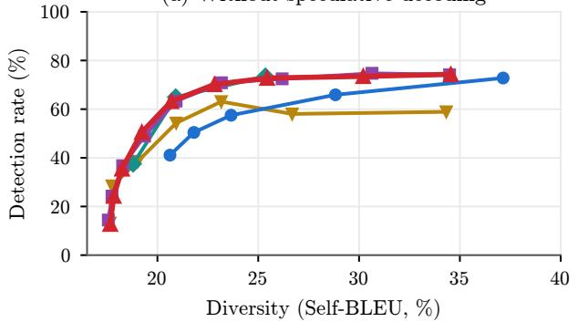

(b) With speculative decoding  
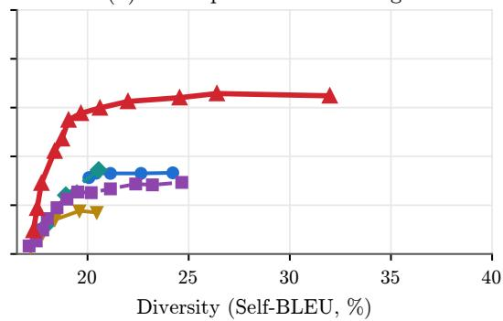  
SynthID-Text (layers) TextSeal, coin flip (®) textGrain (¯) AutoMark copula (½) TextSeal2 (½)  
Figure 1 Diversity–detection trade-of on Qwen3.5-9B at 100 tokens at FPR= $: 1 0 ^ { - 3 } ,$ , (a) without and (b) with speculative decoding (8 drafts per round, block verification). In (a), TextSeal2 coincides with AutoMark’s single-key copula as expected since it behaves like a single-key copula. In (b), TextSeal2 uses the residual race, and the baselines use block verification’s native stopping rule with the last token of each round drawn under an independent key. Diversity is measured by Self-BLEU (lower is more diverse).

We present TextSeal2, which retains TextSeal’s two keys, meets all four requirements, and matches the state of the art in detectability. Our starting point is a diagnosis of the gap between TextSeal, textGrain, and AutoMark. In TextSeal, each token is generated under one key, but the detector does not know which key, and must average the scores from both keys. This halves the signal and reduces the signal-to-noise ratio by ${ \sqrt { 2 } } .$ . AutoMark and textGrain do not sufer from this loss because they use a single key, which the detector scores on every token, and draw their diversity from fresh randomness.

TextSeal2 makes three contributions to reach the state of the art (Table 1, Figure 1):

• Copula mixing (subsection 3.1). We merge the two keys’ Gaussian values into a single virtual key and apply AutoMark’s copula on it. Each key retains its role (e.g., one can be published to allow for public detection), and additional keys can be merged without diluting detection.

• The residual race for speculative decoding (subsection 3.2). Gumbel-max sampling, used for the keyed drafts, is an exponential race. By memorylessness, the losers’ leftovers are fresh exponentials. We use this property to run one more race on them, and with block verification (Sun et al., 2025), we decide the first draft token to be rejected, and the bonus token. The output is exactly distortionfree, acceptance is that of block verification (Proposition 1), and detection gains 28 to 33 percentage points over drawing the last token of each round under an independent key.

• A calibrated strength parameter (subsection 3.3). The coupling strength ρ plays the role of textGrain’s entropy budget β: the entropy it removes from a token of positive entropy increases strictly with $\rho$ (Theorem 1). No distortion-free scheme can obtain more detection evidence per token than the entropy it removes, and the copula comes close to this bound (Proposition 3).

## 2 Background & Related work

Gumbel-max watermarking (Aaronson and Kirchner, 2023). At step t, the model outputs a distribution $\vec { p } ^ { ( t ) } = ( p _ { v } ^ { ( t ) } ) _ { v \in \mathcal { V } }$ over the vocabulary V, after temperature scaling and top-p truncation (we drop the superscript t when no confusion arises). A pseudo-random function (PRF) seeded by the secret key K and the watermark context window $\mathbf { w } = ( x _ { t - k } , \dots , x _ { t - 1 } )$ – the last k tokens – assigns to each candidate token v a value $R _ { v } = \mathrm { P R F } ( v , \mathbf { w } , K ) \in [ 0 , 1 ]$ , and the watermarked sampler emits:

$$
x _ { t } = \underset { v \in \mathcal { V } } { \arg \operatorname* { m a x } } R _ { v } ^ { 1 / p _ { v } } = \underset { v \in \mathcal { V } } { \arg \operatorname* { m i n } } \frac { E _ { v } } { p _ { v } } , \qquad E _ { v } = - \ln R _ { v } .\tag{1}
$$

The right-hand form is an exponential race: if the $R _ { v }$ are i.i.d. uniform, then the $E _ { v }$ are i.i.d. Exp(1), each $E _ { v } / p _ { \imath }$ is $\mathrm { E x p } ( p _ { v } )$ , and the arg min is distributed exactly according to ${ \vec { p . } }$ In this race, candidate v runs a lane of length $E _ { v }$ at speed $p _ { v }$ , and the first to finish is emitted (Figure 2). For detection, each observed token $x _ { i }$ receives the score $s _ { i } = - \ln ( 1 - R _ { x _ { i } } )$ , where $R _ { x }$ is recomputed from the key and the token’s window. Under the null hypothesis $\mathcal { H } _ { 0 }$ (unwatermarked text, or the wrong key), the scores are Exp(1) and their sum follows a Gamma distribution, giving a simple sum test; watermarked text, whose tokens tend to win their races with unusually large R, produces stochastically larger scores.

Repeated windows. A sampler is single-token distortion-free if, in expectation over the key, every token retains its model probability given the prefix (Dathathri et al., 2024). It is single-sequence distortion-free if the distribution of the entire answer is likewise preserved. Windows repeat often in code and long reasoning traces. Reusing a window’s keyed values re-runs the same race, so the text is single-token but not single-sequence distortion-free. Repeated context masking draws fresh values at the later occurrences of a window, i.e. plain sampling there (Dathathri et al., 2024). AutoMark’s ResidualRace instead continues the window’s race from its leftovers (Gloaguen et al., 2026). Both make the text single-sequence distortion-free (Appendix A.5). At detection, each (window, token) pair is scored once, to avoid biasing the detection test (Fernandez et al., 2023).

TextSeal (Sander et $a l .$ , 2026). Plain Gumbel-max is deterministic given the key, so TextSeal ran domises the race (1) with two keys $k ^ { ( 1 ) }$ and $k ^ { ( 2 ) }$ , producing values $R _ { v } ^ { ( 1 ) }$ and $R _ { v } ^ { ( 2 ) }$ : at each step it uses $k ^ { ( 1 ) }$ with probability $1 - \alpha$ and $\dot { k ^ { ( 2 ) } }$ with probability α. The detector does not know which key gener ated a given token, so it fuses the two per-key scores, $s _ { i } = \left( 1 - \alpha \right) s _ { i } ^ { ( 1 ) } + \alpha s _ { i } ^ { ( 2 ) }$ with $s _ { i } ^ { ( j ) } = - \ln ( 1 - R _ { i } ^ { ( j ) } )$ Optionally, each score is weighted by the entropy of the next-token distribution under an auxiliary language model: low-entropy tokens are nearly forced by the context and carry little watermark signal, so down-weighting them improves detection; the weighted sum is then tested against a Gamma dis tribution with matched mean and variance. The two keys also serve speculative decoding and public detection. Under speculative decoding, TextSeal routes each draft to one of its two keys as usual and generates a replacement token with the other key. For public detection, $k _ { \mathrm { p u b } } = k ^ { ( 1 ) }$ is published so anyone can run a weaker test, while $k _ { \mathrm { p r i v } } = k ^ { ( 2 ) }$ stays secret for full verification (Milis et al., 2026).

Gaussian copula. AutoMark (Gloaguen et al., 2026) randomises diferently: it draws independent noise $\eta _ { v } \sim \mathcal { N } ( 0 , 1 )$ at every position and replaces $R _ { v }$ by

$$
\tilde { R } _ { v } = \Phi \big ( \rho \Phi ^ { - 1 } ( R _ { v } ) + \sqrt { 1 - \rho ^ { 2 } } \eta _ { v } \big ) ,\tag{2}
$$

where $\Phi$ is the standard normal CDF. The parameter $\rho \in [ 0 , 1 ]$ interpolates between unwatermarked sampling $( \rho = 0$ , no dependence on the key) and plain Gumbel-max $( \rho = 1$ , deterministic given the key), while $\tilde { R } _ { v }$ remains uniform – hence the race distortion-free – for every $\rho .$

textGrain (Li et al., 2026). At each decoding step, it uses the key and the window to partition the vocabulary into B blocks and to draw a $B \times m$ table of keyed Gumbel costs. Sinkhorn iterations then solve an entropy-regularised optimal-transport problem between the block probabilities and m columns, calibrated so that the key removes a prescribed fraction $\beta$ of the token’s entropy; a keyed column is selected, and the block and token are sampled from the resulting coupling with freshly drawn randomness. Only the key-only computations can overlap the model’s forward pass: the Sinkhorn iterations require the next-token distribution, and the following step requires the sampled token, so this work lies on the critical path of decoding. Better kernels can shorten it but not remove it (1–3 ms per token in our implementation, 0.2–0.4 ms in a minimal version; Appendix D).

Speculative decoding. Write $\vec { p } = P _ { T } ( \cdot \mid x _ { < t } )$ for the target model’s distribution and $\vec { q } = P _ { D } ( \cdot \mid x _ { < t } )$ for the (smaller) draft model’s. In each round, the drafter proposes a block of tokens, and the target evaluates the whole block in one forward pass. Token-level verification tests the drafts in order. A draft token $x \sim \vec { q }$ is accepted with probability min $( 1 , p _ { x } / q _ { x } )$ , the raw acceptance test on the unwatermarked distributions $\vec { p }$ and ${ \vec { q } } .$ At the first rejection, the target emits a replacement token from the residual distribution:

$$
r _ { v } = \frac { ( p _ { v } - q _ { v } ) _ { + } } { \mathrm { T V } ( \vec { p } , \vec { q } ) } , \qquad \mathrm { T V } ( \vec { p } , \vec { q } ) = \sum _ { v } ( p _ { v } - q _ { v } ) _ { + } ,\tag{3}
$$

and discards the later drafts; if every draft is accepted, it emits a bonus token from its next distribution. The output follows $\vec { p }$ at acceptance rate $1 - \mathrm { T V } ( \vec { p } , \vec { q } )$ (Leviathan et al., 2023; Chen et al., 2023). Block verification (Sun et al., 2025) instead decides on the whole block jointly, so it can keep a longer prefix even when a shorter one fails its per-token test (closed forms in Appendix A.3). Sun et al. (2025) prove that repeating such rounds also generates the target’s law, and that after any number of rounds block verification has decoded at least as many tokens in expectation as any other verification procedure with this guarantee, so it is never worse than token-level verification. They report wall-clock speedups of 5–8% over token-level verification across tasks and datasets.

## 3 The TextSeal2 watermark

TextSeal2 retains TextSeal’s two keys, Gumbel-max sampling (1), and detector. It changes how the keys enter the sampler (subsection 3.1), how speculative decoding chooses the tokens it emits (subsection 3.2), and how the strength is calibrated (subsection 3.3). It handles repeated windows as in section 2, and under speculative decoding every window raced in a round counts as used, whether or not its position is kept (Appendix A.5). Figure 2 shows one generation step, Figure 3 one round of speculative decoding, and Figure 4 the detection of one text; Algorithm 1 is the pseudocode.

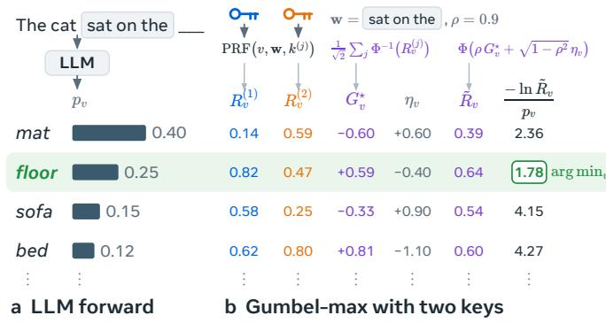

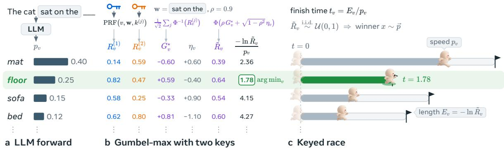  
Figure 2 TextSeal2 generates one token (subsection 3.1). (a) The model’s forward pass gives the probabilities $p _ { v } ,$ and the last $k = 3$ tokens form the window w. (b) The keys’ values at w are merged into the virtual key $G _ { v } ^ { \star }$ , which the copula (4) blends with the noise $\eta _ { v }$ into ${ \tilde { R } } _ { v } ;$ the Gumbel-max choice is arg min $, ( - \ln { \tilde { R } _ { v } } ) / p _ { v } .$ (c) The Gumbel-max choice can be seen as a race (1): candidate v runs a lane of length $E _ { v } = - \ln { \tilde { R } _ { v } }$ at speed $p _ { v } ,$ and the token that finishes first is chosen.

## 3.1 Copula mixing of the two keys

For each key $j \in \{ 1 , 2 \}$ , map its values to Gaussian space by $G _ { v } ^ { ( j ) } = \Phi ^ { - 1 } \big ( R _ { v } ^ { ( j ) } \big )$ , which is standard normal when $R _ { v } ^ { ( j ) }$ is uniform. Instead of running the exponential race on $\vec { R } ^ { ( 1 ) }$ or $\vec { R } ^ { ( 2 ) }$ , chosen at random as in TextSeal, TextSeal2 runs the race (1) on the merged values

$$
\tilde { R } _ { v } = \Phi \big ( \rho G _ { v } ^ { \star } + \sqrt { 1 - \rho ^ { 2 } } \eta _ { v } \big ) , \qquad \mathrm { w h e r e ~ } G _ { v } ^ { \star } = \frac { G _ { v } ^ { ( 1 ) } + G _ { v } ^ { ( 2 ) } } { \sqrt { 2 } } \mathrm { ~ a n d ~ } \eta _ { v } \stackrel { \mathrm { i . i . d . } } { \sim } \mathcal N ( 0 , 1 ) .\tag{4}
$$

Since the two keys are independent, $G _ { v } ^ { \star }$ is standard normal; it depends only on $\big ( \boldsymbol { v } , \mathbf { w } , \boldsymbol { k } ^ { ( 1 ) } , \boldsymbol { k } ^ { ( 2 ) } \big )$ and is independent across candidate tokens v (and across positions whose window has not been used before; see section 2). Equation (4) is therefore exactly AutoMark’s copula (2) applied to a virtual key with values $\Phi ( G _ { v } ^ { \star } )$ . In particular, the $\tilde { R } _ { v }$ are i.i.d. uniform and the race is distortion-free for every ρ (Lemma 2). Detection uses the matched score $s _ { i } ^ { \star } = - \ln \Phi \Bigl ( - G _ { x _ { i } } ^ { \star } \Bigr )$ – the usual score − ln(1 − R) of the virtual key – which is $\exp ( 1 )$ )-distributed under $\mathcal { H } _ { \mathrm { 0 } }$ . The two-key scheme thus has exactly the diversity and detection power of AutoMark’s single-key copula at the same $\rho .$ The construction extends to M keys: $G ^ { \star } = \textstyle \hat { M ^ { - 1 / 2 } } \sum _ { k = 1 } ^ { M } G ^ { ( k ) }$ remains a single standard normal per candidate, so the full detector loses no signal as keys are added, e.g. one publishable key per verifier. (Each key’s correlation with the race input, and hence a single-key test’s power, shrinks as $\rho / { \sqrt { M } } . $ )

Why the coin flip loses signal. With the coin flip at $\alpha = 1 / 2 ,$ each token is generated under one key, but the detector does not know which and must score $\begin{array} { r } { \frac { 1 } { 2 } s ^ { ( 1 ) } + \frac { 1 } { 2 } s ^ { ( 2 ) } } \end{array}$ . Only the key that generated the token carries signal, so averaging halves the expected excess of the score over its null mean of 1. The two scores are independent under the null, so averaging also halves the variance – hence the standard deviation falls only by ${ \sqrt { 2 } } .$ The signal-to-noise ratio is therefore reduced by a factor ${ \sqrt { 2 } } .$ Copula mixing has no such loss: every token is generated from $G ^ { \star }$ , which the detector scores.

Optional public detection. By default, detection uses both keys through $s _ { i } ^ { \star }$ $k _ { \mathrm { p u b } } = k ^ { ( 1 ) }$ can be published for anyone to compute single-key scores $s _ { i } ^ { ( 1 ) } = - \ln \left( 1 - R _ { x _ { i } } ^ { ( 1 ) } \right)$ . This test is weaker: $G ^ { ( 1 ) }$ has correlation only $\rho / \sqrt { 2 }$ with the race input $\rho G ^ { \star } + \sqrt { 1 - \rho ^ { 2 } } \eta$ , while $k _ { \mathrm { p r i v } } = k ^ { ( 2 ) }$ supports full-strength verification and exposes manipulations of the public signal (Milis et al., 2026). SAC-Copula (Li and He, 2026) and AutoMark’s Gaussian direction mix keyed Gaussians, without a public key.

## 3.2 Speculative decoding through memoryless races

Speculative decoding poses a specific problem for watermarking: the token that verification emits after the kept drafts must follow a residual distribution, such as (3), and must itself carry the watermark. Prior approaches each give up something. Re-running the race with weights $\vec { r }$ on the same keyed values distorts the output, because the draft’s win shifts the remaining values (Remark 1). Replacing from fresh noise (Hu and Huang, 2024) or from a second key (Sander et al., 2026; Dathathri et al., 2024) keeps the acceptance rate, but the replaced tokens, about a third of the text in our experiments, then lose the watermark or split it across keys. Verifying between the watermarked distributions keeps the watermark but accepts fewer drafts (Hu and Huang, 2024; Li et al., 2026; Dathathri et al., 2024) (Proposition 2). He et al. (2026) let the detector guess which key made each token, and Liu et al. (2026) use several drafts per position. TextSeal2 keeps both the keys and the acceptance of block verification, with two races on the same keyed values.

Keyed drafts and their leftovers. A round has $N$ drafts at positions $i = 1 , \ldots , N$ and a bonus position $N + 1$ , with drafter laws $\vec { q _ { i } }$ and target laws $\vec { p _ { i } }$ from one target pass. Position i reads the lane lengths $E _ { i , v } = - \ln \tilde { R } _ { v } ( \mathbf { w } _ { i } )$ from (4) at its window $\mathbf { w } _ { i } .$ , which ends with $d _ { i - 1 }$ for $i \geq 2$ , and the drafter runs the race at its own speeds:

$$
d _ { i } = \underset { v } { \arg \operatorname* { m i n } } \frac { E _ { i , v } } { q _ { i , v } } , \qquad \tau _ { i } = \frac { E _ { i , d _ { i } } } { q _ { i , d _ { i } } } , \qquad i = 1 , \dots , N .\tag{5}
$$

When $d _ { i }$ finishes, lane v has covered the distance $\tau _ { i } q _ { i , v } ,$ and $E _ { i , v } - \tau _ { i } q _ { i , v }$ is its leftover. By memorylessness, the leftovers are fresh (proof in Appendix $\mathrm { A . 2 } )$

Lemma 1 (Leftovers of an exponential race; AutoMark). If the $E _ { v }$ are i.i.d. Exp(1) and $\vec { q }$ is a probability vector, the race $x = \arg \operatorname* { m i n } _ { v } E _ { v } / q _ { v }$ , with time $\tau ,$ emits v with probability $q _ { v }$ , and given $( x , \tau )$ the leftovers $E _ { v } - \tau q _ { v } , v \neq x .$ , are again i.i.d. Exp(1).

Block verification and the relay race. Given the drafts, block verification (section 2) stops at a position I, keeps $d _ { < I } = ( d _ { 1 } , \dots , d _ { I - 1 } )$ , and emits a token y at position I, with law $\pi _ { i , v } = \mathbb { P } ( I = i ) r _ { i , v }$ . Here $\vec { r _ { i } }$ is a residual law at position i, with $\vec { r } _ { N + 1 } = \vec { p _ { N + 1 } }$ , and $\mathbb { P } ( I = i )$ depends on all the drafts, since a

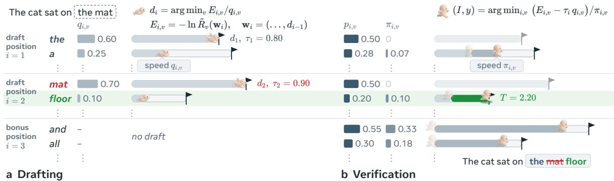  
Figure 3 Block verification checks the drafts against the target as a block, keeps those before a stop position $I ,$ and emits one token $_ y$ at I. (a) The drafter proposes “the mat” with keyed races. (b) One target pass then gives the probability $\pi _ { i , v }$ that $I = i$ and $y = v$ . One more race on the leftovers picks I and $y \colon { \mathrm { ~ } } ^ { \mathit { \iota } } { \mathrm { ~ } } ^ { \mathrm { ~ } } \mathrm { H o o r } ^ { \mathfrak { \prime } }$ wins, so the round keeps $\mathrm { { ^ { s } t h e ^ { \prime } } } $ and emits $\mathrm { \hbar \hbar 0 o r ^ { \prime } }$ at $I = 2$ . TextSeal2 preserves the target’s distribution and block verification’s acceptance rate (Proposition 1). Algorithm 1 in the appendix gives more details.

later success can override an earlier failure; Appendix A.3 gives both in closed form. TextSeal2 draws this outcome with one more race, on the leftovers of all positions:

$$
( I , y ) = \underset { ( i , v ) : \pi _ { i , v } > 0 } { \arg \operatorname* { m i n } } \ \frac { E _ { i , v } - \tau _ { i } q _ { i , v } } { \pi _ { i , v } } ,\tag{6}
$$

with $\tau _ { N + 1 } q _ { N + 1 , v } = 0$ at the bonus position, which has no draft race. Each lane resumes where its draft race left it and runs its leftover at speed $\pi _ { i , v } ,$ as in a relay (Figure 3), and the round emits $d _ { < I }$ y without drawing an accept coin. We call (6) the residual race: a single race on the leftovers of the draft races picks the stopping position and the last token together. Kept drafts carry the signal of their draft races and the last token that of the relay, so the detector is unchanged: it sums the scores and does not need to locate the ends of rounds. AutoMark’s ResidualRace continues the race of a repeated window, and exponential races (Li and Anantharam, 2018) also couple drafter and target in unwatermarked speculative sampling (Kobus and Gündüz, 2025; Daliri et al., 2024); to our knowledge, racing block verification’s outcome on the leftovers of keyed drafts is new.

Proposition 1 (Speculative decoding with the residual race). Suppose that every round reads i.i.d. uniform keyed values at its windows, independent across positions and of earlier rounds, and independent copula noise. (i) Given the drafts, (I, y) has law ⃗π, so the number of tokens per round, and hence acceptance, is that of block verification. (ii) The generated text follows the target’s law. (iii) The window rule (Appendix A.5) meets this condition: the text is distortion-free over keys.

This proposition says that the residual race preserves the output distribution and the acceptance of block verification. Appendix A.4 proves Proposition 1 in three steps: memorylessness makes the leftovers fresh given the drafts, block verification gives each draft’s own lane zero mass (Lemma 3), and Sun et al. (2025, Theorem 1) turn block verification’s law into the target’s. It also derives the lane length of each emitted token, which is what the detector reads, and shows that racing on the raw lane lengths instead of the leftovers is biased (Remark 1). Appendix A.6 proves that no scheme with a single draft accepts more often while keeping the output distribution (Proposition 2), a bound that the residual race attains for N = 1, and compares it with the optimality of block verification for $N > 1$ . Remark 2 gives a coin-free token-level variant, and Algorithm 1 one round in pseudocode.

## 3.3 Controlling the entropy removed

Under a fixed key, the diversity that remains is exactly the entropy the key does not remove: whatever randomness the independent noise still contributes. textGrain calibrates its strength directly in these terms, removing a prescribed fraction $\beta$ of each token’s entropy (Li et al., 2026). In TextSeal2, the coupling strength $\rho$ plays the same role. For a token of positive entropy, the entropy removed is a strictly increasing function of $\rho ,$ from none at $\rho = 0$ to the token’s full entropy at $\rho = 1$ (Theorem 1), so any target budget can be met by a unique $\rho ,$ token by token if desired. In practice this calibration is unnecessary: a fixed $\rho$ removes nearly the same fraction of a token’s entropy $- \rho \approx 0 . 6 4$ , 0.81 and 0.93 remove about 30%, 50% and 70% respectively, across a range of many-token distribution shapes (Appendix C). We therefore use a single constant $\rho$ throughout, with a per-token $\rho _ { t }$ available when an exact budget guarantee is required.

Two results in Appendix B indicate that little is lost by this simplicity. First, no distortion-free coupling can extract more detection evidence per token, measured as a Kullback–Leibler divergence, than the entropy it removes (Proposition 3). Second, the copula uses this budget near-optimally: on 5,169 real Qwen3.5-9B next-token distributions, it attains on average 97% of the optimal per-token signal-to-noise ratio in the weak-watermark limit with a Gaussian score, and 91–100% at $\rho = 0 . 5$ , 0.8 and 0.95 on synthetic distributions. A per-token optimisation such as textGrain’s can therefore gain only a few percent in signal-to-noise ratio, which is consistent with the empirical parity in section 4.

## 3.4 Detection and localization

The detector scores each token $x _ { i }$ at its window, with both keys through the virtual key (private score) or with the public key $k ^ { ( 1 ) }$ alone (public score, subsection 3.1):

$$
\begin{array} { r } { s _ { i } ^ { \star } = - \ln \Phi \big ( - G _ { x _ { i } } ^ { \star } \big ) , \qquad s _ { i } ^ { ( 1 ) } = - \ln \big ( 1 - R _ { x _ { i } } ^ { ( 1 ) } \big ) . } \end{array}\tag{7}
$$

Both scores are Exp(1) under $\mathcal { H } _ { 0 }$ for every $\rho _ { t } .$ , since they do not involve the coupling strength, so the detection machinery of TextSeal carries over unchanged (Sander et al., 2026). The sampler can also watermark existing text post hoc, by rephrasing it (Fernandez et al., 2025). Keys with windows of diferent lengths can be merged into $G ^ { \star }$ at no cost to the full detector, and because edits break long windows first, the decay of the per-key scores with window length estimates the edit rate (Appendix F).

Detection tests. The private test sums the scores of the n distinct (window, token) pairs, each at its first occurrence (section 2, Figure 4):

$$
S = \sum _ { i = 1 } ^ { n } s _ { i } ^ { \star } \stackrel { \mathcal { H } _ { 0 } } { \sim } \mathrm { G a m m a } ( n , 1 ) , \qquad p = 1 - F _ { n } ( S ) ,\tag{8}
$$

where $F _ { n }$ is the CDF of Gamma(n, 1); the public test is the same with $s _ { i } ^ { ( 1 ) }$ . Two optional refinements come from TextSeal (Sander et al., 2026). Entropy weighting down-weights low-entropy tokens, which carry little signal, using the next-token entropy $H _ { i }$ of an auxiliary model:

$$
S _ { w } = \sum _ { i = 1 } ^ { n } w _ { i } s _ { i } ^ { \star } , \qquad \mathrm { w h e r e } w _ { i } = 0 . 1 + 0 . 9 \frac { H _ { i } - H _ { \operatorname* { m i n } } } { H _ { \operatorname* { m a x } } - H _ { \operatorname* { m i n } } } .\tag{9}
$$

Under $\mathcal { H } , S _ { w }$ has mean $\sum _ { i } w _ { i }$ and variance $\textstyle \sum _ { i } w _ { i } ^ { 2 }$ , and the test compares it with the Gamma law of matched moments, of shape $( \textstyle \sum _ { i } w _ { i } ) ^ { 2 } / \textstyle \sum _ { i } w _ { i } ^ { 2 }$ and scale $\sum _ { i } w _ { i } ^ { 2 } / \sum _ { i } w _ { i }$ . The weights do not use the key, so the test is valid for any auxiliary model. Localization finds watermarked spans in documents that mix human and generated text: it tests windows of dyadic lengths $L _ { 0 } , 2 L _ { 0 } , 4 L _ { 0 } , . . .$ , slid at half-length ofsets, about $4 n / L _ { 0 }$ candidates, Bonferroni-corrected, and greedily extracts the most significant ones.

## 4 Experiments

We compare detection at equal diversity, first without and then with speculative decoding (subsection 4.3). Unless stated otherwise, all diferences below are in percentage points of detected answers.

## 4.1 Setup

Generation. We generate answers to ELI5 questions with Llama-3.1-8B-Instruct, Qwen3.5-9B, and Qwen3.5-27B, at temperature 1 and top-p 0.95, up to 200 new tokens, with watermark window size

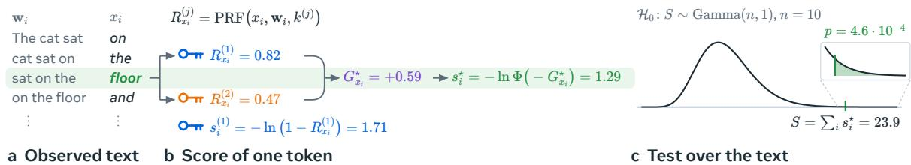

Figure 4 TextSeal2 detects the text “The cat sat on the floor and fell asleep in the sun.” (subsection 3.4). (a) Each token $x _ { i }$ and its window $\mathbf { w } _ { i } ;$ the highlighted row is the token of Figure 2. (b) For $\mathrm { \hbar \hbar 0 o r ^ { \prime } }$ , the keys’ values are merged into $G _ { x _ { i } } ^ { \star }$ as in (4), without the noise, and give the score $s _ { i } ^ { \star } ;$ ; key $k ^ { ( \mathrm { i } ) }$ alone gives the public score $s _ { i } ^ { ( 1 ) }$ . (c) The $n = 1 0$ scores sum to $S = 2 3 . 9$ , and the Gamma(n, 1) tail beyond S (box) is $p = 4 . 6 \cdotp 1 0 ^ { - 4 }$ $k = 3$ . For speculative decoding, Qwen3.5-0.8B drafts N = 8 tokens per round for Qwen3.5-9B, and every scheme verifies the drafts by block verification (Sun et al., 2025); Appendix F repeats the comparison with N = 4 and 16. All schemes, TextSeal2 included, follow the repeated-window rules of Appendix A.5 (one use per window at generation; each (window, token) pair scored once); under speculative decoding, every window that a round reads counts as used, kept or not.

Metrics. Detection is the fraction of watermarked answers declared watermarked at a nominal false positive rate of $1 0 ^ { - 3 }$ . Because no closed-form null is exact in practice, each detector’s threshold is the empirical $1 0 ^ { - 3 }$ quantile of its p-values on 10,000 unwatermarked answers scored under 10 keys $( 1 0 ^ { 5 }$ null p-values; calibration in Figure 9). Detection is measured on the first 100 or 200 tokens, with key-only (unweighted) scores unless stated otherwise. We generate 3000 answers per configuration on Qwen3.5-9B, with or without speculative decoding, and 1000 on the other models. Diversity is measured as in TextSeal, by Self-BLEU among answers to the same question under a fixed key (mean BLEU over all pairs of answers; lower is more diverse), on 100 questions with 32 answers each, or 16 under speculative decoding. Measuring diversity by the share of distinct 4-grams instead leaves the conclusions unchanged, except that textGrain is then slightly ahead of the copulas without speculative decoding (Appendix F). To compare at equal diversity, each method’s detection is interpolated along its diversity–detection curve at TextSeal’s Self-BLEU; 95% intervals come from a bootstrap that resamples questions jointly across methods, so intervals for diferences are paired.

Methods. We evaluate TextSeal with $\alpha \in \{ 0 . 5 , 0 . 7 , 0 . 9 \}$ (plus 0.8 and 0.95 on Qwen3.5-9B); Au toMark’s copula and TextSeal2 with $\rho \in \{ 0 . 7 , 0 . 8 , 0 . 9 , 0 . 9 5 \}$ (on Qwen3.5-9B also 0.5, 0.6, 0.975, 0.99 and 0.995, plus 0.85, 0.925 and 0.999 under speculative decoding), using a 53-bit PRF (Appendix E), with TextSeal2 scored by $s ^ { \star } ~ ( \mathrm { o r } ~ s ^ { ( 1 ) }$ for the public-key test); our reimplementation of textGrain $( B = m = 2 5 6 , \ \beta \in \{ 0 . 2 5 , 0 . 5 , 0 . 7 5 \} )$ ; and, on Qwen3.5-9B, SynthID-Text with 2–30 tournament layers (2–20 under speculative decoding), using its oficial keyed coins and detection test (fused over its two keys under speculative decoding, Appendix G). Under speculative decoding, TextSeal2 uses the residual race (subsection 3.2). The baselines keep block verification’s native stopping rule on the unwatermarked laws $\vec { p }$ and ${ \vec { q } } ,$ as TextSeal and SynthID-Text do with token-level verification (Sander et al., 2026; Dathathri et al., 2024): each draft comes from the scheme’s sampler on $\vec { q _ { i } } ,$ , and the last token of the round from the same sampler under an independent key on the residual law $\vec { r } _ { I }$ , or from the scheme’s normal step on $\vec { p } _ { N + 1 }$ when it is the bonus token. TextSeal routes drafts and bonus tokens between its two keys as usual and uses the other key for the replacement token; textGrain, SynthID-Text and AutoMark’s copula, which has no speculative mode of its own, use their first key for drafts and bonus tokens and a second key for replacement tokens. textGrain’s own recipe instead runs block verification between the watermarked distributions, as in its report (Li et al., 2026).

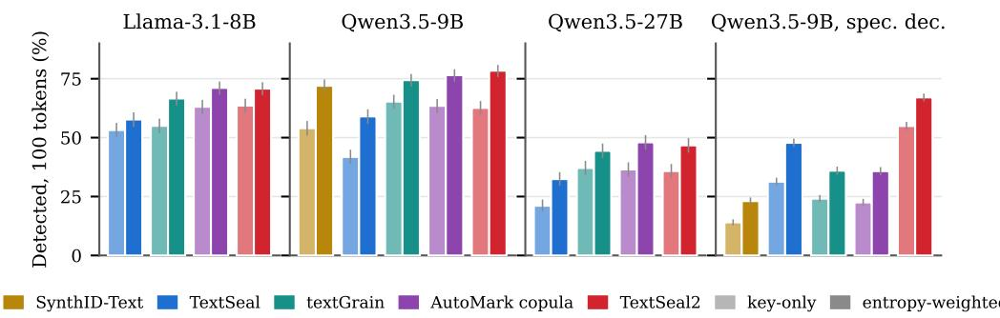  
Figure 5 Entropy weighting improves detection for every watermark, including under speculative decoding. % of 100-token answers detected at a false-positive rate of $1 0 ^ { - 3 }$ with key-only scores (light bars) and with TextSeal’s entropy-weighted test (full bars), at comparable Self-BLEU. The gains are 5–18 percentage points at 100 tokens and 4–23 at 200 tokens (Table 6); without speculative decoding, TextSeal2 and AutoMark’s copula coincide in distribution and difer only within their 95% intervals, as expected.

## 4.2 Without speculative decoding

The copula dominates the coin flip. Interpolated at TextSeal’s Self-BLEU, TextSeal2 detects 10, 22 and 8 percentage points more 100-token answers than the coin flip (Sander et al., 2026) on Llama-3.1-8B, Qwen3.5-9B and Qwen3.5-27B respectively (paired 95% intervals [+4, +15], [+15, +25] and [+3, +12]; Figure 1a and Figure 7). Against textGrain, TextSeal2 is ahead on Llama-3.1-8B (+11 [+4, +17]), level on Qwen3.5-9B (+1 [−5, +8]), and behind on Qwen3.5-27B (−5 [−10, 0]). AutoMark’s copula, which coincides with TextSeal2 in distribution, stays within 3 points throughout, confirming that the gain over TextSeal comes from removing the coin flip rather than from implementation diferences. With the public key alone, TextSeal2 still detects 27% / 67% of 100 / 200-token answers at $\rho = 0 . 9$ ; merging four keys detects as much as merging two, so extra keys cost nothing (Appendix F).

Entropy weighting. TextSeal’s entropy-weighted test improves every method by 4–23 points at 200 tokens, without changing the ranking (Figure 5, Table 6). On Qwen3.5-9B, TextSeal2 detects 78% / 97% of 100 / 200-token answers, against 74% / 97% for textGrain; under speculative decoding, 67% / 95%, against 48% / 87% for TextSeal and 36% / 76% for textGrain (Self-BLEU 18.9–20.1).

Robustness and cost. Under random word substitutions, TextSeal2 retains more detections than TextSeal and as many as textGrain, while paraphrasing by an LLM removes almost every watermark, as expected for token-level schemes (Table 7). The gains over the coin flip persist at temperature 0.7 (Appendix F). TextSeal2’s decoding step is within 0.6% of TextSeal’s once key-only work overlaps the forward pass (Table 5), and its post-logits work is one pass over the vocabulary (Appendix D).

Code and long generations. On the 500 MBPP test problems (Table 12), TextSeal2 detects 55% of answers at 256 tokens, against 39% / 46% / 50% for TextSeal/ textGrain / SynthID-Text (AutoMark’s copula: 59%). In long thinking traces (up to 2048 tokens; Table 13), 16% of positions on ELI5 and 34% on MBPP repeat an earlier window. There, continuing each window’s race from its leftovers instead of using it once detects 3.8 [+2.1, +5.6] points more at 256 tokens on ELI5 and 7.6 [+2.4, +12.8] points more at 512 tokens on MBPP, and raises median z-scores, without measurable distortion (Table 13).

## 4.3 With speculative decoding

With block verification and 8 drafts, unwatermarked decoding emits 2.74 tokens per round, and every scheme but one keeps this number: paired over 480 prompts, TextSeal2’s residual race difers by +0.02 [−0.01, +0.05] tokens per round, as Proposition 1 predicts, and the baselines by at most 0.04 (Figure 11a in Appendix G). The exception is textGrain’s own recipe, which verifies the watermarked distributions and emits 5% fewer tokens per round $\left( - 0 . 1 4 \left[ - 0 . 1 7 , - 0 . 1 1 \right] \right)$ . Interpolated at TextSeal’s Self-BLEU, TextSeal2 detects 59% / 89% of 100 / 200-token answers, against 31% / 71% for TextSeal, 31% / 67% for textGrain, 25% / 60% for AutoMark’s copula, and 17% / 50% for SynthID-Text; all paired intervals against TextSeal2 exclude zero (Table 1, Figure 1b). textGrain’s own recipe comes closest (52% / 84%, paired diferences +7 [−1, +15] / +5 [−1, +11] in favour of TextSeal2), at the cost of acceptance. With 4 and 16 drafts the ranking is the same, and TextSeal2 leads every baseline that keeps acceptance by 15–41 points at 200 tokens (Table 9); its lead over textGrain’s own recipe is significant with 4 drafts (+6 [+2, +10]) but not with 16 (+1 [−1, +7]). A second drafter–target pair from the Llama family gives the same ranking (Table 10). On AIME math problems, with answers of up to 8192 tokens, TextSeal2 also detects the most answers (41% at 2048 tokens, against 38% for textGrain’s own recipe and 7–22% for the other baselines), and accuracy is unchanged (Table 11); sweeping strengths, TextSeal2 also leads at equal diversity, with 30% detected at 2048 tokens at TextSeal’s Self-BLEU against 23% for the coin flip and 9–21% for the other baselines (Figure 8).

Memorylessness is what makes this work. AutoMark’s copula coincides with TextSeal2 in distribu tion, so the entire gap between them in Figure 1b (25% / 60% against 59% / 89%) comes from how the last token of each round is drawn: under an independent key, or by the residual race on the draft races’ leftovers. Independent keys waste signal twice over. The last tokens (37% of the text) carry only the second key’s signal, except at the bonus position (5% of rounds), and under the draft key they score 0.84 on average – below the null mean of 1, because a token drawn from block verification’s residual law lost its draft race – actively diluting the fused score. The residual race instead keeps the keyed values in play: last tokens score 1.34 under s<sup>⋆</sup>, against 1.42 for kept drafts (Appendix G).

Distortion. Proposition 1 guarantees the exactness of the residual race under an ideal PRF; we check the implementation. Generating with one key per answer (independent draws over keys) and reading the laws ⃗p and ⃗q used at generation, we test whether − ln $p _ { x } - H ( \vec { p } )$ over all tokens and $- \ln r _ { I , y } - H ( \vec { r } _ { I } )$ at the last token of each round have mean zero, as they must without distortion. TextSeal2 and the baselines are indistinguishable from unwatermarked block verification on both tests (textGrain’s own recipe on the all-token test, the only one that applies to it), whereas racing on the raw lane lengths fails the all-token test, by +11.7 [+5.8, +17.8] millinats per token (Figure 11).

## 5 Conclusion

TextSeal2 satisfies the four requirements we set out for a deployed watermark: it is exactly distortionfree, preserves diversity under a fixed key, stays within 0.9% of plain sampling when key-only work overlaps the forward pass, and maintains the acceptance rate of speculative decoding. Its detection is comparable to that of textGrain overall – ahead on Llama-3.1-8B, level on Qwen3.5-9B, and slightly behind on Qwen3.5-27B at 100 tokens – without textGrain’s per-token optimisation. Our analysis attributes the previous gap to TextSeal’s coin-flip routing rather than to the absence of optimal transport: merging the two keys into one virtual key removes the $\sqrt { 2 }$ loss in signal-to-noise ratio, while still allowing one key to be published for public detection. For speculative decoding, drawing the drafts by keyed races and choosing block verification’s outcome by a race on their leftovers carries the watermark without lowering acceptance.

Limitations. Our evaluation covers three domains (open-ended ELI5 answers, MBPP code, and AIME math problems under speculative decoding) and three open-weight models, at temperatures 0.7–1. With block verification and 8 drafts, speculative decoding costs 2–4 percentage points of detection relative to standard decoding, and our speculative-decoding implementation is unbatched, so we do not measure wall-clock speedups. We do not analyse attacks that exploit knowledge of the public key beyond the private verification it enables (Milis et al., 2026). Finally, textGrain’s code is not public, so we use our reimplementation (Appendix G); its deployed parameters may difer.

## References

Scott Aaronson and Hendrik Kirchner. Watermarking GPT outputs, 2023.

Anthropic. How Claude marks AI-generated content, 2026. Accessed: 2026-08-13.

Charlie Chen, Sebastian Borgeaud, Geofrey Irving, Jean-Baptiste Lespiau, Laurent Sifre, and John Jumper. Accelerating large language model decoding with speculative sampling. In arXiv preprint arXiv:2302.01318, 2023.

Miranda Christ, Sam Gunn, and Or Zamir. Undetectable watermarks for language models. Cryptology ePrint Archive, 2023.

Evan Crothers, Nathalie Japkowicz, and Herna Viktor. Machine generated text: A comprehensive survey of threat models and detection methods. arXiv preprint arXiv:2210.07321, 2022.

Majid Daliri, Christopher Musco, and Ananda Theertha Suresh. Coupling without communication and drafterinvariant speculative decoding, 2024.

Sumanth Dathathri, Abigail See, Sumedh Ghaisas, Po-Sen Huang, Rob McAdam, Johannes Welbl, Vandana Bachani, Alex Kaskasoli, Robert Stanforth, Tatiana Matejovicova, et al. Scalable watermarking for identi fying large language model outputs. Nature, 634(8035):818–823, 2024.

European Union. Regulation (EU) 2024/1689 of the European Parliament and of the Council laying down harmonised rules on artificial intelligence (AI Act), 2024.

Xiaoyan Feng, Yanjun Zhang, He Zhang, Leo Yu Zhang, and Shirui Pan. Tracing provenance and detecting tampering with complementary llm watermarks. arXiv preprint arXiv:2608.12713, 2026.

Pierre Fernandez, Antoine Chafin, Karim Tit, Vivien Chappelier, and Teddy Furon. Three bricks to consoli date watermarks for large language models. 2023 IEEE International Workshop on Information Forensics and Security (WIFS), 2023.

Pierre Fernandez, Tom Sander, Hady Elsahar, Hongyan Chang, Tomáš Souček, Valeriu Lacatusu, Tuan Tran, Sylvestre-Alvise Rebufi, and Alexandre Mourachko. How good is post-hoc watermarking with language model rephrasing? arXiv preprint arXiv:2512.16904, 2025.

Thibaud Gloaguen, Robin Staab, and Martin Vechev. AutoMark: Enabling autoresearch to discover better LLM watermarks, 2026.

Haiyun He, Yepeng Liu, Ziqiao Wang, Yongyi Mao, and Yuheng Bu. Theoretically grounded framework for LLM watermarking: A distribution-adaptive approach. In Advances in Neural Information Processing Systems, pages 114528–114564, 2025.

Weiqing He, Xiang Li, Li Shen, Weijie Su, and Qi Long. Improving the trade-of between watermark strength and speculative sampling eficiency for language models. In ICLR, 2026. arXiv:2602.01428.

Zhengmian Hu and Heng Huang. Inevitable trade-of between watermark strength and speculative sampling eficiency for language models, 2024.

Zhengmian Hu, Lichang Chen, Xidong Wu, Yihan Wu, Hongyang Zhang, and Heng Huang. Unbiased watermark for large language models. arXiv preprint arXiv:2310.10669, 2023.

John Kirchenbauer, Jonas Geiping, Yuxin Wen, Jonathan Katz, Ian Miers, and Tom Goldstein. A watermark for large language models. arXiv preprint arXiv:2301.10226, 2023.

Szymon Kobus and Deniz Gündüz. Speculative sampling via exponential races, 2025.

Rohith Kuditipudi, John Thickstun, Tatsunori Hashimoto, and Percy Liang. Robust distortion-free watermarks for language models. arXiv preprint arXiv:2307.15593, 2023.

Yaniv Leviathan, Matan Kalman, and Yossi Matias. Fast inference from transformers via speculative decoding. In ICML, 2023.

Baixin Li and Haiyun He. SAC-Copula: Quality-preserving watermarking for difusion language models via smooth correlated Gumbel fields, 2026.

Cheuk Ting Li and Venkat Anantharam. A unified framework for one-shot achievability via the Poisson matching lemma, 2018.

Xiang Li, Feng Ruan, Huiyuan Wang, Qi Long, and Weijie J. Su. A statistical framework of watermarks for large language models: Pivot, detection eficiency and optimal rules. The Annals of Statistics, 53(1): 322–351, 2025.

Xiang Li, Garrett Wen, Xiaohong Chen, Qi Long, Arzav Jain, Florent Joly, Mike Lam, Qingquan Song, and Weijie Su. textGrain: Entropy-calibrated watermarking for language model text. Technical report accompanying OpenAI’s October 5th blog post, OpenAI, 2026.

Yanxiao Liu, Sicheng Wan, Zhan Gao, and Deniz Gündüz. Watermarkable multi-draft speculative sampling via Poisson processes, 2026.

Carol Xuan Long, Dor Tsur, Claudio Mayrink Verdun, Hsiang Hsu, Haim Permuter, and Flavio P. Calmon. Optimized couplings for watermarking large language models. In IEEE International Symposium on Information Theory (ISIT), pages 1–6, 2025.

Georgios Milis, Tom Sander, Tomáš Souček, Heng Huang, and Pierre Fernandez. Could LLM watermark detection be public? arXiv preprint arXiv:2610.12106, 2026.

Tom Sander, Pierre Fernandez, Alain Durmus, Matthijs Douze, and Teddy Furon. Watermarking makes language models radioactive. NeurIPS, 2024.

Tom Sander, Hongyan Chang, Sylvestre-Alvise Rebufi, Tomáš Souček, Tuan Tran, Valeriu Lacatusu, Alexan dre Mourachko, Surya Parimi, Christophe Ropers, Rashel Moritz, Vanessa Stark, Hady Elsahar, and Pierre Fernandez. TextSeal: A localized LLM watermark for provenance & distillation protection, 2026.

Ziteng Sun, Uri Mendlovic, Yaniv Leviathan, Asaf Aharoni, Jae Hun Ro, Ahmad Beirami, and Ananda Theertha Suresh. Block verification accelerates speculative decoding. In International Conference on Learning Representations, 2025.

Dor Tsur, Carol Long, Claudio Mayrink Verdun, Sajani Vithana, Hsiang Hsu, Richard Chen, Haim Permuter, and Flavio Calmon. HeavyWater and SimplexWater: Distortion-free LLM watermarks for low-entropy distributions. In Advances in Neural Information Processing Systems, 2025.

Yihan Wu, Zhengmian Hu, Hongyang Zhang, and Heng Huang. DiPmark: A stealthy, eficient and resilient watermark for large language models. arXiv preprint arXiv:2310.07710, 2023.

Yangxinyu Xie, Xiang Li, Tanwi Mallick, Weijie Su, and Ruixun Zhang. Debiasing watermarks for large language models via maximal coupling. Journal of the American Statistical Association, 120(551):1424– 1436, 2025.

Rowan Zellers, Ari Holtzman, Hannah Rashkin, Yonatan Bisk, Ali Farhadi, Franziska Roesner, and Yejin Choi. Defending against neural fake news. Advances in neural information processing systems, 32, 2019.

## Appendix

## A Proofs

This appendix proves the results of section 3. Throughout, keyed values at an unused window are i.i.d. uniform (ideal PRF), and the copula noise η and the values drawn afresh at used windows, the only other randomness, are independent of them.

## A.1 Copula mixing

Lemma 2 (Distortion-free for every coupling). Let $R _ { v } ^ { ( 1 ) } , R _ { v } ^ { ( 2 ) }$ be i.i.d. uniform and $\eta _ { v }$ i.i.d. $\mathcal { N } ( 0 , 1 )$ independent of them. For every $\rho \in [ 0 , 1 ]$ , the values $\tilde { R } _ { v } = \Phi \bigl ( \rho G _ { v } ^ { \star } + \sqrt { 1 - \rho ^ { 2 } } \eta _ { v } \bigr )$ of (4) are i.i.d. uniform, so the race (1) on them emits v with probability $p _ { v }$

Proof. Each $G _ { v } ^ { ( j ) } = \Phi ^ { - 1 } ( R _ { v } ^ { ( j ) } ) { \mathrm { ~ i s ~ } } \mathcal { N } ( 0 , 1 )$ , and the two keys are independent, so $G _ { v } ^ { \star }$ is $\mathcal { N } ( 0 , 1 )$ $Z _ { v } =$ $\rho G _ { v } ^ { \star } + \sqrt { 1 - \rho ^ { 2 } } \eta _ { v }$ is a sum of independent centred Gaussians of variance $\rho ^ { 2 } + ( 1 - \rho ^ { 2 } ) = 1$ . Distinct candidates use disjoint keyed values and noise, so the $Z _ { v }$ are i.i.d. $\mathcal { N } ( 0 , 1 )$ , the ${ \tilde { R } } _ { v } = \Phi ( Z _ { v } )$ are i.i.d. uniform, and the race emits v with probability $p _ { v }$ (section 2). □

## A.2 Exponential races and their leftovers

Lemma 1 (restated). If the $E _ { v }$ are i.i.d. Exp(1) and $\vec { q }$ is a probability vector, the race $x =$ arg $\mathrm { m i n } _ { v } E _ { v } / q _ { v }$ , with time $\tau _ { \mathrm { : } }$ , emits v with probability $q _ { v } ,$ and given $( x , \tau )$ the leftovers $E _ { v } - \tau q _ { v }$ $v \neq x$ , are again i.i.d. Exp(1).

Proof. Each clock $T _ { v } = E _ { v } / q _ { v }$ rings after an $\operatorname { E x p } ( q _ { v } )$ time, with density $q _ { v } e ^ { - q _ { v } t }$ . The winner $x$ is the first clock to ring, and τ is its time. We compute the joint law of the winner, its time, and the losing clocks’ leftovers, and check that it factorises.

Fix a token $x ,$ a time $t \geq 0 .$ , and thresholds $b _ { v } \geq 0$ for $v \neq x$ . The event $^ { 6 6 } x$ wins at time t and every other leftover exceeds $b _ { v } ^ { \phantom { \dagger } }$ requires $E _ { x } / q _ { x } \in$ dt and $E _ { v } > t q _ { v } + b _ { v }$ for $v \neq x$ . The clocks are independent, so this probability is one density term times $| \nu | - 1$ tail terms:

$$
\mathbb { P } \big ( x \mathrm { ~ w i n s , ~ } \tau \in \mathrm { d } t , \ E _ { v } - t q _ { v } > b _ { v } \forall v \neq x \big ) = q _ { x } e ^ { - q _ { x } t } \mathrm { d } t \prod _ { v \neq x } e ^ { - ( q _ { v } t + b _ { v } ) } = \underbrace { q _ { x } } _ { x } \cdot \underbrace { e ^ { - t } \mathrm { d } t } _ { \tau } \cdot \underbrace { \prod _ { v \neq x } \ e ^ { - b _ { v } } } _ { v \neq x \mathrm { ~ l e f o v e r s } } ,
$$

using $\textstyle \sum _ { v } q _ { v } = 1$

The right side factorises in $x , t ,$ and the $b _ { v }$ . Reading them of: x has law $\vec { q } , \tau$ has density $e ^ { - t }$ on $t \geq 0$ and is hence $\exp ( 1 )$ , and each leftover $E _ { v } - \tau q _ { \imath }$ has tail $e ^ { - b _ { v } }$ , so the leftovers are i.i.d. Exp(1), independent of $( \tau , x )$

Tokens with $q _ { v } = 0$ never win, and their $E _ { v }$ are left untouched.

## A.3 Block verification

Fix a round with drafts $d _ { 1 } , \ldots , d _ { N }$ , drafter laws $\vec { q } _ { 1 } , \dots , \vec { q } _ { N }$ and target laws $\vec { p _ { 1 } } , \dotsc , \vec { p _ { N + 1 } }$ . For $i \leq N$ block verification (Sun et al., 2025) uses

$$
c _ { 0 } = 1 , \quad c _ { i } = \operatorname* { m i n } \Big ( 1 , ~ c _ { i - 1 } \frac { p _ { i , d _ { i } } } { q _ { i , d _ { i } } } \Big ) , \quad u _ { i , v } = \big ( c _ { i - 1 } p _ { i , v } - q _ { i , v } \big ) _ { + } , \quad z _ { i } = \sum _ { v } u _ { i , v } , \quad r _ { i , v } = \frac { u _ { i , v } } { z _ { i } } ,\tag{10}
$$

with $\vec { r } _ { N + 1 } = \vec { p _ { N + 1 } }$ . By the retention identity of Sun et al. (2025, Lemma 3), $c _ { i }$ is the probability that the round keeps $d _ { 1 } , \ldots , d _ { i }$ , given its first i drafts and averaged over the later ones. It drops when the target likes a draft less than the drafter does and recovers when later drafts are likelier under the

target, so a likely later draft can rescue an unlikely earlier one. With $c _ { i - 1 } = 1 , \vec { r _ { i } }$ is the residual (3) of token-level verification. The success probabilities are

$$
h _ { 1 } = 1 , \qquad h _ { i } = \frac { z _ { i } } { z _ { i } + 1 - c _ { i - 1 } } \quad ( 2 \leq i \leq N ) , \qquad h _ { N + 1 } = c _ { N } ,
$$

with $h _ { i } = 1$ when $z _ { i }$ and $1 - c _ { i - 1 }$ both vanish. Native block verification tests each position $i \geq 2$ with an independent uniform, which succeeds with probability $h _ { i } ,$ stops at the last success, or at position 1 if every test fails, and draws $y \sim \vec { r } _ { I }$ . Given the drafts, its outcome therefore has the law

$$
\pi _ { i , v } = \mathbb { P } ( I = i ) r _ { i , v } , \qquad \mathbb { P } ( I = i ) = h _ { i } \prod _ { j > i } ( 1 - h _ { j } ) ,\tag{11}
$$

whose total is $\begin{array} { r } { 1 - \prod _ { j = 1 } ^ { N + 1 } ( 1 - h _ { j } ) = 1 } \end{array}$ , since $h _ { 1 } = 1$ . Sun et al. (2025) index by the number of kept drafts: their $p _ { i } , h _ { i } ^ { \mathrm { b l o c k } }$ and τ are our $c _ { i } , h _ { i + 1 }$ and $I - 1$ , and their residual after τ kept drafts is $\vec { r } _ { \tau + 1 }$ For $N = 1$ it is token-level verification: $\mathbb { P } ( I = 1 ) = 1 - \operatorname* { m i n } ( 1 , p _ { 1 , d _ { 1 } } / q _ { 1 , d _ { 1 } } )$ , and $\vec { r _ { 1 } }$ is the residual (3).

Lemma 3 (Zero mass on the draft lanes). For every $i \le N , \pi _ { i , d _ { i } } = 0$ , and $\mathbb { P } ( I = i ) = 0 ~ i f ~ z _ { i } = 0$

Proof. If $c _ { i } = 1$ , then $h _ { i + 1 } = 1$ : for $i < N$ because $1 - c _ { i } = 0$ , and for i = N because $h _ { N + 1 } = c _ { N }$ . The factor $1 - h _ { i + 1 } \operatorname { o f } \mathbb { P } ( I = i )$ then vanishes. $\mathrm { ~ f ~ } r _ { i , d _ { i } } > 0$ , then $c _ { i - 1 } p _ { i , d _ { i } } > q _ { i , d _ { i } } $ so $c _ { i } = 1$ and $\mathbb { P } ( I = i ) = 0 ;$ otherwise $r _ { i , d _ { i } } = 0 .$ . Either way, $\pi _ { i , d _ { i } } = 0$ . If $z _ { i } = 0$ and $c _ { i - 1 } < 1$ , then $i \geq 2$ and $h _ { i } = 0 . { \mathrm { ~ I f ~ } } z _ { i } = 0$ and $c _ { i - 1 } = 1$ , then $p _ { i , v } \leq q _ { i , v }$ for every v, so $\vec { p _ { i } } = \vec { q _ { i } } , c _ { i } = 1$ , and $\mathbb { P } ( I = i ) = 0$ as above. □

So $\vec { r _ { i } }$ is needed only when $z _ { i } > 0$

## A.4 Exactness of the residual race

Proposition 1 (restated). Suppose that every round reads i.i.d. uniform keyed values at its windows, independent across positions and of earlier rounds, and independent copula noise. (i) Given the $d r a f t s , \ ( I , y )$ has law ${ \vec { \pi } } ,$ so the number of tokens per round, and hence acceptance, is that of block verification. (ii) The generated text follows the target’s law. (iii) The window rule (Appendix A.5) meets this condition: the text is distortion-free over keys.

Proof. Fix everything before the round, and write $\vec { E } _ { i } = ( E _ { i , v } ) _ { v \in \mathcal { V } }$ for the lane lengths of position i.

(i) Leftovers given the drafts. Fix a sequence ${ \delta \bf \Phi } = ( \delta _ { 1 } , \dots , \delta _ { N } )$ of drafts. The windows $\mathbf { w } _ { i }$ and the laws $\vec { q _ { i } } , \vec { p _ { i } }$ and ⃗π are then fixed, and by assumption and Lemma 2, $\vec { E } _ { 1 } , \dots , \vec { E } _ { N + 1 }$ are independent families of i.i.d. Exp(1) variables. The event $\{ d = \delta \}$ is the intersection of the events {arg min ${ E } _ { i , v } / q _ { i , v } = \delta _ { i } \}$ $i \leq N$ , each of which involves only $\vec { E } _ { i }$ . So given $d = \delta .$ the families stay independent, $\vec { E } _ { N + 1 }$ keeps its law, and each ${ \vec { E } } _ { i } , i \leq N$ , has the law of i.i.d. Exp(1) variables conditioned on $\delta _ { i }$ winning the race with weights $\vec { q _ { i } }$ . By Lemma 1, the leftovers $E _ { i , v } - \tau _ { i } q _ { i , v } , v \neq \delta _ { i }$ , are then i.i.d. Exp(1) and independent of $\tau _ { i } ;$ tokens with $q _ { i , v } = 0$ keep $E _ { i , v }$ as their leftover. Hence, given the drafts, the leftovers of all lanes but the drafts’ own, together with $\vec { E } _ { N + 1 } .$ , are i.i.d. Exp(1) and independent of $\tau _ { 1 } , \ldots , \tau _ { N }$

(i) Relay. A draft’s own lane has leftover $E _ { i , d _ { i } } - \tau _ { i } q _ { i , d _ { i } } = 0$ , but $\pi _ { i , d _ { i } } = 0$ by Lemma 3, so (6) reads only the leftovers above. It is then the race of Lemma 1 over the outcomes with $\pi _ { i , v } > 0$ , with these leftovers as values and the weights ⃗π, which sum to 1. So $\mathbb { P } ( I = i , y = v \mid d ) = \pi _ { i , v } ,$ , the law of block verification given the drafts, and the proof of Lemma 1 shows that the winning time T is Exp(1) and independent of the winner. By Lemma 1, $d _ { i } \sim \vec { q _ { i } }$ given $d _ { < i }$ , so $( d , I , y )$ has the law of a round of native block verification; in particular, acceptance is kept.

(ii) Output. Given everything before it, each round emits $d _ { < I } y$ with the law of a native round, so by induction over rounds the text has the law of speculative decoding with block verification, which is the target’s law (Sun et al., 2025, Theorem 1).

(iii) Window rule. Let F contain the emitted prefix and all randomness used to generate it. Under the rule of Appendix A.5, position i of a round reads either the keyed values of a window that was raced neither before the round nor at an earlier position of the round, or freshly drawn values. Keyed values at a window that no race has read are i.i.d. uniform and independent of the values at other windows and of ${ \mathcal { F } } ,$ , and the copula noise is drawn anew at every position. So the values read at positions $1 , \ldots , N + 1$ are i.i.d. uniform and independent of ${ \mathcal { F } } _ { : }$ as (i) and (ii) require. □

What the detector reads. A kept draft $d _ { i } , i < I ,$ has lane length $E _ { i , d _ { i } } = \tau _ { i } q _ { i , d _ { i } }$ , where $\tau _ { i }$ is $\exp ( 1 )$ and independent of $( I , y )$ given the drafts, because the relay reads only leftovers. Kept drafts therefore carry the signal of their draft races. The last token has lane length ${ \cal E } _ { I , y } = \tau _ { I } q _ { I , y } + \pi _ { I , y } T _ { ; }$ , with $T \sim \mathrm { E x p } ( 1 )$ the winning time of the relay, and carries the signal of the relay, which includes the choice of where to stop. Every emitted token is selected by a race on its own keyed values, so the detector is unchanged: it sums the scores and needs no round boundaries.

Remark 1 (Racing on raw lane lengths is biased). Racing on the raw lane lengths $E _ { i , v }$ instead of the leftovers uses $E _ { i , v } = \tau _ { i } q _ { i , v } + ( E _ { i , v } - \tau _ { i } q _ { i , v } )$ . The extra term $\tau _ { i } q _ { i , v }$ penalises the tokens the drafter liked and the positions whose draft race ended late, while the bonus position has no such term. With one draft, $\vec { q } _ { 1 } = ( 0 . 6 , 0 . 3 , 0 . 1 ) , \vec { p } _ { 1 } = ( 0 . 2 , 0 . 4 , 0 . 4 )$ and $d _ { 1 }$ the first token, the residual race stops at position 1 with probability $2 / 3$ and then emits the third token with probability $r _ { 1 , 3 } = 3 / 4$ . On the raw lane lengths, the race stops there with probability $8 5 / 1 4 4 \approx 0 . 5 9$ and emits the third token with probability $1 5 / 1 7 \approx 0 . 8 8$ . The same bias afects the single-position rule that re-runs the race with weights $\vec { r _ { 1 } }$ on the raw values after a rejection by a fresh coin: it picks the third token 86% of the time.

Remark 2 (Token-level verification). Token-level verification keeps draft i with probability $a _ { i } =$ min $\left( 1 , p _ { i , d _ { i } } / q _ { i , d _ { i } } \right)$ and, at the first rejection, emits a token from the residual $\vec { r } _ { i } ^ { \mathrm { t o \bar { k } } }$ of (3) at that position. Given the drafts, its outcome has the law

$$
\pi _ { i , v } ^ { \mathrm { t o k } } = \Bigl ( \prod _ { j < i } a _ { j } \Bigr ) ( 1 - a _ { i } ) r _ { i , v } ^ { \mathrm { t o k } } \quad ( i \leq N ) , \qquad \pi _ { N + 1 , v } ^ { \mathrm { t o k } } = \Bigl ( \prod _ { j \leq N } a _ { j } \Bigr ) p _ { N + 1 , v } .
$$

If $a _ { i } = 1$ , the factor $1 - a _ { i }$ vanishes; otherwise $p _ { i , d _ { i } } < q _ { i , d _ { i } }$ and $r _ { i , d _ { i } } ^ { \mathrm { t o k } } = 0 .$ . Either way, this law also vanishes on the draft lanes. The proof of Proposition 1 then applies with $\vec { \pi } ^ { \mathrm { t o k } }$ in place of ⃗π, and with the validity of token-level verification (Leviathan et al., 2023; Chen et al., 2023) in place of that of block verification: the race (6) on $\vec { \pi } ^ { \mathrm { t o k } }$ keeps token-level verification’s law without a coin.

## A.5 Repeated windows

The rules. At generation, a key’s values at a given window serve at most one emitted token per answer, and a position whose window was already used draws its values afresh, which is plain sampling (Appendix G). Under speculative decoding, a window counts as used once a round races it, whether or not its position is kept. The positions after I are discarded, but their keyed values still shaped the outcome: the relay reads the leftovers of every position, and $\mathbb { P } ( I = i )$ depends on the later drafts. A position whose window was already raced, earlier in the text or earlier in the same round, therefore uses freshly drawn values, so the positions of a round have independent values. A round races $N + 1$ windows but emits only I tokens, so more positions fall back to fresh values than without speculative decoding. Without speculative decoding, TextSeal2 can instead continue a window’s race at each later visit, as the ResidualRace of AutoMark does (Gloaguen et al., 2026): it keeps the leftovers of the window’s last race and gives the token that won it a freshly drawn exponential. At detection, each (window, token) pair is scored once, at its first occurrence.

The whole text is distortion-free. Reusing a window’s keyed values re-runs the same race: each token still follows the model given its prefix, averaged over keys, but tokens at repeated windows become dependent, so the law of the whole answer is not the model’s. Under the rules, each position reads keyed values that no earlier race has read, or freshly drawn values, which are independent of the prefix and of the randomness that produced it. Each token then follows the model given its prefix, and the chain rule over positions gives the model’s law for the whole answer; under speculative decoding, this is part (iii) of Proposition 1, whose proof uses exactly this independence. With leftover continuation, given the earlier visits of a window, the leftovers of its losing tokens are again i.i.d. Exp(1) by Lemma 1, and the winner’s fresh value is independent of them, so every visit is distortion-free given the past.

The detection tests stay valid. Under $\mathcal { H } _ { \mathrm { 0 } }$ , the text does not depend on the key, so with an ideal PRF the scores (7) of distinct (window, token) pairs are i.i.d. Exp(1) given the text, while a repeated pair only repeats its score. Scoring each pair once leaves n distinct pairs, so $S$ in (8) follows Gamma(n, 1) exactly, and distinct tokens at the same window still give independent scores. The score of a pair depends only on the key, the window and the token, so it is the same at every occurrence, under either generation rule. When cropping or editing changes which occurrence of a pair comes first, the detector therefore reads the same score for that pair.

## A.6 Acceptance

For $N = 1$ , it keeps the draft with probability $1 - \mathrm { T V } \big ( \vec { p _ { 1 } } , \vec { q _ { 1 } } \big )$ , and no scheme with a single draft at a position does better while preserving the output distribution.

Proposition 2 (Acceptance bound). At one position, let a scheme draft D and emit $O _ { i }$ , and let $\tilde { q }$ and $\tilde { p }$ be their laws given the key, with $\mathbb { E } [ \tilde { q } ] = \vec { q }$ and $\mathbb { E } [ \tilde { p } ] = \vec { p }$ over keys. Then $\mathbb { P } ( \mathrm { a c c e p t } ) \leq 1 - \mathbb { E } [ \mathrm { T V } ( \tilde { p } , \tilde { q } ) ] \leq$ $1 - \mathrm { T V } ( \vec { p } , \vec { q } )$ , and the second inequality is strict if for some v, $\tilde { p } _ { v } - \tilde { q } _ { v }$ takes both signs with positive probability. Verifying on watermarked laws (accepting D with probability min $( 1 , \tilde { p } _ { D } / \tilde { q } _ { D } ) )$ attains the first bound; the raw test with an independent coin, and the residual race with $N = 1$ , attain the second.

Proof. We adapt the sum-over-min step and the expected-TV step from the proof of Theorem 1 of Hu and Huang (2024), with the second step proved there through the dual form of TV. Fix the key, and take probabilities given it. An accepted draft is the emitted token, and $( D , O )$ is a coupling of $\tilde { q }$ and $\tilde { p } ,$ so

$$
\mathbb { P } ( \mathrm { a c c e p t } ) \le \mathbb { P } ( O = D ) = \sum _ { v } \mathbb { P } ( D = O = v ) \le \sum _ { v } \operatorname* { m i n } ( \tilde { p } _ { v } , \tilde { q } _ { v } ) = 1 - \mathrm { T V } ( \tilde { p } , \tilde { q } ) .
$$

Averaging over keys gives the first inequality.

For the second, let $Y _ { v } = \tilde { p } _ { v } - \tilde { q } _ { v }$ , so that $\begin{array} { r } { \mathrm { T V } ( \tilde { p } , \tilde { q } ) = \sum _ { v } ( Y _ { v } ) _ { + } } \end{array}$ and $\mathbb { E } [ Y _ { v } ] = p _ { v } - q _ { v }$ . Since $y \mapsto y _ { + }$ is convex, Jensen’s inequality gives $\mathbb { E } [ ( Y _ { v } ) _ { + } ] \geq ( p _ { v } - q _ { v } ) _ { + }$ for each v. Summing over v gives the second inequality, which is strict if one of these terms is. If $Y _ { v }$ takes both signs with positive probability, then $( Y _ { v } ) _ { + } > Y _ { v }$ on $\{ Y _ { v } < 0 \}$ and $\left( Y _ { v } \right) _ { + } > 0$ on $\{ Y _ { v } > 0 \}$ , so $\mathbb { E } [ ( Y _ { v } ) _ { + } ] > \operatorname* { m a x } ( \mathbb { E } [ Y _ { v } ] , 0 )$ and the term is strict. Otherwise $( Y _ { v } ) _ { + }$ is almost surely $Y _ { v }$ or almost surely 0, and the term is an equality.

At a fixed key, verifying on the watermarked laws is speculative sampling with draft law $\tilde { q }$ and target law $\tilde { p } ,$ which accepts with probability $\begin{array} { r } { \sum _ { v } \tilde { q } _ { v } \operatorname* { m i n } ( 1 , \tilde { p } _ { v } / \tilde { q } _ { v } ) = 1 - \mathrm { T V } ( \tilde { p } , \tilde { q } ) } \end{array}$ . The raw accept test with an independent coin accepts with probability $\textstyle \sum _ { \boldsymbol { v } } q _ { \boldsymbol { \imath } }$ min $( 1 , p _ { v } / q _ { v } ) = 1 - \mathrm { T V } ( \vec { p } , \vec { q } )$ , since the draft follows $\vec { q }$ over keys. Given the draft, the residual race with $N = 1$ keeps it with probability $\mathbb { P } ( I = 2 ) = c _ { 1 } = \operatorname* { m i n } ( 1 , p _ { D } / q _ { D } )$ by Proposition 1, the same as the raw test. □

For $N > 1$ , block verification decodes at least as many tokens in expectation as any valid draft verification algorithm (Sun et al., 2025, Theorem 2), and the residual race inherits it (Proposition 1).

## A.7 Entropy removed

Let $\pi _ { \rho } ( \cdot \mid G ^ { \star } )$ be the law of the emitted token X given the keyed Gaussians, over the newly drawn noise. As in textGrain (Li et al., 2026), the entropy the key removes is

$$
\Delta ( \rho ; \vec { p } ) = I ( G ^ { \star } ; X ) = H ( \vec { p } ) - \mathbb { E } _ { G ^ { \star } } \Big [ H \big ( \pi _ { \rho } ( \cdot \mid G ^ { \star } ) \big ) \Big ] .\tag{12}
$$

Theorem 1 (The coupling sets the entropy removed). $I f H ( \vec { p } ) > 0 .$ , then $\rho \mapsto \Delta ( \rho ; \vec { p } )$ is continuous and strictly increasing on [0, 1], from $\Delta ( 0 ; \vec { p ) } = 0 \ t o \ \Delta ( 1 ; \vec { p ) } = H ( \vec { p ) }$ . Hence for every target $\delta \in \mathbf { \Xi }$

$[ 0 , H ( \vec { p } ) ]$ there is a unique $\rho ^ { \star } ( \delta ; \vec { p } )$ with $\Delta ( \rho ^ { \star } ; \vec { p } ) = \delta$ , and running the race with $\rho _ { t } = \rho ^ { \star } ( \delta _ { t } ; \vec { p } ^ { ( t ) } )$ removes exactly $\delta _ { t }$ at every previously unused window, keeps the token law $\vec { p } ^ { ( t ) }$ , and leaves the detector unchanged.

Under speculative decoding, $\rho _ { t }$ may depend on the draft distribution $\vec { q } ^ { ( t ) }$ but not on the target distribution $\vec { p } ^ { ( t ) }$ : the drafter fixes its race inputs $\tilde { R } _ { v }$ , and hence $\rho _ { t }$ , before the target computes $\vec { p } ^ { ( t ) }$

Proof. Write $A = G ^ { \star } , Z = \rho A + \sqrt { 1 - \rho ^ { 2 } } \eta , \mathrm { a n d } \Delta ( \rho ) = I ( A ; X )$

Step 1: endpoints. At $\rho = 0 , Z = \eta$ is independent of $A ,$ so X depends only on η and $\Delta = 0$ . At $\rho = 1 , Z = A$ , so X is a function of A and $\Delta = H ( X ) = H ( \vec { p } )$ , since $X \sim \vec { p } \ : ( \mathrm { L e m m a \ : 2 } )$

Step 2: monotone. Take $0 < \rho ^ { \prime } < \rho \leq 1$ and let $c = \rho ^ { \prime } / \rho$ . Draw an independent $\xi \sim \mathcal { N } ( 0 , I )$ and form the degraded key $A ^ { \prime } = c A + { \sqrt { 1 - c ^ { 2 } } } \xi$ , which is standard Gaussian. Run the race at coupling $\rho$ on $A ^ { \prime }$ giving X<sup>˜</sup> . Since

$$
\rho A ^ { \prime } + \sqrt { 1 - \rho ^ { 2 } } \eta = \rho ^ { \prime } A + \sqrt { \rho ^ { 2 } - \rho ^ { \prime 2 } } \xi + \sqrt { 1 - \rho ^ { 2 } } \eta ,
$$

and the last two terms form a Gaussian of variance $( \rho ^ { 2 } - \rho ^ { \prime 2 } ) + ( 1 - \rho ^ { 2 } ) = 1 - \rho ^ { \prime 2 }$ independent of $A ,$ the pair $( A , { \tilde { X } } )$ has the law of $( A , X )$ at coupling $\rho ^ { \prime } ,$ , while $( A ^ { \prime } , { \tilde { X } } )$ has the law at coupling $\rho .$ As $A  A ^ { \prime }  \tilde { X }$ is a Markov chain, data processing gives $\Delta ( \rho ^ { \prime } ) = I ( A ; \tilde { X } ) \leq I ( A ^ { \prime } ; \tilde { X } ) = \Delta ( \rho )$

Step 3: strict. The chain rule gives $I ( A ^ { \prime } ; \tilde { X } ) - I ( A ; \tilde { X } ) = I ( A ^ { \prime } ; \tilde { X } \mid A )$ . It vanishes only if the law of X<sup>˜</sup> given $( A , A ^ { \prime } )$ depends on A alone. Given A, A<sup>′</sup> still has a density that is positive everywhere, so this law would have to be constant in A<sup>′</sup>. It is not: for a token v with $p _ { v } > 0$ , sending $A _ { v } ^ { \prime } \to + \infty$ drives the race input $\Phi ( \rho A _ { v } ^ { \prime } + \sqrt { 1 - \rho ^ { 2 } } \eta _ { v } )$ to 1, so v wins almost surely, and since $H ( \vec { p } ) > 0$ the same holds for a second token w with $p _ { w } > 0$ . Hence $I ( A ^ { \prime } ; \tilde { X } \mid A ) > 0$ and the inequality is strict.

Step $\it 4 :$ continuous. Write $\Delta ( \rho ) = H ( \vec { p } ) - \mathbb { E } _ { A } [ H ( \pi _ { \rho } ( \cdot \mid A ) ) ]$ , with $H ( \vec { p } )$ fixed. For almost every A, the race inputs move continuously with $\rho ,$ and the argmax is almost surely unique, so the conditional law $\pi _ { \rho } ( \cdot \mid A )$ moves continuously. Entropy is continuous and bounded by ln |V|, so dominated convergence makes the expectation, hence $\Delta .$ , continuous.

Conclusion. $\rho \mapsto \Delta ( \rho )$ is a continuous strictly increasing bijection from $[ 0 , 1 ]$ onto $[ 0 , H ( \vec { p } ) ]$ . Every δ in range is therefore hit by exactly one $\rho ^ { \star } ( \delta ; \vec { p } )$ . A prefix-dependent $\rho _ { t }$ keeps the token law by Lemma 2, applied given the prefix, and the scores do not involve $\rho _ { t } ,$ so the detector is unchanged. □

## B Near-optimality of the copula race

Setup. Fix a next-token distribution $\vec { p }$ and a detection score s applied to the emitted token’s keyed Gaussian, with mean $\mu _ { 0 }$ and standard deviation $\sigma _ { 0 }$ under the null (unwatermarked sampling). A coupling $\pi ( x \mid g )$ between the keyed Gaussians g and the emitted token x is assessed by its per-token signal-to-noise ratio SNR $= ( \mathbb { E } [ s ( g _ { X } ) ] - \mu _ { 0 } ) / \sigma _ { 0 }$ and its cost $\Delta = I ( g ; X )$ , the entropy removed (12).

An upper bound for every scheme.

Proposition 3 (No free evidence). For any distortion-free coupling of keyed Gaussians G and token X, let Q be the law of the emitted token’s Gaussian $G _ { X }$ . Then $\mathrm { K L } \big ( Q \| \mathcal { N } ( 0 , 1 ) \big ) \leq I ( G ; X ) = \Delta$ , and the inequality is strict whenever $\Delta > 0$

The left-hand side is the expected log-likelihood ratio per token, i.e. the rate at which detection evidence accumulates, so each nat of entropy removed yields less than one nat of evidence.

Proof. Under $\pi ,$ , the KL to the product of its marginals is the mutual information: $\mathrm { K L } ( \pi \| P _ { G } \otimes \vec { p } ) =$ $I ( G ; X ) = \Delta$ . The map $( g , x ) \mapsto g _ { x }$ reads of the emitted token’s Gaussian. It sends $P _ { G } \otimes \vec { p }$ to $\mathcal { N } ( 0 , 1 )$ since every coordinate of G is standard normal, and π to $Q .$ . Data processing gives the bound.

For strictness, suppose equality holds with $\Delta > 0$ . Equality in data processing requires the likelihood ratio to be a function of the statistic: $\pi ( x \mid g ) / p _ { x } = f _ { x } ( g _ { x } )$ for some $f _ { x }$ . Summing over x gives $\begin{array} { r } { \sum _ { x } p _ { x } f _ { x } ( g _ { x } ) = 1 } \end{array}$ for all $g .$ . This is a sum of functions of separate independent coordinates, so each summand is constant: the variance of the sum is the sum of the variances, and it is zero. Hence each $f _ { x }$ is constant, and $\mathbb { E } _ { g } \pi ( x \mid g ) = p _ { x }$ makes it 1. Then $\pi ( x \mid g ) = p _ { x }$ and $\Delta = 0$ □

The best coupling. Maximising $\mathbb { E } [ s ( g _ { X } ) ]$ subject to $X \sim p$ and $I ( g ; X ) \leq \Delta$ has the Lagrangian $\mathbb { E } _ { \pi } [ s ] - \lambda \mathrm { K L } ( \pi \| P _ { g } \otimes \vec { p } )$ , maximised by

$$
\pi ( x \mid g ) \propto a _ { x } e ^ { s ( g _ { x } ) / \lambda } , \qquad a \mathrm { ~ s e t ~ s o ~ t h a t ~ } X \sim \vec { p } ,
$$

an exponential tilt, i.e. entropic optimal transport, which textGrain approximates per token.

Weak-watermark limit. Write $\pi ( x \mid g ) = p _ { x } { \bigl ( } 1 + \varepsilon \psi _ { x } ( g ) { \bigr ) }$ with $\mathbb { E } _ { g } \psi _ { x } = 0$ and $\begin{array} { r } { \sum _ { x } p _ { x } \psi _ { x } = 0 } \end{array}$ . The first constraint keeps the token marginal at $\vec { p ; }$ the second keeps $\pi ( \cdot \mid g )$ normalized. To second order, the cost is $\begin{array} { r } { \bar { \Delta } \approx \frac { 1 } { 2 } \varepsilon ^ { 2 } \sum _ { x } p _ { x } \mathbb { E } \psi _ { x } ^ { 2 } } \end{array}$ The signal is $\begin{array} { r } { \varepsilon \sum _ { x } p _ { x } \mathbb { E } [ s ( g _ { x } ) \psi _ { x } ] } \end{array}$ The best perturbation is $\begin{array} { r } { \psi _ { x } = \bar { s } ( g _ { x } ) - \sum _ { v } p _ { v } \bar { s } ( g _ { v } ) } \end{array}$ , with $\bar { s } = s - \mu _ { 0 }$ , and it gives, for every score,

$$
\begin{array} { r } { \mathrm { S N R } \leq \sqrt { 2 \Delta \left( 1 - \sum _ { v } p _ { v } ^ { 2 } \right) } . } \end{array}
$$

Copula eficiency. For the copula, $\begin{array} { r } { \Delta \approx \frac { 1 } { 2 } J ( \vec { p } ) \rho ^ { 2 } } \end{array}$ with $\begin{array} { r } { J ( \vec { p } ) = \sum _ { v } p _ { v } e ( 1 / p _ { v } ) ^ { 2 } / ( 1 - p _ { v } ) } \end{array}$ , where $e ( n )$ is the mean maximum of n standard normals, extended to real n as the mean of the law with CDF Φ<sup>n</sup>. Its SNR is $\begin{array} { r } { \rho \mathrm { C o v } ( s ( g ) , g ) \sum _ { v } p _ { v } e ( 1 / p _ { v } ) / \sigma _ { 0 } } \end{array}$ . Its eficiency, the ratio of its SNR to the bound, is

$$
\eta ( \vec { p } ) = \mathrm { c o r r } \big ( s ( g ) , g \big ) \cdot \frac { \sum _ { v } p _ { v } e ( 1 / p _ { v } ) } { \sqrt { J ( \vec { p } ) \left( 1 - \sum _ { v } p _ { v } ^ { 2 } \right) } } \le 1
$$

by Cauchy–Schwarz, with equality if s is increasing and afine in g and $\vec { p }$ is uniform on its support. Extending $e ( n )$ to non-integer n is accurate: an exact computation from the score identity $\partial \mathbb { P } ( X =$ $x ) / \partial \mu _ { v } = \mathbb { E } [ \mathcal { W } \{ X = x \} \eta _ { v } ]$ agrees with $\eta ( \vec { p } )$ to within 0.001 on uniform, Zipf, and peaked distributions.

Numbers. For 8 equiprobable tokens, the copula achieves $\mathrm { K L } / \Delta = 0 . 8 5 , 0 . 7 9$ and 0.71 at $\rho = 0 . 5 , 0 . 8$ and 0.95 respectively, against a weak-limit ceiling factor of $\begin{array} { r } { 1 - \sum _ { v } p _ { v } ^ { 2 } = 0 . 8 8 } \end{array}$ . Over 5,169 positions of 60 Qwen3.5-9B answers with at least two candidates (after top-p), the weak-limit eficiency η with the Gaussian score averages 0.966 (0.971 when weighted by each position’s capacity $1 - \textstyle \sum _ { v } { p _ { v } ^ { 2 } } )$ , with a 10th percentile of 0.94. Rescoring generated Qwen3.5-9B answers under the copula and TextSeal2 with the Gaussian score instead of TextSeal’s score changes detection by at most 2 percentage points. At finite strength, Table 2 compares the copula with the optimal coupling at equal $\Delta$ (computed by Sinkhorn on 4000 sampled keys, a discretisation that favours the optimum): the copula attains 91–100% of the optimal signal-to-noise ratio at $\rho = 0 . 5 , 0 . 8$ and 0.95.

Table 2 Copula race vs the best distortion-free coupling at equal entropy removed: ratio of per-token signal-tonoise ratios, for the Gaussian score $s = g$ and TextSeal’s score $s = - \ln ( 1 - u )$ , at couplings $\rho = 0 . 5 / 0 . 8 / 0 . 9 5$ (the fraction of each token’s entropy removed by the key is then about 0.16 $/ \ 0 . 4 5 \ / \ 0 . 7 2 )$
<table><tr><td>Next-token distribution</td><td>Gaussian score</td><td>TextSeal score</td></tr><tr><td>uniform over 8 tokens</td><td>0.998 0.998 1.000</td><td>0.915 0.962 0.992</td></tr><tr><td> $\operatorname { Z i p f } ( 1 . 1 )$  over 24 tokens</td><td>0.982 0.988 0.993</td><td>0.908 0.960 0.989</td></tr><tr><td>top token 0.5, Zipf tail</td><td>0.966 0.978 0.987</td><td>0.911 0.959 0.990</td></tr><tr><td>top token 0.8, Zipf tail</td><td>0.929 0.938 0.942</td><td>0.908 0.952 0.973</td></tr></table>

## C Entropy removed by a constant coupling

Table 3 reports the fraction of entropy removed, $\Delta ( \rho ; \vec { p } ) / H ( \vec { p } )$ , computed by quadrature over the keyed Gaussians (640 sampled keys per value; exact for two tokens), for synthetic next-token distributions:

Table 3 Fraction of each token’s entropy removed at a fixed coupling $\rho ,$ on synthetic distributions.
<table><tr><td>Shape</td><td>H  $\mathrm { ( n a t s ) }$ </td><td> $\rho = 0 . 5$ </td><td>0.7</td><td>0.8</td><td>0.9</td><td>0.95</td></tr><tr><td>uniform over 2</td><td>0.69</td><td>0.125</td><td>0.272</td><td>0.385</td><td>0.550</td><td>0.677</td></tr><tr><td>uniform over 8</td><td>2.08</td><td>0.147</td><td>0.308</td><td>0.426</td><td>0.590</td><td>0.712</td></tr><tr><td>uniform over 64</td><td>4.16</td><td>0.173</td><td>0.353</td><td>0.477</td><td>0.640</td><td>0.754</td></tr><tr><td>flat  $\operatorname { Z i p f } ( 0 . 8 )$ </td><td>4.07</td><td>0.173</td><td>0.354</td><td>0.479</td><td>0.641</td><td>0.750</td></tr><tr><td> $p _ { \mathrm { m a x } } = 0 . 5$ </td><td>2.42</td><td>0.170</td><td>0.350</td><td>0.475</td><td>0.638</td><td>0.750</td></tr><tr><td> $p _ { \mathrm { m a x } } = 0 . 9 5$ </td><td>0.37</td><td>0.183</td><td>0.370</td><td>0.493</td><td>0.652</td><td>0.757</td></tr></table>

uniform over n tokens, a flat $\mathrm { Z i p f } ( 0 . 8 )$ law over 100 tokens, and a top token of probability $p _ { \mathrm { m a x } }$ with a Zipf(1.1) tail over 99 further tokens. The fraction depends only weakly on the shape: a fixed $\rho$ removes 0.47–0.49 of the entropy at $\rho = 0 . 8$ and $0 . 6 3 \mathrm { - } 0 . 6 5$ at $\rho = 0 . 9$ on the many-token shapes, and about 0.1 less in the extreme case of two equiprobable tokens. A single $\rho$ therefore removes a nearly shape-independent fraction of the entropy, as subsection 3.3 uses.

These fractions are characterised on synthetic shapes; on real Qwen3.5-9B distributions we instead measure the copula’s eficiency directly (Appendix B), which is the quantity that enters detection.

## D Algorithm and latency

## D.1 One round in pseudocode

Algorithm 1 implements one round of speculative decoding with the residual race (subsection 3.2); its last line gives decoding without speculation.

```latex
Algorithm 1 One round of TextSeal2 with speculative decoding (N drafts)
Require: prefix x, keys $k ^ { ( 1 ) } , k ^ { ( 2 ) }$ , coupling ρ, drafter and target, number of drafts $\rho ,$ $N ,$ set W of windows
raced so far
1: for $i = 1 , \ldots , N + 1$ do
2: $\mathbf { w } _ { i } $ last k tokens of $( x , d _ { < i } )$
3: if $\mathbf { w } _ { i } \in \mathcal { W }$ then
4: $\tilde { R } _ { v } \gets$ freshly drawn U(0, 1) values ▷ window already raced
5: else
6: $G _ { v } ^ { \star } \gets \bigl ( \Phi ^ { - 1 } ( R _ { v } ^ { ( 1 ) } ) + \Phi ^ { - 1 } ( R _ { v } ^ { ( 2 ) } ) \bigr ) / \sqrt { 2 } \mathrm { ~ a t ~ } \mathbf { w } _ { i } ; \quad \tilde { R } _ { v } \gets \Phi \bigl ( \rho G _ { v } ^ { \star } + \sqrt { 1 - \rho ^ { 2 } } \eta _ { v } \bigr )$ ▷ key-only
7: end if
8: $E _ { i , v } \gets - \ln \tilde { R } _ { v } ; \quad \mathcal { W } \gets \mathcal { W } \cup \{ \mathbf { w } _ { i } \}$
9: if $i \leq N$ then
10: $\vec { q _ { i } } \gets$ drafter’s law after $( x , d _ { < i } )$
11: $d _ { i } \gets \arg \operatorname* { m i n } _ { v } E _ { i , v } / q _ { i , v } ; \quad \tau _ { i } \gets E _ { i , d _ { i } } / q _ { i , d _ { i } }$ ▷ draft race (5)
12: end if
13: end for
14: $\vec { p _ { 1 } } , \dotsc , \vec { p _ { N + 1 } } \dotsc$ target’s laws after $( x , d _ { < i } )$ , in one forward pass
15: $\pi _ { i , v }  \mathbb { P } ( I = i ) r _ { i , v }$ from $( 1 1 ) ; \quad \pi _ { i , d _ { i } } \gets 0$ for $i \leq N$ ▷ block verification
16: $\begin{array} { r } { ( I , y ) \gets \arg \operatorname* { m i n } _ { ( i , v ) : \pi _ { i , v } > 0 } ( E _ { i , v } - \tau _ { i } q _ { i , v } ) / \pi _ { i , v } , } \end{array}$ with $\tau _ { N + 1 } q _ { N + 1 , v } = 0$ ▷ residual race (6)
17: return $d _ { < I } y$
Without speculative decoding: return arg min $E _ { v } / p _ { v }$ at the window of the next position.
```

In Algorithm 1, the masses $\pi _ { i , d _ { i } }$ vanish in exact arithmetic (Lemma 3) but are set to 0 explicitly: the leftover of a draft’s own lane is 0, so a rounding residue in its mass would make it win the race. The key-only work of position i needs the draft $d _ { i - 1 }$ , so it runs alongside the drafter’s forward pass; after the target pass, block verification’s law and the relay are linear in the round’s $\left( N + 1 \right) \left| \nu \right|$ values.

Table 4 Post-logits latency per decoding step (ms, median of 200 CUDA-graph replays, or 50 eager runs for calibrated textGrain, whose calibration loop has data-dependent control flow; one H200, vocabulary of 248,320 tokens, synthetic high-entropy logits). Top-p filtering is shared by all methods. The minimal textGrain version uses 5–20 Sinkhorn iterations on the 256 × 256 kernel without calibrating λ.
<table><tr><td></td><td></td><td></td><td></td><td colspan="4">textGrain</td></tr><tr><td>Batch</td><td>Top-p (all)</td><td>TextSeal</td><td>TextSeal2</td><td>minimal</td><td>A.1, 10 / 20 / 30 it.</td><td></td><td>A.1 calibrated, β = 0.25/0.5</td></tr><tr><td>1</td><td>0.16</td><td>0.020</td><td>0.018</td><td>0.22-0.40</td><td>1.1 / 2.1 / 3.0</td><td></td><td>2.3 / 4.1</td></tr><tr><td>8</td><td>0.72</td><td>0.030</td><td>0.025</td><td>0.28-0.50</td><td> $1 . 4 \ \dot { / } \ 2 . 6 \ \dot { / } \ 3 . 8$ </td><td></td><td>2.4 / 4.5</td></tr><tr><td>64</td><td>2.14</td><td>0.15</td><td>0.12</td><td>0.98-1.24</td><td> $3 . 8 \ : / \ : 6 . 7 \ : / \ : 9 . 5$ </td><td></td><td>2.7 / 4.8</td></tr></table>

## D.2 Post-logits latency

Only work performed after the logits are known can add latency; key-only work (PRF evaluation, forming $G ^ { \star }$ and $\eta ,$ and textGrain’s keyed cost table) depends only on the key and the window, and can therefore run concurrently with the model’s forward pass. Table 4 accordingly times the post logits work of each sampler on the Qwen3.5 vocabulary, with every method except our full textGrain implementation captured in a CUDA graph. TextSeal2 costs the same as TextSeal: a single pass over the vocabulary, cheaper than the top-p filtering that every method (watermarked or not) requires. For textGrain we time three variants: a minimal version with only the core post-logits work (block masses, a fixed number of Sinkhorn iterations, keyed column selection, and two sampling draws), without calibrating the regularisation to the entropy budget; our implementation of its Algorithm A.1 with 10–30 Sinkhorn iterations; and the same implementation with the regularisation calibrated per token so that the budget is met. Any faithful implementation does at least the minimal version’s work. At batch size 1, our implementation of Algorithm A.1 takes 1.1–3.0 ms per step (2–6% of a 50 ms Qwen3.5-9B decoding step, Table 5), and 2.3–4.1 ms with calibration. Even the minimal version (0.2–0.4 ms at batch 1) does 8–22 times TextSeal2’s post-logits work (Table 4).

Comparison with TextSeal. TextSeal2 needs both keys’ PRF values and their Gaussian transforms at every token, whereas TextSeal needs a single key’s PRF values. Table 5 times full Qwen3.5-9B decoding steps (Hugging Face forward pass, one H200, real logits). If the extra key-only work is run sequentially after the forward pass, it costs 0.2 ms at batch size 1 and 2.9 ms (5%) at batch size 64; overlapped on a side CUDA stream during the forward pass, TextSeal2 is within 0.3 ms (0.6%) of TextSeal and within 0.9% of plain unwatermarked sampling.

Table 5 Full decoding step (ms, median), Qwen3.5-9B; overlapped: key-only work on a side CUDA stream.
<table><tr><td>Batch</td><td>Plain sampling</td><td>TextSeal</td><td>TextSeal2</td><td>TextSeal, overlapped</td><td>TextSeal2, overlapped</td></tr><tr><td>1</td><td>50.44</td><td>50.85</td><td>51.08</td><td>50.69</td><td>50.87</td></tr><tr><td>8</td><td>52.39</td><td>52.54</td><td>52.64</td><td>52.52</td><td>52.79</td></tr><tr><td>64</td><td>56.46</td><td>58.43</td><td>61.34</td><td>56.81</td><td>56.93</td></tr></table>

## E PRF resolution

TextSeal’s PRF returns (h mod 8191)/8191, i.e. values quantised to 13 bits. The largest attainable value is then 8190/8191, so $E _ { v } = - \ln { R _ { v } }$ is bounded away from zero. A rare token can win the race only if its $E _ { v }$ is extremely small relative to $p _ { v } ,$ and is therefore emitted slightly too rarely: the quantisation measurably distorts the sampler. Simulating the race at all 8059 positions of 60 Qwen3.5-9B answers, the mean of $- \ln p _ { x } - H ( \vec { p } ) \mathrm { i s } - 0 . 0 3 \pm 0 . 1 2$ millinats per token with continuous (unquantised) uniform values, against −1.00 ± 0.14 millinats with the 13-bit PRF. The bias concentrates at high-entropy positions: it is −0.3 millinats at positions with 2–10 candidates after top-p (52% of positions), but −42 millinats at positions with 101–1000 candidates (0.9%). TextSeal2 therefore uses a 53-bit PRF. With the 53-bit PRF (splitmix64; uniformity checked by a Kolmogorov–Smirnov test), TextSeal2 under speculative decoding passes both distortion tests of Figure 11. The 13-bit PRF also induces a slight correlation between the two keys’ values $( - 0 . 0 1 1 \pm 0 . 0 0 1$ on random windows and tokens, and $- 0 . 0 1 9 \pm 0 . 0 0 2$ on unwatermarked answers, against −0.0006 for splitmix64), so that $G ^ { \star }$ has variance 0.98–0.99 rather than 1. With 13 bits, TextSeal2’s mean per-token score was 1.2–1.6% below the single-key copula’s on the two Qwen models at $\rho = 0 . 9 ;$ with the 53-bit PRF the two agree on all three models at $\rho = 0 . 8$ and 0.9 (diferences of per-answer mean scores from −0.006 to +0.011, every 95% interval containing zero), as they must, since the two samplers coincide in distribution.

## F Additional results

Four keys. With TextSeal’s (13-bit) PRF, merging four keys detects 63% / 91% of 100 / 200-token answers, against 60% / 92% for two keys: additional keys (e.g. one publishable key per verifier) cost the full detector no detection power, as subsection 3.1 predicts.

Temperature 0.7. At the lower entropies induced by temperature 0.7, TextSeal2 detects 22% / 56% of 100 / 200-token answers, against 9% / 37% for TextSeal at a similar Self-BLEU (26.3 vs. 25.4); textGrain detects 22% / 55% at a Self-BLEU of 27.3. (For this experiment, Self-BLEU uses 16 answers to each of 25 questions, and thresholds are calibrated on 6000 unwatermarked answers.)

Table 6 Key-only vs. entropy-weighted detection (TextSeal’s weighted Gamma test): % of 100 / 200-token answers detected at a false-positive rate of $1 0 ^ { - 3 }$ , with thresholds calibrated per test over 10 keys and 10,000 unwatermarked answers. First 1000 answers per configuration without speculative decoding; last block: all 3000 answers with speculative decoding (8 drafts, block verification). Strengths: α = 0.5 (TextSeal), $\beta = 0 . 5$ (textGrain), $\rho = 0 . 9$ (copulas, 53-bit PRF). For SynthID-Text, the key-only test is its oficial binomial test and the weighted test is the same Gamma test applied to twice its mean coin score. Self-BLEU over 32 answers to each of 100 questions. Weighting improves every method by 4–23 percentage points at 200 tokens, and the two copulas remain level without speculative decoding, as they must in distribution.
<table><tr><td>Model</td><td>Method</td><td>Self-BLEU</td><td>Key-only</td><td>Entropy-weighted</td></tr><tr><td rowspan="4">Llama-3.1-8B</td><td>TextSeal</td><td>23.9</td><td>53  / 82</td><td>58  / 91</td></tr><tr><td>textGrain</td><td>24.1</td><td>55 / 86</td><td>67 /  94</td></tr><tr><td>AutoMark copula</td><td>23.9</td><td>63 /  90</td><td>71 / 95</td></tr><tr><td>TextSeal2</td><td>23.9</td><td>64 / 90</td><td>71 / 95</td></tr><tr><td rowspan="5">Qwen3.5-9B</td><td>TextSeal</td><td>20.6</td><td>42 / 82</td><td>59  /  93</td></tr><tr><td>textGrain</td><td>20.9</td><td>65 / 91</td><td>74 /97</td></tr><tr><td>SynthID-Text (10 layers)</td><td>20.9</td><td>54 / 92</td><td>72 / 98</td></tr><tr><td>AutoMark copula</td><td>20.9</td><td>64 /  93</td><td>77 /97</td></tr><tr><td>TextSeal2</td><td>20.7</td><td>63 / 91</td><td>78 / 97</td></tr><tr><td rowspan="4">Qwen3.5-27B</td><td>TextSeal</td><td>26.5</td><td>21  / 53</td><td>32  /  76</td></tr><tr><td>textGrain</td><td>27.2</td><td>37 / 71</td><td>44/84</td></tr><tr><td>AutoMark copula</td><td>28.2</td><td>37 / 73</td><td>48 / 87</td></tr><tr><td>TextSeal2</td><td>28.5</td><td>36 / 71</td><td>47 /87</td></tr><tr><td rowspan="6">Qwen3.5-9B, spec. dec.</td><td>TextSeal</td><td>20.1</td><td>31  / 71</td><td>48  / 87</td></tr><tr><td>textGrain, second key</td><td>18.9</td><td>24/59</td><td>36 /  76</td></tr><tr><td>textGrain, own recipe*</td><td>20.6</td><td>59 /  89</td><td>69 /  96</td></tr><tr><td>SynthID-Text (10 layers)</td><td>18.4</td><td>14 / 41</td><td>23 / 63</td></tr><tr><td>AutoMark copula, second key</td><td>19.0</td><td>23 / 55</td><td>36 /  78</td></tr><tr><td>TextSeal2, residual race</td><td>19.1</td><td>55 /  87</td><td>67 / 95</td></tr></table>

<sup>∗</sup>Emits 5% fewer tokens per round; under speculative decoding, Self-BLEU over 16 answers per question.

Keys with diferent windows. The virtual key can merge keys seeded by windows of diferent lengths. Let $F _ { t }$ be the set of keys whose window at position t has not been used before in the answer; then $\textstyle G _ { v } ^ { \star } = \sum _ { j \in F _ { t } } G _ { j , v } / { \sqrt { | F _ { t } | } }$ is still standard normal, so the race remains distortion-free with any such mix. This enables edit-rate estimation without access to the original text: under token substitutions at rate e, a window of length L and the token it seeds survive intact with probability about $( 1 - e ) ^ { L + 1 }$ (Milis et al., 2026), so the mean excess score of the length-L key decays geometrically in L, at a rate that identifies e; the least-squares slope of the log excess against L+1 estimates ln(1−e). This application needs merging. Under TextSeal’s coin-flip routing, each of M keys generates only a 1/M share of the tokens, and detection collapses as keys are added: a ladder of window lengths $1 , \ldots , 1 0$ detects just 22% of 400-token Llama-3.1-8B-Instruct answers. Merged into $G ^ { \star }$ , each key instead retains a $\rho / { \sqrt { M } }$ correlation with every token’s race, and the same ladder detects 98%; on Qwen3.5-9B, multi-window variants match two-key TextSeal2 at equal Self-BLEU on clean text (Table 8). Pooled over a corpus, the resulting estimate of e is unbiased up to 20% token substitutions; for a single 200-token answer it remains informative up to about $5 \%$ . The cost is robustness: long windows are broken by edits first, and under 8–12% substitutions the ladder’s detection falls by 15–27 percentage points relative to fixed short windows.

(b) With speculative decoding  
Table 7 Robustness: % of 1000 200-token Qwen3.5-9B answers still detected after each attack, at the clean thresholds $( 1 0 ^ { - 3 }$ false-positive rate, 10 keys; paraphraser: Llama-3.2-3B-Instruct).
<table><tr><td>Method</td><td>Clean</td><td>10% subst.</td><td>20% subst.</td><td>30% var.</td><td>Paraphr.</td></tr><tr><td>TextSeal (coin flip, α = 0.5)</td><td>82</td><td>46</td><td>16</td><td>28</td><td>3</td></tr><tr><td>textGrain  $( \beta = 0 . 5 )$ </td><td>91</td><td>63</td><td>24</td><td>48</td><td>5</td></tr><tr><td>AutoMark&#x27;s copula (ρ = 0.9)</td><td>92</td><td>66</td><td>26</td><td>48</td><td>5</td></tr><tr><td>TextSeal2  $( \rho = 0 . 9 )$ </td><td>92</td><td>64</td><td>27</td><td>46</td><td>6</td></tr><tr><td>TextSeal2  $( \rho = 0 . 9 5 )$ </td><td>94</td><td>71</td><td>31</td><td>51</td><td>7</td></tr></table>

Table 8 Keys with diferent window lengths merged in the virtual key (Qwen3.5-9B, ELI5, 200 tokens; $\rho = 0 . 9$ for the robustness and estimation columns; 53-bit PRF). Rows: standard two-key TextSeal2 with windows (3, 3); two windows $( 2 , 1 0 ) ;$ and a six-key ladder (2, 3, 4, 6, 8, 10). Clean: % of 100 / 200-token answers detected at a false-positive rate of $\mathrm { { i 0 ^ { - 3 } } }$ , interpolated at Self-BLEU 21.5. Substitution columns: % of 200-token answers still detected, at the clean thresholds, after a fraction e of tokens is replaced uniformly at random. Estimate columns: edit rate fitted from the decay of per-key scores with window length, reported as (pooled fit over 1000 answers) / (median of per-answer fits).
<table><tr><td>Windows</td><td colspan="2">Clean</td><td> $e = 0 . 0 5$ </td><td> $e = 0 . 1 2$ </td><td> $e = 0 . 2$ </td><td>Estimate at  $e = 0 . 0 5$ </td><td>Estimate at</td></tr><tr><td>(3,3)</td><td></td><td>68 /  92</td><td>83</td><td>58</td><td>27</td><td>一</td><td>一</td></tr><tr><td>(2, 10)</td><td></td><td>70 /  94</td><td>74</td><td>31</td><td>10</td><td> $0 . 0 4 5 \mathrm { ~ / ~ } 0 . 0 4 3$ </td><td> $0 . 1 1 6 ~ / ~ 0 . 0 8 7$ </td></tr><tr><td>ladder</td><td></td><td> $6 7 \ / \ 9 4$ </td><td>75</td><td>33</td><td>9</td><td> $0 . 0 4 5 \mathrm { ~ / ~ } 0 . 0 3 7$ </td><td> $0 . 1 1 7 \mathrm { ~ / ~ } 0 . 0 5 9$ </td></tr></table>

Repeated windows in long answers. In long-form prose, repeated windows are rare: on 1024-token Qwen3.5-9B answers (prompts requesting at least 800 words; 300 answers per scheme; thresholds calibrated on 2000 unwatermarked long answers), only 2.3% of positions are a window’s second occurrence. Every scheme (TextSeal, TextSeal2 with one use per window, and AutoMark’s copula) then detects 98–100% of answers within 256 tokens and 100% from 512 tokens (at a 1% false-positive rate), so the repeated-window rule does not matter there. Windows repeat far more often in code (11% of positions, Table 12) and in thinking traces (16–34%, Table 13), where leftover continuation helps.

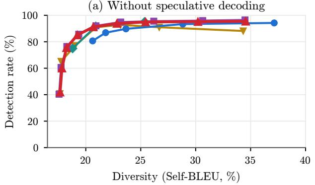

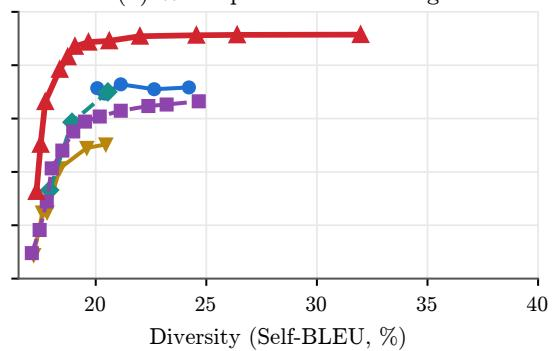  
SynthID-Text (layers) TextSeal, coin flip (®) textGrain (¯) AutoMark copula (½) TextSeal2 (½)  
Figure 6 The diversity–detection trade-of of Figure 1 at 200 tokens instead of 100; same protocol and conventions, including the speculative panel (b).

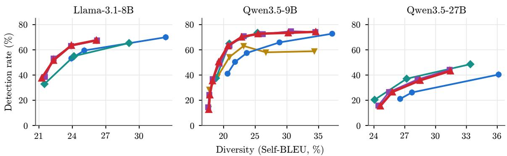  
SynthID-Text (layers) TextSeal, coin flip (®) textGrain (¯) AutoMark copula (½) TextSeal2 (½)  
Figure 7 Diversity (Self-BLEU; lower is more diverse) vs. detection of 100-token answers without speculative decoding, on three models (32 answers to each of 100 questions; copulas with the 53-bit PRF). Interpolated at TextSeal’s Self-BLEU, TextSeal2 gains 10, 22 and 8 percentage points over the coin flip on Llama-3.1-8B, Qwen3.5-9B and Qwen3.5-27B respectively, and AutoMark’s copula overlaps TextSeal2 throughout.

Table 9 Number of drafts per round: Qwen3.5-0.8B drafting N tokens for Qwen3.5-9B, block verification, every configuration generated separately for each N (3000 answers for detection, 100 questions × 16 answers for Self-BLEU). Tokens per round: emitted tokens over target passes, at $\alpha = 0 . 5 , \beta = 0 . 5 .$ , 10 layers and $\rho = 0 . 9$ Detected: % of 100 / 200-token answers at a false-positive rate of $1 0 ^ { - 3 }$ , interpolated at TextSeal’s Self-BLEU for the same $N \ ( 1 9 . 8 \ / \ 2 0 . 1 \ / \ 1 9 . 6 )$ . Paired over 480 prompts, only textGrain’s own recipe lowers the tokens per round $\left( - 0 . 0 8 \ / \ - 0 . 1 4 \ / \ - 0 . 1 8 \right)$ ; the distortion tests of Figure 11 detect the raw-lane-length control at every N, and no other scheme on the tests that apply to it, except that at $N = 1 6$ the residual race and textGrain’s own recipe both sit 7 millinats below the same unwatermarked run in the all-token test (intervals [−13, −1]), which points to noise in that shared reference.

<table><tr><td></td><td colspan="3">N = 4</td><td colspan="3"> $N = 8$ </td><td colspan="3"> $N = 1 6$ </td></tr><tr><td>Method</td><td>Tokens round</td><td></td><td>Detected</td><td>Tokens round</td><td></td><td>Detected</td><td>Tokens</td><td>round</td><td>Detected</td><td></td></tr><tr><td>No watermark</td><td>2.44</td><td></td><td></td><td>2.74</td><td></td><td></td><td></td><td>2.85</td><td></td><td></td></tr><tr><td>TextSeal (coin  $\mathrm { f i p } )$ </td><td>2.46</td><td></td><td>34  /  73</td><td></td><td>2.77</td><td>31 / 71</td><td></td><td>2.87</td><td></td><td>30  / 68</td></tr><tr><td>textGrain</td><td>2.45</td><td></td><td>30 / 65</td><td></td><td>2.75</td><td>31 / 67</td><td></td><td>2.84</td><td></td><td>28 / 62</td></tr><tr><td>textGrain, own recipe</td><td>2.36</td><td></td><td>48 / 82</td><td></td><td>2.61</td><td>52 / 84</td><td></td><td>2.68</td><td></td><td>51 / 85</td></tr><tr><td>SynthID-Text</td><td>2.44</td><td></td><td>19 / 48</td><td></td><td>2.75</td><td>17 / 50</td><td></td><td>2.85</td><td></td><td>17 / 46</td></tr><tr><td>AutoMark copula</td><td>2.44</td><td></td><td>24 /57</td><td></td><td>2.73</td><td>25 /  60</td><td></td><td>2.83</td><td></td><td>23 / 57</td></tr><tr><td>TextSeal2, residual race</td><td>2.44</td><td></td><td>58 / 88</td><td></td><td>2.74</td><td>59 / 89</td><td></td><td>2.85</td><td></td><td>53/ 86</td></tr></table>

Table 10 Second drafter–target pair: Llama-3.2-1B-Instruct drafting N = 4 or 8 tokens per round for Llama-3.1-8B-Instruct, with block verification (ELI5, 240 prompts per row, $\alpha = 0 . 5 , \rho = 0 . 9 , \beta = 0 . 5$ , TextSeal’s 13-bit PRF for every scheme). Tokens per round: emitted tokens over target passes. Detection: % of 100 / 200-token answers at a false-positive rate of $1 0 ^ { - 3 }$ , thresholds over 10 keys and 10,000 unwatermarked Llama-3.1-8B-Instruct answers; 95% Wilson intervals are about ±6 points.
<table><tr><td>Method</td><td>Tokens per round  $\left( N = 4 ~ / ~ 8 \right)$ </td><td>Detected, N = 4</td><td>Detected,  $N = 8$ </td></tr><tr><td>No watermark</td><td>3.20 / 4.08</td><td></td><td></td></tr><tr><td>TextSeal (coin flip, other key for the last token)</td><td>3.21 / 4.09</td><td>36  / 72</td><td>37  / 62</td></tr><tr><td>textGrain, other key for the last token</td><td>3.21 / 4.14</td><td>20 / 51</td><td>18 /43</td></tr><tr><td>textGrain, own recipe (lowers acceptance)</td><td>3.11 / 3.88</td><td>55/ 83</td><td>50 /  79</td></tr><tr><td>TextSeal2, residual race</td><td>3.20 / 4.11</td><td>63 87</td><td>55 81</td></tr></table>

Table 11 AIME under speculative decoding: Qwen3.5-0.8B drafting 8 tokens per round for Qwen3.5-9B with block verification, 16 answers to each of 100 AIME problems (thinking disabled, prompt asking for a \boxed{} answer, temperature 1, top-p 0.95, up to 8192 tokens), at $\alpha = 0 . 5 , \beta = 0 . 5$ , 10 layers and $\rho = 0 . 9$ . Tokens per round: emitted tokens over target passes; only textGrain’s own recipe lowers it $( - 0 . 1 1 \ [ - 0 . 1 4 , - 0 . 0 9 ]$ paired by problem with unwatermarked decoding). Accuracy: last \boxed{} answer; paired by problem, every scheme is within 2 points of unwatermarked decoding, all 95% intervals containing zero. Self-BLEU: over each problem’s 16 answers, first 1024 tokens. Finished: answers that end before 8192 tokens. Detected: % of answers detected at a false-positive rate of $1 0 ^ { - 3 }$ on their first 256 / 512 / 1024 / 2048 tokens, with each method’s detector; thresholds are the empirical $1 0 ^ { - 3 }$ quantile over the 1600 unwatermarked answers scored under 10 keys $( 1 . 6 \cdot 1 0 ^ { 4 }$ null p-values; realised false-positive rates 0.05–0.15%); 95% Wilson intervals are at most ±2.4 points. Strengths are defaults, not diversity-matched; Self-BLEU varies by at most 2 points.
<table><tr><td rowspan="2">Method</td><td colspan="5"></td><td colspan="4">Detected (%) at</td></tr><tr><td>Tokens / round</td><td>Accuracy (%)</td><td></td><td>Self-BLEU</td><td>Finished (%)</td><td>256</td><td>512</td><td>1024</td><td>2048</td></tr><tr><td>No watermark</td><td>5.42</td><td>71.1</td><td>44.8</td><td>68</td><td></td><td>一</td><td>一</td><td>一</td><td>一</td></tr><tr><td>TextSeal (coin fip)</td><td>5.43</td><td>69.2</td><td>46.1</td><td>66</td><td></td><td>1</td><td>5</td><td>13</td><td>22</td></tr><tr><td>textGrain</td><td>5.39</td><td>69.3</td><td>45.8</td><td>66</td><td></td><td>1</td><td>2</td><td>6</td><td>15</td></tr><tr><td>textGrain, own recipe</td><td>5.30</td><td>69.7</td><td>46.8</td><td>68</td><td></td><td>3</td><td>8</td><td>22</td><td>38</td></tr><tr><td>SynthID-Text</td><td>5.39</td><td>69.2</td><td>45.6</td><td>68</td><td></td><td>2</td><td>4</td><td>9</td><td>19</td></tr><tr><td>AutoMark copula</td><td>5.38</td><td>70.2</td><td>45.8</td><td>68</td><td></td><td>1</td><td>2</td><td>4</td><td>7</td></tr><tr><td>TextSeal2, residual race</td><td>5.39</td><td>70.6</td><td>46.5</td><td>68</td><td></td><td>4</td><td>11</td><td>24</td><td>41</td></tr></table>

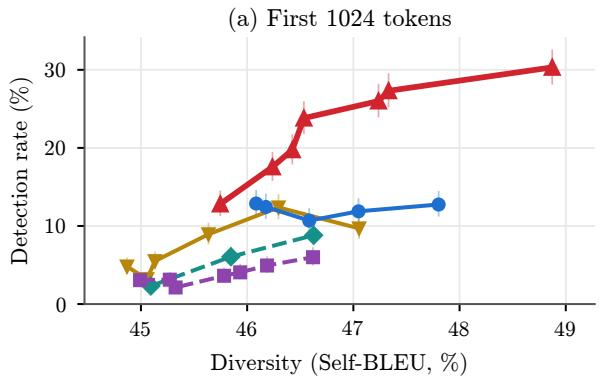

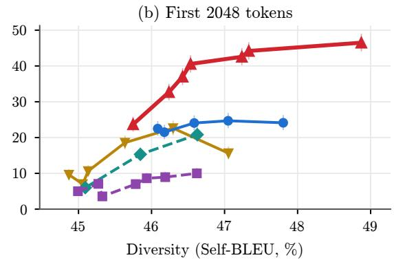  
SynthID-Text (layers) TextSeal, coin flip (®) textGrain (¯) AutoMark copula (½) TextSeal2 (½)  
Figure 8 Diversity (Self-BLEU over each problem’s 16 answers, first 1024 tokens; lower is more diverse) vs. detection at a false-positive rate of $1 0 ^ { - 3 }$ on AIME under speculative decoding, on the first 1024 (a) and 2048 (b) tokens; same setup as Table 11, sweeping each method’s strength. Interpolated at TextSeal’s Self-BLEU (46.1), TextSeal2 detects 30% of answers at 2048 tokens, against 23% for the coin flip, 21% for SynthID-Text, 17% for textGrain and 9% for AutoMark’s copula; paired by problem, its lead is significant over all but the coin flip $( + 7 . 4 \ [ - 0 . 2 , + 1 9 . 5 ] )$ . Error bars: 95% Wilson intervals.

## G Experimental details

Generation. Prompts are ELI5 questions (a version without math questions, 267,901 rows), taken in order and formatted with each model’s chat template with thinking disabled; decoding uses tem perature 1, top-p 0.95, and at most 200 new tokens, with watermark window size $k = 3$ . The copulas (TextSeal2 and AutoMark’s) use the 53-bit PRF of Appendix E in Table 1, Figures 1, 7, 6 and 10, and Tables 6, 12 and 13, as well as in every speculative-decoding experiment on Qwen3.5-9B; the remain ing experiments (robustness, four keys, and the Llama drafter–target pair of Table 10) use TextSeal’s 13-bit PRF, which slightly understates TextSeal2 (Appendix E). Detection runs use 3000 answers per configuration on Qwen3.5-9B (rows 0–2999, one answer each), with or without speculative decoding, and 1000 on the other models (rows 0–999); null calibration uses 10,000 unwatermarked answers from the same model (rows 0–9999; rows 100,000–109,999 for the speculative-decoding experiments, with the target model). Key values follow TextSeal’s derivation: $\bar { k } ^ { ( 1 ) } = 4 2$ and $k ^ { ( 2 ) } = 4 2 + 1 2 3 4 5$

Table 12 Code: Qwen3.5-9B writing Python solutions to the 500 MBPP test problems, up to 512 new tokens (most answers end earlier, so detection saturates after 256 tokens). % of answers detected at 128 $/ \ 2 5 6 \ / \ 5 1 2$ tokens, thresholds at a 1% false-positive rate over 10 keys and 2922 unwatermarked answers (all 974 MBPP problems, 3 seeds); same settings as on ELI5 $( \alpha = 0 . 5 , \rho = 0 . 9 , \beta = 0 . 5$ , 10 SynthID layers; the copulas use the 53-bit PRF), whose Qwen3.5-9B Self-BLEU is 20.6–20.9 for all five; one answer per problem, so code diversit is not measured. 11% of positions are a window’s second occurrence in the text.
<table><tr><td>Method</td><td>Detected (128 / 256 / 512 tokens)</td></tr><tr><td>TextSeal (coin flip)</td><td>30  / 39 / 42</td></tr><tr><td>textGrain</td><td>38  / 46  / 48</td></tr><tr><td>SynthID-Text</td><td>42 / 50 / 50</td></tr><tr><td>AutoMark copula</td><td>54 /  59  / 59</td></tr><tr><td>TextSeal2, one use per window</td><td>47 / 55 / 60</td></tr></table>

Table 13 Repeated windows in long generations: Qwen3.5-9B with thinking traces, up to 2048 tokens (ELI5: 1024 prompts, MBPP: 500 problems; $\rho = 0 . 9 ;$ , 53-bit PRF). A window repeats at 16% of positions on ELI5 and 34% on MBPP. Detection at a false-positive rate of $1 0 ^ { - 3 }$ (thresholds over 10 keys and 2048 / 1000 unwatermarked traces) and median z-score of the key-only test; both rules use the same detector. $\Delta { : }$ paired diference against one use per window, with 95% bootstrap interval over prompts. Distortion check, on 480 traces generated with one key per answer: the mean o $\mathrm { f } - \ln p _ { x } - H ( \vec { p } )$ at a window’s 2nd / 3rd+ occurrences is $+ 3 \ [ - 6 , + 1 3 ] \ / \ - 3 \ [ - 8 , + 2 ]$ millinats with leftover continuation, and $- 3 \ \left[ - 1 2 , + 7 \right] \ / \ + 2 \ \left[ - 3 , + 6 \right]$ millinats without any watermark, so leftover continuation introduces no measurable distortion.
<table><tr><td></td><td colspan="4">ELI5</td><td colspan="3">MBPP</td></tr><tr><td>Repeated windows</td><td>Detected @256</td><td>Median z @256</td><td></td><td>/ 1024 / 2048</td><td>Detected @512</td><td>Median z @1024 / 2048</td><td></td></tr><tr><td>One use per window</td><td>93.0</td><td>6.0</td><td>/15.9</td><td>22.8</td><td>53.2</td><td></td><td>4.8 / 5.6</td></tr><tr><td>Leftover continuation</td><td>96.8</td><td></td><td>/16.9</td><td>23.9</td><td>60.8</td><td></td><td>5.2 / 5.7</td></tr><tr><td>∆ leftover continuation</td><td> $+ 3 . 8 \ [ + 2 . 1 , + 5 . 6 ]$ </td><td></td><td></td><td> $+ 0 . 5 \textrm { / } + 0 . 9 \textrm { / } + 1 . 1$ </td><td> $+ 7 . 6 \ \ L _ { [ + 2 . 4 , + 1 2 . 8 ] }$ </td><td> $+ 0 . 3 \ / \ + 0 . 4$ </td><td></td></tr></table>

textGrain uses $B = m = 2 5 6$ and keys 42 and 4242. For null calibration, adding $1 0 ^ { 5 } j$ to every key, $j = 0 , \ldots , 9 ;$ gives ten keys, $j = 0$ being the generation key.

Speculative decoding. In each round, Qwen3.5-0.8B proposes N drafts, one at a time, from its own distribution (after temperature and top-p) through the scheme’s sampler; Qwen3.5-9B then evaluates $\vec { p _ { 1 } } , \dotsc , \vec { p _ { N + 1 } }$ in a single forward pass, and the round emits the kept drafts and one more token, by block verification (Sun et al., 2025) with the closed forms of Appendix A.3. A draft that is an end of-sequence token ends the round’s drafting, so the round then has fewer than N drafts. TextSeal2 follows Algorithm 1: drafts by the race (5), then the residual race (6), with the copula noise η drawn once per position and read by both races. The unwatermarked reference is native block verification with freshly drawn randomness. N = 8 is the main setting; Table 9 reports N = 4 and 16, for which every configuration was generated again. During generation, each answer tracks the (window, key) pairs whose values have been used, and every pair that a round reads counts as used, kept or not, for every scheme (Appendix A.5). When a window has already been used, TextSeal and SynthID-Text fall back to their other key and then to fresh randomness, and textGrain and the copulas directly to fresh randomness (for TextSeal2, freshly drawn lane lengths, on which the draft race and the residual race still run). Both models keep a key–value cache that is rolled back to the kept prefix after each round; on 40 random rounds, the logits after a rollback match a recomputation without cache as closely as those of a cache without rollback (bfloat16 noise).

Detection. Under speculative decoding with 8 drafts, the last token of each round makes up 36–37% of the text (first 1000 answers at $\alpha = 0 . 5$ and $\rho = 0 . 9 )$ . Scored under the draft key, AutoMark’s last tokens, drawn under an independent key except at the bonus position (5% of rounds), average 0.84 (below the null mean of 1, because a token drawn from block verification’s residual law lost its draft race), against 1.42 for its kept drafts; TextSeal2’s last tokens average 1.34 under $s ^ { \star }$ , against 1.42 for its kept drafts $( \mathrm { a l l \pm 0 . 0 0 4 } )$ . Positions whose window was already used get fresh values: 9% of TextSeal2’s tokens, against 6% of AutoMark’s. For every detector, each (window, token) pair is scored once, at its first occurrence. Entropy-weighted test. Each scored position t is assigned the entropy $e _ { t }$ of the next-token distribution of an auxiliary model (here the generating model itself, the target model under speculative decoding, evaluated on the answer under examination) and the weight $w _ { t } = 0 . 1 + 0 . 9$ min 1, max $( 0 , ( e _ { t } - e _ { \operatorname* { m i n } } ) / ( e _ { \operatorname* { m a x } } - e _ { \operatorname* { m i n } } ) ) )$ , where $e _ { \mathrm { m i n } }$ and $e _ { \mathrm { m a x } }$ range over the scored positions of the text. With per-position scores $s _ { t }$ of null mean 1 and null variance $\theta \ ( \theta = 1$ for single-key scores, $\theta = a ^ { 2 } + ( 1 - a ) ^ { 2 }$ for two-key fused scores $a s ^ { ( 1 ) } + ( 1 - a ) s ^ { ( 2 ) } )$ , the weighted sum $\sum _ { t } w _ { t } s _ { t }$ is compared with the Gamma distribution of the same mean $\textstyle \mu = \sum _ { t } w _ { t }$ and variance $\sigma ^ { 2 } = \overline { { \theta } } \sum _ { t } w _ { t } ^ { 2 }$ (shape $\mu ^ { 2 } / \sigma ^ { 2 }$ , scale $\sigma ^ { 2 } / \mu )$ . Since all decision thresholds are empirical (below), this moment matching afects power but not validity. The threshold for each detector and answer length is the empirical $1 0 ^ { - 3 }$ quantile of its p-values on the 10,000 unwatermarked answers scored under 10 keys. Keys are interchangeable on unwatermarked text, so this pools $1 0 ^ { 5 }$ null p-values, about 100 of which fall below the threshold; a single key would give only about 10, and hence a much noisier threshold. At the nominal $1 0 ^ { - 3 }$ level, realised false-positive rates are 0.08–0.13% for the detectors of Figure 9 and 0.07–0.15% for those used under speculative decoding (two-key fusions with the measured shares, and the Llama pair), so the Gamma and binomial tail approximations are already accurate, and the empirical thresholds absorb the remaining deviation. Under speculative decoding, TextSeal, textGrain, SynthID-Text and AutoMark’s copula fuse both keys’ scores, weighted by their measured shares of emitted tokens (as TextSeal does for its coin flip); textGrain’s own recipe uses a single key; TextSeal2 uses $s ^ { \star }$ (private) and $s ^ { ( 1 ) }$ (public) exactly as without speculative decoding (subsection 3.1).

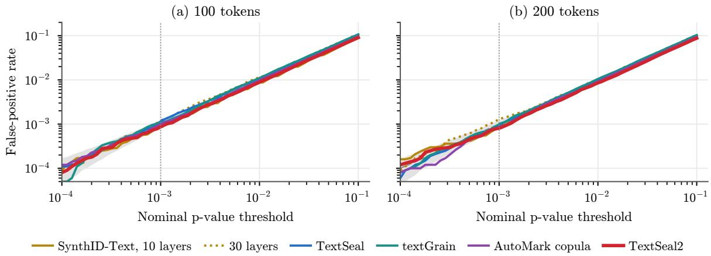  
Figure 9 Calibration: false-positive rate against the nominal p-value threshold for the detectors of Table 1 without speculative decoding, on 10 keys and 10,000 unwatermarked Qwen3.5-9B answers; grey: 95% binomial interval around the diagonal. At $1 0 ^ { - \bar { 3 } }$ and above, every detector is within a factor 1.3 of nominal.

Diversity. The Self-BLEU of a question is the mean sentence-level BLEU (sacrebleu) over all ordered pairs of its answers generated under the fixed key, decoded from their first 200 tokens. This is TextSeal’s two-generation diversity estimator averaged over all answer pairs; we report the mean over questions. Intervals for values interpolated at TextSeal’s Self-BLEU resample the 100 questions jointly for all methods (and detection outcomes binomially within questions), so that question-level variation common to all methods cancels in paired comparisons. Figure 10 repeats Figure 1 with diversity measured by the share of distinct 4-grams among a question’s answers. The copulas still dominate the coin flip, and TextSeal2 still leads under speculative decoding; without speculative decoding, textGrain is slightly ahead of the copulas under this metric (66% vs. 62% detected at TextSeal’s distinct-4 level), whereas it is level with TextSeal2 under Self-BLEU.

Distortion tests. Answers used for acceptance and distortion measurements are generated with a fresh key $1 0 ^ { 7 } + 7 9 1 9 i$ for prompt i (textGrain: this key and the key plus 4200), so that answers are independent draws over keys, the regime in which distortion-freeness is defined; 480 prompts per scheme and draft length. The tests read the laws used at generation: for every emitted token, $p _ { x }$ and $H ( \vec { p } )$ come from the target pass of its round, and for the last token of each round, $\vec { r _ { I } }$ is block verification’s residual law at its position, computed from these $\vec { p }$ and ${ \vec { q } } .$ All intervals are 95% bootstrap intervals over answers. Figure 11 reports the acceptance and distortion measurements for $N = 8 .$ , and Table 9 summarises them for $N = 4$ and 16. As a simulation control, the decisions were run on fixed toy laws with fresh values for every round $( N = 3 \ \mathrm { d r a f t s } )$ . The outcome $( d , I , y )$ of the residual race follows block verification’s law $( \chi ^ { 2 }$ test over $6 \cdot 1 0 ^ { 4 }$ rounds and 5 tokens, $p = 0 . 1 5 )$ , whereas racing on the raw lane lengths (Remark 1) does not $( \chi ^ { 2 } = 3 1 9 4$ on 401 degrees of freedom). For the baselines $( 6 \cdot 1 0 ^ { 3 }$ rounds over 12 tokens), the first emitted token follows the target’s law and the number of kept drafts follows native block verification $\left( p \ge 0 . 1 3 \right)$ , except that textGrain’s own recipe keeps fewer drafts, as it verifies the watermarked laws.

bias (mnats/token)  
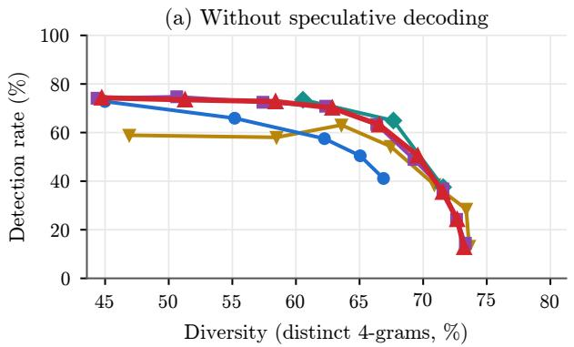

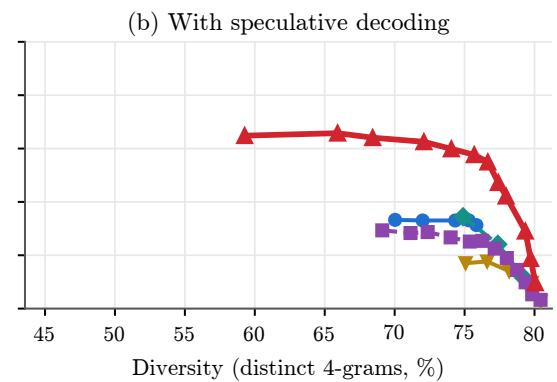  
SynthID-Text (layers) TextSeal, coin flip (®) textGrain (¯) AutoMark copula (½) TextSeal2 (½)  
Figure 10 Figure 1 with diversity measured by the share of distinct 4-grams (higher is more diverse), including the speculative panel (b).

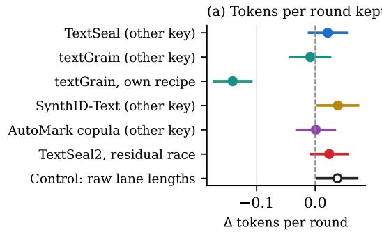

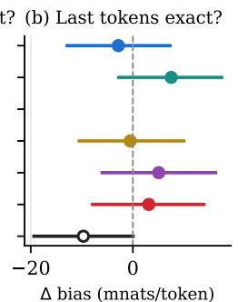

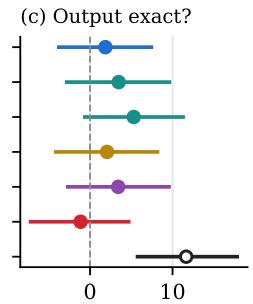  
Figure 11 Is speculative decoding with a watermark still distortion-free? Paired diferences from unwatermarked block verification (8 drafts per round) on the same 480 prompts, with one key per answer (95% paired bootstrap intervals). (a) Tokens per round. (b) Mean ${ \mathrm { o f } } - \ln r _ { I , y } - H ( { \vec { r } } _ { I } )$ at the last token $_ y$ of each round, which has expectation zero when it follows block verification’s residual law $\vec { r _ { I } }$ (not shown for textGrain’s own recipe, whose last token follows the residual of the watermarked distributions). (c) Mean of $- \ln p _ { x } - H ( \vec { p } )$ over all tokens, which has expectation zero for any distortion-free scheme. Only the control (racing on raw lane lengths, Remark 1) deviates in (c), and only textGrain’s own recipe lowers tokens per round.

Compute. Each generation job uses one H200 GPU. Our speculative-decoding implementation (Hugging Face models with a key–value cache) is unbatched and unoptimised: with $N = 8$ it takes about 0.11 s per token on one GPU, three times slower than plain decoding with the target, because the drafter is called once per draft; this afects only experimental throughput, not any reported rate, since block verification is exact. Under it, the residual race’s decision takes 0.33 ms per token, against 0.38 ms for native block verification, and computing the keyed lane lengths of the drafted positions takes 2.4 ms per token more than sampling the drafts without a key; this key-only work can run concurrently with the drafter’s forward pass (Appendix D).

textGrain reimplementation. The textGrain report (Li et al., 2026) releases no code, so we implemented its Algorithms 1 and A.1 from the text: a keyed partition of the vocabulary into B = 256 blocks derived from the key and the window; a 256 × 256 table of standardised keyed Gumbel costs with m = 256 columns (the report fixes neither B nor m); the log-domain Sinkhorn updates with marginal correction and the regularisation update of its Eq. (A.4); selection of a keyed column; and independent sampling of the block and then of the token within it. Detection follows its Section 3.2 (Gamma(n, 1) null), except that, as for every method in this paper, we score the first occurrence of each (window, token) pair rather than each window’s first occurrence, which adds about 1% more scored positions. We validated the GPU kernels against a direct (unoptimised) implementation of the algorithm on random inputs, and verified on toy distributions that the emitted-token distribution is unbiased and that the entropy removed respects the budget β. The speculative recipe implements its Appendix B with block verification between the watermarked distributions. OpenAI’s implementation and hyperparameters may difer from ours, and our textGrain numbers carry that caveat.

Reproducibility. Generation and evaluation scripts, including fixed seeds, key derivations, prompt lists (ELI5 rows; MBPP problems) and threshold calibration, together with the per-answer outputs underlying every reported number, will be released with the paper.

Broader impact. Watermarks give providers, platforms and the public one signal for tracing AIgenerated text. They are not robust to paraphrasing (Table 7), can in principle be spoofed or removed by determined adversaries, and should therefore be combined with complementary provenance signals rather than treated as proof of origin. Publishing a detection key enables independent public verification, but also gives adversaries a target signal to attack; retaining a private key allows such manipulation to be detected (Milis et al., 2026).