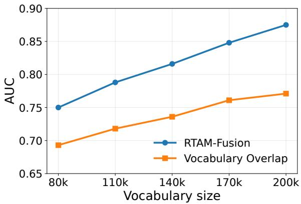
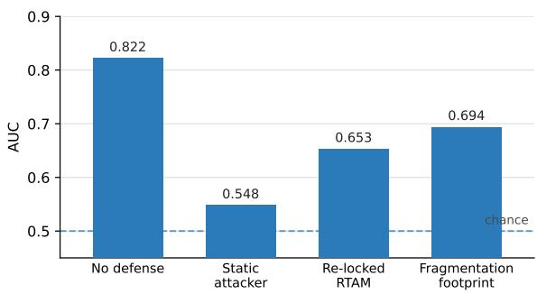
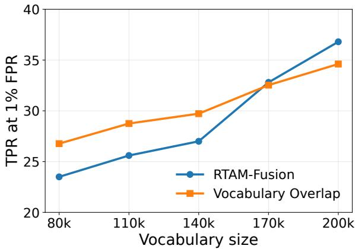
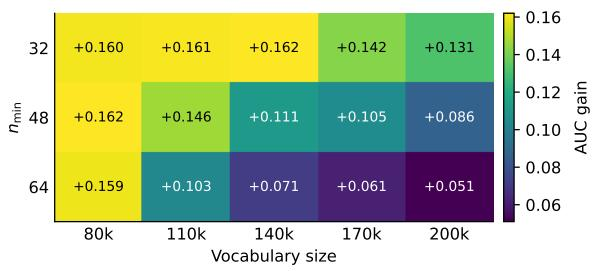
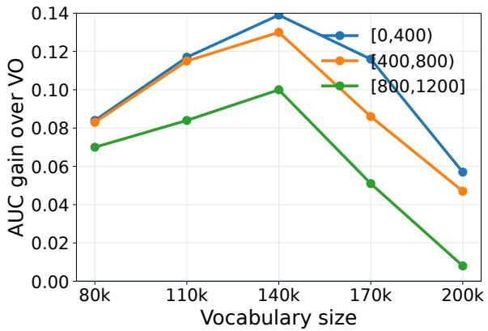
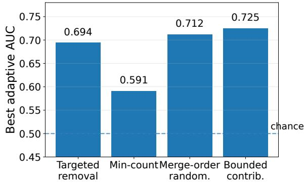

# Tokenizer Tokens Tell Training Tales

Nishita Jain Independent Researcher

Parth Upman School of Computer Science University of Nottingham Nottingham, United Kingdom

Shreyank N Gowda School of Computer Science University of Nottingham Nottingham, United Kingdom

## Abstract

Tokenizers are usually treated as fixed preprocessing tools, but they are trained on text and can retain traces of that text in their vocabularies. We ask whether a BPE tokenizer can reveal if a candidate dataset was part of its training corpus. The key observation is simple. Rare strings become tokens only when enough corpus frequency pushes them over the merge threshold. This suggests that membership signal should appear in rare tokens used by the candidate dataset, rather than in the order in which merges were made. We formalize this under a threshold model of BPE inclusion, showing that the likelihood-ratio test assigns its largest weights to tokens that are rare in the background but frequent in the candidate dataset. The same model suggests that merge rank and merge-graph position should not add a first-order membership signal once token existence and dataset frequency are known. We instantiate this view as RTAM-Fusion, which calibrates rare-token mass with shadow tokenizers and combines signals across rarity levels. On the tokenizer membership benchmark, RTAM-Fusion improves AUC and balanced accuracy over Vocabulary Overlap while using fewer shadow tokenizers. Existing defenses also continue to leak membership signal against adaptive attackers at production vocabulary sizes. Code: https://anonymous.4open. science/r/RTAM-Fusion-F7EE/

## 1 Introduction

Tokenizers are usually treated as a fixed first step before modelling begins. Text is split into token IDs, and the language model is then trained on those IDs. This view misses an important point. Subword tokenizers are themselves learned from text. A BPE tokenizer builds its vocabulary by deciding which strings occur often enough in the training corpus to become tokens. The tokenizer is therefore not only a preprocessing tool, but also a data-dependent artifact that may retain traces of the corpus used to train it. More broadly, securing generative AI systems requires examining vulnerabilities beyond conventional model performance. (Mustafa et al., 2025; Shen et al., 2024; Yazmyradov, 2024; Mustafa et al., 2026) demonstrate that even relatively simple prompt-based jailbreaks can circumvent safety mechanisms in language and text-to-image models, highlighting the importance of evaluating security under adversarial conditions. While these attacks concern generationtime safeguards rather than training-data privacy, they illustrate the broader need to investigate overlooked attack surfaces. In this work, we focus on one such surface: the information retained by a tokenizer during training.

This becomes important when the training data of large language models is in question. Membership inference asks whether a candidate example or dataset was part of training. Most work studies this through the trained model, but recent work by Tong et al. (Tong et al., 2026) showed that the tokenizer can also leak membership information. They proposed attacks based on vocabulary overlap, frequency estimation, compression, and merge similarity, together with two natural defenses based on pruning low-count tokens and randomizing BPE merge order.

We ask what part of the tokenizer actually carries this signal. Several answers seem plausible. A member dataset may share unusual vocabulary items with the target tokenizer. Its tokens may appear at distinctive merge ranks. Its merge graph may have a recognizable structure. Or it may simply be compressed in a different way. Our results point to a simpler explanation. For dataset-level membership, the signal is mainly in rare tokens that the candidate dataset activates.

The intuition is direct. Common strings become tokens regardless of whether one particular dataset was present, so their existence says little about membership. Rare strings are different. If a candidate dataset repeatedly uses a rare string, and that string appears in the learned vocabulary, then the dataset may have helped push it over the frequency threshold needed for inclusion. The useful quantity is therefore not just whether the vocabulary overlaps with the dataset, but how much of the dataset’s own token stream falls on rare learned tokens.

We formalize this intuition under a threshold model of BPE inclusion. Under this model, the likelihood-ratio test for tokenizer membership assigns its largest weights to tokens that are rare in the background corpus but frequent in the candidate dataset. This motivates a rarity-weighted statistic over the dataset’s activated-token mass. The same model also suggests that merge rank and mergegraph position should not provide an independent membership channel once token existence and the dataset’s own token frequencies are known. In short, rarity matters more than order.

This leads to RTAM-FUSION, a rare-token activation mass attack. Given a target tokenizer and shadow tokenizers trained under the same procedure, we measure the fraction of a candidate dataset’s token stream that falls on rare tokens at several rarity levels. We add two inverse-documentfrequency style features, calibrate each feature against an out-shadow null following the LiRA principle (Carlini et al., 2022), and combine them into one membership score. The threat model is the same as in Tong et al. (Tong et al., 2026). The change is the statistic used to read the tokenizer.

On the tokenizer membership benchmark, RTAM-FUSION improves over Vocabulary Overlap on AUC and balanced accuracy across the undefended setting and the published min-count defense setting, while using substantially fewer shadow tokenizers. Its low false-positive performance is more mixed. It wins at production-scale vocabularies, but loses some small-vocabulary and defended TPR@1%FPR comparisons. We keep this distinction explicit because low false positive rates are important in membership inference.

The same view also clarifies why some defenses are brittle. If merge order is not where the signal lives, then randomizing merge order should not remove the signal. We test this by evaluating defenses against attackers that know the defense was applied and adapt their features. Across targeted removal of member-distinctive tokens, min-count filtering, merge-order randomization, and a bounded persite contribution mechanism, the tested defenses do not drive membership inference to chance at production vocabulary size. Removing rare tokens weakens the original signal, but can leave a fragmentation footprint that an attacker can read.

Overall, our results show that tokenizer tokens tell training tales through rare vocabulary entries. We make three contributions. First, we characterize the membership signal in BPE tokenizers with a threshold inclusion model, which predicts that rare tokens activated by the candidate dataset carry the main signal, while merge order and merge-graph position should not add a first-order channel. Second, we introduce RTAM-FUSION, a calibrated rare-token activation mass attack that improves AUC and balanced accuracy over the strongest published tokenizer membership baseline while using fewer shadow tokenizers. Third, we evaluate tokenizer defenses against adaptive attackers and show that the tested defenses still leak membership signal at production vocabulary size.

## 2 Related Work

Membership inference asks whether a candidate example, document, or dataset was part of training. Most work studies this through a trained model. We study a different released artifact, the tokenizer. This changes the signal: a language model exposes losses, probabilities, or generations, while a tokenizer exposes a learned vocabulary.

Membership inference and calibration. Shokri et al. (Shokri et al., 2017) introduced the shadowmodel paradigm, where an attacker trains models on known member and non-member splits and learns to classify the target’s outputs. Later work showed that raw membership scores are often confounded by example difficulty. Yeom et al. (Yeom et al., 2018) connected membership advantage to the generalization gap, Salem et al. (Salem et al., 2019) reduced the assumptions needed for attacks, and Sablayrolles et al. (Sablayrolles et al., 2019) derived an optimal membership rule using perexample thresholds. Watson et al. (Watson et al., 2022) and Ye et al. (Ye et al., 2022) further developed calibrated hypothesis-testing views. Carlini et al. (Carlini et al., 2022) introduced LiRA, which calibrates a target example against reference models, and Zarifzadeh et al. (Zarifzadeh et al., 2024) reduced the number of reference models needed. We inherit this calibration principle, but not the object being calibrated. A tokenizer has no loss or confidence score, so we calibrate rare-token activation mass against an out-shadow tokenizer null.

Membership inference for language models. Model-level attacks exploit memorization or output behaviour. Canary exposure measures unintended memorization (Carlini et al., 2019), and later work extracts verbatim training sequences from GPT-2 (Carlini et al., 2021), studies how memorization scales (Carlini et al., 2023), and extends extraction to aligned systems (Nasr et al., 2025). Other attacks score membership without direct extraction. Min-K% Prob uses the least likely tokens under the model (Shi et al., 2024), Mattern et al. (Mattern et al., 2023) compare candidates to generated neighbours, Zhang et al. (Zhang et al., 2025) normalize token probabilities, Duarte et al. (Duarte et al., 2024) use contrastive probing, and Meeus et al. (Meeus et al., 2024) aggregate document signals. These works motivate our setting, but none attacks the tokenizer. Indeed, Duan et al. (Duan et al., 2024) find near-chance performance for many model-level attacks on Pile-trained models (Gao et al., 2021), and Das et al. (Das et al., 2025) show that distribution shift can explain some reported successes. Tokenizers provide a different channel because the candidate dataset changes token frequencies directly.

Tokenizers as learned artifacts. Tokenizers are known to encode properties of their training data. Rust et al. (Rust et al., 2021) show that tokenizer quality affects multilingual modelling, and Petrov et al. (Petrov et al., 2023) show that tokenization length creates cost and latency differences. Hayase et al. (Hayase et al., 2024) recover mixture proportions of a BPE tokenizer’s training corpus from merge-order constraints. Their target is aggregate mixture inference. Ours is dataset membership. This distinction matters as merge order can reveal coarse corpus composition, while our results show that dataset-level membership is carried by token existence and rarity.

Tokenizer membership inference. Tong et al. (Tong et al., 2026) introduce membership inference against tokenizers and define the shadowtokenizer threat model we adopt. They propose Compression Rate, Naive Bayes, Merge Similarity, Vocabulary Overlap, and Frequency Estimation. Vocabulary Overlap is their strongest attack and counts distinctive candidate tokens present in the target vocabulary. Frequency Estimation is also related, since it scores rank-frequency deviations. In our terms, both are existence-family methods. Merge Similarity and Compression Rate use order or compression signals and are weaker in their experiments. Our analysis gives one explanation for this pattern. Under a threshold model of BPE inclusion, the likelihood-ratio form emphasizes tokens that are rare in the background but frequent in the candidate dataset. The same model predicts that merge order and merge-graph position should not add a first-order membership signal once token existence and candidate-token frequency are known. RTAM-FUSION is therefore a calibrated, rarityweighted version of the signal used implicitly by the strongest prior tokenizer attacks.

Defenses and adaptive evaluation. The same distinction matters for defenses. Minimum-count filtering limits the influence of rare events, echoing sensitivity control in differential privacy (Dwork et al., 2006). Randomized merge selection is related to the exponential mechanism (McSherry and Talwar, 2007) and to private learning methods such as DP-SGD (Abadi et al., 2016). Targeted token removal resembles machine unlearning (Cao and Yang, 2015; Bourtoule et al., 2021). Tong et al. (Tong et al., 2026) evaluate min-count filtering and merge-order randomization against static attacks. We evaluate these and related mechanisms against adaptive attackers. This matters because a defense may remove one statistic without removing the underlying signal. In our experiments, order randomization does not help because order is not the membership channel, and content removal leaves a fragmentation footprint that an adaptive attacker can read.

## 3 Method

We now describe RTAM-FUSION. The method follows the same shadow-tokenizer setting as Tong et al. (Tong et al., 2026). The difference is the statistic used to read the tokenizer. Instead of comparing vocabularies directly, we measure how much of a candidate dataset is represented by rare tokens in the target vocabulary.

## 3.1 Threat model

Let $f _ { V _ { \mathrm { t a r g e t } } }$ be a target BPE tokenizer trained on an unknown member corpus. The adversary observes its vocabulary $V _ { \mathrm { t a r g e t } }$ and the usual tokenizer metadata, including merge indices when available. Given a candidate dataset D, the goal is to decide whether D was part of the tokenizer’s training corpus. As in prior tokenizer membership inference work, the adversary can sample auxiliary datasets from the same broad distribution and train shadow tokenizers using the same BPE procedure as the target. We denote the shadow tokenizers by $\{ f _ { V _ { s } } \} _ { s = 1 } ^ { N }$ For each shadow tokenizer, the adversary knows which datasets were included in its training split. This gives an empirical member and non-member reference distribution for any statistic computed on D.

## 3.2 Rare-token activation mass

The core feature is rare-token activation mass. For a tokenizer X and a candidate dataset D, let cnt ${ _ { D } } ( t ; X )$ be the number of times token t appears when D is tokenized by X. We estimate the rarity of a token using the shadow tokenizers. Let sf(t) be the number of shadow vocabularies in which token t appears. Tokens with low sf(t) are rare under the shadow estimate of the corpus distribution.

For a rarity cutoff K, we define

$$
\mathrm { r m } _ { K } ( D ; X ) = { \frac { \sum _ { t } \mathbf { 1 } [ \mathrm { s f } ( t ) \leq K ] \mathrm { c n t } _ { D } ( t ; X ) } { \sum _ { t } \mathrm { c n t } _ { D } ( t ; X ) } } .\tag{1}
$$

This is the fraction of the dataset’s token stream that falls on rare tokens. Small K values focus on near-unique tokens. Larger K values keep a broader notion of rarity and are less brittle when the rarest tokens are pruned.

We also use two inverse-document-frequency style features over the tokens activated by D:

$$
\operatorname { m e a n i d f } ( D ; X ) = { \frac { \sum _ { t } \operatorname { c n t } _ { D } ( t ; X ) \log { \frac { N } { \operatorname { s f } ( t ) } } } { \sum _ { t } \operatorname { c n t } _ { D } ( t ; X ) } } .\tag{2}
$$

$$
\operatorname* { m a x i d f } ( D ; X ) = \operatorname* { m a x } _ { t : \operatorname { c n t } _ { D } ( t ; X ) > 0 } \log { \frac { N } { \operatorname { s f } ( t ) } } .\tag{3}
$$

The first captures broad rarity across the dataset. The second captures the single rarest activated token.

## 3.3 Calibration with shadow tokenizers

Raw rare-token mass is affected by dataset length and lexical diversity. We therefore calibrate each feature against an out-shadow null, following the offline calibration idea of LiRA (Carlini et al., 2022).

Let ϕ be one of the features above. For a candidate dataset $D ,$ define

$$
\operatorname { O U T } _ { \phi } ( D ) = \{ \phi ( D ; V _ { s } ) \mid D \notin \operatorname { I N } ( s ) \} ,
$$

where IN(s) is the training split of shadow tokenizer s. We then compute

$$
c _ { \phi } ^ { \mathrm { d i f f } } ( D ) = \phi ( D ; V _ { \mathrm { t a r g e t } } ) - \mu _ { \mathrm { o u t } } ,\tag{4}
$$

$$
c _ { \phi } ^ { z } ( D ) = \frac { \phi ( D ; V _ { \mathrm { t a r g e t } } ) - \mu _ { \mathrm { o u t } } } { \sigma _ { \mathrm { o u t } } + \epsilon } ,\tag{5}
$$

where $\mu _ { \mathrm { o u t } }$ and $\sigma _ { \mathrm { o u t } }$ are the mean and standard deviation of $\mathrm { O U T } _ { \phi } ( D )$ , and ϵ is a small constant for numerical stability. This converts a datasetspecific raw score into a deviation from the score expected if the dataset were not a member.

We use 8 shadows for single-feature validation, 10 for the main fusion experiments unless otherwise stated, and 20 for the strongest undefended setting. The rarity cutoff K is distinct from the number of shadows N: K defines how rare a token must be under the shadow estimate, while N is the number of tokenizers used to estimate and calibrate that rarity.

## 3.4 Fusion and decision rule

Different rarity levels are useful in different regimes. Near-unique tokens are especially informative at low false-positive rates, while broader rarity features are more stable across vocabulary sizes and defenses. We therefore combine several calibrated features into one score.

In the undefended setting, our fixed fusion score is

$$
\begin{array} { r } { S ( D ) = 3 z \Big [ c _ { \mathrm { r m } _ { 1 } } ^ { \mathrm { d i f f } } ( D ) \Big ] + z \Big [ c _ { \mathrm { m e a n i d f } } ^ { \mathrm { d i f f } } ( D ) \Big ] + } \\ { 0 . 5 z \Big [ c _ { \mathrm { m a x i d f } } ^ { \mathrm { d i f f } } ( D ) \Big ] , } \end{array}\tag{6}
$$

where $z [ \cdot ]$ denotes standardization over the candidate datasets in the evaluation split. A dataset is predicted as a member when $S ( D ) > \tau$ . For AUC and TPR at fixed false-positive rate, we sweep τ in the standard way.

The score deliberately uses existence and frequency features only. Merge ranks are observed in the threat model, but they are not used by RTAM-FUSION. This matches the theoretical result that, once token existence and the candidate dataset’s own token frequencies are known, merge order and merge-graph position do not add membership signal.

Algorithm 1 summarizes the scoring procedure once the shadow tokenizers have been trained. We keep it in Appendix A to avoid repeating the equations in the main text.

## 3.5 Defense-aware re-locking

When a defense changes the feature distribution, we do not keep the undefended fusion weights fixed. Instead, we re-lock the weights on a held-out calibration split and evaluate on a separate split. The feature family remains the same. This models an adaptive attacker who knows that the defense was applied. For example, min-count pruning removes many near-unique tokens, so the useful signal often shifts from $\mathrm { r m } _ { 1 }$ toward broader rarity features such as meanidf or larger rare-mass cutoffs.

Cost. The dominant cost is training shadow tokenizers. Once the tokenizers are trained, computing RTAM features requires a pass over the tokenized datasets to accumulate token counts and shadow frequencies. Calibration and fusion are negligible by comparison. In our experiments, RTAM-Fusion uses between 8 and 20 shadow tokenizers depending on the setting, whereas Vocabulary Overlap uses 96 in the baseline protocol (Tong et al., 2026). We therefore report shadow count as part of the attack cost, not only as an implementation detail.

## 4 Why Rare Tokens Carry Membership Signal

We now explain why the features in RTAM-FUSION are the natural ones for tokenizer membership inference. The analysis is intentionally simple. It does not try to model every detail of BPE training. Instead, it isolates the part of the process that matters for membership: a string becomes a token only if its frequency in the training corpus is high enough.

## 4.1 A threshold view of tokenizer inclusion

Let C be the corpus used to train a tokenizer, and let D be a candidate dataset. We write $D \subseteq C$ when D is a member. We model the inclusion of a token t in a BPE vocabulary as a threshold event:

$$
t \in V \quad \Longleftrightarrow \quad \mathrm { f r e q } _ { C } ( t ) \geq \theta _ { | V | } ,\tag{7}
$$

where $\theta _ { | V | }$ is the frequency threshold induced by the final vocabulary size. If D is included in the training corpus, its own frequency contributes to this event:

$$
\mathrm { f r e q } _ { C } ( t ) = \mathrm { f r e q } _ { C \backslash D } ( t ) + \mathcal { k } [ D \subseteq C ] \mathrm { f r e q } _ { D } ( t ) .\tag{8}
$$

This is an idealization. Real BPE changes the alphabet as merges are performed, and token candidates are not independent. Still, the threshold view captures the membership mechanism we use. Common strings would enter the vocabulary regardless of one candidate dataset, so their existence says little about membership. Rare strings near the threshold are different: if they occur often in D and appear in the learned vocabulary, then $D$ may have supplied the mass that made them tokens.

## 4.2 The optimal existence test

For each candidate token $t _ { i }$ used by D, let $e _ { i } =$ $\mathbb { H } [ t _ { i } ~ \in ~ V ]$ indicate whether the token exists in the target vocabulary. Under the threshold model, membership inference from token existence has a standard likelihood-ratio form.

Theorem 1 (Optimal existence test under the threshold model). Assume the token-existence observations $\{ e _ { i } \}$ are conditionally independent given membership. Then the most powerful test of $H _ { 1 } : D \subseteq C$ against $H _ { 0 } : D \mathrm { ~ } \mathcal { Z } \mathrm { ~ } C$ at any fixed false-positive rate is the likelihood-ratio test

$$
\Lambda ( D ) = \sum _ { i } \log \frac { P ( e _ { i } \mid H _ { 1 } ) } { P ( e _ { i } \mid H _ { 0 } ) } .\tag{9}
$$

Under Eq. 7, the per-token contribution is largest for tokens that are rare in the background corpus butfrequent in D.

The reason is direct. Let $B _ { i } = \mathrm { f r e q } _ { C \backslash D } ( t _ { i } )$ be the background frequency of $t _ { i } .$ . Under nonmembership, the token exists only if the background corpus already crosses the threshold. Under membership, the candidate dataset adds its own mass:

$$
P ( e _ { i } = 1 \mid H _ { 0 } ) = P \left( B _ { i } \ge \theta _ { | V | } \right) ,\tag{10}
$$

$$
\begin{array} { r } { P ( e _ { i } = 1 \mid H _ { 1 } ) = P \big ( B _ { i } + \mathrm { f r e q } _ { D } ( t _ { i } ) \ge \theta _ { | V | } \big ) } \\ { = P \big ( B _ { i } \ge \theta _ { | V | } - \mathrm { f r e q } _ { D } ( t _ { i } ) \big ) } \end{array}\tag{11}
$$

If a token is already common in $C \setminus D ,$ both probabilities are close to one, so observing the token gives little evidence. If a token is rare in the background but frequent in D, the gap between the two probabilities is large. These are exactly the tokens that rare-token activation mass emphasizes.

The exact likelihood ratio in Eq. 9 depends on unknown background frequencies. RTAM-FUSION therefore estimates the same structure with shadow tokenizers. The rare-mass features in Section 3 measure how much of $D ' \mathrm { s }$ token stream falls on rare tokens, while the calibration step estimates how unusual that mass is under an out-shadow null. Thus RTAM is best viewed as a finite-sample, calibrated approximation to the likelihood-ratio weights, not as an unrelated heuristic.

## 4.3 Why merge order is not used

The target tokenizer also exposes merge ranks, and one might expect these ranks to contain membership information. Our analysis suggests that, for dataset-level membership, this is not the main channel. Merge order is mostly governed by the global frequency ordering of the corpus. A single candidate dataset can affect membership evidence when it pushes a rare token over the inclusion threshold, but that effect is already captured by token existence and the candidate dataset’s own token frequencies.

Proposition 2 (Merge order is not a first-order membership signal). Under the threshold model, suppose merge ranks and merge-graph positions are determined by the background corpus ordering except for threshold-crossing events already captured by token existence. Then, conditional on the existence vector E and the candidate dataset’s token frequencies $f _ { D } ,$ , merge rank R and mergegraph position G add no membership information:

$$
{ \begin{array} { r } { P ( { \mathrm { m e m b e r } } \mid E , f _ { D } , R , G ) = P ( { \mathrm { m e m b e r } } \mid E , f _ { D } ) . } \\ { ( 1 2 ) } \end{array} }
$$

This proposition is a model implication rather than a finite-sample theorem about all BPE runs. It says that once we know which candidate tokens exist and how much the dataset uses them, merge order should not provide an independent membership channel. This is why RTAM-FUSION deliberately uses existence and frequency-derived features, even though merge indices are available in the threat model.

The proposition also gives a testable prediction. Order-based and merge-graph attacks should not outperform rare-token existence statistics unless they capture some additional signal outside this model. In Section 5, we find that such attacks remain close to chance, while rare-token activation features carry the membership signal.

## 4.4 Implications for defenses

The same distinction matters for defenses. If merge order is not the membership channel, then randomizing merge order should not remove the signal used by an adaptive attacker. Defenses that remove rare vocabulary entries are more direct: they can weaken the original rare-token signal. But removal can also change how member datasets are re-tokenized after pruning, leaving a fragmentation footprint that a different adaptive statistic can exploit. We therefore do not claim an impossibility theorem for tokenizer defenses. The theory supports a narrower claim. Rare token existence is the first-order membership signal under the threshold model, and defenses should be evaluated against attackers that can adapt to whatever signal remains. The experiments in Section 5 test this prediction directly.

## 5 Experiments

We evaluate RTAM-FUSION on the tokenizer membership benchmark of Tong et al. (Tong et al., 2026). Our goal is not only to ask whether RTAM-FUSION improves over the strongest prior attack, but also to understand where it improves, where it does not, and whether existing defenses survive an adaptive attacker.

We organize the experiments around four questions. First, does rare-token activation mass improve over Vocabulary Overlap in the undefended setting? Second, does the signal survive the baseline’s min-count defense? Third, how many shadow tokenizers are needed? Fourth, do tokenizer defenses still help once the attacker knows the defense and adapts?

## 5.1 Setup

We follow the protocol of Tong et al. (Tong et al., 2026). The target tokenizer is a BPE tokenizer trained on website-level datasets drawn from English C4 (Raffel et al., 2020), using URL provenance to bucket examples by urlparse(url).netloc (Dodge et al., 2021). The benchmark contains 4,133 sites, five vocabulary sizes {80k, 110k, 140k, 170k, 200k}, and a 50/50 member and non-member split. Shadow tokenizers are trained with the same BPE procedure as the target tokenizer, on random 50% subsamples of the pool.

We report AUC, balanced accuracy, and TPR at 1% FPR. The first two measure the overall ranking quality of the attack. The last measures the low false-positive regime, which is important for membership inference and often harder to improve. The distinction between ranking quality and thresholddependent operational effectiveness is also emphasized in deployment-aware security evaluations (Akinrele and Gowda, 2026).

Before evaluating our method, we reproduce the baseline’s cheapest published cell, Compression Rate at 80k vocabulary, which requires no shadow tokenizers. Our reproduction matches the published value within the baseline’s noise band: AUC 0.5147 versus 0.5070, balanced accuracy 0.5149 versus 0.5130, and TPR@1%FPR 0.82% versus 0.72%. This gives a basic check that our data collection and tokenizer training pipeline matches the published setting.

Table 1: Undefended comparison between RTAM-FUSION and Vocabulary Overlap across vocabulary sizes. Each metric is reported as RTAM-FUSION/Vocabulary Overlap. Check marks indicate cells where RTAM-FUSION is higher.
<table><tr><td>Vocab</td><td>AUC</td><td>BA</td><td>TPR@1%FPR</td></tr><tr><td>80k</td><td>0.750/0.693√</td><td>0.687/0.666√</td><td>23.5%/26.8%×</td></tr><tr><td>110k</td><td>0.788/0.718√</td><td>0.718/0.672√</td><td>25.6%/28.8%×</td></tr><tr><td>140k</td><td>0.816/0.736 √</td><td>0.750/0.696 √</td><td>27.0%/29.7% ×</td></tr><tr><td>170k</td><td>0.848/0.761√</td><td>0.782/0.709√</td><td> $3 2 . 8 \% / 3 2 . 5 \% $ </td></tr><tr><td>200k</td><td>0.875/0.771√</td><td>0.804/0.711√</td><td> $3 6 . 8 \% / 3 4 . 6 \% $ </td></tr></table>

  
Figure 1: Undefended comparison between RTAM-FUSION and Vocabulary Overlap across vocabulary sizes. The figure shows AUC as vocabulary size increases.

## 5.2 Undefended tokenizers

We first compare RTAM-FUSION against Vocabulary Overlap, the strongest published baseline in Tong et al. (Tong et al., 2026). Table 1 reports the comparison across all five vocabulary sizes, and Figure 1 shows the AUC trend visually. RTAM-FUSION uses the fixed fusion rule from Section 3, with weights locked on a held-out split before evaluation.

The main pattern is clear in both Table 1 and Figure 1. RTAM-FUSION improves AUC and balanced accuracy at every vocabulary size. The AUC gains range from about +0.06 to +0.10, showing that rare-token activation mass gives a stronger overall ranking signal than raw distinctive-token overlap. The 200-split robustness check gives the same conclusion: RTAM-FUSION wins AUC in every vocabulary cell and wins balanced accuracy in 98 to 100% of split samples.

The low false-positive regime is more mixed. RTAM-FUSION wins TPR@1%FPR at the larger vocabulary sizes, especially 170k and 200k, but loses at the smallest vocabulary sizes. This is an important boundary of the method rather than a reporting nuisance. Near-unique rare tokens are most useful for the low-FPR tail, and small vocabularies leave fewer such tokens available. The 200-split check confirms this vocabulary dependence, with TPR@1%FPR win rate ranging from 2% at 80k to 100% at 200k.

## 5.3 Min-count defense

We next evaluate the baseline’s min-count defense. This defense removes tokens whose aggregate training count is below a threshold $n _ { \mathrm { m i n } }$ . It directly targets the rare tokens that RTAM-FUSION uses, so it is a useful stress test of the method.

For this experiment, we use defense-aware relocking. The feature family is unchanged, but the fusion weights are selected on a held-out calibration split from the defended setting. This models an attacker who knows that the defense was applied.

Table 2 shows that RTAM-FUSION still improves over Vocabulary Overlap on AUC and balanced accuracy across all published min-count thresholds and vocabulary sizes. The strongest defended 200k setting with $n _ { \mathrm { m i n } } = 6 4$ gives AUC 0.768 for RTAM-FUSION versus 0.717 for Vocabulary Overlap. The TPR@1%FPR result changes. Under min-count pruning, RTAM-FUSION loses the low-FPR comparison, with defended TPR around 13 to 16% versus 22 to 31% for Vocabulary Overlap. This is expected. The defense deletes many of the near-unique tokens that drive the low-FPR tail. The broader rarity features, especially meanidf and larger rare-mass cutoffs, still preserve the ranking signal, but the most extreme rare-token evidence is weakened. A size-conditioned version of this experiment is given in Appendix B.2. The same pattern holds across dataset-size bins: RTAM-FUSION improves AUC and balanced accuracy, while the low-FPR tail remains harder.

## 5.4 Shadow-tokenizer efficiency

The attack also needs fewer shadow tokenizers than Vocabulary Overlap. RTAM-FUSION uses between 8 and 20 shadow tokenizers depending on the setting, while Vocabulary Overlap uses 96 in the baseline protocol (Tong et al., 2026). Since shadow-tokenizer training dominates the cost, we treat shadow count as part of the result. We do not report a new wall-clock comparison because our runs were performed across remote CPU and Kaggle environments rather than a controlled timing setup. Instead, we use the baseline’s own cost table as a reference and report the conservative claim: RTAM-FUSION reaches comparable or better AUC and balanced accuracy with roughly 5 to 12 times fewer shadow tokenizers.

Table 2: Min-count defense comparison between RTAM-FUSION and Vocabulary Overlap across vocabulary sizes and pruning thresholds. Each cell reports AUC as RTAM-FUSION/Vocabulary Overlap.
<table><tr><td> $n _ { \mathrm { m i n } }$ </td><td>80k</td><td>110k</td><td>140k</td><td>170k</td><td>200k</td></tr><tr><td>32</td><td>0.823/0.663</td><td>0.860/0.699</td><td>0.880/0.718</td><td>0.878/0.736</td><td>0.877/0.746</td></tr><tr><td>48</td><td>0.825/0.663</td><td>0.843/0.697</td><td>0.825/0.714</td><td>0.822/0.717</td><td>0.820/0.734</td></tr><tr><td>64</td><td>0.822/0.663</td><td>0.788/0.685</td><td>0.770/0.699</td><td>0.768/0.707</td><td>0.768/0.717</td></tr></table>

  
Figure 2: Adaptive attacks against targeted token removal. The defense weakens a naive RTAM-FUSION attacker, but defense-aware attacks recover membership signal.

## 5.5 Adaptive defenses

Finally, we evaluate defenses against adaptive attackers. A static evaluation asks whether a fixed attack fails after a defense is applied. An adaptive evaluation asks whether the membership signal is still present once the attacker knows the defense and changes its statistic. This distinction matters because a defense may remove one feature without removing the underlying signal.

Figure 2 shows this effect for targeted token removal. The pattern illustrates why we treat adaptive evaluation as the relevant defense test, rather than as an optional stress test. The defense weakens a naive attacker, but the signal returns once the attacker adapts. Table 3 summarizes the broader production-vocabulary results. Once the attacker adapts, every production-vocabulary defense remains above chance. Targeted token removal and min-count pruning both leave recoverable signal, while merge-order randomization is nearly flat across the temperature sweep. Full per-attack details and privacy-utility frontiers are given in Appendices B.3 and B.4.

Table 3: Adaptive-defense results. The table reports the strongest adaptive attack for each defense, with production-vocabulary results except where a smaller vocabulary is explicitly named.
<table><tr><td>Defense</td><td>Static or initial result</td><td>Best adaptive AUC</td></tr><tr><td>Targeted token removal</td><td>0.548</td><td>0.694</td></tr><tr><td>Min-count,  $n _ { \mathrm { m i n } } = 6 4$ </td><td>0.609</td><td>0.761</td></tr><tr><td>Min-count,  $n _ { \mathrm { m i n } } = 2 5 6$ </td><td>stronger pruning</td><td>≈ 0.591</td></tr><tr><td>Merge-order randomization</td><td>order randomized</td><td>0.710–0.712</td></tr><tr><td>Bounded contribution</td><td>0.523 at 12k vocab</td><td>0.725 at 200k vocab</td></tr></table>

Targeted token removal looks effective against a naive attacker, reducing AUC to 0.548, but adaptive attacks recover AUC 0.653 with re-locked RTAM features and 0.694 with a fragmentationfootprint statistic. Min-count pruning also leaks adaptively: at $n _ { \mathrm { m i n } } = 6 4$ , the best adaptive attack reaches AUC 0.761, and stronger pruning lowers this to about 0.591 only after removing roughly 115,000 tokens. Merge-order randomization is nearly flat, with adaptive AUC between 0.710 and 0.712, matching Proposition 2. Bounded contribution succeeds at 12k vocabulary with AUC 0.523, but rises to 0.725 at production vocabulary size. Overall, none of the tested defenses drives adaptive membership inference to chance at production scale. They either remove the wrong channel, leave a footprint, or look stronger at small vocabulary size than at production size.

## 6 Conclusion

Tokenizers are not neutral preprocessing tools. They are learned from text, and their vocabularies can retain traces of the corpora that trained them. This paper showed that, for BPE tokenizer membership inference, the strongest signal comes from rare tokens activated by a candidate dataset. Merge order and merge-graph structure are not where the main membership evidence lives. This observation led to RTAM-FUSION, a calibrated rare-token activation mass attack that improves AUC and balanced accuracy over the strongest published baseline while using fewer shadow tokenizers. The low false-positive regime is more mixed, with the clearest gains at production vocabulary sizes. The defense results tell the same story from the other side. Randomizing merge order does little because order is not the channel. Removing rare tokens can weaken the original signal, but it can also leave a fragmentation footprint that an adaptive attacker can read. Our study is limited to BPE tokenizers and the site-level C4 benchmark, so cross-tokenizer, out-of-distribution, and canary-style evaluations remain important next steps. Tokenizer tokens tell training tales, even when weights are never queried.

## Limitations

This study focuses on BPE tokenizers and on the site-level C4 benchmark used in prior tokenizer membership work. The threshold model in Section 4 is an explanatory model for this setting, not a complete account of tokenizer training. Real BPE changes the alphabet as merges are learned, and token inclusion events are dependent because tokens compete for a fixed vocabulary budget. Our results should therefore be read as evidence that raretoken existence is the main membership channel in this benchmark, not as a finite-sample optimality claim for every tokenizer. Several evaluations remain open, including other tokenizer families such as WordPiece, unigram tokenizers, and SentencePiece variants, along with out-of-distribution, cross-corpus, and canary-style tests. Our defense results are limited to min-count pruning, mergeorder randomization, targeted token removal, and bounded per-site contribution. None drives adaptive membership inference to chance at production vocabulary size, but this does not show that tokenizer defenses are impossible. We also do not evaluate content-level differentially private tokenizer training, where noise is applied to token counts during learning rather than after the vocabulary has already been built. Finally, our attack assumes that the adversary can train shadow tokenizers from a similar broad distribution and knows the tokenizer training procedure, matching the prior benchmark but not every deployment setting.

## References

Martín Abadi, Andy Chu, Ian Goodfellow, H. Brendan McMahan, Ilya Mironov, Kunal Talwar, and Li Zhang. 2016. Deep learning with differential privacy. In Proceedings ofthe 2016 ACM SIGSAC Conference on Computer and Communications Security (CCS), pages 308–318. ACM.

Akindoyin Akinrele and Shreyank N Gowda. 2026. Prompt injection detection is regime-dependent: A deployment-aware evaluation with interpretable structural signals. In Proceedings of the Fourth UK AI Conference 2026, volume 348 of Proceedings ofMachine Learning Research, pages 12–30. PMLR.

Lucas Bourtoule, Varun Chandrasekaran, Christopher A. Choquette-Choo, Hengrui Jia, Adelin Travers, Baiwu Zhang, David Lie, and Nicolas Papernot. 2021. Machine unlearning. In 2021 IEEE Symposium on Security and Privacy (SP), pages 141–159. IEEE.

Yinzhi Cao and Junfeng Yang. 2015. Towards making systems forget with machine unlearning. In 2015 IEEE Symposium on Security and Privacy (SP), pages 463–480. IEEE.

Nicholas Carlini, Steve Chien, Milad Nasr, Shuang Song, Andreas Terzis, and Florian Tramèr. 2022. Membership inference attacks from first principles. In 2022 IEEE Symposium on Security and Privacy (SP), pages 1897–1914. IEEE.

Nicholas Carlini, Daphne Ippolito, Matthew Jagielski, Katherine Lee, Florian Tramèr, and Chiyuan Zhang. 2023. Quantifying memorization across neural language models. In The Eleventh International Conference on Learning Representations (ICLR).

Nicholas Carlini, Chang Liu, Úlfar Erlingsson, Jernej Kos, and Dawn Song. 2019. The secret sharer: Evaluating and testing unintended memorization in neural networks. In 28th USENIX Security Symposium (USENIX Security 19), pages 267–284.

Nicholas Carlini, Florian Tramèr, Eric Wallace, Matthew Jagielski, Ariel Herbert-Voss, Katherine Lee, Adam Roberts, Tom B. Brown, Dawn Song, Úlfar Erlingsson, Alina Oprea, and Colin Raffel. 2021. Extracting training data from large language models. In 30th USENIX Security Symposium (USENIX Security 21), pages 2633–2650.

Debeshee Das, Jie Zhang, and Florian Tramèr. 2025. Blind baselines beat membership inference attacks for foundation models. In 2025 IEEE Security and Privacy Workshops (SPW). IEEE.

Jesse Dodge, Maarten Sap, Ana Marasovic, William´ Agnew, Gabriel Ilharco, Dirk Groeneveld, Margaret Mitchell, and Matt Gardner. 2021. Documenting large webtext corpora: A case study on the colossal clean crawled corpus. In Proceedings of the 2021 Conference on Empirical Methods in Natural Language Processing (EMNLP), pages 1286–1305. Association for Computational Linguistics.

Michael Duan, Anshuman Suri, Niloofar Mireshghallah, Sewon Min, Weijia Shi, Luke Zettlemoyer, Yulia Tsvetkov, Yejin Choi, David Evans, and Hannaneh Hajishirzi. 2024. Do membership inference attacks work on large language models? In Proceedings of the First Conference on Language Modeling (COLM).

André V. Duarte, Xuandong Zhao, Arlindo L. Oliveira, and Lei Li. 2024. DE-COP: Detecting copyrighted content in language models training data. In Proceedings ofthe 41st International Conference on Machine Learning (ICML), volume 235 of Proceedings of Machine Learning Research, pages 11940–11956.

Cynthia Dwork, Frank McSherry, Kobbi Nissim, and Adam Smith. 2006. Calibrating noise to sensitivity in private data analysis. In Theory of Cryptography, Third Theory of Cryptography Conference (TCC), volume 3876 of Lecture Notes in Computer Science, pages 265–284. Springer.

Leo Gao, Stella Biderman, Sid Black, Laurence Golding, Travis Hoppe, Charles Foster, Jason Phang, Horace He, Anish Thite, Noa Nabeshima, Shawn Presser, and Connor Leahy. 2021. The Pile: An 800gb dataset of diverse text for language modeling. arXiv preprint arXiv:2101.00027.

Jonathan Hayase, Alisa Liu, Yejin Choi, Sewoong Oh, and Noah A. Smith. 2024. Data mixture inference attack: BPE tokenizers reveal training data compositions. In The Thirty-eighth Annual Conference on Neural Information Processing Systems.

Justus Mattern, Fatemehsadat Mireshghallah, Zhijing Jin, Bernhard Schölkopf, Mrinmaya Sachan, and Taylor Berg-Kirkpatrick. 2023. Membership inference attacks against language models via neighbourhood comparison. In Findings ofthe Associationfor Computational Linguistics: ACL 2023, pages 11330– 11343. Association for Computational Linguistics.

Frank McSherry and Kunal Talwar. 2007. Mechanism design via differential privacy. In 48th Annual IEEE Symposium on Foundations of Computer Science (FOCS), pages 94–103. IEEE.

Matthieu Meeus, Shubham Jain, Marek Rei, and Yves-Alexandre de Montjoye. 2024. Did the neurons read your book? document-level membership inference for large language models. In 33rd USENIX Security Symposium (USENIX Security 24).

Ahmed B Mustafa, Zihan Ye, Yang Lu, Michael P Pound, and Shreyank N Gowda. 2025. Anyone can jailbreak: Prompt-based attacks on llms and t2is. Preprint, arXiv:2507.21820.

Ahmed B Mustafa, Zihan Ye, Yang Lu, Michael P Pound, and Shreyank N Gowda. 2026. Low-effort jailbreak attacks against text-to-image safety filters. In Proceedings of the IEEE/CVF Conference on Computer Vision and Pattern Recognition (CVPR) Workshops, pages 8590–8599.

Milad Nasr, Javier Rando, Nicholas Carlini, Jonathan Hayase, Matthew Jagielski, A. Feder Cooper, Daphne Ippolito, Christopher A. Choquette-Choo, Florian Tramèr, and Katherine Lee. 2025. Scalable extraction of training data from aligned, production language models. In The Thirteenth International Conference on Learning Representations (ICLR).

Aleksandar Petrov, Emanuele La Malfa, Philip H. S. Torr, and Adel Bibi. 2023. Language model tokenizers introduce unfairness between languages. In Advances in Neural Information Processing Systems 36 (NeurIPS).

Colin Raffel, Noam Shazeer, Adam Roberts, Katherine Lee, Sharan Narang, Michael Matena, Yanqi Zhou, Wei Li, and Peter J. Liu. 2020. Exploring the limits of transfer learning with a unified text-to-text transformer. Journal ofMachine Learning Research, 21(140):1–67.

Phillip Rust, Jonas Pfeiffer, Ivan Vulic, Sebastian Ruder,´ and Iryna Gurevych. 2021. How good is your tokenizer? on the monolingual performance of multilingual language models. In Proceedings of the 59th Annual Meeting of the Association for Computational Linguistics and the 11th International Joint Conference on Natural Language Processing (ACL-IJCNLP), pages 3118–3135. Association for Computational Linguistics.

Alexandre Sablayrolles, Matthijs Douze, Cordelia Schmid, Yann Ollivier, and Hervé Jégou. 2019. White-box vs black-box: Bayes optimal strategies for membership inference. In Proceedings of the 36th International Conference on Machine Learning (ICML), volume 97 of Proceedings of Machine Learning Research.

Ahmed Salem, Yang Zhang, Mathias Humbert, Pascal Berrang, Mario Fritz, and Michael Backes. 2019. ML-Leaks: Model and data independent membership inference attacks and defenses on machine learning models. In 26th Annual Network and Distributed System Security Symposium (NDSS).

Xinyue Shen, Zeyuan Chen, Michael Backes, Yun Shen, and Yang Zhang. 2024. " do anything now": Characterizing and evaluating in-the-wild jailbreak prompts on large language models. In Proceedings of the 2024 on ACM SIGSAC Conference on Computer and Communications Security, pages 1671–1685.

Weijia Shi, Anirudh Ajith, Mengzhou Xia, Yangsibo Huang, Daogao Liu, Terra Blevins, Danqi Chen, and Luke Zettlemoyer. 2024. Detecting pretraining data from large language models. In The Twelfth International Conference on Learning Representations (ICLR).

Reza Shokri, Marco Stronati, Congzheng Song, and Vitaly Shmatikov. 2017. Membership inference attacks against machine learning models. In 2017 IEEE Symposium on Security and Privacy (SP), pages 3–18. IEEE.

Meng Tong, Yuntao Du, Kejiang Chen, Weiming Zhang,   
and Ninghui Li. 2026. Membership inference at  
tacks on tokenizers of large language models. In Pro  
ceedings of the 35th USENIX Security Symposium   
(USENIX Security 26).   
Lauren Watson, Chuan Guo, Graham Cormode, and   
Alexandre Sablayrolles. 2022. On the importance of   
difficulty calibration in membership inference attacks.   
In The Tenth International Conference on Learning   
Representations (ICLR).   
Serdar Yazmyradov. 2024. A comprehensive review of   
ai security: Threats, challenges, and mitigation strate  
gies. The International Journal of Internet, Broad  
casting and Communication, 16(4):375–384.   
Jiayuan Ye, Aadyaa Maddi, Sasi Kumar Murakonda,   
Vincent Bindschaedler, and Reza Shokri. 2022. En  
hanced membership inference attacks against ma  
chine learning models. In Proceedings of the 2022   
ACM SIGSAC Conference on Computer and Commu  
nications Security (CCS), pages 3093–3106. ACM.   
Samuel Yeom, Irene Giacomelli, Matt Fredrikson, and   
Somesh Jha. 2018. Privacy risk in machine learn  
ing: Analyzing the connection to overfitting. In 2018   
IEEE 31st Computer Security Foundations Sympo  
sium (CSF), pages 268–282. IEEE.   
Sajjad Zarifzadeh, Philippe Liu, and Reza Shokri. 2024.   
Low-cost high-power membership inference attacks.   
In Proceedings of the 41st International Confer  
ence on Machine Learning (ICML), volume 235 of   
Proceedings ofMachine Learning Research, pages   
58244–58282.   
Jingyang Zhang, Jingwei Sun, Eric C. Yeats, Yang   
Ouyang, Martin Kuo, Jianyi Zhang, Hao Frank Yang,   
and Hai Li. 2025. Min-K%++: Improved baseline   
for detecting pre-training data from large language   
models. In The Thirteenth International Conference   
on Learning Representations (ICLR).

## A Additional Method Details

Lineage. The threat model and shadow-tokenizer protocol are inherited from Tong et al. (Tong et al., 2026). The calibration idea follows LiRA (Carlini et al., 2022). Our contribution is the rare-token activation mass statistic, its multi-level fusion, and the defense-aware re-locking used in the adaptive evaluation.

Detailed cost. Computing all rare-mass and IDF features is linear in the amount of tokenized text once the shadow tokenizers are available. The calibration step is $O ( N )$ per candidate dataset given the shadow features. The main cost is therefore the number of shadow tokenizers. Using the baseline’s own reported training costs, RTAM-Fusion’s shadow budget is substantially smaller than the

Algorithm 1 RTAM-FUSION membership infer  
ence   
Require: Candidate dataset $D ,$ , target vocabulary   
$V _ { \mathrm { t a r g e t } }$ , shadow tokenizers $\{ V _ { s } \} _ { s = 1 } ^ { N }$ , rarity cut  
offs $\kappa ,$ threshold τ   
1: for each tokenizer $X \in \{ V _ { \mathrm { t a r g e t } } \} \cup \{ V _ { s } \} _ { s = 1 } ^ { N }$   
do   
2: Tokenize D with X and compute token   
counts cnt $\boldsymbol { D }  ( t ; \boldsymbol { X } )$   
3: Estimate shadow frequency sf(t) for each   
activated token   
4: Compute rm $\mathbf { \nabla } _ { K } ( D ; X )$ for each $K \in \mathcal { K }$   
5: Compute meanidf $\because ( D ; X )$ and   
maxidf $( D ; X )$   
6: end for   
7: for each feature $\phi$ do   
8: Build the out-shadow null $\mathrm { O U T } _ { \phi } ( D )$   
9: Calibrate $\phi ( D ; V _ { \mathrm { t a r g e t } } )$ against this null   
10: end for   
11: Fuse the calibrated features into $S ( D )$   
12: return $\mathbb { H } [ S ( D ) > \tau ]$

N = 96 setting used for Vocabulary Overlap (Tong et al., 2026).

Algorithm. Algorithm 1 gives the scoring procedure used by RTAM-FUSION. The shadow tokenizers are assumed to have already been trained under the threat model in Section 3.1. Given those tokenizers, the algorithm computes the same features defined in Section 3: rare-token activation mass at each cutoff, the two IDF-style rarity aggregates, and their calibrated versions under the out-shadow null. The final output is the fused membership score thresholded at τ .

## B Additional Experimental Results

## B.1 Published baseline surface

Table 4 reproduces the published attack surface of Tong et al. (Tong et al., 2026). We use these values as the literature comparators for Vocabulary Overlap, Frequency Estimation, Naive Bayes, Merge Similarity, and Compression Rate.

Figure 3 shows the low-FPR comparison separately, highlighting that the TPR@1%FPR result is vocabulary-dependent.

## B.2 Size-conditioned defense surface

We also compare against the baseline’s sizeconditioned min-count defense surface. Datasets are bucketed by size into [0, 400), [400, 800), and [800, 1200], following Tong et al. (Tong et al., 2026). Table 5 shows that RTAM-FUSION improves AUC and balanced accuracy across all size and vocabulary cells. The smallest margin is the baseline’s headline large-dataset 200k cell, where RTAM-FUSION reaches 0.805 against 0.797.

Table 4: Published tokenizer-membership baselines from Tong et al. (Tong et al., 2026), Table 3. Vocabulary Overlap (VO) is the strongest baseline across vocabulary sizes and metrics, with Frequency Estimation (FE) the next strongest.
<table><tr><td>Attack</td><td>Metric</td><td>80k</td><td>110k</td><td>140k</td><td>170k</td><td>200k</td></tr><tr><td rowspan="3">CR</td><td>AUC</td><td>0.507</td><td>0.509</td><td>0.508</td><td>0.508</td><td>0.509</td></tr><tr><td>BA</td><td>0.513</td><td>0.517</td><td>0.514</td><td>0.513</td><td>0.516</td></tr><tr><td>TPR@1%FPR</td><td>0.72%</td><td>0.71%</td><td>0.68%</td><td>0.82%</td><td>0.77%</td></tr><tr><td rowspan="3">NB (k=20k)</td><td>AUC</td><td>0.534</td><td>0.526</td><td>0.535</td><td>0.546</td><td>0.564</td></tr><tr><td>BA</td><td>0.526</td><td>0.524</td><td>0.533</td><td>0.538</td><td>0.551</td></tr><tr><td>TPR@1%FPR</td><td>3.78%</td><td>3.44%</td><td>4.11%</td><td>5.86%</td><td>8.03%</td></tr><tr><td rowspan="3">MS</td><td>AUC</td><td>0.493</td><td>0.494</td><td>0.494</td><td>0.495</td><td>0.495</td></tr><tr><td>BA</td><td>0.509</td><td>0.507</td><td>0.508</td><td>0.506</td><td>0.508</td></tr><tr><td>TPR@1%FPR</td><td>1.06%</td><td>1.02%</td><td>0.97%</td><td>0.92%</td><td>0.87%</td></tr><tr><td rowspan="3">FE</td><td>AUC</td><td>0.610</td><td>0.645</td><td>0.676</td><td>0.707</td><td>0.740</td></tr><tr><td>BA</td><td>0.614</td><td>0.641</td><td>0.660</td><td>0.681</td><td>0.705</td></tr><tr><td>TPR@1%FPR</td><td>21.30%</td><td>22.00%</td><td>22.41%</td><td>25.61%</td><td>27.88%</td></tr><tr><td rowspan="3">VO</td><td>AUC</td><td>0.693</td><td>0.718</td><td>0.736</td><td>0.761</td><td>0.771</td></tr><tr><td>BA</td><td>0.666</td><td>0.672</td><td>0.696</td><td>0.709</td><td>0.711</td></tr><tr><td>TPR@1%FPR</td><td>26.77%</td><td>28.75%</td><td>29.72%</td><td>32.53%</td><td>34.61%</td></tr></table>

  
Figure 3: Low false-positive comparison between RTAM-FUSION and Vocabulary Overlap across vocabulary sizes. The figure reports TPR at 1% FPR in the undefended setting.

Figures 4 and 5 summarize the defended AUC gains across pruning thresholds, vocabulary sizes, and dataset-size bins.

## B.3 Adaptive-defense details

Table 6 gives the per-attack details behind the adaptive evaluation in Section 5.5. It reports the static or naive result where available, together with the strongest adaptive attack after the defense is

Table 5: Size-conditioned min-count defense results at $n _ { \mathrm { m i n } } { = } 6 4$ . Each cell reports RTAM-Fusion/Vocabulary Overlap AUC, with datasets grouped by candidate dataset size. Vocabulary Overlap values are from Tong et al. (Tong et al., 2026), Table 9.
<table><tr><td>Vocab</td><td>[0, 400)</td><td>[400, 800)</td><td>[800, 1200]</td></tr><tr><td>80k</td><td>0.730/0.646</td><td>0.786/0.703</td><td>0.782/0.712</td></tr><tr><td>110k</td><td>0.779/0.662</td><td>0.846/0.731</td><td>0.827/0.743</td></tr><tr><td>140k</td><td>0.816/0.677</td><td>0.881/0.751</td><td>0.868/0.768</td></tr><tr><td>170k</td><td>0.799/0.683</td><td>0.847/0.761</td><td>0.846/0.795</td></tr><tr><td>200k</td><td>0.751/0.694</td><td>0.819/0.772</td><td>0.805/0.797</td></tr></table>

Bold indicates the higher AUC within each RTAM-Fusion/Vocabulary Overlap comparison.

known.

## B.4 Adaptive privacy and utility frontier

Table 7 reports the production-vocabulary privacyutility frontier for all defense settings we evaluate. The table includes the utility cost of each setting, measured in bytes per token where available. No tested setting reaches chance-level adaptive AUC at production vocabulary size.

Figure 6 visualizes the same frontier, showing that all tested production-vocabulary defenses remain above chance under adaptive attack.

## B.5 Exploratory search for non-existence signals

We also ran an exploratory search for statistics outside the existence and rarity family used by RTAM-FUSION. The search considered candidate signals inspired by several areas, including topology, random matrix theory, percolation, dynamical systems, scale-space analysis, and extreme-value theory. Most candidates reduced, after inspection, to either existence-like signals or order-like signals. The one genuinely different candidate was a second-order co-occurrence statistic. It reached standalone AUC 0.574 and added only +0.008 AUC when fused with RTAM-FUSION. We treat this as an exploratory negative result rather than as evidence of a formal sufficiency theorem.

Table 6: Adaptive attacks against targeted token removal. A naive RTAM-Fusion attacker is weakened by the defense, while defense-aware attacks recover membership signal. The undefended RTAM-Fusion AUC is 0.822.
<table><tr><td>Attack</td><td>Description</td><td>AUC</td></tr><tr><td>A0</td><td>Static RTAM-Fusion</td><td>0.548</td></tr><tr><td>A1</td><td>Re-locked rarity feature</td><td>0.653</td></tr><tr><td>A2</td><td>Compression-based fragmentation footprint</td><td>0.694</td></tr></table>

Table 7: Adaptive-defense frontier at 200k vocabulary size. Each row reports the strongest adaptive attack observed for a defended tokenizer, together with the available utility measurement.
<table><tr><td>Defense mechanism</td><td>Adaptive AUC</td><td>Utility cost</td><td>Symmetric?</td></tr><tr><td>Targeted token removal, K=32k</td><td>0.694</td><td>-0.27% bpt</td><td>No</td></tr><tr><td> $\mathrm { M i n - c o u n t } , n _ { \mathrm { m i n } } { = } 2 5 6$ </td><td>0.591</td><td>115k tokens removed</td><td>Yes</td></tr><tr><td>Merge-order randomization</td><td>0.710–0.712</td><td>not measured at matched AUC</td><td>Yes</td></tr><tr><td>Bounded-contribution BPE,  $C { = } 1$ </td><td>0.725</td><td>-1.2% bpt at 12k vocab</td><td>Yes</td></tr></table>

  
Figure 4: AUC gain of RTAM-FUSION over Vocabulary Overlap under the min-count defense. Each cell reports the difference in AUC for a pruning threshold and vocabulary size.

## C Theory Details and Scope

This appendix gives the details behind Section 4. The goal is not to provide an exact finite-sample model of BPE training. Instead, we make explicit the assumptions under which the threshold argument holds, and separate the formal likelihoodratio result from the more approximate claim about merge order.

## C.1 Threshold model and assumptions

We use the threshold model from Section 4.1. A token t is included in the final vocabulary if its

  
Figure 5: Size-conditioned AUC gain of RTAM-FUSION over Vocabulary Overlap under the min-count defense at $n _ { \mathrm { m i n } } = 6 4 .$ . Candidate datasets are grouped by size.

corpus frequency exceeds the threshold induced by the vocabulary size:

$$
t \in V \quad \Longleftrightarrow \quad \mathrm { f r e q } _ { C } ( t ) \geq \theta _ { | V | } .
$$

For a candidate dataset D, corpus frequency decomposes as

$$
\mathrm { f r e q } _ { C } ( t ) = \mathrm { f r e q } _ { C \backslash D } ( t ) + \mathbb { k } ^ { \prime } [ D \subseteq C ] \mathrm { f r e q } _ { D } ( t ) .
$$

We treat $\mathrm { f r e q } _ { C \backslash D } ( t )$ as an unknown background quantity whose distribution is shared under membership and non-membership. This is the nuisance term estimated indirectly by shadow tokenizers.

The model makes two simplifying assumptions. First, it treats token inclusion as a threshold on final token frequency, while real BPE changes the alphabet during training. Second, it treats tokenexistence observations as conditionally independent given membership. In real tokenizers, tokens compete for a fixed vocabulary budget, so the observations are not exactly independent. These assumptions are used to obtain a tractable likelihood-ratio characterization.

  
Figure 6: Adaptive-defense comparison at 200k vocabulary size. Each bar shows the strongest adaptive attack observed for a defended tokenizer.

## C.2 Derivation of Theorem 1

Let $e _ { i } ~ = ~ { \mathbb { W } } [ t _ { i } ~ \in ~ V ]$ be the existence indicator for a candidate token activated by D. Under the conditional-independence assumption,

$$
P ( \{ e _ { i } \} _ { i } \mid H ) = \prod _ { i } P ( e _ { i } \mid H ) , \qquad H \in \{ H _ { 0 } , H _ { 1 } \} .
$$

The Neyman–Pearson lemma states that, for testing $H _ { 1 }$ against $H _ { 0 }$ at a fixed false-positive rate, the most powerful test thresholds the likelihood ratio. Taking logs gives

$$
\Lambda ( D ) = \sum _ { i } \log \frac { P ( e _ { i } \mid H _ { 1 } ) } { P ( e _ { i } \mid H _ { 0 } ) } .
$$

It remains to see why the largest terms correspond to rare tokens that are frequent in $D .$ Let

$$
B _ { i } = \mathrm { f r e q } _ { C \backslash D } ( t _ { i } )
$$

be the background frequency of token $t _ { i }$ . Under non-membership,

$$
P ( e _ { i } = 1 \mid H _ { 0 } ) = P ( B _ { i } \geq \theta _ { | V | } ) .
$$

Under membership,

$$
\begin{array} { r } { P ( e _ { i } = 1 \mid H _ { 1 } ) = P ( B _ { i } + \mathrm { f r e q } _ { D } ( t _ { i } ) \geq \theta _ { | V | } ) } \\ { P ( e _ { i } = 1 \mid H _ { 1 } ) = P ( B _ { i } \geq \theta _ { | V | } - \mathrm { f r e q } _ { D } ( t _ { i } ) ) } \end{array}
$$

Thus the gap between the two probabilities increases with $\mathrm { f r e q } _ { D } ( t _ { i } )$ . If D uses a token many times, membership can move the token across the threshold.

The gap also depends on the background frequency. If $B _ { i }$ is already large, then both probabilities are close to one, and observing the token gives little membership evidence. If $B _ { i }$ is far below the threshold, then both probabilities are small unless D supplies enough mass to move the token across the threshold. The largest likelihood-ratio terms therefore occur for tokens that are rare in the background but frequent in D.

The exact likelihood ratio depends on the unknown distribution of $B _ { i }$ for each token. RTAM-FUSION approximates this structure with shadow tokenizers: shadow frequency estimates token rarity, and the out-shadow calibration estimates how unusual the target statistic is under nonmembership. This is why the method uses rarityweighted activated-token mass rather than raw overlap alone.

## C.3 Order and graph features

Proposition 2 is a model implication, not an exact theorem for all finite BPE runs. The intuition is as follows. Merge ranks are determined mostly by the global frequency ordering of the training corpus. For a single candidate dataset D, the main membership-relevant effect is that D may push some rare tokens across the inclusion threshold. Once we condition on which tokens exist and how often D uses them, the remaining merge-order information mostly reflects the background corpus.

A simple way to express this is to decompose a token’s merge rank into a background component and a perturbation from $D \colon$

$$
R ( t ) = \rho ( C \setminus D , t ) + \delta _ { D } ( t ) .
$$

Here $\rho ( C \backslash D , t )$ is the rank contribution induced by the background corpus, while $\delta _ { D } ( t )$ is the perturbation caused by including D. Under the largecorpus threshold view, $\delta _ { D } ( t )$ matters mainly when D changes whether the token crosses the inclusion threshold. That event is already captured by the existence vector E and by $D ' s$ own frequency $f _ { D }$ The remaining background ordering has the same distribution under $H _ { 0 }$ and $H _ { 1 }$

This gives the conditional-independence statement used in the main text:

$$
P ( { \mathrm { m e m b e r } } \mid E , f _ { D } , R , G ) = P ( { \mathrm { m e m b e r } } \mid E , f _ { D } ) .
$$

The same reasoning applies to merge-graph position $G ,$ since the graph is built from the same merge events. The approximation may fail if one candidate dataset is large enough to substantially reorder many high-frequency merges. This is not the regime studied in our experiments, where candidates are individual site-level datasets drawn from a larger pool.

## C.4 Implications for defenses

The theory suggests two expectations for defenses. First, a defense that changes only merge order should not remove the main membership channel. The likelihood ratio in Theorem 1 depends on token existence and rarity, not on the order in which surviving tokens were created.

Second, defenses that remove vocabulary content can reduce the original rare-token signal, but they may create a different signal. If a member dataset previously used a distinctive token and that token is removed, the dataset must be re-tokenized into smaller pieces. This can change its tokenization pattern more than it changes the pattern of a non-member dataset that did not rely on the removed token. We call this a fragmentation footprint.

We do not formalize this footprint as a theorem. Doing so would require a model of how BPE retokenizes strings after token removal, together with a separate detection-theoretic analysis for the footprint statistic. Instead, we treat it as a mechanism suggested by the theory and tested empirically in the adaptive-defense experiments.

## C.5 Scope

The theory supports three claims. First, under the threshold model, the optimal existence-based membership test gives the largest weight to tokens that are rare in the background and frequent in the candidate dataset. Second, RTAM-style features are calibrated, finite-sample approximations to this likelihood-ratio structure. Third, merge order and merge-graph features are not expected to add membership signal once token existence and candidate-token frequency are known.

The theory does not claim that RTAM-FUSION is exactly optimal for finite BPE training. It also does not claim that no tokenizer defense can work. Real BPE uses an evolving vocabulary, token-existence events are dependent, and contentremoval defenses require a separate model of retokenization after pruning. We use the theory as a characterization of the main membership channel and as a guide for the adaptive evaluations, not as a complete impossibility result.