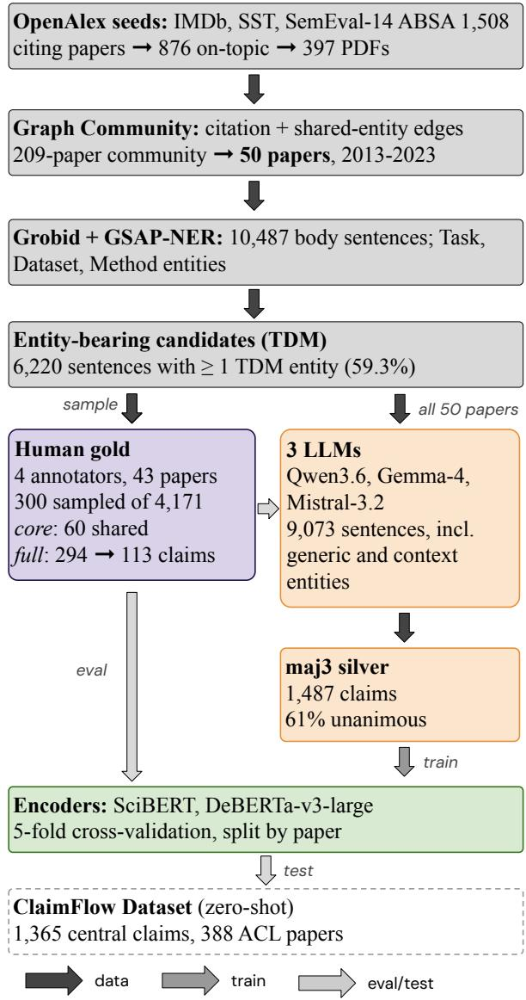
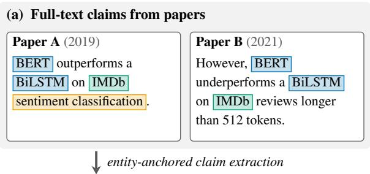
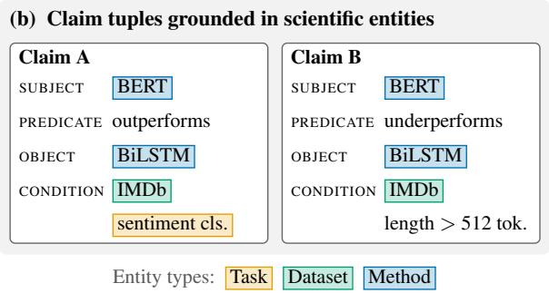
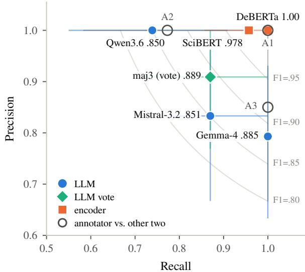

# Towards Full-Text Scholarly Argument Mining using Entity-Anchored Claim Extraction

Bhuvanesh Verma1, Andy Lüking2, Mounika Marreddy1, Leon Lukas Hammerla1, Alexander Mehler1

1Text Technology Lab (TTLab), Goethe University Frankfurt, Germany

{verma,M.Marreddy,hammerla,mehler}@em.uni-frankfurt.de

2Fakultät für Germanistik, Technische Universität Chemnitz, Germany andy.luecking@phil.tu-chemnitz.de

## Abstract

Argument mining in full-text scholarly articles remains an important yet challenging task. This difficulty stems not only from the need to model long-distance dependencies but also from the substantial effort required to annotate sentence-level argumentative components throughout lengthy documents. To address these challenges, we introduce a novel approach that leverages scientific entity mentions (e.g., tasks, datasets, and models) to identify and structure claims in scholarly literature. We validate our approach through a case study involving 50 full-text research papers on sentiment analysis. We first establish a reliable human gold standard (Krippendorff’s α = 0.80), identifying 113 claim-bearing sentences and extracting 199 structured claim records from 300 candidate sentences. To address the annotation bottleneck, we employ a majority-voting ensemble of large language models (LLMs) to generate a silver-standard dataset comprising 1,487 claims. Encoders fine-tuned exclusively on the silver-standard dataset outperform those trained on a small human-annotated goldstandard dataset and demonstrate strong zeroshot transfer to NLP papers outside the training corpus.

## 1 Introduction

Scientific literature is a rich source of complex reasoning, making it a particularly relevant domain for scientific argument mining (Teufel et al., 1999; Al Khatib et al., 2021). The central objective of scientific argument mining (SAM) is to identify argumentative components and reconstruct their relations in scholarly texts (Lawrence and Reed, 2019; Al Khatib et al., 2021). Scholarly text analysis often draws on established argumentation frameworks, such as Toulmin’s model (Toulmin, 1958) and Walton’s argumentation schemes (Walton et al., 2008), to identify claims, supporting evidence, and their argumentative relationships. However, existing research has largely focused on abstracts or individual sections of scientific articles (Accuosto and Saggion, 2019; Mayer et al., 2020; Fergadis et al., 2021; Accuosto et al., 2021). One reason for this focus is the substantial effort required for full-text annotation, as illustrated by the Sci-Arg corpus (Lauscher et al., 2018). Furthermore, identifying argumentative components and their relationships across entire documents poses substantial challenges for neural models (Binder et al., 2022).

To address these two challenges, we draw on approaches from general-domain argument mining, particularly those applied to political discourse and social media, where arguments are often identified in relation to specific controversial topics (Levy et al., 2018; Ein-Dor et al., 2020; Verma et al., 2026). In these domains, topics serve as semantic anchors that facilitate sentence-level annotation independently of broader document contexts and enable systematic comparisons of claims across different sources. Although scientific discourse exhibits comparable structures, previous research on SAM has paid relatively little attention to this anchoring strategy. Building on recent advances in scientific entity extraction (Jain et al., 2020; Otto et al., 2023), we propose a novel approach to claim extraction from scholarly articles based on scientific entity anchoring. In this approach, scientific entities (e.g., tasks, methods, and datasets) serve as structural anchors, playing a role analogous to that of “topics” in general-domain argument mining. Anchoring arguments to scientific entities reformulates full-text SAM in two fundamental ways. First, it reduces the scope of annotation to individual sentences, enabling claims to be identified and structured without requiring prior resolution of long-range discourse dependencies. Second, it facilitates cross-document comparability by providing a common structural reference for claims concerning the same method and dataset, regardless of differences in their surface formulations.

We present a pipeline for entity-anchored claim extraction from full-text scientific publications. Rather than exhaustively annotating entire papers, we combine a carefully curated, independently human-annotated gold-standard dataset with a large-scale silver-standard dataset generated through consensus among three large language models (LLMs). In a case study involving 50 research papers on sentiment analysis, we annotated 294 valid candidate sentences, identifying 113 claim-bearing sentences to establish a goldstandard dataset, which we subsequently used to validate a silver-standard dataset comprising 1,487 claims. We demonstrate that encoders fine-tuned exclusively on the silver-standard dataset yield more stable claim identification than those trained on the smaller human-annotated gold-standard dataset or on data generated by a single LLM. Furthermore, encoders trained on the silver-standard dataset demonstrate strong zero-shot generalization to NLP papers outside the case study corpus. Figure 1 provides an overview of the complete pipeline.

  
Figure 1: Pipeline of entity-anchored claim extraction.

## 2 Related Work

## 2.1 Full-Text Scientific Argument Mining

Teufel (1999) introduced Argumentative Zoning (AZ) to classify sentences in scholarly articles by rhetorical function, such as background, aim, and contrast. Teufel and Moens (2002) implemented AZ using hand-crafted features and Naive Bayes classifiers, while subsequent extensions captured domain-specific rhetorical functions in chemistry (AZ-II) (Teufel et al., 2009) and biology (Mizuta et al., 2006). Similarly, Liakata et al. (2012) introduced the Core Scientific Concepts (CoreSC) scheme to classify sentences in full-text biochemistry articles into 11 categories using SVMs and CRFs, while Fisas et al. (2016) developed the Dr. Inventor corpus to annotate discourse structure and novelty in computer graphics papers. While rhetorical zoning captures the discourse structure of scholarly articles, identifying fine-grained argumentative components, particularly claims and supporting evidence, requires more specialized annotation schemes. Blake (2010) introduced a rule-based framework for distinguishing explicit, implicit, and comparative claims. Building on the Dr. Inventor corpus, Lauscher et al. (2018) introduced Sci-Arg, extending its annotations with argumentative components (Own Claim, Background Claim, Data). Following this line of work, we adopt Own Claim and Reported Claim as the primary argumentative components in our schema.

## 2.2 Scientific Argument Mining using LLMs

Binder et al. (2022) proposed a BERT-based pipeline for full-text argument mining, highlighting challenges in identifying non-contiguous argumentative units and their relations. Although LLMs offer extended context windows that may help address these limitations, their application to scientific argument mining has primarily focused on claim verification and evidence-based reasoning. Specifically, benchmarks such as SciFact-Open (Wadden et al., 2022) and SciTab (Lu et al., 2023) evaluate scientific claim verification against large literature collections and evidence from scientific tables, respectively. Related approaches extend to peer-review analysis, assessing the evidential support for claims in reviews (Guo et al., 2023) and linking reviewer feedback to subsequent manuscript revisions (D’Arcy et al., 2024). More recently, benchmarks such as CLAIM-BENCH (Javaji et al., 2025) and CLAIMCHECK (Ou et al., 2025) have evaluated LLMs on scientific claimevidence reasoning and the grounding of peerreview critiques in scholarly articles, respectively. Thus, while LLMs are increasingly used to verify and critique previously identified scientific claims, their potential for entity-anchored claim extraction from full-text scholarly articles remains comparatively underexplored.

## 2.3 Entity-Anchored Scientific Information Extraction

Scientific entity extraction has evolved from broad terminology extraction (Luan, 2019) to fine-grained annotation schemes covering tasks, datasets, and metrics (TDMSci) (Hou et al., 2021), machine learning models and architectures (GSAP-NER) (Otto et al., 2023), and subsequently to the extraction of relations between scientific entities (SciER) (Zhang et al., 2024). In parallel, argument mining has increasingly incorporated topic-based approaches that anchor arguments to specific subjects of debate (Irani et al., 2024). Building on these advances, MetaLead (Timmer et al., 2026) introduces a richer annotation scheme linking tasks, training and test datasets, metrics, scores, and experiment types to support transparent comparisons of experimental results across scientific publications. Structured scientific knowledge increasingly supports advanced tasks such as research idea generation. For example, SciMON (Wang et al., 2024) leverages scientific concepts and prior literature to generate and iteratively refine novel research ideas. While these extraction strategies have primarily served structured knowledge organisation or idea generation, their integration into full-text SAM remains limited. We address this gap by using finegrained scientific entities as explicit anchors for claim extraction.

## 3 Entity-Anchored Claim Extraction

We introduce Entity-Anchored Claim Extraction as the task of extracting claim structures from scholarly articles by anchoring them to scientific entities. Traditional approaches to SAM often treat every sentence or phrase as a potential claim (Teufel,

  
Figure 2: Extraction of claim tuples from full text, anchored to task, dataset, and method entities.

1999; Lauscher et al., 2018). In contrast, our approach focuses exclusively on sentences containing explicit mentions of scientific entities. We define an entity-anchored claim as a contestable and verifiable assertion about one or more scientific entities (e.g., tasks, datasets, metrics, or methods). A sentence qualifies as claim-bearing if it makes an assertion about an entity’s performance, capabilities, limitations, comparative advantages, or intrinsic properties, among others.

As illustrated in Figure 2, we represent each claim as a relational tuple in which scientific entities assume explicit roles (e.g., subject or object) linked by a predefined predicate. Specifically, our controlled predicate inventory comprises four categories: performance comparisons (outperforms, underperforms, is-comparable-to), performance changes (improves, degrades, achieves), applicability and transfer (generalizes-to, fails-on, is-suited-for, is-standard-for), and dependencies and efficiency (requires, is-more-efficient-than). An additional OTHER label covers assertions outside this taxonomy. We provide detailed predicate definitions and argument constraints in Table 8 in the appendix. Furthermore, following established argument mining schemes (Teufel, 1999; Lauscher et al., 2018), we distinguish Own Claims, concerning the authors’ work, from Reported Claims, attributed to prior research.

## 4 Case Study: Sentiment Analysis

This case study evaluates the effectiveness of our entity-anchored approach to claim extraction from scholarly articles. We investigate whether this approach enables standardized claim representations that lays foundation for the identification of implicit argumentative relations across scholarly articles beyond those captured by citation-based analysis. This evaluation requires a corpus of densely interconnected scientific publications. We therefore focus on sentiment analysis, a well-established research area in NLP with an extensive citation network.

## 4.1 Corpus Construction

To construct a densely interconnected corpus of sentiment analysis papers, we seeded our search with three foundational benchmark publications: IMDb (Maas et al., 2011), SST (Socher et al., 2013), and SemEval-14 ABSA (Pontiki et al., 2014). Using OpenAlex (Priem et al., 2022), we retrieved papers citing these benchmarks and filtered them by domain-specific keywords and open-access availability. To ensure dense conceptual connectivity, we represented the retrieved papers as a graph, connecting papers through direct citations or shared scientific entities drawn from a curated list of datasets and methods. Using community detection (Clauset et al., 2004), we identified a densely connected cluster of 209 papers. From this community, we selected 50 papers using stratified sampling by publication year to ensure temporal diversity. We parsed the documents using GROBID (GROBID contributors, 2008-2026). Our preprocessing pipeline preserves all in-text citations (2,274 author-year spans), which serve as essential anchors for identifying Reported Claims. We provide further details on document retrieval, community detection, and text normalization in Appendix A.

## 4.2 Scientific Entity Extraction

To anchor claims within our corpus, we first require robust extraction of scientific entity mentions. We utilize GSAP-NER (Otto et al., 2023), which provides a fine-grained taxonomy specifically tailored to machine learning models, datasets, and tasks. Following the original architecture, we train two SciDeBERTa-CS taggers (Jeong and Kim, 2022), one for specific entity types and one for generic references, on the complete set of 100 GSAP-NER publications.

For our 50-paper corpus, we retain entity mentions from six categories: Task, Dataset, Datasource, Method, MLModel, and ModelArchitecture. We exclude generic mentions and URLs but retain citation markers (ReferenceLink) to link reported claims to cited publications. Our analysis shows that 59.3% of body-text sentences contain at least one scientific entity, providing a substantial candidate pool for entity-anchored claim extraction. We provide extraction metrics, post-processing rules, and corpus-level entity statistics in Appendix B.

## 4.3 Annotation Details

Four expert annotators (two doctoral candidates and two postdoctoral researchers), all specializing in computational linguistics, conducted the annotation. We sampled a subset of 300 entityanchored sentences for the claim detection task. To balance workload distribution and enable reliable inter-annotator agreement (IAA) estimation, we assigned 120 instances to each annotator. All four annotators independently annotated a shared set of 60 instances, which we used to compute IAA. To ensure reproducibility, we sampled instances using a fixed random seed (20260819) and developed a dedicated annotation tool (Appendix C) to support the process.

Claim Identification and Structuring. Before the main annotation phase, we conducted a pilot study involving seven papers to familiarize annotators with the annotation scheme and tool. From the remaining 43 papers, we identified 4,171 eligible candidate sentences, each containing at least one scientific entity mention in the body text. We stratified the sampling by document structure and selected 300 sentences. Specifically, we oversampled sentences from the abstract, conclusion, and results sections. Conversely, we undersampled sentences from the introduction, related work, and methodology sections, which often contain procedural descriptions, standard definitions, and generic contribution statements that fall outside our claim definition.

The annotation process proceeds in two stages. First, annotators determine whether the target sentence contains a claim. If the sentence contains a claim, annotators classify it as either own\_claim or reported\_claim. Second, annotators structure each claim by identifying its subject and object and selecting a predicate from a predefined inventory of 13 predicates (see Appendix C). For reported claims, annotators additionally link each claim to its corresponding citation marker.

## 5 Experiments

Although entity-anchored claim extraction reduces annotation effort, it still requires considerable time and domain expertise. To reduce this annotation burden, we investigate automated entity-anchored claim extraction using zero-shot LLMs and finetuned pretrained encoders.

## 5.1 LLM-Based Extraction Pipeline

We benchmark three LLMs: Qwen3.6-27B, Gemma-4-31B-it, and Mistral-Small-3.2-24B. To ensure comparability, we use a common prompt template across all models, iteratively refined using Qwen3.6-27B. We extract claims in three passes:

1. Document Profiling (Paper Card): The LLM processes the title, abstract, introduction, section headings, and conclusion to generate a paper card summarizing the paper’s major claims, proposed methods, tasks, datasets, and core contributions.

2. Sentence-Level Extraction: The model processes target sentences in the context of their full sections to facilitate anaphora resolution. The LLM determines whether a sentence contains a claim and, if so, extracts its subject, object, and predicate according to our manual annotation scheme.

3. Rule-Based Coreference: A deterministic post-processing step replaces generic selfreferences (e.g., “we”, “our model”) with the explicit method name extracted from the paper card.

## 5.2 Fine Tuning via Silver Data

While our zero-shot LLM pipeline identifies claims, we further investigate whether smaller, specialized encoders can achieve comparable performance more efficiently. To this end, we aggregated sentence-level claim predictions from all three LLMs across the 50-paper corpus. Using majority voting, we constructed a silver-standard dataset for claim identification from the three LLMs’ predictions. We then fine-tuned two pretrained masked language models, SciBERT (Beltagy et al., 2019) and DeBERTa-v3-large (He et al., 2021a,b), with sequence classification heads using this dataset. We employ five-fold cross-validation at the paper level, fine-tuning a separate model in each fold on silverstandard sentences from the training papers and evaluating it on gold-standard sentences from heldout papers.

## 5.3 External Validation on ClaimFlow

To determine whether our entity-anchored claim extraction strategy generalizes beyond our initial case study, we sought an external dataset for validation. Existing full-text argument mining corpora are either relatively dated (Teufel, 1999; Teufel et al., 2009) or focus on domains outside NLP (Mizuta et al., 2006; Blake, 2010; Liakata et al., 2012; Lauscher et al., 2018), limiting their suitability for evaluating our scientific entity extraction model. Recent resources also provide full-text claim annotations, including CLAIM-BENCH (Javaji et al., 2025), which links scientific claims to supporting evidence, and ClaimFlow (Pramanick et al., 2026), which traces claims and their relationships across NLP publications. We select ClaimFlow for its scale, NLP domain coverage, and sentence-level annotations, which align with our annotation granularity. ClaimFlow identifies central claims in NLP papers, focusing on their abstracts, introductions, and conclusions. The dataset provides paraphrased claims alongside supporting evidence sentences from the source text. We use ClaimFlow claims to evaluate our fine-tuned encoder models.

## 6 Results and Discussion

We present the results of our annotation study and evaluate the performance of LLMs and fine-tuned encoders. Unless otherwise specified, we report 95% confidence intervals (CIs) for all annotation and model evaluation results, using 10,000 bootstrap resamples.

## 6.1 Annotation Analysis

We evaluate inter-annotator agreement for claim detection on 60 core sentences. Excluding the annotator who worked on annotation guidelines, the three independent annotators achieved a reliable Krippendorff’s α of 0.80 (95% CI: 0.66-0.92). Across the full dataset of 300 sentences we use annotation from all four annotators. Out of 300, 6 sentences were discarded as unusable, 113 (38.4%) were identified as claims, predominantly concentrated in the results sections and beyond. For the claim structure extraction, annotators produced 199 records across 113 distinct gold claim sentences, heavily anchored on scientific entities for both subjects (90.5%) and objects (66.3%). Annotators agreed on the number of claims per sentence in 93% of shared cases. However, agreement was moderate for subjects (α = 0.64, 95% CI: 0.46–0.78) and objects $( \alpha = 0 . 6 5$ , 95% CI: 0.45–0.81), but low for predicates (α = 0.46, 95% CI: 0.23–0.66).

  
Figure 3: Performance on the 60 core sentences evaluated against the human majority label. Whiskers indicate 95% bootstrap CIs, and grey curves denote constant F1 contours. Open circles (A1–A3) show individual annotator agreement against the majority of the other two.

Disagreement in subject and object annotations primarily arose from different interpretations of complex, multi-claim sentences. Additionally, subject mismatches frequently resulted from differing preferences in entity span granularity (e.g., selecting simply PBAN versus the more expansive PBAN + fine-grained + bidirectional attention). Conversely, the majority of predicate disagreements (56%) were driven by the OTHER class. For example, given the sentence “syntactic target information derived from parses complements well with the left-target-right context representation”, one annotator selected OTHER (specifying complements), while the remaining two attempted to utilize the predefined taxonomy, selecting is-suited-for and is-comparable-to, respectively. Overall, outperforms (24%) and achieves (22%) were the most frequent predicates, while negative or limiting predicates accounted for only 11%. Additionally, 95% of claim records were classified as own\_claim.

## 6.2 Model Evaluation

We evaluated the three LLMs and their majorityvote ensemble, denoted as maj3, on both the

60 shared sentences (Figure 3) and the full 294- sentence gold-standard set (Table 1). On the core subset, maj3 achieved the highest F1 score (0.889) among the LLMs and showed strong agreement with the majority human annotation $( \kappa = 0 . 8 2 )$ comparable to that of the least-consistent annotator with the other two $( \kappa = 0 . 8 1 )$ . On the full goldstandard set, maj3 achieved the highest agreement $( \kappa = 0 . 7 8 )$ and F1 score (0.864) among the LLMs, although its F1 score was statistically indistinguishable from Gemma’s and significantly higher only than Qwen’s. Overall, all models tended to identify more claims per sentence than human annotators, resulting in lower precision. Despite moderate human agreement on claim structure, we evaluated the generated structures against gold-standard annotations for all correctly identified claim-bearing sentences. Qwen achieved the highest F1 scores for all three structural components: subjects (0.79), predicates (0.60), and objects (0.55). Mistral followed with F1 scores of 0.74, 0.53, and 0.47, respectively, while Gemma performed worst (0.71, 0.51, and 0.43).

Given the strong performance of maj3, we applied it to all 9,073 sentences in our 50-paper corpus, yielding a silver-standard dataset comprising 1,487 claims (Table 2). These sentences include all annotated entities (generic or specific) and indicate whether a specific entity occurs in either of the two preceding sentences. We train BERT-based encoders on this silver-standard dataset and evaluate them against the smaller human-annotated goldstandard dataset (Table 1). Averaged over three random seeds, DeBERTa-v3-large achieves an F1 score of $0 . 8 7 7 \left( \pm 0 . 0 0 8 \right)$ , slightly exceeding SciB-ERT $( 0 . 8 6 5 \pm 0 . 0 1 4 )$ , although the difference is not statistically significant. Its performance also does not differ significantly from that of the individual LLMs or the teacher ensemble, maj3. Despite the small gold-standard evaluation set, these results suggest that a 0.4B-parameter encoder can approximate the performance of an ensemble of three 24–31B-parameter LLMs on claim identification at substantially lower inference cost.

## 6.3 Error Analysis

All three LLMs jointly missed only 2 of the 113 gold-standard claims and jointly misclassified only 2 of the 181 non-claims, allowing majority voting to mitigate model-specific errors. Qwen, the most conservative model (Figure 3), showed substantially lower recall for claims in abstracts and conclusions (0.42) than for those in results and subsequent sections (0.76). Relying on Qwen alone could therefore lead to underrepresentation of authors’ main findings. In contrast, DeBERTa shows high agreement with its teacher ensemble, maj3, matching its predictions on 272 of the 294 goldstandard sentences. Of the 30 sentences misclassified by maj3, DeBERTa corrects 13, primarily procedural or factual statements incorrectly classified as claims by Gemma and Mistral, while introducing only 9 new errors among the 264 sentences correctly classified by maj3. On the 60 core sentences, DeBERTa achieves perfect agreement with the annotator majority $( \kappa = 1 . 0 0 )$ , compared with κ = 0.81–1.00 (mean: 0.89) for individual annotators against the majority of their peers. Finally, the encoder appears to inherit its teacher’s sectionspecific biases, achieving higher recall in results and subsequent sections (0.89) than in abstracts and conclusions (0.62).

<table><tr><td>Model</td><td>P</td><td>R</td><td>F1</td><td>κ [95% CI]</td></tr><tr><td>Qwen3.6-27B Gemma-4-31B</td><td>.962</td><td>.673</td><td>.792</td><td>.70 [.61, .78]</td></tr><tr><td>Mistral-3.2-24B</td><td></td><td>.771.956 .832 .832</td><td></td><td>.854 .75 [.67, .82] 2.832 .73 [.64, .81]</td></tr><tr><td>maj3</td><td>.888</td><td>.841</td><td></td><td>.864 .78 [.71, .85]</td></tr><tr><td>SciBERT†</td><td>.926</td><td>.811</td><td>.865</td><td>.79 [.71, .85]</td></tr><tr><td>DeBERTa-v3-large†</td><td></td><td></td><td></td><td>.939 .823 .877 .81 [.75, .88]</td></tr></table>

Table 1: Claim identification on the 294 gold sentences. F1 score is binary F1 for the claim class, κ is Cohen’s κ against the gold label. maj3 denotes the majority label of the three LLMs. †Fine-tuned only on maj3 silver labels.

## 6.4 Out of Corpus Evaluation

To assess cross-corpus generalization, we evaluate our DeBERTa model, fine-tuned exclusively on silver-standard data, on a preview version of ClaimFlow (Pramanick et al., 2026) without additional training. The dataset contains 1,365 humanannotated central claims (1-5 per paper) and their corresponding evidence sentences from 388 ACL Anthology papers. While ClaimFlow does not require claims to be entity-anchored, we observe substantial overlap: 91.7% of its claims contain at least one task, dataset, or method entity in either their summary or evidence (rising to 98.6% when generic mentions are included). Furthermore, entities are highly indicative of evidence sentences; 77% of ClaimFlow’s evidence sentences contain an entity, compared to only 63% of unselected sentences in the same sections. When evaluated zeroshot, our model flags 53.6% of ClaimFlow’s evidence sentences as claims. Because a single claim can be supported by multiple evidence sentences, the model successfully identifies 62.3% of the central claims via at least one evidence sentence, a figure that increases to 70.4% when evaluated alongside the claim summary text.

<table><tr><td>Set</td><td>Papers</td><td>Sentences</td><td>Claim Ratio</td></tr><tr><td>Core</td><td>32</td><td>60</td><td>38.3%</td></tr><tr><td>Gold</td><td>43</td><td>294</td><td>38.4%</td></tr><tr><td>Silver</td><td>50</td><td>9,073</td><td>16.4%</td></tr><tr><td>ClaimFlow</td><td>388</td><td>14,418</td><td>14.8%</td></tr></table>

Table 2: Dataset statistics. Claim ratio is the proportion of claim sentences. Gold includes human labels, with Core labeled by all annotators. Silver uses 3-LLM majority voting (excluding the 300 gold sentences). Claim-Flow preview dataset.

Blind Validation Our model identifies claims in 24.1% of entity-bearing sentences and 14.0% of sentences without entity mentions that ClaimFlow did not label as claim-bearing. Because Claim-Flow is restricted to a few central claims per paper, measuring strict precision against its labels is not meaningful. To interpret the discrepancies, a human annotator performed a blind manual review of 100 sentences: 50 false positives, and 50 false negatives. Among the false positives, 78% (95% CI: 64%-87%) are genuine claims under our guidelines.1 Conversely, of the false negatives, only 6% (95% CI: 2%–17%) qualify as claims under our schema. The vast majority of these misses are contribution statements (e.g., “we propose . . . ”, 20 of 47) or procedural descriptions (17 of 47), which our guidelines intentionally exclude. Therefore, the divergence between the datasets reflects a difference in definitions rather than model error. ClaimFlow identifies a paper’s central claims, whereas our model extracts an exhaustive set of entity-anchored, evaluative claims.

## 7 Discussion

## 7.1 Does entity anchoring make claim annotation focused and reliable?

In general, every sentence in a scholarly paper can be considered as an assertion. For example, in Sci-Arg, full-text annotation produced an average of

205 claim spans per paper (Lauscher et al., 2018). However, entity anchoring reframes the annotation objective from a vague is this a claim? to a specific does this sentence make a contestable assertion about this entity? This constraint significantly reduces the search space, as only 59% of body sentences in our corpus contain scientific entities. It also maintains strictness, filtering out 62% of these candidate sentences as non-claims to yield a manageable average of 32 claims per paper. More importantly, this localized focus enables highly reproducible annotations $( \alpha = 0 . 8 0 )$ . Furthermore, the likelihood of a sentence constituting a claim increases with entity density (31%, 37%, and 51% for one, two, and ≥3 entities, respectively), indicating that entities act as strong signals of argumentative content rather than arbitrary filters. Although this approach inherently bounds the scope of extractable claims (see Limitations), it successfully transforms open-ended full-text annotation into a focused, reliable sentence-level decision.

## 7.2 Can LLMs Replace Costly Full-Text Annotation?

While entity anchoring reduces the annotation search space, manual full-text labeling remains impractical. Relying on a single LLM is also prone to errors due to varying model strictness and biases. However, as noted in the previous section, using an ensemble of models largely offsets these biases because their mistakes rarely coincide. Consequently, our majority-vote ensemble (maj3) achieved strong human agreement (κ = 0.78 on gold, κ = 0.82 on core). We further validated this by training encoders on individual LLM outputs versus maj3. Encoders trained on single-LLM outputs inherited their respective teacher’s bias (Gemma: P 0.78 / R 0.95; Qwen: P 0.95 / R 0.71) and scored lower (F1 0.853 and 0.812) relative to the maj3-trained DeBERTa (0.877). Furthermore, training encoders exclusively on our small human-annotated gold set via 5-fold cross-validation produced weaker and less stable models (F1: $0 . 8 1 2 \pm 0 . 0 1 9 )$ . Therefore, the LLM-generated silver data provides a highly scalable alternative that yields a stable encoder performance.

## 8 Conclusion

We introduced entity-anchored claim extraction, an approach for extracting structured claims from full-text scholarly articles. By utilizing scientific entity mentions as anchors, our approach replaces fuzzy, document-level discourse modeling with well-defined, sentence-local claim extraction. We validated our methodology through a case study of 50 sentiment analysis papers published between 2013 and 2023. Our rigorous annotation pipeline yielded a reliable human gold standard of 113 claim sentences, which we used to validate a largescale silver dataset of 1,487 claims generated via a majority-vote LLM ensemble. We demonstrated that encoders fine-tuned exclusively on our silverstandard dataset achieve more consistent claim identification performance than those trained on the smaller human-annotated gold-standard datasets or single-LLM-generated data. These models also demonstrate strong zero-shot generalization to NLP papers outside the training corpus.

## Limitations

We acknowledge several limitations in our current study. First, our extraction pipeline relies exclusively on the GSAP-NER model, incorporating alternative or more exhaustive scientific entity recognition frameworks could potentially alter recall profiles. Second, our primary empirical validation is constrained to a densely linked case study of 50 sentiment analysis papers. Although our zeroshot experiments on the ClaimFlow dataset demonstrate generalizability across the broader NLP domain, the framework remains to be evaluated across more diverse scientific disciplines. Fundamentally, we recognize an inherent limitation of the entityanchored paradigm: not every scientific argumentative component explicitly contains a typed scientific entity. Consequently, our methodology does not guarantee an exhaustive extraction of all argumentative units within a publication. However, our primary objective is not exhaustive recall, but rather to drastically reduce the manual effort required to structure full-text arguments. Furthermore, our structured schema partially mitigates this restriction by capturing non-entity-bearing evidence within optional fields, such as the rationale. Finally, the restriction to a 50-paper corpus was a deliberate choice to facilitate the dense, highquality manual annotation of interlinked papers. Building on this foundation, our ongoing future work aims to model the complete argumentative graph, encompassing complex intra-document and cross-document relations.

## 9 Ethical Considerations

Our annotations are released under a CC BY-NC-SA 4.0 license, whereas quoted text fragments retain the original open access or publisher licenses of the respective venues (ACL Anthology, AAAI, ICWSM, IJCAI) for research use. Since transformer based models or LLMs can produce errors, automated claims should serve as assistive tools rather than definitive replacements for reading the original papers. LLM-generated silver labels may also inherit latent model biases. Compute requirements were minimal, limited to inference with three open-weight LLMs on a single GPU node and fine tuning lightweight encoders.

Use of AI: We utilized AI assistants (Gemini and Claude) for code generation to develop our annotation tool, data analysis and to compute corpus statistics. All generated code and outputs were thoroughly reviewed, executed, and verified by the authors.

## 10 Data and Code Release

Our code, datasets, LLM prompts, and annotation guidelines are available on Github. A preview version of the ClaimFlow dataset was used with the authors’ permission.

## References

Pablo Accuosto, Mariana Neves, and Horacio Saggion. 2021. Argumentation mining in scientific literature: From computational linguistics to biomedicine. In Frommholz I, Mayr P, Cabanac G, Verberne S, editors. BIR 2021: 11th International Workshop on Bibliometric-enhanced Information Retrieval; 2021 Apr 1; Lucca, Italy. Aachen: CEUR; 2021. p. 20-36. CEUR Workshop Proceedings.

Pablo Accuosto and Horacio Saggion. 2019. Transferring knowledge from discourse to arguments: A case study with scientific abstracts. In Proceedings ofthe 6th Workshop on Argument Mining, pages 41–51.

Khalid Al Khatib, Tirthankar , Ghosal, Yufang , Hou, Anita , de Waard, and Dayne , Freitag. 2021. Argument mining for scholarly document processing: Taking stock and looking ahead. In Proceedings of the Second Workshop on Scholarly Document Processing, pages 56–65, Online. Association for Computational Linguistics.

Iz Beltagy, Kyle Lo, and Arman Cohan. 2019. Scibert: A pretrained language model for scientific text. In Proceedings of the 2019 conference on empirical methods in natural language processing and the 9th

international joint conference on natural language processing (EMNLP-IJCNLP), pages 3615–3620.

Arne Binder, Leonhard Hennig, and Bhuvanesh Verma. 2022. Full-text argumentation mining on scientific publications. In Proceedings of the first Workshop on Information Extractionfrom Scientific Publications, pages 54–66.

Catherine Blake. 2010. Beyond genes, proteins, and abstracts: Identifying scientific claims from full-text biomedical articles. Journal ofbiomedical informatics, 43(2):173–189.

Aaron Clauset, Mark EJ Newman, and Cristopher Moore. 2004. Finding community structure in very large networks. Physical Review E—Statistical, Nonlinear, and Soft Matter Physics, 70(6):066111.

Mike D’Arcy, Alexis Ross, Erin Bransom, Bailey Kuehl, Jonathan Bragg, Tom Hope, and Doug Downey. 2024. Aries: A corpus of scientific paper edits made in response to peer reviews. In Proceedings of the 62nd Annual Meeting of the Association for Computational Linguistics (Volume 1: Long Papers), pages 6985– 7001.

Liat Ein-Dor, Eyal Shnarch, Lena Dankin, Alon Halfon, Benjamin Sznajder, Ariel Gera, Carlos Alzate, Martin Gleize, Leshem Choshen, Yufang Hou, and 1 others. 2020. Corpus wide argument mining—a working solution. In Proceedings ofthe AAAI Conference on Artificial Intelligence, volume 34, pages 7683–7691.

Aris Fergadis, Dimitris Pappas, Antonia Karamolegkou, and Harris Papageorgiou. 2021. Argumentation mining in scientific literature for sustainable development. In Proceedings of the 8th Workshop on Argument Mining, pages 100–111.

Beatriz Fisas, Francesco Ronzano, and Horacio Saggion. 2016. A multi-layered annotated corpus of scientific papers. In Proceedings of the Tenth International Conference on Language Resources and Evaluation (LREC’16), pages 3081–3088.

GROBID contributors. 2008-2026. GROBID: GeneRation Of BIbliographic Data. https://github.com/ grobidOrg/grobid. GitHub repository.

Yanzhu Guo, Guokan Shang, Virgile Rennard, Michalis Vazirgiannis, and Chloé Clavel. 2023. Automatic analysis of substantiation in scientific peer reviews. In Findings of the Association for Computational Linguistics: EMNLP 2023, pages 10198–10216.

Pengcheng He, Jianfeng Gao, and Weizhu Chen. 2021a. Debertav3: Improving deberta using electra-style pretraining with gradient-disentangled embedding sharing. Preprint, arXiv:2111.09543.

Pengcheng He, Xiaodong Liu, Jianfeng Gao, and Weizhu Chen. 2021b. Deberta: Decoding-enhanced bert with disentangled attention. In International Conference on Learning Representations.

Yufang Hou, Charles Jochim, Martin Gleize, Francesca Bonin, and Debasis Ganguly. 2021. TDMSci: A specialized corpus for scientific literature entity tagging of tasks datasets and metrics. In Proceedings of the 16th Conference ofthe European Chapter ofthe Association for Computational Linguistics (EACL), pages 707–714.

Arman Irani, Ju Yeon Park, Kevin Esterling, and Michalis Faloutsos. 2024. WIBA: What is being argued? a comprehensive approach to argument mining. arXiv preprint arXiv:2405.00828.

Sarthak Jain, Madeleine Van Zuylen, Hannaneh Hajishirzi, and Iz Beltagy. 2020. Scirex: A challenge dataset for document-level information extraction. In Proceedings of the 58th annual meeting of the association for computational linguistics, pages 7506– 7516.

Shashidhar Reddy Javaji, Yupeng Cao, Haohang Li, Yangyang Yu, Nikhil Muralidhar, and Zining Zhu. 2025. Can ai validate science? benchmarking llms on claim→ evidence reasoning in ai papers. In Proceedings ofthe 14th International Joint Conference on Natural Language Processing and the 4th Confer ence ofthe Asia-Pacific Chapter ofthe Association for Computational Linguistics, pages 2355–2379.

Yuna Jeong and Eunhui Kim. 2022. Scideberta: Learning deberta for science technology documents and fine-tuning information extraction tasks. IEEE Access, 10:60805–60813.

Anne Lauscher, Goran Glavaš, and Simone Paolo Ponzetto. 2018. An argument-annotated corpus of scientific publications. In Proceedings of the 5th Workshop on Argument Mining, pages 40–46.

John Lawrence and Chris Reed. 2019. Argument mining: A survey. Computational Linguistics, 45(4):765– 818.

Ran Levy, Ben Bogin, Shai Gretz, Ranit Aharonov, and Noam Slonim. 2018. Towards an argumentative content search engine using weak supervision. In Proceedings of the 27th International Conference on Computational Linguistics, pages 2066–2081.

Maria Liakata, Shyamasree Saha, Simon Dobnik, Colin Batchelor, and Dietrich Rebholz-Schuhmann. 2012. Automatic recognition of conceptualization zones in scientific articles and two life science applications. Bioinformatics, 28(7):991–1000.

Xinyuan Lu, Liangming Pan, Qian Liu, Preslav Nakov, and Min-Yen Kan. 2023. Scitab: A challenging benchmark for compositional reasoning and claim verification on scientific tables. In Proceedings ofthe 2023 Conference on Empirical Methods in Natural Language Processing, pages 7787–7813.

Yi Luan. 2019. Information Extraction from Scientific Literature for Method Recommendation. Ph.D. thesis, University of Washington. ArXiv:1901.00401.

Andrew Maas, Raymond E Daly, Peter T Pham, Dan Huang, Andrew Y Ng, and Christopher Potts. 2011. Learning word vectors for sentiment analysis. In Proceedings ofthe 49th annual meeting ofthe association for computational linguistics: Human language technologies, pages 142–150.

Tobias Mayer, Elena Cabrio, and Serena Villata. 2020. Transformer-based argument mining for healthcare applications. In ECAI 2020: 24th European Conference on Artificial Intelligence, 29 August–8 September 2020, Santiago de Compostela, Spain–Including 10th Conference on Prestigious Applications of Artificial Intelligence (PAIS 2020), pages 2108–2115. SAGE Publications 1 Oliver’s Yard, 55 City Road, London, EC1Y 1SP.

Yoko Mizuta, Anna Korhonen, Tony Mullen, and Nigel Collier. 2006. Zone analysis in biology articles as a basis for information extraction. International journal ofmedical informatics, 75(6):468–487.

Wolfgang Otto, Matthäus Zloch, Lu Gan, Saurav Karmakar, and Stefan Dietze. 2023. GSAP-NER: A novel task, corpus, and baseline for scholarly entity extraction focused on machine learning models and datasets. In Findings ofthe Associationfor Computational Linguistics: EMNLP 2023, pages 8166–8176.

Jiefu Ou, William Gantt Walden, Kate Sanders, Zhengping Jiang, Kaiser Sun, Jeffrey Cheng, William Jurayj, Miriam Wanner, Shaobo Liang, Candice Morgan, and 1 others. 2025. Claimcheck: How grounded are llm critiques of scientific papers? In EMNLP (Findings), pages 21712–21735.

Maria Pontiki, Dimitris Galanis, John Pavlopoulos, Harris Papageorgiou, Ion Androutsopoulos, and Suresh Manandhar. 2014. SemEval-2014 task 4: Aspect based sentiment analysis. In Proceedings ofthe 8th International Workshop on Semantic Evaluation (SemEval 2014), pages 27–35, Dublin, Ireland. Association for Computational Linguistics.

Aniket Pramanick, Yufang Hou, Saif M Mohammad, and Iryna Gurevych. 2026. Claimflow: Tracing the evolution of scientific claims in nlp. arXiv preprint arXiv:2603.16073.

Jason Priem, Heather Piwowar, and Richard Orr. 2022. Openalex: A fully-open index of scholarly works, authors, venues, institutions, and concepts. arXiv preprint arXiv:2205.01833.

Richard Socher, Alex Perelygin, Jean Wu, Jason Chuang, Christopher D Manning, Andrew Y Ng, and Christopher Potts. 2013. Recursive deep models for semantic compositionality over a sentiment treebank. In Proceedings of the 2013 conference on empirical methods in natural language processing, pages 1631–1642.

Simone Teufel. 1999. Argumentative zoning: Information extraction from scientific text. Ph.D. thesis, University of Edinburgh Edinburgh.

Simone Teufel, Jean Carletta, and Marc Moens. 1999. An annotation scheme for discourse-level argumentation in research articles. In Ninth Conference ofthe European Chapter ofthe Associationfor Computational Linguistics, pages 110–117, Bergen, Norway. Association for Computational Linguistics.

Simone Teufel and Marc Moens. 2002. Summarizing scientific articles: Experiments with relevance and rhetorical status. Computational Linguistics, 28(4):409–445.

Simone Teufel, Advaith Siddharthan, and Colin Batchelor. 2009. Towards domain-independent argumentative zoning: Evidence from chemistry and computational linguistics. In Proceedings ofthe 2009 conference on empirical methods in natural language processing, pages 1493–1502.

Roelien C Timmer, Necva Bölücü, and Stephen Wan. 2026. Metalead: A comprehensive human-curated leaderboard dataset for transparent reporting of machine learning experiments. In Proceedings of the 19th Conference of the European Chapter of the Associationfor Computational Linguistics (Volume 1: Long Papers), pages 4190–4206.

Stephen E. Toulmin. 1958. The Uses ofArgument. Cambridge University Press, Cambridge, UK.

Bhuvanesh Verma, Mounika Marreddy, and Alexander Mehler. 2026. Predicting convincingness in political speech: How emotional tone shapes persuasive strength. In The Proceedings for the 15th Workshop on Computational Approaches to Subjectivity, Sentiment Social Media Analysis (WASSA 2026), pages 37–51.

David Wadden, Kyle Lo, Bailey Kuehl, Arman Cohan, Iz Beltagy, Lucy Lu Wang, and Hannaneh Hajishirzi. 2022. Scifact-open: Towards open-domain scientific claim verification. In Findings of the Association for Computational Linguistics: EMNLP 2022, pages 4719–4734.

Douglas N Walton, Chris Reed, Fabrizio Macagno, and 1 others. 2008. Argumentation schemes, volume 1. Cambridge University Press Cambridge.

Qingyun Wang, Doug Downey, Heng Ji, and Tom Hope. 2024. Scimon: Scientific inspiration machines optimized for novelty. In Proceedings ofthe 62nd annual meeting ofthe associationfor computational linguistics (volume 1: long papers), pages 279–299.

Qi Zhang, Zhijia Chen, Eduard Dragut, and 1 others. 2024. SciER: An entity and relation extraction dataset for datasets, methods, and tasks in scientific documents. In Proceedings of the 2024 Conference on Empirical Methods in Natural Language Processing (EMNLP), pages 13008–13020.

## A Corpus Construction and Preprocessing Details

Retrieval and Filtering. The seed papers IMDb, SST, and SemEval-14 ABSA had 3,299, 6,781, and 1,886 forward citations in OpenAlex, respectively. We retrieved the most-cited citing papers for each (600, 400, and 600), yielding 1,508 unique papers after deduplication and the removal of review and survey articles. Keyword filtering (requiring sentiment, opinion, polarity, aspect, or emotion in the title or abstract) reduced this set to 876 articles. We downloaded the 397 available openaccess PDFs, extracting up to the first 40 pages using pdfplumber, and retained only documents containing at least 1,500 words.

<table><tr><td>Entity Type</td><td>Keywords</td></tr><tr><td>Datasets</td><td>IMDb, SST, SST-2, SST-5, Stanford Senti- ment Treebank, SemEval-2014, SemEval- 2015, SemEval-2016, Sentiment140, Yelp, Amazon Reviews, Twitter US Airline, MR dataset, Rotten Tomatoes, Laptop14, Restaurant14</td></tr><tr><td>Methods</td><td>SVM, Naïve Bayes, LSTM, BiLSTM, Bi-LSTM, GRU, CNN, RNN, BERT, RoBERTa, XLNet, DistilBERT, ALBERT, Transformer, Word2Vec, GloVe, FastText, TF-IDF, Attention, Memory Network, Cap- sule Network</td></tr></table>

Table 3: Curated keyword entities used for establishing cross-document entity edges.

Graph-Based Sampling. In our graph construction, an entity edge was formed if two papers shared at least two keyword entities (from a curated list of 16 datasets and 21 methods shown in Table 3), with at least one being a dataset. Using greedy modularity maximization (implemented via NetworkX), we selected the largest community, comprising 209 papers. To select the final 50 papers, we ranked them first by within-community citation edges, then by entity edges. We stratified the selection across four publication year bands: 2014 and before, 2015-2017, 2018-2020, and 2021+, targeting 12-13 papers per band. As the 2014 and before band contained only 8 papers, we backfilled by rank, resulting in 17 papers for 2015–2017 and 13 for 2018-2020. More information about the select 50 papers are shown in Table 4.

Text Cleaning. Following GROBID (v0.8.2) extraction, we applied localized text normalization. Specifically, we corrected hyphenation introduced by line breaks (e.g., “inter- nal” → “internal”) only when bounded by lowercase letters, deliberately preserving acronym compounds (e.g., “RAMtraining”). We also repaired artifact hyphens stemming from PDF extraction errors (e.g., “Contex-$\mathrm { t A V G ^ { , 9 }  ^ { * } C o n t e x t A V G ^ { , 9 } ) }$ and recurring tokenization splits (e.g., “sof tmax” → “softmax”). Space formatting prior to punctuation was also standardized.

<table><tr><td>Property</td><td>Value</td></tr><tr><td>Papers Publication years Full-text length (median words)</td><td>50 2013-2023 4,533</td></tr><tr><td>Citations received (median) Papers citing each seed benchmark</td><td>191</td></tr><tr><td>SemEval-14 ABSA SST IMDb</td><td>30 19 10</td></tr><tr><td>Paper pairs linked by citation Papers linked within the set</td><td>176 48</td></tr></table>

Table 4: The 50 selected papers. All are open access with full text. A paper may cite more than one seed benchmark (nine cite two), so the seed counts sum to more than 50. Citation counts are from OpenAlex.

## B Entity Extraction and Normalization Details

Model Training and Performance. We trained the SciDeBERTa-CS taggers using the original authors’ hyperparameters. As a baseline validation, on fold 0 of the GSAP-NER dataset, our specifictype tagger achieved a micro-F1 score of 64.6 under exact match and 73.4 under partial match criteria.

Post-Processing and Span Resolution. Applied to our 50-paper corpus, the taggers initially produced 27,050 spans. We implemented a deterministic post-processing step to remove sub-word fragments, merge adjacent spans of the same entity type, and resolve overlapping duplicates. This reduction resulted in 23,832 valid mentions (detailed in Table 5).

Filtering and Normalization. From the resolved mentions, we retained 13,720 instances corresponding to the six specific entity types and 3,454 ReferenceLink markers. To address surface-level variations of identical concepts (e.g., semeval 2014, semeval-2014, and semeval), we applied a normalization heuristic. Following this normalization, the corpus encompasses 3,627 distinct scientific entities (see Table 6).

<table><tr><td>Label</td><td>Use</td><td>Mentions</td></tr><tr><td>Method</td><td>entity</td><td>5,035</td></tr><tr><td>ModelArchitecture</td><td>entity</td><td>2,849</td></tr><tr><td>Task</td><td>entity</td><td>2,656</td></tr><tr><td>MLModel</td><td>entity</td><td>2,080</td></tr><tr><td>Dataset</td><td>entity</td><td>980</td></tr><tr><td>Datasource</td><td>entity</td><td>120</td></tr><tr><td>ReferenceLink MLModelGeneric</td><td>citation link discarded</td><td>3,454 3,313</td></tr><tr><td>DatasetGeneric</td><td>discarded</td><td>3,313</td></tr><tr><td>URL</td><td></td><td></td></tr><tr><td></td><td>discarded</td><td>32</td></tr><tr><td colspan="3">Specific / all mentions</td></tr></table>

Table 5: GSAP-NER mentions in the 50 papers after post-processing.
<table><tr><td>Statistic</td><td>Value</td></tr><tr><td>Specific entity mentions</td><td>13,720</td></tr><tr><td>Per paper (median; range)</td><td>250; 94-605</td></tr><tr><td>Body sentences with ≥1 entity</td><td>6,220</td></tr><tr><td>Distinct entities (normalised)</td><td>3,627</td></tr><tr><td>Method / Task</td><td>2,027 / 488</td></tr><tr><td>MLModel / ModelArchitecture</td><td>330 / 587</td></tr><tr><td>Dataset / Datasource Entities in  $\geq 2 / \geq 5 / \geq 2 5$  papers</td><td>172 / 23 674 / 161 / 11</td></tr></table>

Table 6: Entity-layer statistics. The most widespread entities are sentiment analysis (40 papers), word embeddings (38), and ABSA (33).

## C Annotation Interface and Schema Details

We developed a custom, lightweight web-based tool (Flask/SQLite) for blind annotation. To provide necessary context without overwhelming the reader, candidate sentences are presented in reading order embedded within a local context window (two preceding and two succeeding sentences), alongside the paper title and section heading. Distribution of stratified sampling of the sections for final annotation is shown in Table 7. To assist with structuring, automatically extracted scientific entities are highlighted in distinct colors by type, while generic entities (resolvable via the surrounding context) are underlined.

The annotation process proceeds in two steps:

• Identification: Annotators classify the target sentence as argumentative (claim) or nonargumentative (non-claim). A Cannot Judge option is provided to gracefully handle and exclude garbled text resulting from PDF extraction errors or instances lacking sufficient context.

• Structuring: For identified claims, annotators specify the claim type (Own or Reported) and assign Subject and Object arguments by clicking the highlighted entities. If an appropriate entity was missed by the automated extraction, annotators are permitted to input free text. Finally, they select from a predefined inventory of 13 predicates (12 specific predicates plus an OTHER category), which are fully detailed in Table 8.

<table><tr><td>Sections</td><td></td><td>Pool Sampled</td><td>Rate</td><td> Core</td></tr><tr><td>Results onward†</td><td>1,293</td><td>175</td><td>13.5%</td><td>35</td></tr><tr><td>Abs. + Conc.</td><td>381</td><td>75</td><td>19.7%</td><td>15</td></tr><tr><td>Intro. + Rel. Work 1,101</td><td></td><td>35</td><td>3.2%</td><td>7</td></tr><tr><td>Method + Exp.</td><td>1,396</td><td>15</td><td>1.1%</td><td>3</td></tr><tr><td>Total</td><td>4,171</td><td>300</td><td>7.2%</td><td>60</td></tr></table>

Table 7: Stratified sentence sampling for claim annotation across document sections. Core denotes the overlapping subset used for inter-annotator agreement. Abbreviations: Abs. (Abstract), Conc. (Conclusion), Intro. (Introduction), Rel. Work (Related Work), Exp. (Experiment). †Includes Results and all subsequent preconclusion sections (e.g., discussion, error analysis).

To accommodate complex sentences, the interface allows annotators to capture multiple independent claim records per sentence. Furthermore, optional fields including the claim’s scope, condition, rationale, attribution, and specific evaluation metrics alongside their numeric results, can be explicitly extracted when stated in the text.

## D Implementation Details

For experimental reproducibility, we detail our computational setup and hyperparameters. Entity extraction via the GSAP-NER tagger was executed on a single NVIDIA RTX 4060 Ti (16GB VRAM) utilizing CUDA 13, Python 3.13, PyTorch 2.13, and Transformers 5.14. For silver data generation via LLMs, we deployed Qwen3.6-27B utilizing vLLM 0.17.1, alongside Mistral-Small-3.2-24B and Gemma-4-31B-it utilizing vLLM 0.29.0, hosted on an NVIDIA H200 NVL (141GB) node. Inference utilized OpenAI-compatible chat completions with prompts formulated as a single user message, employing greedy decoding (temperature 0), a 2,048 maximum token limit, a 16,000 maximum context length (max\_model\_len), and with internal thinking modes strictly disabled. Finally, the encoder fine-tuning was performed on an NVIDIA L40S GPU. We run 5-fold cross-validation split by paper. The 43 papers that contain human-annotated sentences are divided into five folds balanced by annotated-sentence count (8-9 papers, nearly 60 sentences per fold). The remaining 7 papers are always used for training. In each fold, the model is trained on silver labels (majority vote of three LLMs) from the other papers, with 10% of them (4 papers) held out as a development set for early stopping. It is evaluated on the human labels of the held-out fold. No paper appears in more than one of train, dev and test, and no human-annotated sentence is used in training, even with a silver label. We optimized the models using AdamW for a maximum of 5 epochs with a batch size of 32, a maximum sequence length of 128, a learning rate of $1 \times 1 0 ^ { - 5 }$ , a weight decay of 0.01, a 10% linear warmup schedule, and a gradient clipping norm of 1.0. Training was regulated via early stopping based on the development set positive-class F1 score, utilizing a patience of 2 epochs and restoring the best-performing weights.

<table><tr><td>Predicate</td><td>Definition</td><td>Constraint</td></tr><tr><td>outperforms</td><td>Subject achieves better task performance than the object on a object shared task, dataset, or metric.</td><td></td></tr><tr><td>underperforms</td><td>Subject achieves worse task performance than the object on a object shared task, dataset, or metric.</td><td></td></tr><tr><td>achieves</td><td>Subject attains a stated performance level, with no named compar- no object ison object.</td><td></td></tr><tr><td>improves</td><td>Subject raises performance relative to a prior state, baseline, or object component it modifies.</td><td></td></tr><tr><td>degrades</td><td>Subject lowers performance relative to a prior state, baseline, or object component it modifies.</td><td></td></tr><tr><td>generalizes-to</td><td>Subject transfers to the object domain, task, language, or dataset object while retaining performance.</td><td></td></tr><tr><td>fails-on</td><td>Subject performs unacceptably on the object input class or condi- object tion.</td><td></td></tr><tr><td>requires</td><td>Subject depends on the object (resource, annotation, component) object to function or to reach its reported performance.</td><td></td></tr><tr><td>is-suited-for</td><td>Subject is appropriate or preferable for the object setting.</td><td>object</td></tr><tr><td>is-standard-for</td><td>Subject is the conventional or default choice for the object task or object setting.</td><td></td></tr><tr><td>is-comparable-to</td><td>Subject performs equivalently to the object on a stated task, dataset, object or metric; asserts no meaningful difference, not superiority.</td><td></td></tr><tr><td>is-more-efficient-than</td><td>Subject costs less than the object on a stated non-accuracy dimen- object + dimension sion; asserts nothing about output quality.</td><td></td></tr><tr><td>OTHER</td><td>The sentence is a claim but no predicate above fits; the annotator free text writes the predicate they would have used.</td><td></td></tr></table>

Table 8: Predicate inventory for describing a claim. Object: the claim must name what the subject is compared against or directed at (an entity or free text). †Dimension: one of speed, memory, parameters, data, compute, simplicity, or other.