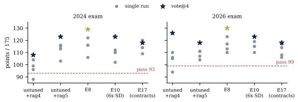
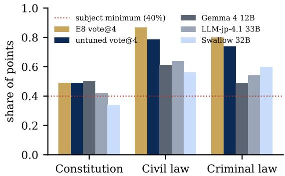
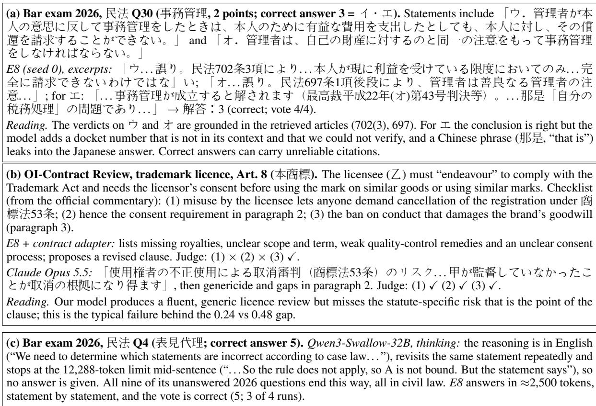

# XLaw-JP-27B: A Lightweight Open Model Specialized for Japanese Law

Andrew Shin

Keio University X-Law, Inc.

andrew@x-law.jp

https://x-law.jp/

## Abstract

We present XLaw-JP-27B, an open-weight model specialized for Japanese law that runs on a single 48 GB GPU under the Apache 2.0 licence. It adapts Qwen3.8-27B with hybrid retrieval over all current statutes and 31k case summaries, a light QLoRA fine-tune on its own verified answers to past bar-exam questions (self-distillation), a contract-specific LoRA adapter, and four-sample voting. We evaluate it on eight Japanese legal tasks—the multiple choice section of the bar examination in 2024, 2025 and 2026, statement-level bar questions (JBE-QA), statute questions (LawQA-JP), the patent attorney exam, and contract review and drafting built from government model contracts—against open models of 12–33B under identical prompts and retrieval. XLaw-JP-27B ranks first on six tasks, ties on one and is third on one (mean rank 1.3 against 2.8–3.1 for the baselines). It is the only system that passes the bar exam in all three years (129, 120 and 130 of 175, meeting every subject minimum; no test-year material was used in training), while open Japanese 32–33B mod els fail at least one year. A controlled study of each component shows that retrieval, voting and self-distillation help, and that think ing mode, retrieval-grounded synthetic tuning, self-verification, per-statement decomposition and more self-distillation do not. The largest remaining gaps to frontier models are in contract review and patent law. The model is available as a free web service at https: //x-law.jp/ with the weights available at https://huggingface.co/X-LawJapan/ xlaw-jp-27b under Apache 2.0.

## 1 Introduction

Large language models now pass professional legal examinations in several jurisdictions, but most strong Japanese results come from closed models or closed retrieval products whose components are not disclosed (Legalscape, 2025; innovatopia, 2025).

Law firms, courts, companies and public bodies that cannot send client documents to an external API need something else: a model that runs on hardware they control, under a licence that permits commercial use and modification, and that is good at the range of things Japanese legal work involves— not one exam, but statutes, case law, patents and contracts.

We build such a model and evaluate it broadly. XLaw-JP-27B is a 27B-parameter model (Qwen3.8-27B, Apache 2.0) specialized for Japanese law through retrieval over the current text of every statute and 31k court-decision summaries, a light fine-tune on its own verified reasoning, a contract adapter, and voting (§4). We compare it with the strongest open lightweight models we could run on the same hardware—Gemma 4 12B, LLM-jp-4.1 33B and Qwen3-Swallow 32B, the latter two Japanese-specialized—on eight tasks, with identical prompts and retrieval for every model (§5). Because one 77-question exam paper moves by up to 16 points between random seeds of the same system (§3), we report every seed and paired bootstrap intervals, and we build the recipe one component at a time on two clean exam years.

## Contributions.

• A lightweight open model for Japanese law. Among the open models of 12–33B we evaluated, XLaw-JP-27B is best overall across eight tasks (first on six, tied on one, third on one) and the only one to pass the bar exam’s multiple-choice section in 2024, 2025 and 2026 (129, 120, 130; §5, §6).

• A Japanese legal evaluation suite covering the bar exam, statement-level and statute questions, the patent attorney exam (Benrishi-MC) and two new tasks, OI-Contract Review and OI-Contract Draft, built from the Japan Patent

Office’s model contracts with checklist grading (§3, §7.1).

• What works at this scale. Retrieval contributes most (+17 to +25 points per exam), voting 10–15 and self-distillation 3–12; on bar statements retrieval already closes ∼87% of the gap to gold articles, so the remaining errors are reasoning errors (§7).

• What does not. Five negative results, each with a mechanism: thinking mode, retrievalgrounded synthetic SFT, self-verification, perstatement decomposition and scaled selfdistillation (§8).

## 2 Related Work

LLMs on the Japanese bar exam. チェ et al. (2023) evaluated GPT-3/4 on five years of the 短 答式 (30–40% accuracy). In our prior work, Shin (2026) fine-tuned GPT-4.1 on the original exam format with self-verification and reached 94.7/175 on 2024 (pass mark 93). Legal retrieval products report 160 on 2024 (Legalscape, 2025) and 169 on 2025 (innovatopia, 2025), with undisclosed models and self-reported scoring. We are not aware of a published open-weight result on the full section, nor of any LLM result on the 2026 exam.

Japanese legal benchmarks. JBE-QA (Cao et al., 2026) turns 2015–2024 bar-exam statements into 3,464 true/false items and evaluates 26 models closed-book; the best open model, Swallow-3.3- 70B, reaches 0.731 F1. LawQA-JP (植松 and 大杉, 2026) has 140 four-choice statute questions with gold articles. The COLIEE statute task (Nguyen et al., 2025) uses Civil Code statements with gold articles; we use its data for evaluation only. Legal-Rikai (Fujita et al., 2026) grades contract revision by experts but evaluates closed models only.

Domain adaptation for law. Legal LLMs are commonly built by continued pre-training or instruction tuning on legal text. Our negative result with 15k retrieval-grounded synthetic examples (§8) shows that such tuning can erode a strong instruction model’s reasoning style; we instead keep the base model’s own reasoning and only reinforce its verified answers.

Techniques. We build on hybrid lexical–dense retrieval (Robertson and Zaragoza, 2009; Tsukagoshi and Sasano, 2024), self-consistency (Wang et al., 2023), learning from one’s own correct rationales (Zelikman et al., 2022), and QLoRA (Dettmers et al., 2023). Japanese open models include LLMjp (LLM-jp, 2024) and Swallow (Fujii et al., 2024).

## 3 Setup

Base model. Qwen3.8-27B (Qwen Team, 2026) (Apache 2.0), run in FP8 with vLLM (Kwon et al., 2023) on one 48 GB NVIDIA L40S. Thinking mode is off and we use the model card’s nonthinking sampling (temperature 0.7, top-p 0.8, topk 20, presence penalty 1.5) with fixed seeds; greedy decoding fell into repetition loops on a third of truncated answers. Exam answers get an 8,192-token budget: at 4,096, a quarter of answers were cut off mid-reasoning and scored zero.

Bar exam (短答式). The 2019–2024 papers (憲 法, 民法, 刑法; 77 questions, 175 points per year), the 2025 paper and the 2026 paper, scored with the Ministry of Justice’s rules, including partial credit for multi-part answers and the 2026 順不 同 questions. A run passes if it reaches the year’s pass mark (93 in 2024, 81 in 2025, 99 in 2026) and 40% in every subject. 2024, 2025 and 2026 are test years: no training data comes from them. On the 2026 exam human takers averaged 118.1 and successful candidates 126.2.

Other benchmarks. JBE-QA (3,464 items; we report MCC, which is not inflated by a “true” bias, and F1 for comparison with Cao et al., 2026); LawQA-JP (140); the 弁理士 (patent attorney) multiple-choice exam 2024–2025 (120 questions, pass ≈65%); 判例抽出, generating the holdings summary and cited articles of 93 2022–24 decisions (ROUGE-L, set F1); OI-Contract Review and OI-Contract Draft (§7.1); and JCommonsenseQA, JSQuAD and JEMHopQA to detect regressions in general Japanese.

Variance. One exam paper is small: across four seeds the same system spans 10–16 points. We therefore report all four seeds, their mean, the vote over them, and 95% paired bootstrap intervals over questions (10,000 resamples) for every comparison we draw a conclusion from.

Contamination check. The 2019–2024 papers and their answer keys have been public for years, the 2026 paper since mid-2026; the base model’s pretraining data is not disclosed. If memorisation drove the scores, older papers should score higher. They do not (Table 2): closed-book, the untuned model scores 69–94 on 2019–2023 (mean 83.4) and 88 on 2026; with retrieval 104–131 and 104. Year-to-year differences are of the same size as seed noise. This does not prove the absence of contamination, but it shows no advantage on the oldest material.

<table><tr><td>Benchmark</td><td>Items</td><td>Metric</td><td>Test material</td></tr><tr><td>司法試験短答式2024</td><td>77</td><td>points/175</td><td>held out</td></tr><tr><td>司法試験短答式2025</td><td>77</td><td>points/175</td><td>held out</td></tr><tr><td>司法試験短答式2026</td><td>77</td><td>points/175</td><td>held out</td></tr><tr><td>JBE-QA</td><td>3,464</td><td>MCC, F1</td><td>2015-24</td></tr><tr><td>LawQA-JP</td><td>140</td><td>accuracy</td><td>statutes</td></tr><tr><td>Benrishi-MC(弁理士)</td><td>120</td><td>accuracy</td><td>2024-25</td></tr><tr><td>判例抽出</td><td></td><td>93 ROUGE-L, F1</td><td>2022-24</td></tr><tr><td>OI-Contract Review</td><td></td><td>93 checklist recall</td><td>held-out half</td></tr><tr><td>OI-Contract Draft</td><td></td><td>6 row score</td><td>held-out half</td></tr><tr><td>COLIEE (Civil Code)</td><td>511</td><td>accuracy, MCC</td><td>eval only</td></tr><tr><td>JCQA / JSQuAD / JEMHopQA 1,119 / 4,442 / 120</td><td></td><td>acc. / EM</td><td>general</td></tr></table>

Table 1: Evaluation suite. Training uses only 2019–2023 exam answers produced by the model itself, contract material from the training half of the OI contracts, and other government model contracts. JBE-QA overlaps the 2019–2023 papers (and contains 2024), so we report it for comparison with the literature, not as a clean test.
<table><tr><td></td><td>2019</td><td>2020</td><td>2021</td><td>2022</td><td>2023</td><td>2024</td><td>2026</td></tr><tr><td>closed-book</td><td>94</td><td>79</td><td>89</td><td>86</td><td>69</td><td>79</td><td>88</td></tr><tr><td>+ rag5</td><td>111</td><td>104</td><td>131</td><td>104</td><td>111</td><td>113</td><td>104</td></tr></table>

Table 2: Untuned Qwen3.8-27B by exam year (seed 0, /175). No trend towards older, longer-public papers.

## 4 Method

Retrieval (rag5). The corpus holds the current text of 8,141 laws (392,422 articles, from e-Gov) and 30,884 court-decision summaries. Candidates from BM25 and Ruri-v3-310m dense retrieval (Tsukagoshi and Sasano, 2024) are pooled and reranked by ruri-v3-reranker-310m, restricted to the laws of the question’s subject. On top of this hybrid retriever (rag4), rag5 (i) looks up every article named in the question directly, (ii) retrieves for each lettered statement (ア．イ．. . . ) separately as well as for the whole question, and (iii) allows up to 10 articles and 5 case summaries (5,500 characters). Against a silver set of articles cited in fully correct answers, statute recall rises from 0.395 (rag4) to 0.502 (rag5); on COLIEE statements with gold articles, hybrid retrieval has hit@3 0.890. Named-article lookup matters because exam statements often cite an article by number (e.g. “民 法第94条第2項”); the per-statement queries matter because the five statements of one question typically concern different articles (e.g. 事務管 理: 697, 702 and 703 in the example of Figure 3).

<table><tr><td></td><td>rag4</td><td>rag5</td></tr><tr><td>Statute recall (silver set)</td><td>0.395</td><td>0.502</td></tr><tr><td>Questions with &gt;1 silver article</td><td>0.844</td><td>0.921</td></tr><tr><td>Statutes in context per question</td><td>3.0</td><td>4.9</td></tr><tr><td>2026: mean of 4 runs / worst / vote@4</td><td>103.8 / 94 / 126</td><td>108.3 / 104 / 118</td></tr><tr><td>2024: mean of 4 runs / worst / vote@4</td><td>96.8 / 88 / 108</td><td>111.8 / 103 / 123</td></tr><tr><td>Unanimous questions (2026)</td><td>26/77</td><td>35/77</td></tr></table>

Table 3: Retriever ablation (untuned model). rag5 raises every single run above the pass mark; its runs agree more, so voting adds less, and the two years’ votes move in opposite directions—a reminder that singlepaper comparisons of one vote are noisy.

For contract review the same retriever is restricted to 20 contract-relevant laws (Civil Code, the Subcontract Act and its 2026 successor, the Freelance Act, Antimonopoly Act, consumer-contract, IP and personal-information statutes, conflict of laws and civil procedure). Table 3 compares the two retrievers with everything else fixed.

Self-distillation (E8). We sample answers from the untuned model on the 2019–2023 papers (with rag5) and keep 150 whose final answer matches the official key exactly. These are mixed with 91 contract reviews (§7.1) and used for QLoRA (Dettmers et al., 2023) (rank 32, 2 epochs, 29 steps of 16 examples, learning rate 10−4, max length 8,192), then merged into the base weights. Training never sees 2024, 2025 or 2026. We call this model E8 in the ablations; the released XLaw-JP-27B is E8 plus the contract adapter of §7.1, which is applied only to contract requests (exam numbers are E8’s). In one rag5 run (seed 0) the untuned model answers 238 of the 383 questions of 2019–2023 exactly right; E8 uses a random 150 of these answers verbatim (E10 pools further runs: 327 questions with rag5 and 215 closed-book), with the exam prompt and retrieved context they were produced with, so that training input matches test input exactly. Keeping the model’s own long, statement-by-statement reasoning (median ≈2,300 tokens) is what distinguishes this data from the retrieval-grounded SFT set of §8, whose short answers taught the model to stop reasoning. The 91 contract reviews were written by the same model with the official commentary as a private reference; a first version leaked that reference in 229 of 300 answers (「解説にあるよ うに」) and was discarded, the second filters and rewrites such answers.

Voting. Four samples with different seeds; the most frequent parsed answer wins (ties: lowest seed; order-free answers vote on the sorted digits).

## 5 Japanese legal tasks at a glance

Table 4 summarises the comparison. XLaw-JP-27B ranks first on the three bar-exam papers, the patent attorney exam and both contract tasks, ties Gemma 4 12B on LawQA-JP and is third on JBE-QA, where the two Japanese-specialized thinking models lead. The ranking does not depend on voting: compared run for run, XLaw-JP-27B is still first on six tasks (mean rank 1.4). It is also the only system that clears every pass mark: Gemma 4 12B misses 2024, LLM-jp-4.1 33B misses 2026 and Qwen3-Swallow 32B misses 2025 and 2026. Relative to its own base model with the same retrieval and voting, the specialization adds 6–12 exam points, 0.02–0.03 on LawQA-JP, JBE-QA and Benrishi-MC, and 0.013 on drafting.

The pattern of wins and losses is informative. Thinking models reason at length about a single statement and win on JBE-QA; on five-statement exam questions the same behaviour exhausts the budget (§7). Contract review is the task on which every open model, ours included, is furthest from the frontier (0.17–0.24 against 0.475).

## 6 The bar exam in depth

Table 5 builds the system up one component at a time. Decoding matters first: greedy decoding loops and runs out of budget, the card’s sampling with an 8k budget lifts closed-book scores by 19– 23 points. Retrieval adds the most (+17 to +25 with rag4); rag5 makes single runs pass reliably (worst of four seeds 104 and 103, versus 94 and 88 for rag4). Self-distillation adds a further 3–8 points per run and voting 10–15.

Is the fine-tune real? Paired by seed, E8 beats the untuned model in 7 of 8 exam runs (one tie). With voting on both sides the gain is +12 on 2026 (95% CI [−1, +26], one-sided p = 0.047) and +6 on 2024 ([−8, +22]); on the 3,460 JBE-QA items it is significant: MCC +0.028 [+0.012, +0.045], p = 0.001 (Table 6). The 150 training answers come from earlier papers, and nothing else in the training mix concerns the exam, so we attribute the gain to self-distillation; we test the dose in §8.

Comparison with prior work. 129 on 2024 is 34 points above the fine-tuned GPT-4.1 of Shin (2026) (94.7) and above o3 and Gemini 2.5 Pro as reported by Legalscape (2025) (≈115–118, retrieval not disclosed). Closed retrieval products remain far ahead (160–169).

  
Figure 1: Four single runs (dots) and their vote (stars) per system. Seed spread is 10–16 points; voting adds 3–22 points over the mean run, least for systems whose runs already agree (E17).

A third test year. On the 2025 paper (pass mark 81; human candidates averaged 102.1 and successful ones 110.6 according to prep-school reports), the final system scores 120 with vote@4; with the same retrieval, one run each of Gemma 4 12B, LLM-jp-4.1 33B and Qwen3-Swallow 32B scores 87, 88 and 85 (Swallow misses a subject minimum and leaves 14% of answers unparsed); the closed product of innovatopia (2025) reports 169. Single runs score 98–113, and two of the four miss the constitutional-law minimum (18 and 19 of 50) despite totals far above 81: subject minimums, not totals, are the binding constraint for single runs, and voting removes the risk (26/50).

Where the points come from. Pooled over both test years (Figure 2), the final system scores 87% of the civil-law points and 80% of criminal law but only 49% of constitutional law—no better than the untuned model and close to the 40% subject minimum (22/50 on 2026). Constitutional questions turn on case-law reasoning about rights and standards of review, which the statute-heavy retrieval supports least; most models we tested are weakest there. By question format, five-way “choose the correct pair” questions are answered best (0.86 of points) and true/false combination tables (one mark per statement) worst (0.33): a table option is right only if all four or five judgements are right, so one error in five statements costs the whole question. Self-distillation helps most on pairs (+0.08) and tables (+0.17) and not on per-statement digit answers, where the untuned model is already as good.

## 7 Further tasks in detail

Open baselines. With the same retrieval, the two Japanese 32–33B thinking models fall short of the pass mark on 2026 (92 and 82) although they lead on single true/false statements (JBE-QA, +0.06–0.12 MCC on a shared 200-item sample). Long reasoning helps a single statement but hurts five-statement questions: Swallow produced no parseable answer for 12% of exam questions, mirroring our own thinking ablation (§8). Gemma 4 12B with rag5 is a strong cheap baseline: one greedy run passes 2026 (101) and ties us on LawQA-JP.

<table><tr><td rowspan="2">Model (same prompts and rag5 retrieval)</td><td colspan="3">Bar exam (points /175) 2025</td><td rowspan="2">Benrishi-MC</td><td rowspan="2">LawQA-JP acc.</td><td rowspan="2">JBE-QA§ MCC</td><td colspan="2">OI-Contract</td><td rowspan="2">Mean rank</td></tr><tr><td>2024</td><td>2026</td><td>acc.</td><td>Review</td><td>Draft</td></tr><tr><td>XLaw-JP-27B (vote@4; contract adapter)</td><td>129</td><td>120</td><td>130</td><td>0.517</td><td>0.821</td><td>0.537</td><td>0.240</td><td>0.829</td><td>1.3</td></tr><tr><td>single run (mean of 4)</td><td>115.0</td><td>105.0</td><td>115.8</td><td>0.473</td><td>0.818</td><td>0.537</td><td>0.240</td><td>0.829</td><td>1.4</td></tr><tr><td>Qwen3.8-27B base (vote@4)</td><td>123</td><td>一</td><td>118</td><td>0.483</td><td>0.800</td><td>0.515</td><td>0.240</td><td>0.816</td><td></td></tr><tr><td>Gemma 4 12B</td><td>90</td><td>87</td><td>101</td><td>0.350</td><td>0.821</td><td>0.534</td><td>0.228</td><td>0.794</td><td>2.8</td></tr><tr><td>LLM-jp-4.1 33B (thinking)</td><td>100</td><td>88</td><td>92</td><td>0.383</td><td>0.793</td><td>0.600</td><td>0.169</td><td>0.759</td><td>2.8</td></tr><tr><td>Qwen3-Swallow 32B (thinking)</td><td>96</td><td>85</td><td>82</td><td>0.383</td><td>0.800</td><td>0.660</td><td>0.173</td><td>0.692</td><td>3.1</td></tr><tr><td>Pass mark</td><td>93</td><td>81</td><td>99</td><td>0.65</td><td></td><td></td><td></td><td></td><td></td></tr><tr><td>Claude Opus 5.5 (closed, likely &gt; 100× larger)</td><td>173</td><td>一</td><td>171</td><td></td><td>0.886*</td><td></td><td>0.475</td><td>0.978</td><td></td></tr></table>

Table 4: Eight Japanese legal tasks, same prompts and retrieval for every open model; baselines one run each. Mean rank over the eight task columns among the four systems above the line (ties averaged). ‡below the pass mark or a subject minimum. §the same 200 JBE-QA items. ∗no retrieval. Differences of a few points on one exam paper, and the OI-Contract Review gap to Gemma, are within run-to-run noise (§3).

<table><tr><td>System (one run unless noted)</td><td>2024</td><td>2025</td><td>2026</td></tr><tr><td>Pass mark</td><td>93</td><td>81</td><td>99</td></tr><tr><td>Gemma 4 12B, closed-book</td><td>69</td><td>一</td><td>76</td></tr><tr><td>Gemma 412B + rag4</td><td>83</td><td>一</td><td>78</td></tr><tr><td>Gemma 412B + rag5</td><td>90</td><td>87</td><td>101</td></tr><tr><td>LLM-jp-4.1 33B (thinking) + rag5</td><td>100</td><td>88</td><td>92</td></tr><tr><td>Qwen3-Swallow-32B (thinking) + rag5</td><td>96</td><td>85†</td><td>82</td></tr><tr><td>Qwen3.8-27B greedy, closed-book</td><td>60</td><td></td><td>65</td></tr><tr><td>+ recommended sampling, 8k budget</td><td>79</td><td></td><td>88</td></tr><tr><td>+ rag4 retrieval</td><td>104</td><td></td><td>105</td></tr><tr><td>+ rag5 retrieval (mean of 4 seeds)</td><td>111.8</td><td></td><td>108.3</td></tr><tr><td>vote@4</td><td>123</td><td></td><td>118</td></tr><tr><td>+ self-distillation (E8, mean of 4)</td><td>115.0</td><td>105.0</td><td>115.8</td></tr><tr><td>vote@4 (ours)</td><td>129</td><td>120</td><td>130</td></tr><tr><td>Claude Opus 5.5, (closed, likely &gt; 100× larger)</td><td>173</td><td></td><td>171</td></tr></table>

Table 5: Bar exam multiple-choice section, points out of 175, official scoring. All Qwen rows share the base model. Our final system passes all three years including every subject minimum. 2025 was added for the final system and the baselines only (–: not run). †fails a subject minimum.

The patent attorney exam. Benrishi-MC is the hardest benchmark in our suite. With vote@4 the final system answers 62 of 120 questions (pass mark 78), ahead of the baselines (42–46), but the subject profile is uneven: copyright and unfair competition 16/20, designs 14/20, trademarks 11/20, treaties 9/20, and patents and utility models only 12/40—barely above the 20% expected from guessing among five options. Patent questions hinge on procedural details (deadlines, divisional and converted applications, priority claims) spread over the Patent Act, its enforcement orders and the PCT implementation law; we suspect that retrieval reaches the right statute more often than the right provision (we have no gold articles to check this), and the treaty texts are not in the corpus.

  
Figure 2: Share of points by subject, 2024 and 2026 combined (all systems with rag5; baselines one run).

Table 6 shows that the fine-tune transfers to statement-level bar questions (JBE-QA) and does not hurt general Japanese reading comprehension or the judgement summarisation task. It does not close the large gap on intellectual-property law: the patent attorney exam remains far below its pass mark even with retrieval over the IP statutes (the corpus lacks the treaty texts that make up a sixth of the exam).

Oracle retrieval. On COLIEE Civil Code statements (511, 2019–23; evaluation only), closedbook MCC is 0.314, rag5 0.598 and gold articles 0.641 (accuracy 0.648 / 0.795 / 0.806): retrieval closes ∼87% of the gap, and even with the right article the model misjudges about one statement in five. On LawQA-JP’s specialized statutes rag4 retrieval closes only ∼53% of the gap (accuracy 0.580 / 0.770 / 0.936). The bar exam is therefore limited by legal reasoning, which is why training on the model’s own correct reasoning helps there.

<table><tr><td></td><td>JBE-QA MCC</td><td>JBE-QA F1</td><td>LawQA-JP</td><td>弁理士</td><td>判例 ROUGE-L</td><td>JSQuAD EM</td></tr><tr><td>Qwen3.8-27B, closed-book</td><td>0.307</td><td>0.634</td><td>0.580†</td><td>0.300</td><td></td><td>0.875</td></tr><tr><td>Qwen3.8-27B + rag5, vote@4</td><td>0.586</td><td>0.777</td><td>0.800</td><td>0.483</td><td>0.469*</td><td></td></tr><tr><td>E8 + rag5, vote @4 (ours)</td><td>0.615</td><td>0.785</td><td>0.821</td><td>0.517</td><td>0.514*</td><td>0.877*</td></tr><tr><td>E8 + gold articles (oracle)</td><td></td><td></td><td>0.943</td><td></td><td></td><td></td></tr><tr><td>Gemma 412B + rag5</td><td>0.598</td><td>0.786</td><td>0.821</td><td>0.350</td><td></td><td></td></tr><tr><td>LLM-jp-4.1 33B (thinking) + rag5</td><td>0.600</td><td>0.800§</td><td>0.793</td><td>0.383</td><td></td><td></td></tr><tr><td>Qwen3-Swallow-32B (thinking) + rag5</td><td>0.6608</td><td>0.835</td><td>0.800</td><td>0.383</td><td></td><td></td></tr><tr><td>ours on the same 200 items</td><td>0.5378</td><td>0.749§</td><td></td><td></td><td></td><td></td></tr><tr><td>Best open model in Cao et al. (2026) (closed-book) gpt-4.1 in 植松 and 大杉 (2026) (closed / gold)</td><td></td><td>0.731</td><td>0.607 / 0.964</td><td></td><td></td><td></td></tr></table>

Table 6: Other benchmarks. †mean of 4 seeds; ∗seed 0, no retrieval. 弁理士 is accuracy over 2024–25 (pass ≈0.65). JBE-QA closed-book uses all 3,464 items; retrieval rows the 3,460 items in the rag5 cache. §the same random 200 JBE-QA items (thinking baselines are 10–20× slower). Baselines: one run, same prompts and contexts as ours. Literature rows are for orientation only: their setting differs (no retrieval).

## 7.1 Contract review and drafting

We built two tasks from the twelve OI model contracts of the Japan Patent Office and METI (OIモ デル契約書; NDA, PoC, joint research, licence, AI and data contracts; public data licence). OI-Contract Review: given a scenario and one clause presented by the counterparty, list risks for the client, negotiation points and a revised clause; graded by Claude Opus 5.5 against 3–6 checklist points written from the official commentary. OI-Contract Draft: write the whole contract from a term sheet; each term-sheet row is checked for implementation and consistency. Contracts are split in halves by document (93 review items, 6 drafts held out).

Construction. Each review item is one clause as it appears in the model contract, one of the official alternative wordings ( $( x > ) \div \exists \div 1$ ), or a variant proposed in the official commentary (【変更 $x > 0 \Rightarrow \supsetneq \infty$ )—so every clause and every gold point was written by the lawyer-supervised drafting committee, not by us. Claude Opus 5.5 reduced each clause’s commentary to 3–6 atomic, checkable points under three constraints (use only what the commentary says, no paraphrases of the clause or generic advice, keep the parties’ roles straight); items whose commentary yielded fewer than two reviewable points were dropped, leaving 189 items, and we spot-checked the result. The same model judges answers point by point. Calibration: Opus itself, answering, covers 0.478 of the points on all items; any system that reproduced the commentary would score 1.0, so the scale has room above frontier models.

Review is the weakest skill (Table 7): the model covers about half of what Opus covers and is weakest on clauses that have been tilted against the client.

<table><tr><td>Held-out (OI-Contract)</td><td>Review</td><td>Draft</td></tr><tr><td>Qwen3.8-27B</td><td>0.240</td><td>0.816</td></tr><tr><td>E8</td><td>0.220</td><td>0.769</td></tr><tr><td>Qwen3.8-27B + statute retrieval</td><td>0.270</td><td></td></tr><tr><td>E8 + statute retrieval</td><td>0.241</td><td></td></tr><tr><td>Issue-injection SFT (E17)</td><td>0.242</td><td>0.810</td></tr><tr><td>E8 + contract adapter (E17c)</td><td>0.240</td><td>0.829</td></tr><tr><td>with statute retrieval</td><td>0.247</td><td></td></tr><tr><td>Gemma 412B</td><td>0.228</td><td>0.794</td></tr><tr><td>LLM-jp-4.1 33B (thinking)</td><td>0.169</td><td>0.759</td></tr><tr><td>Qwen3-Swallow-32B (thinking)</td><td>0.173</td><td>0.692</td></tr><tr><td>Claude Opus 5.5 (reference)</td><td>0.475</td><td>0.978</td></tr></table>

Table 7: Contract review (checklist recall) and drafting (term-sheet row score). Opus also grades, so its own scores may be inflated by self-preference.

E8’s 91 commentary-grounded reviews did not help. Issue injection. To get training targets whose correctness does not rest on the teacher, we planted one of 26 one-sided problems (uncapped liability for one side, change-of-control termination, assignment of all IP, payment terms beyond 60 days, unilateral price cuts, . . . ; each with three required review points and the governing statutes) into 322 sound clauses from government model contracts (MAFF, METI, MLIT) and the training half of the OI contracts. The model verified each injection (897 of 1,094) and reviewed the altered clause with retrieved statutes and a private note of the required points; 373 reviews covered every point. Trained from the base model together with E8’s data (E17), review stays at 0.242 and drafting recovers to 0.810, but voting on the exams drops to 118/118 (−12 and −11 against E8, $p \approx 0 . 0 6 \substack { - 0 . 0 9 } )$ : runs agree more, so the vote adds less. Planted-problem spotting does not transfer to the commentary-derived checklists, which emphasise startup-specific consequences (M&A, listing review, IP strategy). A second, larger round (34 problem types including startup and IP issues; 557 reviews) trained as a contract-only LoRA adapter on top of E8, so that exams keep using E8 unchanged, improves drafting to 0.829—the best open result—but leaves review at 0.240 (0.247 with statute retrieval). Every open model and recipe we tried lands between 0.17 and 0.27 on review, against 0.475 for Opus: closing this gap likely needs expert-written or stronger-teacher reviews.

<table><tr><td>Technique</td><td>Measured on</td><td>without</td><td>with</td></tr><tr><td>Thinking mode (16k)</td><td>2026 + rag4, one run</td><td>88</td><td>58</td></tr><tr><td>Retrieval-grounded SFT (15k)</td><td>JBE-QA + rag4 (400), MCC 2026 + rag4, one run</td><td>0.606 105</td><td>0.710 70</td></tr><tr><td>Self-verification</td><td>vote @4, 2026 / 2024</td><td>126 / 108</td><td>126 / 102</td></tr><tr><td>Statement decomposition</td><td>E8, 2026 / 2024</td><td></td><td>116 / 120</td></tr><tr><td></td><td></td><td>130 / 129*</td><td></td></tr><tr><td>6× self-distillation</td><td>vote @4, 2026 / 2024</td><td>130 / 129</td><td>123 / 123</td></tr><tr><td>Contract SFT, full model</td><td>vote@4, 2026 / 2024</td><td>130 / 129</td><td>118 / 118</td></tr></table>

Table 8: Negative results. Points /175 unless noted. ∗vote@4; decomposition uses five samples per statement, comparable compute.

## 8 What did not help

Thinking mode. With a 16k budget, thinking raises JBE-QA+retrieval MCC from 0.606 to 0.710 on a 400-item subset, but loses on exams (2026 + rag4: 58 vs 88): it spends 14–15k tokens per multistatement question and 27% of answers are cut off, at 5–10× the cost.

Retrieval-grounded SFT. 15,000 synthetic examples (statute true/false, statute QA, consultation, answer format) from the same model as teacher made every metric worse (2026 + rag4: 70 vs 105). The short training answers (median 155 characters) taught the model to stop reasoning: exam answers shrank from ∼2,300 to 260–350 tokens.

Citation-checked self-verification. A second turn shows the e-Gov text of every article the draft cites and asks for a re-check. Of 1,232 answers, 173 changed: 38 wrong→right, 44 right→wrong; vote@4 is unchanged on 2026 and 6 points worse on 2024. With mostly valid citations (91–96%), verification mainly induces second-guessing, unlike the GPT-4.1 setting of Shin (2026).

Per-statement decomposition. Judging each statement alone (five samples, own retrieval) and assembling the answer in code covers 70–76% of the points and reproduces every official key from perfect verdicts. It scores like a single run (E8: 116 and 120) and 3–14 points below whole-question voting at similar compute: the model uses constraints between statements that decomposition hides.

More self-distillation. Six times more selfdistilled answers (877; closed-book and rag5) did not beat E8 (vote@4 123/123 vs 130/129), although it gave the best constitutional-law scores. The gain from self-distillation saturates early at this scale.

## 9 Cost

All runs use one NVIDIA L40S (48 GB; AWS g6e.xlarge, US\$1.86/hour on demand). An exam answer with rag5 averages about 2,500 output tokens; one 77-question paper takes ≈21 minutes, so the four runs of a vote cost ≈US\$2.6 per paper, or about 3.5 cents per question. The thinking baselines generate 2,200 (LLM-jp) to 6,700 (Swallow) tokens per exam question and leave 12% of Swallow’s answers unparsed at a 12k budget. Fine-tuning E8 takes about one GPU-hour and the whole study, including every negative result, about US\$300 of GPU time plus ≈US\$70 of judge and reference API calls. A single-GPU deployment serving one model around the clock costs about US\$1,360 per month on demand.

## 10 Release and deployment

The weights of XLaw-JP-27B (the merged E8 model and the contract adapter, with checksums of every file, the base-model revision and the training configurations) are publicly released under Apache 2.0. The same weights serve a free public beta, X-Law JP Agent, at https://x-law.jp/. One vLLM process on a single L40S hosts the merged model and applies the contract adapter per request; a gateway performs the retrieval of §4 for every query (statutes and case summaries; the contract statute set for contract requests), streams answers, and offers a thinking-mode toggle. Beyond chat, the interface provides clause-by-clause contract review with Word and Excel reports, contract drafting from a term sheet, and case and statute search. Uploaded Word, PDF, PowerPoint and Excel files are converted to text, and scanned PDFs and images are read with Japanese OCR (Tesseract); uploads are kept in memory only and deleted after two hours. A typical answer starts streaming within about a second and completes in 40–55 seconds; a review of a short contract takes one to two minutes.

  
Figure 3: Qualitative examples (excerpts; full outputs in the release materials).

## 11 Discussion

A 27B open model, specialized with retrieval and a few hundred examples of its own verified reasoning, is the strongest of the lightweight open models we tested across eight Japanese legal tasks and passes the bar exam in every test year. Three lessons generalise beyond this model. First, measure variance before measuring gains: on a 77-question paper, seed noise is as large as most of the effects in the literature. Second, at 27B the model’s own verified reasoning is better training data than larger volumes of synthetic data from the same model, and a few hundred examples suffice. Third, the components that help are cheap: hybrid retrieval and four-sample voting run on the same single GPU.

For practitioners, the result means that a model that fits on one workstation-class GPU and can be run on premises answers bar-exam questions at the level of successful human candidates (126.2 on 2026), provided it retrieves the statutes. It does not mean the model is reliable: it still misjudges about one statement in five even with the right article in context, it can attach unverifiable citations to correct conclusions (Figure 3a), and on contract review it captures half of what a frontier model does. Review of its output by a lawyer remains necessary. The gaps that remain—constitutional law, intellectual-property law and statute-specific contract risks—are those where the relevant knowledge sits in case law and specialized commentary rather than in statute text, which suggests that the next gains will come from retrieval over case law and expert-written training data rather than from more synthetic data generated by the model itself.

## Limitations

Three clean exam papers give wide confidence intervals, and component ablations use only two; the 2026 exam was held before the base model’s release, so contamination cannot be fully excluded, although no 2026 material is in our data. The exam scoring is our implementation of the official rules. Contract grading relies on an LLM judge that is also the reference system. All baselines run one seed, and open baselines use our prompts and retrieval, which may not suit them. COLIEE results are pooled over years and are not comparable to official test sets. The system does not give legal advice.

## Ethics Statement

Exam questions, answer keys, statutes and government model contracts are public-sector information reused under their terms; COLIEE data was used for evaluation only, under its agreement. The model can produce confident but wrong legal statements and should be used with professional oversight.

## References

Zhihan Cao, Fumihito Nishino, Hiroaki Yamada, Ha Thanh Nguyen, Yusuke Miyao, and Ken Satoh. 2026. JBE-QA: Japanese bar exam QA dataset for assessing legal domain knowledge. In Proceedings ofthe Fifteenth Language Resources and Evaluation Conference (LREC 2026), pages 5317–5327.

Tim Dettmers, Artidoro Pagnoni, Ari Holtzman, and Luke Zettlemoyer. 2023. QLoRA: Efficient finetuning of quantized LLMs. In Advances in Neural Information Processing Systems (NeurIPS).

Kazuki Fujii, Taishi Nakamura, Mengsay Loem, Hiroki Iida, Masanari Ohi, Kakeru Hattori, Shota Hirai, Sakae Mizuki, Rio Yokota, and Naoaki Okazaki. 2024. Continual pre-training for cross-lingual LLM adaptation: Enhancing Japanese language capabilities. In Conference on Language Modeling (COLM). ArXiv:2404.17790.

Shogo Fujita, Yuji Naraki, Yiqing Zhu, and Shinsuke Mori. 2026. LegalRikai: Open benchmark – a benchmark for complex Japanese corporate legal tasks. In Proceedings ofthe Fifteenth Language Resources and Evaluation Conference (LREC 2026), pages 5055– 5077.

innovatopia. 2025. 弁護士ドットコム「legal brainの司法試験短答式（令和7年）評価に関する報道. 2025-11-12, https://innovatopia.jp/ai/ai-news/71520/. Self-reported by the vendor.

Woosuk Kwon, Zhuohan Li, Siyuan Zhuang, Ying Sheng, Lianmin Zheng, Cody Hao Yu, Joseph E. Gonzalez, Hao Zhang, and Ion Stoica. 2023. Efficient memory management for large language model serving with PagedAttention. In Proceedings of the 29th Symposium on Operating Systems Principles (SOSP).

Legalscape. 2025. Legalscape AI の司法試験短答式（令和6年）評価に関するプレスリリース.PR TIMES, 2025-05-23, https://prtimes.jp/main/html/rd/p/000000039.000049838.html.Self-reported.

LLM-jp. 2024. LLM-jp: A cross-organizational project for the research and development of fully open Japanese LLMs. Preprint, arXiv:2407.03963.

Hoang-Trung Nguyen, Tan-Minh Nguyen, Xuan-Bach Le, Tuan-Kiet Le, Khanh-Huyen Nguyen, Ha-Thanh Nguyen, Thi-Hai-Yen Vuong, and Le-Minh Nguyen.

2025. NOWJ@COLIEE 2025: A multi-stage framework integrating embedding models and large language models for legal retrieval and entailment. Preprint, arXiv:2509.08025.

Qwen Team. 2026. Qwen3.8-27B. Model card, https: //huggingface.co/Qwen/Qwen3.8-27B.

Stephen Robertson and Hugo Zaragoza. 2009. The probabilistic relevance framework: BM25 and beyond. Foundations and Trends in Information Retrieval, 3(4):333–389.

Andrew Shin. 2026. Self-verification is all you need to pass the Japanese bar examination. Preprint, arXiv:2601.03144.

Hayato Tsukagoshi and Ryohei Sasano. 2024. Ruri: Japanese general text embeddings. Preprint, arXiv:2409.07737.

Xuezhi Wang, Jason Wei, Dale Schuurmans, Quoc Le, Ed Chi, Sharan Narang, Aakanksha Chowdhery, and Denny Zhou. 2023. Self-consistency improves chain of thought reasoning in language models. In International Conference on Learning Representations (ICLR).

Eric Zelikman, Yuhuai Wu, Jesse Mu, and Noah D. Goodman. 2022. STaR: Bootstrapping reasoning with reasoning. In Advances in Neural Information Processing Systems (NeurIPS).

ジョンミン チェ, 淳吾 笠井, and 慶祐 坂口. 2023.日本の司法試験を題材としたGPTモデルの評価. Jxiv preprint, doi:10.51094/jxiv.559.

幸生 植松 and 直也 大杉. 2026. LawQA-JP: 日本の法令に関する多肢選択式質問応答データセットの公開と分析. In 言語処理学会第32回年次大会発表論文集 (NLP2026). TS3-12.

## A Prompts and hyper-parameters

All prompts are in Japanese; the system promptis 「あなたは日本法の専門家です。」 un-less noted. With retrieval, the context block isprepended to the user prompt:

【参考資料】（条文・判例要旨を検索によ  
り取得。関係しないものが含まれる場合が  
あります）  
◆law title article text, ≤600 characters . . .  
◆判例 summary, ≤450 characters

Bar exam. 「次の司法試験短答式問題に解答してください。簡潔に検討した上で、最後の行に「解答：」に続けて、 問題文の指示に従った解答番号を数字のみで出力してください。ア・イ・ウ...の各記述についてそれぞれ番号を選ぶ問題では、 記述の順に番号を連続して記載してください（例：アが1、イが1、ウが2なら「解答：112」）。」followed by the question. The answer is the digitstring after the last $\sharp _ { \sharp } ^ { \jmath } \sharp : : $ anything else scoreszero.

JBE-QA. A system prompt asking for 1 if the statement is correct and 0 otherwise (digits only) and the statement as the user turn. Non-binary outputs score as wrong (MCC and F1 treat them as 0).

OI-Contract Review. The model acts as counsel for the startup (X社) and must give (1) risks for the client, (2) negotiation points, (3) a revised clause, given an excerpt of the official scenario and the clause. The judge (Claude Opus 5.5) receives the clause, the numbered checklist and the answer and returns a JSON list of covered/not-covered verdicts plus whether a revised clause is given; verdicts are cached. OI-Contract Draft asks for the full contract from the term sheet; the judge checks every termsheet row for implementation and for consistency with the term sheet and the official model contract.

Decoding. vLLM 0.30, FP8 weights, thinking off; temperature 0.7, top-p 0.8, top-k 20, min-p 0, presence penalty 1.5; seeds 0–3; 8,192 new tokens for exams, 4,096 for contract review, 8,192 for drafting, 1,024 otherwise.

QLoRA (E8, E10, E17). 4-bit base, LoRA rank 32, α = 64 on all linear layers of the language model, 8-bit AdamW $( \beta = ( 0 . 9 , 0 . 9 5 ) )$ , learning rate $1 0 ^ { - 4 }$ with 5 warm-up steps and decay to 10%, effective batch 16 sequences, maximum length 8,192, 2 epochs, seed 0. Adapters are merged into the bf16 base by streaming one tensor at a time and served in FP8. One L40S (48 GB); E8 trains in about an hour, E17 in 2.3 hours.