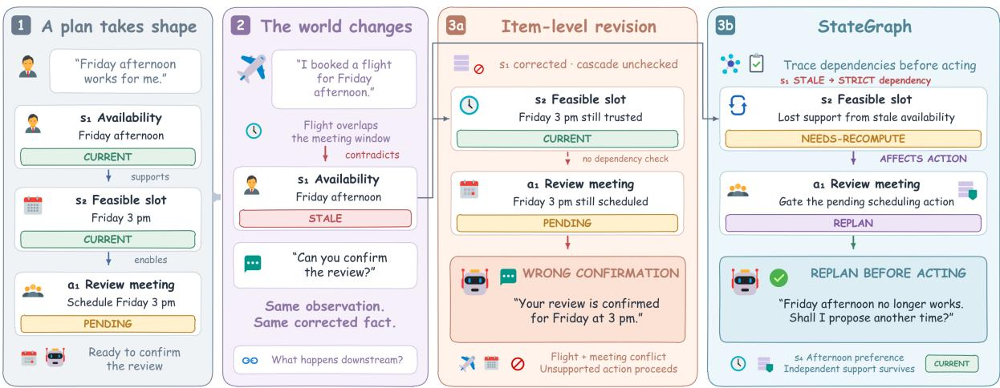
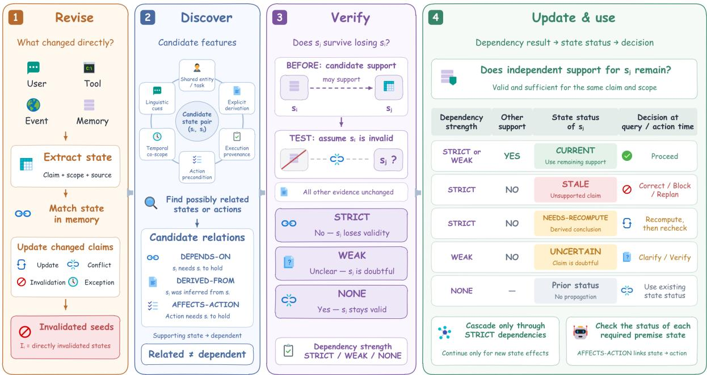
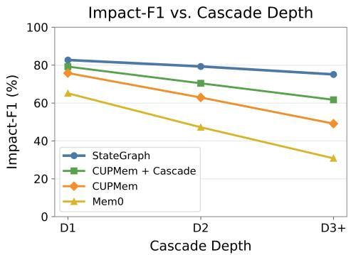

# A State Change Is Local, Its Consequences Are Not: Dependency-Aware State Revision for Long-Term Agent Memory

Yiqi Wang<sup>1,\*</sup> Tongyuan Zhao<sup>1</sup> Jiaqi Zhang<sup>2</sup> Yiqun Duan<sup>3</sup> Zhangkai Wu<sup>4</sup> Mingkai Zheng<sup>5</sup> Taotao Cai<sup>1</sup>

<sup>1</sup>University of Southern Queensland <sup>2</sup>Jiangsu University <sup>3</sup>Uploading Inc.

<sup>4</sup>The University of Sydney <sup>5</sup>Southern University of Science and Technology

yiqi.wang.jennie@gmail.com

## Abstract

Long-lived agents rely on persistent memory of users, tasks and decisions, and this memory must stay consistent with a world that keeps changing. When an upstream fact changes, however, memory systems can revise the contradicted memory itself while the beliefs, plans and actions derived from it remain accepted, even though they have lost their support. We therefore formulate dependency-aware state revision, which asks not only what changed but also which dependent states should no longer be trusted. To address it, StateGraph maintains an evolving state dependency graph whose edges are recovered from interaction histories. Its core design is counterfactual verification: each candidate edge is tested by asking whether the dependent state would survive the loss of its premise, which separates support dependence from semantic relatedness, and revision then invalidates a dependent state only when a strict dependency fails and no independent support path survives. To test this design, we introduce StateChangeBench, a controlled benchmark of 50 author-constructed cases annotated with cascade depth, hard negatives and action consequences. On it, StateGraph’s Impact-F1 margin over a CUPMem reimplementation is 6.9 percentage points at depth 1 and 26.0 at depth 3+. On public long-term memory benchmarks, its point estimates are comparable to or higher than those of the evaluated baselines on most datasets. These results provide ini tial evidence that explicit dependency tracking can improve selective memory revision under changing conditions.

## 1 Introduction

Long-lived agents must update persistent state as availability, tasks, permissions and bookings change. Existing systems consolidate facts (Chhikara et al., 2025), link notes (Xu et al., 2025), page context (Packer et al., 2023), track temporal validity (Rasmussen et al., 2025) or adjudicate state conflicts with propagation-aware search (Chao et al., 2026). These systems address consolidation, temporal validity and state conflicts, but do not necessarily identify which downstream conclusions lose support after an upstream revision.

Consider states $s _ { 1 } \colon$ the user is available Friday afternoon, and $s _ { 2 } \colon$ a 3pm review is feasible, with pending action $a _ { 1 } \colon$ schedule the review. The user then mentions a Friday-afternoon flight, which invalidates $s _ { 1 }$ without directly contradicting $s _ { 2 } .$ , leaving s<sub>2</sub> unsupported but still accepted, so item-level revision can let $a _ { 1 }$ proceed (Figure 1). A state change is local, but its consequences need not be. Knowledge-editing benchmarks show a similar gap between recalling a changed fact and reasoning about its implications (Zhong et al., 2023; Cohen et al., 2024).

We therefore formulate dependency-aware state revision: identify changed states and the downstream beliefs, plans and actions requiring revision. Three challenges arise. Discovery must recover dependencies that are rarely stated explicitly; verification must distinguish support dependence from semantic similarity; and propagation must revise consequences without invalidating weakly dependent states, which should be flagged instead, or independently supported ones.

StateGraph addresses these challenges in turn. Bounded candidate discovery proposes dependency pairs from structural, provenance and linguistic cues rather than comparing all state pairs. Its core design is counterfactual verification: each candidate is tested by asking whether the dependent state would survive the loss of its premise, which grades the edge as STRICT, WEAK or NONE instead of accepting topical association as dependence. Propagation then follows verified edges and invalidates a dependent state only when a STRICT dependency fails and no independent support path survives, flagging weakly dependent states as UNCERTAIN.

Existing benchmarks evaluate recall, temporal reasoning and obsolete-information avoidance (Wu et al., 2025; Uddin et al., 2026; Hu et al., 2025), but lack joint labels for dependencies, downstream targets, unaffected states and action consequences. To test the design, we introduce StateChangeBench, a controlled benchmark of 50 author-constructed cases that provides these labels. On it, StateGraph’s Impact-F1 margin over our CUPMem reimplementation is 6.9 percentage points at depth 1 and 26.0 at depth 3+, and on public memory benchmarks its point estimates are comparable or higher on most datasets. These results provide initial evidence that explicit dependency tracking can improve selective memory revision when upstream facts change; establishing this beyond a small controlled benchmark requires larger independent evaluations.

  
Figure 1: A state change is local, but its consequences are not. The new observation contradicts only s . Left: a system that revises only the contradicted memory marks $s _ { 1 }$ stale but retains $s _ { 2 } ,$ , permitting the pending action a<sub>1</sub> to confirm an infeasible meeting. Right: StateGraph propagates along verified dependency edges and returns the pending action for replanning.

## We make four contributions.

1. We identify how local state changes invalidate downstream beliefs, plans and actions through latent dependencies without directly contradicting them.

2. We introduce StateGraph, whose main methodological contribution is recovering support dependencies from interaction histories and verifying them counterfactually; its propagation stage applies established dependency-directed revision with explicit support and scope checks rather than invalidating every reachable state.

3. We introduce StateChangeBench, a controlled 50-case benchmark annotating dependency structure, cascade depth, hard negatives and action consequences, with metrics for dependency recovery, multi-hop impact and over-/underinvalidation.

4. We evaluate StateGraph against eight memory baselines and two ported-mechanism variants, with ablations isolating verification, alternative support, conservative revision and propagation (§6).

## 2 Related Work

Vector and agentic memory. RAG couples generation with retrieved non-parametric evidence (Lewis et al., 2020), and search-augmented reasoning can learn how much retrieved evidence to acquire and expose (Xiong et al., 2026a). Agent memory adds reflection (Park et al., 2023), recallbased decay (Zhong et al., 2024), consolidation (Chhikara et al., 2025), linked notes (Xu et al., 2025) and context paging (Packer et al., 2023). MemoryOS organizes hierarchical storage and updating (Kang et al., 2025); LightMem combines input compression with offline consolidation (Fang et al., 2026). DIVE accumulates persistent naturallanguage skills and revises them from verifier feedback (Xiong et al., 2026b); such revision targets reusable procedures rather than factual states and their consequences. StateGraph focuses on whether new evidence removes the warrant for downstream states.

Graph-based memory. HippoRAG and HippoRAG 2 combine knowledge graphs with Personalized PageRank for relational retrieval (Jiménez Gutiérrez et al., 2024; Gutiérrez et al.,

2025). StructMem preserves event-level bindings and consolidates cross-event connections (Xu et al., 2026). Temporal graphs encode semantic relations and validity intervals, excluding superseded facts at retrieval time (Rasmussen et al., 2025). SWAP represents reasoning steps as an entailment graph whose intermediate steps can be verified (Xiong et al., 2025), but the graph is built within a single reasoning episode rather than maintained across a changing memory. Retrieving related states and determining which states lose support after a change are distinct tasks.

State-aware memory. STALE (Chao et al., 2026) evaluates implicit conflict: later observations invalidate earlier memories without explicit negation. CUPMem combines state consolidation and propagation-aware search. MCB evaluates whether an agent reusing information should persist it, use it only in context, re-verify it or ask for clarification (Li et al., 2026); we instead ask which downstream states require revision once an upstream state changes. Our direct revision (§4.1) follows write-time adjudication, while dependency verification determines downstream support.

Knowledge editing and ripple effects. Multihop editing benchmarks distinguish recalling edits from propagating their consequences (Zhong et al., 2023; Cohen et al., 2024). These benchmarks evaluate the propagation of triple edits over knowledge graphs; we recover latent dependencies from unstructured observations. Parametric editing methods (Meng et al., 2022, 2023) target model parameters rather than memory states.

Questionable assumptions in QA. QA benchmarks study questions with questionable premises (Kim et al., 2023; Yu et al., 2023). Stale premises are a temporal instance: a premise was valid earlier but has since changed. Memory records when it ceased to hold, enabling evidence-backed correction.

Truth maintenance and belief revision. Truth maintenance retracts unsupported beliefs (Doyle, 1979; de Kleer, 1986); belief revision formalizes change (Alchourrón et al., 1985); incremental view maintenance propagates updates (Gupta and Mumick, 1995). These systems receive explicit dependencies. StateGraph discovers and counterfactually verifies dependencies latent in interaction (§4.2– §4.3), then applies dependency-directed propagation.

## 3 Dependency-Aware State Revision

## 3.1 State Dependency Graph

We model memory at time t as a directed graph $G _ { t } = ( V _ { t } , E _ { t } )$ whose nodes partition into evidence $X _ { t }$ (observations, messages, tool outputs), states $S _ { t }$ and pending actions $A _ { t }$ . A state is a tuple

$$
s = ( e , \ a , \ v , \ \tau , \ \kappa , \ \pi , \ c , \ \sigma ) ,\tag{1}
$$

where $e$ is an entity, a an attribute, v a value, $\tau \textbf { a }$ temporal scope, κ a condition scope, $\pi \subseteq X _ { t }$ the supporting evidence, c a confidence, and σ a status drawn from

$$
\begin{array} { r l } & { \sigma \in \{ \mathrm { C U R R E N T } , \mathrm { ~ S T A L E } , \mathrm { ~ U N C E R T A I N } , } \\ & { \qquad \mathrm { H I S T O R I C A L } , \mathrm { ~ N E E D S - R E C O M P U T E } \} . } \end{array}\tag{2}
$$

Only CURRENT states may be asserted as facts. STALE marks loss of current warrant; HISTORICAL retains a previously valid version. UNCERTAIN marks unknown validity, to be flagged rather than asserted; NEEDS-RECOMPUTE marks a derived conclusion whose inputs changed.

Edges are typed. SUPPORTS links evidence to a state it licenses; UPDATES and INVALIDATES link a newer state to one it supersedes or refutes; DERIVED-FROM links premise states to a conclusion inferred from them; DEPENDS-ON links a prerequisite state to a state whose validity rests on it; AFFECTS-ACTION links a state to a pending action for which it is a precondition. The last three are dependency edges, and are the object of this paper.

## 3.2 Two Distinct Tasks

Let $x _ { t }$ be new evidence. Direct revision identifies the states whose validity $x _ { t }$ itself settles:

$$
D _ { t } = \{ s \in S _ { t } \ : \ x _ { t } \ \mathrm { u p d a t e s \ o r \ c o n t r a d i c t s \ } s \} .\tag{3}
$$

This is the task existing systems address. Cascade revision takes the resulting invalidated set $I _ { t } \subseteq$ $D _ { t }$ and asks which other states or pending actions require revision:

$$
\operatorname { A f f e c t e d } ( I _ { t } ) \subseteq ( S _ { t } \cup A _ { t } ) \setminus D _ { t } .\tag{4}
$$

The central difficulty is that Afected $\left( I _ { t } \right)$ is not the set $R ( I _ { t } )$ of states reachable from $I _ { t }$ over dependency edges:

$$
\mathrm { A f f e c t e d } ( I _ { t } ) \subseteq R ( I _ { t } ) ,\tag{5}
$$

with strict inclusion when independent support or scope restrictions leave reachable nodes CUR-RENT. Weak dependencies require uncertainty handling, not wholesale invalidation. Cascade revision must identify the nodes requiring revision rather than invalidate all of $R ( I _ { t } )$

## 3.3 A Consistency Property

Gold labels assess revision correctness; conditional invalidation closure checks consistency given dependency and support judgments. A STRICT edge states that $s _ { j }$ depended on $s _ { i }$ given the evidence available when the edge was verified (§4.3); it does not rule out support that arises later. A node has alternative support when CURRENT, scopecompatible evidence or states independently license its operative claim after removal of the failed path. Self-support, failed-path evidence and circular justification are excluded; reachability alone does not make otherwise independent support ineligible.

Definition 1 (Conditional Invalidation Closure). A memory state satisfies conditional invalidation closure if, for every pair $s _ { i } \xrightarrow { \mathrm { D E P E N D S - O N } } s _ { j }$ that is a STRICT dependency (§4.3),

$$
\begin{array} { r l } & { \sigma ( s _ { i } ) \neq { \mathrm { C U R R E N T } } } \\ & { \quad \wedge \ { \mathrm { A l t S u p p o r t } } ( s _ { j } ) = \varnothing } \\ & { \quad \implies \sigma ( s _ { j } ) \neq { \mathrm { C U R R E N T } } . } \end{array}
$$

Weakly dependent states are flagged, while independently supported states remain valid. Closure Violation Rate (CVR) is the fraction of eligible pairs violating Definition 1, assessed over a common reference set of dependency pairs; using only each system’s edges would let an empty graph satisfy it vacuously. CVR measures one-way closure; over-invalidation is measured separately. Additional non-CURRENT nodes can activate previously inactive closure requirements. Invalidating all nodes reached in an inferred graph therefore need not close the common reference graph.

## 4 StateGraph

StateGraph’s main methodological contribution lies in recovering and verifying support dependencies from interaction histories. Its propagation stage applies established dependency-directed revision principles (Doyle, 1979) with explicit support and scope checks. StateGraph incrementally performs direct revision (§4.1), candidate discovery (§4.2), counterfactual verification (§4.3) and conservative propagation (§4.4). Premise-aware use (§4.5) gates queries and actions (Figure 2).

## 4.1 State Representation and Direct Revision

Observation $x _ { t }$ yields states with type, provenance and temporal/conditional scope (§3). Canonical slot identifiers track logical states; separate identifiers distinguish assertion versions. Matching uses canonical revision keys and functional identity, meaning that the assertions describe the same logical state. Each matched pair is classified as consistent, duplicate, update, explicit conflict, implicit invalidation, temporary exception or uncertain (Figure 2A). Updates and conflicts change status while preserving older assertions and provenance. Scoped overrides distinguish temporary exceptions from general changes. We adopt the writetime adjudication principle of CUPMem (Chao et al., 2026) within StateGraph’s state schema, canonical matching and scoped status transitions. This produces the seed set $I _ { t } ;$ §6.2 compares the implemented systems’ direct-revision outcomes.

## 4.2 Dependency Candidate Discovery

Given $I _ { t }$ and new states, discovery retrieves a bounded pool of historical states using six structural, revision and provenance sources (Figure 2B1), avoiding exhaustive pairwise comparison:

• Shared entity or task context — states about the same entity, event or task.

• Explicit derivation — one state was inferred from another in an earlier turn.

• Execution provenance — a tool call consumed one state as input and produced another.

• Action preconditions — a plan was committed on the basis of a state.

• Temporal co-scoping — two states share a constrained window.

• Linguistic cues — because, since, that way, so we can.

Directed Relation Typing. Discovery returns unordered pairs. Each is examined in both directions, using $s _ { i } \to s _ { j }$ for prerequisite-to-dependent edges. Types are DEPENDS-ON, where $s _ { j } { } ^ { \ \gamma } \mathbf { s }$ validity relies on $s _ { i } ;$ DERIVED-FROM, where $s _ { j }$ is inferred from $s _ { i } ;$ and AFFECTS-ACTION, where $s _ { i }$ is a precondition for action $a _ { j } \in A _ { t }$ . Directional evidence and endpoint compatibility determine accepted types;

  
Figure 2: The StateGraph pipeline. (A) Direct revision settles what the observation itself contradicts, yielding the seed set $I _ { t } .$ (B) Dependency reasoning—this paper’s contribution—proposes candidates from six bounded sources, then verifies each counterfactually, so the verified graph is a subgraph of the candidate graph. (C) Conservative revision maps each verified edge to a status instead of invalidating everything reachable. (D) Premise and action gating turns status into behavior. Panels correspond to §4.1–§4.5.

candidates with unresolved direction or insufficient relational evidence are rejected before verification.

Similarity retrieves candidates but never establishes dependency: states about one meeting may be independent, while a scheduling commitment may depend on a travel fact with no shared vocabulary. Verification selects supported dependencies from this candidate pool (§6.3). Discovery prioritizes recall; verification filters candidates for precision.

## 4.3 Counterfactual Dependency Verification

For each candidate $s _ { i } \to s _ { j }$ , we probe whether $s _ { j }$ survives antecedent invalidation:

If $s _ { i }$ were no longer a valid current premise, and all other evidence in the verification context remained unchanged, would s<sub>j</sub> still hold?

and label the edge from the answer:

• STRICT — $s _ { j }$ does not survive in the verification context. Its support there runs through $s _ { i }$

$\mathbb { W } \mathbb { E A K } - s _ { i }$ contributes to $s _ { j } { } ^ { : }$ ’s support, but $s _ { j }$ is not defeated without it: either its validity becomes undetermined, or independent support already in the verification context still establishes it.

• NONE — s<sub>j</sub> is unaffected. The states were related, not dependent.

The verifier rejects judgments inconsistent with their counterfactual outcome. Accepted STRICT and WEAK edges retain direction, relation type and dependency strength; NONE edges do not propagate. The counterfactual probe is designed to distinguish support dependence from topical relatedness by testing whether the dependent claim loses its warrant; it also grades the dependency as STRICT or WEAK and identifies reachable states that survive antecedent removal (Equation 5).

Strictness and alternative support. Verification and revision answer different questions. Verification runs when an edge is proposed and judges $s _ { j }$ against the support context available to the verifier at that time. An edge is STRICT only if $s _ { j }$ fails in that context once $s _ { i }$ is removed; if independent support for $s _ { j }$ is already present there, $s _ { j }$ holds and the edge is labeled WEAK (Appendix B.5). STRICT thus means that $s _ { j }$ depended on $s _ { i }$ given the evidence available at verification, not that no other support can arise later. Invalidating the dependent state therefore additionally requires that no independent support path survives at revision time. When $s _ { i }$ later fails, alternative-support assessment searches the current graph for current, independent and sufficient evidence or supporting states outside the failed path, excluding self-support, failed-path evidence and circular justification. Because support already in the verification context yields WEAK, such support for a STRICT edge must have arrived after the edge was verified or lain outside the verifier’s bounded context. Strictly dependent states with surviving support are re-grounded rather than invalidated, preserving hard negatives (§5).

Algorithm 1 Conservative Cascade Revision   
Require: verified graph $G _ { t } ,$ seeds $I _ { t }$   
Ensure: revised graph $G _ { t } ^ { \prime }$   
1: $G _ { t } ^ { \prime } \gets \mathrm { c o p y } ( \breve { G } _ { t } )$   
2: $\bar { Q ^ { \cdot } }  \{ ( s , \bar { s } , 0 , \bar { [ s ] } ) \mid s \in I _ { t } \}$   
3: seen $ \emptyset$   
4: while $Q \neq \emptyset$ do   
5: $( s _ { i } , b , d , p ) \gets \mathrm { p o p } ( Q )$   
6: for all $( s _ { j } , r , \ell ) \in \dot { \mathrm { O u t } } ( s _ { i } )$ do   
7: i $\mathsf { f } s _ { j } \in I _ { t } \vee \neg \mathrm { S c o p e O K } ( s _ { i } , s _ { j } )$ then   
8: continue   
9: end if   
10: $a \gets \mathrm { H a s A l t } ( s _ { j } , G _ { t } ^ { \prime } , I _ { t } , p )$   
11: $\delta \gets \mathrm { U p d a t e R u l e } ( \sigma ( s _ { i } ) , \ell , a , s _ { j } )$   
12: if IsNew $( s _ { j } , b , \delta ,$ seen, $\dot { G } _ { t } ^ { \prime } )$ then   
13: $\mathrm { A p p l y } \dot { \mathrm { y } } ( G _ { t } ^ { \prime } , s _ { j } , \delta )$   
14: seen ← seen ∪ $\{ ( s _ { j } , b , \delta ) \}$   
15: if Should $\mathrm { P r o p } ( \boldsymbol { \delta } ) \wedge \ell = $ STRICT then   
16: push $( Q , ( s _ { j } , b , d + 1 , p + [ s _ { j } ] ) )$   
17: end if   
18: end if   
19: end for   
20: end while   
21: return $G _ { t } ^ { \prime }$

## 4.4 Conservative Cascade Revision

Breadth-first propagation from $I _ { t } \left( \mathrm { A l g o r i t h m } 1 \right)$ follows verified edges and Table 1. Each step checks strength, independent support, state type and temporal/conditional scope; only new downstream consequences trigger further traversal. Marking weakly supported states UNCERTAIN rather than STALE parallels confidence-gated selective prediction, which abstains on low-confidence outputs instead of committing to them (Zheng et al., 2026). Here b identifies the root and $p$ the failed path. Is-New requires an unseen root/node/effect and a new status or support-provenance effect; weaker effects do not overwrite stronger ones.

<table><tr><td>Edge</td><td>Alt. support</td><td>Consequence</td></tr><tr><td>STRICT</td><td>none</td><td>STALE / NEEDS-RECOMPUTE</td></tr><tr><td>STRICT</td><td>survives</td><td>CURRENT (re-grounded)</td></tr><tr><td>WEAK</td><td>none</td><td>UNCERTAIN / Downweight</td></tr><tr><td>WEAK</td><td>survives</td><td>CURRENT</td></tr><tr><td>NONE</td><td>not assessed</td><td>No propagation</td></tr><tr><td>Invalid action premise</td><td>none</td><td>Block / Replan</td></tr></table>

Table 1: Conservative revision rule, shown graphically in Figure 2C. Derived conclusions that lose their supporting inputs are no longer CURRENT and require rederivation before reuse; NEEDS-RECOMPUTE explicitly records this obligation, while STALE records loss of current warrant. Past-valid states are retained as HIS-TORICAL.

## 4.5 Premise- and Action-Aware State Use

At use time, StateGraph classifies requests as current-state queries, historical queries or actions; retrieves states and dependency context; extracts presuppositions; and checks them against $G _ { t }$ (Figure 2D). CURRENT premises are accepted. STALE premises, or HISTORICAL ones requiring current validity, trigger correction with the revised state and the evidence establishing the change. UN-CERTAIN and NEEDS-RECOMPUTE premises trigger clarification or re-derivation. Actions follow AFFECTS-ACTION edges: stale preconditions return a plan for revision with its invalidation path (Figure 1).

Complexity. Exhaustive adjudication requires $O ( | S _ { t } | )$ model calls per observation and $O ( | S _ { t } | ^ { 2 } )$ for pairwise cascade reasoning. With candidate set $\mathcal { C } _ { t } ,$ StateGraph uses $O ( | \mathcal { C } _ { t } | )$ relation/verification judgments and $O ( \vert V _ { \mathrm { r e a c h } } \vert + \vert E _ { \mathrm { r e a c h } } \vert )$ traversal per root, excluding independent-support assessments. Per cascade case, it uses 12.5K tokens/92.0s, versus 3.5K/45.0s for vector RAG and 90.6K/340.6s for CUPMem. Full costs appear in Appendix A.

## 5 StateChangeBench

## 5.1 What Existing Benchmarks Do Not Isolate

Existing benchmarks measure recall, retrieval, temporal reasoning, abstention, environment experience and obsolete-information avoidance (Maharana et al., 2024; Wu et al., 2025, 2026; Uddin et al., 2026; Hu et al., 2025), without the dependency and downstream-revision labels needed to assess cascades. Episode-level protocols for workflow agents score state continuity, evidence traceability and escalation decisions rather than one-shot outputs (Yao et al., 2026a), and task success can diverge from the behavior a system is meant to support, so the two should be reported separately (Yao et al., 2026b). StateChangeBench likewise scores postrevision states and downstream actions separately from answer accuracy.

## 5.2 Case Design

Each case includes history, pre-existing states and dependencies, new evidence, and a query or pending action. Gold labels specify every state’s post-revision status, invalidation depth/- path, STRICT/WEAK strength, surviving-support conditions and action (proceed, revise-plan, askclarification). Strata cover depth 0–3+, implicit/weak dependencies, alternative support, temporary exceptions, historical states and action consequences.

Hard negatives. Weak dependencies, surviving support and scope-narrowing exceptions test selective revision against indiscriminate invalidation. StateChangeBench has 50 cases: 10/15/15/10 at depth 0/1/2/3+, including 17 hard negatives (34%) and 36 action-consequence cases (72%). We report over-invalidation alongside recall; Appendix C, Table 9, provides the specification and distribution.

## 5.3 Construction and Quality Control

Cases are seeded from interaction data (Wu et al., 2025) and organized under a stratum specification. Human annotators label post-update state status, cascade depth and dependency type. Agreement on a double-annotated subset, whose size was not recorded, is reported separately for these dimensions, with Cohen’s κ values of 0.7915, 1.0000 and 0.5583, respectively. Dependency paths, downstream revision targets and preservation conditions are specified in Appendix C.

## 6 Experiments

We evaluate direct revision (RQ1), dependency recovery (RQ2), cascade revision (RQ3) on State-ChangeBench, and report a supplementary evaluation on public long-term memory benchmarks (RQ4). Action-decision results are not reported in this version (see Limitations).

## 6.1 Setup

Baselines. Baselines are vector RAG (Lewis et al., 2020), time-decay RAG, summary memory, Mem0 (Chhikara et al., 2025), Zep/Graphiti (Rasmussen et al., 2025), A-MEM (Xu et al., 2025), CUPMem (Chao et al., 2026) and Full Context. We reimplement CUPMem within the shared evaluation framework. Reported token usage covers the complete memory-processing and response pipeline: on cascade revision, CUPMem uses 90.6K tokens per case versus StateGraph’s 12.5K (approximately 7.2×), distinct from the matched answer-time context budget.

Ported-mechanism condition. Mem0 and CUP-Mem augmented with cascade revision isolate the mechanism’s contribution while retaining their extraction and retrieval.

Protocol. The reported experiments use DeepSeek-v4-Flash. StateChangeBench results pool counts across repeated evaluation runs per configuration (Appendix A.7); the number of runs per configuration was not preserved in our retained records. Model-request settings and answer-time evidence limits are specified in Appendix A.6; reported tokens and latency cover all LLM calls per case. StateChangeBench evaluation covers all 50 cases and depth strata (0, 1, 2, 3+), including ablations (§6.6). Thinking is disabled. Configuration-specific differences are described alongside the corresponding experiments. Implementation settings and answer-context limits are detailed in Appendix A.6. Prompt templates appear in Appendix B.

## 6.2 RQ1: Direct State Revision

StateGraph and CUPMem have comparable directrevision performance across StateChangeBench depths: direct update accuracy and stale detection are 84.9%/86.5% versus 82.7%/80.3%, respectively. STALE State Resolution is 75.4% versus 72.1% (Chao et al., 2026). The stale-detection gain is 6.2 percentage points. RQ1 establishes each system’s direct-revision capability as context for RQ3, which evaluates downstream cascades. Full comparisons and costs appear in Appendix A, Table 4.

## 6.3 RQ2: Dependency Recovery

On all 50 StateChangeBench cases, candidate recall, typing recall, verification F1 and final edge F1 are 62.5%, 47.0%, 55.5% and 61.7%, respectively (Appendix A, Table 5). These measure discovery, typing and verification separately from cascade revision. Verification F1 summarizes the verification stage, whereas Edge F1 summarizes final dependency recovery; the two values are not successive scores on a single prediction task. Candidate and type recall use gold dependency edges across all 50 cases as their denominator, and Edge F1 compares the final verified edge set with them. Impact-F1 (RQ3) instead scores predicted downstream invalidations against gold propagated-invalidation targets in the 40 depth 1–3+ cases. The two are linked but not interchangeable: an edge error lowers Impact-F1 only if it changes some state’s predicted status, so edges ending in states that stay CURRENT, such as hard negatives, count toward Edge F1 but not Impact-F1, and Impact-F1 can therefore exceed Edge F1.

  
Figure 3: Impact-F1 versus cascade depth on State-ChangeBench (15/15/10 cases at depth 1/2/3+). All methods degrade on deeper chains; in these strata, State-Graph degrades least and its margin over the baselines is larger at greater depth.

## 6.4 RQ3: Cascade Revision

We evaluate all 50 StateChangeBench cases. Cascade Impact-F1 is reported on the 40 depth 1– 3+ cases, excluding the 10 depth 0 cases. All F1 in Table 2 is the case-count-weighted mean $( 1 5 F _ { D 1 } + 1 5 F _ { D 2 } + 1 0 F _ { D 3 + } ) / 4 0$ . We also measure impact-set precision and recall against gold invalidations, plus over-/under-invalidation and CVR (§3.3), with depth-wise results in Table 2. Impact-F1 counts only gold propagated-invalidation targets, excluding directly revised roots; uncertainty, downweighting and scoped overrides are assessed separately, and CVR uses strict DEPENDS-ON reference pairs. Impact-set and closure formulas appear in Appendix A.7.

Cascade-depth performance
<table><tr><td colspan="4">Method D1 F1 ↑ D2 F1 ↑ D3+ F1 ↑ All F1 ↑</td></tr><tr><td>Vector RAG</td><td>20.8</td><td>10.6 5.4</td><td>13.1</td></tr><tr><td>Time-decay RAG</td><td>24.6 13.4</td><td>7.2</td><td>16.1</td></tr><tr><td>Summary Memory</td><td>61.8</td><td>43.7 27.9</td><td>46.5</td></tr><tr><td>Mem0</td><td>65.1</td><td>47.2 30.8</td><td>49.8</td></tr><tr><td>Zep / Graphiti</td><td>67.4 50.3</td><td>34.6</td><td>52.8</td></tr><tr><td>A-MEM</td><td>68.9</td><td>51.6 35.7</td><td>54.1</td></tr><tr><td>CUPMem</td><td>75.8</td><td>62.9 49.1</td><td>64.3</td></tr><tr><td>Full Context</td><td>72.5</td><td>57.8 42.6</td><td>59.5</td></tr><tr><td>MemO + Cascade</td><td>73.4</td><td>62.1 51.0</td><td>63.6</td></tr><tr><td>CUPMem + Cascade</td><td>79.2</td><td>70.4 61.7</td><td>71.5</td></tr><tr><td>StateGraph</td><td>82.7</td><td>79.3 75.1</td><td>79.5</td></tr></table>

Mem0 drops from 65.1% to 47.2% F1 at depth 1/2. In the depth strata of this benchmark, StateGraph’s margin over CUPMem is 6.9 per-

centage points at depth 1 (82.7% versus 75.8%) and 26.0 at depth 3+ (Figure 3; §7). With 10–15 cases per stratum, we report this as an observed pattern on StateChangeBench rather than a general depth trend. Its CVR is 7.6%, versus CUP-Mem’s 35.1%; the other unaugmented baselines range from 38.9% to 78.2%. Counterfactual verification and alternative-support checks limit overinvalidation to 5.2%.

Revision errors
<table><tr><td>Method</td><td>Over-Inv. ↓ Under-Inv. ↓</td><td>CVR↓</td></tr><tr><td>Vector RAG</td><td>31.4</td><td>73.5 78.2</td></tr><tr><td>Time-decay RAG</td><td>28.7</td><td>69.8 74.5</td></tr><tr><td>Summary Memory</td><td>19.8</td><td>48.4 56.1</td></tr><tr><td>Mem0</td><td>17.2 44.1</td><td>51.8</td></tr><tr><td>Zep / Graphiti</td><td>15.6</td><td>40.8 46.3</td></tr><tr><td>A-MEM</td><td>14.9 39.2</td><td>44.6</td></tr><tr><td>CUPMem</td><td>10.6</td><td>29.6 35.1</td></tr><tr><td>Full Context</td><td>12.1 33.8</td><td>38.9</td></tr><tr><td>MemO + Cascade</td><td>11.2</td><td>27.0 26.5</td></tr><tr><td>CUPMem + Cascade</td><td>7.9 18.4</td><td>17.8</td></tr><tr><td>StateGraph</td><td>5.2</td><td>10.8 7.6</td></tr></table>

Table 2: Cascade revision on StateChangeBench. D1– D3+ denote cascade depth; F1 is Impact-F1. All F1 weights D1/D2/D3+ by 15/15/10 cases (40 total), excluding depth 0. Over-/under-invalidation and closure violation rate (CVR) measure revision errors. All values are percentages. Full results, including tokens and latency, appear in Table 6.

## 6.5 RQ4: Supplementary Evaluation on Public Memory Benchmarks

This supplementary evaluation checks whether adding dependency revision coincides with lower performance on standard long-term memory tasks. Using State Answer Accuracy, StateGraph scores 52.0% on STALE versus CUPMem’s 51.7%, and 53.9% on LongMemEval (Wu et al., 2025) versus Mem0’s 51.3%. On MemoryAgentBench it scores 36.6%, below A-MEM’s 43.1% and above CUP-Mem’s 28.1%. Its point estimates are comparable to or higher than those of the evaluated baselines on five of the six benchmarks. We did not run significance tests, so these results do not establish the absence of degradation. Appendix A, Table 7, reports all six benchmarks.

## 6.6 Ablations

We remove one mechanism at a time using DeepSeek-v4-Flash on all 50 StateChangeBench cases and depths (Table 3). Depth-wise results and costs appear in Appendix A, Table 8.

Memory revision
<table><tr><td>Configuration</td><td colspan="3">All F1 ↑ Over-Inv. ↓ CVR↓</td></tr><tr><td>Full StateGraph w/o Counterfactual</td><td>79.5</td><td>5.2</td><td>7.6</td></tr><tr><td>Verification w/o Alternative</td><td>65.9</td><td>19.0</td><td>23.0</td></tr><tr><td>Support</td><td>68.2</td><td>21.0</td><td>19.0</td></tr><tr><td>w/o Conservative Revision</td><td>62.8</td><td>25.0</td><td>28.0</td></tr><tr><td>w/o Cascade Propagation</td><td>45.6</td><td>7.0</td><td>51.0</td></tr><tr><td>LLM-only Revision</td><td>46.7</td><td>29.0</td><td>41.0</td></tr></table>

Table 3: Ablations on the full 50-case State-ChangeBench using DeepSeek-v4-Flash. All values are percentages. Depth-wise results, under-invalidation and costs appear in Table 8.

Observation 1: verification limits overinvalidation. Removing counterfactual verification propagates over all candidate edges: over-invalidation rises from 5.2% to 19.0% and Impact-F1 falls to 65.9 as false edges propagate downstream.

Observation 2: conservative revision improves accuracy. Replacing the conservative rule in Table 1 with STALE for every reached dependent node reduces overall Impact-F1 by 16.7 percentage points and raises over-invalidation from 5.2% to 25.0%. The conservative rule preserves independently supported states while revising unsupported dependents. Removing only alternativesupport checks reduces Impact-F1 by 11.3 percentage points.

Observation 3: the graph supports multi-hop revision. Removing cascade propagation reduces D3+ Impact-F1 from 75.1 to 17.9 (Table 8), showing its contribution within StateGraph. LLM-only revision uses full history without a persistent graph and scores 64.2/25.7 F1 at depth 1/3+. StateGraph achieves 82.7/75.1, gains of 18.5/49.4 points, using 1.67× the tokens (12.5K versus 7.5K).

Observation 4: cascade revision also helps other memory systems. On StateChangeBench, adding cascade revision improves Mem0 and CUP-Mem Impact-F1 by 13.8 and 7.2 points, respectively, without changing extraction or retrieval.

## 7 Analysis

Why the margin is larger at greater depth. The larger margin at depth 2–3+ is observed on State-

ChangeBench’s depth strata; the following explanation is consistent with the ablations but is not separately tested. At depth 1, new evidence often lies near affected states in topic and time, enabling direct adjudication. At depth 2+, new evidence need not mention downstream states. Unverified propagation compounds false edges across hops; counterfactual verification selects supported edges, while conservative revision preserves independently supported states (Figure 3; Observations 1–3).

## 8 Conclusion

Long-term agents can fail not only by forgetting or by remembering the wrong thing, but by continuing to trust conclusions whose grounds have disappeared. We formulated dependency-aware state revision and introduced StateGraph, which recovers dependencies, verifies them counterfactually and propagates revisions selectively, together with StateChangeBench for measuring this capability. StateGraph addresses downstream loss of support that may remain unresolved after direct memory revision. Experiments on a small controlled cascade benchmark suggest benefits from explicit dependency verification and selective propagation. Larger independent evaluations are needed to establish robustness across domains, backbones and extended interaction histories. An open problem is how to verify dependencies without relying on the same model that proposes them: the current pipeline provides no independent guarantee of detecting correlated errors across proposal, verification and support assessment.

## Limitations

The evidence supports dependency-aware revision under the evaluated conditions: full-benchmark experiments using DeepSeek-v4-Flash, including all 50 StateChangeBench cases and depth strata. StateChangeBench isolates cascade reasoning through author-constructed English cases, a written stratum specification and double annotation of a subset (Appendix C); the broader memory benchmarks provide complementary coverage. With 50 cases and 10–15 cases per depth stratum, and without significance tests, the depth-wise differences should be read as initial evidence.

Our retained records are incomplete. They do not preserve the number of evaluation runs per configuration or the size of the double-annotated subset, so these quantities are not reported. For the same reason, this version omits the action-decision evaluation and the premise-gate ablation: their aggregation could not be reconstructed from the remaining records. We plan to rerun these evaluations with complete logging in a future version. These results do not establish performance across other backbones, languages, multimodal inputs or multi-agent deployments.

Relation typing, counterfactual verification and alternative-support assessment use the same LLM, so their errors can be correlated. CVR checks closure using the system’s support judgments and is not an independent validation of those judgments; gold-labeled impact and invalidation metrics provide complementary outcome evaluation. WEAK edges trigger reassessment without recursive propagation, restricting cascades to verified STRICT dependencies. Propagation uses lineage-aware cycle handling; mutually supporting cycles require separate validation. Verification adds write-time computation; the tables report total per-case LLM tokens and latency, with costs depending on workload and serving conditions.

## Ethics Statement

StateGraph addresses outdated premises and unsupported downstream actions through counterfactual verification, alternative-support checks and premise-aware gating. Incorrect dependency judgments can nevertheless cause missed or unnecessary revisions. This version does not evaluate action decisions, and benchmark results do not certify deployment safety or replace human authorization for consequential actions.

Evaluation uses existing memory benchmarks and StateChangeBench to assess memory revision and downstream action behavior. For deployments that store personal states, memory management should also incorporate data minimization, access controls, appropriate retention periods, and user correction and deletion mechanisms for both memories and dependency links.

## References

Carlos E. Alchourrón, Peter Gärdenfors, and David Makinson. 1985. On the logic of theory change: Partial meet contraction and revision functions. The Journal ofSymbolic Logic, 50(2):510–530.

Hanxiang Chao, Yihan Bai, Rui Sheng, Tianle Li, and Yushi Sun. 2026. STALE: Can LLM agents know

when their memories are no longer valid? arXiv preprint arXiv:2605.06527.

Prateek Chhikara, Dev Khant, Saket Aryan, Taranjeet Singh, and Deshraj Yadav. 2025. Mem0: Building production-ready AI agents with scalable long-term memory. arXiv preprint arXiv:2504.19413.

Roi Cohen, Eden Biran, Ori Yoran, Amir Globerson, and Mor Geva. 2024. Evaluating the ripple effects of knowledge editing in language models. Transactions ofthe Associationfor Computational Linguistics, 12:283–298.

Johan de Kleer. 1986. An assumption-based TMS. Artificial Intelligence, 28(2):127–162.

Jon Doyle. 1979. A truth maintenance system. Artificial Intelligence, 12(3):231–272.

Jizhan Fang, Xinle Deng, Haoming Xu, Ziyan Jiang, Yuqi Tang, Ziwen Xu, Shumin Deng, Yunzhi Yao, Mengru Wang, Shuofei Qiao, Huajun Chen, and Ningyu Zhang. 2026. LightMem: Lightweight and efficient memory-augmented generation. In The Fourteenth International Conference on Learning Representations.

Ashish Gupta and Inderpal Singh Mumick. 1995. Maintenance of materialized views: Problems, techniques, and applications. IEEE Data Engineering Bulletin, 18(2):3–18.

Bernal Jiménez Gutiérrez, Yiheng Shu, Weijian Qi, Sizhe Zhou, and Yu Su. 2025. From RAG to memory: Non-parametric continual learning for large language models. In Proceedings of the 42nd International Conference on Machine Learning, volume 267 of Proceedings of Machine Learning Research, pages 21497–21515. PMLR.

Yuanzhe Hu, Yu Wang, and Julian McAuley. 2025. Evaluating memory in LLM agents via incremental multiturn interactions. arXiv preprint arXiv:2507.05257.

Bernal Jiménez Gutiérrez, Yiheng Shu, Yu Gu, Michihiro Yasunaga, and Yu Su. 2024. HippoRAG: Neurobiologically inspired long-term memory for large language models. In Advances in Neural Information Processing Systems, volume 37.

Jiazheng Kang, Mingming Ji, Zhe Zhao, and Ting Bai. 2025. Memory OS of AI agent. In Proceedings of the 2025 Conference on Empirical Methods in Natural Language Processing, pages 25961–25970. Association for Computational Linguistics.

Najoung Kim, Phu Mon Htut, Samuel R. Bowman, and Jackson Petty. 2023. (QA)<sup>2</sup>: Question answering with questionable assumptions. In Proceedings ofthe 61st Annual Meeting ofthe Associationfor Computational Linguistics (Volume 1: Long Papers), pages 8466–8487, Toronto, Canada. Association for Computational Linguistics.

Patrick Lewis, Ethan Perez, Aleksandra Piktus, Fabio Petroni, Vladimir Karpukhin, Naman Goyal, Heinrich Küttler, Mike Lewis, Wen-tau Yih, Tim Rocktäschel, Sebastian Riedel, and Douwe Kiela. 2020. Retrieval-augmented generation for knowledgeintensive NLP tasks. In Advances in Neural Information Processing Systems, volume 33.

Baichuan Li, Junyi Yao, and Zihao Zheng. 2026. Remember, verify, or ask? evaluating memory decisions at reuse time. Preprint, arXiv:2608.19564.

Adyasha Maharana, Dong-Ho Lee, Sergey Tulyakov, Mohit Bansal, Francesco Barbieri, and Yuwei Fang. 2024. Evaluating very long-term conversational memory of LLM agents. In Proceedings of the 62nd Annual Meeting of the Association for Computational Linguistics (Volume 1: Long Papers), pages 13851– 13870, Bangkok, Thailand. Association for Computational Linguistics.

Kevin Meng, David Bau, Alex Andonian, and Yonatan Belinkov. 2022. Locating and editing factual associations in GPT. In Advances in Neural Information Processing Systems (NeurIPS), volume 35, pages 17359–17372.

Kevin Meng, Arnab Sen Sharma, Alex Andonian, Yonatan Belinkov, and David Bau. 2023. Massediting memory in a transformer. In The Eleventh International Conference on Learning Representations (ICLR).

Charles Packer, Sarah Wooders, Kevin Lin, Vivian Fang, Shishir G. Patil, Ion Stoica, and Joseph E. Gonzalez. 2023. MemGPT: Towards LLMs as operating systems. arXiv preprint arXiv:2310.08560.

Joon Sung Park, Joseph C. O’Brien, Carrie J. Cai, Meredith Ringel Morris, Percy Liang, and Michael S. Bernstein. 2023. Generative agents: Interactive simulacra of human behavior. In Proceedings ofthe 36th Annual ACM Symposium on User Interface Software and Technology (UIST).

Preston Rasmussen, Pavlo Paliychuk, Travis Beauvais, Jack Ryan, and Daniel Chalef. 2025. Zep: A temporal knowledge graph architecture for agent memory. arXiv preprint arXiv:2501.13956.

Md Nayem Uddin, Kumar Shubham, Eduardo Blanco, Chitta Baral, and Gengyu Wang. 2026. From recall to forgetting: Benchmarking long-term memory for personalized agents. arXiv preprint arXiv:2604.20006.

Di Wu, Zixiang Ji, Asmi Kawatkar, Bryan Kwan, Jia-Chen Gu, Nanyun Peng, and Kai-Wei Chang. 2026. LongMemEval-V2: Evaluating long-term agent memory toward experienced colleagues. arXiv preprint arXiv:2605.12493.

Di Wu, Hongwei Wang, Wenhao Yu, Yuwei Zhang, Kai-Wei Chang, and Dong Yu. 2025. LongMemEval: Benchmarking chat assistants on long-term interactive memory. In The Thirteenth International Conference on Learning Representations (ICLR).

Siheng Xiong, Oguzhan Gungordu, James C. Kerce, and Faramarz Fekri. 2026a. Adaptive information control for search-augmented LLM reasoning. Preprint, arXiv:2602.01672.

Siheng Xiong, Ali Payani, Oguzhan Gungordu, and Faramarz Fekri. 2026b. DIVE: Unlocking self-improvement in frozen language models through diversity-driven skill evolution. Preprint, arXiv:2608.12486.

Siheng Xiong, Ali Payani, Yuan Yang, and Faramarz Fekri. 2025. Deliberate reasoning in language models as structure-aware planning with an accurate world model. In Proceedings of the 63rd Annual Meeting of the Association for Computational Linguistics (Volume 1: Long Papers), pages 31900– 31931. Association for Computational Linguistics.

Buqiang Xu, Yijun Chen, Jizhan Fang, Ruobin Zhong, Yunzhi Yao, Yuqi Zhu, Lun Du, and Shumin Deng. 2026. StructMem: Structured memory for longhorizon behavior in LLMs. In Proceedings of the 64th Annual Meeting ofthe Associationfor Computational Linguistics (Volume 2: Short Papers), pages 122–146. Association for Computational Linguistics.

Wujiang Xu, Zujie Liang, Kai Mei, Hang Gao, Juntao Tan, and Yongfeng Zhang. 2025. A-MEM: Agentic memory for LLM agents. arXiv preprint arXiv:2502.12110.

Junyi Yao, Baichuan Li, Zihao Zheng, and Jiayu Long. 2026a. Toward workflow-aware benchmarking for healthcare NLP agents. Preprint, arXiv:2609.00296.

Junyi Yao, Zihao Zheng, and Baichuan Li. 2026b. Beyond helpfulness: A teaching-over-solving diagnostic for measuring educational impact in LLM tutors. In 5th Workshop on NLPfor Positive Impact.

Xinyan Yu, Sewon Min, Luke Zettlemoyer, and Hannaneh Hajishirzi. 2023. CREPE: Open-domain question answering with false presuppositions. In Proceedings ofthe 61st Annual Meeting ofthe Associationfor Computational Linguistics (Volume 1: Long Papers), pages 10457–10480, Toronto, Canada. Association for Computational Linguistics.

Zihao Zheng, Baichuan Li, Junyi Yao, and Jiayu Long. 2026. Reliable financial named entity recognition under domain shift. Preprint, arXiv:2608.19558.

Wanjun Zhong, Lianghong Guo, Qiqi Gao, He Ye, and Yanlin Wang. 2024. MemoryBank: Enhancing large language models with long-term memory. In Proceedings ofthe AAAI Conference on Artificial Intelligence, volume 38, pages 19724–19731.

Zexuan Zhong, Zhengxuan Wu, Christopher Manning, Christopher Potts, and Danqi Chen. 2023. MQuAKE: Assessing knowledge editing in language models via multi-hop questions. In Proceedings of the 2023 Conference on Empirical Methods in Natural Language Processing, pages 15686–15702, Singapore. Association for Computational Linguistics.

## Appendix Contents

Additional Experimental Results 12   
A.1 Direct State Revision 12   
A.2 Dependency Recovery 13   
A.3 Cascade Revision and Computational Cost . 13   
A.4 Generic Long-Term Memory 13   
A.5 Full Diagnostic Ablations 14   
A.6 Implementation and Reproducibility 14   
A.7 Impact-Set and Closure Metrics 15   
B Prompt Templates 15   
B.1 State Extraction 15   
B.2 Direct Revision 16   
B.3 Dependency Candidate Discovery 16   
B.4 Dependency Direction and Type 16   
B.5 Counterfactual Dependency Verification 16   
B.6 Alternative Support Detection 17   
B.7 Premise Checking and Action Gating 17   
B.8 Answer and Action Generation 17   
C Benchmark Construction Details 18   
C.1 Benchmark Statistics 18   
C.2 Stratum Specification 18   
C.3 Annotation Protocol 18   
C.4 Hard Negatives 19   
D Case Studies 19   
D.1 Study Case 19

## A Additional Experimental Results

This section retains the complete baseline comparisons and diagnostic breakdowns. All experiments use DeepSeek-v4-Flash and evaluate full benchmarks; the StateChangeBench comparisons and ablations cover all 50 cases. Evaluation coverage and metric scope are distinct: main-table All F1 aggregates only the 40 depth 1–3+ cases.

## A.1 Direct State Revision

<table><tr><td>Method</td><td>SCB Update Acc. ↑</td><td>SCB Stale Detection ↑</td><td>STALE State Resolution ↑</td><td>Ref. Tokens / Case ↓</td><td>Ref. Latency / Case ↓</td></tr><tr><td>Vector RAG</td><td>22.4</td><td>38.1</td><td>15.0</td><td>3.5K</td><td>45.0</td></tr><tr><td>Time-decay RAG</td><td>26.5</td><td>36.8</td><td>20.6</td><td>3.6K</td><td>46.0</td></tr><tr><td>Summary Memory</td><td>70.0</td><td>68.4</td><td>20.9</td><td>8.8K</td><td>100.0</td></tr><tr><td>Mem0</td><td>74.3</td><td>72.7</td><td>10.3</td><td>34.4K</td><td>166.1</td></tr><tr><td>Zep / Graphiti</td><td>76.8</td><td>74.0</td><td>6.5</td><td>40.6K</td><td>220.0</td></tr><tr><td>A-MEM</td><td>78.1</td><td>76.6</td><td>10.8</td><td>2.6K</td><td>38.0</td></tr><tr><td>CUPMem</td><td>82.7</td><td>80.3</td><td>72.1</td><td>90.6K</td><td>340.6</td></tr><tr><td>Full Context</td><td>80.2</td><td>78.5</td><td>55.7</td><td>6.0K</td><td>59.0</td></tr><tr><td>StateGraph</td><td>84.9</td><td>86.5</td><td>75.4</td><td>12.5K</td><td>92.0</td></tr></table>

Table 4: Direct state revision performance on StateChangeBench and STALE. Higher is better for accuracy metrics; lower is better for reference costs. Costs are reproduced from Table 6 as a common StateChangeBench reference, not separate measurements for each task-specific metric.

## A.2 Dependency Recovery

Table 5 evaluates dependency edges, whereas Impact-F1 (Table 6) evaluates downstream invalidations. Candidate recall, type recall and Edge F1 are computed against the gold dependency edges of all 50 cases; Impact-F1 is computed against the gold propagated-invalidation targets of the 40 depth 1–3+ cases. An edge error changes Impact-F1 only when it changes a state’s predicted status, so the two need not move together.

<table><tr><td>Method</td><td>Cand. Rec. ↑</td><td>Type Rec. ↑</td><td>Verif. F1 ↑</td><td>Edge F1 ↑</td></tr><tr><td>StateGraph</td><td>62.5</td><td>47.0</td><td>55.5</td><td>61.7</td></tr></table>

Table 5: Dependency recovery on the full 50-case StateChangeBench. Higher is better for all metrics.

## A.3 Cascade Revision and Computational Cost

<table><tr><td>Method</td><td>D1 F1 ↑</td><td>D2 F1 ↑</td><td>D3+ F1 ↑</td><td>All F1 ↑</td><td>Over-Inv. ↓</td><td>Under-Inv. ↓</td><td>CVR↓</td><td>Tokens / Latency ↓</td></tr><tr><td>Vector RAG</td><td>20.8</td><td>10.6</td><td>5.4</td><td>13.1</td><td>31.4</td><td>73.5</td><td>78.2</td><td>3.5K / 45.0s</td></tr><tr><td>Time-decay RAG</td><td>24.6</td><td>13.4</td><td>7.2</td><td>16.1</td><td>28.7</td><td>69.8</td><td>74.5</td><td>3.6K / 46.0s</td></tr><tr><td>Summary Memory</td><td>61.8</td><td>43.7</td><td>27.9</td><td>46.5</td><td>19.8</td><td>48.4</td><td>56.1</td><td>8.8K / 100.0s</td></tr><tr><td>Mem0</td><td>65.1</td><td>47.2</td><td>30.8</td><td>49.8</td><td>17.2</td><td>44.1</td><td>51.8</td><td>34.4K / 166.1s</td></tr><tr><td>Zep / Graphiti</td><td>67.4</td><td>50.3</td><td>34.6</td><td>52.8</td><td>15.6</td><td>40.8</td><td>46.3</td><td>40.6K / 220.0s</td></tr><tr><td>A-MEM</td><td>68.9</td><td>51.6</td><td>35.7</td><td>54.1</td><td>14.9</td><td>39.2</td><td>44.6</td><td>2.6K / 38.0s</td></tr><tr><td>CUPMem</td><td>75.8</td><td>62.9</td><td>49.1</td><td>64.3</td><td>10.6</td><td>29.6</td><td>35.1</td><td>90.6K / 340.6s</td></tr><tr><td>Full Context</td><td>72.5</td><td>57.8</td><td>42.6</td><td>59.5</td><td>12.1</td><td>33.8</td><td>38.9</td><td>6.0K / 59.0s</td></tr><tr><td>MemO + Cascade</td><td>73.4</td><td>62.1</td><td>51.0</td><td>63.6</td><td>11.2</td><td>27.0</td><td>26.5</td><td>41.0K / 190.0s</td></tr><tr><td>CUPMem + Cascade</td><td>79.2</td><td>70.4</td><td>61.7</td><td>71.5</td><td>7.9</td><td>18.4</td><td>17.8</td><td>104.0K / 385.0s</td></tr><tr><td>StateGraph</td><td>82.7</td><td>79.3</td><td>75.1</td><td>79.5</td><td>5.2</td><td>10.8</td><td>7.6</td><td>12.5K / 92.0s</td></tr></table>

Table 6: Main results on StateChangeBench. All F1 is the 15/15/10 case-count-weighted mean over D1/D2/D3+ (40 cases), excluding depth 0. Higher is better for Impact-F1; lower is better for over-/under-invalidation, CVR, and computational cost.

## A.4 Generic Long-Term Memory

<table><tr><td>Method</td><td>LongMemEval ↑</td><td>LME-V2 ↑</td><td>MemoryAgentBench ↑</td><td>Memora ↑</td><td>STALE ↑</td><td>LoCoMo ↑</td></tr><tr><td>Mem0</td><td>51.3</td><td>14.1</td><td>19.0</td><td>23.9</td><td>6.2</td><td>56.7</td></tr><tr><td>Zep / Graphiti</td><td>50.8</td><td>19.5</td><td>22.9</td><td>24.1</td><td>4.0</td><td>55.3</td></tr><tr><td>A-MEM</td><td>39.5</td><td>11.7</td><td>43.1</td><td>28.6</td><td>3.1</td><td>38.4</td></tr><tr><td>CUPMem</td><td>47.3</td><td>15.2</td><td>28.1</td><td>25.5</td><td>51.7</td><td>50.8</td></tr><tr><td>StateGraph</td><td>53.9</td><td>22.7</td><td>36.6</td><td>31.8</td><td>52.0</td><td>58.0</td></tr></table>

Table 7: State Answer Accuracy (%) across six public long-term memory benchmarks. Higher is better.

## A.5 Full Diagnostic Ablations

Memory revision
<table><tr><td colspan="7"></td></tr><tr><td>Configuration</td><td>D1 F1 ↑</td><td>D2 F1 ↑</td><td>D3+F1 ↑</td><td>All F1 ↑</td><td>Over-Inv. ↓</td><td>Under-Inv. ↓ CVR↓</td></tr><tr><td>Full StateGraph w/o Counterfaċtual</td><td>82.7</td><td>79.3</td><td>75.1</td><td>79.5</td><td>5.2 10.8</td><td>7.6</td></tr><tr><td>Verification w/o Alternative</td><td>75.6</td><td>64.3</td><td>54.0</td><td>65.9 19.0</td><td>13.0</td><td>23.0</td></tr><tr><td>Support w/oConservative</td><td>77.1</td><td>66.5</td><td>57.2</td><td>68.2</td><td>21.0 10.0</td><td>19.0</td></tr><tr><td>Revision w/o Cascade</td><td>74.3</td><td>60.5</td><td>49.0</td><td>62.8 25.0</td><td>9.5</td><td>28.0</td></tr><tr><td>Propagation</td><td>71.2</td><td>38.4</td><td>17.9</td><td>45.6</td><td>7.0</td><td>58.0 51.0</td></tr><tr><td>LLM-only Revision</td><td>64.2</td><td>43.1</td><td>25.7</td><td>46.7</td><td>29.0</td><td>42.0 41.0</td></tr></table>

Computational cost
<table><tr><td>Configuration</td><td>Tokens ↓</td><td>Latency ↓</td></tr><tr><td>Full StateGraph w/o Counterfačtual</td><td>12.5K</td><td>92.0s</td></tr><tr><td>Verification w/o Alternative</td><td>10.0K</td><td>76.0s</td></tr><tr><td>Support w/o Conservative</td><td>11.7K</td><td>87.0s</td></tr><tr><td>Revision w/o Cascade</td><td>12.4K</td><td>91.0s</td></tr><tr><td>Propagation</td><td>8.6K</td><td>64.0s</td></tr><tr><td>LLM-only Revision</td><td>7.5K</td><td>60.0s</td></tr></table>

Table 8: Ablation results for StateGraph on the full 50-case StateChangeBench using DeepSeek-v4-Flash. Higher is better for F1; lower is better for error rates and computational cost.

## A.6 Implementation and Reproducibility

Propagation. Cascade traversal has no fixed numerical depth bound. It terminates when its queue is exhausted, deduplicating source/root/effect lineages and skipping cycles back to directly invalidated seeds. Only new status effects trigger further traversal; weak dependencies prompt revalidation without extending the cascade. Depth in Algorithm 1 records traversal distance rather than imposing a cutoff. Retrieval graph depth 2, beam width 4 and relational maximum hops 3 are separate retrieval settings.

Candidate limits. The modular discovery request permits at most 64 unordered endpoint pairs. Structural candidates are then added and unordered pairs deduplicated before separate direction/type classification. The 64-pair limit applies to each model response, not to the combined pool after structural supplementation.

Generation. All experiments use DeepSeek-v4-Flash with thinking disabled. Maximum output tokens are 8,192 for fact proposal; 2,048 each for semantic validation, direct revision and cross-observation dependency proposal; 4,096 for dependency verification; and 512 for shared answer generation. These are request ceilings, not observed completion lengths. Each logical request permits up to three transport attempts, with SDK retries and structured-output repair attempts set to zero.

Answer-time evidence. Retrieval selects up to ten states, prioritizing query-field coverage and provenance anchors, then expanding dependency neighbors breadth-first. Serialized evidence spans are limited to 480 characters each. The final answer-context helper preserves input order, admits at most ten items and 64,000 characters, truncates the first over-budget item and stops. The configuration also declares 16,000 tokens; the helper enforces item and character limits rather than a tokenizer-based hard token cap. These limits apply only to answer-time context. Tokens / Case sums recorded usage across all case-level LLM calls, including proposal, validation, revision, dependency reasoning and answer generation.

## A.7 Impact-Set and Closure Metrics

Impact-F1 evaluates downstream state invalidation against explicit gold propagated-invalidation targets, excluding directly revised roots. Uncertainty, downweighting, scoped overrides and action decisions are assessed separately. For case c in run r, let $\widehat { Y } _ { c r }$ and $Y _ { c }$ denote the predicted and gold downstream invalidation sets. Within each depth stratum d, counts are pooled across cases and runs:

$$
\begin{array} { l } { { \mathrm { T P } _ { d } = \displaystyle \sum _ { r , c \in d } | \widehat { Y } _ { c r } \cap Y _ { c } | } , } \\ { { \mathrm { F P } _ { d } = \displaystyle \sum _ { r , c \in d } | \widehat { Y } _ { c r } \setminus Y _ { c } | } , } \\ { { \mathrm { F N } _ { d } = \displaystyle \sum _ { r , c \in d } | Y _ { c } \setminus \widehat { Y } _ { c r } | } . } \end{array}\tag{6}
$$

Precision and recall are $\mathrm { T P } _ { d } / ( \mathrm { T P } _ { d } + \mathrm { F P } _ { d } )$ and $\mathrm { T P } _ { d } / ( \mathrm { T P } _ { d } + \mathrm { F N } _ { d } )$ when their denominators are positive. Stratum-level Impact-F1 is

$$
F _ { d } = \frac { 2 \mathrm { T P } _ { d } } { 2 \mathrm { T P } _ { d } + \mathrm { F P } _ { d } + \mathrm { F N } _ { d } } .\tag{7}
$$

Empty predicted and gold sets contribute zero counts. A stratum with no predicted or gold targets is reported as not applicable. In both main and ablation tables, All F1 weights the depth-1, depth-2 and depth-3+ scores by 15, 15 and 10 cases, respectively. Depth-0 cases remain part of the full benchmark evaluation but are excluded from All F1.

Over-invalidation is the proportion of gold-preserved states incorrectly invalidated. Under-invalidation is the proportion of gold downstream invalidation targets that remain uninvalidated. Each rate pools its numerator and denominator across evaluated cases and runs.

CVR uses a shared reference set $E _ { \mathrm { r e f } , c }$ of strict DEPENDS-ON state pairs covered by Definition 1. For each case and run, activated pairs are

$$
\begin{array} { r l } & { \Omega _ { c r } = \{ ( i , j ) \in E _ { \mathrm { r e f } , c } : \sigma _ { c r } ( s _ { i } ) \neq \mathrm { C U R R E N T } , } \\ & { \quad \quad \quad \quad \quad \mathrm { A l t S u p p o r t } _ { c r } ( s _ { j } ) = \emptyset \} . } \end{array}\tag{8}
$$

A violation occurs when the dependent remains CURRENT. Aggregate CVR is

$$
\mathrm { C V R } = \frac { \sum _ { c , r } \left| \left\{ ( i , j ) \in \Omega _ { c r } : \sigma _ { c r } ( s _ { j } ) = \mathrm { C U R R E N T } \right\} \right| } { \sum _ { c , r } \left| \Omega _ { c r } \right| } .\tag{9}
$$

Cases without activated pairs contribute to neither count; CVR is not applicable when the aggregate denominator is zero. Reference pairs are shared across systems, while activation depends on each system’s resulting state and support judgments. CVR measures conditional closure; over-invalidation separately measures unnecessary invalidation.

## B Prompt Templates

The templates below specify module instructions, runtime inputs and output contracts.

## B.1 State Extraction

## 01 | State Extraction

Extract atomic source assertions with exact evidence; no invented facts/actions/revisions. Preserve entity/value, scope, provenance and event roles. Copy explicit derivation/action inputs; separate reported\_content/claimant.

CURRENT by default; HISTORICAL/UNCERTAIN require evidence. Negation preserves positive content; absolute dates require a year; speakers require attribution.

INPUT: case\_id, observation\_id, observation\_text; optional speaker\_spans, normalization\_feedback.

OUTPUT: states[] with entity/attribute/value, scope/event\_frame/evidence and:   
node\_type: FACT|CONDITION|ROLE\_ASSERTION|DERIVED\_STATE|ACTION|ACTION\_PRECONDITION.   
claim\_mode: DIRECT|REPORTED|ASSUMPTION|INTENT|ADVICE.   
polarity: AFFIRMED|NEGATED|UNKNOWN; time: NONE|TEXT|ABSOLUTE.   
PROPERTY\_IDENTITY/REPORTED\_PROPOSITION provide source-grounded projections.

## B.2 Direct Revision

## 02 | Direct State Revision

SYSTEM   
Match canonical slots/functional keys; revise direct assertions only. Separate scopes coexist.   
Replacement: UPDATE/MARK\_HISTORICAL; same-scope denial/broken guarantee: EXPLICIT\_CONFLICT/   
MARK\_STALE. Preserve outside TEMPORARY\_EXCEPTION scope.   
INPUT: existing\_states, incoming\_states, new\_observation\_text.   
OUTPUT: decisions[] with incoming\_state\_id/existing\_state\_ids, relation/transition, scope\_text/   
evidence\_span, reason (<=12 words), confidence; one decision per incoming ID.   
relation: NEW\_FACT|CONSISTENT|DUPLICATE|UPDATE|EXPLICIT\_CONFLICT|IMPLICIT\_INVALIDATION|   
TEMPORARY\_EXCEPTION|UNCERTAIN.   
transition: KEEP\_CURRENT|KEEP\_BOTH|MARK\_HISTORICAL|MARK\_STALE|SCOPED\_OVERRIDE|MARK\_UNCERTAIN|   
RECOMPUTE.   
No benchmark labels/answers.

## B.3 Dependency Candidate Discovery

## 03 | Candidate Discovery

SYSTEM   
Propose unordered support/derivation/precondition pairs; no direction/type/strength or topic  
only links. Supplied IDs and pair limit only; reason <=8 words; no gold labels.   
INPUT: {"states": [...]}   
OUTPUT: {"pairs":[{"state\_id\_a":"<ID>","state\_id\_b":"<ID>","reason":"<reason>"}]}

## B.4 Dependency Direction and Type

## 04 | Direction and Relation Type

SYSTEM   
Store prerequisite -> dependent. DEPENDS\_ON: support; DERIVED\_FROM: named input; AFFECTS\_ACTION:   
pending-action prerequisite. Respect types/claims and participation IDs (COMMITMENT   
supplies; ASSIGNMENT requires).   
Hold other assertions fixed; test both directions. Neither: NONE; both: ambiguous. No topical/   
transitive links or usefulness-only invalidation.   
INPUT: nodes {A,B}, source\_semantic\_links, candidate\_provenance.   
OUTPUT: prerequisite/dependent A|B|NONE, relation DEPENDS\_ON|DERIVED\_FROM|AFFECTS\_ACTION|NONE,   
counterfactual booleans, confidence, <=2 A/B references, reason.

## B.5 Counterfactual Dependency Verification

## 05 | Counterfactual Verification

SYSTEM   
Remove P as CURRENT warrant; hold records/other assertions fixed. Test D validity/eligibility.   
Independent support only; no circular/downstream warrants or invented requirements.   
STRICT\_DEPENDENCY: grounded bridge + FAILS; WEAK\_DEPENDENCY: contributory bridge + HOLDS/   
UNDETERMINED; NO\_DEPENDENCY: no bridge. FAILS=lost warrant; HOLDS=independent support;   
UNDETERMINED=reassess.   
INPUT: tested\_claims, validity\_contract, condition\_bridge, proposed\_relation,   
verification\_epoch, source\_evidence, remaining\_evidence/support\_context, intervention.   
OUTPUT: strength, outcome, P/D/O references (positive decisions cite P/D), reason <=120   
characters; honor STRICT restrictions.

INFLUENCE: influence\_present, component VALIDITY|TIMING|PURPOSE|METHOD|VALUE|NONE, references/   
reason.

SYSTEM   
Return the requested fact/value from context only, without explanation; state insufficiency   
when unsupported.   
USER   
Context: {retrieved\_context}

## B.6 Alternative Support Detection

## 06 | Independent Alternative Support

SYSTEM   
Find CURRENT independent evidence fully supporting target\_claim in the same scope after failed  
path removal; alternative derivations are allowed.   
Exclude self, failed-path/dependent and historical evidence. Repetition/missing edges do not   
prove independence.   
INPUT: target\_claim, dependent, failed roots/path, blocked IDs, eligible\_sources,   
excluded\_sources.   
OUTPUT: support\_ids, independence\_established, fully\_supported, reason <=120 characters.   
Unsupported: false/[]; no invented evidence.

## B.7 Premise Checking and Action Gating

## 07 | Premise Checking and Action Gating

```sql
INTENT
From query wording choose CURRENT_QUERY|HISTORICAL_QUERY|ACTION_REQUEST; future use of old
plans is not historical.
INPUT: query. OUTPUT: intent/reason.
REFERENCES
Select supplied requested_ids (asked about), premise_ids (presupposed CURRENT), action_ids (
requested actions); respect intent without guessing.
INPUT: query, intent, typed/scoped nodes with aliases/evidence.
OUTPUT: requested_ids, premise_ids, action_ids, reason <100 characters.
Code checks dependency/status/scope/action eligibility; no gate prompt.
```

## B.8 Answer and Action Generation

## 08 | Premise-Aware Answer and Action Generation

## Shared benchmark answer generation.

09 | Shared Answer Generation

Question: {question}

Implementation sources. The modular sources are run\_state\_extraction.py, revision\_v3.py, dependency\_candidates\_v3.py, relation\_typing\_v3.py, counterfactual\_verification\_v3.py, alternative\_support\_v3.py, premise\_gate\_v3.py and recomputation\_v3.py. The shared answer configuration is shared\_answer\_generation.yaml.

## C Benchmark Construction Details

## C.1 Benchmark Statistics

<table><tr><td>Stratum</td><td>Cases</td><td>Share</td><td>Mean cascade size</td></tr><tr><td>Hard negatives</td><td>17</td><td>34%</td><td>1.882</td></tr><tr><td>Depth 0</td><td>10</td><td>20%</td><td>0.000</td></tr><tr><td>Depth 1</td><td>15</td><td>30%</td><td>1.000</td></tr><tr><td>Depth 2</td><td>15</td><td>30%</td><td>2.000</td></tr><tr><td>Depth 3+</td><td>10</td><td>20%</td><td>3.000</td></tr><tr><td>Implicit dependency</td><td>7</td><td>14%</td><td>1.857</td></tr><tr><td>Weak dependency</td><td>10</td><td>20%</td><td>1.900</td></tr><tr><td>Alternative support</td><td>4</td><td>8%</td><td>1.750</td></tr><tr><td>Temporary exception</td><td>6</td><td>12%</td><td>1.500</td></tr><tr><td>Historical state</td><td>2</td><td>4%</td><td>2.500</td></tr><tr><td>Action consequence</td><td>36</td><td>72%</td><td>1.694</td></tr><tr><td>Status κ</td><td></td><td>0.7915</td><td></td></tr><tr><td>Depth κ</td><td></td><td>1.0000</td><td></td></tr><tr><td>Dependency-type κ</td><td></td><td></td><td>0.5583</td></tr></table>

Table 9: Statistics of the StateChangeBench benchmark.

## C.2 Stratum Specification

Case authors work from the following specification and are not shown the method. Each case must be solvable from the history alone.

• Depth 0 — the new observation directly contradicts exactly one state; nothing downstream depends on it.

• Depth 1 — exactly one state depends on the contradicted state, and nothing in the history contradicts that dependent state.

• Depth 2, 3+ — as above, chained. Every intermediate state must be individually plausible in isolation.

• Implicit dependency — the dependency is never stated linguistically and must be inferred from task structure.

• Weak dependency — the antecedent raised the dependent state’s plausibility without establishing it; the gold status is UNCERTAIN, not STALE.

• Alternative support — a second, independent line of evidence licenses the dependent state; gold status is CURRENT.

• Temporary exception — the change narrows a scope rather than voiding it; the general state survives, the scoped instance does not.

• Historical state — the superseded state remains correct as history and must stay retrievable.

• Action consequence — a pending action depends on the affected state; the gold action label is not proceed.

## C.3 Annotation Protocol

Every gold-invalidated state carries its depth, the dependency path that reaches it and a STRICT/WEAK label; surviving reachable states carry their preservation conditions. Human annotators label state status, cascade depth and dependency type. Cohen’s κ is reported separately for these dimensions on a doubleannotated subset; the size of this subset was not recorded.

## C.4 Hard Negatives

Hard negatives comprise 17 of 50 cases (34%). Table 9 reports case counts and shares across the benchmark strata.

## D Case Studies

## D.1 Study Case

Evaluation setting. This case study reports a StateGraph run using DeepSeek-v4-Flash on State-ChangeBench case SCB\_006, with the results compared against its gold annotations.

Case SCB\_006 is a D3+ example with structural depth three. Its history records that order #4471 was addressed to 12 Elm Street, a courier label was printed from that address, a Thursday estimate was based on the label route, and an arrival email was queued for Lena. A handwritten gift note is recorded separately. The new observation says the parcel should not go to Elm Street and requests 88 Oak Avenue instead. The query asks to tell Lena that the parcel will arrive Thursday at the old address.

StateGraph first aligned the new address assertion with the existing address slot. Given the source’s explicit correction, direct revision marked the old address stale while retaining the replacement as current. The gold graph specifies three strict links: address to label (DEPENDS\_ON), label to estimate (DERIVED\_FROM), and estimate to queued email (AFFECTS\_ACTION). Relation typing and counterfactual verification accepted these source-grounded links. Propagation assessed each downstream state for independent current support and marked the label, estimate, and queued email stale at depths one through three, matching the gold targets. The unrelated gift note remained current.

At query time, premise-aware gating rejected the old address as current evidence and blocked the original action referencing the stale chain, requiring replanning. The benchmark identifiers are retained below; the implementation distinguishes state nodes from pending actions when applying AFFECTS\_ACTION.

Table 10: StateGraph revision results using DeepSeek-v4-Flash on SCB\_006, compared with the gold annotations.
<table><tr><td>Item</td><td>Before correction</td><td>After correction: observed result</td></tr><tr><td> $S _ { 1 }$ </td><td>12 Elm Street; CURRENT</td><td>STALE direct root;  $N _ { 1 }$  (88 Oak Avenue) is the replacement</td></tr><tr><td> $D _ { 1 } \colon S _ { 1 } \to S _ { 2 }$ </td><td>Gold: STRICT DEPENDS_ON</td><td>Verified; invalidated  $S _ { 2 }$  at depth 1</td></tr><tr><td> $S _ { 2 }$ </td><td>Courier label from Elm Street; CURRENT</td><td>STALE</td></tr><tr><td> $D _ { 2 } \colon S _ { 2 }  S _ { 3 }$ </td><td>Gold: STRICT DERIVED_FROM</td><td>Verified; invalidated  $S _ { 3 }$  at depth 2 STALE</td></tr><tr><td> $S _ { 3 }$ </td><td>Thursday estimate from label route; CURRENT</td><td></td></tr><tr><td> $D _ { 3 } \colon S _ { 3 }  S _ { 4 }$ </td><td>Gold: STRICT AFFECTS_ACTION</td><td>Verified action dependency; invalidated the queued email at depth 3</td></tr><tr><td> $S _ { 4 }$ </td><td>Arrival email queued; CURRENT</td><td>STALE; original send gated for replanning</td></tr><tr><td> $S _ { 5 }$ </td><td>Gift note included; CURRENT</td><td>CURRENT; unrelated to the failed address path</td></tr></table>

Gold annotations: gold\_direct\_invalidated\_states=[S1], gold\_propagated\_invalidated\_ states=[S2,S3,S4], gold\_keep\_states=[S5], and gold\_action=REVISE\_PLAN. Gold annotations specify the required outcomes; StateGraph selected and assessed independent support at runtime. Code basis: stategraph/state/canonical\_state.py (CanonicalState); stategraph/state/ streaming\_v3.py (revise, discover, supports, ingest); stategraph/state/revision\_v3.py (normalize\_revision\_output); stategraph/state/relation\_typing\_v3.py (\_valid\_type, normalize\_relation\_decision); stategraph/state/counterfactual\_verification\_v3.py (verification\_request, normalize\_verification); stategraph/state/alternative\_support\_ v3.py (support\_request, normalize\_support); stategraph/state/cascade\_propagation\_v3.py (propagate); stategraph/state/premise\_gate\_v3.py (gate). Gold source: StateChangeBench annotations (50 cases), SHA-256 77d9c6c90e01a5bc5c1838d64cf523bd828c9a88c6f13711 586409b976f60725.