# MemShift: Separating Detection from Repair in LLM-Derived Personal Memory

Zichuan Xu1 Haochen Zhang1,2 Yuyang Dong2 Makoto Onizuka1 Chuan Xiao1,3

1Osaka University 2Initial S 3Nagoya University {xu.zichuan,onizuka,chuanx}@ist.osaka-u.ac.jp {hudson,dongyuyang}@initial-s.com

## Abstract

AI assistants store values that a language model derived from a person’s records under the person’s own definitions, such as their important contacts. Keeping such a value correct takes two steps: detection, noticing that an input changed, and repair, producing the correct new value. Benchmarks that score only the final answer cannot tell which step failed, and they state every change as new text. Seeing this limitation, we present MemShift, a benchmark of five shifts: source revision, dele- tion, redefinition, writer switch, and export. The first three fork a synthetic world into branches that difer only in the shift. Gold values and dependen- cies are fixed before any text, and a deterministic scorer replaces an LLM judge. For a memory that reports its invalidations, MemShift shows for each changed item whether the memory noticed the change and whether its repair was right. Moreover, we build a reference memory with known detection and repair to validate the measure. By evaluating four open-weight LLMs, we find that detection helps only as much as repair allows: the LLMs re-derive few values computed by the person’s definitions correctly, and programs that the LLM writes over typed records close most of the gap to exact recomputation. Code and data are available at https://github.com/zichuanxu/memshift.

## 1 Introduction

AI assistants increasingly keep a memory of values derived from a person’s records. Suppose an assistant stores the item “my important contacts are Ana, Ben, and Chloé”. A language model, the writer, derived it from calendar records using the person’s own definition: someone with at least � one-of meetings in the last � days. Five shifts can make such an item wrong or put it at risk. A meeting is rescheduled (a source revision) or deleted (a deletion), or the person changes what “important” means (a redefinition). The assistant moves to a new writer model (a writer switch), or the person exports the memory to another product (an export). Practitioners report stale memories (Mem0 Engineering Team, 2026), contradictions that pile up when a memory only adds new facts,1 and memories moved between products by pasting text exports (Anthropic, 2026a; Google, 2026b).

Keeping the item correct takes two steps: detection, noticing that an input changed, and repair, producing the correct new value. A score on the final answer cannot tell which step failed. Consider two memories after the person redefines “important” (Figure 1). The first never notices the change, and 7.5% of the values it serves for the changed definition items are right. The second notices nearly every change and asks its writer to derive the value again, and 6.7% are right. The two get about the same score, but they fail at diferent steps: the first at detection, the second at repair. Benchmarks such as LoCoMo (Maharana et al., 2024), LongMemEval (Wu et al., 2025), and MemoryAgentBench (Hu et al., 2026) score the final answer after new information arrives, so they cannot separate these memories. They also state every change as new text, but three of the five shifts add no text. A redefinition leaves every record unchanged, a writer switch replaces only the model, and an export replaces only the product. Stating a redefinition as a new message would change both the text and the meaning, and the wording of a change alone already moves answers (Jiang et al., 2026).

## We thus ask: after a change, did a memory fail to notice it or fail to repair it, and what fixes each failure?

We propose a benchmark MemShift that answers this ques- tion item by item (Section 3). It forks synthetic worlds into branches that are identical except for the shift. It fixes gold values and their dependencies before any text is written, and it scores answers with a deterministic scorer instead of an LLM judge. For each item whose gold value or status changed, it records whether the memory invalidated the item, whether the re-derived value is right, and what the memory served otherwise. A simple identity links these three terms, missed invalidation �, repair correctness �, and the served accuracy � of items that were not re-derived, to accuracy after the shift. A memory that reports its invalidations thus gets a diagnosis for every item. Any other memory still gets its carryover: its accuracy on the items that the shift changed and on those it did not.

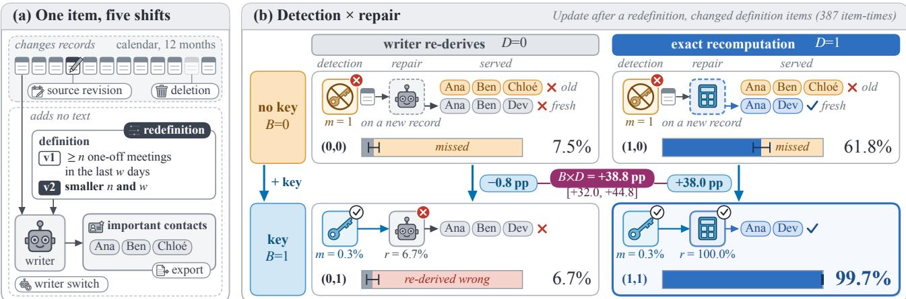  
Fi ure 1: Detection and re air are se arate ste s. (a) One definition item and the five shifts. A source revision and a deletion chan e records, and a redefinition, a writer switch, and an export add no text. (b) The four HoldMem cells (�, �) after a redefinition. With a ke (�=1), the memor invalidates the item and re-derives it. Without a ke (�=0), it kee s the old list and derives a new item onl when a new record arrives. The writer derives a wrong list (�=0), and exact recomputation the right one (�=1). Each bar splits the changed definition items as in Equation (1): right (gray at �=0, blue at �=1), wrong after a re-derivation (red), and wrong after a missed chang (amber). �: share of chan es missed. �: share of re-derived items that are ri ht.

To validate the measure, we build a reference memory, HoldMem, in which detection and repair are two switches with known efects (Section 4). With �=1, each item has a key that invalidates it when one of its inputs changes. With �=0, it has none. With �=0, the writer re-derives an invalidated item. With �=1, the memory recomputes it exactly as gold does (possible for 43 of the 48 items), which gives an upper bound on repair. A third setting runs programs that the writer writes itself.

We test four open-weight models from four families (Qwen3.5-9B, Llama-3.1-8B, gemma-4-12B, and gpt-oss-20b), each as writer and reader, and two Claude models as writers of definition items. The results show three patterns.

(1) Detection helps only as much as repair allows (Section 6.1). For every open-weight model, a key raises Update more with exact recomputation than with the writer’s own re-derivation. The diference is +14.4 pp to +28.5 pp after a redefinition and +5.0 pp to +26.4 pp after a deletion. A strong writer makes the key useful on its own.

(2) Repair fails on the items computed by the person’s definitions (Section 6.2). Each open-weight writer re-derives at most 25% of these changed values correctly, while ex- act recomputation gets at least 91% right. Programs the writer writes over the memory’s typed records close most of this gap, and a Claude writer that sees every record of a definition comes close to exact recomputation.

(3) Keys built from the writer’s citations notice every redefinition but miss records that join an item later (Section 6.3).

The interaction between detection and repair also holds on fresh worlds and on held-out definitions, and most items that fail a writer switch are definition items (Section 6.4).

Contributions. (1) MemShift, a benchmark of five shifts with counterfactual branches, gold dependencies, and a deterministic scorer, which separates detection from repair. (2) A reference memory with known detection and repair, which validates the benchmark and measures what keys and programs are worth when a language model re-derives, together with design rules drawn from the results.

## 2 Related Work

Evaluating memory. Agent memories page context in and out, reflect, link notes, extract facts, keep temporal graphs, or act as an operating-system resource (Chhikara et al., 2025; Li et al., 2025; Packer et al., 2023; Park et al., 2023; Rasmussen et al., 2025; Xu et al., 2025). Many build on RAG (Edge et al., 2024; Gutiérrez et al., 2024; Lewis et al., 2020). Benchmarks test recall over long conversations (Maharana et al., 2024; Wu et al., 2025), incremental interaction (Hu et al., 2026), hallucination, long- horizon tasks, stale memories, governance, and poisoning (Chao et al., 2026; Chen et al., 2025, 2026b; He et al., 2026; Jiang et al., 2026; Ren et al., 2026; Xu et al., 2026; Zhao et al., 2026b), and personalization (Salemi et al., 2024; Zhong et al., 2024). Most of their knowledge-update questions state the change in the history and score only the final answer. A missed detection and a failed repair then look the same.

Closest work. Several recent systems pair detection with a repair step, and MemShift can place each of them on �, �, and �. MemoRe air (Zhao et al., 2026a) withdraws ever thing derived from an invalidated source and rebuilds it by deterministic recomputation, regeneration, or removal. It assumes complete provenance. In our terms, it is a key over complete dependencies with a repair that mixes �=1 and �=0. The StateMem method of Fan et al. (2026) records which records an item was derived from and recomputes the item with a language model, close to our citation key at �=0. Its benchmark, StateMemBench, asks whether an answer is current or outdated, but every change arrives as dialogue text, and an LLM judge scores the answer. PLANFENCE (Chen et al. 2026a) checks the stored in ut versions of a derived plan and reports detection separately from completion, but its repair is always a replan by a language model. User as Code (Li, 2026) keeps typed state with executable rules, close to the writer’s ro rams. MemTrace (Lon et al., 2026) varies the age of one fixed fact, the question, and the evidence, but never what the gold answer depends on. RECON (Arya, 2026) asks which derived conclusions lose support after an invalidation but does not compare a stale store with its repaired version. Goyal and Ray (2026) switch the writer over a fixed histor and find that the memor ’s re resentation decides what survives. We s lit survival into detection and repair, much as studies of model updates separate accuracy from regressions (Bansal et al., 2019; Echterhof et al., 2024; Srivastava et al., 2020; Xie et al., 2021; Yan et al., 2021). What MemShift adds is the measurement: detection crossed with repair, in branches that difer only in the shift, with shifts that add no text, and with scoring against gold fixed before any text, as in script-first synthetic worlds (Spencer, 2026; Weston et al., 2016; Xie et al., 2026), and without an LLM judge (Zheng et al., 2023).

Dependency tracking and program-aided reasoning. Build systems and incremental view maintenance detect what a change afects (Gupta and Mumick, 1995; Mokhov et al., 2018), and they rebuild deterministically. In a memory, a language model rebuilds, so the value of invalidation de- pends on how well it re-derives. Language models are weak at aggregation over long contexts (Hsieh et al., 2024; Kuratov et al., 2024), which definition items require. Program-aided reasoning computes values with programs (Chen et al., 2023; Gao et al., 2023), and MemShift measures what such programs are worth after each shift.

## 3 The MemShift Benchmark

MemShift checks every item that a memory derived. After a shift, it asks whether the item is still correct. If it is not, it asks which step failed: detection or repair. This section describes the data, the shifts, the questions we ask, and the measures.

## 3.1 Worlds and Derived Items

A world is twelve months in the life of one synthetic person. It has six sources: e-mail, chat messages, calendar, contacts, tasks, and notes. We first sample the true changes, as in Spencer (2026), and only then render them as text with deterministic templates. Each change inserts, revises, or deletes a record, and each record has an identifier and a revision number. Background trafic, such as newsletters, small talk, and routine mail, adds distracting text. A world has 1,505–1,654 events and about 2.2M tokens.

From a world, a memory derives 48 items of two kinds. The 42 other items are facts that can be read from records: six attributes of the person (employer, manager, home city, time zone, diet, and commute), the employer and city of each of twelve contacts, four recurring series, two appointments, and six task due dates. Five of them are free text, and the rest are fields of structured records. The six definition items are computed with the person’s own definitions: important contacts, close friends, active projects, working hours, VIP senders, and overdue tasks. A definition is a one-sentence rule over structured fields, such as calendar entries, contact cards, tasks, and message headers. It names a source, a condition, and an aggregate, often with a time window and a threshold, as in the opening example, and it has two versions. For every item and time, a deterministic evaluator computes the gold value, the gold status, and the gold dependencies, that is, the records and revisions that the value depends on. No human labels are needed.

## 3.2 Shifts

Table 1 lists the five shifts. A source revision, a deletion, and a redefinition each fork the world into a branch, and each draws from its own random stream. A branch thus difers from the others onl in the events of its shift. Three shifts add no text. A redefinition changes what a value means while every record stays the same. The memory is told of the new version, and every question about a definition item names the version in efect, so even a system that stores no definitions learns of it. A writer switch and an export to the Portable Memory format (MacPaw, 2026) change the memory, not the world, so no gold value changes. They test whether what a memory derived survives a new model or a new product.

## 3.3 Questions and Carryover

A probe is a question about one item at a given time, with a gold value and a gold status. The status is answer, abstain (the record is gone), or blocked (the asking agent’s consent was revoked). We ask probes at the fork and at four checkpoints one, two, four, and eight weeks later. Every system is queried through the same reader, a model that answers each probe from the memory’s evidence within a 4,096-token budget. A deterministic scorer compares dates, times, entities, and sets as typed values. An answer is correct only if both its status and its value match gold. For example, the gold answer for the important contacts is a set, and an answer that names the same people in any order is correct. No LLM judge is used.

Table 1: The five shifts. Each world forks at the end of month nine, and its branches share every event outside the shift byte for byte.
<table><tr><td>Shift</td><td>What changes</td><td>Records</td><td>Effect on gold</td></tr><tr><td colspan="4">Changes to the world</td></tr><tr><td></td><td>source revision ordinary events revise the records behind about a fifth of the items (a job change, a moved meeting, new messages)</td><td>revised</td><td>re-evaluated on the revised records</td></tr><tr><td>deletion</td><td>the record behind half of the items read from a series, task, or contact card is deleted</td><td></td><td>some deleted abstain for those items</td></tr><tr><td>redefinition</td><td>half of the definitions move to their second version, and the memory is told</td><td>unchanged</td><td>re-evaluated under the new version</td></tr><tr><td colspan="4">Changes to the memory</td></tr><tr><td>writer switch</td><td>the writer model, at the same tier, one larger, and one smaller unchanged</td><td></td><td>none</td></tr><tr><td>export</td><td>the product: the memory moves to the Portable Memory format, unchanged and a second implementation imports it</td><td></td><td>none</td></tr></table>

Carryover is how much of what a memory derived stays correct after a shift. We count each item once at each checkpoint. An item is changed at a checkpoint if its gold value or status difers from that at the fork. Update is the share of correct answers on the changed items. Stability is the same share on a random sample of the unchanged items, at most as many as the changed items at that checkpoint. Both are percentages, and their diferences are in percentage points (pp). A writer switch changes no gold value, so for it we report retention: the share of answers that were correct before the switch and are still correct after it.

## 3.4 Detection, Repair, and What Is Served

Consider the changed items of a memory that reports which items it invalidated. Three numbers describe what happens to them. The missed invalidation � is the share of changed items that the memory did not invalidate after their gold value last chan ed. The repair correctness � is the share of invalidated and re-derived items that are answered correctly. The served accuracy � is the share of the other changed items, those not invalidated, that are answered correctly. For these items the memory serves either the old value or a new item derived from records that arrived later. By the law of total probability,

$$
{ \mathrm { U p d a t e ~ } } = { \mathrm { ~ ( 1 - } m \mathrm { ) } } r + m a .\tag{1}
$$

Each term belongs to one part of a memory that a builder controls: � to detection, � to repair, and � to what is served without either. Compare two memories with the same repair, one that misses no change $( m { = } 0 )$ and one that never invalidates (�=1). Their Update difers by $r \mathrm { ~ - ~ } a ,$ so this is what detection is worth. Now take two kinds of repair, indexed 0 and 1. The diference between what detection is worth under each,

$$
( r _ { 1 } - a _ { 1 } ) - ( r _ { 0 } - a _ { 0 } ) ,\tag{2}
$$

is the interaction between detection and repair. It is large when detection helps only with a good repair.

Where a change comes from. Update counts every change after the fork. A change is caused by the shift if the gold value at that checkpoint also difers from the gold value of the same world continued without the shift. Otherwise the value would have changed anyway. Some changes come from the clock alone: no record that the value depends on changed and the definition did not change, as when a task becomes overdue or a meeting leaves a time window.

## 3.5 Interface and Diagnostic Tests

A system connects to MemShift through one interface. It ingests events, receives definitions and consent revocations, sets the writer, answers probes, exports, imports, and reports its cost. A system that ofers only add and search runs through an adapter. The adapter ingests each event in time order and returns the retrieved context to the shared reader. This is enough to measure carryover. A system that also logs which items it invalidated and re-derived gets �, �, and � for every item. Four diagnostic tests with fixed thresholds check retention after a writer switch, carryover after an export, accuracy before any shift, and serving cost (Section E).

How MemShift compares. Table 2 gives the size of MemShift and compares it with the 15 closest benchmarks, each read from its own paper. None of them has all three properties that the measures need: branches that difer only in the shift, gold dependencies that tell which items a shift afects, and shifts that add no text. MemShift has all three and scores every answer against gold.

Table 2: MemShift at a glance, and how it compares with the closest benchmarks.
<table><tr><td colspan="3">worlds (test + replication)</td></tr><tr><td colspan="2">events per world items per world (definition + other)</td><td>1,505–1,654 6 + 42 19,562</td></tr><tr><td colspan="2">graded probes</td><td>Redefinition Deletion</td></tr><tr><td>Changed items (main study) Revision</td><td></td><td>558 1,767</td></tr><tr><td>all caused by the shift</td><td>1,168 787</td><td>222 1,370</td></tr><tr><td>also without the shift</td><td>381</td><td>336 397</td></tr><tr><td></td><td></td><td>69</td></tr><tr><td>clock alone</td><td>72</td><td>75</td></tr></table>

<table><tr><td rowspan="2">Property</td><td colspan="2">Benchmarks (of 15)</td><td rowspan="2">MEMSHIFT</td></tr><tr><td>Yes</td><td>Partly</td></tr><tr><td>gold fixed before text</td><td>6</td><td>8</td><td>√</td></tr><tr><td>gold dependency sets</td><td>4</td><td>10</td><td>√</td></tr><tr><td>redefinition</td><td>0</td><td>0</td><td>√</td></tr><tr><td>writer switch</td><td>1</td><td>6</td><td>√</td></tr><tr><td>export</td><td>0</td><td>1</td><td>~</td></tr><tr><td>counterfactual branches</td><td>1</td><td>4</td><td>√</td></tr><tr><td>no LLM judge</td><td>3</td><td>2</td><td>√</td></tr></table>

Changed items: item-times, counted at each checkpoint. ∼: partly, because the two implementations share a data model. Section A compares them property by property.

## 4 HoldMem: A Reference Memory

To test a measure of detection and repair, we need a mem- ory whose detection and repair we control. Our reference memor , HoldMem, derives each item from a 6,000-token BM25 selection of the records in the item’s sources. A stored item holds a one-sentence statement and up to six cited records with quotes, and the reader sees only these. Two switches set how the memory detects and repairs. In the terms of Equation (1), � changes � and � changes �. Both also change �, because a memory that does not invalidate an item may still derive a new one from records that arrived after its last write.

� sets detection. A �=0 memory only appends. It calls the writer only when new source records arrive, derives new items from them, and never invalidates an item, so �=1. A �=1 memory keeps a key for each item. The key records how many events each input of the item has received, the definition version, and the writer. When any of these changes, the memory invalidates the item and re-derives it with the current writer. We test two keys. The source key counts the events of each source of the item. The citation key counts the events of the record groups, such as a message thread, that hold the records the writer cited. Every source receives events between checkpoints, so the source key invalidates 99.7%, 99.3%, and 100.0% of the unchanged items after a source revision, a redefinition, and a deletion. In these worlds it thus acts as a periodic full refresh.

� sets repair. At �=0 the writer re-derives an invalidated item from its BM25 selection. At �=1 the memory also checks the writer’s value against the records (Section C.1). If the check fails, exact recomputation supplies the value: rules we wrote read the record fields or, for a definition item, apply the codified definition as gold does. For 43 of the 48 items this computes exactly what gold computes, so �=1 is an upper bound on repair. For the five free-text items, �=1 only checks the writer’s value. A third setting, the writer’s programs $( D _ { \mathrm { m } } )$ , lets the writer itself supply the computation. The writer writes one program per item and definition version, given the one-sentence definition and the field names of the item’s sources. A restricted interpreter runs the program on the memory’s typed records, that is, the live records of those sources as typed fields instead of rendered text.

Cells and controls. We call each setting of (�, �) a cell, written HoldMem(�, �). HoldMem(1,1) uses the source key unless we say otherwise. All cells are built from the same writer outputs, and before any shift every cell gives the reader the same context for every probe. Keys never depend on the repair, so � cannot change detection. After a shift, the �=1 repair also difers from the writer’s re-derivation in how the value is presented and in which records it reads. Controls vary one of these diferences at a time (Section C.4).

## 5 Experimental Setup

Models. By default, Qwen3.5-9B (Qwen Team, 2026c) serves as both writer and reader. It runs at temperature 0 with constrained decoding. To test other model families, Llama- 3.1-8B (Grattafiori et al., 2024), gemma-4-12B (Gemma Team, 2026), and gpt-oss-20b (OpenAI, 2025) each replace it as writer and reader on 10 test worlds. To test stronger writers, Claude Sonnet 5.5 and Opus 5.5 (Anthropic, 2026b) write the definition items on 10 test worlds.

Baselines and native systems. The main study includes three baselines. Plain RAG retrieves records with dense retrieval. The oracle context gives the reader exactly the records that the gold value depends on. No-store BM25 stores nothing and runs BM25 (Robertson and Zaragoza, 2009) over the live records at every query. We also run 6 existing memory systems, which we call native systems: Mem0 (Chhikara et al., 2025), A-Mem (Xu et al., 2025), MemOS (Li et al., 2025), LightRAG (Guo et al., 2025), HippoRAG 2 (Gutiérrez et al., 2025), and Cognee (Markovic et al., 2025). Each ingests three-month worlds through its own interface and answers through the shared reader, so only storage and retrieval difer. We read each system’s (�, �) setting from its documentation and code (Table 10). None checks a value against its records, so all have �=0.

Experiments. The main experiment runs six HoldMem cells after a source revision, a redefinition, and a deletion on 20 twelve-month test worlds. The cells are the four (�, �) cells with the source ke and two �=1 cells with the citation key. The writer-switch experiment has three tiers: from Qwen3.5-9B to MiMo-V2.6-Distill-Qwen-9B (Xiaomi MiMo Team, 2026b) of the same size, from Qwen3.5-9B up to Qwen3.8-27B (Qwen Team, 2026d), and from Qwen3.8- 27B down to Qwen3.5-9B. Together with an experiment over world lengths (horizons), these form the main study. Further experiments cover the writer’s programs, refresh cells, held-out definitions, the other writers, native systems, export, and a replication on 20 fresh worlds (Section E).

Statistics. Every estimate has a 95% world-bootstrap in- terval (Efron and Tibshirani, 1993; Field and Welsh, 2007; Miller, 2024). Diferences between cells are paired by item and checkpoint, and each of 2,000 bootstrap draws resamples the test worlds. The intervals thus cover new worlds from the same generator. For held-out definitions they also resample the definitions.

## 6 Results

Unless stated otherwise, the results are from the twelve- month test worlds of the main study, with Qwen3.5-9B as writer and reader, and each contrast is over all changed items. Table 3 gives Update and Stability after the three shifts that change the world. In its block of native systems, all rows use the same worlds, but not all of them are scored on the same items.

## 6.1 Detection Helps Only as Much as Repair Allows

A key helps when the repair is good. By Equation (1), a key changes � and is worth � − �. With Qwen3.5-9B as writer, a key raised Update after a redefinition by only +0.2 pp when the writer re-derived the item. It raised Update by +25.4 pp when the writer’s programs re-derived it, and by +26.9 pp with exact recomputation, the upper bound. The same pattern holds for all four open-weight models (Table 4b). For each model, the key raised Update after a source revision, and �=1 raised the accuracy on rederived items without changing detection. The interaction �×� was positive after a redefinition and after a deletion, with intervals above zero. After a source revision it was positive for Qwen3.5-9B and gpt-oss-20b. A strong writer, in contrast, makes the key useful on its own. With Claude writers of the definition items, the key alone raised Update on these items at �=0 by +30.3 pp to +38.8 pp over the three shifts on 10 worlds.

The interaction comes from the definition items. The source key missed at most 0.6% of the changed items in any class, so the terms in Table 4a explain the interaction well. After a source revision, Qwen3.5-9B re-derived only 16.3% of the changed definition items correctly, while exact recomputation got 99.7% right. All four models show this gap. On changed definition items, each writer re-derived at most 25% correctly after every shift, and exact recomputation at least 91% (Table 16). On the other items, the writer’s re-derivation is close to exact recomputation for every model except Llama-3.1-8B, and the interaction is small. On definition items, the interaction was about the same for changes that the shift caused and for changes that would have happened anyway (Section F.2).

The source key works as a full refresh. It re-derives nearly every item at every checkpoint. On changed definition items, a refresh on the same schedule that keeps the old item next to the new one does nearly as well. Removing stale items matters after a deletion, where such a refresh still serves items whose record is gone (Section F.5). A key built from the gold dependencies invalidates far fewer unchanged items and still keeps the interaction on definition items (Table 9).

## 6.2 Repair Fails on Definition Items, and Programs Fix Most of It

Programs written by the writer keep most of the interaction. Repair (�) changes �. When the programs of Qwen3.5-9B ran on the typed records with a key, they raised Update on changed definition items after a source revision by +57.4 pp over the writer’s own re-derivation, compared with +82.9 pp for exact recomputation (Table 20). Over all items, the interaction was +25.3 pp after a redefinition and +11.0 pp after a source revision. We also sampled 18 program sets from 6 writers. Over these sets, the interaction on definition items after a redefinition was +23.1 pp [+14.6, +31.2], and it grew with the share of programs that were correct before the shift (Figure 2a). Two further tests show where the programs fail. Returning a failing program’s error message to the writer let more programs run but repaired no more items, so the costly errors are wrong values, not crashes (Table 25). Programs that read fields extracted from model-written prose still gave a positive interaction (Table 25). After a deletion, however, the programs re-derived the other items less accurately than the writer did (−15.1 pp), mostly because they returned values for deleted records (Section G).

A Claude writer that sees every record comes close to exact recomputation. The �=0 writer sees only a 6,000- token selection. For active projects, overdue tasks, and working hours, this selection always held every record that the definition ranges over. For close friends and VIP senders, it never did. Where the selection was complete, Qwen3.5-9B still re-derived only 36.8% of the changed definition values correctly after a source revision. Claude Sonnet 5.5 and

Table 3: Update and Stability (%) after the three shifts that change the world.
<table><tr><td rowspan="2">Memory</td><td colspan="2">Source revision</td><td colspan="2">Redefinition</td><td colspan="2">Deletion</td></tr><tr><td>Update</td><td>Stability</td><td>Update</td><td>Stability</td><td>Update</td><td>Stability</td></tr><tr><td colspan="7">Main study: 20 twelve-month test worlds, Qwen3.5-9B as writer and reader</td></tr><tr><td>HOLDMEM(0,0)</td><td>62.8</td><td>72.7</td><td>26.9</td><td>77.8</td><td>9.0</td><td>78.3</td></tr><tr><td>HoLDMEm(0,1)</td><td>68.3</td><td>90.5</td><td>27.1</td><td>91.8</td><td>58.2</td><td>84.8</td></tr><tr><td>HOLDMEM(1,0)</td><td>80.1</td><td>72.8</td><td>64.7</td><td>77.8</td><td>18.8</td><td>79.6</td></tr><tr><td>HOLDMEM(1,1)</td><td>93.1</td><td>93.1</td><td>91.6</td><td>93.0</td><td>73.1</td><td>88.4</td></tr><tr><td>HoLDMEm(0,1), citation key</td><td>63.2</td><td>90.3</td><td>21.9</td><td>91.8</td><td>54.7</td><td>84.3</td></tr><tr><td>HoLDMEm(1,1), citation key</td><td>79.6</td><td>91.2</td><td>67.2</td><td>91.8</td><td>58.1</td><td>85.0</td></tr><tr><td> $\mathrm { H o L D M E M } ( D _ { \mathrm { m } } , 0 )$ </td><td>68.5</td><td>69.2</td><td>45.0</td><td>78.0</td><td>16.8</td><td>78.0</td></tr><tr><td> $\mathrm { H o L D M E M } ( D _ { \mathrm { m } } , 1 )$ </td><td>85.0</td><td>88.4</td><td>70.4</td><td>90.7</td><td>45.2</td><td>82.7</td></tr><tr><td>no-store BM25</td><td>61.0</td><td>69.3</td><td>25.3</td><td>67.4</td><td>71.3</td><td>64.8</td></tr><tr><td>plain RAG</td><td>63.1</td><td>66.1</td><td>25.6</td><td>64.7</td><td>69.7</td><td>64.4</td></tr><tr><td>oracle context</td><td>74.1</td><td>87.0</td><td>45.9</td><td>87.3</td><td>86.9</td><td>87.3</td></tr><tr><td colspan="7">Native systems: 15 three-month worlds, scored on the half of the items not used to infer the settings</td></tr><tr><td>HoLDMEM(0,0)</td><td>57.6</td><td>66.6</td><td>47.2</td><td>69.1</td><td>44.0</td><td>74.1</td></tr><tr><td>HoLDMEm(0,1), citation key</td><td>77.8</td><td>98.7</td><td>65.5</td><td>97.6</td><td>70.1</td><td>97.2</td></tr><tr><td>HOLDMEM(1,1)</td><td>98.2</td><td>99.0</td><td>97.4</td><td>99.0</td><td>97.9</td><td>99.2</td></tr><tr><td>no-store BM25</td><td>71.1</td><td>70.8</td><td>58.3</td><td>70.1</td><td>60.3</td><td>72.1</td></tr><tr><td>plain RAG</td><td>73.4</td><td>66.5</td><td>59.1</td><td>69.7</td><td>58.1</td><td>67.6</td></tr><tr><td>oracle context</td><td>93.8</td><td>89.2</td><td>91.1</td><td>92.0</td><td>95.7</td><td>91.6</td></tr><tr><td>Mem0</td><td>70.6</td><td>67.5</td><td>50.6</td><td>69.7</td><td>44.7</td><td>70.0</td></tr><tr><td>A-Mem</td><td>69.3</td><td>80.2</td><td>50.6</td><td>81.1</td><td>34.2</td><td>80.9</td></tr><tr><td>MemOS</td><td>70.4</td><td>68.7</td><td>57.4</td><td>67.6</td><td>42.1</td><td>68.6</td></tr><tr><td>LightRAG</td><td>64.9</td><td>85.2</td><td>50.6</td><td>80.1</td><td>31.6</td><td>80.9</td></tr><tr><td>HippoRAG 2</td><td>74.3</td><td>82.6</td><td>58.3</td><td>83.8</td><td>47.4</td><td>82.7</td></tr><tr><td>Cognee</td><td>68.8</td><td>95.1</td><td>56.2</td><td>95.0</td><td>42.1</td><td>95.7</td></tr></table>

HoldMem(�,�): �=1 exact recomputation, $D _ { \mathrm { m } }$ the writer’s programs, �=1 a key (the source key unless the citation key is named). � per main-study HoldMem cell: 1,168, 558, and 1,767 changed and 1,168, 558, and 1,683 unchanged items.

## (a) Program sets after a redefinition

one square per program set, split where sets coincide

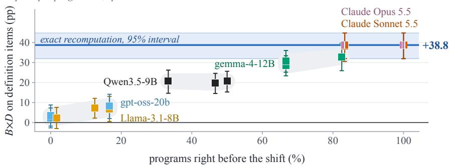

(b) Writers of definition items  
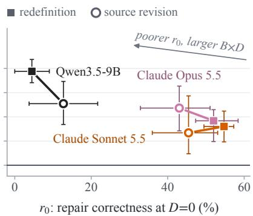  
Figure 2: �×� on definition items against the share of programs right before the shift (a) and against �0 (b). Computing the value helps most when the programs are right (a) and the writer’s own re-derivation is poor (b). (a) The 18 program sets of the 6 writers after a redefinition, one s uare er set. Gra hulls enclose the sets of Qwen3.5-9B, of emma-4-12B, and of Llama-3.1-8B and t-oss-20b together. Blue line and band: exact recomputation and its 95% interval. (b) �×� with exact recomputation for three writers of definition items after a redefinition (squares) and a source revision (circles). Bars: 95% intervals.

Opus 5.5 re-derived 94.4% and 91.7%, as much as exact recomputation on the same items. Over all selections, the interaction after a redefinition was smaller with either Claude writer, +16.4 pp, but still positive (Figure 2b). When we gave Claude Sonnet 5.5 every live record of the definition’s sources as typed fields, it re-derived 91.8% of the changed definition items correctly. This compares with 50.0% from its selection and 97.3% for exact recomputation, at a cost of up to 44,357 tokens per re-derivation. Qwen3.5-9B reached only 7.1% with every record. This writer thus lacks the ability to compute the value, not the evidence (Table 15).

Table 4: Detection helps only as much as repair allows. (a) The terms of Equation (2) by item class for Qwen3.5-9B. The writer re-derives few changed definition values correctly, and exact recomputation nearly all. (b) The main contrasts for four open-weight models, each as writer and reader.
<table><tr><td></td><td></td><td></td><td colspan="2">Repair with a key %</td><td colspan="2">Without a key Update, %</td><td colspan="2">B×D on Update pp</td></tr><tr><td>(a) Shift</td><td>Items</td><td>Share</td><td> $r _ { 0 }$ </td><td> $r _ { 1 }$ </td><td>a0</td><td> $a _ { 1 }$ </td><td>caused by the shift</td><td>all</td></tr><tr><td>source revision</td><td>definition other</td><td>28.5 71.5</td><td>16.3 89.1</td><td>99.7 90.7</td><td>10.2 83.7</td><td>65.8 85.9</td><td> $+ 2 4 . 3 [ + 1 2 . 5 , + 3 5 . 7 ]$ </td><td> $+ 2 7 . 3 \ [ + 2 1 . 6 , + 3 2 . 6 ]$   $- 0 . 6 [ - 3 . 8 , + 2 . 5 ]$ </td></tr><tr><td>redefinition</td><td>definition</td><td>69.4</td><td>6.7</td><td>100.0</td><td>7.5</td><td>61.8</td><td> $- 1 . 0 \left[ - 4 . 7 , + 2 . 0 \right]$   $+ 3 8 . 7 \ [ + 3 0 . 4 , + 4 6 . 9 ]$ </td><td> $+ 3 8 . 8 \left[ + 3 2 . 0 , + 4 4 . 8 \right]$ </td></tr><tr><td></td><td>other</td><td>30.6</td><td>73.1</td><td>73.1</td><td>70.8</td><td>71.3</td><td></td><td> $- 0 . 6 [ - 4 . 0 , + 2 . 7 ]$ </td></tr><tr><td>deletion</td><td>definition</td><td>17.4</td><td>11.8</td><td>100.0</td><td>4.2</td><td>56.5</td><td> $+ 3 9 . 6 \left[ + 1 5 . 0 , + 6 0 . 0 \right]$ </td><td> $+ 3 5 . 4 \ : [ + 3 0 . 4 , + 4 0 . 0 ]$ </td></tr><tr><td></td><td></td><td></td><td></td><td></td><td></td><td></td><td></td><td></td></tr><tr><td></td><td></td><td>82.6</td><td>68.1</td><td>67.5</td><td>10.0</td><td>10.9</td><td></td><td></td></tr><tr><td></td><td>other</td><td></td><td></td><td></td><td></td><td></td><td> $- 1 . 5 \left[ - 5 . 9 , + 2 . 5 \right]$ </td><td> $- 1 . 4 \left[ - 5 . 4 , + 2 . 3 \right]$ </td></tr></table>

Share: the class’s share of the changed items (%). ��: repair correctness at � with a key. $a _ { D } \colon$ Update at � without a key. �×�: close to $\left( r _ { 1 } - a _ { 1 } \right) - \left( r _ { 0 } - a _ { 0 } \right)$ . —: a redefinition itself chan es no other item.

<table><tr><td>(b) Contrast (pp)</td><td>Llama-3.1-8B</td><td>gemma-4-12B</td><td>gpt-oss-20b</td><td>Qwen3.5-9B</td></tr><tr><td>B effect on Update, source revision</td><td>+29.6[+25.1, +34.1]</td><td> $+ 9 . 5 [ + 5 . 5 , + 1 3 . 6 ]$ </td><td> $+ 1 2 . 2 \left[ + 8 . 0 , + 1 6 . 6 \right]$ </td><td> $+ 7 . 8 \ : [ + 4 . 4 , + 1 1 . 7 ]$ </td></tr><tr><td>D effect on accuracy, source revision</td><td> $+ 2 0 . 4 \ : [ + 1 8 . 0 , + 2 3 . 1 ]$ </td><td> $+ 1 3 . 1 \ [ + 1 1 . 6 , + 1 4 . 6 ]$ </td><td> $+ 1 2 . 0 \left[ + 1 0 . 5 , + 1 3 . 5 \right]$ </td><td> $+ 1 3 . 7 \left[ + 1 2 . 5 , + 1 5 . 2 \right]$ </td></tr><tr><td>D effect on accuracy, redefinition</td><td>+40.0[+36.1, +43.3]</td><td> $+ 3 1 . 9 \ [ + 2 8 . 4 , + 3 5 . 0 ]$ </td><td> $+ 2 6 . 5 \ [ + 2 3 . 7 , + 2 9 . 5 ]$ </td><td> $+ 3 3 . 6 [ + 3 1 . 2 , + 3 6 . 3 ]$ </td></tr><tr><td>B×D on Update, source revision</td><td> $+ 4 . 2 \ : [ - 4 . 2 , + 1 3 . 1 ]$ </td><td> $+ 0 . 8 \left[ - 2 . 1 , + 3 . 8 \right]$ </td><td> $+ 1 2 . 6 [ + 9 . 6 , + 1 6 . 5 ]$ </td><td> $+ 6 . 2 \left[ + 2 . 5 , + 1 0 . 3 \right]$ </td></tr><tr><td>B×D on Update, redefinition</td><td>+20.8 [+11.7, +29.4]</td><td> $+ 1 4 . 4 \left[ + 8 . 3 , + 2 0 . 1 \right]$ </td><td> $+ 2 8 . 5 \ [ + 2 3 . 1 , + 3 2 . 8 ]$ </td><td> $+ 2 7 . 1 \ : [ + 2 2 . 9 , + 3 2 . 1 ]$ </td></tr><tr><td> $B { \times } D \ \mathrm { o n \ U p d a t e , d e l e t i o n ^ { \dag } }$ </td><td> $+ 2 6 . 4 \left[ + 2 0 . 5 , + 3 1 . 9 \right]$ </td><td> $+ 7 . 8 \ : [ + 4 . 9 , + 1 0 . 7 ]$ </td><td> $+ 1 3 . 0 \ [ + 9 . 8 , + 1 5 . 4 ]$ </td><td> $+ 5 . 0 \left[ + 1 . 7 , + 8 . 1 \right]$ </td></tr><tr><td> $\mathsf { N o - s t o r e \ B M 2 5 - H o r D M e M } ( 1 , 1 )$ </td><td> $- 5 0 . 5 \ [ - 5 3 . 3 , - 4 8 . 4 ]$ </td><td> $- 3 6 . 3 \left[ - 4 0 . 1 , \ : - 3 2 . 3 \right]$ </td><td> $- 3 0 . 1 \left[ - 3 3 . 2 , - 2 7 . 2 \right]$ </td><td> $- 4 5 . 1 \left[ - 4 8 . 6 , - 4 2 . 2 \right]$ </td></tr></table>

The same 10 test worlds for every model. †For Qwen3.5-9B, the 20 worlds of the main study. � efect: source key, averaged over �. Accuracy: the share of re-derived items, changed or not, answered correctly. No-store BM25 − HoldMem(1,1): after a redefinition. �’s efect on missed invalidation was 0.0 for ever model. Brackets: 95% intervals.

## 6.3 Keys Built from Citations Miss Records That Join Later

The citation key notices every redefinition but misses later changes. It missed 16.9% of the changed items after a source revision and 32.4% after a redefinition. The key holds the definition version, so it invalidated all 222 changes that the redefinition caused. It then missed a later change of records or of the clock on 54 of them. After a redefinition, every wrong answer on changed definition items at �=1 came from such a miss $( r _ { 1 } = 1 0 0 . 0 \% )$ , so this key fails at detection, not at repair. Most misses were records that entered the item’s scope after the write, as in the phantom problem of predicate locks (Eswaran et al., 1976), or records that left a time window (Section F.5). Averaged over �, the citation key raised Update only after a deletion (+42.5 pp), because the writer’s citations name the deleted record. Forcing the memory to re-derive the definition items it missed after a source revision would have gained +2.6 pp at �=0 and +94.9 pp at �=1 (Section F.5).

The source key misses changes caused by the clock alone. The key does not track time, so it catches such a change only if an unrelated record of the same source arrives in the same interval. Such stale values caused 5 of the 6 wrong answers of HoldMem(1,1) on changed definition items (Section F.5).

An export that carries the keys keeps detection. We exported HoldMem(1,1) to Portable Memory with its keys and imported it into a second implementation. The import matched the original (0.0 pp). Without the keys, the import detected no later change (Section F.10).

## 6.4 Robustness and Native Systems

Fresh worlds, new definitions, and rewritten text. On 20 fresh worlds, every contrast with the source key replicated (Section F.8). We also replaced the six definitions with 18 held-out definitions from the same grammar on 10 worlds. With intervals that resample both worlds and definitions, the interaction on definition items after a redefinition was +33.0 pp [+22.1, +44.9]. When gemma-4-12B rewrote the message bodies around unchanged gold facts, the efects of � and � and their interaction kept their sign (Section F.8).

Writer switches fail mostly on definition items. At each of the three tiers, at least 97% of the answers that were correct before a switch stayed correct, and 32 of the 41 items that failed were definition items. Over all 8 switches, the new writer’s own accuracy predicted which items stay correct at least as well as the agreement between the old and new writers did (Section F.7).

Stored state pays of over time. Before any shift, no-store BM25 scored −25.8 pp compared with HoldMem(1,1) at twelve months, while the source key used 3.64 times as many tokens (Section F.6).

Table 5: Desi n rules su orted b the results, with their evidence. Writer and reader: Qwen3.5-9B unless the evidence names other models.
<table><tr><td>Rule</td><td>Evidence</td></tr><tr><td>1. Key everything that can change after the write, and export the keys</td><td>Citation keys miss 16.9% and 32.4% of the changed items after a source revision and a redefinition, mostly records that join later. An import without the keys detects no change.</td></tr><tr><td>2. Compute definition items with a program over typed records, one per definition version</td><td>Four open-weight writers re-derive at most 25% of the changed definition items correctly, against at least 91% for exact recomputation. The programs of Qwen3.5-9B keep most of the interaction.</td></tr><tr><td>3. Remove the items whose record is deleted</td><td>After a deletion, the key beats a refresh that keeps old items by +9.9 pp on the other items at D=1. Invalidation keyed on the source record raises Mem0&#x27;s Update there by +35.9 pp.</td></tr><tr><td>still exists</td><td>4. Check that the record a program names After a deletion, the programs re-derive the other items less accurately than D=0 (-15.1 pp). Of their loss on deleted records, 67.7% is a value returned where the gold status is abstain.</td></tr><tr><td>5. Test a new writer on definition items</td><td>At the three tiers, 32 of the 41 items that fail a switch are definition items.</td></tr></table>

Documented settings match behavior but do not predict carryover. For each native system, the � setting inferred from how many deleted items it still answered matched its documentation. Yet most of their Update and Stability values fell outside the interval of the HoldMem cell with the same setting (Section F.9). The per-item terms explain more. The tested Mem0 release never updates or deletes a memory, so �=1 for every item class, yet the class decides which fix helps. A program run at query time on the live typed records, which Mem0 does not store, raised its Update on changed definition items after a redefinition by +64.4 pp. Invalidation keyed on the source record raised its Update on the other items after a deletion by +35.9 pp.

## 7 Discussion

Detection is worth as much as the repair that follows. With a language model as writer, the re-derivation is not exact, and it is worst for values that aggregate many records under a person’s definition. A key helps there mainly with exact recomputation or with a program over typed records. A strong writer that sees every record comes close, but it must read every record at each re-derivation.

A final-answer score hides which step failed. The di- agnosis names the term that failed and the item class it failed on, and the class tells which fix helps, as the Mem0 interventions show. On three-month worlds, the ranking of the six HoldMem cells by Update after a source revision nearly fixes their ranking after a redefinition (Spearman � = 0.94 [0.75, 1.00]), but among the six native systems it does not (� = 0.52 [−0.09, 0.94]).

Recommendations. We recommend reporting � and � by item class, and Table 5 lists design rules for memories.

## 8 Conclusion

We proposed MemShift, a benchmark for evaluating LLMs performance in derived personal memory. MemShift scores each item that a shift changes on detection and repair, against gold fixed before any text. Detection helps only as much as repair allows. Repair fails on the items computed by the person’s definitions, and programs over typed records close most of this gap. Keys built from the writer’s citations miss records that join an item later. A memory’s accuracy after a change measures its detection and its repair together. Future work can test memories in which a language model decides invalidation, and real records with vaguer definitions.

## Limitations

Synthetic worlds and codified definitions. The worlds are synthetic and rendered from templates, and each definition is a one-sentence rule over structured fields. This lets an evaluator compute gold values and dependencies exactly, without annotators, but real records are messier and real definitions vaguer. Only a small share of the message text was rewritten by a model, field extraction was tested only on model-written prose, and the held-out definitions come from one grammar. Programs written from definitions in the user’s own words still give a positive interaction (Section F.4).

Reference memory and native systems. Every cell with a known (�, �) setting is a HoldMem cell that we designed. �=1 runs the same evaluator as gold, so it is an upper bound on repair, not a system under test. The native systems ran on three-month worlds at �=0 through our adapters, and their ingestion is noisy. The tested Mem0 release only adds memories, and Graphiti finished no world, so no native run measures invalidation decided by a language model.

Models, readers, and serving format. The main writers and readers are open-weight models with 8–27B parameters. Claude Sonnet 5.5 and Opus 5.5 wrote only definition items, and only Sonnet received every record of a definition. Update also depends on the reader and on how the store is presented. Serving the same �=1 store as JSON records changes Update (Table 24), so the signs of the efects generalize better than their absolute levels.

Statistics. The main-study intervals rest on 20 worlds, which are few clusters for a bootstrap (Cameron et al., 2008). The replication repeats every contrast on 20 fresh worlds. Intervals are per contrast. Holm and Benjamini–Hochberg corrections over the main contrasts keep 35 and 36 of the 36 intervals that exclude zero (Section E.2).

## Ethics Statement

This work concerns systems that store what AI assistants know about individual people. Measuring whether this knowledge stays correct after models, sources, or products change can make assistants more reliable and make it easier for people to take their data with them. The same capabilities, persistent and portable personal profiles, raise privacy risks. All worlds in MemShift are synthetic, no personal data was collected, and no human subjects were involved. Derived profiles also hold facts about third parties, such as the employers and cities of a person’s contacts, and exported provenance reveals which sources and models produced each item. The benchmark scores consent revocation as an outcome, and every stored derived memory we measured still leaks after a revocation (Section F.10). The writer’s programs run only on synthetic records, in a separate process with a time limit and a memory cap. A restricted interpreter accepts only listed syntax and built-in functions (Section C.2).

## Reproducibility Statement

Worlds, shifts, and probes are generated deterministically from seeds, and a deterministic scorer checks every answer without an LLM judge. Open-weight models run at temper-ature 0 with constrained decoding, except for the sampled program sets (temperature 0.7). Claude Sonnet 5.5 and Opus 5.5 ran through Anthropic’s API with the settings in Section C.7. Every run records its code version, world seeds, model revisions, and output hashes in a manifest. The released repository holds the code, generator, worlds, gold labels, all model responses, and run manifests, and it regenerates every number in the paper.

## Acknowledgements

This work was supported by JST CREST Grant Num- ber JPMJCR22M2 and JSPS KAKENHI Grant Numbers JP23K17456, JP23K28096, JP25H01117, JP25K21207, and JP26K03246.

## References

Umut A. Acar, Guy E. Blelloch, and Robert Harper. Adaptive Functional Programming. In ACM SIGPLAN-SIGACT Symposium on Principles of Programming Languages (POPL), pages 247–259, 2002.

Tyler Akidau, Robert Bradshaw, Craig Chambers, Slava Chernyak, Rafael J. Fernández-Moctezuma, Reuven Lax, Sam McVeety, Daniel Mills, Frances Perry, Eric Schmidt, and Sam Whit- tle. The Dataflow Model: A Practical Approach to Balancing Correctness, Latency, and Cost in Massive-Scale, Unbounded, Out-of-Order Data Processing. Proceedings of the VLDB Endowment, 8(12):1792–1803, 2015.

Robert Allen. MIF: Modeled Information Format. GitHub repos- itory modeled-information-format/MIF, specification v1.0.0, 2026. URL https://github.com/modeled-information -format/MIF.

Anthropic. Import and export your memory from Claude. Claude Help Center, 2026a. URL https://support.claude.com /en/articles/12123587-import-and-export-your-m emory-from-claude. Accessed 2026-09-28.

Anthropic. Models overview. Claude Platform documentation, 2026b. URL https://platform.claude.com/docs/en/ about-claude/models/overview. Accessed 2026-10-20.

Simran Arora, Brandon Yang, Sabri Eyuboglu, Avanika Narayan, Andrew Hojel, Immanuel Trummer, and Christopher Ré. Language Models Enable Simple Systems for Generating Structured Views of Heterogeneous Data Lakes. Proceedings of the VLDB Endowment, 17(2):92–105, 2023. doi: 10.14778/3626292.3626294.

Mihir Shriniwas Arya. RECON: Benchmarking Agent Memory for Compositional Reasoning over Long Contexts. arXiv preprint arXiv:2607.16716, 2026.

Eugene Bagdasarian, Ren Yi, Sahra Ghalebikesabi, Peter Kairouz, Marco Gruteser, Sewoong Oh, Borja Balle, and Daniel Ramage. AirGapAgent: Protecting Privacy-Conscious Conversational Agents. In ACM SIGSAC Conference on Computer and Communications Security (CCS), pages 3868–3882, 2024. doi: 10.1145/3658644.3690350.

Gagan Bansal, Besmira Nushi, Ece Kamar, Daniel S. Weld, Wal- ter S. Lasecki, and Eric Horvitz. Updates in Human-AI Teams: Understanding and Addressing the Performance/Compatibility Tradeof. In AAAI Conference on Artificial Intelligence (AAAI), volume 33, pages 2429–2437, 2019.

Victor Barres, Honghua Dong, Soham Ray, Xujie Si, and Karthik Narasimhan. �2-Bench: Evaluating Conversational Agents in a Dual-Control Environment. In International Conference on Machine Learning (ICML), 2026.

Yoav Benjamini and Yosef Hochberg. Controlling the False Discovery Rate: A Practical and Powerful Approach to Multiple Testing. Journal of the Royal Statistical Society: Series B (Methodological), 57(1):289–300, 1995. doi: 10.1111/j.2517-6161.1995.tb02031.x.

Tim Berners-Lee, Henry Story, and Sarven Capadisli. Web Access Control, 2024. URL https://solidproject.org/TR/2024 /wac-20240512. Version 1.0.0. Accessed 2026-09-06.

Piero A. Bonatti, John Domingue, Anna Lisa Gentile, Andreas Harth, Olaf Hartig, Aidan Hogan, Katja Hose, Ernesto Jimenez-Ruiz, Deborah L. McGuinness, Chang Sun, Ruben Verborgh, and Jesse Wright. Towards Computer-Using Personal Agents. arXiv preprint arXiv:2503.15515, 2025.

Mihai Budiu, Tej Chajed, Frank McSherry, Leonid Ryzhyk, and Val Tannen. DBSP: Automatic Incremental View Maintenance for

Rich Query Languages. Proceedings of the VLDB Endowment, 16(7):1601–1614, 2023. doi: 10.14778/3587136.3587137.

Peter Buneman, Sanjeev Khanna, and Wang-Chiew Tan. Why and Where: A Characterization of Data Provenance. In Jan Van den Bussche and Victor Vianu, editors, International Conference on Database Theory (ICDT), volume 1973 of Lecture Notes in Computer Science, pages 316–330. Springer, 2001. doi: 10.1007/3-540-44503-X\_20.

Peter Buneman, Sanjeev Khanna, and Wang-Chiew Tan. On Propagation of Deletions and Annotations Through Views. In ACM SIGMOD-SIGACT-SIGART Symposium on Principles of Database Systems (PODS), pages 150–158, 2002. doi: 10.114 5/543613.543633.

Peter Buneman, Adriane P. Chapman, and James Cheney. Prove- nance Management in Curated Databases. In ACM SIGMOD International Conference on Management of Data (SIGMOD), pages 539–550, 2006. doi: 10.1145/1142473.1142534.

A. Colin Cameron, Jonah B. Gelbach, and Douglas L. Miller. Bootstrap-Based Improvements for Inference with Clustered Errors. Review of Economics and Statistics, 90(3):414–427, 2008. doi: 10.1162/rest.90.3.414.

Hanxiang Chao, Yihan Bai, Rui Sheng, Tianle Li, and Yushi Sun. STALE: Can LLM Agents Know When Their Memories Are No Longer Valid? arXiv preprint arXiv:2605.06527, 2026.

Ding Chen, Simin Niu, Kehang Li, Peng Liu, Xiangping Zheng, Bo Tang, Xinchi Li, Feiyu Xiong, and Zhiyu Li. HaluMem: Evaluating Hallucinations in Memory Systems of Agents. arXiv preprint arXiv:2511.03506, 2025.

Evan Chen, Shiqiang Wang, and Christopher G. Brinton. Fresh Memory, Stale Plans: Derivation Currency for Distributed LLM-Agent Memory. arXiv preprint arXiv:2609.03340, 2026a.

Jianlyu Chen, Shitao Xiao, Peitian Zhang, Kun Luo, Defu Lian, and Zheng Liu. M3-Embedding: Multi-Linguality, Multi- Functionality, Multi-Granularity Text Embeddings Through Self-Knowledge Distillation. In Findings ofthe Associationfor Computational Linguistics: ACL 2024, pages 2318–2335, 2024. doi: 10.18653/v1/2024.findings-acl.137.

Wenhu Chen, Xinyi Wang, and William Yang Wang. A Dataset for Answering Time-Sensitive Questions. In Proceedings ofthe Neural Information Processing Systems Track on Datasets and Benchmarks, volume 1, 2021.

Wenhu Chen, Xueguang Ma, Xinyi Wang, and William W. Cohen. Program of Thoughts Prompting: Disentangling Computation from Reasoning for Numerical Reasoning Tasks. Transactions on Machine Learning Research, 2023. URL https://openre view.net/forum?id=YfZ4ZPt8zd.

Xuanze Chen, Xukang Xie, Wentao Fu, Jiajun Zhou, Shanqing Yu, and Qi Xuan. MemSecBench: Tracking Agent Memory Poisoning from Persistence to Consequence and Repair. arXiv preprint arXiv:2607.27080, 2026b.

James Cheney, Laura Chiticariu, and Wang-Chiew Tan. Provenance in Databases: Why, How, and Where. Foundations and Trends in Databases, 1(4):379–474, 2009. doi: 10.1561/1900000006.

Prateek Chhikara, Dev Khant, Saket Aryan, Taranjeet Singh, and Deshraj Yadav. Mem0: Building Production-Ready AI Agents with Scalable Long-Term Memory. In European Conference

on Artificial Intelligence (ECAI), volume 413 of Frontiers in Artificial Intelligence and Applications, pages 2993–3000. IOS Press, 2025. doi: 10.3233/FAIA251160.

Aaron Coburn, elf Pavlik, and Dmitri Zagidulin. Solid-OIDC, 2022. URL https://solidproject.org/TR/2022/oid c-20220328. Version 0.1.0. Accessed 2026-09-06.

Roi Cohen, Eden Biran, Ori Yoran, Amir Globerson, and Mor Geva. Evaluating the ripple efects of knowledge editing in language models. Transactions of the Association for Computational Linguistics, 12:283–298, 2024. doi: 10.1162/tacl\_a\_00644.

Latha S. Colby, Timothy Grifin, Leonid Libkin, Inderpal Singh Mumick, and Howard Trickey. Algorithms for Deferred View Maintenance. In ACM SIGMOD International Conference on Management of Data (SIGMOD), pages 469–480, 1996. doi: 10.1145/233269.233364.

Manuel Costa, Boris Köpf, Aashish Kolluri, Andrew Paverd, Mark Russinovich, Ahmed Salem, Shruti Tople, Lukas Wutschitz, and Santiago Zanella-Béguelin. Securing AI Agents with Information-Flow Control. arXiv preprint arXiv:2505.23643, 2025.

D. R. Cox. Two Further Applications of a Model for Binary Regression. Biometrika, 45(3/4):562–565, 1958.

C. Daboo and A. Quillaud. Collection Synchronization for Web Distributed Authoring and Versioning (WebDAV). Request for Comments 6578, IETF, 2012. URL https://www.rfc-edi tor.org/rfc/rfc6578.

C. Daboo, B. Desruisseaux, and L. Dusseault. Calendaring Exten- sions to WebDAV (CalDAV). Request for Comments 4791, IETF, 2007. URL https://www.rfc-editor.org/rfc/rfc4791.

Data Transfer Project. Data Transfer Project Overview and Fundamentals. White paper, 2018. URL https://about.fb.com /wp-content/uploads/2018/07/dtp-overview.pdf.

Johan de Kleer. An Assumption-Based TMS. Artificial Intelligence, 28(2):127–162, 1986.

Edoardo Debenedetti, Ilia Shumailov, Tianqi Fan, Jamie Hayes, Nicholas Carlini, Daniel Fabian, Christoph Kern, Chongyang Shi, Andreas Terzis, and Florian Tramèr. Defeating Prompt Injections by Design. In IEEE Conference on Secure and Trustworthy Machine Learning (SaTML), pages 587–618, 2026. doi: 10.1109/SaTML68715.2026.00040.

Jon Doyle. A Truth Maintenance System. Artificial Intelligence, 12(3):231–272, 1979.

Jessica Maria Echterhof, Fartash Faghri, Raviteja Vemulapalli, Ting-Yao Hu, Chun-Liang Li, Oncel Tuzel, and Hadi Pouransari. MUSCLE: A Model Update Strategy for Compatible LLM Evolution. In Findings of the Association for Computational Linguistics: EMNLP 2024, pages 7320–7332, 2024. doi: 10.1 8653/v1/2024.findings-emnlp.430.

Darren Edge, Ha Trinh, Newman Cheng, Joshua Bradley, Alex Chao, Apurva Mody, Steven Truitt, Dasha Metropolitansky, Robert Osazuwa Ness, and Jonathan Larson. From Local to Global: A Graph RAG Approach to Query-Focused Summarization. arXiv preprint arXiv:2404.16130, 2024.

Bradley Efron and Robert J. Tibshirani. An Introduction to the Bootstrap. Chapman & Hall, 1993.

Eslam Elnikety, Aastha Mehta, Anjo Vahldiek-Oberwagner, Deepak Garg, and Peter Druschel. Thoth: Comprehensive Policy Compli- ance in Data Retrieval Systems. In USENIX Security Symposium, pages 637–654, 2016.

K. P. Eswaran, J. N. Gray, R. A. Lorie, and I. L. Traiger. The Notions of Consistency and Predicate Locks in a Database S stem. Communications ofthe ACM, 19(11):624–633, 1976. doi: 10.1145/360363.360369.

European Parliament and Council of the European Union. Reg- ulation (EU) 2016/679 of the European Parliament and of the Council (General Data Protection Regulation), Article 20: Right to Data Portability. Oficial Journal of the European Union, L 119, 2016.

Xinyi Fan, Miri Liu, Ruozhen Yang, Siru Ouyang, and Jiawei Han. Can Agent Memory Systems Track Evolving State? arXiv preprint arXiv:2608.19652, 2026.

Christopher A. Field and Alan H. Welsh. Bootstrapping Clus- tered Data. Journal of the Royal Statistical Society: Series B (Statistical Methodology), 69(3):369–390, 2007.

Luyu Gao, Aman Madaan, Shuyan Zhou, Uri Alon, Pengfei Liu, Yiming Yang, Jamie Callan, and Graham Neubig. PAL: Program- aided Language Models. In International Conference on Machine Learning (ICML), volume 202 of Proceedings ofMachine Learning Research, pages 10764–10799. PMLR, 2023.

Timnit Gebru, Jamie Morgenstern, Briana Vecchione, Jen- nifer Wortman Vaughan, Hanna Wallach, Hal Daumé III, and Kate Crawford. Datasheets for datasets. Communications ofthe ACM, 64(12):86–92, 2021. doi: 10.1145/3458723.

Gemma Team. Gemma 4 Technical Report. arXiv preprint arXiv:2607.02770, 2026.

Jon Gjengset, Malte Schwarzkopf, Jonathan Behrens, Lara Timbó Araújo, Martin Ek, Eddie Kohler, M. Frans Kaashoek, and Robert Morris. Noria: dynamic, partially-stateful data-flow for high-performance web applications. In USENIX Symposium on Operating Systems Design and Implementation (OSDI), pages 213–231, 2018.

Google. Synchronize resources eficiently. Google Calendar API guides, Google for Developers; last updated 2026-09-11, 2026a. URL https://developers.google.com/workspace/ca lendar/api/guides/sync.

Google. Import from other AI platforms to Gemini Apps. Gemini Apps Help, 2026b. URL https://support.google.com/g emini/answer/16868299?hl=en. Undated page; accessed 2026-09-28.

Google. Gmail API: Synchronize Clients with Gmail, 2026c. URL https://developers.google.com/workspace/gmail/ api/guides/sync. Accessed 2026-09-06.

Google. People API: people.connections.list, 2026d. URL https: //developers.google.com/people/api/rest/v1/peo ple.connections/list. Accessed 2026-09-06.

Ankit Goyal and Jaideep Ray. Does Your Agent’s Memory Survive a Model Upgrade? A Controlled Study of Memory Portability. arXiv preprint arXiv:2609.05339, 2026.

Aaron Grattafiori, Abhimanyu Dubey, Abhinav Jauhri, Abhinav Pandey, Abhishek Kadian, Ahmad Al-Dahle, Aiesha Letman,

Akhil Mathur, Alan Schelten, Alex Vaughan, et al. The Llama 3 Herd of Models. arXiv preprint arXiv:2407.21783, 2024.

Todd J. Green, Grigoris Karvounarakis, and Val Tannen. Prove- nance Semirings. In ACM SIGMOD-SIGACT-SIGART Symposium on Principles ofDatabase Systems (PODS), pages 31–40, 2007. doi: 10.1145/1265530.1265535.

Zirui Guo, Lianghao Xia, Yanhua Yu, Tu Ao, and Chao Huang. LightRAG: Simple and Fast Retrieval-Augmented Generation. In Findings of the Association for Computational Linguistics: EMNLP 2025, pages 10746–10761, 2025. doi: 10.18653/v1/20 25.findings-emnlp.568.

Ashish Gupta and Inderpal Singh Mumick. Maintenance of Mate- rialized Views: Problems, Techniques, and Applications. IEEE Data Engineering Bulletin, 18(2):3–18, 1995.

Ashish Gupta, Inderpal Singh Mumick, and Kenneth A. Ross. Adapting Materialized Views after Redefinitions. In ACM SIGMOD International Conference on Management of Data (SIGMOD), pages 211–222, 1995. doi: 10.1145/223784.22381 7.

Bernal Jiménez Gutiérrez, Yiheng Shu, Yu Gu, Michihiro Yasunaga, and Yu Su. HippoRAG: Neurobiologically Inspired Long-Term Memory for Large Language Models. In Advances in Neural Information Processing Systems (NeurIPS), volume 37, pages 59532–59569, 2024. doi: 10.52202/079017-1902.

Bernal Jiménez Gutiérrez, Yiheng Shu, Weijian Qi, Sizhe Zhou, and Yu Su. From RAG to Memory: Non-Parametric Continual Learning for Large Language Models. In International Confer ence on Machine Learning (ICML), volume 267 of Proceedings of Machine Learning Research, pages 21497–21515. PMLR, 2025.

Milad Rezaei Hajidehi, Qitong Wang, and Stratos Idreos. Agentic Context Cracking: Token-Eficient Data Reasoning Agents via Adaptive Structuring of Unstructured Data. arXiv preprint arXiv:2608.31082, 2026.

Matthew A. Hammer, Yit Phang Khoo, Michael Hicks, and Jefrey S. Foster. Adapton: Composable, Demand-Driven Incremental Computation. In ACM SIGPLAN Conference on Programming Language Design and Implementation (PLDI), pages 156–166, 2014.

Thomas Hartvigsen, Swami Sankaranarayanan, Hamid Palangi, Yoon Kim, and Marzyeh Ghassemi. Aging with GRACE: Lifelong Model Editing with Discrete Key-Value Adaptors. In Advances in Neural Information Processing Systems (NeurIPS), volume 36, pages 47934–47959, 2023. doi: 10.52202/07528 0-2079.

Zexue He, Yu Wang, Churan Zhi, Yuanzhe Hu, Tzu-Ping Chen, Lang Yin, Ze Chen, Tong Arthur Wu, Siru Ouyang, Zihan Wang, Jiaxin Pei, Julian McAuley, Yejin Choi, and Alex Pentland. Benchmarking Agent Memory in Interdependent Multi-Session Agentic Tasks. In International Conference on Machine Learning (ICML), volume 306 of Proceedings of Machine Learning Research, pages 41975–42005. PMLR, 2026.

Sture Holm. A Simple Sequentially Rejective Multiple Test Procedure. Scandinavian Journal ofStatistics, 6(2):65–70, 1979.

Cheng-Ping Hsieh, Simeng Sun, Samuel Kriman, Shantanu Acharya, Dima Rekesh, Fei Jia, and Boris Ginsburg. RULER:

What’s the Real Context Size of Your Long-Context Language Models? In Conference on Language Modeling (COLM), 2024.

Chenxu Hu, Jie Fu, Chenzhuang Du, Simian Luo, Junbo Zhao, and Hang Zhao. ChatDB: Augmenting LLMs with Databases as Their Symbolic Memory. arXiv preprint arXiv:2306.03901, 2023.

Jundong Hu and Shekar Ramachandran. The Memory Trust Gap: Capability-Dependent Failures in Persistent-Memory Agents. arXiv preprint arXiv:2609.01852, 2026.

Yuanzhe Hu, Yu Wang, and Julian McAuley. Evaluating Memory in LLM Agents via Incremental Multi-Turn Interactions. In International Conference on Learning Representations (ICLR), 2026.

Wei-Chieh Huang, Weizhi Zhang, Yuchen Wu, Yankai Chen, Eric Hanchen Jiang, Wooseong Yang, Yiwei Yang, Henry Peng Zou, Hanrong Zhang, Ying Nian Wu, et al. Harness the Memory: A Holistic Evaluation of Memory Substrates in Memory Agents. arXiv preprint arXiv:2608.15008, 2026.

Neil Jenkins and Chris Newman. The JSON Meta Application Protocol (JMAP). RFC 8620, Internet Engineering Task Force, 2019. URL https://www.rfc-editor.org/rfc/rfc8620.

Zhaoyang Jiang, Zhizhong Fu, Zicheng Li, Yunsoo Kim, Jiacong Mi, Xuanqi Peng, Fei Teng, and Honghan Wu. Presentation, Not Mechanism: A Render Confound in Deprecation-Aware Memory Evaluation. arXiv preprint arXiv:2607.16019, 2026.

Youri Kaminsky, Eduardo H. M. Pena, and Felix Naumann. In- cremental Detection of Denial Constraint Violations. Proceedings of the VLDB Endowment, 18(4):1000–1012, 2024. doi: 10.14778/3717755.3717761.

Jungo Kasai, Keisuke Sakaguchi, Yoichi Takahashi, Ronan Le Bras, Akari Asai, Xinyan Yu, Dragomir Radev, Noah A. Smith, Yejin Choi, and Kentaro Inui. RealTime QA: What’s the Answer Right Now? In Advances in Neural Information Processing Systems (NeurIPS), Datasets and Benchmarks Track, 2023.

Nora Kassner, Oyvind Tafjord, Hinrich Schütze, and Peter Clark. BeliefBank: Adding Memory to a Pre-Trained Language Model for a Systematic Notion of Belief. In Proceedings of the 2021 Conference on Empirical Methods in Natural Language Processing (EMNLP), pages 8849–8861, 2021. doi: 10.18653/v1/2021.emnlp-main.697.

Darya Kaviani, Alp Eren Ozdarendeli, Jinhao Zhu, Yu Ding, and Raluca Ada Popa. Opal: Private Memory for Personal AI. arXiv preprint arXiv:2604.02522, 2026.

Martin Kleppmann, Adam Wiggins, Peter van Hardenberg, and Mark McGranaghan. Local-First Software: You Own Your Data, in Spite of the Cloud. In ACM SIGPLAN International Symposium on New Ideas, New Paradigms, and Reflections on Programming and Software (Onward!), pages 154–178, 2019.

Sergii Kryvoblotskyi, Nataliia Stulova, and Vladyslav Hamolia. Memory Belongs to the User: Portable Memory, an Open Standard Proposal for Cross-Vendor AI Memory. MacPaw Research, standards proposal, 2026. URL https://research .macpaw.com/publications/portable-memory.

Yuri Kuratov, Aydar Bulatov, Petr Anokhin, Ivan Rodkin, Dmitry Sorokin, Artyom Sorokin, and Mikhail Burtsev. BABILong: Testing the Limits of LLMs with Long Context Reasoning-in-

a-Haystack. In Advances in Neural Information Processing Systems (NeurIPS), Datasets and Benchmarks Track, volume 37, pages 106519–106554, 2024. doi: 10.52202/079017-3381.

Woosuk Kwon, Zhuohan Li, Siyuan Zhuang, Ying Sheng, Lianmin Zheng, Cody Hao Yu, Joseph E. Gonzalez, Hao Zhang, and Ion Stoica. Eficient Memory Management for Large Language Model Serving with PagedAttention. In ACM Symposium on Operating Systems Principles (SOSP), pages 611–626, 2023. doi: 10.1145/3600006.3613165.

Daniël Lakens. Equivalence Tests: A Practical Primer for t Tests, Correlations, and Meta-Analyses. Social Psychological and Personality Science, 8(4):355–362, 2017. doi: 10.1177/194855 0617697177.

Alexander W. Lee, Justin Chan, Michael Fu, Nicolas Kim, Akshay Mehta, Deepti Raghavan, and Uğur Çetintemel. Semantic Integrity Constraints: Declarative Guardrails for AI-Augmented Data Processing Systems. Proceedings ofthe VLDB Endowment, 18(11):4073–4080, 2025. doi: 10.14778/3749646.3749677.

Patrick Lewis, Ethan Perez, Aleksandra Piktus, Fabio Petroni, Vladimir Karpukhin, Naman Goyal, Heinrich Küttler, Mike Lewis, Wen tau Yih, Tim Rocktäschel, Sebastian Riedel, and Douwe Kiela. Retrieval-Augmented Generation for Knowledge- Intensive NLP Tasks. In Advances in Neural Information Processing Systems (NeurIPS), 2020.

Bojie Li. User as Code: Executable Memory for Personalized Agents. arXiv preprint arXiv:2606.16707, 2026.

Cheng Li, Jiexiong Liu, Yixuan Chen, and Ziheng Huang. In- cremental Consistency Execution for Autonomous Intelligent Systems. arXiv preprint arXiv:2609.24090, 2026a.

Xiaoyang Li, Yiqi Wang, Haohui Lu, Zhi Chen, Mo Li, Pingan Song, Mingkai Zheng, and Taotao Cai. MemTX: Transactional Belief Commit for Stateful Agent Memory. arXiv preprint arXiv:2607.23929, 2026b.

Yuhang Li and Yuchen Li. What Should an Agent Forget? Sep- arating What Is Stored from What Is Used. arXiv preprint arXiv:2609.10263, 2026.

Zhiyu Li, Chenyang Xi, Chunyu Li, Ding Chen, Boyu Chen, Shichao Song, Simin Niu, Hanyu Wang, Jiawei Yang, Chen Tang, Qingchen Yu, Jihao Zhao, Yezhaohui Wang, Peng Liu, Zehao Lin, Pengyuan Wang, Jiahao Huo, Tianyi Chen, Kai Chen, Kehang Li, Zhen Tao, Huayi Lai, Hao Wu, Bo Tang, Zhengren Wang, Zhaoxin Fan, Ningyu Zhang, Linfeng Zhang, Junchi Yan, Mingchuan Yang, Tong Xu, Wei Xu, Huajun Chen, Haofen Wang, Hongkang Yang, Wentao Zhang, Zhi-Qin John Xu, Siheng Chen, and Feiyu Xiong. MemOS: A Memory OS for AI System. arXiv preprint arXiv:2507.03724, 2025.

Kevin Lin, Charlie Snell, Yu Wang, Charles Packer, Sarah Wood- ers, Ion Stoica, and Joseph E. Gonzalez. Sleep-time Com- pute: Beyond Inference Scaling at Test-time. arXiv preprint arXiv:2504.13171, 2025.

Teng Lin. Structure then Query: Enabling Precise Analytical Queries over Unstructured Documents. arXiv preprint arXiv:2608.13384, 2026.

Yiming Lin, Sepanta Zeighami, and Aditya G. Parameswaran. Bolt- on, Verifiable Provenance for LLM-Powered Data Processing. Proceedings ofthe VLDB Endowment, 19(11):2992–3005, 2026. doi: 10.14778/3836663.3836668.

Alexander H. Liu, Kartik Khandelwal, Sandeep Subramanian, Victor Jouault, Abhinav Rastogi, Adrien Sadé, Alan Jefares, Albert Jiang, Alexandre Cahill, Alexandre Gavaudan, et al. Ministral 3. arXiv preprint arXiv:2601.08584, 2026.

Dylan Zongmin Liu. SovereignPA-Bench: Evaluating User-Owned Personal Agents under Evolving Intent, Platform Mediation, and Consent Constraints. arXiv preprint arXiv:2607.05363, 2026.

Adam Liška, Tomáš Kočiský, Elena Gribovskaya, Tayfun Terzi, Eren Sezener, Devang Agrawal, Cyprien de Masson d’Autume, Tim Scholtes, Manzil Zaheer, Susannah Young, Ellen Gilsenan- McMahon, Sophia Austin, Phil Blunsom, and Angeliki Lazari- dou. StreamingQA: A Benchmark for Adaptation to New Knowledge over Time in Question Answering Models. In International Conference on Machine Learning (ICML), volume 162 of Proceedings of Machine Learning Research, pages 13604–13622. PMLR, 2022.

Xianxuan Long, Zhikai Chen, Shenglai Zeng, Shouren Wang, Kai Guo, and Jiliang Tang. MemTrace: Probing What Fi- nal Accuracy Misses in Long-Term Memory. arXiv preprint arXiv:2606.17328, 2026.

Jiarui Lu, Thomas Holleis, Yizhe Zhang, Bernhard Aumayer, Feng Nan, Haoping Bai, Shuang Ma, Shen Ma, Mengyu Li, Guoli Yin, Zirui Wang, and Ruoming Pang. ToolSandbox: A Stateful, Conversational, Interactive Evaluation Benchmark for LLM Tool Use Capabilities. In Findings of the Association for Computational Linguistics: NAACL 2025, pages 1160–1183, 2025. doi: 10.18653/v1/2025.findings-naacl.65.

MacPaw. Portable Memory — Specification v1.1. GitHub repository MacPaw/portable-memory, Spec/portable-memory- spec.md, 2026. URL https://github.com/MacPaw/port able-memory.

Adyasha Maharana, Dong-Ho Lee, Sergey Tulyakov, Mohit Bansal, Francesco Barbieri, and Yuwei Fang. Evaluating Very Long- Term Conversational Memory of LLM Agents. In Annual Meeting of the Association for Computational Linguistics (ACL), pages 13851–13870, 2024. doi: 10.18653/v1/2024.acl-long.74 7.

Essam Mansour, Andrei Vlad Sambra, Sandro Hawke, Maged Zereba, Sarven Capadisli, Abdurrahman Ghanem, Ashraf Aboul- naga, and Tim Berners-Lee. A Demonstration of the Solid Plat- form for Social Web Applications. In International Conference Companion on World Wide Web (WWW), pages 223–226, 2016.

Vasilije Markovic, Lazar Obradovic, Laszlo Hajdu, and Jo-van Pavlovic. Optimizing the Interface Between Knowledge Graphs and LLMs for Complex Reasoning. arXiv preprint arXiv:2505.24478, 2025.

Frank McSherry, Derek G. Murray, Rebecca Isaacs, and Michael Isard. Diferential dataflow. In Conference on Innovative Data Systems Research (CIDR), 2013.

Mem0 Engineering Team. State of AI Agent Memory 2026: Benchmarks & Trends. Mem0 blog, 2026. URL https: //mem0.ai/blog/state-of-ai-agent-memory-2026. Accessed 2026-09-28.

Kevin Meng, David Bau, Alex Andonian, and Yonatan Belinkov. Locating and Editing Factual Associations in GPT. In Advances in Neural Information Processing Systems (NeurIPS), 2022.

Kevin Meng, Arnab Sen Sharma, Alex Andonian, Yonatan Be- linkov, and David Bau. Mass-Editing Memory in a Trans- former. In International Conference on Learning Representations (ICLR), 2023.

Microsoft. Microsoft Graph: Use Delta Query to Track Changes in Microsoft Gra h Data, 2026. URL https://learn.mi crosoft.com/en-us/graph/delta-query-overview. Accessed 2026-09-06.

Evan Miller. Adding Error Bars to Evals: A Statistical Approach to Language Model Evaluations. arXiv preprint arXiv:2411.00640, 2024.

Mistral AI. Ministral-3-14B-Instruct-2512-BF16 model card. Hug- ging Face, mistralai/Ministral-3-14B-Instruct-2512-BF16, 2025. URL https://huggingface.co/mistralai/Ministral -3-14B-Instruct-2512-BF16.

Eric Mitchell, Charles Lin, Antoine Bosselut, Christopher D. Manning, and Chelsea Finn. Memory-Based Model Editing at Scale. In International Conference on Machine Learning (ICML), volume 162 of Proceedings of Machine Learning Research, pages 15817–15831. PMLR, 2022.

Model Context Protocol contributors. Model Context Protocol, 2025. URL https://modelcontextprotocol.io/spec ification/2025-11-25. Specification version 2025-11-25; Accessed 2026-09-06.

Andrey Mokhov, Neil Mitchell, and Simon Peyton Jones. Build Systems à la Carte. Proceedings of the ACM on Programming Languages, 2(ICFP):79:1–79:29, 2018.

Barzan Mozafari. BEGIN AI TRANSACTION: Semantic Isolation for Durable AI Workflows. arXiv preprint arXiv:2608.05412, 2026.

Thamilvendhan Munirathinam. memorywire: A Vendor-Neutral Wire Format for Agent Memory Operations. arXiv preprint arXiv:2606.01138, 2026.

Martin Murin. Measuring the sensitivity of LLM-based structured extraction to prompt, model, and schema choices in clinical discharge summaries. arXiv preprint arXiv:2606.05970, 2026.

OpenAI. gpt-oss-120b & gpt-oss-20b Model Card. arXiv preprint arXiv:2508.10925, 2025.

Charles Packer, Sarah Wooders, Kevin Lin, Vivian Fang, Shishir G. Patil, Ion Stoica, and Joseph E. Gonzalez. MemGPT: Towards LLMs as Operating Systems. arXiv preprint arXiv:2310.08560, 2023.

Ruoming Pang, Ramón Cáceres, Mike Burrows, Zhifeng Chen, Pratik Dave, Nathan Germer, Alexander Golynski, Kevin Graney, Nina Kang, Lea Kissner, Jefrey L. Korn, Abhishek Parmar, Christina D. Richards, and Mengzhi Wang. Zanzibar: Google’s Consistent, Global Authorization System. In USENIX Annual Technical Conference (ATC), pages 33–46, 2019.

Jaehong Park and Ravi Sandhu. The UCON��� Usage Control Model. ACM Transactions on Information and System Security, 7(1):128–174, 2004. doi: 10.1145/984334.984339.

Joon Sung Park, Joseph C. O’Brien, Carrie J. Cai, Meredith Ringel Morris, Percy Liang, and Michael S. Bernstein. Generative Agents: Interactive Simulacra of Human Behavior. In ACM Symposium on User Interface Software and Technology (UIST), pages 1–22, 2023. doi: 10.1145/3586183.3606763.

Liana Patel, Siddharth Jha, Melissa Pan, Harshit Gupta, Parth Asawa, Carlos Guestrin, and Matei Zaharia. Semantic Operators and Their Optimization: Enabling LLM-Based Data Processing with Accuracy Guarantees in LOTUS. Proceedings ofthe VLDB Endowment, 18(11):4171–4184, 2025. doi: 10.14778/3749646 .3749685.

Vedant Patel. Supersede: Diagnosing and Training the Memory- Update Gap in LLM Agents. arXiv preprint arXiv:2606.27472, 2026.

Qwen Team. Qwen3-Embedding-0.6B model card. Hugging Face, Qwen/Qwen3-Embedding-0.6B, 2025. URL https: //huggingface.co/Qwen/Qwen3-Embedding-0.6B.

Qwen Team. Qwen3.5-9B model card. Hugging Face, Qwen/Qwen3.5-9B, 2026a. URL https://huggingface. co/Qwen/Qwen3.5-9B.

Qwen Team. Qwen3.8-27B model card. Hugging Face, Qwen/Qwen3.8-27B, 2026b. URL https://huggingfac e.co/Qwen/Qwen3.8-27B.

Qwen Team. Qwen3.5: Towards Native Multimodal Agents. Qwen blog, 2026c. URL https://qwen.ai/blog?id=qwen3.5.

Qwen Team. Qwen3.8-Max: A New Bar for Coding and Cowork. Qwen blog, August 2026d. URL https://qwen.ai/blog?i d=qwen3.8.

Preston Rasmussen, Pavlo Paliychuk, Travis Beauvais, Jack Ryan, and Daniel Chalef. Zep: A Temporal Knowledge Graph Archi- tecture for Agent Memory. arXiv preprint arXiv:2501.13956, 2025.

Vikas Reddy and Sumanth Reddy Challaram. Reliable Post- Retrieval Assembly for Agent Memory: Separating Evi- dence Extraction from Policy Execution. arXiv preprint arXiv:2606.01435, 2026.

Theodoros Rekatsinas, Xu Chu, Ihab F. Ilyas, and Christopher Ré. HoloClean: Holistic Data Repairs with Probabilistic Inference. Proceedings ofthe VLDB Endowment, 10(11):1190–1201, 2017. doi: 10.14778/3137628.3137631.

Zhe Ren, Yibo Yang, Yimeng Chen, Zijun Zhao, Benshuo Fu, Zhihao Shu, Bingjie Zhang, Yangyang Xu, Dandan Guo, and Shuicheng Yan. GateMem: Benchmarking Memory Governance in Multi-Principal Shared-Memory Agents. arXiv preprint arXiv:2606.18829, 2026.

Stephen Robertson and Hugo Zaragoza. The Probabilistic Rel- evance Framework: BM25 and Beyond. Foundations and Trends in Information Retrieval, 3(4):333–389, 2009. doi: 10.1561/1500000019.

Alireza Salemi, Sheshera Mysore, Michael Bendersky, and Hamed Zamani. LaMP: When Large Language Models Meet Per- sonalization. In Annual Meeting of the Association for Computational Linguistics (ACL), pages 7370–7392, 2024. doi: 10.18653/v1/2024.acl-long.399.

Sebastian Schelter, Dustin Lange, Philipp Schmidt, Meltem Celikel, Felix Biessmann, and Andreas Grafberger. Automating Large- Scale Data Quality Verification. Proceedings of the VLDB Endowment, 11(12):1781–1794, 2018. doi: 10.14778/3229863 .3229867.

Donald J. Schuirmann. A comparison of the Two One-Sided Tests Procedure and the Power Approach for assessing the equivalence

of average bioavailability. Journal of Pharmacokinetics and Biopharmaceutics, 15(6):657–680, 1987. doi: 10.1007/BF0106 8419.

Shreya Shankar, Haotian Li, Parth Asawa, Madelon Hulsebos, Yiming Lin, J.D. Zamfirescu-Pereira, Harrison Chase, Will Fu- Hinthorn, Aditya G. Parameswaran, and Eugene Wu. SPADE: Synthesizing Data Quality Assertions for Large Language Model Pipelines. Proceedings ofthe VLDB Endowment, 17(12):4173– 4186, 2024. doi: 10.14778/3685800.3685835.

Shreya Shankar, Tristan Chambers, Tarak Shah, Aditya G. Parameswaran, and Eugene Wu. DocETL: Agentic Query Rewriting and Evaluation for Complex Document Processing. Proceedings ofthe VLDB Endowment, 18(9):3035–3048, 2025. doi: 10.14778/3746405.3746426.

Martin G. Skjæveland, Krisztian Balog, Nolwenn Bernard, Weronika Łajewska, and Trond Linjordet. An ecosystem for personal knowledge graphs: A survey and research roadmap. AI Open, 5:55–69, 2024. doi: 10.1016/j.aiopen.2024.01.003.

Richard T. Snodgrass. Developing Time-Oriented Database Appli cations in SQL. Morgan Kaufmann, 1999.

Daniel Sotolongo, Daniel Mills, Tyler Akidau, Anirudh Santhiar, Attila-Péter Tóth, Botong Huang, Boyuan Zhang, Igor Belian- ski, Ling Geng, Matt Uhlar, Nikhil Shah, Olivia Zhou, Saras Nowak, Sasha Lionheart, Vlad Lifliand, Wendy Grus, Yiwen Zhu, Ankur Sharma, Dzmitry Pauliukevich, Enrico Sartorello, Ilaria Battiston, Ivan Kalev, Lawrence Benson, Leon Papke, Niklas Semmler, Till Merker, and Yi Huang. Streaming Democ- ratized: Ease Across the Latency Spectrum with Delayed View Semantics and Snowflake Dynamic Tables. In Companion ofthe International Conference on Management ofData (SIGMOD), pages 622–634, 2025. doi: 10.1145/3722212.3724455.

Renan Souza, Amal Gueroudji, Stephen DeWitt, Daniel Rosendo, Tirthankar Ghosal, Robert Ross, Prasanna Balaprakash, and Rafael Ferreira da Silva. PROV-AGENT: Unified Provenance for Tracking AI Agent Interactions in Agentic Workflows. In IEEE International Conference on eScience, pages 467–473, 2025. doi: 10.1109/eScience65000.2025.00093.

Quentin Spencer. Ground Truth First: A Longitudinal Eval-uation Instrument for Agent Memory, and the Tenure Crossover in Memory-Architecture Rankings. arXiv preprint arXiv:2607.21962, 2026.

Megha Srivastava, Besmira Nushi, Ece Kamar, Shital Shah, and Eric Horvitz. An Empirical Analysis of Backward Compatibility in Machine Learning Systems. In ACM SIGKDD International Conference on Knowledge Discovery and Data Mining (KDD), pages 3272–3280, 2020.

Haofei Sun and Lin He. When Memory Updates but Behavior Does Not: Repairing Implicit Stale Dependencies in Personalized Agent Responses. arXiv preprint arXiv:2608.01619, 2026.

Jawad Tahir, Ruben Mayer, Christoph Doblander, and Hans-Arno Jacobsen. How Reliable are Streams? End-to-End Processing- Guarantee Validation and Performance Benchmarking of Stream Processing Systems. Proceedings ofthe VLDB Endowment, 18 (3):585–598, 2024. doi: 10.14778/3712221.3712227.

Douglas B. Terry, Alan J. Demers, Karin Petersen, Mike J. Spreitzer, Marvin M. Theimer, and Brent B. Welch. Session Guarantees for Weakly Consistent Replicated Data. In International Conference

on Parallel and Distributed Information Systems (PDIS), pages 140–149, 1994. doi: 10.1109/PDIS.1994.331722.

Harsh Trivedi, Tushar Khot, Mareike Hartmann, Ruskin Manku, Vinty Dong, Edward Li, Shashank Gupta, Ashish Sabharwal, and Niranjan Balasubramanian. AppWorld: A Controllable World of Apps and People for Benchmarking Interactive Coding Agents. In Annual Meeting ofthe Associationfor Computational Linguistics (ACL), pages 16022–16076, 2024. doi: 10.18653/v 1/2024.acl-long.850.

Lillian Tsai and Eugene Bagdasarian. Contextual Agent Security: A Policy for Every Purpose. In Workshop on Hot Topics in Operating Systems (HotOS), pages 8–17, 2025. doi: 10.1145/37 13082.3730378.

Prasang Upadhyaya, Magdalena Balazinska, and Dan Suciu. Automatic Enforcement of Data Use Policies with Data- Lawyer. In ACM SIGMOD International Conference on Management of Data (SIGMOD), pages 213–225, 2015. doi: 10.1145/2723372.2723721.

Ben Van Calster, David J. McLernon, Maarten van Smeden, Laure Wynants, and Ewout W. Steyerberg. Calibration: The Achilles Heel of Predictive Analytics. BMC Medicine, 17:230, 2019.

Tu Vu, Mohit Iyyer, Xuezhi Wang, Noah Constant, Jerry Wei, Jason Wei, Chris Tar, Yun-Hsuan Sung, Denny Zhou, Quoc Le, and Thang Luong. FreshLLMs: Refreshing Large Language Models with Search Engine Augmentation. In Findings of the Association for Computational Linguistics: ACL 2024, pages 13697–13720, 2024. doi: 10.18653/v1/2024.findings-acl.813.

W3C. PROV-DM: The PROV Data Model. W3C Recommendation REC- rov-dm-20130430, World Wide Web Consortium, 2013. URL https://www.w3.org/TR/2013/REC-prov-dm-201 30430/.

W3C. ODRL Information Model 2.2. W3C Recommendation REC- odrl-model-20180215, World Wide Web Consortium, 2018. URL https://www.w3.org/TR/2018/REC-odrl-model-2 0180215/.

Yiqi Wang, Jinqian Ju, Jiaqi Zhang, Zequn Sun, Yiqun Duan, Mingkai Zheng, and Taotao Cai. When Does Execution Provenance Help Agent Memory Retrieval? arXiv preprint arXiv:2609.25913, 2026a.

Yiqi Wang, Caili Yu, Jiaqi Zhang, Yiqun Duan, Mingkai Zheng, Zhangkai Wu, Kaize Shi, and Taotao Cai. From Faulty Memories to Corrected Actions: Dependency-Guided Rollback Repair for Memory-Augmented Agents. arXiv preprint arXiv:2608.10502, 2026b.

Ziming Wang. TOKI: A Bitemporal Operator Algebra for Con- tradiction Resolution in LLM-Agent Persistent Memory. arXiv preprint arXiv:2606.06240, 2026.

Jason Weston, Antoine Bordes, Sumit Chopra, Alexander M. Rush, Bart van Merriënboer, Armand Joulin, and Tomas Mikolov. Towards AI-Complete Question Answering: A Set of Prerequisite Toy Tasks. In International Conference on Learning Representations (ICLR), 2016.

Di Wu, Hongwei Wang, Wenhao Yu, Yuwei Zhang, Kai-Wei Chang, and Dong Yu. LongMemEval: Benchmarking Chat Assistants on Long-Term Interactive Memory. In International Conference on Learning Representations (ICLR), 2025.

Xiaomi MiMo Team. MiMo-V2.6-Distill-Qwen-9B model card. Hugging Face, XiaomiMiMo/MiMo-V2.6-Distill-Qwen-9B, 2026a. URL https://huggingface.co/XiaomiMiMo/ MiMo-V2.6-Distill-Qwen-9B.

Xiaomi MiMo Team. MiMo-V2.6: Scaling Reinforcement Learning Towards Self-Improvement. Technical report, Hug- ging Face (XiaomiMiMo/MiMo-V2.6-Pro-RL), 2026b. URL https://huggingface.co/XiaomiMiMo/MiMo-V2.6-Pro -RL/resolve/main/MiMo\_V2\_6\_technical\_report.pdf.

Wenya Xie, Shengming Zhou, Zelin Li, Pouya Parsa, Shuang Zhou, Xinheng Ding, Chinmay Arvind, Guanchu Wang, Vladimir Braverman, Ali Payani, et al. DynamicMem: A Long-Horizon Memory Benchmark in Real-World Settings. arXiv preprint arXiv:2606.22877, 2026.

Yuqing Xie, Yi-An Lai, Yuanjun Xiong, Yi Zhang, and Stefano Soatto. Regression Bugs Are In Your Model! Measuring, Reducing and Analyzing Regressions In NLP Model Updates. In Annual Meeting of the Association for Computational Linguistics and International Joint Conference on Natural Language Processing (ACL-IJCNLP), pages 6589–6602, 2021. doi: 10.18653/v1/2021.acl-long.515.

Jundong Xu, Qingchuan Li, Jiaying Wu, Yihuai Lan, Shuyue Stella Li, Huichi Zhou, Bowen Jiang, Lei Wang, Jun Wang, Anh Tuan Luu, Caiming Xiong, Hae Won Park, Bryan Hooi, and Zhiyuan Hu. EvoArena: Tracking Memory Evolution for Robust LLM Agents in Dynamic Environments. arXiv preprint arXiv:2606.13681, 2026.

Rongwu Xu, Zehan Qi, Zhijiang Guo, Cunxiang Wang, Hongru Wang, Yue Zhang, and Wei Xu. Knowledge Conflicts for LLMs: A Survey. In Conference on Empirical Methods in Natural Language Processing (EMNLP), 2024.

Wujiang Xu, Zujie Liang, Kai Mei, Hang Gao, Juntao Tan, and Yongfeng Zhang. A-Mem: Agentic Memory for LLM Agents. In Advances in Neural Information Processing Systems (NeurIPS), volume 38, 2025. doi: 10.52202/085713-0593.

Neeraj Yadav. Temporal Validity in Retrieval Memory: Eliminating Stale-Fact Errors for AI Agents over Evolving Knowledge. arXiv preprint arXiv:2606.26511, 2026.

Sijie Yan, Yuanjun Xiong, Kaustav Kundu, Shuo Yang, Siqi Deng, Meng Wang, Wei Xia, and Stefano Soatto. Positive- Congruent Training: Towards Regression-Free Model Updates. In IEEE/CVF Conference on Computer Vision and Pattern Recognition (CVPR), pages 14299–14308, 2021.

An Yang, Anfeng Li, Baosong Yang, Beichen Zhang, Binyuan Hui, Bo Zheng, Bowen Yu, Chang Gao, Chengen Huang, Chenxu Lv, et al. Qwen3 Technical Report. arXivpreprint arXiv:2505.09388, 2025.

Tiancheng Yang, Matthias Schonlau, and Ilia Sucholutsky. Selec- tive QA over Conflicting Multi-Source Personal Memory: A Diagnostic Testbed and Method Comparison. arXiv preprint arXiv:2605.30087, 2026.

Shunyu Yao, Noah Shinn, Pedram Razavi, and Karthik Narasimhan. �-bench: A Benchmark for Tool-Agent-User Interaction in Real- World Domains. In International Conference on Learning Representations (ICLR), 2025.

Jiadong Zhang and Xiaosong Ma. MemArena: An Ego-Centric Benchmark for On-Device Agentic Personal Memory Assistants at Scale. arXiv preprint arXiv:2608.02613, 2026.

Yanzhao Zhang, Mingxin Li, Dingkun Long, Xin Zhang, Huan Lin, Baosong Yang, Pengjun Xie, An Yang, Dayiheng Liu, Junyang Lin, et al. Qwen3 Embedding: Advancing Text Embedding and Reranking Through Foundation Models. arXiv preprint arXiv:2506.05176, 2025.

Zhengxuan Zhang, Zhuowen Liang, Jiazhuo Chen, Haixun Wang, and Nan Tang. Document-to-Database: Extraction Meets Rela- tional Semantics. Proceedings of the VLDB Endowment, 19(9): 2522–2535, 2026. doi: 10.14778/3819518.3819568.

Yang Zhao, Chengxiao Dai, Mengying Kou, and Yue Xiu. Memo- Repair: Barrier-First Cascade Repair in Agentic Memory. arXiv preprint arXiv:2605.07242, 2026a.

Yujie Zhao, Boqin Yuan, Junbo Huang, Haocheng Yuan, Zhong-ming Yu, Haozhou Xu, Lanxiang Hu, Abhilash Shankarampeta, Zimeng Huang, Wentao Ni, Yuandong Tian, and Jishen Zhao. AMA-Bench: Evaluating Long-Horizon Memory for Agentic Applications. In International Conference on Machine Learning (ICML), volume 306 of Proceedings of Machine Learning Research, pages 162781–162809. PMLR, 2026b.

Zhenyu Zhao and Roy Zhao. Runtime-Independent Persistent Agents: Preserving Identity, Memory, and Code Across Models, Harnesses, and Servers. arXiv preprint arXiv:2609.00546, 2026.

Lianmin Zheng, Wei-Lin Chiang, Ying Sheng, Siyuan Zhuang, Zhanghao Wu, Yonghao Zhuang, Zi Lin, Zhuohan Li, Dacheng Li, Eric P. Xing, Hao Zhang, Joseph E. Gonzalez, and Ion Stoica. Judging LLM-as-a-Judge with MT-Bench and Chatbot Arena. In Advances in Neural Information Processing Systems (NeurIPS), Datasets and Benchmarks Track, 2023.

Wanjun Zhong, Lianghong Guo, Qiqi Gao, He Ye, and Yanlin Wang. MemoryBank: Enhancing Large Language Models with Long-Term Memory. In AAAI Conference on Artificial Intelligence (AAAI), volume 38, pages 19724–19731, 2024. doi: 10.1609/aaai.v38i17.29946.

Zexuan Zhong, Zhengxuan Wu, Christopher D. Manning, Christo- pher Potts, and Danqi Chen. MQuAKE: Assessing knowledge editing in language models via multi-hop questions. In Proceedings of the 2023 Conference on Empirical Methods in Natural Language Processing (EMNLP), pages 15686–15702, 2023. doi: 10.18653/v1/2023.emnlp-main.971.

Wei Zhou, Xuanhe Zhou, Shaokun Han, Hongming Xu, Guo- liang Li, Zhiyu Li, Feiyu Xiong, and Fan Wu. Are We Ready For An Agent-Native Memory System? arXiv preprint arXiv:2606.24775, 2026a.

Yan Zhou, Yue Ouyang, Kaiyang Zheng, and Suncheng Xiang. TEPA: Revoking Stale Memories for Conflict-Robust Language Agents. arXiv preprint arXiv:2608.07429, 2026b.

Yue Zhuge, Héctor García-Molina, Joachim Hammer, and Jennifer Widom. View Maintenance in a Warehousing Environment. In ACM SIGMOD International Conference on Management of Data (SIGMOD), pages 316–327, 1995. doi: 10.1145/223784.2 23848.

## Appendix

## A Extended Related Work

This section describes the closest work of Section 2 in more detail. It then groups further work by the question it answers for MemShift.

Memor s stems and the closest work. The a ent mem ories in the main text are built for recall. We ask what ha ens to the values the derived when their in uts chan e. StateMemBench (Fan et al., 2026) uses scripted dialogues rendered by an LLM and an LLM judge that scores whether an answer is current or outdated. The scored answers in- clude derived values that are not recom uted after an in ut changes. It runs eight memory and graph-RAG systems, but ever chan e arrives as dialo ue text, and it scores a stale answer, not whether the chan e was noticed. Its method, StateMem, records derived-from links between memory entries at ingestion, flags the entries that depend on a changed entry without calling a model, and lets an LLM recompute a flagged value at answer time. In our terms, its detection is a ke recorded at write time close to our citation key, and its repair is �=0 at query time. Such links miss records that join a value’s sco e after it was written (Section F.5). Moreover, Qwen3.5-9B re-derived fewer than half of the changed definition items correctly even from complete evidence (Section F.4). MemTrace (Long et al., 2026) holds one typed fact fixed and varies its age, the question type, and the evidence, with an LLM judge. We instead hold the robes fixed and chan e what lies behind them. PLANFENCE (Chen et al., 2026a) binds a derived plan to the declared versions of its inputs and checks them before an action. Its repair is always an LLM replan, so it does not var how a value is recom uted. RECON (Ar a, 2026) asks which derived conclusions lose support after an invalidation, but it never com ares a stale store with its re- paired version. MemoRepair (Zhao et al., 2026a) withdraws ever thin derived from an invalidated source and rebuilds it by deterministic recomputation, regeneration, or removal. It assumes complete provenance. In our terms, its detection is a key over complete dependencies, like our oracle key built from the gold dependencies (Section C.4). Its deterministic recomputation is �=1, and its regeneration is �=0. We measure each part when the dependencies are recorded at write time and a language model re-derives. Goyal and Ray (2026) switch the writer or the embedder over a stored state in four idealized formats while the history stays fixed. They find that the representation decides what survives.

Stale values in agent memory. Supersede trains a small model to avoid stale values in a notes memory that the agent rewrites itself (Patel, 2026). RD-Forget suppresses superseded facts through slots that an LLM curator assigns (Li and Li, 2026). Reliable post-retrieval assembly uses code to pick the newest version among candidates that an LLM extracted (Reddy and Challaram, 2026). Supersede and the assembl rule re lace sin le facts, so neither derives a value from several records, and RD-Forget’s slots are judged by a model rather than keyed to source versions. Selective QA over conflicting personal sources scores one fixed snapshot (Yang et al., 2026), the setting of our conflict probe. Sleep- time compute precomputes quantities from stored context (Lin et al., 2025), and carryover asks whether such quantities stay correct when the context changes. Close to our writer switch, agents keep one identity across models and hosts (Zhao and Zhao, 2026), and readers adopt stale memory values (Hu and Ramachandran, 2026). Labels extracted from clinical summaries change with the size of the extraction model (Murin, 2026). Comparisons of memory designs find no universal winner (Huang et al., 2026; Zhou et al., 2026a) and find that the backend matters more than the reader’s size (Zhang and Ma, 2026). Checking drafts against stored state repairs implicit stale dependencies (Sun and He, 2026). Tem oral uestion answerin (Chen et al., 2021; Kasai et al., 2023; Liška et al., 2022; Vu et al., 2024) and work on knowledge conflicts (Xu et al., 2024) study facts that change over time and model knowledge that goes out of date.

Knowledge editing. Knowledge editing asks whether a model’s answers, including multi-hop answers and ripple efects, follow an edit to its weights (Cohen et al., 2024; Meng et al., 2022, 2023; Zhong et al., 2023). Memory-based editors (Hartvigsen et al., 2023; Mitchell et al., 2022) record the edits but not what a stored value was derived from.

Closest benchmarks compared property by property. Table 6 compares MemShift with the 15 benchmarks of our audit, and the counts in the main text come from it. Every entry is read from the benchmark’s paper, and the supporting quotes with their pages are released with the code. StateMemBench, MemTrace, PLANFENCE, and MemoRepair are discussed above. The table uses the fol- lowing definitions. A benchmark has derived items when its graded items aggregate several records (counts, sets, sums, multi-hop, or temporal aggregation) instead of restating one stored fact. MemShift has them only partly: a writer derives every item, but of a world’s 48 items only the six definition items aggregate records, the two appointments pick the earliest of several, and the rest are attributes or latest values. An implicit conflict is conflicting information without an explicit replacement, which the system must detect. Consent is revoked when the user withdraws consent or asks to forget, and the memory must then stop using or delete the data. A benchmark is counterfactual when it runs the same history with and without the change (MemShift has byte-identical branches). Native systems are the existing memory systems that a paper evaluates, grouped as the paper groups them, without long-context and plain RAG baselines, the paper’s own systems, or oracles. Histories (worlds, users, or trajectories) and questions are counted as the paper reports them. For MemoryArena the questions are its tasks, and for EvoArena the counts are those of its PersonaMem-Evo subset.

Table 6: MemShift against the closest benchmarks on every property of the audit, each read from the benchmark’s own paper.
<table><tr><td></td><td colspan="3">Data</td><td colspan="6">Changes tested</td><td colspan="2">Protocol</td><td colspan="3">Scale</td></tr><tr><td>Benchmark</td><td>Worext</td><td>Godd ed bee otext</td><td>depsy eets Gd</td><td>Der ms</td><td>Soure resson</td><td>Imit ciict Deleton</td><td>Reion</td><td>Wriir wvich</td><td>Expport</td><td>Consoet rnked</td><td>Couuual braches</td><td>No  de</td><td>Nattee ems</td><td>Hisoories</td><td>Ouessons</td></tr><tr><td>LoCoMo (Maharana et al., 2024)</td><td>L+H</td><td>~</td><td>~</td><td>2</td><td>×</td><td>× ×</td><td>×</td><td>×</td><td>×</td><td>×</td><td>×</td><td>√</td><td>0</td><td>50</td><td>7,512</td></tr><tr><td>LongMemEval (Wu et al., 2025)</td><td>L+H</td><td>√</td><td>~</td><td>~</td><td></td><td>×</td><td></td><td>~</td><td>×</td><td>×</td><td>X</td><td>X</td><td>2</td><td>500</td><td>500</td></tr><tr><td>MemoryAgentBench (Hu et al., 2026)</td><td>M</td><td>~</td><td>×</td><td>~</td><td></td><td>×</td><td>2</td><td>2</td><td>X</td><td>×</td><td>X</td><td>~</td><td>10</td><td>130</td><td>2,071</td></tr><tr><td>HaluMem (Chen et al., 2025)</td><td>L+H</td><td>~</td><td>√</td><td>~</td><td>√</td><td>~</td><td>~</td><td>×</td><td>×</td><td>×</td><td>~</td><td>X</td><td>6</td><td>20</td><td>3,467</td></tr><tr><td>MemoryArena (He et al., 2026)</td><td>M</td><td>~</td><td>~</td><td>√</td><td>~</td><td>×</td><td>×</td><td>×</td><td>X</td><td>×</td><td>X</td><td>n/s</td><td>5</td><td>n/s</td><td>701</td></tr><tr><td>AMA-Bench (Zhao et al., 2026b)</td><td>M</td><td>~</td><td>~</td><td>~</td><td>V</td><td>×</td><td>~</td><td>2</td><td>×</td><td>×</td><td>×</td><td>×</td><td>11</td><td>208+</td><td>3,696</td></tr><tr><td>EvoArena (Xu et al., 2026)</td><td>M</td><td>~</td><td>~</td><td>~</td><td>√</td><td>2</td><td>V</td><td></td><td>×</td><td></td><td>X</td><td>V</td><td>1</td><td>10</td><td>505</td></tr><tr><td>STALE (Chao et al., 2026)</td><td>L+H</td><td>√</td><td>√</td><td>~</td><td>√</td><td>×</td><td>√</td><td>×</td><td>×</td><td>×</td><td>X</td><td>X</td><td>5</td><td>400</td><td>1,200</td></tr><tr><td>RECON (Arya, 2026)</td><td>L</td><td>√</td><td>√</td><td>~</td><td>2</td><td></td><td></td><td>×</td><td>×</td><td>×</td><td>×</td><td>~</td><td>4</td><td>24</td><td>1,604</td></tr><tr><td>DynamicMem (Xie et al., 2026)</td><td>L</td><td>√</td><td>~</td><td>~</td><td></td><td>×</td><td></td><td>×</td><td>×</td><td>×</td><td>X</td><td>X</td><td>4</td><td>10</td><td>3,634</td></tr><tr><td>Ground Truth First (Spencer, 2026)</td><td>L</td><td>√</td><td>~</td><td>~</td><td>√</td><td>×</td><td>2</td><td>×</td><td>×</td><td>×</td><td></td><td>×</td><td>0</td><td>20</td><td>383</td></tr><tr><td>Goyal and Ray (2026)</td><td>n/s</td><td>√</td><td>~</td><td>~</td><td>√</td><td>×</td><td>~</td><td>」</td><td>~</td><td>×</td><td>~ √</td><td>√</td><td>0</td><td>48</td><td>7,680</td></tr><tr><td>Jiang et al. (2026)</td><td>R</td><td>x</td><td>√</td><td>~</td><td>√</td><td>~</td><td>L</td><td>×</td><td>×</td><td>×</td><td>~</td><td>×</td><td>0</td><td>n/s</td><td>2,907</td></tr><tr><td>MemSecBench (Chen et al., 2026b)</td><td>L+H</td><td>~</td><td>~</td><td>×</td><td>~</td><td>~</td><td>~</td><td>2</td><td>×</td><td>×</td><td>~</td><td>X</td><td>4</td><td>n/s</td><td>930</td></tr><tr><td>GateMem (Ren et al., 2026)</td><td>L+H</td><td>~</td><td>~</td><td>~</td><td></td><td>√</td><td>×</td><td>~</td><td>×</td><td>√</td><td>X</td><td>X</td><td>3</td><td>91</td><td>2,218</td></tr><tr><td>MEMSHIFT</td><td>T(+L)</td><td>√</td><td>√</td><td>~</td><td>V</td><td>√</td><td>~</td><td>√</td><td>~</td><td>√</td><td>√</td><td>√</td><td>6</td><td>40</td><td>19,562</td></tr></table>

✓ yes, ∼ partial, × no such element, n/s not stated, ‡ inferred by the audit, not stated in the paper. World text: T template-rendered, L written by an LLM, L+H by an LLM with human editing or review, R real records, M mixture of these or of existing datasets, (+L) plus an experiment in which an LLM rewrote the message bodies. MemShift: test worlds and graded probes over 1,920 knowledge items.

Checking derived values. LLM extraction and semantic operators build structured views of documents (Arora et al., 2023; Hajidehi et al., 2026; Lin, 2026; Patel et al., 2025; Shankar et al., 2025; Zhang et al., 2026). Data-quality systems check and repair such outputs with declarative constraints (Lee et al., 2025; Rekatsinas et al., 2017; Schelter et al., 2018) or synthesized assertions (Shankar et al., 2024), including incremental checks (Kaminsky et al., 2024). ChatDB keeps memory as SQL tables that the model queries and updates (Hu et al., 2023). Our check of a stored value against its records is a per-item constraint. In our results it repairs only when a program also recomputes the value from the memory’s typed records (Section F.4).

Dependency tracking. Our key is standard dependency tracking: the memory compares a stored key with the current one to decide whether to rebuild (Mokhov et al., 2018). Selfadjusting computation and incremental view maintenance recompute only what a change afects (Acar et al., 2002; Budiu et al., 2023; Gjengset et al., 2018; Gupta and Mumick, 1995; Hammer et al., 2014; McSherry et al., 2013), and a redefinition corresponds to a view redefinition (Gupta et al., 1995). Deletion propagation asks the reverse question, which source tuples to delete so that a given view tuple disappears (Buneman et al., 2002). Truth maintenance withdraws beliefs whose justifications fail (Doyle, 1979), and assumption-based truth maintenance labels each belief with the assumption sets it rests on (de Kleer, 1986). A value defined by a predicate depends on records outside any read set, which is what predicate locks capture (Eswaran et al., 1976). Build systems and view maintenance gain from invalidation because their rebuild is deterministic. When a language model rebuilds, the result is lossy in a way that depends on the item class and the writer, and a read set or citation list recorded at write time is not a sound dependency set. Dependency-guided rollback repair scores the invalidation of claims separately from recovery (Wang et al., 2026b). Database semantics for agent state include versioned resources with isolation (Mozafari, 2026), transactional belief commits (Li et al., 2026b), bitemporal operators (Snodgrass, 1999; Wang, 2026), and dependency masks (Li et al., 2026a). Temporal memories retire or revoke superseded values (Yadav, 2026; Zhou et al., 2026b).

Provenance and freshness. BeliefBank’s constraints re- late beliefs to one another (Kassner et al., 2021), not a derived value to the source versions it was built from. Provenance models (Buneman et al., 2001, 2006; Cheney et al., 2009;

Green et al., 2007; W3C, 2013) and provenance systems for agents and LLM processing (Lin et al., 2026; Souza et al., 2025; Wang et al., 2026a) record or infer what a result was derived from. Our key is provenance reduced to what invalidation needs: the event counts of the sources, the definition version, and the writer. View maintenance (Colby et al., 1996; Zhuge et al., 1995), session guarantees (Terry et al., 1994), and stream processing (Akidau et al., 2015; Sotolongo et al., 2025; Tahir et al., 2024) state which input changes a derived result must reflect. For derived items, Update measures how often a read after a shift reflects the shift. Our sync simulators apply the matching contracts of consumer APIs to a personal memory (Section B).

Portability, control, and consent. Tool protocols such as MCP (Model Context Protocol contributors, 2025) and personal agents over a user-controlled repository (Bonatti et al., 2025) let diferent models reach a person’s applications and data. For this reason, the derived memory, not the model, has to carry state across a change of model. Portability is a legal right (European Parliament and Council of the European Union, 2016) and an engineering practice (Data Transfer Project, 2018). Portable Memory (Kryvoblotskyi et al., 2026; MacPaw, 2026), MIF (Allen, 2026), and memorywire (Munirathinam, 2026) carry provenance, but none records the definition versions that a derivation depended on. Only MIF can record the version of a source document, as an optional field with no invalidation rule. We make such a derivation extension a controlled variable. MIF records the version of the agent that created an item, which matches the writer component of our key. Personal knowledge graphs, personal data stores, local-first software, enclaves, and user- owned agents keep a person’s data under the person’s control (Kaviani et al., 2026; Kleppmann et al., 2019; Liu, 2026; Mansour et al., 2016; Skjæveland et al., 2024). Usage control, authentication and authorization, information-flow control for agents, and data-use policies enforce consent over records (Ba dasarian et al., 2024; Berners-Lee et al., 2024; Coburn et al., 2022; Costa et al., 2025; Debenedetti et al., 2026; Elnikety et al., 2016; Pang et al., 2019; Park and Sandhu, 2004; Tsai and Bagdasarian, 2025; Upadhyaya et al., 2015; W3C, 2018). Our failure-mode probes show that re-voking consent over derived items needs the dependency set, which a recorded read set only approximates (Section F.10).

Agent benchmarks. Interactive benchmarks place agents among a person’s apps and tools or with simulated users (Barres et al., 2026; Lu et al., 2025; Trivedi et al., 2024; Yao et al., 2025), and they evaluate what an agent does in one episode. Carryover instead evaluates what a memory still knows after its inputs have changed.

## B Benchmark Construction

This section specifies the worlds, items, gold labels, branches, and scoring of Section 3. It follows one item of a released world through a redefinition. It also describes the variants used in the further experiments: held-out definitions, defini- tions in the user’s own words, unnamed probes, rewritten message bodies, and simulated sync. Generation is deter- ministic, so a seed and a generator version reproduce a world byte for byte.

A world is a log of versioned source objects. We sample the true changes of a world before any text exists. Each change inserts, updates, or deletes a source object (called a record in the main text). Each source object has an object id and a revision number that only increases, and a deletion leaves a tombstone. Deterministic templates render the objects as text. Background trafic adds distracting text: newsletters that mention the same organizations and cities, small talk, routine work mail, and one-of meetings. A fidelity checker confirms that every gold value can be found in the text of its dependencies. It succeeded on 100.0% of the sampled items and times in the development worlds and on 274,232/274,232 gold facts over all branches of the test worlds. A rendered world that fails the check is not used.

Forty-eight items. Each world has six attributes of the person (employer, manager, home city, time zone, diet, and commute) and an employer and a city for each of twelve contacts. It also has four recurring series, the next dentist and doctor appointments, and six task due dates. The six definition items are important contacts, close friends, active projects, working hours, VIP senders, and overdue tasks.

Gold is computed from the live source objects. For every item and time, an evaluator returns the gold value, the gold status, and the dependency set, that is, the source objects with their revisions. A person attribute follows the world’s script, and a contact attribute is read from the contact card. A series or a due date is read from its object, and an appointment is the earliest upcoming one of its type. A definition item applies the definition version in efect. An item with no current value, because its object is deleted or no appointment lies ahead, has the gold status abstain. Each definition has a version v1 and a version v2 over structured fields of the sources: calendar entries, contact cards, tasks, message and e-mail headers, and a working-hours note. For example, v1 of important contacts counts one-of meetings over a longer window than v2 and requires more of them. No annotator labels an item.

Branches difer only in the shift. A world forks at the end of month nine. Each shift draws from its own random stream, so all branches of a world share every other event byte for byte. A source revision $( S _ { \mathrm { s r c } } )$ revises, through ordinary events, the sources behind a sampled share of the items. These events are a job change (with a new manager) or a reorganization, a relocation (with a new time zone), a new diet or commute, an edited contact card, a rescheduled or canceled series, a booked, moved, or canceled appointment, and a new due date. For a definition item, they are new meetings, messages, e-mails, tasks, or a new working-hours note. A redefinition $( S _ { \mathrm { d e f } } )$ moves half of the definitions to v2 at the fork and adds no source event, and gold is evaluated under v2. A deletion $\left( S _ { \mathrm { d e l } } \right)$ deletes the source object behind half of the items read from a series, task, or contact card. A consent revocation $\left( S _ { \mathrm { c o n s } } \right)$ revokes one scope of one agent. Probes asked by that agent whose dependencies touch the scope have the gold status blocked. The conflict branch of the failure-mode probes adds, on the same day, an update to a contact card and a message from that contact. The two live sources state diferent values for the contact’s city or employer, and gold is abstain. A writer switch $( S _ { \mathrm { w r } } )$ and an export $( S _ { \mathrm { i m p l } } )$ change the memory, not the world, so they need no branch of their own. The unshifted branch has the same events as the shifted branches up to the fork and no shift after it.

An unstated redefinition limits carryover. If the person does not state a redefinition, no memory can observe it. In the failure-mode probes, carryover after an unstated redefinition is thus at most 6.7% of 15 items, the share whose old answer equals the new gold.

Scoring is typed matching. No LLM judge scores an answer. Dates, times, and weekdays are parsed and compared as values. Entities are compared after normalizing case, punctuation, and whitespace. Diet and commute values use a fixed table of synonyms, and sets are compared as sets. An answer is correct only if its status also equals the gold status.

A worked example. Table 7 follows one definition item of a released test world through a redefinition. It shows the definition in efect, the records that decide the gold value, the item that every HoldMem cell stored before the fork, and the answers of three cells before and after the redefinition.

Held-out definitions come from a grammar. A grammar samples a definition as the records of one source that meet a condition, an aggregate over them (count, members, or span), a window, and a threshold. Its pairs of source and condition difer from those of the six fixed definitions. The second version changes the window or the threshold, and, as for the six, a redefinition moves half of a world’s definitions. A filter computed from gold alone rejects candidates whose gold value rarely changes or is mostly empty. It would also reject two of the six fixed definitions. The windows and thresholds of the grammar were set from gold statistics alone, and no model output enters the draws. Each of three draws of six definitions (Table 8) replaces the six fixed definitions on ten test worlds.

Definitions in the user’s own words keep the codified content. The program request of the writer’s programs states each definition in a codified form. For this experiment, we restated each of the six definitions as the user would say it, with the same sources, thresholds, windows, and conditions. For important contacts, the first version reads “Count someone as an important contact if they’ve been at five or more of my one-of meetings in the past 90 days. Recurring series don’t count.” The record fields, the item’s sources, and the task text, which form the memory’s own data model, stay as they are.

Unnamed probes leave out the definition. A probe about a definition item ends with a sentence that names the defini- tion in efect. An unnamed probe leaves out this sentence and still asks for the value under the user’s current definition.

Rewritten worlds keep every gold fact verbatim. gemma- 4-12B rewrites the bodies of e-mails, chat messages, and notes at temperature 0. Headers and every field read by gold, the evaluators, and the shift scripts keep their template values, so gold is the same as in the template world. Structured records, delete events, and newsletter digests stay templated. The digests hold no gold fact and make up 99.0% to 99.2% of the body text. A rewritten body is accepted only if the reply is complete JSON and every gold fact that gold reads from the record appears verbatim in one of its surface forms. The rewrite must also add no number, month, or weekday name, and no person, company, or city from the generator’s pools. A failing body is retried once and then kept as the template. A rewritten world is used only if the fidelity checker finds every gold value (or as many as in the template world).

Sync simulators follow documented contracts. The sync experiment replaces ideal delivery with the documented incremental-sync contract of a widely used API for each source (Google, $2 0 2 6 \mathrm { a , c , d ) }$ These are Google Calendar events.list (sync token, full resync on 410), People connections.list (sync token, 7-day expiry), Gmail history.list (history id, full resync on 404), Google Tasks tasks.list (updatedMin), Google Drive changes.list (page token), and Slack conversations.history (oldest). Deletions arrive as tombstones except in chat. WebDAV sync (Daboo and Quillaud, 2012) (used for CalDAV (Daboo et al., 2007)), JMAP (Jenkins and Newman, 2019), and Microsoft Graph delta queries (Microsoft, 2026) follow the same pattern. A client polls every 15 minutes in pages of 50 with a visibility lag $L ,$ so cursors never expire. The only full resyncs are the calendar’s documented invalidations of its sync token (probability 0.001 per poll).

Table 7: A worked example: the definition item of the user’s active projects in one released test world, before the fork and one week after a redefinition, in the main experiment with Qwen3.5-9B as writer and reader.
<table><tr><td colspan="2">question</td><td colspan="4">Which projects are the user&#x27;s active projects under the user&#x27;s current definition? List project names.</td></tr><tr><td rowspan="2">definition</td><td colspan="2">Before the fork, probe on Sep 30, 2026</td><td colspan="4">One week after the redefinition, probe on Oct 8, 2026</td></tr><tr><td colspan="2">v1: An active project is a project with at least one open task.</td><td colspan="4">v2: An active project is a project with at least one task created or updated in the last 14 days (any status).</td></tr><tr><td rowspan="4">records</td><td colspan="2">Project Task</td><td>Status Last updated</td><td colspan="2">Gold v1</td><td>Gold v2</td></tr><tr><td rowspan="3">Beacon Delta Migration Horizon Audit</td><td>Prepare design doc</td><td>open Jun 28</td><td></td><td></td><td></td></tr><tr><td>Present customer survey</td><td>open</td><td>Aug 17</td><td></td><td></td></tr><tr><td>Test design doc Update hiring plan</td><td>open</td><td>Sep 29</td><td></td><td></td></tr><tr><td rowspan="2">gold stored item</td><td colspan="2">Horizon Audit Before the fork</td><td>open Oct 5</td><td colspan="3"></td></tr><tr><td colspan="2">Beacon, Delta Migration, Horizon Audit “As of 2026-09-30, the user&#x27;s active projects</td><td colspan="5">After the redefinition What the memory did Horizon Audit</td></tr><tr><td></td><td colspan="2">are Beacon, Delta Migration, and Horizon Audit, as these are the only projects with at least one open task.&quot;</td><td colspan="2"></td><td colspan="2"></td></tr><tr><td>HOLDMEM(0,0) HOLDMEM(0,1)</td><td colspan="2">Beacon, Delta Migration, Horizon Audit √ Beacon, Delta Migration, Horizon Audit √</td><td colspan="2">abstains × Garnet, Beacon, Delta Migration,</td><td colspan="2">kept invalidated, re-derived</td></tr><tr><td>HOLDMEM(1,1)</td><td colspan="2">Beacon, Delta Migration, Horizon Audit √</td><td colspan="2">Horizon Audit × Horizon Audit√</td><td colspan="2">invalidated, re-derived</td></tr></table>

Gold v1, v2: • when the record is in the dependency set of the gold value under that version. ✓ or ×: status and value match gold or not. Bold: the changed gold value and the answer that matches it.

Worlds are seeded and versioned. In the two closest generators, events are text without object identity (Spencer, 2026), or they come from a language model called at every stage with an unseeded random number generator (Xie et al., 2026). Both judge answers with a language model. Our generator is seeded and versioned, and its events are typed operations on versioned objects, with object revisions, deletions, versioned definitions, and per-agent consent.

## C Memory Systems, Baselines, and Models

This section describes the reference memory HoldMem and its cells, the baselines, the writer’s programs, the refresh and upsert cells, and the controls. It then describes the native systems, the placement of real memory systems on the (�, �) grid, and the models.

## C.1 HoldMem Cells

Four cells and two keys. The cells are $( D , B ) \in \{ 0 , 1 \} ^ { 2 }$ A �=1 key is either a source key or a citation key, which gives the six cells of the main experiment. The source key holds the number of events that each of the item’s sources has received, the definition version, and the writer. The citation key holds the same count for each record group, such as a message thread or a contact card, that contains a record the writer cited, together with the definition version and the writer. An item is the tuple {item\_id, statement, key | ∅, typed | ∅, status, history}. The key is empty at �=0. The typed value with its located spans (and the writer’s program at $D _ { \mathrm { m } } )$ is empty at �=0.

Writing and maintaining an item. To write an item, the writer receives a BM25 selection of the records of the item’s sources (6,000-token budget, in time order). It returns JSON with a typed value, a one-sentence statement, and up to six cited records with exact quotes (Section D). A �=1 cell also keeps the typed value with the located spans of its quotes. A checker verifies the value against the live records at write time and at repair time. If the check fails, exact recomputation supplies the value. Exact recomputation has no rule for the five free-text items, so for them �=1 only checks, and an item that fails the check is marked unverifiable and not served. During maintenance, a �=1 item whose key changed is invalidated and re-derived by the current writer. A �=0 cell derives new items from the delta, that is, the records that arrived since its last write. It skips the writer when the delta holds no source record, and it never invalidates. After a writer switch it re-derives nothing and keeps every answer, so we leave it out of the retention test, which requires that at least 97% of the correct answers survive a switch (Section E). With exact recomputation, the stored statement names the definition version it evaluated. The template control measures what this presentation adds (Section F.4).

Every cell starts from the same reader context. All cells are built from the same writer outputs. Before any intervention, the reader context of every probe is hashed in every cell, and a run stops unless all hashes match. After a shift, the cells thus difer only in what the key invalidates and in how an invalidated item is re-derived.

Table 8: �� on Update per definition: (a) the six definitions, (b) the 18 held-out definitions in three draws of six, each on its own changed item-times with exact recomputation as �=1 (10 worlds, point estimates).
<table><tr><td></td><td colspan="2"> $S _ { \mathrm { s r c } }$ </td><td colspan="2"> $S _ { \mathrm { d e f } }$ </td><td colspan="2"> $S _ { \mathrm { d e l } }$ </td></tr><tr><td>(a) Definition</td><td>B×D</td><td>n</td><td>B×D</td><td>n</td><td>B×D</td><td>n</td></tr><tr><td>important contacts</td><td> $+ 7 5 . 4 \ : [ + 6 0 . 3 , + 8 8 . 1 ]$ </td><td>61</td><td> $+ 6 0 . 3 \left[ + 4 8 . 5 , + 7 3 . 8 \right]$ </td><td>63</td><td> $+ 7 2 . 4 \left[ + 5 7 . 4 , + 8 5 . 2 \right]$ </td><td>58</td></tr><tr><td>close friends</td><td> $+ 3 5 . 4 \left[ + 2 6 . 6 , + 4 4 . 3 \right]$ </td><td>79</td><td> $+ 3 5 . 4 \left[ + 2 8 . 2 , + 4 2 . 5 \right]$ </td><td>79</td><td> $+ 4 2 . 3 \ : [ + 3 4 . 2 , + 5 0 . 0 ]$ </td><td>78</td></tr><tr><td>working hours</td><td>0.0</td><td>22</td><td> $+ 3 0 . 9 \ [ + 1 8 . 6 , + 4 3 . 6 ]$ </td><td>55</td><td>0.0</td><td>6</td></tr><tr><td>active projects</td><td> $- 2 0 . 0 [ - 5 5 . 3 , + 1 0 . 4 ]$ </td><td>40</td><td> $+ 5 9 . 1 \ [ + 2 9 . 5 , + 8 2 . 6 ]$ </td><td>44</td><td> $+ 2 . 9 \left[ - 3 1 . 0 , + 3 4 . 2 \right]$ </td><td>35</td></tr><tr><td>VIP senders</td><td> $+ 4 . 3 [ 0 . 0 , + 9 . 4 ]$ </td><td>70</td><td> $+ 2 . 7 \ [ 0 . 0 , + 6 . 7 ]$ </td><td>74</td><td> $+ 2 . 8 [ - 2 . 8 , + 1 0 . 1 ]$ </td><td>72</td></tr><tr><td>overdue tasks</td><td> $+ 3 6 . 1 \left[ + 2 3 . 2 , + 4 9 . 3 \right]$ </td><td>61</td><td> $+ 5 4 . 2 [ + 3 7 . 5 , + 6 9 . 0 ]$ </td><td>72</td><td> $+ 5 2 . 5 \left[ + 3 4 . 5 , + 6 9 . 0 \right]$ </td><td>59</td></tr><tr><td>leave one out</td><td> $+ 1 6 . 5 \mathrm { t o } + 3 3 . 8$ </td><td></td><td>+34.6 to +47.3</td><td></td><td> $+ 2 6 . 8 \ \mathrm { t o } \ + 4 5 . 3$ </td><td></td></tr></table>

�: the definition’s changed item-times. Leave one out: the smallest and the largest �×� of the definition class with one definition removed. The intervals resample worlds, not definitions.

<table><tr><td colspan="2"></td><td colspan="2">Records</td><td colspan="2"></td><td colspan="3"> $B { \times } D$ </td></tr><tr><td>(b) Draw</td><td>Definition</td><td>Source</td><td>Condition</td><td>Aggregate</td><td> $\mathbf { v } 1  \mathbf { v } 2$ </td><td> $S _ { \mathrm { s r c } }$ </td><td> $S _ { \mathrm { d e f } }$ </td><td> $S _ { \mathrm { d e l } }$ </td></tr><tr><td rowspan="6">1</td><td>priority project</td><td>tasks</td><td>high priority task</td><td>count</td><td>≥1 in 30 d → 45 d</td><td>+73.3</td><td>+107.7</td><td>+106.2</td></tr><tr><td>social hours</td><td>calendar</td><td>social meeting</td><td>span</td><td>21 d → 14 d</td><td>+26.9</td><td>+28.6</td><td>+29.2</td></tr><tr><td>recently completed task</td><td>tasks</td><td>done task</td><td>members</td><td>7 d → 14 d</td><td>+33.3</td><td>+43.8</td><td>+53.1</td></tr><tr><td>evening chat partner</td><td>messages</td><td>evening message</td><td>count</td><td>≥1 in 21 d → ≥3</td><td>+2.5</td><td>+7.5</td><td>+2.5</td></tr><tr><td>after hours sender</td><td>email</td><td>after hours email</td><td>count</td><td>≥1 in 90 d → ≥2</td><td>+4.3</td><td>+3.6</td><td>0.0</td></tr><tr><td>team regular</td><td>calendar</td><td>group meeting</td><td>count</td><td>≥1 in 90 d → ≥2</td><td>+13.3</td><td>+35.3</td><td>+6.7</td></tr><tr><td rowspan="6">2</td><td>frequent recipient</td><td>messages</td><td>sent message</td><td>count</td><td> $\geq 2 \mathrm { i n } 6 0 \mathrm { d }  \geq 4$ </td><td>0.0</td><td>+5.4</td><td>0.0</td></tr><tr><td>deep dive partner</td><td>calendar</td><td>long meeting</td><td>count</td><td> $\geq 2 \mathrm { i n } 6 0 \mathrm { d } \to 9 0 \mathrm { d }$ </td><td>+36.4</td><td>+37.9</td><td>+39.4</td></tr><tr><td>after hours sender</td><td>email</td><td>after hours email</td><td>count</td><td> $\geq 3 \ \mathrm { i n } \ 9 0 \mathrm { d }  \geq 2$ </td><td>0.0</td><td>0.0</td><td>0.0</td></tr><tr><td>productive project</td><td>tasks</td><td>done task</td><td>count</td><td> $\geq 1 \ \mathrm { i n } \ 3 0 \mathrm { d }  6 0 \mathrm { d }$ </td><td>+51.5</td><td>+50.0</td><td>+80.0</td></tr><tr><td>team regular</td><td>calendar</td><td>group meeting</td><td>count</td><td>≥2 in 45 d → ≥1</td><td>+40.7</td><td>+41.0</td><td>+44.4</td></tr><tr><td>priority project</td><td>tasks</td><td>high priority task</td><td>count</td><td>≥1 in 45 d → ≥2</td><td>+64.3</td><td>+68.2</td><td>+93.8</td></tr><tr><td rowspan="6">3</td><td>frequent recipient</td><td>messages</td><td>sent message</td><td>count</td><td>≥3 in 21 d → ≥2</td><td>+20.5</td><td>+10.3</td><td>+25.6</td></tr><tr><td>social hours</td><td>calendar</td><td>social meeting</td><td>span</td><td>45 d → 14 d</td><td>+11.1</td><td>+25.0</td><td>+6.2</td></tr><tr><td>upcoming task</td><td>tasks</td><td>due ahead</td><td>members</td><td>7 d → 21 d</td><td>+53.3</td><td>+63.2</td><td>+65.5</td></tr><tr><td>recently completed task</td><td>tasks</td><td>done task</td><td>members</td><td>14 d → 21 d</td><td>+30.8</td><td>+50.0</td><td>+42.1</td></tr><tr><td>hot task</td><td>tasks</td><td>high priority task</td><td>members</td><td>7 d → 60 d</td><td>+20.0</td><td>+29.4</td><td>+18.2</td></tr><tr><td>close relative</td><td>messages</td><td>family message</td><td>count</td><td>≥8 in 30 d → 60 d</td><td>+33.3</td><td>+38.5</td><td>+45.5</td></tr></table>

Records: the source and the condition the records meet. Count: the people or projects with at least the threshold of these records within the window. Members: the tasks. Span: the earliest start to the latest end of the meetings, in whole hours. v2 changes the window or the threshold. �×�: point estimates. A per-item double diference lies between −200 and +200 pp.

Why the citation key counts only cited record groups. A key over every record group that a derivation read would keep firing on busy groups that read sets include, such as newsletter threads. The citation key thus counts only the groups of the records the writer cited, in both � arms. On the test worlds, the source key invalidated +63.7 pp [+59.9, +67.5] more of the unchanged items than the citation key after a source revision. Section F.5 shows what the citation key misses and why.

Baselines. The main study includes no-store BM25, plain RAG, and the oracle context. No-store BM25 keeps nothing and runs BM25 over the live records at every query. Plain RAG retrieves records with dense embeddings. The oracle context gives the reader the records that the gold label depends on. The JSON arm serves the same �=1 store as JSON records instead of statements.

## C.2 The Writer’s Programs and the Check-Only Cell

The �=1 cell repairs a failed span check with exact recom-putation. For definition items, both the check and the repair call the evaluator that computes gold. The $D _ { \mathrm { m } }$ cell keeps the checker but takes the replacement value from a program. The writer model writes this program in one extra request per item and definition version (Section D), and the program runs on the typed records of the item’s sources. The cells are $D _ { \mathrm { m } }$ with $B { = } 0 .$ , with the source key, and with the citation key, on the 20 test worlds in the three branches. They are built from the writer outputs of the main experiment, and the keys come only from these outputs, so � cannot afect detection. The program request gives the item, the definition in efect with its version, and the typed fields of the item’s sources. It holds no world data, so identical items share one program. A source change runs the program again, and a definition change requests a new program.

Programs run in a separate process with a memory cap and a 2 s limit on CPU time. A restricted interpreter accepts only listed syntax and built-in functions, with no imports, file access, reflection, or wall clock. A program that raises an exception, times out, or returns the wrong type has failed. Definition items are never checked against the gold evaluator. The writer’s value passes if it equals the output of its own program. Otherwise the program’s output replaces it. Other items keep the span check of �=1, and if the check fails, the program’s output replaces the value. An item whose program failed when its output was needed is unverifiable. The check-only cell keeps the checker of �=1 but derives no replacement value.

## C.3 Refresh and Upsert Cells

At each checkpoint, a refresh cell re-derives every item whose source key changed, with the request of the �=1 cell, and appends the new item. Nothing is invalidated. An upsert cell sends the requests of the append-only �=0 cell, and a new item for a slot (its item\_id) retires the slot’s older items. Both reuse the writes of the existing cells, and both run at $D { = } 0 , D { = } 1$ , and $D _ { \mathrm { m } }$ on the 20 test worlds. The add-only refresh control below is the same refresh at �=1 on 10 worlds.

## C.4 Controls

Six controls vary one confound at a time. The oracle key is built from the gold dependencies. The scope key is built from each definition item’s definition scope, the records its definition ranges over. The add-only refresh adds the new derivation without invalidating the old one. The template control renders the �=0 value in the �=1 template. The query-time view is no-store BM25 plus the writer’s program, run on the live records at query time. The controls ran on 10 test worlds. The oracle, scope, and source keys are functions of the world, so we audit their detection ofline, without a model (Table 9).

The full-access writer. This �=0 writer reads every live record of the item’s sources, not only its definition scope, up to 25,000 tokens. When the input is too long, we keep the newest records of the largest source. This cut afects only close friends and VIP senders, in 33.9% [33.3, 34.8] of the re-derivations. For active projects and overdue tasks, whose records the �=0 selection already held in full, its request equals the �=0 request (Section F.4).

## C.5 Native Systems

Systems and integration. We ask whether the $( D , B )$ setting of a native memory system, read from its documen- tation and code, predicts how the system does after a shift. The systems are Mem0 (Chhikara et al., 2025) and five others: A-Mem (Xu et al., 2025), MemOS (Li et al., 2025), LightRAG (Guo et al., 2025), HippoRAG 2 (Gutiérrez et al., 2025), and Cognee (Markovic et al., 2025). MemOS runs its server-free general\_text memory, because tree\_text needs a graph server. With its reorganizer of, which is the default, tree\_text updates in the same way. Each system uses the main writer, with thinking of, as its LLM. Where a system accepts an embedder, it uses Qwen3-Embedding- 0.6B (Zhang et al., 2025). We use only each system’s retrieval context. This context is packed into the 4,096-token evidence region, and the shared reader answers from it, so only storage and retrieval difer. Ingestion failures count as system behavior. Graphiti (Rasmussen et al., 2025), whose LLM invalidates contradicted facts, made 6.1 LLM calls per event with the same model and stopped on invalid JSON after 33 events. Since the tested Mem0 release only adds (see below), no native run has an LLM decide to invalidate a stored value.

Update contracts. The adapter passes each change of the event stream, in time order, through the system’s own API. Document systems (LightRAG, HippoRAG 2, and Cognee) keep one document per source object. A revision replaces the document through a delete and an insert, and a deletion removes it. Mem0, A-Mem, and MemOS receive each revision through their add path and each deletion as tombstone text. Outside the Mem0 invalidation arm (Section F.9), the adapter never calls Mem0’s update or delete API, and the benchmark never invalidates on a system’s behalf. The scores thus describe these integrations.

The tested Mem0 release only adds. Its add path with inference makes one extraction call, which can only add memories. It never runs the step of the Mem0 paper in which the LLM decides to add, update, or delete a memory, and all its history tables hold additions only. Mem0’s �=1 thus describes this release, not the design in the Mem0 paper. Mem0 ran without its optional spaCy and fastembed extras, so its search is dense only, without the entity boost.

Worlds, reference cells, and settings. Each of the fifteen three-month test worlds is ingested up to one minute before the fork, and each branch is ingested from that snapshot. Probes are one, two, four, and eight weeks after the fork (one week after a deletion). The reference cells are the four source-key cells on the same worlds plus the citation-key cells (0, 1) and (1, 1), whose granularity is closest to a key per document. Table 10 lists the documented settings together with the audited systems of Section C.6. We infer the setting on one half of the items. A system gets �=1 if, after the items’ dependency objects are deleted in the way the adapter delivers a deletion (a delete call or a tombstone), it still gives the old value with probability at most 0.5. This needs at least 20 valid samples, and otherwise the setting is unidentifiable. �=1 would need a structured-repair precision of at least 0.98 and an export with typed values and locatable source spans. On the HoldMem cells, whose settings are known, Cohen’s � between the inferred and the known setting was 1.00 and 1.00 for � (development and three-month worlds) and 0.50 and 0.50 for �. Both values for � are below 0.7, so we read � from the export structure instead. Carryover is measured on the other half of the items. Two diagnostic tests (Section E), the utility floor (accuracy before any shift at least that of the oracle context minus 3 pp) and the cost ceiling (a serving cost per query of at most half a full re-read), are computed as in the horizon experiment, with the oracle context of these worlds as reference.

Table 9: The keys. (a) What each key invalidates on the test worlds, audited without a model. (b) The oracle key against the source key as cells on 10 test worlds: the efect of � on Update and �� (pp).
<table><tr><td></td><td colspan="2">Item-times</td><td></td><td colspan="4">Unchanged item-times invalidated</td><td colspan="4">Re-derivations</td></tr><tr><td>(a) Shift</td><td>Changed</td><td>Unchanged</td><td>Key</td><td>All (%)</td><td>Def. (%)</td><td>Field (%)</td><td>Free (%)</td><td>All</td><td>Def.</td><td>Field</td><td>Def. share (%)</td></tr><tr><td> $S _ { \mathrm { s r c } }$ </td><td> $1 { , } 1 6 8$ </td><td> $^ { 2 , 6 7 2 }$ </td><td>source key</td><td>99.7</td><td>98.6</td><td>99.7</td><td>100.0</td><td>3,800</td><td>470</td><td>2,930</td><td>97.9</td></tr><tr><td></td><td></td><td></td><td>oracle</td><td>16.8</td><td>50.3</td><td>16.4</td><td>1.5</td><td>764</td><td>377</td><td>344</td><td>78.5</td></tr><tr><td></td><td></td><td></td><td>scope</td><td></td><td>53.1</td><td></td><td></td><td></td><td>382</td><td></td><td>79.6</td></tr><tr><td> $S _ { \mathrm { d e f } }$ </td><td>558</td><td>3,282</td><td>source key</td><td>99.3</td><td>95.7</td><td>99.3</td><td>100.0</td><td>3,792</td><td>469</td><td>2,923</td><td>97.7</td></tr><tr><td></td><td></td><td></td><td>oracle</td><td>4.3</td><td>61.3</td><td>2.9</td><td>1.1</td><td>553</td><td>415</td><td>124</td><td>86.5</td></tr><tr><td></td><td></td><td></td><td>scope</td><td></td><td>64.5</td><td></td><td></td><td></td><td>429</td><td></td><td>89.4</td></tr><tr><td> $S _ { \mathrm { d e l } }$ </td><td>1,767</td><td>2,073</td><td>source key</td><td>100.0</td><td>100.0</td><td>100.0</td><td>100.0</td><td>3,808</td><td>472</td><td>2,936</td><td>98.3</td></tr><tr><td></td><td></td><td></td><td>oracle</td><td></td><td>49.4</td><td></td><td></td><td></td><td></td><td></td><td></td></tr><tr><td></td><td></td><td></td><td>scope</td><td>7.0</td><td>52.3</td><td>3.7</td><td>1.1</td><td>805</td><td>373 379</td><td>418</td><td>77.7 79.0</td></tr></table>

Counted since the fork, no key missed a changed item-time (the largest share not invalidated is 0.0%). Re-derivations: invalidations over the four checkpoints, one writer request each, summed over the 20 worlds. Def. share: share of the 480 definition item-times of a shift that were re-derived. —: the scope key is built for definition items only.
<table><tr><td></td><td></td><td colspan="3">Definition items</td><td>All items</td></tr><tr><td>(b) Shift</td><td>Key</td><td>B at D=0</td><td>B at D=1</td><td> $B { \times } D$ </td><td> $B { \times } D$ </td></tr><tr><td> $S _ { \mathrm { s r c } }$ </td><td>oracle</td><td> $+ 6 . 7 \left[ + 1 . 9 , + 1 1 . 6 \right]$ </td><td> $+ 3 0 . 3 \ [ + 2 3 . 8 , + 3 7 . 2 ]$ </td><td> $+ 2 3 . 6 \left[ + 1 5 . 0 , + 3 3 . 6 \right]$ </td><td> $+ 6 . 6 [ + 2 . 9 , + 1 0 . 6 ]$ </td></tr><tr><td></td><td>source</td><td> $+ 4 . 8 [ 0 . 0 , + 1 0 . 1 ]$ </td><td> $+ 3 0 . 3 \ [ + 2 3 . 8 , + 3 7 . 2 ]$ </td><td> $+ 2 5 . 5 \left[ + 1 6 . 9 , + 3 4 . 6 \right]$ </td><td> $+ 6 . 2 \left[ + 2 . 5 , + 1 0 . 3 \right]$ </td></tr><tr><td> $S _ { \mathrm { d e f } }$ </td><td>oracle</td><td> $- 1 . 5 \ : [ - 7 . 4 , + 4 . 5 ]$ </td><td> $+ 3 7 . 3 \ [ + 3 1 . 1 , + 4 3 . 4 ]$ </td><td> $+ 3 8 . 8 [ + 3 4 . 1 , + 4 3 . 7 ]$ </td><td> $+ 2 9 . 9 \left[ + 2 5 . 0 , + 3 4 . 6 \right]$ </td></tr><tr><td></td><td>source</td><td> $- 1 . 5 \ : [ - 7 . 4 , + 4 . 5 ]$ </td><td> $+ 3 7 . 3 \ [ + 3 1 . 1 , + 4 3 . 4 ]$ </td><td> $+ 3 8 . 8 [ + 3 4 . 1 , + 4 3 . 7 ]$ </td><td> $+ 2 7 . 1 \left[ + 2 2 . 9 , + 3 2 . 1 \right]$ </td></tr><tr><td> $S _ { \mathrm { d e l } }$ </td><td>oracle</td><td> $+ 2 . 6 \left[ - 1 . 4 , + 8 . 6 \right]$ </td><td> $+ 4 4 . 2 [ + 3 7 . 0 , + 5 0 . 9 ]$ </td><td> $+ 4 1 . 6 [ + 3 6 . 4 , + 4 6 . 0 ]$ </td><td> $+ 1 0 . 9 \left[ + 6 . 9 , + 1 5 . 1 \right]$ </td></tr><tr><td></td><td>source</td><td> $+ 3 . 2 \ [ - 0 . 7 , + 9 . 0 ]$ </td><td> $+ 4 4 . 2 [ + 3 7 . 0 , + 5 0 . 9 ]$ </td><td> $+ 4 0 . 9 \ [ + 3 6 . 0 , + 4 5 . 2 ]$ </td><td> $+ 4 . 8 \left[ + 0 . 1 , + 9 . 9 \right]$ </td></tr></table>

## C.6 Memory Systems on the (�, �) Grid

Table 10 places fifteen real memory systems and plain RAG on the $( D , B )$ grid, together with the four further systems of the native-system experiment and our own cells. Each placement rests on code, a paper, documentation, or indirect evidence (what the documentation implies without stating it). Documents are as of 2026-09-28, and the settings refer to the releases current on that date. The released configuration pins the exact version of each system we run, and the released audit record gives the reasons and pointers for every placement.

The audit reads � and � by one rubric. Partial � means typed structure or citations without a span-level check. A key that lacks one of its components (source event counts or read set, definition version, or writer) counts as $B { = } 0 ,$ and temporal validity means invalidation only on contradicting information. The native-system experiment instead assigns a system its setting at the document level and infers the setting from measurements (Figure 3), so the two settings can difer, as they do for Cognee. The six systems we run all have $D { = } 0 .$ , because no export keeps a typed value with a source span.

## C.7 Models and Serving

Table 11 lists every model that the paper uses. Writer and reader are Qwen3.5-9B unless stated otherwise. The writer-switch tiers use MiMo-V2.6-Distill-Qwen-9B and Qwen3.8-27B. Ministral-3-14B is the replacement reader in the failure-mode probes, and bge-m3 replaces Qwen3- Embedding-0.6B in the embedding swap. The other model families serve as new writers, as writer and reader, and as readers. The reasoning of gpt-oss is removed from its reply before parsing. The released run records pin the exact model revisions and software versions.

Claude Sonnet 5.5 and Claude Opus 5.5 run through An- thropic’s API, and all their responses are released with the code. The API accepts neither a temperature nor a thinking budget for these models, so they use its default sampling. As reader, Sonnet returns its answer under a JSON schema. As writers of definition items, both think adaptively at high efort with at most 17,000 output tokens. Their program samples use the default sampling, while the open-weight writers sample at temperature 0.7.

Table 10: Memory systems on the (�, �) grid: the audited systems, the further systems that we run natively, and our cells.
<table><tr><td>System</td><td>B</td><td></td><td>Run natively</td><td>Basis</td></tr><tr><td colspan="5">Products</td></tr><tr><td>Apple semantic index</td><td>partial</td><td>0</td><td></td><td>indirect evidence</td></tr><tr><td>ChatGPT memory</td><td>0</td><td>0</td><td></td><td>documentation, indirect evidence</td></tr><tr><td>Claude API memory tool</td><td>0</td><td>0</td><td></td><td>indirect evidence</td></tr><tr><td>Claude memory</td><td>0</td><td>0</td><td></td><td>documentation, indirect evidence</td></tr><tr><td>Gemini memory</td><td>0</td><td>0</td><td></td><td>documentation, indirect evidence (low confidence)</td></tr><tr><td colspan="5">Memory libraries</td></tr><tr><td>A-Mem (Xu et al., 2025)</td><td>0</td><td>0</td><td>√</td><td>every event becomes a new note, and nothing</td></tr><tr><td>Cognee (Markovic et al., 2025)</td><td>partial</td><td>0ª</td><td>√</td><td>supersedes or deletes a note delete purges the item&#x27;s chunks, summaries</td></tr><tr><td>Graphiti / Zep (Rasmussen et al., 2025)</td><td>partial</td><td>temporal validity only</td><td></td><td>and the entities and edges only it produced code, paper, documentation</td></tr><tr><td>HippoRAG 2 (Gutiérrez et al., 2025)</td><td>0</td><td>1</td><td></td><td>delete removes the passage and the triples</td></tr><tr><td>Honcho</td><td>partial</td><td>0</td><td></td><td>and phrases no other passage supports code, documentation</td></tr><tr><td>Khoj</td><td>0</td><td>0</td><td></td><td>code</td></tr><tr><td>Letta (.af) (Packer et al., 2023)</td><td>0</td><td>0</td><td></td><td>code, documentation</td></tr><tr><td>LightRAG (Guo et al., 2025)</td><td>0</td><td>1</td><td></td><td>delete purges the document&#x27;s chunks, vectors</td></tr><tr><td>Mem0 (self-hosted) (Chhikara et al., 2025) 0</td><td></td><td>0</td><td>√</td><td>and entity and relation contributions the add path with inference emits only new memories, and updates and deletions need</td></tr><tr><td>MemOS (Li et al., 2025)</td><td>0</td><td>0</td><td></td><td>explicit calls add never reads existing memories or their</td></tr><tr><td>Supermemory</td><td>partial</td><td>temporal validity only</td><td></td><td>stored source and revision indirect evidence</td></tr><tr><td colspan="5">Research systems and data stores</td></tr><tr><td>Opal (Kaviani et al., 2026)</td><td>partial</td><td></td><td></td><td></td></tr><tr><td>Solid pod (Mansour et al., 2016)</td><td></td><td>0</td><td></td><td>paper documentation</td></tr><tr><td>User as Code (Li, 2026)</td><td>partial</td><td>0</td><td></td><td>code, paper</td></tr><tr><td colspan="5">Our baselines and cells</td></tr><tr><td>plain RAG (Lewis et al., 2020)</td><td></td><td></td><td></td><td></td></tr><tr><td>no-store BM25</td><td></td><td></td><td></td><td>code code</td></tr><tr><td>HoLDMEm(0,0), (0,1), (1,0), (1,1)</td><td></td><td>as named</td><td></td><td>code</td></tr></table>

✓: run natively in the native-system experiment. —: the system stores no derived item. Basis: what the placement rests on, and for a system we run, the property of its code that sets �. �Measured at document level, as the native-system experiment runs Cognee: (0,1).

## D Prompts and Templates

This section gives the writer, program, feedback, and reader requests, and the templates of the stored statements, verbatim from the released code. The other requests (typed input, the rewrites of records and message bodies, and field extraction) are described with their experiments, and every request is released with the code. Angle brackets mark placeholders, which are filled in for each item, time, and world. The examples use the important-contacts item under its first version. Each request below, except the feedback request, consists of a system message and one user message. The open-weight models answer with constrained decoding under a JSON schema.

The writer request. The writer derives one item from its source records. A �=0 cell that writes from the delta adds the sentence about the records that arrived since its last write.

## System

You maintain a personal knowledge store for one person (called ’the user’). You write one knowledge item at a time from the user’s source records, citing the records you used.

## User

Knowledge item: the set of the user’s important contacts (full names)

Table 11: Models, with the context each was served with (tokens) and its roles in the runs.
<table><tr><td>Model</td><td>Size</td><td>Context</td><td>Roles</td></tr><tr><td>Qwen/Qwen3.5-9B (Qwen Team, 2026a,c)</td><td>9B</td><td>16,384–65,536</td><td>writer, reader, program writer, record rewriter, field extractor, native systems&#x27; LLM</td></tr><tr><td>Claude Sonnet 5.5 (Anthropic, 2026b)</td><td></td><td>1,000,000</td><td>reader, definition-item writer, program writer</td></tr><tr><td>Claude Opus 5.5 (Anthropic, 2026b)</td><td></td><td>1,000,000</td><td>definition-item writer, program writer</td></tr><tr><td>google/gemma-4-12B-it (Gemma Team, 2026)</td><td>12B</td><td>16,384</td><td>writer, reader, program writer, world rewriter</td></tr><tr><td>meta-llama/Llama-3.1-8B-Instruct (Grattafiori et al., 2024)</td><td>8B</td><td>16,384</td><td>writer, reader, program writer</td></tr><tr><td>openai/gpt-oss-20b (OpenAI, 2025)</td><td>20B</td><td>16,384</td><td>writer, reader, program writer</td></tr><tr><td>mistralai/Ministral-3-14B-Instruct-2512-BF16 (Liu et al., 2026; Mistral AI, 2025)</td><td>14B</td><td>16,384</td><td>writer, reader</td></tr><tr><td>Qwen/Qwen3.8-27B (Qwen Team, 2026b,d)</td><td>27B</td><td>16,384</td><td>writer</td></tr><tr><td>XiaomiMiMo/MiMo-V2.6-Distill-Qwen-9B (Xiaomi MiMo Team, 2026a,b)</td><td>9B</td><td>16,384</td><td>writer</td></tr><tr><td>Qwen/Qwen3-8B (Yang et al., 2025)</td><td>8B</td><td>16,384</td><td>writer</td></tr><tr><td>Qwen/Qwen3-Embedding-0.6B (Qwen Team, 2025; Zhang et al., 2025)</td><td>0.6B</td><td>8,192</td><td>embedder</td></tr><tr><td>BAAI/bge-m3 (Chen et al., 2024)</td><td>0.57B</td><td>8,192</td><td>embedder</td></tr></table>

Open-weight models run under vLLM (Kwon et al., 2023) in bfloat16 (gpt-oss-20b in MXFP4) at temperature 0 with JSON-schema decoding. Reasoning is of except in Claude Sonnet 5.5 (efort high for definition items), Claude Opus 5.5 (efort high for definition items, low for programs), and gpt-oss-20b (efort low). The Claude models think adaptively. —: not disclosed.

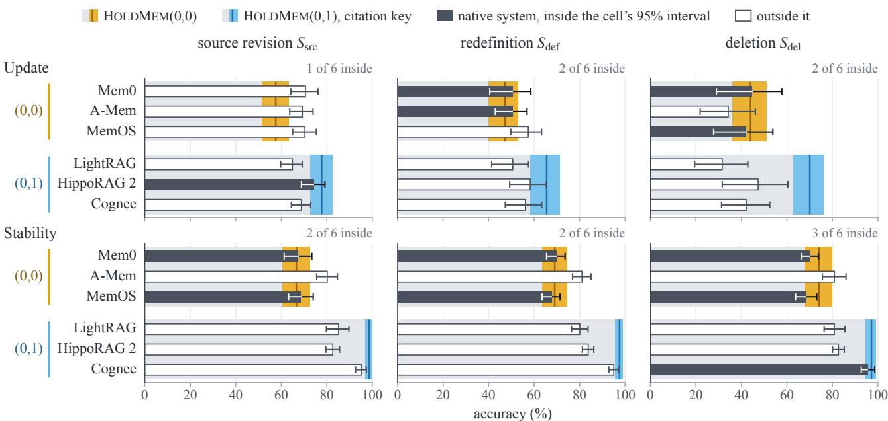  
Figure 3: Update and Stability of each native memory system and of the HoldMem cell with its inferred setting, after each shift. Wide gray bars: the cell’s estimate, with its 95% interval as a band in the color of its � arm. Narrow bars: the native system, filled if its estimate lies inside the cell’s interval and outlined if not. Error bars: 95% intervals.

Value format: a JSON array of full names ([] if none)

As of: ⟨YYYY-MM-DD HH:MM⟩

Definition in effect (important\_contact v1): An important contact is a person who attended at least 5 of the user’s one-off calendar meetings (not recurring series) in the last 90 days. ⟨�=0 delta writes only:⟩ The records below are only those added or changed since ⟨YYYY-MM-DD HH:MM⟩.

Source records (each starts with its id and revision):

<record id=⟨object id⟩ rev=⟨revision⟩>

⟨the record rendered as text⟩

</record>

⟨further records, in time order, up to the writer’s token budget⟩ Task: determine the value of the knowledge item as of the date above, relying on the most recent applicable evidence. \`value\` must be only the value in the format given above (not a sentence); if the records do not establish a

current value, set value to null. Write \`statement\` as one or two self-contained sentences stating the value (name the item and the date). Give up to 6 citations, each with the record id, revision and a short quote (at most 25 words) copied exactly from that record. Reply with JSON only.

The reply follows a schema with three keys: value (a string, a list of strings, or null), statement, and citations (at most six, each with object\_id, revision, and quote).

The stored statement. The reader sees only the statement �� of an item. For a value written by the writer, $s _ { k }$ is rendered from the writer’s statement and citations.

## Statement of a written item

[the set of the user’s important contacts (full names) | written ⟨YYYY-MM-DD⟩] ⟨the writer’s statement⟩ Evidence: ⟨object id⟩ r⟨revision⟩: "⟨quote⟩"; ⟨up to six citations⟩

The �=1 statement template. When the check fails, exact recomputation (or, in the $D _ { \mathrm { m } }$ cell, the writer’s program) supplies the value, and $s _ { k }$ follows a fixed template. For a definition item, the template names the definition version used to compute the value.

## Statement of a recomputed item

[the set of the user’s important contacts (full names) | written ⟨YYYY-MM-DD⟩] As of ⟨YYYY-MM-DD⟩, the set of the user’s important contacts (full names) under the definition in effect (important\_contact v1: An important contact is a person who attended at least 5 of the user’s one-off calendar meetings (not recurring series) in the last 90 days): ⟨the names, comma-separated, or none⟩. (⟨programmatic extraction, or: computed by the writer’s own program⟩ from ⟨object id⟩ r⟨revision⟩; ⟨up to six source objects⟩)

If there is no current value, the body reads “As of ⟨date⟩, there is no current value for ⟨item⟩ ⟨under the definition in efect⟩.”

The program request. In the $D _ { \mathrm { m } }$ cell, the writer also writes a program for each item. The request contains no world data. The experiment with definitions in the user’s own words replaces only the statement after “Definition in efect”.

## System

You maintain a personal knowledge store for one person (called ’the user’). You write small, deterministic Python functions that compute one knowledge item from the user’s structured source records.

## User

Knowledge item: the set of the user’s important contacts (full names)

Value format: a JSON array of full names ([] if none)

Definition in effect (important\_contact v1): An important contact is a person who attended at least 5 of the user’s one-off calendar meetings (not recurring series) in the last 90 days.

Declared sources: calendar

Every record is a dict. Besides the source-specific keys below it has: object\_id (str), source (str), revision (int), updated (str "YYYY-MM-DD HH:MM", time of the last change), cluster (str, grouping id) and text (str, the record rendered as plain text).

⟨the fields of each declared source, here the four kinds of calendar record: settings, series, appointment, and meeting, each with its typedfields⟩

Task: write a Python function \`def derive(records, as\_of):\` that computes the value of the knowledge item as of \`as\_of\` (a string "YYYY-MM-DD HH:MM") from \`records\`, the live records of the declared sources at that time (grouped by source in the order listed above, oldest \`updated\` first within a source). It must return a Python list of strings in the value format above (an empty list if there are none). ⟨the allowed built-infunctions, exception classes, and helpers, and the limits ofthe interpreter: no imports, no file, or network access, no wall clock, a time limit⟩ Reply with JSON only: {"code": "<the Python source of the function and any helpers>"}.

The feedback turn. With execution feedback, a program that fails on the records of a write is sent back to the writer. The request repeats the program request and adds the failed reply as the assistant’s turn, followed by this user turn.

## User

Your function failed in the restricted interpreter on the live records of the declared sources: ⟨the interpreter’s message, with the returned value ifit has the wrong type, at most 600 characters⟩ Write a corrected function. Reply with JSON only, in the same format: {"code": "<the Python source of the function and any helpers>"}.

The reader request. The shared reader answers every probe of every system from the evidence items that the system returns, within the evidence budget. For HoldMem, these items are the stored statements. An unnamed probe leaves out the last sentence of the question.

## System

You answer questions about a person (called ’the user’) using only the evidence provided. Evidence items may disagree or be outdated;

prefer the most recent information that applies at the question’s date. If the evidence does not determine the answer, abstain.

## User

Evidence:   
[1] ⟨evidence item⟩   
[2] ⟨evidence item⟩   
⟨further items, up to the evidence budget⟩   
Question: As of ⟨YYYY-MM-DD HH:MM⟩: Who are the user’s important contacts under the user’s current definition? List full names. Definition in effect: An important contact is a person who attended at least 5 of the user’s one-off   
calendar meetings (not recurring series) in the last 90 days.   
Reply with JSON {"status": "answer" or   
"abstain", "value": ...}. When answering, give only the value in the requested format: a   
string, or a JSON array of strings for lists (use [] for an empty list). When abstaining, set value to null.

## E Setup, Contrasts, and Statistics

This section lists every experiment with the section that reports it (Table 12). All experiments use the same reader template and the same 4,096-token evidence budget. The section then gives the standard report, the four diagnostic tests with their thresholds, the contrasts that separate detec- tion from repair, the statistics, and the compute. Section C.7 gives the models and how they were served.

The standard report. Every system implements one in- terface: ingest, define, consent, set writer, query, export and import, and cost. For each shift, the report gives Up- date and Stability with world-bootstrap intervals. Where a system reports which items are valid, it also gives the missed invalidations, the invalidations of unchanged items (items invalidated although their gold value and status did not change), and the accuracy on re-derived items (the share of re-derived items that the reader answers correctly). Fi-nally, it gives the outcomes of the four diagnostic tests below. A system that ofers only add and search runs through an adapter that ingests each event in time order and retrieves context without generating an answer (Section C.5).

Diagnostic tests and their thresholds. The retention test applies to a switch between comparable writers (the three tiers). It requires that the retention, the share of answers correct before the switch that stay correct, is at least 97%. It is a one-sided non-inferiority test with a 90% interval, and we report the net change in accuracy next to it. Switches to other model families use the same threshold. The leaving test applies after an export to a third-party format with a derivation extension that carries the keys, followed by an import into another implementation. It requires that carryover equals that of the original within ±3 pp, tested with two one-sided tests (TOST, Schuirmann, 1987). The utility floor requires an accuracy before any shift of at least that of the oracle context minus 3 pp. The cost ceiling requires a serving cost per query of at most half a full re- read. It bounds serving, not maintenance. Three tests pass by construction in some settings: the retention test for cells that never re-derive, the leaving test for two implementations of one data model, and the cost ceiling for a retrieval-based system.

## E.1 Contrasts and Thresholds

By construction, after a source revision, a redefinition, or a deletion, only � and the granularity of the key can change detection, and only � can change the accuracy on re-derived items. After a writer switch, a �=1 memory invalidates every item and a �=0 memory none, so only � can change accuracy, and only at �=1. After an export, � and � are kept if and only if the derivation extension is exported. Three quantities test this division directly, each against a threshold we set. First, the efect of � on Update after a source revision, averaged over �, is compared with +2 pp. This is the gain over flat retrieval that Jiang et al. (2026) found for a fine-grained revision ledger on values that were changed and then restored, once the presentation of evidence is matched. Second, �’s efect on missed invalidation is compared with a threshold of 2 pp in absolute value in each of six contrasts (two keys and three shifts). Third, writer agreement, the share of items on which two writers are both right or both wrong, should predict survival, that is, whether an item correct before a switch stays correct. We regress �=0, �=1 survival on the agreement of the two writers. Its calibration slope is compared with 0 (no relation), and its AUROC with 0.60, the weakest discrimination we count as useful, both with 90% intervals.

## E.2 Statistics and Compute

Statistics. Intervals are 95% world-bootstrap intervals over diferences paired by item and checkpoint, with 2,000 draws (Efron and Tibshirani, 1993; Field and Welsh, 2007). Equivalence tests and writer agreement as a predictor use 90% intervals, and equivalence uses TOST with the mar- gin stated for each test (Lakens, 2017; Schuirmann, 1987). We summarize calibration by the logistic calibration slope (Cox, 1958; Van Calster et al., 2019) and discrimination by AUROC. For the held-out definitions and the program sets, the bootstrap draws worlds and definitions (or program sets) independently and takes the product sample. Intervals are per contrast, and we analyze each model family and each native system separately.

Table 12: Experiments: what each varies, the cells or systems it runs, its worlds (test worlds unless stated), and the section that reports it.
<table><tr><td>Experiment</td><td>What varies</td><td>Cells or systems</td><td>Worlds</td><td>Section</td></tr><tr><td colspan="5">Main study</td></tr><tr><td>main experiment</td><td> $S _ { \mathrm { s r c } } , S _ { \mathrm { d e f } } ,$  and  $S _ { \mathrm { d e l } } ,$  probed 1–8 weeks after the fork</td><td>six HoLDMEM cells, check-only cell, JSON arm, no-store BM25, plain RAG, oracle</td><td>20</td><td>F.1-F.5</td></tr><tr><td>writer switch</td><td> $S _ { \mathrm { w r } }$  at three tiers</td><td>context HoLDMEM cells, calibrated on disjoint worlds</td><td>20, and 10</td><td>E.7</td></tr><tr><td>horizon</td><td>horizons of 1, 3, and 12 months</td><td>no-store BM25, plain RAG, HoLDMEm(1,1), oracle context, with a five-part cost</td><td>calibration 20</td><td>F.6</td></tr><tr><td colspan="5">Where the interaction lies, and the reader</td></tr><tr><td>unshifted branch</td><td>the same world without the shift</td><td>four cells</td><td>20</td><td>F.2</td></tr><tr><td>unnamed probes held-out definitions</td><td>definition-item probes that do not name the definition</td><td>six cells,  $S _ { \mathrm { d e f } }$ </td><td>20</td><td>F.2</td></tr><tr><td>Claude reader</td><td>18 definitions from a grammar Claude Sonnet 5.5 reads the main study&#x27;s stores</td><td>HOLDMEM and  $D _ { \mathrm { m } } \thinspace \mathrm { c e l l s }$  six cells, JSON arm</td><td>10 20</td><td>F.2 F.3</td></tr><tr><td colspan="5">What repairs, keys and refresh</td></tr><tr><td>writer&#x27;s programs Claude writers</td><td>the writer&#x27;s program replaces exact recomputation</td><td> $D _ { \mathrm { m } }$  with  $B { = } 0 .$  source and citation keys four cells and two</td><td>20</td><td>F.4</td></tr><tr><td></td><td>Claude Sonnet 5.5 and Opus 5.5 write the definition items</td><td> $D _ { \mathrm { m } }$  cells</td><td>10</td><td>F.4</td></tr><tr><td>definitions in the user&#x27;s own words</td><td>definitions as the user would state them, programs from two three writers</td><td> $D _ { \mathrm { m } }$  cells</td><td>20</td><td>F.4</td></tr><tr><td>program sets from six writers</td><td>three program sets from each of six writers, sampled</td><td>two  $D _ { \mathrm { m } }$  cells</td><td>20</td><td>F.4</td></tr><tr><td>every record as typed fields</td><td>the writer re-derives definition items from every live record of their sources, as typed fields, after  $\dot { S } _ { \mathrm { s r c } }$  and  $S _ { \mathrm { d e f } }$ </td><td> $D { = } 0 , D { = } 1$  , and the typed D=0 cell with a key, Qwen3.5-9B and Claude Sonnet 5.5 as writers of the definition items</td><td>10</td><td>F.4</td></tr><tr><td>execution feedback</td><td>a failing program goes back to the writer with the interpreter&#x27;s message, for at most two rounds</td><td> $D { = } 0 , D _ { \mathrm { m } } ,$  and  $D _ { \mathrm { m } }$  with feedback, each with and without a key</td><td>20</td><td>F.4</td></tr><tr><td>extracted fields</td><td>the programs read fields that the writer extracted from prose rewritten from the records, after  $S _ { \mathrm { s r c } }$  and  $S _ { \mathrm { d e f } }$ </td><td>D=0,  $D _ { \mathrm { m } } ,$  and  $D _ { \mathrm { m } }$  on extracted fields, each with and without a key</td><td>10</td><td>F.4</td></tr><tr><td>controls refresh and upsert</td><td>six arms that vary one confound at a time refresh and slot-keyed upsert</td><td>HOLDMEM and  $D _ { \mathrm { m } }$  cells at  $D { = } 0 , D { = } 1 , \mathrm { a n d } D _ { \mathrm { m } }$ </td><td>10 20</td><td>F.4, F.5 F.5</td></tr><tr><td colspan="5">Generality</td></tr><tr><td>replication</td><td>the main study on other worlds</td><td>the cells and baselines of the main study</td><td>20 replication</td><td>F.8</td></tr><tr><td>other writers</td><td>five other writers as the new writer (four other families writer-switch cells</td><td></td><td>20</td><td>F.7</td></tr><tr><td>other families</td><td>and Qwen3-8B) three other families as writer and reader</td><td>main-experiment cells</td><td>10</td><td>F.8</td></tr><tr><td>other readers</td><td>three other families as reader</td><td>main-experiment cells</td><td>5</td><td>F.8</td></tr><tr><td>rewritten worlds</td><td>a model rewrites message bodies around verbatim gold main-experiment cells facts</td><td></td><td>10</td><td>F.8</td></tr><tr><td colspan="5">Native systems, export, failure modes and sync</td></tr><tr><td>native systems</td><td>native ingestion, black-box  $( D , B )$  inference</td><td>MemO and five further systems, with HoLDMEM cells and baselines on the same</td><td>15 three- month</td><td>F.9</td></tr><tr><td></td><td>Mem0 interventions source-keyed invalidation, query-time view</td><td>worlds Mem0</td><td>10 three-</td><td>F.9</td></tr><tr><td>export</td><td> $S _ { \mathrm { i m p l } } { \mathrm { : } }$  export to Portable Memory (. mem) with and without the derivation extension</td><td>HoLDMEm(1,1) and a second implementation</td><td>month 20</td><td>F.10</td></tr><tr><td></td><td>failure-mode probes conflicts, consent, an unstated redefinition, definition items under citation keys, reader swap, embedding</td><td>HoLDMEM cells, no-store BM25, plain RAG</td><td>5</td><td>F.8, F.10</td></tr><tr><td>sync</td><td>swap documented incremental-sync contracts instead of ideal HoLDMEM delivery</td><td> $( B \in \{ 0 , 1 \} , D { = } 1 )$  , no-store BM25</td><td>5</td><td>F.10</td></tr></table>

Multiple contrasts. The 42 contrasts of �, �, and �×� on the three branches that can difer from zero by construction (Section E.1) form one family per test set, with one-sided bootstrap p-values. The Holm correction (Holm, 1979) keeps 35 of the 36 intervals that exclude zero on the test worlds and 36 of 36 on the replication. Benjamini–Hochberg at $\scriptstyle q = 0 . 0 5$ (Benjamini and Hochberg, 1995) keeps 36 and 36. The one interval that Holm drops is the �×� of the citation key after a redefinition (+7.5 pp [+1.1, +14.0]), which Holm keeps on the replication (+6.8 pp [+2.4, +11.6]). The detection contrasts sit at the lowest p-value the bootstrap can give. Without them, Holm with 10,000 draws over the remaining 30 contrasts keeps 23 of those that exclude zero on the test worlds and 24 on the replication.

Compute. The open-weight models were served on NVIDIA A100 40GB GPUs, which the model servers held for about 140 GPU-hours in total. The native-system runs used 34 of them, all other runs 79, and the servers were idle for the rest. Claude Sonnet 5.5 (claude-sonnet-5-5) and Claude Opus 5.5 (claude-opus-5-5) were called through Anthropic’s API from 2026-10-16 to 2026-10-19, with 278 million input and output tokens in total at a cost of 336 US dollars.

## F Extended Results

This section gives the full results, ordered by the question they answer. Unless a caption says otherwise, a result comes from the main study: 20 test worlds, Qwen3.5-9B as writer and reader, and the source key for �=1. Brackets give 95% world-bootstrap intervals. In a table, an estimate shown without an interval has an interval of zero width at the precision shown, unless the notes of the table call it a point estimate.

S mbols. The shifts are a source revision $S _ { \mathrm { s r c } } ,$ , a redefini- tion $S _ { \mathrm { d e f } }$ , a deletion $S _ { \mathrm { d e l } }$ , a writer switch $S _ { \mathrm { w r } } .$ an export $S _ { \mathrm { i m p l } } .$ and, in the failure-mode probes, a consent revocation � . HoldMem(�, �) is a cell of the reference memor . At �=0 there is no key and the memory only appends. At �=1 a key invalidates an item, and the current writer re-derives it. At �=0 the writer re-derives, at �=1 exact recomputation re-pairs, and at $D _ { \mathrm { m } }$ the writer’s programs repair. An item-time is one item at one checkpoint, and every count and share below is over item-times. An item-time is changed when its gold value or status difers from that at the fork. On the changed item-times, � is the share not invalidated after the latest change of the gold. An invalidation counts only if it happens after the checkpoint before the interval in which the gold last changed. � is the share of the re-derived item-times that are answered correctly, and � is the share answered correctly among those not invalidated. $r _ { D }$ and $a _ { D }$ are � and � at a given $D , r _ { D }$ with a key and $a _ { D }$ without. The accuracy on re-derived items is the share of re-derived item-times, changed or not, that the reader answers correctly (or, where a table says so, whose re-derived value equals gold). Efects are in percentage points (pp). The � efect is �=1 minus �=0 at a given �. The � efect is �=1 minus �=0 at a iven �. �×� is the � efect at �=1 (or $D _ { \mathrm { m } } )$ minus the � efect at �=0. A chan e is caused b the shift when its gold difers from the gold of the same world at the same time without the shift (the unshifted branch). Otherwise, it would also have happened without the shift. If we counted � from the fork, an item-time that was re-derived after an earlier chan e and is stale after a later one would count as a failed repair. For the source key the two ways of counting difer on at most 0.6% of a class’s changed item-times (1.0% in the re lication) and for the citation ke on far more (Section F.5). Some analyses count detection from the fork: evidence coverage, typed inputs, the Claude writers’ $r _ { 0 } .$ , the controls, the account across writers, the ke audit, and the citation key’s misses (Tables 9 and 13 to 19 and Figures 2, 4 and 5). There the source key misses no changed item-time, so its � equals its Update.

Which item-times are scored. At each checkpoint after the fork, the reader is asked about every changed item-time. For each world, shift, and checkpoint, it is also asked about a random sample of the unchanged item-times of the same size, drawn with a fixed seed (or all of them if there are fewer). Every HoldMem cell is asked about the same item-times. Update is computed on the changed item-times and Stability on the sample, while the invalidation shares of the key audit (Table 9) count every item-time. In the main study, each cell is thus scored on 1,168, 558, and 1,767 changed and 1,168, 558, and 1,683 unchanged item-times after a source revision, a redefinition, and a deletion. In the replication, the numbers are 1,170, 575, and 1,739 changed and 1,170, 575, and 1,671 unchanged item-times.

## F.1 Main Contrasts

The key raises Update, and � does not change detection. Table 18 gives every contrast of the main study next to its estimate in the replication (Section F.8). The efect of � on Update after a source revision, averaged over �, was +9.2 pp [+6.7, +11.9], above the threshold of +2 pp. After a redefinition and a deletion it was +13.5 pp [+10.6, +16.5] and +51.7 pp [+47.3, +56.0]. The keys do not depend on $D ,$ so $D ' s$ efect on missed invalidation was 0.0 pp for both keys after every shift, and an import without the keys misses every change (Section F.10). By design, the source key’s efects on detection are near 100 pp, apart from the changes that come from the clock alone (Section F.5). With either key, � raised the accuracy on re-derived items after every shift, whether we score the reader’s answer or the re-derived value.

## F.2 Where the Interaction Lies

The class split. Figure 6 shows the pattern. On defini- tion items, the key helps mainly with exact recomputation (+33.3 pp [+28.2, +38.0] at �=1 against +6.0 pp [+2.5, +9.6] at �=0 after a source revision). On the other items, the interaction is near zero with this reader in both sets of worlds. Table 20 gives every contrast by shift and item class, with exact recomputation in the main study and the replication, and with the writer’s programs.

With exact recomputation, the interaction depends mainly on the item class. Update counts every item-time whose gold difers from its value at the fork. This includes changes after the fork that would have happened without the shift. Table 21 separates the changes that the shift caused from the others. It gives the � efects and �×� on each part, by item class, with exact recomputation and with the writer’s programs. On definition items, the interaction was the same whether the redefinition changed the value or the value would have changed anyway (+38.7 pp and +38.8 pp).

Table 13: The stored value and the reader behind � and � of Equation (1), in percent (point estimates).
<table><tr><td colspan="4"></td><td colspan="6">B=1: re-derived</td><td colspan="2">B=0</td></tr><tr><td>Shift</td><td>Class</td><td>Cell</td><td>n</td><td> $r _ { \mathrm { s t o r e } }$ </td><td>u</td><td>u, answer</td><td>u, abstain</td><td>l</td><td>r</td><td> $a _ { \mathrm { s t o r e } }$ </td><td>a</td></tr><tr><td rowspan="6"> $S _ { \mathrm { s r c } }$ </td><td rowspan="6">definition</td><td>D=0</td><td>333</td><td>16.2</td><td>98.1</td><td>98.1</td><td></td><td>0.4</td><td>16.2</td><td>10.2</td><td>10.2</td></tr><tr><td> $D { = } 1$ </td><td></td><td>99.4</td><td>99.7</td><td>99.7</td><td></td><td>0.0</td><td>99.1</td><td>66.1</td><td>65.8</td></tr><tr><td> $D { = } 1 , \operatorname { J S O N }$ </td><td></td><td>99.4</td><td>70.1</td><td>70.1</td><td></td><td>0.0</td><td>69.7</td><td></td><td></td></tr><tr><td> $D _ { \mathrm { m } }$ </td><td></td><td>71.8</td><td>99.6</td><td>99.6</td><td></td><td>7.4</td><td>73.6</td><td>38.4</td><td>40.2</td></tr><tr><td> $D { = } 0$ </td><td>835</td><td>92.0</td><td>96.7</td><td>99.9</td><td>17.2</td><td>1.5</td><td>89.1</td><td>84.2</td><td>83.7</td></tr><tr><td> $D { = } 1$   $D { = } 1 , \operatorname { J S O N }$ </td><td></td><td>95.4 95.4</td><td>94.9 93.6</td><td>99.7 100.0</td><td>40.9</td><td>2.6</td><td>90.7</td><td>84.9</td><td>85.9</td></tr><tr><td></td><td> $D _ { \mathrm { m } }$ </td><td></td><td>93.5</td><td>95.5</td><td>100.0</td><td>22.7 39.7</td><td>0.0 3.7</td><td>89.3 89.6</td><td>78.7</td><td>79.8</td></tr><tr><td rowspan="6"> $S _ { \mathrm { d e f } }$ </td><td>definition</td><td> $D { = } 0$ </td><td></td><td></td><td>100.0</td><td></td><td></td><td>0.0</td><td>6.7</td><td>8.8</td><td></td></tr><tr><td></td><td> $D { = } 1$ </td><td>387</td><td>6.7 99.7</td><td>100.0</td><td>100.0 100.0</td><td></td><td>0.0</td><td>99.7</td><td>63.0</td><td>7.5 61.8</td></tr><tr><td></td><td> $D { = } 1 , \operatorname { J S O N }$ </td><td></td><td>99.7</td><td>54.4</td><td>54.4</td><td></td><td>0.0</td><td>54.3</td><td></td><td></td></tr><tr><td></td><td> $D _ { \mathrm { m } }$ </td><td></td><td>66.4</td><td>100.0</td><td>100.0</td><td></td><td>8.5</td><td>69.3</td><td>33.6</td><td>35.1</td></tr><tr><td>other</td><td> $D { = } 0$ </td><td>171</td><td>73.7</td><td>98.4</td><td>100.0</td><td>33.3</td><td>2.2</td><td>73.1</td><td>70.2</td><td>70.8</td></tr><tr><td rowspan="4"></td><td> $D { = } 1$ </td><td></td><td></td><td>96.5</td><td>75.8</td><td>100.0</td><td>7.0</td><td>0.0</td><td>73.1</td><td>72.5</td><td>71.3</td></tr><tr><td></td><td> $D { = } 1 , \operatorname { J S O N }$ </td><td></td><td>96.5</td><td>74.5</td><td>100.0</td><td>2.3</td><td>0.0</td><td>71.9</td><td></td><td></td></tr><tr><td> $D _ { \mathrm { m } }$ </td><td></td><td>91.8</td><td>79.0</td><td>100.0</td><td></td><td>5.7</td><td>7.1</td><td>73.1</td><td>67.3</td><td>67.3</td></tr><tr><td>definition  $D { = } 0$ </td><td></td><td>308</td><td>11.4</td><td>100.0</td><td>100.0</td><td></td><td>0.4</td><td>11.7</td><td>4.9</td><td>4.2</td></tr><tr><td rowspan="6"></td><td></td><td> $D { = } 1$ </td><td></td><td>99.4</td><td>100.0</td><td>100.0</td><td></td><td>0.0</td><td>99.4</td><td>57.1</td><td>56.5</td></tr><tr><td></td><td> $D { = } 1 , \operatorname { J S O N }$ </td><td></td><td>99.4</td><td>67.0</td><td>67.0</td><td></td><td>0.0</td><td>66.6</td><td></td><td></td></tr><tr><td> $D _ { \mathrm { m } }$ </td><td></td><td></td><td>74.0</td><td>100.0</td><td>100.0</td><td></td><td>15.0</td><td>77.9</td><td>31.8</td><td>34.7</td></tr><tr><td>other</td><td> $D { = } 0$ </td><td>1,459</td><td>73.0</td><td>92.4</td><td>100.0</td><td>91.8</td><td>2.3</td><td>68.1</td><td>6.2</td><td>10.0</td></tr><tr><td></td><td> $D { = } 1$ </td><td></td><td>81.1</td><td>82.9</td><td>100.0</td><td>81.7</td><td>1.4</td><td>67.5</td><td>7.1</td><td>10.9</td></tr><tr><td rowspan="4"></td><td></td><td> $D { = } 1 , \operatorname { J S O N }$ </td><td></td><td>81.1</td><td>19.9</td><td>100.0</td><td>13.9</td><td>0.0</td><td>16.1</td><td></td><td></td></tr><tr><td></td><td> $D _ { \mathrm { m } }$ </td><td></td><td>52.9</td><td>71.8</td><td>100.0</td><td>68.4</td><td>0.7</td><td>38.3</td><td>6.4</td><td>13.0</td></tr><tr><td></td><td></td><td></td><td></td><td></td><td></td><td></td><td></td><td></td><td></td><td></td></tr></table>

�: changed item-times. $r _ { \mathrm { s t o r e } } .$ the share of re-derived item-times whose stored state (status and typed value) is the gold. �, �: accuracy given a right or a wrong store, so $r = r _ { \mathrm { s t o r e } } u + ( 1 - r _ { \mathrm { s t o r e } } ) l .$ � is also iven b old status: answer or abstain where the ri ht state is no value. � t r , �: the same at �=0, where the store is the newest served item. JSON: the �=1 store served as JSON records. —: not defined, as every changed definition item-time has a value as its right state and the JSON store has no �=0 cell.

The interaction by cause. Over all items, the interaction after a source revision was +7.4 pp [+5.0, +9.8] on all changes and +2.5 pp [+0.5, +4.4] on the changes the shift caused. After a redefinition the two values were +26.7 pp [+21.2, +31.8] and +38.7 pp [+30.4, +46.9], and after a deletion +5.0 pp [+1.7, +8.1] and −0.1 pp [−4.5, +4.3]. A source revision and a deletion change mostly other items, where the interaction is near zero, so their all-item values on the changes they caused are small. On definition items, the interaction after every shift was about as large on the changes the shift caused as on the others. With the writer’s programs, it was +32.4 pp [+23.4, +41.5] on the changes that a redefinition caused.

Small all-item values on shift-caused changes come from the mix of item classes. The all-item interaction on a set of item-times is a mean, so it equals the sum over classes of each class’s share times its value. On the item-times that a source revision itself changed, definition items make up 14.1% [9.5, 19.0] and contribute +3.4 pp [+1.5, +5.6], and the other items contribute −0.9 pp [−3.8, +1.8]. Together they give the all-item value of +2.5 pp [+0.5, +4.4]. After a deletion, the definition share is 3.5% [1.6, 5.5], and the two contributions are +1.4 pp [+0.3, +2.8] and −1.5 pp [−5.7, +2.4]. If we re-weight to the class mix of all changed itemtimes, the changes a source revision caused give +6.2 pp [+3.3, +9.2] and the rest give +9.1 pp [+3.8, +15.4] (after a deletion, +5.7 pp and +5.4 pp). The two parts are diferent item-times, so this comparison is not paired. The unshifted branch gives a paired comparison.

After a source revision, the interaction on definition items also appears without the shift. The unshifted branch has the same events as the shifted branches up to the fork and no shift after it. Four cells answered every item at every checkpoint on it. Table 21 gives the interaction without the shift on the item-times that a shift changed, and the diference from the interaction with the shift. This diference, shifted minus unshifted, was +13.5 pp [+1.8, +25.3] after a redefinition and −4.5 pp [−17.5, +9.6] after a source revision. After a source revision, 60.4% of these item-times also changed without the shift, so the interaction there is not specific to the shift. After a deletion, the diference on definition items was +12.5 pp [0.0, +21.4]. On the other items, no shift changes the interaction measurably.

Table 14: Evidence coverage of the �=0 writer’s 6,000-token selection, and the size of the complete typed input.
<table><tr><td rowspan="2">(a) Definition</td><td rowspan="2">n</td><td colspan="2">Definition scope in the selection (%)</td><td colspan="3">Full-access control</td><td colspan="3">Typed input (tokens)</td></tr><tr><td>Held</td><td>Complete</td><td>Re-derivations</td><td>Cut (%)</td><td>Same request (%)</td><td>Median</td><td>Max</td><td>Fit (%)</td></tr><tr><td>important contacts</td><td>240</td><td>90.2 [86.3, 93.9]</td><td>45.4 [28.3, 62.5]</td><td>80</td><td>0.0</td><td>10.0 [0.0, 25.0]</td><td>12,477</td><td>15,705</td><td>100.0</td></tr><tr><td>close friends</td><td>240</td><td>19.8[18.6, 20.8]</td><td>0.0</td><td>80</td><td>100.0</td><td>0.0</td><td>37,314</td><td>44,109</td><td>0.0</td></tr><tr><td>working hours</td><td>240</td><td>100.0</td><td>100.0</td><td>80</td><td>0.0</td><td>0.0</td><td>13,370</td><td>16,663</td><td>100.0</td></tr><tr><td>active projects</td><td>240</td><td>100.0</td><td>100.0</td><td>76</td><td>0.0</td><td>100.0</td><td>1,870</td><td>2,327</td><td>100.0</td></tr><tr><td>VIP senders</td><td>240</td><td>23.4 [21.9, 25.0]</td><td>0.0</td><td>80</td><td>100.0</td><td>0.0</td><td>38,532</td><td>47,326</td><td>0.0</td></tr><tr><td>overdue tasks</td><td>240 100.0</td><td></td><td>100.0</td><td>76</td><td>0.0</td><td>100.0</td><td>1,870</td><td>2,327</td><td>100.0</td></tr><tr><td>(b) Shift</td><td colspan="2">Definition scope</td><td>n</td><td colspan="3"> $r _ { 0 } ( \% )$ </td><td></td><td colspan="2">B×D (pp)</td></tr><tr><td colspan="10"> $r _ { 1 } ~ ( \% )$  Qwen3.5-9B, 20 worlds</td></tr><tr><td colspan="2"> $S _ { \mathrm { s r c } }$  incomplete</td><td colspan="2">complete 144</td><td colspan="3">36.8 [24.8, 47.2]</td><td colspan="3">97.9 [95.5, 100.0] +22.2 [+8.8, +35.3]</td></tr><tr><td colspan="2"></td><td colspan="2">189</td><td colspan="2">0.5 [0.0, 1.6]</td><td>100.0</td><td colspan="3">+31.2 [+25.1, +36.6]</td></tr><tr><td colspan="2"> $S _ { \mathrm { d e f } }$ </td><td colspan="2">complete 197</td><td colspan="2">12.7 [6.0, 19.8]</td><td>99.5 [98.3, 100.0]</td><td colspan="3">+50.3 [+37.2, +60.6]</td></tr><tr><td colspan="2"> $S _ { \mathrm { d e l } }$ </td><td colspan="2">incomplete 190</td><td colspan="2">0.5 [0.0, 1.6]</td><td>100.0</td><td colspan="3">+26.8[+22.0, +31.7]</td></tr><tr><td colspan="2">complete</td><td colspan="2">121</td><td colspan="2">27.3 [18.6, 36.7]</td><td>98.3 [95.8, 100.0] 100.0</td><td colspan="3">+39.7 [+24.5, +52.2] +32.6[+27.3, +37.2]</td></tr><tr><td colspan="2">incomplete</td><td colspan="2">187</td><td colspan="2">1.6[0.0, 3.4]</td><td colspan="3"></td></tr><tr><td colspan="3">Claude Sonnet 5.5</td><td colspan="2"></td><td colspan="3"></td></tr><tr><td colspan="2"> $S _ { \mathrm { s r c } }$ </td><td colspan="2">complete 72</td><td>94.4 [87.2, 100.0]</td><td colspan="2">94.4[89.7, 98.5]</td><td colspan="3">-41.7[−50.9, −30.2]</td></tr><tr><td colspan="2"></td><td colspan="2">incomplete</td><td>7.5 [4.3, 10.2]</td><td colspan="2">98.9 [96.7, 100.0]</td><td colspan="3">+61.3 [+52.1, +69.2]</td></tr><tr><td colspan="2"> $S _ { \mathrm { d e f } }$ </td><td colspan="2">complete 104</td><td>96.2 [91.5, 100.0]</td><td colspan="2">96.2 [92.3, 100.0]</td><td colspan="3">-21.2[-31.2, −12.4]</td></tr><tr><td colspan="2"> $S _ { \mathrm { d e l } }$ </td><td colspan="2">incomplete</td><td>8.2 [4.5, 11.4]</td><td colspan="2">99.0 [96.8, 100.0]</td><td colspan="3">+56.7 [+48.0, +65.6]</td></tr><tr><td colspan="2">complete</td><td colspan="2">97 62</td><td>93.5 [82.8, 100.0]</td><td colspan="2">96.8 [92.4, 100.0]</td><td colspan="3">-17.7[-37.9, 0.0] +66.3 [+57.3, +74.5]</td></tr><tr><td colspan="2">incomplete</td><td colspan="2">92</td><td colspan="2">8.7 [4.7, 12.0]</td><td colspan="3">98.9 [96.6, 100.0]</td></tr><tr><td colspan="2">Claude Opus 5.5</td><td colspan="2"></td><td colspan="3"></td><td colspan="3"></td></tr><tr><td rowspan="2"> $S _ { \mathrm { s r c } }$ </td><td colspan="2">complete</td><td>72</td><td colspan="2">91.7 [83.7, 97.1] 5.4[1.1, 10.0]</td><td colspan="3">91.7 [83.6, 97.1]</td><td colspan="2">-23.6[−31.9, −15.5] +60.2 [+48.9, +69.1]</td></tr><tr><td colspan="2">incomplete</td><td>93</td><td colspan="2"></td><td colspan="3">95.7 [92.4, 98.9]</td></tr><tr><td rowspan="2"> $S _ { \mathrm { d e f } }$ </td><td colspan="2">complete</td><td>104</td><td colspan="2">97.1 [92.9, 100.0]</td><td colspan="3">97.1 [94.7, 100.0]</td></tr><tr><td colspan="2">incomplete</td><td colspan="2">97</td><td>6.2 [3.1, 9.1]</td><td colspan="2">94.8 [90.4, 98.9]</td><td colspan="2">-20.2[−25.5, −15.5] +55.7 [+45.8, +66.0] -16.1 [−27.3, −7.6]</td></tr><tr><td rowspan="2"> $S _ { \mathrm { d e l } }$ </td><td colspan="2">complete</td><td>62</td><td colspan="2">95.2 [86.4, 100.0]</td><td colspan="3">91.9 [82.6, 98.4] 94.6 [90.1, 98.8]</td></tr><tr><td colspan="2">incomplete</td><td colspan="2">92</td><td>7.6 [3.4, 11.5]</td><td colspan="2"></td><td colspan="2">+62.0[+51.7, +71.6]</td></tr></table>

(a) �: the definition item-times after the three shifts. Held: the definition-scope records in the selection. Complete: the item-times with all of them. Cut: the full-access control’s requests cut at 25,000 tokens (10 worlds, $S _ { \mathrm { s r c } }$ and $S _ { \mathrm { d e f } } ) .$ Same request: those equal to the �=0 request. Over all six definitions the control re-derived 472 times, 33.9% [31.0, 37.1] with the same request. Typed input: a $\mid D _ { \mathrm { m } }$ program’s complete typed input per item-time, as tables without bodies, in Qwen3.5-9B tokens. Fit: the share at or below 31,000 tokens. (b) On the changed definition item-times, $B { \times } D$ at �=1

The six definitions difer. Table 8 gives the interaction for each definition. It varies widely, so at this level the six definitions are the efective sample. After a source revision it ranges from −20.0 pp (active projects) to +75.4 pp (important contacts). Leaving one definition out moves the class value between +16.5 pp and +33.8 pp after a source revision, and between +34.6 pp and +47.3 pp after a redefinition.

The interaction holds on held-out definitions. Each draw of six held-out definitions (Section B) replaced the six fixed definitions on ten test worlds, with Qwen3.5-9B as writer and reader and every other request unchanged. After the fork, only definition items were asked. The bootstrap draws worlds and definitions independently and takes the product sample. The interaction is positive at both �=1 and $D _ { \mathrm { m } } \colon$ : �� was +33.0 pp [+22.1, +44.9] and +27.4 pp [+15.2, +40.7] after a redefinition, +26.7 pp [+16.6, +38.3] and +23.3 pp [+12.9, +36.4] after a source revision, and +33.1 pp [+19.7, +48.6] and +29.0 pp [+16.0, +45.9] after a deletion. It was positive for 17 of the 18 definitions after a redefinition (Table 8).

Naming the definition in the probe changes little. On all 20 worlds after a redefinition, the six cells answered again with unnamed probes (Section B). Items, keys, and writes were unchanged. The efect of � at �=1 was +38.0 pp [+32.6, +43.2] without the name and +38.0 pp [+32.6, +43.4] with it (diference 0.0 pp [−1.3, +1.2]). �×� was +39.5 pp [+33.3, +45.2] without the name, and +36.2 pp [+30.0, +42.0] with the writer’s programs. An append-only memory that holds items under both versions cannot choose between them without the name. However, the key helps mostly where the append-only memory holds no item for the slot derived after the fork (93% of its efect at �=1 after a redefinition, Section F.5). There, the name has nothing to choose between.

## F.3 Stored Value and Reader

With Qwen3.5-9B as reader, the interaction on definition items comes from the stored value. The terms of Equa- tion (1) are based on the reader’s answers, so � mixes two things: whether the re-derivation stored the right value, and whether the reader used it. For each changed item-time, we read the item’s stored state at the probe time (at �=0, the newest served item) and judge it with the scorer’s matcher. An item that is not served stores no value. Let $r _ { \mathrm { s t o r e } }$ be the share of right stores, � the share of right stores that the reader answers correctly, and � the share of wrong stores that it still answers correctly. Then $r = r _ { \mathrm { s t o r e } } u + ( 1 { - } r _ { \mathrm { s t o r e } } ) l$ , and the �×� interaction splits exactly into a store part and a reader part (Tables 13 and 22). On definition items, the reader used a right store in 98.1% of cases at �=0 and 99.7% at �=1 after a source revision. The reader part of the interaction was 0.0 pp [−0.9, +0.9], 0.0 pp, and −0.3 pp [−1.0, 0.0] after the three shifts. A failed re-derivation of these items is thus a wrong stored value, not a reading error.

Table 15: Given every live record of the definition’s sources as typed fields, Claude Sonnet 5.5 raises � on the changed definition item-times close to that of exact recomputation, while Qwen3.5-9B stays far below it.
<table><tr><td></td><td colspan="7">r (%)</td></tr><tr><td></td><td>Complete (%)</td><td>n</td><td>Selection</td><td>Typed</td><td>Exact</td><td>Typed – selection</td><td>Exact – typed</td></tr><tr><td>(a) Qwen3.5-9B</td><td></td><td></td><td></td><td></td><td></td><td></td><td></td></tr><tr><td>important contacts</td><td>50.0</td><td>67</td><td>0.0</td><td>0.0</td><td>100.0</td><td>0.0</td><td>+100.0</td></tr><tr><td>close friends</td><td>0.0</td><td>79</td><td>0.0</td><td>0.0</td><td>100.0</td><td>0.0</td><td>+100.0</td></tr><tr><td>working hours</td><td>100.0</td><td>39</td><td>20.5 [0.0, 34.7]</td><td>20.5 [0.0, 34.7]</td><td>100.0</td><td>0.0</td><td>+79.5 [+65.3, +100.0]</td></tr><tr><td>active projects</td><td>100.0</td><td>40</td><td>42.5 [12.5, 72.7]</td><td>12.5 [0.0, 37.5]</td><td>100.0</td><td>-30.0[-62.5,0.0]</td><td>+87.5 [+62.5, +100.0]</td></tr><tr><td>VIP senders</td><td>0.0</td><td>72</td><td>0.0</td><td>0.0</td><td>100.0</td><td>0.0</td><td>+100.0</td></tr><tr><td>overdue tasks</td><td>100.0</td><td>69</td><td>7.2 [0.0, 17.8]</td><td>18.8 [9.0, 29.7]</td><td></td><td>98.6 [95.7, 100.0] +11.6[+3.0, +22.2]</td><td>+79.7 [+69.1, +89.5]</td></tr><tr><td>all six</td><td>58.3</td><td>366</td><td>8.2 [3.3, 14.0]</td><td>7.1 [4.2, 10.3]</td><td>99.7 [99.2, 100.0]</td><td>-1.1 [−5.8, +3.2]</td><td>+92.6[+89.3, +95.6]</td></tr><tr><td>after  $S _ { \mathrm { s r c } }$ </td><td></td><td>165</td><td>12.7 [3.8, 21.7]</td><td>9.1 [2.6, 15.4]</td><td>99.4 [98.2, 100.0]</td><td>-3.6[−10.1, +2.5]</td><td>+90.3 [+83.7, +97.1]</td></tr><tr><td>after  $S _ { \mathrm { d e f } }$ </td><td></td><td>201</td><td>4.5 [0.0, 9.0]</td><td>5.5 [3.2, 8.0]</td><td>100.0</td><td> $+ 1 . 0 \left[ - 3 . 4 , + 4 . 9 \right]$ </td><td>+94.5 [+92.0, +96.8]</td></tr><tr><td>selection complete</td><td></td><td>176</td><td>17.0 [7.1, 28.5]</td><td>14.8 [8.8, 21.0]</td><td>99.4 [98.3, 100.0]</td><td> $- 2 . 3 \left[ - 1 2 . 0 , + 6 . 8 \right]$ </td><td>+84.7 [+78.1, +91.0]</td></tr><tr><td>selection incomplete</td><td></td><td>190</td><td>0.0</td><td>0.0</td><td>100.0</td><td>0.0</td><td>+100.0</td></tr><tr><td>(b) Claude Sonnet 5.5</td><td></td><td></td><td></td><td></td><td></td><td></td><td></td></tr><tr><td>important contacts</td><td>50.0</td><td>67</td><td>56.7 [35.8, 75.8]</td><td>65.7 [53.1, 76.7]</td><td>88.1 [75.4,97.0]</td><td>+9.0 [−2.9, +19.5]</td><td>+22.4 [+9.0, +35.2]</td></tr><tr><td>close friends</td><td>0.0</td><td>79</td><td>1.3 [0.0, 3.8]</td><td>97.5 [93.8, 100.0]</td><td>100.0</td><td>+96.2[+92.4, +100.0]</td><td>+2.5 [0.0, +6.2]</td></tr><tr><td>working hours</td><td>100.0</td><td>39</td><td>100.0</td><td>100.0</td><td>97.4 [90.6, 100.0]</td><td>0.0</td><td>-2.6[-9.4, 0.0]</td></tr><tr><td>active projects</td><td>100.0</td><td>40</td><td>92.5 [83.3, 100.0]</td><td>90.0 [77.3, 100.0]</td><td>97.5 [93.2, 100.0]</td><td>-2.5[−6.8, 0.0]</td><td>+7.5 [0.0, +16.7]</td></tr><tr><td>VIP senders</td><td>0.0</td><td>72</td><td>0.0</td><td>98.6 [95.6, 100.0]</td><td>100.0</td><td>+98.6[+95.6, +100.0]</td><td>+1.4 [0.0, +4.4]</td></tr><tr><td>overdue tasks</td><td>100.0</td><td>69</td><td>98.6 [95.6, 100.0]</td><td>100.0</td><td>100.0</td><td>+1.4 [0.0, +4.3]</td><td>0.0</td></tr><tr><td>all six</td><td>58.3</td><td>366</td><td>50.0 [45.2, 54.5]</td><td>91.8 [89.8,93.7]</td><td>97.3 [95.4, 98.9]</td><td>+41.8 [+38.0, +46.1]</td><td>+5.5 [+2.7, +8.4]</td></tr><tr><td>after  $S _ { \mathrm { s r c } }$ </td><td></td><td>165</td><td>45.5 [36.0, 53.1]</td><td>93.3 [90.9, 95.4]</td><td>97.0 [95.3, 98.7]</td><td> $+ 4 7 . 9 \ [ + 4 1 . 3 , + 5 5 . 6 ]$ </td><td> $+ 3 . 6 \left[ + 1 . 1 , + 6 . 2 \right]$ </td></tr><tr><td>after  $S _ { \mathrm { d e f } }$ </td><td></td><td>201</td><td>53.7 [49.5,57.3]</td><td>90.5 [86.7,93.7]</td><td>97.5 [95.3, 99.5]</td><td> $+ 3 6 . 8 \ [ + 3 4 . 0 , + 4 0 . 0 ]$ </td><td> $+ 7 . 0 \left[ + 3 . 1 , + 1 1 . 8 \right]$ </td></tr><tr><td>selection complete</td><td></td><td>176</td><td>95.5 [91.5,98.9]</td><td>94.9 [91.7,98.6]</td><td>95.5 [91.7,98.8]</td><td>-0.6[−3.4, +2.4]</td><td> $+ 0 . 6 [ - 1 . 7 , + 3 . 1 ]$ </td></tr><tr><td>selection incomplete</td><td></td><td>190</td><td>7.9 [4.5, 10.7]</td><td>88.9 [84.9,93.1]</td><td></td><td>98.9 [96.8, 100.0] +81.1 [+75.1, +86.9]</td><td> $+ 1 0 . 0 \left[ + 5 . 0 , + 1 4 . 6 \right]$ </td></tr></table>

� on the changed definition item-times after $S _ { \mathrm { s r c } }$ and $S _ { \mathrm { d e f } }$ (10 worlds) when the writer re-derives the item from its own selection (�=0) or from every live record of the definition’s sources as typed fields, and with exact recomputation (�=1). Complete: the share of item-times whose selection held every record the definition ran es over ( oint estimates). In (b), Claude Sonnet 5.5 writes the definition items.

On the other items, the reader loses what �=1 stores. Here �=1 raised the share of right stores, after a redefinition from 73.7% to 96.5%. When the right store was a value, the reader answered correctly in 100.0% of cases. When the right store was “no value”, it answered correctly in only 7.0% [0.0, 20.0] (81.7% [77.2, 85.4] after a deletion). On deleted records, 162 of the 192 reader errors of the �=1 cell after a deletion answer “there is no current value” but with the status answer (Table 23). The near-zero interaction on these items is thus a gain in the store that the reader loses, not a re-derivation that already succeeds at �=0. When the �=1 store is served as JSON records, the stored state is the same by construction. The reader then used a right store on definition items in 70.1%, 54.4%, and 67.0% of cases after the three shifts, so the loss from the JSON format (Table 24) lies entirely in the reader. The writer’s programs store the right definition value less often (71.8% after a source revision), and their interaction there again comes from the store. After a deletion, their interaction on the other items has a negative store part (−20.4 pp [−24.0, −16.7]) and a negative reader part (−12.4 pp [−16.2, −7.9], Section G). Note that � includes finding the statement among all served statements, which the answer logs cannot separate from reading.

A stronger reader keeps more of what the store holds. Claude Sonnet 5.5 read every probe of the six cells and the JSON arm in the main study’s stores, with the same reader request and no thinking before the answer. None of its 68,474 answers was unreadable or cut of. With this reader, the interaction on the other items is positive after a redefinition and after a deletion (+9.9 pp [+3.4, +17.3] and +5.3 pp [+2.3, +8.4]). The stores are the same, so the store part of �×� is unchanged, and the diference between readers lies in the reader part (Table 22 and Figure 7). After a redefinition, the reader part on the other items is −10.5 pp $[ - 1 6 . 6 , - 4 . 6 ]$ , compared with −21.1 pp [−31.7, −10.8] for Qwen3.5-9B. Of the 1,210 right “no value” stores on the other items at �=1, this reader misread 1, compared with 281 for Qwen3.5-9B. After a source revision, the interaction on the other items stays near zero (+1.2 pp [−1.1, +3.4]). With the writer’s programs, it is +8.8 pp [−0.6, +18.8] after a redefinition and −22.6 pp [−26.4, −18.7] after a deletion, where the programs’ stored values cause the loss.

Table 16: The account by writer and item class: repair correctness $r _ { D }$ at � (%) and �� on Update (pp).
<table><tr><td></td><td></td><td colspan="4"> $S _ { \mathrm { s r c } }$ </td><td colspan="3"> $S _ { \mathrm { d e f } }$ </td><td colspan="3"> $S _ { \mathrm { d e l } }$ </td></tr><tr><td>Writer</td><td>Class</td><td>ro</td><td>r1</td><td> $B { \times } D$ </td><td>ro</td><td>r1</td><td>B×D</td><td>r0</td><td>r1</td><td></td><td>B×D</td></tr><tr><td rowspan="4">Qwen3.5-9B main study</td><td>definition</td><td>16</td><td>99</td><td> $+ 2 7 . 3 \ : [ + 2 1 . 6 , + 3 2 . 6 ]$ </td><td>7</td><td>100</td><td> $+ 3 8 . 8 \left[ + 3 2 . 0 , + 4 4 . 8 \right]$ </td><td>12</td><td>99</td><td></td><td> $+ 3 5 . 4 \ : [ + 3 0 . 4 , + 4 0 . 0 ]$ </td></tr><tr><td>other</td><td>89</td><td>91</td><td>-0.6[-3.8, +2.5]</td><td>73</td><td>73</td><td> $- 0 . 6 [ - 4 . 0 , + 2 . 7 ]$ </td><td>68 68</td><td>68</td><td></td><td> $- 1 . 4 \left[ - 5 . 4 , + 2 . 3 \right]$ </td></tr><tr><td>field</td><td>90</td><td>93</td><td>+1.3[-1.8, +4.4]</td><td>71 86</td><td>72</td><td>0.0[-3.7, +3.3]</td><td></td><td>67</td><td></td><td>-1.5[-5.5, +2.3]</td></tr><tr><td>free text</td><td>85</td><td>76</td><td>-10.7[-21.3, -1.3]</td><td></td><td>82</td><td></td><td> $- 4 . 5 \left[ - 1 5 . 0 , 0 . 0 \right]$ </td><td>86</td><td>82</td><td>0.0</td></tr><tr><td rowspan="4">Qwen3.5-9B replication</td><td>definition</td><td>14</td><td>100</td><td>+33.6[+28.7, +38.5]</td><td>7</td><td>99</td><td> $+ 3 8 . 0 [ + 3 1 . 5 , + 4 4 . 5 ]$ </td><td>11</td><td>100</td><td></td><td>+40.2 [+35.6, +44.9]</td></tr><tr><td>other</td><td>90</td><td>90</td><td>-1.9[−3.9, +0.2]</td><td>84</td><td>86</td><td> $+ 1 . 6 [ - 1 . 2 , + 4 . 8 ]$ </td><td>66 66</td><td>67</td><td></td><td>+0.8[-3.6, +5.2]</td></tr><tr><td>field</td><td>93</td><td>94</td><td> $- 1 . 6 [ - 3 . 5 , + 0 . 3 ]$ </td><td>84</td><td>87</td><td> $+ 3 . 2 \left[ + 0 . 6 , + 6 . 6 \right]$ </td><td></td><td>66</td><td></td><td>+0.9[-3.6, +5.4]</td></tr><tr><td>free text</td><td>74</td><td>66</td><td>-3.8[−12.1, +4.2]</td><td>82</td><td>82</td><td>-7.1[-17.2,0.0]</td><td>82</td><td>82</td><td></td><td>0.0</td></tr><tr><td rowspan="4">gemma-4-12B</td><td>definition</td><td>19</td><td>97</td><td>+7.3[−2.2, +16.1]</td><td>16</td><td>99</td><td>+17.9 [+9.0, +26.3]</td><td>19</td><td>99</td><td></td><td>+16.2 [+7.9, +25.5]</td></tr><tr><td>other</td><td>95</td><td>96</td><td>-1.6[−4.4, +0.7]</td><td>89</td><td>95</td><td>+6.0[−1.7, +13.9]</td><td>79 79</td><td>85</td><td></td><td>+6.0[+2.8, +9.2]</td></tr><tr><td>field</td><td>97</td><td>98</td><td>-0.8[−4.2, +2.4]</td><td>89</td><td>96</td><td>+6.8[−2.1, +15.2]</td><td></td><td>85</td><td></td><td>+6.1 [+2.8, +9.3]</td></tr><tr><td>free text</td><td>84</td><td>84</td><td>-6.9[-12.5,0.0]</td><td>90</td><td>90</td><td>0.0</td><td></td><td>90</td><td></td><td>0.0</td></tr><tr><td rowspan="4">Llama-3.1-8B</td><td>definition</td><td>8</td><td>98</td><td>+12.7 [+5.9, +18.8]</td><td>1</td><td>92</td><td> $+ 2 1 . 4 \ : [ + 1 5 . 3 , + 2 8 . 5 ]$ </td><td>5</td><td>94</td><td></td><td>+20.8 [+11.4, +28.7]</td></tr><tr><td>other</td><td>76</td><td>86</td><td>+0.9[−9.3, +11.6]</td><td>71</td><td>93</td><td> $+ 1 9 . 3 \left[ - 1 . 4 , + 4 1 . 0 \right]$ </td><td>40</td><td>64</td><td></td><td>+27.6[+21.2, +34.2]</td></tr><tr><td>field</td><td>76</td><td>92</td><td>+6.8[-3.9, +18.6]</td><td>68</td><td>95</td><td> $+ 2 0 . 5 [ - 3 . 0 , + 4 3 . 8 ]$ </td><td>39</td><td>63</td><td></td><td>+27.8[+21.3, +34.7]</td></tr><tr><td>free text</td><td>74</td><td>47</td><td> $- 3 6 . 2 [ - 5 5 . 4 , - 1 2 . 5 ]$ </td><td>90</td><td></td><td>80 +10.0 [0.0, +50.0]</td><td></td><td>90</td><td>80</td><td>+10.0[−18.8, +62.5]</td></tr><tr><td rowspan="4">gpt-oss-20b</td><td>definition</td><td>19</td><td>97</td><td>+44.8 [+34.7, +55.2]</td><td>25</td><td>96</td><td> $+ 3 9 . 3 \left[ + 3 4 . 3 , + 4 4 . 0 \right]$ </td><td>19</td><td>99</td><td></td><td>+52.6[+44.6, +61.1]</td></tr><tr><td>other</td><td>96</td><td>94</td><td> $+ 0 . 2 \ [ - 3 . 3 , + 4 . 2 ]$ </td><td>90</td><td>90</td><td> $+ 2 . 4 \ : [ - 9 . 7 , + 1 2 . 1 ]$ </td><td>79</td><td>83</td><td></td><td>+4.5 [+0.7, +7.8]</td></tr><tr><td>field</td><td>98</td><td>99 62</td><td> $+ 1 . 4 \ : [ - 0 . 5 , + 3 . 2 ]$ </td><td>90 90</td><td>97 40</td><td> $+ 6 . 8 [ - 1 . 7 , + 1 5 . 4 ]$ </td><td>78 90</td><td></td><td>84</td><td>+4.9 [+0.8, +8.5]</td></tr><tr><td>free text</td><td>81</td><td></td><td> $- 6 . 9 \left[ - 2 3 . 6 , + 1 8 . 3 \right]$ </td><td></td><td></td><td> $- 3 0 . 0 [ - 6 6 . 7 , 0 . 0 ]$ </td><td></td><td></td><td>40</td><td>-30.0[-66.7,0.0]</td></tr></table>

Field: sin le-field items. Free text: free-text items. Other: both. $r _ { 0 } , r _ { 1 } \colon$ point estimates. Qwen3.5-9B ran on 20 worlds in the main study and in the replication, the other writers on ten.

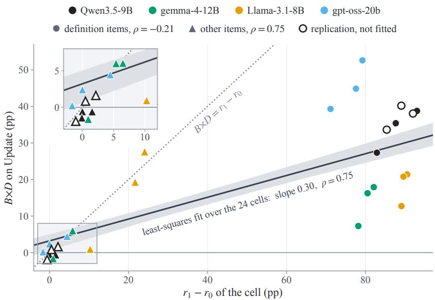  
Figure 4: �×� on Update against $r _ { 1 } - r _ { 0 }$ of the same cell, one marker per writer, item class, and shift (source key). Hollow: the replication, held out of the least-squares fit over the four writers. Band: the fit’s 95% bootstrap band. $\rho$ in the key: Spearman correlation within the item class. Inset: the framed re ion near the ori in. A definition-item marker lies below the dia onal b the efect of � at �=0.

On definition items, the gap between readers comes from re-derivation without exact recomputation. On definition items, the interaction with this reader is lower than with Qwen3.5-9B $( - 8 . 7 \mathrm { p p } [ - 1 3 . 4 , - 4 . 6 ]$ after a source revision and −15.2 pp [−19.1, −11.0] after a redefinition). The gap arises at �=0 with a key. There, this reader answered 25.5% of the changed item-times correctly after a source revision, although only 16.2% stored a correct value. It recomputed overdue tasks and active projects itself from the records quoted in the stored statement.

Table 17: Changed item-times that the citation key did not invalidate since the fork: (a) by the cause of the change (�=1 cell), (b) Update on them.
<table><tr><td rowspan="2">(a) Shift</td><td rowspan="2">Class</td><td colspan="3">All changed item-times</td><td colspan="2">Caused by the shift</td></tr><tr><td>n</td><td>Missed</td><td>Share (%)</td><td>Share (%)</td><td>Share (%)</td></tr><tr><td rowspan="3"> $S _ { \mathrm { s r c } }$ </td><td>definition</td><td>333</td><td>78</td><td> $2 3 . 4 [ 1 8 . 8 , 2 8 . 4 ]$ </td><td> $1 7 . 1 [ 7 . 8 , 2 6 . 7 ]$ </td><td>26.6[19.1, 34.8]</td></tr><tr><td>other</td><td>835</td><td>96</td><td>11.5 [7.5, 15.2]</td><td>5.9 [3.3, 8.6]</td><td>35.2 [22.2, 49.6]</td></tr><tr><td>all</td><td>1,168</td><td>174</td><td>14.9 [11.7, 17.9]</td><td>7.5 [4.7, 10.2]</td><td>30.2[24.1, 36.6]</td></tr><tr><td rowspan="3"> $S _ { \mathrm { d e f } }$ </td><td>definition</td><td>387</td><td>54</td><td>14.0 [9.2, 19.1]</td><td>0.0</td><td>32.7 [21.8, 44.3]</td></tr><tr><td>other</td><td>171</td><td>62</td><td>36.3 [24.3, 50.0]</td><td></td><td>36.3 [24.3, 50.0]</td></tr><tr><td>all</td><td>558</td><td>116</td><td>20.8 [16.3, 24.9]</td><td>0.0</td><td>34.5 [27.0, 41.9]</td></tr><tr><td rowspan="3"> $S _ { \mathrm { d e l } }$ </td><td>definition</td><td>308</td><td>74</td><td>24.0 [19.4, 29.0]</td><td>10.4 [0.0, 27.3]</td><td>26.5 [21.7, 31.7]</td></tr><tr><td>other</td><td>1,459</td><td>62</td><td>4.2 [2.9, 5.7]</td><td>0.0</td><td>45.3 [31.5, 59.6]</td></tr><tr><td>all</td><td>1,767</td><td>136</td><td> $7 . 7 \ [ 6 . 2 , 9 . 2 ]$ </td><td>0.4 [0.0, 1.0]</td><td>33.0 [27.8, 37.7]</td></tr></table>

�: changed item-times. Missed: not invalidated. Share: missed over the changed item-times of the part (—: no item-time).
<table><tr><td rowspan="2">(b) Shift</td><td rowspan="2">t Class</td><td colspan="3">Update at D=1 (%)</td><td colspan="3">Gain (pp)</td></tr><tr><td>Cited</td><td>Forced</td><td>B=0</td><td>D=0</td><td>D=1</td></tr><tr><td rowspan="2"> $S _ { \mathrm { s r c } }$ </td><td>definition</td><td>3.8</td><td>98.7</td><td>32.1</td><td> $+ 2 . 6 \left[ 0 . 0 , + 6 . 2 \right]$ </td><td> $+ 9 4 . 9 \ : [ + 8 7 . 3 , + 1 0 0 . 0 ]$ </td></tr><tr><td>other</td><td>1.0</td><td>62.5</td><td>59.4</td><td> $+ 6 3 . 5 [ + 4 8 . 5 , + 8 0 . 7 ]$ </td><td> $+ 6 1 . 5 [ + 4 6 . 1 , + 7 8 . 7 ]$ </td></tr><tr><td rowspan="2"> $S _ { \mathrm { d e f } }$ </td><td>definition</td><td>5.6</td><td>100.0</td><td>37.0</td><td> $+ 1 . 9 \left[ 0 . 0 , + 6 . 2 \right]$ </td><td> $+ 9 4 . 4 \ : [ + 8 4 . 5 , + 1 0 0 . 0 ]$ </td></tr><tr><td>other</td><td>0.0</td><td>40.3</td><td>41.9</td><td> $+ 4 3 . 5 \left[ + 2 6 . 2 , + 6 5 . 4 \right]$ </td><td> $+ 4 0 . 3 \ [ + 2 5 . 4 , + 6 1 . 4 ]$ </td></tr><tr><td rowspan="2"> $S _ { \mathrm { d e l } }$ </td><td>definition</td><td>4.1</td><td>98.6</td><td>33.8</td><td> $+ 2 . 7 \ [ 0 . 0 , + 6 . 4 ]$ </td><td> $+ 9 4 . 6 [ + 8 6 . 7 , + 1 0 0 . 0 ]$ </td></tr><tr><td>other</td><td>1.6</td><td>41.9</td><td>43.5</td><td> $+ 4 1 . 9 \ [ + 2 5 . 9 , + 6 3 . 4 ]$ </td><td> $+ 4 0 . 3 \left[ + 2 4 . 4 , + 6 1 . 8 \right]$ </td></tr></table>

On the missed item-times of (a). Cited: the citation-key cell, which served the stale item. Forced: the source-key cell, which re-derived the same item-times with the same request. �=0: the append-only cell. Gain: forced minus cited. Update: point estimates.

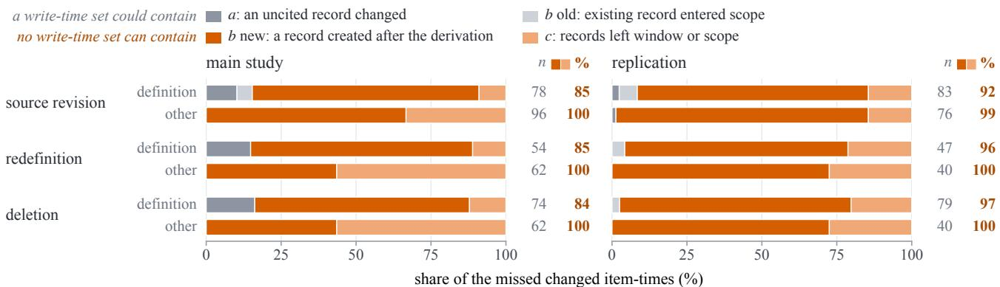  
Figure 5: The chan ed item-times the citation ke missed since the fork, b cause, er shift and item class, in the main stud (20 worlds) and the replication (20 worlds). Most come from records that no set recorded at write time can contain. Orange: a record created after the derivation (� new), or records that left a time window or a narrowed scope (�). Gray: a record of the dependency set that changed and that the writer had not cited (�), or an existing record that entered the scope (� old). The classes are exclusive. �: the number missed. %: the orange share.

## F.4 What Repairs

Programs over the typed records repair much of what exact recomputation repairs. Four contrasts describe the writer’s programs. On the accuracy on re-derived items, $D _ { \mathrm { m } }$ minus �=0 (source key) was +7.2 pp [+6.0, +8.4] after a source revision and +21.3 pp [+19.2, +23.4] after a redefinition. �=1 minus $D _ { \mathrm { m } }$ was +6.4 pp [+5.4, +7.5] and $+ 1 1 . 8 \mathrm { p p } \left[ + 1 0 . 5 , + 1 3 . 2 \right]$ , so 47.3% and 35.7% of the efect of � need exact recomputation. With $D _ { \mathrm { m } }$ as the �=1 arm, the interaction over all items was +25.3 pp [+18.8, +31.7] after a redefinition and +11.0 pp [+8.0, +14.0] after a source revision. $D _ { \mathrm { { m } } } \mathrm { { ^ \circ } s }$ efect on missed invalidation was 0.0 pp after both shifts. Before any shift, the programs, all written by Qwen3.5-9B to run on typed records, run for 90.6% of 960 items and agree with gold on 60.5%. Two definition programs fail. The program for working hours has a syntax error and never runs (0.0% of items, Section G). The program for VIP senders runs but agrees with gold on 0.0% of items. After a deletion, $D _ { \mathrm { m } }$ has a lower accuracy on re-derived items than $D { = } 0 \left( { - } 7 . 8 \mathrm { p p } \left[ { - } 1 0 . 0 , { - } 5 . 4 \right] \right)$ , and the interaction over all items becomes negative (−20.8 pp [−25.1, −16.4], Section G).

Table 18: Every contrast of the main experiment in the main study and in the replication (20 test worlds each).
<table><tr><td>Contrast (pp)</td><td>Study</td><td> $S _ { \mathrm { s r c } }$ </td><td> $S _ { \mathrm { d e f } }$ </td><td> $S _ { \mathrm { d e l } }$ </td></tr><tr><td colspan="5">Source key</td></tr><tr><td>B effect, detection (either D)</td><td>main study +100.0</td><td></td><td>+100.0</td><td>+100.0</td></tr><tr><td></td><td>replication</td><td> $+ 9 9 . 9 \left[ + 9 9 . 7 , + 1 0 0 . 0 \right]$ </td><td> $+ 9 9 . 8 \left[ + 9 9 . 5 , + 1 0 0 . 0 \right]$ </td><td>+100.0</td></tr><tr><td>B effect, Update (averaged over D)</td><td>main study</td><td> $+ 9 . 2 \ [ + 6 . 7 , + 1 1 . 9 ]$ </td><td> $+ 1 3 . 5 [ + 1 0 . 6 , + 1 6 . 5 ]$ </td><td> $+ 5 1 . 7 \ [ + 4 7 . 3 , + 5 6 . 0 ]$ </td></tr><tr><td></td><td>replication</td><td> $+ 8 . 2 \ : [ + 5 . 3 , + 1 1 . 2 ]$ </td><td> $+ 1 2 . 8 \ [ + 9 . 1 , + 1 6 . 5 ]$ </td><td> $+ 5 1 . 0 \ [ + 4 5 . 8 , + 5 6 . 2 ]$ </td></tr><tr><td>D effect, accuracy on re-derived items main study</td><td></td><td> $+ 1 3 . 6 [ + 1 2 . 4 , + 1 4 . 9 ]$ </td><td> $+ 3 3 . 1 \ [ + 3 0 . 5 , + 3 5 . 6 ]$ </td><td> $+ 9 . 4 \left[ + 7 . 6 , + 1 1 . 3 \right]$ </td></tr><tr><td></td><td>replication</td><td> $+ 1 3 . 1 \ [ + 1 1 . 9 , + 1 4 . 6 ]$ </td><td> $+ 3 1 . 6 [ + 2 9 . 3 , + 3 4 . 2 ]$ </td><td> $+ 9 . 7 \left[ + 7 . 6 , + 1 1 . 8 \right]$ </td></tr><tr><td>D effect, re-derived value equals gold</td><td>main study</td><td> $+ 1 2 . 2 \left[ + 1 1 . 6 , + 1 2 . 8 \right]$ </td><td> $+ 1 4 . 0 [ + 1 3 . 3 , + 1 4 . 7 ]$ </td><td> $+ 1 4 . 2 [ + 1 3 . 2 , + 1 5 . 2 ]$ </td></tr><tr><td></td><td>replication</td><td> $+ 1 1 . 4 [ + 1 1 . 0 , + 1 1 . 9 ]$ </td><td> $+ 1 3 . 0 [ + 1 2 . 4 , + 1 3 . 7 ]$ </td><td> $+ 1 3 . 4 [ + 1 2 . 6 , + 1 4 . 2 ]$ </td></tr><tr><td colspan="5">Citation key</td></tr><tr><td>B effect, detection (either D)</td><td>main study</td><td> $+ 8 5 . 1 [ + 8 2 . 1 , + 8 8 . 3 ]$ </td><td> $+ 7 9 . 2 [ + 7 5 . 1 , + 8 3 . 7 ]$ </td><td> $+ 9 2 . 3 \ [ + 9 0 . 8 , + 9 3 . 8 ]$ </td></tr><tr><td></td><td>replication</td><td> $+ 8 6 . 4 [ + 8 4 . 2 , + 8 8 . 4 ]$ </td><td> $+ 8 4 . 9 \ [ + 8 0 . 9 , + 8 8 . 7 ]$ </td><td> $+ 9 3 . 2 [ + 9 2 . 4 , + 9 3 . 9 ]$ </td></tr><tr><td>B effect, Update (D=1)</td><td>main study</td><td> $- 0 . 5 \left[ - 3 . 9 , + 2 . 9 \right]$ </td><td> $+ 2 . 5 [ - 2 . 7 , + 7 . 4 ]$ </td><td> $+ 3 9 . 3 \ [ + 3 3 . 8 , + 4 4 . 3 ]$ </td></tr><tr><td></td><td>replication</td><td> $- 0 . 7 \left[ - 3 . 7 , + 2 . 5 \right]$ </td><td> $+ 1 . 7 \ [ - 4 . 3 , + 8 . 0 ]$ </td><td> $+ 4 0 . 2 \ [ + 3 4 . 5 , + 4 6 . 3 ]$ </td></tr><tr><td>B effect, Update (averaged over D)</td><td>main study</td><td> $0 . 0 \left[ - 3 . 0 , + 3 . 1 \right]$ </td><td> $- 1 . 3 \left[ - 4 . 8 , + 2 . 0 \right]$ </td><td> $+ 4 2 . 5 \ [ + 3 7 . 8 , + 4 7 . 0 ]$ </td></tr><tr><td></td><td>replication</td><td> $- 0 . 9 \left[ - 3 . 9 , + 2 . 0 \right]$ </td><td> $- 1 . 7 \ [ - 5 . 9 , + 2 . 7 ]$ </td><td> $+ 4 2 . 3 [ + 3 7 . 4 , + 4 7 . 4 ]$ </td></tr><tr><td>D effect, accuracy on re-derived items main study</td><td></td><td> $+ 2 1 . 8 \ : [ + 1 8 . 7 , + 2 5 . 0 ]$ </td><td> $+ 5 4 . 6 \left[ + 4 9 . 3 , + 6 0 . 1 \right]$ </td><td> $+ 1 0 . 7 \ [ + 7 . 9 , + 1 3 . 6 ]$ </td></tr><tr><td></td><td>replication</td><td> $+ 2 1 . 2 \ [ + 1 8 . 7 , + 2 3 . 9 ]$ </td><td> $+ 4 7 . 5 \left[ + 4 2 . 7 , + 5 3 . 2 \right]$ </td><td> $+ 9 . 3 \left[ + 7 . 3 , + 1 1 . 5 \right]$ </td></tr><tr><td>D effect, re-derived value equals gold</td><td>main study</td><td> $+ 1 8 . 1 \ [ + 1 6 . 5 , + 2 0 . 0 ]$ </td><td> $+ 2 5 . 6 [ + 2 2 . 6 , + 2 8 . 9 ]$ </td><td> $+ 1 6 . 3 [ + 1 4 . 8 , + 1 8 . 0 ]$ </td></tr><tr><td></td><td>replication</td><td> $+ 1 7 . 4 [ + 1 5 . 8 , + 1 9 . 1 ]$ </td><td> $+ 2 4 . 1 \ [ + 2 1 . 6 , + 2 6 . 9 ]$ </td><td> $+ 1 6 . 1 [ + 1 4 . 6 , + 1 7 . 7 ]$ </td></tr><tr><td>B×D interaction, Update</td><td>main study</td><td> $- 0 . 9 \left[ - 3 . 6 , + 1 . 6 \right]$ </td><td> $+ 7 . 5 \ [ + 1 . 1 , + 1 4 . 0 ]$ </td><td> $- 6 . 4 \left[ - 1 0 . 1 , - 3 . 0 \right]$ </td></tr><tr><td></td><td>replication</td><td> $+ 0 . 5 \ [ - 1 . 4 , + 2 . 7 ]$ </td><td> $+ 6 . 8 \left[ + 2 . 4 , + 1 1 . 6 \right]$ </td><td> $- 4 . 1 \left[ - 7 . 5 , - 0 . 5 \right]$ </td></tr></table>

Detection: share of the changed item-times the cell invalidated since the fork. Value equals gold: share of the re-derived item-times whose value equals gold. $D ' s$ efect on missed invalidation was 0.0 with both keys after every shift in both studies.

Table 19: Two interventions on Mem0 on 10 of its three-month worlds: the terms of Update = (1 − �) � + � � on changed item-times (%) and each intervention’s efect on Update.
<table><tr><td></td><td></td><td></td><td>Mem0</td><td colspan="3">Invalidation</td><td>Query-time view</td></tr><tr><td>Shift</td><td>Class</td><td>n</td><td>a</td><td>m</td><td>r</td><td>Effect (pp)</td><td>Effect (pp)</td></tr><tr><td> $S _ { \mathrm { s r c } }$ </td><td>definition</td><td>164</td><td>12.2</td><td>54.3</td><td>28.0</td><td> $+ 0 . 6 [ - 3 . 5 , + 4 . 2 ]$ </td><td> $+ 7 2 . 6 \left[ + 6 3 . 1 , + 8 1 . 2 \right]$ </td></tr><tr><td> $S _ { \mathrm { d e f } }$ </td><td>other definition</td><td>507 191</td><td>88.0 8.9</td><td>13.0 66.5</td><td>87.3 25.0</td><td> $- 3 . 4 \left[ - 7 . 9 , + 1 . 4 \right]$   $+ 1 . 6 [ - 0 . 6 , + 4 . 1 ]$ </td><td>0.0  $+ 6 4 . 4 \left[ + 5 7 . 4 , + 7 1 . 0 \right]$ </td></tr><tr><td></td><td>other</td><td>188</td><td>90.4</td><td>13.3</td><td>83.4</td><td> $- 8 . 5 [ - 1 5 . 1 , - 1 . 1 ]$ </td><td>0.0</td></tr><tr><td> $S _ { \mathrm { d e l } }$ </td><td>definition</td><td>28</td><td>10.7</td><td>53.6</td><td>30.8</td><td> $+ 3 . 6 [ 0 . 0 , + 1 0 . 7 ]$ </td><td> $+ 7 1 . 4 \ : [ + 5 2 . 0 , + 8 8 . 6 ]$ </td></tr><tr><td></td><td></td><td></td><td></td><td></td><td></td><td></td><td></td></tr><tr><td></td><td>other</td><td>184</td><td>47.3</td><td>2.7</td><td>83.2</td><td> $+ 3 5 . 9 \left[ + 2 6 . 1 , + 4 4 . 8 \right]$ </td><td>0.0</td></tr></table>

Mem0 invalidates nothing (�=1 in every row), so its � is undefined and its Update is �. �, �, �: point estimates. Efect: Update minus Mem0’s, paired per item-time.

The writer’s programs keep the interaction on definition items. The class split in Table 20 also uses $D _ { \mathrm { m } }$ as the �=1 arm. On definition items, the interaction with the writer’s programs was +27.3 pp after a source revision and +34.9 pp after a redefinition. After a redefinition, this is close to the +38.8 pp of exact recomputation, although the level of Update is lower. On changed definition items after a source revision, the programs raise Update with a key over �=0 by +57.4 pp [+49.0, +65.7], compared with +82.9 pp $[ + 7 7 . 0 , + 8 9 . 1 ]$ for exact recomputation. After a deletion at �=1, the programs change Update on the other items $\mathrm { b y - 2 9 . 7 p p \ [ - 3 3 . 9 , - 2 5 . 2 ] }$ compared with �=0, and the interaction there is $- 3 2 . 8 \mathrm { p p } [ - 3 7 . 5 , - 2 7 . 7 ]$ . The definition items rely on at most twelve programs (six definitions with two versions each), shared by both � arms and every world.

Table 20: The contrasts on Update (pp) by shift and item class, with exact recomputation and with the writer’s programs as the �=1 arm.
<table><tr><td colspan="2"></td><td></td><td colspan="2">B effect</td><td colspan="2">D effect</td><td></td></tr><tr><td>Shift Class</td><td></td><td>Arm</td><td>D=0</td><td>D=1</td><td>B=0</td><td>B=1</td><td>B×D</td></tr><tr><td colspan="8">Main study: 20 test worlds</td></tr><tr><td> $S _ { \mathrm { s r c } }$ </td><td>definition exact</td><td></td><td> $+ 6 . 0 \left[ + 2 . 5 , + 9 . 6 \right]$ </td><td> $+ 3 3 . 3 \ : [ + 2 8 . 2 , + 3 8 . 0 ]$ </td><td> $+ 5 5 . 6 \left[ + 5 0 . 1 , + 6 1 . 1 \right]$ </td><td> $+ 8 2 . 9 [ + 7 7 . 0 , + 8 9 . 1 ]$ </td><td> $+ 2 7 . 3 \ : [ + 2 1 . 6 , + 3 2 . 6 ]$ </td></tr><tr><td></td><td></td><td>programs</td><td> $+ 6 . 0 \left[ + 2 . 5 , + 9 . 6 \right]$ </td><td> $+ 3 3 . 3 \ : [ + 2 8 . 4 , + 3 8 . 0 ]$ </td><td> $+ 3 0 . 0 \ [ + 2 1 . 6 , + 3 8 . 2 ]$ </td><td> $+ 5 7 . 4 \ : [ + 4 9 . 0 , + 6 5 . 7 ]$ </td><td> $+ 2 7 . 3 [ + 2 1 . 8 , + 3 2 . 7 ]$ </td></tr><tr><td></td><td>other</td><td>exact</td><td> $+ 5 . 4 \ [ + 2 . 3 , + 8 . 7 ]$ </td><td> $+ 4 . 8 \left[ + 1 . 6 , + 8 . 0 \right]$ </td><td> $+ 2 . 2 \left[ + 0 . 6 , + 3 . 8 \right]$ </td><td> $+ 1 . 6 [ - 1 . 0 , + 4 . 2 ]$ </td><td> $- 0 . 6 [ - 3 . 8 , + 2 . 5 ]$ </td></tr><tr><td></td><td></td><td>programs</td><td> $+ 5 . 4 \ [ + 2 . 3 , + 8 . 7 ]$ </td><td> $+ 9 . 8 \left[ + 6 . 0 , + 1 3 . 8 \right]$ </td><td> $- 4 . 0 [ - 6 . 8 , - 1 . 2 ]$ </td><td> $+ 0 . 5 \ [ - 1 . 9 , + 3 . 0 ]$ </td><td> $+ 4 . 4 \ : [ + 0 . 3 , + 8 . 6 ]$ </td></tr><tr><td></td><td>all</td><td>exact</td><td> $+ 5 . 6 [ + 2 . 8 , + 8 . 3 ]$ </td><td> $+ 1 2 . 9 \left[ + 1 0 . 1 , + 1 5 . 9 \right]$ </td><td> $+ 1 7 . 4 [ + 1 5 . 4 , + 1 9 . 7 ]$ </td><td> $+ 2 4 . 7 \ : [ + 2 2 . 7 , + 2 6 . 7 ]$ </td><td> $+ 7 . 4 \left[ + 5 . 0 , + 9 . 8 \right]$ </td></tr><tr><td> $S _ { \mathrm { d e f } }$ </td><td></td><td>programs</td><td> $+ 5 . 6 [ + 2 . 8 , + 8 . 3 ]$ </td><td> $+ 1 6 . 5 \ [ + 1 3 . 1 , + 2 0 . 0 ]$ </td><td> $+ 5 . 7 \ [ + 3 . 0 , + 8 . 3 ]$ </td><td> $+ 1 6 . 7 \left[ + 1 4 . 3 , + 1 9 . 3 \right]$ </td><td> $+ 1 1 . 0 \left[ + 8 . 0 , + 1 4 . 0 \right]$ </td></tr><tr><td></td><td>definition exact</td><td></td><td> $- 0 . 8 \left[ - 5 . 7 , + 4 . 2 \right]$ </td><td> $+ 3 8 . 0 \ [ + 3 2 . 6 , + 4 3 . 4 ]$ </td><td> $+ 5 4 . 3 [ + 4 8 . 9 , + 5 9 . 7 ]$ </td><td> $+ 9 3 . 0 [ + 8 9 . 0 , + 9 6 . 7 ]$ </td><td> $+ 3 8 . 8 \left[ + 3 2 . 0 , + 4 4 . 8 \right]$ </td></tr><tr><td></td><td></td><td>programs</td><td> $- 0 . 8 \left[ - 5 . 7 , + 4 . 2 \right]$ </td><td> $+ 3 4 . 1 \ [ + 2 7 . 5 , + 3 9 . 8 ]$ </td><td> $+ 2 7 . 6 [ + 2 1 . 7 , + 3 4 . 1 ]$ </td><td> $+ 6 2 . 5 [ + 5 7 . 5 , + 6 7 . 3 ]$ </td><td> $+ 3 4 . 9 \ [ + 2 7 . 5 , + 4 1 . 9 ]$ </td></tr><tr><td></td><td>other</td><td>exact</td><td> $+ 2 . 3 \ [ - 2 . 4 , + 7 . 4 ]$ </td><td> $+ 1 . 8 [ - 3 . 4 , + 7 . 1 ]$ </td><td> $+ 0 . 6 \left[ - 1 . 9 , + 3 . 2 \right]$ </td><td> $0 . 0 \left[ - 3 . 4 , + 2 . 3 \right]$ </td><td> $- 0 . 6 [ - 4 . 0 , + 2 . 7 ]$ </td></tr><tr><td></td><td>all</td><td>programs</td><td> $+ 2 . 3 \ [ - 2 . 4 , + 7 . 4 ]$ </td><td> $+ 5 . 8 [ - 1 . 9 , + 1 3 . 9 ]$ </td><td> $- 3 . 5 [ - 1 0 . 6 , + 2 . 5 ]$ </td><td> $0 . 0 \left[ - 1 . 9 , + 1 . 4 \right]$ </td><td> $+ 3 . 5 [ - 3 . 3 , + 1 0 . 8 ]$ </td></tr><tr><td></td><td></td><td>exact</td><td> $+ 0 . 2 \ [ - 2 . 9 , + 3 . 4 ]$ </td><td> $+ 2 6 . 9 \left[ + 2 2 . 3 , + 3 1 . 6 \right]$ </td><td> $+ 3 7 . 8 [ + 3 3 . 6 , + 4 2 . 1 ]$ </td><td> $+ 6 4 . 5 [ + 5 9 . 9 , + 6 9 . 1 ]$ </td><td> $+ 2 6 . 7 \left[ + 2 1 . 2 , + 3 1 . 8 \right]$ </td></tr><tr><td> $S _ { \mathrm { d e l } }$ </td><td>definition exact</td><td>programs</td><td> $+ 0 . 2 \ [ - 2 . 9 , + 3 . 4 ]$ </td><td> $+ 2 5 . 4 \left[ + 1 9 . 1 , + 3 1 . 5 \right]$ </td><td> $+ 1 8 . 1 \ [ + 1 3 . 0 , + 2 3 . 5 ]$ </td><td> $+ 4 3 . 4 \left[ + 3 9 . 3 , + 4 7 . 8 \right]$ </td><td> $+ 2 5 . 3 \ : [ + 1 8 . 8 , + 3 1 . 7 ]$ </td></tr><tr><td></td><td></td><td>programs</td><td> $+ 7 . 5 \ [ + 3 . 4 , + 1 1 . 5 ]$   $+ 7 . 5 \ [ + 3 . 4 , + 1 1 . 5 ]$ </td><td> $+ 4 2 . 9 \left[ + 3 8 . 0 , + 4 7 . 8 \right]$   $+ 4 3 . 2 [ + 3 7 . 1 , + 4 9 . 2 ]$ </td><td> $+ 5 2 . 3 \ [ + 4 7 . 0 , + 5 7 . 3 ]$   $+ 3 0 . 5 \ [ + 2 4 . 4 , + 3 6 . 0 ]$ </td><td> $+ 8 7 . 7 \left[ + 8 3 . 8 , + 9 1 . 5 \right]$   $+ 6 6 . 2 [ + 6 1 . 4 , + 7 1 . 0 ]$ </td><td> $+ 3 5 . 4 \ : [ + 3 0 . 4 , + 4 0 . 0 ]$  +35.7 [+30.1, +40.9]</td></tr><tr><td></td><td>other</td><td>exact</td><td> $+ 5 8 . 1 \ : [ + 5 2 . 2 , + 6 3 . 7 ]$ </td><td></td><td></td><td></td><td></td></tr><tr><td></td><td></td><td>programs</td><td> $+ 5 8 . 1 \ : [ + 5 2 . 2 , + 6 3 . 7 ]$ </td><td> $+ 5 6 . 6 \left[ + 5 0 . 6 , + 6 2 . 3 \right]$   $+ 2 5 . 3 \left[ + 2 1 . 0 , + 2 9 . 9 \right]$ </td><td> $+ 0 . 9 \left[ - 0 . 5 , + 2 . 4 \right]$   $+ 3 . 0 \left[ + 1 . 2 , + 4 . 8 \right]$ </td><td> $- 0 . 5 [ - 4 . 5 , + 3 . 2 ]$ </td><td> $- 1 . 4 \left[ - 5 . 4 , + 2 . 3 \right]$ </td></tr><tr><td>all</td><td></td><td></td><td></td><td></td><td></td><td> $- 2 9 . 7 \left[ - 3 3 . 9 , - 2 5 . 2 \right]$ </td><td> $- 3 2 . 8 [ - 3 7 . 5 , - 2 7 . 7 ]$ </td></tr><tr><td></td><td></td><td>exact</td><td> $+ 4 9 . 2 \left[ + 4 4 . 6 , + 5 4 . 0 \right]$ </td><td> $+ 5 4 . 2 [ + 4 9 . 4 , + 5 8 . 8 ]$ </td><td> $+ 9 . 8 \ : [ + 8 . 1 , + 1 1 . 5 ]$ </td><td> $+ 1 4 . 8 [ + 1 1 . 3 , + 1 8 . 3 ]$ </td><td> $+ 5 . 0 \left[ + 1 . 7 , + 8 . 1 \right]$ </td></tr><tr><td></td><td></td><td>programs</td><td> $+ 4 9 . 2 \left[ + 4 4 . 6 , + 5 4 . 0 \right]$ </td><td> $+ 2 8 . 4 \left[ + 2 4 . 9 , + 3 2 . 3 \right]$ </td><td> $+ 7 . 8 \left[ + 6 . 2 , + 9 . 5 \right]$ </td><td> $- 1 3 . 0 [ - 1 6 . 9 , - 8 . 8 ]$ </td><td> $- 2 0 . 8 [ - 2 5 . 1 , - 1 6 . 4 ]$ </td></tr><tr><td colspan="8">Replication: 20 fresh worlds definition exact</td></tr><tr><td> $S _ { \mathrm { s r c } }$ </td><td>other</td><td>exact</td><td> $+ 4 . 2 \ : [ + 0 . 6 , + 7 . 6 ]$   $+ 4 . 0 [ 0 . 0 , + 8 . 1 ]$ </td><td> $+ 3 7 . 8 \ [ + 3 3 . 4 , + 4 2 . 6 ]$   $+ 2 . 0 \left[ - 2 . 2 , + 6 . 6 \right]$ </td><td> $+ 5 1 . 5 \ [ + 4 6 . 0 , + 5 6 . 4 ]$ </td><td> $+ 8 5 . 1 \left[ + 8 0 . 7 , + 8 9 . 8 \right]$ </td><td> $+ 3 3 . 6 [ + 2 8 . 7 , + 3 8 . 5 ]$ </td></tr><tr><td></td><td>all</td><td>exact</td><td> $+ 4 . 0 \left[ + 0 . 8 , + 7 . 0 \right]$ </td><td> $+ 1 2 . 3 \ : [ + 9 . 4 , + 1 5 . 7 ]$ </td><td> $+ 1 . 3 \left[ - 0 . 2 , + 2 . 8 \right]$   $+ 1 5 . 7 \left[ + 1 3 . 5 , + 1 7 . 9 \right]$ </td><td> $- 0 . 6 [ - 2 . 3 , + 1 . 1 ]$   $+ 2 4 . 0 [ + 2 2 . 0 , + 2 6 . 2 ]$ </td><td> $- 1 . 9 \left[ - 3 . 9 , + 0 . 2 \right]$ </td></tr><tr><td> $S _ { \mathrm { d e f } }$ </td><td></td><td></td><td></td><td></td><td></td><td></td><td> $+ 8 . 3 [ + 6 . 3 , + 1 0 . 4 ]$ </td></tr><tr><td></td><td>definition exact</td><td></td><td> $- 1 . 5 \left[ - 3 . 9 , + 0 . 5 \right]$ </td><td> $+ 3 6 . 5 \ [ + 2 9 . 8 , + 4 3 . 0 ]$ </td><td> $+ 5 3 . 7 \ [ + 4 7 . 5 , + 6 0 . 4 ]$ </td><td> $+ 9 1 . 8 \left[ + 8 8 . 2 , + 9 4 . 9 \right]$ </td><td> $+ 3 8 . 0 \ [ + 3 1 . 5 , + 4 4 . 5 ]$ </td></tr><tr><td></td><td>other</td><td>exact</td><td> $+ 2 . 2 \left[ - 4 . 7 , + 8 . 9 \right]$ </td><td> $+ 3 . 8 [ - 2 . 8 , + 1 0 . 8 ]$ </td><td> $+ 0 . 5 \left[ - 1 . 2 , + 2 . 3 \right]$ </td><td> $+ 2 . 2 \ [ 0 . 0 , + 4 . 9 ]$ </td><td> $+ 1 . 6 [ - 1 . 2 , + 4 . 8 ]$ </td></tr><tr><td> $S _ { \mathrm { d e l } }$ </td><td>all</td><td>exact</td><td> $- 0 . 3 \ [ - 3 . 2 , + 2 . 4 ]$ </td><td> $+ 2 5 . 9 \left[ + 2 0 . 5 , + 3 1 . 9 \right]$ </td><td> $+ 3 6 . 5 [ + 3 2 . 6 , + 4 1 . 1 ]$ </td><td> $+ 6 2 . 8 \left[ + 5 8 . 2 , + 6 7 . 9 \right]$ </td><td>+26.3 [+21.5, +31.7]</td></tr><tr><td></td><td>definition exact</td><td></td><td> $+ 4 . 5 [ + 0 . 6 , + 8 . 7 ]$ </td><td> $+ 4 4 . 7 \ : [ + 3 9 . 0 , + 5 0 . 4 ]$ </td><td> $+ 4 8 . 9 \left[ + 4 3 . 4 , + 5 4 . 2 \right]$ </td><td> $+ 8 9 . 1 \ [ + 8 4 . 6 , + 9 3 . 4 ]$ </td><td> $+ 4 0 . 2 \left[ + 3 5 . 6 , + 4 4 . 9 \right]$ </td></tr><tr><td></td><td>other</td><td>exact</td><td> $+ 5 6 . 3 \ : [ + 5 0 . 2 , + 6 2 . 1 ]$ </td><td> $+ 5 7 . 1 \left[ + 5 0 . 1 , + 6 4 . 3 \right]$ </td><td> $- 0 . 4 \left[ - 1 . 2 , + 0 . 5 \right]$ </td><td> $+ 0 . 5 \ [ - 4 . 2 , + 5 . 2 ]$ </td><td> $+ 0 . 8 \left[ - 3 . 6 , + 5 . 2 \right]$ </td></tr><tr><td>all</td><td></td><td>exact</td><td> $+ 4 7 . 0 \left[ + 4 2 . 0 , + 5 1 . 8 \right]$ </td><td> $+ 5 4 . 9 \ [ + 4 8 . 7 , + 6 1 . 4 ]$ </td><td> $+ 8 . 5 [ + 7 . 2 , + 9 . 8 ]$ </td><td> $+ 1 6 . 3 \ : [ + 1 2 . 2 , + 2 0 . 5 ]$ </td><td> $+ 7 . 9 [ + 3 . 7 , + 1 2 . 1 ]$ </td></tr></table>

Exact: exact recomputation as the $D { = } 1$ arm. Programs: the writer’s programs $( D _ { \mathrm { m } } )$ as the $D { = } 1$ arm, so in their rows $D { = } 1 \ \mathrm { i s } \ D _ { \mathrm { m } } .$ The $D { = } 0 \ \mathrm { c e l l s \ o f \ t h e }$ main study serve both of its arms.

Here and in the feedback and extraction cells below, the intervals thus resample worlds, not programs.

Execution feedback lets more programs run but repairs no more items. Two further $D _ { \mathrm { m } }$ cells, with and without a key, send a failing program back to the writer (20 test worlds, all three shifts). A program fails when it does not end with a valid typed value. This happens with a reply without code or without a function to call, a syntax error, an exception, a timeout, a sandbox violation, or a value of the wrong type. The writer then receives the program request, its own reply, and the interpreter’s message (at most 600 characters), and it may rewrite the program, for at most two rounds. The message contains no gold value and no expected value. The first program that runs is used and kept for the item’s later writes. If all rounds fail, the outcome is that of $D _ { \mathrm { m } } .$ . Of all 1,860 feedback requests, before and after the fork, 0 contained a string value of the records, so the corrections do not depend on the world.

Table 25 gives the results. Of the program runs for definition items after the fork, 85.8% [84.8, 86.7] ended with a valid value without feedback and 90.4% [89.5, 91.2] with it, with 430 feedback requests over 2,085 runs. Only the working- hours programs failed after the fork (Section G), and feedback made 32.1% of their runs valid. It corrected the program that raised an exception, but not the program with a syntax error, which failed again in both rounds. Repair did not change. On the changed definition item-times, � moved by +0.9 pp [−0.3, +2.5] after a source revision and −0.3 pp [−1.7, +1.0] after a redefinition. Update on definition items after a deletion moved by $0 . 0 \mathrm { p p } \ [ - 1 . 6 , + 1 . 6 ]$ with a key, and �×� on definition items by +0.9 pp, 0.0 pp, and 0.0 pp after the three shifts. On the other items, feedback raised the share of valid runs from 92.6% to 96.8%, and �×� moved by −0.5 pp, −2.3 pp, and −2.1 pp. The errors that cost repair are thus wrong values from programs that run, such as the values returned for deleted records (Section G), which the interpreter does not report.

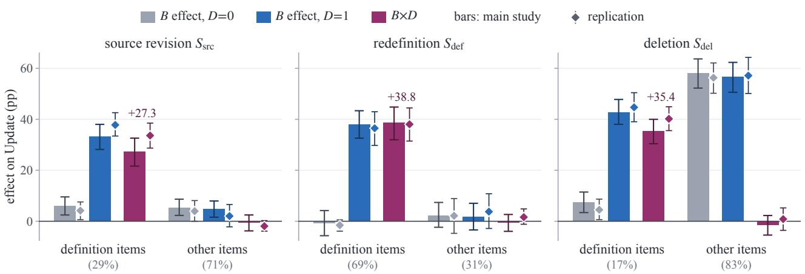

Figure 6: Efect of � (source key) on Update at �=0 and �=1, and �×�, by shift and item class, with Qwen3.5-9B as writer and reader. On definition items, the key helps mainly when exact recomputation repairs them. Bars: main study (20 worlds), with its �×� on definition items rinted above. Diamonds: re lication on 20 fresh worlds. Error bars: 95% intervals over worlds. In brackets: the class’s share of the changed item-times in the main study.  
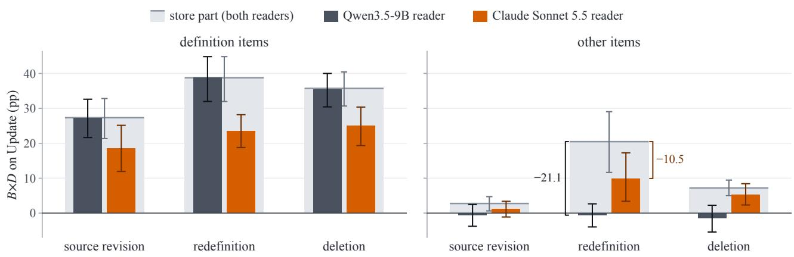  
Figure 7: �×� on Update with each reader of the same stores, and its store part, by item class and shift (exact recomputation as �=1, source key). The stored values carry the interaction. Qwen3.5-9B loses it on the other items, and Claude Sonnet 5.5 keeps part of it. Wide gray bars: the store part, the same for both readers, with each reader’s bar in front of it. The gap between the top of the gray bar and a reader’s bar is what that reader adds or loses, printed for the other items after a redefinition. Error bars: 95% intervals, the store part’s between the two readers.

Programs on fields that the writer extracted from prose keep the interaction. Two further $D _ { \mathrm { m } }$ cells, with and without a key, run the same programs on fields that the writer extracted from prose, instead of on the generator’s typed fields (10 test worlds, source revision and redefinition). Qwen3.5-9B at temperature 0 first rewrote every version of every record of the program sources (contacts, calendar, tasks, e-mail, chat messages, and notes) from its typed fields into one to three sentences. Newsletter e-mails, on which no item depends, stay typed. The prompt lists each value as the exact string that the prose must contain, with fixed words for enumerations and booleans (such as “starred” or “done”), and it allows no lists or “field: value” lines. A check requires every value verbatim. A rewrite that misses a value is retried once with the missing values named. If it still misses one, it is kept and counted as missed. The writer then extracts each source’s fields from the prose with a JSON schema for that source, given the field description of the program requests. The programs read the extracted fields together with the record metadata that the store keeps (identifier, source, revision, update time, and cluster). The writer’s own requests, the stores of the other cells, and the reader see the original records, so the contrast changes only what the programs read.

Table 25 gives the results. Of the 10,903 distinct record contents, 82.7% [80.2, 85.0] were extracted with every field equal to the typed field after the scorer’s string normalization (case, punctuation, and whitespace, with attendees as a set). The share was 100.0% for contacts, 91.5% for calendar records, 92.0% for chat messages, 63.1% for notes, 57.3% for e-mails, and 39.8% for tasks, where most errors were in the title. A value was missing from 16.6% of the rewrites and from 57.8% of the e-mail rewrites. On the definition items, �×� on Update stayed positive, +18.2 pp [+7.7, +29.7] after a source revision and +25.4 pp [+18.6, +32.4] after a redefinition. The paired diferences from typed fields were −6.1 pp and −10.4 pp. Repair correctness on the changed definition item-times fell from 77.0% to 55.8% after a source revision and from 69.2% to 52.7% after a redefinition. Whenever the value of a definition item difered between the two inputs, its write had read a record with an extraction error. On the other items, �×� did not move (0.0 pp [−1.0, +0.9] and 0.0 pp). The writer’s programs thus keep the interaction when they read fields that the writer itself extracted from rewritten prose.

Table 21: The � efects and �� on U date b the cause of the chan e (a), and �� without the shift on the chan ed item-times that the shift caused (b).
<table><tr><td></td><td></td><td></td><td></td><td colspan="2">B effect</td><td colspan="2"> $B { \times } D$ </td></tr><tr><td>Shift</td><td>Class</td><td>Cause</td><td>n</td><td>D=0</td><td>D=1</td><td>D=1</td><td> $D _ { \mathrm { m } }$ </td></tr><tr><td> $S _ { \mathrm { s r c } }$ </td><td>definition</td><td>caused by the shift</td><td>111</td><td> $+ 1 1 . 7 \left[ + 2 . 9 , + 2 0 . 3 \right]$ </td><td> $+ 3 6 . 0 \ [ + 2 6 . 6 , + 4 4 . 0 ]$ </td><td> $+ 2 4 . 3 [ + 1 2 . 5 , + 3 5 . 7 ]$ </td><td> $+ 2 3 . 4 \ : [ + 1 1 . 4 , + 3 4 . 4 ]$ </td></tr><tr><td></td><td></td><td>also without the shift</td><td>222</td><td> $+ 3 . 2 \ : [ - 1 . 5 , + 8 . 1 ]$ </td><td> $+ 3 2 . 0 \left[ + 2 5 . 5 , + 3 7 . 9 \right]$ </td><td> $+ 2 8 . 8 \ [ + 2 0 . 5 , + 3 6 . 5 ]$ </td><td> $+ 2 9 . 3 \left[ + 2 0 . 7 , + 3 7 . 2 \right]$ </td></tr><tr><td></td><td>other</td><td>caused by the shift</td><td>676</td><td> $+ 7 . 2 \ [ + 3 . 9 , + 1 0 . 9 ]$ </td><td> $+ 6 . 2 \left[ + 2 . 7 , + 9 . 8 \right]$ </td><td> $- 1 . 0 \left[ - 4 . 7 , + 2 . 0 \right]$ </td><td> $+ 4 . 9 \left[ + 0 . 6 , + 9 . 2 \right]$ </td></tr><tr><td></td><td></td><td>also without the shift</td><td>159</td><td> $- 2 . 5 \left[ - 8 . 1 , + 3 . 3 \right]$ </td><td> $- 1 . 3 \left[ - 7 . 5 , + 5 . 0 \right]$ </td><td> $+ 1 . 3 \ [ - 5 . 4 , + 8 . 3 ]$ </td><td> $+ 2 . 5 [ - 2 . 8 , + 8 . 7 ]$ </td></tr><tr><td></td><td>all</td><td>caused by the shift</td><td>787</td><td> $+ 7 . 9 \left[ + 4 . 6 , + 1 1 . 5 \right]$ </td><td> $+ 1 0 . 4 [ + 7 . 2 , + 1 3 . 8 ]$ </td><td> $+ 2 . 5 \ [ + 0 . 5 , + 4 . 4 ]$ </td><td> $+ 7 . 5 [ + 4 . 3 , + 1 0 . 4 ]$ </td></tr><tr><td></td><td></td><td>also without the shift</td><td>381</td><td> $+ 0 . 8 \ [ - 3 . 0 , + 4 . 4 ]$ </td><td> $+ 1 8 . 1 \ : [ + 1 2 . 1 , + 2 3 . 6 ]$ </td><td> $+ 1 7 . 3 \ : [ + 1 1 . 2 , + 2 4 . 0 ]$ </td><td> $+ 1 8 . 1 \ [ + 1 1 . 8 , + 2 4 . 6 ]$ </td></tr><tr><td> $S _ { \mathrm { d e f } }$ </td><td>definition</td><td>caused by the shift</td><td>222</td><td> $- 6 . 8 [ - 1 2 . 2 , - 1 . 3 ]$ </td><td> $+ 3 2 . 0 \ [ + 2 5 . 4 , + 3 8 . 5 ]$ </td><td> $+ 3 8 . 7 \ [ + 3 0 . 4 , + 4 6 . 9 ]$ </td><td> $+ 3 2 . 4 \left[ + 2 3 . 4 , + 4 1 . 5 \right]$ </td></tr><tr><td></td><td></td><td>also without the shift</td><td>165</td><td> $+ 7 . 3 \ [ 0 . 0 , + 1 4 . 8 ]$ </td><td> $+ 4 6 . 1 \ : [ + 3 5 . 9 , + 5 7 . 1 ]$ </td><td> $+ 3 8 . 8 \ [ + 2 9 . 3 , + 4 8 . 4 ]$ </td><td> $+ 3 8 . 2 [ + 2 5 . 3 , + 4 9 . 7 ]$ </td></tr><tr><td></td><td></td><td>new version</td><td>235</td><td> $- 7 . 2 \left[ - 1 2 . 5 , - 1 . 7 \right]$ </td><td> $+ 3 1 . 1 \ [ + 2 4 . 8 , + 3 6 . 9 ]$ </td><td> $+ 3 8 . 3 \ [ + 3 0 . 5 , + 4 6 . 0 ]$ </td><td></td></tr><tr><td></td><td></td><td>same version</td><td>152</td><td> $+ 9 . 2 \left[ + 1 . 5 , + 1 7 . 1 \right]$ </td><td> $+ 4 8 . 7 \ : [ + 3 9 . 1 , + 5 9 . 0 ]$ </td><td> $+ 3 9 . 5 \ [ + 3 0 . 2 , + 4 8 . 7 ]$ </td><td></td></tr><tr><td></td><td>other</td><td>also without the shift</td><td>171</td><td> $+ 2 . 3 \ [ - 2 . 4 , + 7 . 4 ]$ </td><td> $+ 1 . 8 [ - 3 . 4 , + 7 . 1 ]$ </td><td> $- 0 . 6 [ - 4 . 0 , + 2 . 7 ]$ </td><td> $+ 3 . 5 [ - 3 . 3 , + 1 0 . 8 ]$ </td></tr><tr><td></td><td>all</td><td>also without the shift</td><td>336</td><td> $+ 4 . 8 \left[ + 0 . 9 , + 8 . 9 \right]$ </td><td> $+ 2 3 . 5 \left[ + 1 7 . 4 , + 3 0 . 2 \right]$ </td><td> $+ 1 8 . 8 [ + 1 2 . 4 , + 2 5 . 1 ]$ </td><td> $+ 2 0 . 5 \left[ + 1 1 . 8 , + 2 9 . 3 \right]$ </td></tr><tr><td> $S _ { \mathrm { d e l } }$ </td><td>definition</td><td>caused by the shift</td><td>48</td><td> $+ 1 8 . 8 \ [ + 8 . 3 , + 2 8 . 0 ]$ </td><td> $+ 5 8 . 3 [ + 3 8 . 7 , + 7 1 . 1 ]$ </td><td> $+ 3 9 . 6 \left[ + 1 5 . 0 , + 6 0 . 0 \right]$ </td><td> $+ 3 9 . 6 \left[ + 1 5 . 0 , + 6 0 . 0 \right]$ </td></tr><tr><td></td><td></td><td>also without the shift</td><td>260</td><td> $+ 5 . 4 \ [ 0 . 0 , + 1 0 . 5 ]$ </td><td> $+ 4 0 . 0 \left[ + 3 4 . 5 , + 4 5 . 7 \right]$ </td><td> $+ 3 4 . 6 \left[ + 2 9 . 4 , + 3 9 . 3 \right]$ </td><td> $+ 3 5 . 0 \left[ + 2 9 . 0 , + 4 0 . 3 \right]$ </td></tr><tr><td></td><td>other</td><td>caused by the shift</td><td>1,322</td><td> $+ 6 4 . 5 \left[ + 5 9 . 1 , + 6 9 . 5 \right]$ </td><td> $+ 6 3 . 0 [ + 5 7 . 0 , + 6 8 . 3 ]$ </td><td> $- 1 . 5 \left[ - 5 . 9 , + 2 . 5 \right]$ </td><td> $- 3 6 . 3 \ [ - 4 1 . 6 , - 3 0 . 7 ]$ </td></tr><tr><td></td><td></td><td>also without the shift</td><td>137</td><td> $- 4 . 4 \left[ - 1 2 . 6 , + 3 . 8 \right]$ </td><td> $- 5 . 1 \left[ - 1 4 . 3 , + 3 . 9 \right]$ </td><td> $- 0 . 7 \left[ - 4 . 4 , + 3 . 0 \right]$ </td><td> $+ 1 . 5 [ - 5 . 6 , + 1 0 . 2 ]$ </td></tr><tr><td></td><td>all</td><td>caused by the shift</td><td>1,370</td><td> $+ 6 2 . 9 \left[ + 5 7 . 7 , + 6 7 . 8 \right]$ </td><td> $+ 6 2 . 8 \left[ + 5 7 . 1 , + 6 7 . 8 \right]$ </td><td> $- 0 . 1 \left[ - 4 . 5 , + 4 . 3 \right]$ </td><td> $- 3 3 . 6 [ - 3 8 . 8 , - 2 8 . 5 ]$ </td></tr><tr><td></td><td></td><td>also without the shift</td><td>397</td><td> $+ 2 . 0 \left[ - 2 . 0 , + 5 . 8 \right]$ </td><td> $+ 2 4 . 4 \ : [ + 1 8 . 5 , + 3 0 . 6 ]$ </td><td> $+ 2 2 . 4 [ + 1 7 . 5 , + 2 7 . 2 ]$ </td><td> $+ 2 3 . 4 [ + 1 7 . 6 , + 2 9 . 1 ]$ </td></tr></table>

�: changed item-times. New or same version: whether the definition item’s version moved after $S _ { \mathrm { d e f } } ,$ , which changes only definition items. $D _ { \mathrm { m } } \colon$ the writer’s programs as the �=1 arm, not split by version (—). Of the 3,840 item-times after each shift (48 items at four checkpoints in 20 worlds), 30.4%, $1 4 . 5 \% ,$ and 46.0% changed after $S _ { \mathrm { s r c } } , S _ { \mathrm { d e f } }$ , and $S _ { \mathrm { d e l } } { \mathrm { : } }$ 20.5%, 5.8%, and 35.7% caused by the shift and 9.9%, 8.8%, and 10.3% also without it. $S _ { \mathrm { s r c } }$ revises the sources of 10 of the 48 items (20.8%).

<table><tr><td>(b) Shift</td><td>Class</td><td> $B { \times } D , { \mathrm { u n s h i f t e d ~ ( p p ) } }$ </td><td>Shifted – unshifted (pp)</td><td>Moved (%)</td></tr><tr><td rowspan="2"> $S _ { \mathrm { s r c } }$ </td><td>definition</td><td> $+ 2 8 . 8 \ : [ + 1 5 . 7 , + 4 2 . 7 ]$ </td><td> $- 4 . 5 \left[ - 1 7 . 5 , + 9 . 6 \right]$ </td><td>60.4[47.7, 72.5]</td></tr><tr><td>other</td><td> $- 1 . 3 \left[ - 3 . 6 , + 0 . 9 \right]$ </td><td> $+ 0 . 3 \ [ - 3 . 4 , + 3 . 5 ]$ </td><td>1.8 [0.0, 3.9]</td></tr><tr><td> $S _ { \mathrm { d e f } }$ </td><td>definition</td><td> $+ 2 5 . 2 [ + 1 6 . 2 , + 3 3 . 9 ]$ </td><td> $+ 1 3 . 5 [ + 1 . 8 , + 2 5 . 3 ]$ </td><td>54.5 [45.5, 63.3]</td></tr><tr><td rowspan="2"> $S _ { \mathrm { d e l } }$ </td><td>definition</td><td> $+ 2 7 . 1 \ [ + 3 . 6 , + 5 2 . 3 ]$ </td><td> $+ 1 2 . 5 [ 0 . 0 , + 2 1 . 4 ]$ </td><td>58.3 [40.4, 83.8]</td></tr><tr><td>other</td><td> $+ 0 . 1 \ [ - 1 . 8 , + 1 . 9 ]$ </td><td> $- 1 . 6 [ - 6 . 7 , + 2 . 9 ]$ </td><td>2.6[1.3, 4.1]</td></tr></table>

Unshifted: on the unshifted branch, which has the same events up to the fork and no shift. Shifted − unshifted: the paired diference from �×� at �=1 on the same item-times with the shift, in (a). Moved: the share of these item-times whose value also changed on the unshifted branch.

The interaction holds for definitions in the user’s own words. Nine program sets, written from the statements of Section B, ran in the two $D _ { \mathrm { m } }$ cells on all 20 worlds. They are three samples each from Qwen3.5-9B at temperature 0.7 and from Claude Sonnet 5.5 and Opus 5.5 with the settings of Section C.7. After the fork, only definition items were asked. With intervals over worlds and program sets, �×� on definition items was +32.8 pp [+24.2, +41.3] after a redefinition, +22.4 pp [+14.7, +29.6] after a source revision, and $+ 2 9 . 0 \mathrm { p p } \left[ + 1 9 . 8 , + 3 7 . 0 \right]$ after a deletion. The design rule to compute definition items with a program over typed records (Table 5) thus also applies to a definition that the user states in their own words, given the memory’s data model. We also compared each program set with the same writer’s programs written from the codified statement, using the same samples. The user’s own words changed Update on changed definition items with a key by +1.4 pp [−0.8, +3.7] for Qwen3.5-9B, −7.3 pp [−8.3, −6.2] for Sonnet, and −18.1 pp [−20.5, −15.7] for Opus. They changed agreement with gold before the shift by −4.4 pp, −5.4 pp, and −16.0 pp (Table 25).

Table 22: The �� interaction on Update split into a store part and a reader part, with two readers of the same stores.
<table><tr><td colspan="4"></td><td>Qwen3.5-9B</td><td colspan="3">Claude Sonnet 5.5</td></tr><tr><td>Shift</td><td>Class</td><td>Arm</td><td>Store part</td><td>Reader part</td><td>Reader part</td><td>B×D</td><td>Sonnet – Qwen</td></tr><tr><td> $S _ { \mathrm { s r c } }$ </td><td>definition</td><td>D=1</td><td> $+ 2 7 . 3 \ : [ + 2 1 . 3 , + 3 2 . 8 ]$ </td><td> $0 . 0 \left[ - 0 . 9 , + 0 . 9 \right]$ </td><td> $- 8 . 7 \ [ - 1 3 . 4 , - 4 . 7 ]$ </td><td> $+ 1 8 . 6 [ + 1 1 . 9 , + 2 5 . 1 ]$ </td><td> $- 8 . 7 \left[ - 1 3 . 4 , - 4 . 6 \right]$ </td></tr><tr><td></td><td></td><td> $D _ { \mathrm { m } }$ </td><td> $+ 2 7 . 3 \ [ + 2 1 . 3 , + 3 2 . 8 ]$ </td><td> $0 . 0 [ - 1 . 5 , + 1 . 4 ]$ </td><td>-8.7[−14.2, −4.1]</td><td> $+ 1 8 . 6 [ + 1 1 . 1 , + 2 5 . 6 ]$ </td><td>-8.7[-14.1, −3.8]</td></tr><tr><td></td><td>other</td><td> $D { = } 1$ </td><td> $+ 2 . 8 \left[ + 0 . 6 , + 4 . 7 \right]$ </td><td> $- 3 . 4 \left[ - 6 . 6 , 0 . 0 \right]$ </td><td>-1.6[−3.4, +0.5]</td><td> $+ 1 . 2 \ [ - 1 . 1 , + 3 . 4 ]$ </td><td> $+ 1 . 8 \left[ - 1 . 9 , + 6 . 1 \right]$ </td></tr><tr><td></td><td></td><td> $D _ { \mathrm { m } }$ </td><td> $+ 7 . 1 \ [ + 4 . 5 , + 9 . 8 ]$ </td><td>-2.6[−5.5, +0.3]</td><td>-2.0[-3.7, −0.4]</td><td> $+ 5 . 0 \left[ + 2 . 0 , + 8 . 2 \right]$ </td><td>+0.6[−2.5, +4.2]</td></tr><tr><td></td><td>all</td><td> $D { = } 1$ </td><td> $+ 9 . 8 \ [ + 8 . 0 , + 1 1 . 2 ]$ </td><td> $- 2 . 4 \left[ - 4 . 7 , 0 . 0 \right]$ </td><td>-3.6[−5.4, −1.9]</td><td> $+ 6 . 2 \left[ + 3 . 8 , + 8 . 3 \right]$ </td><td>-1.2[−3.9, +1.8]</td></tr><tr><td></td><td></td><td> $D _ { \mathrm { m } }$ </td><td> $+ 1 2 . 8 \ : [ + 1 0 . 7 , + 1 5 . 0 ]$ </td><td>-1.9[-3.9,0.0]</td><td>-3.9 [−6.0, −2.0]</td><td>+8.9[+6.2, +11.5]</td><td>-2.1 [-4.5, +0.9]</td></tr><tr><td> $S _ { \mathrm { d e f } }$ </td><td>definition D=1</td><td></td><td> $+ 3 8 . 8 \left[ + 3 2 . 0 , + 4 4 . 8 \right]$ </td><td>0.0</td><td> $- 1 5 . 2 \left[ - 1 9 . 1 , - 1 1 . 0 \right]$ </td><td> $+ 2 3 . 5 [ + 1 8 . 8 , + 2 8 . 2 ]$ </td><td>-15.2[−19.1, −11.0]</td></tr><tr><td></td><td></td><td> $D _ { \mathrm { m } }$ </td><td>+34.9 [+28.9, +41.0]</td><td> $0 . 0 \left[ - 3 . 6 , + 3 . 2 \right]$ </td><td>-15.0[−18.6, −10.9]</td><td> $+ 1 9 . 9 \ [ + 1 4 . 9 , + 2 4 . 7 ]$ </td><td>-15.0[−20.1, −9.5]</td></tr><tr><td></td><td>other</td><td></td><td>D=1 +20.5[+11.7, +29.1]</td><td>-21.1[-31.7, -10.8]</td><td>-10.5[−16.6, −4.6]</td><td> $+ 9 . 9 \left[ + 3 . 4 , + 1 7 . 3 \right]$ </td><td>+10.5 [+3.1, +18.9]</td></tr><tr><td></td><td></td><td> $D _ { \mathrm { m } }$ </td><td>+21.1 [+13.8, +29.1]</td><td>-17.5[-28.2, -8.1]</td><td>-12.3[-18.6, -6.2]</td><td>+8.8 [−0.6, +18.8]</td><td>+5.3[-4.1, +15.8]</td></tr><tr><td></td><td>all</td><td></td><td> $\begin{array} { r l } { D { = } 1 } & { { } + 3 3 . 2 [ + 2 8 . 1 , + 3 7 . 9 ] } \end{array}$ </td><td>-6.5[−9.8, −3.3]</td><td>-13.8[−17.1, −10.5]</td><td> $+ 1 9 . 4 \left[ + 1 5 . 7 , + 2 3 . 1 \right]$ </td><td>-7.3 [−11.4, −3.2]</td></tr><tr><td></td><td></td><td></td><td> $\begin{array} { r l } { D _ { \mathrm { m } } } & { { } ~ + 3 0 . 6 [ + 2 6 . 0 , + 3 5 . 2 ] } \end{array}$ </td><td>-5.4[−10.4, −1.2]</td><td>-14.2[-17.7, −10.6]</td><td>+16.5 [+11.7, +21.4]</td><td>-8.8[−14.2, −2.6]</td></tr><tr><td> $S _ { \mathrm { d e l } }$ </td><td>definition</td><td></td><td> $\begin{array} { r l } { D { = } 1 } & { { } + 3 5 . 7 \ [ + 3 0 . 7 , + 4 0 . 4 ] } \end{array}$ </td><td></td><td>-10.7[−15.8, −5.9]</td><td> $+ 2 5 . 0 \left[ + 1 9 . 3 , + 3 0 . 4 \right]$ </td><td>-10.4[−15.5, −5.5]</td></tr><tr><td></td><td></td><td></td><td> $\begin{array} { r l } { D _ { \mathrm { m } } } & { { } \ + 3 5 . 7 [ + 3 0 . 7 , + 4 0 . 4 ] } \end{array}$ </td><td> $\begin{array} { c } { { - 0 . 3 [ - 1 . 0 , 0 . 0 ] } } \\ { { 0 . 0 [ - 2 . 4 , + 2 . 3 ] } } \end{array}$ </td><td>-11.4[-16.3, −6.6]</td><td> $+ 2 4 . 4 \ : [ + 1 8 . 6 , + 2 9 . 7 ]$ </td><td>-11.4[−17.0,−6.0]</td></tr><tr><td></td><td>other</td><td></td><td> $\begin{array} { r l } { D { = } 1 } & { { } ~ + 7 . 2 \left[ + 5 . 0 , + 9 . 5 \right] } \end{array}$ </td><td> $- 8 . 6 [ - 1 1 . 2 , - 6 . 1 ]$ </td><td>-1.9[−3.2, −0.6]</td><td> $+ 5 . 3 \ [ + 2 . 3 , + 8 . 4 ]$ </td><td> $+ 6 . 7 \ : [ + 3 . 7 , + 9 . 6 ]$ </td></tr><tr><td></td><td></td><td></td><td> $\begin{array} { r l } { D _ { \mathrm { m } } } & { { } \ - 2 0 . 4 [ - 2 4 . 0 , - 1 6 . 7 ] } \end{array}$ </td><td>-12.4[−16.2, −7.9]</td><td>-2.3[−3.7, −0.8]</td><td> $- 2 2 . 6 [ - 2 6 . 4 , - 1 8 . 7 ]$ </td><td> $+ 1 0 . 1 \ [ + 5 . 2 , + 1 4 . 3 ]$ </td></tr><tr><td></td><td>all</td><td></td><td> $\begin{array} { r l } { D { = } 1 } & { { } + 1 2 . 2 [ + 1 0 . 0 , + 1 4 . 7 ] } \end{array}$ </td><td>-7.2[-9.3, −5.1]</td><td> $- 3 . 5 [ - 4 . 5 , - 2 . 5 ]$ </td><td> $+ 8 . 7 \ : [ + 6 . 2 , + 1 1 . 6 ]$ </td><td></td></tr><tr><td></td><td></td><td></td><td> $\begin{array} { r l } { D _ { \mathrm { m } } } & { { } \ - 1 0 . 6 [ - 1 4 . 3 , - 6 . 7 ] } \end{array}$ </td><td>-10.2[−13.3, −6.6]</td><td>-3.8[−5.0, −2.7]</td><td> $- 1 4 . 4 [ - 1 8 . 3 , - 1 0 . 3 ]$ </td><td> $+ 3 . 7 \ [ + 1 . 4 , + 6 . 1 ]$   $+ 6 . 4 \ : [ + 2 . 5 , + 9 . 6 ]$ </td></tr></table>

Store part: the same contrast of the shares of item-times whose stored value is right $( r _ { \mathrm { s t o r e } }$ and $a _ { \mathrm { s t o r e } }$ of Table 13), the same for both readers of the same stores. Reader part: the rest. �×� with Qwen3.5-9B is the store part plus its reader part (Table 20). $D _ { \mathrm { m } } \colon$ the writer’s programs as the �= arm. Sonnet − Qwen: �×� with Claude Sonnet 5.5 minus that with Qwen3.5-9B, aired er item-time.

Table 23: Why the writer’s programs $( D _ { \mathrm { m } } )$ repair worse than �=0 after a deletion: the 1,365 changed item-times whose record was deleted (gold abstain) by what the cell stored and how the reader answered, and what $D _ { \mathrm { m } }$ loses against �=0 there.
<table><tr><td rowspan="2">Class</td><td colspan="3">Item-times (%)</td><td colspan="2"> $D _ { \mathrm { m } }$  against D=0</td></tr><tr><td>D=0</td><td>D=1</td><td> $D _ { \mathrm { m } }$ </td><td>Loss (pp)</td><td>Share of the loss (%)</td></tr><tr><td>correct</td><td>66.7</td><td>66.2</td><td>34.9</td><td></td><td></td></tr><tr><td>value stored</td><td>27.3</td><td>19.0</td><td>48.4</td><td>24.7 [20.5, 28.7]</td><td>68.9 [61.1, 76.6]</td></tr><tr><td>the program&#x27;s value</td><td></td><td></td><td></td><td></td><td>67.7 [60.0, 75.3]</td></tr><tr><td>reader</td><td>5.4</td><td>14.1</td><td>15.9</td><td>10.9 [7.8, 14.1]</td><td>30.5 [22.9, 38.2]</td></tr><tr><td>failed</td><td>0.0</td><td>0.0</td><td>0.0</td><td>0.0</td><td>0.0</td></tr><tr><td>not re-derived</td><td>0.6</td><td>0.8</td><td>0.8</td><td>0.2[0.0, 0.4]</td><td>0.6 [0.0, 1.3]</td></tr><tr><td>lost</td><td></td><td></td><td></td><td>35.8[31.2, 39.9]</td><td>100.0</td></tr><tr><td>gained</td><td></td><td></td><td></td><td>4.0 [2.6, 5.5]</td><td></td></tr></table>

Value stored: a value stored where gold is no value. Reader: the stored state is right but the reader’s answer is wrong. Failed: the replacement failed, so nothing is served. Not re-derived: not re-derived at the checkpoint. Item-times: point estimates. Loss: the item-times �=0 answers right and $D _ { \mathrm { m } }$ wrong, by the class $D _ { \mathrm { m } }$ falls in. —: not defined.

Over programs from six writers, the interaction stays positive. Eighteen program sets, written from the codified statements, ran in the two $D _ { \mathrm { m } }$ cells on all 20 worlds. There are three samples from each of six writers. Qwen3.5-9B, gemma-4-12B, Llama-3.1-8B, and gpt-oss-20b sampled at temperature 0.7, and Claude Sonnet 5.5 and Opus 5.5 at the API’s default sampling. After the fork, only definition items were asked. With intervals over worlds and program sets, �×� on definition items was +23.1 pp [+14.6, +31.2] after a redefinition, +15.1 pp [+8.0, +22.4] after a source revision, and +19.4 pp [+10.9, +27.6] after a deletion. After a redefinition, it was +20.4 pp with the programs of Qwen3.5-9B, +38.6 pp with Sonnet, +38.8 pp with Opus, and +30.7 pp with gemma-4-12B, but only +5.4 pp [+0.2, +10.7] with Llama-3.1-8B and +4.7 pp [−0.4, +9.8] with gpt-oss-20b. The writer explains almost all of the variance of this interaction across the 18 program sets $( \eta ^ { 2 } = 0 . 9 9 )$

Claude writers re-derive definition items far better than Qwen3.5-9B. On ten test worlds, Claude Sonnet 5.5 wrote the definition items after the shift in all six cells, with the main writer’s request text. It also wrote the programs of the $D _ { \mathrm { m } }$ cells. The main study’s Qwen3.5-9B outputs supply every other item and the store before the shift. Claude Opus 5.5 ran the same design with the same settings, except that it wrote programs at low efort, because its thinking cannot be switched of. None of the 944 distinct writes of either model stopped at the output limit or was unreadable (the longest used 1,953 and 2,118 of 17,000 tokens). �×� on definition items at �=1 was +16.4 pp [+4.8, +28.7], +16.4 pp [+9.7, +22.4], and +32.5 pp [+26.9, +38.8] after the three shifts with Sonnet, and +23.6 pp [+14.2, +32.7], +16.4 pp [+9.8, +23.0], and +30.5 pp [+23.4, +38.1] with Opus. At �=0, the key alone raised Update on changed definition items by +32.7 pp [+24.5, +39.9], +38.8 pp [+31.6, +46.1], and +32.5 pp [+25.9, +37.8] with Sonnet, and by +30.3 pp [+21.3, +37.6], +38.8 pp [+30.1, +46.6], and +32.5 pp [+23.8, +39.8] with Opus. With Qwen3.5-9B on 20 worlds, the values were +6.0 pp, −0.8 pp, and +7.5 pp (Table 20). With each writer’s own programs, �×� after a redefinition was +12.4 pp [+5.7, +18.5] and +16.4 pp [+9.8, +23.0], and Opus’s programs answered as exact recomputation did. After a source revision, $r _ { 0 }$ on all changed definition item-times was 45.5% [36.0, 53.1] for Sonnet and 43.0% [32.9, 51.1] for Opus, compared with 12.7% [3.8, 21.7] for Qwen3.5-9B on the same item-times, a gain of +32.7 pp [+26.6, +38.5] and +30.3 pp [+22.7, +37.8]. The remaining interaction comes from the item-times whose full definition scope was missing from the writer’s selection, including every close-friends and VIP-sender item-time (Table 14).

Table 24: The same �=1 store served as JSON records instead of statements $( s _ { k } ) ,$ , in the main study and the replication.
<table><tr><td></td><td></td><td colspan="4">Main study</td><td colspan="4">Replication</td></tr><tr><td></td><td></td><td colspan="2">Update (%)</td><td colspan="2"> $\boldsymbol { \mathrm { J S O N } } - s _ { k } \ : ( \boldsymbol { \mathrm { p p } } )$ </td><td colspan="2">Update (%)</td><td colspan="2"> $\boldsymbol { \mathrm { J S O N } } - s _ { k } \ : ( \boldsymbol { \mathrm { p p } } )$ </td></tr><tr><td></td><td>Shift Class</td><td> $s _ { k }$ </td><td>JSON</td><td>Update</td><td>Stability</td><td> $s _ { k }$ </td><td>JSON</td><td>Update</td><td>Stability</td></tr><tr><td> $S _ { \mathrm { s r c } }$ </td><td>definition</td><td>99</td><td>70</td><td> $- 2 9 . 4 \left[ - 3 3 . 6 , - 2 5 . 2 \right]$ </td><td> $- 3 8 . 7 \ : [ - 5 0 . 0 , - 2 7 . 6 ]$ </td><td>99</td><td>67</td><td> $- 3 2 . 1 \left[ - 3 5 . 5 , - 2 8 . 7 \right]$ </td><td> $- 3 6 . 4 \left[ - 4 9 . 4 , - 2 2 . 2 \right]$ </td></tr><tr><td></td><td>other</td><td>91</td><td>89</td><td> $- 1 . 3 [ - 2 . 8 , - 0 . 1 ]$ </td><td> $- 0 . 6 [ - 1 . 5 , + 0 . 1 ]$ </td><td>90</td><td>90</td><td> $+ 0 . 1 \left[ - 1 . 3 , + 1 . 6 \right]$ </td><td> $- 0 . 4 \left[ - 1 . 2 , + 0 . 4 \right]$ </td></tr><tr><td></td><td>all</td><td>93</td><td>84</td><td> $- 9 . 3 \left[ - 1 0 . 9 , - 7 . 7 \right]$ </td><td> $- 2 . 7 \left[ - 3 . 9 , - 1 . 6 \right]$ </td><td>92</td><td>83</td><td> $- 9 . 1 \left[ - 1 0 . 6 , - 7 . 7 \right]$ </td><td> $- 2 . 4 \left[ - 4 . 0 , - 1 . 0 \right]$ </td></tr><tr><td> $S _ { \mathrm { d e f } }$ </td><td>definition</td><td>100</td><td>54</td><td> $- 4 5 . 5 [ - 4 8 . 9 , - 4 2 . 2 ]$ </td><td> $- 4 6 . 2 \left[ - 8 0 . 0 , - 2 0 . 0 \right]$ </td><td>99</td><td>56</td><td> $- 4 3 . 4 \left[ - 4 8 . 1 , - 3 8 . 8 \right]$ </td><td> $- 3 0 . 8 [ - 5 4 . 5 , - 8 . 3 ]$ </td></tr><tr><td></td><td>other</td><td>73</td><td>72</td><td> $- 1 . 2 [ - 3 . 9 , 0 . 0 ]$ </td><td> $0 . 0 \left[ - 0 . 8 , + 0 . 7 \right]$ </td><td>86</td><td>83</td><td> $- 2 . 7 \left[ - 5 . 8 , 0 . 0 \right]$ </td><td> $- 0 . 2 \left[ - 0 . 8 , + 0 . 4 \right]$ </td></tr><tr><td></td><td>all</td><td>92</td><td>60</td><td> $- 3 1 . 9 \left[ - 3 5 . 4 , - 2 8 . 6 \right]$ </td><td> $- 1 . 1 \left[ - 2 . 3 , 0 . 0 \right]$ </td><td>95</td><td>65</td><td> $- 3 0 . 3 \left[ - 3 3 . 5 , - 2 7 . 1 \right]$ </td><td> $- 0 . 9 \left[ - 1 . 9 , 0 . 0 \right]$ </td></tr><tr><td> $S _ { \mathrm { d e l } }$ </td><td>definition</td><td>99</td><td>67</td><td> $- 3 2 . 8 [ - 3 6 . 3 , - 2 9 . 0 ]$ </td><td> $- 3 3 . 3 [ - 3 9 . 2 , - 2 7 . 2 ]$ </td><td>100</td><td>64</td><td> $- 3 6 . 0 [ - 3 9 . 9 , - 3 2 . 0 ]$ </td><td> $- 3 0 . 2 \left[ - 3 7 . 9 , - 2 3 . 1 \right]$ </td></tr><tr><td></td><td>other</td><td>68</td><td>16</td><td> $- 5 1 . 4 [ - 5 6 . 8 , - 4 5 . 1 ]$ </td><td> $- 0 . 3 \left[ - 1 . 0 , + 0 . 2 \right]$ </td><td>67</td><td>16</td><td> $- 5 0 . 4 \left[ - 5 5 . 5 , - 4 5 . 1 \right]$ </td><td> $- 0 . 3 \left[ - 0 . 7 , 0 . 0 \right]$ </td></tr><tr><td></td><td>all</td><td>73</td><td>25</td><td> $- 4 8 . 2 [ - 5 2 . 7 , - 4 3 . 0 ]$ </td><td> $- 2 . 9 \left[ - 3 . 8 , - 2 . 1 \right]$ </td><td>73</td><td>25</td><td> $- 4 7 . 8 [ - 5 1 . 9 , - 4 3 . 5 ]$ </td><td> $- 2 . 6 [ - 3 . 5 , - 1 . 8 ]$ </td></tr></table>

Update on the changed item-times in percent, and the paired diferences $\mathrm { J } \mathrm { S O N } - s _ { k }$ in Update and in Stability on the unchanged item-times. Update levels: point estimates.

Table 25: The writer’s programs $( D _ { \mathrm { m } } )$ on the definition items: (a) without and with execution feedback (20 worlds), (b) on typed and on extracted fields (10 worlds), (c) written from the definitions in the user’s own words (three program sets per writer).
<table><tr><td colspan="2">(a)</td><td>n</td><td>Without feedback</td><td>With feedback</td><td>Difference</td></tr><tr><td rowspan="3">B×D on Update (pp), definition items</td><td> $S _ { \mathrm { s r c } }$ </td><td>333</td><td> $+ 2 7 . 3 [ + 2 1 . 8 , + 3 2 . 7 ]$ </td><td> $+ 2 8 . 2 [ + 2 2 . 6 , + 3 3 . 9 ]$ </td><td> $+ 0 . 9 \left[ - 0 . 3 , + 2 . 5 \right]$ </td></tr><tr><td> $S _ { \mathrm { d e f } }$ </td><td>387</td><td> $+ 3 4 . 9 \left[ + 2 7 . 5 , + 4 1 . 9 \right]$ </td><td> $+ 3 4 . 9 \ [ + 2 7 . 9 , + 4 1 . 5 ]$ </td><td> $0 . 0 [ - 2 . 3 , + 2 . 0 ]$ </td></tr><tr><td> $S _ { \mathrm { d e l } }$ </td><td>308</td><td> $+ 3 5 . 7 \left[ + 3 0 . 1 , + 4 0 . 9 \right]$ </td><td> $+ 3 5 . 7 \ [ + 2 9 . 8 , + 4 1 . 3 ]$ </td><td> $0 . 0 \left[ - 1 . 6 , + 1 . 6 \right]$ </td></tr><tr><td rowspan="3">r (%), definition items</td><td> $S _ { \mathrm { s r c } }$ </td><td>333</td><td> $7 3 . 6 [ 6 9 . 3 , 7 7 . 9 ]$ </td><td>74.5 [70.3, 78.8]</td><td> $+ 0 . 9 \left[ - 0 . 3 , + 2 . 5 \right]$ </td></tr><tr><td> $S _ { \mathrm { d e f } }$ </td><td>387</td><td>69.3 [66.6, 72.0]</td><td>69.0 [66.2, 71.9]</td><td> $- 0 . 3 \left[ - 1 . 7 , + 1 . 0 \right]$ </td></tr><tr><td></td><td>2,085</td><td>85.8 [84.8, 86.7]</td><td>90.4 [89.5, 91.2]</td><td></td></tr><tr><td>(b)</td><td></td><td>n</td><td>Typed fields</td><td>Extracted fields</td><td>Difference</td></tr><tr><td rowspan="2">B×D on Update (pp), definition items</td><td> $S _ { \mathrm { s r c } }$ </td><td>165</td><td> $+ 2 4 . 2 [ + 1 6 . 4 , + 3 2 . 5 ]$ </td><td> $+ 1 8 . 2 \ [ + 7 . 7 , + 2 9 . 7 ]$ </td><td> $- 6 . 1 \left[ - 9 . 8 , - 1 . 4 \right]$ </td></tr><tr><td> $S _ { \mathrm { d e f } }$ </td><td>201</td><td> $+ 3 5 . 8 \ [ + 2 8 . 0 , + 4 2 . 4 ]$ </td><td> $+ 2 5 . 4 \ : [ + 1 8 . 6 , + 3 2 . 4 ]$ </td><td> $- 1 0 . 4 \left[ - 1 6 . 7 , - 2 . 9 \right]$ </td></tr><tr><td rowspan="2">r (%), definition items</td><td> $S _ { \mathrm { s r c } }$ </td><td>165</td><td> $7 7 . 0 [ 7 1 . 6 , 8 2 . 9 ]$ </td><td> $5 5 . 8 \left[ 5 0 . 6 , 6 0 . 9 \right]$ </td><td> $- 2 1 . 2 [ - 2 6 . 4 , - 1 6 . 5 ]$ </td></tr><tr><td> $S _ { \mathrm { d e f } }$ </td><td>201</td><td> $6 9 . 2 [ 6 4 . 3 , 7 3 . 7 ]$ </td><td> $5 2 . 7 \ [ 4 7 . 3 , 5 8 . 3 ]$ </td><td> $- 1 6 . 4 \left[ - 2 1 . 8 , - 1 0 . 6 \right]$ </td></tr></table>

(a) �� and � (�: changed item-times), and the program runs after the fork that end with a valid typed value (�: runs), without and with feedback. (b) �� and � with programs on typed and on extracted fields. Values difered between the two inputs on 50 of 198 and 30 of 206 definition item-times after $S _ { \mathrm { s r c } }$ and $S _ { \mathrm { d e f } }$ at $B { = } 0 ,$ , and on 58 of 198 and 53 of 206 at �=1. Of these, 100.0% had read a record with an extraction error.

<table><tr><td></td><td colspan="3">B×D (pp)</td><td colspan="2">Words – codified statement (pp)</td></tr><tr><td>(c) Writer</td><td> $S _ { \mathrm { s r c } }$ </td><td> $S _ { \mathrm { d e f } }$ </td><td> $S _ { \mathrm { d e l } }$ </td><td>Update</td><td>Agreement</td></tr><tr><td>Qwen3.5-9B</td><td>+12.7</td><td></td><td>+22.0 +16.0</td><td> $+ 1 . 4 \ [ - 0 . 8 , + 3 . 7 ]$ </td><td> $- 4 . 4 \left[ - 5 . 3 , - 3 . 3 \right]$ </td></tr><tr><td>Claude Sonnet 5.5</td><td>+27.0</td><td></td><td>+38.2 +35.4</td><td> $- 7 . 3 \ : [ - 8 . 3 , - 6 . 2 ]$ </td><td> $- 5 . 4 \left[ - 5 . 6 , - 5 . 1 \right]$ </td></tr><tr><td>Claude Opus 5.5</td><td>+27.5</td><td>+38.2</td><td>+35.5</td><td> $- 1 8 . 1 [ - 2 0 . 5 , - 1 5 . 7 ]$ </td><td> $- 1 6 . 0 [ - 1 6 . 4 , - 1 5 . 6 ]$ </td></tr></table>

�×�: the interaction at $D _ { \mathrm { m } }$ on definition items (point estimates). Words − codified statement: the programs from the user’s words minus the same writer’s programs from the codified statement, same samples, paired per item. Update: on the changed definition item-times at $D _ { \mathrm { m } }$ with a key (�=1), the three shifts pooled. Agreement: the programs’ values before the shift that equal gold.

The writer’s selection never held the full definition scope of two definitions. An item’s definition scope is the set of records that its definition ranges over. The �=0 writer reads a 6,000-token BM25 selection of the records of the item’s sources (Section C.1), while a $D _ { \mathrm { m } }$ program reads every typed record of these sources. For each definition, Table 14a gives the share of the definition-scope records that the selection held, and the share of item-times at which it held all of them (complete definition scope), over the definition item-times after the shift. The selection held the full definition scope of working hours, active projects, and overdue tasks at every item-time, and of important contacts at 45.4% [28.3, 62.5] of them. It never held the full definition scope of close friends or VIP senders, and it held 19.8% [18.6, 20.8] and 23.4% [21.9, 25.0] of their definition-scope records.

With the full definition scope, the Claude writers re- derived as well as exact recomputation. Table 14b splits $r _ { 0 } , r _ { 1 }$ , and �×� on changed definition item-times by com-plete or incomplete definition scope. Where the scope was complete, Claude Sonnet 5.5 and Opus 5.5 reached an $r _ { 0 }$ of 96.2% [91.5, 100.0] and 97.1% [92.9, 100.0] after a redefinition, equal to their �1. �×� was then negative (−21.2 pp [−31.2, −12.4] and −20.2 pp [−25.5, −15.5]). With equal repair, the interaction is $a _ { 0 } - a _ { 1 }$ , and the append-only mem- ory serves better values at �=1. Where the scope was incomplete, $r _ { 0 }$ fell to 8.2% [4.5, 11.4] and 6.2% [3.1, 9.1], and �×� rose to +56.7 pp [+48.0, +65.6] and +55.7 pp [+45.8, +66.0]. Qwen3.5-9B stayed far below $r _ { 1 }$ even with the complete definition scope (12.7% [6.0, 19.8] after a redefinition and 36.8% [24.8, 47.2] after a source revision). For this writer, the gap at �=0 is thus a failure to compute the value. For the Claude writers, the gap lies where the selection was incomplete. Completeness goes with the defi- nition: close friends and VIP senders are never complete, and three other definitions always are. This split thus cannot separate completeness from the definition itself. Giving the writer every record does (Table 15).

The full-access control added uncut records for only two definitions. The full-access writer reads every live record of the item’s sources, up to 25,000 tokens (Section C.4). Table 14a also gives its re-derivations per definition, the share cut at the limit, and the share whose request equaled the �=0 request. Every close-friends and VIP-sender request was cut, 33.9% [33.3, 34.8] of all its re-derivations. For active projects and overdue tasks, the request always equaled the �=0 request, because the selection already held every record of their sources. The control thus tested more records without a cut only on important contacts and working hours, and only with Qwen3.5-9B as writer.

The complete typed inputs of two definitions exceed the writer’s context. A $D _ { \mathrm { m } }$ program receives every typed source record of its item. Table 14 gives the size of this input per definition item-time after the shift, in Qwen3.5-9B tokens, in the most compact of three forms. The first form writes each record as a JSON object. The second leaves out the bodies of e-mails and messages, which no definition reads. The third also leaves out the bodies and writes one table per source, with the column names once and one row per record. The fit column gives the share of item-times at or below 31,000 tokens, which is the writer’s 32,768-token context minus the request and the answer. As tables without bodies, the inputs of close friends and VIP senders reached 44,109 and 47,326 tokens, and none of them fit. On the held-out definitions, 66.7% of the item-times fit in this form.

Given every record as typed fields, Claude Sonnet 5.5 comes close to exact recomputation, and Qwen3.5-9B does not. A further �=0 cell with a key re-derives the definition items written after the fork from every live record of the definition’s sources, instead of from the writer’s 6,000-token selection (10 test worlds, source revision and redefinition). The records are the typed fields that the $D _ { \mathrm { m } }$ programs read, as one table per source without message bodies (the third form of Table 14). They are uncut and follow the field description of the program requests. The rest of the request is the �=0 request. Qwen3.5-9B and Claude Sonnet 5.5 each wrote the definition items with the settings of Section C.7, and the main study’s Qwen3.5-9B outputs supply every other item and the store before the shift. The requests had a median of 14,063, a 95th percentile of $^ { 4 0 , 3 4 0 , }$ and a maximum of 44,357 Qwen3.5-9B tokens, with medians of 35,446 for close friends and 37,340 for VIP senders. Qwen3.5-9B was thus served with a 65,536-token context here. Of the 472 typed writes of each writer, 1.9% of Qwen3.5-9B’s and 0.0% of Sonnet’s were unreadable, and 1.9% and 0.0% stopped at the output limit.

Table 15 gives � on the changed definition item-times, pooled over the two shifts. Claude Sonnet 5.5 re-derived 91.8% [89.8, 93.7] correctly with every record, compared with 50.0% [45.2, 54.5] from its selection and 97.3% [95.4, 98.9] for exact recomputation (exact minus typed +5.5 pp [+2.7, +8.4]). Where its selection had been complete, every record changed � by −0.6 pp [−3.4, +2.4], so the typed format itself costs no measurable accuracy. Where it had been incomplete, � rose from 7.9% to 88.9%. Close friends and VIP senders, whose records the selection never held in full, reached 97.5% and 98.6%. For this writer, their low $r _ { 0 }$ thus came from the selection, not from the definitions (Table 14). Important contacts stayed below exact recomputation (65.7% against

88.1%). Qwen3.5-9B re-derived 7.1% [4.2, 10.3] correctly with every record and 8.2% [3.3, 14.0] with its selection, compared with 99.7% [99.2, 100.0] for exact recomputation. Before the fork, its typed derivation equaled gold for 26.7% [21.7, 31.7] of the definition items, and Sonnet’s for 100.0%. What the 9B writer lacks is thus the ability to compute the value, not the evidence. Claude Sonnet 5.5 with every record comes close to exact recomputation, at the cost of reading every record in each re-derivation.

A check alone does not repair. The check-only cell had a lower accuracy on re-derived definition items than �=0 (−10.9 pp after a source revision and −4.1 pp after a redefinition). Over all items, adding exact recomputation to the checker raised the accuracy on re-derived items by +15.2 pp and +31.4 pp.

The controls. Each control keeps the main study’s reader context, probe set, and answers before the shift. The scope cell uses the citation key on the other items.

More records did not help Qwen3.5-9B, and the template does not replace exact recomputation. A �=0 Qwen3.5- 9B writer given every source record gained 0.0 pp and +1.0 pp in accuracy on re-derived definition items after a source revision and a redefinition. Exact recomputation was still ahead by +77.9 pp and +93.6 pp. The control added uncut records only for important contacts and working hours (Table 14). Qwen3.5-9B’s re-derivation also fails where its selection held the full definition scope, so for this writer the advantage of � comes from computation. The control did not run with the Claude writers, but the typed-input cell (Table 15) gives every record uncut to both Qwen3.5-9B and Claude Sonnet 5.5. Rendering the �=0 value in the �=1 template changed Update on definition items by +0.6 pp [0.0, +1.8], 0.0 pp, and −0.6 pp [−2.0, 0.0] after a source revision, a redefinition, and a deletion. Over all items after a deletion, it changed Update by −35.2 pp [−39.3, −30.3]. The template is applied to every item written after the shift, while �=1 applies only to items whose check failed.

On definition items, a program run at query time comes within 10 pp of the stored program. On Update of defi- nition items, the query-time view minus the stored programs was 0.0 pp [−6.4, +5.5] after a source revision and −6.0 pp [−8.3, −4.0] after a redefinition, both within ±10 pp. On the other items, the view fell below no-store BM25 after a source revision (−18.2 pp).

On the other items, the stored programs beat the same programs run at query time. Table 26 compares the view and the stored cell on every item class and on Stability. The diferences here are the view minus the stored $D _ { \mathrm { m } }$ cell with a key. Pooled over the three shifts, they were −6.6 pp [−9.2, −4.2] on Update and −21.3 pp [−28.0, −14.8] on Stability.

On the other items, they were −22.2 pp and −12.0 pp on Update after a source revision and a redefinition, with a tie after a deletion. On Stability they ranged from −23.6 pp to −28.0 pp after every shift. On definition items, the stored cell also won after a redefinition $( - 6 . 0 \mathrm { p p } [ - 8 . 3 , - 4 . 0 ] )$ , and Update tied after a source revision and a deletion. On the other items, the stored cell keeps the writer’s span-checked value and uses the program’s output only when the check fails, while the view uses the program’s value first. The losses fit a wrong program value that displaces correct live evidence. The view was ahead only on Stability of definition items (+43.0 pp [+33.3, +55.6], 100 item-times), and only because of working hours, whose program never runs (Section G). Without working hours, the diference on Stability of definition items was −3.6 pp [−10.3, 0.0].

The query-time view costs more to serve and less to write. Serving the view cost +246 [+213, +289] reader tokens per query more than serving the stored cell (paired). On the write side, the view requests one program per asked item and definition version, which took 56.7k tokens per world after a source revision. The stored cell writes all 48 items, with 319.7k tokens of ingestion and 1.3M of maintenance. Probes coincide with maintenance, so the two cells are equally fresh, and the comparison is between a stored value and its program.

Across writers, �×� tracks $r _ { 1 } - r _ { 0 }$ on the other items but not on definition items. Figure 4 plots �×� against $r _ { 1 } - r _ { 0 }$ with the source key for the main study, the replication, and the three other model families as writer and reader, and Table 16 gives the terms. Over 24 combinations of four writers, two classes, and three shifts, with the replication held out, the interaction tracks $r _ { 1 } - r _ { 0 } ~ ( \rho ~ = ~ 0 . 7 5$ [0.68, 0.84], least-squares slope 0.30 [0.26, 0.34], and intercept +3.2 pp [+0.6, +5.0]). It also does so within the other items $( \rho = 0 . 7 5 \ [ 0 . 4 3 , 0 . 9 7 ] )$ , but not within definition items $( \rho = - 0 . 2 1 \ [ - 0 . 5 3 , 0 . 3 1 ] )$ . There, $r _ { 1 } - r _ { 0 }$ is large for every writer, but the interaction after a source revision ranges from +7.3 pp (gemma-4-12B) to +44.8 pp (gpt-oss-20b). The source key missed no changed item-time (with detection counted from the fork), so Equation (2) becomes $B { \times } D = \left( r _ { 1 } - r _ { 0 } \right) - \left( a _ { 1 } - a _ { 0 } \right)$ . On definition items, the efect of � at $B { = } 0 , a _ { 1 } - a _ { 0 }$ , is large and difers by writer, because writers difer in what the append-only memory derives from the delta. For Qwen3.5-9B it is +55.6 pp, +54.3 pp, and +52.3 pp after the three shifts (Table 20). For Llama-3.1-8B, re-derivation also fails on the other items after a deletion (interaction +27.6 pp). After a redefinition, its interaction on the other items is +19.3 pp [−1.4, +41.0].

## F.5 Keys and Refresh

The oracle key keeps the efect of � but not Stability. Table 9 audits the source, oracle, and scope keys (Section C.4)

Table 26: The query-time view against the cell with the stored programs on every item class (10 worlds, the same probes).
<table><tr><td></td><td></td><td></td><td colspan="4">Level (%)</td><td colspan="2">Paired difference (pp)</td></tr><tr><td>Shift</td><td>Class</td><td>n</td><td>View</td><td> $D _ { \mathrm { m } }$ </td><td>B=0</td><td>No-store</td><td> $\mathrm { V i e w } - D _ { \mathrm { m } }$ </td><td>View – no-store</td></tr><tr><td colspan="9">Update (changed item-times)</td></tr><tr><td> $S _ { \mathrm { s r c } }$ </td><td>definition</td><td>165</td><td>77</td><td>77</td><td>48</td><td>6</td><td> $0 . 0 \left[ - 6 . 4 , + 5 . 5 \right]$ </td><td> $+ 7 0 . 9 \ [ + 6 5 . 8 , + 7 5 . 3 ]$ </td></tr><tr><td></td><td>other</td><td>428</td><td>70</td><td>92</td><td>81</td><td>88</td><td> $- 2 2 . 2 [ - 2 8 . 3 , - 1 6 . 0 ]$ </td><td> $- 1 8 . 2 [ - 2 4 . 9 , - 1 1 . 0 ]$ </td></tr><tr><td></td><td>all</td><td>593</td><td>72</td><td>88</td><td>72</td><td>65</td><td> $- 1 6 . 0 \left[ - 1 9 . 7 , - 1 2 . 6 \right]$ </td><td> $+ 6 . 6 [ + 1 . 6 , + 1 2 . 0 ]$ </td></tr><tr><td> $S _ { \mathrm { d e f } }$ </td><td>definition</td><td>201</td><td>63</td><td>69</td><td>35</td><td>4</td><td>-6.0[−8.3, -4.0]</td><td> $+ 5 9 . 2 \left[ + 5 4 . 9 , + 6 3 . 6 \right]$ </td></tr><tr><td></td><td>other</td><td>83</td><td>69</td><td>81</td><td>77</td><td>81</td><td>-12.0[−22.8, −2.9]</td><td> $- 1 2 . 0 [ - 2 1 . 9 , - 4 . 9 ]$ </td></tr><tr><td></td><td>all</td><td>284</td><td>65</td><td>73</td><td>47</td><td>26</td><td>-7.7 [−10.7, -4.8]</td><td> $+ 3 8 . 4 \ : [ + 3 4 . 1 , + 4 3 . 5 ]$ </td></tr><tr><td> $S _ { \mathrm { d e l } }$ </td><td>definition</td><td>154</td><td>76</td><td>79</td><td>36</td><td>3</td><td> $- 3 . 2 \left[ - 7 . 6 , + 1 . 1 \right]$ </td><td> $+ 7 3 . 4 \ : [ + 6 7 . 2 , + 7 9 . 0 ]$ </td></tr><tr><td></td><td>other</td><td>718</td><td>43</td><td>42</td><td>15</td><td>88</td><td> $+ 1 . 0 \ : [ - 5 . 5 , + 7 . 6 ]$ </td><td>-45.0[-49.8, −39.7]</td></tr><tr><td></td><td>all</td><td>872</td><td>49</td><td>49</td><td>18</td><td>73</td><td> $+ 0 . 2 \ [ - 4 . 9 , + 5 . 4 ]$ </td><td>-24.1 [−28.4, −19.2]</td></tr><tr><td>pooled</td><td>definition</td><td>520</td><td>71</td><td>75</td><td>39</td><td>4</td><td> $- 3 . 3 \left[ - 6 . 6 , - 0 . 5 \right]$ </td><td>+67.1 [+64.0, +70.6]</td></tr><tr><td></td><td>other</td><td>1,229</td><td>54</td><td>62</td><td>42</td><td>88</td><td> $- 8 . 0 [ - 1 2 . 5 , - 3 . 9 ]$ </td><td>-33.4[−37.9, −29.0]</td></tr><tr><td></td><td>all</td><td>1,749</td><td>59</td><td>66</td><td>41</td><td>63</td><td> $- 6 . 6 [ - 9 . 2 , - 4 . 2 ]$ </td><td> $- 3 . 5 [ - 7 . 0 , + 0 . 3 ]$ </td></tr><tr><td colspan="9">Stability (unchanged item-times)</td></tr><tr><td>pooled definition</td><td></td><td>100</td><td>92</td><td>49</td><td>72</td><td>50</td><td> $+ 4 3 . 0 \left[ + 3 3 . 3 , + 5 5 . 6 \right]$ </td><td> $+ 4 2 . 0 \left[ + 2 9 . 5 , + 5 3 . 6 \right]$ </td></tr><tr><td></td><td>other</td><td>1,609</td><td>62</td><td>88</td><td>74</td><td>70</td><td> $- 2 5 . 3 [ - 3 2 . 1 , - 1 8 . 9 ]$ </td><td> $- 7 . 1 \ [ - 1 3 . 7 , + 1 . 0 ]$ </td></tr><tr><td></td><td>all</td><td>1,709</td><td>64</td><td>85</td><td>74</td><td>68</td><td> $- 2 1 . 3 [ - 2 8 . 0 , - 1 4 . 8 ]$ </td><td> $- 4 . 2 \left[ - 1 1 . 4 , + 4 . 3 \right]$ </td></tr></table>

View: no-store BM25 plus the writer’s program run on the live records at the probe’s time, with nothing stored. $D _ { \mathrm { m } } \colon$ HoldMem with the same programs, stored with the source key. �=0: the same without a key. No-store: no-store BM25. �: paired item-times. Pooled: the three shifts together. Levels: point estimates, rounded to whole percent.

Table 27: The key (�=1) against the refresh and the upsert, two �=0 variants, on the same changed item-times.
<table><tr><td rowspan="2">Shift D</td><td rowspan="2"></td><td colspan="4">Update, definition items (%)</td><td colspan="2">R, definition items</td><td colspan="2">B=1 – refresh (pp)</td></tr><tr><td>B=0</td><td>Refresh</td><td>Upsert</td><td>B=1</td><td>Refresh</td><td>Upsert</td><td>definition</td><td>other</td></tr><tr><td> $S _ { \mathrm { s r c } }$ </td><td>0</td><td>10.2</td><td>17.1</td><td>10.2</td><td>16.2</td><td>1.15 [0.86, 1.88]</td><td>0.00</td><td> $- 0 . 9 \left[ - 3 . 6 , + 0 . 9 \right]$ </td><td>+1.4[0.0, +3.2]</td></tr><tr><td></td><td>1</td><td>65.8</td><td>99.1</td><td>66.1</td><td>99.1</td><td>1.00</td><td>0.01 [0.00, 0.03]</td><td>0.0</td><td> $+ 0 . 7 \ [ 0 . 0 , + 1 . 6 ]$ </td></tr><tr><td></td><td> $D _ { \mathrm { m } }$ </td><td>40.2</td><td>71.5</td><td>40.5</td><td>73.6</td><td>0.94 [0.88, 0.98]</td><td> $0 . 0 1 [ - 0 . 0 6 , 0 . 0 7 ]$ </td><td> $+ 2 . 1 \ [ + 0 . 8 , + 3 . 8 ]$ </td><td>+1.2 [0.0, +2.5]</td></tr><tr><td> $S _ { \mathrm { d e f } }$ </td><td>0</td><td>7.5</td><td>6.7</td><td>7.5</td><td>6.7</td><td></td><td></td><td>0.0</td><td>+0.6 [0.0, +2.0]</td></tr><tr><td></td><td>1</td><td>61.8</td><td>99.5</td><td>61.8</td><td>99.7</td><td>0.99 [0.98, 1.00]</td><td>0.00</td><td> $+ 0 . 3 \ : [ 0 . 0 , + 0 . 8 ]$ </td><td>0.0</td></tr><tr><td></td><td> $D _ { \mathrm { m } }$ </td><td>35.1</td><td>66.4</td><td>35.7</td><td>69.3</td><td>0.92 [0.86, 0.97]</td><td> $0 . 0 2 [ - 0 . 0 7 , 0 . 0 7 ]$ </td><td> $+ 2 . 8 \left[ + 1 . 0 , + 5 . 0 \right]$ </td><td>+0.6[−1.4, +2.5]</td></tr><tr><td> $S _ { \mathrm { d e l } }$ </td><td>0</td><td>4.2</td><td>11.7</td><td>4.5</td><td>11.7</td><td>1.00 [0.83, 1.13]</td><td>0.04 [0.00, 0.13]</td><td> $0 . 0 \left[ - 0 . 9 , + 1 . 0 \right]$ </td><td> $+ 4 . 0 \left[ + 1 . 5 , + 6 . 7 \right]$ </td></tr><tr><td></td><td>1</td><td>56.5</td><td>99.4</td><td>56.8</td><td>99.4</td><td>1.00</td><td>0.01 [0.00, 0.03]</td><td>0.0</td><td> $+ 9 . 9 \ [ + 4 . 9 , + 1 4 . 6 ]$ </td></tr><tr><td></td><td> $D _ { \mathrm { m } }$ </td><td>34.7</td><td>74.4</td><td>33.1</td><td>77.9</td><td>0.92 [0.88, 0.95]</td><td> $- 0 . 0 4 [ - 0 . 0 9 , 0 . 0 1 ]$ </td><td> $+ 3 . 6 [ + 2 . 0 , + 5 . 2 ]$ </td><td> $+ 0 . 8 \left[ - 3 . 0 , + 4 . 2 \right]$ </td></tr></table>

Update: point estimates. �: the share of the efect of � on Update that a �=0 variant recovers, $( x - B _ { 0 } ) / ( B _ { 1 } - B _ { 0 } )$ , not evaluated (—) when $B _ { 1 } - B _ { 0 } < 5$ pp. �=1 − refresh: Update of �=1 minus that of the refresh at each $D ,$ paired per item-time.

on the test worlds without a model. The scope key covers definition items only. Ofline, the oracle key misses no change since the fork and invalidates only 16.8%, 4.3%, and 7.0% of the unchanged item-times after the three shifts. Over the 20 worlds, it re-derives single-field items 344 times after a source revision, compared with 2,930 for the source key. It re-derives definition items at 77.7% to 86.5% of their item-times, because the time windows of definitions slide, and it invalidates about half of the unchanged definition item- times (49.4% to 61.3%). Run as cells, it keeps, and slightly exceeds, the source key’s Update with fewer re-derivations (+2.9 pp [+1.7, +4.1]). This estimate is the mean of peritem paired diferences pooled over the six contrasts of � and branch on 10 worlds. Each contrast is thus weighted by its changed item-times, and the two deletion contrasts carry half the weight. On definition items, the oracle key keeps the interaction of the source key (Table 9). Its �×� was $+ 2 3 . 6 \mathrm { p p } [ + 1 5 . 0 , + 3 3 . 6 ] , + 3 8 . 8 \mathrm { p p } [ + 3 4 . 1 , + 4 3 . 7 ]$ , and +41.6 pp [+36.4, +46.0] after the three shifts, compared with +25.5 pp, +38.8 pp, and +40.9 pp for the source key on the same worlds, and its efect at �=0 stayed between −1.5 pp and +6.7 pp. Like the source key, it helps mostly through repair. The oracle key loses Stability (−15.2 pp [−27.5, −4.0] on definition items at �=1 after a source revision). The source key’s Stability comes from re-deriving unchanged items whose value before the shift the writer got wrong, not from detection.

On definition items, the key works by adding the new derivation. On these items, the scope key matches the source key on Update (0.0 pp after a source revision) and beats the citation key by +29.7 pp [+24.5, +36.8]. On changed definition items at �=0 and �=1, the key and the refresh give nearly the same Update. The key beats the refresh mainly on the other items after a deletion, where it removes the stale item (Table 27). On the other items after a deletion, the scope cell uses the citation key, so the two cells detect the same changes, and the scope cell minus the citation-key cell on Update is +3.6 pp [0.0, +6.5].

The key compared with a refresh. In these worlds, the source key acts as a periodic full refresh. Some record of an item’s sources arrives between almost any two checkpoints, so the key invalidates nearly every unchanged item-time (Table 9). The add-only refresh (Section C.3) re-derives the same items with the same request but keeps the old item. Table 27 compares the two on the same item-times. On changed definition items, the key minus the refresh was −0.9 pp [−3.6, +0.9], 0.0 pp, and 0.0 pp [−0.9, +1.0] at �=0 after the three shifts, and 0.0 pp to +0.3 pp [0.0, +0.8] at �=1. With the writer’s programs, the key led by +2.1 pp [+0.8, +3.8] to +3.6 pp [+2.0, +5.2]. With the refresh as the � arm, �×� on definition items after a redefinition was +38.5 pp [+31.9, +44.3], compared with +38.8 pp [+32.0, +44.8] with a key. Removing the stale item matters most on the other items after a deletion. There, the key led the refresh by +9.9 pp [+4.9, +14.6] at �=1 and +4.0 pp [+1.5, +6.7] at �=0, because the refresh keeps the item derived from the deleted record next to the new one.

A refresh recovers the efect of �, and an upsert does not. The refresh and upsert cells (Section C.3) extend the add-only control to $D { = } 0 , D _ { \mathrm { m } } .$ , and 20 worlds (Table 27). On definition items, the refresh recovers 1.00 and 0.99 [0.98, 1.00] of the efect of � at �=1 after a source revision and a redefinition, and 0.94 [0.88, 0.98] and 0.92 [0.86, 0.97] at $D _ { \mathrm { m } } . \mathrm { A t } D { = } 0 .$ , the efect of � after a redefinition is −0.8 pp [−5.7, +4.2], too small for the ratio. After a source revision, the refresh recovers all of it (1.15 [0.86, 1.88]). The upsert recovers 0.01 [−0.02, 0.04] of the efect of � over the same four combinations, so the efect comes from the key’s re- derivation schedule. After a deletion at �=1, the upsert’s Update over all items is $1 6 . 0 \% ,$ , compared with 18.8% for the append-only cell, a diference of −2.8 pp [−4.3, −1.4]. Three other model families also served as writer and reader on 10 worlds. Pooled over �=1 after a source revision and a redefinition, the upsert recovered 0.07 [−0.04, 0.18] of the efect of � on definition items with gemma-4-12B, −0.16 [−0.44, 0.01] with Llama-3.1-8B, and −0.03 [−0.08, 0.02] with gpt-oss-20b. In all three families, the efect thus comes from the key’s schedule, as with the main writer.

The key helps where the delta yields no new item, which an upsert cannot reach. The upsert difers from the append-only cell only on slots for which the delta yields a new item. At �=1, the delta had yielded one by the checkpoint on 73% and 64% of the changed definition item- times after a source revision and a redefinition, and there the append-only cell already answered 90.1% and 95.6% correctly. On the rest, both �=0 cells were right on at most 2.2%, and the �=1 cell on 97.8% and 99.3%. These item-times carried 79% and 93% of the efect of � at �=1. The key earns this efect through its re-derivation schedule, not by overwriting or removing the stale item. Over the three shifts, the upsert changed 4 answers on definition items and 120 on the other items. After a deletion, the delta yielded no new item on 84% of the changed other item-times, so the upsert could not replace their stale items.

The citation key mostly misses records that could not have been cited. The citation key never invalidated 14.9%, 20.8%, and 7.7% of the changed item-times after the fork, for a source revision, a redefinition, and a deletion. Counted from the latest change, it missed 16.9%, 32.4%, and 8.8%. By item class, counted from the fork, it missed 23.4% of the changed definition item-times and 11.5% of the other changed item-times after a source revision, and 14.0% and 36.3% after a redefinition. Figure 5 classifies every changed item-time that the key missed by the state of the gold dependency set and the writer’s citations at derivation time. Either a record of the set changed that the writer had not cited (�), or else a record entered the set (�), or else records left a time window or a narrowed scope (�). Classes � and $^ { c , }$ records that entered or left the item’s scope after the item was derived, make up nearly all misses. A miss of class � can also involve a record that entered the set. This was the case for 6.4%, 9.3%, and 10.8% of the missed definition item-times in the main study after the three shifts.

Most missed changes would also have happened without the shift. Table 17 splits the changed item-times that the citation key did not invalidate since the fork by the cause of the change. Because the key holds the definition version, it missed none of the 222 definition item-times that a redefinition changed. After a redefinition, every change it missed would thus also have happened without the shift: it missed 116 of these 336 item-times (34.5% [27.0, 41.9]). Counted from the latest chan e, it missed 54 of the 222 item-times (24.3% [17.4, 32.0]) whose gold changed again after the redefinition, through records or the clock, and 127 of the 336 others (37.8% [30.5, 45.1]). After a source revision, it missed 7.5% [4.7, 10.2] of the changes caused by the shift and 30.2% [24.1, 36.6] of the others. After a deletion, the shares were 0.4% [0.0, 1.0] and 33.0% [27.8, 37.7]. Nearly all its misses come from records that entered or left an item’s scope after the item was derived, which no citation recorded at write time can contain.

The citation key does not raise Update after a source revision or a redefinition. Its efect on Update, averaged over �, was 0.0 pp [−3.0, +3.1] after a source revision and −1.3 pp [−4.8, +2.0] after a redefinition. After a deletion, where the citations name the deleted record, it helped (+42.5 pp [+37.8, +47.0]).

A missed item is served stale. Table 17 gives the accu- racies behind the citation key’s efect. On the other items at �=1 after a source revision, items that the citation key missed are correct in 1.0% of cases. The append-only cell, which derives a new item from the delta, is correct on 59.4% of the same items. The key’s average efect after a source revision thus hides a split. At �=1, its Update over �=0 is $+ 6 . 6 \mathrm { p p } \left[ + 0 . 6 , + 1 2 . 2 \right]$ on definition items and $- 3 . 4 \mathrm { p p } [ - 7 . 4$ +0.7] on the other items.

Forcing a re-derivation of the missed items helps only where repair succeeds. On the changed item-times that the citation-key cell did not invalidate, the source-key cell re-derived the same items with the same writer request. Its answers thus show what a forced re-derivation of the missed items would serve (Table 17). At �=0, forcing gained little on definition items (+2.6 pp [0.0, +6.2], +1.9 pp [0.0, +6.2], and +2.7 pp [0.0, +6.4] after the three shifts), because the writer’s own re-derivation of these items fails. At �=1, it gained +94.4 pp [+84.5, +100.0] to +94.9 pp [+87.3, +100.0]. On the other items, forcing gained at both levels of � (+63.5 pp [+48.5, +80.7] at �=0 after a source revision), and the append-only cell served about as many right answers on these item-times (60.4% [48.5, 75.0]).

Changes that come from the clock. The source key counts events per source and does not track time. A change that comes from the clock alone, such as a task that becomes overdue or a meeting that leaves a time window, changes no event count. The key catches it only when an unrelated record of the item’s sources arrives in the same interval between checkpoints. Over the three shifts of the main study, the last gold change came from the clock alone for 99 of the 1,028 changed definition item-times (9.6% [6.1, 13.2]), and the key could not see 8 of them. Of the 6 wrong answers of HoldMem(1,1) on changed definition item-times, 5 are such stale values (7 of 7 in the replication). If missed invalidation were counted from the fork, these errors would count as failed repairs. Counted from the latest change, as in the main text, they are missed detections. The source key then missed 0.6% [0.0, 1.5], 0.3% [0.0, 0.8], and 0.6% [0.0, 1.6] of the changed definition item-times after the three shifts, and $r _ { 1 }$ stayed at 99.7% [99.1, 100.0] or above. The citation key missed 28.5%, 29.5%, and 28.9% of them, and its $r _ { 1 }$ was 99.6% or above. With exact recomputation, nearly every wrong answer of this key is thus a missed change. Counted from the fork, its $r _ { 1 }$ after a redefinition would be 82.3%.

## F.6 Horizons, Cost, and No-Store BM25

Horizons and cost. Figure 8 gives the accuracy by horizon and the tokens per query. The cost model replays the maintenance schedule at the measured tokens per write. No-store BM25 and plain RAG failed the utility floor. On the three-month worlds, the key at �=0 changed Update after a redefinition by +8.7 pp [+3.5, +14.8], compared with +0.2 pp [−2.9, +3.4] on the twelve-month worlds, and � raised repair correctness on changed definition items after a redefinition by +78.5 pp [+73.9, +82.7], compared with $+ 9 3 . 7 \mathrm { p p } \ [ + 8 9 . 7 , + 9 7 . 4 ]$

At one and three months, HoldMem(1,1) passes the utility floor because of the definition items. The definition items contribute +8.1 pp, +6.9 pp, and +7.7 pp to the margin of HoldMem(1,1) over the utility floor at one, three, and twelve months. Without them, HoldMem(1,1) passes the floor at 1 of 3 horizons instead of 3 of 3.

Without a shift, stored state pays of over time. At twelve months, the accuracy of no-store BM25 minus that of HoldMem(1,1) was −25.8 pp [−28.5, −23.4]. In a model of its maintenance, the source key cost 3.64 times the tokens of no-store BM25. In the main study, HoldMem(1,1) passed the three diagnostic tests that can fail, with the retention test at the three tiers (Table 28). The fourth, the leaving test, cannot fail between two implementations of one data model (Section E).

After a deletion, no-store BM25 ties overall. Table 29 gives Update and Stability of no-store BM25, Hold- Mem(1,1), and the append-only HoldMem(0,0) by item class after each shift. On Update over all items, no-store BM25 minus HoldMem(1,1) was −32.0 pp [−34.7, −29.5] after a source revision and −66.3 pp [−71.5, −61.3] after a redefinition. After a deletion, no-store BM25 tied HoldMem(1,1) on Update over all items (71.3% against 73.1%, a paired diference of −1.8 pp [−5.6, +2.2]) and won on the other items (85.9% against 67.5%), because no-store BM25 needs no key. HoldMem(1,1) won on Stability and on definition items after each shift of the main experiment. The +51.7 pp that the key gains after a deletion is measured against an append-only store that keeps the stale item: HoldMem(0,0) answered 10.0% of the changed other item-times correctly. The key thus repairs a failure that stored state itself creates. An upsert does not get this benefit, because a deletion yields no new item to replace the stale one.

The four diagnostic tests. Table 28 gives the results of the retention test, the leaving test, the utility floor, and the cost ceiling for each tier, switch, horizon, and system, in the main study and the replication.

(a) Accuracy before any shift  
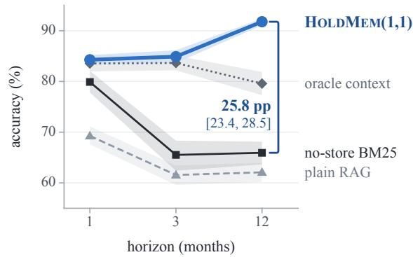

(b) Tokens per query at twelve months  
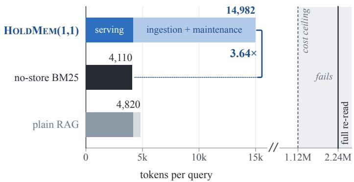  
Fi ure 8: No-store BM25 a ainst HoldMem(1,1) over horizons. (a) Accurac before an shift, with 95% intervals as bands. The bracket gives the paired diference at twelve months with its 95% interval. (b) Tokens per query at twelve months, split into serving (dark) and amortized in estion and maintenance (li ht). The bracket ives the ratio of the two totals. Oracle context was not costed and is not in (b). The axis breaks before the cost ceiling (dashed), which bounds serving at half of one full re-read, and the gray region beyond it fails the ceiling.

Table 28: The four diagnostic tests (Section E) per tier, switch, horizon, and system, in the main study and the replication.
<table><tr><td></td><td></td><td colspan="2">Main study</td><td colspan="2">Replication</td></tr><tr><td>Test</td><td>Systems or units</td><td>Estimate</td><td>Passes</td><td>Estimate</td><td>Passes</td></tr><tr><td>Retention test</td><td>HoLDMEm(1,1), three tiers</td><td>-1.4 to -0.4</td><td>3/3</td><td>-1.9 to −0.1</td><td>3/3</td></tr><tr><td></td><td>HoLDMEm(1,1), five other writers</td><td>−5.2 to −0.1</td><td>2/5</td><td></td><td></td></tr><tr><td>Leaving test</td><td>HoLDMEm(1,1) with its keys</td><td>0.0</td><td>1/1</td><td></td><td></td></tr><tr><td>Utility floor</td><td>HoLDMEm(1,1) · no-store BM25 · plain RAG, three horizons</td><td>–22.1 to +12.2</td><td>3/3 · 0/3· 0/3</td><td>-23.4 to +13.3 3/3 · 0/3 · 0/3</td><td></td></tr><tr><td>Cost ceiling</td><td>the same systems and horizons</td><td>at most 2.1%</td><td>9/9</td><td>at most 2.0%</td><td>9/9</td></tr><tr><td>Utility floor</td><td>native systems and the two baselines</td><td>-21.7 to -1.8</td><td>1/8</td><td></td><td></td></tr><tr><td>Cost ceiling</td><td>the same systems</td><td>at most 1.1%</td><td>8/8</td><td></td><td></td></tr></table>

Estimate: point estimates of the change in retention, the leaving test’s diference in carryover and the margin over the utility floor in pp, and of the serving cost as a share of a full re-read, a range over the units. Passes: passing units, per system where a row names several. Thresholds: retention test 90% interval above −3 pp, leaving test 90% interval within ±3 pp, utility floor ≥ −3 pp, cost ceiling at most half. Passin : emma-4-12B and Ministral-3-14B of the five other writers; Co nee of the native s stems and the two baselines. —: not run in the replication.

## F.7 Writer Switches

Design of the eight switches. On the 20 test worlds, the old writer (Qwen3.5-9B, or Qwen3.8-27B for the downgrade) builds the four source-key cells one minute before the fork, with the sources frozen. Each new writer then replaces it in turn and re-derives every �=1 item. Retention is �(correct after | correct before). The agreement rate of an item type is the share of items on which both writers are correct or both are wrong, measured on the calibration worlds. For writer agreement as a predictor, we pool the eight switches (the three main-study tiers and the five other writers), regress �=0, �=1 survival on agreement, and resample by world. In every switch, we also compare the item-paired survival of �=1 and �=0 items at �=1, and the retention test applies to each switch.

Retention stays above 97% at all three tiers. In the worst case, retention changed by −1.4 pp [−1.9, −0.9] (90% interval) relative to full retention, at the same tier. Pooled over the three tiers, writer agreement predicted which of the 2,446 items survive the switches on the test worlds, with a calibration slope of 1.01 [0.90, 1.18] (90% interval) and an AUROC of 0.832. 41 items failed, and 32 of them were definition items.

Survival of a switch exceeds the checker pass rate. At every tier, the �=1 survival of a writer switch was higher than the checker pass rate: 98.6% against 79.3% at the same tier, 99.6% against 82.0% for the upgrade, and 99.6% against 77.0% for the downgrade. Exact recomputation recomputes the items that the checker rejects.

The new writer’s own accuracy predicts survival at least as well as agreement. The predictor is the per-type agreement of the old and the new writer on the calibration worlds (Figure 9). Pooled over the three tiers, the new writer’s per-type accuracy reaches an AUROC of 0.887, the old writer’s 0.800, and an indicator of definition items alone

Table 29: Update and Stability of no-store BM25 (no-store), HoldMem(1,1) and HoldMem(0,0) by item class after each shift, and no-store BM25 minus HoldMem(1,1) on Update, paired.
<table><tr><td></td><td></td><td colspan="4">Update (%)</td><td colspan="3">Stability (%)</td></tr><tr><td>Shift</td><td>Class</td><td>No-store</td><td>(1,1)</td><td>(0,0)</td><td>No-store – (1,1) (pp)</td><td>No-store</td><td>(1,1)</td><td>(0,0)</td></tr><tr><td colspan="9">Main study</td></tr><tr><td> $S _ { \mathrm { s r c } }$ </td><td>definition</td><td>7</td><td>99</td><td>10</td><td>-91.9[-96.0, -87.9]</td><td>45</td><td>100</td><td>48</td></tr><tr><td></td><td>other</td><td>83</td><td>91</td><td>84</td><td>-8.1 [-11.3, -4.9]</td><td>71</td><td>93</td><td>74</td></tr><tr><td></td><td>all</td><td>61</td><td>93</td><td>63</td><td>-32.0[−34.7, −29.5]</td><td>69</td><td>93</td><td>73</td></tr><tr><td> $S _ { \mathrm { d e f } }$ </td><td>definition</td><td>5</td><td>100</td><td>7</td><td>-94.3 [-97.2, −91.2]</td><td>31</td><td>92</td><td>38</td></tr><tr><td></td><td>other</td><td>70</td><td>73</td><td>71</td><td>-2.9[−7.5, +0.9]</td><td>68</td><td>93</td><td>79</td></tr><tr><td></td><td>all</td><td>25</td><td>92</td><td>27</td><td>-66.3[-71.5, -61.3]</td><td>67</td><td>93</td><td>78</td></tr><tr><td> $S _ { \mathrm { d e l } }$ </td><td>definition</td><td>2</td><td>99</td><td>4</td><td>-97.4[-99.4, –95.0]</td><td>45</td><td>100</td><td>60</td></tr><tr><td></td><td>other</td><td>86</td><td>68</td><td>10</td><td>+18.4[+14.2, +23.3]</td><td>66</td><td>87</td><td>80</td></tr><tr><td></td><td>all</td><td>71</td><td>73</td><td>9</td><td>-1.8[−5.6, +2.2]</td><td>65</td><td>88</td><td>78</td></tr><tr><td colspan="9">Replication</td></tr><tr><td> $S _ { \mathrm { s r c } }$ </td><td>definition</td><td>7</td><td>99</td><td>10</td><td>-92.0[-96.3, -87.2]</td><td>45</td><td>100</td><td>59</td></tr><tr><td></td><td>other</td><td>84</td><td>90</td><td>86</td><td>-6.0[−8.6, −3.2]</td><td>72</td><td>92</td><td>76</td></tr><tr><td></td><td>all</td><td>62</td><td>92</td><td>64</td><td>-30.7 [-32.9, −28.5]</td><td>70</td><td>92</td><td>75</td></tr><tr><td> $S _ { \mathrm { d e f } }$ </td><td>definition</td><td>7</td><td>99</td><td>9</td><td>-92.0[-96.0, −87.7]</td><td>62</td><td>100</td><td>77</td></tr><tr><td></td><td>other</td><td>78</td><td>86</td><td>82</td><td>-7.5[−14.4, −1.2]</td><td>71</td><td>92</td><td>81</td></tr><tr><td></td><td>all</td><td>30</td><td>95</td><td>32</td><td>-64.7[-69.2, -60.5]</td><td>71</td><td>92</td><td>81</td></tr><tr><td> $S _ { \mathrm { d e l } }$ </td><td>definition</td><td>3</td><td>100</td><td>6</td><td>-96.5 [-99.0, -93.4]</td><td>52</td><td>100</td><td>63</td></tr><tr><td></td><td>other</td><td>87</td><td>67</td><td>10</td><td>+20.4[+14.7, +25.7]</td><td>66</td><td>88</td><td>80</td></tr><tr><td></td><td>all</td><td>72</td><td>73</td><td>9</td><td>-0.5 [−6.0, +4.8]</td><td>65</td><td>89</td><td>78</td></tr></table>

Update and Stability levels: point estimates.

(a) Survival against writer agreement  
(b) Agreement 80–100%, magnified  
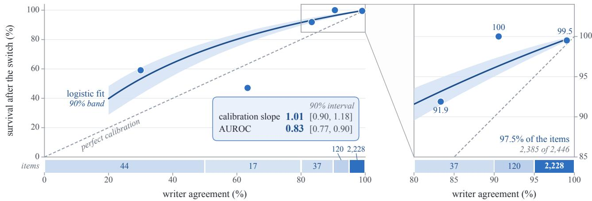  
Fi ure 9: Survival of a switch a ainst writer a reement for the 2 446 �=0 �=1 items ooled over the three tiers. Points: the survival of each agreement bin (edges at 50, 80, 90, and 95%) at its mean agreement. The strip under each axis gives the items per bin, and its tint deepens with the bin’s share of the items. Line and band: the pooled logistic fit and its 90% band. Dashed: perfect calibration. The card in (a) gives the calibration slope of the fit and the AUROC of agreement with 90% intervals. (b) magnifies agreement from 80 to 100%, where nearly all items lie, and prints the survival of each bin.

0.869. Outside the definition items, where few items fail, agreement does not predict survival (0.275). Over the eight switches, the new writer’s accuracy reaches 0.849 against 0.827 for agreement (diference +0.022 [−0.001, +0.072], with item types resampled). The old writer’s accuracy (0.607) and the indicator (0.592) fall behind both.

Pooled over the eight switches, agreement predicts survival. In Table 30, the pooled slope was 0.85 [0.79, 0.94] (90% interval) and the AUROC 0.827. For the switch to gemma-4-12B and the switch up to Qwen3.8-27B, almost no item failed, so their slopes are not usable. By point estimate, �=1 items survived at least as often as �=0 items in 6 of 8 switches, and slightly less often after gemma-4-

Table 30: Writer switches: how well writer agreement predicts survival of the switch, and what the switch does to retention.
<table><tr><td>Writer switch</td><td>Slope</td><td>AUROC</td><td>D surv. (pp)</td><td>Retention ∆ (pp)</td></tr><tr><td>same tier</td><td> $1 . 3 7 [ 0 . 9 4 , 2 . 1 9 ]$ </td><td>0.76</td><td> $+ 0 . 2 \left[ - 0 . 4 , + 0 . 7 \right]$ </td><td> $- 1 . 4 \left[ - 1 . 9 , - 0 . 9 \right]$ </td></tr><tr><td>upgrade (27B)*</td><td> $- 3 . 5 2 [ - 9 9 . 2 9 , - 0 . 9 6 ]$ </td><td>0.47</td><td> $0 . 0 [ - 0 . 4 , + 0 . 4 ]$ </td><td> $- 0 . 4 \left[ - 0 . 9 , 0 . 0 \right]$ </td></tr><tr><td>downgrade</td><td>1.09 [0.95, 1.39]</td><td>0.93</td><td> $+ 2 . 7 \left[ + 1 . 7 , + 3 . 6 \right]$ </td><td> $- 0 . 4 \left[ - 0 . 8 , 0 . 0 \right]$ </td></tr><tr><td>Llama-3.1-8B</td><td>0.69 [0.55, 0.85]</td><td>0.64</td><td> $+ 7 . 2 \ [ + 5 . 0 , + 9 . 2 ]$ </td><td> $- 5 . 2 \ [ - 6 . 4 , - 4 . 1 ]$ </td></tr><tr><td> $\mathrm { g e m m a } { - 4 { - } 1 2 \mathrm { B } ^ { \ast } }$ </td><td></td><td></td><td> $- 0 . 1 \left[ - 0 . 4 , 0 . 0 \right]$ </td><td> $- 0 . 1 \left[ - 0 . 4 , 0 . 0 \right]$ </td></tr><tr><td>gpt-oss-20b</td><td>0.52 [0.41, 0.66]</td><td>0.71</td><td> $- 0 . 7 \left[ - 2 . 0 , + 0 . 5 \right]$ </td><td> $- 2 . 4 \left[ - 3 . 2 , - 1 . 5 \right]$ </td></tr><tr><td>Ministral-3-14B</td><td>0.62 [0.47, 0.85]</td><td>0.62</td><td> $+ 7 . 7 \left[ + 5 . 6 , + 9 . 9 \right]$ </td><td> $- 1 . 7 \ : [ - 2 . 5 , - 1 . 0 ]$ </td></tr><tr><td>Qwen3-8B</td><td>0.46 [0.26, 0.68]</td><td>0.64</td><td> $+ 1 . 0 \left[ - 0 . 2 , + 2 . 2 \right]$ </td><td> $- 3 . 5 [ - 4 . 7 , - 2 . 3 ]$ </td></tr><tr><td>pooled, 8 switches</td><td>0.85 [0.79, 0.94]</td><td>0.83</td><td></td><td></td></tr></table>

Slope: calibration slope of survival on writer agreement (90% interval). AUROC: point estimates. � surv.: survival of �=1 minus �=0 items. Retention Δ: the change in retention of HoldMem(1,1) (90% interval). ∗ Almost no item failed, so the slope (gray) is not usable.

12B (−0.1 pp) and gpt-oss-20b (−0.7 pp). Llama-3.1-8B, gpt-oss-20b, and Qwen3-8B did not pass the retention test.

After a same-tier switch, retention falls mainly on free text. A same-tier switch makes 91 items of HoldMem(1,1) right and 11 wrong, so net accuracy rises by +8.3 pp. The new writer’s �=1 build recomputes items that the old writer had wrong. Retention falls mainly on free text. There, the �=1 cell keeps 85.1% compared with 95.5% at �=0, because the span check rejects a paraphrase.

## F.8 Generality

Design of the replication. The replication repeats the main study on 20 fresh test worlds that are disjoint from every other split (Section H). It runs the main experiment with every cell and baseline in the three branches. It also runs the writer-switch experiment with the main study’s calibration agreement rates (not recomputed) and the horizon experiment at one, three, and twelve months. The diagnostic tests apply to each tier, system, and horizon on the fresh worlds as well.

Every contrast with the source key replicates. On the fresh worlds, every contrast with the source key in Table 18 has the main study’s sign and a 95% interval that excludes zero. The exception is $D ' s$ efect on missed invalidation, which stays at zero as in the main study. With the source key, the efect of � on detection is near 100 pp by design. With the citation key, the efect of � on Update after a source revision and after a redefinition has an interval that includes zero in both studies (averaged over �: 0.0 pp [−3.0, +3.1] and −1.3 pp [−4.8, +2.0] in the main study, −0.9 pp [−3.9, +2.0] and −1.7 pp [−5.9, +2.7] on the fresh worlds). Its interaction after a source revision moves from −0.9 pp [−3.6, +1.6] to +0.5 pp [−1.4, +2.7]. On the fresh worlds, the efect of � on Update after a source revision, averaged over �, was +8.2 pp [+5.3, +11.2]. �’s efect on missed invalidation was 0.0 pp, and writer agreement as a predictor of survival had a slope of 1.05 (90% lower bound 0.93) and an AUROC of 0.79. The retention test, the utility floor, and the cost ceiling give the same pass counts as in the main study (Table 28).

With another family as writer and reader, the main contrasts keep their direction. Other model families (Table 11) replace Qwen3.5-9B in three roles: as the new writer at a switch (Section F.7), as writer and reader of the main experiment, and as reader only. The main writer’s requests are unchanged, so the reader swaps and the writer’s programs reuse the main study’s writer outputs. Each of Llama-3.1-8B, gemma-4-12B, and gpt-oss-20b is writer and reader of the main experiment on 10 test worlds (all branches, cells, and baselines), next to Qwen3.5-9B on the same worlds (Table 4b). In all three families, �’s efect on missed invalidation is zero. The following contrasts have 95% intervals that exclude zero in the main study’s direction: the � efect on Update after a source revision, the � efect on the accuracy on re-derived items, �×� on Update after a redefinition and after a deletion, and the gap of no-store BM25 below HoldMem(1,1). Table 16 splits the terms by item class.

Other readers keep the signs ofthe main contrasts. Each of the same families also replaces only the reader, on 5 test worlds after a source revision and a redefinition. Every swapped reader keeps the sign of the � efect on Update, the � efect on the accuracy on re-derived items, and �×� in both branches (Table 31), and �’s efect on missed invalidation stays zero.

Swapping the reader or the embedder changes levels but keeps the signs of the efects of � and �. In the experi- ment with the probes on conflicts and consent (Section F.10), on 5 test worlds, Ministral-3-14B replaces Qwen3.5-9B as reader. Its � efect on Update was +14.3 pp [+10.9, +18.6] and +16.8 pp [+13.4, +20.5] after a source revision and a redefinition (Qwen3.5-9B: +9.1 pp [+5.4, +13.9] and +17.4 pp [+10.9, +22.2]). Its � efect on the accuracy on re-derived items was +16.2 pp [+14.8, +18.3] and +35.1 pp [+29.7, +40.0] (Qwen3.5-9B: +13.7 pp [+11.9, +16.2] and +33.4 pp [+30.1, +37.4]). After a redefinition, plain RAG overtook no-store BM25 with this reader (50.7% [45.0, 57.0] against 40.9% [37.1, 45.1], while Qwen3.5-9B gave 43.3% [40.9, 46.1] against 49.3% [45.8, 53.6]). With bge-m3 as the embedding model of plain RAG, its accuracy after the shift moved from 69.7% [66.1, 74.1] to 68.2% [65.7, 70.2] after a source revision and from 43.3% [40.9, 46.1] to 44.6% [40.1, 50.0] after a redefinition.

Table 31: Other model families as reader of the main writer’s stores (5 test worlds), beside Qwen3.5-9B on the same worlds. Table 4b gives them as writer and reader.
<table><tr><td>As reader only (pp)</td><td>Llama-3.1-8B</td><td>gemma-4-12B</td><td> $\mathrm { g p t - o s s } { - 2 0 \mathrm { b } }$ </td><td>Qwen3.5-9B</td></tr><tr><td>B effect on Update,  $S _ { \mathrm { s r c } }$ </td><td> $+ 2 6 . 4 \left[ + 1 8 . 8 , + 3 3 . 9 \right]$ </td><td> $+ 1 3 . 0 [ + 1 1 . 1 , + 1 5 . 2 ]$ </td><td> $+ 1 0 . 1 \ [ + 6 . 7 , + 1 4 . 5 ]$ </td><td> $+ 9 . 1 \ [ + 5 . 4 , + 1 3 . 9 ]$ </td></tr><tr><td> $B \mathrm { e f f e c t o n } \mathrm { U p d a t e } , S _ { \mathrm { d e f } }$ </td><td> $+ 1 7 . 8 [ + 1 1 . 2 , + 2 3 . 2 ]$ </td><td> $+ 2 3 . 5 \left[ + 1 9 . 3 , + 2 9 . 3 \right]$ </td><td> $+ 1 8 . 1 \ [ + 9 . 4 , + 2 4 . 8 ]$ </td><td> $+ 1 7 . 4 \left[ + 1 0 . 9 , + 2 2 . 2 \right]$ </td></tr><tr><td>D effect on accuracy on re-derived items,</td><td> $+ 1 5 . 4 [ + 1 3 . 3 , + 1 7 . 7 ]$ </td><td> $+ 1 5 . 2 [ + 1 3 . 4 , + 1 6 . 9 ]$ </td><td> $+ 1 3 . 7 \left[ + 1 1 . 7 , + 1 5 . 3 \right]$ </td><td> $+ 1 3 . 7 \left[ + 1 1 . 9 , + 1 6 . 2 \right]$ </td></tr><tr><td> $S _ { \mathrm { s r c } }$  D effect on accuracy on re-derived items,  $S _ { \mathrm { d e f } }$ </td><td> $+ 3 4 . 1 \ [ + 2 9 . 7 , + 3 8 . 3 ]$ </td><td> $+ 3 5 . 5 \left[ + 3 1 . 5 , + 3 9 . 4 \right]$ </td><td> $+ 3 2 . 1 [ + 2 8 . 8 , + 3 5 . 4 ]$ </td><td> $+ 3 3 . 4 \ : [ + 3 0 . 1 , + 3 7 . 4 ]$ </td></tr><tr><td>B×D on Update,  $S _ { \mathrm { s r c } }$ </td><td> $+ 9 . 1 \ [ + 2 . 8 , + 1 5 . 9 ]$ </td><td> $+ 1 0 . 4 [ + 7 . 0 , + 1 4 . 1 ]$ </td><td> $+ 1 0 . 1 \ [ + 3 . 5 , + 1 5 . 2 ]$ </td><td> $+ 6 . 7 \ [ + 0 . 9 , + 1 3 . 4 ]$ </td></tr><tr><td>B×D on Update,  $S _ { \mathrm { d e f } }$ </td><td> $+ 3 0 . 2 [ + 2 3 . 8 , + 3 8 . 3 ]$ </td><td> $+ 3 3 . 6 [ + 2 9 . 1 , + 3 8 . 1 ]$ </td><td> $+ 2 8 . 2 [ + 2 3 . 6 , + 3 1 . 8 ]$ </td><td> $+ 3 0 . 9 \ [ + 2 4 . 5 , + 3 8 . 0 ]$ </td></tr><tr><td>HoLDMEm(1,1) accuracy, Sdef (%)</td><td>93.3</td><td>96.6</td><td>96.3</td><td>91.6</td></tr></table>

�’s efect on missed invalidation was 0.0 in every column. HoldMem(1,1) accuracy: point estimates. Qwen3.5-9B: the main reader, on the same worlds.

With rewritten message bodies, the five contrasts keep their direction, and the efect of � on the accuracy on re- derived items shrinks. We repeat the main experiment on worlds in which gemma-4-12B rewrote the bodies of e-mails, chat messages, and notes (Section B). These bodies are 0.9% of the body text, and each keeps its gold surface forms (100.0% found at the worst world and branch). Newsletter digests, which hold no gold fact, stay templated and make up the rest of the body text. On the 10 template worlds of the other model families, the experiment repeats their cells, branches, and probes with the main writer and reader. Both conditions ask identical probes, so each contrast is paired by item (rewritten minus template), with world-bootstrap intervals. On the 10 rewritten worlds, the five contrasts have the same direction as on their template twins (+9.1 pp [+5.3, +13.2], +6.4 pp [+5.2, +7.5], +29.2 pp [+26.7, +32.1], +26.8 pp [+22.4, +31.3], and −40.5 pp [−45.6, −35.8]). The values for the template twins are in the Qwen3.5-9B column of Table 4b. The interaction moves by −0.4 pp [−1.5, +0.7] after a redefinition and by +0.8 pp [−2.7, +3.7] after a source revision. The � efect on the accuracy on re-derived items changes by −7.4 pp [−8.5, −6.4] after a source revision and −4.4 pp [−6.0, −2.9] after a redefinition. Definition items come from structured fields that the rewrite does not touch, so the rewrite can afect only the other items.

## F.9 Native Systems

Mem0 falls outside the interval of its cell only for Update after a source revision. Mem0 ke t 54.9% of the deleted items. By point estimate, this gives its documented setting (0, 0). The interval of this share includes the 50% threshold, so the setting is not identified by the interval (Table 32). Mem0 lies outside the interval of its cell only for Update after a source revision (70.6% [64.2, 76.2] against 57.6% [51.5, 63.4]). There, Mem0 lies inside the intervals of no-store BM25 and plain RAG (Table 32), as do A-Mem and MemOS, the other systems with its setting. Of its extraction outputs, 398 (3.6%) broke of near Mem0’s default output limit and were dropped, which counts as system behavior. A second ingestion of 3 worlds with identical requests changed 21.5% to 23.6% of the answers after the three shifts and moved Update by +13.2 pp to +20.0 pp. Before the fork, Mem0’s margin over the oracle context was −16.9 pp, so it does not pass the utility floor, like no-store BM25 (−16.8 pp) and plain RAG (−20.7 pp). Serving costs 1.14% of a full re-read. The retention test does not apply to Mem0, and its leaving test was not run.

How the native values are compared. For the five further systems, we compare the setting inferred from behavior with the documented one. We compare each system’s Update and Stability after the three shifts with the 95% interval of the HoldMem cell that has its inferred setting, on the same worlds and branch. For �=1, this is the citation-key cell for a document-level system and the source-key cell otherwise. No-store BM25 and plain RAG, which store no derived item, are compared with the same intervals, and we compare mean Stability after a deletion between systems with �=1 and �=0. A native value says something about its setting only where it also lies outside the intervals of no-store BM25 and plain RAG. Every system ingested 3 of the worlds a second time, and Table 32 widens its intervals by the variance between the two ingestions.

The settings are recovered from behavior, but they do not predict how a system does after a shift. By point estimate, the inferred setting equals the documented one for 5 of 5 systems. 12 of 36 comparisons (33.3%), Mem0 included, fall inside the interval of the cell with the inferred setting (Figure 3), and Table 32 gives the count for each system. Mean Stability after a deletion was 86.4% for �=1 systems and 73.2% for �=0 systems. � is inferred from the deletion branch, so this last comparison is not independent of the setting. The persistence intervals of Mem0 and MemOS include 0.5, so 4 of 6 settings are identified by interval when Mem0 is counted.

Table 32: Native values against their references per system and comparison, with each system’s inferred setting (three-month worlds).
<table><tr><td rowspan="2">System, cell</td><td rowspan="2">Comparison</td><td rowspan="2">Contained by</td><td rowspan="2"></td><td colspan="2">Native – cell (pp)</td><td rowspan="2">Native – no-store (pp)</td></tr><tr><td>Difference</td><td>Widened</td></tr><tr><td>Mem0</td><td> $S _ { \mathrm { s r c } }$ </td><td>Update</td><td>no-store, RAG</td><td>+13.1 [+7.4, +18.9]</td><td>[+5.3, +20.9]</td><td>-0.5[−5.8, +4.1]</td></tr><tr><td>cell (0,0)</td><td></td><td>Stability</td><td>(0,0), (1,0), no-store, RAG</td><td>+0.8[−7.8, +8.1]</td><td>[-8.1,+8.5]</td><td>-5.4[−11.7, +1.4]</td></tr><tr><td>P 54.9%</td><td> $S _ { \mathrm { d e f } }$ </td><td>Update</td><td>(0,0)</td><td>+3.4[−4.3, +10.4]</td><td>[−7.2,+13.6]</td><td>-7.7 [−15.7, −0.4]</td></tr><tr><td>[49.0,60.9]</td><td></td><td>Stability</td><td>(0,0), (1,0), no-store, RAG</td><td>+0.6[−6.0, +7.0]</td><td>[-6.8,+7.8]</td><td>-2.7 [−9.4, +5.6]</td></tr><tr><td>inside 5/6</td><td> $S _ { \mathrm { d e l } }$ </td><td>Update°</td><td>(0,0)</td><td>+13.2 [0.0, +25.0]</td><td>[-3.0, +28.3]</td><td>-13.2[-25.6,0.0]</td></tr><tr><td></td><td></td><td>Stability°</td><td>(0,0), no-store, RAG</td><td>-17.0[−23.9, −8.9]</td><td>[-25.5,-7.5]</td><td>-6.7[-11.7, −1.6]</td></tr><tr><td>A-Mem</td><td> $S _ { \mathrm { s r c } }$ </td><td>Update</td><td>no-store, RAG</td><td>+11.7 [+6.2, +16.7]</td><td>[+6.0, +16.9]</td><td>-1.8[-8.2, +3.7]</td></tr><tr><td>cell (0,0)</td><td></td><td>Stability</td><td>none</td><td>+13.6[+9.3, +17.9]</td><td>[+8.3, +18.9]</td><td>+10.5 [+4.5, +16.9]</td></tr><tr><td>P 66.8%</td><td> $S _ { \mathrm { d e f } }$ </td><td>Update</td><td>(0,0)</td><td>+3.4[−2.0, +8.6]</td><td>[-2.3, +8.9]</td><td>-7.7[−14.7, −1.9]</td></tr><tr><td>[59.9,73.3]</td><td></td><td>Stability</td><td>none</td><td>+12.0[+5.0, +18.5]</td><td>[+2.7, +20.9]</td><td>+11.0[+4.1, +18.3]</td></tr><tr><td>inside 1/6</td><td> $S _ { \mathrm { d e l } }$ </td><td>Update°</td><td>none</td><td>+2.6[0.0, +7.7]</td><td>[0.0, +7.7]</td><td>-23.7[-33.3, -13.9]</td></tr><tr><td></td><td></td><td>Stability°</td><td>(1,0)</td><td>-6.1[-13.3, +1.1]</td><td>[-17.1,+4.9]</td><td>+4.3 [−1.9, +10.2]</td></tr><tr><td>MemOS</td><td> $S _ { \mathrm { s r c } }$ </td><td>Update</td><td>no-store, RAG</td><td>+12.8[+7.7, +17.8]</td><td>[+7.7,+17.8]</td><td>-0.7 [−7.1, +5.3]</td></tr><tr><td>cell (0,0)</td><td></td><td>Stability</td><td>(0,0), (1,0), no-store, RAG</td><td>+2.1 [−4.5, +8.5]</td><td>[-4.6,+8.7]</td><td>-2.4[−7.9, +3.0]</td></tr><tr><td>P 54.9%</td><td> $S _ { \mathrm { d e f } }$ </td><td>Update</td><td>no-store, RAG</td><td>+10.2[+3.0, +16.8]</td><td>[+2.9, +16.9]</td><td>-0.9[-6.7, +5.0]</td></tr><tr><td>[50.0,59.9]</td><td></td><td>Stability</td><td>(0,0), (1,0), no-store, RAG</td><td>-1.5[−8.6, +5.3]</td><td>[-8.9,+5.7]</td><td>-2.7 [−9.8, +5.5]</td></tr><tr><td>inside 4/6</td><td> $S _ { \mathrm { d e l } }$ </td><td>Update°</td><td>(0,0)</td><td>+10.5 [0.0, +22.5]</td><td>[-4.4, +26.5]</td><td>-15.8[-27.3, -3.0]</td></tr><tr><td></td><td></td><td>Stability°</td><td>(0,0), no-store, RAG</td><td>-18.4[−26.2, −10.6]</td><td>[-26.4,-10.3]</td><td>-7.7 [−12.5, −2.5]</td></tr><tr><td>LightRAG</td><td> $S _ { \mathrm { s r c } }$ </td><td>Update</td><td>none</td><td>-12.8[−18.2, −7.6]</td><td>[-18.9,-6.8]</td><td>-6.2[−12.5, −0.7]</td></tr><tr><td>cell (0,1)c</td><td></td><td>Stability</td><td>none</td><td>-13.5[-18.4, −8.7]</td><td>[-20.6, -6.5]</td><td>+16.3 [+8.9, +22.7]</td></tr><tr><td>P 10.7%</td><td> $S _ { \mathrm { d e f } }$ </td><td>Update</td><td>(0,0)</td><td>-14.9[-20.5, −9.9]</td><td>[-21.4,-8.9]</td><td>-7.7 [−16.2, −0.8]</td></tr><tr><td>[7.3,14.6]</td><td></td><td>Stability</td><td>none</td><td>-17.5[−20.8, −13.9]</td><td>[-21.8,-12.9]</td><td>+8.3 [+1.8, +15.1]</td></tr><tr><td>inside 0/6</td><td> $S _ { \mathrm { d e l } }$ </td><td>Update°</td><td>none</td><td>-31.6[-48.6, -17.1]</td><td>[-48.6,-17.1]</td><td>-26.3[−39.5, −12.8]</td></tr><tr><td></td><td></td><td>Stability°</td><td>(1,0)</td><td>-16.6[-20.4, −12.5]</td><td>[-27.0,-6.1]</td><td>+6.2[+1.4, +11.2]</td></tr><tr><td>HippoRAG 2</td><td> $S _ { \mathrm { s r c } }$ </td><td>Update</td><td>(1,0), (0,1)c, no-store, RAG</td><td>-3.4[−9.5, +2.9]</td><td>[-9.8,+3.1]</td><td>+3.2[−2.6, +8.5]</td></tr><tr><td>cell (0,1)c</td><td></td><td>Stability</td><td>none</td><td>-16.0[−19.4, −12.6]</td><td>[-19.5,-12.6]</td><td>+11.8[+6.6, +17.3]</td></tr><tr><td>P 9.5%</td><td> $S _ { \mathrm { d e f } }$ </td><td>Update</td><td>no-store, RAG</td><td>-7.2[−12.0, −2.7]</td><td>[-12.0,-2.7]</td><td>0.0[−9.5, +8.9]</td></tr><tr><td>[5.6, 13.7]</td><td></td><td>Stability</td><td>none</td><td>-13.8[−16.8, −10.9]</td><td>[-16.8,-10.8]</td><td>+13.6[+5.2, +23.0]</td></tr><tr><td>inside 1/6</td><td> $S _ { \mathrm { d e l } }$ </td><td>Update°</td><td>(0,0)</td><td>-15.8[-33.3,0.0]</td><td>[-33.3,0.0]</td><td>-10.5[−22.2, 0.0]</td></tr><tr><td></td><td></td><td>Stability°</td><td>(1,0)</td><td>-14.8[-18.2, -11.7]</td><td>[-18.2,-11.7]</td><td>+6.7 [+1.5, +12.8]</td></tr><tr><td>Cognee</td><td> $S _ { \mathrm { s r c } }$ </td><td>Update</td><td>no-store, RAG</td><td> $\begin{array} { l } { { - 8 . 9 [ - 1 4 . 1 , - 4 . 4 ] } } \\ { { - 3 . 5 [ - 6 . 2 , - 1 . 2 ] } } \end{array}$ </td><td>[-14.3,-4.1]</td><td>-2.3 [−8.2, +3.4]</td></tr><tr><td>cell (0,1)c</td><td></td><td>Stability</td><td>none</td><td></td><td>[-6.3,-1.1]</td><td>+25.4[+19.5, +31.0]</td></tr><tr><td>P 12.3%</td><td> $S _ { \mathrm { d e f } }$ </td><td>Update</td><td>no-store, RAG</td><td>-9.4[−13.7, −5.8]</td><td>[-14.0,-5.4]</td><td>-2.1 [−8.8, +3.3]</td></tr><tr><td>[8.6, 16.2]</td><td></td><td>Stability</td><td>oracle</td><td>-2.5[−4.9, −0.4]</td><td>[-5.1,-0.3]</td><td>+26.1 [+16.3, +37.0]</td></tr><tr><td>inside 1/6</td><td> $S _ { \mathrm { d e l } }$ </td><td> $\mathrm { U p d a t e } ^ { \circ }$ </td><td>(0,0)</td><td>-21.1 [-35.1, −7.9]</td><td>[-36.2,-6.7]</td><td>-15.8[-27.0, −3.0]</td></tr><tr><td></td><td></td><td>Stability°</td><td>(0,1)c, (1,1)c</td><td>-1.8[-4.7, +1.1]</td><td>[-5.3,+1.7]</td><td>+20.2[+15.6, +24.9]</td></tr></table>

Cell: the HoldMem cell with the setting inferred from behavior. �: deletion persistence, the share of deleted items still answered, with its 95% interval. Inside �/�: � comparisons inside the 95% interval of the cell, each also outside that of the cell with the other �. Contained by: the references whose 95% interval contains the native value ((�, �): HoldMem cell, c: citation key, no-store: no-store BM25, RAG: plain RAG, oracle: oracle context). Diference: native minus the HoldMem cell with the inferred setting, paired by item, with its 95% interval. Widened: that interval widened by the variance between repeated ingestions. Native − no-store: paired by item, with its 95% interval. ◦: after $S _ { \mathrm { d e l } } .$ , from which � is inferred.

After a source revision, all native systems except Ligh- tRAG update like plain RAG, whatever their documented setting. On Update after a source revision, every native system except LightRAG lies inside the intervals of no-store BM25 and plain RAG, and its paired diference from no- store BM25 has a 95% interval that includes zero (Table 32). On the comparisons that were not used to infer the setting, 7 of 24 native values lie inside the interval of the cell with their setting, and 12 of 24 values of plain RAG, which stores no derived item, lie inside the same intervals. Per event, the five further systems made 1.00 to 2.67 LLM calls and used 0.20 to 0.75 of the prompt and completion tokens of Mem0 (10.7k).

The ranking after a source revision nearly fixes the ranking after a redefinition among the HoldMem cells, but not among the native systems. The rank correlation in Section 7 covers every system measured on these worlds except the JSON arm. It also includes the redefinition and deletion branches of the oracle context, no-store BM25, and plain RAG. Over all 15 systems, the ranking by Update after a source revision correlates with the ranking after a redefinition at Spearman � = 0.96 [0.85, 0.98] and with the ranking by Stability after a deletion at 0.55 [0.43, 0.66]. The first correlation comes mostly from the HoldMem cells, which difer widely in Update. Among the 6 cells it is 0.94 [0.75, 1.00], among the 6 native systems 0.52 [−0.09, 0.94], and among the native systems with no-store BM25 and plain RAG 0.76 [0.24, 0.90]. Each interval comes from its own world bootstrap. The native systems lie close together after both shifts, so their ranking after a source revision does not settle their ranking after a redefinition.

Deleting a stale memory does not derive the new value. Mem0 ran as in the native-system experiment on 10 of its three-month worlds, from its stores at the fork, with two interventions. Source-keyed invalidation deletes the memories of a record’s earlier revision before the new revision or the deletion is ingested. The adapter selects these memories by their source record, without gold, and deletes them through Mem0’s own delete call, so Mem0’s LLM decides none of the deletions. A query-time view puts the value of the writer’s program for a definition item, run at query time on the live typed records, first in the evidence for that item. The view thus adds both an evidence path, the typed records that Mem0 does not store, and the computation. Mem0 logged 0 updates or deletions after the fork, so �=1 after every shift and in every item class, and Mem0’s Update equals $^ { a , }$ the accuracy of what it serves without invalidation. The item class, not �, tells which intervention helps (Table 19). Mem0 answered 12.2%, 8.9%, and 10.7% of the changed definition item-times correctly after the three shifts. The query-time view raised Update on them by +72.6 pp [+63.1, +81.2], +64.4 pp [+57.4, +71.0], and +71.4 pp [+52.0, +88.6]. Invalidation changed it by +0.6 pp [−3.5, +4.2] to +3.6 pp [0.0, +10.7], with intervals that include zero. Of the definition item-times whose stale memories were deleted by invalidation, Mem0 then answered only 25.0% to 30.8% correctly. On the other items, which the view does not touch, invalidation raised Update by +35.9 pp [+26.1, +44.8] after a deletion, where records lose their source. It changed Update by −8.5 pp [−15.1, −1.1] after a redefinition.

## F.10 Export, Consent, Conflicts, and Sync

The probes on conflicts and consent ran on 5 test worlds.

Moving to another implementation needs the keys. Ex- ported to Portable Memory with its keys and imported by our second implementation, HoldMem(1,1) matched the original (0.0 pp) and passed the leaving test. Without the keys, the import detected no later change, and its missed invalidation rose by +100.0 pp. Both outcomes follow from the design (Section E).

A key does not detect conflicts. For 20 contact attributes, we made two live sources disagree, so the gold status is abstain. No HoldMem cell abstained. The share of these probes answered with abstain was 0.0% for HoldMem(1,1) and 5.0% [0.0, 15.0] for no-store BM25. A key detects a changed source, not a disagreement, and both values pass the span check.

Consent is applied through the read set. After one agent’s scope was revoked, �=0 cells answered 94.8% [90.6, 98.5] of its blocked probes. �=1 cells revoke the items whose recorded read set touches the scope. They still answered 63.0% [42.0, 76.3] of the blocked probes and blocked 36.0% [0.0, 79.1] of the answerable ones. No-store BM25 filters the raw sources at query time and leaked 3.2% [0.0, 12.6]. Revoking by read set blocks the right items only when the read set equals the dependency set.

Documented sync contracts cost accuracy with or without a key. With the simulators of Section B, the accuracy on calendar probes changed by −21.2 pp [−27.4, −13.2] with �=1, −18.8 pp [−29.4, −12.5] with �=0, and −16.2 pp [−20.0, −11.8] for no-store BM25. The sync contracts and the key did not interact measurably on calendar probes (−2.5 pp [−11.2, +8.8], 80 probes on 5 test worlds). Pooled over six sources, the interaction was −3.4 pp [−8.1, +2.4]. The sync worlds sample only events that touch an item, and each event is probed on every item it touches and on equally many items it does not touch.

## G Error Analysis

This section analyzes two failures: the writer’s programs after a deletion, and the program for working hours.

The programs return a value from another live record where the gold has none. Table 23 sorts every asked item-time after a deletion at �=1 by what the cell stored and how the reader answered. On the 1,365 changed item-times whose record was deleted, $D _ { \mathrm { m } }$ answered 34.9% [31.2, 38.6] correctly, compared with 66.7% [61.8, 71.5] for �=0. It lost 35.8 pp [31.2, 39.9] of these item-times relative to �=0. Of this loss, 68.9% [61.1, 76.6] is a value stored where the gold has none, nearly all of it a program value that replaced the writer’s (67.7% [60.0, 75.3]). Most of the rest, 30.5% [22.9, 38.2], comes from the reader. When shown the template “there is no current value”, the reader answers with the status answer about as often at �=1 as at $D _ { \mathrm { m } } \left( D _ { \mathrm { m } } \right.$ minus �=1 on this class: +1.8 pp [−2.3, +5.3]). None of the loss comes from a failed program.

The programs do not react to the deletion. Where the program’s value replaced the writer’s (394 item-times, 28.9% [24.5, 32.7]), exact recomputation stored no value every time.

Of these program values, 386 are the same field of another live record. For tasks, it is always the due date of the most recently updated task (189 of 189). For contacts, it is mostly the field of the first contact in the list (122 of 197). On live records that did not change, the programs are wrong about as often as on deleted ones. Task due dates were wrong on 83.3% [71.8, 93.2] of 180 live and 89.8% [81.9, 96.8] of 225 deleted item-times, and contact fields on 26.7% [21.4, 32.6] of 789 and 28.5% [24.2, 32.9] of 936. The recurring-series programs return no value for every deleted record (0.0% of 153 wrong) and are wrong on 11.1% [2.6, 21.7] of 108 live item-times. Before any shift, the task programs agree with gold on 15.0% of items. While the record that the writer cites exists, the writer’s value passes the span check, and the program’s output is only recorded. After a deletion, the writer states no value, the check fails, and the unchecked program value replaces the correct “no value”. We infer which record a program reads from its output.

Failed programs cost Stability instead. Over all re- derived item-times, the diference in accuracy of −7.8 pp [−10.0, −5.4] combines a gain on definition items (+42.5 pp [+39.0, +45.5]) with a loss on the other items (−15.1 pp [−17.3, −12.5]). Failed programs (78 of 960 slots at the last write) account for 68.8% [57.9, 81.2] of what �m lost on unchanged item-times (−2.2 pp [−4.0, −0.2]).

The program for working hours never runs. The writer’s program for working hours, a single program shared by every world, has a syntax error. It ran in none of the 20 worlds before any shift. The stored item is then unverifiable and not served, so the stored cell failed all 45 unchanged working- hours item-times. The query-time view fell back to no-store BM25, which answered them all. This is the view’s only lead over the stored cell (Section F.4).

## H Datasheet and License

This section gives the datasheet of the release, following Gebru et al. (2021). Section B specifies the generator.

Motivation. MemShift measures how much of what a memory derived about a person stays correct after the sources, the person’s definitions, the writer model, or the implemen- tation change. Benchmarks that score answers after new history mix detection and repair, and MemShift separates them. It crosses detection with repair in branches that are identical outside the shift, it includes shifts that add no text (a redefinition, a writer switch, and an export), and it scores answers against gold computed before any text exists. The authors created the dataset for this study.

Composition. An instance is a world: twelve months of one synthetic person across six sources (e-mail, calendar, tasks, contacts, notes, and chat). A world has 1,505–1,654 events, about 2.2M tokens, 48 items, and its branches. Probes are questions about one item at a given time, with a gold value and a gold status (answer, abstain, or blocked). The gold labels also record the dependency objects of every item at every time. Splits use disjoint seeds: development worlds 0–9, calibration worlds 900–909, test worlds 1000– 1019 (20 worlds), and replication worlds 1020–1039 (20 worlds). Three-month worlds on seeds 1000–1014 serve the native systems. The dataset is a sample from the generator, and further seeds give further worlds. It holds no personal data, no record of a real person, and no human subjects.

Collection process. The data are fully synthetic: a seeded generator writes every world, and no person was recorded, surveyed, or paid. A language model writes world text only in the rewritten worlds, where it rewrites message bodies and keeps every gold fact verbatim (Section B).

Labeling. Deterministic evaluators compute gold from the source objects before any text is rendered. No annotator labels an instance, and no language model scores an answer. The source objects are stored as generated.

Uses. The intended use is to measure the carryover of memories and memory systems under controlled shifts through the seven-method interface. Further uses are to run the four diagnostic tests on a memory and to reproduce the analyses of this paper. The worlds are synthetic evaluation data, so results on them describe synthetic worlds and the models tested, not how a system treats the data of real people. Seeds 1000–1039 are evaluation seeds, and results of a system tuned on them are not comparable.

Distribution and license. Code, generator, worlds, gold labels, and run manifests are released at https://gith ub.com/zichuanxu/memshift as one package with the probes and the analyses. The worlds come with the seeds and the generator version that reproduce them byte for byte. The code is released under the MIT license, and the data (worlds, gold labels, and model outputs) under CC BY 4.0. The open-weight models are not redistributed and keep their own licenses. For Claude Sonnet 5.5 and Opus 5.5, which we accessed through a commercial API, we release their responses.

Maintenance. The authors maintain the package. A change to the generator, a scorer, or a test threshold is a new tagged version. A world is identified by its seed and generator version. Every run manifest records the code version it ran on, so each published result stays tied to the version that produced it. Further seeds extend the dataset without changing existing worlds.