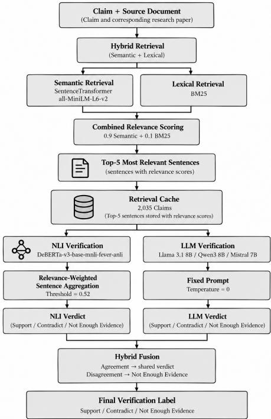
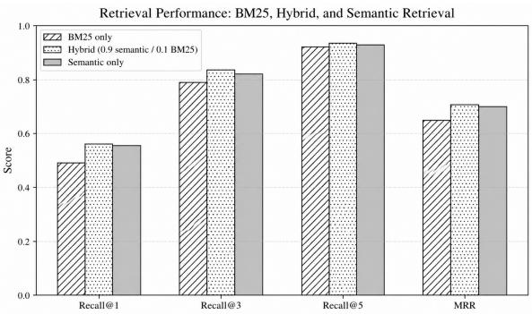

# An Experimental Study of Hybrid Retrieval, NLI and Open-source LLMs for Scientific Claim Verification

Lakshmi Narayanan P1[0009−0006−7442−2144], Narenkarthik K1[0009−0004−9499−2019], and Naren Kumar C1[0009−0009−2984−629X]

Shiv Nadar University Chennai, Chennai, India lakshmi23110003@snuchennai.edu.in

Abstract. Claim verification is the task of deciding whether a source text supports a claim, contradicts it, or lacks suficient evidence. Natural Language Inference (NLI) models can judge whether a single sentence supports or contradicts a claim, but they struggle when the evidence is spread across several sentences. Conversely, Large Language Models (LLMs) can reason across sentences, but may draw conclusions the text does not support. In this experimental study, we test whether a conservative fusion rule, labeling a claim Support or Contradict only when both models agree and defaulting to Not Enough Evidence otherwise, combines their strengths. We construct a benchmark of 2,035 claims from SciFact and CliniFact (858 Support, 152 Contradict, 1,025 Not Enough Evidence). We retrieve the top five most relevant sentences per claim using a hybrid of semantic and lexical (BM25) retrieval, which slightly outperforms either method alone. These retrieved sentences are then provided to every verification model. We then compare a DeBERTa-v3- base-mnli-fever-anli NLI baseline against Llama 3.1 8B, Qwen3 8B, and Mistral 7B. Qwen3 achieves the highest Macro-F1 (0.7937), followed by Llama 3.1 (0.7204) and Mistral (0.6388), while the NLI baseline reaches only 0.3157. Contrary to our hypothesis, fusion degrades performance, dropping Macro-F1 to 0.7392, 0.6730, and 0.5991, respectively. To understand this decline, we analyze agreements, disagreements, and common error patterns between the NLI and LLM verifiers. Our error analysis shows that NLI–LLM disagreements often result in correct LLM predictions being overturned.

Keywords: Claim Verification · Natural Language Inference · Large Language Models · Semantic Retrieval · Lexical Retrieval

## 1 Introduction

The rapid growth of scientific literature has made it increasingly dificult to manually verify the claims presented in research publications, particularly as individual claims may be supported or contradicted by evidence distributed across multiple sections of a paper. Scientific claim verification is the process of evaluating whether a specific statement or hypothesis made in scientific literature is supported or contradicted by underlying evidence [15]. This process requires a strict protocol, mainly in the retrieval of text and in the reasoning done using this evidence.

Current verification systems rely on retrieval methods, natural language inference (NLI) and LLMs. NLI models provide a constrained signal for determining whether a claim is supported or contradicted by evidence [9], but may struggle when the required evidence is distributed across multiple parts [21]. LLMs can jointly reason over multiple pieces of retrieved context, but may produce unsupported conclusions [6]. These complementary characteristics motivate combining their predictions through a conservative fusion strategy, where a claim is assigned “Support” or “Contradict” only when both models agree. If not, the system abstains by assigning “Not Enough Evidence”. We hypothesize that this agreement-based strategy can reduce mistaken verdicts by requiring independent agreement between the two approaches.

This study makes three contributions. First, we establish a common evaluation framework to compare a pretrained DeBERTa NLI model with three opensource LLMs: Qwen3 [20], Llama [4], and Mistral [7], using a shared hybrid retrieval pipeline on a benchmark of 2,035 claims labeled as Support”, Contradict”, or Not Enough Evidence”. Second, we evaluate three NLI evidence aggregation strategies and investigate a conservative agreement-based fusion strategy that returns Support” or Contradict” only when the NLI model and LLM agree, assigning “Not Enough Evidence” otherwise. Third, we conduct a comparative evaluation and detailed error analysis to assess the efectiveness and limitations of these approaches. Our results show that standalone LLMs outperform the NLI model, and that the agreement-based fusion does not improve Macro-F1 over standalone LLMs. The error analysis further examines the factors contributing to this outcome.

## 2 Related Work

## 2.1 Scientific Claim Verification Datasets

The task of scientific claim verification was introduced as determining whether a scientific claim is supported or contradicted by the evidence given in the literature. Wadden et al. [15] introduced the SciFact dataset, consisting of literature from actual research, with scientific claims paired with abstracts containing the evidence, along with labels and the rationales supporting each verification decision. This work established a benchmark for systems that retrieve relevant evidence and reason over it, rather than relying on prior scientific knowledge.

Continuing this work, Wadden et al. [16] later introduced SciFact-Open, which moves scientific claim verification into the open domain. This extended the challenge from verifying claims against a defined collection of evidence to finding relevant information in the broader scientific literature.

While SciFact-Open focuses on broader scientific claims, CliniFact focuses on claim verification in the clinical domain, where evidence for claims derived from clinical research must be found in scientific publications [22].

## 2.2 Evidence Retrieval

Retrieving relevant evidence is the first step of a claim verification pipeline. Lexical retrieval methods such as BM25 [14] rank documents by their term overlap with the claim and remain a strong baseline across domains. Semantic or dense retrieval methods encode the claim and the documents into a shared vector space, allowing relevant evidence to be found even when it is worded diferently from the claim [8]. However, dense retrievers trained on general-domain data can generalize poorly to specialized domains such as scientific text. Hybrid retrieval fuses lexical and dense scores, for example through the combination of the two scores or reciprocal rank fusion, on the belief that these two capture complementary notions of relevance [2], and such combinations can improve over standalone method alone. For scientific claim verification specifically, Wang et al. [17] used LLMs to retrieve both corroborating and refuting evidence for a claim, highlighting the importance of retrieving evidence on both sides of a claim.

## 2.3 NLI-based Verification

Natural Language Inference (NLI) determines the relation between a given statement and a text given as evidence. It generally indicates whether the evidence supports or contradicts the statement, or whether there is not enough information to determine the relation. This allows NLI to closely mirror the steps involved in scientific claim verification, where a claim needs to be evaluated against evidence from research literature.

Košprdić et al. [9] used NLI for the task of scientific claim verification. Their verification method includes a model fine-tuned on a processed version of the SciFact dataset to determine whether a claim is supported, contradicted, or lacks enough evidence. The authors fine-tune multiple models, including RoBERTa Large, XLM-RoBERTa Large, DeBERTa, and DeBERTa SQuAD, with the finetuned DeBERTa model achieving the highest weighted F1 score of 88% on a held-out split of their processed SciFact data. Their verification engine is part of a larger scientific question answering system, where documents retrieved from PubMed are used as evidence for verification. However, NLI models are typically trained on sentence-level pairs, and their performance degrades when evidence spans multiple sentences or an entire document [21]. They have also been shown to rely on shallow heuristics that do not generalize beyond their training data.

## 2.4 LLM-based Claim Verification

The development of LLMs has opened a new avenue of approach to the task of scientific claim verification, as these models can process a claim together with the evidence text and generate the required verification decision. Existing works have used LLMs for zero-shot and evidence-grounded verification, including methods that take citation texts or retrieved text as part of the input [1]. These studies use LLMs to perform claim verification reasoning without the need for a task-specific classifier for every verification setting. However, diferences in prompting, model size, evidence selection and output analysis make direct comparison between these LLMs dificult [3]. This motivates comparing multiple open-source LLMs under the same retrieval and evaluation conditions.

## 3 Dataset Construction

## 3.1 SciFact

The first dataset we use is SciFact [15], a benchmark for scientific claim verification. It contains scientific claims paired with scientific abstracts as source text. Each claim in SciFact is associated with a gold evidence annotation, which identifies the index of the sentence(s) in the corresponding abstract that provides evidence for the claim. Claims that have gold evidence are labeled “Support” or “Contradict”, and claims without it have no label.

The dataset has training, development, and test splits. The test split is excluded from our experiments because its labels are not publicly available. We use the training split to build our benchmark and the development split to select parameters.

We apply two filters. First, we remove claims whose gold evidence spans multiple source documents, since our pipeline verifies claims against a single source document. Second, we remove claims that have no gold evidence and hence no label.

From the 809 training claims, 77 multi-document claims and 284 claims without evidence and label are removed, leaving 448 claims: 296 “Support” and 152 “Contradict”.

The development split is used only to select the retrieval weights and the NLI aggregation method, and it is not part of the final evaluation benchmark. From its 300 claims, 24 multi-document claims and 110 claims without evidence are removed, leaving 166 claims: 108 “Support” and 58 “Contradict”.

## 3.2 CliniFact

The second dataset we use is CliniFact [22], a dataset for evaluating clinical research claims paired with information from scientific publications. It contains 1,970 claims. Each claim is labeled “Evidence”, “Not Enough Information” (NEI), or “Inconclusive”.

All CliniFact claims come from a single source document, so we do not need the single-document filter we used for SciFact.

We combine the training, validation, and test splits of CliniFact and then map the “Evidence” label to “Support” and rename “Not Enough Information” to “Not Enough Evidence”. We exclude the 383 “Inconclusive” claims, because our pipeline only outputs “Support”, “Contradict”, or “Not Enough Evidence”. This leaves 1,587 claims: 562 “Support” and 1,025 “Not Enough Evidence”.

CliniFact has no “Contradict” claims, so all 152 “Contradict” claims in our benchmark come from SciFact.

## 3.3 Constructed Benchmark

We combine the filtered SciFact and CliniFact claims into one benchmark of 2,035 claims. Each claim has a single source document and one of three labels:

“Support”, “Contradict”, or “Not Enough Evidence”. The SciFact development claims used for tuning (166 claims) are not included for evaluation.

Table 1 shows where each label comes from. “Contradict” claims come only from SciFact, and “Not Enough Evidence” claims come only from CliniFact. “Support” claims come from both datasets. The label distribution is imbalanced: “Support” makes up 42.2% of the claims, “Contradict” 7.5%, and “Not Enough Evidence” 50.4%.

Table 1. Label distribution of the constructed benchmark.
<table><tr><td>Label</td><td>SciFact CliniFact Total</td><td></td></tr><tr><td>Support</td><td>296</td><td>562 858</td></tr><tr><td>Contradict</td><td>152</td><td>0 152</td></tr><tr><td>Not Enough Evidence</td><td>0</td><td>1,025 1,025</td></tr><tr><td>Total</td><td>448</td><td>1,587 2,035</td></tr></table>

## 4 Methodology

## 4.1 System Overview

Given a claim and a source text, our experimental framework determines whether the claim is “Support”, “Contradict”, or “Not Enough Evidence” according to the source text. As shown in Figure 1, the framework is a multi-stage pipeline: sentence retrieval, NLI-based verification, LLM-based verification, and an optional fusion step that combines the NLI and LLM verdicts.

For each of the 2,035 claims, the top five most relevant sentences for each claim–source pair are retrieved using a hybrid retrieval configuration (Section 4.2). Subsequently, the retrieved sentences and their relevance scores are stored in a retrieval cache. All later steps read the top five sentences from this cache, so every model operates on exactly the same retrieved data and diferences in performance come from the models, not from retrieval.

The NLI model (Sections 4.3, 4.4) and the three LLMs (Section 4.5) each use the same top five retrieved sentences to produce a verdict independently. In the verdict fusion step (Section 4.6), the NLI and LLM verdicts are combined into a single final verdict.

## 4.2 Hybrid Retrieval

Given a claim and its associated source text, the retrieval stage identifies the sentences that are most relevant to the claim. We use a hybrid retrieval approach that combines semantic similarity with lexical matching to capture both semantic and exact-term correspondence.

For semantic retrieval, we encode the claim and each source sentence using the all-MiniLM-L6-v2 Sentence Transformer model [13,18]. The semantic similarity between the claim and each sentence is computed using cosine similarity. In parallel, BM25 [14] is applied to the same set of source sentences to measure lexical relevance based on term overlap.

  
Fig. 1. Overview of the claim verification framework.

Since the two retrieval methods produce scores on diferent scales, the scores from both methods are independently normalized to the range [0, 1]. These normalized scores represent the relevance of each sentence according to the respective retrieval method. We refer to the normalized semantic similarity and normalized BM25 values as the semantic relevance score and BM25 relevance score, respectively. The two relevance scores are then combined using a weighted linear combination:

$$
R _ { i } = \alpha S _ { i } + ( 1 - \alpha ) B _ { i } ,\tag{1}
$$

where $S _ { i }$ is the semantic relevance score of sentence $i , B _ { i }$ is the BM25 relevance score of sentence i, and α controls the contribution of semantic retrieval. The resulting $R _ { i }$ is the final relevance score assigned to sentence i and is used to rank the source sentences.

The parameter α is tuned on the SciFact development set. We evaluate retrieval performance using Recall@k $( k \in \{ 1 , 3 , 5 \} )$ and Mean Reciprocal Rank (MRR). Recall@k measures the proportion of claims for which at least one gold evidence sentence is successfully retrieved within the top k candidates. MRR evaluates ranking quality by averaging the reciprocal rank (1/rank) of the first retrieved gold evidence sentence across all claims in the SciFact development set. Thus, higher MRR indicates that a relevant sentence is generally positioned closer to the top of the ranking.

We test semantic weights (α) from 0.0 to 1.0 in 0.1 increments, with the BM25 weight set to 1 − α. The α = 0.9 configuration yields the highest MRR (0.7097) and mean recall (0.7811, calculated as the average of Recall@1, @3, and @5) as shown in Table 2. At this optimal setting, Recall@1, @3, and @5 are 0.5602, 0.8434, and 0.9398, respectively. As shown in Figure 2, this selected hybrid configuration consistently outperforms both the plain semantic and plain lexical retrieval baselines across all evaluated metrics.

Using this selected configuration, we retrieve and cache the top five sentences and their scores for each claim–source pair. This cache is frozen for all subsequent experiments, ensuring the NLI and LLM verifiers process the exact same inputs so that any diference in verification performance is independent of retrieval.

Table 2. Retrieval performance for diferent semantic–BM25 weight configurations on the SciFact development set.
<table><tr><td>Semantic-Weight BM25-Weight</td><td></td><td>R@1</td><td>R@3</td><td>R@5</td><td>Mean Recall</td><td>1 MRR</td></tr><tr><td>0.0</td><td>1.0</td><td>0.4880</td><td>0.7892</td><td>0.9277</td><td>0.7349</td><td>0.6474</td></tr><tr><td>0.1</td><td>0.9</td><td>0.5000</td><td>0.8133</td><td>0.9398</td><td>0.7510</td><td>0.6601</td></tr><tr><td>0.2</td><td>0.8</td><td>0.5060</td><td>0.8253</td><td>0.9398</td><td>0.7570</td><td>0.6717</td></tr><tr><td>0.3</td><td>0.7</td><td>0.5181</td><td>0.8133</td><td>0.9458</td><td>0.7590</td><td>0.6819</td></tr><tr><td>0.4</td><td>0.6</td><td>0.5301</td><td>0.8193</td><td>0.9458</td><td>0.7651</td><td>0.6912</td></tr><tr><td>0.5</td><td>0.5</td><td>0.5301</td><td>0.8554</td><td>0.9518</td><td>0.7791</td><td>0.7017</td></tr><tr><td>0.6</td><td>0.4</td><td>0.5241</td><td>0.8554</td><td>0.9518</td><td>0.7771</td><td>0.6990</td></tr><tr><td>0.7</td><td>0.3</td><td>0.5482</td><td>0.8434</td><td>0.9458</td><td>0.7791</td><td>0.7082</td></tr><tr><td>0.8</td><td>0.2</td><td>0.5422</td><td>0.8434</td><td>0.9458</td><td>0.7771</td><td>0.7061</td></tr><tr><td>0.9</td><td>0.1</td><td>0.5602</td><td></td><td>0.84340.9398</td><td>0.7811</td><td>0.7097</td></tr><tr><td>1.0</td><td>0.0</td><td>0.5542</td><td>0.8253</td><td>0.9337</td><td>0.7711</td><td>0.7007</td></tr></table>

## 4.3 NLI Verification

For NLI-based verification, we use DeBERTa-v3-base-mnli-fever-anli [10], a threeway NLI model built on DeBERTa-v3 [5] and fine-tuned on MultiNLI [19], FEVER-NLI [11], and ANLI [12]. The model is used zero-shot, without any fine-tuning on our benchmark, so its performance reflects direct transfer of pretrained NLI capabilities to claim verification.

For each claim $C ,$ the top-5 retrieved sentences $E _ { 1 } , \ldots , E _ { 5 }$ are each paired with the claim to form five NLI inputs $( E _ { i } , C )$ . In every pair, the retrieved sentence $E _ { i }$ is the premise and the claim C is the hypothesis, so the model judges whether the sentence entails the claim, contradicts it, or is neutral toward it. Each pair is scored independently: the model sees only one sentence at a time and has no access to the other retrieved sentences.

  
Fig. 2. Retrieval performance comparison showing the hybrid model (0.9 semantic / 0.1 BM25) outperforming plain BM25 and plain semantic retrieval baselines.

For each pair, the model outputs a probability for each of the three classes: entailment, neutral, and contradiction. We store these probabilities instead of only the highest-scoring class, as probability also tells us how confident the model is. For example, a sentence that entails the claim with probability 0.95 and one that does so with probability 0.60 would both be labeled “entailment”, even though they provide very diferent amounts of support. Each claim therefore ends up with five sets of NLI probabilities, one per retrieved sentence, each stored with that sentence’s retrieval relevance score $R _ { i }$ (Equation 1). These are combined into a single claim-level verdict in the evidence aggregation stage (Section 4.4).

## 4.4 NLI Aggregation

The NLI stage produces five probability distributions per claim, one for each retrieved sentence. We combine them into a single claim-level verdict using relevance-weighted aggregation. Let $p _ { i } ^ { \mathrm { e n t } } , p _ { i } ^ { \mathrm { c o n } }$ , and $p _ { i } ^ { \mathrm { n e u } }$ denote the entailment, contradiction, and neutral probabilities for evidence sentence $E _ { i }$ , and let $R _ { i }$ be its retrieval relevance score (Equation 1). Each sentence’s entailment and contradiction probabilities are weighted by its relevance and summed over the five sentences:

$$
S _ { \mathrm { e n t } } = \sum _ { i = 1 } ^ { 5 } { R _ { i } p _ { i } ^ { \mathrm { e n t } } } , \qquad S _ { \mathrm { c o n } } = \sum _ { i = 1 } ^ { 5 } { R _ { i } p _ { i } ^ { \mathrm { c o n } } } .\tag{2}
$$

The two scores are then normalized so that they compare support against contradiction only:

$$
P _ { \mathrm { e n t } } = \frac { S _ { \mathrm { e n t } } } { S _ { \mathrm { e n t } } + S _ { \mathrm { c o n } } } , \qquad P _ { \mathrm { c o n } } = \frac { S _ { \mathrm { c o n } } } { S _ { \mathrm { e n t } } + S _ { \mathrm { c o n } } } .\tag{3}
$$

With a decision threshold $\tau ,$ the verdict is given as follows:

If $P _ { \mathrm { e n t } } \geq \tau ,$ the claim is labeled “Support”; if $P _ { \mathrm { c o n } } \ge \tau$ , it is labeled “Contradict”; otherwise it is labeled “Not Enough Evidence”.

Neutral probabilities are deliberately excluded from the normalization. Consider a claim for which one retrieved sentence strongly supports it while the other four are unrelated and therefore mostly neutral. If neutral probability were included, it would dominate the supporting evidence and wrongly push the claim toward “Not Enough Evidence”. Excluding it allows a single directly supporting or contradicting sentence to determine the verdict without being diluted by unrelated sentences.

We compare this approach against two simpler alternatives: Top-1 and Max-Evidence. Top-1 relies only on the most relevant sentence and ignores the other four. In contrast, Max-Evidence evaluates all five sentences and independently extracts the maximum entailment probability and the maximum contradiction probability across the entire set, meaning the two strongest signals may originate from diferent sentences. For both methods, the final verdict is “Support” if the entailment probability is at least the threshold τ and strictly greater than the contradiction probability; “Contradict” if the contradiction probability is at least τ and strictly greater than the entailment probability; and “Not Enough Evidence” otherwise.

We evaluate the three strategies on the filtered SciFact development set (166 claims), sweeping τ from 0.50 to 0.90 in steps of 0.01 for each strategy. Because this set contains only “Support” and “Contradict” claims, we report binary Macro-F1, averaged over these two classes, with any “Not Enough Evidence” prediction counted as an error. Relevance-weighted aggregation achieves the highest binary Macro-F1 (0.7240 at τ = 0.52), compared with 0.6450 for Max-Evidence (at τ = 0.50) and 0.5710 for Top-1 (at τ = 0.60). We therefore fix relevanceweighted aggregation with τ = 0.52 for the final evaluation.

## 4.5 LLM Verification

We evaluate three open-source LLMs as verifiers: Llama 3.1 8B, Qwen3 8B, and Mistral 7B [4,20,7]. Like the NLI model, they are used zero-shot, without any fine-tuning on SciFact, CliniFact, or our benchmark, so their results reflect the models’ pretrained ability to verify claims from retrieved evidence.

For each claim, the LLM receives the claim and the same top-5 evidence sentences from the frozen retrieval cache, each with its retrieval relevance score. The prompt instructs the model to use only the supplied evidence and no outside knowledge, and to answer “Support” if the evidence clearly supports the claim, “Contradict” if it clearly contradicts it, and “Not Enough Evidence” if it establishes neither. It tells the model to pay close attention to numerical values, units, experimental conditions, comparisons, and qualifiers such as “approximately” or “greater than”. The model is also instructed to return only a JSON object with its verdict. We use temperature zero and the same prompt and evidence for all three models, so that diferences in performance come from the models themselves.

## 4.6 Conservative Hybrid Fusion

To combine the NLI and LLM verification outputs, we employ a conservative agreement-based fusion strategy. The verdicts produced by the NLI and LLM verifiers are reused directly in the fusion step, without performing an additional LLM inference. If the NLI and LLM predictions agree, their shared verdict is returned; otherwise, the claim is classified as “Not Enough Evidence”. This strategy prioritizes precision and avoids accepting a claim when the two independent verification methods disagree.

## 5 Experimental Setup

## 5.1 Models and Implementation

The verification pipeline uses DeBERTa-v3-base-mnli-fever-anli as the NLI baseline and three open-source large language models: Llama 3.1 8B, Qwen3 8B, and Mistral 7B. All LLMs are evaluated under the same prompt and evidence conditions with a temperature of 0, and no model is fine-tuned on the evaluation data. The LLMs are run locally on an RTX 4080 mobile GPU using Ollama with quantized model variants. Qwen3 is evaluated with its thinking mode disabled to maintain a consistent direct-verdict setting across models. Each LLM response is parsed as JSON to extract the final verdict.

## 5.2 Evaluation Protocol

The final evaluation is performed on the constructed benchmark of 2,035 claims. The retrieval configuration is frozen at a semantic weight of 0.9 and a BM25 weight of 0.1, with the top five relevant sentences selected for verification. The NLI aggregation strategy and decision threshold (τ = 0.52) are also fixed at the configuration selected on the SciFact development set. The development set is used only for retrieval and NLI configuration selection and is excluded from the final evaluation. We evaluate the standalone NLI and LLM verifiers as well as the corresponding NLI–LLM fusion systems.

## 5.3 Evaluation Metrics

Macro-F1 is used as the primary classification metric because the constructed benchmark has an imbalanced class distribution. Macro Precision, Macro Recall, Accuracy, and per-class Precision, Recall, and F1 are also reported. Retrieval performance is evaluated on the SciFact development set using Mean Recall (mean of Recall@1, Recall@3, Recall@5) and Mean Reciprocal Rank (MRR) as mentioned in Section 4.2.

## 6 Results

## 6.1 Overall Performance

Table 3 reports accuracy and macro-averaged precision, recall, and F1 for all seven systems. Because the benchmark is heavily imbalanced, with 50.4% “Not Enough Evidence”, 42.2% “Support”, and 7.5% “Contradict”, we use Macro-F1 as the primary metric and not accuracy. Accuracy counts every claim equally, so always predicting “Not Enough Evidence” already gives 50.4% accuracy but only 0.22 Macro-F1. Macro-F1 weights the three classes equally and combines precision and recall, so it penalizes systems that do poorly on any single class.

Among the standalone systems, Qwen3 8B achieves the highest Macro-F1 at 0.7937, with the best macro-precision at 0.8207 and the best macro-recall at 0.7948. Llama 3.1 8B reaches a Macro-F1 of 0.7204. It is almost as precise at 0.7987 but has much lower macro-recall at 0.6874. Mistral 7B is weaker on both, with a macro-precision of 0.6523, a macro-recall of 0.6319, and a Macro-F1 of 0.6388. Llama 3.1 has slightly higher accuracy than Qwen3, 0.8113 against 0.8079, but a lower Macro-F1, which shows why accuracy alone is misleading here. The NLI model reaches only 0.3157 Macro-F1, and its accuracy of 0.3744 is below the 50.4% majority-class rate. Its macro-recall of 0.5367 exceeds its macro-precision of 0.4645 because it labels many claims “Contradict” and rarely predicts “Not Enough Evidence”.

None of the fusion systems improves on its standalone LLM. Fusion lowers Macro-F1 by 5.4 points for Qwen3, 4.7 for Llama 3.1, and 4.0 for Mistral, and lowers accuracy by 5.0 to 6.0 points. The drop comes from macro-recall, which falls by 7.2, 5.1, and 5.0 points, while macro-precision stays almost unchanged, moving for Qwen3 only from 0.8207 to 0.8234. As Table 4 shows, the precision gain on “Support” and “Contradict” is ofset by a loss on “Not Enough Evidence”, so requiring agreement makes the system miss more claims without making it more precise overall. Fusion leaves the ranking of the three LLMs unchanged.

Table 3. Overall results on the 2,035-claim benchmark. The best value in each column is in bold.
<table><tr><td>System</td><td></td><td></td><td></td><td>Accuracy Macro-P Macro-R Macro-F1</td></tr><tr><td>NLI (DeBERTa-v3)</td><td>0.3744</td><td>0.4645</td><td>0.5367</td><td>0.3157</td></tr><tr><td>Llama 3.1 8B</td><td>0.8113</td><td>0.7987</td><td>0.6874</td><td>0.7204</td></tr><tr><td>Qwen3 8B</td><td>0.8079</td><td>0.8207</td><td>0.7948</td><td>0.7937</td></tr><tr><td>Mistral 7B</td><td>0.7715</td><td>0.6523</td><td>0.6319</td><td>0.6388</td></tr><tr><td>NLI + Llama 3.1</td><td>0.7543</td><td>0.7981</td><td>0.6369</td><td>0.6730</td></tr><tr><td>NLI + Qwen3</td><td>0.7479</td><td>0.8234</td><td>0.7233</td><td>0.7392</td></tr><tr><td>NLI + Mistral</td><td>0.7219</td><td>0.6490</td><td>0.5824</td><td>0.5991</td></tr></table>

## 6.2 Per-Class Performance

Table 4 gives the per-class results. The LLMs perform similarly on “Support” and “Not Enough Evidence”, with F1 between 0.75 and 0.80 on the first and between 0.82 and 0.85 on the second, but they difer sharply on “Contradict”, the rarest class at 7.5% of the benchmark. Because Macro-F1 weights all classes equally, this class largely determines the ranking. Qwen3 reaches a “Contradict” F1 of 0.78 at a recall of 0.80, whereas Llama 3.1 reaches 0.51 at a recall of 0.39 and Mistral only 0.31 at a recall of 0.27. Qwen3 is also the most cautious on “Support”, with the highest precision at 0.94 but the lowest recall at 0.63. The NLI model recovers most “Contradict” claims, with a recall of 0.89, but at a precision of only 0.15, and it rarely predicts “Not Enough Evidence”, the largest class, with a recall of 0.05.

Fusion afects the classes unevenly. On “Support”, precision rises, for example from 0.87 to 0.91 for Llama 3.1, but recall falls by 14 to 20 points, for example from 0.63 to 0.49 for Qwen3. On “Not Enough Evidence”, precision falls by 8 to 15 points, for example from 0.76 to 0.68 for Qwen3, because supported claims are moved into this class. “Contradict” is barely afected: its F1 stays within 0.01 of the standalone LLM, as higher precision ofsets lower recall. The Macro-F1 loss from fusion comes mostly from “Support”.

Table 4. Per-class precision (P), recall (R), and F1 for each system.
<table><tr><td rowspan="2">System</td><td colspan="3">Support</td><td colspan="3">Contradict</td><td rowspan="2"></td><td rowspan="2">Not Enough Evidence R</td><td rowspan="2">F1</td></tr><tr><td>P</td><td>R</td><td>F1</td><td>P</td><td>R</td><td>F1</td></tr><tr><td>NLI (DeBERTa-v3)</td><td>0.56</td><td>0.68</td><td>0.61</td><td>0.15</td><td>0.89</td><td>0.25</td><td>P 0.69</td><td>0.05</td><td>0.09</td></tr><tr><td>Llama 3.1 8B</td><td>0.87</td><td>0.74</td><td>0.80</td><td>0.75</td><td>0.39</td><td>0.51</td><td>0.78</td><td>0.93</td><td>0.85</td></tr><tr><td>Qwen3 8B</td><td>0.94</td><td>0.63</td><td>0.75</td><td>0.77</td><td>0.80</td><td>0.78</td><td>0.76</td><td>0.96</td><td>0.85</td></tr><tr><td>Mistral 7B</td><td>0.75</td><td>0.82</td><td>0.79</td><td>0.37</td><td>0.27</td><td>0.31</td><td>0.84</td><td>0.80</td><td>0.82</td></tr><tr><td>NLI + Llama 3.1</td><td>0.91</td><td>0.58</td><td>0.71</td><td>0.79</td><td>0.38</td><td>0.51</td><td>0.69</td><td>0.96</td><td>0.80</td></tr><tr><td>NLI + Qwen3</td><td>0.94</td><td>0.49</td><td>0.64</td><td>0.85</td><td>0.71</td><td>0.77</td><td>0.68</td><td>0.97</td><td>0.80</td></tr><tr><td>NLI + Mistral</td><td>0.82</td><td>0.62</td><td>0.71</td><td>0.44</td><td>0.25</td><td>0.32</td><td>0.69</td><td>0.88</td><td>0.77</td></tr></table>

## 7 Error Analysis

## 7.1 NLI Failure Patterns

The NLI model’s main weakness is “Not Enough Evidence”: it labels 978 of the 1,025 “Not Enough Evidence” claims as 447 “Support” and 531 “Contradict”, with a recall of only 0.05. These claims all come from CliniFact, and the failure is specific to that dataset. On SciFact the NLI model reaches an accuracy of 0.743, close to the LLMs at 0.70 to 0.78, but on CliniFact it reaches only 0.270, against 0.79 to 0.84 for the LLMs. It labels 697 of the 1,587 CliniFact claims “Contradict”, although none has that label.

Two properties of our setup explain this. Each retrieved sentence is scored independently, and our aggregation compares only entailment against contradiction (Section 4.4), so a high neutral probability alone cannot produce “Not Enough Evidence”. For 61.5% of the 978 misclassified claims, over 90% of the weighted NLI probability is neutral, yet the small remainder decides the verdict.

Two examples show how close to the threshold these decisions are. For clinifact\_5720 (correct label “Not Enough Evidence”), neutral accounts for 97% of the weighted probability and the normalized entailment score is 0.551, just above τ = 0.52. The NLI model therefore answers “Support”, while all three LLMs correctly answer “Not Enough Evidence”. For clinifact\_6762 (correct label “Support”), neutral accounts for 96% and the normalized entailment score is 0.517, just below τ, so the NLI model answers “Not Enough Evidence”, while all three LLMs correctly answer “Support”. In both cases the verdict is decided by a ratio of very small probabilities within about 0.03 of the threshold, so a tiny diference produces opposite errors.

## 7.2 LLM Verification Errors

The LLMs perform far better but still make errors, and the main error type difers by model. Qwen3 and Llama 3.1 are cautious: they answer “Not Enough Evidence” for claims that do have a “Support” or “Contradict” label. Qwen3 does so for 289 of the 858 “Support” claims (33.7%), and Llama 3.1 for 206 of them (24.0%) and for 61 of the 152 “Contradict” claims (40.1%). Mistral is more error-prone in the other direction. It labels 57 “Contradict” claims “Support”, against 32 for Llama 3.1 and only 2 for Qwen3, and it answers “Support” for 179 “Not Enough Evidence” claims, against 65 for Llama 3.1 and 35 for Qwen3. Missed “Contradict” claims are the main reason Llama 3.1 and Mistral fall behind Qwen3, since they find only 39% and 27% of them, against 80% for Qwen3.

## 7.3 NLI–LLM Disagreement and Conservative Fusion

Although both verifiers see the same top-5 sentences, they agree on only 30.8% of claims for Qwen3, 33.0% for Llama 3.1, and 38.3% for Mistral. When they disagree, the LLM is correct in 76% to 78% of cases and the NLI model in 12% to 14%. In 75% to 89% of disagreements, the LLM answers “Not Enough Evidence” while the NLI model gives “Support” or “Contradict”. When they agree, the shared verdict is correct for 91.2%, 88.5%, and 78.1% of claims, respectively, above either verifier’s overall accuracy.

The NLI model is nevertheless sometimes the only correct verifier. In scifact\_ 40\_13497630 (correct label “Contradict”), the NLI model and Qwen3 answer “Contradict”, but Llama 3.1 and Mistral answer “Not Enough Evidence”. Overall, the NLI model is correct on 190, 168, and 153 claims that Qwen3, Llama 3.1, and Mistral get wrong. Picking the correct verifier for every claim would give Macro-F1 scores of 0.834, 0.824, and 0.783, but this is only an upper bound, since it requires knowing the correct label in advance.

Conservative fusion does not perform as intended because every disagreement is mapped to “Not Enough Evidence”. It fixes only 11, 29, and 77 incorrect LLM verdicts for Qwen3, Llama 3.1, and Mistral, respectively, but overrides 133, 145, and 178 correct ones. Consequently, fusion predicts “Not Enough Evidence” for 71.8%, 69.8%, and 63.7% of claims, compared with 63.9%, 60.0%, and 48.2% for the standalone LLMs and 50.4% in the gold labels. The damage is particularly severe on SciFact since every SciFact claim in the benchmark has a “Support” or “Contradict” label, any disagreement that is converted to “Not Enough Evidence” is necessarily an error. In SciFact accuracy falls by 17–19 points, compared with only 1–3 points on CliniFact. Thus, the conservative agreement rule reduces performance rather than providing a consistent benefit in this setup.

## 8 Limitations and Future Work

The benchmark is dominated by CliniFact, which contributes 1,587 claims compared with 448 SciFact claims. In addition, “Contradict” claims come only from

SciFact, while “Not Enough Evidence” claims come only from CliniFact. Thus, some of the observed performance diferences maybe due to the diferences between the two datasets. Future work can evaluate the approach on benchmarks with a more balanced distribution of both datasets and labels. Our experiments also use zero-shot NLI and compact LLMs with fixed inference settings. Testing fine-tuned models, additional LLMs, and diferent model sizes would provide a broader comparison. Finally, the fusion method uses a simple agreement rule and treats both verifiers equally. More sophisticated fusion methods could account for the confidence of each prediction and the reliability of each verifier.

## 9 Conclusion

We investigated whether combining NLI with LLM-based verification using a conservative fusion rule can improve claim verification. To provide a strong and consistent evidence set to our verifiers we used a hybrid retrieval approach, that outperformed both semantic-only and BM25-only retrieval in terms of MRR and mean Recall. We also evaluated three NLI evidence aggregation strategies and found that relevance-weighted aggregation performed best on the development set. On the final benchmark, Qwen3 8B achieved the strongest standalone performance (Macro-F1 0.7937), substantially outperforming the NLI baseline (0.3157). Although NLI and LLMs made diferent errors, our conservative agreement-based fusion did not efectively combine their strengths and reduced Macro-F1 for all three LLMs. These results show that stronger retrieval and diverse verifiers alone are not suficient for efective fusion, future approaches should account for verifier confidence and reliability when resolving disagreements.

## References

1. Alvarez, C., Bennett, M., Wang, L.: Zero-shot scientific claim verification using llms and citation text. In: Proceedings of the Fourth Workshop on Scholarly Document Processing (SDP 2024). pp. 269–276 (2024)

2. Bruch, S., Gai, S., Ingber, A.: An analysis of fusion functions for hybrid retrieval. ACM Transactions on Information Systems 42(1), 1–35 (2023)

3. Dmonte, A., Oruche, R.R., Zampieri, M., Calyam, P., Augenstein, I.: Claim verification in the age of large language models: A survey. In: Proceedings of the 64th Annual Meeting of the Association for Computational Linguistics (Volume 4: Student Research Workshop). pp. 15–29 (2026)

4. Grattafiori, A., et al.: The llama 3 herd of models. arXiv preprint arXiv:2407.21783 (2024)

5. He, P., Gao, J., Chen, W.: DeBERTaV3: Improving DeBERTa using ELECTRAstyle pre-training with gradient-disentangled embedding sharing. arXiv preprint arXiv:2111.09543 (2021)

6. Ji, Z., Lee, N., Frieske, R., Yu, T., Su, D., Xu, Y., Ishii, E., Bang, Y., Madotto, A., Fung, P.: Survey of hallucination in natural language generation. ACM Computing Surveys 55(12), 1–38 (2023)

7. Jiang, A.Q., et al.: Mistral 7b. arXiv preprint arXiv:2310.06825 (2023)

8. Karpukhin, V., Oğuz, B., Min, S., Lewis, P., Wu, L., Edunov, S., Chen, D., Yih, W.t.: Dense passage retrieval for open-domain question answering. In: Proceedings of the 2020 Conference on Empirical Methods in Natural Language Processing (EMNLP). pp. 6769–6781 (2020)

9. Košprdić, M., Ljajić, A., Medvecki, D., Bašaragin, B., Milošević, N.: Scientific claim verification with fine-tuned nli models. In: Proceedings of the 16th International Joint Conference on Knowledge Discovery, Knowledge Engineering and Knowledge Management (IC3K 2024), Volume 3: KMIS. pp. 15–25 (2024)

10. Laurer, M.: DeBERTa-v3-base-mnli-fever-anli. Hugging Face model card, https: //huggingface.co/MoritzLaurer/DeBERTa-v3-base-mnli-fever-anli (2022)

11. Nie, Y., Chen, H., Bansal, M.: Combining fact extraction and verification with neural semantic matching networks. In: Proceedings of the AAAI Conference on Artificial Intelligence. vol. 33, pp. 6859–6866 (2019)

12. Nie, Y., Williams, A., Dinan, E., Bansal, M., Weston, J., Kiela, D.: Adversarial NLI: A new benchmark for natural language understanding. In: Proceedings of the 58th Annual Meeting of the Association for Computational Linguistics. pp. 4885–4901 (2020)

13. Reimers, N., Gurevych, I.: Sentence-bert: Sentence embeddings using siamese bertnetworks. In: Proceedings of the 2019 Conference on Empirical Methods in Natural Language Processing and the 9th International Joint Conference on Natural Language Processing (EMNLP-IJCNLP). pp. 3982–3992 (2019)

14. Robertson, S., Zaragoza, H.: The probabilistic relevance framework: Bm25 and beyond. Foundations and Trends in Information Retrieval 3(4), 333–389 (2009)

15. Wadden, D., Lin, S., Lo, K., Wang, L.L., van Zuylen, M., Cohan, A., Hajishirzi, H.: Fact or fiction: Verifying scientific claims. In: Proceedings of the 2020 Conference on Empirical Methods in Natural Language Processing (EMNLP). pp. 7534–7550. Association for Computational Linguistics (2020)

16. Wadden, D., Lo, K., Kuehl, B., Cohan, A., Beltagy, I., Wang, L.L., Hajishirzi, H.: Scifact-open: Towards open-domain scientific claim verification. arXiv preprint arXiv:2210.13777 (2022)

17. Wang, S., Foulds, J.R., Gani, M.O., Pan, S.: Llm-based corroborating and refuting evidence retrieval for scientific claim verification. arXiv preprint arXiv:2503.07937 (2025)

18. Wang, W., Wei, F., Dong, L., Bao, H., Yang, N., Zhou, M.: Minilm: Deep selfattention distillation for task-agnostic compression of pre-trained transformers. In: Advances in Neural Information Processing Systems. vol. 33, pp. 5776–5788 (2020)

19. Williams, A., Nangia, N., Bowman, S.: A broad-coverage challenge corpus for sentence understanding through inference. In: Proceedings of the 2018 Conference of the North American Chapter of the Association for Computational Linguistics: Human Language Technologies. pp. 1112–1122 (2018)

20. Yang, A., et al.: Qwen3 technical report. arXiv preprint arXiv:2505.09388 (2025)

21. Yin, W., Radev, D., Xiong, C.: Docnli: A large-scale dataset for document-level natural language inference. In: Findings of the Association for Computational Linguistics: ACL-IJCNLP 2021. pp. 4913–4922 (2021)

22. Zhang, B., Bornet, A., Yazdani, A., Khlebnikov, P., Milutinovic, M., Rouhizadeh, H., Amini, P., Teodoro, D.: A dataset for evaluating clinical research claims in large language models. Scientific Data 12(1), 86 (2025)