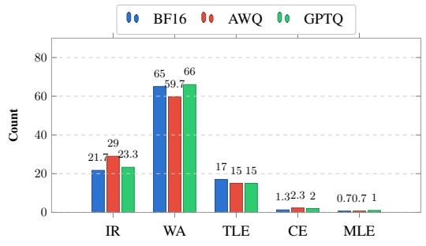
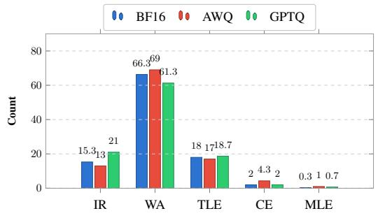
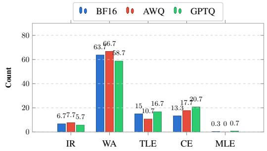
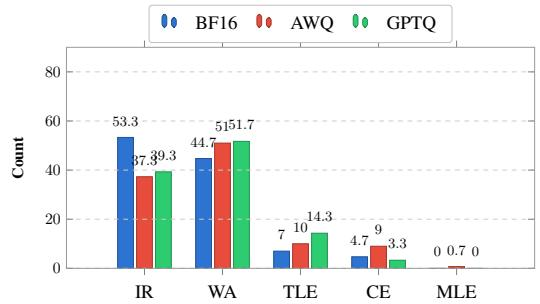
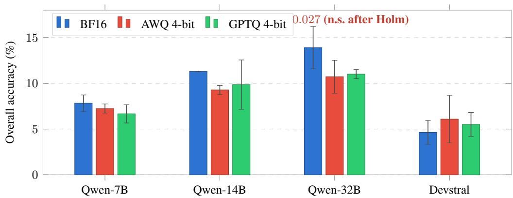

# Beyond Accuracy: How Quantization Affects Coding Agents

Areej Mehboob1 Muhammad Ali Shafique2 Muhammad Usman Qadeer1 Hamza Farooq

1Traversaal AI 2Kansas State University areej@traversaal.ai alishafique@ksu.edu mqadeer@traversaal.ai hamza@traversaal.ai

## Abstract

Agents are increasingly used for coding tasks, but the inference cost of large language models (LLMs) limits where they can run. Quantization reduces model size, but its effects on coding agents that execute and revise programs remain underexplored. We compare BF16 with 4-bit AWQ and GPTQ for Qwen2.5-Coder-Instruct (7B, 14B, and 32B) and Devstral-Small-2507 (24B) on OJBench coding problems across three seeds. We detect no statistically significant accuracy loss for any of the coding agents. However, final accuracy can conceal substantial behavioral changes: AWQ reduces Qwen-7B one-shot solves from 17 to 0 while increasing loop-based solves from 10 to 25. All Qwen-32B successes involve tool use, whereas Devstral rarely makes a valid executor call. Failure profiles also differ: Qwen-32B produces far more compilation errors than the smaller Qwen models, rising slightly under quantization, while Devstral’s failures shift significantly from runtime errors toward wrong answers and timeouts. These findings indicate that quantization robustness in coding agents should be assessed through solution trajectories, tool use, and failure modes, in addition to final accuracy.

## 1 Introduction

Large Language Models (LLMs) [Jaech et al., 2024, Team et al., 2025] are increasingly used in agentic coding systems that go beyond single-pass text generation. These agents can invoke execution tools, inspect program outputs, and revise their solutions over multiple steps [Hong et al., 2025, Guo et al., 2024, Lai et al., 2023, Chen et al., 2024]. This interaction changes how coding capability should be evaluated: a model that produces an incorrect program initially may still reach a correct solution after execution feedback. Recent benchmarks such as OJBench [Wang et al., 2025] provide challenging settings for studying this behavior. OJBench contains competition-level programming problems and places greater emphasis on reasoning and code correctness than typical interview-style benchmarks.

Efficient deployment of these agents remains challenging because repeated LLM inference and tool interaction increase computational and memory costs. Quantization is a widely used approach for reducing these costs [Frantar et al., 2023, Xiao et al., 2023, Liu et al., 2024]. In particular, weight only methods such as AWQ and GPTQ can substantially reduce model storage while retaining highprecision activations. However, reasoning performance can be sensitive to low-bit quantization, especially on difficult tasks where small perturbations can affect multi-step generation [Liu et al., 2025]. Most existing studies evaluate this effect using single-pass model outputs. Coding agents introduce a different setting because quantization can influence not only the generated program, but also tool invocation, iterative refinement, and the final failure mode.

Table 1: Performance of Qwen-2.5-Coder and Devstral-Small-2507 agents (vLLM, OpenAI compatible tool schema) on OJBench, reported as mean $\pm \mathrm { s t d }$ over 3 seeds. Darker shading marks the best overall accuracy per model family, lighter the second best. Overall accuracy is over the Easy and Medium splits (115 problems); the Hard split is excluded because all models scored 0%.
<table><tr><td>Model</td><td>Precision</td><td>Easy (%)</td><td>Medium (%)</td><td>Overall (%)</td></tr><tr><td rowspan="3">Qwen-2.5-Coder-7B</td><td>BF16</td><td> $2 1 . 2 9 { \scriptstyle \pm 1 . 6 }$ </td><td> $1 . 6 9 { \scriptstyle \pm 0 . 7 }$ </td><td> $7 . 8 3 { \scriptstyle \pm 0 . 9 }$ </td></tr><tr><td>AWQ</td><td> $2 0 . 3 7 { \scriptstyle \pm 1 . 6 }$ </td><td> $1 . 2 7 _ { \pm 0 . 0 }$ </td><td> $7 . 2 5 { \scriptstyle \pm 0 . 5 }$ </td></tr><tr><td>GPTQ</td><td> $1 8 . 5 2 _ { \pm 3 . 2 }$ </td><td> $1 . 2 7 _ { \pm 0 . 0 }$ </td><td> $6 . 6 7 \pm 1 . 0$ </td></tr><tr><td rowspan="3"> $\mathrm { Q w e n } { - } 2 . 5 { \mathrm { - } } \mathrm { C o d e r } { - } 1 4 \mathrm { B }$ </td><td>BF16</td><td> $3 0 . 5 6 { \scriptstyle \pm 2 . 8 }$ </td><td> $2 . 5 3 { \scriptstyle \pm 1 . 3 }$ </td><td>■  $1 1 . 3 0 { \scriptstyle \pm 0 . 0 }$  一</td></tr><tr><td>AWQ</td><td> $2 6 . 8 5 { \scriptstyle \pm 1 . 6 }$ </td><td> $1 . 2 7 { \scriptstyle \pm 0 . 0 }$ </td><td> $9 . 2 8 { \scriptstyle \pm 0 . 5 }$ </td></tr><tr><td>GPTQ</td><td> $2 6 . 8 5 { \scriptstyle \pm 8 . 9 }$ </td><td> $2 . 1 1 { \scriptstyle \pm 0 . 7 }$ </td><td> $9 . 8 6 _ { \pm 2 . 7 }$ </td></tr><tr><td rowspan="3">Qwen-2.5-Coder-32B</td><td>BF16</td><td> $3 2 . 4 1 _ { \pm 1 . 6 }$ </td><td> $5 . 4 8 _ { \pm 3 . 2 }$ </td><td> $1 3 . 9 1 _ { \pm 2 . 3 }$ </td></tr><tr><td>AWQ</td><td> $2 5 . 9 3 { \scriptstyle \pm 5 . 8 }$ </td><td> $3 . 8 0 { \scriptstyle \pm 0 . 0 }$ </td><td> $1 0 . 7 2 { \scriptstyle \pm 1 . 8 }$ </td></tr><tr><td>GPTQ</td><td> $3 0 . 5 6 { \scriptstyle \pm 0 . 0 }$ </td><td> $2 . 1 1 { \scriptstyle \pm 0 . 7 }$ </td><td>一  $1 1 . 0 1 { \scriptstyle \pm 0 . 5 }$ </td></tr><tr><td rowspan="3">Devstral-Small-2507</td><td>BF16</td><td> $1 1 . 1 1 { \scriptstyle \pm 2 . 8 }$ </td><td> $1 . 6 9 { \scriptstyle \pm 0 . 7 }$ </td><td> $4 . 6 4 _ { \pm 1 . 3 }$ </td></tr><tr><td>AWQ</td><td> $1 5 . 7 4 { \scriptstyle \pm 8 . 5 }$ </td><td> $1 . 6 9 { \scriptstyle \pm 0 . 7 }$ </td><td> $6 . 0 9 { \scriptstyle \pm 2 . 6 }$ </td></tr><tr><td>GPTQ</td><td> $1 3 . 8 9 { \scriptstyle \pm 2 . 8 }$ </td><td> $1 . 6 9 { \scriptstyle \pm 0 . 7 }$ </td><td> $5 . 5 1 { \scriptstyle \pm 1 . 3 }$ </td></tr></table>

This distinction raises an important question: does similar final accuracy imply that a quantized coding agent behaves similarly to its full-precision counterpart? Our results suggest that it does not. Quantization can preserve final accuracy while changing solve trajectories, tool-use patterns, and terminal failure modes. These effects are hidden when coding agents are evaluated only by their final score. In this work, we present, to the best of our knowledge, the first empirical study of 4- bit weight-only quantization in execution-feedback coding agents. We evaluate BF16, AWQ, and GPTQ versions of Qwen2.5-Coder-Instruct [Hui et al., 2024] at 7B, 14B, and 32B scales, together with Devstral-Small-2507 [Mistral AI, 2025]. All models use vLLM with an OpenAI-compatible tool schema and a Python execution tool and are evaluated over three random seeds on OJBench. We investigate three research questions:

RQ1: How robust is end-to-end coding-agent performance to 4-bit quantization?

RQ2: Does end-to-end accuracy conceal changes in coding-agent solution trajectories?

RQ3: Does quantization change how coding agents fail, not just how often?

## 2 Related Work

Recent work on coding agents extends single-pass code generation by incorporating program execution and iterative revision. Studies on self-debugging show that LLMs can use execution feedback to identify and correct errors in generated programs [Chen et al., 2024]. Existing evaluations cover realworld data-science tasks through DSBC [Kadiyala et al., 2025], automated program repair [Puvvadi et al., 2025], interactive application environments such as AppWorld [Trivedi et al., 2024], multilingual repository-level tasks through SWE-PolyBench [Rashid et al., 2025], and competition-level programming through OJBench [Wang et al., 2025]. AWQ [Lin et al., 2024] and GPTQ [Frantar et al., 2023] are widely used methods for 4-bit weight-only quantization. Prior single-pass studies indicate that quantization generally preserves reasoning performance, although smaller models and more difficult tasks experience greater degradation [Liu et al., 2025]. However, these studies do not examine how quantization affects coding agents that can execute and revise their outputs. We address this gap by asking whether the execution loop absorbs quantization-induced errors, and whether the size–robustness ordering observed in single-pass settings still holds when the agent can run its code.

## 3 Experimental Setup

This section describes the setup used to evaluate BF16 and AWQ/GPTQ 4-bit quantized models on competitive coding tasks within an execution-based agentic workflow.

## 3.1 Dataset: OJBench

We evaluate on OJBench [Wang et al., 2025], a benchmark of 232 competition-level problems from China’s National Olympiad in Informatics (NOI) and the International Collegiate Programming Contest (ICPC). OJBench supports solutions in both Python and C++; we use Python only, so all solutions are written, executed, and judged in Python. We use all 115 Easy and Medium problems because all model–precision configurations scored 0% on Hard. Evaluation across three seeds yields 345 problem–seed observations per configuration.

## 3.2 Evaluation Setup

Models and Quantization We evaluate Qwen2.5-Coder-Instruct [Hui et al., 2024] at 7B, 14B, and 32B, spanning scales at which size may interact with quantization, plus the agent-oriented 24B Devstral-Small-2507 [Mistral AI, 2025] as an out-of-family comparison. Each model is run at BF16 and as W4A16 variants produced with AWQ [Lin et al., 2024] and GPTQ [Frantar et al., 2023] via llmcompressor [AI and vLLM Project, 2024] (256 calibration samples, max sequence length 1,024).

Agent Framework. Each model is served with vLLM in a multi-turn execution-feedback loop using an OpenAI-compatible tool schema, with tool calls parsed from the generated text. The agent has one tool, python\_executor(code, stdin). It writes code, tests it on the problem’s examples, reads the feedback, and revises for up to five tool calls per problem. All runs use nucleus sampling (temperature 0.6, top-p 0.9), 32,768-token context, and three seeds. Full prompt and loop in Appendices A.3 and A.4.

Evaluation Metrics. Accuracy is the proportion of final programs passing all official OJBench test cases. Each failed attempt is assigned one terminal category: Invalid Return (IR; runtime exception), Wrong Answer (WA), Time Limit Exceeded (TLE), Compilation Error (CE), or Memory Limit Exceeded (MLE). We also record tool calls per problem, distinguishing one-shot solves (no tool calls) from loop-based solves (at least one execution round). Because every precision is evaluated on the same problems and seeds, outcomes are paired; we apply an exact two-sided McNemar test to the 345 paired observations, with b and c the discordant pairs solved by only the first or only the second precision, and $p < 0 . 0 5$ as the threshold. For the behavioral measures, we use Fisher’s exact test for solve paths and tool-use rates, and a chi-square test for failure distributions. Because each analysis involves eight BF16-versus-quantized comparisons, we also report Holm-adjusted pvalues. Because the three seeds of a problem are correlated, we additionally treat each problem as one unit: we report 95% confidence intervals from a cluster bootstrap over the 115 problems (20,000 resamples, keeping all three seeds of a problem together) and p-values from a permutation test that swaps precision labels within each problem.

## 4 Empirical Findings

We investigate how weight-only quantization affects Python coding performance on OJBench for execution-feedback agents across BF16, AWQ, and GPTQ 4-bit precisions. Table 1 reports accuracy, Figure 1 the failure-mode distribution, and Appendix A.2 the paired tests and tool-use statistics.

## RQ1: How robust is end-to-end coding-agent performance to 4-bit quantization?

We evaluate whether replacing BF16 weights with W4A16 AWQ or GPTQ changes final coding accuracy in execution-feedback agents. We compare accuracy across Qwen-2.5-Coder scales and Devstral-Small-2507, together with paired statistical tests in Table 3. This establishes whether quantization-induced perturbations remain visible after the complete agentic execution process and whether the effect is consistent across quantizers and model configurations. Because we run eight BF16-versus-quantized comparisons, we apply a Holm correction, and because the three seeds of a problem are correlated, we also repeat the analysis with each problem as one unit. Under both analyses, no comparison shows a statistically significant accuracy loss. Qwen-32B shows the largest drop, about 3 points under both quantizers, but it does not reach significance after correction $( p _ { \mathrm { H o l m } } = 0 . 2 1$ for AWQ) or at the problem level $( p = 0 . 0 5 1 )$ .

Finding: Quantization has limited effect on final accuracy for all agents. Qwen-2.5-Coder-32B shows the largest drop, but it does not reach statistical significance.

RQ2: Does end-to-end accuracy conceal changes in coding-agent solution trajectories?

  
(a) Qwen-2.5-Coder-7B

  
(b) Qwen-2.5-Coder-14B

  
(c) Qwen-2.5-Coder-32B

  
(d) Devstral-Small-2507  
Figure 1: Distribution of failure categories across BF16, AWQ, and GPTQ for each agent. Categories: IR (Invalid Return), WA (Wrong Answer), TLE (Time Limit Exceeded), CE (Compilation Error), MLE (Memory Limit Exceeded). Counts are per-seed averages over the Easy+Medium splits (115 problems, 3 seeds).

We analyze successful trajectories using one-shot solves, execution-loop solves, tool-use rate, and mean executor calls (Tables 4 and 5). Across precisions, Qwen-7B shows the clearest behavioral shift: one-shot solves fall from 17 under BF16 to 0 under AWQ and 3 under GPTQ (AWQ: 17 → 0; GPTQ: 17 → 3), while loop-based solves rise from 10 under BF16 to 25 under AWQ and 20 under GPTQ (AWQ: 10 → 25; GPTQ: 10 → 20). This shift remains significant when each problem is treated as one unit, and it also holds on problems solved by both precisions. Devstral moves in the opposite direction, with valid tool use falling from 8.7% under BF16 to 1.2% under GPTQ (GPTQ: 8.7% → 1.2%), where all 19 successful solves are one-shot. Malformed tool calls are rare for the Qwen models, but most of Devstral’s tool calls do not follow the tool schema, which keeps its recorded tool use low; quantization still reduces how often it tries the tool (AWQ: 42.0% → 27.0%; GPTQ: 42.0% → 21.4%). The Qwen models also differ from each other at BF16: Qwen-32B uses tools on 71.3% of problems and produces no one-shot solves, whereas Qwen-14B uses tools on 31.6% of problems with a near-balanced split of 21 one-shot and 18 loop-based solves. These results show both model-specific solve strategies and different levels of behavioral stability under quantization.

Finding: Models exhibit distinct tool-use regimes, but quantization does not preserve them uniformly. Qwen-32B remains loop-dependent, Qwen-14B stays relatively balanced, Qwen-7B shifts toward loop-based solving, and Devstral becomes almost entirely one-shot under GPTQ.

## RQ3: Does quantization change how coding agents fail, not just how often?

We compare terminal failure categories (IR /WA /TLE /CE /MLE) across precision settings, and test whether each failure distribution differs from BF16 using a chi-square test with Holm correction (Table 2). For Qwen-7B, AWQ shifts failures slightly away from Wrong Answer and toward Invalid Return (WA: 65.0 → 59.7; IR: 21.7 → 29.0 per seed). This suggests that quantization can change the type of terminal failure even when final accuracy changes little. The pattern differs for larger models. Qwen-32B exhibits substantially more Compilation Errors than the smaller Qwen models, with CE rising slightly under quantization. Devstral follows another pattern, with fewer Invalid

Returns but more Wrong Answers and Time Limit Exceeded cases after quantization. This is the clearest change, and it is statistically significant under both quantizers.

Finding: Quantization can reshape failure profiles differently across models rather than producing one universal failure pattern.

## 5 Conclusion

We evaluated 4-bit weight-only quantization in execution-feedback coding agents on OJBench, comparing BF16, AWQ, and GPTQ across Qwen2.5-Coder (7B, 14B, 32B) and Devstral-Small-2507. Quantization reduces checkpoint storage by about 3.4× and causes no statistically significant accuracy loss for any agent after correcting for multiple comparisons, although Qwen-32B shows a consistent nominal drop. More importantly, similar final accuracy can hide large behavioral shifts: Qwen-7B moves strongly from one-shot to loop-based solving after quantization, while Qwen-32B remains fully loop-dependent. Quantization also changes terminal failure profiles differently across models. These results show that quantized coding agents should be evaluated through accuracy, solve trajectories, tool use, and failure modes rather than final accuracy alone.

Limitations and future work. Our study focuses on one competition-level benchmark, one execution-feedback scaffold, and W4A16 quantization, with Python as the solution language. Because OJBench is challenging, absolute solve counts are modest, so we emphasize effects that hold at the problem level. Extending this analysis to other benchmarks, languages, and bit-widths, and to end-to-end efficiency measures such as latency and memory, is a natural next step. Within these limits, 4-bit quantization appears practical for execution-feedback coding agents, but its reliability should be evaluated within the complete agentic workflow.

## Acknowledgments

The authors used Claude Opus 5.5 for language and formatting assistance. All content was reviewed by the authors, who remain responsible for the final manuscript.

## References

Red Hat AI and vLLM Project. LLM Compressor, 8 2024. URL https://github.com/ vllm-project/llm-compressor.

Xinyun Chen, Maxwell Lin, Nathanael Schärli, and Denny Zhou. Teaching large language models to self-debug. In International Conference on Learning Representations (ICLR), 2024.

Elias Frantar, Saleh Ashkboos, Torsten Hoefler, and Dan Alistarh. Gptq: Accurate post-training quantization for generative pre-trained transformers, 2023. URL https://arxiv.org/abs/ 2210.17323.

Siyuan Guo, Cheng Deng, Ying Wen, Hechang Chen, Yi Chang, and Jun Wang. Ds-agent: Automated data science by empowering large language models with case-based reasoning. arXiv preprint arXiv:2402.17453, 2024.

Sirui Hong, Yizhang Lin, Bang Liu, Bangbang Liu, Binhao Wu, Ceyao Zhang, Danyang Li, Jiaqi Chen, Jiayi Zhang, Jinlin Wang, et al. Data interpreter: An llm agent for data science. In Findings ofthe Associationfor Computational Linguistics: ACL 2025, pages 19796–19821, 2025.

Binyuan Hui, Jian Yang, Zeyu Cui, Jiaxi Yang, Dayiheng Liu, Lei Zhang, Tianyu Liu, Jiajun Zhang, Bowen Yu, Keming Lu, Kai Dang, Yang Fan, Yichang Zhang, An Yang, Rui Men, Fei Huang, Bo Zheng, Yibo Miao, Shanghaoran Quan, Yunlong Feng, Xingzhang Ren, Xuancheng Ren, Jingren Zhou, and Junyang Lin. Qwen2.5-coder technical report, 2024. URL https://arxiv. org/abs/2409.12186.

Aaron Jaech, Adam Kalai, Adam Lerer, Adam Richardson, Ahmed El-Kishky, Aiden Low, Alec Helyar, Aleksander Madry, Alex Beutel, Alex Carney, et al. Openai o1 system card. arXiv preprint arXiv:2412.16720, 2024.

Ram Mohan Rao Kadiyala, Siddhant Gupta, Jebish Purbey, Giulio Martini, Ali Shafique, Suman Debnath, and Hamza Farooq. Dsbc : Data science task benchmarking with context engineering, 2025. URL https://arxiv.org/abs/2507.23336.

Yuhang Lai, Chengxi Li, Yiming Wang, Tianyi Zhang, Ruiqi Zhong, Luke Zettlemoyer, Wen-tau Yih, Daniel Fried, Sida Wang, and Tao Yu. Ds-1000: A natural and reliable benchmark for data science code generation. In International Conference on Machine Learning, pages 18319–18345. PMLR, 2023.

Ji Lin, Jiaming Tang, Haotian Tang, Shang Yang, Wei-Ming Chen, Wei-Chen Wang, Guangxuan Xiao, Xingyu Dang, Chuang Gan, and Song Han. Awq: Activation-aware weight quantization for llm compression and acceleration, 2024. URL https://arxiv.org/abs/2306.00978.

Ruikang Liu, Haoli Bai, Haokun Lin, Yuening Li, Han Gao, Zhengzhuo Xu, Lu Hou, Jun Yao, and Chun Yuan. Intactkv: Improving large language model quantization by keeping pivot tokens intact. arXiv preprint arXiv:2403.01241, 2024.

Ruikang Liu, Yuxuan Sun, Manyi Zhang, Haoli Bai, Xianzhi Yu, Tiezheng Yu, Chun Yuan, and Lu Hou. Quantization hurts reasoning? an empirical study on quantized reasoning models, 2025. URL https://arxiv.org/abs/2504.04823.

Mistral AI. Upgrading agentic coding capabilities with the new devstral models. https:// mistral.ai/news/devstral-2507/, 2025. Devstral Small 1.1 (devstral-small-2507).

Meghana Puvvadi, Sai Kumar Arava, Adarsh Santoria, Sesha Sai Prasanna Chennupati, and Harsha Vardhan Puvvadi. Coding agents: A comprehensive survey of automated bug fixing systems and benchmarks. In 2025 IEEE 14th International Conference on Communication Systems and Network Technologies (CSNT), pages 680–686, 2025. doi: 10.1109/CSNT64827.2025.10968728.

Muhammad Shihab Rashid, Christian Bock, Yuan Zhuang, Alexander Buchholz, Tim Esler, Simon Valentin, Luca Franceschi, Martin Wistuba, Prabhu Teja Sivaprasad, Woo Jung Kim, Anoop Deoras, Giovanni Zappella, and Laurent Callot. Swe-polybench: A multi-language benchmark for repository level evaluation of coding agents, 2025. URL https://arxiv.org/abs/2504. 08703.

Kimi Team, Angang Du, Bofei Gao, Bowei Xing, Changjiu Jiang, Cheng Chen, Cheng Li, Chenjun Xiao, Chenzhuang Du, Chonghua Liao, et al. Kimi k1. 5: Scaling reinforcement learning with llms. arXiv preprint arXiv:2501.12599, 2025.

Harsh Trivedi, Tushar Khot, Mareike Hartmann, Ruskin Manku, Vinty Dong, Edward Li, Shashank Gupta, Ashish Sabharwal, and Niranjan Balasubramanian. Appworld: A controllable world of apps and people for benchmarking interactive coding agents, 2024. URL https://arxiv.org/ abs/2407.18901.

Zhexu Wang, Yiping Liu, Yejie Wang, Wenyang He, Bofei Gao, Muxi Diao, Yanxu Chen, Kelin Fu, Flood Sung, Zhilin Yang, Tianyu Liu, and Weiran Xu. Ojbench: A competition level code benchmark for large language models, 2025. URL https://arxiv.org/abs/2506.16395.

Guangxuan Xiao, Ji Lin, Mickael Seznec, Hao Wu, Julien Demouth, and Song Han. Smoothquant: Accurate and efficient post-training quantization for large language models. In International conference on machine learning, pages 38087–38099. PMLR, 2023.

## A Appendix

## A.1 Error Analysis

Table 2: Distribution of Failure Types in Agent Submissions. IR: Invalid Return, WA: Wrong Answer, TLE: Time Limit Exceeded, CE: Compilation Error, MLE: Memory Limit Exceeded. Counts are per-seed averages over the Easy+Medium splits (115 problems, 3 seeds). p is a chi-square test of whether the failure distribution differs from BF16, computed on totals over the three seeds; MLE is excluded from the test because its counts are very small. $p _ { \mathrm { H o l m } }$ applies a Holm correction across the eight comparisons.
<table><tr><td>Model</td><td>Precision</td><td>IR</td><td>WA</td><td>TLE</td><td>CE</td><td>MLE</td><td> $p$ </td><td>PHolm</td></tr><tr><td rowspan="3">Qwen-2.5-Coder-7B</td><td>BF16</td><td>21.7</td><td>65.0</td><td>17.0</td><td>1.3</td><td>0.7</td><td></td><td></td></tr><tr><td>AWQ</td><td>29.0</td><td>59.7</td><td>15.0</td><td>2.3</td><td>0.7</td><td>0.17</td><td>0.84</td></tr><tr><td>GPTQ</td><td>23.3</td><td>66.0</td><td>15.0</td><td>2.0</td><td>1.0</td><td>0.81</td><td>1.00</td></tr><tr><td rowspan="3">Qwen-2.5-Coder-14B</td><td>BF16</td><td>15.3</td><td>66.3</td><td>18.0</td><td>2.0</td><td>0.3</td><td>一</td><td>1</td></tr><tr><td>AWQ</td><td>13.0</td><td>69.0</td><td>17.0</td><td>4.3</td><td>1.0</td><td>0.34</td><td>1.00</td></tr><tr><td>GPTQ</td><td>21.0</td><td>61.3</td><td>18.7</td><td>2.0</td><td>0.7</td><td>0.35</td><td>1.00</td></tr><tr><td rowspan="3">Qwen-2.5-Coder-32B</td><td>BF16</td><td>6.7</td><td>63.7</td><td>15.0</td><td>13.3</td><td>0.3</td><td>一</td><td>一</td></tr><tr><td>AWQ</td><td>7.7</td><td>66.7</td><td>10.7</td><td>17.7</td><td>0.0</td><td>0.24</td><td>0.97</td></tr><tr><td>GPTQ</td><td>5.7</td><td>58.7</td><td>16.7</td><td>20.7</td><td>0.7</td><td>0.13</td><td>0.75</td></tr><tr><td rowspan="3">Devstral-Small-2507</td><td>BF16</td><td>53.3</td><td>44.7</td><td>7.0</td><td>4.7</td><td>0.0</td><td></td><td></td></tr><tr><td>AWQ</td><td>37.3</td><td>51.0</td><td>10.0</td><td>9.0</td><td>0.7</td><td>0.002</td><td>0.011</td></tr><tr><td>GPTQ</td><td>39.3</td><td>51.7</td><td>14.3</td><td>3.3</td><td>0.0</td><td>0.001</td><td>0.009</td></tr></table>

## A.2 Statistical Tests and Solve Path

Table 3: Exact two-sided McNemar tests, BF16 versus quantized, over paired per-problem outcomes (same problem, same seed; 345 pairs per comparison). b = problems solved only by BF16; c = problems solved only by the quantized model. $p _ { \mathrm { H o l m } }$ applies a Holm correction across the eight comparisons. The 32B/AWQ comparison is significant before correction $( p = 0 . 0 2 7$ , bold) but not after it; no comparison is significant after correction. The last three columns treat each problem as one unit: $\Delta$ is BF16 minus quantized accuracy (points), the 95% CI comes from a cluster bootstrap over the 115 problems, and $p _ { \mathrm { p r o b } }$ from a within-problem permutation test. The problem-level analysis gives the same conclusion: no comparison is significant at $\alpha = 0 . 0 5$ , although the 32B/AWQ result is borderline (its CI just excludes zero, $p = 0 . 0 5 1 )$ .

<table><tr><td colspan="2"></td><td colspan="4">Paired (345 pairs)</td><td colspan="3">Problem level (115 problems)</td></tr><tr><td>Model</td><td>Scheme</td><td>b</td><td>C</td><td>p</td><td> $p _ { \mathrm { H o l m } }$ </td><td> $\Delta$ </td><td>95% CI</td><td> $p _ { \mathrm { p r o b } }$ </td></tr><tr><td rowspan="2">Qwen-2.5-Coder-7B</td><td>AWQ</td><td>8</td><td>6</td><td>0.79</td><td>1.00</td><td>0.58</td><td>[−1.74,3.19]</td><td>0.82</td></tr><tr><td>GPTQ</td><td>8</td><td>4</td><td>0.39</td><td>1.00</td><td>1.16</td><td>[−0.87, 3.19]</td><td>0.42</td></tr><tr><td rowspan="2">Qwen-2.5-Coder-14B</td><td>AWQ</td><td>9</td><td>2</td><td>0.065</td><td>0.46</td><td>2.03</td><td>[0.00, 4.06]</td><td>0.094</td></tr><tr><td>GPTQ</td><td>9</td><td>4</td><td>0.27</td><td>1.00</td><td>1.45</td><td>[−0.58,3.48]</td><td>0.27</td></tr><tr><td rowspan="2">Qwen-2.5-Coder-32B</td><td>AWQ</td><td>16</td><td>5</td><td>0.027</td><td>0.21</td><td>3.19</td><td>[0.58, 6.09]</td><td>0.051</td></tr><tr><td>GPTQ</td><td>18</td><td>8</td><td>0.076</td><td>0.46</td><td>2.90</td><td>[−0.29,6.38]</td><td>0.13</td></tr><tr><td rowspan="2">Devstral-Small-2507</td><td>AWQ</td><td>7</td><td>12</td><td>0.36</td><td>1.00</td><td>-1.45</td><td>[-3.48,0.58]</td><td>0.27</td></tr><tr><td>GPTQ</td><td>8</td><td>11</td><td>0.65</td><td>1.00</td><td>-0.87</td><td>[−3.48, 1.45]</td><td>0.65</td></tr></table>

Table 4: Tool use and solve path per agent, totals over 3 seeds (345 attempts). “Used tool” is the share of problems with at least one valid executor call. “Tried tool” also counts attempts in which the model issued a tool call that did not follow the provided tool schema (e.g., broken JSON or the tool written as a Python function inside its code). “Malformed” is the share of all tool calls that did not follow the schema (mean over seeds). † marks tried-tool rates that differ significantly from BF16 after Holm correction. “One-shot” solves used zero tool calls; “loop” solves followed at least one execute-and-check round.
<table><tr><td>Model</td><td>Precision</td><td>Used tool (%)</td><td>Tried tool (%)</td><td>Malformed (%)</td><td>Mean calls</td><td>One-shot solves</td><td>Loop solves</td></tr><tr><td rowspan="3">Qwen-2.5-Coder-7B</td><td>BF16</td><td>66.7</td><td>70.1</td><td>3.8</td><td>2.26</td><td>17</td><td>10</td></tr><tr><td>AWQ</td><td>73.9</td><td>82.9†</td><td>5.9</td><td>2.29</td><td>0</td><td>25</td></tr><tr><td>GPTQ</td><td>69.0</td><td>71.9</td><td>3.4</td><td>1.90</td><td>3</td><td>20</td></tr><tr><td rowspan="3">Qwen-2.5-Coder-14B</td><td>BF16</td><td>31.6</td><td>31.6</td><td>0.0</td><td>1.21</td><td>21</td><td>18</td></tr><tr><td>AWQ</td><td>26.7</td><td>26.7</td><td>0.0</td><td>1.01</td><td>17</td><td>15</td></tr><tr><td>GPTQ</td><td>34.8</td><td>35.9</td><td>0.8</td><td>1.55</td><td>17</td><td>17</td></tr><tr><td rowspan="3">Qwen-2.5-Coder-32B</td><td>BF16</td><td>71.3</td><td>71.6</td><td>0.1</td><td>3.07</td><td>0</td><td>48</td></tr><tr><td>AWQ</td><td>63.8</td><td>64.3</td><td>0.4</td><td>2.69</td><td>0</td><td>37</td></tr><tr><td>GPTQ</td><td>67.0</td><td>69.6</td><td>0.9</td><td>3.15</td><td>0</td><td>38</td></tr><tr><td rowspan="3">Devstral-Small-2507</td><td>BF16</td><td>8.7</td><td>42.0</td><td>76.9</td><td>0.11</td><td>13</td><td>3</td></tr><tr><td>AWQ</td><td>8.4</td><td>27.0†</td><td>69.3</td><td>0.09</td><td>17</td><td>4</td></tr><tr><td>GPTQ</td><td>1.2</td><td>21.4†</td><td>96.5</td><td>0.01</td><td>19</td><td>0</td></tr></table>

Table 5: Fisher’s exact tests on the behavioral measures in Table 4, BF16 versus quantized. Solve path tests whether the one-shot/loop split among solved problems differs from BF16; tool use tests whether the share of problems with at least one executor call differs from BF16. $p _ { \mathrm { H o l m } }$ applies a Holm correction across the eight comparisons within each measure. Significant results after correction are in bold. The tests treat runs as independent, so p-values are approximate. At the problem level, the Qwen-7B solve-path shift is significant under AWQ $( p = 0 . 0 0 5 )$ ) and GPTQ $( p = 0 . 0 2 2 )$ On problems solved by both precisions, every BF16 one-shot solve becomes a loop solve under AWQ (8 of 8 problems, $p = 0 . 0 0 8 )$ , and 7 of 8 under GPTQ $( p = 0 . 0 7 0 )$ , which does not reach significance on its own.
<table><tr><td colspan="2"></td><td colspan="2">Solve path</td><td colspan="2">Tool use</td></tr><tr><td rowspan="2">Model</td><td>Scheme</td><td>p</td><td>PHolm</td><td>p</td><td>pHolm</td></tr><tr><td>AWQ</td><td>&lt;0.001</td><td>&lt;0.001</td><td>0.045</td><td>0.29</td></tr><tr><td rowspan="2">Qwen-2.5-Coder-7B Qwen-2.5-Coder-14B</td><td>GPTQ</td><td>&lt;0.001</td><td>0.003</td><td>0.57</td><td>1.00</td></tr><tr><td>AWQ</td><td>1.00</td><td>1.00</td><td>0.18</td><td>0.90</td></tr><tr><td rowspan="2">Qwen-2.5-Coder-32B</td><td>GPTQ</td><td>0.82</td><td>1.00</td><td>0.42</td><td>1.00</td></tr><tr><td>AWQ</td><td>1.00</td><td>1.00</td><td>0.042</td><td>0.29</td></tr><tr><td rowspan="2"></td><td>GPTQ</td><td>1.00</td><td>1.00</td><td>0.25</td><td>0.99</td></tr><tr><td>AWQ</td><td>1.00</td><td>1.00</td><td>1.00</td><td>1.00</td></tr><tr><td rowspan="2">Devstral-Small-2507</td><td>GPTQ</td><td>0.086</td><td>0.51</td><td>&lt;0.001</td><td>&lt;0.001</td></tr><tr><td></td><td></td><td></td><td></td><td></td></tr></table>

  
Figure 2: Overall agent accuracy on OJBench (Easy+Medium, 115 problems), mean over 3 seeds with one standard deviation. The 32B agent under AWQ is the only comparison that differs from BF16 before correction (paired McNemar, ∗); after Holm correction across the eight comparisons, no gap is statistically significant.

## A.3 Coding Agent Execution Prompt

The following system prompt was used to instruct the coding agent during problem solving. It guides the agent through a structured write–test–fix workflow with code execution for verification.

You are a competitive programming assistant. Solve problems   
step-by-step:   
1. Read the problem carefully   
2. Write Python code to solve it   
3. Create test input from the problem’s examples   
4. Call python\_executor tool to test your code with the test   
input   
5. Check if the output matches expected output   
6. If wrong, fix the code and call python\_executor again   
7. Once correct, return your final solution in a Python code   
block   
Input reading patterns:   
- int(input()) for single number   
- map(int, input().split()) for multiple numbers on one   
line   
Always test your code before giving the final answer!

The python\_executor(code, stdin) tool is not described in the prompt text itself. It is supplied to the model through the chat template’s OpenAI-compatible tool schema, and tool calls are parsed from the generated text. The tool description reads: “Execute Python code with optional stdin input. Use this to test your solution before giving the final answer.” The 30 s execution timeout and the five-call budget are enforced by the harness and are not disclosed to the model in advance. When the budget is reached, the model receives one additional user message: “You have reached the maximum number oftool calls. Please provide yourfinal solution in a Python code block now.”

## A.4 Algorithm

Each turn consists of a single model generation. If the generation contains no tool call, it is taken as the final answer. Otherwise every tool call in the generation is executed and its output, truncated to 2,000 characters, is appended to the conversation. The tool-call budget K is checked once per turn rather than once per call, so a turn containing several calls can carry the total past K; this occurred in roughly 10% of problem attempts. When the budget is reached, the model is prompted once more to emit its final solution. If the accumulated conversation exceeds the 32,768-token context limit, the oldest assistant and tool messages are dropped before generation.

Algorithm 1 Execution-Guided Coding Agent with Tool Feedback   
Require: Prompt dataset D, model M, python executor E, tool-call budget K = 5   
Ensure: Final solution and tool-call count for each problem   
1: for each prompt x ∈ D do   
2: messages ← [system prompt, x]   
3: tool\_calls ← 0   
4: final\_response ← ∅   
5: for turn = 1, . . . , K + 1 do   
6: Trim oldest assistant and tool messages if context budget is exceeded   
7: Generate response r from model M on messages   
8: Parse tool calls T from the text of r   
9: if T is empty then   
10: final\_response ← r   
11: Break loop   
12: end if   
13: for each call t ∈ T do   
14: tool\_calls ← tool\_calls + 1   
15: Execute t using executor E and truncate output to 2,000 characters   
16: Append r and execution result to messages   
17: end for   
18: if tool\_calls ≥ K then   
19: Append user message requesting the final solution   
20: Generate final\_response from model M on messages   
21: Break loop   
22: end if   
23: end for   
24: if final\_response is empty then   
25: final\_response ← last r, or error message if no generation succeeded   
26: end if   
27: Save result including metadata and tool\_calls   
28: end for