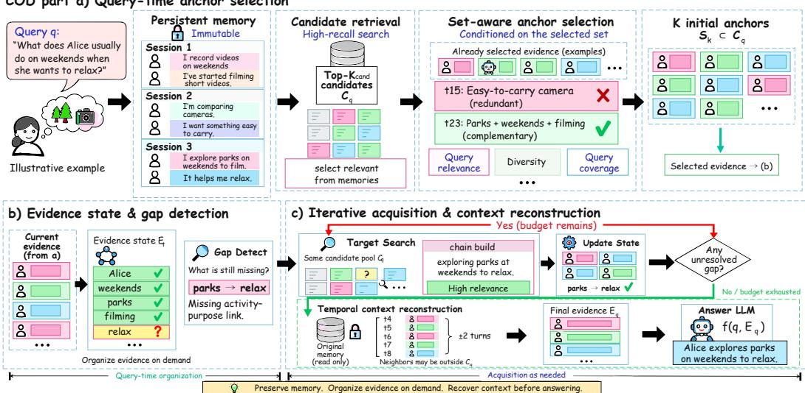
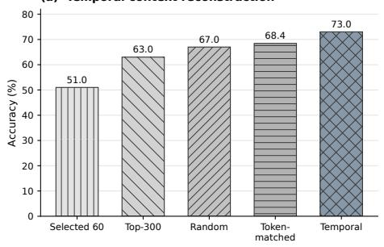
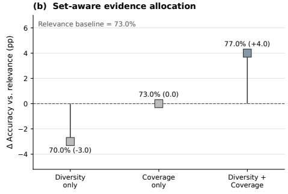
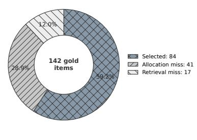
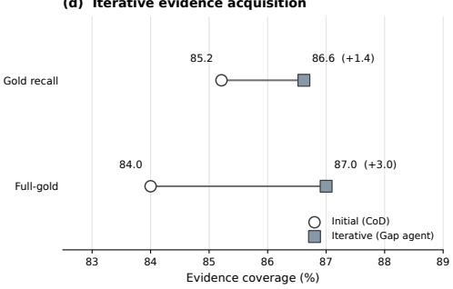

# CHAIN ON DEMAND:DEFERRED EVIDENCE ORGANIZATIONFOR LONG-TERM CONVERSATIONAL MEMORY

Di Lu1 Zechen Li1 Hao Xue1,2,3

1University of New South Wales, Sydney 2Hong Kong University of Science and Technology (Guangzhou) 3Hong Kong University of Science and Technology

di.lu1@student.unsw.edu.au zechen.li@unsw.edu.au haoxue@hkust-gz.edu.cn

## ABSTRACT

Long-term conversational memory faces a timing mismatch: write-time summaries and graphs organize history before a future query is known, while independent retrieval can allocate a limited evidence budget to redundant or fragmented turns. We introduce Chain on Demand (COD), a query-time evidence organization framework over an unchanged turn-level memory. Given a broad candidate pool, COD constructs a temporary evidence chain by allocating a fixed anchor budget according to query relevance, lexical diversity relative to selected anchors, and newly covered query terms, followed by deterministic restoration of each selected anchor’s same-session neighborhood. The resulting chain is used only for the current query, while the underlying conversational memory remains unchanged. In a paired comparison over all 1,986 LoCoMo questions, changing only the allocation rule improves accuracy from 74.5% to 76.3% (+1.86 percentage points; conversation-cluster 95% CI [0.59, 3.15]). COD also achieves 82.2% accuracy on the 1,540 non-adversarial questions. On LongMemEval-S, one fixed configuration that indexes both user and assistant turns obtains 86.6% across all 500 questions. These results show that long-term memory can preserve the original conversation while deferring evidence organization until the information need is known. Our code is available at https://github.com/Renkiroo/chainondemand

## 1 INTRODUCTION

Conversational agents need to retain information across interactions that span days, weeks, or months. A later interaction may depend on a fact mentioned much earlier, a preference established in another session, or several pieces of information spread across the conversation. As history grows, the information needed for a later question becomes harder to recover from the full interaction record. Since the complete history rarely fits within the effective context available to the answer model, long-term memory systems must determine which parts of the history to present for the current query.

Long-term memory involves two separable decisions: what representation persists across interactions, and what evidence is presented for a particular query. Many systems construct summaries, segments, links, graphs, or hierarchical memory units during or shortly after interaction (Zhong et al., 2023; Pan et al., 2025; Xu et al., 2025; Rasmussen et al., 2025; Fang et al., 2026; Xu et al., 2026a;b). These representations can make long histories easier to search and manage. However, they commit to an organization before the later query reveals which details matter. Retaining the original turns avoids rewriting the conversational record, but does not determine how a limited query-time evidence budget should be allocated. Persistent storage and query-time evidence construction therefore serve different objectives.

Table 1: Query-time evidence construction in representative systems. “No generated semantic memory” excludes query-independent summaries, cues, and events; sparse or dense indexes do not count. “Fixed query procedure” excludes multi-round agent search. “Set-aware allocation” evaluates each candidate against the evolving selected set. “Source-context restoration” adds original neighboring turns after selection. The columns describe mechanisms rather than an ordinal ranking. † denotes document-level RAG.
<table><tr><td>Design</td><td>No generated semantic memory</td><td>Fixed query procedure</td><td>Set-aware allocation</td><td>Source-context restoration</td></tr><tr><td>LoCoMo dialog RAG (Maharana et al., 2024)</td><td></td><td></td><td>x</td><td>x</td></tr><tr><td>SeCom (Pan et al., 2025)</td><td>x</td><td></td><td>x</td><td>x</td></tr><tr><td>SetR† (Lee et al., 2025)</td><td></td><td></td><td>√</td><td>x</td></tr><tr><td>CueMem (Wang et al., 2026)</td><td>x</td><td></td><td>x</td><td>√</td></tr><tr><td>ReFind (Li et al., 2026a)</td><td></td><td>x</td><td>x</td><td>V</td></tr><tr><td>Chronos (Sen et al., 2026)</td><td>x</td><td>x</td><td>x</td><td></td></tr><tr><td>CoD (ours)</td><td></td><td></td><td></td><td></td></tr></table>

Independent query-time retrieval addresses this timing problem only partly. Standard top-K retrieval scores candidates independently (Gao et al., 2024). Under a fixed budget, several similar turns may occupy the available slots while a less similar turn supplies a missing relation, temporal detail, or intermediate step. The retrieved turns can therefore be individually relevant but collectively insufficient. Query-conditioned compression and set-wise retrieval account for query requirements more explicitly (Xu et al., 2024; Lee et al., 2025), but conversational evidence adds another dependency: a selected turn may require nearby dialogue and temporal order to be interpreted. Simply retrieving more text does not necessarily resolve this issue, as models can fail to use relevant information embedded in long inputs (Liu et al., 2024). Recent conversational memory systems recover source context through temporal–semantic expansion, archive-level context recovery, or reranking and tool use (Wang et al., 2026; Li et al., 2026a; Sen et al., 2026). These approaches establish the value of source-context recovery, but leave open a central question: given a fixed candidate pool and anchor budget, how should conversation locations be selected jointly before their local context is reconstructed?

We introduce Chain on Demand (COD), a query-time evidence organization framework that constructs a temporary evidence chain over an unchanged turn record. Given a query, COD first retrieves a broad candidate pool, then allocates a fixed anchor budget using a set-aware relevance–diversity– coverage rule, and finally restores the original same-session neighborhood around the selected locations. The selected anchors therefore specify where evidence should be organized rather than constituting the final evidence context themselves. The resulting chain is constructed only for the current information need and discarded after answering, while the underlying conversational record remains unchanged. This separates persistent memory from query-specific evidence construction while making the allocation decision explicit and directly testable. An adaptive acquisition variant further allows unresolved evidence gaps to trigger additional query-time selection without modifying the persistent memory.

Table 1 positions COD relative to representative query-time evidence construction designs. The comparison highlights three properties that jointly define our framework: preserving the original conversational record, using a fixed query procedure with explicit set-aware allocation, and restoring source context after selection.

Our central evidence is a paired LoCoMo comparison that changes only the allocation rule. Under the same memory, candidate pool, anchor budget, temporal reconstruction, answer model, and judge, COD raises accuracy from 74.5% to 76.3%, a 1.86-point gain with a conversation-cluster 95% confidence interval of [0.59, 3.15]. Development diagnostics further isolate the contributions of evidence volume, temporal reconstruction, and set-aware allocation. On LongMemEval-S, a fixed configuration that indexes both user and assistant turns obtains 433/500 (86.6%) across all questions, supporting applicability on a second long-term memory benchmark.

Our contributions are threefold:

• We formulate long-term conversational memory around deferred evidence organization: the persistent conversational record is preserved, while query-specific evidence is constructed only after the information need is known.

• We introduce COD, a query-time evidence organization framework that constructs a temporary evidence chain through broad candidate retrieval, set-aware fixed-budget anchor allocation, and same-session context reconstruction. An adaptive acquisition variant further allows unresolved evidence gaps to trigger additional selection.

• We isolate the effect of set-aware allocation in a paired comparison over all 1,986 LoCoMo questions: changing only the allocation rule improves accuracy from 74.5% to 76.3% (+1.86 points; conversation-cluster 95% CI [0.59, 3.15]). Development analyses characterize reconstruction and allocation, and LongMemEval-S evaluates the complete pipeline on a second benchmark.

## 2 RELATED WORK

Persistent Memory Construction. Long-term conversational memory systems differ in what they preserve across interactions. MemoryBank summarizes events and user traits (Zhong et al., 2023); SeCom builds topical segments and compressed retrieval units (Pan et al., 2025); and A-MEM augments stored interactions with attributes, links, and evolving notes (Xu et al., 2025). Other systems use temporal graphs, structured summaries, or multiple levels of granularity (Rasmussen et al., 2025; Xu et al., 2026a; Fang et al., 2026; Kang et al., 2025; Xu et al., 2026b). These designs primarily determine what information persists and how it is indexed. Even when they route or filter memory according to a query, the underlying textual units or relations are constructed before that query is known. COD instead keeps the original turn record unchanged and defers the allocation of queryspecific evidence until the information need is available.

Query-Time Evidence Allocation and Reconstruction. Standard retrieval-augmented generation independently ranks candidates (Gao et al., 2024). MMR introduced relevance–diversity reranking (Carbonell & Goldstein, 1998); RECOMP performs query-conditioned compression (Xu et al., 2024); and SetR explicitly selects passages as a set (Lee et al., 2025). Multi-stage and agentic systems make retrieval or memory operations adaptive through deliberative search, learned policies, or program evolution (Cao et al., 2026; You et al., 2026; Packer et al., 2023; Yan et al., 2026; Yu et al., 2026; Liu et al., 2026; Li et al., 2026b).

In conversational memory, the closest systems already restore source context. CueMem independently retrieves generated cues, maps them to source-turn anchors, and expands over a precomputed temporal–semantic graph (Wang et al., 2026). ReFind combines an unmodified chat archive with multi-round agent-controlled lexical search and local context expansion (Li et al., 2026a). Chronos combines raw turn and extracted event calendars with reranking, same-session expansion, and an iterative tool loop (Sen et al., 2026). These lines of work provide query conditioning, raw-record access, set selection, and local expansion in different combinations. COD combines these components into a query-time pipeline in which selected units are conversation locations for subsequent source reconstruction rather than final passages. Its allocator is fixed and non-agentic, allowing its contribution to be measured while holding the candidate pool, anchor budget, reconstruction, answer model, and judge fixed.

## 3 METHODOLOGY

Given a query q and an ordered memory of original conversation turns, Chain on Demand (COD) constructs query-specific evidence at query time. The pipeline separates three decisions: which turns are available, which conversation locations receive a fixed anchor budget, and which original context is restored around those locations. Its core allocation mechanism explicitly accounts for the evolving selected set: a greedy rule re-scores candidates as anchors are added. Candidate access defines the feasible locations, while deterministic reconstruction maps selected locations back to source context without making another set-dependent allocation decision.

Let $\mathcal { M } = ( m _ { 1 } , \dots , m _ { N } )$ denote the persistent memory, where each turn $m _ { i } = ( x _ { i } , r _ { i } , s _ { i } , \tau _ { i } )$ contains text $x _ { i } ,$ speaker role $r _ { i } ,$ , session identifier $s _ { i }$ , and session-local position $\tau _ { i } .$ . COD never rewrites $x _ { i } ,$ and its temporary evidence is not written back to memory. Figure 1 distinguishes the fixed-budget core pipeline from the adaptive gap-directed acquisition variant.

COD part a) Query-time anchor selection  
  
Figure 1: Chain on Demand. (a) Query-time set-aware allocation selects anchor locations from a fixed candidate pool, followed by deterministic same-session reconstruction. (b–c) An adaptive gapdirected acquisition variant iteratively updates a temporary evidence state and acquires additional anchors within the same candidate pool. The end-to-end results use the fixed-budget pipeline; the adaptive variant is evaluated separately with selection-level diagnostics.

## 3.1 CANDIDATE ACCESS

Candidate retrieval determines which turns are available to the allocator; it does not determine the final evidence. Each stored turn has a dense embedding, and the query retrieves

$$
\begin{array} { r } { \mathcal { C } _ { q } = \mathrm { T o p K } _ { m _ { i } \in \mathcal { M } } \left( R ( m _ { i } , q ) ; K _ { \mathrm { c a n d } } \right) , \qquad R ( m _ { i } , q ) = s _ { \mathrm { d e n s e } } ( m _ { i } , q ) . } \end{array}\tag{1}
$$

The resulting pool $\mathcal { C } _ { q }$ defines the fixed search space for anchor allocation. Candidate access therefore determines evidence availability, while the subsequent allocator determines how the anchor budget is distributed.

## 3.2 FIXED-BUDGET SET-AWARE ANCHOR ALLOCATION

Independent top-K retrieval assigns each turn a fixed score. Once one turn is selected, those scores do not reflect what the selected set already contains. COD instead recomputes a candidate’s score after every selection. Starting from $S _ { 0 } = \bar { \varnothing } .$ it applies the greedy update

$$
\begin{array} { r l } & { u _ { t } ( m ; q ) = R ( m , q ) + \lambda D ( m , S _ { t } ) + \beta C ( m , q , S _ { t } ) , } \\ & { \quad m _ { t + 1 } ^ { * } = \arg \underset { m \in \mathcal { C } _ { q } \backslash S _ { t } } { \operatorname* { m a x } } u _ { t } ( m ; q ) , \qquad S _ { t + 1 } = S _ { t } \cup \{ m _ { t + 1 } ^ { * } \} . } \end{array}\tag{2}
$$

Here, R is dense query relevance. The lexical diversity term

$$
D ( m , S _ { t } ) = 1 - \operatorname* { m a x } _ { s \in S _ { t } } \operatorname { J a c c a r d } \big ( \operatorname { t o k } ( m ) , \operatorname { t o k } ( s ) \big )\tag{3}
$$

penalizes overlap with selected anchors, with $D ( m , \emptyset ) = 1$ . The coverage term $C ( m , q , S _ { t } )$ is the proportion of currently uncovered query terms matched by m; it is zero when no query terms remain uncovered.

The update repeats until $| S _ { t } | = K _ { \mathrm { a n c h o r } }$ . Because D and C depend on $S _ { t }$ , the score of an unselected candidate can change after every choice. This is the defining set-aware operation in COD. The resulting turns are anchors: they identify conversation locations from which the query-specific evidence chain is subsequently constructed rather than serving directly as the final evidence context.

## 3.3 DETERMINISTIC SAME-SESSION RECONSTRUCTION

An anchor can identify the relevant location while omitting dialogue needed to interpret it. For each selected anchor $m _ { i }$ , COD restores a fixed neighborhood from the original memory:

$$
\mathcal { N } _ { w } ( m _ { i } ) = \{ m _ { j } \in \mathcal { M } \mid s _ { j } = s _ { i } , \vert \tau _ { j } - \tau _ { i } \vert \leq w \} .\tag{4}
$$

The final evidence $\mathcal { E } _ { q }$ is obtained by taking the union of the neighborhoods of all selected anchors, removing duplicate turns, and preserving their original chronological order. The neighborhoods are read from M rather than $\mathcal { C } _ { q } ,$ , so a restored neighbor need not belong to the candidate pool.

Conditioned on the anchors and window width, reconstruction performs only same-session indexing, deduplication, and chronological ordering. It adds no semantic retrieval, generated memory, or further allocation decision. The anchors therefore define the locations from which the temporary query-specific evidence chain is constructed. The answer model receives q and $\mathcal { E } _ { q }$ , while the persistent memory remains unchanged.

Adaptive Gap-Directed Acquisition. Figure 1 also illustrates an adaptive variant that updates a temporary evidence state while reallocating anchors within the same fixed candidate pool. The procedure can acquire additional evidence when the current state leaves unresolved gaps. We evaluate this variant separately with selection-level diagnostics; it is not included in the end-to-end results of the fixed-budget pipeline. Appendix B.6 reports its configuration and diagnostic results.

## 4 EXPERIMENTS

We evaluate COD on LoCoMo (Maharana et al., 2024) and LongMemEval-S (Wu et al., 2025). Our main comparison isolates the effect of set-aware allocation by fixing candidate access, anchor count, reconstruction, answer model, and judge. We further evaluate performance across question types, analyze the roles of evidence volume and temporal reconstruction on a 100-question LoCoMo development subset, and measure the query-time cost of the evidence-construction pipeline.

## 4.1 EXPERIMENTAL SETUP

For LoCoMo, we report results on both the 1,540 non-adversarial questions and the full set of 1,986 questions. For LongMemEval-S, we evaluate all 500 questions. GPT-4o-mini serves as both the answer model and evaluator in our runs; answer generation uses temperature 0 and at most 512 tokens.

We retain each original turn with its speaker, timestamp, session, and dense embedding. Using text-embedding-3-small and Qdrant, COD retrieves 200 candidates, allocates 60 anchors with $\lambda ~ = ~ 0 . 0 6$ and $\beta ~ = ~ 0 . 1 0$ , and restores two turns on each side within the same session. LongMemEval-S indexes both user and assistant turns.

The primary comparison changes only the allocator; memory, questions, candidate pool, anchor budget, reconstruction, answer model, and judge remain fixed. Mechanism tests use a fixed 100- question LoCoMo development subset that is contained in the 1,986-question set, so these results are diagnostics rather than independent held-out estimates. Published values are reproduced from MemPro’s comparison table (Liu et al., 2026), which combines reproduced held-out runs with values taken from prior papers. MemPro reserves 154/1,540 LoCoMo and 50/500 LongMemEval questions for framework evolution and evaluates on the remaining 1,386 and 450; our rows report all 1,540 and 500. These values therefore provide context rather than matched comparisons. Appendix A gives the full protocol.

## 4.2 MAIN RESULTS

The matched comparison changes only the allocation rule while keeping the memory, candidate pool, 60-anchor budget, reconstruction, answer model, and judge fixed. On all 1,986 LoCoMo questions, COD improves accuracy from 74.5% with relevance-only allocation to 76.3% (+1.86 points), with a conversation-cluster 95% CI of [0.59, 3.15]. The paired question-level comparison gives 135 wins and 98 losses for COD (Appendix A.9). This comparison directly measures the effect of set-aware allocation under the same evidence-construction pipeline.

Table 2: Cross-protocol LoCoMo context with GPT-4o-mini (%). COD is evaluated on all 1,540 non-adversarial questions. Multi, Open, Single, and Temp denote multi-hop, open-domain, singlehop, and temporal reasoning.
<table><tr><td>Method</td><td>Overall ↑</td><td>Multi</td><td>Open</td><td>Single</td><td>Temp</td></tr><tr><td>Full Text</td><td>73.83</td><td>68.79</td><td>56.25</td><td>86.56</td><td>50.16</td></tr><tr><td>RAG</td><td>63.64</td><td>55.32</td><td>47.92</td><td>70.99</td><td>56.39</td></tr><tr><td>LangMem</td><td>55.45</td><td>52.10</td><td>41.65</td><td>62.80</td><td>43.25</td></tr><tr><td>Mem0</td><td>36.49</td><td>30.85</td><td>34.38</td><td>38.41</td><td>37.07</td></tr><tr><td>A-MEM</td><td>64.16</td><td>56.03</td><td>31.25</td><td>72.06</td><td>60.44</td></tr><tr><td>MemoryOS</td><td>58.25</td><td>56.74</td><td>45.83</td><td>67.06</td><td>40.19</td></tr><tr><td>LightMem</td><td>70.26</td><td>62.06</td><td>42.71</td><td>74.67</td><td>74.14</td></tr><tr><td>SimpleMem</td><td>72.08</td><td>64.50</td><td>44.90</td><td>76.80</td><td>74.50</td></tr><tr><td>CoD (ours)</td><td>82.20</td><td>71.30</td><td>58.30</td><td>88.70</td><td>81.90</td></tr></table>

Table 3: Cross-protocol LongMemEval-S context with GPT-4o-mini (%). The COD row comes from one fixed configuration that indexes all turns and is applied to all 500 questions. Temp, Multi, Know, User, Asst., and Pref. denote temporal reasoning, multi-session reasoning, knowledge update, single-user recall, single-assistant recall, and preference.
<table><tr><td>Method</td><td>Temp</td><td>Multi</td><td>Know</td><td>User</td><td>Asst.</td><td>Pref.</td><td>Overall ↑</td></tr><tr><td>Full Text</td><td>31.58</td><td>45.45</td><td>76.92</td><td>87.14</td><td>89.29</td><td>36.67</td><td>56.89</td></tr><tr><td>RAG</td><td>39.85</td><td>48.48</td><td>67.95</td><td>90.00</td><td>98.21</td><td>53.33</td><td>60.90</td></tr><tr><td>LangMem</td><td>15.79</td><td>20.30</td><td>66.67</td><td>60.00</td><td>46.43</td><td>60.00</td><td>37.20</td></tr><tr><td>Mem0</td><td>40.15</td><td>46.21</td><td>70.12</td><td>81.43</td><td>41.07</td><td>60.00</td><td>53.51</td></tr><tr><td>A-MEM</td><td>47.36</td><td>48.87</td><td>64.11</td><td>92.86</td><td>96.43</td><td>46.67</td><td>62.20</td></tr><tr><td>MemoryOS</td><td>32.33</td><td>31.06</td><td>48.72</td><td>80.00</td><td>64.29</td><td>30.00</td><td>44.66</td></tr><tr><td>LightMem</td><td>67.18</td><td>71.74</td><td>83.12</td><td>87.14</td><td>32.14</td><td>68.18</td><td>69.81</td></tr><tr><td>SimpleMem</td><td>69.17</td><td>60.90</td><td>78.21</td><td>85.71</td><td>75.00</td><td>73.33</td><td>71.60</td></tr><tr><td>CoD (ours)</td><td>91.70</td><td>84.20</td><td>91.00</td><td>98.60</td><td>78.60</td><td>50.00</td><td>86.60</td></tr></table>

On the non-adversarial LoCoMo split, COD achieves 82.2% accuracy (1,266/1,540), and it achieves 76.3% (1,516/1,986) on the complete benchmark. Across question types, the accuracy is 71.3% for multi-hop, 58.3% for open-domain, 88.7% for single-hop, and 81.9% for temporal questions. Table 2 places these results alongside selected published results. Since those rows are not protocolmatched, the paired comparison above provides the evidence for the effect of the allocation rule.

On LongMemEval-S, one fixed COD configuration that indexes both user and assistant turns obtains 86.6% accuracy (433/500). The corresponding accuracies are 91.7% for temporal reasoning, 84.2% for multi-session reasoning, 91.0% for knowledge updates, 98.6% for single-user recall, 78.6% for single-assistant recall, and 50.0% for preferences. The two benchmarks provide complementary evidence: the paired LoCoMo comparison isolates the allocator’s effect, while the unified LongMemEval-S run evaluates one fixed evidence-construction configuration across different question types. Since LongMemEval-S does not include a matched relevance-only allocator ablation, these results provide cross-paper context rather than evidence of an allocator improvement.

On the 56 assistant-memory questions, dual-role indexing raises accuracy from 11/56 (19.6%) with user-only indexing to 44/56 (78.6%). This diagnostic indicates that access to assistant turns matters for these questions in the evaluated pipeline. It does not test the set-aware allocator and is not used to construct the unified 500-question result.

In our measured implementation on the same 100 queries, caching token sets and pairwise overlaps reduces selection time from 7,046 to 115 ms/query and total memory-construction time from 7,183 to 262 ms/query, without changing the resulting evidence statistics. Dense-60 retrieval takes 21 ms/query, so the optimized evidence-construction pipeline adds 241 ms/query. COD uses 13,218 prompt tokens per query versus 4,206 for Dense-60. This comparison reports the footprint of the full pipeline rather than allocator-only overhead. Detailed latency and token-usage measurements appear in Appendices A.7 and A.8.

Table 4: Evidence construction on the LoCoMo diagnostic (%, N = 100).
<table><tr><td>Method</td><td>Acc. ↑</td><td>Turns</td><td>Words</td></tr><tr><td>Dense-60</td><td>51.0</td><td>60.0</td><td>1,268</td></tr><tr><td>Dense-200</td><td>57.0</td><td>200.0</td><td>4,587</td></tr><tr><td>Dense + Temporal</td><td>73.0</td><td>202.87</td><td>4,566</td></tr><tr><td>CoD</td><td>77.0</td><td>202.82</td><td>4,575</td></tr></table>

## 4.3 CONTROLLED MECHANISM TESTS

We next examine three factors on the fixed 100-question LoCoMo development diagnostic: evidence volume, local reconstruction, and set-aware allocation. These results are intended to explain the mechanism and are not independent benchmark estimates.

Increasing independent dense retrieval from 60 to 200 turns raises accuracy from 51.0% to 57.0%. At nearly the same final volume, restoring local same-session context around relevance-selected anchors reaches 73.0% (202.87 turns and 4,566 words, compared with 200 turns and 4,587 words). Thus, on this diagnostic, increasing independent retrieval to a similar evidence volume does not reproduce the effect of local reconstruction.

Dense plus temporal and COD use the same candidate pool, 60-anchor budget, and reconstruction procedure, and produce nearly identical context sizes: 202.87 versus 202.82 turns and 4,566 versus 4,575 words. Replacing relevance-only anchors with set-aware allocation increases accuracy from 73.0% to 77.0% at essentially unchanged evidence volume. The resulting comparisons separate evidence quantity from organization: Dense-60 versus Dense-200 gives a 6-point increase from broader independent retrieval, Dense-200 versus Dense plus Temporal gives a 16-point increase from local reconstruction at similar volume, and Dense plus Temporal versus COD gives a 4-point increase from changing the anchor allocation. These development results are not an additive decomposition of benchmark-wide performance. Section 5 further examines diversity, coverage, candidate availability, and alternative allocation rules.

## 5 MECHANISM ANALYSIS

Section 4 provides a matched result over all 1,986 LoCoMo questions showing that set-aware allocation improves answer accuracy. We now use the fixed 100-question LoCoMo development diagnostic to examine where query-time evidence construction creates value. We consider local source reconstruction, the components of set-aware allocation, candidate availability, and the adaptive acquisition variant. These analyses explain the mechanism; they are not independent held-out estimates.

## 5.1 LOCAL SOURCE CONTEXT HELPS BEYOND EVIDENCE VOLUME

Figure 2(a) compares independent retrieval, random expansion, and temporal reconstruction starting from the same 60 relevance-only anchors. Top-300 raw retrieval is a separate independent-retrieval control. Random expansion samples non-anchor turns from the full conversation; its token-matched version samples to approximately match the reconstructed evidence volume and reports the mean over five seeds (42–46).

Accuracy is 63.0% for Top-300 raw retrieval, 67.0% for random expansion, 68.4% for tokenmatched random expansion, and 73.0% for temporal reconstruction. The 4.6-point gap to the ap proximately token-matched control shows that matching evidence volume alone does not reproduce the result. Instead, restoring the local same-session context around relevance-selected anchors provides additional value. This comparison supports temporal reconstruction as a pipeline component but does not test the allocator.

(a) Temporal context reconstruction  

(c) Evidence availability and selection  

(d) Iterative evidence acquisition  
  
Figure 2: Analysis of query-time evidence construction on the 100-question diagnostic subset. (a) Temporal reconstruction improves over independent retrieval and random expansion at similar evidence volume. (b) Combining diversity and coverage with relevance improves set-aware allocation over the relevance-only baseline. (c) Gold evidence is missed both during candidate retrieval and anchor allocation. (d) Iterative evidence acquisition improves evidence coverage in the selectiononly diagnostic.

## 5.2 SET-AWARE ALLOCATION

Figure 2(b) isolates the components of the allocation rule. With the same candidate pool, anchor budget, reconstruction, answer model, and judge, relevance-only selection reaches 73.0%. Adding diversity alone $( R + D )$ reaches 70.0%, adding coverage alone $( R + C )$ reaches 73.0%, while the combined $R + D + C$ rule reaches 77.0%. The diversity and coverage terms are recomputed against the evolving selected set rather than applied as fixed per-turn scores.

We further test whether the combined rule needs to control the full anchor budget. The protectedcoverage and protected- $D + C$ variants reach 72.0% and 73.0%, respectively, compared with 73.0% for relevance-only selection. Neither reproduces the 77.0% accuracy of COD, where relevance, diversity, and coverage jointly influence all 60 anchor decisions. A gold-informed allocator reaches 78.0%, one point above COD, but it directly uses gold evidence identities and is not deployable; we therefore use it only as a reference.

Together, these controls indicate that the diagnostic improvement is not reproduced by applying diversity or coverage only after a relevance-ranked prefix has been fixed. The full set-aware rule allows the three signals to interact throughout anchor allocation. The corresponding matched comparison over all 1,986 questions gives a +1.86-point gain with a conversation-cluster 95% CI of [0.59, 3.15] (Section 4).

## 5.3 CANDIDATE AVAILABILITY LEAVES AN ALLOCATION OPPORTUNITY

Figure 2(c) tracks the 142 dataset-provided gold evidence items before reconstruction. The candidate pool contains 125 items (88.0%); 84 become anchors, 41 are available but not selected, and 17 are absent from the pool. Among the 58 items not selected as anchors, 41 (70.7%) are therefore already visible to the allocator.

This leaves a substantial allocation opportunity: most gold items missed at the anchor stage are present in the candidate pool rather than unavailable to retrieval. At the same time, 17 gold items remain absent from the pool. These are anchor-stage counts, not final-context misses or answer errors, since reconstruction can still restore an unselected turn as a neighbor of another anchor.

## 5.4 ADAPTIVE EVIDENCE ACQUISITION

Figure 2(d) evaluates the adaptive gap-directed acquisition variant using selection-level evidence coverage. Starting from the same initial configuration, iterative acquisition improves Gold Recall@60 from 85.2% to 86.6% and Full-Gold Coverage from 84.0% to 87.0%. The procedure maintains a temporary evidence state and acquires additional anchors when unresolved evidence gaps remain, while keeping the candidate pool fixed.

These results show that additional query-time acquisition can improve evidence coverage without modifying the persistent memory. They are reported only as selection-level diagnostics: the endto-end accuracy results in Section 4 use the fixed-budget pipeline without the iterative loop. Appendix B.6 gives the full configuration and diagnostic protocol.

## 6 CONCLUSION

We introduced Chain on Demand (COD), a query-time evidence construction framework that preserves the original conversational record and organizes evidence only after the information need is known. Given a broad candidate pool, COD allocates a fixed anchor budget with set-aware greedy scoring and then reconstructs the original same-session context around the selected locations, forming a temporary evidence chain without modifying persistent memory.

On LoCoMo, changing only the allocation rule improves accuracy from 74.5% to 76.3% over all 1,986 questions (+1.86 points; conversation-cluster 95% CI [0.59, 3.15]). The development anal yses further show the complementary roles of set-aware allocation and source-context reconstruction, while the LongMemEval-S results demonstrate that the same query-time evidence construction framework transfers to a second long-term memory benchmark. Together, these results support de ferring evidence organization until the query is known, rather than committing the organization of conversational history in advance.

## 7 LIMITATIONS

Our evaluation has several limitations. First, the 100-question LoCoMo development subset is contained in the full 1,986-question evaluation, so the component analyses are development diagnostics rather than independent held-out estimates. Second, the answer model and judge are fixed to GPT-4o-mini in the reported runs; other models and evaluators remain untested. Third, LongMemEval-S does not include a matched relevance-only allocator ablation, so its results support applicability across benchmarks rather than an independent estimate of the allocator’s effect.

The current configuration also fixes the candidate pool at 200 turns, the anchor budget at 60, and the reconstruction window at two turns on each side. We do not systematically study how these choices scale with longer histories or different evidence budgets. Query-time construction additionally incurs higher prompt-token and construction costs than Dense-60 in our measurements. Finally, reconstruction is limited to local same-session context and does not explicitly model long-range temporal dependencies or cross-session links.

## REFERENCES

Shuqi Cao, Jingyi He, and Fei Tan. HiGMem: A hierarchical and LLM-guided memory system for long-term conversational agents. In Maria Liakata, Viviane P. Moreira, Jiajun Zhang, and David Jurgens (eds.), Findings ofthe Associationfor Computational Linguistics: ACL 2026, pp. 33853–33862, San Diego, California, United States, July 2026. Association for Computational Linguistics. ISBN 979-8-89176-395-1. doi: 10.18653/v1/2026.findings-acl.1690. URL https://aclanthology.org/2026.findings-acl.1690/.

Jaime Carbonell and Jade Goldstein. The use of mmr, diversity-based reranking for reordering documents and producing summaries. In Proceedings ofthe 21st annual international ACM SIGIR conference on Research and development in information retrieval, SIGIR98, pp. 335–336. ACM, August 1998. doi: 10.1145/290941.291025. URL http://dx.doi.org/10.1145/290941.291025.

Jizhan Fang, Xinle Deng, Haoming Xu, Ziyan Jiang, Yuqi Tang, Ziwen Xu, Shumin Deng, Yunzhi Yao, Mengru Wang, Shuofei Qiao, Huajun Chen, and Ningyu Zhang. Lightmem: Lightweight and efficient memory-augmented generation. In C. Vondrick, B. Hariharan, C. Raffel, L. Pinto, D. Yang, and A. Faust (eds.), International Conference on Learning Representations, volume 2026, pp. 98706–98729, 2026. URL https://proceedings.iclr.cc/paper\_files/paper/2026/file/a05b7265 3ec5b473732129829ae04195-Paper-Conference.pdf.

Yunfan Gao, Yun Xiong, Xinyu Gao, Kangxiang Jia, Jinliu Pan, Yuxi Bi, Yi Dai, Jiawei Sun, Meng Wang, and Haofen Wang. Retrieval-augmented generation for large language models: A survey, 2024. URL https://arxiv.org/abs/2312.10997.

Jiazheng Kang, Mingming Ji, Zhe Zhao, and Ting Bai. Memory OS of AI agent. In Christos Christodoulopoulos, Tanmoy Chakraborty, Carolyn Rose, and Violet Peng (eds.), Proceedings of the 2025 Conference on Empirical Methods in Natural Language Processing, pp. 25961–25970, Suzhou, China, November 2025. Association for Computational Linguistics. ISBN 979-8-89176-332-6. doi: 10.18653/v1/2025.emnlp-main.1318. URL https://aclanthology.org/2025.emnlp-main.1318/.

Dahyun Lee, Yongrae Jo, Haeju Park, and Moontae Lee. Shifting from ranking to set selection for retrieval augmented generation. In Wanxiang Che, Joyce Nabende, Ekaterina Shutova, and Mohammad Taher Pilehvar (eds.), Proceedings ofthe 63rd Annual Meeting ofthe Association for Computational Linguistics (Volume 1: Long Papers), pp. 17606–17619, Vienna, Austria, July 2025. Association for Computational Linguistics. ISBN 979-8-89176-251-0. doi: 10.18653/v1/2025.acl-long.861. URL https://aclanthology.org/2025.acl-long.861/.

Ruizhe Li, Licheng Zhang, Benfeng Xu, Mingxuan Du, Zheren Fu, and Weidong Chen. When your agent opens the chat app: Agent-controlled search over raw chat logs rivals structured memory, 2026a. URL https://arxiv.org/abs/2608.12888.

Zechen Li, Baiyu Chen, Hao Xue, and Flora D. Salim. ZARA: Training-free motion time-series reasoning via evidence-grounded LLM agents. In Maria Liakata, Viviane P. Moreira, Jiajun Zhang, and David Jurgens (eds.), Proceedings of the 64th Annual Meeting of the Association for Computational Linguistics (Volume 1: Long Papers), pp. 14986–15008, San Diego, California, United States, July 2026b. Association for Computational Linguistics. ISBN 979-8-89176-390-6. doi: 10.18653/v1/2026.acl-long.684. URL https://aclanthology.org/2026.acl-long.684/.

Nelson F. Liu, Kevin Lin, John Hewitt, Ashwin Paranjape, Michele Bevilacqua, Fabio Petroni, and Percy Liang. Lost in the middle: How language models use long contexts. Transactions ofthe Associationfor Computational Linguistics, 12:157–173, 2024. doi: 10.1162/tacl a 00638. URL https://aclanthology.org/2024.tacl-1.9/.

Qingshan Liu, Guoqing Wang, Wen Wu, Jingqi Huang, Xinqi Tao, Dejia Song, Jie Zhou, and Liang He. Mempro: Agentic memory systems as evolvable programs, 2026. URL https://arxiv.org/abs/2606.00619.

Adyasha Maharana, Dong-Ho Lee, Sergey Tulyakov, Mohit Bansal, Francesco Barbieri, and Yuwei Fang. Evaluating very long-term conversational memory of LLM agents. In Lun-Wei Ku, Andre Martins, and Vivek Srikumar (eds.), Proceedings ofthe 62nd Annual Meeting ofthe Association for Computational Linguistics (Volume 1: Long Papers), pp. 13851–13870, Bangkok, Thailand, August 2024. Association for Computational Linguistics. doi: 10.18653/v1/2024.acl-long.747. URL https://aclanthology.org/2024.acl-long.747/.

Charles Packer, Sarah Wooders, Kevin Lin, Vivian Fang, Shishir G Patil, Ion Stoica, and Joseph E Gonzalez. Memgpt: Towards llms as operating systems. arXiv preprint arXiv:2310.08560, 2023.

Zhuoshi Pan, Qianhui Wu, Huiqiang Jiang, Xufang Luo, Hao Cheng, Dongsheng Li, Yuqing Yang, Chin-Yew Lin, H. Vicky Zhao, Lili Qiu, and Jianfeng Gao. Secom: On memory construction and retrieval for personalized conversational agents. In Y. Yue, A. Garg, N. Peng, F. Sha, and R. Yu (eds.), International Conference on Learning Representations, volume 2025, pp. 91851–91885, 2025. URL https://proceedings.iclr.cc/paper\_files/paper/2025/file/ e56f394bbd4f0ec81393d767caa5a31b-Paper-Conference.pdf.

Preston Rasmussen, Pavlo Paliychuk, Travis Beauvais, Jack Ryan, and Daniel Chalef. Zep: A temporal knowledge graph architecture for agent memory, 2025. URL https://arxiv.org/abs/2501.13956.

Sahil Sen, Elias Lumer, Anmol Gulati, and Vamse Kumar Subbiah. Chronos: Temporal-aware conversational agents with structured event retrieval for long-term memory, 2026. URL https://arxiv.org/abs/2603.16862.

Changjian Wang, Rongzhen Li, Weili Guan, Shuming Shi, Quan Lu, and Ning Jiang. Cuemem: Cue-guided context reconstruction for long-term conversational memory, 2026. URL https://arxiv.org/abs/2609.12354.

Di Wu, Hongwei Wang, Wenhao Yu, Yuwei Zhang, Kai-Wei Chang, and Dong Yu. Longmemeval: Benchmarking chat assistants on long-term interactive memory, 2025. URL https://arxiv.org/abs/2410.10813.

Buqiang Xu, Yijun Chen, Jizhan Fang, Ruobin Zhong, Yunzhi Yao, Yuqi Zhu, Lun Du, and Shumin Deng. StructMem: Structured memory for long-horizon behavior in LLMs. In Maria Liakata, Viviane P. Moreira, Jiajun Zhang, and David Jurgens (eds.), Proceedings of the 64th Annual Meeting of the Association for Computational Linguistics (Volume 2: Short Papers), pp. 122–146, San Diego, California, United States, July 2026a. Association for Computational Linguistics. ISBN 979-8-89176-391-3. doi: 10.18653/v1/2026.acl-short.12. URL https://aclanthology.org/2026.acl-short.12/.

Derong Xu, Yi Wen, Pengyue Jia, Yingyi Zhang, Wenlin Zhang, Yichao Wang, Huifeng Guo, Ruiming Tang, Xiangyu Zhao, Enhong Chen, and Tong Xu. From single to multi-granularity: Toward long-term memory association and selection of conversational agents. In C. Vondrick, B. Hariharan, C. Raffel, L. Pinto, D. Yang, and A. Faust (eds.), International Conference on Learning Representations, volume 2026, pp. 91581–91617, 2026b. URL https://proceedings.iclr.cc/paper\_files/paper/2026/file/93e444b4 a1a64815631c3c74977ee200-Paper-Conference.pdf.

Fangyuan Xu, Weijia Shi, and Eunsol Choi. Recomp: Improving retrieval-augmented lms with context compression and selective augmentation. In B. Kim, Y. Yue, S. Chaudhuri, K. Fragkiadaki, M. Khan, and Y. Sun (eds.), International Conference on Learning Representations, volume 2024, pp. 43478–43502, 2024. URL https://proceedings.iclr.cc/paper\_files/paper/2024/file/bda88ed2 892f5e61c9a9bf215c566913-Paper-Conference.pdf.

Wujiang Xu, Zujie Liang, Kai Mei, Hang Gao, Juntao Tan, and Yongfeng Zhang. A-mem: Agentic memory for llm agents. In D. Belgrave, C. Zhang, H. Lin, R. Pascanu, P. Koniusz, M. Ghassemi, and N. Chen (eds.), Advances in Neural Information Processing Systems, volume 38, Main Conference, pp. 17577–17604. Curran Associates, Inc., 2025. doi: 10.52202/085713-0593. URL https://proceedings.neurips.cc/paper\_files/paper/2025/file/1 9909c36f51abc4856b4560aff3d36d6-Paper-Conference.pdf.

Sikuan Yan, Xiufeng Yang, Zuchao Huang, Ercong Nie, Zifeng Ding, Zonggen Li, Xiaowen Ma, Jinhe Bi, Kristian Kersting, Jeff Z Pan, et al. Memory-r1: Enhancing large language model agents to manage and utilize memories via reinforcement learning. In Proceedings ofthe 64th Annual Meeting of the Association for Computational Linguistics (Volume 1: Long Papers), pp. 12805–12825, 2026.

Zhixing You, Jiachen Yuan, and Jason Cai. D-mem: A dual-process memory system for llm agents, 2026. URL https://arxiv.org/abs/2603.18631.

Yi Yu, Liuyi Yao, Yuexiang Xie, Qingquan Tan, Jiaqi Feng, Yaliang Li, and Libing Wu. Agentic memory: Learning unified long-term and short-term memory management for large language model agents. In Proceedings of the 64th Annual Meeting of the Association for Computational Linguistics (Volume 1: Long Papers), pp. 21457–21483, 2026.

Wanjun Zhong, Lianghong Guo, Qiqi Gao, He Ye, and Yanlin Wang. Memorybank: Enhancing large language models with long-term memory, 2023. URL https://arxiv.org/abs/2305.10250.

## A ADDITIONAL EXPERIMENTAL DETAILS

This appendix documents the evaluation scope, core COD configuration, controlled protocols, efficiency, statistical analysis, and additional diagnostics. The evidence hierarchy follows the main paper: the matched 1,986-question LoCoMo comparison supports the allocator claim; the fixed 100- question subset provides development diagnostics; LongMemEval-S evaluates the complete pipeline on a second benchmark; and published systems provide cross-protocol context. Unless stated otherwise, end-to-end answer-accuracy experiments use the same answer-generation and judging pipeline.

## A.1 EXPERIMENTAL PROTOCOL

Datasets. We evaluate COD on LoCoMo and LongMemEval-S. For LoCoMo, we report results on both the 1,540 non-adversarial questions and the full set of 1,986 questions. For LongMemEval-S, the main experiment uses all 500 questions.

Answer generation and evaluation. For each question, the memory system first constructs the evidence supplied to the answer model. The answer model then generates a response using the question and the constructed evidence. For our runs, we use GPT-4o-mini with temperature 0 and a maximum of 512 generated tokens as both the answer model and the LLM-as-a-Judge evaluator. The same generation and judging pipeline is used when comparing COD with matched evidenceconstruction variants.

Baseline comparisons. The external reference rows are transcribed from MemPro’s GPT-4o-mini comparison table (Liu et al., 2026). MemPro reports that this table combines baselines reproduced under its held-out protocol with values taken from the corresponding papers. Its LoCoMo protocol reserves 154 of 1,540 questions for framework evolution and evaluates on the remaining 1,386 question-disjoint examples; its LongMemEval protocol analogously uses 50 of 500 questions for evolution and 450 for held-out evaluation. In contrast, our COD rows report all 1,540 LoCoMo and all 500 LongMemEval-S questions. The external rows are therefore contextual rather than matched comparisons. Controlled comparisons in this paper use the same memory, question set, answer model, and judging pipeline across evidence-construction variants.

Development and diagnostic subset. We use a fixed 100-question development and diagnostic subset to freeze the evidence-construction configuration and conduct controlled mechanism analyses. The subset is sampled from the full 1,986-question LoCoMo benchmark with stratified quotas of 14 multi-hop, 16 temporal, 5 open-domain, 42 single-hop, and 23 adversarial questions. Within each category, questions are sorted by question identifier and sampled with random seed 42, followed by a final shuffle.

The development subset is used to fix the evidence-construction hyperparameters before the benchmark-wide evaluations. Controlled comparisons on this subset are intended to isolate evidence volume, temporal reconstruction, and set-aware anchor allocation; they are not independent benchmark estimates. The reported 1,540- and 1,986-question LoCoMo results overlap with this development subset and should be read as complete-set reporting, not as disjoint held-out evaluation. The 1,986-question set contains all 100 diagnostic questions; the 1,540-question non-adversarial set contains its non-adversarial portion.

<table><tr><td>Evaluation set</td><td>N</td><td>Role in the paper</td></tr><tr><td>LoCoMo diagnostic</td><td>100</td><td>Configuration and mechanism analyses</td></tr><tr><td>LoCoMo non-adversarial</td><td>1,540</td><td>Aggregate benchmark result</td></tr><tr><td>LoCoMo all questions</td><td>1,986</td><td>Matched allocator and aggregate result</td></tr><tr><td>LongMemEval-S</td><td>500</td><td>One fixed user-assistant indexing configuration</td></tr></table>

Table 5: Evaluation scope. The LoCoMo benchmark reports overlap with the development diagnostic subset; they are not disjoint held-out estimates.

## A.2 EVIDENCE SELECTION CONFIGURATION

Candidate retrieval. At query time, COD first retrieves a broad candidate pool of 200 conversation turns. This pool defines the turns available to the allocator but does not determine the final evidence view. Anchor allocation is handled by the subsequent selection stage.

Anchor allocation. From the candidate pool, COD greedily selects 60 anchor turns. At each step, the next anchor is selected according to

$$
m _ { t + 1 } ^ { * } = \arg \operatorname* { m a x } _ { m \in \mathcal { C } _ { q } \backslash S _ { t } } \left[ R ( m , q ) + \lambda D ( m , S _ { t } ) + \beta C ( m , q , S _ { t } ) \right] ,\tag{5}
$$

where $R ( m , q ) = s _ { \mathrm { d e n s e } } ( m , q )$ is the dense retrieval score, $D$ measures diversity with respect to the already selected set, and C measures the proportion of currently uncovered query terms that occur in the candidate. The full selector uses $\lambda = 0 . 0 6$ and $\beta = 0 . 1 0$

Diversity. For a candidate m and selected set $S _ { t }$ , diversity is implemented as

$$
D ( m , S _ { t } ) = 1 - \operatorname* { m a x } _ { s \in S _ { t } } \operatorname { J a c c a r d } \bigl ( \operatorname { t o k } ( m ) , \operatorname { t o k } ( s ) \bigr ) ,\tag{6}
$$

with $D ( m , \emptyset ) = 1$ . The selector tokenizes each turn by lowercasing and extracting tokens using the regular expression $[ \mathsf { a - z } 0 - \mathsf { 9 ^ { \prime } } ] + ; \mathsf { t o k } ( m )$ denotes the resulting token set. A candidate therefore receives a lower diversity score when it substantially overlaps with an already selected turn.

Query coverage. Query terms are formed from extracted uppercase entities, excluding stop names, together with content words of length at least four. Candidate matching is performed by case-insensitive substring matching. For a given selection state, $C ( m , q , S _ { t } )$ measures the proportion of query terms not already covered by $S _ { t }$ that are matched by candidate $m$ . If no uncovered query terms remain, the coverage contribution is zero.

Selector ablations. The clean selector ablations activate the components as follows:

• Relevance-only: $\lambda = 0 , \beta = 0 ;$

• R + D: λ = 0.06, β = 0;

• R + C: λ = 0, β = 0.10;

$$
\bullet R + D + C ; \lambda = 0 . 0 6 , \beta = 0 . 1 0 .
$$

All selector variants use the same candidate pool, anchor budget, and temporal reconstruction procedure unless otherwise specified.

Ordering and ties. The greedy allocator uses a strict greater-than comparison, so an exact score tie retains whichever tied candidate is encountered first.

<table><tr><td>Setting</td><td>Value</td></tr><tr><td>Dense retrieval</td><td>text-embedding-3-smal1;Qdrant</td></tr><tr><td>Candidate pool / anchor budget</td><td>200 / 60 turns</td></tr><tr><td>Allocator weights (λ, β)</td><td>(0.06,0.10)</td></tr><tr><td>Same-session neighborhood</td><td>Two turns per side</td></tr><tr><td>Answer model / judge</td><td>GPT-4o-mini / GPT-4o-mini</td></tr><tr><td>Temperature / maximum output</td><td>0 / 512 tokens</td></tr></table>

Table 6: Configuration used for the main COD evaluations.

## A.3 SAME-SESSION SOURCE-CONTEXT RECONSTRUCTION

The selected anchors are not directly passed to the answer model. For each anchor $m _ { i }$ , COD retrieves the w preceding and following turns from the same conversation session:

$$
{ \mathcal { N } } _ { w } ( m _ { i } ) = \{ m _ { j } \mid s _ { j } = s _ { i } , | \tau _ { j } - \tau _ { i } | \leq w \} ,\tag{7}
$$

where $s _ { i }$ denotes the session identifier and $\tau _ { i }$ denotes the session-local turn position. We use $w = 2$ in all main experiments.

Reconstruction operates on the original stored conversational memory rather than performing another retrieval over the candidate pool. Consequently, a same-session neighbor does not need to appear among the initial candidate turns. The retrieved neighborhoods are merged and deduplicated, and the retained turns are restored to their original chronological order before being passed to the answer model.

This distinction separates anchor allocation from context reconstruction: the anchor set determines which locations in the conversation are considered important, while reconstruction restores nearby dialogue needed to interpret those locations.

## A.4 EVIDENCE-VOLUME CONTROLS

We use several controls to distinguish the effect of temporal reconstruction from simply providing more retrieved turns.

Top-300 Raw. Top-300 Raw supplies the 300 highest-ranked conversation turns directly, without temporal expansion.

Random Expansion. Random Expansion starts from the same relevance-only anchors used by the temporal reconstruction condition and adds randomly sampled non-anchor turns from the full conversation until the final number of entries approximately matches the reconstructed context. The resulting context contains approximately 203 entries on average. This control matches evidenceentry count rather than exact token count.

Token-matched random expansion. This control starts from the same relevance-only anchors as temporal reconstruction and does not change them. It repeatedly samples non-anchor turns from the full conversation until the resulting evidence approximately matches the token volume of the temporal-reconstruction condition. We run five independent seeds (42–46) on the 100-question development diagnostic and report their mean accuracy, 68.4%. This comparison tests whether local same-session structure contributes beyond the amount of evidence supplied to the answer model.

## A.5 LONGMEMEVAL-S PROTOCOL

The main LongMemEval-S result comes from one fixed configuration applied to all 500 questions, with both user and assistant turns indexed. The answer model, prompt, and evaluation procedure are also fixed across question types. This run achieves 86.6% accuracy (433/500). A separate 56-question role-coverage diagnostic compares user-only indexing with user–assistant indexing; it results appear in Appendix B.1 and are not used to construct the 500-question result.

<table><tr><td>Comparison</td><td>Held fixed or matched</td><td>Question isolated</td></tr><tr><td>Relevance-only vs. CoD</td><td>Memory, questions, candidate pool, anchor budget, reconstruction, model, judge</td><td>Does set-aware allocation improve answers?</td></tr><tr><td>Dense + Temporal vs. CoD</td><td>Candidate pool, anchor budget, reconstruction procedure, approximate</td><td>Does allocation help beyond local reconstruction?</td></tr><tr><td>Random vs. temporal expansion</td><td>context volume Same relevance anchors; approximate turn count</td><td>Does local context help beyond more turns?</td></tr><tr><td>Token-matched random vs. temporal</td><td>Same relevance anchors; approximate evidence-token volume</td><td>Does local context help beyond more text?</td></tr></table>

Table 7: Purpose of the controlled comparisons. Approximate matching is stated explicitly; only the allocator comparison over all 1,986 questions is the benchmark-wide matched test.
<table><tr><td>Method</td><td>Retrieval</td><td>Selection</td><td>Reconstruction</td><td>Total</td></tr><tr><td>Dense-60</td><td>21</td><td>一</td><td>一</td><td>21</td></tr><tr><td>CoD (original)</td><td>30</td><td>7046</td><td>108</td><td>7183</td></tr><tr><td>CoD (optimized)</td><td>25</td><td>115</td><td>122</td><td>262</td></tr></table>

Table 8: Mean query-time memory-construction latency in milliseconds per query over 100 diagnostic questions. Stage means are rounded independently; Total is measured end to end. Caching changes the implementation but not the scoring rule.

## A.6 EVIDENCE BUDGET AND CONTEXT VOLUME

To examine whether the improvement of COD is explained simply by providing more retrieved evidence, we compare four evidence-construction conditions on the fixed 100-question diagnostic subset of LoCoMo. Table 4 in the main paper reports the accuracy and context volume for these conditions. The four conditions provide three controlled contrasts. Dense-60 versus Dense-200 measures broader independent retrieval (+6 points). Dense-200 versus Dense + Temporal compares different evidence organization at similar final volume (+16 points). Dense + Temporal versus COD changes only anchor allocation at nearly unchanged context volume (+4 points). These development diagnostics are not an additive decomposition of benchmark-wide performance.

The matched evidence volume in this experiment refers to the retrieved conversation content rather than the complete API prompt. The latter also contains evaluation instructions and other prompt tokens and is therefore larger than the retrieved evidence itself.

## A.7 QUERY-TIME EFFICIENCY

We measure query-time memory-construction latency on the same conversational memory under 100 diagnostic queries. The optimized implementation precomputes the token sets and pairwise Jaccard similarities used by the selector. The selection comparison and tie-breaking rule remain unchanged.

The original implementation spends most of its time repeatedly tokenizing turns and computing Jaccard overlap during greedy selection. Caching these representations reduces selection latency from 7.05 s to 115 ms per query, reducing total memory-construction latency from 7.18 s to 262 ms. Relative to Dense-60, the optimized implementation therefore introduces approximately 241 ms of additional memory-organization overhead per query.

The optimization changes only the implementation of the selector rather than its scoring rule or tiebreaking rule. The aggregate evidence statistics over the 100 diagnostic queries remain unchanged at 202.82 turns and 4,574.87 words.

<table><tr><td></td><td>Dense-60</td><td>CoD</td></tr><tr><td>Retrieved turns</td><td>60.0</td><td>202.82</td></tr><tr><td>Retrieved words</td><td>1,268</td><td>4,575</td></tr><tr><td>Prompt tokens</td><td>4,206</td><td>13,218</td></tr><tr><td>Completion tokens</td><td>129.4</td><td>111.1</td></tr><tr><td>Total tokens</td><td>4,335</td><td>13,330</td></tr></table>

Table 9: Per-query API usage statistics over the 100 diagnostic questions. Prompt-token counts include the surrounding evaluation prompt and are therefore not equivalent to retrieved-evidence tokens.

## A.8 API CONTEXT AND TOKEN USAGE

We additionally record representative API usage statistics for the dense baseline and COD on the diagnostic queries.

The larger input prompt of COD primarily reflects the larger final evidence context. Dense retrieval supplies approximately 60 turns and 1,268 words, whereas temporal reconstruction in COD produces approximately 203 turns and 4,575 words. The completion length is similar across the two conditions, with 129.4 tokens for Dense and 111.1 tokens for COD.

## A.9 PAIRED UNCERTAINTY AND SIGNIFICANCE

We compare COD with the matched relevance-only allocator on the same 1,986 LoCoMo questions. COD corrects 135 questions that the baseline answers incorrectly and loses 98 questions that the baseline answers correctly, giving a net gain of

$$
1 0 0 \times { \frac { 1 3 5 - 9 8 } { 1 9 8 6 } } = 1 . 8 6\tag{8}
$$

percentage points.

Primary cluster uncertainty. Because multiple questions belong to the same conversations, the primary uncertainty estimate is a conversation-cluster bootstrap over the 10 LoCoMo conversations. Each of 10,000 replicates samples conversations with replacement, retains their paired question outcomes, and recomputes the accuracy difference. The 95% percentile interval, using the 2.5th and 97.5th percentiles, is [0.59, 3.15] percentage points. Pairing is preserved because both systems answer the same questions under the same generation and judging pipeline.

Question-level paired checks. The continuity-corrected McNemar statistic is

$$
{ \frac { ( | 1 3 5 - 9 8 | - 1 ) ^ { 2 } } { 1 3 5 + 9 8 } } = 5 . 5 6 2 ,\tag{9}
$$

corresponding to a two-sided $p = . 0 1 8$ . For reference, a paired question-level bootstrap gives a 95% interval of [0.40, 3.37] percentage points. These question-level checks do not replace the conversation-cluster interval.

## B ADDITIONAL RESULTS

## B.1 LONGMEMEVAL-S ROLE COVERAGE

The main LongMemEval-S result uses a single dual-role indexing configuration applied uniformly to all 500 questions, where both user and assistant turns are searchable. This configuration achieves 86.6% accuracy (433/500).

<table><tr><td>Indexing</td><td>N</td><td>Accuracy</td></tr><tr><td>User-only</td><td>56</td><td>19.6</td></tr><tr><td>Dual-role</td><td>56</td><td>78.6</td></tr></table>

Table 10: Role coverage on 56 assistant-memory questions (%).
<table><tr><td>Condition</td><td>Accuracy</td><td>∆</td></tr><tr><td>Reconstruction and volume controls</td><td></td><td></td></tr><tr><td>Top-300 Raw</td><td>63.0</td><td></td></tr><tr><td>Random Expansion</td><td>67.0</td><td>一</td></tr><tr><td>Token-matched Random Expansion</td><td>68.4</td><td></td></tr><tr><td>Temporal Reconstruction</td><td>73.0</td><td></td></tr><tr><td>Allocator ablations</td><td></td><td></td></tr><tr><td>Relevance-only</td><td>73.0</td><td></td></tr><tr><td> $R + D$ </td><td>70.0</td><td>-3.0</td></tr><tr><td> $R + C$ </td><td>73.0</td><td>0.0</td></tr><tr><td> $R + D + C \left( \mathrm { C o D } \right)$ </td><td>77.0</td><td>+4.0</td></tr></table>

Table 11: Reconstruction controls and allocator ablations on the fixed 100-question diagnostic set (%). Token-matched Random Expansion reports the mean over seeds 42–46. All allocator variants share candidates, budget, and reconstruction.

We additionally examine the role of assistant-side memory using the 56 single-session assistant questions. Under user-only indexing, the system answers 11/56 questions correctly (19.6%). When both user and assistant turns are searchable, the same 56-question subset reaches 44/56 (78.6%).

The 58.9 percentage-point difference indicates that restricting retrieval to user turns can prevent access to information explicitly provided by the assistant. This diagnostic is not used to construct the overall 86.6% result; the main result is obtained from the single dual-role indexing configuration applied uniformly to all 500 questions.

## B.2 TEMPORAL RECONSTRUCTION CONTROLS

On the fixed 100-question diagnostic set, the evidence-volume controls give the following results:

The temporal condition achieves higher accuracy than raw top-ranked retrieval and both randomexpansion controls. In particular, approximately matching the token volume with random expansion does not reproduce the temporal result.

## B.3 SELECTOR ABLATIONS

We evaluate the components of the anchor allocator on the fixed 100-question diagnostic set. All variants retain relevance and differ only in whether they include the diversity term D, the coverage term C, or both.

Among the tested variants, $R + D$ and $R + C$ do not improve answer accuracy over relevance-only allocation, while $R + D + C$ improves it from 73.0% to 77.0%. Thus, only the combined rule reproduces the diagnostic gain; the complete-set matched experiment carries the benchmark-wide allocator claim.

## B.4 PRE-RECONSTRUCTION ANCHOR AVAILABILITY

We characterize gold-evidence status at the anchor stage, before temporal reconstruction. On the diagnostic set, 142 dataset-provided gold evidence items are identified. The initial candidate pool contains 125 of these items, while 17 gold items are absent from the candidate pool. Of the gold items available in the candidate pool, 84 are selected as anchors and 41 are not.

Among the 58 gold items not selected as anchors, 41 (70.7%) are already present in the initial candidate pool and visible to the allocator. Candidate access therefore leaves an allocation opportunity on this diagnostic, although 17 gold items remain unavailable. Because reconstruction reads the original memory, an item not selected as an anchor may still enter the final context as a neighbor; the table therefore describes the anchor stage only.

<table><tr><td>Outcome</td><td></td><td>Count Fraction</td></tr><tr><td>Gold items</td><td>142</td><td>100.0</td></tr><tr><td>Selected anchor</td><td>84</td><td>59.2</td></tr><tr><td>Candidate, not anchor</td><td>41</td><td>28.9</td></tr><tr><td>Absent from candidates</td><td>17</td><td>12.0</td></tr></table>

Table 12: Gold-evidence status before reconstruction (%).

## B.5 ADDITIONAL ALLOCATION COMPARISONS

<table><tr><td>Allocation rule</td><td>Accuracy</td></tr><tr><td>Relevance-only</td><td>73.0</td></tr><tr><td>Protected coverage</td><td>72.0</td></tr><tr><td>Protected  $D + C$ </td><td>73.0</td></tr><tr><td>CoD (unprotected  $R + D + C )$ </td><td>77.0</td></tr><tr><td>Gold-informed reference</td><td>78.0</td></tr></table>

Table 13: Allocation controls on 100 diagnostic questions (%). The gold-informed reference is not deployable.

We compare additional allocation rules on the same fixed 100-question diagnostic set.

The protected variants retain a prefix of the dense ranking while applying additional selection criteria to the remaining budget. In this diagnostic, protecting the prefix does not improve over relevanceonly selection. The gold-informed allocator provides a reference point for the remaining allocation headroom, but uses gold evidence identities and is therefore not deployable.

## B.6 SELECTION-ONLY ITERATIVE EVIDENCE ACQUISITION

We additionally evaluate a gap-directed acquisition variant only as a selection-level diagnostic; it is not part of any end-to-end COD result. Given an initial evidence state, the procedure iteratively identifies unresolved evidence gaps, scores candidate turns with respect to the current gap, and updates the evidence state. The candidate pool itself is fixed throughout the procedure; thus, this extension does not introduce an additional retrieval stage or expand the set of retrievable turns.

The temporary evidence state records selected evidence, grounded entities and events, temporal matches, unresolved information gaps, and unsatisfied query terms. We consider several types of unresolved gaps, including missing entities, missing facts or events, missing temporal relations, missing multi-hop bridges, and insufficient evidence for multi-faceted questions. Given an unresolved gap $^ { g , }$ a candidate m is scored by extending the base allocation rule with gap-conditioned relevance and temporal usefulness:

$$
u _ { t } ^ { \mathrm { g a p } } ( m ; q , g ) = R ( m , q ) + \lambda D ( m , S _ { t } ) + \beta C ( m , q , S _ { t } ) + \gamma G ( m , g ) + \delta T ( m , S _ { t } ) ,\tag{10}
$$

where $G ( m , g )$ measures the relevance of candidate m to the unresolved gap, and $T ( m , S _ { t } )$ measures its temporal usefulness for the current evidence state. For this diagnostic, we use $\lambda = 0 . 0 6$ $\beta = 0 . 1 2 , \gamma = 0 . 1 8 ,$ , and $\delta = 0 . 0 8$

The procedure initializes the evidence state with two anchors and performs at most 80 acquisition steps, subject to a maximum of 60 anchors. For multi-faceted questions, the additional-evidence requirement is max $( 3 , \operatorname* { m i n } ( 8 , 2 + | T _ { q } | ) ) ,$ , where $\mathcal { T } _ { q }$ denotes the query facets tracked in the temporary evidence state. At each step, the procedure selects evidence for an unresolved gap and updates the evidence state. If the procedure terminates before the 60-anchor budget is exhausted, the remaining slots are filled from the candidate pool so that the final anchor budget is comparable to the fixedbudget base selector. The gap-conditioned terms are used only in this iterative diagnostic; the main COD configuration does not require an iterative acquisition loop.

Evidence-coverage metrics. Let $G _ { q }$ denote the dataset-provided gold evidence items for question q, and let $S _ { q } ^ { 6 0 }$ denote the final set of at most 60 selected anchors. We measure Gold Recall@60 as the fraction of gold evidence items directly selected as anchors:

$$
\mathrm { G o l d R e c a l l @ 6 0 } = \frac { 1 } { N } \sum _ { q = 1 } ^ { N } \frac { | { G _ { q } \cap S _ { q } ^ { 6 0 } } | } { | { G _ { q } } | } .\tag{11}
$$

We additionally measure Full-Gold Coverage after temporal reconstruction. Gold Recall@60 is the mean per-question item recall, whereas Full-Gold Coverage is a question-level all-evidence criterion: it asks whether all dataset-provided gold evidence for a question is contained in the final reconstructed evidence context $\mathcal { E } _ { q } \mathrm { : }$

$$
{ \mathrm { F u l l G o l d C o v e r a g e } } = { \frac { 1 } { N } } \sum _ { q = 1 } ^ { N } \mathbf { 1 } [ G _ { q } \subseteq { \mathcal { E } } _ { q } ] .\tag{12}
$$

Thus, Gold Recall@60 averages direct anchor recall across questions, whereas Full-Gold Coverage measures the fraction of questions whose complete gold evidence set is recovered after temporal reconstruction. The pooled 84/142 anchor count in Table 12 uses a different aggregation and is not directly comparable to mean Gold Recall@60.

On the fixed 100-question diagnostic set, iterative acquisition increases Gold Recall@60 from 85.2% to 86.6% and Full-Gold Coverage from 84.0% to 87.0% relative to the fixed-budget base selector. We additionally report an offline gold-informed planner as a reference. This planner directly uses gold evidence identities to guide selection within the candidate pool and is therefore not deployable. It reaches 90.8% Gold Recall@60 and 90.0% Full-Gold Coverage.

These results are selection-level diagnostics rather than end-to-end generative evaluation. They indicate that unresolved evidence gaps can provide useful signals for reallocating a fixed anchor budget, but they do not establish an answer-accuracy improvement from adding an iterative agent loop to the complete memory system. We therefore treat iterative evidence acquisition as an exploratory extension rather than a component of the main COD evaluation.