# DR PIXEL: PAGE-NATIVE DEEP RESEARCH WITH VISION-LANGUAGE MODELS

Tiansheng HuN Yichuan WangB James V. TalwarR

Nicholas TomlinT R Chen ZhaoN NY Sewon MinB

NNYU Shanghai BUniversity of California, Berkeley RRational Dynamics

TToyota Technological Institute at Chicago NYNew York University

Code: StarTrail-org/DRPixel Data: HughieHu/DRPixel-Bench

## ABSTRACT

Complex documents such as scientific papers contain rich information in tables, figures, and equations; however, existing deep research (DR) agents typically reduce papers to OCR-extracted text. We instead ask whether vision-language models (VLMs) can enable page-native deep research: directly retrieving and reasoning over rendered document page images. We introduce DR PIXEL, the first open-source end-to-end multimodal DR agent that uses rendered page images as its sole retrieval and reasoning unit, operating over a corpus of 1.06M pages. To evaluate this setting, we construct DRPIXELBENCH, a benchmark on scientific papers requiring reasoning over text, figures, tables, and equations. Surprisingly, pagenative DR already works well without training, outperforming OCR-based baselines across state-of-the-art models like GPT-5.4, Gemini-3.5-Flash, and Qwen3.6-27B, while requiring fewer tool calls.

We next turn to DR training. A key challenge is that teacher trajectories for agentic supervised finetuning are noisy, mixing critical reasoning and action steps with redundant or failed attempts. To address this, we introduce counterfactual credit reweighting, a fine-grained credit assignment method that weights individual reasoning and action steps by their counterfactual contribution to the final answer. Our training improves retrieval recall by about 15 points and final accuracy by over 10 points on DRPIXELBENCH, and likewise outperforms the untrained baseline on four existing benchmarks. On out-of-distribution ViDoRe-V3, DR PIXEL comes within 1.8 points of an oracle that is given the gold pages directly. Our results suggest that the conventional OCR-then-retrieve pipeline is not only unnecessary but suboptimal: directly retrieving and reasoning over visual document pages makes complex DR both more effective and more efficient.

## 1 INTRODUCTION

Deep research (DR) agents answer complex information-seeking questions by iteratively searching, reading, and reasoning over large collections of evidence (OpenAI, 2025; Gemini, 2025; Li et al., 2025d;a). As DR expands beyond the open web into domains such as law, finance, and science, it increasingly operates over specialized document collections (Li et al., 2025b; Choi et al., 2026; Xie et al., 2024; Chen et al., 2025a;b). These documents are inherently multimodal: critical evidence often lies not only in text, but also in tables, figures, charts, and equations.

Yet, such documents are typically reduced to plain text: PDFs are linearized into text, and retrieval and reasoning operate entirely in text space. This introduces two key limitations. First, linearization discards or distorts visual structure, making information in figures, tables, or charts difficult or impossible to recover (Poznanski et al., 2025; Lo et al., 2023). Second, extraction and OCR errors propagate into downstream retrieval and reasoning (Zhang et al., 2025a; Wang et al., 2026).

This raises a natural question: Can deep research instead be page-native, retrieving and reasoning directly over rendered document pages? In such an approach, each page remains an image: a visual retriever searches over rendered pages, and a vision-language model (VLM) reasons directly over the retrieved images. Prior work has shown that such page-native retrieval can match or outperform text-based document retrieval (Faysse et al., 2025; de Souza P. Moreira et al., 2026), and has extended this approach to retrieval-augmented generation (RAG) tasks. We study this approach in the deep research regime, where answering a query requires many rounds of retrieval and reasoning. To this end, we introduce DR PIXEL, the first open-source page-native multimodal DR agent that iteratively searches and reasons directly over 1.06M rendered pages from scientific papers.

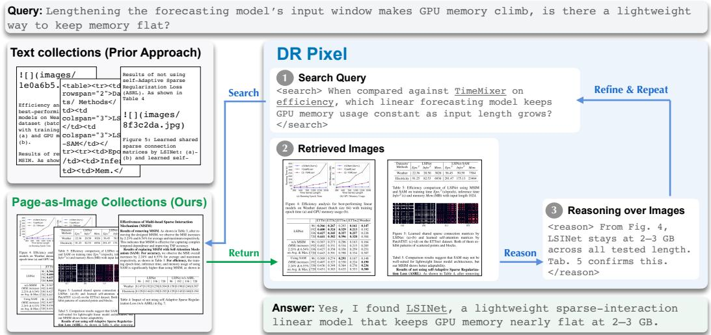  
Figure 1: Overview of DR PIXEL. DR agents alternate between search, retrieval, and reasoning. Prior work operates in text space over OCR-extracted papers; DR PIXEL operates natively in visual space, with both retrieval and reasoning performed directly over rendered page images.

The first challenge is evaluation: existing DR benchmarks are either predominantly text-based (Chen et al., 2026; Xiong et al., 2026; Asai et al., 2024) or require relatively simple retrieval where a single search already achieves high recall (Wang et al., 2025a; Tanaka et al., 2023). To bridge this gap, we introduce DRPIXELBENCH, comprising 500 questions over 1M pages of scientific papers. It combines complex deep research queries that require long chains of retrieval and reasoning with the visual reasoning demands of scientific papers, such as interpreting experimental results in figures and tables. Each question is grounded in a gold page and paired with a directly verifiable answer.

We then instantiate page-native deep research as an end-to-end VLM agent. DR PIXEL indexes rendered pages directly with a VLM embedding model (Li et al., 2026a), feeds retrieved images to the VLM agent, and maintains them as visual evidence throughout the trajectory, without ever being converted into plain text. The agent iteratively formulates queries, retrieves images, and reasons over evidence accumulated across turns to generate the final answer. Our evaluation on DRPIXELBENCH reveals a consistent advantage of page-native DR over OCR-based pipelines, even without targeted training: page-native DR improves accuracy by 5.1–8.4 points across GPT-5.4 (OpenAI, 2026), Gemini-3.5-Flash (Google, 2026), and Qwen3.6-27B (Qwen, 2026), while using 20%–30% fewer retrieval calls than OCR-based pipelines.

Still, the open-weight Qwen3.6-27B lags behind closed models (40.1 vs. 51.9), motivating us to train DR PIXEL. A key challenge is that demonstration traces for supervised fine-tuning (SFT) are often noisy, and are a mix of useful and unhelpful steps: some are critical to reaching the correct answers, while others are redundant or failed attempts. To account for this, we introduce counterfactual credit reweighting: a general recipe for DR training that weights each reasoning and action step by its contribution to the final answer. For each step, we estimate its contribution by removing it from the trajectory and assigning higher training weight when its removal degrades answer quality.

Our training method significantly improves the performance: with Qwen3.6-27B, it improves accuracy by 12.0 points (30% relative) over the untrained model, and closes the gap to GPT-5.4. The gains also transfer beyond DRPIXELBENCH: across three additional multimodal scientific literature benchmarks, our trained DR PIXEL remains competitive and surpasses GPT-5.4 in retrieval on two of them. Notably, on the out-of-distribution ViDoRe-V3 benchmark (Loison et al., 2026), the trained DR PIXEL comes within 1.8 points of an oracle that is given the gold pages directly.

We summarize our key contributions as follows:

1. We introduce DR PIXEL, a page-native deep research agent that treats papers as collections of rendered page images and iteratively retrieves and reasons over them. Across GPT-5.4, Gemini-3.5, and Qwen3.6, DR PIXEL consistently outperforms OCR-based models that convert papers to text.

2. We introduce a new DR training method, counterfactual credit reweighting, which weights each reasoning and search step in the training data by its contribution to the gold answer. It improves over the untrained model on all five benchmarks, and outperforms standard SFT.

3. We release DRPIXELBENCH, consisting of complex questions that require both visual document understanding (e.g., analyzing results from tables and figures) and long chains of retrieval and reasoning, providing a challenging testbed for future work on deep research.

## 2 RELATED WORK

Deep research (DR) agents. DR agents tackle complex, multi-step information-seeking tasks through iterative search and synthesis (Yao et al., 2023; Li et al., 2025d;c; Shao et al., 2026). Recent work extends the pipeline to multimodal deep research by adding tools such as image search, reverse image search or cross-modality retrieval (Geng et al., 2026; Yao et al., 2026). Most of them focus on open web, where text and images are retrieved separately through two different search tools (Tao et al., 2026; Li et al., 2026b; Jiang et al., 2024). We instead target a collection of documents (e.g., scientific papers), where answering complex questions often requires jointly interpreting text, tables, and figures on the same page, making separate text and image retrieval interfaces suboptimal.

Page-native document retrieval. With rapid progress with vision-language models (VLMs), bypassing OCR pipelines and directly processing rendered document images has emerged as a promising direction (Kim et al., 2022; Lee et al., 2023; Blecher et al., 2024; Wei et al., 2026). Building on this, visual document retrieval retrieves rendered pages directly, established by ColPali and followed by increasingly capable visual retrievers (Faysse et al., 2025; Günther et al., 2025; Li et al., 2026a). More recent work extends this approach to further generate answers (Yu et al., 2025; Wang et al., 2025a; 2026) and add iterative retrieval (Wang et al., 2025b; Shen et al., 2026). However, these settings require relatively shallow search, e.g., on ViDoSeek (Wang et al., 2025a) and SlideVQA (Tanaka et al., 2023), a single retrieval step already recalls the gold page in the top five for > 90% of questions (Wang et al., 2025a; Giouroukis et al., 2025). We instead study page-native deep research where complex queries require sustained search and reasoning over 10–20 steps.

Agent training. Broadly, agents that generate long action trajectories are commonly trained with outcome-based reinforcement learning (RL) (Jin et al., 2025; Zheng et al., 2025; Wang et al., 2025b; Shen et al., 2026), sometimes with rubrics (Shao et al., 2026), or through supervised fine-tuning (SFT) on teacher-generated trajectories (Chen et al., 2023; Li et al., 2025a). Both provide limited credit assignment across a trajectory: outcome-based RL assigns a single reward to the rollout, and SFT imitates every teacher step regardless of its utility. Prior work has explored finer-grained supervision through process reward models that score each intermediate step (Lightman et al., 2023) or by leveraging token- or step-level supervision coming from a teacher model conditioned on privileged context (Meng & Chen, 2026; Wu et al., 2026), both during RL. In this paper, we propose an alternative approach that retains the simplicity of SFT: we reweight each agentic step by its counterfactual contribution to the final answer, estimated by removing the step and measuring the resulting change in answer quality.

## 3 DRPIXELBENCH

Existing benchmarks for complex information-seeking document collections largely fall into two categories: text-based DR benchmarks and multimodal document QA benchmarks (Table 1). Textbased deep research benchmarks evaluate iterative search and synthesis over large corpora, but often rely on templated questions (Chen et al., 2026) or long-form answers that require nondeterministic, rubric-based evaluation (Du et al., 2026; Asai et al., 2024); crucially, they are text-only. Multimodal

QA benchmarks instead require visual understanding from reports or scientific papers (Ma et al., 2024; Tanaka et al., 2023; Wang et al., 2025a; Huang et al., 2026; Li et al., 2024; Shorten et al., 2026; Loison et al., 2026). However, their questions are often templated and require relatively shallow retrieval, with only one or a few steps needed to locate the relevant evidence.

We evaluate on four existing benchmarks (IR-PAPERS, M3SciQA, AirQA, ViDoRe-V3) but argue that page-native DR requires a new benchmark, meeting four key properties: (1) agentic search, where relevant evidence typically requires multiple rounds of retrieval and reasoning; (2) multimodal evidence, where answers depend on text together with figures, tables, or equations; (3) non-templated questions, avoiding fixed schemas; and (4) short, verifiable answers, allowing direct evaluation against gold answers without relying on imperfect rubrics.

DRPIXELBENCH. To this end, we build DR-PIXELBENCH over scientific literature. Scientific papers are naturally multimodal, with important information distributed across text, tables, figures, and equations.

We collect papers from arXiv and the openaccess proceedings of major conferences, and merge in the papers of AirQA (Huang et al., 2026), M3SciQA (Li et al., 2024) and IRPA-

<table><tr><td colspan="4">Benchmark Agentic MM Non-templ. Verif.</td></tr><tr><td>Deep research</td><td></td><td></td><td></td></tr><tr><td>BrowseComp-Plus</td><td>X</td><td></td><td></td></tr><tr><td>DeepResearch Bench</td><td></td><td></td><td>X</td></tr><tr><td>ScholarQABench</td><td>X</td><td></td><td>X</td></tr><tr><td colspan="4">Multimodal QA</td></tr><tr><td>AirQA (comp.)</td><td></td><td></td><td></td></tr><tr><td>M3SciQA</td><td></td><td></td><td></td></tr><tr><td>IRPAPERS</td><td>X</td><td></td><td></td></tr><tr><td>ViDoSeek</td><td>X</td><td>X</td><td></td></tr><tr><td>SlideVQA</td><td>X</td><td>X</td><td></td></tr><tr><td>ViDoRe V3</td><td>X</td><td>X</td><td></td></tr><tr><td>DRPixelBench</td><td></td><td></td><td></td></tr></table>

Table 1: DRPIXELBENCH is the only benchmark combining iterative search over a large corpus (Agentic), multimodal evidence (MM), nontemplated questions (Non-templ.), and verifiable short answers (Verif.).

PERS (Shorten et al., 2026) so that DRPIXELBENCH and these three benchmarks share one corpus of 99,055 papers.

Inspired by Dasigi et al. (2021), we generate each question from a paper’s abstract rather than from its full text to keep it tied to the paper’s main contribution. As an abstract reports its findings with few supporting details, we first enrich it. Using Gemini-3.5-Flash (Google, 2026), we extract atomic facts from the full paper, such as a comparison in a table or a trend in a figure, and add them to the abstract. We then prompt the model to write a question from the enriched abstract alone, so that the question is driven by curiosity rather than by evidence already in view. We further ask the model to locate the supporting evidence in the full paper and produce a short-form answer. Depending on the form of this evidence, each question is labeled Text or Visual: a Text question is answered from the running text, while a Visual question requires a table, figure, or equation. Each QA pair then undergoes four automatic checks to ensure that the question is plausible, the gold evidence is sufficient, non-textual evidence is necessary, and the answer cannot be recovered from parametric knowledge alone. Finally, human experts review the question and rewrite it for naturalness. The resulting DRPIXELBENCH contains 500 QA pairs. More details, including the data sources, parsing details, filter criteria, annotation details, and data statistics, are reported in §A.

## 4 DR PIXEL INFERENCE

We introduce DR PIXEL: a deep research agent that uses rendered page images as both the retrieval unit and the model input. We describe our method (§4.1) and present results showing that DR PIXEL consistently outperforms OCR-based pipelines (§4.2).

## 4.1 INFERENCE METHOD

Following Li et al. (2025a), we formulate a DR agent as a ReAct loop (Yao et al., 2023). At each turn t, the agent produces a thought and an action, $\left( \tau _ { \mathrm { t } } , \mathbf { a } _ { \mathrm { t } } \right) \sim \pi ( \cdot \mid \mathcal { H } _ { \mathrm { t - 1 } } )$ , where $\mathcal { H } _ { \mathrm { t } - 1 }$ denotes the history of previous thoughts, actions, and search results. An action $\mathbf { a _ { t } }$ is either a search query or a final answer. For a search action, a search tool f returns search results $\mathrm { f } ( \mathrm { a } _ { \mathrm { t } } , \mathcal { D } ) \subset \mathcal { D }$ where D is a fixed corpus that a search tool interacts with. A final answer action terminates the trajectory. Thus, the complete trajectory that generates a final answer after T tool calls is $[ \mathcal { H } _ { \mathsf { T } } ; \tau _ { \mathsf { T } + 1 } ; \mathsf { a } _ { \mathsf { T } + 1 } ]$ , where

<table><tr><td rowspan="2">Retrieval Setup</td><td colspan="2">GPT-5.4</td><td colspan="2">Gemini-3.5-Flash</td><td colspan="2">Qwen3.6-27B</td></tr><tr><td>Acc (↑)</td><td># Calls (↓)</td><td>Acc (↑)</td><td># Calls (↓)</td><td>Acc (↑)</td><td># Calls (↓)</td></tr><tr><td>OCR-based pipelines</td><td></td><td></td><td></td><td></td><td></td><td></td></tr><tr><td>Text</td><td>43.5</td><td>12.4</td><td>40.0</td><td>17.5</td><td>33.2</td><td>11.0</td></tr><tr><td>+ Figure (txt+ +fig)</td><td>46.3</td><td>10.8+3.0</td><td>41.3</td><td>16.7+1.0</td><td>34.9</td><td>10.9+0.6</td></tr><tr><td>DR PIXEL</td><td>51.9</td><td>9.2</td><td>46.4</td><td>13.7</td><td>40.1</td><td>8.8</td></tr></table>

Table 2: DR PIXEL versus OCR-based retrieval pipelines, all with no training. OCR-based pipelines retrieve OCR text chunks (Text), optionally with a separate search on the figure corpus (+ Figure). DR PIXEL retrieves and reads whole pages as images. Acc is answer accuracy. # Calls is the number of tool calls per question, split into text and figure calls in the text-and-figure setting.

$$
\mathcal { H } _ { \mathsf { T } } = ( \tau _ { 1 } , \mathbf { a } _ { 1 } , \mathsf { f } ( \mathbf { a } _ { 1 } , \mathscr { D } ) , \ldots , \tau _ { \mathsf { T } } , \mathbf { a } _ { \mathsf { T } } , \mathsf { f } ( \mathbf { a } _ { \mathsf { T } } , \mathscr { D } ) ) .\tag{1}
$$

Prior work. Prior work commonly parses documents into plain text, using document parsers or OCR, then operates the DR agent entirely in text space (Chen et al., 2026; Asai et al., 2024). Formally, D is a collection of parsed text documents, f is a text retrieval model (e.g., a dense retrieval model (Karpukhin et al., 2020) that indexes documents or text chunks into fixed-size vectors), and $\mathsf { f } ( \mathrm { a } _ { \mathrm { t } } , \mathrm { \mathcal { D } } )$ returns text chunks most relevant to query $\mathbf { a } _ { \mathrm { t } } .$ . The agent π can be a text-only model.

However, a key limitation of this design is the lossy conversion from documents to text (Niu et al., 2026). Tables and equations may be parsed incorrectly; figures are often reduced to captions or omitted entirely; and OCR or parsing errors can corrupt even text content. Once discarded during parsing, this information cannot be recovered by downstream retrieval or reasoning.

Some prior work mitigates this limitation by adding a second, image-retrieval tool and allowing the agent to choose between text and image search (Suri et al., 2025). However, this is still limited because text and visual content are treated as separate spaces without preserving relationships between them, e.g., a figure and the surrounding text that explains it. Moreover, information loss or corruption during text parsing still remains.

DR PIXEL. Our DR agent, DR PIXEL, is an alternative instantiation of the DR agent in Equation 1: it preserves the ReAct loop but replaces the search tool f and its corpus D to be image-based, as illustrated in Figure 1. Offline, each paper is rendered page by page, so D becomes a collection of page images. Each image is encoded into a fixed-size vector using a VLM-based embedding model, e.g., Qwen3-VL-Embedding-8B. At inference time, f maps a text query $\mathbf { a _ { t } }$ into the same embedding space and returns the top-k page images. These images are passed directly to the agent π, which is itself a VLM. The agent reasons over those images and generates the next thought $\tau _ { \mathrm { t + 1 } }$ and action $\mathbf { a } _ { \mathbf { t } + 1 } .$ , repeating this process until it produces a final answer.

## 4.2 RESULTS

We now compare DR PIXEL against two OCR-based baselines—text-only and text+figure from §4.1—on DRPIXELBENCH.

Setup. We evaluate GPT-5.4 (OpenAI, 2026), Gemini-3.5-Flash (Google, 2026), and Qwen3.6- 27B (Qwen, 2026) with reasoning\_effort=high for the first two and enable\_thinking=True for Qwen3.6-27B. All models run in the same ReAct loop with at most $\mathsf { T } = 2 0$ searches, and all observations remain in context. We report accuracy judged by GPT-5.4-mini (OpenAI, 2026) under a strict prompt, taking a majority vote over three independent judgments.

From the same 99,055 papers, we build three corpora, one for each setting. The text-only baseline parses each PDF into text, preserving tables as HTML and equations as LAT X, and retrieves $\ k = 5$ chunks of 256 words, with Qwen3-Embedding-8B (Zhang et al., 2025b). The text+figure baseline additionally retrieves $\ k = 3$ extracted figures when the image-search tool is invoked, using Qwen3- VL-Embedding-8B (Li et al., 2026a). DR PIXEL, instead, searches 1,062,153 page images rendered directly from the PDFs, returning k = 3 pages, also using Qwen3-VL-Embedding-8B. We choose k for each setting to approximately match the agent’s retrieved token budget (Table 13 for details).

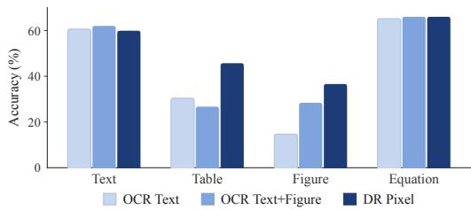  
Figure 2: GPT-5.4 accuracy by evidence source under the two OCR-based settings and DR PIXEL. DR PIXEL consistently outperforms OCR-based pipelines on questions that require tabular and figure evidence.

<table><tr><td colspan="3">GPT-5.4 Qwen3.6-27B Δ</td></tr><tr><td>Accuracy</td><td>51.9</td><td>40.1 -11.8</td></tr><tr><td colspan="3">Retrieval</td></tr><tr><td>Page Hit</td><td>45.7</td><td>36.3 -9.4</td></tr><tr><td>Repeated Queries</td><td>0.0</td><td>5.3 +5.3</td></tr><tr><td colspan="3">Reading</td></tr><tr><td>Acc | Page Hit</td><td>71.2</td><td>63.9 -7.3</td></tr><tr><td>Hit on Last Search</td><td>74.4</td><td>69.3 -5.1</td></tr><tr><td>Hit on Earlier Search</td><td>69.7</td><td>57.4 -12.3</td></tr></table>

Table 3: Decomposing gap between GPT-5.4 and Qwen3.6-27B. Qwen3.6-27B retrieves the gold page less often and uses it less well once found.

Page-native deep research outperforms OCR-based pipelines. As shown in Table 2, DR PIXEL consistently outperforms both OCR-based settings across all three models, improving accuracy over the text-and-figure pipeline by 5.6, 5.1, and 5.2 points for GPT-5.4, Gemini-3.5-Flash, and Qwen3.6- 27B respectively. Adding a figure-search tool yields only marginal gains, as agents rarely invoke it despite explicit instructions in the prompt. DR PIXEL is also more efficient, reducing retrieval calls by 20% to 30%. We further break down GPT-5.4’s accuracy by evidence source in Figure 2. DR PIXEL achieves the highest accuracy on questions requiring tabular and figure evidences, and remains on par on those grounded in text or equations.

Open-weight models lag in both retrieval and reasoning. Although Qwen3.6-27B issues a similar number of retrieval calls to GPT-5.4, it trails by 11.8 points in accuracy under DR PIXEL setting. As shown in Table 3, we decompose this gap into retrieval and reasoning. In retrieval, Qwen3.6-27B retrieves the gold page 9.4 points less often, and its searches are less productive with 5.3% of its queries duplicate an earlier one and 21.6% of its trajectories contain at least one duplicate. In reasoning, Qwen3.6-27B struggles to use pages retrieved earlier in the trajectory. When the gold page comes from the latest search, it trails GPT-5.4 by only 5.1 points, but the gap widens to 12.3 when the page was retrieved in an earlier search. This motivates training an open-weight model, as described in §5.

## 5 DR PIXEL TRAINING

Having shown that page-native DR improves performance even without training, we next train DR PIXEL to further improve its capabilities. We denote the untrained model as DR $\mathrm { P I X E L } _ { \mathrm { B a s e } }$ and the trained model as DR PIXELTrained. We first describe the training method (§5.1), then present the main results (§5.2) and ablations (§5.3).

## 5.1 TRAINING METHOD

We train DR PIXEL with supervised fine-tuning (SFT). We sample trajectories from GPT-5.4 on training questions generated using the same pipeline as §3, but without human rewriting or verification; and use them as training data.

However, we find standard SFT has a problem because the trajectories in the training data often contain repeated or low-value searches that do not contribute to the final answer. Naively imitating these unhelpful steps encourages excessive searching and inefficient use of the retrieval budget. Inspired by process rewards, which assign credit to individual intermediate steps (Lightman et al., 2024; Setlur et al., 2025; Zhou et al., 2024; 2025), we instead weight each step by its contribution to the final answer. Specifically, our counterfactual credit reweighting removes each step from a fixed teacher trajectory and measures the resulting drop in the gold-answer likelihood under the frozen base model, assigning higher weight to steps that are more consequential.

Counterfactual credit. Formally, let $y ^ { \star }$ denote the gold answer, $\mathcal { H } _ { \mathrm { i } }$ the history after i search calls as defined in Equation 1, and $\pi _ { 0 }$ the frozen base policy. For any history H, we measure how strongly it supports the gold answer by the log-likelihood that $\pi _ { 0 }$ assigns to $y ^ { \star }$ :

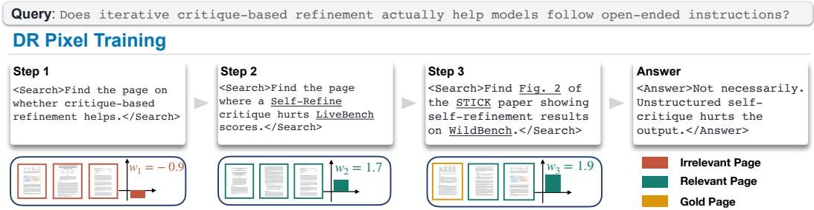  
Figure 3: An illustration of counterfactual credit reweighting (§5.1). The first search returns three off-topic pages and lowers the gold score, so the step has a negative score and weight 0. The second retrieves the gold paper, though not the exact gold page. This increases the gold score and receives positive weight. The third retrieves the exact evidence pages and likewise receives positive weight.

$$
\ell ( \mathcal { H } ) = \log \pi _ { 0 } ( \ y ^ { \star } \mid \mathcal { H } ) .\tag{2}
$$

We assign credit separately to reasoning and search steps. For a reasoning step $\tau _ { \mathrm { i } }$ , we measure how much removing it from $\mathcal { H } _ { \mathrm { T } }$ decreases support for the gold answer. For a search step ${ \mathrm { a } } _ { \mathrm { i } }$ , we measure how much the search results $\mathsf { f } ( \mathrm { a } _ { \mathrm { i } } , \mathrm { \mathcal { D } } )$ increase this support relative to the history before the search:

$$
\mathsf { c } _ { \mathrm { i } } ^ { \mathsf { \tau } } = \ell ( \mathcal { H } _ { \mathsf { T } } ) - \ell ( \mathcal { H } _ { \mathsf { T } } \setminus \mathsf { \tau } _ { \mathrm { i } } ) , \qquad \mathsf { c } _ { \mathrm { i } } ^ { \mathrm { a } } = \ell ( \mathcal { H } _ { \mathrm { i } } ) - \ell ( \mathcal { H } _ { \mathrm { i - 1 } } ) .\tag{3}
$$

Thus, ${ \mathfrak { c } } _ { \mathrm { i } } ^ { \tau }$ captures the contribution of a reasoning step to organizing the accumulated evidence, while $c _ { \mathrm { i } } ^ { \mathrm { a } }$ captures the value of the new evidence returned by a search.

Weight assignment and normalization. Because raw step credits are unbounded, we convert them into rank-based weights for each step type u $\in \{ \tau , \alpha \}$ . Specifically, steps with non-positive credit receive weight 0. For every positive credit, if ${ \mathfrak { c } } _ { \mathrm { i } } ^ { \mathrm { u } }$ is the k-th smallest among n surviving steps of type u, we define rank $\lvert \mathbf { c } _ { \mathrm { { i } } } ^ { \mathrm { { u } } } ) = \dot { \mathbf { k } } / \mathbf { n }$ . We then multiply by $^ 2$ so the average positive weight remains near 1, matching the scale of standard SFT. The resulting weight $w _ { \mathrm { i } } ^ { \mathrm { u } }$ is:

$$
w _ { \mathrm { i } } ^ { \mathrm { u } } = \left\{ \begin{array} { l l } { 0 , } & { c _ { \mathrm { i } } ^ { \mathrm { u } } \leqslant 0 , } \\ { 2 \cdot \mathrm { r a n k } ( c _ { \mathrm { i } } ^ { \mathrm { u } } ) , } & { \mathrm { o t h e r w i s e } . } \end{array} \right.\tag{4}
$$

As each reasoning step directly produces its following search query, we further couple their weights. For each reasoning step, we define its likelihood gain as the increase in log-likelihood of its corresponding action relative to an empty reasoning block. We mask a reasoning step if its corresponding action was previously masked or its likelihood gain is lower than the median over all reasoning steps in the training data. A reasoning step that passes both checks keeps its weight $w _ { \mathrm { i } } ^ { \tau }$ . If such a reasoning step was previously masked due to negative counterfactual credit with $w _ { \mathrm { i } } ^ { \tau } = \dot { 0 } .$ , it is unmasked and assigned w¯ , the median positive reasoning weight. We denote the resulting weight by $\tilde { w } _ { \mathrm { i } } ^ { \tau }$

The final training objective is a token-level weighted loss, with a constant weight λ on the final-answer tokens:

$$
\mathcal { L } ( \boldsymbol { \Theta } ) = - \sum _ { \mathrm { i } = 1 } ^ { \mathrm { T } - 1 } \left[ \tilde { w } _ { \mathrm { i } } ^ { \pi } \sum _ { \mathrm { t } \in \pi _ { \mathrm { i } } } \log \pi _ { \Theta } ( x _ { \mathrm { t } } \mid x _ { < \mathrm { t } } ) + w _ { \mathrm { i } } ^ { \mathrm { a } } \sum _ { \mathrm { t } \in \Omega _ { \mathrm { i } } } \log \pi _ { \Theta } ( x _ { \mathrm { t } } \mid x _ { < \mathrm { t } } ) \right] - \lambda \sum _ { \mathrm { t } \in \Omega _ { \mathrm { T } } } \log \pi _ { \Theta } ( x _ { \mathrm { t } } \mid x _ { < \mathrm { t } } ) .\tag{5}
$$

Training details. We fine-tune Qwen3.6-27B with LoRA on about 2,500 teacher trajectories from GPT-5.4 for one epoch, using a learning rate of 1e−4, an effective batch size of $^ { 1 6 , }$ and answer weight $\lambda = 1 . 5 ,$ , on four H200 GPUs. More details are provided in $\ S C$

## 5.2 RESULTS

Setup. We evaluate on DRPIXELBENCH and three external multimodal scientific literature benchmarks: IRPAPERS (Shorten et al., 2026), M3SciQA (Li et al., 2024), and AirQA (Huang et al., 2026). All four share a unified corpus, as we form the corpus as a union of corpora from each benchmark (§3). To test out-of-distribution generalization, we further evaluate on ViDoRe-V3 (Loison et al., 2026) over its own document corpus, with two search tools: page retrieval as in DR PIXEL, and text retrieval as in the text-only setting of §4.2, where each page is parsed into text and retrieved with Qwen3-Embedding-8B. We compare DR $\mathrm { P I X E L } _ { \mathrm { T r a i n e d } }$ with GPT-5.4, Gemini-3.5-Flash, the untrained DR $\mathrm { P I X E L } _ { \mathrm { B a s e } }$ , and vanilla SFT, which is trained on the same teacher trajectories with every token weighted equally. All agents follow the configuration in §4.2.

<table><tr><td></td><td colspan="4">IRPAPERS</td><td colspan="4">M3SciQA</td><td colspan="4">AirQA</td></tr><tr><td>Model</td><td> $\mathrm { T / q }$ </td><td>DocHit Acc|Doc Acc</td><td></td><td></td><td> $\mathrm { T / q }$ </td><td>DocHit Acc|Doc Acc</td><td></td><td></td><td> $\mathrm { T } / \mathrm { q }$ </td><td></td><td>DocHit Acc|Doc Acc</td><td></td></tr><tr><td>Open-weight (Qwen3.6-27B)</td><td></td><td></td><td></td><td></td><td></td><td></td><td></td><td></td><td></td><td></td><td></td><td></td></tr><tr><td>DR  $\mathrm { P I X E L } _ { \mathrm { B a s e } }$ </td><td>5.6</td><td>89.4</td><td>68.8</td><td>65.4 7.8</td><td></td><td>75.3</td><td>63.4</td><td>49.8 7.9</td><td></td><td>84.3</td><td>46.0</td><td>42.7</td></tr><tr><td>DR  $\mathrm { P I X E L } _ { \mathrm { T r a i n e d } }$ </td><td>5.0</td><td>95.6</td><td>82.0</td><td>79.4 9.4</td><td></td><td>90.3</td><td>69.6</td><td>64.2</td><td>7.0</td><td>89.7</td><td>55.6</td><td>52.3</td></tr><tr><td>Proprietary</td><td></td><td></td><td></td><td></td><td></td><td></td><td></td><td></td><td></td><td></td><td></td><td></td></tr><tr><td>GPT-5.4</td><td>5.4</td><td>92.2</td><td>80.1</td><td>77.8 7.7</td><td></td><td>90.3</td><td>73.3</td><td>67.5 6.2</td><td></td><td>87.9</td><td>59.5</td><td>56.6</td></tr><tr><td>Gemini-3.5-Flash 8.4</td><td></td><td>93.3</td><td>70.1</td><td>67.612.4</td><td></td><td>87.2</td><td>68.3</td><td>60.8 11.1</td><td></td><td>87.5</td><td>50.0</td><td>47.0</td></tr></table>

Table 5: Results on external multimodal scientific-QA benchmarks. T/q is searches per question. DocHit is the percentage of questions for which the gold document is retrieved, and Acc|Doc is accuracy restricted to those questions. DR PIXELTrained improves over DR $\mathrm { P I X E L } _ { \mathrm { B a s e } }$ on all three benchmarks and adapts search effort dynamically.

DR $\mathbf { P I X E L _ { T r a i n e d } }$ matches proprietary models. As shown in Table 4, training DR PIXEL significantly improves performance on DRPIX-ELBENCH, increasing accuracy from 40.1 to 52.1 and even slightly surpassing GPT-5.4. Our trajectory analysis shows that the gains are concentrated in retrieval: DR PIXE $- T _ { \mathrm { { I r a i n e d } } }$ retrieves the gold page 6.3 points more often than GPT-5.4. This suggests that post-training better aligns query generation with the retriever’s embedding space, therefore producing queries that are more effective for visual retrieval.

<table><tr><td colspan="4">Model Tool/q PgHit Acc|Pg Acc</td></tr><tr><td colspan="4">Open-weight (Qwen3.6-27B)</td></tr><tr><td>DR  $\mathrm { P I X E L } _ { \mathrm { B a s e } }$  + vanilla SFT DR  $\mathrm { P I X E L } _ { \mathrm { T r a i n e d } }$ </td><td>8.8 36.3 14.0 53.6 8.9 52.0</td><td>63.9 67.2 67.7</td><td>40.1 49.0 52.1</td></tr><tr><td colspan="4">Proprietary</td></tr><tr><td>GPT-5.4</td><td>9.2</td><td>45.7 71.2</td><td>51.9</td></tr><tr><td>Gemini-3.5-Flash</td><td>13.7 35.0</td><td>75.7</td><td>46.4</td></tr></table>

Table 4: Results on DRPIXELBENCH. Tool/q is searches per question. PgHit is the percentage of questions that retrieves the gold page, and Acc|Pg is accuracy restricted to those questions. Results are averaged over three runs. DR PIXELTrained matches GPT-5.4 in accuracy, retrieving the gold pages more often while using fewer searches.

Counterfactual credit reweighting makes search more efficient. Table 4 shows that our counterfactual credit reweighting consistently outperforms vanilla SFT, primarily by suppressing the ineffective searches from teacher trajectories. The vanilla SFT achieves a slightly higher

page-hit rate than DR $\mathrm { P I X E L } _ { \mathrm { T r a i n e d } }$ , but requires 57% more searches. The key difference is search efficiency: vanilla SFT exhausts the 20-call budget on 35.8% of questions, compared with only 9.8% for DR $\mathrm { P I X E L } _ { \mathrm { T r a i n e d } }$ . This is even lower than GPT-5.4 (17.8%) and the untrained backbone (19.2%).

DR $\mathbf { P I X E L _ { T r a i n e d } }$ generalizes to external multimodal QA benchmarks. As shown in Table 5, the behavior learned on DRPIXELBENCH transfers to IRPAPERS, M3SciQA, and AirQA. DR $\mathrm { P I X E L } _ { \mathrm { T r a i n e d } }$ improves over the untrained backbone on all three, with accuracy gains ranging from 9.6 to 14.4 points. It also adapts its search effort to retrieval difficulty variations: compared with the backbone, DR $\mathrm { P I X E L } _ { \mathrm { T r a i n e d } }$ searches less on IRPAPERS and AirQA but more on M3SciQA, where the backbone has the largest document-retrieval gap relative to GPT-5.4 (15.0 points).

DR $\mathbf { P I X E L _ { T r a i n e d } }$ further generalizes across domains and retrieval modalities. ViDoRe-V3 provides a strong out-of-distribution test, covering non-scientific documents from domains such as finance and human resources. As shown in Table 6, post-training improves both page-based and text-based retrieval by 4.1 points, despite using only page-native teacher trajectories, suggesting that the learned search behavior transfers across retrieval modalities. The two settings stay close because only 1.7% of ViDoRe-V3 questions genuinely require visual content to answer. We further compare against oracle retrieval settings, where the relevant document or page is provided directly. With page retrieval, DR PIXELTrained matches the Text Oracle and remains competitive with the Page Oracle.

<table><tr><td></td><td></td><td></td><td colspan="5">English</td><td colspan="3">French</td><td></td></tr><tr><td>Retriever</td><td></td><td>Mod. Generator</td><td>C.S.</td><td>Fin.</td><td>Phar.</td><td>H.R.</td><td>Ind.</td><td>Phys.</td><td>Ener.</td><td>Fin.</td><td>Global</td></tr><tr><td>Oracle*</td><td>Text Page</td><td>Gemini 3 Pro</td><td>80.9 86.5</td><td>70.2 70.6</td><td>71.4 76.1</td><td>72.3 71.1</td><td>66.4 68.2</td><td>71.2 74.5</td><td>69.2 69.8</td><td>62.8 64.1</td><td>70.6 72.6</td></tr><tr><td>Qwen3-Emb-8B</td><td>Text</td><td> $\mathrm { D R \ P I X E L { B a s e } }$   $\mathrm { D R } \ \mathrm { P I X E L } _ { \mathrm { T r a i n e d } }$ </td><td>86.5 88.8</td><td>64.7 71.2</td><td>60.7 67.3</td><td>63.8 65.4</td><td>53.7 66.1</td><td>77.4 77.5</td><td>66.6 69.5</td><td>51.9 52.8</td><td>65.7 69.8</td></tr><tr><td>Qwen3-VL-Emb-8B</td><td>Page</td><td> $\mathrm { D R \ P I X E L _ { B a s e } }$   $\mathrm { D R } \ \mathrm { P I X E L } _ { \mathrm { T r a i n e d } }$ </td><td>87.9 89.3</td><td>64.4 67.0</td><td>67.9 73.1</td><td>64.2 67.0</td><td>59.7 65.4</td><td>76.2 79.1</td><td>62.7 70.1</td><td>50.9 55.3</td><td>66.7 70.8</td></tr></table>

Table 6: End-to-end accuracy on ViDoRe V3. Oracle∗ is ViDoRe V3’s published upper bound. DR PIXELTrained improves over DR PIXEL $\mathbf { \nabla } \cdot \mathrm { B a s e }$ with both page and text retrieval on documents outside its training domain, so the training generalizes well.

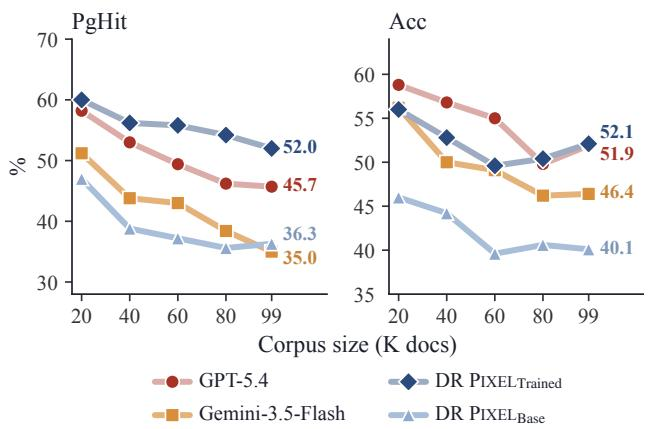

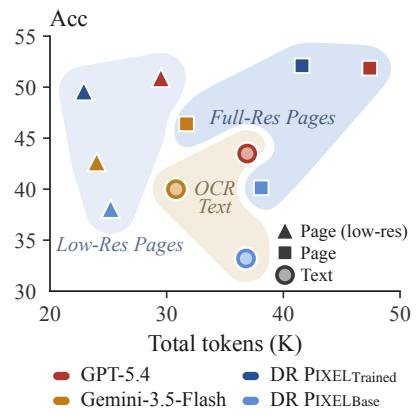  
Figure 4: Effect of corpus size on retrieval and final answer accuracy. Each panel varies the number of indexed documents from 20,000 to 99,055. DR $\mathrm { P I X E L } _ { \mathrm { T r a i n e d } }$ is the most robust to corpus growth, with the slowest degradation in retrieval performance.  
Figure 5: Accuracy against total tokens as page resolution varies. Lowering resolution cuts tokens by 24% to 45% for a 1 to 4 point drop, and page retrieval stays ahead of OCR text.

## 5.3 ABLATION

We next ablate on a couple of key factors: corpus size, training data modalities and page resolutions.

DR PIXELTrained is robust to corpus size. We scale the corpus from 20,000 to 99,000 papers while keeping the questions and gold documents fixed. As shown in Figure 4, page-hit rate declines for all models as the corpus grows, but DR PIXELTrained degrades more slowly, dropping by only 8.0 points compared with 12.5 for GPT-5.4. As a result, its retrieval advantage over GPT-5.4 widens from 1.8 points at 20,000 papers to 6.3 points at 99,000, leading to final answer accuracy improvement.

Downgrading page resolution buys efficiency at a modest cost. In page-native deep research, page resolution determines the trade-off between visual fidelity and inference cost. Since processing high-resolution page images is expensive, we cap each rendered page at 1.05 megapixels, roughly 50% of its native resolution. As shown in Figure 5, this reduces input tokens by 30% to 48% across models, while accuracy drops by only 1.0 to 3.8 points. Output tokens rise slightly at lower resolution, but as they account for less than 25% of all tokens, the overall savings largely remain. 1 Even at this lower resolution, page retrieval outperforms OCR-based text retrieval by 2.7 to 7.4 points for every model evaluated while using 22% to 33% fewer input tokens. The breakdown into input and output tokens is shown in Figure 9 in the appendix.

<table><tr><td>Setup</td><td>Tool/q PgHit</td><td>Acc|Pg</td><td>Acc</td></tr><tr><td>DR PIXEIL  $\mathrm { \Delta } n \mathrm { \ a s e }$ </td><td>8.8</td><td>36.3 63.9</td><td>40.1</td></tr><tr><td>+ Text</td><td>5.0</td><td>47.4</td><td>60.3 46.0</td></tr><tr><td>+ Visual, 2,000</td><td>10.1</td><td>52.2</td><td>65.5 50.2</td></tr></table>

Table 7: Effect of trajectory type on the distilled policy. Training only on Text trajectories makes the model search less, so it explores less and reaches a lower end-to-end accuracy.  
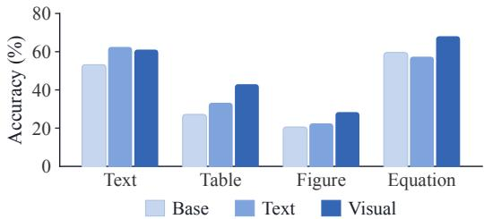  
Figure 6: Each training mixture improves the question type it matches, with Text trajectories helping text questions and visual trajectories helping multimodal ones.

Fine-tuning on Visual questions is more effective. The 2,500 trajectories used to fine-tune DR PIXE $\mathtt { T r a i n e d }$ contain only Visual questions, as defined in §3. To justify this choice, we generate Text questions with the same pipeline, collect their trajectories as described in §C, and fine-tune the same base model on either 2,000 Text or 2,000 Visual trajectories, keeping all other settings fixed. As shown in Table 7, fine-tuning on Text questions causes the agent to stop earlier and retrieve the gold page less often, yielding 46.0 accuracy versus 50.2 with Visual fine-tuning. Our further analysis indicates that visual fine-tuning also transfers better: it remains within 1.4 points of Text fine-tuning on Text questions, while Text fine-tuning trails by 6–11 points on Visual questions.

## 6 CONCLUSION

Deep research over complex documents typically begins with OCR. DR PIXEL instead performs retrieval and reasoning directly over rendered pages. We study this setting with DRPIXELBENCH, containing 500 verifiable questions over 1.06M pages of scientific literature, and show that pagenative deep research consistently outperforms OCR-based pipelines across all tested models while using fewer tool calls, even without task-specific training. To close the remaining gap for openweight models, we introduce counterfactual credit reweighting, which weights teacher steps by their contribution to the gold answer and brings a 27B model to GPT-5.4-level accuracy with lower search cost. These gains transfer to external benchmarks and non-scientific documents. More broadly, page-native deep research requires only document rendering rather than format-specific parsing, making it particularly attractive for private, layout-rich corpora such as financial or law documents where maintaining OCR and parsing pipelines is costly and brittle.

## ACKNOWLEDGEMENT

We would like to thank Prasann Singhal, Ryan Wang, Rulin Shao, Zijian Chen and the SM group members for valuable discussions and feedback.

This work was supported in part by the Gemini Academic Program and by gifts from Rational Dynamics and Coefficient Giving. This work was also supported in part through the NYU IT High Performance Computing resources, services, and staff expertise.

## AI USAGE STATEMENT

LLMs are part of our pipeline: Gemini-3.5-Flash generates and filters questions (§3), with every benchmark question reviewed by human. GPT-5.4 produces training trajectories, and GPT-5.4-mini judges answers. We also used LLM assistants for literature search, writing polish, and coding. Al research ideas, experimental design, and analysis are the authors’ own.

## REFERENCES

Akari Asai, Jacqueline He, Rulin Shao, Weijia Shi, Amanpreet Singh, Joseph Chee Chang, Kyle Lo, Luca Soldaini, Sergey Feldman, Mike D’arcy, David Wadden, Matt Latzke, Minyang Tian, Pan Ji, Shengyan Liu, Hao Tong, Bohao Wu, Yanyu Xiong, Luke Zettlemoyer, Graham Neubig, Dan Weld, Doug Downey, Wen tau Yih, Pang Wei Koh, and Hannaneh Hajishirzi. Openscholar: Synthesizing scientific literature with retrieval-augmented lms. arXiv preprint arXiv:2411.14199, 2024. URL https://arxiv.org/abs/2411.14199.

Lukas Blecher, Guillem Cucurull, Thomas Scialom, and Robert Stojnic. Nougat: Neural optical understanding for academic documents. In The Twelfth International Conference on Learning Representations, 2024. URL https://openreview.net/forum?id=fUtxNAKpdV.

Baian Chen, Chang Shu, Ehsan Shareghi, Nigel Collier, Karthik Narasimhan, and Shunyu Yao. Fireact: Toward language agent fine-tuning. arXiv preprint arXiv:2310.05915, 2023. URL https://arxiv.org/abs/2310.05915.

Shan Chen, Pedro José Ferreira Moreira, Yuxin Xiao, Samuel Schmidgall, Jeremy L. Warner, Hugo Aerts, Thomas Hartvigsen, Jack Gallifant, and Danielle Bitterman. Medbrowsecomp: Benchmarking medical deep research and computer use. In The Second Workshop on GenAI for Health: Potential, Trust, and Policy Compliance, 2025a. URL https://openreview.net/ forum?id=pSDvq2ZgPk.

Zijian Chen, Xueguang Ma, Shengyao Zhuang, Ping Nie, Kai Zou, Sahel Sharifymoghaddam, Andrew Liu, Joshua Green, Kshama Patel, Ruoxi Meng, Mingyi Su, Yanxi Li, Haoran Hong, Xinyu Shi, Xuye Liu, Hosna Oyarhoseini, Nandan Thakur, Crystina Zhang, Luyu Gao, Wenhu Chen, and Jimmy Lin. BrowseComp-plus: A fair and disentangled evaluation benchmark for deep search agents. In Proceedings ofthe 64th Annual Meeting ofthe Associationfor Computational Linguistics (Volume 1: Long Papers). Association for Computational Linguistics, 2026. doi: 10.18653/v1/2026.acl-long.1023. URL https://aclanthology.org/2026.acl-long.1023/.

Ziru Chen, Shijie Chen, Yuting Ning, Qianheng Zhang, Boshi Wang, Botao Yu, Yifei Li, Zeyi Liao, Chen Wei, Zitong Lu, Vishal Dey, Mingyi Xue, Frazier N. Baker, Benjamin Burns, Daniel Adu-Ampratwum, Xuhui Huang, Xia Ning, Song Gao, Yu Su, and Huan Sun. Scienceagentbench: Toward rigorous assessment of language agents for data-driven scientific discovery. In The Thirteenth International Conference on Learning Representations, 2025b. URL https://openreview.net/forum?id=6z4YKr0GK6.

Chanyeol Choi, Jihoon Kwon, Alejandro Lopez-Lira, Chaewoon Kim, Minjae Kim, Juneha Hwang, Jaeseon Ha, Hojun Choi, Suyeol Yun, Yongjin Kim, and Yongjae Lee. Finagentbench: A benchmark dataset for agentic retrieval in financial question answering. In NeurIPS 2025 Workshop: Generative AI in Finance, 2026. URL https://openreview.net/forum?id=BIyBik7J5u.

Pradeep Dasigi, Kyle Lo, Iz Beltagy, Arman Cohan, Noah A. Smith, and Matt Gardner. A dataset of information-seeking questions and answers anchored in research papers. In Proceedings ofthe 2021 Conference ofthe North American Chapter ofthe Associationfor Computational Linguistics, 2021. doi: 10.18653/v1/2021.naacl-main.365. URL https://aclanthology.org/2021.naacl-main. 365/.

Gabriel de Souza P. Moreira, Ronay Ak, Mengyao Xu, Oliver Holworthy, Benedikt Schifferer, Zhiding Yu, Yauhen Babakhin, Radek Osmulski, Jiarui Cai, Ryan Chesler, Bo Liu, and Even Oldridge. Nemotron colembed v2: Top-performing late interaction embedding models for visual document retrieval. arXiv preprint arXiv:2602.03992, 2026. URL https://arxiv.org/abs/2602.03992.

Mingxuan Du, Benfeng Xu, Chiwei Zhu, Licheng Zhang, Xiaorui Wang, and Zhendong Mao. Deepresearch bench: A comprehensive benchmark for deep research agents. In The Fourteenth International Conference on Learning Representations, 2026. URL https://openreview.net/ forum?id=hQ0K2Hhq7H.

Manuel Faysse, Hugues Sibille, Tony Wu, Bilel Omrani, Gautier Viaud, CELINE HUDELOT, and Pierre Colombo. Colpali: Efficient document retrieval with vision language models. In The Thirteenth International Conference on Learning Representations, 2025. URL https:// openreview.net/forum?id=ogjBpZ8uSi.

Gemini. Gemini deep research, December 2025. URL https://gemini.google/overview/ deep-research/. Official blog post introducing Gemini Deep Research.

Xinyu Geng, Peng Xia, Zhen Zhang, Xinyu Wang, Qiuchen Wang, Ruixue Ding, Chenxi Wang, Jialong Wu, Kuan Li, Yida Zhao, Huifeng Yin, Yong Jiang, Pengjun Xie, Fei Huang, Huaxiu Yao, Yi R. Fung, and Jingren Zhou. Webwatcher: Breaking new frontiers of vision-language deep research agent. In The Fourteenth International Conference on Learning Representations, 2026. URL https://openreview.net/forum?id=8jsaazdAb3.

Petros Stylianos Giouroukis, Dimitris Dimitriadis, Dimitrios Papadopoulos, Zhenwen Shao, and Grigorios Tsoumakas. What’s the best way to retrieve slides? a comparative study of multimodal, caption-based, and hybrid retrieval techniques. arXiv preprint arXiv:2509.15211, 2025. URL https://arxiv.org/abs/2509.15211.

Google. Gemini 3.5: frontier intelligence with action, May 2026. URL https://blog.google/ innovation-and-ai/models-and-research/gemini-models/gemini-3-5/. Official blog post introducing Gemini 3.5 models.

Michael Günther, Saba Sturua, Mohammad Kalim Akram, Isabelle Mohr, Andrei Ungureanu, Bo Wang, Sedigheh Eslami, Scott Martens, Maximilian Werk, Nan Wang, and Han Xiao. jina-embeddings-v4: Universal embeddings for multimodal multilingual retrieval. In Proceedings of the 5th Workshop on Multilingual Representation Learning (MRL 2025). Association for Computational Linguistics, 2025. doi: 10.18653/v1/2025.mrl-main.36. URL https://aclanthology.org/2025.mrl-main.36/.

Tiancheng Huang, Ruisheng Cao, Yuxin Zhang, Zhangyi Kang, Zijian Wang, Chenrun Wang, Yijie LUO, Hang Zheng, Lirong Qian, Lu Chen, and Kai Yu. AirQA: A comprehensive QA dataset for AI research with instance-level evaluation. In The Fourteenth International Conference on Learning Representations, 2026. URL https://openreview.net/forum?id=RuUXnRyqcy.

Dongzhi Jiang, Renrui Zhang, Ziyu Guo, Yanmin Wu, Jiayi Lei, Pengshuo Qiu, Pan Lu, Zehui Chen, Chaoyou Fu, Guanglu Song, Peng Gao, Yu Liu, Chunyuan Li, and Hongsheng Li. Mmsearch: Benchmarking the potential of large models as multi-modal search engines. arXiv preprint arXiv:2409.12959, 2024. URL https://arxiv.org/abs/2409.12959.

Bowen Jin, Hansi Zeng, Zhenrui Yue, Jinsung Yoon, Sercan O Arik, Dong Wang, Hamed Zamani, and Jiawei Han. Search-r1: Training LLMs to reason and leverage search engines with reinforcement learning. In Second Conference on Language Modeling, 2025. URL https://openreview.net/ forum?id=Rwhi91ideu.

Vladimir Karpukhin, Barlas Oguz, Sewon Min, Patrick Lewis, Ledell Wu, Sergey Edunov, Danqi Chen, and Wen-tau Yih. Dense passage retrieval for open-domain question answering. In Proceedings of the 2020 conference on empirical methods in natural language processing (EMNLP), pp. 6769–6781, 2020.

Geewook Kim, Teakgyu Hong, Moonbin Yim, Jeongyeon Nam, Jinyoung Park, Jinyeong Yim, Wonseok Hwang, Sangdoo Yun, Dongyoon Han, and Seunghyun Park. Ocr-free document understanding transformer. arXiv preprint arXiv:2111.15664, 2022. URL https://arxiv.org/ abs/2111.15664.

Kenton Lee, Mandar Joshi, Iulia Turc, Hexiang Hu, Fangyu Liu, Julian Eisenschlos, Urvashi Khandelwal, Peter Shaw, Ming-Wei Chang, and Kristina Toutanova. Pix2struct: Screenshot parsing as pretraining for visual language understanding. arXiv preprint arXiv:2210.03347, 2023. URL https://arxiv.org/abs/2210.03347.

Baixuan Li, Bo Zhang, Dingchu Zhang, Fei Huang, Guangyu Li, Guoxin Chen, Huifeng Yin, Jialong Wu, Jingren Zhou, Kuan Li, Liangcai Su, Litu Ou, Liwen Zhang, Pengjun Xie, Rui Ye, Wenbiao Yin, Xinmiao Yu, Xinyu Wang, Xixi Wu, Xuanzhong Chen, Yida Zhao, Zhen Zhang, Zhengwei Tao, Zhongwang Zhang, Zile Qiao, Chenxi Wang, Donglei Yu, Gang Fu, Haiyang Shen, Jiayin Yang, Jun Lin, Junkai Zhang, Kui Zeng, Li Yang, Hailong Yin, Maojia Song, Ming Yan, Minpeng Liao, Peng Xia, Qian Xiao, Rui Min, Ruixue Ding, Runnan Fang, Shaowei Chen, Shen Huang, Shihang Wang, Shihao Cai, Weizhou Shen, Xiaobin Wang, Xin Guan, Xinyu Geng, Yingcheng

Shi, Yuning Wu, Zhuo Chen, Zijian Li, and Yong Jiang. Tongyi deepresearch technical report. arXiv preprint arXiv:2510.24701, 2025a. URL https://arxiv.org/abs/2510.24701.

Chuhan Li, Ziyao Shangguan, Yilun Zhao, Deyuan Li, Yixin Liu, and Arman Cohan. M3SciQA: A multi-modal multi-document scientific QA benchmark for evaluating foundation models. In Findings ofthe Associationfor Computational Linguistics: EMNLP 2024, 2024. doi: 10.18653/v1/ 2024.findings-emnlp.904. URL https://aclanthology.org/2024.findings-emnlp.904/.

Haitao Li, Junjie Chen, Jingli Yang, Qingyao Ai, Wei Jia, Youfeng Liu, Kai Lin, Yueyue Wu, Guozhi Yuan, Yiran Hu, Wuyue Wang, Yiqun Liu, and Minlie Huang. LegalAgentBench: Evaluating LLM agents in legal domain. In Proceedings ofthe 63rd Annual Meeting ofthe Associationfor Computational Linguistics, 2025b. URL https://aclanthology.org/2025.acl-long.116/.

Mingxin Li, Yanzhao Zhang, Dingkun Long, Keqin Chen, Sibo Song, Shuai Bai, Zhibo Yang, Pengjun Xie, An Yang, Dayiheng Liu, Jingren Zhou, and Junyang Lin. Qwen3-vl-embedding and qwen3-vl-reranker: A unified framework for state-of-the-art multimodal retrieval and ranking. arXiv preprint arXiv:2601.04720, 2026a. URL https://arxiv.org/abs/2601.04720.

Shilong Li, Xingyuan Bu, Wenjie Wang, Jiaheng Liu, Jun Dong, Haoyang He, Hao Lu, Haozhe Zhang, Chenchen Jing, Zhen Li, Chuanhao Li, Jiayi Tian, Chenchen Zhang, Tianhao Peng, Yancheng He, Jihao Gu, Hui Huang, Donghao Zhou, Yuanxing Zhang, Jian Yang, Ge Zhang, Wenhao Huang, Zhaoxiang Zhang, Qiangpeng Yang, and Shilei Wen. Mm-browsecomp: A comprehensive benchmark for multimodal browsing agents. arXiv preprint arXiv:2508.13186, 2026b. URL https://arxiv.org/abs/2508.13186.

Xiaoxi Li, Guanting Dong, Jiajie Jin, Yuyao Zhang, Yujia Zhou, Yutao Zhu, Peitian Zhang, and Zhicheng Dou. Search-o1: Agentic search-enhanced large reasoning models. In Proceedings of the 2025 Conference on Empirical Methods in Natural Language Processing. Association for Computational Linguistics, 2025c. doi: 10.18653/v1/2025.emnlp-main.276. URL https: //aclanthology.org/2025.emnlp-main.276/.

Xiaoxi Li, Jiajie Jin, Guanting Dong, Hongjin Qian, Yongkang Wu, Ji-Rong Wen, Yutao Zhu, and Zhicheng Dou. Webthinker: Empowering large reasoning models with deep research capability. In The Thirty-ninth Annual Conference on Neural Information Processing Systems, 2025d. URL https://openreview.net/forum?id=7LKKHBAMzH.

Hunter Lightman, Vineet Kosaraju, Yura Burda, Harri Edwards, Bowen Baker, Teddy Lee, Jan Leike, John Schulman, Ilya Sutskever, and Karl Cobbe. Let’s verify step by step. arXiv preprint arXiv:2305.20050, 2023. URL https://arxiv.org/abs/2305.20050.

Hunter Lightman, Vineet Kosaraju, Yuri Burda, Harrison Edwards, Bowen Baker, Teddy Lee, Jan Leike, John Schulman, Ilya Sutskever, and Karl Cobbe. Let’s verify step by step. In The Twelfth International Conference on Learning Representations, 2024. URL https://openreview.net/ forum?id=v8L0pN6EOi.

Kyle Lo, Joseph Chee Chang, Andrew Head, Jonathan Bragg, Amy X. Zhang, Cassidy Trier, Chloe Anastasiades, Tal August, Russell Authur, Danielle Bragg, Erin Bransom, Isabel Cachola, Stefan Candra, Yoganand Chandrasekhar, Yen-Sung Chen, Evie Yu-Yen Cheng, Yvonne Chou, Doug Downey, Rob Evans, Raymond Fok, Fangzhou Hu, Regan Huff, Dongyeop Kang, Tae Soo Kim, Rodney Kinney, Aniket Kittur, Hyeonsu Kang, Egor Klevak, Bailey Kuehl, Michael Langan, Matt Latzke, Jaron Lochner, Kelsey MacMillan, Eric Marsh, Tyler Murray, Aakanksha Naik, Ngoc-Uyen Nguyen, Srishti Palani, Soya Park, Caroline Paulic, Napol Rachatasumrit, Smita Rao, Paul Sayre, Zejiang Shen, Pao Siangliulue, Luca Soldaini, Huy Tran, Madeleine van Zuylen, Lucy Lu Wang, Christopher Wilhelm, Caroline Wu, Jiangjiang Yang, Angele Zamarron, Marti A. Hearst, and Daniel S. Weld. The semantic reader project: Augmenting scholarly documents through ai-powered interactive reading interfaces. arXiv preprint arXiv:2303.14334, 2023. URL https://arxiv.org/abs/2303.14334.

António Loison, Quentin Macé, Antoine Edy, Victor Xing, Tom Balough, Gabriel de Souza P. Moreira, Bo Liu, Manuel Faysse, Celine Hudelot, and Gautier Viaud. ViDoRe v3: A comprehensive evaluation of retrieval augmented generation in complex real-world scenarios. In Proceedings of the 64th Annual Meeting of the Association for Computational Linguistics (Volume 1: Long

Papers), 2026. doi: 10.18653/v1/2026.acl-long.755. URL https://aclanthology.org/2026. acl-long.755/.

Yubo Ma, Yuhang Zang, Liangyu Chen, Meiqi Chen, Yizhu Jiao, Xinze Li, Xinyuan Lu, Ziyu Liu, Yan Ma, Xiaoyi Dong, Pan Zhang, Liangming Pan, Yu-Gang Jiang, Jiaqi Wang, Yixin Cao, and Aixin Sun. MMLONGBENCH-DOC: Benchmarking long-context document understanding with visualizations. In The Thirty-eight Conference on Neural Information Processing Systems Datasets and Benchmarks Track, 2024. URL https://openreview.net/forum?id=loJM1acwzf.

Zibin Meng and Kani Chen. Craft: Counterfactual credit assignment from free sibling rollouts for self-distilled agentic reinforcement learning. arXiv preprint arXiv:2606.29476, 2026. URL https://arxiv.org/abs/2606.29476.

Junbo Niu, Zheng Liu, Zhuangcheng Gu, Bin Wang, Linke Ouyang, Zhiyuan Zhao, Tao Chu, Tianyao He, Fan Wu, Qintong Zhang, Zhenjiang Jin, Guang Liang, Rui Zhang, Wenzheng Zhang, Yuan Qu, Zhifei Ren, Yuefeng Sun, Zirui Tang, Boyu Niu, Yuanhong Zheng, Dongsheng Ma, Ziyang Miao, Hejun Dong, Siyi Qian, Junyuan Zhang, Fangdong Wang, Jingzhou Chen, Xiaomeng Zhao, Liqun Wei, Wei Li, Shasha Wang, RuiLiang Xu, Yuanyuan Cao, Lu Chen, Qianqian Wu, Huaiyu Gu, Lindong Lu, Dechen Lin, Shenguanlin, Xuanhe Zhou, Linfeng Zhang, Yuhang Zang, Xiaoyi Dong, Jiaqi Wang, Bo Zhang, LEI BAI, Pei Chu, Weijia Li, Jiang Wu, Lijun Wu, Zhenxiang Li, Guangyu Wang, Zhongying Tu, Chao Xu, Kai Chen, Bowen Zhou, Dahua Lin, Wentao Zhang, and Conghui He. Mineru2.5: A decoupled vision-language model for efficient high-resolution document parsing. In The 64th Annual Meeting ofthe Associationfor Computational Linguistics – Industry Track, 2026. URL https://openreview.net/forum?id=GqfnTTsSFr.

OpenAI. Introducing deep research, February 2025. URL https://openai.com/index/ introducing-deep-research/. Official blog post introducing OpenAI Deep Research.

OpenAI. Introducing gpt-5.4, March 2026. URL https://openai.com/zh-Hans-CN/index/ introducing-gpt-5-4/. Official blog post introducing GPT-5.4 models.

Jake Poznanski, Aman Rangapur, Jon Borchardt, Jason Dunkelberger, Christopher Wilhelm, Kyle Lo, and Luca Soldaini. olmOCR: Unlocking trillions of tokens in PDFs with vision language models. In Championing Open-source DEvelopment in ML Workshop @ ICML25, 2025. URL https://openreview.net/forum?id=0RoEHuBzc5.

Qwen. Qwen3.6-27b: Flagship-level coding in a 27b dense model, April 2026. URL https: //qwen.ai/blog?id=qwen3.6-27b. Official blog post introducing Qwen3.6 family.

Amrith Setlur, Chirag Nagpal, Adam Fisch, Xinyang Geng, Jacob Eisenstein, Rishabh Agarwal, Alekh Agarwal, Jonathan Berant, and Aviral Kumar. Rewarding progress: Scaling automated process verifiers for LLM reasoning. In The Thirteenth International Conference on Learning Representations, 2025. URL https://openreview.net/forum?id=A6Y7AqlzLW.

Rulin Shao, Akari Asai, Shannon Zejiang Shen, Hamish Ivison, Varsha Kishore, Jingming Zhuo, Xinran Zhao, Molly Park, Samuel G. Finlayson, David Sontag, Tyler Murray, Sewon Min, Pradeep Dasigi, Luca Soldaini, Faeze Brahman, Wen tau Yih, Tongshuang Wu, Luke Zettlemoyer, Yoon Kim, Hannaneh Hajishirzi, and Pang Wei Koh. DR tulu: Reinforcement learning with evolving rubrics for deep research. In Forty-third International Conference on Machine Learning, 2026. URL https://openreview.net/forum?id=97NEP1pyS3.

Yucheng Shen, Jiulong Wu, Jizhou Huang, Dawei Yin, Lingyong Yan, and Min Cao. Visor: Agentic visual retrieval-augmented generation via iterative search and over-horizon reasoning. arXiv preprint arXiv:2604.09508, 2026. URL https://arxiv.org/abs/2604.09508.

Connor Shorten, Augustas Skaburskas, Daniel M. Jones, Charles Pierse, Roberto Esposito, John Trengrove, Etienne Dilocker, and Bob van Luijt. Irpapers: A visual document benchmark for scientific retrieval and question answering. arXiv preprint arXiv:2602.17687, 2026. URL https: //arxiv.org/abs/2602.17687.

Manan Suri, Puneet Mathur, Franck Dernoncourt, Kanika Goswami, Ryan A. Rossi, and Dinesh Manocha. VisDoM: Multi-document QA with visually rich elements using multimodal retrievalaugmented generation. In Proceedings of the 2025 Conference of the Nations of the Americas

Chapter ofthe Associationfor Computational Linguistics: Human Language Technologies (Volume 1: Long Papers), Albuquerque, New Mexico, 2025. Association for Computational Linguistics. doi: 10.18653/v1/2025.naacl-long.310. URL https://aclanthology.org/2025.naacl-long.310/.

Ryota Tanaka, Kyosuke Nishida, Kosuke Nishida, Taku Hasegawa, Itsumi Saito, and Kuniko Saito. Slidevqa: A dataset for document visual question answering on multiple images. arXiv preprint arXiv:2301.04883, 2023. URL https://arxiv.org/abs/2301.04883.

Xijia Tao, Teng Yihua, Xinxing Su, Xinyu Fu, Jihao Wu, Chaofan Tao, Ziru Liu, Haoli Bai, Rui Liu, and Lingpeng Kong. MMSearch-plus: Benchmarking provenance-aware search for multimodal browsing agents. In The Fourteenth International Conference on Learning Representations, 2026. URL https://openreview.net/forum?id=VGYgG2GH0d.

Qiuchen Wang, Ruixue Ding, Zehui Chen, Weiqi Wu, Shihang Wang, Pengjun Xie, and Feng Zhao. ViDoRAG: Visual document retrieval-augmented generation via dynamic iterative reasoning agents. In Proceedings ofthe 2025 Conference on Empirical Methods in Natural Language Processing. Association for Computational Linguistics, 2025a. doi: 10.18653/v1/2025.emnlp-main.464. URL https://aclanthology.org/2025.emnlp-main.464/.

Qiuchen Wang, Ruixue Ding, Yu Zeng, Zehui Chen, Lin Chen, Shihang Wang, Pengjun Xie, Fei Huang, and Feng Zhao. VRAG-RL: Empower vision-perception-based RAG for visually rich information understanding via iterative reasoning with reinforcement learning. In The Thirtyninth Annual Conference on Neural Information Processing Systems, 2025b. URL https:// openreview.net/forum?id=EeAHhNwXPV.

Yichuan Wang, Zhifei Li, Zirui Wang, Paul Teiletche, Lesheng Jin, Matei Zaharia, Joseph E. Gonzalez, and Sewon Min. Pixelrag: Web screenshots beat text for retrieval-augmented generation. arXiv preprint arXiv:2606.28344, 2026. URL https://arxiv.org/abs/2606.28344.

Haoran Wei, Yaofeng Sun, and Yukun Li. Deepseek-ocr 2: Visual causal flow. arXiv preprint arXiv:2601.20552, 2026. URL https://arxiv.org/abs/2601.20552.

Haoze Wu, Chuqiao Kuang, Tianyi Zhuang, and Xiaoguang Li. Beyond outcome rewards: Step-level self-distilled policy optimization for deep search agents. arXiv preprint arXiv:2608.12764, 2026. URL https://arxiv.org/abs/2608.12764.

Qianqian Xie, Weiguang Han, Zhengyu Chen, Ruoyu Xiang, Xiao Zhang, Yueru He, Mengxi Xiao, Dong Li, Yongfu Dai, Duanyu Feng, Yijing Xu, Haoqiang Kang, Ziyan Kuang, Chenhan Yuan, Kailai Yang, Zheheng Luo, Tianlin Zhang, Zhiwei Liu, GUOJUN XIONG, Zhiyang Deng, Yuechen Jiang, Zhiyuan Yao, Haohang Li, Yangyang Yu, Gang Hu, Huang Jiajia, Xiao-Yang Liu, Alejandro Lopez-Lira, Benyou Wang, Yanzhao Lai, Hao Wang, Min Peng, Sophia Ananiadou, and Jimin Huang. Finben: An holistic financial benchmark for large language models. In The Thirty-eight Conference on Neural Information Processing Systems Datasets and Benchmarks Track, 2024. URL https://openreview.net/forum?id=loDHZstVP6.

Lei Xiong, Kun Luo, Ziyi Xia, Wenbo Zhang, Jin-Ge Yao, Zheng Liu, Jingying Shao, Jianlyu Chen, Hongjin Qian, Xi Yang, Qian Yu, Hao Li, Chen Yue, Xiaan Du, Yuyang Wang, Yesheng Liu, Haiyu Xu, and Zhicheng Dou. Autoresearchbench: Benchmarking ai agents on complex scientific literature discovery. arXiv preprint arXiv:2604.25256, 2026. URL https://arxiv.org/abs/ 2604.25256.

Huanjin Yao, Qixiang Yin, Min Yang, Ziwang Zhao, Yibo Wang, Haotian Luo, Jingyi Zhang, and Jiaxing Huang. MM-deepresearch: A simple and effective multimodal agentic search baseline. In Forty-third International Conference on Machine Learning, 2026. URL https://openreview. net/forum?id=XZAOCytvKQ.

Shunyu Yao, Jeffrey Zhao, Dian Yu, Nan Du, Izhak Shafran, Karthik R Narasimhan, and Yuan Cao. React: Synergizing reasoning and acting in language models. In The Eleventh International Conference on Learning Representations, 2023. URL https://openreview.net/forum?id=WE\_ vluYUL-X.

Shi Yu, Chaoyue Tang, Bokai Xu, Junbo Cui, Junhao Ran, Yukun Yan, Zhenghao Liu, Shuo Wang, Xu Han, Zhiyuan Liu, and Maosong Sun. VisRAG: Vision-based retrieval-augmented generation on multi-modality documents. In The Thirteenth International Conference on Learning Representations, 2025. URL https://openreview.net/forum?id=zG459X3Xge.

Junyuan Zhang, Qintong Zhang, Bin Wang, Linke Ouyang, Zichen Wen, Ying Li, Ka-Ho Chow, Conghui He, and Wentao Zhang. Ocr hinders rag: Evaluating the cascading impact of ocr on retrieval-augmented generation. arXiv preprint arXiv:2412.02592, 2025a. URL https://arxiv. org/abs/2412.02592.

Yanzhao Zhang, Mingxin Li, Dingkun Long, Xin Zhang, Huan Lin, Baosong Yang, Pengjun Xie, An Yang, Dayiheng Liu, Junyang Lin, Fei Huang, and Jingren Zhou. Qwen3 embedding: Advancing text embedding and reranking through foundation models. arXiv preprint arXiv:2506.05176, 2025b. URL https://arxiv.org/abs/2506.05176.

Yuxiang Zheng, Dayuan Fu, Xiangkun Hu, Xiaojie Cai, Lyumanshan Ye, Pengrui Lu, and Pengfei Liu. DeepResearcher: Scaling deep research via reinforcement learning in real-world environments. In Proceedings of the 2025 Conference on Empirical Methods in Natural Language Processing. Association for Computational Linguistics, 2025. doi: 10.18653/v1/2025.emnlp-main.22. URL https://aclanthology.org/2025.emnlp-main.22/.

Yifei Zhou, Andrea Zanette, Jiayi Pan, Sergey Levine, and Aviral Kumar. ArCHer: Training language model agents via hierarchical multi-turn RL. In Forty-first International Conference on Machine Learning, 2024. URL https://openreview.net/forum?id=b6rA0kAHT1.

Yifei Zhou, Song Jiang, Yuandong Tian, Jason Weston, Sergey Levine, Sainbayar Sukhbaatar, and Xian Li. Sweet-rl: Training multi-turn llm agents on collaborative reasoning tasks. arXiv preprint arXiv:2503.15478, 2025. URL https://arxiv.org/abs/2503.15478.

## APPENDIX CONTENTS

A DRPIXELBENCH Detail 18   
A.1 OCR Parsing Detail . 18   
A.2 DRPIXELBENCH Statistics Breakdown 18   
A.3 DRPIXELBENCH Verification Detail 18   
A.4 DRPIXELBENCH Corpus Detail 19   
A.5 DRPIXELBENCH Annotation 20   
A.6 DRPIXELBENCH Retrieval Difficulty 20   
B DR PIXEL Inference Detail 20   
B.1 Deployment and Engineering Detail 20   
B.2 Comparison on Retrieval Budget 21   
C More on DR PIXELTrained 21   
C.1 DR PIXELTrained Training Detail . 21   
C.2 DR PIXELTrained Behavior Comparison with GPT-5.4 and DR PIXELBase 22   
C.3 DR $\mathrm { P I X E L } _ { \mathrm { T r a i n e d } }$ Training Ablation . 22   
C.4 Other Variation for Counterfactual Credit Reweighting 23   
C.5 Counterfactual Credit Reweighting Mechanism Explanation 24   
D More on Experiment 25   
D.1 Supplement Material for Ablation 25   
E Prompts 25

## A DRPIXELBENCH DETAIL

## A.1 OCR PARSING DETAIL

All three corpora take the same PDFs as input and differ only in the retrieval unit they produce. We parse every PDF with MinerU-2.5-Pro (Niu et al., 2026) on A100 GPUs into typed blocks, from which both OCR-based corpora are built. The text corpus linearises the blocks in reading order, keeping equations as LATEX and tables as HTML with their captions and representing a figure by its caption alone. Its unit is a 256-word chunk prefixed with the paper title. The figure corpus takes the cropped figure and chart images as its unit. The page-native corpus skips parsing entirely and renders each page at 150 dpi, so its unit is a full page image.

## A.2 DRPIXELBENCH STATISTICS BREAKDOWN

<table><tr><td>Property</td><td></td><td>Text Table Figure Equation</td><td></td><td></td><td>All</td></tr><tr><td>Questions</td><td></td><td></td><td></td><td></td><td></td></tr><tr><td>Query Num</td><td>216</td><td>135</td><td>102</td><td></td><td>47 500</td></tr><tr><td>Query Len.</td><td>35.0</td><td>34.4</td><td>32.7</td><td></td><td>37.334.6</td></tr><tr><td>Answer Len.</td><td>39.8</td><td>50.7</td><td>44.4</td><td></td><td>37.543.5</td></tr><tr><td>Gold Page</td><td>1.00</td><td>1.00</td><td>1.00</td><td></td><td>1.001.00</td></tr><tr><td>Corpus</td><td></td><td></td><td></td><td></td><td></td></tr><tr><td>Papers</td><td></td><td></td><td></td><td></td><td>99,055</td></tr><tr><td>Pages</td><td></td><td></td><td></td><td></td><td></td></tr><tr><td></td><td></td><td></td><td></td><td></td><td>1,062,153</td></tr></table>

Table 8: DRPIXELBENCH statistics. Questions are grouped by the modality of the evidence they are grounded in, and lengths are in tokens. Every question is grounded to exactly one page.

## A.3 DRPIXELBENCH VERIFICATION DETAIL

In section 3, we present the verification we take to filter out low quality questions. Here, we present the total number of filters we apply.

<table><tr><td>Filter</td><td>Criterion</td><td>Remaining</td></tr><tr><td>Drafted questions</td><td></td><td>100.00%</td></tr><tr><td>Coined-name removal</td><td>The paper&#x27;s own product or benchmark name is replaced by a generic class; questions where it cannot be removed are discarded.</td><td>99.07%</td></tr><tr><td>Self-contained reference</td><td>No dangling pointers such as “this method&quot; or “the figure above&quot;.</td><td>97.17%</td></tr><tr><td>No internal codes</td><td>No enumeration of identifiers meaningful only inside the paper.</td><td>96.95%</td></tr><tr><td>Single focus</td><td>Exactly one answer is required; choosing among listed options counts as one such as “How does it do on ImageNet, and on COCO?&quot;.</td><td>86.15%</td></tr><tr><td>Answer shape</td><td>The gold matches its declared type: a comparison names a winner, a trend a direction, a regime a condition, and none is a disguised yes/no.</td><td>85.43%</td></tr><tr><td>Abstract-anchored</td><td>A solver shown only the paper&#x27;s original abstract judges that a curi- ous reader would plausibly ask the question, rejecting those reverse- engineered from the evidence.</td><td>26.79%</td></tr><tr><td>Phrasing repair</td><td>Questions whose wording cannot be made to read naturally are dis- carded.</td><td>24.79%</td></tr><tr><td>Evidence sufficiency</td><td>A solver given the gold evidence answers correctly.</td><td>22.06%</td></tr><tr><td>On-concern</td><td>Answering remains informative about the reader&#x27;s original concern.</td><td>21.90%</td></tr><tr><td>Not memorised</td><td>A tool-free solver fails to produce the gold from parametric knowl- edge.</td><td>14.91%</td></tr><tr><td>Not prior-guessable</td><td>Generic ML priors—more data or scale wins, the proposed method wins, ablating a component hurts—do not predict the gold.</td><td>3.35%</td></tr><tr><td>Not web-findable</td><td>A search-and-visit agent fails after exhausting a four-call budget.</td><td>3.35%</td></tr><tr><td>Modality necessity</td><td>On figure- and table-grounded questions, a text-only solver forced</td><td>2.82%</td></tr><tr><td>Modality sufficiency</td><td>through four retrieval rounds over the body text fails. On text-grounded questions, the same solver succeeds, checking the</td><td>2.33%</td></tr></table>

Table 9: Filters applied to drafted questions, in the order they run. Remaining is the share of drafted questions still alive after each filter. The four filters described in section 3 are in bold.

## A.4 DRPIXELBENCH CORPUS DETAIL

We specify the venues of the papers that form DRPIXELBENCH corpus.

<table><tr><td rowspan="2">Venue</td><td colspan="2">Papers</td><td colspan="2">Pages</td></tr><tr><td>Count</td><td>Share</td><td>Count</td><td>Share</td></tr><tr><td>NeurIPS</td><td>21,448</td><td>21.7%</td><td>232,136</td><td>21.9%</td></tr><tr><td>ACL</td><td>12,870</td><td>13.0%</td><td>114,720</td><td>10.8%</td></tr><tr><td>CVPR</td><td>10,312</td><td>10.4%</td><td>96,869</td><td>9.1%</td></tr><tr><td>ICML</td><td>8,654</td><td>8.7%</td><td>92,765</td><td>8.7%</td></tr><tr><td>ICLR</td><td>8,561</td><td>8.6%</td><td>86,688</td><td>8.2%</td></tr><tr><td>EMNLP</td><td>7,946</td><td>8.0%</td><td>71,194</td><td>6.7%</td></tr><tr><td>ICCV</td><td>5,685</td><td>5.7%</td><td>53,913</td><td>5.1%</td></tr><tr><td>AAAI</td><td>4,835</td><td>4.9%</td><td>42,178</td><td>4.0%</td></tr><tr><td>NAACL</td><td>1,834</td><td>1.9%</td><td>16,317</td><td>1.5%</td></tr><tr><td>ECCV</td><td>1,687</td><td>1.7%</td><td>26,515</td><td>2.5%</td></tr><tr><td>Other venues</td><td>8,308</td><td>8.4%</td><td>122,281</td><td>11.5%</td></tr><tr><td>Preprint only (arXiv)</td><td>6,915</td><td>7.0%</td><td>106,577</td><td>10.0%</td></tr><tr><td>Total</td><td>99,055</td><td>100.0%</td><td>1,062,153</td><td>100.0%</td></tr></table>

Table 10: Venue composition of the 99,055-document, 1,062,153-page corpus. 93.0% of the documents appeared at a peer-reviewed venue.

## A.5 DRPIXELBENCH ANNOTATION

<table><tr><td>Outcome</td><td>Count</td><td>Share</td></tr><tr><td>Accepted as generated</td><td>107</td><td>10.3%</td></tr><tr><td>Kept after editing</td><td>393</td><td>37.9%</td></tr><tr><td>Entering DRPIXELBENCH</td><td>500</td><td>48.3%</td></tr><tr><td>Rejected</td><td>536</td><td>51.7%</td></tr><tr><td>Reviewed</td><td>1,036</td><td>100.0%</td></tr></table>

Table 11: Human annotation of the DRPIXELBENCH. Of 1,036 generated questions reviewed, about one in ten survived untouched and over half were rejected.

As described in section 3, every question that passes all verification gates is reviewed manually before entering DRPIXELBENCH. We detail the annotation procedure here.

For each question, the annotator sees the question, the answer, the gold page, and the specific grounded block, such as a text span, figure, table, or equation. The full gold paper is also available. The annotator checks three things: (1) the question is well-formed and valid; (2) the answer is concise enough for reliable LLM grading; (3) the gold page is correct and sufficient to answer the question. Annotators may edit a question to fix these issues or reject it.

Only about one in ten questions passes annotation unchanged, and about half are rejected. The main reasons for rejection are that the gold answer contradicts the paper, that no single page suffices to answer the question, or that the answer is too open-ended to grade reliably. Annotation takes about 10 minutes per question.

## A.6 DRPIXELBENCH RETRIEVAL DIFFICULTY

<table><tr><td>Target</td><td>R@1</td><td>R@5</td><td>R@10</td><td>R@30</td><td>R@100</td><td>MRR</td></tr><tr><td>Page</td><td>13.8</td><td>26.8</td><td>32.8</td><td>41.0</td><td>48.8</td><td>0.200</td></tr></table>

Table 12: Retrieval difficulty on DRPIXELBENCH, using Qwen3-VL-Embedding-8B.

## B DR PIXEL INFERENCE DETAIL

## B.1 DEPLOYMENT AND ENGINEERING DETAIL

Serving. GPT-5.4 is accessed through the OpenAI Responses API and Gemini-3.5-Flash through Vertex AI. Qwen3.6-27B, both the base model and our trained variants, is served with SGLang on four H200 GPUs in tensor-parallel mode at a context length of 262,144 tokens. Reasoning is set to high for GPT-5.4 and Gemini-3.5-Flash, and enabled for Qwen3.6-27B. Following the Qwen model card, which warns that greedy decoding in thinking mode induces endless repetition, the open model is sampled at temperature 0.6, top-p = 0.95, top-k = 20 with a presence penalty of 1.0; the proprietary models use provider defaults. All three run under an identical prompt, tool set and search budget.

Halting at the tool call. The agent must stop generating the moment it emits a tool call, so that the real retrieval result re-enters the context. For Qwen3.6-27B and Gemini-3.5-Flash we pass </call\_tool> and </answer> as stop sequences. For GPT-5.4 the tools are declared as native functions and the API halts at the function\_call item, with retrieved pages returned as image content in function\_call\_output.

Carrying reasoning across turns. Qwen3.6-27B writes its <think> block in-band, so it is part of the conversation. For the proprietary models we echo the provider’s own representation verbatim, the thought\_signature for Gemini-3.5-Flash and the encrypted reasoning item for GPT-5.4, carried in the request body with server-side retention disabled.

Context growth and prefix reuse. Every observation stays in context, so the agent can re-read a page it retrieved ten steps earlier, and the append-only prefix is matched by the server’s radix cache at every turn, giving a 96% multimodal cache hit rate.

## B.2 COMPARISON ON RETRIEVAL BUDGET

In §4.2, each text search returns k = 5 chunks of 256 words, while each DR PIXEL search returns k = 3 pages. To check that this does not give DR PIXEL more information, we run OCR on the retrieved pages and compare their text length with that of the retrieved chunks. On average, the text in three retrieved pages is 1.08× that of five retrieved chunks (Table 13), so the two settings receive a comparable text budget per search, and DR PIXEL’s advantage cannot be attributed to seeing more text from pages.

<table><tr><td>Setting</td><td>Retrieved unit</td><td>k</td><td>Words per search</td></tr><tr><td>Text</td><td>256-word chunk</td><td>5</td><td>1,257</td></tr><tr><td>Page-native</td><td>page image</td><td>3</td><td>1,359</td></tr></table>

Table 13: Text returned per search. Word counts are measured over 800 randomly sampled corpus documents including 22,149 chunks of text, 12,296 pages, with page text obtained by OCR. A chunk averages 251 words and a page 453.

## C MORE ON DR PIXELTRAINED

## C.1 DR $\mathrm { P I X E L } _ { \mathrm { T R A I N E D } }$ TRAINING DETAIL

Optimization. We fine-tune Qwen3.6-27B with LoRA of rank 32 and scaling α = 64, dropout 0.05, on every linear projection of the language model; the vision encoder stays frozen. Training runs for one epoch at a constant learning rate of 1e−4 with an effective batch size of 16, from four H200 GPUs at one sequence per device and four gradient-accumulation steps. We use bfloat16, FlashAttention, Liger kernels and padding-free packing, and set the maximum sequence length to 131,072 tokens.

Applying the weights. Counterfactual credits are computed offline against the frozen base policy at two forward passes per step and written into the training file as a per-message weight. Each assistant message is split at the boundary between its reasoning and its action so the two channels can carry different weights, and the trainer multiplies each message’s token loss by its weight. The training step is therefore ordinary supervised fine-tuning at no extra cost, and the whole method sits in data preparation. Observation tokens are excluded from the loss in every arm.

Training data. Training questions come from the same pipeline as the benchmark, taken before human annotation, over a disjoint pool of papers, and no paper supporting a training question supports an evaluation question. From 1,164 visual seed questions whose gold evidence anchored on a table, figure, or equation, we sample six GPT-5.4 rollouts each under DR PIXEL, discard those with an incorrect final answer, and keep at most the three shortest trajectories per question, leaving 2,500 trajectories. The teacher’s trajectories are short, 5.1 searches per question, but heavy-tailed: under uniform token weighting the length seen by the gradient is $\mathsf { E } \mathsf { \bar { [ n ^ { 2 } ] } } \mathsf { \bar { / } E } [ \mathsf { n } ] = 9 . 3$ rather than 5.1, and trajectories with at least ten searches are 15% of the data but 42% of the steps. Filtering for correctness also means every retained trajectory ends with the answer in its context, which evaluation does not guarantee.

## C.2 DR $\mathrm { P I X E L } _ { \mathrm { T R A I N E D } }$ BEHAVIOR COMPARISON WITH GPT-5.4 AND DR $\mathrm { P I X E L } _ { \mathrm { B A S E } }$

<table><tr><td rowspan="2"></td><td>GPT-5.4</td><td colspan="2">DR  $\mathrm { P I X E L } _ { \mathrm { B a s e } }$ </td><td colspan="2"> $\mathrm { D R } \ \mathrm { P I X E L } _ { \mathrm { T r a i n e d } }$ </td></tr><tr><td>Score</td><td>Score</td><td>Δ</td><td>Score</td><td>Δ</td></tr><tr><td>Retrieval</td><td></td><td></td><td></td><td></td><td></td></tr><tr><td>Page Hit</td><td>45.7</td><td>36.3</td><td>-9.4</td><td>52.0</td><td>+6.3</td></tr><tr><td>Repeated Queries</td><td>0.0</td><td>5.3</td><td>+5.3</td><td>0.1</td><td>+0.1</td></tr><tr><td>Reading</td><td></td><td></td><td></td><td></td><td></td></tr><tr><td>Acc | Page Hit</td><td>71.2</td><td>63.9</td><td>-7.3</td><td>67.7</td><td>-3.5</td></tr><tr><td>from Last Search</td><td>74.4</td><td>69.3</td><td>-5.1</td><td>84.2</td><td>+9.8</td></tr><tr><td>from Earlier Search</td><td>69.7</td><td>57.4</td><td>-12.3</td><td>66.9</td><td>-2.8</td></tr></table>

Table 14: Decomposing the gap to GPT-5.4 on DRPIXELBENCH, with ∆ measured against GPT-5.4 in both blocks. Page hit is the share of questions whose gold page is retrieved, and repeated queries the share of search calls that re-issue a query already sent in the same trajectory. Acc | page hit is accuracy given the gold page was retrieved, split by whether the page arrived from the last search or had to survive further searches. Training reverses the retrieval gap, and the reading deficit that remains is confined to pages carried from an earlier search.

## C.3 DR PIXE $\mathbf { \mathcal { T } R A I N E D }$ TRAINING ABLATION

<table><tr><td>Model</td><td>Tool/q</td><td>PgHit</td><td> $\mathbf { A c c } | \mathbf { P } \mathbf { g }$ </td><td>Acc</td></tr><tr><td>Open-weight (Qwen3.6-27B)</td><td></td><td></td><td></td><td></td></tr><tr><td>DR PIXELBase</td><td>8.8</td><td>36.3</td><td>63.9</td><td>40.1</td></tr><tr><td>+ vanilla SFT</td><td>14.0</td><td>53.6</td><td>67.2</td><td>49.0</td></tr><tr><td>DR  $\mathrm { P I X E L } _ { \mathrm { T r a i n e d } }$ </td><td>8.9</td><td>52.0</td><td>67.7</td><td>52.1</td></tr><tr><td>Ablation of the credit</td><td></td><td></td><td></td><td></td></tr><tr><td>+ answer weighting λ</td><td>11.6</td><td>54.9</td><td>67.2</td><td>48.9</td></tr><tr><td>+ counterfactual credit</td><td>11.0</td><td>51.9</td><td>68.7</td><td>50.9</td></tr></table>

Table 15: Results on DRPIXELBENCH. Tool/q is searches per question. PgHit is the percentage of questions for which the gold page is retrieved, and Acc|Pg is accuracy restricted to those questions. The lower block adds one component of the credit at a time on top of vanilla SFT baseline, and DR PIXEL $\mathrm { \ddot { T r a i n e d } }$ is the full method, which additionally corrects the reasoning and searching channels against each other. Each component removes searches while gradually benefit the final accuracy.

DR PIXEL $\mathrm { \cdot T r a i n e d }$ adds three ingredients to vanilla SFT: a constant weight $\lambda = 1 . 5$ on the final answer, the per-step counterfactual credit of Equation 3 converted to weights by rank, and the cross-channel correction described after Equation 4. Table 15 adds them one at a time, with every variation trained on the same 2,500 trajectories under the same recipe, so weighting is the only variable. Each ingredient removes searches, from 14.0 per question under uniform weighting to 8.9 under the full method and gradually benefit the final accuracy.

## C.4 OTHER VARIATION FOR Counterfactual Credit Reweighting

<table><tr><td>Model</td><td>Tool/q</td><td>PgHit</td><td>Acc|Pg</td><td>Acc</td></tr><tr><td>Reference Global rank</td><td></td><td></td><td></td><td></td></tr><tr><td>Weight magnitude</td><td>11.0</td><td>51.9</td><td>68.7</td><td>50.9</td></tr><tr><td>Mean-weight matching</td><td>10.1</td><td>50.4</td><td>63.1</td><td>46.8</td></tr><tr><td>Rank support</td><td></td><td></td><td></td><td></td></tr><tr><td>Within-trajectory rank</td><td>10.0</td><td>50.3</td><td>70.9</td><td>50.1</td></tr><tr><td>Within-question rank</td><td>9.5</td><td>50.2</td><td>66.9</td><td>48.6</td></tr><tr><td>Trajectory contribution</td><td></td><td></td><td></td><td></td></tr><tr><td>Per-trajectory mass</td><td>8.9</td><td>51.6</td><td>64.0</td><td>45.6</td></tr></table>

Table 16: Normalising the credit, on DRPIXELBENCH. Each variant changes one normalisation choice while the credits, the mask and the training recipe stay fixed. Columns are as in Table 4. Rescaling the weights costs reading accuracy, whether the mean weight is matched to the uniform baseline or the mass each trajectory contributes is equalised, while changing the pool a step is ranked against does not help.

Equation 4 fixes three properties that the counterfactual credit does not itself determine: the magnitude of the surviving weights, the pool of steps a given step is ranked against, and how much mass a single trajectory may contribute. Here we ablate on those three properties in Table 16 with the training recipe held fixed.

Weight magnitude. Masking every step of non-positive credit zeroes about a quarter of the steps and leaves the mean weight roughly a third below the uniform baseline, so the weighted run effectively takes smaller optimisation steps, and a constant factor on all weights is equivalent to a change of learning rate. Restoring the mean to the baseline settles this: accuracy given the gold page falls from 68.7 to 63.1, the largest reading loss in the family, while the number of searches barely moves.

Rank support. A counterfactual credit is larger on hard questions, where deleting any step moves the likelihood of the gold answer substantially, so ranking against the whole training set imports question difficulty into a step-level signal. The effect is measurable: the mean surviving weight of a trajectory ranges from 0.65 at the tenth percentile to 1.70 at the ninetieth, so a step’s weight depends substantially on which trajectory it belongs to. We also try ranking a step only against the other steps of its own trajectory, and only against the steps of the same question’s rollouts. Both remove the leak, because a step is then never compared with a step from a different question. Neither helps: within-trajectory ranking stays on par with the reference (50.1 vs. 50.9) and within-question ranking is 2.3 points lower, so the bias is real but harmless.

Trajectory contribution. Equal mean weights do not equalise what a trajectory contributes: its total weighted mass spans a factor of about six between the tenth and ninetieth percentiles, since a long or lightly masked trajectory supplies far more weighted tokens. Equalising that mass is the most aggressive variant we tried and the weakest result, five points below the reference. This is because a light trajectory gets multiplied by a large ratio.

Numerical calibration is thus not where the credit acts. Rescaling the weights either does nothing or degrades reading, and changing the support of the rank does nothing at all. What remains is which steps the credit masks and how that mask is distributed along a trajectory.

## C.5 Counterfactual Credit Reweighting MECHANISM EXPLANATION

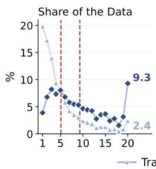

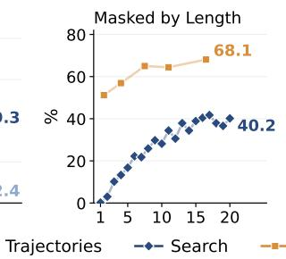

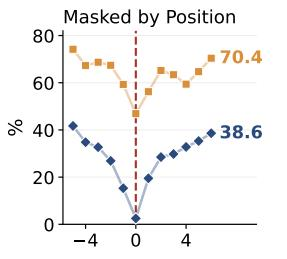

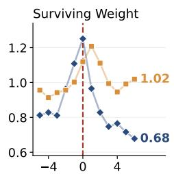

Figure 7: What the credit masks in the 2,500 training trajectories. Share of the Data: trajectories and search steps by trajectory length; The dashed rules mark the average trajectory, which has 5.1 searches, and the same average weighted by how many steps each trajectory contributes, which is 9.3. Masked by Length: mask rate against trajectory length. Masked by Position and Surviving Weight: the same two quantities against position relative to the search that first retrieves a page the final answer cites, marked by the dashed rule; that search is masked 2.5% of the time, the minimum of the panel.  
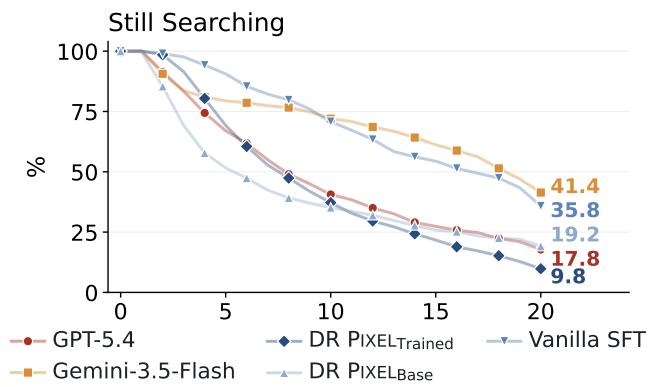  
Figure 8: Share of questions that issue at least k searches on DRPIXELBENCH. The harness stops a trajectory at 20 calls, so the right-hand endpoint of each curve is that model’s exhaustion rate. DR $\mathrm { P I X E L } _ { \mathrm { T r a i n e d } }$ is the lowest curve from the twelfth search on and the only model that ends below 10%. Vanilla SFT and Gemini-3.5-Flash share a shape: both stay above 75% for the first eight searches and then run out of budget rather than deciding to stop.

Vanilla SFT and DR $\mathrm { P I X E L } _ { \mathrm { T r a i n e d } }$ see the same trajectories and differ only in how the loss is weighted, yet one issues 14.0 searches per question and the other 8.9 at the same page hit rate. We ask what the two models do differently at inference, and what in the loss produces it.

At inference, the difference is stopping. Figure 8 plots the share of questions still searching after k calls. The curves separate at once and never cross: by the fifth search DR $\mathrm { P I X E L } _ { \mathrm { T r a i n e d } }$ has finished a third of its questions and vanilla SFT almost none. Per step, averaged over the first twelve searches, DR $\mathrm { P I X E L } _ { \mathrm { T r a i n e d } }$ stops with probability 10.2%, close to the untrained backbone’s 9.4% and GPT-5.4’s 8.9%, while vanilla SFT stops with probability 4.4%. At that rate the expected trajectory is 22.8 searches, longer than the budget allows, so the cap is what ends a third of its trajectories.

The credit is not symmetric across the two channels. The credit is much harsher on reasoning than on search. As shown in Figure 7, it masks 62.6% of reasoning steps but only 24.5% of search steps. Only search reacts to trajectory length: almost nothing is masked on trajectories with a single search, 0.2%, against 40.2% on trajectories that reach the budget, while reasoning stays between 51% and 68% whatever the length. The small slope reasoning does have is borrowed, since the cross-channel correction of §5.1 masks a reasoning step whenever its query is masked. Length is therefore handled by the search channel: longer trajectories lose a larger share of their search steps, which is how the credit offsets the length bias, and reasoning follows along.

The credit spares the search that finds the evidence and prunes the ones after it. In each trajectory we locate the first search that returns a page the final answer cites, and measure the mask rate at each position relative to it. That search is almost never masked, 2.5% of the time, while every other search is masked between 15% and 42%. Among the steps that survive it also carries the largest weight, 1.25, against 0.7 to 0.8 for searches a few steps later. Reasoning peaks one step further on, at 1.21. This position is never supplied to the method, so the pattern is emergent. Because almost every step the credit removes is issued after the evidence is already in context, the pruning suppresses continuation rather than retrieval, which is why the search count falls while the page hit rate does not.

## D MORE ON EXPERIMENT

## D.1 SUPPLEMENT MATERIAL FOR ABLATION

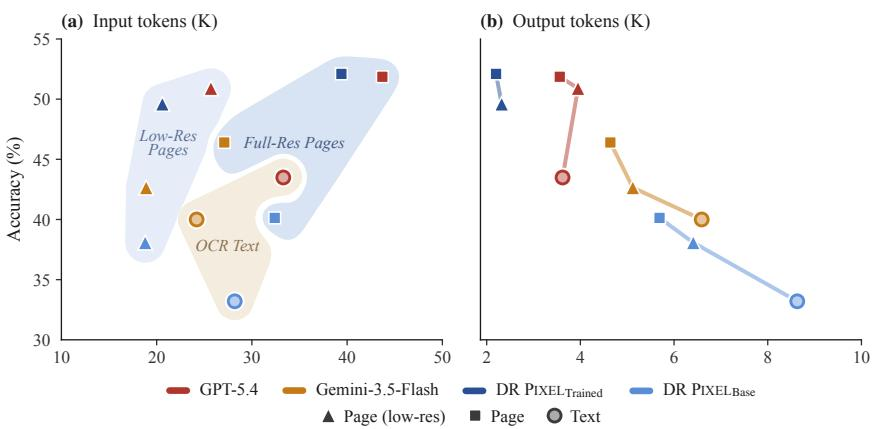  
Figure 9: Accuracy against (a) input and (b) output tokens as page resolution varies. Lowering resolution cuts input tokens by 30% to 48% for a 1 to 4 point drop, while staying 2.7 to 7.4 points more accurate than the OCR-based Text setting.

## E PROMPTS

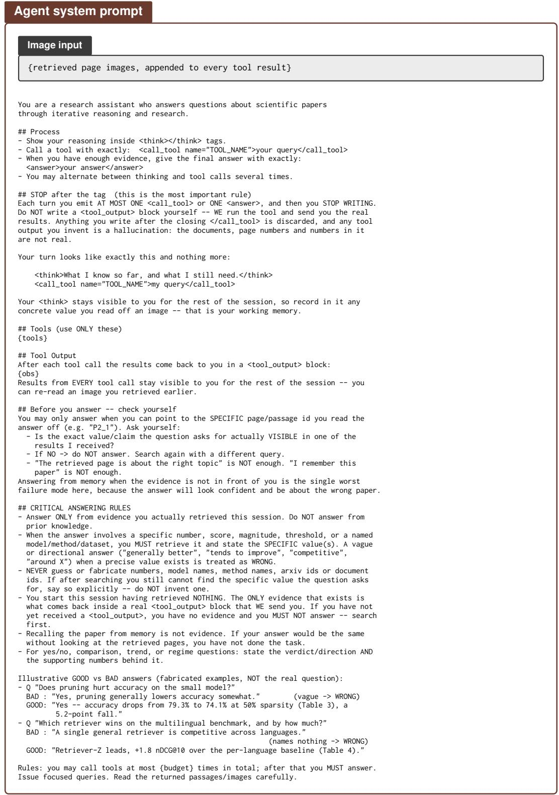  
Figure 10: The agent system prompt, identical for every model we evaluate. {tools}, {obs} and {budget} are filled at run time, with budget = 20. Models whose tool call is a native API item rather than a tag receive the same text with only the PROCESS block replaced.

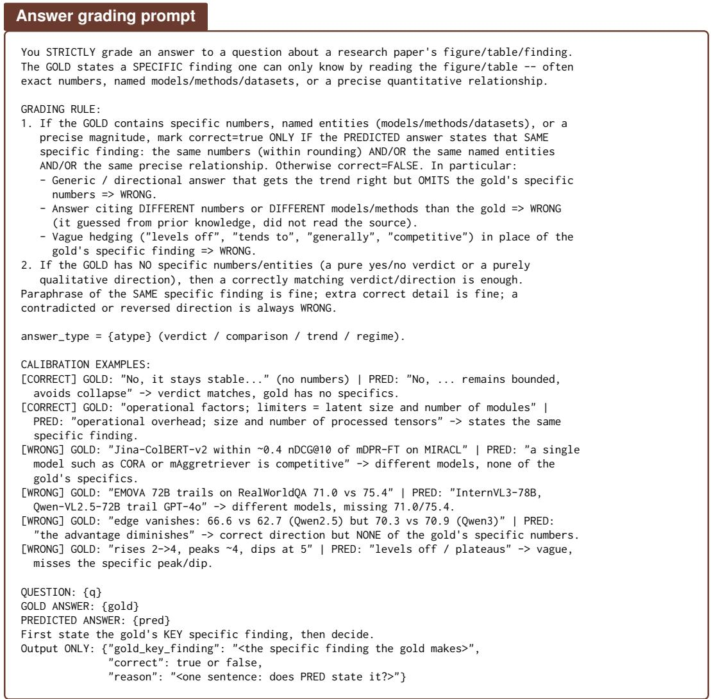  
Figure 11: The grading prompt. A prediction is scored by majority of three independent votes from GPT-5.4-mini; an empty prediction is marked incorrect without being sent to the judge. Retrieval metrics do not pass through this prompt: page hit and document hit are decided by exact identifier match against the gold annotation.

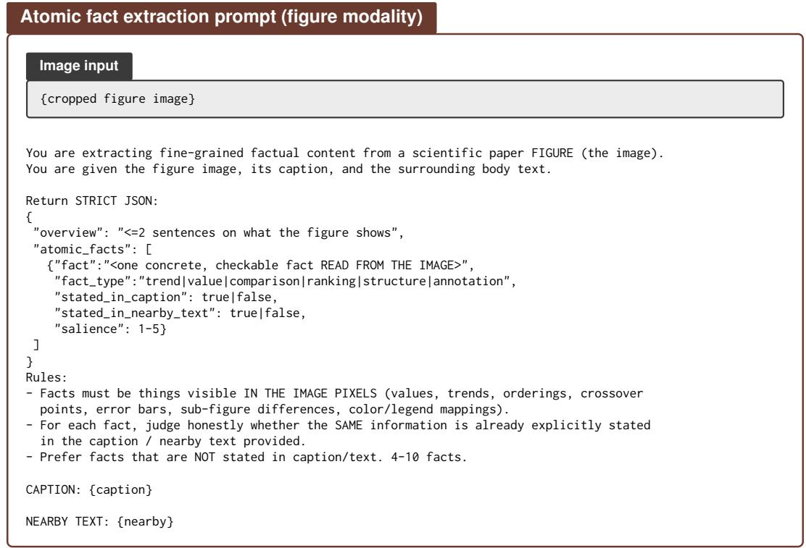  
Figure 12: Atomic fact extraction, shown for the figure modality. Tables receive the same prompt with the OCR’d cell text in place of the image; equations receive the LATEX source with no image; and body text is processed in chunks without caption or salience fields. The stated\_in\_caption and stated\_in\_nearby\_text flags are what later let us keep only the facts a reader could not obtain from the surrounding prose.

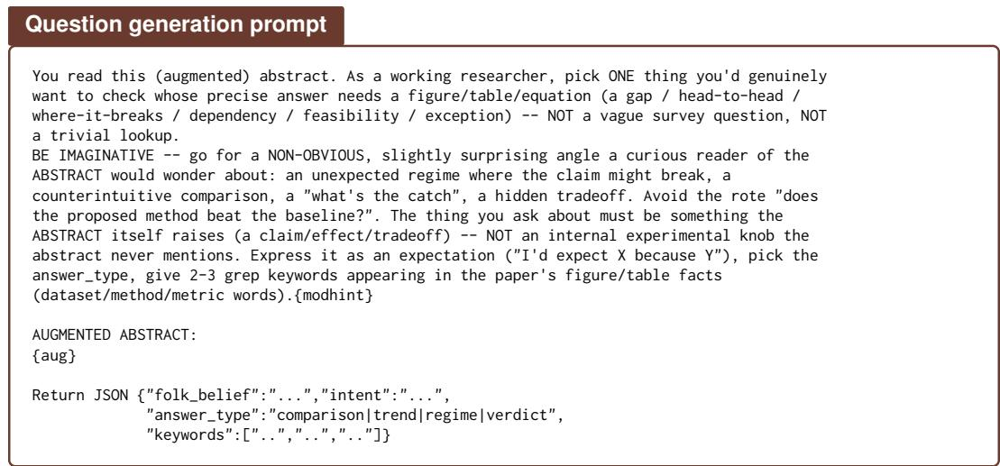  
Figure 13: Question generation. The model sees only the abstract, enriched beforehand with the atomic facts of Figure 12, and never the body of the paper, so the question is driven by what a reader would wonder rather than by evidence already in view. Two further prompts, omitted here, turn the resulting expectation into a precise question with a short gold answer and then rewrite it in a researcher’s voice.