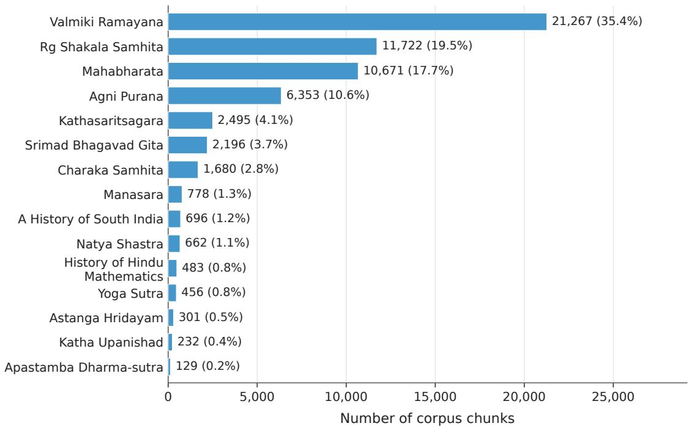
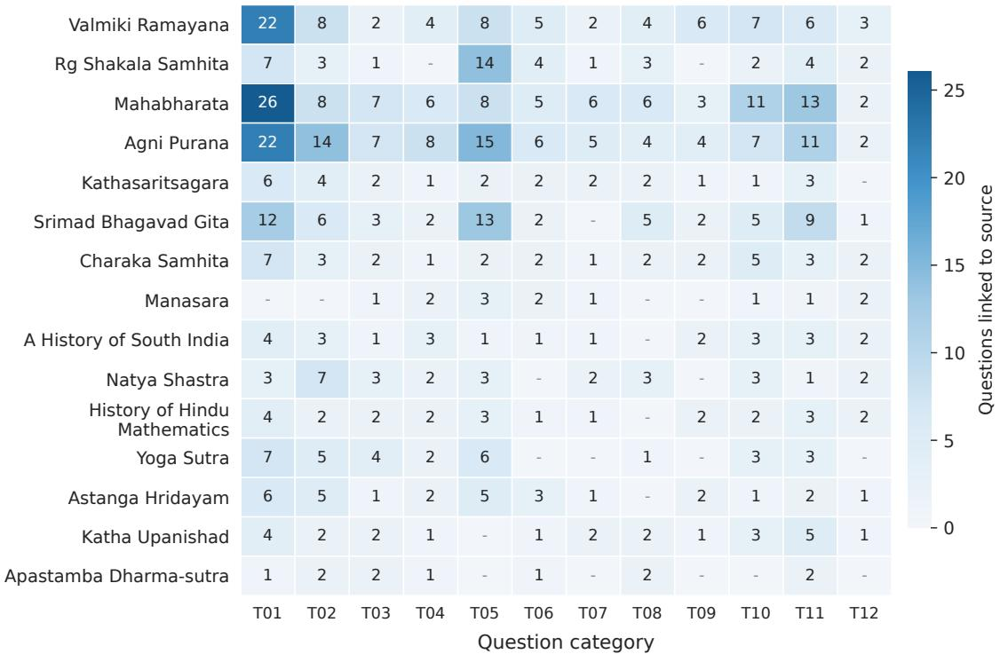
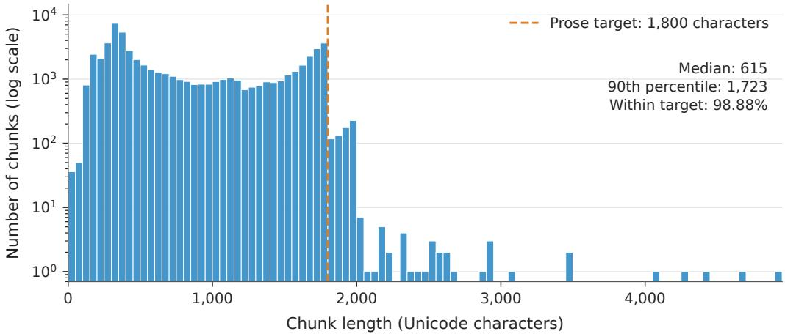
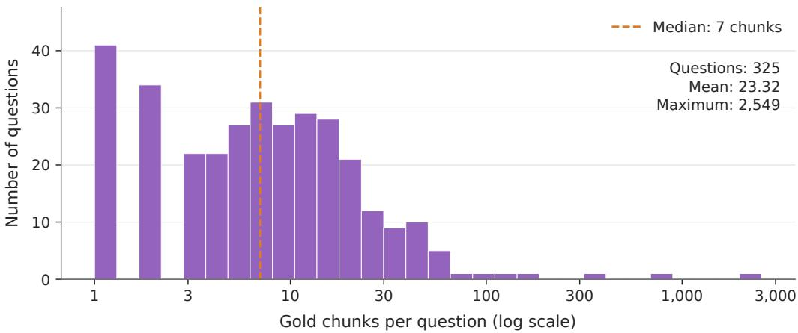
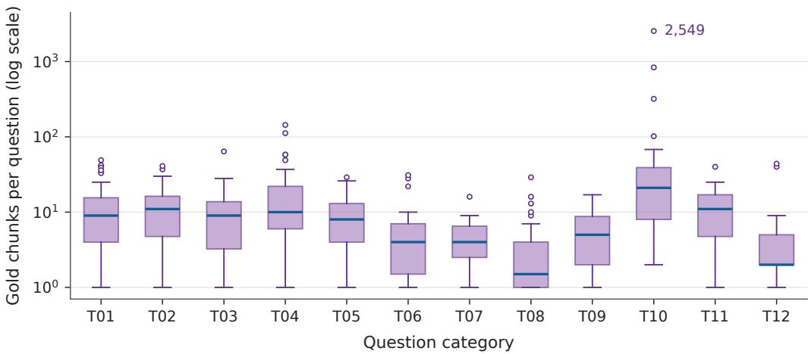
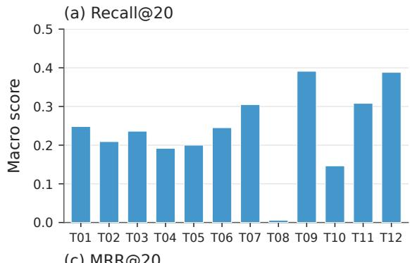
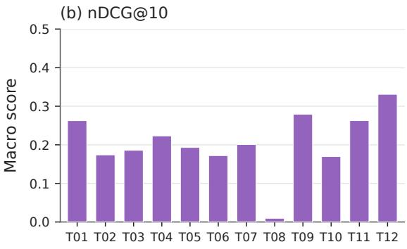
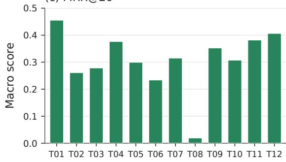
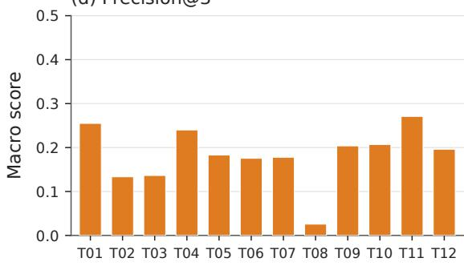

# Dhar¯ a Bench: An Evidence-Oriented Retrieval Benchmark for Indian¯ Knowledge Systems

AVINASH HOLENARASIPUR NAGENDRA1∗

ANAND KANIYAAR SRIRANGA PRASAD2,1∗

KOUSIK SARATHY SRIDHARAN1,3,5

MOHAN RAGHAVAN1,3,4,5

Dhar¯ a Bench is a retrieval benchmark for Indian Knowledge Systems (IKS), with 325 questions in 12 categories and 60,121 text chunks¯ from 15 source groups. The categories were developed based on 4,500 questions submitted to the Dhar¯ a application; the evaluation¯ set combines corpus-aligned application queries with expert-contributed questions. The annotations comprise 7,578 question-chunk relevance links involving 6,847 distinct corpus chunks. For 34 composite and multi-hop questions, 401 conjugate groups specify alternative sets of passages that jointly support each question. Chunk identifiers and hierarchical references connect the judgments to their source texts. The paper describes corpus preparation, annotation, and validation, and reports a fixed BM25 baseline implemented with Pyserini with � = 0.9 and � = 0.4. Across all questions, BM25 achieves MRR@20 of 0.315, Recall@10 of 0.182, and nDCG@10 of 0.205. On the group-annotated subset, complete-evidence scores are CE\_Recall@20 = 0.294 and CE\_MRR@20 = 0.141. The category results expose particularly weak verse retrieval, while group scores reveal gaps between finding individual passages and completing their support. The corpus and evaluation code are available at https://github.com/Avinash2236/Dhara-Bench.

CCS Concepts: • Information systems → Information retrieval.

Additional Key Words and Phrases: Indian Knowledge Systems, information retrieval, evidence retrieval, benchmark, provenance, question taxonomy

## 1 Introduction

India’s intangible heritage includes knowledge sustained through oral traditions, written texts, formal learning, and community practice. The term Indian Knowledge Systems (IKS) covers these codified traditions and the practical expertise passed down within communities [5]. Its fields include philosophy, grammar, logic, mathematics, astronomy, architecture, medicine, agriculture, metallurgy, and trade, alongside literature and everyday practices such as dress, language, ethics, and cuisine [15].

Indian philosophical inquiry gives attention to both the object of knowledge (prameya) and the means of valid knowledge (prama¯n. a) [14]. Yoga accepts three means: perception (pratyaks. a), inference (anumana¯ ), and authoritative testimony (agama ¯ ) [1]. Advaita Vedanta recognizes six: perception, inference, testimony ( ¯ śabda), comparison (upamana ¯ ), postulation (arthapatti¯ ), and non-cognition (anupalabdhi) [19]. These traditions combine observation, reasoning, and transmitted knowledge. Working with their texts therefore calls for examining the origin, relevance, and validity of supporting material before drawing conclusions.

∗Avinash Holenarasipur Nagendra and Anand Kaniyaar Sriranga Prasad contributed equally and are joint first authors

Finding that evidence is a substantial task. A reader may seek a verse from its opening words, the meaning of an Indic term, a sequence of events, or passages supporting an interpretation. Prose chapters, verses, sutras, and commentaries¯ also difer in length and reference conventions. Some questions can be addressed from one passage; others require material from several locations.

Dhar¯ a Bench provides a shared corpus and expert annotations for studying this retrieval problem. A system ranks¯ existing text chunks in response to a question, and evaluation compares their identifiers with the annotated passages. Here, evidence means inspectable textual support. The validity of source claims and the correctness of answers synthesized from them require separate assessment.

The collection contains 325 questions in 12 categories and 60,121 chunks from 15 source groups. Questions were selected from corpus-aligned Dhar¯ a application queries and supplemented by domain experts. The annotations record¯ 7,578 question-chunk links covering 6,847 distinct chunks. For 19 composite and 15 multi-hop questions, 401 conjugate evidence groups identify alternative sets of passages that jointly support the whole question. These groups allow evaluation to distinguish finding a useful passage from assembling suficient support.

The paper describes source preparation, question selection, annotation, and validation. A fixed BM25 baseline supplies overall and category-wise results, including scores for group completion. The accompanying GitHub release provides the corpus, questions, annotations, source metadata, rankings, and evaluation code.

## 2 Related Work

Table 1 places Dhar¯ a Bench alongside retrieval, Indian-language, cultural, and IKS resources. The principal diferences¯ concern the texts being searched and the units used for evaluation.

Retrieval and provenance benchmarks. BEIR’s original suite of 18 datasets covers domains such as biomedical literature, finance, news, and Wikipedia, but has no dedicated IKS collection [20]. KILT uses a shared Wikipedia snapshot to evaluate knowledge-intensive NLP tasks and their provenance [13]. Encyclopedic coverage can include IKS topics; Dhar¯ a Bench instead organizes retrieval judgments around the selected source works and their internal textual locations.¯

Indian-language and cultural evaluation. Indic-QA covers extractive and abstractive question answering in 11 Indian languages [18]. SANSKRITI assesses Indian cultural knowledge [8], and IndQA uses expert-authored questions and rubrics to assess culturally grounded knowledge and reasoning [11]. These resources overlap with IKS in language or subject matter and evaluate answers. Dhar¯ a Bench supplies ranked-passage judgments over a fixed corpus.¯

Sanskrit and IKS resources. Anveshana pairs 3,400 English queries with Sanskrit documents from Śr¯ımadbhagavatam¯ for cross-lingual retrieval [3]. Mandikal [9] studies retrieval-augmented long-form question answering in Advaita Vedanta using the VedantaNY-10M datastore of public discourses. SanskritShala ofers Sanskrit NLP tools for teaching¯ and annotation [16], while IKS-Instruct supplies multilingual instruction-response data for model adaptation [17]. The contribution here is a common retrieval evaluation across 15 source groups, 12 question categories, and expert-selected passages.

Joint supporting evidence. HotpotQA annotates sentence-level supporting facts across documents [25]; MuSiQue connects questions through dependent reasoning steps [22]; and Multi-Hop Dense Retrieval studies supporting-passage retrieval for complex questions [24]. Dhar¯ a Bench records alternative chunk groups for composite and multi-hop¯ questions. Section 6 defines this representation, and Section 8.1.6 specifies how group completion is scored.

Table 1. Positioning relative to representative retrieval, Indian-language, cultural, and IKS-related resources.
<table><tr><td>Resource</td><td>Primary objective</td><td>Knowledge scope</td><td>Evidence / grading unit</td><td>Relation to Dhārā Bench</td></tr><tr><td>BEIR [20]</td><td>Information retrieval</td><td>Diverse domains; no dedicated IKS collection</td><td>Dataset-specific relevance judgments</td><td>General heterogeneous IR benchmark</td></tr><tr><td>KILT [13]</td><td>Knowledge-intensive NLP</td><td>Wikipedia</td><td>Provenance and task output</td><td>Provenance- aware multi-task</td></tr><tr><td>Anveshana [3]</td><td>Cross-lingual retrieval</td><td>Śrīmadbhāgavatam</td><td>English query-Sanskrit document pairs</td><td>benchmark Retrieval within one IKS work</td></tr><tr><td>VedantaNY- 10M [9]</td><td>RAG / long-form QA</td><td>Advaita Vedānta</td><td>Retrieved datastore passages</td><td>Specialized philosophy retrieval setting</td></tr><tr><td>Indic-QA [18]</td><td>Context-grounded QA</td><td>11 Indian languages</td><td>Supplied QA context</td><td>Multilingual QA</td></tr><tr><td>SANSKRITI [8]</td><td>Cultural knowledge</td><td>Indian culture</td><td>QA-pair answer evaluation</td><td>Cultural knowledge evaluation</td></tr><tr><td>IndQA [11]</td><td>Cultural reasoning</td><td>Indian languages and cultural domains</td><td>Expert rubric and ideal answer</td><td>Expert- authored reasoning</td></tr><tr><td>IKS-Instruct [17] Instruction tuning</td><td></td><td>Multilingual IKS material</td><td>Instruction-response pairs</td><td>benchmark IKS adaptation resource</td></tr><tr><td>Dhārā Bench</td><td>Evidence retrieval</td><td>15 IKS source groups</td><td>Chunk relevance and joint evidence groups</td><td>12 question categories over a fixed IKS corpus</td></tr></table>

## 3 Source Corpus

## 3.1 Selection of works

The 15 source groups cover epic narratives, Pura¯n. ic literature, Vedic hymns, philosophical dialogues, sutras, and story¯ collections, together with treatises on medicine, performing arts, and architecture. Modern studies cover mathematics and South Indian history. Table 2 lists the works and their principal IKS domains.

Selection sought variety in textual form and subject matter. Some groups contain several editions, translations, or commentaries on one work. The Bhagavadg¯ıta forms a separate group because the corpus includes dedicated translation¯ and commentary resources for it.

The corpus provides English translations and explanations, while retaining Sanskrit terminology, source expressions, and quotations where present. Machine translations were produced where required using a locally hosted, instructiontuned Gemma 4 31B model (gemma-4-31B-it) [2]. Domain-specific IKS technical terms are also retained in the questions.

Table 2. The 15 source groups in Dhar¯ a Bench and their principal IKS domains.¯
<table><tr><td>No.</td><td>Source group</td><td>IKS domain</td></tr><tr><td>1</td><td>Mahābhārata</td><td>Itihāsa</td></tr><tr><td>2</td><td>Vālmīki Rāmāyaa</td><td>Itihāsa</td></tr><tr><td>3</td><td>Agni Purāa</td><td>Purāņa</td></tr><tr><td>4</td><td>Āpastamba Dharma-sūtra</td><td>Dharmaśāstra</td></tr><tr><td>5</td><td>Caraka Sahitā</td><td>Ayurveda</td></tr><tr><td>6</td><td>Kathāsaritsāgara</td><td>Kāvya</td></tr><tr><td>7</td><td>Nāyaśāstra</td><td>Kalā</td></tr><tr><td>8</td><td>Așānga Hdayam</td><td>Ayurveda</td></tr><tr><td>9</td><td>Bhagavadgītā</td><td>Philosophy</td></tr><tr><td>10</td><td>Kaha Upanișad</td><td>Upanișad</td></tr><tr><td>11</td><td>Mānasāra</td><td>Śilpa</td></tr><tr><td>12</td><td>History of Hindu Mathematics</td><td>Mathematics</td></tr><tr><td>13</td><td>A History of South India</td><td>History</td></tr><tr><td>14</td><td>Rg Šākala Sahitā</td><td>Veda</td></tr><tr><td>15</td><td>Yoga-sūtra</td><td>Darśana</td></tr></table>

## 3.2 Acquisition and provenance

Machine-readable web pages were acquired by text extraction; scanned PDFs were converted with Surya OCR [12]. The source manifest gives bibliographic descriptions and URLs for the resources within each group.

Each corpus record has 3 fields: id, its unique integer identifier; chunk, the searchable text; and ref, the hierarchical location in the source. Evaluation uses the identifier to connect a judgment to a specific passage; the reference and manifest allow that passage to be inspected in its textual and bibliographic context.

## 3.3 Data and code availability

The GitHub repository at https://github.com/Avinash2236/Dhara-Bench contains the following data files:

• chunks.json: all corpus chunk records.

• Dhara Bench eval set.json: questions, category labels, gold chunk identifiers, and conjugate evidence groups.

• source\_metadata.csv: source descriptions and URLs.

The repository also contains BM25 scripts in scripts/, and saved rankings and metric outputs in metric\_outputs/.   
Section 6 defines the annotation fields, and Section 8.2 explains how to reproduce the scores.

## 4 Dataset Construction

## 4.1 Question collection and taxonomy development

Analysis of 4,500 questions submitted to the Dhar¯ a application¯ 1 led to 12 question categories, T01-T12. Questions were grouped by their main requested operation: the same source could be queried for a fact, a list, a word meaning, a verse, or an interpretation. This produced an empirical scheme based on application use.

Most categories describe tasks found across domains, including fact lookup, enumeration, counting, chronology, composite queries, multi-hop reasoning, and false-premise correction. Lexical understanding (T05) and verse or textual retrieval (T08) are particularly relevant to scholarly discourse in IKS. T05 covers the meaning or equivalent of an Indic term, including its use within a verse. T08 covers locating, identifying, or completing a text from opening words, a numbered reference, or a paraphrased meaning. Such tasks also occur in other literary traditions; their distinctive demands here arise from Indic terminology, textual forms, and reference conventions.

Interpretive questions (T11) depend on concepts within a textual tradition, while computational questions (T12) draw on its rules, quantities, or procedures. T12 includes rule-based lexical derivation, distinguished from meaning lookup in T05. Table 3 gives the full definitions.

The final 325 questions combine corpus-aligned application queries with questions supplied by domain experts. Each record retains its original wording, receives a unique query\_id, and has one primary category. The category counts describe this selected set, rather than the distribution of all 4,500 application questions.

## 4.2 Chunk construction

Prose chapters were segmented independently with LangChain’s RecursiveCharacterTextSplitter [6], using a target of 1,800 characters and an overlap setting of 250 characters, measured by Python’s len. Splits followed paragraph boundaries where possible, then line boundaries, periods followed by a space, and individual word separators. Chunks and overlaps stayed within chapter boundaries. Leading periods introduced by splitting and surrounding whitespace were removed.

A verse and its explicitly linked translation or commentary were kept together when they fit within approximately 1,800 characters. Longer units were split with their textual location retained. These rules account for records that exceed the prose target.

## 4.3 Evidence annotation

Domain experts identified candidate passages using their knowledge of the source works. They were permitted to use the Dhar¯ a application and tools such as Gemini, ChatGPT, and Claude to supplement their expertise and search ¯ as comprehensively as possible for relevant evidence. Experts inspected candidate passages against corpus records, judged their relevance, and recorded the selected chunk identifiers. On average, 2 experts annotated each question Their selected chunk identifiers were combined by taking the union of their annotations and removing duplicates.

Selection followed the question’s task. A lexical question calls for an explanation or equivalent of the term; a verse query calls for the requested text or its location; and a computational question calls for the relevant premises or rules. For false-premise questions, experts selected passages that contradicted the assumption or established the correct fact. A missing passage alone was insuficient grounds for a correction.

The 19 Composite (T06) and 15 Multi-hop (T07) questions received group annotations as well. Experts specified the intended answer scope, separated it into required facts or relations, and inspected which requirements each candidate supported. T06 groups had to cover every part of the query; T07 groups had to supply the facts and connections in the reasoning chain. Entity identities, aliases, chronology, and compatibility between passages were considered when combining chunks.

Alternative combinations were retained when they supplied the same required support. Redundant supersets were removed, and a singleton was accepted when one chunk covered the whole scope. Section 6 formalizes these groups and illustrates them with a released question. In the released annotations, the flat gold list for T06/T07 is the union of their groups; the other 10 categories use their reviewed passage lists.

## 5 Question Taxonomy

Each question receives the category of its main requested operation, including when it involves subsidiary steps.   
Table 3 defines T01-T12 and gives their counts. The scheme emerged from the application-query analysis in Section 4.1;   
Composite (T06) refers to multiple parts within a single query.

Table 3. Question categories in Dhar¯ a Bench (325 questions).¯
<table><tr><td>Code</td><td>Question category</td><td>Task description</td><td>n</td></tr><tr><td>T01</td><td>Fact retrieval</td><td>Explicitly stated information</td><td>51</td></tr><tr><td>T02</td><td>List / set retrieval</td><td>Entities satisfying a condition</td><td>40</td></tr><tr><td>T03</td><td>Counting / aggregation</td><td>Counts, totals, or numerical aggregation</td><td>22</td></tr><tr><td>T04</td><td>Chronology / sequence</td><td>Order of events or related entities</td><td>25</td></tr><tr><td>T05</td><td>Lexical understanding</td><td>Meaning, translation, or equivalence</td><td>31</td></tr><tr><td>T06</td><td>Composite</td><td>Two or more independent questions grouped in one query</td><td>19</td></tr><tr><td>T07</td><td>Multi-hop reasoning</td><td>Chains of linked facts across entities or events</td><td>15</td></tr><tr><td>T08</td><td>Verse / textual retrieval</td><td>Retrieve, locate, identify, or complete a verse or text</td><td>26</td></tr><tr><td>T09</td><td>False-premise correction</td><td>Identify and correct an incorrect assumption using source evidence</td><td>18</td></tr><tr><td>T10</td><td>Summarization / expansion / composition</td><td>Structured overview, detailed exposition, or rule-constrained com-</td><td>29</td></tr><tr><td>T11</td><td>Analytical / interpretive rea-</td><td>position Interpretation, abstraction, or thematic reasoning grounded in the</td><td>32</td></tr><tr><td>T12</td><td>soning Mathematical / logical / com- putational problems</td><td>textual tradition Sequential computation, inference, algorithms, or rule-based lexical derivation</td><td>17</td></tr><tr><td>Total</td><td colspan="3"></td></tr></table>

## 6 Ground-Truth Evidence

Question 157 asks, “What did Nachiketa ask for as his first boon? How did Yama respond?” Answering the whole question requires evidence for both the request and the response. In Kat.ha Upanis.ad I.1.10-11, chunks 262130 and 262131 contain the request and reply; chunks 261886 and 261887 contain their respective commentaries. The annotations record 4 alternatives, each pairing one request passage with one response passage. Retrieving only the request leaves the second part unsupported.

For each question �, the gold set $G _ { q }$ lists the identifiers of chunks selected by domain experts as relevant to the requested task. Each selected chunk receives a binary relevance label, and its ref field locates the passage within its source. Section 4.3 describes the selection procedure.

Composite (T06) and Multi-hop (T07) questions additionally have conjugate evidence groups: combinations of passages judged jointly suficient for the specified answer scope. Their collection is written as

$$
C _ { q } = \{ C _ { q , 1 } , \ldots , C _ { q , m _ { q } } \} .\tag{1}
$$

All chunks within a group are required (AND), while any one complete group provides an acceptable alternative (OR). Each group is minimal: removing any member leaves some required support missing. A group may contain a single chunk when that passage supports the whole question.

The JSON stores the groups in refs.conjugate\_groups. For T06/T07, refs.chunk contains the distinct chunk identifiers across all groups,

$$
G _ { q } = \bigcup _ { C \in C _ { q } } C .\tag{2}
$$

For Question 157, this union contains 4 identifiers, although any one of the 4 recorded request-response pairs supplies the required support. Conventional metrics score retrieval of individual chunks from $G _ { q } ;$ the group metrics in Section 8.1.6 test whether at least one complete group is retrieved.

For the remaining 10 categories, annotations list relevant chunks individually, without specifying which combinations jointly provide suficient support. An individual relevance label does not imply that the chunk alone answers the whole question.

The annotations reflect evidence identified and reviewed by domain experts through their knowledge of the sources and tool-assisted searches. However, we cannot claim exhaustive coverage of every relevant passage or possible combination of supporting passages. Scores measure retrieval against the recorded judgments.

## 7 Dataset Characterization

## 7.1 Corpus and evidence scale

Table 4 reports corpus scale and annotation coverage. Most chunks fit the prose segmentation target, with a small tail of longer records.

The annotations involve 11.4% of the corpus. A chunk used by several questions contributes once to the distinct count and once per question to the link count. T06/T07 statistics use each question’s group union, counting a chunk once regardless of repeated membership across alternatives.

Table 4. Corpus and relevance-link summary for Dhar¯ a Bench.¯
<table><tr><td>Statistic</td><td>Value</td></tr><tr><td>Corpus chunks</td><td>60,121</td></tr><tr><td>Unique corpus IDs</td><td>60,121</td></tr><tr><td>Total Unicode characters</td><td>50,655,188</td></tr><tr><td>Whitespace-delimited words</td><td>8,450,776</td></tr><tr><td>Median chunk length (characters)</td><td>615</td></tr><tr><td>90th-percentile chunk length</td><td>1,723</td></tr><tr><td>Chunks ≤ 1,800 characters</td><td>59,445 (98.88%)</td></tr><tr><td>Question-chunk relevance links</td><td>7,578</td></tr><tr><td>Distinct gold chunks</td><td>6,847 (11.4% of corpus)</td></tr><tr><td>Orphan gold IDs</td><td>0</td></tr><tr><td>Duplicate corpus IDs</td><td>0</td></tr><tr><td>Empty chunks / missing refs</td><td>0 / 0</td></tr></table>

Figure 1 shows an uneven distribution of chunks across source groups. Such variation is expected in an IKS corpus, where expansive epics and textual collections coexist with much shorter works. Diferences in textual extent partly

explain why a few sources contribute a large share of the corpus: the Ram¯ aya ¯ n. a, R. g Śakala Sa ¯ m. hita, and Mah ¯ abh ¯ arata¯ together account for 72.6% of all chunks. This imbalance should be considered when interpreting retrieval performance across the corpus.

  
Fig. 1. Corpus chunks by source group. Labels give the chunk count and percentage of the full corpus.

Figure 2 maps the annotated questions to their sources. The mix difers by category, so a category comparison also reflects which works supply its passages. Cell counts include each source used by a question.

## 7.2 Chunk-length distribution

Figure 3 shows the full length distribution. Only 676 chunks (1.12%) exceed the prose target, and the maximum is 4,920 characters. Chunks containing verses and their associated translations or commentaries were formed using the segmentation rules described in Section 4.2.

Fig. 2. Question-source coverage by question category. Rows follow the source-size order in Figure 1; cells count questions, and dashes indicate zero. A question linked to multiple sources contributes once to each source group.  
  
Fig. 3. Distribution of corpus chunk lengths in Unicode characters. The dashed line marks the 1,800-character target used for prose segmentation.

## 7.3 Evidence-set variation

Table 5 shows substantial diferences in annotation size. T10 has a median of 21 chunks, a mean of 149.38, and the largest set of 2,549. T08 and T12 have medians of 1.5 and 2. A fixed retrieval budget therefore covers very diferent fractions of the annotated material across categories.

Table 5. Gold-evidence set size by question category.
<table><tr><td>Category</td><td>n</td><td>Median</td><td>Mean</td><td>Max</td></tr><tr><td>T01</td><td>51</td><td>9.0</td><td>12.53</td><td>49</td></tr><tr><td>T02</td><td>40</td><td>11.0</td><td>11.93</td><td>41</td></tr><tr><td>T03</td><td>22</td><td>9.0</td><td>11.82</td><td>64</td></tr><tr><td>T04</td><td>25</td><td>10.0</td><td>24.92</td><td>144</td></tr><tr><td>T05</td><td>31</td><td>8.0</td><td>9.48</td><td>29</td></tr><tr><td>T06</td><td>19</td><td>4.0</td><td>7.16</td><td>31</td></tr><tr><td>T07</td><td>15</td><td>4.0</td><td>5.07</td><td>16</td></tr><tr><td>T08</td><td>26</td><td>1.5</td><td>4.50</td><td>29</td></tr><tr><td>T09</td><td>18</td><td>5.0</td><td>6.00</td><td>17</td></tr><tr><td>T10</td><td>29</td><td>21.0</td><td>149.38</td><td>2,549</td></tr><tr><td>T11</td><td>32</td><td>11.0</td><td>11.94</td><td>40</td></tr><tr><td>T12</td><td>17</td><td>2.0</td><td>7.88</td><td>44</td></tr><tr><td>Overall</td><td>325</td><td>7.0</td><td>23.32</td><td>2,549</td></tr></table>

Figures 4 and 5 show the long tail of gold-set sizes and its distribution across categories. Logarithmic axes retain the extreme observations while keeping the smaller sets visible.

  
Fig. 4. Distribution of deduplicated gold chunks per question on a logarithmic horizontal axis. The dashed line marks the median of 7 chunks.

The group annotations comprise 330 T06 groups and 71 T07 groups. Of the 401 total, 35 are singletons, 340 contain 2 chunks, 24 contain 3, and 2 contain 4; 366 therefore require multiple chunks. Their per-question unions contribute 212 relevance links: 136 for T06 and 76 for T07. These group counts describe alternative support combinations, whereas Table 5 counts distinct chunks per question.

  
Fig. 5. Gold-evidence set size by question category on a logarithmic vertical axis. Boxes span the interquartile range, blue lines mark medians, and whiskers extend to the most extreme observations within 1.5 interquartile ranges of the box. Circles show observations beyond the whiskers.

## 8 Evaluation Protocol and BM25 Baseline

## 8.1 Metrics

Individual-chunk scores comprise Precision, Recall, F1, mean reciprocal rank (MRR), and normalized discounted cumulative gain (nDCG). Group-completion scores additionally use the T06/T07 annotations. Let � be the 325 questions, $G _ { q }$ the nonempty gold set from Section 6, and $L _ { q } = ( d _ { q , 1 } , \ldots , d _ { q , n _ { q } } )$ the deduplicated ranking. For cutof �, ${ \cal L } _ { q } ^ { ( k ) }$ contains the first min(�, $n _ { q } )$ identifiers and $E _ { q } ( k ) = L _ { q } ^ { ( k ) } \cap G _ { q }$ contains the gold hits.

Precision, Recall, F1, and nDCG are computed at $k \in \{ 3 , 8 , 1 0 , 2 0 \}$ }. For any of these per-question measures $M @ k ( q )$ the overall score is the macro-average

$$
\overline { { M @ k } } = \frac { 1 } { | Q | } \sum _ { q \in Q } M @ k ( q ) .\tag{3}
$$

Each question has equal weight. Category scores take the same mean over their subset of questions. All scores range from 0 to 1, with higher values indicating better agreement with the judgments; chunks outside $G _ { q }$ receive no relevance credit.

8.1.1 Precision at �. Precision@� measures the proportion of the first � retrieval positions occupied by gold chunks [10]:

$$
P  @ k ( q ) = \frac { | E _ { q } ( k ) | } { k } .\tag{4}
$$

The denominator remains � for shorter result lists, so unfilled positions receive no credit.

8.1.2 Recall at �. Recall@� measures the fraction of a question’s gold evidence recovered within the first � results [10]:

$$
R @ k ( q ) = \frac { | E _ { q } ( k ) | } { | G _ { q } | } .\tag{5}
$$

The maximum at a fixed cutof is min $( k , | G _ { q } | ) / | G _ { q } | ;$ full recall requires enough result positions to hold the gold set.

8.1.3 F1 at �. F1@� combines precision and recall through their harmonic mean [10]:

$$
F 1 @ k ( q ) = \left\{ \begin{array} { l l } { \displaystyle \frac { 2 P @ k ( q ) R @ k ( q ) } { P @ k ( q ) + R @ k ( q ) } , } & { P @ k ( q ) + R @ k ( q ) > 0 , } \\ { 0 , } & { \mathrm { o t h e r w i s e } . } \end{array} \right.\tag{6}
$$

F1 is calculated per question before averaging. This macro-average generally difers from the harmonic mean of macro Precision and Recall.

8.1.4 Mean reciprocal rank at 20. Mean reciprocal rank summarizes how early the first relevant result appears [23]. We report MRR@20, which credits the first gold hit only when it occurs within the first 20 results. Let $r _ { q }$ be the rank of the first gold chunk in the returned list. The per-question reciprocal rank at this cutof and its mean are

$$
\begin{array} { r } { \mathrm { R R } @ 2 0 ( q ) = \left\{ \begin{array} { l l } { 1 / r _ { q } , } & { \mathrm { i f ~ a ~ g o l d ~ c h u n k ~ i s ~ r e t r i e v e d ~ a n d ~ } r _ { q } \le 2 0 , } \\ { 0 , } & { \mathrm { o t h e r w i s e } , } \end{array} \right. } \end{array}\tag{7}
$$

$$
\mathrm { M R R } @ 2 0 = \frac { 1 } { | Q | } \sum _ { q \in Q } \mathrm { R R } @ 2 0 ( q ) .\tag{8}
$$

A first gold hit at rank 1 contributes 1; at rank 5 it contributes 0.2. Only the rank of the first relevant chunk contributes to MRR; additional relevant chunks do not increase the score.

8.1.5 Normalized discounted cumulative gain at �. nDCG@� evaluates the placement of relevant chunks throughout the first � results, assigning greater weight to earlier ranks [4, 10]. We use binary relevance: re $\mathrm { l } _ { q , i } = 1$ when the chunk at rank � belongs to $G _ { q } ,$ and zero otherwise, including unfilled positions. Discounted cumulative gain (DCG), ideal DCG, and nDCG are defined as

$$
\mathrm { D C G } @ k ( q ) = \sum _ { i = 1 } ^ { k } \frac { \mathrm { r e l } _ { q , i } } { \log _ { 2 } ( i + 1 ) } ,\tag{9}
$$

$$
\mathrm { I D C G @ } k ( q ) = \sum _ { i = 1 } ^ { \operatorname* { m i n } ( k , | G _ { q } | ) } \frac { 1 } { \log _ { 2 } ( i + 1 ) } ,\tag{10}
$$

$$
{ \mathrm { n D C G } } @ k ( q ) = { \frac { { \mathrm { D C G } } @ k ( q ) } { { \mathrm { I D C G } } \ @ k ( q ) } } .\tag{11}
$$

IDCG places gold chunks first, up to the cutof. It is positive because every gold set is nonempty. Unlike MRR, nDCG rewards the positions of multiple relevant results.

8.1.6 Complete-Evidence Recall (CE\_Recall) at �. For T06 and T07, let $Q _ { \mathrm { C E } } = \{ q : C _ { q } \neq \emptyset \}$ contain the questions with at least one conjugate group. Complete-Evidence Recall (CE\_Recall) at cutof � is

$$
\begin{array} { r } { \mathrm { C E \_ R e c a l l } @ k ( q ) = \left\{ \begin{array} { l l } { 1 , } & { \mathrm { i f } \mathrm { ~ s o m e } C \in C _ { q } \mathrm { ~ s a t i s f i e s } C \subseteq L _ { q } ^ { ( k ) } , } \\ { 0 , } & { \mathrm { o t h e r w i s e } . } \end{array} \right. } \end{array}\tag{12}
$$

This binary score records whether the ranking contains a whole group. Its macro-average,

$$
\mathrm { C E \_ R e c a l l } @ k = \frac { 1 } { | Q _ { \mathrm { C E } } | } \sum _ { q \in Q _ { \mathrm { C E } } } \mathrm { C E \_ R e c a l l } @ k ( q ) ,\tag{13}
$$

is the fraction of questions with a completed group. It is reported at $k \in \{ 3 , 8 , 1 0 , 2 0 \}$ . The requirement to recover a complete evidence set has precedents in FEVER [21] and KILT [13]. CE\_Recall counts questions for which at least one annotated group is complete; KILT’s Recall@� instead measures the fraction of provenance sets recovered under its ranking convention. All 34 annotated questions are evaluable. A question lacking a valid group would be excluded and counted as unevaluable; individual-chunk scores cover all 325 questions

8.1.7 Complete-Evidence reciprocal rank (CE\_RR) and its mean (CE\_MRR). We adapt reciprocal rank [23] to the earliest rank at which a complete evidence group is available. KILT similarly uses the lowest-ranked required page to locate a provenance set [13]; our definition retains the original chunk positions and takes the earliest completion across alternative groups. We use CE\_RR for the per-question score and CE\_MRR for its mean over questions.

Let ran $\mathfrak { s } _ { q } ( c )$ be the first rank of chunk $c ,$ or ∞ if it is absent from the returned list. A group’s completion rank is the position of its last required member, and the question’s earliest completion rank is the best of these alternatives:

$$
\rho _ { q } ( C ) = \operatorname* { m a x } _ { c \in C } \mathrm { r a n k } _ { q } ( c ) , \qquad \rho _ { q } ^ { * } = \operatorname* { m i n } _ { C \in C _ { q } } \rho _ { q } ( C ) .\tag{14}
$$

At an explicit evaluation depth �, Complete-Evidence Reciprocal Rank and its macro-average are

$$
\begin{array} { r } { \mathrm { C E } _ { - } \mathrm { R R } @ D ( q ) = \left\{ \begin{array} { l l } { 1 / \rho _ { q } ^ { * } , } & { \rho _ { q } ^ { * } \le D , } \\ { 0 , } & { \mathrm { o t h e r w i s e } , } \end{array} \right. } \end{array}\tag{15}
$$

$$
\mathrm { C E \_ M R R } @ D = \frac { 1 } { | Q _ { \mathrm { C E } } | } \sum _ { q \in Q _ { \mathrm { C E } } } \mathrm { C E \_ R R } @ D ( q ) .\tag{16}
$$

The reported depths are $D = 2 0$ and $D = 1 0 0 0$ . Chunks may arrive in any order; the last required member determines completion. For groups $\{ \{ A , B \} , \{ A , C \} \}$ and ranking $( A , D , C , B )$ , ordinary reciprocal rank is 1, CE\_Recall@2 is $^ { 0 , }$ CE\_Recall@3 is 1, and CE\_RR@20 is 1/3.

## 8.2 BM25 configuration and reproducibility

The BM25 baseline is implemented with Pyserini [7], which provides a Python interface to the Lucene-based Anserini retrieval toolkit. Only the chunk field is indexed, and the original question string is submitted as the query. Identifiers name the indexed documents; category labels, relevance judgments, and bibliographic metadata are excluded from the searchable text.

Parameters are fixed at $k _ { 1 } = 0 . 9$ and $b = 0 . 4 ;$ , without tuning on the evaluation questions. The underlying Anserini English analyzer applies stopword removal and Porter stemming to the index and queries. Retrieval returns up to 1,000 matching chunks per question, retaining shorter lists when fewer match. All metrics use the same saved rankings and released relevance annotations.

The saved run\_bm25\_top1000.trec ranking can be rescored with scripts/evaluate\_bm25.py without rebuilding the index. The script writes per-question scores, overall and category averages, and group-completion outputs in metric\_outputs. The repository linked in Section 3.3 documents dependencies and commands for retrieval and scoring.

Comparisons should retain the corpus, question wording, released relevance labels, and reported cutofs. Changes to those inputs should be identified alongside the method settings so that performance diferences can be attributed to the appropriate experiment.

## 9 Results

Table 6 reports MRR@20 of 0.315, Recall@10 of 0.182, and nDCG@10 of 0.205 across all 325 questions. Inspection of the per-question scores shows no annotated hit in the first 10 results for 167 questions (51.4%). The low aggregate coverage therefore accompanies many questions for which the short result list contains no gold passage.

Table 6. Overall BM25 results on Dhar¯ a Bench, macro-averaged over all 325 questions.¯
<table><tr><td>Metric</td><td>Macro score</td></tr><tr><td>MRR@20</td><td>0.315</td></tr><tr><td>Precision@10</td><td>0.115</td></tr><tr><td>Recall@10</td><td>0.182</td></tr><tr><td>F1@10</td><td>0.107</td></tr><tr><td>nDCG@10</td><td>0.205</td></tr><tr><td>Recall@20</td><td>0.229</td></tr></table>

The cutof results in Table 7 show the coverage-precision tradeof. From � = 3 to � = 20, Recall rises from 0.116 to 0.229 and Precision falls from 0.189 to 0.083. F1 peaks at $k = 8 \left( 0 . 1 1 0 \right)$ among the tested cutofs; the larger lists recover more gold chunks but devote a smaller share of their positions to them.

Table 7. Overall macro BM25 performance on Dhar¯ a Bench for cutof-dependent metrics.¯
<table><tr><td>k</td><td>P@k</td><td>R@k</td><td>F1@k</td><td>nDCG@k</td></tr><tr><td>3</td><td>0.189</td><td>0.116</td><td>0.107</td><td>0.225</td></tr><tr><td>8</td><td>0.128</td><td>0.168</td><td>0.110</td><td>0.207</td></tr><tr><td>10</td><td>0.115</td><td>0.182</td><td>0.107</td><td>0.205</td></tr><tr><td>20</td><td>0.083</td><td>0.229</td><td>0.098</td><td>0.210</td></tr></table>

Category leaders difer by measure (Table 8): T09 has the highest Recall@20 (0.391), T12 the highest nDCG@10 (0.331), T01 the highest MRR@20 (0.455), and T11 the highest Precision@3 (0.271). T08 has the lowest scores on all 4 measures. Section 10 examines these diferences alongside gold-set sizes.

Figure 6 plots these 4 category-wise comparisons on a common scale.

(d) Precision@3  
Table 8. Category-wise fixed BM25 results on Dhar¯ a Bench. Values are macro-averaged within each category.¯
<table><tr><td>Category</td><td>n</td><td>MRR@20</td><td>P@3</td><td>P@10</td><td>R@10</td><td>F1@10</td><td>nDCG@10</td><td>R@20</td></tr><tr><td>T01</td><td>51</td><td>0.455</td><td>0.255</td><td>0.159</td><td>0.188</td><td>0.133</td><td>0.262</td><td>0.248</td></tr><tr><td>T02</td><td>40</td><td>0.261</td><td>0.133</td><td>0.095</td><td>0.172</td><td>0.093</td><td>0.174</td><td>0.209</td></tr><tr><td>T03</td><td>22</td><td>0.278</td><td>0.136</td><td>0.105</td><td>0.220</td><td>0.107</td><td>0.186</td><td>0.236</td></tr><tr><td>T04</td><td>25</td><td>0.376</td><td>0.240</td><td>0.140</td><td>0.172</td><td>0.112</td><td>0.223</td><td>0.192</td></tr><tr><td>T05</td><td>31</td><td>0.299</td><td>0.183</td><td>0.116</td><td>0.151</td><td>0.106</td><td>0.193</td><td>0.200</td></tr><tr><td>T06</td><td>19</td><td>0.234</td><td>0.175</td><td>0.084</td><td>0.185</td><td>0.086</td><td>0.172</td><td>0.245</td></tr><tr><td>T07</td><td>15</td><td>0.315</td><td>0.178</td><td>0.073</td><td>0.184</td><td>0.093</td><td>0.201</td><td>0.305</td></tr><tr><td>T08</td><td>26</td><td>0.019</td><td>0.026</td><td>0.008</td><td>0.006</td><td>0.007</td><td>0.010</td><td>0.006</td></tr><tr><td>T09</td><td>18</td><td>0.352</td><td>0.204</td><td>0.150</td><td>0.309</td><td>0.171</td><td>0.279</td><td>0.391</td></tr><tr><td>T10</td><td>29</td><td>0.307</td><td>0.207</td><td>0.131</td><td>0.101</td><td>0.090</td><td>0.170</td><td>0.146</td></tr><tr><td>T11</td><td>32</td><td>0.382</td><td>0.271</td><td>0.159</td><td>0.246</td><td>0.150</td><td>0.263</td><td>0.308</td></tr><tr><td>T12</td><td>17</td><td>0.406</td><td>0.196</td><td>0.088</td><td>0.356</td><td>0.134</td><td>0.331</td><td>0.388</td></tr><tr><td>Overall</td><td>325</td><td>0.315</td><td>0.189</td><td>0.115</td><td>0.182</td><td>0.107</td><td>0.205</td><td>0.229</td></tr></table>

  
Question category

Fig. 6. Category-wise performance of the fixed BM25 baseline: (a) Recall@20, (b) nDCG@10, (c) MRR@20, and (d) Precision@3. Each bar is the macro-average within its question category; all panels use the same zero-based vertical scale.

Table 9 reports complete-evidence results for the 19 T06 and 15 T07 questions. BM25 recovers at least one complete group within the top 10 results for 7 of these 34 questions (CE\_Recall@10 = 0.206), and within the top 20 for 10 (CE\_Recall@20 = 0.294). The pooled CE\_MRR@20 is 0.141, increasing to 0.144 at depth 1,000.

Table 9. Complete-evidence BM25 results: CE\_Recall at cutof � and CE\_MRR at depth �. All annotated questions are evaluable; � is the macro-average denominator.
<table><tr><td></td><td></td><td colspan="4">CE_Recall@k</td><td colspan="2">CE_MRR@D</td></tr><tr><td>Scope</td><td>n</td><td>k = 3</td><td>k = 8</td><td>k = 10</td><td>k = 20</td><td>D = 20</td><td>D = 1000</td></tr><tr><td>T06</td><td>19</td><td>0.211</td><td>0.211</td><td>0.211</td><td>0.316</td><td>0.132</td><td>0.132</td></tr><tr><td>T07</td><td>15</td><td>0.133</td><td>0.200</td><td>0.200</td><td>0.267</td><td>0.153</td><td>0.158</td></tr><tr><td>T06+T07</td><td>34</td><td>0.176</td><td>0.206</td><td>0.206</td><td>0.294</td><td>0.141</td><td>0.144</td></tr></table>

On the same T06 and T07 questions, MRR@20 is 0.234 and 0.315, while CE\_MRR@20 is 0.132 and 0.153. Requiring the last member of a valid group lowers the reciprocal-rank scores in both categories.

## 10 Discussion

The results support diferent choices for passage lookup and evidence collection. For Question 1, “What is Jatharagni?”, BM25 places a gold passage first, giving reciprocal rank 1. Yet it retrieves only 1 of the 21 gold chunks within 20 results, a recall of 4.8%. A reader seeking one useful starting passage and a researcher assembling a broader set of references would experience this ranking diferently. Reporting MRR alongside coverage makes that diference visible.

## 10.1 Retrieval diferences across question categories

Verse retrieval is a priority for improvement on this collection. Of the 26 T08 questions, 25 have no gold hit within 20 results. Their median gold-set size is only 1.5 chunks (Table 5), so the poor coverage cannot be explained simply by sets that exceed the retrieval budget. Error inspection should examine how a question names or paraphrases its target, which scripts or transliterations occur in the indexed passage, and whether textual references are preserved. These checks can guide experiments with normalization, verse-specific indexing, or semantic matching. The scores identify the failure pattern; they do not determine which of these changes will resolve it.

The category rankings also resist a single ordering of task dificulty. Fact questions lead on first-hit rank, false-premise questions on Recall@20, and interpretive questions on Precision@3 (Figure 6). T12’s relatively high recall accompanies a median of 2 gold chunks, compared with 9 for T01. At the other extreme, the largest T10 set contains 2,549 chunks: even 20 gold hits would recover only 0.8% of it. Researchers should therefore compare methods within the categories relevant to their application and examine annotation size when interpreting recall. A category average combines the requested task, the selected sources, and the breadth of its gold judgments

## 10.2 Choosing the retrieval budget

Increasing the cutof ofers a measurable but limited tradeof. Doubling the result list from 10 to 20 raises macro Recall by 4.7 percentage points, while Precision falls from 0.115 to 0.083 (Table 7). The added passages may help evidence collection, but they also increase the material to inspect or pass to a model. F1 peaks at 8 results among the tested cutofs; this balances the recorded judgments under that metric, without establishing the best budget for every application. An interface for browsing passages and a system assembling support for several subquestions can reasonably require diferent cutofs. Chunk lengths also vary, so the text budget should be measured alongside the number of results.

## 10.3 Recovering complete evidence groups

Group recovery provides a separate decision criterion for composite and multi-hop queries. At 20 results, 24 of the 34 questions still lack a complete annotated group (Table 9); expanding from 10 to 20 completes support for 3 additional questions. For these failures, the useful diagnostic is which required member is missing and where it appears in the saved ranking. Reranking can promote a member already in the candidate set; evidence absent from that set requires a change to candidate generation. CE\_Recall and CE\_MRR can then test whether the revised pipeline completes more groups and completes them earlier.

## 10.4 Error analysis and method comparison

The corpus records support inspection of these errors at the passage and source levels. A failed match may involve the retrieved wording, an edition-specific reference, OCR text, or a machine-translated commentary. OCR and translation accuracy were not independently evaluated, so their contribution to the observed errors requires source checking. Subsequent comparisons with dense or hybrid retrieval should retain the same corpus, questions, labels, and cutofs. This provides a basis for deciding whether gains come from better candidate coverage, improved ordering, or more successful assembly of the annotated groups.

## 11 Conclusion

Dhar¯ a Bench brings together an IKS corpus, 12 question categories, expert passage judgments, and source-linked records¯ for shared retrieval evaluation. Its conjugate groups capture alternative combinations of passages supporting composite and multi-hop questions. The BM25 results expose two practical gaps: annotated passages are frequently absent from short result lists, especially for verse queries, and early access to one relevant chunk often leaves required support incomplete. Category-wise scores and group-completion measures make these gaps available for targeted comparison. The public corpus, rankings, and scoring scripts provide a common starting point for testing changes to candidate generation, ranking, and evidence assembly.

## Acknowledgements

An early proof of concept for this work was supported by the Department of Science and Technology (DST), Government of India, through its Science and Heritage Research Initiative (SHRI), under grant no. DST/TDT/SHRI-34/2021. This work was supported by a Corporate Social Responsibility (CSR) grant from Perfios Software Solutions Private Limited to HTSR Institute. One of the joint first authors was supported through the Adani Indology Fellowship, funded by Adani Enterprises Limited.

We thank Adiyen Technologies Private Limited for assistance with data preparation.

## References

[1] Edwin Bryant. n.d. The Yoga Sutras of Patanjali. In Internet Encyclopedia ofPhilosophy. https://iep.utm.edu/yoga/. Accessed October 21, 2026

[2] Gemma Team. 2026. Gemma 4 Technical Report. arXiv:2607.02770. https://arxiv.org/abs/2607.02770.

[3] Manoj Balaji Jagadeeshan, Prince Raj, and Pawan Goyal. 2025. Anveshana: A New Benchmark Dataset for Cross-Lingual Information Retrieval on English Queries and Sanskrit Documents. In Computational Sanskrit and Digital Humanities - World Sanskrit Conference 2025, 161-180. https: //aclanthology.org/2025.wsc-csdh.11/.

[4] Kalervo Järvelin and Jaana Kekäläinen. 2000. IR Evaluation Methods for Retrieving Highly Relevant Documents. In Proceedings ofthe 23rd Annua International ACM SIGIR Conference on Research and Development in Information Retrieval, 41-48

[5] Kapil Kapoor and Avadhesh K. Singh (Eds.). 2005. Indian Knowledge Systems, Vol. 1. Indian Institute of Advanced Study, Shimla, India. ISBN: 9788124603369 (ISBN-10: 8124603367)

[6] LangChain. n.d. Splitting Recursively: Text Splitter Integration Guide. https://docs.langchain.com/oss/python/integrations/splitters/recursive\_text splitter. Accessed October 6, 2026.

[7] Jimmy Lin, Xueguang Ma, Sheng-Chieh Lin, Jheng-Hong Yang, Ronak Pradeep, and Rodrigo Nogueira. 2021. Pyserini: A Python Toolkit for Reproducible Information Retrieval Research with Sparse and Dense Representations. In Proceedings ofthe 44th International ACM SIGIR Conference on Research and Development in Information Retrieval, 2356-2362.

[8] Arijit Maji, Raghvendra Kumar, Akash Ghosh, Anushka, and Sriparna Saha. 2025. SANSKRITI: A Comprehensive Benchmark for Evaluating Language Models’ Knowledge of Indian Culture. In Findings of the Association for Computational Linguistics: ACL 2025, 4434-4451.

[9] Priyanka Mandikal. 2024. Ancient Wisdom, Modern Tools: Exploring Retrieval-Augmented LLMs for Ancient Indian Philosophy. In Proceedings of the 1st Workshop on Machine Learning for Ancient Languages (ML4AL 2024), 224-250. https://aclanthology.org/2024.ml4al-1.23/.

[10] Christopher D. Manning, Prabhakar Raghavan, and Hinrich Schütze. 2008. Introduction to Information Retrieval. Cambridge University Press.

[11] OpenAI. 2025. Introducing IndQA: A Benchmark for Evaluating AI Systems on Indian Culture and Languages. Research release. https://openai.com/ index/introducing-indqa/.

[12] Vikas Paruchuri and Datalab Team. 2025. Surya: A Lightweight Framework for Analyzing Documents and PDFs at Scale. Software. https://github. com/datalab-to/surya. Accessed October 6, 2026.

[13] Fabio Petroni, Aleksandra Piktus, Angela Fan, Patrick Lewis, Majid Yazdani, Nicola De Cao, James Thorne, Yacine Jernite, Vladimir Karpukhin, Jean Maillard, Vassilis Plachouras, Tim Rocktäschel, and Sebastian Riedel. 2021. KILT: a Benchmark for Knowledge Intensive Language Tasks. In Proceedings ofNAACL-HLT, 2523-2544.

[14] Stephen Phillips and Anand Vaidya. 2024. Epistemology in Classical Indian Philosophy. In The Stanford Encyclopedia of Philosophy. https://plato. stanford.edu/entries/epistemology-india/. Accessed October 21, 2026.

[15] Mohan Raghavan, Harsha Simha M. S., and C. R. Ramaswamy. 2023. Elements ofIndic Knowledge Systems & Heritage. HTSR Institute, Bengaluru, India. ISBN: 9788196417604 (ISBN-10: 8196417608).

[16] Jivnesh Sandhan, Anshul Agarwal, Laxmidhar Behera, Tushar Sandhan, and Pawan Goyal. 2023. SanskritShala: A Neural Sanskrit NLP Toolkit with Web-Based Interface for Pedagogical and Annotation Purposes. In Proceedings ofACL 2023: System Demonstrations, 103-112. https://aclanthology. org/2023.acl-demo.10/.

[17] Shwetha Singaravelu, Gayathri Muruganantham, Lakshmi Rajendran, and Santhosh Sivasubramani. 2026. IKS-Instruct: A 24,000-Example Multilin gual Dataset for Teaching Language Models Indian Knowledge Systems. arXiv:2607.23322.

[18] Abhishek Kumar Singh, Vishwajeet Kumar, Rudra Murthy, Jaydeep Sen, Ashish Mittal, and Ganesh Ramakrishnan. 2025. INDIC QA BENCHMARK: A Multilingual Benchmark to Evaluate Question Answering Capability of LLMs for Indic Languages. In Findings ofthe Association for Computational Linguistics: NAACL 2025, 2607-2626. https://aclanthology.org/2025.findings-naacl.141/.

[19] K. Srinivas. n.d. Advaita. In Indian Religion and Philosophy, Chapter 14. INFLIBNET Centre. https://ebooks.inflibnet.ac.in/icp03/chapter/advaita/ Accessed October 21, 2026.

[20] Nandan Thakur, Nils Reimers, Andreas Rücklé, Abhishek Srivastava, and Iryna Gurevych. 2021. BEIR: A Heterogeneous Benchmark for Zeroshot Evaluation of Information Retrieval Models. In Advances in Neural Information Processing Systems, Datasets and Benchmarks Track. https: //arxiv.org/abs/2104.08663.

[21] James Thorne, Andreas Vlachos, Christos Christodoulopoulos, and Arpit Mittal. 2018. FEVER: a Large-scale Dataset for Fact Extraction and VERification. In Proceedings ofNAACL-HLT, 809-819. https://aclanthology.org/N18-1074/.

[22] Harsh Trivedi, Niranjan Balasubramanian, Tushar Khot, and Ashish Sabharwal. 2022. MuSiQue: Multihop Questions via Single-hop Question Composition. Transactions ofthe Association for Computational Linguistics 10, 539-554. https://aclanthology.org/2022.tacl-1.31/.

[23] Ellen M. Voorhees. 1999. The TREC-8 Question Answering Track Report. In Proceedings ofthe Eighth Text REtrieval Conference (TREC-8), NIST Special Publication 500-246, 77-82. https://trec.nist.gov/pubs/trec8/papers/qa\_report.pdf.

[24] Wenhan Xiong, Xiang Lorraine Li, Srini Iyer, Jingfei Du, Patrick Lewis, William Yang Wang, Yashar Mehdad, Wen-tau Yih, Sebastian Riedel, Douwe Kiela, and Barlas Oğuz. 2021. Answering Complex Open-Domain Questions with Multi-Hop Dense Retrieval. In International Conference on Learning Representations. https://arxiv.org/abs/2009.12756.

[25] Zhilin Yang, Peng Qi, Saizheng Zhang, Yoshua Bengio, William W. Cohen, Ruslan Salakhutdinov, and Christopher D. Manning. 2018. HotpotQA: A Dataset for Diverse, Explainable Multi-hop Question Answering. In Proceedings of the 2018 Conference on Empirical Methods in Natural Language Processing, 2369-2380. https://aclanthology.org/D18-1259/.