# DiabAgent: Toward Agentic Physiological Control

Chengxi Li1,∗, Shaoxuan Li1,∗, Deyao Hong1,∗, Qingle Liu1, Yi Huang1, Puheng Bian1, Minzhi Xu1, Lanyue Zhang1, Mingze Sun1, Xin Li2, Calvin Xiao3, Shengyuan Wang1, Huan-ang Gao1, Jiazheng Xu1, Kaisen Yang1,†,‡, Hongning Wang1,†

1Tsinghua University, 2Sweetie Online Community, 3Einsia AI

∗ Core contributor; † Corresponding author; ‡ Project leader.

As pretraining scales, medical language models have advanced rapidly in clinical question answering. Their ability to achieve efective physiological control through sustained intervention still lacks systematic quantitative evaluation. Type 1 diabetes provides a concrete setting: impaired insulin secretion creates dependence on exogenous insulin, with dosing continually adjusted using information about meals, exercise, illness, and glucose measurements. We introduce DiabAgent, a research suite for agentic physiological control comprising the Agentic Physiological Control (APC) framework, the DiabetSim simulator, and the SweetBench benchmark. APC controls glucose through medical-device tools, using ongoing observations to infer individual states, accumulate personal experience, and choose treatment actions. We build DiabetSim to simulate diferent patients, events, and device conditions for scalable virtual testing and training. Using DiabetSim, we construct SweetBench by instantiating 32 scenario designs as 212 glucose-control tasks. With Claude Opus 5.5 and a fixed decision interval of one hour, APC achieves a COGI of 73.5, compared with 71.2 for the open-source closed-loop baseline OpenAPS. Ablations further show that individual adaptation and contextual information improve glucose control. Combining high-frequency rule-based control with lower-frequency agent decisions shows potential for balancing control performance and computational cost. Our work provides a framework, simulator, and evaluation foundation for agents to participate in human physiological control.

Contact: yks23@mails.tsinghua.edu.cn Homepage: diabagent.github.io Codebase: github.com/THU-CST-SAST/DiabAgent

## 1 Introduction

As pretraining scales, medical language models have advanced rapidly in clinical question answering and treatment advice (Singhal et al., 2023; Arora et al., 2025). Agents combine language models with tools, memory, and environment feedback to execute multi-step tasks (Yao et al., 2023; Shinn et al., 2023). They complete long tasks in software and service environments and reuse experience in later decisions (Yang et al., 2024; Yao et al., 2024; Zhao et al., 2024). Medical agents conduct diagnostic dialogue, analyze treatment options, and operate electronic health records (Tu et al., 2025; Gao et al., 2025; Jiang et al., 2025). Evaluation of these tasks primarily concerns responses or information operations. Assessing whether language models can control physiology through sustained intervention requires systematic evaluation of the resulting physiological trajectories.

Type 1 diabetes provides a concrete setting for this problem. People with type 1 diabetes have impaired insulin secretion and depend on exogenous insulin for glucose control. Dosing needs vary with meals, exercise, illness, and individual states, while insulin continues to act for hours, linking current decisions to earlier treatment and subsequent events (Holt et al., 2021; Riddell et al., 2017). Diferences between people, daily changes in insulin needs, and delayed, noisy, or missing glucose measurements make control a long-horizon task requiring ongoing state inference, treatment adjustment, and feedback tracking. Automated insulin delivery and learned closed-loop controllers have advanced glucose control (Brown et al., 2019; Sherr et al., 2022; Hettiarachchi et al., 2024; Sarkar, 2026). Existing dynamical models and evaluation metrics also provide a basis for simulating glucose dynamics and assessing control outcomes (Deichmann et al., 2023; Battelino et al., 2019). Together, these conditions support systematic study of how agents combine contextual information, personal experience, and device tools for sustained physiological control.

Rule-based closed-loop control typically organizes dosing around structured glucose measurements, insulin records, carbohydrate estimates, and prescribed therapy parameters (OpenAPS community, 2026). Using descriptions of a changed meal plan, illness recovery, or a device problem requires mapping them to predefined inputs and response rules. This mapping constrains how the controller can use cues in free-text context and personal treatment notes. Interacting rare events and individual diferences also require judging which cues explain current glucose changes and subsequent dosing needs (Holt et al., 2021). Can an agent interpret this context and personal experience, act through medical-device tools, and translate that understanding into better physiological control? This question motivates the Agentic Physiological Control (APC) framework that we study in DiabAgent.

We evaluate APC with five models. With Claude Opus 5.5, it achieves a COGI of 73.5, compared with 71.2 for OpenAPS. Further experiments show that records and review support cross-day improvement without weight updates, and that added context can improve control more than increasing agent decision frequency in the tested cases. More frequent agent calls also increase computation. CL-on/of case studies indicate the potential of combining frequent background glucose regulation with less frequent agent decisions that integrate observations and personal experience.

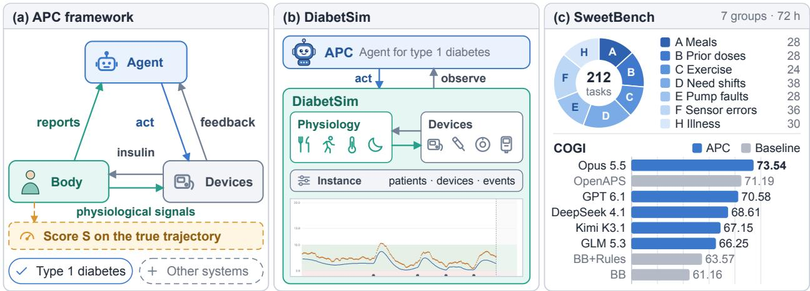

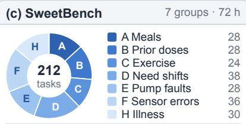

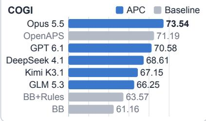  
Figure 1 APC and its first instantiation. (a) The APC loop, in which an agent acts on a physiological system through device tools and is scored on the physiological outcome. This work applies it to type 1 diabetes, and other systems remain open. (b) DiabetSim combines a physiological engine, device models, and an instance generator; APC acts through the devices and observes their readings. The plot shows a simulated glucose trajectory. (c) SweetBench composes 212 tasks in seven scenario groups and scores the true glucose trajectories, which are hidden from the agent. The donut chart gives the tasks per group, and the bars show the mean COGI of APC with five backend models and of the three baselines.

## We make three contributions:

1. We introduce APC, an agentic control framework that treats human physiology as an interactive environment, and apply it to glucose control. It acquires information through monitoring devices, delivers medication through medical devices, and adjusts decisions from feedback to optimize glucose-control metrics.

2. We build DiabetSim, a configurable glucose-control simulator that integrates individual physiology, medical devices, events, and observation conditions. It reconstructs the interaction environment faced by APC and provides a foundation for reproducible virtual testing.

3. We construct SweetBench, a benchmark of 212 glucose-control tasks. APC with Claude Opus 5.5 achieves

a COGI of 73.5, compared with 71.2 for OpenAPS. Further ablations show improved control over days with personal records and end-of-day review.

## 2 Agentic Physiological Control

## 2.1 The APC Framework

APC treats treatment as a control problem in which the controller is an agent and the sensors and actuators are medical devices.

Definition 1 (Agentic Physiological Control). An APC problem consists of a physiological system with hidden state, medical devices that measure and act on it, reports from the person, and a score on the physiological trajectory. An APC agent repeatedly observes, acts through the devices, and decides when to reassess, so as to maximize the expected score.

The state $x _ { t }$ comprises physiology, device status, and context, and evolves under individual parameters θ. Let d denote the device configuration and $\rho$ the reporting configuration, which specifies what the person reports, when, and how accurately. Then

$$
x _ { t + 1 } \sim P _ { \theta } ( \cdot \mid x _ { t } , a _ { t } ) , \qquad o _ { t } \sim O _ { d , \rho } ( \cdot \mid x _ { t } ) , \qquad a _ { t } \in \mathcal { A } _ { d } ( h _ { t } ) .
$$

This is a partially observable Markov decision process (Kaelbling et al., 1998) in which the devices determine both the observation model and the action set. The agent keeps the visible history $h _ { t } = ( o _ { \leq t } , a _ { < t } )$ and a personal record $M _ { t }$ summarizing past interaction with the same individual, and selects actions with a policy $\pi ( a _ { t } \mid h _ { t } , M _ { t } )$ . The score is computed from the true physiological variables $m _ { t } = f ( x _ { t } )$ , which the agent never observes directly. Over a horizon $T ,$ the objective is ma $\mathtt { \tilde { \Gamma } } _ { \pi } \mathbb { E } _ { \pi } [ S ( m _ { 0 : T } ) ]$

An APC agent has four components that close this loop (Figure 2). Decision making selects an intervention, a measurement, or waiting, and states its rationale. Device tools execute the operation and return readings and delivery logs. Monitoring watches incoming observations and returns control to the agent when its chosen waiting interval ends or a specified condition occurs. The personal record carries what has been learned about the individual into later decisions.

The design addresses three requirements. Interpretability makes the basis of an action traceable through decision rules or an explicit rationale. Information integration combines glucose measurements, naturallanguage and multimodal reports, and personal history to infer the hidden state and select interventions. Long-tail event adaptation uses contextual reports to adjust treatment when events overlap or fall outside predefined response categories.

To instantiate APC in a new domain, one specifies the physiological variables and the score $S ,$ the devices with their observation models and operations $( O _ { d , \rho } , A _ { d } )$ , the reports the person can provide, and an environment in which agents can be evaluated safely. Section 2.2 makes these choices for type 1 diabetes, and Sections 3 and 4 build the environment and the tasks.

## 2.2 Glucose Control

Rule-based glucose controllers organize dosing around structured glucose and therapy records (Holt et al., 2021; $\mathrm { O p e n A P S }$ community, 2026). LLM-T1D distills a reinforcement-learning policy into a language model that doses insulin and explains its decisions (Sarkar, 2026).

We instantiate APC for glucose control in type 1 diabetes, combining device observations with contextual reports and personal experience. The state comprises glucose, insulin still acting, carbohydrate absorption, and device status; meals, activity, and illness perturb this state. APC observes sensor or meter readings, delivery logs and alarms, and reports of meals, activity, and device problems. Its actions are insulin delivery through boluses, temporary basal rates, or injections, measurement requests such as scans and fingersticks, device management such as cancellation, suspension, and resumption, and waiting. The score combines time in range, hypoglycemia, and variability of true glucose (Section 4.2; Battelino et al., 2019). The idealized reference is a healthy pancreas, which regulates glucose continuously without devices or reports.

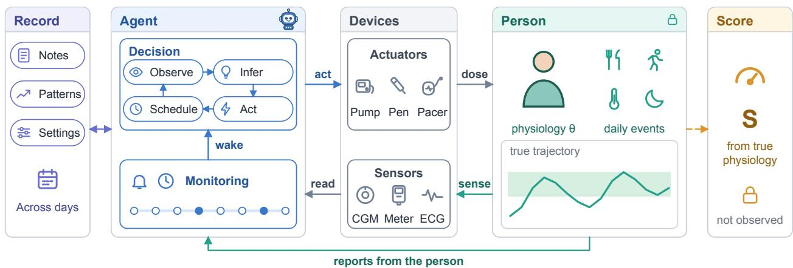  
Figure 2 The APC loop. The agent reaches the physiological system only through medical devices. Sensor readings and the person’s reports return through monitoring, which wakes the agent at its chosen time or when a trigger fires, and the personal record persists across decisions and days. The score S is computed from the true physiological trajectory.

At each decision, APC reviews recent readings, insulin still acting, reported events, and its personal record, and estimates where glucose is heading. It then chooses one operation supported by the current devices and states why. The same decision fixes when to look again and which events, such as a new reading, a reported meal, or an alarm, should wake it earlier. Monitoring holds control until one of these occurs.

The personal record stores notes on how this individual has responded to meals, activity, and insulin. In multi-day episodes the conversation resets each day while the record persists, and revised therapy settings persist where the experimental condition allows. Adaptation therefore happens through experience with model weights fixed, and Section 5.3.1 evaluates the efect of keeping the record. Appendix B specifies the observation and action interface.

## 3 DiabetSim

DiabetSim is a configurable environment for virtual testing of glucose-control agents. It comprises a physiological engine, monitoring and delivery device models, and an instance generator. Together, these components simulate individual glucose responses, everyday events, and device-mediated interventions. Agents observe device readings and event reports; the evaluator records the underlying glucose trajectory for scoring.

## 3.1 Simulator Engine

The engine models glucose–insulin dynamics using Deichmann et al. (2023), including the efects of physical activity. Individual parameters θ specify insulin sensitivity and body-mass-dependent responses. The simulator includes eight physiological types with diferent body masses and dawn phenomena, together with day-to-day variation in insulin sensitivity. Meals introduce carbohydrate absorption, while activity and illness modify subsequent physiological responses. The simulator configures therapy settings separately from physiological parameters, allowing prescribed treatment to difer from an individual’s insulin requirements. An event-driven scheduler advances physiological and device states as external events occur and treatment actions execute.

## 3.2 Devices

Observation. Monitoring devices determine the measurements available to the agent. The simulator includes eight sensor models and six glucose-meter models, parameterized by published accuracy specifications (Vettoretti et al., 2019; International Organization for Standardization, 2013). Real-time continuous glucose monitors (CGMs) produce readings every five minutes; flash sensors return readings upon scanning, and meters upon fingerstick measurement. The models represent sensor warm-up, data gaps, and compression artifacts. Scans and fingerstick measurements are agent actions, making observation timing part of the control policy. A reporting configuration ρ additionally specifies the availability, timing, and accuracy of reports about meals, activity, and other events

Action set. Delivery devices determine the available treatment operations and their constraints. The simulator includes five pump models, 10 pen models, and 10 insulin formulations. Each device configuration d defines an action set Ad: pumps support device-specific subsets of boluses, temporary basal rates, extended boluses, cancellation, and suspension or resumption; pens support discrete injections. Insulin formulations determine the corresponding absorption and action profiles. The device interface validates commands against dose increments, dose limits, bolus intervals, and device state, and records rejected commands with their reasons. Occlusions and suspension alter actual delivery, separating the requested intervention from the dose received.

## 3.3 Instance Generation

An instance specifies patient parameters, device and reporting configurations, the event schedule, initial physiological and device states, pre-episode history, evaluation horizon, and random seed. The generator assigns representative parameter values or samples from configured ranges, then combines these specifications to produce instances with diferent patients, devices, events, and observation conditions. Event combinations, timing, and magnitude are configurable independently of the patient and device parameters. Saving the resolved specification fixes the initialization, external event schedule, and random seed for replay and comparisons between controllers.

## 4 SweetBench

SweetBench turns DiabetSim into a fixed set of 212 evaluation tasks. Each task is a fixed patient–scenario configuration that specifies an individual, an event calendar, the devices, the information available to the agent, the initial state, and the horizon, and each is scored on the true glucose trajectory.

Existing medical benchmarks score answers, records, or plans for a single encounter or a supplied history. SweetBench instead scores multi-day control in which the agent’s actions shape what it observes next, and it computes every score programmatically from the true trajectory (Table 1).

Table 1 Task scope and scoring in medical benchmarks.
<table><tr><td>Benchmark</td><td>Long-horizon control</td><td></td><td>Verifiable score Evaluation tasks</td></tr><tr><td>HealthBench (Arora et al., 2025)</td><td></td><td>o</td><td>Medical QA</td></tr><tr><td>AgentClinic (Schmidgall et al., 2024)</td><td></td><td>o</td><td>Diagnostic dialogue</td></tr><tr><td>MedAgentBench (Jiang et al., 2025)</td><td></td><td>√</td><td>EHR tasks</td></tr><tr><td>LongMedBench (Xu et al., 2026)</td><td>O</td><td>√</td><td>Longitudinal clinical reasoning</td></tr><tr><td>DM-Bench (Cardei et al., 2025)</td><td>0</td><td>0</td><td>Diabetes QA and planning</td></tr><tr><td>HealthLoopQA (Niu et al., 2026)</td><td>o</td><td>√</td><td>Time-series QA</td></tr><tr><td>SweetBench (ours)</td><td>√</td><td>√</td><td>Closed-loop glucose control</td></tr></table>

Long-horizon control: ✓, multi-day interventions with action-dependent physiological feedback; ◦, reasoning or planning over longitudinal records; –, encounter-level tasks. Verifiable score: ✓, fully programmatic scoring against references or rules; ◦, includes model-based semantic grading.

## 4.1 Task Design

Within DiabetSim’s configurable environment space, SweetBench defines 32 scenario designs in seven groups. These cover meal timing and absorption, residual insulin, exercise, changing insulin needs, pump underdelivery, sensor errors, and illness recovery (Table 2). Each design specifies an event combination and its temporal relationships. Examples include a cancelled meal after a pre-meal bolus followed by activity, or silent under-delivery with upward sensor drift. We instantiate each design for four to eight simulated individuals, adapting event timing and magnitude to each person, to obtain 212 tasks. Appendix A, Table 8, lists all designs by ID, including A01 and E03.

Table 2 Scenario groups of SweetBench. Each design yields tasks for four to eight individuals. Appendix A lists all 32 designs.
<table><tr><td></td><td>Group</td><td>Example design</td><td>Designs</td><td>Tasks</td></tr><tr><td>A</td><td>Meal timing and absorption</td><td>A03: a meal cancelled after pre-bolusing, followed by activity</td><td>4</td><td>28</td></tr><tr><td>B</td><td>Insulin from earlier doses</td><td>B01: repeated doses after a small meal overlap as absorption ends</td><td>4</td><td>28</td></tr><tr><td>C</td><td>Exercise</td><td>C04: breakfast and lunch skipped during prolonged aerobic activity</td><td>4</td><td>24</td></tr><tr><td></td><td>D Changing insulin needs</td><td>D02: needs returning after sleep loss and the dawn phenomenon</td><td>6</td><td>38</td></tr><tr><td>E</td><td>Pump under-delivery</td><td>E04: silent under-delivery with progressively false-high sensor readings</td><td>4</td><td>28</td></tr><tr><td>F</td><td>Sensor errors</td><td>F06: missed meals and exercise causing lows masked by positive sensor bias</td><td>6</td><td>36</td></tr><tr><td>H</td><td>Illness and recovery</td><td>H03: insulin needs recover before appetite returns</td><td>4</td><td>30</td></tr><tr><td></td><td>Total</td><td></td><td>32</td><td>212</td></tr></table>

In the default setting, a task is a 72-hour episode with a Dana-i pump delivering insulin aspart and real-time CGM with sensor error and delay, under information condition I2 described below. Because a configuration fixes the individual, the event calendar, and the random seed, the same task can also be run with other delivery devices, information conditions, or decision schedules, and a seven-day version of selected designs supports multi-day evaluation with the same individual and personal record (Section 5.3.1). Section 5.3 uses these variants.

Information conditions. The reporting configuration ρ takes three levels. Under I2, the agent receives sensor glucose, the device state needed to operate the pump, records of its own actions, and estimates derived from these records, and meals and other events are not reported. I1 adds the time and carbohydrate content of each meal. I0 further adds free-text reports, such as stated meal plans and descriptions of upcoming events.

## 4.2 Metrics

All metrics use the true glucose trajectory sampled every 5 minutes. Let $g _ { 1 } , \ldots , g _ { n }$ denote these samples in mg/dL. We compute time in range $\begin{array} { r } { \mathrm { T I R } = 1 0 0 n ^ { - 1 } \sum _ { i = 1 } ^ { n } { \bf 1 } \{ 7 2 . 0 6 4 \leq g _ { j } \leq 1 4 4 . 1 2 8 \} } \end{array}$ and time below range $\mathrm { T B R } = 1 0 0 n ^ { - 1 } \sum _ { i = 1 } ^ { n } { \bf 1 } \{ g _ { j } < 7 0 \}$ as percentages. TIR uses 4–8 mmol/L (72.064–144.128 mg/dL) throughout the main experiments and ablations. This range is tighter than the consensus target and is specific to the benchmark, while the hypoglycemia threshold of 70 mg/dL follows the CGM consensus (Battelino et al., 2019). The glucose standard deviation is $\begin{array} { r } { \sigma _ { g } = \sqrt { n ^ { - 1 } \sum _ { j = 1 } ^ { n } ( g _ { j } - \bar { g } ) ^ { 2 } } } \end{array}$ , where $\begin{array} { r } { \bar { g } = n ^ { - 1 } \sum _ { j = 1 } ^ { n } g _ { j } } \end{array}$

Overall score. We adapt COGI, which combines time in range, hypoglycemia, and glucose variability with weights of 0.50, 0.35, and 0.15 (Leelarathna et al., 2020). Our research variant COGI-4-8 (abbreviated COGI below) replaces the published 70–180 mg/dL TIR band with 4–8 mmol/L, while retaining the hypoglycemia and population-SD components. Let $c ( x ) = \operatorname* { m i n } ( 1 , \operatorname* { m a x } ( 0 , x ) )$ . Its three subscores are

$$
\begin{array} { r } { S _ { \mathrm { T I R } } = \mathrm { T I R } , \qquad } \\ { S _ { \mathrm { H y p o } } = 1 0 0 c \bigg ( 1 - \frac { \mathrm { T B R } } { 1 5 } \bigg ) , \qquad } \\ { S _ { \mathrm { G V } } = 1 0 0 c \bigg ( \frac { 1 0 8 - \sigma _ { g } } { 9 0 } \bigg ) . \qquad } \end{array}
$$

The hypoglycemia subscore decreases from 100 at zero TBR to zero at 15% TBR. The variability subscore decreases from 100 at a standard deviation of 18 mg/dL to zero at 108 mg/dL. The overall score is

$$
S = 0 . 5 0 S _ { \mathrm { T I R } } + 0 . 3 5 S _ { \mathrm { H y p o } } + 0 . 1 5 S _ { \mathrm { G V } } .
$$

COGI and all three subscores range from 0 to 100, with higher values indicating better control. Results report their means across episodes with equal weight per task.

## 5 Experiments

## 5.1 Setting

Protocol. We evaluate all methods on the 212 tasks of SweetBench. Each 72-hour episode fixes the patient, initial state, event calendar, and random seed, and uses a simulated Dana-i pump, insulin aspart, and real-time CGM under I2. Meals and other events remain unreported. Each method acts through the same device interface using only visible measurements and records; the environment continues to evolve between decisions. The main evaluation adds no separate background HCL controller. We compute COGI and its three subscores from 864 five-minute true-glucose samples per episode, then average completed episodes with equal weight (Section 4.2).

Baseline Setting. We compare three controllers. Basal–Bolus (BB) follows a prescribed basal schedule and calculates meal and correction boluses from reported carbohydrates, glucose, carbohydrate ratio, insulin sensitivity, and insulin on board (Holt et al., 2021; Fox et al., 2020). Event-Aware Basal–Bolus (BB+Rules) augments this BB policy with predefined rules for glucose trends, reported exercise and illness, and device problems (Riddell et al., 2017). OpenAPS uses its open-source dosing core to compute temporary basal adjustments and micro-boluses from glucose feedback. All three controllers use 15-minute decision intervals and the same visible observations. Appendix C.2 specifies the formulas, rules, and OpenAPS implementation; the case studies also use OpenAPS as their reference.

APC Setting. We evaluate APC with five language-model backends using a shared control objective, devicetool interface, and personal-record mechanism. The fixed decision interval is 60 minutes, with reasoning efort set to high.

## 5.2 Main Results

Table 3 reports the results. APC with Claude Opus 5.5 has the highest mean COGI, 73.54, followed by GPT 6.1 Sol (70.58), DeepSeek 4.1 Flash (68.61), Kimi K3.1 Pro (67.15), and GLM 5.3 Flash (66.25). OpenAPS at a 15-minute interval achieves a COGI of 71.19. APC with Claude Opus 5.5 scores higher, while the other four models score lower. Because more frequent model calls increase computational cost, we further examine cooperation between a high-frequency background loop and lower-frequency agent decisions in the CL-on/of experiments below.

Table 3 Main evaluation. APC rows average completed 72-hour episodes under I2 with a 60-minute decision interval. The three baselines use 15-minute decisions; APC uses high reasoning efort. COGI and its three unweighted subscores range from 0 to 100, higher being better.
<table><tr><td>Controller / model</td><td>Interval</td><td>COGI</td><td> $S _ { \mathrm { T I R } }$ </td><td> $S _ { \mathrm { H y p o } }$ </td><td> $S _ { \mathrm { G V } }$ </td></tr><tr><td>Baselines</td><td></td><td></td><td></td><td></td><td></td></tr><tr><td>BB (Fox et al., 2020)</td><td>15 min</td><td>61.16</td><td>33.82</td><td>94.54</td><td>74.42</td></tr><tr><td>BB+Rules (Riddell et al., 2017)</td><td>15 min</td><td>63.57</td><td>38.35</td><td>95.04</td><td>74.21</td></tr><tr><td>OpenAPS (OpenAPS community, 2026)</td><td>15 min</td><td>71.19</td><td>51.62</td><td>96.45</td><td>77.48</td></tr><tr><td>APC (backend model)</td><td></td><td></td><td></td><td></td><td></td></tr><tr><td>Claude Opus 5.5 (Anthropic, 2026)</td><td>60 min</td><td>73.54</td><td>54.58</td><td>97.29</td><td>81.28</td></tr><tr><td>GPT 6.1 Sol (OpenAI, 2026)</td><td>60 min</td><td>70.58</td><td>49.07</td><td>97.93</td><td>78.42</td></tr><tr><td>DeepSeek 4.1 Flash (DeepSeek-AI, 2026)</td><td>60 min</td><td>68.61</td><td>44.95</td><td>97.25</td><td>80.64</td></tr><tr><td>Kimi K3.1 Pro (Moonshot AI, 2026)</td><td>60 min</td><td>67.15</td><td>43.58</td><td>96.65</td><td>76.90</td></tr><tr><td>GLM 5.3 Flash (GLM-5-Team et al., 2026)</td><td>60 min</td><td>66.25</td><td>41.00</td><td>96.80</td><td>79.17</td></tr></table>

## 5.3 Ablations

## 5.3.1 Does Personal Experience Improve Control?

We test whether personal records and end-of-day review improve control across days. On six configurations over seven days, we compare four conditions: daily record reset, which passes no personal record to the next day; cross-day record only, which retains personal records for the next day without additional end-of-day review; record + review-generated plan, which retains records and reviews the day’s treatment responses to generate a plan for subsequent control; and record + plan + execution feedback, which additionally incorporates feedback on the execution of previous plans into the review. All conditions reset the conversation daily while maintaining continuous physiology and fixed model weights.

Retaining records raises whole-week COGI from 71.1 to 74.4; adding review and planning raises it to 78.7 (Table 4). Adding execution feedback raises it by another 0.3 points. Figure 3 shows the daily scores under all four conditions. Gains mainly come from time in range, and all conditions retain the maximum hypoglycemia subscore. Over this week, records and review support improvement without weight updates; reviewing past responses helps the agent use accumulated experience in subsequent control.

Table 4 Seven-day record and review ablation. Six held-out configurations; Claude Opus 5.5, Dana-i, real-time CGM, I2, fixed weights, one run per condition and configuration. Historical runs use an earlier prompt; we recompute COGI from saved glucose. Review adds model calls, with the treatment-decision budget unchanged. Entries average the six configurations.

(a) Daily COGI
<table><tr><td>Condition</td><td>D1</td><td>D2</td><td>D3</td><td>D4</td><td>D5</td><td>D6</td><td>D7</td></tr><tr><td>Daily record reset</td><td>72.6</td><td>67.5</td><td>66.9</td><td>76.3</td><td>70.7</td><td>70.2</td><td>73.9</td></tr><tr><td>Cross-day record only</td><td>73.1</td><td>71.5</td><td>71.5</td><td>76.6</td><td>72.1</td><td>75.2</td><td>80.5</td></tr><tr><td>Record + review-generated plan</td><td>72.7</td><td>72.3</td><td>73.0</td><td>83.8</td><td>80.6</td><td>83.2</td><td>85.6</td></tr><tr><td>Record + plan + execution feedback</td><td>74.3</td><td>72.1</td><td>73.4</td><td>85.6</td><td>79.3</td><td>82.3</td><td>86.3</td></tr></table>

(b) Whole-week COGI and subscores
<table><tr><td>Condition</td><td></td><td>COGI STIR SHypo SGV</td><td></td><td></td></tr><tr><td>Daily record reset</td><td>71.1</td><td>43.3</td><td>100.0</td><td>96.2</td></tr><tr><td>Cross-day record only</td><td>74.4</td><td>49.4</td><td>100.0</td><td>97.9</td></tr><tr><td>Record + review-generated plan</td><td>78.7</td><td>58.0</td><td>100.0</td><td>97.9</td></tr><tr><td>Record + plan + execution feedback</td><td>79.0</td><td>58.6</td><td>100.0</td><td>98.1</td></tr></table>

Whole-week scores use pooled seven-day samples; daily scores use separate 24-hour windows.

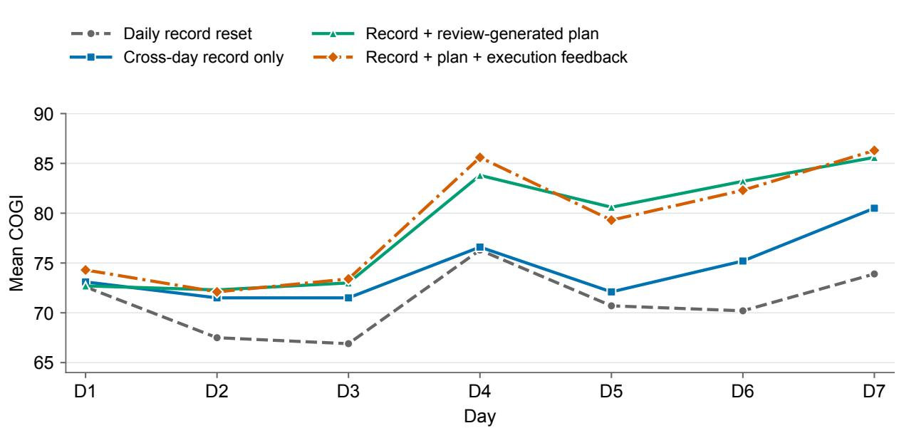  
Figure 3 Daily scores under the four record and review conditions. Each point is the mean COGI across six configurations in the corresponding 24-hour window, matching Table 4(a). Lines connect daily means without smoothing. The four conditions are defined in the text.

## 5.3.2 How Do Delivery Devices Affect Control?

We compare pens and DASH with CL of or on in Slow-Meal Overlap, Stress Resolution, and Post-Illness Refeeding, testing both delivery options and cooperation with a background controller. Each configuration uses the same agent for a 72-hour run in each case. DASH-w/o CL scores approximately 6–8 points above pens, mainly through time in range and variability (Table 5). Turning CL on further raises COGI by 4.63 and 2.53 points in the first two cases and gives a similar score in the third, without increasing the agent’s decision frequency. The background HCL supplies frequent basal-rate adjustments, while the agent integrates observations and personal history to choose doses, carbohydrate intake, and device actions. The trajectories show how adjustable infusion follows prolonged absorption and changing insulin needs (Figure 4). These cases show that delivery configurations shape control performance and support the potential of high-frequency closed-loop control combined with lower-frequency agent decisions.

We additionally evaluate standalone closed-loop control without an agent every five minutes, using the same DASH/Fiasp configuration, patients, seeds, events, and CGM conditions, with rule-based sensor maintenance. Agent + closed-loop control exceeds this reference by 13.42, 3.63, and 6.84 COGI points in the three cases, respectively, mainly through more time in range.

Table 5 Delivery devices and background closed-loop control. Each configuration runs for 72 hours per case; APC uses Claude Opus 5.5. Bold marks the highest COGI per case.
<table><tr><td>Configuration</td><td colspan="3">Slow-Meal Overlap Woman, 39 y</td><td colspan="3">Stress Resolution Boy, 15 y</td><td colspan="3">Post-Illness Refeeding Boy, 9 y</td></tr><tr><td></td><td>COGI</td><td>STIR</td><td>SGV</td><td>COGI</td><td>STIR</td><td>SGV</td><td>COGI</td><td>STIR</td><td>SGV</td></tr><tr><td>APC + Pens</td><td>74.61</td><td>52.55</td><td>88.90</td><td>72.33</td><td>51.04</td><td>78.71</td><td>67.10</td><td>46.76</td><td>58.11</td></tr><tr><td> $\mathrm { A P C } + \mathrm { D A S H - w / o ~ C L }$ </td><td>80.56</td><td>61.11</td><td>100.00</td><td>80.22</td><td>63.66</td><td>89.29</td><td>74.67</td><td>60.88</td><td>61.57</td></tr><tr><td> $\mathrm { A P C } + \mathrm { D A S H - w / \ C L }$ </td><td>85.19</td><td>71.18</td><td>97.33</td><td>82.75</td><td>68.52</td><td>89.93</td><td>74.51</td><td>60.88</td><td>60.49</td></tr><tr><td>DASH-w/ CL only</td><td>71.77</td><td>43.87</td><td>98.93</td><td>79.12</td><td>61.11</td><td>90.41</td><td>67.67</td><td>48.84</td><td>55.02</td></tr></table>

All runs have $S _ { \mathrm { H y p o } } = 1 0 0 $ and zero time below 70 mg/dL; S uses 4–8 mmol/L. Pens use aspart and degludec, with at most five injections per day; DASH uses Fiasp. CL denotes the default background HCL in our DASH configuration. APC retains the main decision schedule with CL of or on; CL alone runs every five minutes with rule-based sensor maintenance. See Appendix C.2 for implementation.

## 5.3.3 How Do Information and Decision Frequency Affect Control?

We test the efects of information and decision frequency in Infusion-Site Leakage and Mixed-Intensity Exercise. Each scenario crosses three information levels with fixed intervals of 15, 30, 60, and 120 minutes, giving 24 runs of 72 hours each with the same extra-decision allowance. At a fixed 60-minute interval, moving from I2 to I0 raises COGI by 43.2 points on leakage and 15.7 on exercise (Table 6). Under I2, shortening the interval from 120 to 15 minutes adds 10.5 and 3.7 points, respectively. Averaged over both scenarios and all information levels, input-token use at 15 minutes is about 4.2 times that at 60 minutes. In these two cases, added context yields larger gains than increasing frequency alone. Frequent decisions partly compensate for missing information but require more computation. Together with the CL-on/of results and the interval sweep for OpenAPS (Appendix C.2), this supports using frequent background control alongside an agent tha makes informed, less frequent decisions.

## 5.4 Case Study

We examine three episodes of APC with Claude Opus 5.5 from the main evaluation: two where it scores above OpenAPS and one where it scores below. Table 7 gives their scores. In C04 the advantage comes mainly from reducing hypoglycemia; in F06 the agent also improves time in range when sensor bias masks low glucose. In E04 both controllers avoid hypoglycemia completely, and the agent falls behind on time in range and variability. These are illustrative cases, not estimates of average efects.

Responding to an unreported glucose sink. In C04, a 39-year-old woman skips breakfast and lunch and exercises repeatedly for long periods before a late meal, so hypoglycemia is a constant risk. APC scores 85.06 against 77.73 for OpenAPS (+7.33). Its time in 4–8 mmol/L is 84.14%, slightly below OpenAPS’s 85.42%, but its time below 70 mg/dL is 2.55%, compared with 6.13% for OpenAPS. Figure 5 marks three decisions. At marker 1 (10.58 h), a meter check confirms a low of 67 mg/dL and the agent gives 12 g of fast carbohydrate. As glucose keeps falling with little insulin recorded as active, the agent’s rationale raises the possibility of unreported exercise, and it responds with carbohydrate and temporary basal reductions that it can later reverse. At marker 2 (58 h), its record of low glucose in the late morning on the two previous days leads it to lower the temporary basal rate to 20% early, and it adds carbohydrate at 58.42 and 58.58 h as glucose continues to drop. At marker 3 (68 h), having seen a strong fall after an earlier correction, it gives only 0.7 U, and when glucose falls faster than it predicted, it lowers basal delivery again. In this episode the agent checks the sensor against the meter, revises its explanation when the response does not match, and carries lessons

(a) Slow-Meal Overlap (woman, 39 y)  
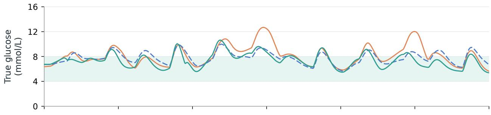

(b) Stress Resolution (boy, 15 y)  
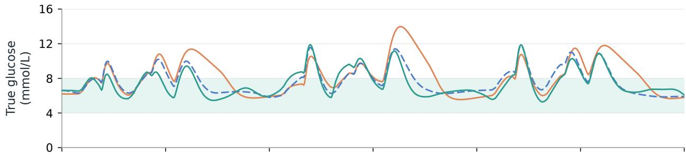

(c) Post-Illness Refeeding (boy, 9 y)  
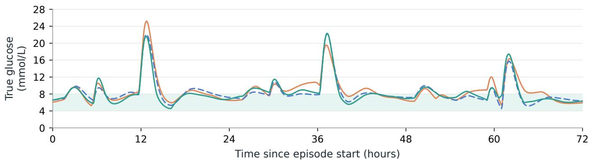  
Figure 4 Three hardware trajectories within each scenario. Each panel overlays the complete 72-hour true-glucose trajectories for the same patient and exogenous event sequence: pens, DASH-w/o CL (without background closed-loop control), and DASH-w/ CL (with background closed-loop control). The pale teal horizontal band is 4–8 mmol/L, and time is relative to each episode start.

Table 6 Information and decision-frequency comparison. Claude Opus 5.5 under the main protocol; one 72-hour run per cell, 24 in total. I2 provides device observations and own records; I1 adds meal times and carbohydrate amounts; I0 adds free-text context. All arms share the same patient, seed, initial state, and events within each scenario, with at most six extra decisions per local day. Entries are COGI-4-8 totals.
<table><tr><td>Scenario / patient</td><td>Information</td><td>15 min</td><td>30 min</td><td>60 min</td><td>120 min</td></tr><tr><td rowspan="3">Infusion-Site Leakage Man, 39 y</td><td>I0</td><td>97.80</td><td>98.96</td><td>98.38</td><td>99.71</td></tr><tr><td>I1</td><td>66.70</td><td>69.57</td><td>60.07</td><td>56.00</td></tr><tr><td>I2</td><td>62.10</td><td>59.94</td><td>55.19</td><td>51.59</td></tr><tr><td rowspan="3">Mixed-Intensity Exercise Man, 39 y</td><td>I0</td><td>98.84</td><td>98.67</td><td>97.86</td><td>94.39</td></tr><tr><td>I1</td><td>98.78</td><td>96.18</td><td>96.29</td><td>92.55</td></tr><tr><td>I2</td><td>85.27</td><td>85.41</td><td>82.12</td><td>81.59</td></tr></table>

Table 7 Whole-episode outcomes for the three case studies. Claude Opus 5.5 and OpenAPS in the same world under I2; each row is one 72-hour episode. COGI and its three unweighted subscores range from 0 to 100, higher being better. Bold indicates the better value within each case, including ties.
<table><tr><td>Case</td><td>Controller</td><td>COGI</td><td> $S _ { \mathrm { T I R } }$ </td><td> $S _ { \mathrm { H y p o } }$ </td><td> $S _ { \mathrm { G V } }$ </td></tr><tr><td>C04, adult female</td><td>Claude Opus 5.5 OpenAPS</td><td>85.06 77.73</td><td>84.14 85.42</td><td>83.02 59.10</td><td>92.85 95.57</td></tr><tr><td>F06, child female</td><td>Claude Opus 5.5 OpenAPS</td><td>72.75 48.52</td><td>68.52 57.18</td><td>76.85 26.70</td><td>77.26 70.61</td></tr><tr><td>E04, adolescent female</td><td>Claude Opus 5.5 OpenAPS</td><td>47.37 66.20</td><td>10.65 44.56</td><td>100.00 100.00</td><td>47.00 59.48</td></tr></table>

from earlier days into later doses.

Detecting low glucose hidden by sensor bias. In F06, a 9-year-old girl misses breakfast after a meal bolus and then exercises while a positive sensor bias masks the fall in true glucose. APC scores 72.75 against 48.52 for OpenAPS (+24.22). Time in 4–8 mmol/L is 68.52% versus 57.18%, and time below 70 mg/dL is 3.47% versus 11.00%. Figure 6 highlights three decisions. At marker 1 (10 h), calibration gives a meter reading of 50 mg/dL when CGM had read about 94; the agent gives 12 g of fast carbohydrate five minutes later and checks again. At marker 2 (34 h), it explicitly recalls the earlier positive bias and obtains a meter reading of 51 despite CGM near 91. It gives 15 g and confirms a rise to 86 mg/dL fifteen minutes later. At marker 3 (55.08 h), its rationale cites the lows on both earlier mornings and starts a two-hour temporary basal rate at 20% before the recurring decline. Lows still occur and require further carbohydrate rescue. This case shows how the agent can combine repeated meter checks with saved experience to adjust earlier and reduce hypoglycemia.

Losing track of a recurring delivery fault. In E04, an adolescent girl has recurring infusion-site leakage and intermittent positive sensor drift. APC scores 47.37 against 66.20 for OpenAPS (−18.83), with 10.65% of the time in 4–8 mmol/L and no true glucose below 70 mg/dL, so the deficit comes from persistent hyperglycemia and high variability. Near marker 1 in Figure 7, the agent uses meter checks and calibration to detect the sensor disagreement, but it repeatedly attributes the weak response to insulin to unreported food or changing insulin needs. It changes the infusion set at 13 h (marker 2), about 12.75 h after the leak began, and the saved simulator state confirms that efective delivery then recovers from 15% to 100%. When the leak returns near 24.17 h and 48.33 h, however, it does not change the set again. At marker 3 (50 h), with CGM at its upper display limit, it gives another 2.5 U. Over the episode it requests 60 boluses, of which 59 are delivered and one is rejected by the minimum-interval rule, and it changes the set only once. The agent found the fault once but did not test that explanation again when the same symptoms returned, and it kept adding insulin instead of looking for the cause.

C04: fasting and recurrent exercise (woman, 39 y) Claude: 85.06    OpenAPS: 77.73    Difference: +7.33 OpenAPS Claude truth Meter  
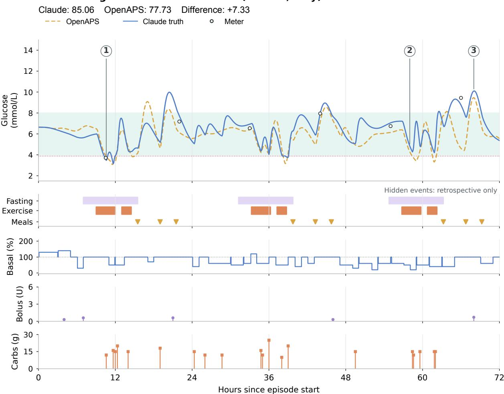  
Figure 5 Stronger control: C04, adult female. Solid blue shows true glucose under agent control; open circles mark meter checks; dashed gold shows OpenAPS true glucose in the same world; and the pale teal band marks 4–8 mmol/L. The event lane shows hidden fasting, exercise, and meals. Lower lanes show realized basal delivery relative to scheduled basal, boluses, and carbohydrate rescue. Numbered markers identify the decisions discussed in the text.

## 6 Discussion

## 6.1 Decision Making under Incomplete Information

The information ablation identifies an opportunity to improve how agents combine measurements, event context, and personal history. Added context improves control more than increasing decision frequency alone in the tested cases. Explicit uncertainty estimates and targeted measurement requests could help the agent distinguish changing insulin needs from delivery or sensor problems. Personal records can retain these inferences and guide later reassessment.

## 6.2 Safety

Insulin continues to act after delivery, making dose history and reassessment timing central to physiological control (Holt et al., 2021). Dose limits, insulin-on-board estimation, and low-glucose monitoring provide concrete opportunities for improving agent design. The CL-on/of cases also motivate combining frequent background regulation with less frequent agent decisions. Separate hypoglycemia scores and action records support assessment of these designs alongside overall control performance.

F06: low glucose masked by sensor bias (girl, 9 y) Claude: 72.75    OpenAPS: 48.52    Difference: +24.22 OpenAPS Claude truth Meter  
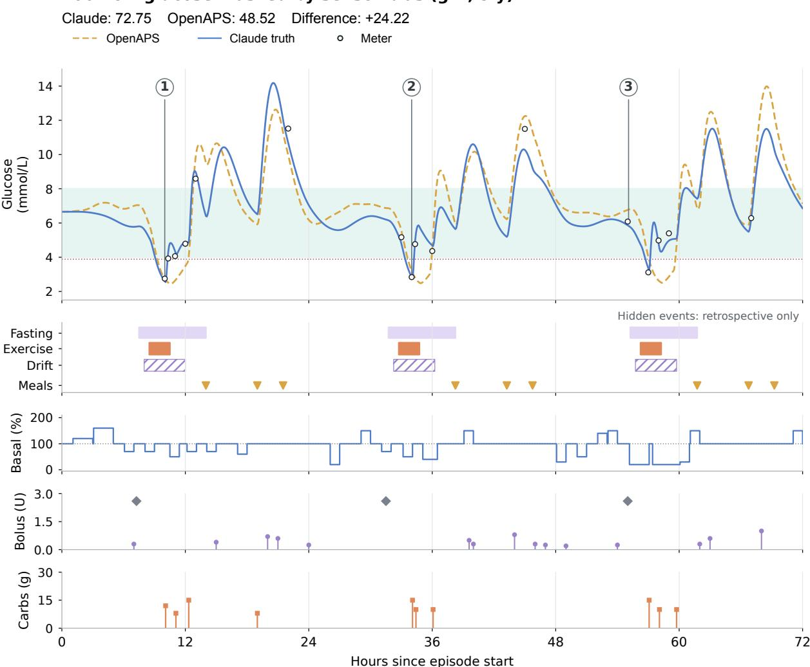  
Figure 6 Stronger control under sensor bias: F06, child female. Curve and meter conventions match Figure 5, with OpenAPS as the comparator. The event lane shows hidden fasting, exercise, positive sensor drift, and meals. Lower lanes show the agent’s basal changes, boluses, and carbohydrate rescue; gray diamonds mark preset meal boluses from the event calendar, not agent decisions. Markers identify meter verification on the first two mornings and an earlier basal reduction on the third. Hidden events are retrospective annotations, not agent inputs.

## 6.3 Sim2Real Gap

Patient-specific reconstruction ofers a path to improving simulator fidelity. Real CGM and device records can inform physiology, sensor errors, and event patterns; held-out records can then assess the reconstructed environment. A Real2Sim2Real cycle would let the agent develop a strategy in that environment and refine both the strategy and the environment as further patient observations become available.

## 7 Related Work

Medical AI and benchmarks. MultiMedQA and HealthBench assess clinical knowledge and health-related responses, while AMIE studies diagnostic dialogue and longitudinal disease management (Singhal et al., 2023; Arora et al., 2025; Tu et al., 2025; Liévin et al., 2026). AgentMD and TxAgent connect medical reasoning to clinical calculators and biomedical evidence (Jin et al., 2025; Gao et al., 2025). AgentClinic, MedAgentBench, LongMedBench, and HealthAgentBench evaluate agents through simulated consultations, electronic health records, longitudinal data, and clinical tool workflows (Schmidgall et al., 2024; Jiang et al., 2025; Xu et al.,

E04: infusion leakage and sensor drift (adolescent girl) Claude: 47.37    OpenAPS: 66.20    Difference: ­18.83 OpenAPS Claude truth Meter  
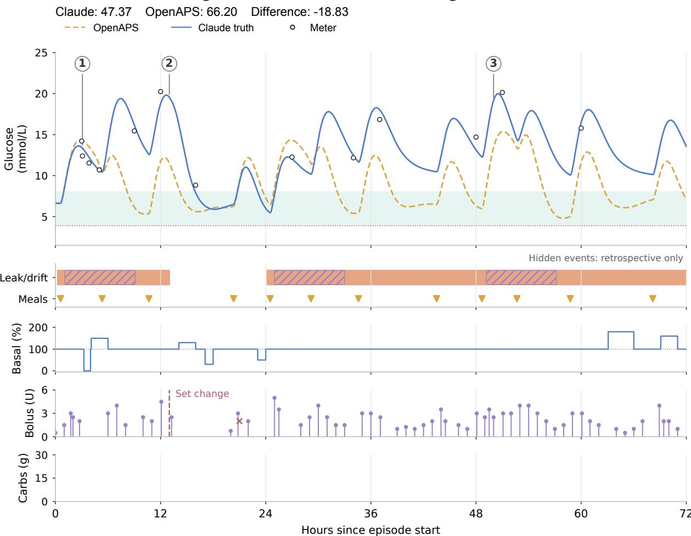  
Figure 7 Weaker control: E04, adolescent female. Curve and action conventions match Figure 5. Orange shading in the event lane marks evaluator-confirmed reduced tissue delivery; hatching marks programmed sensor-drift intervals, and triangles mark hidden meals. The vertical dashed line in the bolus lane is the sole infusion-set change; the red cross marks the rejected bolus request. The empty carbohydrate lane indicates that no carbohydrate rescue was issued. The repair and later recurrence can be verified from efective delivery, whereas the agent sees only measurements and device and action records.

2026; Liu et al., 2026).

Long-horizon agents. ReAct interleaves reasoning with environment actions; WebArena, OSWorld, and SWE-agent study extended tool use in web, desktop, and software tasks (Yao et al., 2023; Zhou et al., 2023; Xie et al., 2024; Yang et al., 2024). SayCan and Code as Policies connect language-based planning to robot skills and control interfaces (Ahn et al., 2022; Liang et al., 2022). Reflexion, ExpeL, and Voyager retain feedback, experience, or executable skills to improve later decisions without updating model weights (Shinn et al., 2023; Zhao et al., 2024; Wang et al., 2023).

Type 1 diabetes and glucose control. CGM-Agent analyzes personal glucose records; DM-Bench and HealthLoopQA evaluate decisions and temporal reasoning over supplied histories (Cui et al., 2026; Cardei et al., 2025; Niu et al., 2026). DIETS and meal-planning agents optimize candidate interventions using glucose forecasts (Zeng et al., 2024; Huang et al., 2026). UVA/Padova and simglucose support virtual-patient evaluation, while automated insulin delivery and reinforcement-learning controllers adjust treatment from glucose feedback (Visentin et al., 2018; Xie, 2018; Brown et al., 2019; Sherr et al., 2022; Hettiarachchi et al., 2024; Khamesian et al., 2026). LLM-T1D distills a reinforcement-learning policy into a language model for insulin-rate control and evaluates it in randomized 24-hour simulations (Sarkar, 2026).

## 8 Future Work

Reinforcement learning. APC adapts through its personal record while its weights stay fixed. DiabetSim also makes it possible to train on physiological outcomes directly. Reinforcement learning can update the policy for treatment, measurement, and reassessment timing, and combining it with the record would let the agent acquire general skills and person-specific knowledge together.

Real2Sim2Real. We plan to reconstruct patient-specific environments from real CGM and device records. An agent would first build its record and strategy inside a person’s reconstructed environment, then assist that person, with each new observation used to refine both the environment and the agent.

Beyond type 1 diabetes. APC applies wherever devices can measure and act on a physiological system and its outcome can be scored. Candidate domains include other conditions managed with drug-delivery devices and intensive-care treatment, where learned treatment policies have already been studied (Komorowski et al., 2018). Each new domain needs its own devices, environment, and score, and building them is work we hope to share with the community.

## 9 Conclusion

We introduce DiabAgent, comprising the APC framework, the DiabetSim simulator, and the SweetBench benchmark. APC links agent decisions to medical-device actions and applies this control loop to glucose management in type 1 diabetes. DiabetSim provides virtual testing across patients, events, devices, and observation conditions. SweetBench turns this environment into 212 tasks for evaluating the physiological outcomes of agent decisions. Together, these components establish a reproducible research setting for agentic physiological control. We hope DiabAgent provides a foundation for agents to participate in human physiological control and supports extending this research to other physiological systems.

## Acknowledgments

We thank Einsia AI for sponsoring this work. We also thank the volunteers from the Sweetie Online Community for their professional advice and testing.

## References

Michael Ahn, Anthony Brohan, Noah Brown, Yevgen Chebotar, Omar Cortes, Byron David, Chelsea Finn, Chuyuan Fu, Keerthana Gopalakrishnan, Karol Hausman, Alex Herzog, Daniel Ho, Jasmine Hsu, Julian Ibarz, Brian Ichter, Alex Irpan, Eric Jang, Rosario Jauregui Ruano, Kyle Jefrey, Sally Jesmonth, Nikhil J. Joshi, Ryan Julian, Dmitry Kalashnikov, Yuheng Kuang, Kuang-Huei Lee, Sergey Levine, Yao Lu, Linda Luu, Carolina Parada, Peter Pastor, Jornell Quiambao, Kanishka Rao, Jarek Rettinghouse, Diego Reyes, Pierre Sermanet, Nicolas Sievers, Clayton Tan, Alexander Toshev, Vincent Vanhoucke, Fei Xia, Ted Xiao, Peng Xu, Sichun Xu, Mengyuan Yan, and Andy Zeng. Do As I Can, Not As I Say: Grounding Language in Robotic Afordances, 2022. URL https://arxiv.org/abs/2204.01691.

AndroidAPS community. AndroidAPS documentation. https://androidaps.readthedocs.io, 2026. Pump driver limits in PumpType.kt, https://github.com/nightscout/AndroidAPS. Accessed October 2026.

Anthropic. Claude Opus 5.5 system card, 2026. URL https://www.anthropic.com/claude-opus-5-5-system-card. Accessed November 2, 2026.

Rahul K. Arora, Jason Wei, Rebecca Soskin Hicks, Preston Bowman, Joaquin Quiñonero-Candela, Foivos Tsimpourlas, Michael Sharman, Meghan Shah, Andrea Vallone, Alex Beutel, Johannes Heidecke, and Karan Singhal. HealthBench: Evaluating Large Language Models Towards Improved Human Health, 2025. URL https://arxiv.org/abs/2505.08775.

Tadej Battelino, Thomas Danne, Richard M. Bergenstal, Stephanie A. Amiel, Roy Beck, Torben Biester, Emanuele Bosi, Bruce A. Buckingham, William T. Cefalu, Kelly L. Close, Claudio Cobelli, Eyal Dassau, J. Hans DeVries, Kim C. Donaghue, Klemen Dovc, Francis J. Doyle, III, Satish Garg, George Grunberger, Simon Heller, Lutz Heinemann, Irl B. Hirsch, Roman Hovorka, Weiping Jia, Olga Kordonouri, Boris Kovatchev, Aaron Kowalski, Lori Lafel, Brian Levine, Alexander Mayorov, Chantal Mathieu, Helen R. Murphy, Revital Nimri, Kirsten Nørgaard, Christopher G. Parkin, Eric Renard, David Rodbard, Banshi Saboo, Desmond Schatz, Keaton Stoner, Tatsuiko Urakami, Stuart A. Weinzimer, and Moshe Phillip. Clinical Targets for Continuous Glucose Monitoring Data Interpretation: Recommendations From the International Consensus on Time in Range. Diabetes Care, 42(8): 1593–1603, 2019. doi: 10.2337/dci19-0028. URL https://doi.org/10.2337/dci19-0028.

Sue A. Brown, Boris P. Kovatchev, Dan Raghinaru, John W. Lum, Bruce A. Buckingham, Yogish C. Kudva, Lori M. Lafel, Carol J. Levy, Jordan E. Pinsker, R. Paul Wadwa, Eyal Dassau, Francis J. Doyle, III, Stacey M. Anderson, Mei Mei Church, Vikash Dadlani, Laya Ekhlaspour, Gregory P. Forlenza, Elvira Isganaitis, David W. Lam, Craig Kollman, and Roy W. Beck. Six-Month Randomized, Multicenter Trial of Closed-Loop Control in Type 1 Diabetes. New England Journal of Medicine, 381(18):1707–1717, 2019. doi: 10.1056/nejmoa1907863. URL https://doi.org/10.1056/NEJMoa1907863.

Maria Ana Cardei, Josephine Lamp, Mark Derdzinski, and Karan Bhatia. DM-Bench: Benchmarking LLMs for Personalized Decision Making in Diabetes Management, 2025. URL https://arxiv.org/abs/2510.00038.

Yanjun Cui, Ali Emami, Temiloluwa Prioleau, and Nikhil Singh. If Only My CGM Could Speak: A Privacy-Preserving Agent for Question Answering over Continuous Glucose Data, 2026. URL https://arxiv.org/abs/2604.17133.

DeepSeek-AI. DeepSeek-V4.1-Flash: Pushing the limits of KV cache compression, 2026. URL https://huggingface.co/ deepseek-ai/DeepSeek-V4.1-Flash.

Julia Deichmann, Sara Bachmann, Marie-Anne Burckhardt, Marc Pfister, Gabor Szinnai, and Hans-Michael Kaltenbach. New model of glucose-insulin regulation characterizes efects of physical activity and facilitates personalized treatment evaluation in children and adults with type 1 diabetes. PLOS Computational Biology, 19(2):e1010289, 2023. doi: 10.1371/journal.pcbi.1010289. URL https://doi.org/10.1371/journal.pcbi.1010289.

Ian Fox, Joyce Lee, Rodica Pop-Busui, and Jenna Wiens. Deep Reinforcement Learning for Closed-Loop Blood Glucose Control. In Proceedings of the 5th Machine Learning for Healthcare Conference, volume 126 of Proceedings of Machine Learning Research, pages 508–536, 2020. URL https://proceedings.mlr.press/v126/fox20a.html.

Shanghua Gao, Richard Zhu, Zhenglun Kong, Ayush Noori, Xiaorui Su, Curtis Ginder, Theodoros Tsiligkaridis, and Marinka Zitnik. TxAgent: An AI Agent for Therapeutic Reasoning Across a Universe of Tools, 2025. URL https://arxiv.org/abs/2503.10970.

GLM-5-Team et al. GLM-5: from vibe coding to agentic engineering, 2026. URL https://arxiv.org/abs/2602.15763.

Chirath Hettiarachchi, Nicolo Malagutti, Christopher J. Nolan, Hanna Suominen, and Elena Daskalaki. G2P2C — A modular reinforcement learning algorithm for glucose control by glucose prediction and planning in Type 1 Diabetes. Biomedical Signal Processing and Control, 90:105839, 2024. doi: 10.1016/j.bspc.2023.105839. URL https://doi.org/10.1016/j.bspc.2023.105839.

Richard I.G. Holt, J. Hans DeVries, Amy Hess-Fischl, Irl B. Hirsch, M. Sue Kirkman, Tomasz Klupa, Barbara Ludwig, Kirsten Nørgaard, Jeremy Pettus, Eric Renard, Jay S. Skyler, Frank J. Snoek, Ruth S. Weinstock, and Anne L. Peters. The Management of Type 1 Diabetes in Adults. A Consensus Report by the American Diabetes Association (ADA) and the European Association for the Study of Diabetes (EASD). Diabetes Care, 44(11):2589–2625, 2021. doi: 10.2337/dci21-0043. URL https://doi.org/10.2337/dci21-0043.

Mingyu Huang, Weiqing Min, Ying Jin, Yilin Wang, and Shuqiang Jiang. From Prediction to Intervention: Personalized Meal-Level Glucose Regulation via an LLM Agent. In Findings of the Association for Computational Linguistics: ACL 2026, pages 21629–21645. Association for Computational Linguistics, 2026. doi: 10.18653/v1/2026.findings-acl.1087. URL https://doi.org/10.18653/v1/2026.findings-acl.1087.

International Organization for Standardization. ISO 15197:2013. In vitro diagnostic test systems — Requirements for blood-glucose monitoring systems for self-testing in managing diabetes mellitus. Standard, Geneva, Switzerland, 2013. URL https://www.iso.org/standard/54976.html.

Yixing Jiang, Kameron C. Black, Gloria Geng, Danny Park, James Zou, Andrew Y. Ng, and Jonathan H. Chen. MedAgentBench: A Realistic Virtual EHR Environment to Benchmark Medical LLM Agents, 2025. URL https: //arxiv.org/abs/2501.14654.

Qiao Jin, Zhizheng Wang, Yifan Yang, Qingqing Zhu, Donald Wright, Thomas Huang, Nikhil Khandekar, Nicholas Wan, Xuguang Ai, W. John Wilbur, Zhe He, R. Andrew Taylor, Qingyu Chen, and Zhiyong Lu. AgentMD: Empowering language agents for risk prediction with large-scale clinical tool learning. Nature Communications, 16:9377, 2025. doi: 10.1038/s41467-025-64430-x. URL https://doi.org/10.1038/s41467-025-64430-x.

Leslie Pack Kaelbling, Michael L. Littman, and Anthony R. Cassandra. Planning and acting in partially observable stochastic domains. Artificial Intelligence, 101(1-2):99–134, 1998. doi: 10.1016/s0004-3702(98)00023-x. URL https://doi.org/10.1016/S0004-3702(98)00023-X.

Saman Khamesian, Sri Harini Balaji, Di Yang Shi, Stephanie M. Carpenter, Daniel E. Rivera, W. Bradley Knox, Peter Stone, and Hassan Ghasemzadeh. GUIDE: Reinforcement Learning for Behavioral Action Support in Type 1 Diabetes, 2026. URL https://arxiv.org/abs/2604.00385.

Matthieu Komorowski, Leo A. Celi, Omar Badawi, Anthony C. Gordon, and A. Aldo Faisal. The artificial intelligence clinician learns optimal treatment strategies for sepsis in intensive care. Nature Medicine, 24(11):1716–1720, 2018. doi: 10.1038/s41591-018-0213-5.

Lalantha Leelarathna, Hood Thabit, Malgorzata E. Wilinska, Lia Bally, Julia K. Mader, Thomas R. Pieber, Carsten Benesch, Sabine Arnolds, Terri Johnson, Lutz Heinemann, Norbert Hermanns, Mark L. Evans, and Roman Hovorka. Evaluating Glucose Control With a Novel Composite Continuous Glucose Monitoring Index. Journal of Diabetes Science and Technology, 14(2):277–283, 2020. doi: 10.1177/1932296819838525. URL https://doi.org/10.1177/ 1932296819838525.

Jacky Liang, Wenlong Huang, Fei Xia, Peng Xu, Karol Hausman, Brian Ichter, Pete Florence, and Andy Zeng. Code as Policies: Language Model Programs for Embodied Control, 2022. URL https://arxiv.org/abs/2209.07753.

Qianchu Liu, Sheng Zhang, Guanghui Qin, Jeya Maria Jose Valanarasu, Xiaoke Huang, Peniel Argaw, Maximilian Rokuss, Mingyu Lu, Timothy Ossowski, Juan Manuel Zambrano Chaves, Clif Wong, Naisargi Patel, Yashna Hasija, Mu Wei, Wen-wai Yim, Qin Liu, Zilin Jing, Jason Entenmann, Naoto Usuyama, Tristan Naumann, and Hoifung Poon. HealthAgentBench: A Unified Benchmark Suite of Realistic Agentic Healthcare Environments for Challenging Frontier AI Agents, 2026. URL https://arxiv.org/abs/2606.31179.

Valentin Liévin, Anil Palepu, Wei-Hung Weng, Khaled Saab, David Stutz, Yong Cheng, Kavita Kulkarni, S. Sara Mahdavi, Joëlle Barral, Dale R. Webster, Katherine Chou, Avinatan Hassidim, Yossi Matias, James Manyika, Ryutaro Tanno, Vivek Natarajan, Adam Rodman, Tao Tu, Alan Karthikesalingam, and Mike Schaekermann. Towards conversational artificial intelligence for disease management. Nature, 655(8125):1292–1299, 2026. doi: 10.1038/s41586-026-10764-5. URL https://doi.org/10.1038/s41586-026-10764-5.

Moonshot AI. Introducing Kimi K3.1 Pro, 2026. URL https://www.kimi.ai/blog/kimi-k3-1-pro. Accessed November 2, 2026.

Yuchen Niu, Yanan Ma, Srinivasan Nandakumar, Maolin Chen, Viktor Schlegel, Kexin Wei, Ling Cheng, Anna Bird, Anil Anthony Bharath, and Siew-Kei Lam. HealthLoopQA: A Context-Aware Question Answering Benchmark for Interpreting Wearable Monitoring Data in Diabetes Care, 2026. URL https://arxiv.org/abs/2609.06976.

OpenAI. Addendum to GPT-6 Astra system card: GPT-6.1 Sol, 2026. URL https://deploymentsafety.openai.com/ gpt-6-1-sol. Accessed November 2, 2026.

OpenAPS community. OpenAPS documentation and the oref0 reference design. https://openaps.readthedocs.io, 2026. Accessed October 2026.

Michael C Riddell, Ian W Gallen, Carmel E Smart, Craig E Taplin, Peter Adolfsson, Alistair N Lumb, Aaron Kowalski, Remi Rabasa-Lhoret, Rory J McCrimmon, Carin Hume, Francesca Annan, Paul A Fournier, Claudia Graham, Bruce Bode, Pietro Galassetti, Timothy W Jones, Iñigo San Millán, Tim Heise, Anne L Peters, Andreas Petz, and Lori M Lafel. Exercise management in type 1 diabetes: a consensus statement. The Lancet Diabetes & Endocrinology, 5(5): 377–390, 2017. doi: 10.1016/s2213-8587(17)30014-1. URL https://doi.org/10.1016/S2213-8587(17)30014-1.

Maya Sarkar. Interpretable Language Model for Closed-Loop Type 1 Diabetes Control, 2026. URL https://arxiv.org/ abs/2607.14126.

Samuel Schmidgall, Rojin Ziaei, Carl Harris, Eduardo Reis, Jefrey Jopling, and Michael Moor. AgentClinic: a multimodal agent benchmark to evaluate AI in simulated clinical environments, 2024. URL https://arxiv.org/abs/ 2405.07960.

Jennifer L. Sherr, Lutz Heinemann, G. Alexander Fleming, Richard M. Bergenstal, Daniela Bruttomesso, Hélène Hanaire, Reinhard W. Holl, John R. Petrie, Anne L. Peters, and Mark Evans. Automated Insulin Delivery: Benefits,

Challenges, and Recommendations. A Consensus Report of the Joint Diabetes Technology Working Group of the European Association for the Study of Diabetes and the American Diabetes Association. Diabetes Care, 45(12): 3058–3074, 2022. doi: 10.2337/dci22-0018. URL https://doi.org/10.2337/dci22-0018.

Noah Shinn, Federico Cassano, Edward Berman, Ashwin Gopinath, Karthik Narasimhan, and Shunyu Yao. Reflexion: Language Agents with Verbal Reinforcement Learning, 2023. URL https://arxiv.org/abs/2303.11366.

Karan Singhal, Shekoofeh Azizi, Tao Tu, S. Sara Mahdavi, Jason Wei, Hyung Won Chung, Nathan Scales, Ajay Tanwani, Heather Cole-Lewis, Stephen Pfohl, Perry Payne, Martin Seneviratne, Paul Gamble, Chris Kelly, Abubakr Babiker, Nathanael Schärli, Aakanksha Chowdhery, Philip Mansfield, Dina Demner-Fushman, Blaise Agüera y Arcas, Dale Webster, Greg S. Corrado, Yossi Matias, Katherine Chou, Juraj Gottweis, Nenad Tomasev, Yun Liu, Alvin Rajkomar, Joelle Barral, Christopher Semturs, Alan Karthikesalingam, and Vivek Natarajan. Large language models encode clinical knowledge. Nature, 620(7972):172–180, 2023. doi: 10.1038/s41586-023-06291-2. URL https://doi.org/10.1038/s41586-023-06291-2.

Tao Tu, Mike Schaekermann, Anil Palepu, Khaled Saab, Jan Freyberg, Ryutaro Tanno, Amy Wang, Brenna Li, Mohamed Amin, Yong Cheng, Elahe Vedadi, Nenad Tomasev, Shekoofeh Azizi, Karan Singhal, Le Hou, Albert Webson, Kavita Kulkarni, S. Sara Mahdavi, Christopher Semturs, Juraj Gottweis, Joelle Barral, Katherine Chou, Greg S. Corrado, Yossi Matias, Alan Karthikesalingam, and Vivek Natarajan. Towards conversational diagnostic artificial intelligence. Nature, 642(8067):442–450, 2025. doi: 10.1038/s41586-025-08866-7. URL https://doi.org/10. 1038/s41586-025-08866-7.

Martina Vettoretti, Cristina Battocchio, Giovanni Sparacino, and Andrea Facchinetti. Development of an Error Model for a Factory-Calibrated Continuous Glucose Monitoring Sensor with 10-Day Lifetime. Sensors, 19(23):5320, 2019. doi: 10.3390/s19235320.

Roberto Visentin, Enrique Campos-Náñez, Michele Schiavon, Dayu Lv, Martina Vettoretti, Marc Breton, Boris P. Kovatchev, Chiara Dalla Man, and Claudio Cobelli. The UVA/Padova Type 1 Diabetes Simulator Goes From Single Meal to Single Day. Journal of Diabetes Science and Technology, 12(2):273–281, 2018. doi: 10.1177/1932296818757747. URL https://doi.org/10.1177/1932296818757747.

Guanzhi Wang, Yuqi Xie, Yunfan Jiang, Ajay Mandlekar, Chaowei Xiao, Yuke Zhu, Linxi Fan, and Anima Anandkumar. Voyager: An Open-Ended Embodied Agent with Large Language Models, 2023. URL https://arxiv.org/abs/2305. 16291.

Jinyu Xie. simglucose: A Type-1 Diabetes Simulator Implemented in Python for Reinforcement Learning Purpose. https://github.com/jxx123/simglucose, 2018. Accessed October 2026.

Tianbao Xie, Danyang Zhang, Jixuan Chen, Xiaochuan Li, Siheng Zhao, Ruisheng Cao, Toh Jing Hua, Zhoujun Cheng, Dongchan Shin, Fangyu Lei, Yitao Liu, Yiheng Xu, Shuyan Zhou, Silvio Savarese, Caiming Xiong, Victor Zhong, and Tao Yu. OSWorld: Benchmarking Multimodal Agents for Open-Ended Tasks in Real Computer Environments, 2024. URL https://arxiv.org/abs/2404.07972.

Zihan Xu, Yanzhen Chen, Xiaocheng Zhang, Zhiting Fan, Weiqi Zhai, Hongxia Xu, and Zuozhu Liu. LongMedBench: Benchmarking Medical Agents for Long-Horizon Clinical Decision-Making, 2026. URL https://arxiv.org/abs/2607. 09322.

John Yang, Carlos E. Jimenez, Alexander Wettig, Kilian Lieret, Shunyu Yao, Karthik Narasimhan, and Ofir Press. SWE-agent: Agent-Computer Interfaces Enable Automated Software Engineering, 2024. URL https://arxiv.org/ abs/2405.15793.

Shunyu Yao, Jefrey Zhao, Dian Yu, Nan Du, Izhak Shafran, Karthik Narasimhan, and Yuan Cao. ReAct: Synergizing Reasoning and Acting in Language Models. In International Conference on Learning Representations, 2023. URL https://arxiv.org/abs/2210.03629.

Shunyu Yao, Noah Shinn, Pedram Razavi, and Karthik Narasimhan. τ-bench: A Benchmark for Tool-Agent-User Interaction in Real-World Domains, 2024. URL https://arxiv.org/abs/2406.12045.

Hanyu Zeng, Hui Ji, and Pengfei Zhou. DIETS: Diabetic Insulin Management System in Everyday Life, 2024. URL https://arxiv.org/abs/2411.12812.

Andrew Zhao, Daniel Huang, Quentin Xu, Matthieu Lin, Yong-Jin Liu, and Gao Huang. ExpeL: LLM Agents Are Experiential Learners. Proceedings of the AAAI Conference on Artificial Intelligence, 38(17):19632–19642, 2024. doi: 10.1609/aaai.v38i17.29936. URL https://doi.org/10.1609/aaai.v38i17.29936.

Shuyan Zhou, Frank F. Xu, Hao Zhu, Xuhui Zhou, Robert Lo, Abishek Sridhar, Xianyi Cheng, Tianyue Ou, Yonatan Bisk, Daniel Fried, Uri Alon, and Graham Neubig. WebArena: A Realistic Web Environment for Building Autonomous Agents, 2023. URL https://arxiv.org/abs/2307.13854.

## A Scenario Designs

Table 8 lists all 32 scenario designs and their 212 evaluation tasks. IDs use a letter and two digits: A1 and E3 denote A01 and E03, respectively. Event timing and magnitude vary by patient configuration.

Table 8 SweetBench designs and their event combinations. Each design yields evaluation tasks for diferent patients.

<table><tr><td>ID</td><td>Event combination</td><td>Tasks</td></tr><tr><td>A01</td><td>Repeated small intakes overlapping a slowly absorbed main meal</td><td>6</td></tr><tr><td>A02</td><td>Two slow-meal tails overlapping subsequent intake</td><td>8</td></tr><tr><td>A03</td><td>A meal cancelled after pre-bolusing, followed by activity</td><td>8</td></tr><tr><td>A04</td><td>Breakfast cancelled after a meal bolus, followed by prolonged fasting</td><td>6</td></tr><tr><td>B01</td><td>Repeated dosing after a small meal; absorption ends while insulin effects overlap</td><td>6</td></tr><tr><td>B02</td><td>Activity and small meals after earlier stacked doses</td><td>8</td></tr><tr><td>B03</td><td>Remaining extended delivery after a cancelled meal, with delayed replacement intake</td><td>6</td></tr><tr><td>B04</td><td>Rescue carbohydrate still absorbing while the main meal is delayed</td><td>8</td></tr><tr><td>C01</td><td>Two activity bouts interleaved with replenishment and meals</td><td>8</td></tr><tr><td>C02</td><td>A transient increase in hepatic glucose output followed by aerobic activity</td><td>6</td></tr><tr><td>C03</td><td>Delayed effects of evening activity and alcohol</td><td>4</td></tr><tr><td>C04</td><td>Breakfast and lunch skipped during prolonged aerobic activity</td><td>6</td></tr><tr><td>D01</td><td>Two short stress episodes resolving before subsequent activity</td><td>6</td></tr><tr><td>D02</td><td>Insulin needs returning after sleep loss and the dawn phenomenon</td><td>8</td></tr><tr><td>D03</td><td>Dawn-related needs receding during slow breakfast absorption and later fast intake</td><td>6</td></tr><tr><td>D04</td><td>Sleep-loss-related needs recovering during lunch absorption and later intake</td><td>8</td></tr><tr><td>D05</td><td>Two post-meal stress episodes resolving during slow and fast intake</td><td>6</td></tr><tr><td>D06</td><td>A slow overnight meal tail overlapping delayed alcohol effects and next-morning intake</td><td>4</td></tr><tr><td>E01</td><td>Silent under-delivery overlapping multiple meals</td><td>8</td></tr><tr><td>E02</td><td>Three intermittent under-delivery episodes with irregular meals</td><td>6</td></tr><tr><td>E03</td><td>Active repair of under-delivery followed by activity</td><td>8</td></tr><tr><td>E04</td><td>Silent under-delivery combined with progressively false-high sensor readings</td><td>6</td></tr><tr><td>F01</td><td>An activity-related glucose fall combined with false-high sensor readings</td><td>6</td></tr><tr><td>F02</td><td>Real post-meal glucose input combined with false-low sensor readings</td><td>6</td></tr><tr><td>F03</td><td>Meals and activity around a sensor-signal gap</td><td>6</td></tr><tr><td>F04</td><td>Illness recovery combined with incorrect calibration and sensor drift</td><td>6</td></tr><tr><td>F05</td><td>Calibration expiry with residual slow-meal absorption and recent dosing</td><td>6</td></tr><tr><td>F06</td><td>Missed meals and exercise causing low glucose, masked by positive sensor bias</td><td>6</td></tr><tr><td>H01</td><td>Repeated meals during illness; slow absorption persists into recovery</td><td>6</td></tr><tr><td>H02</td><td>Reduced intake during illness with pre-episode slow absorption and recent treatment</td><td>8</td></tr><tr><td>H03</td><td>Insulin needs recover before appetite; slow lunch absorption precedes fast intake</td><td>8</td></tr><tr><td>H04</td><td>Illness with under-delivery requiring repair, followed by recovery of insulin needs</td><td>8</td></tr></table>

## B Simulator Specification

This section specifies monitoring interfaces and delivery-device constraints.

## B.1 Observation Interface

Each decision receives device readings and state, visible delivery and event records, and insulin- and carbohydrate-on-board estimates. Real-time CGM supplies readings automatically; scan sensors and meters provide readings through scan or fingerstick actions. The information condition determines which event reports

are visible, while sensor state determines reading availability and freshness. Table 9 lists the monitoring interfaces.

Table 9 Sensing-device capability matrix. Each column describes the device itself; a separately configured meter adds fingerstick measurement to any sensor combination. ✓m requires that meter; ✓a requires the optional alarm to be configured.
<table><tr><td>Function / parameter</td><td>Meter</td><td>Dexcom G5</td><td>Dexcom G6/G7</td><td>Guardian 3</td><td>Libre 2/3 real-time</td><td>Libre 1 scan</td><td>Libre 2 scan</td></tr><tr><td>MEASURE_BG from this de- vice</td><td>√</td><td>X</td><td>X</td><td>X</td><td>X</td><td>X</td><td>X</td></tr><tr><td>SCAN</td><td>X</td><td>X</td><td>X</td><td>X</td><td>X</td><td>√</td><td>√</td></tr><tr><td>CALIBRATE_CGM</td><td>X</td><td>√m</td><td>X</td><td>√m</td><td>X</td><td>X</td><td>X</td></tr><tr><td>High/low-only alarm before scan</td><td>X</td><td>X</td><td>X</td><td>X</td><td>X</td><td>X</td><td>√a</td></tr><tr><td>Observation mode</td><td>Point</td><td>Real-time</td><td>Real-time</td><td>Real-time</td><td>Real-time</td><td>Scan</td><td>Scan</td></tr><tr><td>Simulated sensor interval (min)</td><td>Per check</td><td>5</td><td>5</td><td>5</td><td>5</td><td>5</td><td>5</td></tr></table>

## B.2 Action Sets

The delivery configuration specifies available operations, dose units, bounds, and steps. Pump operations include boluses, temporary basal rates, suspension, and infusion-set changes; pens support discrete injections. The device interface validates each command, uses device state to determine actual delivery, and returns the execution result. Waiting and carbohydrate intake are common to all configurations. Table 10 summarizes the simulated device constraints, drawing on manufacturer documentation and AndroidAPS drivers (AndroidAPS community, 2026).

Table 10 Delivery-device capability matrix. ✓: the function is exposed for this model; ×: not exposed.
<table><tr><td>Function / parameter</td><td>Pens (MDI)</td><td>Combo</td><td></td><td>Dana-i</td><td>Medtrum Nano</td><td>Insight</td></tr><tr><td>Ordinary bolus</td><td>√</td><td>√</td><td>√</td><td>√</td><td>√</td><td>√</td></tr><tr><td>Long-acting insulin injection</td><td>√</td><td>X</td><td>X</td><td>X</td><td>X</td><td>X</td></tr><tr><td>Set / cancel temporary basal</td><td>X</td><td>√</td><td>√</td><td>√</td><td>√</td><td>√</td></tr><tr><td>Suspend / resume pump</td><td>X</td><td>√</td><td>√</td><td>√</td><td>√</td><td>√</td></tr><tr><td>Infusion-site / pod change</td><td>X</td><td>√</td><td>√</td><td>√</td><td>√</td><td>√</td></tr><tr><td>Independent ordinary-bolus can-</td><td>X</td><td>X</td><td>√</td><td>√</td><td>√</td><td>√</td></tr><tr><td>cellation Set / cancel extended bolus</td><td>X</td><td>X</td><td>X</td><td>√</td><td>X</td><td>√</td></tr><tr><td>Bolus increment (U)</td><td>Pen-specific</td><td>0.1</td><td>0.05</td><td>0.05</td><td>0.05</td><td>0.01</td></tr><tr><td>Bolus speed (U/min)</td><td>Immediate</td><td>12</td><td>1.5</td><td>5</td><td>1.5</td><td>6</td></tr><tr><td>Native temporary-basal type</td><td></td><td>Percent</td><td>Absolute</td><td>Percent</td><td>Absolute</td><td>Percent</td></tr><tr><td>Temporary-basal increment</td><td></td><td>10%</td><td>0.05 U/h</td><td>10%</td><td>0.05 U/h</td><td>10%</td></tr><tr><td>Simulated temporary-basal maxi-</td><td></td><td>500%</td><td>30U/h</td><td>200%</td><td>25U/h</td><td>250%</td></tr><tr><td>mum Temporary-basal duration grid (min)</td><td></td><td>15</td><td>30</td><td>15</td><td>30</td><td>15</td></tr></table>

## C Evaluation Details

## C.1 Shared Evaluation Protocol

The main evaluation uses Dana-i, insulin aspart, and real-time CGM for 72-hour episodes under I2. The agent decides every 60 minutes with at most six event-triggered decisions per local day. The shared prompt supplies the COGI-4-8 objective, personal therapy settings, device limits, and available information. It prefers 5–6 mmol/L when safely achievable; the scoring band remains 4–8 mmol/L. Each decision executes one environment action. Personal notes persist within an episode and reset between tasks. All model backends request high reasoning efort. Table 11 lists the model harnesses.

Table 11 Model harnesses, versions, and reasoning effort.
<table><tr><td>Model</td><td>Harness type</td><td>Version</td><td>Effort</td></tr><tr><td>Claude Opus 5.5</td><td>Claude Code</td><td>2.1.296</td><td>high</td></tr><tr><td>GPT 6.1 Sol</td><td>Codex CLI</td><td>0.163.0</td><td>high</td></tr><tr><td>DeepSeek 4.1 Flash</td><td>Claude Code</td><td>2.1.296</td><td>high</td></tr><tr><td>Kimi K3.1 Pro</td><td>Claude Code</td><td>2.1.296</td><td>high</td></tr><tr><td>GLM 5.3 Flash</td><td>Claude Code</td><td>2.1.296</td><td>high</td></tr></table>

## C.2 Baselines and Background Control

BB and BB+Rules. We implement BB with a prescribed basal schedule and a bolus calculator (Holt et al., 2021; Fox et al., 2020). The calculator returns $u = \operatorname* { m a x } ( 0 , f C / C R + q )$ , where C is reported carbohydrate intake, CR is the carbohydrate ratio, and f = 1 for BB. Let $c = ( G - G _ { \mathrm { t a r g e t } } ) / I S F$ , where G is observed glucose and ISF is insulin sensitivity. The correction term is $q = \operatorname* { m a x } ( 0 , c - I O B )$ for $c > 0$ and $q = c$ otherwise; IOB denotes nonnegative bolus insulin on board, with total insulin on board as a fallback. Dose rounding, device limits, and minimum bolus intervals constrain execution. BB also includes low-glucose treatment and responses to explicit device prompts. Our BB+Rules extension adjusts $f ,$ incorporates CGM trends into G, and adds predefined rules for exercise, illness, temporary basal changes, and device maintenance (Riddell et al., 2017). Both use only visible reports and records, with 15-minute consultation intervals in the main evaluation. Meal boluses require an available meal report.

OpenAPS. Our OpenAPS baseline uses the oref1 algorithm with npm release 0.7.1 of the oficial OpenAPS repository, https://github.com/openaps/oref0, and its MIT-licensed dosing core (OpenAPS community, 2026), with super-micro-boluses (SMB) and unannounced-meal (UAM) prediction enabled. Our adapter constructs inputs from visible CGM, delivery records, personal therapy parameters, and carbohydrate estimates, and enforces device limits. UAM deviation slopes and sensitivity adaptation use approximate implementations.

OpenAPS decision frequency. We vary the fixed decision interval of this baseline from 15 to 240 minutes. Shortening the interval from 240 to 15 minutes raises COGI from 56.84 to 71.19 (Table 12), showing the benefit of more frequent feedback for this controller.

Table 12 Decision-frequency ablation for OpenAPS. Entries are COGI, with higher values indicating better control.
<table><tr><td>Decision interval (min)</td><td>15</td><td>30</td><td>60</td><td>120</td><td>240</td></tr><tr><td>COGI</td><td>71.19</td><td>68.40</td><td>63.20</td><td>59.53</td><td>56.84</td></tr></table>

HCL. HCL denotes the default DASH background controller: DASH-w/ CL enables it and DASH- ${ \bf \nabla } \cdot { \bf w } / { \bf o }$ CL disables it. This software layer follows public closed-loop designs and integrates the OpenAPS core to adjust basal delivery when new CGM readings arrive (OpenAPS community, 2026). The agent retains its decision schedule and selects doses, carbohydrate intake, and device actions; an agent-set temporary basal takes priority until expiry or cancellation. The standalone reference runs the same closed-loop implementation every five minutes under matching DASH/Fiasp, patient, seed, event, and CGM conditions, with rule-based sensor maintenance and no agent.