# EFFCOMP: Efficient Prompt Compression via Hybrid Reinforcement & Supervised Learning

Romtham Tungsununtham<sup>1</sup>, Piyawat Lertvittayakumjorn<sup>2</sup>,

Atiwong Suchato<sup>1</sup>, Peerapon Vateekul<sup>1</sup>\*

<sup>1</sup> Department of Computer Engineering, Faculty of Engineering, Chulalongkorn University, Thailand <sup>2</sup> Google, United States

6672061921@student.chula.ac.th, piyawat@google.com, atiwong.s@chula.ac.th, peerapon.v@chula.ac.th

## Abstract

Prompt compression is aimed at reducing input prompt lengths to enable cheaper, faster, and potentially higher-quality LLM predictions. However, existing prompt compression methods are often limited by modest compression gains, a risk of hallucination, and/or high compression latency. We propose EFFCOMP, an Efficient prompt Compression framework for RAG-based question answering (QA). EFF-COMP employs BERT-style document reranker and sentence selector models to allow fast extractive prompt compression at the sentence level. Its extractive nature prevents hallucinations in the compressed prompts. Additionally, the training process using a hybrid reinforcement and supervised learning approach is designed to optimize the compression ratio while preserving LLM accuracy. Experiments on various QA datasets demonstrate that EFFCOMP outperforms state-of-the-art prompt compression methods achieving the best tradeoff between compression ratio and accuracy with minimal latency. This makes it practical for real-world applications.

## 1 Introduction

Retrieval-augmented generation (RAG) enhances large language models (LLMs) by grounding their predictions in retrieved external documents to reduce hallucinations and address domain gaps (Lewis et al., 2020; Guu et al., 2020; Izacard and Grave, 2021). However, the retrieved documents could often be long, redundant, and partially irrelevant (Barnett et al., 2024; Lertvittayakumjorn et al., 2025). The resulting lengthy augmented prompts not only undermine the quality of LLM predictions (Shi et al., 2023) but also increase computation costs and inference latency (Duman Keles et al., 2023). Therefore, recent research has proposed prompt compression methods to reduce the input prompt lengths (e.g., by strategically compressing the retrieved contexts) to address these efficiency and quality problems (Li et al., 2025; Wingate et al., 2022; Chevalier et al., 2023).

Despite these advancements, existing methods face several challenges and trade-offs. Abstractive prompt compressors generate a shorter context from a given long one, but they risk fabricating details or answering the questions themselves (Xu et al., 2024; Alansari and Luqman, 2025). Extractive prompt compressors, by contrast, preserve grounding by selecting and keeping the most important parts of the original context, but they often yield only modest compression ratios, e.g., 2x–7x in (Jiang et al., 2024; Pan et al., 2024; Fei et al., 2025; Zhao et al., 2025a,b). Furthermore, some compressors rely on large models or iterative algorithms, which can cause substantial latency and offset the benefits of compression (Yoon et al., 2024).

To overcome these challenges, we propose EFF-COMP, a novel prompt compression framework for RAG-based question answering (QA). The framework aims to boost the efficiency of prompt compression and subsequent LLM inference while maintaining (or even improving) the quality of the final output. EFFCOMP consists of two main steps. The first step reranks and filters the retrieved documents using a reranker. Then the second step selects important sentences in the remaining documents and concatenates them to form a compressed context for LLM inference. The novelty of EFFCOMP also lies in the training process of its sentence selector. This process first intermediately finetunes the model on a QA dataset and finally finetunes it using a hybrid reinforcement and supervised learning approach. We compare our framework against reranker-only and other state-ofthe-art prompt compression methods on four QA datasets. The experiments show that EFFCOMP achieves higher QA accuracy and a strong compression ratio, outperforming other compression methods. Overall, our contributions are threefold:

We introduce EFFCOMP, a sentence-level extractive prompt compression framework for RAGbased QA. Its key innovations include (1) a sentence selector that jointly considers all shortlisted documents, (2) a reward function tailored to prompt compression for RAG-based QA, (3) a training data construction strategy for effective compressor learning, and (4) a hybrid RL-SFT training recipe that combines supervised and reward-driven learning. (See Section 3)

We evaluate EFFCOMP on four QA datasets, demonstrating that it achieves substantially high extractive compression while maintaining strong QA performance. (See Section 4)

We conduct additional analyses to test performance of EFFCOMP on LongBench, its performance of EFFCOMP with commercial target LLMs, the ability to capture relevant context sentences, and the effects of different training strategies of EFFCOMP. (See Section 5)

## 2 Problem Formulation

In a RAG-based QA setting, let q denote a question (so-called an input query) and $\begin{array} { r l } { D } & { { } = } \end{array}$ $\langle d _ { 1 } , d _ { 2 } , \ldots , d _ { n } \rangle$ denote a list of n retrieved documents ordered by the retrieval scores decreasingly. The full context D before compression is the concatenation of all $d _ { i } \in D$ and has the length of |D| tokens. RAG combines $q$ and D to form an input prompt and feeds it to a target LLM M, which then outputs $M ( q , \mathbb { D } )$ to answer the question $q .$ Prompt compression aims to find a compressed context $\mathbb { C }$ such that $| \mathbb { C } | < | \mathbb { D } |$ and $M ( q , \mathbb { C } )$ is a correct answer to $q .$ We measure correctness using accuracy, where the accuracy (Acc) for a given context X equals 1 if $M ( q , X )$ contains the reference answer of $q$ (denoted as $y _ { q } )$ after text normalization<sup>1</sup>; otherwise, 0. Following Jiang et al. (2024), we define the compression ratio as $| \mathbb { D } | / | \mathbb { C } | = 1 / \tau$ . EF-FCOMP aims to optimize the correctness metric while achieving a competitively high compression ratio.

## 3 EFFCOMP: The Efficient Prompt Compression Framework

Based on the question q, EFFCOMP compresses the retrieved context in two main steps, one at the document level and the other at the sentence level, as illustrated in Figure 1.

Step 1: Document reranking. Given n retrieved documents $\langle d _ { 1 } , d _ { 2 } , \ldots , d _ { n } \rangle$ , an off-the-shelf document reranker is used to compute a relevancy score for each document $d _ { i }$ . The reranker takes the question $q$ and a document $d _ { i }$ as input and outputs a score indicating the relevance of $d _ { i }$ to $q .$ . Only the top k documents with the highest scores are kept and then sorted by their scores in decreasing order. This is performed because evidence appearing earlier in an input prompt is more likely to receive stronger attention from LLMs (Tang et al., 2025). We experiment with three BERT-style document rerankers (Devlin et al., 2019), including BGE (Xiao et al., 2023), Jina (Günther et al., 2023), and GTE (Zhang et al., 2024). All of them are relatively lightweight models and can compute the relevancy scores in batches, ensuring high efficiency.

Step 2: Sentence selection. EFFCOMP concatenates the reranked documents from Step 1 and splits the entire concatenated text into a list of sentences $S = \langle s _ { 1 } , s _ { 2 } , \ldots , s _ { m } \rangle$ . After that, a sentence selector model is applied to identify sentences that should be kept in the final compressed context. Our sentence selector also relies on the BERT architecture for high efficiency. It takes the question $q$ and all the $m$ sentences in $S$ as input and predicts either 0 or 1 for each sentence $s _ { i } .$ . Specifically, the input representation $I ( q , S )$ at the token level is “[CLS] $q _ { 1 } q _ { 2 } \ldots q _ { l }$ [SEP][SEN] $t _ { 1 1 } t _ { 1 2 } \ldots t _ { 1 h _ { 1 } }$ [SEN] t<sub>21</sub> $\cdots t _ { 2 h _ { 2 } } \ \cdot \cdot \cdot$ . [SEN] $t _ { m 1 } \ldots t _ { m h _ { m } }$ [SEP]” where $t _ { i j }$ is the j-th token of $s _ { i }$ and $q _ { j }$ is the $j \mathrm { - t h }$ token of $q .$ Apart from the standard [CLS] and [SEP] tokens, we prepend a special [SEN] token to each sentence to support sentence-level classification. The sentence selector produces token-level predictions, but only the outputs at the [SEN] tokens are used, indicating whether each corresponding sentence is retained or discarded. The retained sentences are concatenated in order to form the compressed context C.

Overall, the design of EFFCOMP offers several advantages. First, the finest level of selection is at the sentence level (rather than the token level). This renders a compressed context that remains understandable even under extreme compression and aligns naturally with how target LLMs were trained. Furthermore, the sentence selector in Step 2 considers all remaining context sentences simultaneously, enabling it to discard useful but redundant sentences to maximize the compression ratio. This simultaneous processing remains efficient thanks to Step 1, which already discards a significant number of irrelevant documents.

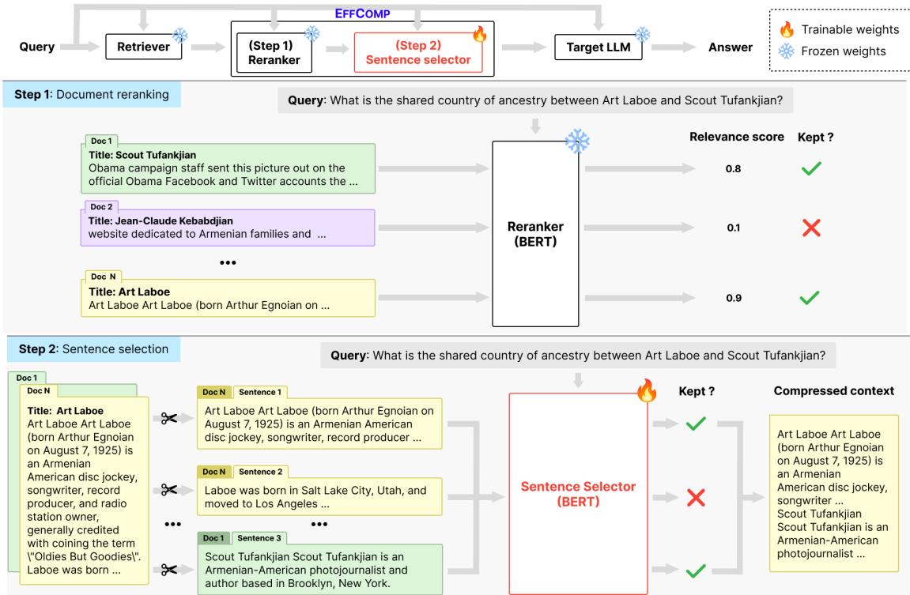  
Figure 1: The inference workflow of EFFCOMP. The top row in the figure illustrates where EFFCOMP is in the prediction pipeline. In Step 1, retrieved documents are filtered, reordered, and concatenated. In Step 2, they are decomposed into sentences, from which necessary ones are selected and concatenated to form the compressed context for LLM prediction.

The remainder of this section explains the training process of the BERT-based sentence selector, which has two phases. Phase I first finetunes the model to identify sentences that likely contain the answer. Phase II further finetunes it to select other necessary context sentences and return a concise prompt sufficient for the target LLM.

## 3.1 Training Process Phase I: Intermediate Finetuning

Training set construction. We adapt training examples from a QA dataset to be our supervised finetuning examples. To explain, each finetuning example consists of a question q from the dataset and a list of retrieved documents D with $| D | = 3 0$ . We concatenate all the documents in D, split the concatenated text into sentences S, and format them (together with q) as input to the sentence selector. Inspired by document-level label assignment in CompAct (Yoon et al., 2024), we assign a label to each sentence using the following rule: a sentence is labeled as retained if it contains the ground-truth answer string; otherwise, it is labeled discarded. In Phase I, we first train the sentence selector to predict these labels and then focus on additional necessary contexts in Phase II.

Training objective. The training objective is defined at the positions of [SEN] tokens. For each sentence $s _ { i } \in S .$ , the action (retaining or discarding) is predicted at the position of its preceding [SEN] token. A masked cross-entropy loss is applied such that only [SEN] positions contribute to the objective, while all other tokens are ignored. This encourages the model to learn sentence-level decisions by treating each [SEN] token as the supervision point for its corresponding sentence.

## 3.2 Training Process Phase II: Final Finetuning

The model from Phase I focuses only on selecting sentences that contain answers. So, this Phase II aims to further finetune it to select other sentences that may not contain the answers but are necessary for the target LLM to make correct predictions (e.g., bridge sentences in multi-hop reasoning). We propose using a hybrid reinforcement learning (RL) and supervised learning (SL) approach for Phase II.

We choose RL, specifically a multi-armed bandit setting, as it is an optimization approach that suits the nature of our sentence selector. By design, RL can help further remove redundant and irrelevant context sentences while maintaining the final answer accuracy. However, as noted by Shandilya et al. (2024) and Wei et al. (2025), RL fine-tuning under a bandit formulation is computationally expensive and time-consuming because a single nondifferentiable reward must be used to optimize multiple actions. To overcome this issue, we incorporate SL, which incurs little overhead and generally converges faster because actions are directly supervised. This results in our hybrid strategy that, for each epoch, updates the model weights using an RL loss followed by an SL loss, as explained next.

## 3.2.1 Reinforcement Learning

We consider our sentence selector as a policy model $\pi _ { \theta }$ and use reward signals derived from the target LLM and ground-truth QA answers to optimize it.

Problem formulation. We formulate our task as a contextual multi-armed bandit problem (Jung and Kim, 2024; Lu et al., 2010), which terminates after a single decision step. A state $\sigma$ is the input $I ( \boldsymbol { q } , S )$ to the policy model where $q$ is a question and S is the list of context sentences from the topk reranked documents. The policy $\pi _ { \theta }$ takes $\sigma$ as input and produces output probability distributions for all input tokens. However, consistent with the( ) intermediate finetuning phase, only the probability distributions at the [SEN] tokens are used to derive binary actions $a _ { i } \in \{ 0 , 1 \}$ indicating whether the corresponding sentences are retained (1) or discarded (0). With m sentences in S, one state produces multiple actions $A = \langle a _ { 1 } , a _ { 2 } , \ldots , a _ { m } \rangle$ in parallel, where each action is sampled from Categorical $( \pi _ { \boldsymbol { \theta } } ( \cdot | \sigma , i ) )$ The compressed context $\mathbb { C }$ is then formed by concatenating all retained sentences. The target LLM M produces $M ( q , \mathbb { C } )$ , and a reward r for A is then computed. A trial, therefore, consists of a single state $\sigma .$ , the full list of binary actions A, and the resulting reward r.

Reward function. We define the reward r as

$$
r = \left\{ \begin{array} { l l } { \alpha + ( 1 - \alpha ) ( 1 - \tau ) , } & { \mathrm { i f ~ A c c u r a c y = 1 ~ } } \\ { - ( 1 - \alpha ) ( 1 - \tau ) , } & { \mathrm { o t h e r w i s e } } \end{array} \right.
$$

where $\tau = | \mathbb { C } | / | \mathbb { D } |$ and the Accuracy is obtained by comparing $M ( q , \mathbb { C } )$ against the ground truth answer of $q .$ This reward jointly maximizes QA accuracy and compression. During validation, we use it to select the best model checkpoint for evaluation where $\alpha \in ( 0 , 1 )$ controls the relative importance between the accuracy and the compression ratio. In practice, we prefer a relatively high α to avoid -extreme compression at the expense of accuracy.

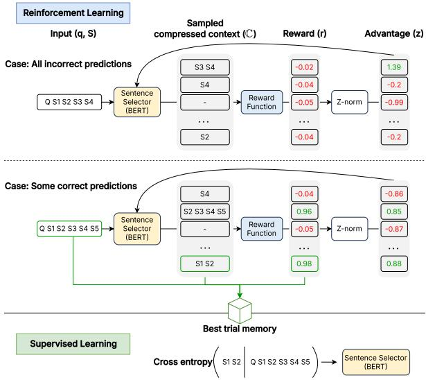  
Figure 2: A single epoch of the final finetuning (Phase II). In each iteration, we perform reinforcement learning, followed by supervised learning. Reward normalization encourages higher compression when some predictions are correct and lower compression otherwise.

Optimization. To train the policy $\pi _ { \theta } ,$ , we adapt Group Relative Policy Optimization (GRPO) (Shao et al., 2024), a policy gradient method that removes the value function used in PPO (Schulman et al., 2017) and instead efficiently estimates advantages by normalizing rewards within a group of sampled trials. Given a group size $b ,$ for each state, we sample a group of actions $\mathbf { A } = \{ A _ { 1 } , \ldots , A _ { b } \}$ from $\pi _ { \theta } ,$ , each producing a compressed context $\mathbb { C } _ { i }$ and reward $r _ { i }$ . The reward set $R = \{ r _ { 1 } , \ldots , r _ { b } \}$ is $\mathbf { Z } ^ { - }$ --normalized in group to yield relative advantages $Z = \{ z _ { 1 } , \ldots , z _ { b } \}$ used for updating the policy.

Thanks to our reward design, when at least one $A _ { i }$ results in a correct LLM output, the $A _ { i }$ with the highest compression ratio receives the greatest advantage, reinforcing the policy to increase compression. Conversely, if all $A _ { i } \in \mathbf { A }$ lead to incorrect LLM outputs, the $A _ { i }$ with the lowest compression ratio is assigned the highest advantage, incentivizing the policy to reduce compression and preserve more information. See Figure 2 for an illustration.

Training set construction. For each QA training example $( q , y _ { q } )$ , we perform Step 1 (document reranking) to obtain context sentences S from the top-k documents to form the input $I ( \boldsymbol { q } , S )$ . However, we exclude some training examples. First, we exclude examples that the target LLM cannot answer correctly even with all sentences in S provided, as further compression is unlikely to help. Given our reward function, including such examples would bias the policy to always retain all sentences, making the training inefficient. Second, we exclude examples that the target LLM can answer correctly even without any context. Keeping these examples would encourage the policy to discard all the sentences, resulting in non-grounded LLM outputs. This example filtering step ensures that the training set only contains examples where context is necessary and compression choices truly matter.

## 3.2.2 Supervised Learning

During GRPO, we sample multiple $A _ { i }$ for each state $\sigma .$ . To enhance training efficiency, we introduce a memory $C$ to store the best trial of each state observed so far (i.e., the best list of sentencelevel binary actions so far for each example). For each state $\sigma ,$ we begin storing a trial $( \sigma , A _ { i } , r _ { i } )$ in $C$ when $r _ { i } > 0$ and update it when we find another trial $( \sigma , A _ { j } , r _ { j } )$ where $r _ { j } \geq r _ { i }$ . After the RL update in each epoch, these best trials in C are used as silver labels to finetune the policy (i.e., the sentence selector) in a supervised learning manner. This concludes the epoch. Then we begin the next iteration with RL and SL again. We refer readers to Appendix A for the detailed algorithm.

## 4 Experiments

We trained EFFCOMP on the HotpotQA training set and evaluated it on four open-domain QA datasets: HotpotQA (HQA; Yang et al. (2018)), 2WikiMultiHopQA (2WikiQA; Ho et al. (2020)), Natural Questions (NQ; Kwiatkowski et al. (2019)), and TriviaQA (TQA; Joshi et al. (2017)).

## 4.1 Experimental Setup

Implementation details. Following prior work (Yoon et al., 2024; Xu et al., 2024), we implemented the document retrieval system using Contriever (Izacard et al., 2021), finetuned on MSMARCO (Bajaj et al., 2018). For each question, we retrieved $n = 3 0$ documents from the 2018 Wikipedia corpus (Karpukhin et al., 2020). Additionally, we used $\mathrm { G e m m a } { - } 2 { - } 9 \mathrm { B } { - } \mathrm { I T } ^ { 2 }$ (Team et al., 2024) as the target LLM. For EFFCOMP, we tried three document rerankers, including $\mathsf { B G E } ^ { 3 }$ (Xiao et al., 2023), $\operatorname { J i n a } ^ { 4 }$ (Günther et al., 2023), and $\mathrm { G T E ^ { 5 } }$ (Zhang et al., 2024), to rerank and select the top-k documents $( k = 1 0 )$ in Step 1 of Figure 1. For Step 2, we used ModernBERT-base<sup>6</sup> (Warner et al., 2024) as the sentence selector and used the BGE reranker to select documents as input for finetuning the sentence selector. We also evaluated EFFCOMP without Step 1, which passed sentences from n documents to Step 2 without reranking. This variant is denoted as “No reranker” in the result tables.

Baselines. We compared EFFCOMP against several types of baselines. The simplest one was “Raw Documents”, which inputs the n retrieved documents to the target LLM without compression. Next, reranker-only filtering baselines used a reranker (BGE, Jina, or GTE) to select top-k documents to feed into the target LLM. This is equivalent to EFFCOMP without Step 2. Furthermore, we compared EFFCOMP with state-of-theart compression frameworks, including five extractive methods (Recomp-Extractive (Xu et al., 2024), LLMLingua2 (Pan et al., 2024), DAC (Zhao et al., 2025a), CPC (Liskavets et al., 2025), LongLLM-Lingua (Jiang et al., 2024)) and two abstractive methods (Recomp-Abstractive (Xu et al., 2024) and CompAct (Yoon et al., 2024)). Implementation details of the baselines are provided in Appendix B.6.

Metrics. We evaluate all methods using three metrics: compression ratio $( 1 / \tau )$ , accuracy $( \operatorname { A c c } )$ and $\mathrm { C } _ { \beta }$ score. The $\mathrm { C } _ { \beta }$ score combines compression ratio and accuracy into a single metric for easier comparison. It is defined as the weighted harmonic mean between accuracy and compression rate:<sup>7</sup>

$$
\mathrm { C } _ { \beta } = { \frac { ( 1 + \beta ^ { 2 } ) \cdot \mathrm { A c c } \cdot ( 1 - \tau ) } { \beta ^ { 2 } \cdot \mathrm { A c c } + ( 1 - \tau ) } }
$$

where $\beta$ is the weighting factor. Lower $\beta$ places more emphasis on accuracy. We report $\mathrm { C _ { 0 . 5 } } .$ which places greater emphasis on accuracy, and $\mathrm { C _ { 1 } }$ , which equally balances accuracy and compression.

<table><tr><td rowspan="2">Method</td><td colspan="3">HQA</td><td colspan="4">2WikiQA</td><td colspan="4">NQ</td><td colspan="4">TQA</td></tr><tr><td colspan="3">1/τ Acc  $\mathrm { C _ { 0 . 5 } }$ </td><td colspan="4">1/τ Acc  $\mathrm { C _ { 0 . 5 } }$ </td><td colspan="3">1/τ Acc  $\mathrm { C _ { 0 . 5 } }$ </td><td colspan="4">1/τ Acc</td></tr><tr><td>Raw Documents</td><td>1.0x 34.6</td><td>0.00</td><td> $\mathrm { C _ { 1 } }$  0.00</td><td>1.0x 29.1</td><td></td><td>0.00</td><td> $\mathrm { C _ { 1 } }$  0.00</td><td>1.0x 30.1</td><td>0.00</td><td> $\mathrm { C _ { 1 } }$  0.00</td><td></td><td>1.0x 77.4</td><td> $\mathrm { C _ { 0 . 5 } }$  0.00</td><td>C1 0.00</td></tr><tr><td colspan="11">Reranker-only methods</td><td></td><td></td><td></td></tr><tr><td>BGE reranker</td><td>3.0x 35.2</td><td>0.39</td><td>0.46</td><td>3.0x 23.8</td><td></td><td>0.27</td><td>0.35</td><td>3.0x 29.6</td><td></td><td>0.330.41</td><td></td><td>3.0x 79.9</td><td>0.77</td><td>0.73</td></tr><tr><td>Jina reranker</td><td>3.0x</td><td>34.6 0.38</td><td>0.46</td><td>3.0x 24.4</td><td></td><td>0.28</td><td>0.36</td><td>3.0x 30.6</td><td>0.34</td><td>0.42</td><td>3.0x</td><td>80.1</td><td>0.77</td><td>0.73</td></tr><tr><td>GTE reranker</td><td>3.0x</td><td>34.7 0.38</td><td>0.46</td><td>3.0x</td><td>23.9</td><td>0.27</td><td>0.35</td><td>3.0x 30.6</td><td>0.34</td><td></td><td>3.0x</td><td></td><td></td><td>0.73</td></tr><tr><td colspan="3">Compression frameworks</td><td></td><td></td><td></td><td></td><td></td><td></td><td></td><td>0.42</td><td></td><td>80.4</td><td>0.77</td><td></td></tr><tr><td>LLMLingua2</td><td>5.4x 25.0</td><td>0.29</td><td>0.38</td><td></td><td>5.5x 19.8</td><td>0.23</td><td>0.32</td><td>5.3x 23.8</td><td></td><td>0.28</td><td>0.37</td><td>5.4x 72.9</td><td>0.75</td><td>0.77</td></tr><tr><td>DAC</td><td>5.1x 24.7</td><td>0.29</td><td>0.38</td><td></td><td>5.0x 21.0</td><td>0.25</td><td>0.33</td><td>5.2x 22.7</td><td></td><td>0.27 0.35</td><td></td><td>5.2x 73.5</td><td>0.75</td><td>0.77</td></tr><tr><td>CPC</td><td>5.6x 30.5</td><td>0.35</td><td>0.45</td><td></td><td>5.9x 21.8</td><td>0.26</td><td>0.35</td><td>5.2x 28.0</td><td></td><td>0.32 0.42</td><td></td><td>5.4x 78.6</td><td>0.79</td><td>0.80</td></tr><tr><td>LongLLMLingua</td><td>5.1x 31.8</td><td>0.36</td><td>0.46</td><td>5.1x</td><td>21.8</td><td>0.26</td><td>0.34</td><td>5.1x</td><td>25.7</td><td>0.30 0.39</td><td>5.1x</td><td>78.4</td><td>0.79</td><td>0.79</td></tr><tr><td>RecompExtractive</td><td>29.2x 25.6</td><td>0.30</td><td>0.40</td><td></td><td>29.3x17.4</td><td>0.21</td><td>0.30</td><td>29.8x 22.8</td><td></td><td>0.27 0.37</td><td></td><td>32.0x 73.1</td><td>0.77</td><td>0.83</td></tr><tr><td>RecompAbstractive</td><td>132.1x</td><td>27.9 0.33</td><td>0.44</td><td>126.9x</td><td>21.0</td><td>0.25</td><td>0.35</td><td>48.3x27.6</td><td></td><td>0.32 0.43</td><td></td><td>139x 73.0</td><td>0.77</td><td>0.84</td></tr><tr><td>CompAct</td><td>48.7x 31.2</td><td>0.36</td><td>0.47</td><td></td><td>54.7x 16.8</td><td>0.20</td><td>0.29</td><td>44.2x</td><td>27.8</td><td>0.32 0.43</td><td>50.2x</td><td>77.6</td><td>0.81</td><td>0.87</td></tr><tr><td colspan="3">Our work: EFFCoMP</td><td></td><td></td><td></td><td></td><td></td><td></td><td></td><td></td><td></td><td></td><td></td><td></td></tr><tr><td>No reranker</td><td>26.8x 37.4</td><td>0.43</td><td>0.54</td><td></td><td>11.7x 28.9</td><td>0.34</td><td>0.44</td><td></td><td>9.8x 31.1</td><td>0.360.46</td><td></td><td>32.8x 78.9</td><td></td><td>0.82 0.87</td></tr><tr><td>BGE reranker</td><td>39.5x 36.3</td><td>0.42</td><td>0.53</td><td>19.4x</td><td>25.0</td><td>0.29</td><td>0.40</td><td>14.1x</td><td>29.0</td><td>0.34 0.44</td><td></td><td>49.6x 79.5</td><td>0.83</td><td>0.88</td></tr><tr><td>Jina reranker</td><td>38.5x 35.8</td><td>0.41</td><td>0.52</td><td></td><td>19.3x 25.8</td><td>0.30</td><td>0.41</td><td>18.8x 29.7</td><td></td><td>0.34 0.45</td><td></td><td>50.0x 79.6</td><td>0.83</td><td>0.88</td></tr><tr><td>GTE reranker</td><td>40.4x 35.5</td><td></td><td>0.41 0.52</td><td></td><td>20.4x 25.0</td><td>0.29</td><td>0.40</td><td>19.2x 29.7</td><td></td><td>0.34 0.45</td><td></td><td>54.1x 79.8</td><td></td><td>0.83 0.88</td></tr></table>

Table 1: Results on four QA benchmarks for Gemma-2-9B-IT. We report compression ratio $( 1 / \tau )$ , accuracy, and $\mathrm { C } _ { \beta }$ for $\beta \in \{ 0 . 5 , 1 \}$ . Higher is better. Best values are in bold.

## 4.2 Results

Table 1 reports the results on four datasets. EFF-COMP consistently achieved the highest $\mathrm { C } _ { \beta }$ scores across all baselines, demonstrating a superior balance between compression efficiency and QA performance. Notably, although EFFCOMP was trained only on HQA, it maintained strong performance on the out-of-distribution datasets, including 2WikiQA, NQ, and TQA. This indicates that the learned sentence selection strategy generalizes effectively beyond the training dataset rather than being specific to HQA. The improvements are especially notable on multi-hop QA datasets such as HQA and 2WikiQA, where preserving supporting evidence is crucial. For example, on HQA, EFFCOMP achieved a $\mathrm { C _ { 1 } }$ score of 0.54, representing an approximately 15% relative improvement over the strongest prior compression framework. Compared to using the Raw Documents, EFFCOMP with rerankers achieved competitive or sometimes higher Acc with compression ratios of 14.1x–54.1x. For example, on HQA, EFFCOMP with BGE reranker achieved 36.3% accuracy with the compression ratio of 39.5x, while the Raw Documents got 34.6% accuracy with no compression (1x). This demonstrates that context compression, if done appropriately, can enhance rather than degrade the quality of LLM predictions. Without the rerankers, EFFCOMP got significantly lower compression ratios but usually slightly higher Acc, resulting in higher $\mathrm { C } _ { \beta }$ . Compared to rerankeronly methods, EFFCOMP with the same reranker achieved significantly higher compression ratios (e.g., from 3x to 32.8x–54.1x on TQA) and competitive or higher Acc scores. This highlights the immense impact of the sentence selection step of EFFCOMP on compression ratios and indicates that our sentence selector, trained on BGE reranked data, generalized effectively to other rerankers such as Jina and GTE. Furthermore, EFFCOMP outperformed all other compression frameworks in terms of accuracy and $\mathrm { C } _ { \beta }$ , suggesting a better balance between the compression ratios and the QA quality.

## 5 Additional Analyses

In this section, we conduct additional analyses to better understand EFFCOMP. Specifically, we evaluate EFFCOMP on additional QA datasets and with commercial LLMs. We also analyze the contributions of the two finetuning phases to sentence selection and compare our hybrid RL-SL training strategy with alternative training strategies.

RQ1: How does EFFCOMP perform on the Longbench benchmark? We investigate how EFFCOMP performs in real-world out-ofdistribution scenarios using the HQA-trained version of our compressor model. To do so, we use the QA (English) subset of the LongBench benchmark (Bai et al., 2024), which includes both multihop and single-hop QA datasets. The multi-hop datasets consist of HQA, 2WikiQA, and MuSiQue, which require reasoning over multiple pieces of evidence. In contrast, the single-hop datasets represent a more distinct out-of-distribution setting from the HQA training data and cover diverse longcontext domains: MultiFieldQA requires answering questions based on long articles, NarrativeQA focuses on questions about stories and scripts, and Qasper requires answering questions based on NLP research papers. We truncate the context length to match the maximum input length of Gemma-2-9B-IT. Although EFFCOMP is designed as an adaptive compression method that dynamically determines the compression level for each example, for this research question we additionally evaluate it under fixed compression settings for fair comparison with prior extractive baselines. For fixed compression, we use an EFFCOMP variant that selects the top-ranked sentences to achieve the target compression ratio. We report the compression ratio, Acc, F1, and $\mathrm { C } _ { \beta } .$ . For reranker-based variants, we first use the reranker to select the top 10 documents before applying sentence-level compression. In Table 2, EFFCOMP achieves the best $\mathrm { C } _ { \beta }$ scores across all multi-hop settings compared to the other baselines and outperforms all compression baselines in single-hop settings. Furthermore, reranker-based EFFCOMP achieves the highest $\mathrm { C } _ { \beta }$ scores in five out of six evaluated datasets, highlighting the importance of document-level filtering.

<table><tr><td colspan="16">Multi-hop</td></tr><tr><td>Method</td><td colspan="4">HQA</td><td colspan="5">2WikiQA</td><td colspan="5">MuSiQue</td></tr><tr><td rowspan="2"></td><td rowspan="2">1/τ Acc</td><td colspan="4">F1  $\overline { { \mathrm { C } _ { 0 . 5 } } }$ </td><td colspan="4">Acc F1  $\mathrm { C _ { 0 . 5 } }$   $\overline { { \mathrm { C _ { 1 } } } }$ </td><td colspan="5">1/τ Acc F1  $\mathrm { C _ { 0 . 5 } }$ </td></tr><tr><td>1.0x 36.5</td><td>46.6</td><td>0.00</td><td>C1 0.00</td><td>1/τ 1.0x</td><td>40.5</td><td>43.7</td><td>0.00 0.00</td><td>1.0x</td><td>20.5</td><td>26.5</td><td>0.00</td><td> $\overline { { \mathrm { C _ { 1 } } } }$  0.00</td></tr><tr><td>Raw Documents DAC</td><td>6.5x</td><td>25.0</td><td>34.9</td><td>0.29</td><td>0.39</td><td>5.4x</td><td>24.0</td><td>28.4</td><td>0.28 0.37</td><td>6.7x</td><td>7.0</td><td>11.8</td><td>0.09</td><td>0.13</td></tr><tr><td>LLMLingua2</td><td>5.4x</td><td>33.0</td><td>42.0</td><td>0.37</td><td>0.47</td><td>5.7x</td><td>27.0 30.3</td><td></td><td>0.31 0.41</td><td>5.5x</td><td>16.0</td><td>21.8</td><td>0.19</td><td>0.27</td></tr><tr><td>LongLLMLingua</td><td>3.5x</td><td>32.0</td><td>41.9</td><td>0.36</td><td>0.44</td><td>3.5x</td><td>38.5</td><td>43.9</td><td>0.42 0.5</td><td>3.5x</td><td>15.5</td><td>21.1</td><td>0.18</td><td>0.25</td></tr><tr><td>CPC</td><td>5.1x</td><td>35.0</td><td>45.6</td><td>0.39</td><td>0.49</td><td>5.2x</td><td>38.5</td><td>43.2</td><td>0.43 0.52</td><td>5.1x</td><td>17.0</td><td>21.5</td><td>0.20</td><td>0.28</td></tr><tr><td colspan="2">Our work: EFFCoMP</td><td></td><td></td><td></td><td></td><td></td><td></td><td></td><td></td><td></td><td></td><td></td><td></td><td></td></tr><tr><td>Ours (5x)</td><td>5.2x</td><td>40.0</td><td>50.1</td><td>0.44</td><td>0.54</td><td>5.1x</td><td>43.0</td><td>47.0</td><td>0.47 0.56</td><td>5.1x</td><td>22.0</td><td>29.3</td><td>0.26</td><td>0.35</td></tr><tr><td>Ours (No reranker)</td><td>39.3x</td><td>35.5</td><td>46.1</td><td>0.41</td><td>0.52</td><td>13.0x</td><td>43.0</td><td>47.3</td><td>0.48 0.59</td><td>13.3x</td><td>23.5</td><td>29.8</td><td>0.28</td><td>0.37</td></tr><tr><td>Ours (BGE)</td><td>65.8x</td><td>40.5</td><td>49.0</td><td>0.46</td><td>0.57</td><td>22.5x</td><td>50.0</td><td>53.7</td><td>0.55 0.66</td><td>40.3x</td><td>20.0</td><td>26.2</td><td>0.24</td><td>0.33</td></tr><tr><td>Ours (GTE)</td><td>58.5x</td><td>40.5</td><td>50.5</td><td>0.46</td><td>0.57</td><td>21.9x</td><td>48.0</td><td>52.2</td><td>0.53 0.64</td><td>43.2x</td><td>18.0</td><td>25.5</td><td>0.22</td><td>0.30</td></tr><tr><td>Ours (Jina)</td><td>63.4x</td><td>38.0</td><td>47.7</td><td>0.43</td><td>0.55</td><td>25.7x</td><td>47.5</td><td>51.5</td><td>0.53 0.64</td><td>32.6x</td><td>22.5</td><td>28.1</td><td>0.27</td><td>0.37</td></tr><tr><td colspan="2"></td><td colspan="10"></td><td colspan="2"></td></tr><tr><td colspan="2">Method</td><td colspan="3">MultiFieldQA NarrativeQA</td><td colspan="4">Single-hop</td><td colspan="2"></td><td colspan="4">Qasper</td></tr><tr><td></td><td>1/τ</td><td>Acc</td><td>F1</td><td> $\overline { { \mathrm { C } _ { 0 . 5 } } }$ </td><td> $\overline { { \mathrm { { C } _ { 1 } } } }$ </td><td>1/τ</td><td>Acc</td><td>F1</td><td> $\overline { { \mathrm { C } _ { 0 . 5 } } }$   $\overline { { \mathrm { C _ { 1 } } } }$ </td><td>1/τ</td><td>Acc</td><td>F1</td><td> $\overline { { \mathrm { C } _ { 0 . 5 } } }$ </td><td> $\overline { { \mathrm { C _ { 1 } } } }$ </td></tr><tr><td>Raw Documents</td><td>1.0x</td><td>14.0</td><td>40.6</td><td>0.00</td><td>0.00</td><td>1.0x</td><td>12.5</td><td>23.6</td><td>0.00 0.00</td><td>1.0x</td><td>22.0</td><td>39.6</td><td>0.00</td><td>0.00</td></tr><tr><td>DAC</td><td>5.9x</td><td>4.7</td><td>26.9</td><td>0.06</td><td>0.09</td><td>7.2x</td><td>4.5</td><td>13.7</td><td>0.06 0.09</td><td>5.0x</td><td>15.5</td><td>24.3</td><td>0.18</td><td>0.26</td></tr><tr><td>LLMLingua2</td><td>5.6x</td><td>10.7</td><td>31.1</td><td>0.13</td><td>0.19</td><td>6.0x</td><td>12.0</td><td>20.8</td><td>0.14 0.21</td><td>5.2x</td><td>18.5</td><td>28.7</td><td>0.22</td><td>0.30</td></tr><tr><td>LongLLMLingua</td><td>4.4x</td><td>12.0</td><td>33.7</td><td>0.14</td><td>0.21</td><td>3.6x</td><td>10.5</td><td>19.6</td><td>0.13 0.18</td><td>3.3x</td><td>16.0</td><td>22.3</td><td>0.19</td><td>0.26</td></tr><tr><td>CPC</td><td>5.1x</td><td>20.0</td><td>45.3</td><td>0.24</td><td>0.32</td><td>5.5x</td><td>8.5</td><td>20.0</td><td>0.1 0.15</td><td>5.1x</td><td>19.5</td><td>34.9</td><td>0.23</td><td>0.31</td></tr><tr><td colspan="2">Our work: EFFCoMP</td><td></td><td></td><td></td><td></td><td></td><td></td><td></td><td></td><td></td><td></td><td></td><td></td><td></td></tr><tr><td>Ours (5x)</td><td>5.0x</td><td>21.3</td><td>48.3</td><td>0.25</td><td>0.34</td><td>5.4x</td><td>10.5</td><td>18.6</td><td>0.13 0.19</td><td>5.1x</td><td>22.5</td><td>39.0</td><td>0.26</td><td>0.35</td></tr><tr><td>Ours (No reranker)</td><td>24.3x</td><td>19.3</td><td>45.8</td><td>0.23</td><td>0.32</td><td>1.6x</td><td>12.0</td><td>22.1</td><td>0.14 0.18</td><td>3.0x</td><td>24.0</td><td>40.2</td><td>0.28</td><td>0.35</td></tr><tr><td>Ours (BGE)</td><td>28.2x</td><td>20.0</td><td>44.4</td><td>0.24</td><td>0.33</td><td>22.5x</td><td>10.5</td><td>18.2</td><td>0.13 0.19</td><td>3.0x</td><td>24.0</td><td>40.2</td><td>0.28</td><td>0.35</td></tr><tr><td>Ours (GTE)</td><td>32.3x</td><td>19.3</td><td>45.7</td><td>0.23</td><td>0.32</td><td>26.1x</td><td>9.5</td><td>16.1</td><td>0.12 0.17</td><td>3.0x</td><td>24.0</td><td>40.2</td><td>0.28</td><td>0.35</td></tr><tr><td>Ours (Jina)</td><td>28.6x</td><td>18.7</td><td>44.2</td><td>0.22</td><td>0.31</td><td>20.3x</td><td>12.0</td><td>19.6</td><td>0.15 0.21</td><td>3.0x</td><td>24.0</td><td>40.2</td><td>0.28</td><td>0.35</td></tr></table>

Table 2: Results on LongBench QA datasets (out of distribution) using Gemma-2-9B-IT as the target LLM. The baselines are evaluated at a ${ 5 } \mathrm { x }$ compression ratio. We report compression ratio $( 1 / \tau )$ , accuracy, token level F1 score, and $\mathrm { C } _ { \beta }$ . Higher is better, and best values are in bold.

RQ2: How does EFFCOMP perform with commercial LLMs? To assess whether EFFCOMP generalizes to larger commercial LLMs, we further evaluate EFFCOMP with larger commercial LLMs, including GPT-4o mini<sup>8</sup> and Claude Sonnet 4 $. 5 ^ { 9 }$ using temperature 0. We apply the same EFFCOMP model reported in Table 1 to the first 500 examples of the HQA test set. The results are presented in Table 3.

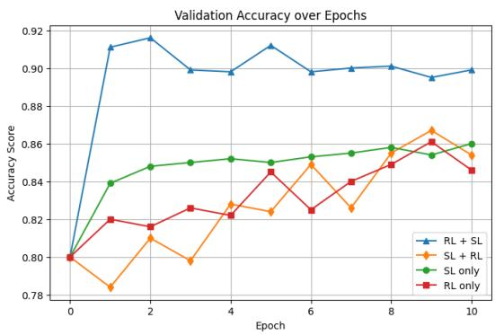

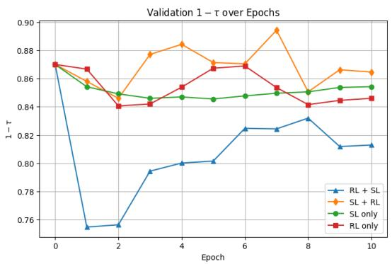  
Figure 3: Ablation study of different training strategies for EFFCOMP on HQA. The plots compare (left) validation accuracy and (right) compression rate $1 - \tau = 1 - | \mathbb { C } | / | \mathbb { D } |$ during validation across ten epochs. For both metrics, the higher values are better.

<table><tr><td>Method</td><td> $1 / \tau$   $_ \mathrm { A c c }$ </td><td> $\mathrm { C _ { 0 . 5 } }$ </td><td> $\mathrm { C _ { 1 } }$ </td></tr><tr><td>Target LLM: Claude Sonnet 4.5</td><td></td><td></td><td></td></tr><tr><td>Raw Documents</td><td>1.0x 28.0</td><td>0.00</td><td>0.00</td></tr><tr><td>LLMLingua2</td><td>5.4x 40.2</td><td>0.45</td><td>0.54</td></tr><tr><td>DAC</td><td>5.1x 40.2</td><td>0.45</td><td>0.54</td></tr><tr><td>CPC</td><td>5.6x 42.4</td><td>0.47</td><td>0.56</td></tr><tr><td>LongLLMLingua</td><td>5.1x 43.6</td><td>0.48</td><td>0.57</td></tr><tr><td>Recomp Extractive</td><td>28.5x 36.8</td><td>0.42</td><td>0.53</td></tr><tr><td>Recomp Abstractive</td><td>134.7x 31.4</td><td>0.36</td><td>0.48</td></tr><tr><td>CompAct</td><td>49.0x 36.4</td><td>0.42</td><td>0.53</td></tr><tr><td>Our work: EFFCoMP</td><td></td><td></td><td></td></tr><tr><td>EFFCoMP (No reranker)</td><td>28.0x 41.6</td><td>0.47</td><td>0.58</td></tr><tr><td>EFFCOMP (BGE reranker)</td><td>43.6x 45.0</td><td>0.50</td><td>0.62</td></tr><tr><td>Target LLM: GPT-4o mini</td><td></td><td></td><td></td></tr><tr><td>Raw Documents</td><td>1.0x 35.8</td><td>0.00</td><td>0.00</td></tr><tr><td>LLMLingua2</td><td>5.4x 30.4</td><td>0.35</td><td>0.44</td></tr><tr><td>DAC</td><td>5.1x</td><td>27.0 0.31</td><td>0.40</td></tr><tr><td>CPC</td><td>5.6x</td><td>32.8 0.37</td><td>0.47</td></tr><tr><td>LongLLMLingua</td><td>5.1x</td><td>35.8 0.40</td><td>0.50</td></tr><tr><td>Recomp Extractive</td><td>28.5x</td><td>28.6 0.33</td><td>0.44</td></tr><tr><td>Recomp Abstractive</td><td>134.7x</td><td>28.6 0.33</td><td>0.44</td></tr><tr><td>CompAct</td><td>49.0x</td><td>32.6 0.38</td><td>0.49</td></tr><tr><td>Our work: EFFCoMP</td><td></td><td></td><td></td></tr><tr><td>EFFCoMP (No reranker)</td><td>28.0x</td><td>36.2</td><td>0.41 0.53</td></tr><tr><td>EFFCOMP (BGE reranker)</td><td>43.6x</td><td>35.0 0.40</td><td>0.52</td></tr></table>

Table 3: Performance of prompt compression methods with commercial LLMs on HQA.

These results demonstrate that EFFCOMP generalizes effectively across commercial LLMs in terms of $\mathrm { C } _ { \beta }$ . With Claude Sonnet 4.5, EFFCOMP with the BGE reranker achieves the highest $\mathrm { C _ { 0 . 5 } }$ and $\mathrm { C _ { 1 } }$ scores of 0.50 and 0.62, respectively, while attaining a 43.6x compression ratio. With GPT-4o mini, EFFCOMP without reranking achieves the highest $\mathrm { C _ { 0 . 5 } }$ and $\mathrm { C _ { 1 } }$ scores of 0.41 and 0.53, respectively, while the BGE-reranked variant remains competitive with $\mathrm { C } _ { 0 . 5 } = 0 . 4 0$ and $\mathrm { C _ { 1 } } = 0 . 5 2$ at a higher compression ratio of 43.6x. Overall, these results show that EFFCOMP maintains a strong trade-off between compression and QA performance across different commercial target LLMs. This generalization possibly stems from our training set construction (Section 3), which uses highly informative examples identified by a relatively small LLM that generalize effectively to different target LLMs.

RQ3: How do the two finetuning phases contribute to the accuracy of sentence selection? This RQ investigates the effects of Phase I (intermediate finetuning) and Phase II (final finetuning) on the quality of compressed contexts. Specifically, we conduct an ablation study by training our sentence selector under three configurations: Phase I only, Phase II only, and our proposed Phase I + Phase II. We evaluate these models on HQA, a multi-hop QA dataset that provides gold labels specifying supporting context sentences required to answer a question. We measure the recall of these supporting sentences by checking whether at least 50% of the tokens from each supporting sentence appear as a subsequence in the compressed output. The results show that the Phase I-only model achieves a supporting fact recall of 75.83%, while the Phase II-only model achieves 84.13%. Combining both phases further increases the supporting fact recall to 91.09%. These results confirm that while Phase I focuses primarily on sentences containing the direct answers, Phase II significantly helps the model retrieve critical "bridge" sentences, thereby improving its effectiveness in multi-hop reasoning.

RQ4: How does the hybrid RL-SL finetuning approach perform compared to other approaches? We conduct an ablation study on the HQA dataset to evaluate four finetuning strategies: (1) reinforcement learning (RL) only, (2) supervised learning (SL) only using the best sampled trials, (3) the hybrid approach that performs SL then RL in each iteration (SL+RL) and (4) the hybrid approach of EFFCOMP that performs RL then SL in each iteration (RL+SL). Figure 3 shows that, overall, the RL only and SL + RL strategies primarily optimize compression, maintaining competitive accuracy even at high compression rates, but require more training epochs to converge. Meanwhile, the SL only strategy generally attains higher validation accuracy than the RL only approach, but exhibits a lower and more stable compression rate across epochs, suggesting a more limited search space. Our hybrid (RL+SL) strategy, in contrast, achieves notably higher validation accuracy during the early epochs, while exhibiting a relatively lower compression rate. Still, the compression rate is notably higher than several extractive compression methods as seen in Table 1. In conclusion, our hybrid (RL+SL) approach leads to a more accurate LLM output sooner than the non-hybrid approaches, demonstrating the efficiency of our training framework.

## 6 Related Work

Prompt compression. Li et al. (2025) categorize prompt compression methods into two types. Soft prompt methods compress inputs into continuous vectors readable only by the target LLM (Wingate et al., 2022; Chevalier et al., 2023; Mu et al., 2023; Ge et al., 2024). In contrast, hard prompt methods use truncation, selection, or summarization to keep the compressed prompts human-readable (Li et al., 2023; Jiang et al., 2024; Xu et al., 2024; Yoon et al., 2024; Fei et al., 2025). EFFCOMP falls into the latter category as we value interpretability and applicability across different target LLMs. So far, few hard prompt methods have employed reinforcement learning. Jung and Kim (2024) formulate prompt compression as a token-level contextual bandit problem for instruction-following tasks. Shandilya et al. (2024) propose TACO-RL for QA and summarization. They employ a constant penalty to counter the overly aggressive compression often encouraged by its optimization objectives. EFFCOMP, by contrast, operates at the sentence level with a tailored reward design and training set construction. This naturally regulates compression without the fixed limits, allowing higher compression while preserving QA accuracy.

Combining reinforcement learning (RL) and supervised finetuning (SFT). Recent studies show that using SFT to train LLMs followed by RL to align them with desired behaviors effectively enhances their capabilities (DeepSeek-AI et al., 2025; Ouyang et al., 2022). Instead of using one after the other, SuperRL (Liu et al., 2025) enhances the complex reasoning ability of LLMs using RL. However, when all sampled trials of an example yield zero reward, leading to uninformative RL signals, they switch to SFT with high-quality offline data. In contrast, our framework focuses on improving the efficiency of the training process while alleviating the zero-reward issue by using a dense reward and setting an RL hyperparameter (Section B.2) to encourage the exploration of various action choices. It then uses the best-performing trials from RL (instead of offline data) for SFT before alternating between RL and SFT in subsequent epochs.

## 7 Conclusion

We propose EFFCOMP, a prompt compression framework for RAG-based QA. EFFCOMP performs context selection at the document level and then the sentence level, rendering minimal yet sufficient context for the target LLM. Our hybrid finetuning achieves the best overall training performance in terms of accuracy and consistently obtains the strongest C<sub>β</sub> scores among all baselines. Experimental results show that EFFCOMP yields high compression ratios (up to 54.1x) while maintaining or even improving the QA accuracy (up to 8.1% relative to the no-compression baseline).

## Limitations

We acknowledge that EFFCOMP has some limitations. First, EFFCOMP was designed to tackle RAG-based question answering, so its algorithm may not work effectively on other tasks such as text summarization. Second, EFFCOMP is constrained by the context length of the underlying BERT-based encoder, which is currently limited to 8,192 tokens in state-of-the-art implementations. While EFFCOMP uses a reranker to fit the input into a fixed-size window, the method is still fundamentally bounded by the encoder’s context-length limitation. Third, while adaptive compression improves QA accuracy by dynamically preserving more informative content, it also produces variable compressed context lengths, which may lead to unstable or unexpectedly high inference costs in practical deployments. This limitation could potentially be mitigated by incorporating fixed-rate compression as we did in RQ1.

## References

Aisha Alansari and Hamzah Luqman. 2025. Large language models hallucination: A comprehensive survey. Preprint, arXiv:2510.06265.

Anthropic. The claude 3 model family: Opus, sonnet, haiku.

Yushi Bai, Xin Lv, Jiajie Zhang, Hongchang Lyu, Jiankai Tang, Zhidian Huang, Zhengxiao Du, Xiao Liu, Aohan Zeng, Lei Hou, Yuxiao Dong, Jie Tang, and Juanzi Li. 2024. LongBench: A bilingual, multitask benchmark for long context understanding. In Proceedings ofthe 62nd Annual Meeting ofthe Associationfor Computational Linguistics (Volume 1: Long Papers), pages 3119–3137, Bangkok, Thailand. Association for Computational Linguistics.

Payal Bajaj, Daniel Campos, Nick Craswell, Li Deng, Jianfeng Gao, Xiaodong Liu, Rangan Majumder, Andrew McNamara, Bhaskar Mitra, Tri Nguyen, Mir Rosenberg, Xia Song, Alina Stoica, Saurabh Tiwary, and Tong Wang. 2018. Ms marco: A human generated machine reading comprehension dataset. Preprint, arXiv:1611.09268.

Scott Barnett, Stefanus Kurniawan, Srikanth Thudumu, Zach Brannelly, and Mohamed Abdelrazek. 2024. Seven failure points when engineering a retrieval augmented generation system. In Proceedings of the IEEE/ACM 3rd International Conference on AI Engineering-Software Engineeringfor AI, pages 194– 199.

Steven Bird and Edward Loper. 2004. NLTK: The natural language toolkit. In Proceedings of the ACL Interactive Poster and Demonstration Sessions, pages 214–217, Barcelona, Spain. Association for Computational Linguistics.

Alexis Chevalier, Alexander Wettig, Anirudh Ajith, and Danqi Chen. 2023. Adapting language models to compress contexts. In Proceedings ofthe 2023 Conference on Empirical Methods in Natural Language Processing, pages 3829–3846, Singapore. Association for Computational Linguistics.

Alexis Conneau, Kartikay Khandelwal, Naman Goyal, Vishrav Chaudhary, Guillaume Wenzek, Francisco Guzmán, Edouard Grave, Myle Ott, Luke Zettlemoyer, and Veselin Stoyanov. 2020. Unsupervised cross-lingual representation learning at scale. Preprint, arXiv:1911.02116.

DeepSeek-AI, Daya Guo, Dejian Yang, Haowei Zhang, Junxiao Song, Ruoyu Zhang, Runxin Xu, Qihao Zhu, Shirong Ma, Peiyi Wang, Xiao Bi, Xiaokang Zhang, Xingkai Yu, Yu Wu, Z. F. Wu, Zhibin Gou, Zhihong Shao, Zhuoshu Li, Ziyi Gao, and 181 others. 2025. Deepseek-r1: Incentivizing reasoning capability in llms via reinforcement learning. Preprint, arXiv:2501.12948.

Jacob Devlin, Ming-Wei Chang, Kenton Lee, and Kristina Toutanova. 2019. Bert: Pre-training of deep bidirectional transformers for language understanding. Preprint, arXiv:1810.04805.

Feyza Duman Keles, Pruthuvi Mahesakya Wijewardena, and Chinmay Hegde. 2023. On the computational complexity of self-attention. In Proceedings ofThe 34th International Conference on Algorithmic Learning Theory, volume 201 of Proceedings of Machine Learning Research, pages 597–619.

Weizhi Fei, Xueyan Niu, XIE GUOQING, Yingqing Liu, Bo Bai, and Wei Han. 2025. Efficient prompt compression with evaluator heads for long-context transformer inference. In The Thirty-ninth Annual Conference on Neural Information Processing Systems.

Tao Ge, Hu Jing, Lei Wang, Xun Wang, Si-Qing Chen, and Furu Wei. 2024. In-context autoencoder for context compression in a large language model. In The Twelfth International Conference on Learning Representations.

Kelvin Guu, Kenton Lee, Zora Tung, Panupong Pasupat, and Mingwei Chang. 2020. Retrieval augmented language model pre-training. In Proceedings ofthe 37th International Conference on Machine Learning, volume 119 of Proceedings of Machine Learning Research, pages 3929–3938. PMLR.

Michael Günther, Jackmin Ong, Isabelle Mohr, Alaeddine Abdessalem, Tanguy Abel, Mohammad Kalim Akram, Susana Guzman, Georgios Mastrapas, Saba Sturua, Bo Wang, Maximilian Werk, Nan Wang, and Han Xiao. 2023. Jina embeddings 2: 8192-token general-purpose text embeddings for long documents. Preprint, arXiv:2310.19923.

Xanh Ho, Anh-Khoa Duong Nguyen, Saku Sugawara, and Akiko Aizawa. 2020. Constructing a multihop QA dataset for comprehensive evaluation of reasoning steps. In Proceedings of the 28th International Conference on Computational Linguistics, pages 6609–6625, Barcelona, Spain (Online). International Committee on Computational Linguistics.

Yebowen Hu, Tim Ganter, Hanieh Deilamsalehy, Franck Dernoncourt, Hassan Foroosh, and Fei Liu. 2023. Meetingbank: A benchmark dataset for meeting summarization. In Proceedings ofthe 61st Annual Meeting ofthe Associationfor Computational Linguistics (ACL), Toronto, Canada. Association for Computational Linguistics.

Gautier Izacard, Mathilde Caron, Lucas Hosseini, Sebastian Riedel, Piotr Bojanowski, Armand Joulin, and Edouard Grave. 2021. Unsupervised dense information retrieval with contrastive learning.

Gautier Izacard and Edouard Grave. 2021. Leveraging passage retrieval with generative models for open domain question answering. In Proceedings ofthe 16th Conference of the European Chapter of the Associationfor Computational Linguistics: Main Volume, pages 874–880, Online. Association for Computational Linguistics.

Albert Q. Jiang, Alexandre Sablayrolles, Arthur Mensch, Chris Bamford, Devendra Singh Chaplot, Diego de las Casas, Florian Bressand, Gianna Lengyel, Guillaume Lample, Lucile Saulnier, Lélio Renard Lavaud, Marie-Anne Lachaux, Pierre Stock, Teven Le Scao, Thibaut Lavril, Thomas Wang, Timothée Lacroix, and William El Sayed. 2023. Mistral 7b. Preprint, arXiv:2310.06825.

Huiqiang Jiang, Qianhui Wu, Xufang Luo, Dongsheng Li, Chin-Yew Lin, Yuqing Yang, and Lili Qiu. 2024. LongLLMLingua: Accelerating and enhancing LLMs in long context scenarios via prompt compression. In Proceedings ofthe 62nd Annual Meeting ofthe Associationfor Computational Linguistics (Volume 1: Long Papers), pages 1658–1677, Bangkok, Thailand. Association for Computational Linguistics.

Mandar Joshi, Eunsol Choi, Daniel Weld, and Luke Zettlemoyer. 2017. triviaqa: A Large Scale Distantly Supervised Challenge Dataset for Reading Comprehension. arXiv e-prints, arXiv:1705.03551.

Dongwon Jung, Qin Liu, Tenghao Huang, Ben Zhou, and Muhao Chen. 2024. Familiarity-aware evidence compression for retrieval-augmented generation. Preprint, arXiv:2409.12468.

Hoyoun Jung and Kyung-Joong Kim. 2024. Discrete prompt compression with reinforcement learning. IEEE Access, 12:72578–72587.

Vladimir Karpukhin, Barlas Oguz, Sewon Min, Patrick Lewis, Ledell Wu, Sergey Edunov, Danqi Chen, and Wen-tau Yih. 2020. Dense passage retrieval for opendomain question answering. In Proceedings of the 2020 Conference on Empirical Methods in Natural Language Processing (EMNLP), pages 6769–6781, Online. Association for Computational Linguistics.

Tom Kwiatkowski, Jennimaria Palomaki, Olivia Redfield, Michael Collins, Ankur Parikh, Chris Alberti, Danielle Epstein, Illia Polosukhin, Matthew Kelcey, Jacob Devlin, Kenton Lee, Kristina N. Toutanova, Llion Jones, Ming-Wei Chang, Andrew Dai, Jakob Uszkoreit, Quoc Le, and Slav Petrov. 2019. Natural questions: a benchmark for question answering research. Transactions of the Association of Computational Linguistics.

Piyawat Lertvittayakumjorn, David Kinney, Vinodkumar Prabhakaran, Donald Martin Jr., and Sunipa Dev.

2025. Towards geo-culturally grounded LLM generations. In Proceedings of the 63rd Annual Meeting ofthe Associationfor Computational Linguistics (Volume 2: Short Papers), pages 313–330, Vienna, Austria. Association for Computational Linguistics.

Patrick Lewis, Ethan Perez, Aleksandra Piktus, Fabio Petroni, Vladimir Karpukhin, Naman Goyal, Heinrich Küttler, Mike Lewis, Wen-tau Yih, Tim Rocktäschel, Sebastian Riedel, and Douwe Kiela. 2020. Retrieval-augmented generation for knowledgeintensive nlp tasks. In Advances in Neural Information Processing Systems, volume 33, pages 9459– 9474. Curran Associates, Inc.

Yucheng Li, Bo Dong, Frank Guerin, and Chenghua Lin. 2023. Compressing context to enhance inference efficiency of large language models. In Proceedings of the 2023 Conference on Empirical Methods in Natural Language Processing, pages 6342–6353, Singapore. Association for Computational Linguistics.

Zongqian Li, Yinhong Liu, Yixuan Su, and Nigel Collier. 2025. Prompt compression for large language models: A survey. In Proceedings ofthe 2025 Conference ofthe Nations ofthe Americas Chapter ofthe Associationfor Computational Linguistics: Human Language Technologies (Volume 1: Long Papers), pages 7182–7195, Albuquerque, New Mexico. Association for Computational Linguistics.

Barys Liskavets, Maxim Ushakov, Shuvendu Roy, Mark Klibanov, Ali Etemad, and Shane K. Luke. 2025. Prompt compression with context-aware sentence encoding for fast and improved llm inference. Proceedings ofthe AAAI Conference on Artificial Intelligence, 39(23):24595–24604.

Yihao Liu, Shuocheng Li, Lang Cao, Yuhang Xie, Mengyu Zhou, Haoyu Dong, Xiaojun Ma, Shi Han, and Dongmei Zhang. 2025. Superrl: Reinforcement learning with supervision to boost language model reasoning. Preprint, arXiv:2506.01096.

Tyler Lu, David Pal, and Martin Pal. 2010. Contextual multi-armed bandits. In Proceedings of the Thirteenth International Conference on Artificial Intelligence and Statistics, volume 9 of Proceedings of Machine Learning Research, pages 485–492, Chia Laguna Resort, Sardinia, Italy. PMLR.

Marc Marone, Orion Weller, William Fleshman, Eugene Yang, Dawn Lawrie, and Benjamin Van Durme. 2025. mmbert: A modern multilingual encoder with annealed language learning. Preprint, arXiv:2509.06888.

Jesse Mu, Xiang Lisa Li, and Noah Goodman. 2023. Learning to compress prompts with gist tokens. In Thirty-seventh Conference on Neural Information Processing Systems.

Niklas Muennighoff, Nouamane Tazi, Loic Magne, and Nils Reimers. 2023. MTEB: Massive text embedding benchmark. In Proceedings ofthe 17th Conference

of the European Chapter of the Association for Computational Linguistics, pages 2014–2037, Dubrovnik, Croatia. Association for Computational Linguistics.

Long Ouyang, Jeff Wu, Xu Jiang, Diogo Almeida, Carroll L. Wainwright, Pamela Mishkin, Chong Zhang, Sandhini Agarwal, Katarina Slama, Alex Ray, John Schulman, Jacob Hilton, Fraser Kelton, Luke Miller, Maddie Simens, Amanda Askell, Peter Welinder, Paul Christiano, Jan Leike, and Ryan Lowe. 2022. Training language models to follow instructions with human feedback. Preprint, arXiv:2203.02155.

Zhuoshi Pan, Qianhui Wu, Huiqiang Jiang, Menglin Xia, Xufang Luo, Jue Zhang, Qingwei Lin, Victor Rühle, Yuqing Yang, Chin-Yew Lin, H. Vicky Zhao, Lili Qiu, and Dongmei Zhang. 2024. LLMLingua-2: Data distillation for efficient and faithful task-agnostic prompt compression. In Findings of the Association for Computational Linguistics: ACL 2024, pages 963–981, Bangkok, Thailand. Association for Computational Linguistics.

Pranav Rajpurkar, Robin Jia, and Percy Liang. 2018. Know what you don’t know: Unanswerable questions for SQuAD. In Proceedings ofthe 56th Annual Meeting of the Association for Computational Linguistics (Volume 2: Short Papers), pages 784–789, Melbourne, Australia. Association for Computational Linguistics.

John Schulman. 2020. Approximating kl divergence. http://joschu.net/blog/kl-approx.html. Accessed: 2025-08-29.

John Schulman, Filip Wolski, Prafulla Dhariwal, Alec Radford, and Oleg Klimov. 2017. Proximal policy optimization algorithms. Preprint, arXiv:1707.06347.

Shivam Shandilya, Menglin Xia, Supriyo Ghosh, Huiqiang Jiang, Jue Zhang, Qianhui Wu, and Victor Rühle. 2024. Taco-rl: Task aware prompt compression optimization with reinforcement learning. Preprint, arXiv:2409.13035.

Claude Elwood Shannon. 1948. A mathematical theory of communication. The Bell System Technical Journal, 27(3):379–423.

Zhihong Shao, Peiyi Wang, Qihao Zhu, Runxin Xu, Junxiao Song, Xiao Bi, Haowei Zhang, Mingchuan Zhang, Y. K. Li, Y. Wu, and Daya Guo. 2024. Deepseekmath: Pushing the limits of mathematical reasoning in open language models. Preprint, arXiv:2402.03300.

Freda Shi, Xinyun Chen, Kanishka Misra, Nathan Scales, David Dohan, Ed H Chi, Nathanael Schärli, and Denny Zhou. 2023. Large language models can be easily distracted by irrelevant context. In International Conference on Machine Learning, pages 31210–31227. PMLR.

Jiwei Tang, Jin Xu, Tingwei Lu, Zhicheng Zhang, YimingZhao YimingZhao, LinHai LinHai, and Hai-Tao

Zheng. 2025. Perception compressor: A trainingfree prompt compression framework in long context scenarios. In Findings ofthe Associationfor Computational Linguistics: NAACL 2025, pages 4093–4108, Albuquerque, New Mexico. Association for Computational Linguistics.

Gemma Team, Morgane Riviere, Shreya Pathak, Pier Giuseppe Sessa, Cassidy Hardin, Surya Bhupatiraju, Léonard Hussenot, Thomas Mesnard, Bobak Shahriari, Alexandre Ramé, and 1 others. 2024. Gemma 2: Improving open language models at a practical size. arXiv preprint arXiv:2408.00118.

Sourav Verma. 2024. Contextual compression in retrieval-augmented generation for large language models: A survey. Preprint, arXiv:2409.13385.

Benjamin Warner, Antoine Chaffin, Benjamin Clavié, Orion Weller, Oskar Hallström, Said Taghadouini, Alexis Gallagher, Raja Biswas, Faisal Ladhak, Tom Aarsen, Nathan Cooper, Griffin Adams, Jeremy Howard, and Iacopo Poli. 2024. Smarter, better, faster, longer: A modern bidirectional encoder for fast, memory efficient, and long context finetuning and inference. Preprint, arXiv:2412.13663.

Quan Wei, Siliang Zeng, Chenliang Li, William Brown, Oana Frunza, Wei Deng, Yuriy Nevmyvaka, Yang Katie Zhao, Alfredo Garcia, and Mingyi Hong. 2025. Reinforcing multi-turn reasoning in LLM agents via turn-level reward design and credit assignment. In First Workshop on Multi-Turn Interactions in Large Language Models.

David Wingate, Mohammad Shoeybi, and Taylor Sorensen. 2022. Prompt compression and contrastive conditioning for controllability and toxicity reduction in language models. In Findings ofthe Association for Computational Linguistics: EMNLP 2022, pages 5621–5634, Abu Dhabi, United Arab Emirates. Association for Computational Linguistics.

Shitao Xiao, Zheng Liu, Peitian Zhang, and Niklas Muennighoff. 2023. C-pack: Packaged resources to advance general chinese embedding. Preprint, arXiv:2309.07597.

Fangyuan Xu, Weijia Shi, and Eunsol Choi. 2024. RE-COMP: Improving retrieval-augmented LMs with context compression and selective augmentation. In The Twelfth International Conference on Learning Representations.

An Yang, Baosong Yang, Binyuan Hui, Bo Zheng, Bowen Yu, Chang Zhou, Chengpeng Li, Chengyuan Li, Dayiheng Liu, Fei Huang, Guanting Dong, Haoran Wei, Huan Lin, Jialong Tang, Jialin Wang, Jian Yang, Jianhong Tu, Jianwei Zhang, Jianxin Ma, and 43 others. 2024. Qwen2 technical report. Preprint, arXiv:2407.10671.

Zhilin Yang, Peng Qi, Saizheng Zhang, Yoshua Bengio, William W. Cohen, Ruslan Salakhutdinov, and Christopher D. Manning. 2018. HotpotQA: A dataset

for diverse, explainable multi-hop question answering. In Conference on Empirical Methods in Natural Language Processing (EMNLP).

Chanwoong Yoon, Taewhoo Lee, Hyeon Hwang, Minbyul Jeong, and Jaewoo Kang. 2024. CompAct: Compressing retrieved documents actively for question answering. In Proceedings ofthe 2024 Conference on Empirical Methods in Natural Language Processing, pages 21424–21439, Miami, Florida, USA. Association for Computational Linguistics.

Xin Zhang, Yanzhao Zhang, Dingkun Long, Wen Xie, Ziqi Dai, Jialong Tang, Huan Lin, Baosong Yang, Pengjun Xie, Fei Huang, and 1 others. 2024. mgte: Generalized long-context text representation and reranking models for multilingual text retrieval. In Proceedings of the 2024 Conference on Empirical Methods in Natural Language Processing: Industry Track, pages 1393–1412.

Ziyin Zhang, Zihan Liao, Hang Yu, Peng Di, and Rui Wang. 2026. F2llm-v2: Inclusive, performant, and efficient embeddings for a multilingual world. Preprint, arXiv:2603.19223.

Yi Zhao, Zuchao Li, Hai Zhao, Baoyuan Qi, and Liu Guoming. 2025a. DAC: A dynamic attention-aware approach for task-agnostic prompt compression. In Proceedings of the 63rd Annual Meeting of the Association for Computational Linguistics (Volume 1: Long Papers), pages 19395–19407, Vienna, Austria. Association for Computational Linguistics.

Yunlong Zhao, Haoran Wu, and Bo Xu. 2025b. Leveraging attention to effectively compress prompts for long-context llms. Proceedings ofthe AAAI Conference on Artificial Intelligence, 39(24):26048–26056.

## A Detailed Algorithm

## A.1 Reinforcement learning

This section provides an in-depth description of the RL finetuning procedure. To train the policy $\pi _ { \theta } ,$ we modify GRPO by excluding the explicit KL penalty from the loss function. Instead, we monitor the approximate KL divergence (Schulman, 2020) between the updated policy and the reference policy during optimization and terminate updates early if it exceeds a threshold.

For each state $\sigma ,$ the policy produces multiple actions in parallel, denoted by $A = \langle a _ { 1 } , a _ { 2 } , \ldots , a _ { m } \rangle$ where each action is independently sampled from a categorical distribution:

$$
a _ { i } \sim \operatorname { C a t e g o r i c a l } { ( \pi _ { \theta } ( \cdot \mid \sigma , i ) ) } , \quad \forall i \in \{ 1 , \ldots , m \} .\tag{1}
$$

To measure the degree of policy change, we define $\pi _ { \boldsymbol { \theta } } ( \boldsymbol { A } \mid \sigma )$ as the geometric mean of the probabilities across all sampled binary actions in A:

$$
\pi _ { \boldsymbol \theta } ( { \boldsymbol { A } } \mid { \boldsymbol \sigma } ) = \left( \prod _ { i = 1 } ^ { m } \pi _ { \boldsymbol \theta } ( a _ { i } \mid { \boldsymbol \sigma } ) \right) ^ { \frac { 1 } { m } }\tag{2}
$$

Our reinforcement learning objective is then defined as

$$
\begin{array} { r } { \mathcal { L } _ { \mathrm { R L } } ( \theta ) = - \mathbb { E } \left[ \operatorname* { m i n } \left( \frac { \pi _ { \theta } ( A \mid \sigma ) } { \pi _ { \theta _ { \mathrm { o l d } } } ( A \mid \sigma ) } z , \ \mathrm { c l i p } \left( \frac { \pi _ { \theta } ( A \mid \sigma ) } { \pi _ { \theta _ { \mathrm { o l d } } } ( A \mid \sigma ) } , \ 1 - \epsilon , \ 1 + \epsilon \right) z \right) \right] , } \end{array}\tag{3}
$$

where $\pi _ { \theta }$ and $\pi _ { \theta _ { \mathrm { o l d } } }$ denote the current and old policy models, respectively, and ϵ is a clipping hyperparameter, typically set to 0.2.

Additionally, to quantify the degree of action exploration, we compute the Shannon entropy (Shannon, 1948) of the policy $\pi _ { \theta }$ at the state $\sigma$ (considered only at the [SEN] positions) as

$$
H ( \pi _ { \theta } ( \cdot \mid \sigma ) ) = \mathbb { E } \left[ - { \frac { 1 } { m } } \sum _ { i = 1 } ^ { m } \sum _ { a _ { i } \in \{ 0 , 1 \} } \pi _ { \theta } ( a _ { i } \mid \sigma ) \log \pi _ { \theta } ( a _ { i } \mid \sigma ) \right]\tag{4}
$$

The final training loss is

$$
{ \mathcal { L } } _ { \mathrm { t o t a l } } ( \theta ) = { \mathcal { L } } _ { \mathrm { R L } } ( \theta ) - \lambda H ( \pi _ { \theta } ( \cdot \mid \sigma ) ) ,\tag{5}
$$

where λ controls the trade-off between exploitation and exploration. In practice, we set $\lambda \ge 0 . 1$ , which encourages more exploration.

## A.2 Best Trial Memory Update

```perl
Algorithm 1: EFFCOMP Update the best trial memory
Input: Buffer C (a dictionary mapping each state σ to its best trial), state σ, group actions A,
group rewards R
Output: Updated buffer C
for $( A _ { i } , r _ { i } ) \in ( \mathbf { A } , R )$ do
if $r _ { i } > 0$ and (σ /∈ C or $r _ { i } \geq C [ \sigma ]$ .reward) then
$C [ \sigma ] \gets ( A _ { i } , r _ { i } )$
return C
```

## A.3 Finetuning the Sentence Selector

Algorithm 2: EFFCOMP Hybrid Reinforcement & Supervised Learning   
Input: Training data $\overline { { \Delta } } .$ , TargetLLM, Intermediate trained policy $\pi _ { \theta }$   
Hyperparameters: Adam optimizer $( \mathrm { l r } = 1 \times 1 0 ^ { - 6 } )$ , group size $g = 8 , \alpha = 0 . 9 5$ , epochs = 5,   
entropy coefficient $\lambda = 0 . 1$ , clip value $\epsilon = 0 . 2$ , rollout size = 128   
Output: Optimized policy $\pi _ { \theta } ^ { \star }$   
Initialize the rollout buffer $B  \emptyset$ and the best trial memory $C \gets \emptyset ;$   
for example $( q , y _ { q } , S _ { q } ) \in \Delta$ do   
$\sigma  I ( q , S _ { q } ) ;$   
Get actions $A ^ { \star } \gets \arg \operatorname* { m a x } _ { A \in \{ 0 , 1 \} ^ { m } } \pi _ { \theta } ( \cdot \mid \sigma ) ;$   
Build compressed context $\mathbb { C } $ Select $( S _ { q } , A ^ { \star } ) ;$   
Obtain output $y $ TargetLLM $( q , \mathbb { C } ) ;$   
Compute reward r ← Reward $( y _ { q } , y , S _ { q } , \mathbb { C } ) ;$   
UpdateMemory $( C , \sigma , \langle A ^ { \star } \rangle , \langle r \rangle )$ using Algorithm 1;   
reference model $\pi _ { r e f }  \pi _ { \theta } ;$   
for epoch = 1 to epochs do   
reference model $\pi _ { r e f }  \pi _ { \theta } ;$   
for example $( q , y _ { q } , S _ { q } ) \in \Delta$ do   
$\sigma  I ( q , S _ { q } ) ;$   
Sample actions $\mathbf { A }  \{ A _ { i } \} _ { i = 1 } ^ { g } \sim \pi _ { \theta } ( \cdot \mid \sigma ) ( \mathrm { E q . ~ } 1 ) \mathrm { : }$   
for $i = 1$ to $g$ do   
$\mathbb { C } _ { i }  \operatorname { S e l e c t } ( S _ { q } , A _ { i } ) ;$   
$y _ { i } \gets \mathrm { T a r g e t L A } ( q , \mathbb { C } _ { i } ) ;$   
r<sub>i</sub> ← Reward $( y _ { q } , y _ { i } , S _ { q } , \mathbb { C } _ { i } )$   
Let $\boldsymbol { R } \gets \{ r _ { i } \} _ { i = 1 } ^ { g } ;$   
UpdateMemory $( C , \sigma , \mathbf { A } , R )$ using Algorithm 1;   
Compute relative advantages Z from $R ;$   
Append $( \sigma , \mathbf { A } , Z )$ to the rollout collection $\begin{array} { r } { B ; { } } \end{array}$   
if $| B | \geq$ rollout size then   
Update $\pi _ { \theta }$ with final training loss $( \mathrm { E q . } 5 )$   
reference model $\pi _ { r e f }  \pi _ { \theta } ;$   
Reset $B  \varnothing ;$   
for each $( S _ { b } , A _ { b } ) \in C$ do   
Update $\pi _ { \theta }$ with supervised cross-entropy on $( S _ { b } , A _ { b } )$   
return $\pi _ { \theta } ^ { \star } \colon$

## B Additional Implementation Details

## B.1 Input Representation of the Sentence Selector

For the sentence selector, we use ModernBERTbase (Warner et al., 2024) (∼149M parameters) whose input representation is illustrated in Figure 4.

## B.2 Training Configuration

Intermediate finetuning of the sentence selector was conducted using a GeForce RTX 3090 GPU, while final finetuning and inference were conducted using an NVIDIA A100-SXM4-40GB GPU.

## Intermediate Finetuning.

• Learning rate: 2 × 10<sup>−5</sup>

• Number of epochs: 2

• Weight decay: 0.01

• Batch size: 4

• Precision: bfloat16

• Optimizer: AdamW

• Loss: cross-entropy with balanced class weights

## Final Finetuning.

## • Model Setup

– Target model: Gemma-2-9B-IT

– Quantization: BitsAndBytes 4-bit (nf4), compute dtype: fp16

– Sampling: greedy

– Model maximum length: 2048

• Learning rate: $1 \times 1 0 ^ { - 6 }$

• Number of epochs: 5

• Optimizer: AdamW

• Precision: bfloat16

• Rollout size: 128

• Group size: 8

• Backward batch size: 8

• Updates per iteration: 4

• Entropy coefficient λ : 0.1

• Max gradient norm: 0.5

• Clip value ϵ : 0.2

• Target KL: 0.02

• Reward weight (α): 0.95 • Supervised loss: cross-entropy with balanced class weights

Note that we selected the best intermediate finetuning model checkpoint and the best finetuned model checkpoint based on the validation loss and the validation reward observed, respectively.

## B.3 Dataset Information

We trained and evaluated EFFCOMP on four English open-domain QA datasets, including two multi-document benchmarks (HQA and 2WikiQA) and two single-document benchmarks (NQ and TQA). These datasets were used in both intermediate finetuning and final finetuning. Dataset statistics are summarized in Table 4.

For preprocessing, we used the NLTK 3.9.1 (Bird and Loper, 2004) sentence tokenizer to segment documents into sentences.

During intermediate finetuning, we excluded two types of examples: (1) examples with |S|> 5120 tokens, which rarely occur due to the small k used in document reranking, and (2) samples with ground-truth answers such as “yes”, “no”, or “noanswer”, since they do not correspond to concrete evidence in the retrieved text and may introduce misleading supervision.

During final finetuning, we excluded samples exceeding 2048 tokens due to hardware memory constraints.

## B.4 LLM Prompt Template

For both Gemma-2-9B-IT and Llama-3.1-8B-Instruct, we adopted the prompt template by Jung et al. (2024) to query the LLMs:

You are an expert in Question Answering. Your job is to answer questions in 1 to 5 words based on the given context.

Question: {question}

Context: {context}

Answer:

## B.5 Inference Configuration for Target LLMs

All the results are reported from a single run. The configurations of the target LLMs are shown below.

Gemma-2-9B-IT.

• Sampling: greedy

• Quantization: BitsAndBytes 4-bit (nf4), dtype: float16

• Max new tokens: 10

• Model maximum length: 6144

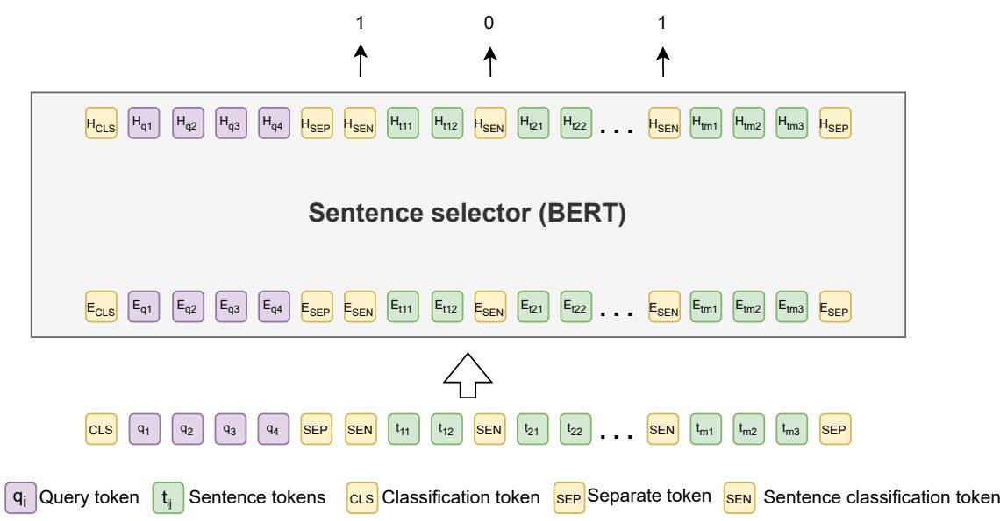  
Figure 4: Input and output of the sentence selector. The input begins with the [CLS] token and the query q, then followed by the candidate sentences. Each sentence is prepended with a special [SEN] token. The [SEP] tokens were inserted after the query q and after the last token of the last candidate sentence. The sentence selector produces token-level outputs, but only predictions at the [SEN] positions are used to determine whether each corresponding sentence is retained or discarded.

## Llama-3.1-8B-Instruct.

• Sampling: greedy

• Quantization: BitsAndBytes 4-bit (fp4), dtype: float32

• Max new tokens: 10

• Model maximum length: 5120

## B.6 Baseline Details

This section provides additional details about the baselines in our experiments.

• Raw Documents: The top-30 retrieved documents are used directly without any compression.

• Reranker-only methods: The top-30 retrieved documents are reordered using a document reranker and the top-10 documents are selected as the compressed context. We evaluate three rerankers in this setting: BGE (∼278M parameters), Jina (∼278M parameters), and GTE (∼149M parameters).

• LongLLMLingua (Jiang et al., 2024): A task-aware method built on Llama-2-7B<sup>10</sup> that ranks documents and selects tokens using contrastive perplexity scoring. We set the dynamic compression rate fixed at 0.3, with the rate set to 0.45 for the ∼5× compression.

• LLMLingua2 (Pan et al., 2024): A taskagnostic compression method trained via label distillation from GPT-4 on the Meeting-Bank dataset (Hu et al., 2023). We use the XLM-RoBERTa-large model<sup>11</sup> (∼550M parameters) (Conneau et al., 2020), which follows the LLMLingua2 training recipe. The compression rate is set to 0.2.

• Recomp-Extractive (Xu et al., 2024): An extractive approach that assigns scores at the sentence level using a dual-encoder model. We adopt the Contriever models (∼110M parameters) released by the authors for each dataset. For 2WikiQA, where no finetuned models are available, we use the Contriever finetuned on HQA. Following the previous research (Yoon et al., 2024) and similar compression ratio with our method, the top four sentences are selected as context.

• Recomp-Abstractive (Xu et al., 2024):

<table><tr><td rowspan=1 colspan=1>Dataset</td><td rowspan=1 colspan=1>Train</td><td rowspan=1 colspan=1>Validation</td><td rowspan=1 colspan=1>Test</td></tr><tr><td rowspan=1 colspan=4>Base datasets</td></tr><tr><td rowspan=1 colspan=1>HotpotQA2WikiMultiHopQANatural QuestionsTriviaQA</td><td rowspan=1 colspan=1>90,447167,454152,148138,384</td><td rowspan=1 colspan=1></td><td rowspan=1 colspan=1>7,40512,5765,49917,944</td></tr><tr><td rowspan=1 colspan=4>Intermediate finetuning</td></tr><tr><td rowspan=1 colspan=1>HotpotQA2WikiMultiHopQANatural QuestionsTriviaQA</td><td rowspan=1 colspan=1>75,05992,595133,060123,670</td><td rowspan=1 colspan=1>8,34010,28914,78513,742</td><td rowspan=1 colspan=1></td></tr><tr><td rowspan=1 colspan=4>Final finetuning</td></tr><tr><td rowspan=1 colspan=1>HotpotQA2WikiMultiHopQANatural QuestionsTriviaQA</td><td rowspan=1 colspan=1>19,20715,52218,68721,136</td><td rowspan=1 colspan=1>1,0001,0001,0001,000</td><td rowspan=1 colspan=1>一一</td></tr></table>

Table 4: Number of examples in each dataset before and after filtering. The base dataset refers to the raw data, while the intermediate finetuning and final finetuning stages indicate the dataset sizes used in each phase.

An abstractive approach based on T5-large (∼770M) trained with summarization distillation over NQ, TQA, and HQA. The model compresses the retrieved evidence into shorter summaries. For 2WikiQA and HQA, we use the -trained version, while for TQA and NQ, dataset-specific models are applied.

• CompAct (Yoon et al., 2024): An iterative abstractive compression method implemented with Mistral-7B-Instruct<sup>12</sup> (Jiang et al., 2023). The model repeatedly summarizes the input until the target model signals completion. The number of documents per segment is set to 5, following the original implementation.

• Context-aware Prompt Compression (CPC) (Liskavets et al., 2025): A contextaware compression approach that assigns relative importance scores to sentences conditioned on the given question. The model is trained on a synthetic dataset using a contrastive learning objective and implemented an adaptor with Llama-3.2-1B-Instruct<sup>13</sup> (Jiang et al., 2023). We follow the original paper and set the target compressed length to 900 tokens, which corresponds to approximately a 5x compression when using 30 documents from the retriever.

• DAC (Zhao et al., 2025a): A prompt-agnostic compression method that integrates entropy and attention signals to compute token-level importance scores. We use the Qwen2-0.5B-Instruct <sup>14</sup> model (Yang et al., 2024) with the default configuration, and compression ratio set to 0.825 (around 5x).

## C Additional Results and Analyses

## C.1 Examples

To illustrate, we show a successful case of EFF-COMP in Table 5. In this case, Recomp-Abstractive and CompAct generated compressed contexts that are factually incorrect or irrelevant to the question, leading to wrong LLM predictions. By contrast, LongLLMLingua and EFFCOMP remained correctly grounded in the retrieved contexts, but EFF-COMP used 8.6 times fewer tokens than LongLLM-Lingua (88 vs. 758 tokens).

## C.2 Performance under the In-Distribution Training Setting

We report the results of in-distribution and out-ofdistribution testing for the other rerankers and the other target LLM (Llama-3.1-8B-Instruct) in Table 6. Training on the target dataset yielded both higher compression ratios and stronger QA metrics, while applying the model out of distribution resulted in certain reductions in compression ratios but only minor reductions in the QA metric.

## C.3 Generalization to Another Target Model

We evaluated our method, trained on the HQA dataset with Gemma-2-9B-IT as the target model during training, against baseline approaches under the setting where compressed contexts were provided to another target model which is Llama-3.1- 8B-Instruct. Table 7 reports the results on HQA, 2WikiQA, NQ, and TQA. Overall, the performance trends remain consistent across datasets, with our method achieving the best QA results. Furthermore, EFFCOMP with a reranker generally results in a higher compression rate, showing the importance of the reranker to our method.

<table><tr><td colspan="4">Question (from HQA): Stein had a part in the 1994 superhero fantasy film directed by whom Ground-truth answer: Charles Russell</td></tr><tr><td>Method</td><td>1/τ↑</td><td>|C|↓ Compressed Context 758</td><td>LLM Prediction The Mask (film) The Mask is a 1994 American fantasy super-</td></tr><tr><td>Long- LLMLingua</td><td>5.01x</td><td></td><td>Charles Russell √ hero comedy film directed by Charles Russell, produced by Bob Engelman [...] Ben Stein Benjamin Jeremy (born November 25, 1944) is an American writer, [...] He is well- screen econom teacher &quot;Ferris Bueller&#x27;s Day Off&quot; (1986) and as Dr. Arthur</td></tr><tr><td>Recomp- Abstractive</td><td>189.75x</td><td>Neuman in &quot;The Mask&quot; (1994)Son [...] 20 Shadow&quot; directed by Russell Mulcahy.</td><td>Ben Stein had a part in the 1994 superhero fantasy film &quot;The Russell Mulcahy X</td></tr><tr><td>CompAct</td><td>49.93x</td><td>76 The Shadow is a 1994 American superhero film [...] directed by Russell Mulcahy, that stars Alec Baldwin. The film co-stars John Lone, Penelope Ann Miller, [...] It was released to theaters on</td><td>Russell Mulcahy X</td></tr><tr><td>EFFCOMP (BGE)</td><td>43.13x 88</td><td>July 1, 1994 and received generally mixed reviews. He is most well-known on screen as the economics teacher in &quot;Ferris Bueller&#x27;s Day Off&quot; (1986) and as Dr. Arthur Neuman in &quot;The Mask&quot; (1994) and &quot;Son of The Mask (film) The Mask is a 1994 American fantasy superhero comedy film directed by</td><td>Charles Russell √</td></tr></table>

Table 5: Examples of compressed contexts and predictions from LongLLMLingua, Recomp-Abstrctive, CompAct, and EFFCOMP (with BGE reranker). |C| denotes the number of tokens of the compressed context. ✓ indicates a correct prediction, while ✗ indicates an incorrect prediction.

## C.4 Generalization to Long Generation Tasks

EFFCOMP is designed primarily for RAG-based QA tasks, as reflected by both the supervision used in Phase I and the reward function employed during RL training in Phase II. Consequently, the training objectives are not directly designed for long-form generation tasks such as document summarization. To examine whether EFFCOMP can nevertheless generalize to such tasks, we apply the EFFCOMP model trained on HQA directly to three summarization datasets from LongBench: GovReport, Multi-News, and QMSum. The results are reported in Table 8.

As expected, EFFCOMP does not consistently outperform the baselines on these long-generation tasks. Although EFFCOMP with a fixed compression ratio achieves compression ratios comparable to several existing compression methods, its

ROUGE-L scores are generally lower than those of LongLLMLingua. The adaptive variant exhibits different behavior across datasets, achieving a substantially higher compression ratio of 12.3x on GovReport, while selecting considerably lower compression ratios of 1.4x and 1.9x on Multi-News and QMSum, respectively.

Among the evaluated methods, LongLLMLingua performs relatively well in this setting, maintaining strong ROUGE-L scores while reducing the input context. This is reasonable because LongLLMLingua is designed for general generation tasks, whereas EFFCOMP is specifically optimized for RAG-based QA. Overall, these results suggest that although EFFCOMP can be directly applied to long-generation tasks without additional training, its advantages are less pronounced outside the QA setting for which it was designed.

## C.5 Additional Experiments with Recent Retrievers

To investigate whether EFFCOMP remains beneficial when combined with stronger retrievers and target LLMs, we conduct additional experiments using recent retrieval methods and a more capable target LLM. In particular, we examine whether EFFCOMP can further improve QA performance even when the underlying retrieval or generation component is improved.

<table><tr><td rowspan="2">Method</td><td colspan="3">2WikiQA</td><td colspan="3">NQ</td><td colspan="4">TQA</td></tr><tr><td>1/τ Acc</td><td> $\mathrm { C _ { 0 . 5 } }$ </td><td> $\mathrm { C _ { 1 } }$ </td><td>1/τ Acc</td><td> $\mathrm { C _ { 0 . 5 } }$ </td><td> $\mathrm { C _ { 1 } }$ </td><td>1/τ</td><td>Acc</td><td> $\mathrm { C _ { 0 . 5 } }$ </td><td> $\mathrm { C _ { 1 } }$ </td></tr><tr><td colspan="9">Gemma-2-9B-IT</td></tr><tr><td>No reranker (in-distribution)</td><td>16.1x 29.5</td><td>0.34</td><td>0.45</td><td>23.6x 31.7</td><td>0.37</td><td>0.48</td><td>48.4x</td><td>78.9</td><td>0.82</td><td>0.87</td></tr><tr><td>No reranker (out-of-distribution)</td><td>11.7x 28.9</td><td>0.34</td><td>0.44</td><td>9.8x</td><td>31.1 0.36</td><td>0.46</td><td>32.8x</td><td>78.9</td><td>0.82</td><td>0.87</td></tr><tr><td>BGE reranker (in-distribution)</td><td>30.3x 19.4x</td><td>25.4 0.30 25.0 0.29</td><td>0.40 0.40</td><td>36.4x 14.1x</td><td>29.5 0.34 29.0 0.34</td><td>0.45 0.44</td><td>59.5x 49.6x</td><td>80.1 79.5</td><td>0.83</td><td>0.88</td></tr><tr><td>BGE reranker (out-of-distribution) Jina reranker (in-distribution)</td><td>29.4x</td><td>25.5 0.30</td><td>0.40</td><td>42.0x</td><td>30.0 0.35</td><td>0.46</td><td>78.4x</td><td>80.1</td><td>0.83 0.83</td><td>0.88</td></tr><tr><td>Jina reranker (out-of-distribution)</td><td>19.3x</td><td>25.8 0.30</td><td>0.41</td><td>18.8x</td><td>29.7 0.34</td><td>0.45</td><td>50.0x</td><td>79.6</td><td>0.83</td><td>0.88</td></tr><tr><td>GTE reranker (in-distribution)</td><td>29.4x</td><td>25.4 0.30</td><td></td><td>42.3x</td><td>30.4</td><td></td><td></td><td></td><td></td><td>0.88</td></tr><tr><td></td><td></td><td></td><td>0.40</td><td></td><td>0.35</td><td>0.46</td><td>64.3x</td><td>80.5</td><td>0.84</td><td>0.89</td></tr><tr><td>GTE reranker (out-of-distribution)</td><td>20.4x 25.0</td><td>0.29</td><td>0.40</td><td>19.2x</td><td>29.7 0.34</td><td>0.45</td><td>54.1x</td><td>79.8</td><td>0.83</td><td>0.88</td></tr><tr><td colspan="9">Llama-3.1-8B-Instruct</td><td></td></tr><tr><td>No reranker (in-distribution)</td><td>16.1x</td><td>21.3 0.25</td><td>0.35</td><td>23.6x</td><td>27.9 0.33</td><td>0.43</td><td></td><td>48.4x 73.5</td><td>0.77</td><td>0.84</td></tr><tr><td>No reranker (out-of-distribution)</td><td>11.7x 20.8</td><td>0.25</td><td>0.34</td><td>9.8x</td><td>26.8 0.31</td><td>0.41</td><td>32.8x</td><td>74.3</td><td>0.78</td><td>0.84</td></tr><tr><td>BGE reranker (in-distribution)</td><td>30.3x</td><td>21.5 0.26</td><td>0.35</td><td>36.4x</td><td>28.1 0.33</td><td>0.44</td><td>59.5x</td><td>76.6</td><td>0.80</td><td>0.86</td></tr><tr><td>BGE reranker (out-of-distribution)</td><td>19.4x 20.3</td><td>0.24</td><td>0.33</td><td>14.1x</td><td>27.5 0.32</td><td>0.42</td><td>49.6x</td><td>76.1</td><td>0.80</td><td>0.86</td></tr><tr><td>Jina reranker (in-distribution)</td><td>29.4x 21.8</td><td>0.26</td><td>0.36</td><td>42.0x</td><td>28.9 0.34</td><td>0.45</td><td>78.4x</td><td>77.1</td><td>0.81</td><td>0.87</td></tr><tr><td>Jina reranker (out-of-distribution)</td><td>19.3x</td><td>21.3 0.25</td><td>0.35</td><td>18.8x</td><td>28.2 0.33</td><td>0.44</td><td>50.0x</td><td>76.2</td><td>0.80</td><td>0.86</td></tr><tr><td>GTE reranker (in-distribution)</td><td>29.4x</td><td>21.6 0.26</td><td>0.35</td><td>42.3x</td><td>29.6 0.34</td><td>0.45</td><td>64.3x</td><td>77.3</td><td>0.81</td><td>0.87</td></tr><tr><td>GTE reranker (out-of-distribution)</td><td></td><td>0.25</td><td>0.34</td><td>19.2x</td><td>28.3 0.33</td><td>0.44</td><td></td><td></td><td></td><td></td></tr><tr><td></td><td>20.4x 20.8</td><td></td><td></td><td></td><td></td><td></td><td>54.1x</td><td>77.2</td><td>0.81</td><td>0.86</td></tr></table>

Table 6: Cross-dataset generalization of EFFCOMP using Gemma-2-9B-IT and Llama-3.1-8B-Instruct as target models, evaluated both with and without the document reranker. We report the mean compression ratio $( 1 / \tau ) .$ accuracy (Acc), and $\mathrm { C } _ { \beta }$ . The in-distribution rows correspond to training on each dataset individually, while the out-of-distribution rows correspond to training only on HQA and directly applying the model to other datasets. For all of these metrics, higher values are better. Bold numbers indicate the best performance in each setting.

We consider five retrieval approaches from two directions:

• Improve embeddings for retrieval. We replace Contriever-MS MARCO, used in our paper, with:

– Voyage 4 $\mathbf { L i t e } ^ { 1 5 }$ , a commercial embedding model.

– F2LLM-v2-8B (Zhang et al., 2026), strongest open-source retriever according to the 2026 model on MTEB benchmark (Muennighoff et al., 2023).

• Improve retrieval pipelines. We consider three approaches that use more sophisticated retrieval pipelines:

– LLMChainExtractor (Verma, 2024) with GPT-4.1 Nano, which uses an LLM to extract query-relevant passages or sentences from each retrieved document.

– EmbeddingsRedundantFilter (Verma, 2024) with text-embedding-3-large and a similarity threshold of 0.7, which removes semantically redundant documents based on their embeddings.

– MultiQueryRetriever<sup>16</sup>, which generates multiple query reformulations to improve document recall.

We evaluate these methods on 1,000 HQA examples using two target LLMs, Gemma-2-9B-IT (Team et al., 2024) and Claude Sonnet $4 . 5 ^ { 1 7 }$ The results are shown in Table 9. The setting marked with \* corresponds to the retrieval configuration mainly used throughout our paper. For LLMChainExtractor, the retrieved documents are already highly compressed; therefore, we do not apply EFFCOMP to avoid further compression.

The results in Table 9 show that EFFCOMP remains effective with recent retrieval methods. First, EFFCOMP with the standard retriever used in our paper outperforms all advanced retrievers without EFFCOMP. For example, with Gemma-2-9B-IT, the standard setting (Contriever-MS MARCO) achieves 35.7 accuracy, compared with 32.6 for F2LLM-v2-8B and 29.3 for Voyage 4 Lite without EFFCOMP. With Claude Sonnet 4.5, the corresponding accuracy is 43.6, compared with 43.4 and

<table><tr><td rowspan="2">Method</td><td colspan="3">HQA</td><td colspan="4">2WikiQA</td><td colspan="4">NQ</td><td colspan="4">TQA</td></tr><tr><td>1/τ</td><td>Acc  $\mathrm { C _ { 0 . 5 } }$ </td><td> $\mathrm { C _ { 1 } }$ </td><td></td><td> $1 / \tau$  Acc</td><td> $\mathrm { C _ { 0 . 5 } }$ </td><td> $\mathrm { C _ { 1 } }$ </td><td> $1 / \tau$ </td><td>Acc</td><td> $\mathrm { C _ { 0 . 5 } }$ </td><td> $\mathrm { C _ { 1 } }$ </td><td>1/τ</td><td>Acc</td><td> $\mathrm { C _ { 0 . 5 } }$ </td><td> $\mathrm { C _ { 1 } }$ </td></tr><tr><td>Raw Documents</td><td>1.0x 24.9</td><td>0.00</td><td>0.00</td><td></td><td>1.0x 16.7</td><td>0.00</td><td>0.00</td><td></td><td>1.0x 25.3</td><td>0.00</td><td>0.00</td><td>1.0x</td><td>69.7</td><td>0.00</td><td>0.00</td></tr><tr><td>Reranker-only methods</td><td></td><td></td><td></td><td></td><td></td><td></td><td></td><td></td><td></td><td></td><td></td><td></td><td></td><td></td><td></td></tr><tr><td>BGE</td><td>3.0x 29.6</td><td></td><td>0.33 0.41</td><td></td><td>3.0x 19.2</td><td>0.22</td><td>0.30</td><td></td><td>3.0x 26.6</td><td>0.300.38</td><td></td><td></td><td>3.0x 75.3</td><td>0.73</td><td>0.71</td></tr><tr><td>Jina</td><td>3.0x</td><td>29.2 0.33</td><td>0.41</td><td></td><td>3.0x 19.3</td><td>0.22</td><td>0.30</td><td></td><td>3.0x 28.1</td><td>0.32</td><td>0.40</td><td>3.0x</td><td>75.6</td><td>0.74</td><td>0.71</td></tr><tr><td>GTE</td><td>3.0x</td><td>29.0 0.33</td><td>0.40</td><td></td><td>3.0x 19.2</td><td>0.22</td><td>0.30</td><td>3.0x</td><td>28.4</td><td>0.32</td><td>0.40</td><td>3.0x</td><td>75.9</td><td>0.74</td><td>0.71</td></tr><tr><td colspan="10">Compression frameworks</td><td rowspan="3"></td><td></td><td></td><td></td><td></td><td></td><td></td></tr><tr><td>LLMLingua2</td><td>5.4x 21.4</td><td>0.25</td><td>0.34</td><td>5.5x 17.3</td><td></td><td>0.21</td><td>0.29</td><td>5.3x 22.1</td><td></td><td>0.26</td><td>0.35</td><td>5.4x 68.8</td><td></td><td>0.71</td><td>0.75</td></tr><tr><td>DAC</td><td>5.1x 19.9</td><td>0.23</td><td>0.32</td><td></td><td>5.0x 16.6</td><td>0.20</td><td>0.27</td><td>5.2x 19.4</td><td></td><td>0.23</td><td>0.31</td><td></td><td>5.2x 67.5</td><td>0.70</td><td>0.74</td></tr><tr><td>CPC</td><td>5.6x</td><td>26.7 0.31</td><td>0.40</td><td></td><td>5.9x 17.7</td><td>0.21</td><td>0.29</td><td></td><td>5.2x 25.8</td><td>0.30</td><td>0.39</td><td></td><td>5.4x 74.2</td><td>0.76</td><td>0.78</td></tr><tr><td>LongLLMLingua</td><td>5.1x 27.7</td><td>0.32</td><td>0.41</td><td></td><td>5.1x 18.8</td><td>0.22</td><td>0.30</td><td>5.1x</td><td>24.4</td><td>0.28</td><td>0.37</td><td>5.1x</td><td>73.6</td><td>0.75</td><td>0.77</td></tr><tr><td>RecompExtractive</td><td>29.2x 24.0</td><td>0.28</td><td>0.38</td><td></td><td>29.3x 16.6</td><td>0.20</td><td>0.28</td><td>29.8x 22.3</td><td></td><td>0.26</td><td>0.36</td><td>32.0x</td><td>69.7</td><td>0.74</td><td>0.81</td></tr><tr><td>RecompAbstractive</td><td>132.1x27.8</td><td>0.32</td><td>0.43</td><td>126.9x</td><td>21.3</td><td>0.25</td><td>0.35</td><td>48.3x 26.3</td><td></td><td>0.31</td><td>0.41</td><td>139x</td><td>74.3</td><td>0.78</td><td>0.85</td></tr><tr><td>CompAct</td><td>48.7x 30.5</td><td>0.35</td><td>0.47</td><td></td><td>54.7x 18.8</td><td>0.22</td><td>0.32</td><td>44.2x</td><td>27.9</td><td>0.33</td><td>0.43</td><td>50.2x</td><td>75.9</td><td>0.79</td><td>0.86</td></tr><tr><td colspan="10">Our work: EFFCoMP</td><td colspan="7"></td></tr><tr><td>No reranker</td><td>26.8x 29.6</td><td></td><td>0.34 0.45</td><td></td><td>11.7x 20.8</td><td>0.25</td><td>0.34</td><td></td><td></td><td>9.8x 26.8 0.31</td><td>0.41</td><td></td><td>32.8x 74.3</td><td></td><td>0.78 0.84</td></tr><tr><td>BGE reranker</td><td>39.5x 31.3</td><td>0.36</td><td>0.47</td><td></td><td>30.3x 21.5</td><td>0.25</td><td>0.35</td><td>36.4x</td><td>28.1</td><td>0.33</td><td>0.44</td><td>59.5x</td><td>76.6</td><td>0.80</td><td>0.86</td></tr><tr><td>Jina reranker</td><td>38.5x 31.0</td><td></td><td>0.360.47</td><td></td><td>29.4x 21.8</td><td>0.26</td><td>0.36</td><td></td><td>42.0x 28.9</td><td>0.34</td><td>0.45</td><td></td><td>78.4x 77.1</td><td>0.81</td><td>0.87</td></tr><tr><td>GTE reranker</td><td>40.4x 31.0</td><td></td><td>0.36 0.47</td><td></td><td>29.4x 21.6</td><td>0.26</td><td>0.35</td><td></td><td></td><td>42.3x 29.6 0.34 0.45</td><td></td><td></td><td>64.3x 77.3</td><td>0.81</td><td>0.87</td></tr></table>

Table 7: Results on four QA benchmarks. We report the mean of compression ratio $( 1 / \tau ) ,$ accuracy (Acc), $\mathrm { C } _ { \beta }$ for Llama-3.1-8B-Instruct as the target model. For all of these metrics, higher values are better. The best results in each column are marked in bold.
<table><tr><td rowspan="2">Method</td><td colspan="2">GovReport</td><td colspan="2">Multi-News</td><td colspan="2">QMSum</td></tr><tr><td> $1 / \tau$ </td><td>ROUGE-L</td><td> $\overline { { 1 / \tau } }$ </td><td>ROUGE-L</td><td> $\overline { { 1 / \tau } }$ </td><td>ROUGE-L</td></tr><tr><td>Raw documents</td><td>1.0x</td><td>18.8</td><td>1.0x</td><td>18.2</td><td>1.0x</td><td>19.2</td></tr><tr><td>LLMLingua2</td><td>5.2x</td><td>16.8</td><td>5.7x</td><td>16.8</td><td>5.5x</td><td>17.6</td></tr><tr><td>DAC</td><td>6.0x</td><td>17.4</td><td>4.9x</td><td>17.1</td><td>6.3x</td><td>17.2</td></tr><tr><td>CPC</td><td>5.1x</td><td>17.2</td><td>4.7x</td><td>16.3</td><td>5.2x</td><td>17.7</td></tr><tr><td>LongLLMLingua</td><td>4.6x</td><td>19.0</td><td>3.1x</td><td>18.1</td><td>3.8x</td><td>19.0</td></tr><tr><td>EFFCOMP fixed</td><td>5.0x</td><td>17.4</td><td>5.3x</td><td>16.9</td><td>4.9x</td><td>18.1</td></tr><tr><td>EFFCOMP adaptive</td><td>12.3x</td><td>16.9</td><td>1.4x</td><td>17.8</td><td>1.9x</td><td>18.8</td></tr></table>

Table 8: Generalization of EFFCOMP to long-generation tasks from LongBench. The EFFCOMP model is trained on HQA and directly applied to GovReport, Multi-News, and QMSum without task-specific training. We report the mean compression ratio $( 1 / \tau )$ and ROUGE-L score. Higher values are better for both metrics. Bold numbers indicate the best performance in each setting.

40.8, respectively. Second, EFFCOMP provides substantial gains even when combined with stronger retrieval methods. For example, F2LLM-v2-8B improves from 32.6 to 36.9 with EFFCOMP for Gemma-2-9B-IT, and from 43.4 to 47.0 for Claude Sonnet 4.5. Similarly, Voyage 4 Lite with MultiQueryRetriever improves from 28.6 to 36.9 for Gemma-2-9B-IT and from 35.1 to 44.3 for Claude Sonnet 4.5 when combined with the full EFFCOMP pipeline. These results demonstrate that the benefits of EFFCOMP are complementary to improvements in the retrieval pipeline rather than being limited to a particular retriever.

## C.6 Hallucinations in Compressed Contexts

As discussed in the Introduction, we hypothesize that EFFCOMP produces fewer hallucinations than abstractive methods due to its extractive nature. To evaluate this, we use natural language inference (NLI) on the HQA test set. For each example, the original context is treated as the premise and the compressed context as the hypothesis. We then obtain NLI predictions from three commercial LLMs (Gemini 2.5 Flash Lite<sup>18</sup>, GPT-4.1 nano<sup>19</sup>, and Claude 3 Haiku (Anthropic)). Table 10 reports the number of entailment, neutral, and contradiction predictions where we treat both neutral and contradiction predictions as hallucinations, since neither category is fully supported by the reference context. Across all models, EFFCOMP (BGE reranker) consistently yields more entailment cases and fewer contradiction cases than both CompAct and Recomp-Abstractive, indicating improved faithfulness. EFFCOMP achieves an average hallucination rate of 25%, compared to 34% for CompAct and 53% for Recomp-Abstractive. These results confirm that EFFCOMP introduces substantially fewer hallucinations than abstractive approaches.

<table><tr><td>Retriever</td><td>Step 1 (BGE)</td><td>Step 2</td><td>1/τ</td><td>Acc</td><td> $\mathbf { C } _ { 0 . 5 }$ </td><td>C1</td></tr><tr><td colspan="7">Gemma-2-9B-IT</td></tr><tr><td>Contriever-MS MARCO (Top 30)*</td><td>Top 10</td><td>√</td><td>41.1x</td><td>35.7</td><td>0.41</td><td>0.52</td></tr><tr><td>Voyage 4 Lite (Top 6)</td><td></td><td></td><td>5.0x</td><td>29.3</td><td>0.34</td><td>0.43</td></tr><tr><td>Voyage 4 Lite (Top 6)</td><td></td><td>√</td><td>37.3x</td><td>30.2</td><td>0.35</td><td>0.46</td></tr><tr><td>Voyage 4 Lite (Top 30)</td><td>Top 6</td><td>√</td><td>51.6x</td><td>35.3</td><td>0.40</td><td>0.52</td></tr><tr><td>F2LLM-v2-8B (Top 6)</td><td></td><td></td><td>5.0x</td><td>32.6</td><td>0.37</td><td>0.46</td></tr><tr><td>F2LLM-v2-8B (Top 6)</td><td></td><td>√</td><td>40.6x</td><td>32.9</td><td>0.38</td><td>0.49</td></tr><tr><td>F2LLM-v2-8B (Top 30)</td><td>Top 6</td><td>√</td><td>50.4x</td><td>36.9</td><td>0.42</td><td>0.54</td></tr><tr><td>Contriever-MS MARCO (Top 30) + LLMChainExtractor</td><td></td><td></td><td>14.5x</td><td>31.5</td><td>0.36</td><td>0.47</td></tr><tr><td>Contriever-MS MARCO (Top 30) + EmbeddingsRedundantFilter</td><td></td><td></td><td>1.6x</td><td>28.9</td><td>0.30</td><td>0.33</td></tr><tr><td>Contriever-MS MARCO (Top 30) + EmbeddingsRedundantFilter</td><td>Top 10</td><td>√</td><td>34.0x</td><td>29.5</td><td>0.34</td><td>0.45</td></tr><tr><td>Voyage 4 Lite + MultiQueryRetriever (Top 10)</td><td></td><td></td><td>6.1x</td><td>28.6</td><td>0.33</td><td>0.43</td></tr><tr><td>Voyage 4 Lite + MultiQueryRetriever (Top 10)</td><td></td><td>√</td><td>50.9x</td><td>30.0</td><td>0.35</td><td>0.46</td></tr><tr><td>Voyage 4 Lite + MultiQueryRetriever (Dynamic)</td><td>Top 10</td><td>√</td><td>90.7x</td><td>36.9</td><td>0.42</td><td>0.54</td></tr><tr><td colspan="7">Claude Sonnet 4.5</td></tr><tr><td>Contriever-MS MARCO (Top 30)*</td><td>Top 10</td><td>√</td><td>41.1x</td><td>43.6</td><td>0.49</td><td>0.60</td></tr><tr><td>Voyage 4 Lite (Top 6)</td><td></td><td></td><td>5.0x</td><td>40.8</td><td>0.45</td><td>0.54</td></tr><tr><td>Voyage 4 Lite (Top 6)</td><td></td><td>√</td><td>37.3x</td><td>39.3</td><td>0.45</td><td>0.56</td></tr><tr><td>Voyage 4 Lite (Top 30)</td><td>Top 6</td><td>√</td><td>51.6x</td><td>44.0</td><td>0.49</td><td>0.61</td></tr><tr><td>F2LLM-v2-8B (Top 6)</td><td></td><td></td><td>5.0x</td><td>43.4</td><td>0.48</td><td>0.56</td></tr><tr><td>F2LLM-v2-8B (Top 6)</td><td></td><td>√</td><td>40.6x</td><td>43.0</td><td>0.48</td><td>0.60</td></tr><tr><td>F2LLM-v2-8B (Top 30)</td><td>Top 6</td><td>√</td><td>50.4x</td><td>47.0</td><td>0.52</td><td>0.64</td></tr><tr><td>Contriever-MS MARCO (Top 30) + LLMChainExtractor</td><td></td><td></td><td>14.5x</td><td>43.0</td><td>0.48</td><td>0.59</td></tr><tr><td>Contriever-MS MARCO (Top 30) + EmbeddingsRedundantFilter</td><td></td><td></td><td>1.6x</td><td>24.4</td><td>0.26</td><td>0.30</td></tr><tr><td>Contriever-MS MARCO (Top 30) + EmbeddingsRedundantFilter</td><td>Top 10</td><td>√</td><td>34.0x</td><td>38.4</td><td>0.44</td><td>0.55</td></tr><tr><td> $\mathrm { V o y a g e 4 L i t e + M u l t i Q u e r y R e t r i e v e r ( T o p 1 0 ) }$ </td><td></td><td></td><td>6.1x</td><td>35.1</td><td>0.40</td><td>0.49</td></tr><tr><td> $\mathrm { V o y a g e 4 L i t e + M u l t i Q u e r y R e t r i e v e r ( T o p 1 0 ) }$ </td><td></td><td>√</td><td>50.9x</td><td>37.8</td><td>0.43</td><td>0.55</td></tr><tr><td> $\mathrm { V o y a g e 4 L i t e + M u l t i Q u e r y R e t r i e v e r ( D y n a m i c ) }$ </td><td>Top 10</td><td>√</td><td>90.7x</td><td>44.3</td><td>0.50</td><td>0.61</td></tr></table>

Table 9: Performance of recent retrieval methods with and without EFFCOMP on 1,000 HQA examples. Step 1 denotes BGE reranking, where “Top k” indicates the number of documents retained by the reranker. Step 2 denotes the sentence selector, where ✓indicates that sentence selection is applied. <sup>∗</sup> denotes the retrieval configuration mainly used throughout our paper.

## C.7 Inference Latency And Computational Cost

Table 11 reports the compression latency, the target LLM reading latency, and the total latency, all averaged from 500 HQA examples with a batch size of 1. EFFCOMP substantially reduces LLM reading time (up to 55.4%), while introducing only a small compression overhead compared to no compression. As a result, it reduces total latency up to a 53.3% when using the Jina reranker. EFFCOMP is among the fastest methods, together with Recomp-Extractive

To further evaluate computational efficiency, we measure the computational cost of compression in terms of Teraflops (TFLOPS) under the same evaluation setting (HQA, 500 samples, batch size = 1), as shown in Table 12. Since EFFCOMP employs a lightweight sentence-level compressor, it incurs substantially lower computational cost than most existing compression frameworks. In particular, EFFCOMP with the Jina reranker requires only 1.2 TFLOPs, consisting of 0.9 TFLOPs for reranking and 0.3 TFLOPs for sentence-level compression, which is the lowest compression cost among the compared methods. These results demonstrate that EFFCOMP achieves both low inference latency and low computational cost, making it suitable for prac-

<table><tr><td>Model</td><td>Method</td><td>Entailment</td><td>Neutral</td><td>Contradiction</td></tr><tr><td rowspan="3">Gemini 2.5 Flash Lite</td><td>CompAct</td><td>81.2%</td><td>15.8%</td><td>3.0%</td></tr><tr><td>Recomp-Abstractive</td><td>45.7%</td><td>35.4%</td><td>18.9%</td></tr><tr><td>EFFCOMP (BGE)</td><td>86.0%</td><td>11.4%</td><td>2.6%</td></tr><tr><td rowspan="3">GPT-4.1 nano</td><td>CompAct</td><td>50.6%</td><td>1.3%</td><td>48.1%</td></tr><tr><td>Recomp-Abstractive</td><td>43.7%</td><td>0.6%</td><td>55.8%</td></tr><tr><td>EFFCOMP (BGE)</td><td>61.8%</td><td>0.2%</td><td>38.0%</td></tr><tr><td rowspan="3">Claude 3 Haiku</td><td>CompAct</td><td>66.7%</td><td>24.8%</td><td>8.5%</td></tr><tr><td>Recomp-Abstractive</td><td>50.3%</td><td>21.0%</td><td>28.7%</td></tr><tr><td>EFFCOMP (BGE)</td><td>77.1%</td><td>18.7%</td><td>4.2%</td></tr></table>

Table 10: NLI label counts on HQA (7,405 examples). Higher entailment and lower neutral/contradiction indicate better faithfulness and fewer hallucinations.

tical, user-facing applications.
<table><tr><td rowspan=1 colspan=2>Method</td><td rowspan=1 colspan=3>Comp (s)</td><td rowspan=1 colspan=1>Read (s)</td><td rowspan=1 colspan=1>Total (s)</td></tr><tr><td rowspan=1 colspan=2>Raw documents</td><td rowspan=1 colspan=3>一</td><td rowspan=1 colspan=1>1.84</td><td rowspan=1 colspan=1>1.84</td></tr><tr><td rowspan=7 colspan=2>LLMLingua2DACCPCLongLLMLinguaRecomp-ExtractiveRecomp-AbstractiveCompAct</td><td rowspan=1 colspan=3>0.28</td><td rowspan=1 colspan=1>0.84</td><td rowspan=1 colspan=1>1.12</td></tr><tr><td rowspan=1 colspan=3>1.46</td><td rowspan=1 colspan=1>0.79</td><td rowspan=1 colspan=1>2.25</td></tr><tr><td rowspan=1 colspan=3>0.26</td><td rowspan=1 colspan=1>0.81</td><td rowspan=1 colspan=1>1.07</td></tr><tr><td rowspan=1 colspan=3>2.31</td><td rowspan=1 colspan=1>0.90</td><td rowspan=2 colspan=1>3.210.93</td></tr><tr><td rowspan=1 colspan=1></td><td rowspan=1 colspan=2>0.</td><td rowspan=1 colspan=2>0.19</td><td rowspan=1 colspan=1>0.74</td></tr><tr><td rowspan=2 colspan=3>2.8416.30</td><td rowspan=1 colspan=1>4</td><td rowspan=1 colspan=1>0.71</td><td rowspan=1 colspan=1>3.55</td></tr><tr><td rowspan=1 colspan=1>0.72</td><td rowspan=1 colspan=1>17.02</td></tr><tr><td rowspan=3 colspan=2>EFFCOMP (BGE)EFFCOMP (Jina)EFFCOMP (GTE)</td><td rowspan=1 colspan=3>0.08</td><td rowspan=1 colspan=1>0.82</td><td rowspan=1 colspan=1>0.90</td></tr><tr><td rowspan=1 colspan=3>0.04</td><td rowspan=1 colspan=1>0.82</td><td rowspan=2 colspan=1>0.860.94</td></tr><tr><td rowspan=1 colspan=3>0.12</td><td rowspan=1 colspan=1>0.82</td></tr></table>

Table 11: Compression latency, LLM read latency, and total latency per example averaged over 500 HQA examples using Gemma-2-9B-IT. Bold values denote the lowest metric in each column.

<table><tr><td>Method</td><td>Compression TFLOPs</td></tr><tr><td>LLMLingua2</td><td>3.3</td></tr><tr><td>DAC</td><td>35.2</td></tr><tr><td>CPC</td><td>8.4</td></tr><tr><td>LongLLMLingua</td><td>252.2</td></tr><tr><td>RecompExtractive</td><td>2.7</td></tr><tr><td>CompAct</td><td>65.3</td></tr><tr><td>EFFCOMP (BGE)</td><td>2.1(Reranker) + 0.3(Sentence) = 2.5</td></tr><tr><td>EFFCOMP (Jina)</td><td>0.9(Reranker) + 0.3(Sentence) = 1.2</td></tr><tr><td>EFFCOMP (GTE)</td><td>1.1(Reranker) + 0.3(Sentence) = 1.4</td></tr></table>

Table 12: Compression computational cost in TFLOPs averaged over 500 HQA examples with a batch size of 1. Lower values indicate lower computational cost.

## C.8 Memory Usage

We evaluate the memory footprint of the compressor and the downstream LLM during inference. Memory usage is reported as the average peak GPU memory during the forward pass. For Recomp-Abstractive, per-example measurement is not supported, so we report the peak memory across 500 examples. Table 13 reports the memory consumption of all methods. Our method achieves the second-lowest compressor memory usage among all frameworks while maintaining competitive memory consumption during downstream LLM inference.

## C.9 Different Architectures for Sentence Selector

We further evaluate our method with different encoder architectures to study whether compression performance depends heavily on the backbone model. In addition to ModernBERT (149M), we experiment with mGTE-base<sup>20</sup> (305M) and mmBERT-mini<sup>21</sup> (Marone et al., 2025) (140M). For each architecture, we train the model for three epochs and select the checkpoint with the best reward score for evaluation. We evaluate all models on the HQA and NQ benchmarks using the same training and evaluation setup. Table 14 shows that all architectures achieve similar QA performance in terms of accuracy score, while producing substantially different compression ratios. Interestingly, the larger model does not consistently provide the best trade-off between compression and QA quality in our setting. For example, GTE achieves the highest compression ratio at 31.8x while maintaining performance comparable to ModernBERT. Meanwhile, the lightweight mmBERT-mini model also performs competitively in terms of $\mathrm { C } _ { \beta }$ despite its smaller size. These results suggest that architecture choice mainly affects compression efficiency rather than downstream QA performance.

<table><tr><td>Method</td><td>Compressor Memory (MB)</td><td>LLM Inference Memory (MB)</td></tr><tr><td>Raw documents</td><td></td><td>11,874.37</td></tr><tr><td>LLMLingua2</td><td>2,588.44</td><td>7,158.68</td></tr><tr><td>DAC</td><td>23,161.87</td><td>6,890.60</td></tr><tr><td>CPC</td><td>2,969.61</td><td>6855.91</td></tr><tr><td>LongLLMLingua</td><td>16,129.06</td><td>6,935.18</td></tr><tr><td>Recomp-Extractive</td><td>945.46</td><td>6,619.45</td></tr><tr><td>Recomp-Abstractive</td><td>5,934.80</td><td>8,208.77</td></tr><tr><td>Compact</td><td>14,090.37</td><td>6,580.15</td></tr><tr><td>EFFCOMP (BGE)</td><td>1,252.01</td><td>7,202.59</td></tr><tr><td>EFFCOMP (Jina)</td><td>1,242.26</td><td>7,141.47</td></tr><tr><td>EFFCOMP (GTE)</td><td>1,323.48</td><td>7,178.40</td></tr></table>

Table 13: Peak GPU memory usage (in MB) for each compressor and the downstream LLM (Gemma-2-9B-IT). Memory is measured during the model forward pass. For Recomp-Abstractive, the peak across 500 examples is reported due to the lack of per-sample measurement.

## C.10 Effect of Improved Phase I Labels

We further investigate whether the quality of the supervision used in Phase I can be improved by leveraging the gold supporting sentences provided in a multi-hop dataset. Instead of assigning positive labels based on whether a sentence contains the ground-truth answer, we assign a positive label when its character-level overlap with a gold supporting sentence exceeds 50%. We denote this alternative intermediate finetuning strategy as Phase I\*. We evaluate three training configurations on the validation set: Phase I\* only, Phase I\* followed by Phase II, and our original Phase I followed by Phase II. The results are reported in Table 15.

The results show that using supporting-sentence supervision in Phase I leads to more aggressive compression. Phase I\* alone achieves the highest compression rate of 86.4%, although its accuracy is substantially lower than the two configurations that include Phase II. Adding Phase II to Phase I\* increases the accuracy from 82.3% to 88.6%, while maintaining a relatively high compression rate of 83.3%. This demonstrates the benefit of Phase II in improving QA performance even when stronger supporting-sentence supervision is used during Phase I. Comparing Phase I\* + Phase II with our original Phase I + Phase II, the two labeling strategies exhibit different trade-offs. Phase I\* + Phase II achieves a higher compression rate (83.3% vs. 75.6%) and a higher $\mathrm { C _ { 1 } }$ score (0.86 vs. 0.83), whereas our original approach achieves higher QA accuracy (91.6% vs. 88.6%) and a slightly higher $\mathrm { C _ { 0 . 5 } }$ score (0.88 vs. 0.87). These results suggest that supporting-sentence annotations can provide useful supervision when greater compression is desired, but do not necessarily improve QA accuracy.

Furthermore, Phase I\* relies on gold supportingsentence annotations, which may not be available in other QA datasets. In contrast, our original Phase I constructs labels using only the ground-truth answers, making the training procedure applicable to a broader range of QA datasets without requiring additional sentence-level annotations.

## C.11 Effect of Sentence Representation Tokens

Our sentence selector uses a dedicated [SEN] token to represent each sentence and make sentence-level retention decisions. Although the standard [CLS] token can serve a similar role, we use [SEN] based on the intuition that [CLS] is generally used to represent the entire input sequence, whereas [SEN] provides an explicit representation for each individual sentence. To examine this design choice, we replace each [SEN] token with [CLS] and evaluate both variants on the validation set. The results are reported in Table 16.

The results show that both tokens can effectively support sentence-level selection, but they exhibit different trade-offs between QA accuracy and compression. Using [CLS] achieves a higher accuracy of 93.5%, compared with 91.6% for [SEN]. However, [SEN] achieves a substantially higher compression rate of 75.6%, compared with 67.4% for [CLS]. When considering both objectives jointly, [SEN] achieves higher $\mathrm { C _ { 0 . 5 } }$ and $\mathrm { C _ { 1 } }$ scores of 0.88 and 0.83, respectively, compared with 0.87 and 0.78 for [CLS]. These results indicate that although [CLS] favors QA accuracy, the dedicated [SEN] token provides a better overall balance between preserving QA performance and achieving effective compression.

<table><tr><td rowspan="2">Method</td><td colspan="3">HQA</td><td colspan="4">NQ</td></tr><tr><td>1/τ Acc</td><td> $\mathrm { C _ { 0 . 5 } }$ </td><td> $\mathrm { C _ { 1 } }$ </td><td>1/τ</td><td>Acc</td><td> $\mathrm { C _ { 0 . 5 } }$ </td><td> $\mathrm { C _ { 1 } }$ </td></tr><tr><td>Raw Documents</td><td>1.0x 34.6</td><td>0.00</td><td>0.00</td><td></td><td>1.0x 30.1</td><td>0.00</td><td>0.00</td></tr><tr><td colspan="8">Reranker-only methods</td></tr><tr><td>BGE reranker</td><td>3.0x 35.2</td><td>0.39</td><td>0.46</td><td></td><td>3.0x 29.6</td><td>0.33</td><td>0.41</td></tr><tr><td>Jina reranker</td><td>3.0x 34.6</td><td>0.38</td><td>0.46</td><td></td><td>3.0x 30.6</td><td>0.34</td><td>0.42</td></tr><tr><td>GTE reranker</td><td>3.0x 34.7</td><td>0.38</td><td>0.46</td><td>3.0x</td><td>30.6</td><td>0.34</td><td>0.42</td></tr><tr><td colspan="8">Compression frameworks</td></tr><tr><td>LLMLingua2</td><td>5.4x 25.0</td><td>0.29</td><td>0.38</td><td>5.3x</td><td>23.8</td><td>0.28</td><td>0.37</td></tr><tr><td>DAC</td><td>5.1x 24.7</td><td>0.29</td><td>0.38</td><td>5.2x</td><td>22.7</td><td>0.27</td><td>0.35</td></tr><tr><td>CPC</td><td>5.6x 30.5</td><td>0.35</td><td>0.45</td><td>5.2x</td><td>28.0</td><td>0.32</td><td>0.42</td></tr><tr><td>LongLLMLingua</td><td>5.1x 31.8</td><td>0.36</td><td>0.46</td><td>5.1x</td><td>25.7</td><td>0.30</td><td>0.39</td></tr><tr><td>Recomp-Extractive</td><td>29.2x 25.6</td><td>0.3</td><td>0.41</td><td>29.8x</td><td>22.8</td><td>0.27</td><td>0.37</td></tr><tr><td>Recomp-Abstractive</td><td>132.1x</td><td>27.9 0.33</td><td>0.44</td><td>48.3x</td><td>27.6</td><td>0.32</td><td>0.43</td></tr><tr><td>CompAct</td><td>48.7x 31.2</td><td>0.36</td><td>0.47</td><td>44.2x</td><td>27.8</td><td>0.32</td><td>0.43</td></tr><tr><td colspan="8">Our work: EFFCoMP (Modernbert-base)</td></tr><tr><td>No reranker</td><td>26.8x 37.4</td><td>0.43</td><td>0.54</td><td>23.6x31.7</td><td></td><td>0.37</td><td>0.48</td></tr><tr><td>BGE reranker</td><td>39.5x 36.3</td><td>0.42</td><td>0.53</td><td>36.4x</td><td>29.5</td><td>0.34</td><td>0.45</td></tr><tr><td>Jina reranker</td><td>38.5x 35.8</td><td>0.41</td><td>0.52</td><td></td><td>42.0x 30.0</td><td>0.35</td><td></td></tr><tr><td>GTE reranker</td><td>40.4x 35.5</td><td>0.41</td><td>0.52</td><td>42.3x</td><td>30.4</td><td>0.35</td><td>0.46 0.46</td></tr><tr><td colspan="8">Our work: EFFCoMP (mmBert-mini)</td></tr><tr><td>No reranker</td><td>11.0x 37.1</td><td>0.42</td><td>0.53</td><td></td><td>17.9x 32.1</td><td>0.37</td><td>0.48</td></tr><tr><td>BGE reranker</td><td>27.8x 36.0</td><td>0.41</td><td>0.52</td><td>22.3x 29.6</td><td></td><td>0.34</td><td>0.45</td></tr><tr><td>Jina reranker</td><td>27.5x 35.6</td><td>0.41</td><td>0.52</td><td>25.2x</td><td>30.6</td><td>0.35</td><td>0.46</td></tr><tr><td>GTE reranker</td><td>27.9x 35.5</td><td>0.41</td><td>0.52</td><td>24.3x</td><td>30.4</td><td>0.35</td><td>0.46</td></tr><tr><td>Our work: EFFCoMP (GTE-base)</td><td></td><td></td><td></td><td></td><td></td><td></td><td></td></tr><tr><td colspan="8">No reranker</td></tr><tr><td></td><td>31.8x 36.7</td><td>0.42</td><td>0.53</td><td>27.8x 29.2</td><td></td><td>0.34</td><td>0.45</td></tr><tr><td>BGE reranker</td><td>49.0x 35.7</td><td></td><td>0.41 0.52</td><td>42.8x 29.0</td><td></td><td>0.34</td><td>0.45</td></tr><tr><td>Jina reranker</td><td>48.5x 35.4</td><td>0.41</td><td>0.52</td><td>52.0x</td><td>29.3</td><td>0.34</td><td>0.45</td></tr><tr><td>GTE reranker</td><td>49.7x35.2</td><td>0.40</td><td>0.52</td><td>52.7x</td><td>28.8</td><td>0.34</td><td>0.45</td></tr></table>

Table 14: Results on two QA benchmarks for Gemma-2-9B-IT. We report compression ratio $( 1 / \tau )$ , accuracy, and $\mathrm { C } _ { \beta }$ . Higher is better. Best values are in bold.

<table><tr><td>Method</td><td>Acc  $1 - \tau$ </td><td> $\mathbf { C } _ { 0 . 5 }$ </td><td> $\mathbf { C } _ { 1 }$ </td></tr><tr><td>Phase I*</td><td>82.3 86.4 (%)</td><td>0.83</td><td>0.84</td></tr><tr><td>Phase I* + Phase II</td><td>88.6 83.3 (%)</td><td>0.87</td><td>0.86</td></tr><tr><td>Phase I + Phase II</td><td>91.6 75.6 (%)</td><td>0.88</td><td>0.83</td></tr></table>

Table 15: Comparison of different Phase I labeling strategies on the validation set. Phase I\* uses gold supporting sentences to construct the intermediate finetuning labels. We report accuracy (Acc), compression rate, and $\mathrm { C } _ { \beta }$ . Higher values are better, and best values are in bold.

## C.12 Additional Ablation Study on Different Finetuning Strategies

In addition to RQ4 in Section 5, we conducted an ablation study on 2WikiQA, NQ, and TQA, evaluating four training strategies: reinforcement learning (RL) only, supervised learning (SL) only with the best trial memory, and the hybrid approach of EF-FCOMP that combines both approaches (RL+SL and SL+RL). The results are displayed in Figure 5. We observed similar patterns in HQA, NQ, and TQA, where intermediate finetuning led to higher accuracy. Specifically, the hybrid strategy (RL+SL) often achieved higher validation accuracy in early epochs, while having a relatively lower compression rate. In contrast, the RL only strategy prioritized the compression rate while sacrificing the accuracy. Meanwhile, the SL only strategy usually achieved higher validation accuracy than the RL one but with a lower and stable compression rate across epochs. For 2WikiQA, where intermediate finetuning did not substantially improve accuracy, the trend of the hybrid (RL+SL) approach is similar to the other three datasets, whereas the trends of the RL only and SL only strategies are the opposite of those in the other three datasets.

<table><tr><td>Method</td><td>Acc</td><td> $1 - \tau$ </td><td> $\mathbf { C } _ { 0 . 5 }$ </td><td> $\mathbf { C } _ { 1 }$ </td></tr><tr><td>[CLS]</td><td>93.5</td><td>67.4 (%)</td><td>0.87</td><td>0.78</td></tr><tr><td>[SEN]</td><td>91.6</td><td>75.6 (%)</td><td>0.88</td><td>0.83</td></tr></table>

Table 16: Comparison between [CLS] and [SEN] tokens for sentence-level representation on the validation set. We report accuracy (Acc), compression rate, and $\mathrm { C } _ { \beta }$ Higher values are better, and best values are in bold.

## D The Use of Large Language Models

We leveraged ChatGPT and Gemini to enhance grammar, refine phrasing, and optimize word choice across the paper. We also used them to help format tables and figures in LaTeX. The typical prompts we used with the LLMs were concise instructions such as “Proofread:” or “polish this text”, which direct the models to refine grammar and phrasing without altering the technical content.

## E Licenses

Our experiments use several publicly available datasets. HotpotQA is licensed under CC BY-SA 4.0. Natural Questions, 2WikiMultiHopQA, and TriviaQA are licensed under the Apache License 2.0. LongBench is licensed under the MIT License. All intermediate finetuning models used in our experiments, including Gemma-2-9B-IT and LLaMA-3.1-8B-Instruct, are used in accordance with their respective licenses for research purposes.

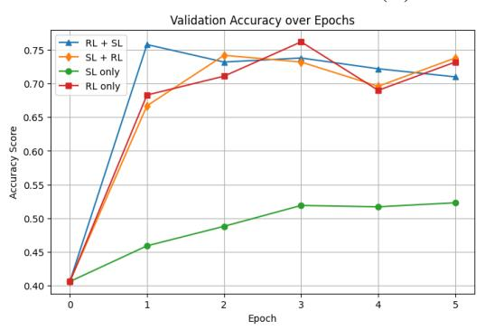

(A) 2WikiMultiHopQA  
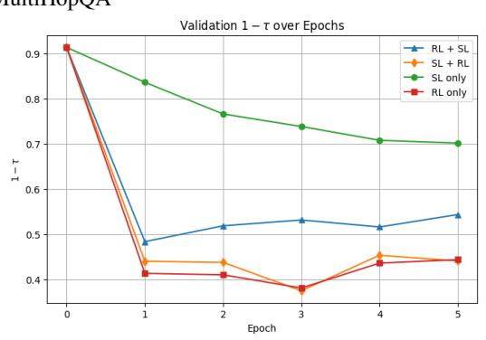

(B) Natural Questions  
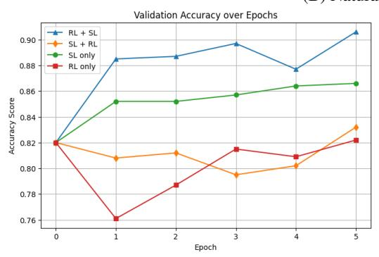

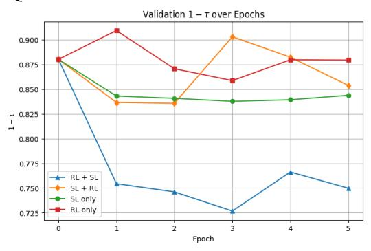

(C) TriviaQA  
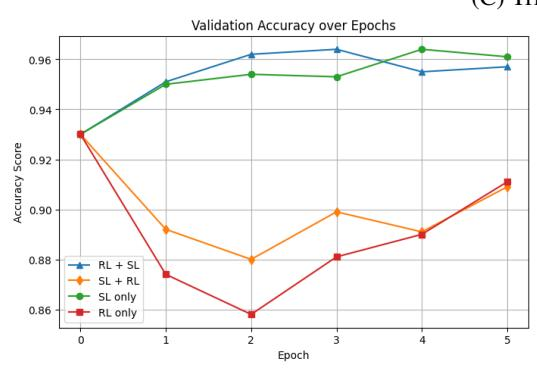

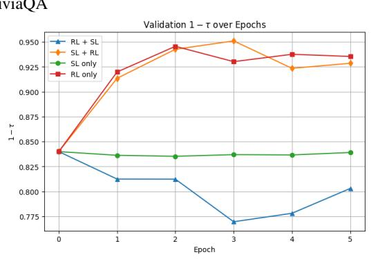  
Figure 5: Ablation study of different training strategies for EFFCOMP on three QA datasets. The plots compare (left) validation accuracy and (right) compression rate $1 - \tau = 1 - | \mathbb { C } | / | \mathbb { D } |$ during validation across five epochs. For both metrics, the higher values are better.