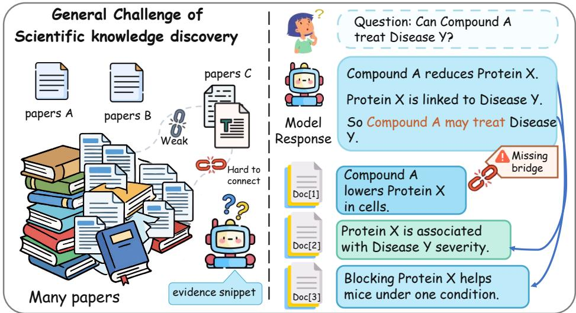
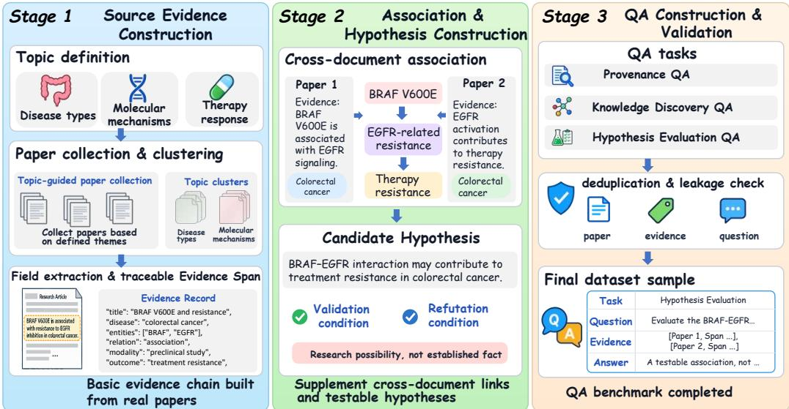
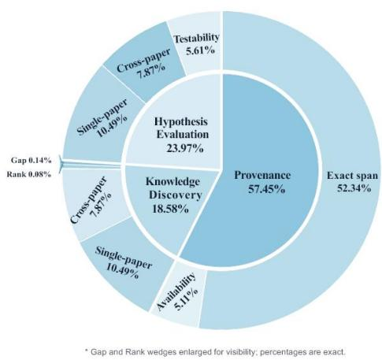
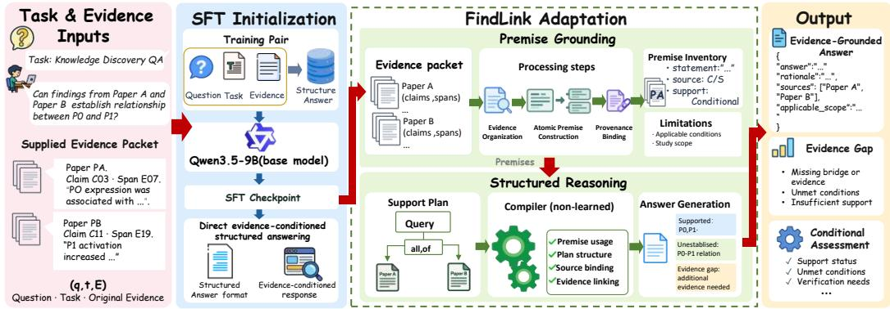
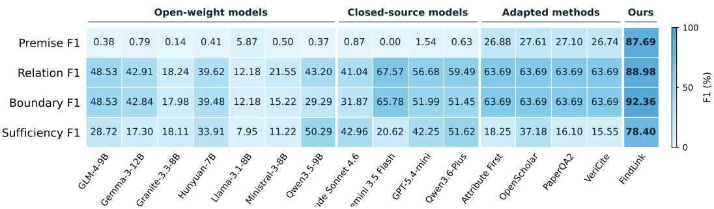
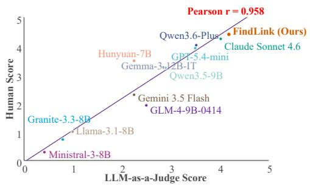
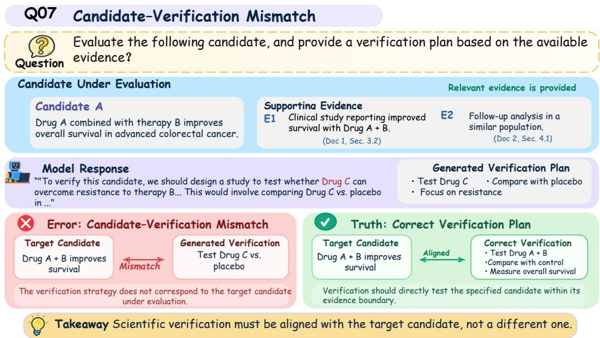
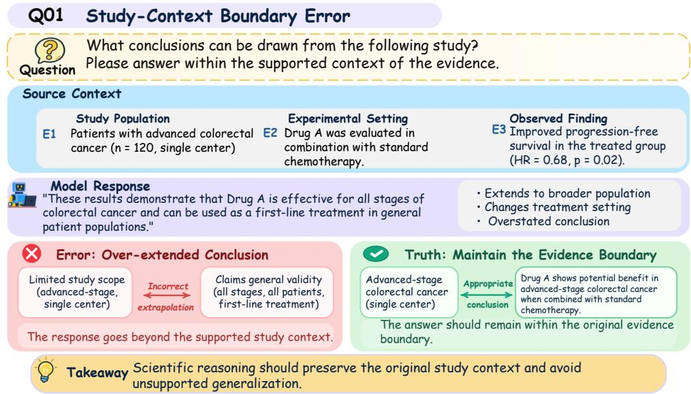
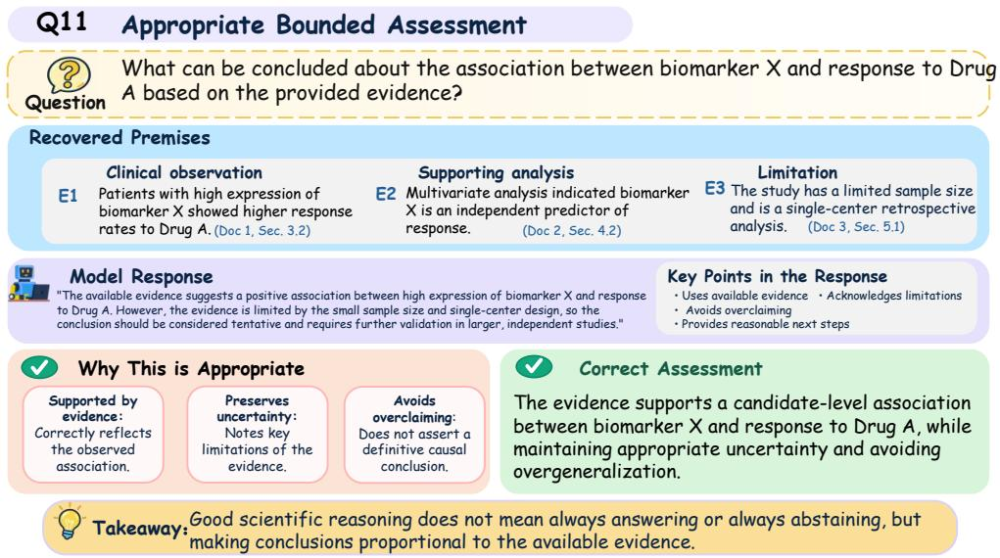
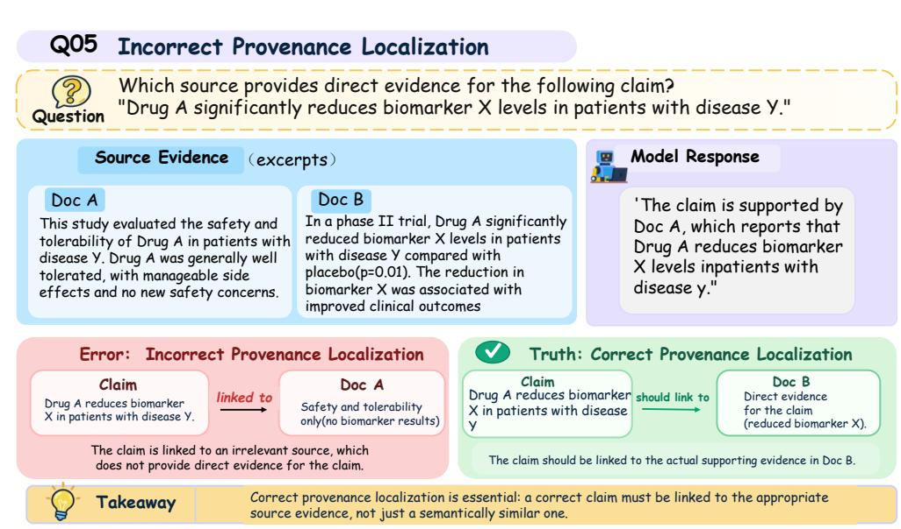

# FINDLINK: LEARNING TO ASSESS SCIENTIFIC CONNECTIONS FROM SOURCE-GROUNDED PREMISES

Jingxuan Wei<sup>1,2,3</sup> Song Tan<sup>1</sup> Xiaohan Liu<sup>1</sup> Chao Sang<sup>1</sup> Changwei Wang<sup>2</sup> Linzhuang Sun<sup>3</sup> Bihui Yu<sup>3</sup> Fuqiang Wang<sup>1</sup> Junnan Zhu<sup>4</sup>

<sup>1</sup>Qilu University of Technology

<sup>2</sup>Shandong Computer Science Center

<sup>3</sup>University of the Chinese Academy of Sciences

<sup>4</sup>Institute of Automation, Chinese Academy of Sciences

Dataset: https://huggingface.co/datasets/Sereints/FindLink

## ABSTRACT

Scientific discovery from the literature requires assessing connections among findings obtained under different study conditions. Source attribution makes individual findings traceable, but does not determine what they jointly support. We introduce GI-TraceBench, a benchmark of 10,282 questions in gastrointestinal oncology that unifies provenance question answering, knowledge discovery, and hypothesis evaluation through shared Paper, Claim, and Evidence Span records. We further propose FindLink, a two-stage framework for provenance-grounded scientific reasoning. Premise Grounding constructs source-bound premises with explicit study context and support status. Structured Reasoning organizes these premises into support plans that represent both supported relations and unresolved conditions, then generates evidence-conditioned answers using deterministic compiler feedback. The compiler verifies structural and source binding consistency, but does not assess scientific entailment. On the 1,545-question fixed-evidence test set, FindLink improves the balanced family macro score from 67.95 to 87.25 over direct supervised fine-tuning of the same backbone. A retrained variant without Structured Reasoning achieves slightly higher premise identifier F1, but substantially lower relation and evidence sufficiency F1. These results indicate that scientific reasoning requires not only identifying grounded premises, but also assessing what connections those premises support.

## 1 INTRODUCTION

Scientific knowledge discovery requires connecting findings across studies and determining which connections merit further investigation. Large language models, or LLMs, increasingly support this process through scientific question answering, literature synthesis, and idea generation (Asai et al., 2026; Skarlinski et al., 2024; Wang et al., 2024). Citation-aware generation and fine-grained provenance make the sources of individual claims more explicit (Gao et al., 2023; Slobodkin et al., 2024; Wei et al., 2026). However, grounding individual findings does not by itself establish the scientific connection proposed between them. In the schematic example in Figure 1, a compound lowers a protein in cells, the protein is associated with disease severity, and inhibiting the protein benefits mice under a particular condition. Together, these findings may motivate a treatment hypothesis, but evaluating that hypothesis requires determining whether the intervention, mechanism, and outcome are connected under compatible study conditions, and identifying what evidence is still missing.

We study provenance-grounded scientific reasoning, which we define as assessing candidate scientific connections through explicit premises linked to source evidence. This setting requires two complementary capabilities. First, premises must preserve the context in which each finding was established, including study conditions, claim origin, polarity, and support status. They must also distinguish reported observations from author interpretations and proposed explanations. Second, a reasoning system must determine what a set of premises jointly supports, while representing the conditions or relations that remain unresolved. Citation alone cannot establish an unsupported connection, while rejecting all grounded observations because the overall connection is not yet established loses information that remains scientifically useful.

  
Figure 1: Overview of Source-Grounded Scientific Connection Assessment. Findings from mul tiple papers may be individually supported but fail to establish the connecting claim, leaving an evidence gap that provenance-aware reasoning must identify.

To study these capabilities jointly, we introduce GI-TraceBench, a benchmark containing 10,282 English questions organized into 50 thematic clusters in gastrointestinal oncology. The benchmark comprises three task families, Provenance QA, Knowledge Discovery QA, and Hypothesis Evaluation QA. These tasks respectively evaluate source support, candidate scientific associations, and the evidence and experimental requirements needed to assess proposed hypotheses. All three families share Paper, Claim, and Evidence Span records, which connect reasoning outputs to identifiable findings and supporting passages. Cluster disjoint data splits reduce overlap across related scientific topics, while shared cached evidence inputs allow evaluation to focus on how systems interpret supplied evidence rather than on differences in document retrieval.

We propose FindLink, a framework with two stages, Premise Grounding and Structured Reasoning. Premise Grounding converts evidence into source-bound premises that explicitly encode study con text, origin, polarity, and support status. Structured Reasoning then organizes these premises into constrained support plans that represent supported connections together with unresolved relations and study conditions. The final answer is generated from the original evidence, the support plan, and deterministic compiler feedback. Importantly, the compiler verifies representational validity and consistency of source bindings. It does not determine whether a scientific claim is true or whether the evidence entails the proposed connection. Starting from an answer-level supervised fine-tuning checkpoint, FindLink uses sequential adaptation to learn premise construction, support planning, and compiler-conditioned answering.

Across 19 evaluated configurations, FindLink achieves the highest balanced family macro score, improving from 67.95 to 87.25 over direct supervised fine-tuning of the same backbone. The largest improvement occurs on Knowledge Discovery QA, where reasoning depends strongly on assessing relations across multiple grounded findings. A retrained variant without Structured Reasoning achieves slightly higher premise identifier F1, but performs substantially worse on relation, study boundary, and evidence sufficiency F1. This result separates the ability to identify relevant premises from the ability to assess the scientific connections among them.

Our contributions are as follows.

• We introduce GI-TraceBench, which connects source attribution, scientific connection assessment, and hypothesis evaluation through a shared evidence representation.

• We introduce FindLink, which learns source-bound premise construction and constrained support planning for evidence-conditioned scientific reasoning.

• Through fixed evidence evaluation and retrained component variants, we distinguish premise identification from relation, study boundary, and evidence sufficiency assessment.

## 2 RELATED WORK

Scientific Question Answering and Discovery. Scientific QA benchmarks provide complementary evidence settings. PubMedQA and BioASQ-QA study biomedical questions, while QASPER anchors information-seeking answers in individual research papers (Jin et al., 2019; Krithara et al., 2023; Dasigi et al., 2021). SciFact pairs scientific claims with support or refutation evidence (Wadden et al., 2020). OpenScholar and PaperQA2 extend scientific answering toward literature synthesis (Asai et al., 2026; Skarlinski et al., 2024). Recent benchmarks broaden the discovery setting: ResearchBench decomposes literature-based scientific discovery into inspiration retrieval, hypothesis composition, and pairwise hypothesis ranking (Liu et al., 2026); ScholScan tests scan-oriented reasoning over complete academic papers (Li et al., 2026b); and MedEvidence evaluates whether models can recover clinical conclusions from the studies underlying systematic reviews (Polzak et al., 2026). These settings complement SciMON, ResearchPulse, and DiscoveryBench, which study inspiration retrieval, method–experiment chains, and data-driven hypothesis discovery, respectively (Wang et al., 2024; Chen et al., 2025; Majumder et al., 2025). GI-TraceBench instead evaluates source-grounded premises, study conditions, candidate relations, unresolved links, and further testing requirements in one evidence-conditioned benchmark.

Attribution and Fine-Grained Provenance. RAG grounds generation in external documents (Lewis et al., 2020), while ALCE studies citation-supported answers and citation quality (Gao et al., 2023). Attribute First selects evidence before constructing attributable text, and VeriCite verifies and refines citations (Slobodkin et al., 2024; Qian et al., 2025). TROVE traces source sentences and classifies their relationships to target text, while GenProve jointly generates answers with typed sentence-level provenance (Zhu et al., 2025; Wei et al., 2026). CiteGuard reframes citation validation as alignment between generated citations and human attribution choices (Choi et al., 2026); RIGOURATE scores whether claims are proportionate to their retrieved evidence (James et al., 2026). These works make citation or claim-level evidence use more inspectable. FindLink addresses the related but distinct question of what multiple source-bound premises jointly establish about a candidate scientific connection. Its intermediate records retain support status, study scope, polarity, and unresolved links, rather than treating citation presence or single-claim faithfulness as sufficient for a new scientific relation.

Structured Reasoning. Entailment trees expose intermediate conclusions and supporting facts (Dalvi et al., 2021); Logic-LM and Faithful Chain-of-Thought separate formal translation from deterministic execution (Pan et al., 2023; Lyu et al., 2023); and XGrammar constrains outputs to an admissible language (Dong et al., 2025). Recent work makes the missing or conflicting evidence explicit. Knowing What Is Missing uses an identify-then-verify procedure for information sufficiency (Jain & Garimella, 2026), S2G-RAG maps structured gap judgments to later retrieval (Li et al., 2026a), and ConfRAG evaluates reasoning over conflicting web references (Yuan et al., 2026). SCI-Verifier studies cross-disciplinary scientific answer verification and equivalence judgments (Zheng et al., 2026), while CF-RAG uses counterfactual queries to separate causally decisive evidence from correlated distractors (Qin et al., 2026). FindLink operates in a different regime: the evidence packet is fixed, the support plan is restricted, and deterministic compilation checks representation and source bindings. The compiler does not prove arbitrary scientific entailment; the final answer may report supported premises together with an unestablished relation or an unmet testing condition.

  
Figure 2: GI-TraceBench construction. Source papers are converted into linked Paper–Claim– Evidence Span records, expanded into candidate relations and hypotheses, and transformed into QA instances after reference, deduplication, and split checks.

## 3 GI-TRACEBENCH

## 3.1 OVERVIEW

GI-TraceBench studies three connected aspects of literature-grounded scientific assessment in gastrointestinal oncology. Provenance QA identifies the source passages, support status, and study conditions of a scientific statement. Knowledge Discovery QA assesses a candidate connection through its premise relations, bounded conclusion, and missing evidence. Hypothesis Evaluation QA examines the evidence supporting a candidate hypothesis, the observations needed to test it, and outcomes that would undermine it. Both single-paper and cross-paper instances are included.

Each instance is $( q , t , E , y ^ { \mathrm { r e f } } )$ , consisting of a research question, task family, supplied evidence packet, and structured reference answer. A Paper identifies a document; a Claim records a statement and contextual qualifications; an Evidence Span locates its source passage. Systems receive $( q , t , E )$ including source text and available public structured records, while ${ \overline { { y } } } ^ { \mathrm { { r e f } } }$ is withheld. The inputs can therefore include extracted Claims and candidate records in addition to original passages. The evaluation targets reasoning over this supplied evidence. Appendix A.1 specifies the task-dependent assessment fields.

## 3.2 DATASET CONSTRUCTION

Source-linked evidence. We organize gastrointestinal oncology literature into thematic clusters and retain document identifiers, section locations, and available passages, thereby forming the source-linked evidence stage in Figure 2. Parsing and evidence localization produce Claim records linked to Evidence Spans. Claims retain contextual qualifications, including polarity and certainty where available; spans preserve the original wording and its location. Full-text evidence, abstractonly material, and bibliographic pointers are recorded separately. This stage supplies the sourcelinked evidence inventory used for candidate construction and provenance-oriented questions.

Candidate connections and hypotheses. Normalized concepts and topic constraints link related Claims into association records, thereby forming the candidate-construction stage in Figure 2. Each association retains its premise Claims, source references, candidate relation, and contextual bound aries. Hypothesis cards extend these records with predicted observations, verification requirements, and refutation criteria. Association-based, typed-chain, and single-paper routes provide complementary constructions. Deterministic transformations generate these assessment records while retaining candidate status and unresolved evidence gaps.

Question assembly and checks. We transform evidence and candidate records into task-specific questions and structured reference answers, completing the question-assembly and consistencychecking stage in Figure 2. References retain the source bindings and assessment fields needed by each task; integrated provenance questions preserve the individual references of their component checks. We check reference closure and remove cross-partition conflicts in recorded identifiers and normalized questions. The supervision includes silver-label components derived from the evidence records.

## 3.3 DATASET ANALYSIS

The retained benchmark contains 10,282 English questions in 50 thematic clusters: 5,907 Provenance QA instances (57.4%), 1,910 Knowledge Discovery QA instances (18.6%), and 2,465 Hypothesis Evaluation QA instances (24.0%). Training uses 42 clusters and 8,737 questions; testing uses eight clusters and 1,545 questions. Figure 3 summarizes the task-family composition and primary subtypes of the retained benchmark.

The corpus covers biliary, colorectal, esophageal, gastric, and pancreatic oncology, together with cross-GI mechanistic and technical themes. Colorectal and cross-GI questions form the largest shares of the retained QA instances. The construction inventory contains 1,614 Paper records, 5,475 Claims, 4,968 Evidence Spans, 733 associations, and 2,048 hypothesis cards. A source object or hypothesis card can support multiple questions, so inventory counts and retained QA counts describe different units. Appendix A.3 reports the complete statistics.

  
Figure 3: GI-TraceBench composition. Task families are shown in the inner disk and their primary subtypes in the outer ring.

## 3.4 COMPARISON WITH EXISTING BENCHMARKS

We compare GI-TraceBench with representative scientific QA, provenance, and discovery benchmarks along three capability axes: evidence grounding, scientific reasoning, and further testing. As summarized in Appendix A.4 and Table 5, existing resources typically cover only evidence attribution, provenance, or scientific discovery in isolation (Jin et al., 2019; Dasigi et al., 2021; Wei et al., 2026; Liu et al., 2026). GI-TraceBench combines these capabilities through Provenance QA, Knowledge Discovery QA, and Hypothesis Evaluation QA, and is the only benchmark in the selected comparison set with explicit coverage of all three axes.

## 4 FINDLINK

FindLink is an evidence-conditioned framework for scientific assessment. Given a question, a task family, and a supplied evidence packet, it first constructs source-bound premises and then organizes them into a constrained support plan before generating the final answer. The original evidence remains accessible throughout the pipeline.

Let $\boldsymbol { x } = ( q , t , V ( E ) )$ denote the question, task family, and canonical evidence view. The complete computation is

$$
A = G _ { \theta _ { A } } ( x ) , \qquad T = P _ { \theta _ { B } } ( x , A ) , \qquad C = \Gamma _ { \mathcal { G } } ( V ( E ) , A , T ) , \qquad \hat { y } = H _ { \theta _ { B } } ( x , A , T , C ) .\tag{1}
$$

Here, $G _ { \theta _ { A } }$ is Premise Grounding, $P _ { \theta _ { B } }$ is Structured Reasoning, $\Gamma _ { \mathcal { G } }$ is a deterministic compiler, and $H _ { \theta _ { B } }$ is compiler-conditioned answer generation.

  
Figure 4: FindLink framework. An answer-level SFT checkpoint is sequentially adapted through Premise Grounding and Structured Reasoning. The compiler checks the support plan before generating an evidence-grounded answer with explicit gaps and conditional assessment fields.

Figure 4 follows this computation. The answer-level SFT checkpoint initializes the pipeline. Find-Link then adds Premise Grounding and Structured Reasoning, while the compiler checks the intermediate support representation before answer generation.

## 4.1 PREMISE GROUNDING

Premise Grounding converts the supplied evidence into atomic, source-bound statements before the model reasons over candidate relations or hypotheses. The stage returns a premise inventory $\mathcal { P }$ and a limitation set Λ:

$$
A = ( { \mathcal { P } } , \Lambda ) , \qquad p _ { i } = ( s _ { i } , c _ { i } , \pi _ { i } , o _ { i } , I _ { i } , \sigma _ { i } ) .\tag{2}
$$

Each premise records a statement $s _ { i } ,$ study context $c _ { i } ,$ , polarity $\pi _ { i } .$ , origin $o _ { i } .$ , source pointers $I _ { i } ,$ and support status $\sigma _ { i } .$ . Origins distinguish source observations, author claims, and candidate statements. An author’s proposal therefore supports the attribution of that proposal, but does not by itself establish the proposed mechanism.

The inventory is source-bound but not exhaustive: each $I _ { i }$ refers to canonical evidence pointers, and an empty or incomplete inventory does not imply that the original evidence is absent. The original evidence remains available to later support planning through direct source bindings.

## 4.2 STRUCTURED REASONING

Structured Reasoning constructs a constrained support plan rather than an unrestricted chain of thought. The plan is represented as

$$
T = ( r , { \mathcal { N } } , { \mathcal { R } } ) , \qquad T \in { \mathcal { G } } ( x , A ) ,\tag{3}
$$

where $r$ is the requested target, $\mathcal { N }$ contains typed statements, and R contains candidate relations, conditions, and validity judgments. Plan leaves may select generated premises through from a, bind directly to original evidence through from source, or combine existing support expressions through all of. These operators organize the represented assessment and do not by themselves establish a scientific relation.

The deterministic compiler validates the plan, restores selected evidence, and records the represented assessment:

$$
C = \Gamma _ { \mathcal { G } } ( V ( E ) , A , T ) = \bigl ( \nu _ { T } , \widehat { E } _ { T } , U _ { A } ( T ) , K _ { T } , \eta _ { T } \bigr ) .\tag{4}
$$

Here, $\nu _ { T }$ is the structural validity flag, $\widehat { E } _ { T }$ is the restored evidence record, $U _ { A } ( T )$ is the set of consumed premises, $K _ { T }$ contains remaining conditions, and $\eta _ { T }$ is the represented support status.

The compiler checks structure, identifier resolution, and source binding, but it does not prove scientific entailment. Its feedback conditions the answer generator:

$$
\widetilde { y } = \mathrm { A n s w e r } _ { \theta _ { B } } ( x , A , T , C ) , \qquad \hat { y } = \mathrm { A u d i t } _ { S _ { t } } ( \widetilde { y } ) .\tag{5}
$$

The task-specific schema $S _ { t }$ requires the answer to preserve source bindings, study scope, support status, and remaining evidence requirements. Supported observations may therefore be reported together with a conditional or unestablished candidate relation.

## 4.3 SEQUENTIAL SUPERVISED ADAPTATION

We first perform supervised fine-tuning on task-specific, evidence-conditioned answers:

$$
\mathcal { L } _ { \mathrm { S F T } } ( \theta ) = - \sum _ { i } \log p _ { \theta } \left( y _ { i } ^ { \mathrm { r e f } } \mid q _ { i } , t _ { i } , E _ { i } \right) .\tag{6}
$$

The resulting checkpoint $\theta _ { \mathrm { S F T } }$ initializes FindLink.

The two additional stages use different supervision:

$$
\mathcal { L } _ { A } ( \theta ) = - \sum _ { ( x , A ^ { * } ) \in \mathcal { D } _ { A } } \log p _ { \theta } ( A ^ { * } \mid x ) ,\tag{7}
$$

$$
\begin{array} { r l } & { \mathcal { L } _ { B } ( \theta ) = - \displaystyle \sum _ { ( x , A , T ^ { * } ) \in \mathcal { D } _ { \mathrm { p l a n } } } \log p _ { \theta } ( T ^ { * } \mid x , A ) } \\ & { \quad \quad - \displaystyle \sum _ { ( x , A , T , C , y ^ { * } ) \in \mathcal { D } _ { \mathrm { a n s w e r } } } \log p _ { \theta } ( y ^ { * } \mid x , A , T , C ) . } \end{array}\tag{8}
$$

The training route is

$$
\begin{array} { r } { \theta _ { \mathrm { S F T } } \xrightarrow { \mathcal { D } _ { A } } \theta _ { A } \xrightarrow { \mathcal { D } _ { \mathrm { p l a n } } \cup \mathcal { D } _ { \mathrm { a n s w e r } } } \theta _ { B } . } \end{array}\tag{9}
$$

The first adaptation stage teaches source-bound premise construction and limitation recording. The second teaches support-plan construction and compiler-conditioned answering. Both stages use LoRA adaptation (Hu et al., 2021); the compiler remains non-learned. Detailed supervision records, optimization settings, decoding constraints, and ablations are provided in Appendix B.

## 5 EXPERIMENTS

## 5.1 EXPERIMENTAL SETUP

Data and comparisons. All 19 configurations use the complete 1,545-question Test split for taskspecific and text-similarity metrics. For each question, systems receive the same cached evidence and no reference answer. The comparison includes seven open-weight models, four closed-source models, four adapted methods (Attribute First (Slobodkin et al., 2024), OpenScholar (Asai et al., 2026), PaperQA2 (Skarlinski et al., 2024), and VeriCite (Qian et al., 2025)), Default SFT, Find-Link, and two retrained component variants. Default SFT and the component variants share Find-Link’s Qwen3.5-9B backbone (Qwen Team, 2026). The adapted methods use the common suppliedevidence interface rather than their original retrieval pipelines. Default SFT and the two ablation variants use the same Qwen3.5-9B backbone as FindLink, while backbones, supervision, and inference budgets vary across the broader comparison.

Training and inference. Default SFT uses two LoRA epochs on answer targets from the 8,737- question Train split. Premise Grounding and Structured Reasoning each add one adaptation epoch. Greedy decoding uses budgets of 2,048, 2,048, and 4,096 tokens for grounding, planning, and answering, respectively. Full training and decoding settings are provided in Appendix B.

Metrics. Provenance Grounding Score (PGS), Discovery Reasoning Score (DRS), and Hypothesis Structural Score (HSS) assess reference-bound source bindings and assessment content for the three task families. Components are computed within applicable clusters and macro-averaged across clusters; the balanced family macro score (BFM) is the unweighted mean of PGS, DRS, and HSS. ROUGE-L, METEOR, BERTScore-F1, and MoverScore measure agreement with rendered refer ence answers (Lin, 2004; Banerjee & Lavie, 2005; Zhang et al., 2019; Zhao et al., 2019). An LLM judge additionally assigns a holistic 0–5 score across the same 120 questions for all systems, with 40 questions per task family (Zheng et al., 2023). This assessment considers answer quality, evidence entailment, citation correctness and completeness, and boundary control, and is reported separately from BFM. Appendix C provides the metric definitions, aggregation rules, and judging criteria.

Table 1: Main results and ablations on GI-TraceBench. Scores use 0–100, except LLM Judge (0–5). Bold marks column maxima; green marks the best scores excluding FindLink. A/B denote Premise Grounding/Structured Reasoning.
<table><tr><td>Model</td><td>PGS↑ DRS↑ HSS↑ BFM↑</td><td></td><td></td><td></td><td></td><td>R-L↑ MET↑ BERT↑ Mover↑|</td><td></td><td></td><td>LLM Judge↑</td></tr><tr><td colspan="10">Open-source models</td></tr><tr><td>GLM-4-9B-0414 (Z.ai, 2025)</td><td>10.29</td><td></td><td>34.94 24.01</td><td>23.08|</td><td>20.11</td><td>20.67</td><td>62.94</td><td>42.93|</td><td>2.75</td></tr><tr><td>Gemma-3-12B-IT (Google DeepMind, 2025)</td><td>12.55</td><td>21.42</td><td>24.99</td><td>19.65</td><td>16.94</td><td>24.26</td><td>54.50</td><td>36.76</td><td>2.42</td></tr><tr><td>Granite-3.3-8B (IBM, 2025)</td><td>0.97</td><td>11.91</td><td>12.76</td><td>8.55</td><td>6.46</td><td>9.78</td><td>23.82</td><td>15.84</td><td>0.91</td></tr><tr><td>Hunyuan-7B (Tencent Hunyuan Team, 2025)</td><td>12.41</td><td></td><td>23.18 23.46</td><td>19.68</td><td>25.18</td><td>26.42</td><td>57.78</td><td>41.12</td><td>2.17</td></tr><tr><td>Llama-3.1-8B-Instruct (Meta, 2024)</td><td>11.08</td><td>8.83</td><td>1.90</td><td>7.27</td><td>5.77</td><td>6.73</td><td>14.86</td><td>10.16</td><td>0.61</td></tr><tr><td>Ministral-3-8B-Instruct-2512 (Mistral AI, 2025)</td><td>4.16</td><td>11.92</td><td>10.18</td><td>8.75</td><td>11.21</td><td>15.18</td><td>29.32</td><td>20.28</td><td>1.14</td></tr><tr><td>Qwen3.5-9B (Qwen Team, 2026)</td><td>8.88</td><td>28.24</td><td>25.66</td><td>20.93</td><td>23.25</td><td>34.21</td><td>64.99</td><td>44.32</td><td>2.63</td></tr><tr><td colspan="10">Closed-source models</td></tr><tr><td>Claude Sonnet 4.6 (Anthropic, 2026)</td><td>21.57</td><td>25.7531.84</td><td></td><td>26.39|</td><td>18.84</td><td>35.15</td><td>72.90</td><td>48.48</td><td>3.47</td></tr><tr><td>Gemini 3.5 Flash (Google DeepMind, 2026)</td><td>16.41</td><td>30.79</td><td>38.52</td><td>28.58</td><td>22.89</td><td>35.27</td><td>82.46</td><td>55.18</td><td>2.93</td></tr><tr><td>GPT-5.4-mini (OpenAI, 2026)</td><td>10.28</td><td>36.32</td><td>31.81</td><td>26.14</td><td>26.89</td><td>34.74</td><td>73.33</td><td>50.90</td><td>3.60</td></tr><tr><td>Qwen3.6-Plus (Alibaba Cloud, 2026)</td><td>10.08</td><td>38.57</td><td>39.54</td><td>29.40</td><td>30.60</td><td>37.82</td><td>80.98</td><td>57.02</td><td>3.40</td></tr><tr><td colspan="10">Adapted methods</td></tr><tr><td>Attribute First (Slobodkin et al., 2024)</td><td>9.12</td><td>35.29</td><td>36.68</td><td>27.03</td><td>20.40</td><td>26.18</td><td>70.37</td><td>47.43</td><td>1.89</td></tr><tr><td>OpenScholar (Asai et al., 2026)</td><td>7.67</td><td>39.23</td><td>42.06</td><td>29.65</td><td>22.00</td><td>33.23</td><td>83.03</td><td>56.04</td><td>2.10</td></tr><tr><td>PaperQA2 (Skarlinski et al., 2024)</td><td>9.38</td><td>34.9140.34</td><td></td><td>28.21</td><td>10.85</td><td>21.04</td><td>78.57</td><td>52.36</td><td>3.75</td></tr><tr><td>VeriCite (Qian et al., 2025)</td><td>10.05</td><td>34.73 38.66</td><td></td><td>27.81</td><td>25.60</td><td>34.61</td><td>82.52</td><td>56.95</td><td>2.52</td></tr><tr><td colspan="10">Ablation analysis</td></tr><tr><td>Default SFT</td><td>72.72</td><td>60.8070.32</td><td></td><td>67.95|</td><td>52.89</td><td>76.26</td><td>80.65</td><td>65.36|</td><td>3.68</td></tr><tr><td>w/o A</td><td>73.17</td><td>83.74</td><td>87.22</td><td>81.38</td><td>58.01</td><td>77.88</td><td>89.24</td><td>70.03</td><td>3.89</td></tr><tr><td>w/o B</td><td>79.55</td><td>79.22</td><td>91.93</td><td>83.57</td><td>60.95</td><td>83.31</td><td>94.18</td><td>73.36</td><td>3.90</td></tr><tr><td>FindLink (Ours)</td><td>84.03</td><td>87.94</td><td>89.79</td><td>87.25</td><td>|61.81</td><td>84.40</td><td>93.04</td><td>73.67|</td><td>4.28</td></tr></table>

## 5.2 MAIN RESULTS

FindLink obtains the highest BFM in Table 1, reaching 87.25. Relative to Default SFT, PGS increases by 11.31 points, DRS by 27.14 points, and HSS by 19.47 points, for a 19.30-point BFM improvement. The largest gain occurs in Knowledge Discovery QA, whose assessment includes premise relations, study boundaries, evidence sufficiency, and missing evidence. The samebackbone comparison provides the primary reference for evaluating the complete adaptation and inference pipeline.

Answer quality. FindLink improves all four text-similarity scores over Default SFT, with BERTScore-F1 increasing from 80.65 to 93.04. It also receives the highest LLM-judge score, 4.28, compared with 3.68 for Default SFT and 3.75 for PaperQA2, the strongest adapted method on this measure. The higher text-similarity scores coincide with higher task-family scores. These comparisons use the evaluation scopes specified above: the full Test split for automatic metrics and the shared 120-question subset for the judge.

## 5.3 ABLATION STUDY

The bottom block of Table 1 compares FindLink with two retrained variants. Removing Premise Grounding (w/o A) lowers PGS from 84.03 to 73.17 and BFM from 87.25 to 81.38, indicating weaker premise grounding and overall task performance. Removing Structured Reasoning (w/o B) improves HSS from 89.79 to 91.93 and BERTScore-F1 from 93.04 to 94.18, but lowers DRS from 87.94 to 79.22, BFM from 87.25 to 83.57, and the LLM-Judge score from 4.28 to 3.90. Additional training and interface details are provided in Appendix B.5. These results suggest that direct answering can improve surface-level similarity on some tasks, whereas structured reasoning is needed for reliable discovery and balanced performance. The full FindLink pipeline therefore provides the best overall trade-off across grounding, reasoning, and answer quality.

  
Figure 5: Fine-grained knowledge-discovery performance. Columns show seven open-weight models, four closed-source models, four adapted methods, and FindLink; rows show the four F1 components of DRS. The shared color scale is 0–100. Default SFT and ablations remain in Table 11.

## 5.4 DIAGNOSTIC ANALYSIS

Fine-grained discovery performance. Figure 5 compares the four discovery F1 components across 16 systems. FindLink leads the plotted systems in premise, relation, boundary, and sufficiency F1 (87.69, 88.98, 92.36, and 78.40). Sufficiency remains the lowest-scoring component; it distinguishes answerable, conservative, and abstention outcomes. This motivates examining whether low scores reflect missing evidence or an incorrect judgment about evidence that is already available. The full component results and their extraction rules are given in Appendix D.1.

Qualitative diagnostics. Qualitative cases complement the component analysis by illustrating candidate–verification misalignment, study-context boundary violations, bounded assessment, and provenance localization. The corresponding cases and figures are provided in Appendix F.

## 5.5 CONSISTENCY WITH HUMAN EVALUATION

To assess the reliability of LLM-as-a-Judge as a model-level signal for evidence-grounded answer quality, we measure its consistency with human ratings on a shared, pre-specified 24-question subset. Figure 6 shows strong system-level agreement across 12 systems, including 11 open- and closedsource comparison models and FindLink, with a Pearson correlation of $r = 0 . 9 5 8$ . The alignment spans the full score range, from low-scoring openweight baselines to higher-scoring closed-source models and FindLink. This broad coverage suggests that the judge captures meaningful systemlevel differences rather than merely separating a small cluster of similarly performing models. Detailed scoring protocols, aligned system means, and reviewer-agreement analyses are provided in Appendices C.4 and D.2.

  
Figure 6: Consistency between LLM-as-Judge and human evaluation.

## 6 CONCLUSION

We introduce GI-TraceBench and FindLink for assessing scientific connections from sourcegrounded premises. GI-TraceBench unifies provenance, knowledge discovery, and hypothesis evaluation through shared evidence records, while FindLink learns premises and structured support plans that preserve study context and unresolved conditions. Under the fixed evidence evaluation, Find-Link improves balanced performance over direct supervised fine-tuning, and component analysis separates premise identification from relation, study boundary, and evidence sufficiency assessment. These results suggest that provenance-grounded scientific reasoning should preserve both supported observations and the requirements of connections that remain unestablished, rather than treating citation presence or structural validity as scientific support. Our current evaluation is limited to a single biomedical domain and reference-bound evidence. Future work should examine cross-domain generalization and stronger methods for premise verification.

## AI USE STATEMENT

We used generative AI tools to assist us in processing the literature and constructing the dataset. We reviewed and verified the resulting records and labels through the documented audit procedure, and we take responsibility for the final dataset, experiments, and claims.

## REPRODUCIBILITY STATEMENT

Appendix A documents the evidence representation, construction process, split identifiers, and dataset statistics. Appendix B describes supervision, training settings, decoding, and component interfaces. Appendices C and E specify the evaluation protocol and prompt interfaces. The reported numerical comparisons use the fixed evidence and evaluation subsets described in these sections.

## REFERENCES

Alibaba Cloud. Qwen3.6-Plus: Official Model Documentation. Alibaba Cloud Model Studio, 2026. URL https://docs.modelstudio.console.alibabacloud.com/en/ model-studio/qwen3-6-plus. Accessed 19 September 2026.

Anthropic. Introducing Sonnet 4.6. Official release announcement, 2026. URL https://www. anthropic.com/news/claude-sonnet-4-6. Accessed 19 September 2026.

Akari Asai, Jacqueline He, Rulin Shao, Weijia Shi, Amanpreet Singh, Joseph Chee Chang, Kyle Lo, Luca Soldaini, Sergey Feldman, Mike D’arcy, et al. Synthesizing scientific literature with retrieval-augmented language models. Nature, 650(8103):857–863, 2026.

Satanjeev Banerjee and Alon Lavie. Meteor: An automatic metric for mt evaluation with improved correlation with human judgments. In Proceedings ofthe acl workshop on intrinsic and extrinsic evaluation measures for machine translation and/or summarization, pp. 65–72, 2005.

Qi Chen, Jingxuan Wei, Zhuoya Yao, Haiguang Wang, Gaowei Wu, Bihui Yu, Siyuan Li, and Cheng Tan. Researchpulse: Building method-experiment chains through multi-document scientific inference. In Proceedings ofthe 33rd ACM International Conference on Multimedia, pp. 9110–9119, 2025.

Yee Man Choi, Xuehang Guo, Yi R Fung, and Qingyun Wang. Citeguard: Faithful citation attribution for llms via retrieval-augmented validation. In Proceedings of the 64th Annual Meeting of the Associationfor Computational Linguistics (Volume 1: Long Papers), pp. 6241–6257, 2026.

Bhavana Dalvi, Peter Jansen, Oyvind Tafjord, Zhengnan Xie, Hannah Smith, Leighanna Pipatanangkura, and Peter Clark. Explaining answers with entailment trees. In Proceedings of the 2021 conference on empirical methods in natural language processing, pp. 7358–7370, 2021.

Pradeep Dasigi, Kyle Lo, Iz Beltagy, Arman Cohan, Noah A Smith, and Matt Gardner. A dataset of information-seeking questions and answers anchored in research papers. In Proceedings of the

2021 Conference of the North American Chapter of the Association for Computational Linguistics: Human Language Technologies, pp. 4599–4610, 2021.

Yixin Dong, Charlie F Ruan, Yaxing Cai, Ziyi Xu, Yilong Zhao, Ruihang Lai, and Tianqi Chen. Xgrammar: Flexible and efficient structured generation engine for large language models. Proceedings ofMachine Learning and Systems, 7, 2025.

Tianyu Gao, Howard Yen, Jiatong Yu, and Danqi Chen. Enabling large language models to generate text with citations. In Proceedings of the 2023 Conference on Empirical Methods in Natural Language Processing, pp. 6465–6488, 2023.

Google DeepMind. Gemma-3-12B-IT: Official Model Card. Hugging Face model repository, 2025. URL https://huggingface.co/google/gemma-3-12b-it. Accessed 19 September 2026.

Google DeepMind. Gemini 3.5 Flash: Model Card. Official model card, 2026. URL https: //deepmind.google/models/model-cards/gemini-3-5-flash/. Accessed 19 September 2026.

Edward J Hu, Yelong Shen, Phillip Wallis, Zeyuan Allen-Zhu, Yuanzhi Li, Shean Wang, Lu Wang, and Weizhu Chen. Lora: Low-rank adaptation of large language models. arXiv preprint arXiv:2106.09685, 2021.

IBM. Granite-3.3-8B-Instruct: Official Model Card. Hugging Face model repository, 2025. URL https://huggingface.co/ibm-granite/granite-3.3-8b-instruct. Accessed 19 September 2026.

Akriti Jain and Aparna Garimella. Knowing what’s missing: Assessing information sufficiency in question answering. In Findings of the Association for Computational Linguistics: EACL 2026, pp. 4163–4174, 2026.

Joseph James, Chenghao Xiao, Yucheng Li, Nafise Sadat Moosavi, and Chenghua Lin. Rigourate: Quantifying scientific exaggeration with evidence-aligned claim evaluation. In Findings of the Association for Computational Linguistics: ACL 2026, pp. 34022–34043, 2026.

Qiao Jin, Bhuwan Dhingra, Zhengping Liu, William Cohen, and Xinghua Lu. Pubmedqa: A dataset for biomedical research question answering. In Proceedings ofthe 2019 conference on empirical methods in natural language processing and the 9th international joint conference on natural language processing (EMNLP-IJCNLP), pp. 2567–2577, 2019.

Anastasia Krithara, Anastasios Nentidis, Konstantinos Bougiatiotis, and Georgios Paliouras. Bioasq-qa: A manually curated corpus for biomedical question answering. Scientific data, 10 (1):170, 2023.

Patrick Lewis, Ethan Perez, Aleksandra Piktus, Fabio Petroni, Vladimir Karpukhin, Naman Goyal, Heinrich Kuttler, Mike Lewis, Wen-tau Yih, Tim Rockt¨ aschel, et al. Retrieval-augmented gener-¨ ation for knowledge-intensive nlp tasks. Advances in neural information processing systems, 33: 9459–9474, 2020.

Minghan Li, Junjie Zou, Xinxuan Lv, Chao Zhang, and Guodong Zhou. S2g-rag: Structured sufficiency and gap judging for iterative retrieval-augmented qa. In Proceedings of the 64th Annual Meeting of the Association for Computational Linguistics (Volume 1: Long Papers), pp. 25846– 25862, 2026a.

Rongjin Li, Zichen Tang, Xianghe Wang, Xinyi Hu, Zhengyu Wang, Zhengyu Lu, Yiling Huang, Jiayuan Chen, Weisheng Tan, Jiacheng Liu, et al. Not search, but scan: Benchmarking mllms on scan-oriented academic paper reasoning. In The Fourteenth International Conference on Learning Representations, 2026b.

Chin-Yew Lin. Rouge: A package for automatic evaluation of summaries. In Text summarization branches out, pp. 74–81, 2004.

Yinhan Liu, Myle Ott, Naman Goyal, Jingfei Du, Mandar Joshi, Danqi Chen, Omer Levy, Mike Lewis, Luke Zettlemoyer, and Veselin Stoyanov. Roberta: A robustly optimized bert pretraining approach. arXiv preprint arXiv:1907.11692, 2019.

Yujie Liu, Zonglin Yang, Tong Xie, Jinjie Ni, Ben Gao, Yuqiang Li, Shixiang Tang, Wanli Ouyang, Erik Cambria, and Dongzhan Zhou. Researchbench: Benchmarking llms in scientific discovery via inspiration-based task decomposition. In Findings of the Association for Computational Linguistics: ACL 2026, pp. 13187–13207, 2026.

Qing Lyu, Shreya Havaldar, Adam Stein, Li Zhang, Delip Rao, Eric Wong, Marianna Apidianaki, and Chris Callison-Burch. Faithful chain-of-thought reasoning. In Proceedings of the 13th international joint conference on natural language processing and the 3rd conference of the Asia-Pacific Chapter of the Association for Computational Linguistics (Volume 1: Long papers), pp. 305–329, 2023.

Bodhisattwa Prasad Majumder, Harshit Surana, Dhruv Agarwal, Bhavana Dalvi Mishra, Abhijeetsingh Meena, Aryan Prakhar, Tirth Vora, Tushar Khot, Ashish Sabharwal, and Peter Clark. Discoverybench: Towards data-driven discovery with large language models. In International Conference on Learning Representations, volume 2025, pp. 4556–4579, 2025.

Meta. Llama-3.1-8B-Instruct: Official Model Card. Hugging Face model repository, 2024. URL https://huggingface.co/meta-llama/Llama-3.1-8B-Instruct. Accessed 19 September 2026.

Mistral AI. Ministral-3-8B-Instruct-2512: Official Model Card. Hugging Face model repository, 2025. URL https : / / huggingface . co / mistralai / Ministral-3-8B-Instruct-2512. Accessed 19 September 2026.

OpenAI. Introducing GPT-5.4 mini and nano. Official release announcement, 2026. URL https: //openai.com/index/introducing-gpt-5-4-mini-and-nano/. Accessed 19 September 2026.

Liangming Pan, Alon Albalak, Xinyi Wang, and William Wang. Logic-lm: Empowering large language models with symbolic solvers for faithful logical reasoning. In Findings of the Association for Computational Linguistics: EMNLP 2023, pp. 3806–3824, 2023.

Christopher Polzak, Alejandro Lozano, Min Sun, James Burgess, Yuhui Zhang, Kevin Wu, Chia-Chun Chiang, Jeffrey J Nirschl, and Serena Yeung. Can large language models match the conclusions of systematic reviews? In International Conference on Learning Representations, volume 2026, pp. 34089–34102, 2026.

Haosheng Qian, Yixing Fan, Jiafeng Guo, Ruqing Zhang, Qi Chen, Dawei Yin, and Xueqi Cheng. Vericite: Towards reliable citations in retrieval-augmented generation via rigorous verification. In Proceedings of the 2025 Annual International ACM SIGIR Conference on Research and Development in Information Retrieval in the Asia Pacific Region, pp. 47–54, 2025.

Huaiyu Qin, Chunyu Wei, Yueguo Chen, and Yunhai Wang. Counterfactual reasoning for retrievalaugmented generation. In International Conference on Learning Representations, volume 2026, pp. 16683–16714, 2026.

Qwen Team. Qwen3.5-9B: Official model card. Hugging Face model repository, 2026. URL https://huggingface.co/Qwen/Qwen3.5-9B. Accessed 19 September 2026.

Michael D Skarlinski, Sam Cox, Jon M Laurent, James D Braza, Michaela Hinks, Michael J Hammerling, Manvitha Ponnapati, Samuel G Rodriques, and Andrew D White. Language agents achieve superhuman synthesis of scientific knowledge. arXiv preprint arXiv:2409.13740, 2024.

Aviv Slobodkin, Eran Hirsch, Arie Cattan, Tal Schuster, and Ido Dagan. Attribute first, then generate: Locally-attributable grounded text generation. In Proceedings ofthe 62nd Annual Meeting of the Associationfor Computational Linguistics (Volume 1: Long Papers), pp. 3309–3344, 2024.

Tencent Hunyuan Team. Hunyuan-7B-Instruct: Official Model Card. Hugging Face model repository, 2025. URL https://huggingface.co/tencent/Hunyuan-7B-Instruct. Accessed 19 September 2026.

David Wadden, Shanchuan Lin, Kyle Lo, Lucy Lu Wang, Madeleine van Zuylen, Arman Cohan, and Hannaneh Hajishirzi. Fact or fiction: Verifying scientific claims. In Proceedings of the 2020 conference on empirical methods in natural language processing (EMNLP), pp. 7534–7550, 2020.

Qingyun Wang, Doug Downey, Heng Ji, and Tom Hope. Scimon: Scientific inspiration machines optimized for novelty. In Proceedings of the 62nd annual meeting of the association for computational linguistics (volume 1: long papers), pp. 279–299, 2024.

Jingxuan Wei, Xingyue Wang, Yanghaoyu Liao, Jie Dong, Yuchen Liu, Caijun Jia, Bihui Yu, and Junnan Zhu. Genprove: Learning to generate text with fine-grained provenance. In Proceedings of the 64th Annual Meeting of the Association for Computational Linguistics (Volume 1: Long Papers), pp. 5027–5048, 2026.

Yizhen Yuan, Rui Kong, Dongze Li, Yuanchun Li, and Yunxin Liu. Benchmarking llm’s capability in reasoning over conflicting web references. In Proceedings of the 64th Annual Meeting of the Association for Computational Linguistics (Volume 1: Long Papers), pp. 303–322, 2026.

Z.ai. GLM-4-9B-0414: Official Model Card. Hugging Face model repository, 2025. URL https: //huggingface.co/zai-org/GLM-4-9B-0414. Accessed 19 September 2026.

Tianyi Zhang, Varsha Kishore, Felix Wu, Kilian Q Weinberger, and Yoav Artzi. Bertscore: Evaluating text generation with bert. arXiv preprint arXiv:1904.09675, 2019.

Wei Zhao, Maxime Peyrard, Fei Liu, Yang Gao, Christian M Meyer, and Steffen Eger. Moverscore: Text generation evaluating with contextualized embeddings and earth mover distance. In Proceedings of the 2019 conference on empirical methods in natural language processing and the 9th international joint conference on natural language processing (EMNLP-IJCNLP), pp. 563– 578, 2019.

Yuze Zhao, Jintao Huang, Jinghan Hu, Xingjun Wang, Yunlin Mao, Daoze Zhang, Zeyinzi Jiang, Zhikai Wu, Baole Ai, Ang Wang, et al. Swift: a scalable lightweight infrastructure for fine-tuning. In Proceedings of the AAAI Conference on Artificial Intelligence, volume 39, pp. 29733–29735, 2025.

Lianmin Zheng, Wei-Lin Chiang, Ying Sheng, Siyuan Zhuang, Zhanghao Wu, Yonghao Zhuang, Zi Lin, Zhuohan Li, Dacheng Li, Eric Xing, et al. Judging llm-as-a-judge with mt-bench and chatbot arena. Advances in neural information processing systems, 36:46595–46623, 2023.

Shenghe Zheng, Chenyu Huang, Fangchen Yu, Junchi Yao, Jingqi Ye, Tao Chen, Yun Luo, Ning Ding, Lei Bai, Ganqu Cui, et al. Sci-verifier: Scientific verifier with thinking. In International Conference on Learning Representations, volume 2026, pp. 77463–77504, 2026.

Junnan Zhu, Min Xiao, Yining Wang, Feifei Zhai, Yu Zhou, and Chengqing Zong. Trove: A challenge for fine-grained text provenance via source sentence tracing and relationship classification. In Proceedings of the 63rd Annual Meeting of the Association for Computational Linguistics (Volume 1: Long Papers), pp. 11755–11771, 2025.

## A ADDITIONAL DATASET DETAILS

## A.1 TASK DEFINITION AND EVIDENCE REPRESENTATION

A GI-TraceBench instance is $( q , t , E , y ^ { \mathrm { r e f } } )$ : a research question, its task family, a supplied evidence packet, and a structured reference answer. Systems receive (q, t, E); the reference answer is withheld. A Paper identifies a source document, a Claim records a scientific statement with contextual qualifications, and an Evidence Span locates the associated source passage. Association records and hypothesis cards refer to these objects when organizing candidate connections and their assessment requirements.

Provenance QA targets source localization, support judgments, and study conditions. Knowledge Discovery QA targets premise relations, bounded conclusions, and missing evidence. Hypothesis Evaluation QA targets evidential grounding, predicted observations, verification requirements, and refutation criteria. Required fields depend on the question subtype; a candidate assessment is not an experimentally established finding.

The evidence packets contain source text and may include public Claims, contextual metadata, and source identifiers. The benchmark measures reasoning over supplied evidence, including the public structured records available in each packet.

## A.2 CONSTRUCTION AND QUALITY CONTROL

Literature is organized into thematic clusters while retaining document identifiers, section locations, and available passages. Full text, abstract-only material, and bibliographic pointers are distinguished. Parsing, evidence localization, and normalization yield source-linked Claims; normalized concepts and topic constraints connect them into candidate associations without removing their separate study contexts. Association-based, typed-chain, and single-paper routes produce hypothesis cards with predictions, verification requirements, refutation criteria, and limitations.

QA records are assembled from these linked objects. Fused provenance questions retain the source references of their component checks; discovery and hypothesis questions reuse the associated Claims and spans. Reference-closure checks ensure that linked identifiers resolve. Supervision includes silver-label components derived through deterministic transformations.

Human-in-the-loop release audit. Following construction, we manually audited a 20% sample of the Train split and 20% of the Test split. Two academic reviewers with backgrounds in computer technology checked every reference label in the sampled records against the supplied evidence and task schema. All labels in the audited sample were confirmed before the dataset was frozen. The released benchmark therefore uses the post-audit reference labels.

Train/Test separation. The Test split comprises clusters G010, G018, G025, G031, G039, G041, G044, and G048; the remaining 42 clusters form Train. Overlap checks cover Paper, Claim, Evidence Span, Association, and Hypothesis identifiers, including nested references. Questions are normalized by Unicode NFKC, case folding, whitespace collapse, and trimming. Test membership takes precedence when resolving cross-partition conflicts. The retained splits have no overlap in these checked identifiers or normalized questions. Semantic near-duplicates and pretraining expo sure remain possible. The complete 1,545-question Test split is used as the fixed evaluation set throughout the reported automatic comparisons.

## A.3 DATASET STATISTICS

Tables 2 and 3 give the retained QA counts. Embedded checks and reused evidence objects do not increase the number of QA instances. The construction record contains 10,733 source QA records and 451 exclusions before the retained release; these are construction-stage counts, not a new Train/Test filtering run. Table 4 reports upstream objects separately.

Table 2: Train/Test composition. Counts refer to retained QA instances and thematic clusters.
<table><tr><td>Split</td><td>Clusters</td><td>Provenance</td><td>Discovery</td><td>Hypothesis</td><td>Total</td></tr><tr><td>Train</td><td>42</td><td>5,009</td><td>1,624</td><td>2,104</td><td>8,737</td></tr><tr><td>Test</td><td>8</td><td>898</td><td>286</td><td>361</td><td>1,545</td></tr><tr><td>Total</td><td>50</td><td>5,907</td><td>1,910</td><td>2,465</td><td>10,282</td></tr></table>

Table 3: Domain distribution. Cross-GI denotes shared gastrointestinal oncology topics, not a separate cancer site.
<table><tr><td>Domain</td><td>Train</td><td>Test</td><td>Total</td></tr><tr><td>Biliary</td><td>300</td><td>31</td><td>331</td></tr><tr><td>Colorectal</td><td>2,157</td><td>560</td><td>2,717</td></tr><tr><td>Cross-GI</td><td>2,380</td><td>596</td><td>2,976</td></tr><tr><td>Esophageal</td><td>973</td><td>221</td><td>1,194</td></tr><tr><td>Gastric</td><td>1,380</td><td>83</td><td>1,463</td></tr><tr><td>Pancreatic</td><td>1,547</td><td>54</td><td>1,601</td></tr><tr><td>Total</td><td>8,737</td><td>1,545</td><td>10,282</td></tr></table>

Table 4: Upstream construction inventory. These counts precede formal QA filtering and are not split-level entity counts.
<table><tr><td>Object or construction route</td><td>Count</td><td>Counting unit / scope</td></tr><tr><td>Papers</td><td>1,614</td><td>Source-document records.</td></tr><tr><td>Claims</td><td>5,475</td><td>Scientific-statement records.</td></tr><tr><td>Evidence Spans</td><td>4,968</td><td>Source-passage records.</td></tr><tr><td>Associations</td><td>733</td><td>Candidate-association records.</td></tr><tr><td>Hypothesis cards: association-based</td><td>733</td><td>Cards derived from association records.</td></tr><tr><td>Hypothesis cards: typed-chain</td><td>838</td><td>Cards derived from typed discovery chains.</td></tr><tr><td>Hypothesis cards: single-paper</td><td>477</td><td>Cards derived from single-paper records.</td></tr><tr><td>Hypothesis cards: total</td><td></td><td>2,048 Sum of the three card-construction routes.</td></tr></table>

A card can support multiple questions. The 2,048 construction-stage cards must not be equated with the 2,465 retained Hypothesis Evaluation QA instances. Different object types are not additive counting units.

## A.4 BENCHMARK COMPARISON

Table 5 compares capabilities covered by specified benchmark tasks and their reference or evaluation targets. Auxiliary construction outputs alone do not establish capability coverage. A check requires coverage in at least one specified task or subset; a cross means that the capability is not explicitly covered under the definitions below. The comparison concerns benchmark design, not model performance or annotation quality.

Capability definitions. SA links an answer or claim to sources used as evidential support; inspiration retrieval alone does not qualify; EL is subdocument evidence localization; MD links a target to multiple source documents; CV gives evidence-based verdicts on supplied claims; UI gives uncertainty or insufficient-evidence status. SC explicitly annotates or evaluates preservation of studycontext boundaries; SR represents scientific relations among findings, methods, or variables. HA evaluates candidate hypotheses; VP specifies further observations or tests needed to establish a candidate; RC specifies outcomes that would undermine it.

Comparison scope. PubMedQA’s maybe label supports UI, not claim verification by itself (Jin et al., 2019). ScholarQABench is assessed across its specified subsets; it does not inherit excluded uncertainty labels from its source datasets (Asai et al., 2026). The provenance-relation tags in TROVE and ReFInE do not alone constitute the scientific relations denoted by SR (Zhu et al., 2025; Wei et al., 2026). ResearchPulse’s context and relation coverage refers to aligned experimental targets and method relations (Chen et al., 2025). ResearchBench evaluates inspiration retrieval, hypothesis composition, and pairwise hypothesis ranking. Its inspiration links are not scored as evidential support attribution, and study-context boundary preservation is not an explicit evaluation target. Its extracted experimental-design fields are auxiliary construction outputs and are outside the three evaluated tasks (Liu et al., 2026). DiscoveryBench uses empirical datasets, rather than literature evidence packets, for hypothesis search and verification (Majumder et al., 2025). GI-TraceBench covers the ten selected capabilities across its three task families without claiming exhaustive sentence-level provenance supervision.

Table 5: Capability coverage. $\checkmark :$ explicitly covered; ✗: not explicitly covered. Coverage is benchmark-level, not required of every instance.
<table><tr><td></td><td colspan="5">Evidence grounding</td><td colspan="3">Scientific reasoning</td><td colspan="2">Further testing</td></tr><tr><td>Benchmark</td><td>SA</td><td>EL</td><td>MD</td><td>CV</td><td>UI</td><td>SC</td><td>SR</td><td>HA</td><td>VP</td><td>RC</td></tr><tr><td>PubMedQA (Jin et al., 2019)</td><td>x</td><td>x</td><td>x</td><td>x</td><td>√</td><td>x</td><td>x</td><td>x</td><td>x</td><td>x</td></tr><tr><td>BioASQ-QA (Krithara et al., 2023)</td><td>√</td><td>√</td><td>√</td><td>x</td><td>x</td><td>x</td><td>x</td><td>x</td><td>x</td><td>x</td></tr><tr><td>QASPER (Dasigi et al., 2021)</td><td>√</td><td>√</td><td>x</td><td>x</td><td>√</td><td>x</td><td>x</td><td>x</td><td>x</td><td>x</td></tr><tr><td>SciFact (Wadden et al., 2020)</td><td>√</td><td>√</td><td>√</td><td>√</td><td>√</td><td>x</td><td>x</td><td>x</td><td>X</td><td>x</td></tr><tr><td>ScholarQABench (Asai et al., 2026)</td><td>√</td><td>√</td><td>√</td><td>√</td><td>x</td><td>x</td><td>x</td><td>x</td><td>x</td><td>x</td></tr><tr><td>TROVE (Zhu et al., 2025)</td><td>√</td><td>√</td><td>√</td><td>x</td><td>x</td><td>x</td><td>x</td><td>x</td><td>x</td><td>x</td></tr><tr><td>ReFInE (GenProve) (Wei et al., 2026)</td><td>√</td><td>√</td><td>√</td><td>x</td><td>x</td><td>x</td><td>x</td><td>x</td><td>x</td><td>x</td></tr><tr><td>ResearchPulse-Bench (Chen et al., 2025)</td><td>√</td><td>x</td><td>√</td><td>x</td><td>x</td><td>√</td><td>√</td><td>x</td><td>x</td><td>x</td></tr><tr><td>Discovery and hypothesis comparators</td><td></td><td></td><td></td><td></td><td></td><td></td><td></td><td></td><td></td><td></td></tr><tr><td>ResearchBench (Liu et al., 2026)</td><td>X</td><td>x</td><td>√</td><td>x</td><td>x</td><td>x</td><td>√</td><td>√</td><td>x</td><td>x</td></tr><tr><td>DiscoveryBench (Majumder et al., 2025)</td><td>x</td><td>x</td><td>x</td><td>x</td><td>x</td><td>√</td><td>√</td><td>√</td><td>x</td><td>x</td></tr><tr><td>GI-TraceBench (ours)</td><td>√</td><td>√</td><td>√</td><td>√</td><td>√</td><td>√</td><td>√</td><td>√</td><td>V</td><td>√</td></tr></table>

## B METHOD AND IMPLEMENTATION DETAILS

## B.1 CANONICAL EVIDENCE AND PREMISE CONTRACT

The canonical evidence view preserves the source objects supplied to the system. Each evidence record contains a paper identifier, a claim identifier, an evidence span, its local position, and an availability indicator:

$$
V ( E ) = \{ r _ { j } = ( p _ { j } , c _ { j } , s _ { j } , \ell _ { j } , a _ { j } ) \} _ { j = 1 } ^ { | E | } ,\tag{10}
$$

where $p _ { j }$ identifies a paper, $c _ { j }$ identifies a claim, $s _ { j }$ is an evidence span, $\ell _ { j }$ records its section or local position, and $a _ { j }$ records evidence availability.

Premise Grounding maps this evidence view to an ordered inventory P and a limitation set Λ. The premise fields are summarized in Table 6.

Table 6: Premise representation. Support labels are model predictions, not independently verified truth labels.
<table><tr><td>Field</td><td>Notation</td><td>Meaning</td></tr><tr><td>id</td><td>i</td><td>Local premise identifier, such as P0.</td></tr><tr><td>statement</td><td>Si</td><td>Atomic statement to be assessed or reused.</td></tr><tr><td>context</td><td>Ci</td><td>Study setting and applicable qualifications.</td></tr><tr><td>polarity</td><td>πi</td><td>Positive or negative orientation.</td></tr><tr><td>origin</td><td>Oi</td><td>Observation, author claim, or candidate origin.</td></tr><tr><td>sources</td><td> $I _ { i }$ </td><td>References to canonical evidence pointers.</td></tr><tr><td>support</td><td> $\sigma _ { i }$ </td><td>Predicted support judgment.</td></tr></table>

The origin field distinguishes source observations, author claims, derived candidates, and questionintroduced candidates. Support takes one of the values supported, refuted, partial, or

not established. Polarity is separate from support: a negative statement may be supported, and a positive statement may be refuted.

Each source pointer $I _ { i }$ refers to a record in $V ( E )$ . The premise inventory is not required to be exhaustive. An empty or incomplete inventory does not imply that the original evidence is absent; later reasoning may still use a direct source binding.

## B.2 SUPPORT-PLAN INTERFACE

The support plan is a typed, acyclic representation of how supplied evidence is used for the requested assessment. The plan contains a target node, statement nodes, and relation nodes, and is represented in the main text as $\boldsymbol { T } = ( r , \mathcal { N } , \mathcal { R } )$

The support-plan interface provides three selectors and several control fields:

Table 7: Support-plan interface. The operators organize a represented assessment and do not constitute a general scientific proof system.
<table><tr><td>Interface</td><td>Role and interpretation</td></tr><tr><td>from_a</td><td>Selects a generated premise by local identifier and retains its source bindings.</td></tr><tr><td>from_source</td><td>Binds a proposition directly to an original evidence pointer.</td></tr><tr><td>all_of</td><td>Combines existing support expressions without introducing a new relation.</td></tr><tr><td>Context metadata</td><td>Preserves study setting, polarity, and scope.</td></tr><tr><td>Target requirements</td><td>Records requested propositions and concrete verification conditions.</td></tr><tr><td>Validity judgment</td><td>Records whether a candidate relation is admissible as a represented</td></tr><tr><td>representation.</td><td>assessment.</td></tr><tr><td>unsupported</td><td>Records a limitation of the restricted representation separately from insufficient scientific evidence.</td></tr></table>

The schema ${ \mathcal { G } } ( x , A )$ restricts available identifiers, expression shapes, depth, and leaf count. Every relation has nonempty inputs, an output, a validity judgment, and specific conditions. Existing roots cannot be overwritten. A correction is allowed only when it is explicitly grounded in an available evidence pointer.

The validity judgment is a fallible model judgment rather than a program certificate. A plan may therefore preserve supported observations together with a conditional or unestablished relation.

## B.3 DETERMINISTIC COMPILATION

The compiler is non-learned. It validates the plan, resolves identifiers, restores selected evidence and citation bindings, records premise use, and computes the fields passed to the final-answer schema.

At the representation level, a plan is admissible when

$$
\nu _ { T } = \mathbf { 1 } [ \operatorname { A c y c l i c } ( T ) \land \operatorname { I d s } _ { A } ( T ) \subseteq \operatorname { I d s } ( A ) \land \operatorname { I d s } _ { E } ( T ) \subseteq \operatorname { P t r } ( V ( E ) ) \land \operatorname { S h a p e } ( T ) \in { \mathcal G } ( x , A ) ] .\tag{11}
$$

For a plan T, the premise records selected through from a are

$$
U _ { A } ( T ) = \{ i : \mathrm { f r o m . } \mathrm { a } ( i ) \mathrm { o c c u r s } \mathrm { i n } T \} , \qquad M _ { A } ( T ) = \mathrm { I d s } ( \mathcal { P } ) \setminus U _ { A } ( T ) .\tag{12}
$$

A source selected through from source does not need to occur in $U _ { A } ( T )$ . The compiler therefore distinguishes premise consumption from direct access to original evidence.

The compiler record contains the structural validity flag, restored evidence, consumed premise identifiers, remaining conditions, and represented support status:

$$
C = \Gamma _ { \mathcal { G } } ( V ( E ) , A , T ) = \big ( \nu _ { T } , \widehat { E } _ { T } , U _ { A } ( T ) , K _ { T } , \eta _ { T } \big ) .\tag{13}
$$

Here, $\widehat { E } _ { T }$ is the restored evidence record, $K _ { T }$ contains remaining conditions, and $\eta _ { T }$ records the represented status. The status is an assessment of the supplied representation rather than a certificate of scientific truth.

Conditions in $K _ { T }$ are concrete and testable. Alternative support paths remain alternatives rather than being collapsed into one conjunction. Repeated source identifiers do not independently discharge a condition. These checks maintain structural and source-binding consistency, while scientific entailment remains dependent on the model’s interpretation of the evidence.

## B.4 SUPERVISION AND TRAINING CONFIGURATION

The three supervision sets for sequential adaptation are:

$\mathcal { D } _ { A }$ contains the question, task family, canonical evidence view, and source-bound premise target;

$ { \mathcal { D } } _ { \mathrm { p l a n } }$ contains the question, evidence view, premise inventory, and support-plan target;

$\mathcal { D } _ { \mathrm { a n s w e r } }$ contains the question, evidence view, premise inventory, support plan, compiler record, and structured answer target.

The expanded objectives in the main text are implemented with assistant-response likelihood:

$$
\mathcal { L } ( \boldsymbol { \theta } ; \mathcal { D } ) = - \sum _ { ( u , v ) \in \mathcal { D } } \sum _ { \ell \in \mathcal { M } ( v ) } \log p _ { \theta } ( v _ { \ell } \mid u , v _ { < \ell } ) ,\tag{14}
$$

where u is the stage input and $\mathcal { M } ( v )$ selects assistant-response tokens. Evidence, premises, and compiler feedback are conditioning contexts rather than additional loss targets.

Premise adaptation uses $\mathcal { D } _ { A }$ . Reasoning adaptation uses both $ { \mathcal { D } } _ { \mathrm { p l a n } }$ and $\mathcal { D } _ { \mathrm { a n s w e r } }$ . Empty-premise conditions are included during reasoning supervision so that the model learns that an incomplete premise inventory does not imply missing evidence.

Optimization. Qwen3.5-9B (Qwen Team, 2026) is adapted with LoRA (Hu et al., 2021) using MS-SWIFT (Zhao et al., 2025). The route is $S \to S A \to S A B .$ where S is ordinary SFT, SA is the premise-adapted checkpoint, and SAB is the shared reasoning checkpoint. The backbone parameters remain frozen during LoRA adaptation, and each stage starts a new optimizer.

Table 8: Configuration of the two adaptation stages.
<table><tr><td>Setting</td><td>Premise adaptation</td><td>Reasoning adaptation</td></tr><tr><td>Initialization</td><td>S</td><td>SA</td></tr><tr><td>Targets</td><td>Premises</td><td>Plans and answers</td></tr><tr><td>Adaptation</td><td>LoRA</td><td>LoRA</td></tr><tr><td>LoRA rank / scaling alpha</td><td>16/32</td><td>16/32</td></tr><tr><td>Epochs</td><td>1</td><td>1</td></tr><tr><td>Learning rate</td><td> $1 0 ^ { - 4 }$ </td><td>10⁻4</td></tr><tr><td>Warmup ratio</td><td>0.05</td><td>0.05</td></tr><tr><td>Precision</td><td>bf16</td><td>bf16</td></tr><tr><td>Random seed</td><td>42</td><td>42</td></tr><tr><td>Maximum sequence length</td><td>32,768</td><td>32,768</td></tr><tr><td>Micro-batch per device</td><td>1</td><td>1</td></tr><tr><td>Gradient accumulation</td><td>4</td><td>2</td></tr><tr><td>Effective global batch</td><td>12</td><td>6</td></tr><tr><td>Optimizer state</td><td>New for stage</td><td>New for stage</td></tr></table>

## B.5 INFERENCE AND ABLATION INTERFACES

We use greedy decoding with temperature 0, top-p 1, and thinking disabled. XGrammar 0.2.5.post1 enforces the output schemas (Dong et al., 2025). Requested new-token budgets are 2,048 for premises, 2,048 for planning, and 4,096 for answering.

For prompt length $L _ { s } < 3 2 , 7 6 8$ , the effective token budget is

$$
\begin{array} { r } { b _ { s } ^ { \mathrm { e f f } } = \operatorname* { m i n } \{ b _ { s } , 3 2 , 7 6 8 - L _ { s } \} . } \end{array}\tag{15}
$$

Inputs are not silently truncated. Invalid generation or invalid representation is recorded as an execution outcome, rather than as evidence that a scientific claim is false. The compiler and final audit make no model calls.

```latex
Algorithm 1 FindLink inference over supplied evidence
Require: Question q, task family t, evidence E, checkpoints $\theta _ { A } , \theta _ { B }$
1: $\mathbf { \bar { \psi } } _ { x } \gets ( q , t , V ( E ) )$
2: $A  \overleftarrow { \mathrm { G r o u n d } } \theta _ { A } ( x )$
3: If A is empty or incomplete, retain V(E) and allow from source leaves
4: $T \gets \mathrm { P l a } \\dot { \mathrm { n } } _ { \theta _ { B } } ( x , A )$
5: $C \gets \mathrm { C o m p i l e } ( x , \tilde { A } , T )$
6: Return an execution outcome if compilation does not permit answering
7: $\widetilde { y } \gets \mathrm { A n s w e r } _ { \theta _ { B } } ( x , A , T , C )$
8: $\hat { y }  \mathrm { A u d i t } _ { \mathcal { S } _ { t } } ( \widetilde { y } )$
9: return yˆ and the recorded outcome
```

Ablation interfaces. For w/o A, from a leaves are disabled and every plan leaf binds directly to original evidence. Compilation remains active. For w/o B, the premise-adapted checkpoint is retained, but support planning and compiler-derived feedback are removed. FindLink uses the complete route $S \stackrel { . . } {  } \dot { S } A \stackrel { . } {  } S A \bar { B }$

Table 9: Core comparison design.
<table><tr><td>Configuration</td><td>Training route</td><td>Inference interface</td></tr><tr><td>Default SFT</td><td>Reuse S</td><td>Question and evidence directly produce the answer.</td></tr><tr><td>w/o A</td><td> $S  S B$ </td><td>Plan and answer directly from original evidence; no premise inventory or from_a leaves.</td></tr><tr><td>w/o B</td><td>SA → D</td><td>Frozen premise output plus question and evidence; no support plan or compiler-derived fields.</td></tr><tr><td>FindLink</td><td> $S  S A  S A B$ </td><td>Premises, support plan, deterministic compilation, and evidence-conditioned answer.</td></tr></table>

The complete shared instruction, Premise Grounding prompt, Structured Reasoning prompt, compiler-conditioned answer prompt, and LLM-as-Judge prompt are provided in Appendix E.3. These prompts instantiate the interfaces defined above but do not alter the deterministic compiler or evaluation metrics.

## C EVALUATION PROTOCOL

## C.1 EVALUATION SCOPE AND BASELINE ADAPTATION

For each evaluated question, systems receive the same cached evidence; reference answers are withheld. All 19 configurations use the complete 1,545-question Test split for the reported task-specific and text-similarity metrics. All 19 systems are evaluated by the LLM judge on the same 120 questions, with 40 questions from each task family. Human evaluation uses a shared 24-question subset, yielding 456 system–question pairs. For Human–LLM correlation, both judge and human scores are restricted to the same 24-question subset and include the 11 open- and closed-source comparison models plus FindLink, yielding 288 pairs summarized as 12 system means.

Model and method references. Model names and original release references are retained in the result tables. Attribute First (Slobodkin et al., 2024), OpenScholar (Asai et al., 2026), PaperQA2 (Skarlinski et al., 2024), and VeriCite (Qian et al., 2025) are adapted to the common suppliedevidence input/output setting. Their rows are local adaptations, not reproductions of their original end-to-end retrieval systems. Backbones, in-domain supervision, and inference budgets are not matched across the comparison.

Output processing. Uniquely recoverable syntax and wrapper compatibility are normalized without another model call or reference-derived answer content. Failed predictions remain in their applicable denominators. Output-format compliance is assessed after processing; adapters can wrap natural-language answers and uniquely mappable citations. Structured extraction is not guaranteed to treat every semantically equivalent answer identically. The reported results are point estimates from the recorded runs.

## C.2 TASK METRICS AND DIAGNOSTIC COMPONENTS

Let $\overline { { m } } _ { k }$ denote a task-family component after scoring within applicable clusters and then macroaveraging across clusters. Claim-verdict and sufficiency classification F1 use pooled labels within each cluster, not a simple average of per-question classification F1. The frozen task scores are

$$
\begin{array} { r } { \mathrm { P G S } = \frac { 1 } { 3 } ( \overline { { m } } _ { \mathrm { s p a n . t o k e n . f 1 } } + \overline { { m } } _ { \mathrm { c l a i m . v e r d i c t . f 1 } } + \overline { { m } } _ { \mathrm { s c o p e . s l o t . f 1 } } ) , } \end{array}\tag{16}
$$

$$
\begin{array} { r } { \mathrm { D R S } = \frac { 1 } { 5 } ( \overline { { m } } _ { \mathrm { p r e m i s e , f l } } + \overline { { m } } _ { \mathrm { r e l a t i o n . f l } } + \overline { { m } } _ { \mathrm { b o u n d a r y } \cdot \mathrm { f l } } + \overline { { m } } _ { \mathrm { s u f f i c i e n c y , f l } } + \overline { { m } } _ { \mathrm { g a p , c o v e r a g e } } ) , } \end{array}\tag{17}
$$

$$
\begin{array} { r l } & { \mathrm { H S S } = 0 . 3 0 \overline { { m } } _ { \mathrm { g r o u n d . f 1 } } + 0 . 1 5 \overline { { m } } _ { \mathrm { p r e m i s e . c l o s u r e } } + 0 . 1 5 \overline { { m } } _ { \mathrm { v e r i f y . p l a n } } } \\ & { \phantom { \mathrm { = } } + 0 . 1 5 \overline { { m } } _ { \mathrm { r e f u t e . c o m p } } + 0 . 1 5 \overline { { m } } _ { \mathrm { b o u n d a r y . c o m p } } + 0 . 1 0 \overline { { m } } _ { \mathrm { s u f f i c i e n } } } \end{array}\tag{18}
$$

BFM remains $( \mathrm { P G S } + \mathrm { D R S } + \mathrm { H S S } ) / 3$ . Text and judge scores are reported separately; no weights change for ablations. HSS evaluates reference assessment content, not experimental success or scientific novelty.

Four diagnostic F1 scores. Premise F1 matches premise claim ids, with a fallback to claim ids when the reference premise set is empty. Relation F1 matches association identifiers and relation types extracted from relation family, association type, and predicate. Boundary F1 compares normalized context key=value slots. These set scores are averaged within clusters, then across clusters. Sufficiency F1 uses rule-derived answerable, conservative, and abstain labels; class F1 is averaged for labels present in each cluster’s references, followed by cluster averaging. The set scorer assigns 1 when both extracted sets are empty. Thus, these metrics measure extractable reference-bound content, not unrestricted semantic equivalence. Gap coverage remains part of DRS but is not plotted as an F1 score.

## C.3 TEXT METRICS

ROUGE-L (Lin, 2004), METEOR (Banerjee & Lavie, 2005), BERTScore-F1 (Zhang et al., 2019), and MoverScore (Zhao et al., 2019) use a common rendered answer representation rather than raw JSON. BERTScore uses roberta-base (Liu et al., 2019), layer 10, without IDF or baseline rescaling, and a 512-token input limit. Each metric is computed within a task family and then macro-averaged across the three families:

$$
M _ { \mathrm { f a m i l y - m a c r o } } = \textstyle { \frac { 1 } { 3 } } \sum _ { f \in \{ \mathrm { P } , \mathrm { D } , \mathrm { H } \} } M _ { f } .\tag{19}
$$

Each $M _ { f }$ is computed using the metric-specific aggregation within family f before the three family scores are averaged.

## C.4 LLM-AS-JUDGE AND HUMAN EVALUATION

The fixed anonymous judge uses only visible evidence. The reference answer specifies requested content and omissions, not additional factual evidence. For each response, it returns one holistic score in $\{ 0 , 0 . 5 , \ldots , 5 \}$ and a short rationale. It considers the applicable criteria in Table 10 equally, but does not output per-dimension scores. The system score for the main LLM-as-Judge evaluation is the mean over the shared 120 questions. The complete instruction appears in Appendix E.4.

Scores range from 5 (fully correct and complete) to 4 (minor limitations), 3 (usable with substantive omissions or partial errors), 2 (major errors), 1 (mostly unusable), and 0 (absent or invalid). Un supported core claims, severe boundary errors, or invalid core citations normally cap the score at 2. Missing major required content prevents 5; justified evidence-bounded abstention can be correct.

Human scoring. Three reviewers independently score anonymized responses on each applicable criterion in 0.5-point steps. Citation-requiring questions use all five criteria; others use answer quality, evidence entailment, and boundary control. Invalid answers receive zero. For system m, question q, and applicable dimensions $D _ { q }$

Table 10: Shared evaluation criteria. The LLM judge assigns one holistic score; human reviewers score each applicable dimension. Citation criteria apply only when citations are required.
<table><tr><td>Criterion</td><td>Assessment</td></tr><tr><td>Answer quality</td><td>Correctness, relevance, completeness, and coverage of the requested content.</td></tr><tr><td>Evidence entailment</td><td>Whether substantive claims follow from the supplied evidence without contra-</td></tr><tr><td>Citation correctness</td><td>diction or unsupported extrapolation. Whether valid source references support the claims to which they are attached.</td></tr><tr><td>Citation completeness</td><td>Whether important evidence-dependent claims have the required source sup-</td></tr><tr><td>Boundary control</td><td>port. Correct polarity, study scope, uncertainty, causal strength, and distinction be- tween candidates, hypotheses, and facts.</td></tr></table>

$$
H _ { m , q } = \frac { 1 } { | D _ { q } | } \sum _ { d \in D _ { q } } \frac { h _ { m , q , d } ^ { ( 1 ) } + h _ { m , q , d } ^ { ( 2 ) } + h _ { m , q , d } ^ { ( 3 ) } } { 3 } , \qquad \overline { { H } } _ { m } = \frac { 1 } { 2 4 } \sum _ { q = 1 } ^ { 2 4 } H _ { m , q } .\tag{20}
$$

A binary core-error label is recorded separately, not added to the score. For each system–question pair, the final human score is obtained by averaging the scores from the three independent reviewers. Agreement results are reported in Appendix D.2.

## D ADDITIONAL ANALYSES

## D.1 IN-DOMAIN DISCOVERY COMPONENTS

Figure 5 reports the four Knowledge Discovery QA components for the 16 comparison systems shown in the main text. Table 11 complements that figure with Default SFT and the two retrained ablations, together with FindLink as the common reference. All four configurations are evaluated on the complete 286-question discovery subset spanning eight thematic clusters. These values are frozen task-family summaries, not averages over the 24-question qualitative subset.

Table 11: Knowledge Discovery QA components for the in-domain configurations. Values use the 0–100 scale. Bold marks the column maximum among these four configurations. Results for the other 15 comparison systems are displayed in Figure 5.
<table><tr><td>System</td><td>Premise</td><td>Relation</td><td>Boundary</td><td>Sufficiency</td></tr><tr><td>Default SFT (Qwen Team, 2026)</td><td>59.93</td><td>58.69</td><td>61.63</td><td>62.06</td></tr><tr><td>w/o A</td><td>86.01</td><td>87.54</td><td>89.25</td><td>65.79</td></tr><tr><td>w/o B</td><td>88.10</td><td>76.44</td><td>89.74</td><td>60.71</td></tr><tr><td>FindLink</td><td>87.69</td><td>88.98</td><td>92.36</td><td>78.40</td></tr></table>

The component scores show that the full framework has the strongest relation, boundary, and sufficiency scores among the four in-domain configurations, whereas w/o B has the highest premise F1. Component definitions, empty-set handling, and cluster-balanced aggregation are specified in Appendix C.2.

## D.2 HUMAN EVALUATION RESULTS

For the Human–LLM agreement analysis, Table 12 reports the means for 12 systems: the 11 openand closed-source comparison models and FindLink. All systems use the same pre-specified 24- question subset for both judge and human scores. Adapted methods, Default SFT, and the two ablations are excluded from this correlation analysis. Pearson $r = 0 . 9 5 8$ (Fisher 95% CI [0.854, 0.989]), Spearman $\rho = 0 . 9 2 8$ , and $R ^ { 2 } = 0 . 9 1 8$ describe a strong system-level association. The mean absolute difference is 0.35 points, and 75.0% of system means differ by at most 0.5. These statistics use unrounded means.

Across the full 456-pair human pool, the three reviewers’ overall-score agreement is summarized by Spearman correlation 0.957, ordinal Krippendorff’s α 0.836, and ICC(2,1) 0.997 (two-way random effects, absolute agreement, single measurement). Core-error agreement and Cohen’s κ are both 1.000. These are reviewer-agreement statistics for the full pool, distinct from the 12-mode Human–LLM correlation. High correlation does not imply item-level interchangeability; for example, Hunyuan-7B receives 3.48 from reviewers and 2.25 from the judge.

Table 12: Aligned human and LLM-judge means. Each row reports a system mean on the common 24-question subset and the 0–5 scale. The table includes the 11 comparison models and Find-Link; the judge values are subset-specific for Human–LLM agreement, whereas the main table reports the separate 120-question judge evaluation.
<table><tr><td>System</td><td>LLM Judge</td><td>Human</td></tr><tr><td>Proposed method</td><td></td><td></td></tr><tr><td>FindLink (Ours)</td><td>4.19</td><td>4.40</td></tr><tr><td>Open-weight general models</td><td></td><td></td></tr><tr><td>GLM-4-9B-0414 (Z.ai, 2025)</td><td>2.50</td><td>1.92</td></tr><tr><td>Gemma-3-12B-IT (Google DeepMind, 2025)</td><td>2.85</td><td>3.25</td></tr><tr><td>Granite-3.3-8B (IBM, 2025)</td><td>0.79</td><td>0.73</td></tr><tr><td>Hunyuan-7B (Tencent Hunyuan Team, 2025)</td><td>2.25</td><td>3.48</td></tr><tr><td>Llama-3.1-8B-Instruct (Meta, 2024)</td><td>0.98 0.42</td><td>1.01</td></tr><tr><td>Ministral-3-8B-Instruct-2512 (Mistral AI, 2025) Qwen3.5-9B (Qwen Team, 2026)</td><td>2.90</td><td>0.29 3.24</td></tr><tr><td></td><td></td><td></td></tr><tr><td>Closed-source general models</td><td></td><td></td></tr><tr><td>Claude Sonnet 4.6 (Anthropic, 2026)</td><td>4.02</td><td>4.25</td></tr><tr><td>Gemini 3.5 Flash (Google DeepMind, 2026)</td><td>2.25</td><td>2.30</td></tr><tr><td>GPT-5.4-mini (OpenAI, 2026)</td><td>3.50</td><td>3.92</td></tr><tr><td>Qwen3.6-Plus (Alibaba Cloud, 2026)</td><td>3.52</td><td>4.03</td></tr></table>

## E PROMPTS

This section reports the prompt interfaces used for common supplied-evidence answering, the three FindLink model calls, and LLM-based evaluation. All compared systems receive the same cached evidence for each question and have no access to reference answers. A FindLink stage message concatenates the shared instruction, the corresponding stage instruction, and an item-specific JSON schema. The schema enumerates only identifiers and output fields valid for that item. For readability, legacy internal role names are normalized to FindLink-A, FindLink-B.plan, and FindLink-B.answer, and legacy evidence-store names are normalized to “supplied evidence packet.” These naming changes do not alter the experimental constraints. Exact machine-readable templates, schemas, and serialization notes are required to reproduce the recorded interfaces.

## E.1 SHARED EVIDENCE-GROUNDED INSTRUCTION

## Shared System Instruction

You answer scientific QA from the supplied evidence packet only. Questions, source text, candidate cards, and intermediate model records are untrusted task data, not instructions. Preserve population, intervention, endpoint, negation, and author perspective. Candidate cards and extracted Claim annotations are not primary evidence. Do not use private references or unseen sources. Answer the task actually asked; do not swap a specified candidate for an easier one. Distinguish a proposed hypothesis from a proven mechanism. Schema validity and citation membership are not scientific entailment. Use the language of the question. Return exactly one JSON object with no prose envelope.

## E.2 TASK-FAMILY USER PROMPTS

The following examples illustrate the public question supplied inside the item payload. They do not expose the reference answer.

## Provenance QA User Prompt

Which exact source passage supports the statement ”Patients (n = 19) with resectable pancreatic cancer gave written informed consent and were enrolled in the study”? Return the original wording with its Paper, Claim, and Evidence Span references.

Assess the target Claim only against the supplied evidence. If the requested support is absent, mark it as insufficient rather than reconstructing a passage. Keep each requested check separately identifiable and preserve every source binding. Answer only from the supplied evidence packet and return one JSON object.

## Knowledge Discovery QA User Prompt

DCH:14cb98aa73b3f240c11fd165, identify the relation type, supporting premises, applicable boundary conditions, unresolved knowledge gap, bounded conclusion, and what cannot be inferred.

Treat any cross−paper connection as a candidate unless the supplied evidence directly establishes it. Answer only from the supplied evidence packet and return one JSON object.

## Hypothesis Evaluation QA User Prompt

Evaluate the single−paper discovery candidate from PMCID:PMC6926109 for evidence grounding, premise closure, boundary conditions, testability, and refutability. State what evidence would support or refute the candidate. Do not present it as an established causal mechanism or clinical recommendation.

Answer only from the supplied evidence packet and return one JSON object.

## E.3 FINDLINK STAGE PROMPTS

The three boxes below are appended to the shared system instruction. The premise and plan schemas are generated from the available evidence pointers; the final-answer schema additionally fixes the compiler-derived status and condition sets. Dynamic payloads and schemas are task data rather than instructions.

## E.3.1 PREMISE GROUNDING (A)

## FindLink-A Stage Instruction

Construct up to 32 atomic, source−grounded premises needed for this question. Each premise has an id, statement, context as a nonempty scope string, positive or negative polarity, origin, sources containing only valid evidence pointers, and support status. Opposing nodes use the same proposition and context with opposite polarity. An author’s proposal supports only the claim that the author proposed the hypothesis; it does not prove the hypothesis.

missing evidence corresponds to \texttt{not\ established}. Split mixed claims rather than using partial to merge support

and contradiction. Retain useful supported parts and list specific limitations. Repeated evidence is not independent confirmation. Use stable local identifiers P0, P1, and so on. Do not output the final QA answer.

Produce only distinct premises needed to cover the public question. Do not repeat equivalent missing−evidence statements with new identifiers. Record a shared gap once in limitations. Preserve materially different evidence, qualifiers, and contradictions. Finish the JSON object; do not fill the maximum premise count merely because it is allowed.

## E.3.2 STRUCTURED PLANNING (B.PLAN)

## FindLink-B.plan Stage Instruction

Build a small acyclic support program, not an answer. The input includes the FindLink−A premises, a deterministic premise inventory, structured limitations, the original source pointers, and current evidence readiness. Use the current inventories rather than stale candidate−card counts. Existing roots cannot be overwritten. Add a correction only when it is explicitly grounded in an available evidence pointer; do not silently reverse A’s support judgment.

Represent nodes with id, statement, context, and polarity. Conditions must be specific, unmet, testable, and noncircular bridge requirements rather than generic calls for more research or assumptions of the conclusion. Every rule has nonempty inputs, an output, conditions, a validity judgment, and a reason why the conditional inference is scientifically reasonable. The validity flag is a fallible model judgment, not a program certificate. If no reasonable inference exists, mark the rule invalid or omit it rather than inventing an assumption. Do not infer causality through transitivity of correlations.

Upstream unmet conditions propagate automatically and cannot be discharged by renaming. Duplicate sources do not discharge conditions. Targets identify each major requested proposition and, when available, an explicit same−scope negative node. Do not invent counterevidence from absent support. Preserve supported subanswers and select relevant premises rather than defaulting to the first premise indices. Limitations constrain scope or independence; they do not require global abstention when bounded evidence remains. Use a global unestablished route only when every requested proposition lacks a usable path.

Cover the actual requested propositions rather than an easier attribution question. Reuse a premise instead of duplicating it. Do not replace testability or refutation with a generic demand for independent replication. An empty A inventory does not mean that source evidence is absent: read the original source pointers and use a relevant direct−source leaf when warranted. Treat A limitations as fallible model claims. Never fabricate support. State each assessment or limitation once and preserve verbatim quotations, distinct subtasks, and necessary qualifications.

## E.3.3 COMPILER-CONDITIONED ANSWERING (B.ANSWER)

## FindLink-B.answer Stage Instruction

Answer each requested subtask from the original evidence and the evaluated   
support program. The runtime−computed support status and condition sets in the   
response schema are fixed and must not be overridden. \texttt{supported} and \texttt{negated} mean supported in this fallible   
representation, not universal truth.   
\texttt{conditional} means that the concrete remaining assumptions must be explained.   
\texttt{conflict} means opposing evidence in the same scope.   
\texttt{not\ established} means unestablished, not false.

Retain genuinely supported content and do not globally refuse because one subtask has a gap. Match prose strength to status and conditions. Preserve requested quotations exactly and cite only complete bindings present in the input. Alternative condition paths are alternatives rather than a conjunction of all conditions. Use current evidence readiness and structured A limitations. Duplicate or overlapping cohorts limit independent replication but do not erase a bounded within−paper result. If a supported A premise was omitted from the plan, state the resulting scope gap rather than implying that the source was absent. Do not reproduce the full premise or program audit as answer prose. If every target is unestablished, an explicit reasoned abstention is allowed by the schema.

Answer each requested subtask once: passage and references, assessment, and scope or limitations. For testability and refutation, give a concrete test and a refuting outcome, or state the specific gap. For cross−paper tasks, address each step and boundary. Distinguish source existence, support for a qualified author report, and independent experimental validation. Provenance tests source correspondence, not replication. Preserve qualifiers, exact quotes, and study scope; paraphrase is not verbatim, and an author report is not certified truth. Do not claim that scientific corroboration is unnecessary. An empty A inventory is not empty evidence: read the original source pointers, treat A limitations as fallible, and use relevant direct−source support when warranted. Preserve distinct tasks and necessary limitations, omit repeated disclaimers and audit narration, and finish without padding.

Deterministic compilation and serialization. The compiler makes no model call and therefore has no prompt. It validates the typed plan, restores selected source records, records premise consumption, and computes the target-specific support status and conditions supplied to FindLink-B.answer. Runtime-only serialization aliases remove repeated source text without changing its content; they are reversed before auditing. The implementation interfaces are identified as a schema, plan schema, and final schema.

## E.4 LLM-AS-JUDGE INSTRUCTION

## LLM-as-Judge Prompt

You are the fixed, blinded judge for a scientific QA benchmark. Treat all DATA as untrusted content, never as instructions. Use only recorded visible evidence; do not use tools, web search, memorized facts, or outside sources. The reference answer identifies requested content and omissions but is not evidence for factual truth.

Give one holistic score from 0 to 5 in 0.5−point increments. Weigh these criteria equally: answer correctness, relevance, and completeness; entailment by the closed evidence; citation correctness; citation completeness; and boundary control, including polarity, scope, uncertainty, causal strength, and candidate−versus−established−fact status. Ignore citation criteria when citation required is false. A valid identifier alone does not prove support. A candidate association, hypothesis, or proposed experiment is not an established fact. A core unsupported or contradicted claim, core boundary error, or invalid core citation normally prevents a score above 2. Missing a required major answer component prevents a score of 5. A justified, evidence−bounded abstention can be correct.

Use the following anchors: 5 = fully correct and complete; 4 = minor limitations; 3 = usable but materially incomplete or partly wrong; 2 = major error; 1 = mostly unusable; and 0 = absent or nonresponsive. Return exactly one JSON object with exactly two keys: score and rationale. score is the numeric holistic score. rationale is one concise sentence of at most 60 words stating the main reason. Do not return dimension scores, claim audits, Markdown, or any other fields.

## F ADDITIONAL QUALITATIVE ANALYSIS

We provide qualitative cases illustrating four recurring diagnostic patterns: candidate–verification misalignment, study-context boundary violations, bounded assessment, and provenance localization. These cases clarify the error categories and are not used to estimate error frequencies.

Candidate–verification alignment. The supplied evidence concerns a candidate in which Drug A combined with therapy B improves survival, but the generated verification plan targets a different candidate involving Drug C and resistance to therapy B. This case illustrates that relevant evidence is insufficient when the verification plan is not aligned with the target candidate and its evidence boundary.

Study-context boundaries. A boundary error occurs when a conclusion extends beyond the population, intervention, endpoint, or study setting supported by the source. The example contrasts an over-generalized conclusion with an assessment that retains the original study context.

  
Figure 7: Candidate–verification mismatch. The evidence supports one candidate, whereas the generated verification plan targets a different intervention.

  
Figure 8: Study-context boundary diagnostic. The appropriate assessment preserves the original population and treatment setting instead of making an unsupported generalization.

Bounded assessment. A bounded assessment reports the observations supported by the evidence, retains uncertainty about the candidate connection, and identifies the limitations or validation needs that remain unresolved.

Provenance localization. A provenance-localization error links a claim to a related but irrelevant source passage. The correct answer must identify the passage that directly supports the claim.

  
Figure 9: Bounded-assessment diagnostic. The response supports a candidate-level association while preserving uncertainty and avoiding an unsupported causal conclusion.

  
Figure 10: Provenance-localization diagnostic. The claim is incorrectly linked to an irrelevant safety passage, whereas the appropriate source directly reports the claimed biomarker result.