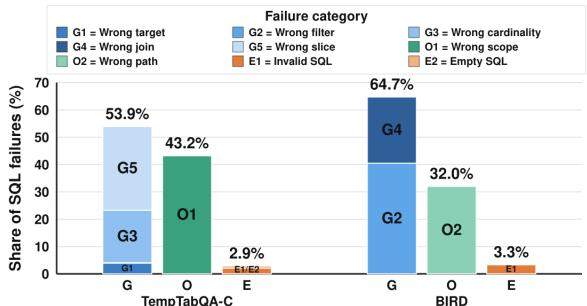
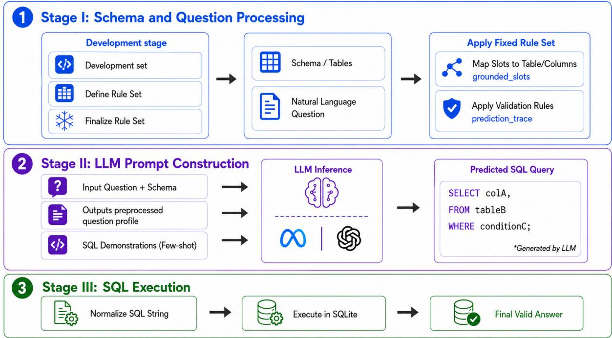
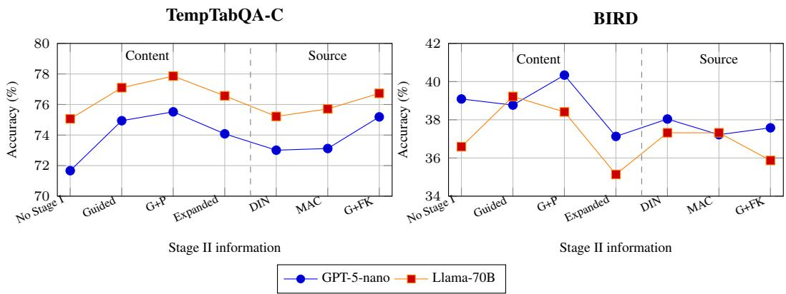
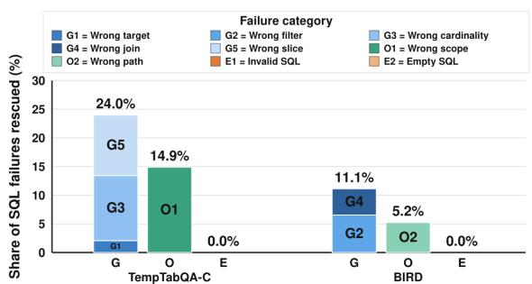
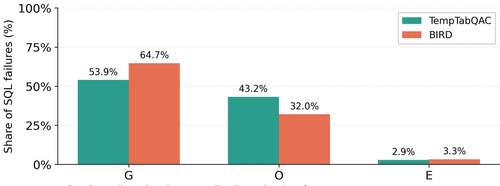
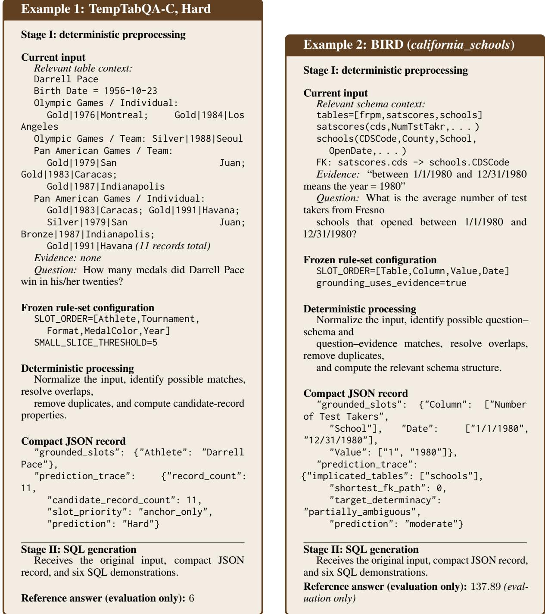
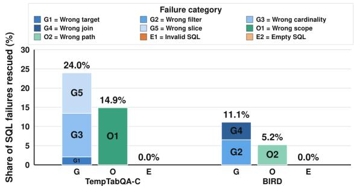

# GRIPS: An Empirical Study of Pre-SQL Grounding Information for SQL Generation

Ekata Mitra, Yufei Tao, Kamalamalini Nagasundaram and Ameeta Agrawal Department of Computer Science, Portland State University, USA {ekata, yutao,kamalan,ameeta}@pdx.edu

## Abstract

Text-to-SQL systems answer natural language questions over structured data, but can fail before SQL generation by linking question mentions to the wrong table, column, value, or relation. Even valid SQL can then return an incorrect answer. This raises a central question: What pre-SQL information helps a SQL generator, and when does additional information cease to help? We investigate this question on TempTabQA-C and BIRD. Among the audited SQL Static failures, grounding errors form the largest category on both benchmarks. We introduce GRIPS (Grounding Representation and Input Processing for SQL generation), a three-stage method that derives structured pre-SQL information to make these decisions explicit before query generation. Across GPT-5-nano and Llama-70B, GRIPS-Adaptive improves over SQL Static in 18 of 20 settings, with an average accuracy gain of 11.8 percentage points, while reducing model-call token usage by 47.8%. Our controlled analysis shows which grounding information can improve SQL generation, whereas adding more pre-SQL information does not consistently help. By separating question–input grounding from SQL generation, GRIPS makes text-to-SQL more accurate, efficient, and easier to diagnose.

## 1 Introduction

Text-to-SQL systems provide a practical interface for answering natural language questions over structured data: given a schema or set of tables, the system returns an executable query and a final answer. Large language models (LLMs) have made this workflow look straightforward, but structureddata reasoning requires several decisions before any SQL is generated. The system must determine what the question refers to in the schema, select relevant tables or slices, resolve values and filters, and decide which operations to apply. These pre-SQL decisions are interdependent: an incorrect grounding decision can lead to a valid query that answers the wrong question. Selecting relevant context is particularly important because more context is not necessarily better; even when retrieved information is relevant, additional context can degrade LLM performance (Du et al., 2025). Errors in these pre-SQL decisions propagate to downstream reasoning, and have been observed across semi-structured tables and fully relational databases (Zhou et al., 2024; Shankarampeta et al., 2025; Gruber et al., 2025; Li et al., 2023; Osés Grijalba et al., 2025).

Prior work improves different parts of the text-to-SQL pipeline through schema linking and retrieval (Gao et al., 2024; Shi et al., 2025; Glass et al., 2025; Nahid et al., 2025; Eben et al., 2025; Pourreza and Rafiei, 2023; Wang et al., 2025a; Xie et al., 2026; Talaei et al., 2024; Rajgaria et al., 2025), cost-aware routing (Zhu et al., 2025; Yi and Chen, 2025; Shao et al., 2025), and tabular QA prompting (Kulkarni et al., 2025; Deng et al., 2025; Rajgaria et al., 2025). However, the question–input interpretation must be systematically examined while keeping the SQL generator fixed. Consequently, it remains difficult to isolate which pre-SQL information helps and when additional information hurts.

To examine this issue, we use SQL Static (Kulkarni et al., 2025) as a common diagnostic system across two datasets, TempTabQA-C and BIRD. Our audit shows that many failures originate in question–input grounding before SQL syntax or execution becomes the main issue. This observation motivates treating pre-SQL interpretation as an explicit, inspectable handoff rather than leaving it only to the SQL-generation prompt. Therefore, we introduce GRIPS (Grounding Representation and Input Processingfor SQL generation), a three-stage architecture that separates input processing, SQL generation, and execution. Stage I derives structured pre-SQL information from the question and its available context. Stage II combines this information with the original input and SQL demonstrations to generate a single SQLite query. Stage III executes the query and returns the answer. We study a fixed-prompt version, GRIPS-Static, and an adaptive version, GRIPS-Adaptive, which selects demonstrations for the current input. This separation allows us to study not only whether GRIPS improves SQL generation, but also which information should be resolved before generation begins.

Our work is organized around three research questions:

RQ1: Where do text-to-SQL failures arise—during question–input grounding, SQL operation selection, or execution?

RQ2: How does the complete GRIPS system compare with prior methods in answer accuracy and model-call token usage?

RQ3: When the SQL generator and demonstrations are fixed, which pre-SQL grounding information improves performance?

Our main contributions are:

1. A cross-format analysis of text-to-SQL failures, with a diagnostic taxonomy covering grounding, operator, and execution-interface errors.

2. An inspectable pre-SQL interface, evaluated through the GRIPS pipeline across two structured-data settings and two model families.

3. A controlled study of the information passed through this interface, showing that compact grounding can help while additional fields do not consistently improve SQL generation.

## 2 Related Work

Schema linking. A key challenge in Text-to-SQL systems is schema linking. Recent methods improve this step through schema retrieval, lexical and semantic matching, pseudo-schema construction, and context filtering (Gao et al., 2024; Shi et al., 2025; Glass et al., 2025; Nahid et al., 2025; Eben et al., 2025; Talaei et al., 2024). Other approaches decompose generation into schema selection, query generation, validation, correction, or database exploration (Pourreza and Rafiei, 2023; Wang et al., 2025a; Xie et al., 2026).

Prompting method. Few-shot prompting, decomposition, routing, and retrieval are commonly used to improve SQL generation quality while controlling LLM inference cost (Pourreza and Rafiei, 2023; Zhu et al., 2025; Yi and Chen, 2025; Shao et al., 2025). Adaptive prompting further selects examples or strategies based on properties of the

<table><tr><td colspan="2">Example 1: TempTabQA-C, Hard</td></tr><tr><td>C: Darrell Pace</td><td>Personal Information: Birth Date = 1956-10-23 Olympic Games: Individual MedalGold | 1976 | Mon- treal; MedalGold | 1984 | Los Angeles</td></tr><tr><td>Q: A:</td><td>Juan; MedalGold | 1983 | Caracas Pan American Games: Individual MedalGold | 1983 | Caracas; MedalSilver | 1979 | San Juan How many medals did Darrell Pace win in his/her twen- ties? 6</td></tr><tr><td colspan="2">Example 2: BIRD-Mini-Dev, california_schools</td></tr><tr><td>E:</td><td>“between 1/1/1980 and 12/31/1980&quot; means the year = 1980.</td></tr><tr><td>Q: A: 137.89</td><td>What is the average number of test takers from Fresno schools that opened between 1/1/1980 and 12/31/1980?</td></tr></table>

Table 1: Examples from TempTabQA-C and BIRD where C: Table Context; Q: Question; A: Answer; E: Evidence.

current question (Rajgaria et al., 2025). Our Adaptive configuration follows this general direction while the controlled experiments isolate the effect of the structured input record itself.

Symbolic method. Recent work combines LLM prompting, symbolic SQL generation, and execution for temporal table reasoning (Gupta et al., 2023; Deng et al., 2025; Kulkarni et al., 2025). Robustness studies further show that table reasoning remains sensitive to changes in question form, table structure, and context (Zhou et al., 2024; Shankarampeta et al., 2025; Gruber et al., 2025). Our approach complements this work by making pre-SQL question–input matches explicit.

## 3 Diagnosing Pre-SQL Failures in Structured-Data Reasoning

We analyze SQL Static (Kulkarni et al., 2025), because its fixed-prompt, single-query design enables direct failure analysis, on TempTabQA-C and BIRD. We group errors into question–input misalignment, incorrect SQL operations, and execution failures.

## 3.1 Benchmark

Our analysis spans two structurally different benchmarks, with examples shown in Table 1.

TempTabQA-C (Gupta et al., 2023) is a temporal table QA benchmark built from Olympic and athletics infoboxes. It provides seven controlled evaluation splits: three difficulty levels (Easy (732), Medium (507), Hard (719)), the original unmodified split (Orig. (578)), a counterfactual variant with perturbed table content (CFact. (699)), and two table-size variants (Small (855), Large (538)). Together these splits test robustness across question difficulty, distributional shift, and structural variation.

BIRD (Li et al., 2023) is a text-to-SQL benchmark spanning eleven real-world relational databases. For answer-level evaluation, we execute the humanauthored gold SQL queries to derive the reference outputs. Each question has a gold SQL query, an evidence hint, and one of three hardness labels: Simple (92), Moderate (92), or Challenging (92). We use the Mini-Dev split throughout and refer to it as BIRD.

## 3.2 Analysis

We audit error cases from SQL Static predictions with incorrect answers. For TempTabQA-C, we use the Easy, Medium, and Hard splits to match BIRD’s three difficulty groups: Simple, Moderate, and Challenging. SQL Static gives 484 incorrect answers out of 1,958 TempTabQA-C questions and 153 out of 276 BIRD questions. Following the error patterns described by Kulkarni et al. (2025), we assign each failure to one of these three classes:

• Grounding (G): the question is linked to the wrong field, value, filter, table slice, or join path.

• Operator (O): the relevant information is identified, but the SQL uses the wrong temporal condition, aggregation, ranking, comparison, or selection logic.

• Execution-Interface (E): the system does not produce a usable query or answer, for example because the SQL is invalid, empty, or malformed. For each failure, we inspect the question, permitted context or schema, evidence, generated SQL, execution result, and reference answer, and assign one primary label according to where the error first appears: before computation (G), during computation (O), or at the execution interface (E).

The complete annotation protocol and nine-way taxonomy are provided in Appendix A along with one example for each observed subtype.

## 3.3 RQ1: Where does structured-data reasoning fail?

As shown in Figure 1, grounding is the largest diagnostic class across both benchmarks. It accounts for 53.9% of analyzed TempTabQA-C errors and 64.7% of BIRD errors. Operator errors are next largest, accounting for 43.2% and 32.0%, whereas execution-interface errors are rare (2.9% and 3.3%).

  
Diagnostic classes (G = Grounding, O = Operator, E = Execution-Interface)

Figure 1: SQL Static failure breakdown by diagnostic class and subcategory. TempTabQA-C grounding errors concentrate on schema-slice and cardinality (G5/G3); BIRD on filter and join grounding (G2/G4).
<table><tr><td>Type</td><td>Example Question</td><td>Root Cause</td></tr><tr><td>Wrong target (G)</td><td>Which was the most cur- rent medal win for Lin Sang?</td><td>Returns a partial event string instead of the correct for- mat; target field never resolved.</td></tr><tr><td>Wrong scope (0)</td><td>How many times did Ilya Shymanovich win an International medal in the European Cham- pionships (SC) before 2019?</td><td>Schema slice iden- tified but temporal operator applied in- correctly; produces 0 instead of gold count 4.</td></tr><tr><td>Empty SQL (E)</td><td>What is the shortest time span (in years) within which Abhinav Bindra won gold, silver, and bronze medals in the same format across any tournament?</td><td>Empty SQL pro- duced;pipeline fails before any executable query is formed.</td></tr></table>

Table 2: One representative failure per diagnostic class from SQL Static.

Table 2 gives representative cases. Several outputs contain valid SQL but still return the wrong answer because they use an incorrect target, filter, table slice, or join path. These findings motivate GRIPS: rather than leaving question–input connections implicit in the prompt, Stage I makes them explicit before SQL generation.

## 4 The GRIPS Framework

We introduce GRIPS, a three-stage framework for structured-data reasoning. Figure 2 illustrates the workflow.

Given a question and its permitted table or schema context, GRIPS separates the task into (1) structured input processing, (2) LLM-based SQL generation, and (3) query execution. Rather than requiring the LLM to infer relevant fields, values, filters, tables, and relations while generating SQL, Stage I derives a compact structured record from the question and available context. Stage II uses this record together with the original input and demonstrations to generate a query, which Stage III executes to return the final answer.

  
Figure 2: Overview of GRIPS pipeline. Stage I maps the question and context to a structured pre-SQL record using a frozen benchmark-specific rule-set. Stage II combines the original input, the Stage I record, and SQL demonstrations to generate SQL query. Stage III normalizes and executes the query to produce the final answer.

Stage I targets grounding errors by making schema and value matches explicit; Stage II targets operator errors by conditioning SQL generation on this record and on matching demonstrations; Stage III executes the query and exposes invalid or empty outputs.

## 4.1 Stage I: Schema and Question Processing

Setup. Stage I has two phases: development-time rule-set construction and evaluation-time input processing. In the development step, we use a development subset from each benchmark to determine which question mentions and structural properties to record, establish the rule order, and set a small number of fixed thresholds. We then finalize the benchmark-specific rule set and apply it unchanged to all remaining evaluation examples.

For TempTabQA-C, the development set contains 120 examples: 40 from each of the Easy, Medium, and Hard splits. Each split includes 20 SQL Static successes and 20 failures, covering variation in question mentions, event filters, temporal conditions, and candidate table records. For BIRD, the development set contains 30 examples: 10 examples from each gold difficulty level—Simple, Moderate, and Challenging—including 5 successes and 5 failures per level. These examples cover both direct schema access and more constrained multitable questions, allowing us to examine connections that SQL Static handles correctly as well as those associated with incorrect SQL. Development set examples are excluded from the corresponding evaluation runs.

Constructing the rule set. As TempTabQA-C and BIRD are substantially different in structure, we use a separate Stage I rule-set for each benchmark. We use the development sets to refine slot maps, rule order, and fixed thresholds used by the structural profile. TempTabQA-C contains semistructured temporal tables, while BIRD uses relational database schemas. Each rule-set converts the question and its available context into the same compact JSON format.

To select these rules, we first map each question to its table or schema context, and to benchmarkprovided evidence for BIRD. The recognized matches are stored in grounded\_slots. Their coverage indicates how much of the question is directly supported by the input: an anchor-only match leaves more information to infer before SQL generation. We combine this signal with candidate-record counts, filter counts, implicated tables, and foreign-key distance to assign a coarse prediction\_trace label.

Example 1: TempTabQA-C, Hard Example 2: BIRD (california\_schools)   
Current input Current input   
Question and supplied infobox: Table 1, Example 1. Question, database schema, and benchmark-provided   
Frozen rule-set configuration evidence: Table 1, Example 2.   
SLOT\_ORDER=[Athlete,Tournament, Frozen rule-set configuration   
Format,MedalColor,Year] SLOT\_ORDER=[Table,Column,   
Fixed normalization and medal-record filtering rules. Value,Date]   
Deterministic processing grounding\_uses\_evidence=true   
Normalize the input, identify possible matches, resolve Fixed schema-normalization and foreign-key rules.   
overlapping matches, remove duplicates, and compute the Deterministic processing   
candidate-record profile. Normalize the input, identify possible question–schema   
Stage I JSON output and question–evidence matches, resolve overlaps, remove   
"grounded\_slots": { duplicates, and compute the relevant schema profile.   
"Athlete": "Darrell Pace" Stage I JSON output   
}, "grounded\_slots": {   
"prediction\_trace": { "Column": ["Number of Test Takers",   
"record\_count": 11, "School"],   
"candidate\_record\_count": 11, "Date": ["1/1/1980", "12/31/1980"],   
"slot\_priority": "anchor\_only", "Value": ["1", "1980"]   
"prediction": "Hard" },   
} "prediction\_trace": {   
"implicated\_tables": ["schools"],   
"shortest\_fk\_path": 0,   
"prediction": "moderate"   
}  
Table 3: Stage I outputs for the running examples in Table 1.

<table><tr><td>Layer</td><td>Contents</td></tr><tr><td>tions</td><td>Reusable opera- normalization, span detection, overlap resolution, counting, context filtering,</td></tr><tr><td></td><td>graph traversal, JSON serialization</td></tr><tr><td>figuration</td><td>Benchmark con- slot labels, lexical cues and aliases, con- text grammar, schema conventions, fixed</td></tr><tr><td></td><td>thresholds Per-example in- question mentions, supplied schema or</td></tr></table>

Table 4: Components of the Stage I preprocessing configuration.

Following the general idea of predicting question difficulty or hardness in Spider (Yu et al., 2018), we derive this prediction\_trace label from question–input mappings rather than gold SQL. For TempTabQA-C, we vary the candidaterecord cutoff on development examples and select five because it gives the strongest agreement with the tested difficulty labels. For BIRD, we check simple boundaries, including foreign-key distance and the number of implicated tables, only on development examples. We then freeze the slot maps, rule order, and thresholds for all evaluation runs.

Tables 3 and 4 illustrate the Stage I records and distinguish reusable processing from benchmarkspecific rules. Appendix B.1 gives the complete Stage I construction, including additional examples, structural fields, and development-set threshold checks.

Evaluation-time input processing. At evaluation time, the frozen rule-set normalizes the input–question and context, produces two JSON fields: grounded\_slots, which lists the recognized matches, and prediction\_trace, which summarizes simple properties of the current input. For TempTabQA-C these properties include candidate medal-record counts. For BIRD they include the involved tables and foreign-key distance.

## 4.2 Stage II: LLM Prompt Construction and SQL Generation

Stage II provides the LLM with the original benchmark input and the Stage I JSON record. The prompt contains:

• an instruction to return exactly one executable SQLite SELECT query;

• the original question;

• the context or database schema;

• benchmark-provided evidence, when available(BIRD);

• the Stage I JSON record containing grounded\_slots and prediction\_trace;

• six SQL demonstrations.

The demonstrations are benchmark-specific but identical across the two model families. They show the required output format and examples of mapping natural-language questions to executable SQLite queries.

We evaluate two variants.

(1) GRIPS-Static uses the Stage I JSON with a fixed set of demonstrations, isolating the effect of explicit grounding.

(2) GRIPS-Adaptive also includes the Stage I JSON record, but uses additional Stage I structural fields to dynamically select demonstrations.

Appendix B.2 gives the full prompt and demonstration-selection details.

## 4.3 Stage III: SQL Execution

Stage III normalizes the SQL generated by the LLM and executes it in SQLite. The execution result, rather than the raw LLM response, is used as the final answer.

We use the same execution procedure for all methods. This keeps answer recovery consistent across systems and helps identify whether an error is associated with Stage I processing, demonstration selection, SQL generation, or query execution.

## 5 Experimental Setup

We evaluate two models: GPT-5-nano (gpt-5-nano-2025-08-07, with medium reasoning effort) (OpenAI, 2025) and Llama-3.3-70B-Instruct (Grattafiori et al., 2024). We consider ten splits across the two benchmarks with two models, yielding 20 model–split settings. Appendix C.1.1 includes the full implementation details.

## 5.1 Baselines

We compare GRIPS against the following methods:

• Direct Static: Generate output directly without generating SQL from the original question and table or schema context using a fixed set of demonstrations.

• SQL Static (Kulkarni et al., 2025): Generate SQL by LLM from the original question and table or schema context using a fixed set of demonstrations and then run it externally in SQLite.

• DIN-SQL (Pourreza and Rafiei, 2023): an LLMbased multi-stage pipeline with four modules:

schema linking, query classification and decomposition, SQL generation, and self-correction.

• MAC-SQL (Wang et al., 2025b): an LLMbased multi-agent pipeline with three specialized agents: a schema selector, an SQL decomposer, and SQL refiner.

## 5.2 Evaluation Metrics

We report Answer Accuracy and Average token count by LLM. For TempTabQA-C, we compare predicted answers with the benchmark reference answers. For BIRD, we execute the benchmark gold SQL to obtain reference answers and compare model outputs with these results. We therefore use the same answer-level accuracy measure for both benchmarks.

We also report average provider-recorded input and output tokens per question for each LLM. We exclude preprocessing, database execution, and evaluation because they do not involve LLM calls. Appendix C.1.2 also reports EMS and REMS, which show the same overall trend as answer accuracy.

## 6 Results

We compare GRIPS with prior methods across both benchmarks to answer our remaining two research questions.

## 6.1 RQ2: Does GRIPS improve accuracy and token usage?

Answer accuracy. Table 5 compares GRIPS with Direct Static, SQL Static, DIN-SQL, and MAC-SQL across 20 settings: 10 evaluation settings for each of two models. GRIPS-Static exceeds SQL Static in most settings, indicating that the structured record is beneficial even when the demonstrations are fixed. GRIPS-Adaptive achieves the highest answer accuracy in 16 settings and outperforms all prior methods in 17 settings. It improves over SQL Static in 18 settings, with an average gain of 11.80 points. These results indicate that adaptive demonstration selection further improves the model’s ability to generate accurate SQL queries. DIN-SQL has the lowest overall accuracy, which may reflect error propagation across its multi-step pipeline.

Robustness and corrections. The accuracy gains extend across question difficulty, counterfactual table changes, and table-size variation. GRIPS-Adaptive is strongest in all seven

<table><tr><td rowspan="2">Model</td><td rowspan="2">Method</td><td colspan="7">TempTabQA-C (Accuracy ↑)</td><td colspan="3">BIRD (Accuracy ↑)</td></tr><tr><td>Easy</td><td>Medium</td><td>Hard</td><td>Orig.</td><td>CFact.</td><td>Small</td><td>Large</td><td>Simple</td><td>Moderate</td><td>Chall.</td></tr><tr><td>GPT-5-nano</td><td>Direct Static</td><td>90.57</td><td>61.54</td><td>55.22</td><td>69.55</td><td>57.31</td><td>78.71</td><td>58.74</td><td>6.52</td><td>3.26</td><td>2.17</td></tr><tr><td></td><td>SQL Static</td><td>77.73</td><td>63.31</td><td>60.64</td><td>64.71</td><td>60.20</td><td>75.79</td><td>66.54</td><td>58.70</td><td>34.78</td><td>21.74</td></tr><tr><td></td><td>DIN-SQL</td><td>69.95</td><td>35.70</td><td>43.53</td><td>47.06</td><td>41.49</td><td>59.18</td><td>49.07</td><td>48.91</td><td>30.43</td><td>21.74</td></tr><tr><td></td><td>MAC-SQL</td><td>83.88</td><td>59.96</td><td>51.32</td><td>66.26</td><td>60.52</td><td>73.10</td><td>65.61</td><td>44.57</td><td>26.09</td><td>25.00</td></tr><tr><td>Ours</td><td>GRIPS-Static</td><td>84.29</td><td>75.54</td><td>62.17</td><td>76.64</td><td>66.38</td><td>82.11</td><td>73.42</td><td>54.35</td><td>33.70</td><td>27.17</td></tr><tr><td></td><td>GRIPS Adaptive</td><td>92.35</td><td>88.17</td><td>64.95</td><td>80.97</td><td>74.11</td><td>88.07</td><td>85.32</td><td>55.43</td><td>40.22</td><td>27.79</td></tr><tr><td>Llama-70B</td><td>Direct Static</td><td>82.79</td><td>56.61</td><td>42.56</td><td>59.86</td><td>41.82</td><td>74.39</td><td>50.93</td><td>5.43</td><td>4.35</td><td>4.35</td></tr><tr><td></td><td>SQL Static</td><td>76.78</td><td>64.89</td><td>49.79</td><td>63.67</td><td>59.08</td><td>69.79</td><td>64.87</td><td>55.43</td><td>34.78</td><td>21.74</td></tr><tr><td></td><td>DIN-SQL</td><td>60.25</td><td>33.93</td><td>46.04</td><td>48.27</td><td>43.78</td><td>56.14</td><td>48.51</td><td>55.43</td><td>38.04</td><td>35.87</td></tr><tr><td></td><td>MAC-SQL</td><td>76.91</td><td>59.57</td><td>42.56</td><td>60.55</td><td>61.80</td><td>65.38</td><td>60.59</td><td>59.78</td><td>45.65</td><td>41.30</td></tr><tr><td>Ours</td><td>GRIPS-Static</td><td>93.17</td><td>58.58</td><td>60.08</td><td>72.66</td><td>72.53</td><td>76.37</td><td>63.75</td><td>53.26</td><td>33.70</td><td>35.20</td></tr><tr><td></td><td>GRIPS Adaptive</td><td>94.40</td><td>76.33</td><td>54.94</td><td>76.99</td><td>75.39</td><td>82.22</td><td>77.51</td><td>55.43</td><td>50.00</td><td>40.43</td></tr></table>

Table 5: Answer accuracy across TempTabQA-C and BIRD.
<table><tr><td>Benchmark</td><td>Question</td><td>GRIPS Static failure</td><td>Stage-I-augmented Adaptive out- put</td></tr><tr><td>TempTabQA- C</td><td>manovich win an International Championships&#x27; and f.name pionships (SC) before 2019?</td><td>How many times did Ilya Shy- Splits into t . name = &#x27;European = medal in the European Cham- &#x27;SC&#x27;; adds an incorrect format con- Championships (SC)&#x27;; removes straint and returns 0.</td><td>Preserves one tournament value t.name 二 &#x27;European the format filter and recovers count 4.</td></tr><tr><td>TempTabQA- C</td><td>2019?</td><td>How many International Invents an International schema Treats International according to medals did João Oliva win in filter and applies t.name LIKE the common prompt convention query and returns 0.</td><td>&#x27;%International%’ or location rather than as a literal schema value; matches; this overconstrains the keeps only the recognized athlete and year constraints and recovers count 1.</td></tr><tr><td>BIRD</td><td>&#x27;thank you user93!&#x27;</td><td>Name the user that commented Queries UserDisplayName directly Selects the target as a user attribute query yields no answer.</td><td>from comments; the target attribute and uses the join path C.UserId = belongs to the wrong relation, so the U. Id; selects U.DisplayName and returns Preets.</td></tr><tr><td>BIRD</td><td>tobiographer badge?</td><td>cardinality failure rather than a syn- returns Geoff Dalgas. tax error.</td><td>What is the display name of the Matches the earliest badge date cor- Preserves the same join path, but user who acquired the first Au- rectly, but returns all tied users for adds an explicit single-answer con- that date; this is a wrong answer- straint (ORDER BY + LIMIT 1) and</td></tr></table>

Table 6: Representative paired outputs from real TempTabQA-C and BIRD instances. Red marks the decisive GRIPS Static error; green marks the corresponding decision in the correct Stage-I-augmented Adaptive output. Because Adaptive also changes demonstrations, these examples illustrate outcome differences rather than isolated causal effects of the Stage I handoff.

TempTabQA-C settings for GPT-5-nano and in six of seven settings for Llama-70B. It also achieves the highest accuracy on the BIRD Moderate group for both models and on the BIRD Challenging group for GPT-5-nano. These results suggest that selecting demonstrations to match the input structure can make the intermediate record more useful under distribution shifts. GRIPS-Static remains competitive, indicating that the structured record itself provides value even without adaptive example selection. In contrast, Direct Static is more competitive on the semi-structured TempTabQA-C inputs but weaker on BIRD, where answering requires retrieving values through relational schema structure. The multi-stage DIN-SQL and MAC-SQL pipelines may benefit from explicit decomposition and refinement, but their extra intermediate decisions appear less reliable on both benchmarks and models. No non-GRIPS baseline is consistently strong across both benchmark formats.

Table 6 illustrates representative corrections: GRIPS preserves the complete tournament constraint in TempTabQA-C and identifies the correct target relation and join path in BIRD. Additional paired cases are reported in Appendix C.1.

<table><tr><td rowspan="2">Model</td><td rowspan="2">Method</td><td colspan="7">TempTabQA-C avg. tokens ↓</td><td colspan="3">BIRD avg. tokens ↓</td></tr><tr><td>Easy</td><td>Medium</td><td>Hard</td><td>Orig.</td><td>CFact.</td><td>Small</td><td>Large</td><td>Simple</td><td>Moderate</td><td>Chall.</td></tr><tr><td>GPT-5-nano</td><td>Direct Static</td><td>2799</td><td>3098</td><td>3838</td><td>3373</td><td>4559</td><td>2539</td><td>4614</td><td>2885</td><td>2919</td><td>2875</td></tr><tr><td></td><td>SQL Static</td><td>3937</td><td>4329</td><td>5122</td><td>4719</td><td>4719</td><td>4334</td><td>4505</td><td>2227</td><td>2833</td><td>3220</td></tr><tr><td></td><td>DIN-SQL</td><td>6187</td><td>6182</td><td>6004</td><td>5622</td><td>6988</td><td>5657</td><td>7772</td><td>13778</td><td>10778</td><td>12333</td></tr><tr><td></td><td>MAC-SQL</td><td>5433</td><td>5610</td><td>6148</td><td>5770</td><td>6470</td><td>5043</td><td>7094</td><td>12956</td><td>13843</td><td>13044</td></tr><tr><td>Ours</td><td>GRIPS-Static</td><td>2299</td><td>2664</td><td>3338</td><td>3212</td><td>3272</td><td>3010</td><td>2978</td><td>1475</td><td>1660</td><td>1872</td></tr><tr><td></td><td>GRIPS-Adaptive</td><td>1513</td><td>1989</td><td>2221</td><td>2110</td><td>2224</td><td>1895</td><td>2049</td><td>2012</td><td>2471</td><td>3077</td></tr><tr><td>Llama-70B</td><td>Direct Static</td><td>1597</td><td>1595</td><td>1667</td><td>1576</td><td>1763</td><td>1398</td><td>2004</td><td>2532</td><td>2559</td><td>2657</td></tr><tr><td></td><td>SQL Static</td><td>2918</td><td>3017</td><td>3080</td><td>3003</td><td>3017</td><td>2974</td><td>2977</td><td>1193</td><td>1241</td><td>1256</td></tr><tr><td></td><td>DIN-SQL</td><td>7014</td><td>6987</td><td>7410</td><td>7157</td><td>7960</td><td>6664</td><td>8512</td><td>27389</td><td>25554</td><td>25173</td></tr><tr><td></td><td>MAC-SQL</td><td>7446</td><td>7361</td><td>7943</td><td>7551</td><td>7961</td><td>6723</td><td>9278</td><td>11585</td><td>11364</td><td>11185</td></tr><tr><td>Ours</td><td>GRIPS-Static</td><td>1293</td><td>1131</td><td>2047</td><td>2525</td><td>1824</td><td>1504</td><td>1953</td><td>1170</td><td>1219</td><td>1238</td></tr><tr><td></td><td>GRIPS-Adaptive</td><td>634</td><td>803</td><td>996</td><td>814</td><td>823</td><td>775</td><td>801</td><td>1039</td><td>1133</td><td>1203</td></tr></table>

Table 7: Average LLM-token count per query across all splits (↓ lower is better).  
  
Figure 3: Controlled comparison of Stage I information under a fixed Stage II generator. The first four condi tions vary the amount of information; the last three vary its source. G+P denotes guided representation with prediction\_trace, and G+FK denotes guided representation with verified foreign-key paths.

  
Diagnostic classes (G = Grounding, O = Operator, E = Execution-Interface)  
Figure 4: Share of SQL Static failures rescued by GRIPS, by diagnostic class and subcategory.

Avg. token usage. Table 7 shows that GRIPS-Adaptive uses fewer model-call tokens than SQL Static, DIN-SQL, and MAC-SQL in all 20 settings. Relative to SQL Static, it reduces token usage by 47.8% on average. The counts include providerrecorded input and output tokens, but exclude deterministic preprocessing of Stage I, database execution, and evaluation. Thus, the result measures LLM usage rather than total system latency or computation.

Appendix C.1 consolidates the token-accounting details, full end-to-end results, rescued-error breakdowns, and additional successful and unsuccessful cases.

Failure-type rescue analysis. Figure 4 shows the trace of each corrected SQL Static failure to its primary diagnostic label. Compared to Figure 1, GRIPS primarily fixes grounding errors, which Stage I resolves before SQL generation, rescuing 24.0% of failures on TempTabQA-C and 11.1% on BIRD, followed by operator errors at 14.9% and 5.2%, respectively.

## 6.2 RQ3: Which grounding information helps?

Next, we conduct controlled comparisons that hold the question, context, evidence, demonstrations,

SQL generator, and generation settings fixed while varying only the Stage I information provided to Stage II. Figure 3 reports two comparisons: a content comparison that progressively adds grounding information, and a source comparison that replaces the GRIPS record with intermediate information adapted from other methods. Appendix C.2 provides full condition definitions and controlled efficiency results.

Content comparison: No Stage I provides only the question, context, evidence, few-shot examples; Guided provides only grounded\_slots; G+P additionally provides prediction\_trace; Expanded further includes internal pattern, count/repetition of structural fields.

Source comparison: DIN links provides schema links generated by the DIN-SQL linking stage; MAC selection provides the table and column selections produced by the MAC-SQL selector; G + FK provides grounded\_slots together with schema-verified foreign-key paths.

How much information helps? Figure 3 shows that benefits are not monotonic. On TempTabQA-C, the compact representation profile performs best, improving accuracy over no Stage I information by 3.85 points for GPT-5-nano and 2.80 points for Llama-70B; the expanded profile lowers accuracy. On BIRD, effects are smaller and model-dependent: the profile helps GPT-5-nano, whereas grounded slots alone work best for Llama-70B.

Does the source matter? Alternative information sources provide no consistent improvement under the fixed SQL generator. The guided representation outperforms adapted DIN-SQL links and MAC-SQL selections on TempTabQA-C, while verified foreign-key paths yield mixed results. On BIRD, the best source varies by model, indicating that additional schema links or structural information do not reliably help.

## 7 Conclusion and Future Work

We present a cross-benchmark failure diagnostic taxonomy for SQL-based structured-data reasoning and find grounding failures to be the largest error category on TempTabQA-C and BIRD. We propose GRIPS, which makes question–input matches explicit before SQL generation. GRIPS-Adaptive attains the best answer accuracy while requiring fewer model-call tokens in nearly all settings. Controlled results show that compact grounding signals can help, but adding more internal fields does not consistently improve performance. More broadly, pre-SQL processing is most useful when it provides targeted, inspectable guidance than additional generator context. Future work should combine semantic retrieval or entity resolution with controlled input guidance for SQL generation, and test its transfer to unseen schemas and noisier inputs.

## Limitations

GRIPS uses fixed, benchmark-specific rules and aliases selected on development examples. This makes Stage I reproducible, but its transfer to unseen schemas, paraphrases, implicit references, and noisy metadata remains untested. Our experiments cover TempTabQA-C and a balanced 276-question BIRD subset; the BIRD results use our answerlevel evaluator rather than the official leaderboard metric. The findings should therefore be limited to the evaluated settings.

The failure audit covers all SQL Static errors in the selected splits, but assigning one primary cause to a multi-stage failure can be subjective. Moreover, the end-to-end GRIPS-Adaptive results combine the Stage I record with demonstration selection. RQ3 isolates the handoff content, but does not separately evaluate the Adaptive retrieval policy. Finally, the reported efficiency gains measure provider-recorded model-call tokens only. They exclude deterministic preprocessing, retrieval construction, database execution, and total system latency or cost.

## Ethics Statement

This work studies question answering over benchmarked structured datasets and relational databases; it does not involve human-subject experimentation or user deployment. The main risk is over-reliance on generated answers or SQL in settings where correctness matters. Although symbolic grounding improves interpretability and reduces some error modes, incorrect grounding can still produce plausible but false outputs. We therefore do not recommend use of the method without task-level verification in high-stakes domains such as medicine, law, finance, or public administration. Users should also respect the licensing and access conditions of the underlying datasets and database resources.

## Acknowledgments

We thank the anonymous reviewers for their constructive feedback.

## References

Irwin Deng, Kushagra Dixit, Dan Roth, and Vivek Gupta. 2025. Enhancing temporal understanding in LLMs for semi-structured tables. In Findings ofthe Associationfor Computational Linguistics: NAACL 2025, pages 4951–4970, Albuquerque, New Mexico. Association for Computational Linguistics.

Yufeng Du, Minyang Tian, Srikanth Ronanki, Subendhu Rongali, Sravan Babu Bodapati, Aram Galstyan, Azton Wells, Roy Schwartz, Eliu A Huerta, and Hao Peng. 2025. Context length alone hurts LLM performance despite perfect retrieval. In Findings of the Association for Computational Linguistics: EMNLP 2025, pages 23281–23298, Suzhou, China. Association for Computational Linguistics.

Jeffrey Eben, Aitzaz Ahmad, and Stephen Lau. 2025. Rasl: Retrieval augmented schema linking for massive database text-to-sql. Preprint, arXiv:2507.23104.

Dawei Gao, Haibin Wang, Yaliang Li, Xiuyu Sun, Yichen Qian, Bolin Ding, and Jingren Zhou. 2024. Text-to-SQL empowered by large language models: A benchmark evaluation. Proceedings ofthe VLDB Endowment, 17(5):1132–1145.

Michael Glass, Mustafa Eyceoz, Dharmashankar Subramanian, Gaetano Rossiello, Long Vu, and Alfio Gliozzo. 2025. Extractive schema linking for text-tosql. Preprint, arXiv:2501.17174.

Aaron Grattafiori, Abhimanyu Dubey, Abhinav Jauhri, Abhinav Pandey, Abhishek Kadian, Ahmad Al-Dahle, Aiesha Letman, Akhil Mathur, Alan Schelten, Alex Vaughan, et al. 2024. The llama 3 herd of models. arXiv preprint arXiv:2407.21783.

Raphael Gruber, Abdelrahman Abdallah, Michael Färber, and Adam Jatowt. 2025. Complextempqa: A 100m dataset for complex temporal question answering. In Proceedings of the 2025 Conference on Empirical Methods in Natural Language Processing, pages 9100–9112.

Vivek Gupta, Pranshu Kandoi, Mahek Vora, Shuo Zhang, Yujie He, Ridho Reinanda, and Vivek Srikumar. 2023. Temptabqa: Temporal question answering for semi-structured tables. In Proceedings ofthe 2023 Conference on Empirical Methods in Natural Language Processing, pages 2431–2453.

Atharv Kulkarni, Kushagra Dixit, Vivek Srikumar, Dan Roth, and Vivek Gupta. 2025. Llm-symbolic integration for robust temporal tabular reasoning. arXiv preprint arXiv:2506.05746.

Jinyang Li, Binyuan Hui, Ge Qu, Jiaxi Yang, Binhua Li, Bowen Li, Bailin Wang, Bowen Qin, Ruiying Geng, Nan Huo, Xuanhe Zhou, Chenhao Ma, Guoliang Li, Kevin Chen-Chuan Chang, Fei Huang, Reynold Cheng, and Yongbin Li. 2023. Can LLM already serve as a database interface? a big bench for largescale database grounded text-to-sqls. In Advances in Neural Information Processing Systems, volume 36.

Md Mahadi Hasan Nahid, Davood Rafiei, Weiwei Zhang, and Yong Zhang. 2025. Rethinking schema linking: A context-aware bidirectional retrieval approach for text-to-sql. Preprint, arXiv:2510.14296.

OpenAI. 2025. Gpt-5 technical report. Technical report, OpenAI.

Jorge Osés Grijalba, L. Alfonso Ureña-López, Eugenio Martínez Cámara, and Jose Camacho-Collados. 2025. SemEval-2025 task 8: Question answering over tabular data. In Proceedings of the 19th International Workshop on Semantic Evaluation (SemEval-2025), pages 2512–2522, Vienna, Austria. Association for Computational Linguistics.

Mohammadreza Pourreza and Davood Rafiei. 2023. Din-sql: Decomposed in-context learning of text-tosql with self-correction. Preprint, arXiv:2304.11015.

Abhishek Rajgaria, Kushagra Dixit, Mayank Vyas, Harshavardhan Kalalbandi, Dan Roth, and Vivek Gupta. 2025. No universal prompt: Unifying reasoning through adaptive prompting for temporal table reasoning. In Proceedings of the 14th International Joint Conference on Natural Language Processing and the 4th Conference ofthe Asia-Pacific Chapter of the Associationfor Computational Linguistics, pages 2800–2821, Mumbai, India. The Asian Federation of Natural Language Processing and The Association for Computational Linguistics.

Abhilash Shankarampeta, Harsh Mahajan, Tushar Kataria, Dan Roth, and Vivek Gupta. 2025. TRAN-SIENTTABLES: Evaluating LLMs’ reasoning on temporally evolving semi-structured tables. In Proceedings of the 2025 Conference of the Nations of the Americas Chapter of the Association for Computational Linguistics: Human Language Technologies (Volume 1: Long Papers), pages 6526–6544, Albuquerque, New Mexico. Association for Computational Linguistics.

Zhihui Shao, Shubin Cai, Rongsheng Lin, and Zhong Ming. 2025. Enhancing text-to-sql with question classification and multi-agent collaboration. In Findings of the Association for Computational Linguistics: NAACL 2025, pages 4340–4349.

Jie Shi, Bo Xu, Jiaqing Liang, Yanghua Xiao, Jia Chen, Chenhao Xie, Peng Wang, and Wei Wang. 2025. Gensql: Efficient text-to-sql by bridging natural language question and database schema with pseudo-schema. In Proceedings of the 31st International Conference on Computational Linguistics, pages 3794–3807.

Shayan Talaei, Mohammadreza Pourreza, Yu-Chen Chang, Azalia Mirhoseini, and Amin Saberi. 2024. Chess: Contextual harnessing for efficient sql synthesis. Preprint, arXiv:2405.16755.

Bing Wang, Changyu Ren, Jian Yang, Xinnian Liang, Jiaqi Bai, LinZheng Chai, Zhao Yan, Qian-Wen Zhang, Di Yin, Xing Sun, and Zhoujun Li. 2025a. Mac-sql: A multi-agent collaborative framework for text-to-sql. Preprint, arXiv:2312.11242.

Bing Wang, Changyu Ren, Jian Yang, Xinnian Liang, Jiaqi Bai, Linzheng Chai, Zhao Yan, Qian-Wen Zhang, Di Yin, Xing Sun, et al. 2025b. Mac-sql: A multiagent collaborative framework for text-to-sql. In Proceedings ofthe 31st International Conference on Computational Linguistics, pages 540–557.

Wenxuan Xie, Yaxun Dai, and Wenhao Jiang. 2026. Sde-sql: Enhancing text-to-sql generation in large language models via self-driven exploration with sql probes. In Proceedings of the 64th Annual Meeting of the Association for Computational Linguistics (Volume 1: Long Papers), pages 2507–2525.

Jiawen Yi and Guo Chen. 2025. SKT-SQL: Multidecoupling and skeleton prompt framework for textto-SQL on small-scale LMs. Journal of Intelligent Information Systems, 63:1779–1805.

Tao Yu, Rui Zhang, Kai Yang, Michihiro Yasunaga, Dongxu Wang, Zifan Li, James Ma, Irene Li, Qingning Yao, Shanelle Roman, et al. 2018. Spider: A large-scale human-labeled dataset for complex and cross-domain semantic parsing and text-to-sql task. In Proceedings ofEMNLP.

Wei Zhou, Mohsen Mesgar, Heike Adel, and Annemarie Friedrich. 2024. Freb-tqa: A fine-grained robustness evaluation benchmark for table question answering. In Proceedings ofthe 2024 Conference ofthe North American Chapter of the Association for Computational Linguistics: Human Language Technologies (Volume 1: Long Papers), pages 2479–2497.

Yizhang Zhu, Runzhi Jiang, Boyan Li, Nan Tang, and Yuyu Luo. 2025. EllieSQL: Cost-efficient text-to-SQL with complexity-aware routing. In Conference on Language Modeling (COLM).

## Appendix

## A Failure Analysis Details

We audit SQL Static failures to identify where structured-data reasoning breaks down before introducing GRIPS. The protocol, taxonomy, and empirical composition are described below.

## A.1 Failure Analysis Protocol

We run SQL Static on all 1,958 questions in the TempTabQA-C Easy, Medium, and Hard splits and on the balanced 276-question BIRD subset. We inspect all 484 TempTabQA-C failures and all 153 BIRD failures. For each case, we examine the question, permitted context or schema, benchmark evidence when available, generated SQL, execution result, and reference answer. Each failure receives one primary label based on where the error first appears: before computation, during computation, or at the execution interface.

## A.2 Nine-Way Failure Taxonomy

Table 8 lists one representative instance per subcategory, covering all nine non-zero failure subtypes observed across TempTabQA-C and BIRD. Each example is drawn directly from the audited SQL Static runs.

## A.3 Empirical Failure Composition

Figure 5 shows the class distribution after reauditing SQL Static errors across all splits. Grounding is the largest class in both audited failure sets, matching the main-paper result.

## B GRIPS Construction and Prompting Details

## B.1 Stage I Construction and Threshold Sensitivity

This section separates the choices made during development from the processing performed at evaluation time. Development examples are used to define the record fields, rule order, and fixed thresholds. The resulting rule-set is then frozen. At evaluation time, it processes only the current question, permitted context or schema, and benchmark evidence when available.

## B.1.1 Rule-Derived Input Profile

The input profile is deterministic rule-set metadata rather than model reasoning. Table 9 summarizes its per-example inputs, derived statistics, and reader-facing output.

TempTabQA-C decision order. The rule-set records the mention types found in the question, parses medal rows, and counts the rows that remain after recognized event filters. Ordered rules then distinguish no recognized mention, repeated values, athlete-only anchors, anchors with one or several event filters, and event filters without an athlete anchor. The cutoff τ = 5 is used only for the athlete-plus-one-filter case: a candidate slice of at most five rows receives the lower difficulty label, while a larger slice receives the higher label.

G = Grounding O = Operator E = Execution-Interface
<table><tr><td>Code</td><td>Failure type</td><td>Example</td><td>Dataset</td><td>Observation / Root cause</td></tr><tr><td>G1</td><td>Wrong target</td><td>Which was the most current medal win for TempTabQA- Returns a partial event description in- Lin Sang?</td><td>C</td><td>stead of the correct answer form; target field never resolved.</td></tr><tr><td>G2</td><td></td><td>Wrong filter State the names and full communication ad- BIRD dress of high schools in Monterey which has more than 800 free or reduced price meals</td><td></td><td>Grounds Monterey to City instead of County; query filtered on wrong at- tribute.</td></tr><tr><td>G3</td><td>nality</td><td>for ages 15–17? Wrong cardi- In which year(s) did Kylie Masse win medals TempTabQA- Question is set-valued but system emits in the World Championships (LC)?</td><td>C</td><td>no final answer despite a valid multi- year SELECT DISTINCT query.</td></tr><tr><td>G4</td><td>Wrong join</td><td>What is the telephone number for the school BIRD with the lowest average score in reading in Fresno Unified?</td><td></td><td>Joins through frpm instead of the mini- mal gold join path; incorrect relational grounding.</td></tr><tr><td>G5</td><td>Wrong slice</td><td>How many International medals did Abhinav TempTabQA- Bindra win in the 2002?</td><td>C</td><td>Counts over an incorrectly grounded evidence slice; returns 0 instead of gold answer 2.</td></tr><tr><td>01</td><td>poral scope</td><td>Wrong tem- How many times did Ilya Shymanovich win TempTabQA- an International medal in the European C Championships (SC) before 2019?</td><td></td><td>Schema slice largely identified but tem- poral operator applied incorrectly; re- turns 0 instead of 4.</td></tr><tr><td>O2</td><td>Wrong path</td><td>For the branch located in south Bohemia BIRD with the biggest number of inhabitants, what is the percentage of male clients?</td><td></td><td>Follows wrong structural path for target branch selection; incorrect maximum-based condition used.</td></tr><tr><td>E1</td><td>Invalid SQL</td><td>Count the events where Natalia Valeeva won TempTabQA- References non-existent column gold, then a lower medal, then gold again in C consecutive iterations.</td><td></td><td>m2.tournament_id; execution fails.</td></tr><tr><td>E2</td><td>Empty SQL</td><td>What is the shortest time span (in years) TempTabQA- System produces empty_sq1; pipeline within which Abhinav Bindra won gold, sil- C ver, and bronze medals in the same format across any tournament?</td><td></td><td>fails before any executable query is formed.</td></tr></table>

Table 8: Representative failures from audited SQL Static runs, aligned with the nine non-zero subcategories in Figure 1.

Failure Composition by Diagnostic Class  
  
Figure 5: Failure composition by diagnostic class after re-auditing SQL Static errors on TempTabQA-C (Easy/Medium/Hard) and BIRD (Simple/Moderate/Challenging).

BIRD structural profile. The rule-set lists recognized tables, columns, values, and dates and maps columns to possible tables using the supplied schema. It derives four summaries: concentration from the number of implicated tables, selectivity from question and evidence filter counts, target determinacy from the number of recognized target columns, and foreign-key span. The foreignkey statistic is the maximum pairwise shortest path among implicated tables, or zero when no connecting pair is needed. Ordered rules combine these summaries to assign a coarse scope, priority, and difficulty label.

  
Figure 6: Concrete Stage I–Stage II projections for the examples in Table 1

How to read the threshold studies. The following analyses measure agreement between rulederived difficulty labels and benchmark difficulty metadata. They do not measure Stage II SQL accuracy and are sensitivity checks rather than calibration of the SQL generator.

## B.1.2 TempTabQA-C Small-Slice Threshold Sensitivity

The threshold-controlled rule applies to 22 of the 120 TempTabQA-C development examples. Within the inspected grid, five gives the highest agreement with the development difficulty labels. Thresholds four and six each change only two labels relative to five, and this analysis does not rerun Stage II SQL generation. We therefore report it as transparency about a handcrafted threshold, not as evidence that five is universally optimal or improves execution accuracy.

<table><tr><td>Component</td><td>TempTabQA-C</td><td>BIRD</td></tr><tr><td>Inputs</td><td></td><td>recognized question-context matches and recognized question-schema matches, current medal rows parsed from the supplied context schema, declared foreign keys, and supplied evidence</td></tr><tr><td>Profile statistics</td><td>filter count</td><td>present/target mention types, full and filtered recognized and implicated tables, columns, val- record counts, repeated mentions, and event- ues, and dates; concentration, selectivity, target determinacy, and FK-path span</td></tr><tr><td>Profile summary</td><td>coarse scope, priority, and difficulty category coarse scope, priority, and difficulty category with a rule-based rationale; the cutoff of five is with a rule-based rationale from ordered rules used only for an athlete anchor plus one event over the structural statistics filter</td><td></td></tr></table>

Table 9: Construction of the rule-derived input profile. All entries are deterministic functions of recognized matches and permitted per-example inputs.

<table><tr><td colspan="4">τ Correct Acc. Macro-F1 Single-filter acc. Changed vs. 5</td></tr><tr><td>093/12077.50</td><td>77.80</td><td>40.91</td><td>19</td></tr><tr><td>1 92/120 76.67</td><td>77.21</td><td>36.36</td><td>14</td></tr><tr><td>2 94/12078.33</td><td>78.93</td><td>45.45</td><td>6</td></tr><tr><td>4 98/12081.67</td><td>82.04</td><td>63.64</td><td>2</td></tr><tr><td>5 100/120 83.33</td><td>83.55</td><td>72.73</td><td>0</td></tr><tr><td>6 98/120 81.67</td><td>81.88</td><td>63.64</td><td>2</td></tr></table>

Table 10: Post-hoc TempTabQA-C development-set sensitivity of the small\_slice\_threshold (n = 120). Only 22 questions enter the threshold-controlled athleteplus-single-filter rule. Accuracy and macro-F1 measure agreement with benchmark difficulty labels, not downstream SQL correctness. “Changed” counts prediction changes relative to the deployed threshold of five.

## B.1.3 BIRD Numeric-Threshold Sensitivity

The values 1, 2, and 4 encode simple structural boundaries, such as one foreign-key hop, a twotable neighborhood, or four recognized values. They are not learned parameters. Because the same number is used in different rules, each occurrence is varied separately. Of 58 immediate-neighbor variants, 22 change at least one derived label. Two variants improve the development result from 22/30 to 23/30, but each changes only one question. We retain the original rules because choosing those one-question gains on the same examples would be post-hoc tuning. This analysis does not evaluate SQL execution.

## B.2 Stage II Prompt and Demonstration Selection

The Stage II prompt uses the fixed block order shown in Figure 7.

Stage II prompt structure   
You are writing SQLite SQL for a <benchmark>   
question.   
Return exactly one executable SQLite SELECT   
query.   
Do not output prose, markdown, comments,   
explanations,   
or an empty response.   
Benchmark input   
TempTabQA-C:   
- canonical five-table schema   
- benchmark-specific SQL conventions   
BIRD:   
- current database schema   
- benchmark-provided evidence   
Stage I grounding JSON   
(data, not instructions):   
<grounding\_json>   
{   
"grounded\_slots": [...],   
"prediction\_trace": {...}   
}   
</grounding\_json>   
Demonstrations   
Example 1:   
Question: ...   
SQL: ...   
Question: <unmodified target question>   
SQL:  
Figure 7: Stage II prompt structure. The benchmark input and Stage I information vary by condition; the task, demonstrations, current question, and output contract are held fixed in controlled comparisons.

C Supplementary Experiments and Results

## C.1 RQ2 Supplementary Results and Reproducibility

## C.1.1 Experimental and Reproducibility Details

GPT uses OpenAI gpt-5-nano-2025-08-07 with reasoning\_effort=medium; Llama requests meta-llama/Llama-3.3-70B-Instruct from the OpenAI-compatible DeepInfra endpoint https://api.deepinfra.com/v1/ openai, which returned meta-llama/Llama-3. 3-70B-Instruct-Turbo. Both stacks use provider-default temperature, one user message, a 2,000-token output ceiling, a 4,000-token ceiling only for an empty-output retry, a 90-second request timeout, and at most three recorded attempts.

Token accounting. Table 7 reports total modelcall tokens. Appendix Tables 11, 12, 13 and 14 separate input and completion tokens. For Direct Static, SQL Static, and GRIPS, we include the generation call and any recorded retry. For adapted DIN-SQL and MAC-SQL, we sum all recorded model calls and retries. We exclude deterministic preprocessing, retrieval-index construction, SQL execution, and evaluation.

Token-use summary. GRIPS-Adaptive uses fewer model-call tokens than SQL Static in all 20 settings, with a mean reduction of 47.8%. The reductions are 55.9% and 73.1% on TempTabQA-C for GPT-5-nano and Llama-70B, respectively, and 9.0% and 8.6% on BIRD. These values describe recorded LLM token usage, not total system latency or computational cost.

## C.1.2 Full End-to-End Results

Results with All Baselines. We report the full appendix results for all baselines, including REM-S/EMS and token count (TC), in addition to the focused main-paper comparisons.

## C.1.3 Failure Rescue and Qualitative Cases

The error categories in Figure 4 show which SQL Static failures are rescued by GRIPS. On TempTabQA-C, the rescued set includes 24.0% of SQL Static failures from grounding categories and 14.9% from operator categories. On BIRD, the corresponding shares are 11.1% and 5.2%. These values describe the audited SQL Static failures rescued by the complete GRIPS configurations; they do not isolate one Stage I field.

  
Diagnostic classes (G = Grounding, O = Operator, E = Execution-Interface)  
Figure 8: Share of SQL Static failures rescued by GRIPS, by diagnostic class and subcategory.

We complement the aggregate results with deterministically selected cases from completed full runs. Table 15 uses the intersection of SQL Static, DIN-SQL, and MAC-SQL failures: the first row is the smallest question ID uniquely rescued by GRIPS Static, and the second is the smallest uniquely rescued by GRIPS Adaptive. This sharedtarget design avoids comparing unrelated examples while showing that the two GRIPS configurations can succeed on different cases. Table 16 adds TempTabQA-C value and filter errors and BIRD relation and answer-cardinality errors. Because Adaptive also changes demonstration selection, these examples do not isolate the effect of Stage I.

## C.2 Controlled-Handoff Details

The controlled comparisons keep the SQL generator, original input, demonstrations, and generation settings fixed. Only the Stage I information changes. Table 17 defines every condition before the detailed results.

For arm a, executed answer $\hat { y } _ { i } ^ { ( a ) }$ , gold answer $y _ { i } .$ and the benchmark canonicalizer M, we compute

$$
\mathrm { E M S } ( a ) = \frac { 1 0 0 } { N } \sum _ { i } \mathcal { H } \Big [ M ( \hat { y } _ { i } ^ { ( a ) } , y _ { i } ) = 1 \Big ] .\tag{1}
$$

REMS gives a multi-item answer the fraction of gold items recovered; exact canonical scalar matches receive one and other scalar answers receive zero. TempTabQA-C Strict EMS removes the scalar-containment allowance and requires canonical scalar equality or exact set equality. Empty outputs and non-executable SQL remain in the denominator and score zero. For paired EMS contrasts we use 10,000 deterministic target-level bootstrap resamples and an exact two-sided McNemar test. The p-values below are unadjusted because the transitions were pre-specified component contrasts rather than a family used for model selection.

<table><tr><td rowspan="2">Model</td><td rowspan="2">Method</td><td colspan="2">Easy</td><td colspan="2">Medium</td><td colspan="2">Hard</td></tr><tr><td>REMS/EMS</td><td>TC</td><td>REMS/EMS</td><td>TC</td><td>REMS/EMS</td><td>TC</td></tr><tr><td>GPT-5-nano</td><td>Direct Static</td><td>91.47 / 90.57</td><td>2799</td><td>63.72 / 61.54</td><td>3098</td><td>56.44 / 55.22</td><td>3838</td></tr><tr><td></td><td>CLEAR</td><td>71.58 / 70.77</td><td>4824</td><td>57.04 / 54.44</td><td>5418</td><td>38.13 / 37.27</td><td>6811</td></tr><tr><td></td><td>CoT</td><td>76.73 / 75.68</td><td>2459</td><td>61.74 /58.97</td><td>2878</td><td>46.81 / 45.48</td><td>3957</td></tr><tr><td></td><td>PlanSolve</td><td>78.46 / 77.73</td><td>2410</td><td>61.11 / 58.78</td><td>2812</td><td>45.68 / 44.37</td><td>3908</td></tr><tr><td></td><td>PoT</td><td>5.12 / 5.05</td><td>3921</td><td>2.38 / 2.17</td><td>4462</td><td>3.45 / 3.34</td><td>5924</td></tr><tr><td></td><td>Faithful-CoT</td><td>36.37 / 35.66</td><td>3763</td><td>25.97 / 24.46</td><td>4485</td><td>23.11 / 22.39</td><td>5725</td></tr><tr><td></td><td>SQL Static</td><td>77.94 / 77.73</td><td>3937</td><td>63.31 / 63.31</td><td>4329</td><td>60.71 / 60.64</td><td>5122</td></tr><tr><td>Llama-70B</td><td>Direct Static</td><td>83.46 / 82.79</td><td>1597</td><td>65.01 / 56.61</td><td>1595</td><td>44.20 / 42.56</td><td>1667</td></tr><tr><td></td><td>CLEAR</td><td>72.79 / 72.13</td><td>2272</td><td>61.33 / 57.59</td><td>2370</td><td>42.33 / 41.72</td><td>2544</td></tr><tr><td></td><td>CoT</td><td>90.86 / 89.89</td><td>1423</td><td>72.16 / 67.65</td><td>1501</td><td>52.79 / 51.60</td><td>1680</td></tr><tr><td></td><td>PlanSolve</td><td>89.79 / 89.34</td><td>1336</td><td>72.64 / 68.05</td><td>14017</td><td>50.76 / 49.65</td><td>1612</td></tr><tr><td></td><td>PoT</td><td>14.75 / 14.62</td><td>1563</td><td>0.25 / 0.20</td><td>1647</td><td>6.82 / 6.68</td><td>1863</td></tr><tr><td></td><td>Faithful-CoT</td><td>14.75 / 14.21</td><td>1651</td><td>0.00 / 0.00</td><td>1762</td><td>6.54 / 5.98</td><td>1980</td></tr><tr><td></td><td>SQL Static</td><td>76.98 / 76.78</td><td>2918</td><td>65.78 / 64.89</td><td>3017</td><td>50.84 / 49.79</td><td>3080</td></tr></table>

Table 11: TempTabQA-C Easy, Medium, and Hard split accuracy and token usage with all baselines.
<table><tr><td rowspan="2">Model</td><td rowspan="2">Method</td><td colspan="2">Simple</td><td colspan="2">Moderate</td><td colspan="2">Challenging</td></tr><tr><td>REMS/EMS</td><td>TC</td><td>REMS/EMS</td><td>TC</td><td>REMS/EMS</td><td>TC</td></tr><tr><td rowspan="7">GPT-5-nano</td><td>Direct Static</td><td>7.61 / 6.52</td><td>2885</td><td>3.26 / 3.26</td><td>2919</td><td>3.26 / 2.17</td><td>2875</td></tr><tr><td>CLEAR</td><td>0.00 / 0.00</td><td>3459</td><td>1.09 / 1.09</td><td>3492</td><td>0.00 / 0.00</td><td>3454</td></tr><tr><td>CoT</td><td>1.63 / 1.09</td><td>2683</td><td>2.17 / 2.17</td><td>2709</td><td>1.09 / 1.09</td><td>2661</td></tr><tr><td>PlanSolve</td><td>0.00 / 0.00</td><td>2589</td><td>2.17 / 2.17</td><td>2602</td><td>1.09 / 1.09</td><td>2551</td></tr><tr><td>PoT</td><td>2.17 / 1.09</td><td>2882</td><td>2.17 / 2.17</td><td>3160</td><td>1.09 / 1.09</td><td>3019</td></tr><tr><td>Faithful-CoT</td><td>2.17 /2.17</td><td>2733</td><td>1.74 / 1.09</td><td>2893</td><td>0.00 / 0.00</td><td>2761</td></tr><tr><td>SQL Static</td><td>64.93 / 58.70</td><td>2227</td><td>43.13 / 34.78</td><td>2833</td><td>30.92 / 21.74</td><td>3220</td></tr><tr><td rowspan="6">Llama-70B</td><td>Direct Static</td><td>6.34 / 5.43</td><td>2532</td><td>5.01 / 4.35</td><td>2559</td><td>7.09 / 4.35</td><td>2657</td></tr><tr><td>CLEAR</td><td>0.00 / 0.00</td><td>3239</td><td>2.17 / 2.17</td><td>3276</td><td>3.26 / 3.26</td><td>3220</td></tr><tr><td>CoT</td><td>0.00 / 0.00</td><td>2610</td><td>2.17 /2.17</td><td>2574</td><td>1.09 / 1.09</td><td>2536</td></tr><tr><td>PlanSolve</td><td>1.09 / 0.00</td><td>2438</td><td>3.26 / 3.26</td><td>2506</td><td>1.09 / 1.09</td><td>2432</td></tr><tr><td>PoT</td><td>3.82 / 3.26</td><td>2576</td><td>4.35 / 4.35</td><td>2628</td><td>1.63 / 0.00</td><td>2596</td></tr><tr><td>Faithful-CoT</td><td>3.26 / 2.17</td><td>2594</td><td>7.61 /7.61</td><td>2702</td><td>1.82 / 1.09</td><td>2653</td></tr><tr><td></td><td>SQL Static</td><td>61.52 / 55.43</td><td>1193</td><td>44.34 / 34.78</td><td>1241</td><td>32.91 / 21.74</td><td>1256</td></tr></table>

Table 12: BIRD Simple, Moderate, and Challenging split accuracy and token usage with all baselines.
<table><tr><td rowspan="2">Model</td><td rowspan="2">Method</td><td colspan="2">Original</td><td colspan="2">Counterfactual</td></tr><tr><td>REMS/EMS</td><td>TC</td><td>REMS/EMS</td><td>TC</td></tr><tr><td rowspan="8">GPT-5-nano</td><td>Direct Static</td><td>70.77 / 69.55</td><td>3373</td><td>59.03 / 57.31</td><td>4559</td></tr><tr><td>CLEAR</td><td>54.29 / 53.11</td><td>5794</td><td>45.47 / 44.28</td><td>7066</td></tr><tr><td>CoT</td><td>59.44 / 57.61</td><td>3333</td><td>50.25 / 48.34</td><td>4606</td></tr><tr><td>PlanSolve</td><td>61.04 / 59.34</td><td>3237</td><td>51.15 / 49.20</td><td>4444</td></tr><tr><td>PoT</td><td>4.76 / 4.50</td><td>4956</td><td>2.39 / 2.32</td><td>6176</td></tr><tr><td>Faithful-CoT</td><td>27.37 / 26.47</td><td>4775</td><td>20.28 / 19.25</td><td>6114</td></tr><tr><td>SQL Static</td><td>64.71 / 64.71</td><td>4719</td><td>60.20 / 60.20</td><td>4719</td></tr><tr><td></td><td>62.78 / 59.86</td><td>1576</td><td>45.82 / 41.82</td><td>1763</td></tr><tr><td rowspan="6">Llama-70B</td><td>Direct Static CLEAR</td><td>61.70 / 59.86</td><td></td><td></td><td></td></tr><tr><td>CoT</td><td>75.54 / 73.36</td><td>2408 1537</td><td>48.11 / 45.30 54.38 / 51.81</td><td>2669</td></tr><tr><td>PlanSolve</td><td>72.72 / 70.76</td><td>1458</td><td>58.20 / 55.72</td><td>1838</td></tr><tr><td>PoT</td><td>6.23 / 6.06</td><td>1686</td><td>6.22 / 6.22</td><td>1729 2102</td></tr><tr><td>Faithful-CoT</td><td>7.44 / 6.75</td><td>1805</td><td>6.51 / 6.37</td><td>2176</td></tr><tr><td>SQL Static</td><td>64.19 / 63.67</td><td>3003</td><td>59.73 / 59.08</td><td>3017</td></tr><tr><td rowspan="2">Model</td><td rowspan="2">Method</td><td colspan="2">Small</td><td colspan="2">Large</td></tr><tr><td>REMS/EMS</td><td>TC</td><td>REMS/EMS</td><td>TC</td></tr><tr><td rowspan="8">GPT-5-nano</td><td>Direct Static</td><td>80.10 / 78.71</td><td>2539</td><td>60.90 / 58.74</td><td>4614</td></tr><tr><td>CLEAR</td><td>56.34 / 55.44</td><td>4599</td><td>46.80 / 45.17</td><td>7423</td></tr><tr><td>CoT</td><td>66.77 / 65.38</td><td>2327</td><td>50.99 / 49.26</td><td>4722</td></tr><tr><td>PlanSolve</td><td>68.85 / 67.49</td><td>2238</td><td>53.18 / 51.49</td><td>4661</td></tr><tr><td>PoT</td><td>6.20 / 6.08</td><td>3464</td><td>1.49 / 1.49</td><td>6674</td></tr><tr><td>Faithful-CoT</td><td>37.20 / 36.02</td><td>3311</td><td>15.43 / 15.06</td><td>6717</td></tr><tr><td>SQL Static</td><td>75.87 / 75.79</td><td>4334</td><td>66.81 / 66.54</td><td>4505</td></tr><tr><td>Llama-70B</td><td>77.56 / 74.39</td><td>1398</td><td>55.13 / 50.93</td><td>2004</td></tr><tr><td rowspan="6"></td><td>Direct Static CLEAR</td><td>68.87 / 67.37</td><td>2107</td><td>46.76 / 44.98</td><td>29164</td></tr><tr><td>CoT</td><td>83.27 / 81.52</td><td>1265</td><td>59.12 / 57.06</td><td>20654</td></tr><tr><td>PlanSolve</td><td>81.08 / 79.88</td><td>11925</td><td>59.61 / 57.81</td><td>1964</td></tr><tr><td>PoT</td><td>6.78 / 6.78</td><td>1349</td><td>6.88 / 6.32</td><td>2399</td></tr><tr><td>Faithful-CoT</td><td>8.30 / 8.07</td><td>1445</td><td>7.43 / 6.88</td><td>2465</td></tr><tr><td>SQL Static</td><td>70.39 / 69.79</td><td>2974</td><td>65.38 / 64.87</td><td>2977</td></tr></table>

Table 13: TempTabQA-C Original vs. CounterFactual accuracy and token usage with all baselines.

Table 14: TempTabQA-C small-table vs. large-table accuracy and token usage with all baselines.
<table><tr><td>Question</td><td>SQL Static, DIN-SQL, and MAC-SQL failures</td><td>Correct GRIPS outcome</td></tr><tr><td>Medals in Men&#x27;s teams open?</td><td>Does Antonio Rebollo have All three baselines attach Men&#x27;s teams open to GRIPS more Silver Medals than Bronze Format.name rather than Tournament.name. SQL Tournament.name, Static and DIN-SQL return the wrong Yes; MAC- silver and bronze counts, and SQL returns medal counts instead of the requested returns No; EMS/REMS are Boolean answer. All three have EMS/REMS 0/0. 1/1.</td><td>Static filters compares GRIPS Adaptive uses</td></tr><tr><td>Jike won the most Medals in?</td><td>Which tournament(s) has Zhang SQL Static collapses years by tournament name and GRIPS Adaptive groups by tour- returns only World Championships. DIN-SQL also nament and year and returns all ten returns a helper count and keeps one row; MAC- tied tournament-year events; EM- SQL omits the year and the maximum-count tie S/REMS are 1/1. GRIPS Static filter. All three have EMS/REMS 0/0.</td><td>Format. name and is incorrect. also collapses the years and is in-</td></tr></table>

Table 15: Shared-target failures from the completed GPT-5-nano TempTabQA-C runs. Among 34 Easy/Original targets on which SQL Static, adapted DIN-SQL, and adapted MAC-SQL all have EMS = 0 and at least one GRIPS condition has EMS = 1, we select the first Static-only and Adaptive-only success under a fixed split and source-row order. The examples are diagnostic rather than frequency or causal evidence.  
decisions were reviewed and validated by the authors.

Table 18 reports only the controlled Stage II model call. Tokens equal provider-reported input plus output tokens; latency is elapsed model-call time. Costs use provider-reported values or the recorded price snapshot. The table excludes deterministic preprocessing, retrieved-artifact construction, database execution, and evaluation. The adapted DIN/MAC conditions additionally exclude the upstream cost of producing their precomputed Stage I artifacts.

## D AI Disclosure

AI-based assistants were used for limited writing, coding, and figure-preparation support during the development of this project. All experiments, annotations, technical claims, and final manuscript

<table><tr><td>Benchmark</td><td>Question</td><td>GRIPS Static failure</td><td>Stage-I-augmented Adaptive out- put</td></tr><tr><td>TempTabQA- C</td><td>manovich win an International Championships’ and f.name pionships (SC) before 2019?</td><td>How many times did Ilya Shy- Splits into t. name = 'European 二 medal in the European Cham- 'SC'; adds an incorrect format con- Championships (SC)'; removes straint and returns 0.</td><td>Preserves one tournament value t.name 二 'European the format filter and recovers count 4.</td></tr><tr><td>C</td><td>2019?</td><td>TempTabQA- How many International Invents an International schema Treats International according to medals did João Oliva win in filter and applies t.name LIKE the common prompt convention query and returns 0.</td><td>'%International%’ or location rather than as a literal schema value; matches; this overconstrains the keeps only the recognized athlete and year constraints and recovers count 1.</td></tr><tr><td>BIRD</td><td>'thank you user93!'</td><td>Name the user that commented Queries UserDisplayName directly Selects the target as a user attribute query yields no answer.</td><td>from comments; the target attribute and uses the join path C.UserId = belongs to the wrong relation, so the U. Id; selects U.DisplayName and returns Preets.</td></tr><tr><td>BIRD</td><td>tobiographer badge?</td><td>cardinality failure rather than a syn- returns Geoff Dalgas. tax error.</td><td>What is the display name of the Matches the earliest badge date cor- Preserves the same join path, but user who acquired the first Au- rectly, but returns all tied users for adds an explicit single-answer con- that date; this is a wrong answer- straint (ORDER BY + LIMIT 1) and</td></tr><tr><td>Control</td><td>Condition</td><td>Definition</td><td>Illustrative example</td></tr><tr><td>Shared</td><td>Without Stage I information</td><td>The auxiliary Stage I block is empty. The question, schema/evidence, demonstrations, and SQL-generation instructions remain unchanged.</td><td>Empty payload: {}.</td></tr><tr><td>Shared</td><td>With guided representation</td><td>Supplies recognized question-input matches with their semantic types and normalized values. No profile summaries are included.</td><td>Column: element Tables: bond, atom.</td></tr><tr><td>Content</td><td>With representation + profile</td><td>Adds deterministic counts, structural scope, priority, target determinacy, and coarse difficulty summaries. This is the deployed GRIPS handoff.</td><td>Representation: element, bond, atom Implicated tables: 2 FK span: 2</td></tr><tr><td>Content</td><td>With expanded profile</td><td>Adds internal pattern, count/repetition, requirement, and compressed-signature fields to the deployed handoff.</td><td>Target: clear; difficulty: moderate. Pattern: column over two tables Repeated table mentions: 4 Requirement: 5-tuple Signature: repeated-table doublet.</td></tr><tr><td>Source</td><td>With adapted DIN links</td><td>Supplies schema links produced by the DIN-SQL linking stage to the common Stage II generator. This is an adapted intermediate output, not native end-to-end DIN-SQL.</td><td>connected.bond_id = TR004_8_9 connected.atom_id = atom.atom_id</td></tr><tr><td>Source</td><td>With adapted MAC selection</td><td>Supplies the MAC-SQL selector's table and column decisions to the common Stage II generator. The base schema remains available.</td><td>Selected column: atom.element. Keep: atom, bond Select from connected: bond and atom IDs Drop: molecule.</td></tr><tr><td>Source</td><td>With representation + verified FK</td><td>Supplies the guided representation plus deterministic foreign-key paths verified against the provided schema. The deployed profile is absent.</td><td>Representation: element, bond, atom Verified path: bond ← connected → atom.</td></tr></table>

Table 16: Representative paired outputs from real TempTabQA-C and BIRD instances. Red marks the decisive GRIPS Static error; green marks the corresponding decision in the correct Stage-I-augmented Adaptive output. Because Adaptive also changes demonstrations, these examples illustrate outcome differences rather than isolated causal effects of the Stage I handoff.

Table 17: Reader-facing definitions and examples of the controlled Stage I information conditions. Examples are condensed from the BIRD question “What elements are in the TR004\_8\_9 bond atoms?” The first two conditions are shared across comparisons. Content conditions cumulatively add information, whereas source conditions substitute alternative Stage I information under the same Stage II generator.
<table><tr><td>Stage II information</td><td>TQ-GPT</td><td>TQ-Llama</td><td>BIRD-GPT</td><td>BIRD-Llama</td></tr><tr><td>Without Stage I information</td><td>3798/11.83/86/$4.09</td><td>1611/13.02/90/$0.88</td><td>3557/13.54/9/$0.25</td><td>1170/10.01/24/$0.04</td></tr><tr><td>Guided representation</td><td>3753/11.64/63/$3.99</td><td>1636/16.54/69/$0.89</td><td>3685/13.06/10/$0.26</td><td>1222/12.79/27/$0.04</td></tr><tr><td>Representation + profile</td><td>3999/11.30/106/$4.21</td><td>1728/16.20/83/$0.94</td><td>3982/12.60/10/$0.25</td><td>1579/10.03/29/$0.05</td></tr><tr><td>Expanded profile</td><td>4257/12.31/117/$4.28</td><td>1925/17.39/95/$1.03</td><td>4402/12.42/11/$0.27</td><td>1766/9.90/38/$0.05</td></tr><tr><td>Adapted DIN links</td><td>3874/12.24/76/$4.10</td><td>1680/10.91/97/$0.91</td><td>3656/12.70/8/$0.26</td><td>1226/10.50/24/$0.04</td></tr><tr><td>Adapted MAC selection</td><td>3866/12.16/59/$4.08</td><td>1648/10.09/98/$0.90</td><td>3849/12.80/7/$0.27</td><td>1229/9.20/25/$0.05</td></tr><tr><td>Representation + verified FK</td><td>3802/10.47/76/$3.95</td><td>1670/10.34/87/$0.91</td><td>3575/12.05/5/$0.25</td><td>1246/8.04/26/$0.04</td></tr></table>

Table 18: Controlled Stage II efficiency and reliability. Each cell is mean total tokens/mean seconds/SQL errors/total USD. Lower is better.
<table><tr><td colspan="2">Comparison Stage II information</td><td colspan="4">TempTabQA-C-GPT TempTabQA-C-Llama BIRD-GPT BIRD-Llama</td></tr><tr><td>Shared</td><td>Without Stage I information</td><td>71.67</td><td>75.06</td><td>39.09</td><td>36.59</td></tr><tr><td>Shared</td><td>With guided representation</td><td>74.94</td><td>77.10</td><td>38.77</td><td>39.22</td></tr><tr><td>Content</td><td>With representation + profile</td><td>75.52</td><td>77.86</td><td>40.34</td><td>38.41</td></tr><tr><td>Content</td><td>With expanded profile</td><td>74.08</td><td>76.57</td><td>37.13</td><td>35.14</td></tr><tr><td>Source</td><td>With adapted DIN links</td><td>73.01</td><td>75.22</td><td>38.04</td><td>37.32</td></tr><tr><td>Source</td><td>With adapted MAC selection</td><td>73.12</td><td>75.71</td><td>37.22</td><td>37.32</td></tr><tr><td>Source</td><td>With representation + verified FK</td><td>75.19</td><td>76.73</td><td>37.58</td><td>35.87</td></tr></table>

Table 19: Parity-controlled Stage II handoff comparison (accuracy %; higher is better). Bold indicates the highest observed accuracy within each benchmark–model block.