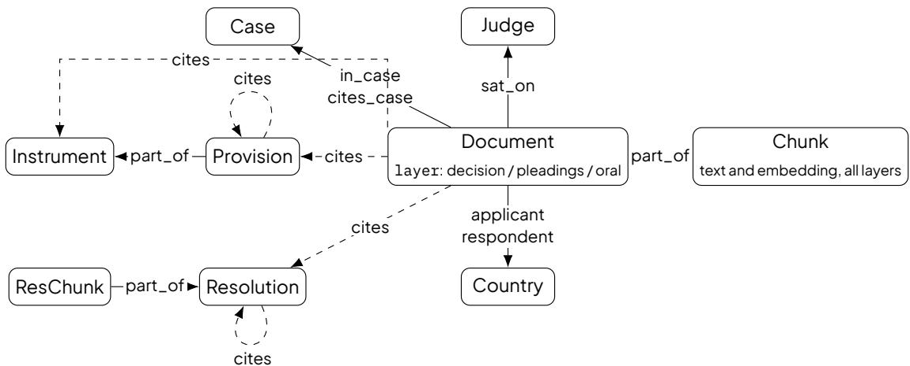
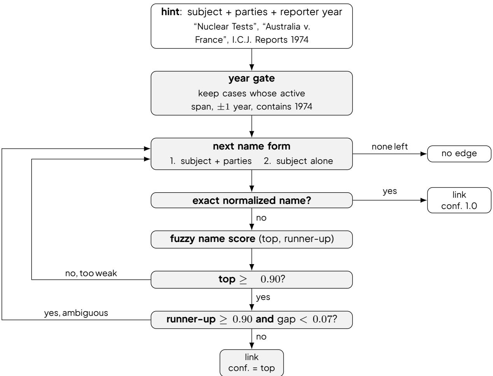
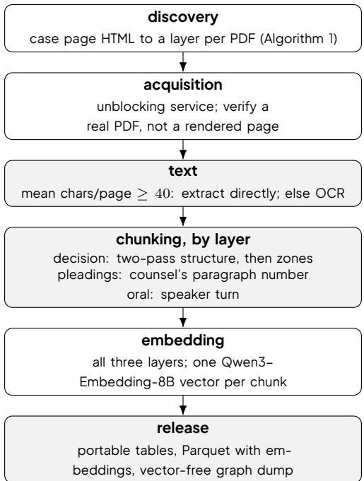

# ICJ-Graph: A Citation Graph and a Layered Document Corpus of the International Court of Justice

Jirameth Wannasiwaporn1† Pawitsapak Akarajaradwong2 Chompakorn Chaksangchaichot2

1Computer Engineering and Digital Technology, Chulalongkorn University, Thailand

2FourCorners Team, VISAI AI, Thailand

6633033021@student.chula.ac.th, {pawitsapaka\_visai, chompakornc\_pro}@vistec.ac.th

## Abstract

We present ICJ-Graph, a machine-readable resource connecting documents of the International Court of Justice (ICJ) to cited cases, legal provisions and United Nations resolutions. Court decisions, written pleadingsandoralrecords formdistinctdocument layers, preserving thedistinctionbetweenthe Court’sreasoning and the parties’ submissions. The collection contains 6,396 ICJ documents and 505 documents from other courts and legal bodies, together with 12,375 provisions and 20,291 UN resolutions. The data files contain text, metadata and embeddings. The accompanying pipeline lets users load the graph and generate embeddings for use in their own retrieval systems. To illustrate the resource’s use, we evaluate five models on citation prediction for 199 decisions using documents available before each decision. Tools designed for citation research improve citation-prediction F1 over answering without tools for all five models across case, provision and resolution citations.

## 1 Introduction

The International Court of Justice (ICJ) is the principaljudicial organ of the United Nations and itsjurisprudence is a central object of study in international law and empirical legal scholarship [3, 19]. Existing machine-readable resources, however, cover only part of the Court’s public record. The Corpus of DecisionsoftheICJ(CD-ICJ)[8]containsjudgments, orders, advisoryopinionsandappendedindividualopinions, but excludes the written pleadings and oral records that document the parties’ arguments. These materials record the parties’ submissions alongside the Court’s decisions.

The relevant materials extend beyond the Court’s own documents to the cases, legal provisions and UN resolutions they cite. Existing UN resources provide resolution texts and citation networks for the General Assembly and Security Council [10, 18]. Our aim is to connect these types of material within a single resource for research on the ICJ.

We present ICJ-Graph, a layered corpus connecting ICJ decisions, written pleadings and oral records to cited cases, legal provisions and UN resolutions. The pipeline converts the source PDFs to structured text, segments each document according to its own organization, embeds the resulting passages and resolves citations to cases, provisions and UN General Assembly or Security Council resolutions.

We evaluate the resource through citation prediction over 199 target decisions. For each target, the model receives only case information available before the decision date, while the graph hides the target, same-day material, later documents and undated documents. We compare five models answering without tools, using general graph queries and text search, or using tools designed for citation research. The task separately scores citations to cases, provisions and UN resolutions over three repeated runs.

Our contributions are:

1. Amachine-readable corpuswith 6,396ICJdocumentsorganized intodecision, pleadings andoral layers, alongside 505 documents from other courts and adjudicative bodies.

2. Acitationgraphconnectingdocumentstocases, legalprovisionsandUNresolutions, with1,206,400 document passages and 169,617 resolution passages embedded for semantic retrieval.

3. A citation-prediction benchmark covering 199 decisions and five models, with retrieved documents restricted to dates before each decision.

## 2 Related Work

ICJ and international-court resources. CD-ICJ [8] is the fullest of these, a machine-readable collection of the Court’s published decisions; CD-PCIJ [7] is its counterpart for the predecessor Permanent Court. Both stop at decisions. Alschner and Charlotin [3] construct a self-citation network and Posner and de Figueiredo [19] studyjudicial voting, both annotating metadata our graph can carry rather than releasing the record. The iCourts database [12] is a searchable multi-court portal with downloadable citation networks, but a query interface rather than a bulk, openly licensed corpus and states no reuse terms.

UN resolution resources. Mesquita and Pires [18] release a corpus of General Assembly resolutions adopted between 1946 and 2019 with a network of citations between resolutions. The Corpus of Resolutions: UN Security Council (CR-UNSC) [10] provides resolution texts, metadata, draft texts and meeting records, together with citations to Security Council and General Assembly resolutions. These resources establish UN resolutions and their citation links as material for computational research. ICJ-Graph connects resolution records to citations in court documents alongside links to cases and legal provisions.

Legal citation networks. A line of work ranks precedents by their position in the citation graph. Fowler and Jeon [11] introduced it for the US Supreme Court and Bellutta and Carley [4] apply it directly to the ICJ, reporting that reverse PageRank outperforms hub and authority scores for identifying influential decisions. Lupu and Voeten [15] caution that citation centrality can reflect strategic rather than legal weight. Beyond international courts, Akarajaradwong et al. [1] build a Thai legal knowledge graph and find structured graph retrieval beats vector search.

Legal judgment prediction. Predicting a case’s outcome from its text is an established task. Aletras et al. [2] popularized it for the European Court of Human Rights (ECtHR) and Medvedeva et al. [16] scaled it up, showing that accuracy drops sharply under temporal evaluation, where a model is tested on cases decided after the ones it trained on; Medvedeva et al. [17] distinguish post-hoc identification from genuineforecasting. Surveys [6] cataloguemany datasets but none targeting international-court precedent selection. Chalkidis [5] find that instruction-tuned LLMs underperform smaller fine-tuned models on legal prediction despite strong legal-knowledge recall.

ICJ-Graph brings decisions, written pleadings and oral records together with the cases, provisions and UN resolutions cited in those documents. Its contribution is a connected resource that preserves the document layers and identifies the source documents for citation links.

## 3 The Corpus and Citation Graph

We represent the corpus as one graph. Cases, documents, provisions, UN resolutions,judges and countries are nodes and edges encode the citations and relations among them. Document citations link to cases, instruments, provisions and UN resolutions. Provisions and resolutions can also cite others of their own type.

## 3.1 Background of ICJ Data

An ICJ case is a proceeding on the Court’s General List with a record of the Court’s decisions and the parties’ submissions. Decisions include judgments, orders and advisory opinions together with the separate and dissenting opinions appended by individualjudges. The parties’ submissions appear in written pleadings such as memorials and in oral records that transcribe the hearings. The graph schema in §3.2 preserves these document types and connects them to the cases, legal provisions and UN resolutions they cite.

Article 38(1)(a) and (d) of the ICJ Statute guides our inclusion of treaties andjudicial decisions [21]. These provisions recognize treaties as a source of applicable law andjudicial decisions as subsidiary means of determininglegalrules. ThegraphcoversselectedmaterialsfromthesecategoriestogetherwithUNresolutions linked to the collected court documents through citations.

Thecollectioncontains6,396ICJdocumentsand505documentsfromothercourtsandlegalbodieswith partial coverage of those institutions. Its 370 legal instruments contain 12,375 provisions and include the four instruments governing the Court.1 The 20,291 UN resolutions comprise 17,463 General Assembly resolutions and 2,828 Security Council resolutions.

## 3.2 ICJ Graph Schema and Data Specification

Nodes. The graph schema has nine node types, as illustrated in Figure 1.

  
Figure 1. Graph schema. Documents connect proceedings to cited authorities and carry party and bench relations where available. ICJ documents are organized into decision, pleadings and oral layers. Chunks hold document passages, provisions belong to legal instruments and ResChunks hold UN resolution passages. Dashed edges mark citations to instruments, provisions and resolutions. The arrow from Document to Case carries both case membership and case citations.

1. Case: a proceeding identified by its court and case identifier. ICJ proceedings use their General List number, assigned when a case is filed.

2. Document: one published PDF: a judgment or advisory opinion, an individual opinion appended to one,awrittenpleading(aparty’sfiling,suchasamemorialorapplication),oranoralrecord(averbatim transcript of a hearing). ICJ documents carry a layer value of decision, pleadings or oral. The 505 documents from other adjudicative bodies have no layer label.

3. Chunk: a passage of a document, cut on its own unit where possible; every chunk also carries an embedding.

4. Provision: an article or other numbered unit of a legal instrument.

1The UN Charter, the ICJ Statute, the Rules of Court and the Practice Directions.

5. Instrument: the parent of its provisions.

6. Resolution: a UN General Assembly or Security Council resolution, keyed by its canonical symbol and carrying available metadata and full text.

7. ResChunk: an ordered passage of a resolution body, with an embedding for semantic retrieval.

8. Judge: ajudge who took part in hearing a case.

9. Country: a party to the case.

## Edges.

1. in\_case: Document to the Case it was filed in.

2. cites\_case: Document to a Case it cites.

3. cites: Document to Instrument, Provision or Resolution; Provision to Provision and Resolution to Resolution for cross-references.

4. part\_of: Chunk to Document, Provision to Instrument and ResChunk to Resolution.

5. sat\_on: Document to Judge.

6. applicant/respondent: Document to Country.

In the graph, party and judge relations are attached to Document nodes. Retrieving a document therefore also returns any party and bench information stated in that document. Appendix A describes the complete schema and its coverage.

EachChunkandResChunkisembeddedintoa4096−dimensionalvectorusingQwen3-Embedding-8B2 [23], so both Court documents and resolution passages can be retrieved semantically. We release the embedding code with its exact configuration. Parquet tables store the vectors alongside text and metadata, with float16 precision represented as float32 lists. A vector-free Neo4j dump preserves the graph structure and non-vector properties. The accompanying runtime imports stored vectors by application identifier or generates vectors through a configurable embedding endpoint.

## 3.3 Graph Construction

We re-parse the 2,285 historical documents from CD-ICJ [8] into paragraphs and generate embeddings foreachparagraph. Theadditional122decisionsissuedafterthatcorpus’scutofweregatheredandprocesseddirectlyfromtheCourt’ssite. WecollectwrittenpleadingsandoralrecordsfromtheCourt’scase pages and retain their document-layer labels.

Document Discovery. Case pages at icj-cij.org/case/{n} are plain HTML and enumerate every document as a structured block under a document-type section header. We classify each PDF’s layer from its header (Algorithm 1). Two edge cases keep this from breaking, both handled as Algorithm 1 shows: matching a document to its case by integer folder number (leading zeros difer across eras) and a filename-then-title fallback for cases listed under one flat “Latest Developments” heading.

Text and structure. We extract readable PDF text with PyMuPDF and use optical character recognition (OCR)forscannedpagesorunusabletextlayers. AppendixCdescribesthetext-qualitychecksandOCR coverage.

Decision documents run a two-pass pipeline (OCR with semantic tags, then a line classifier) to recover their structure: composition (the judge and parties), the headnote (the pre-reasons summary), the body’s nested sections and the dispositif (the operative paragraphs, with each judge’s vote). Each chunk records its zone, separating reasoning from decision.

PleadingsandOraldocumentsusethesamepipeline,withoutcompositionanddispositifextraction. We divide pleadings by numbered paragraph and oral records by speaker turn using regular expressions that

Algorithm 1 Layer discovery for one case page. Section keywords: written/institution give pleadings, oral gives oral, judgment/order/advisory/opinion give decision, summary/press/ correspondence give drop. Filename type codes: wri/app/req/int/spe give pleadings,jud/ord/ adv give decision, ora/cor give oral, pre/sum/oth give drop.

Require: case number n   
1: R   
2: H HTML of icj-cij.org/case/n (plain HTTP, back of on 429)   
3: for all document blocks b in H do   
4: s nearest document-type header above b   
5: for all PDF links (f, label) in b do   
6: parse folder, type code and title from f and b   
7: if folder = n as integers then   
8: skip this link (zero-padding difers by era; match by integer)   
9: else   
10: ℓ layer from s; if unknown, from the type code, then the title   
11: if ℓ is decision, pleadings, or oral then   
12: add (f, ℓ) to R   
13: end if   
14: end if   
15: end for   
16: end for   
17: return R

follow each document’s numbering and speaker conventions. Legacy scans with no detectable structure (24% of pleadings, 17% of oral chunks) fall back to a fixed window chunking with an empty label.

Related court decisions and legal instruments. We identify decisions from other courts and tribunals through citations in the ICJ documents, then retrieve matching records from the relevant court websites and legal archives. Sources include the UN Reports of International Arbitral Awards and the European Court of Human Rights’ HUDOC database. Matching uses the available case names, dates and citation identifiers, so coverage follows the cited decisions for which records can be retrieved. For legal instruments, we combine the Court’s governing instruments with treaties identified in the collected documents. The acquisition pipeline searches the UN Treaty Collection by title and uses treaty-series records or other legal repositories to retrieve the text. Treaty texts reproduced in pleadings provide an additional source where a separate text is unavailable. The pipeline divides the available texts into numbered provisions and retains their links to the parent instrument.

Case citation resolution. To extract decision-to-case citation relations for our ICJ graph, we first extract each citation mention as an unmapped record, which we refer to as a hint. Each hint contains the case subject, parties and cited date or reporter year and is resolved using the pipeline shown in Figure 2.

We first apply a year gate, retaining candidate cases whose active span contains the cited year with a ±1- year tolerance. We then try two name forms from the hint in order: subject + parties followed by subject alone.3 For each form, we first attempt an exact normalized-name match against the remaining candidates. If no exact match exists, we use fuzzy matching. A candidate is linked when the best fuzzy-match score is ≥ 0.90, unless the runner-up also scores ≥ 0.90 and lies within 0.07 of the best match, in which case the result is treated as ambiguous and the next name form is tried. If neither form produces an unambiguous match, no citation edge is created, favoring missing edges over incorrect links.

Provision citation resolution. Citations to a provision are resolved by deterministic pattern matching rather than the case pipeline above. A set of regular expressions finds each reference to an article, chapter or rule in the text (for example Article 36 or Chapter VII) and maps it to the provision of the instrument named alongside it.

UN resolution sources and acquisition. We combine existing resolution texts with documents downloaded from the UN’s oficial document service. Security Council texts and metadata are imported from the Corpus of Resolutions: UN Security Council (CR-UNSC) [9], using its English text and metadata files. For General Assembly resolutions, we import English texts from the UNxml collection [22]. The PDF acquisition pipeline requests English documents by resolution symbol from https://documents.un.org, with alternative UN document links for older records. We extract text directly from PDFs where possible and apply OCR to scanned documents. When a PDF contains several General Assembly resolutions, we isolate the text for the requested resolution before dividing it into passages. Records from these sources arejoined by normalized resolution symbol.

UN-resolution citation resolution. Candidate mentions are detected from forms such as Security Council resolution 1244 (1999), resolution 2625 (XXV) and canonical symbols. The pipeline normalizes accepted mentions to General Assembly or Security Council symbols and links the citing document to the corresponding Resolution node. Resolution texts are segmented into ordered ResChunk nodes; references found inside a resolution create Resolution-to-Resolution edges. Resolution metadata supports filtering and canonical symbols identify individual resolutions. Title and passage embeddings support searches by meaning.

Edge validation. We manually checked a random sample of 250 edges, half document-to-case and halfdocument-to-provision, readingeachcitingdocumentagainstthesentencetheextractormatched. We verified 234 of the 250 edges against the citing text. The remaining 16 edges could not be verified because the citing text used ambiguous references such as “the 1996 Judgment” without a case name. Counting those 16 as errors, precision is 0.94 (95% confidence interval 0.90 to 0.96): all 125 provision edges held and 109 of the 125 case edges.

This audit measures precision for sampled case and provision edges; it does not measure citation recall or validate UN-resolution edges. Table 1 reports the ICJ document layers, while Appendix A reports node and relationship counts for the complete graph.
<table><tr><td></td><td>Decision</td><td>Pleadings</td><td>Oral</td></tr><tr><td>Cases covered</td><td>199</td><td>194</td><td>163</td></tr><tr><td>Documents</td><td>2,407</td><td>2,114</td><td>1,875</td></tr><tr><td>Chunks (passages)</td><td>121,438</td><td>682,547</td><td>291,669</td></tr><tr><td>Pages</td><td>34,526</td><td>336,059</td><td>118,346</td></tr></table>

Table 1. ICJ document coverage by layer. Document, case and chunk counts are computed from the released Parquet tables; page counts describe the source PDFs. The ICJ site lists 1,852 pleadings and 1,189 oral records across the 199 cases with decisions. Our document counts refer to individual PDFs, so a listed filing with several volumes can contribute multiple documents. The ICJ layers contain English and bilingual editions.

## 4 Citation-Prediction Benchmark

We evaluate whether ICJ-Graph helps language-model agents identify authorities that the Court later cites. For each available case numbered 001–200, we select one target decision, yielding 199 targets4.

  
Figure 2. Resolving one case-to-case citation. A hint names its case in two forms, tried in order; each runs the same test and a form that fails either guard yields to the next. Thresholds: link at 0.90; abstain when the runner-up also clears 0.90 within 0.07.

The selector prefers the latest judgment or advisory opinion; when neither exists, it uses the latest primary order. This yields a broad historical benchmark spanning the available corpus.

## 4.1 Task Construction

Model-visibleinput. Eachexamplesuppliesthecaseidentifier,name, type,proceduralstageandyear. Forcontentiouscasesitalsosuppliesthepartiesandtheirclaims;foradvisoryproceedingsitsuppliesthe requesting body and legal questions. The model predicts three exact identifier sets: cited ICJ case identifiers, cited provision keys and cited UN-resolution symbols. The agent also returns case-type-specific outcome fields for later analysis, but the present evaluation reports only the three citation tasks.

Temporal graph contract. Each target is evaluated against a graph view fixed immediately before its decision date. Only documents with an issued\_date strictly earlier than the target date are visible. The targetdocument, documentsissuedonthesameday, laterdocumentsanddocumentswithoutausable date are excluded. The same contract is applied to graph traversal and semantic retrieval. This prevents directaccesstotheheld-outdecisionanditsextractedcitationedges,althoughitcannotremovetarget knowledge already present in a model’s pretraining data.

Access conditions. We compare three complete agent configurations:

1. Parametric: no external tools.

2. Cypher + Semantic: graph\_schema, read-only cypher\_read and search\_content.

3. Designed Tools Only: task-specific interfaces for cases, provisions, documents, citations, judges and resolutions. The complete list appears in Appendix C.1.

The tool conditions apply a grounding rule: a predicted provision or resolution must have appeared in tool output and case identifiers must be supported by retrieved graph evidence. The Parametric condition has no corresponding evidence channel. Consequently, Parametric-versus-tool comparisons measure complete research configurations rather than a pure causal efect of tool access. The Designedversus-Cypher comparison is the more controlled test of interface design because both conditions use the same evidence policy and temporal graph.

Modelsandrepetitions. Weevaluategpt-5.6-luna,deepseek-v4-flash-0731,deepseek-v4.1-flash, muse-spark-1.3 and gpt-5-mini. Every model–condition pair is run three times on all 199 targets, for 8,955 model–target runs in total. Each run uses the same structured output schema and the same research-step limit.

Metrics and baselines. For each citation family, we compute exact-set precision, recall and F1 by pooling true positives, false positives and false negatives across the 199 targets within a run. Tables report the mean and sample standard deviation across the three runs. Query-independent baselines return the globally most frequently cited authorities: k ∈ {6, 18} for cases, k ∈ {5, 12} for provisions and k ∈ {1, 2} for UN resolutions. These baselines measure how much performance is available from citation popularity alone.

## 5 Results

<table><tr><td>Model</td><td>Condition</td><td>Case F1</td><td></td><td>Provision F1 UN-resolution F1</td></tr><tr><td rowspan="3">gpt-5.6-1una</td><td>Parametric</td><td> $. 3 3 4 \pm . 0 0 4$ </td><td> $. 2 2 8 \pm . 0 0 4$ </td><td> $. 1 9 8 \pm . 0 1 7$ </td></tr><tr><td>Cypher+ Semantic</td><td> $. 3 5 6 \pm . 0 0 7$ </td><td> $. 3 0 2 \pm . 0 0 6$ </td><td> $. 2 6 6 \pm . 0 3 4$ </td></tr><tr><td>Designed Tools</td><td> $. 3 7 8 \pm . 0 0 8$ </td><td> $. 3 0 0 \pm . 0 0 9$ </td><td> $. 2 6 6 \pm . 0 2 4$ </td></tr><tr><td rowspan="3">deepseek-v4-flash-0731</td><td>Parametric</td><td> $. 2 7 7 \pm . 0 1 5$ </td><td> $. 2 3 2 \pm . 0 0 5$ </td><td> $. 1 6 4 \pm . 0 1 9$ </td></tr><tr><td>Cypher + Semantic</td><td> $. 3 4 8 \pm . 0 1 4$ </td><td> $. 2 7 3 \pm . 0 3 7$ </td><td> $. 2 8 9 \pm . 0 3 7$ </td></tr><tr><td>Designed Tools</td><td> $. 3 8 8 \pm . 0 1 5$ </td><td> $. 3 2 4 \pm . 0 0 3$ </td><td> $. 3 4 8 \pm . 0 1 8$ </td></tr><tr><td rowspan="3">deepseek-v4.1-flash</td><td>Parametric</td><td> $. 3 4 1 \pm . 0 0 6$ </td><td> $. 2 7 2 \pm . 0 0 4$ </td><td> $. 2 5 9 \pm . 0 1 3$ </td></tr><tr><td>Cypher + Semantic</td><td> $. 3 5 9 \pm . 0 2 1$ </td><td> $. 3 0 1 \pm . 0 0 5$ </td><td> $. 2 9 4 \pm . 0 3 7$ </td></tr><tr><td>Designed Tools</td><td> $. 3 9 5 \pm . 0 0 9$ </td><td> $. 3 7 1 \pm . 0 1 6$ </td><td> $. 3 5 7 \pm . 0 3 7$ </td></tr><tr><td rowspan="3">muse-spark-1.3</td><td>Parametric</td><td> $. 3 7 2 \pm . 0 0 9$ </td><td> $. 3 2 5 \pm . 0 0 3$ </td><td> $. 2 6 3 \pm . 0 0 7$ </td></tr><tr><td>Cypher + Semantic</td><td> $. 3 9 7 \pm . 0 0 6$ </td><td> $. 3 3 1 \pm . 0 0 6$ </td><td> $. 3 5 9 \pm . 0 2 2$ </td></tr><tr><td>Designed Tools</td><td> $\pm 1 5 \pm . 0 0 5$ </td><td> $. 3 4 9 \pm . 0 0 6$ </td><td> $. 3 5 5 \pm . 0 0 9$ </td></tr><tr><td rowspan="3"> $\mathtt { g p t - } 5 \mathtt { - m i n i }$ </td><td>Parametric</td><td> $. 1 4 6 \pm . 0 1 0$ </td><td> $. 1 4 7 \pm . 0 0 7$ </td><td> $. 0 8 5 \pm . 0 1 0$ </td></tr><tr><td>Cypher + Semantic</td><td> $. 1 7 2 \pm . 0 1 0$ </td><td> $. 1 6 6 \pm . 0 1 3$ </td><td> $. 0 7 6 \pm . 0 0 5$ </td></tr><tr><td>Designed Tools</td><td> $. 2 2 2 \pm . 0 0 7$ </td><td> ${ 2 0 0 \pm . 0 0 7 }$ </td><td> $. 1 0 4 \pm . 0 1 2$ </td></tr></table>

Table 2. Micro-F1 over 199 target decisions, reported as mean sample standard deviation across three runs. Bold marks the best condition for each model and citation family; tied values are both bold.

<table><tr><td>Citation family</td><td>Small k</td><td>Large k</td></tr><tr><td>Case</td><td> $. 1 3 8 ( k = 6 )$ </td><td> $. 1 7 9 ( k = 1 8 )$ </td></tr><tr><td>Provision</td><td> $. 1 5 8 ( k = 5 )$ </td><td> $. 2 3 2 ( k = 1 2 )$ </td></tr><tr><td>UN resolution</td><td> $. 0 1 3 ( k = 1 )$ </td><td> $. 0 2 4 \left( k = 2 \right)$ </td></tr></table>

Table 3. Micro-F1 of query-independent most-frequent-citation baselines.

Designed Tools achieves higher mean F1 than answering without tools (Parametric) for all five models across case, provision and UN-resolution citations. Compared with Cypher + Semantic, it gives every model a higher case-citation score and improves most provision and UN-resolution scores. The exceptions are a provision-score decrease from 0.302 to 0.300 for gpt-5.6-luna and a UN-resolution decrease from 0.359 to 0.355 for muse-spark-1.3. For gpt-5.6-luna, both methods have the same reported UN-resolution F1 of 0.266.

The highest case-citation F1 is 0.415, achieved by muse-spark-1.3 with Designed Tools. For provision citations, deepseek-v4.1-flash with Designed Tools scores highest at 0.371. For UN-resolution citations, muse-spark-1.3 with Cypher + Semantic has the highest mean F1 at 0.359, closely followed by deepseek-v4.1-flash with Designed Tools at 0.357.

## 6 Discussion

Case-citationpredictionshowsthemostconsistentgainsfromtoolsdesignedforcitationresearch,with higher mean F1 than general graph queries and text search for every model. For provisions and UN resolutions, the relative performance of the two tool configurations varies by model. These comparisons show howthechoiceoftoolsafectsperformancewithinthetestedconfigurations,whilediferencesinsearch and citation-selection behavior remain possible explanations for the observed gains.

## 7 Conclusion

We introduce ICJ-Graph, a structured corpus connecting ICJ cases and documents to cited precedents, legal provisions and UN resolutions, with support for graph traversal and semantic retrieval. A 199−target citation-prediction benchmark illustrates one use of the resource across case, provision and resolution citations.

## Availability

ICJ-Graph is hosted at https://huggingface.co/datasets/VISAI-AI/icj-citation-graph with a Neo4j dump without embeddings and Parquet tables containing stored embeddings. The accompanying Docker Compose setup supports graph restoration and vector import or generation. The benchmark is publicly available at https://huggingface.co/datasets/VISAI-AI/icj-precedent-cite-bench with 199 test cases, reference citations, 8955 model predictions and scoring code.

## Limitations

Corpus and labels. Coverage of the ICJ, other adjudicative bodies and UN resolutions is partial and follows the available source records. Missing, revised or imperfectly digitized documents can produce gaps in the graph. Automated extraction can omit or misresolve parties, judges, provisions, cases and resolution symbols. The benchmark gold sets are derived from these extracted citations rather than exhaustive per-decision legal annotation. The scores measure agreement with the extracted references and give no credit to other potentially relevant sources. They do not assess the quality of the model’s legal reasoning.

Temporal gating does not remove pretraining exposure. The graph contract prevents a model from retrieving the target, same-day, later, or undated documents during a run. Many historical decisions may nevertheless have appeared in model pretraining data, so Parametric performance cannot be interpreted as prediction from the supplied facts alone.

Conditionscombineaccessandevidencepolicy. Tool-enabledagentsmustgroundpredictedidentifiers in retrieved evidence, whereas the Parametric agent has no retrieval channel. The comparison therefore measures end-to-end configurations and does not isolate the causal efect of tool access. DesignedToolsversusCypher+Semanticismorecontrolled,buttoolnames,resultshapesandthemodel’s planning behavior still change together.

Models and repetitions. The benchmark covers five models and three repeated runs per configuration. The repeated runs characterize stochastic variation within this setup; they are not independent samples of cases. Results may change with other models, prompts, budgets, tool implementations, or graph versions.

Outcome fields are not evaluated here. The run schema includesjurisdiction, competence, discretion and free-text conclusions appropriate to each case type. This paper reports only citation prediction because a defensible common scoring rule for those heterogeneous legal outcomes has not yet been established.

Reproducibility. The distributed corpus and runtime do not include the 199−target evaluation artifacts needed to reproduce the reported scores.

## References

[1] Pawitsapak Akarajaradwong, Sarana Nutanong, and Chompakorn Chaksangchaichot. FourCorners: A production knowledge graph unifying Thailand’s legal system. In Proceedings of the 64th Annual Meeting of the Association for Computational Linguistics (Volume 6: Industry Track), pages 1808–1818, 2026. doi:10.18653/v1/2026.acl-industry.124. https://aclanthology.org/2026.acl-industry.124/.

[2] Nikolaos Aletras, Dimitrios Tsarapatsanis, Daniel Preoţiuc-Pietro, and Vasileios Lampos. Predicting judicial decisions of the European Court of Human Rights: a natural language processing perspective. PeerJ Computer Science, 2:e93, 2016. doi:10.7717/peerj-cs.93.

[3] Wolfgang Alschner and Damien Charlotin. The Growing Complexity of the International Court of Justice’s Self-Citation Network. European Journal of International Law, 29(1):83–112, 2018. doi:10.1093/ejil/chy002.

[4] Daniele Bellutta and Kathleen M. Carley. Indicators of the formation of precedent at the International Court of Justice. Social Networks, 79:1–13, 2024. doi:10.1016/j.socnet.2024.04.001.

[5] Ilias Chalkidis. ChatGPT may Pass the Bar Exam soon, but has a Long Way to Go for the LexGLUE benchmark, 2023. https://arxiv.org/abs/2304.12202.

[6] Junyun Cui, Xiaoyu Shen, Feiping Nie, Zheng Wang, Jinglong Wang, and Yulong Chen. A Survey on Legal Judgment Prediction: Datasets, Metrics, Models and Challenges, 2022.

[7] Seán Fobbe. Corpus of Decisions: Permanent Court of International Justice (CD-PCIJ), 2022. Zenodo, https: //zenodo.org/records/3840480, CC0.

[8] Seán Fobbe. Introducing Twin Corpora of Decisions for the International Court of Justice (ICJ) and the Permanent Court of International Justice (PCIJ). Journal of Empirical Legal Studies, 19(2):491–524, 2022. doi:10.1111/jels.12313. Dataset: Zenodo, https://zenodo.org/records/10030647, CC0.

[9] Seán Fobbe, Lorenzo Gasbarri, and Niccolò Ridi. Corpus of resolutions: UN Security Council (CR-UNSC), December 2025. Dataset, version 2025−12−22.

[10] Seán Fobbe, Lorenzo Gasbarri, and Niccolò Ridi. Words of power: Introducing a comprehensive corpus of un security council resolutions, April 2025.

[11] James H. Fowler and Sangick Jeon. The authority of Supreme Court precedent. Social Networks, 30(1):16–30, 2008. doi:10.1016/j.socnet.2007.05.001.

[12] iCourts, Centre of Excellence for International Courts. Database of International Court Decisions, 2026. University of Copenhagen, Faculty of Law. https://jura.ku.dk/icourts/research-resources/database/, accessed 2026−07−22.

[13] International Court of Justice. Rules of Court (1978, as amended), 1978. Article 53. https://www.icj-cij.org/rules, accessed 2026−07−18.

[14] International Court of Justice. Disclaimer / copyright notice, 2026. https://www.icj-cij.org/disclaimer, accessed 2026−07−18.

[15] Yonatan Lupu and Erik Voeten. Precedent in International Courts: A Network Analysis of Case Citations by the European Court of Human Rights. British Journal of Political Science, 42(2):413–439, 2012 doi:10.1017/S0007123411000433.

[16] Masha Medvedeva, Michel Vols, and Martijn Wieling. Using machine learning to predict decisions of the European Court of Human Rights. Artificial Intelligence and Law, 28(2):237–266, 2020. doi:10.1007/s10506−019− 09255−y.

[17] Masha Medvedeva, Martijn Wieling, and Michel Vols. Rethinking the field of automatic prediction of court decisions. Artificial Intelligence and Law, 31(1):195–212, 2023. doi:10.1007/s10506−021−09306−3.

[18] RafaelMesquitaandAntonioPires. Thereferencesofthenations: Introducingacorpusofunitednationsgeneral assembly resolutions since 1946 and their citation network. Journal ofPeace Research, 62(4):1279–1291, August 2024. ISSN 1460−3578. doi:10.1177/00223433241254997.

[19] Eric A. Posner and Miguel F. P. de Figueiredo. Is the International Court of Justice Biased? The Journal of Legal Studies, 34(2):599–630, 2005. doi:10.1086/430765.

[20] Supreme Court of the United States. Georgia et al. v. Public.Resource.Org, Inc., 590 u.s. 255, 2020. https: //www.supremecourt.gov/opinions/19pdf/18-1150\_7m58.pdf.

[21] United Nations. Statute of the International Court of Justice, 1945. URL https://legal.un.org/avl/pdf/ha/sicj/icj\_

statute\_e.pdf. Articles 38(1)(a) and 38(1)(d). Accessed 2026−09−26.

[22] UNxml. General assembly resolutions in XML AKN4UN format, n.d. URL https://github.com/UNxml/ GAresolutions. Accessed 2026−09−26.

[23] Yanzhao Zhang, Mingxin Li, Dingkun Long, Xin Zhang, Huan Lin, Baosong Yang, Pengjun Xie, An Yang, Dayiheng Liu, Junyang Lin, Fei Huang, and Jingren Zhou. Qwen3 embedding: Advancing text embedding and reranking through foundation models, 2025. URL https://arxiv.org/abs/2506.05176.

## A Graph Schema in Full

The graph contains 1,416,857 nodes and 1,493,118 relationships. Tables A.1 and A.2 report counts from the exported Neo4j dump, checked against the source graph during export validation. The cites relationship is separated by endpoint type because it represents citations to instruments, individual provisions and resolutions, as well as cross-references within those authorities.

<table><tr><td>Node</td><td>Count</td></tr><tr><td>Chunk</td><td>1,206,400</td></tr><tr><td>ResChunk</td><td>169,617</td></tr><tr><td>Resolution</td><td>20,291</td></tr><tr><td>Provision</td><td>12,375</td></tr><tr><td>Document</td><td>6,901</td></tr><tr><td>Case</td><td>571</td></tr><tr><td>Instrument</td><td>370</td></tr><tr><td>Judge</td><td>220</td></tr><tr><td>Country</td><td>112</td></tr></table>

TableA.1. Nodesinthecompletegraph. Casenodescomprise200ICJproceedingsand371proceedingsfromother adjudicative bodies. The ICJ decision layer covers 199 cases; case 201 is represented by pleadings.

<table><tr><td>Edge</td><td>From → To</td><td>Count</td></tr><tr><td>cites_case</td><td>Document → Case</td><td>7,449</td></tr><tr><td>cites</td><td>Document →Instrument</td><td>16,287</td></tr><tr><td>cites</td><td>Document → Provision</td><td>12,232</td></tr><tr><td>cites</td><td>Document → Resolution</td><td>2,054</td></tr><tr><td>cites</td><td>Provision → Provision</td><td>242</td></tr><tr><td>cites</td><td>Resolution → Resolution</td><td>53,110</td></tr><tr><td>sat_on</td><td>Document → Judge</td><td>5,288</td></tr><tr><td>respondent</td><td>Document → Country</td><td>586</td></tr><tr><td>applicant</td><td>Document → Country</td><td>577</td></tr><tr><td>in_case</td><td>Document → Case</td><td>6,901</td></tr><tr><td>part_of</td><td>Chunk → Document</td><td>1,206,400</td></tr><tr><td>part_of</td><td>Provision → Instrument</td><td>12,375</td></tr><tr><td>part_of</td><td>ResChunk → Resolution</td><td>169,617</td></tr></table>

Table A.2. Relationships in the complete graph, separated by endpoint type. Document citation counts include records from the ICJ and other adjudicative bodies.

The Neo4j dump preserves all relationship types and excludes embeddings and vector indexes. Parquet tables contain text, metadata, selected citation relationships and stored vectors,joined to graph nodes throughstableapplicationidentifiers. Neo4jinternalidentifiersareregeneratedduringexportandareunsuitable asjoin keys. Party andjudge relations are retained in the dump where available and do not cover every document.

<table><tr><td>Layer</td><td>English</td><td>Bilingual</td><td>Total</td></tr><tr><td>Decision</td><td>2,407</td><td>一</td><td>2,407</td></tr><tr><td>Pleadings</td><td>2,046</td><td>68</td><td>2,114</td></tr><tr><td>Oral</td><td>1</td><td>1,874</td><td>1,875</td></tr><tr><td>Total</td><td>4,454</td><td>1,942</td><td>6,396</td></tr></table>

Table B.1. Documents by language, counting a bilingual volume once.

All document chunks, resolution chunks and provisions have stored 4096−dimensional Qwen3− Embedding-8B vectors. Case-name vectors are available for 427 of 571 cases and resolution-title vectors for 17,649 of 20,291 resolutions. The runtime supports vector import from Parquet and generation through a configurable embedding endpoint, with vector indexes created after vectors are loaded.

## B Language by Layer

ThecorpusisnotuniformlyonelanguageandthesplitfollowshowtheCourtpublisheseachkindofdocument rather than any choice of ours. Table B.1 gives the language labels of the ICJ documents. Decisions are issued as separate English and French versions, of which we take the English, so the decision layer is monolingual. Verbatim records of hearings are published as a single volume, so the oral layer is almost entirely bilingual in the Court’s sense of the word. Pleadings sit between the two, mostly English with a bilingual minority.

Bilingualdescribestheeditionratherthanthelanguagesinitstext,adistinctionthatmatterswhenfiltering documents. TheCourtpublishes a hearing as a “bilingual version”ofered under anOriginal Languagelink, meaning the volume preserves whatever language each speaker used rather than translating it. A hearing argued entirely in English therefore yields an all-English bilingual volume. Classifying the released text of the 1,874 bilingual oral records by function-word frequency, sampled at even intervals through each document, gives 499 English-dominant, 272 French-dominant and 432 carrying substantial argument in both; the rest hold too little text to call. Retrieval over the oral layer therefore needs to accommodate both English and French passages.

Table B.1 therefore reports the label the Court assigns, not a measurement of the text. The source labels do not always match the body text: 9 documents labelled English contain French text.

## C ICJ Document Construction

ICJ documents pass through discovery, acquisition, text extraction, chunking and embedding before export (Figure C.1). The stages before chunking are layer-agnostic: discovery classifies a PDF’s layer but retrieves every layer the same way and the text test asks only whether a usable text layer exists, which is a property of the file and not of what kind of document it holds.

Chunking diverges by layer: decisions are cut on recovered structure, pleadings on counsel’s numbering, oral records on speaker turns. Embedding then covers all three layers, one Qwen3−Embedding-8B vector per chunk.

We identify PDFs without a usable text layer by each document’s mean characters per page, taken over the whole document rather than its opening pages since recent filings front a scanned cover onto a machine-readable body: below 40 the document is sent to OCR. A page of prose runs to hundreds of characters and a scanned page to almost none, so the cutof sits in a wide gap, set by visual audit. This finds the 76 documents that are scans. It cannot see a text layer that decodes to the wrong characters, which needs the separate per-page text-quality detector, which sent 43 documents garbled throughout for full re-OCR. So 119 of the 3,989 pleadings and oral documents (3.0%) have an OCRderived text layer and a further 464 keep their native text with the individual pages that detector flagged replacedbyOCR.EveryLLMstageofconstruction(OCR,pageclassificationandcitationextraction)runs gemini-3.1-flash-lite through a commercial API router.

  
Figure C.1. Construction, end to end. Chunking is the first layer-specific stage.

## C.1 Benchmark Tool Conditions

The benchmark exposes the following fixed capability sets:

1. Parametric: The model answers using its existing knowledge without access to retrieval tools.

2. Cypher + Semantic: The model can inspect the graph schema, write Cypher queries and search document passages by meaning. The available tools are graph\_schema, cypher\_read and search\_content.

3. Designed Tools Only: The model uses predefined tools to find and read cases, legal provisions and UN resolutions without writing Cypher queries. The available tools are list\_cases, get\_case, find\_provision, get\_provision, get\_document, citations, judges\_on\_case, cases\_by\_judge, list\_resolutions, find\_resolution, search\_resolution\_content and get\_resolution.

Alltoolsareread-onlyandoperatethroughthetarget-specifictemporalgraphcontract. find\_resolution performs semantic title search, whereas get\_resolution reads an exact canonical symbol.

## D Prediction Schema

Predictions are validated against a strict structured-output schema. Both case types return three citation arrays, as shown below. Contentious cases additionally return a three-way jurisdiction field and

claim-level conclusions; advisory cases return competence, optional discretion and question-level conclusions. Unknown fields are rejected. Case identifiers are normalized to three digits, provision keys to lowercase and resolution symbols to uppercase. Only the citation arrays are scored in this paper.

{   
”case\_type”: ”contentious”,   
”jurisdiction”: ”upheld|declined|mixed|null”,   
”conclusions”: [...],   
”citation\_case\_ids”: [”NNN”, ...],   
”citation\_provision\_keys”: [”instrument:article\_N”, ...],   
”citation\_resolution\_symbols”: [”A/RES/...”, ”S/RES/...”, ...]   
}

## E Licensing and Ethics

Publicaccessdoesnotbyitselfsettletherighttoreusethesedocuments. TheRulesofCourtmakepleadings and oral records accessible to the public at or after the opening of oral proceedings (13, Art. 53), but this rule concerns access rather than reuse. The ICJ separately claims copyright over its website and publications (14: “All rights reserved”) and neither the ICJ nor the UN provides specific guidance on text and data mining. Moreover, the rule that court-authored legal texts are not protected by copyright [20] dependsonthecourtbeingtheauthorandthereforedoesnotclearlyextendtopleadingswrittenbytheparties. We consequently rely on the research-use, fair-use and public-interest rationales applied to legaltext corpora without claiming that these rationales conclusively resolve the rights status of the source documents.

The corpus also contains unscreened personal data. The records identify agents, counsel, judges and other individuals; include testimony given under cross-examination; and, in cases concerning alleged atrocities, may describe identified individuals in detail. We have not screened or redacted this information and do not claim that its release is low-risk. We note only that the material was already published by the Court as part of the public record and that we reproduce it without alteration.

We license only the components that we created. Our parsing, chunking, embeddings, citation graph and tooling are released under CC-BY-4.0, while decision documents inherited from CD-ICJ retain their upstream CC0-1.0 designation. We grant no licence over the underlying ICJ documents, other adjudicativerecords,legalinstrumentsorUNresolutions;theirsource-specifictermscontinuetoapply. Formaterial obtained from the ICJ website, we attach a usage request modeled on CC-BY-NC-4.0, asking users tocreditboththeCourtandthisdatasetandtolimitusetonon-commercialpurposes. Thisrequestisnot aCreativeCommonslicenceanddoesnotimplythatthedocuments’rightsstatushasbeenresolved. We will honour takedown requests and maintain this position while seeking clarification from the Registry.