# LIBRARY OF LAYERS (LOL): ADAPTIVELY ORDERING TRANSFORMER LAYERS AT RUNTIME

Abdellah Rahmani<sup>1∗</sup>, Sean McLeish<sup>1,2∗</sup>, Ang Li<sup>3</sup>, Sanae Lotfi<sup>3</sup>, Pascal Frossard<sup>1</sup>, Micah Goldblum<sup>4</sup>

<sup>1</sup>EPFL, <sup>2</sup>University of Maryland, <sup>3</sup>New York University, <sup>4</sup>Columbia University

## ABSTRACT

Computer programmers chain together the same reusable computational primitives, for example, conditional statements or loops, but in different orders to implement different algorithms. In contrast, existing language model architectures always execute their layers in the same order. We introduce Library of Layers (LoL), an architecture that dynamically orders its layers during inference to solve the problem at hand. LoL has a single hyperparameter, the size of its global library of transformer blocks, that allows it to transition seamlessly between parameter reuse and sparsity, generalizing the parameter-efficiency and FLOPs-efficiency tradeoffs of dense, depth-recurrent, and mixture of experts architectures in one unified family. We show that LoL achieves competitive performance with all three above baselines when pretrained on text data. On synthetic sudoku and maze data, we observe that the model employs distinct layer orderings to implement different solution strategies, and we can intervene on routing to force a model to apply a specific solution strategy to a problem instance. In a multilingual natural language setting, we find that LoL chooses different layer order patterns based on language and script. Similarly, we train LoL on safety data and fit probes to its router outputs, finding that these probes distinguish safe from unsafe text with high AUROC. LoL provides a path toward a future in which models dynamically compose their own computational graph, enabling more efficient and controllable reasoning.

## 1 INTRODUCTION

Many distinct algorithms are built from the same set of computational primitives, composed in different orders to implement different behaviors. For example, a database query engine can combine operations such as filtering, joining, sorting, and aggregation in different sequences depending on the query being executed. Modular programming lets the same reusable components be dynamically composed for many purposes within a single codebase. Transformer language models lack this flexibility; their layers are executed in a fixed, predefined order for every input. This rigidity may make these models less efficient, since useful computational primitives may need to be represented repeatedly at different depths.

Prior work has focused on increasing the sparsity of models using mixture of experts (MoE) (Shazeer et al., 2017; Fedus et al., 2022) or reusing layers multiple times during the forward pass in looped models (Dehghani et al., 2018; Lan et al., 2019; Geiping et al., 2026). Other work has investigated skipping layers dynamically during the forward pass (Elhoushi et al., 2024; Raposo et al., 2024; Bae et al., 2025). However, all of these approaches still enforce the order in which the layers of the model must be executed.

In this paper, we introduce Library ofLayers (LoL), an architecture in which a small router, trained end-to-end without explicit supervision, dynamically selects the next layer from a global library of transformer blocks. We note this architecture encompasses the two properties explored by prior work. A small library of layers forces layer reuse, whereas a large library of layers allows many layers to remain inactive on a given forward pass. By changing only the library size, LoL therefore spans a continuum from highly reused, dense computation to highly sparse computation. We visualize our novel architecture in Figure 1.

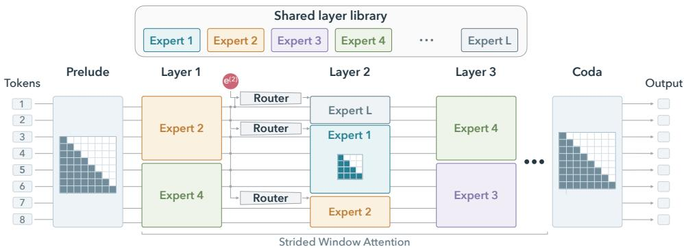  
Figure 1: We introduce Library of Layers (LoL), a novel architecture where the next executed transformer layer is chosen at runtime. We use strided window attention within the routed core to allow information to flow through the sequence dimension while using the same attention and MLP parameters for all tokens within each window.

Dynamic layer selection introduces a challenge. We want to allow different token positions the flexibility to select different layer orderings, but this means that a vector at one token position extracted by a selected attention layer might attend to vectors at previous token positions extracted by different selected attention layers. We observe that this mismatch makes training unstable and harms performance. At the same time, if we chose a single layer ordering for the entire context, we would risk either breaking causality or making layer decisions with too little information (only the prompt).

We therefore introduce a windowed attention masking strategy that simultaneously allows different windows to adaptively select layer orderings while also preventing the above mismatch problem and preserving causality. We partition the context into windows, route each window using only information available from earlier windows, and shift the window boundaries across routed depths so that information can propagate between neighboring windows, expanding the field of view with depth.

We use synthetic and natural-language experiments to study and interpret our models’ learned layer orderings. On sudoku and maze tasks, LoL learns distinct layer-ordering patterns for different solution strategies; forcing a strategy’s learned routing path at inference time causes the model to follow that strategy. This phenomenon is especially clear in mazes, where all algorithms we consider use the same output syntax and differ only in the order in which they explore cells. We find that fixing layer ordering controls the cell exploration order itself. In multilingual language modeling, different languages use distinct execution paths, with languages that share scripts exhibiting similar routing patterns. We also train LoL on a mix of safe and unsafe data, finding that a ridge regression trained on routing features distinguishes these categories on held-out data with high AUROC. On general web text, we vary the library size to induce parameter reuse regimes with a FLOPs-to-parameters ratio comparable to that of looped transformers and also to induce sparse regimes with a FLOPs-toparameters ratio comparable to MoE models, finding that LoL remains competitive across this range. Finally, at 1B parameters on math data, LoL is competitive with conventional dense transformers in terms of loss and benchmark accuracy in a FLOPs-matched setting.

These results suggest that layer ordering can become a learned part of the computation itself rather than a fixed architectural choice. LoL unifies behaviors associated with seemingly distinct dense, depth-recurrent, and MoE models by varying a single knob, the size of the layer library, while exposing the model’s internal execution path. Because routing patterns can be extracted and intervened on, LoL also provides a simple mechanism for studying and controlling latent computation.

Our contributions are summarized as follows:

• We propose Library of Layers (LoL), a novel architecture in which a router selects blocks to apply from a global library of transformer layers, making layer selection, ordering, and the number of times each layer is used conditional on the input.

• We use maze, sudoku, multilingual, and safety training data to empirically show the LoL router learns input-adaptive patterns from data. Moreover, these router patterns can then be used to control the model at test time by forcing the layer execution ordering.

• We demonstrate that LoL models perform competitively across a spectrum of sparsity levels, from low-sparsity looped models that repeatedly reuse the same layers to high-sparsity mixture of experts models.

## 2 RELATED WORK

Prior architectures reuse parameters across depths or select a subset of parameters at each depth.   
Library of Layers spans both regimes by varying the size of its shared library of transformer blocks.

Parameter Sharing. Looped transformers, which repeatedly reuse the same transformer blocks, are efficient and can be made Turing complete (Dehghani et al., 2018; Lan et al., 2019; Giannou et al., 2023; Csordas et al.´ , 2024; Saunshi et al., 2025; McLeish et al., 2025; Geiping et al., 2026; Prairie et al., 2026; Huang et al., 2026a). Looped transformers have also been studied in the context of synthetic algorithmic tasks, showing they can outperform fixed-depth counterparts in both learning efficiency and accuracy (Giannou et al., 2023; Yang et al., 2023; McLeish et al., 2024; Fan et al., 2024). Recurrence in other architectural regimes such as graph and convolutional neural networks has also shown promising results (Schwarzschild et al., 2021; Bansal et al., 2022; Ibarz et al., 2022; Schwarzschild, 2023; Bear et al., 2024). Parameter sharing has been explored for many components of the modern transformer architecture, for example, QKV weights and KV caches across layers (Sun et al., 2024; Kayyam et al., 2026). We build on these works by incorporating architectural choices from looped transformers, such as only using recurrence in the middle layers of the model; see Figure 2 (top-left).

Most similar to our work is that of Gong et al. (2024). However, Gong et al. (2024) pretrain their model before adding layer reuse and do not dynamically choose each layer in the final model. Gong et al. (2024) use top-k routing with k greater than one, unlike our top-1 routing. They avoid attention space mismatches by averaging the raw weights of the selected experts in the attention computation and combine the output of the FFN via a weighted mean based on the router output weighting.

Routing mechanisms. Mixture of experts (MoE) layers (Shazeer et al., 2017) have become the norm for large transformer-based models (OpenAI, 2025; Xu et al., 2026), often implemented with top-k token-based routing according to the current hidden state. Huang et al. (2026b) extend this to share a global pool of experts so that all layers can select any expert. Others add a skip option to the router, allowing tokens to dynamically skip layers (Raposo et al., 2024; Bae et al., 2025). Ternovtsii & Bilak (2026) route through multiple smaller transformer layers instead of only routing the MLP, as done in a conventional MoE. LoL goes beyond choosing which computation to apply at a fixed position in the network: each window selects a complete transformer block from a library shared across all routed depths, making both block ordering and reuse input-dependent.

## 3 HOW TO LEARN THE ORDER OF A FORWARD PASS

## 3.1 THE LIBRARY

The architecture is built from decoder-only transformer blocks (Vaswani et al., 2017), organized into a prelude, a routed core, and a coda. Following prior work on looped transformers (Saunshi et al., 2025; Geiping et al., 2026), we use adaptive layer selection only in the middle of our LoL models.

The prelude P and coda C are fixed-order stacks of decoder layers with full causal attention, at the beginning and end of the architecture, respectively. They surround the routed core, which applies blocks selected from a library $\{ E _ { 1 } , \dots , \bar { E } _ { L } \}$ . Library size L counts the distinct blocks stored, whereas core depth D counts the block applications executed. We call each library block an expert and each application a routed depth. For example, with $L = 3$ and $D = 3 .$ , the sequence $E _ { 1 } $ $E _ { 3 } ~  ~ E _ { 1 }$ repeats one expert and leaves another unused; we call this sequence a routing path.

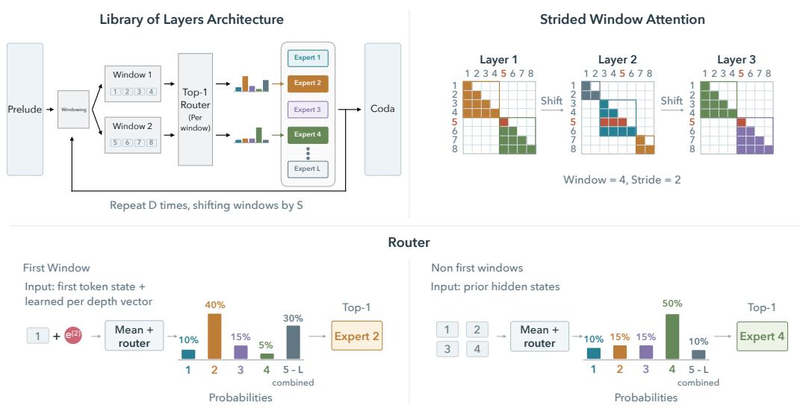  
Figure 2: Library of Layers uses strided window attention and a top-1 router to allow for efficient training. LoL is made up of a prelude, a routed core, and a coda. The layers in the prelude and coda can attend over the whole sequence. In the core, the sequence is split into windows of W tokens, and at every routed depth a router selects one layer from the shared library per window (topleft). Attention is restricted to each window, but the window boundaries shift by S tokens between successive routed depths, allowing information to flow across windows (Strided Window Attention, top-right). Window 0 has no history, so its router uses the first token and a learned vector $e ^ { ( \ell ) }$ for routed depth ℓ (bottom-left). For window $i > 0$ , the router averages the mean hidden states of earlier windows $0 , \ldots , i - 1$ and selects one layer (bottom-right). With $W = 4$ and $S = 2 \AA$ , Layers 1 and 3 share the same boundaries while Layer 2 is offset, so information can pass between neighboring windows. Token 5 is highlighted in red to show this: in Layer 1 it is the first token in a new window, while in Layer 2 its window includes tokens 3 and 4.

Different windows of tokens can follow different routing paths, as described below. We visualize our forward pass in Figures 1 and 2, and provide pseudocode in Algorithm 1 in the appendix.

## 3.2 ROUTING

Routing must preserve causality, and the router may only use information that will also be available during generation. The expert selected for a token cannot depend on later tokens since that would violate causality. One could select an expert for the whole sequence using only the first token to preserve causality, but this would prevent the layer ordering from adapting to information revealed later in the sequence. Alternatively, routing each token independently could assign neighboring tokens to different experts, each with its own query, key, and value projections. In this case, queries and keys computed on different attention heads would be compared, and we find empirically that this setup leads to training instability and poor performance. To overcome both problems, we chunk the sequence at each depth and route separately for each chunk. We then stride the chunk boundaries every depth to allow information to flow between adjacent chunks, similarly to how the field of view under sliding window attention increases with depth. All tokens in a window use the same expert with causal attention restricted to that window, preventing the Q-K mismatch.

## 3.2.1 STRIDED WINDOW ATTENTION

Specifically, at routed depth ℓ, let W be the window size and S the stride between depths. We shift the window boundaries by $\delta _ { \ell } ~ = ~ ( \ell - 1 ) S$ mod W positions. For example, with $n \ = \ 8 ,$ $W = 4$ and $S \ : = \ : 2$ , depth 1 uses the windows $\{ 0 , \ldots , 3 \bar  \}$ and $\{ 4 , \ldots , 7 \}$ , depth 2 uses $\{ 0 , 1 \}$ $\{ 2 , \ldots , 5 \}$ and $\{ 6 , 7 \}$ , and depth 3 goes back to the first split (Figure 2, top-right). Formally, position $i \in \{ 0 , \ldots , n - 1 \}$ belongs to window $I _ { k }$ when $w _ { i } ^ { ( \ell ) } = k ,$ , where: $\begin{array} { r } { w _ { i } ^ { ( \ell ) } = \left\lfloor \frac { i + \delta _ { \ell } } { W } \right\rfloor } \end{array}$ , which gives $K _ { \ell }$ windows at depth ℓ. We visualize this in Figure 2 (top-right).

All tokens in a window share one selected expert and router weight. Within a window, each token may attend only to itself and earlier tokens in that window. Striding the boundaries between depths causes windows at successive depths to overlap, allowing information to flow between adjoining windows while preserving causality. In the prelude and coda, we use full-sequence causal attention.

## 3.2.2 THE ROUTER

When selecting an expert for each window $k > 0$ , the router receives information only from prior windows $0 \leq j < k$ to preserve causality. Precisely, the router is a linear layer and the input is the mean over windows of the mean hidden state per window. For the first window $I _ { 0 } ,$ , there are no prior windows to use. We instead input the mean of a learned depth-specific vector $\mathbf { e } ^ { ( \ell ) }$ and the first token’s hidden state to the router. We show this in Figure 2 (bottom).

To train the routed core, we use loss-free load balancing (Wang et al., 2024; Liu et al., 2024). The selected expert’s residual update is scaled by its router probability, allowing gradients to flow to the router. Following Shazeer et al. (2017), we add Gaussian noise to the router logits before the softmax to encourage exploration during training. Compared with routing per token in MoE models, routing per window provides a coarser training signal: gradient contributions from all tokens in a window are aggregated through a single shared routing decision, rather than separate decisions for each token. We use FiLM (Perez et al., 2018) to add a learned depth-dependent scale and bias after each normalization in the transformer block. We describe our implementation of FiLM in Appendix A for completeness.

## 3.3 INCREASING DEPTH DURING TRAINING

The training cost of LoL is mainly controlled by the routed core depth (D). Small D would make training cheap by reducing FLOPs per parameter but would lead to a shallower model with poorer performance. Therefore, we begin training with a shallow routed core and gradually increase D over the course of training. This procedure saves compute by performing much of training with a shallower model, but ultimately constructs a deep and expressive model for deployment. This growing procedure allows the routers to explore experts quickly and cheaply during early training, as the depth of the model is smaller. This is similar to increasing the number of loops of a recurrent model over training (McLeish et al., 2025) or progressive stacking (Gong et al., 2019) when training vanilla transformers. We refer to this technique as growing.

Additional architecture and training details are provided in Appendix A. We provide ablations for our design decisions in Appendix B.

## 4 EXPERIMENTS

We conduct an analysis of LoL’s capabilities using a range of synthetic and real-world data. We begin by using multilingual text, safety text, and synthetic tasks to trace what LoL learns during training, and we find that the path the model uses is often interpretable in these regimes. Subsequently, we train LoL on a mixture of math data, showing LoL can learn to perform language modeling and mathematical reasoning. Finally, we vary the sparsity of LoL models while training on web text and find LoL is competitive with widely used architectures at a wide range of sparsities.

For our 360M parameter models, we use 4 layers in the prelude, 4 layers in the coda, and a depth of 16 in the routed core.

## 4.1 WHAT ROUTING PATHS ENCODE AND CONTROL

We begin by studying the router behavior in four training tasks: multilingual text, safety text, sudoku, and mazes. We first examine whether routing features distinguish languages and safety labels, then intervene on routing paths to control the strategies used to solve sudoku puzzles and mazes.

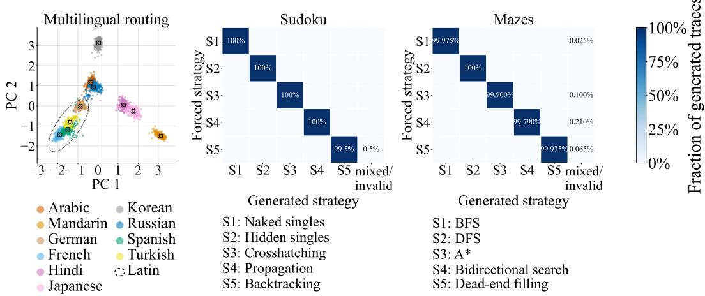  
Figure 3: Library of Layers learns distinct paths for different languages and distinct strategies when solving sudoku puzzles and mazes. Left: PCA projection of the routing paths of a 360M parameter LoL model trained on an equal mixture of 10 languages. We see the paths taken are distinct per language and Latin-script languages use similar paths. Middle and Right: We train 360M parameter LoL models to solve sudoku (middle) and mazes (right), using 5 different strategies. We then force each strategy’s mode path at inference time and see the models use the correct strategy (algorithm) with close to 100% accuracy.

## 4.1.1 MULTILINGUAL

First, we train 360M parameter models on an equal mix of 10 different languages from FineWeb-2 (Penedo et al., 2025) for 10 billion tokens. On a held-out validation set, for each sampled window, we encode the router’s selected expert at every routed depth as a one-hot vector. We then concatenate these one-hot vectors and project the resulting vector into two dimensions using PCA. In Figure 3 (left), we see that the routing paths are reasonably distinct per language and the Latin-script languages all share similar paths. Each point in the plot represents one window and its sequence of selected experts. In Appendix Figure 11, we see LoL gradually learns to distinguish between languages and route them through different computational paths by dynamically reordering the experts in its library over the course of training. Note that the same layers are used for various languages but just executed in different orders.

## 4.1.2 SAFETY

We now ask whether routing probabilities encode safety-relevant information in natural text. Using the harmfulness scores assigned to FineWeb sequences by Maini et al. (2026), we treat score-0 sequences as safe and score-4 and score-5 sequences as unsafe. We train models with the same architecture as our multilingual models for 10B tokens on an equal mixture of safe and unsafe text, without providing the harmfulness labels during training.

We train a linear ridge regression to predict the sequence’s harmfulness label from a window’s router probabilities across all routed depths. We use a held out set of 50M tokens for training the linear regression, split into 40M for development and 10M for testing. The probe achieves a held-out test set AUROC of 0.92, showing that router probabilities contain linearly accessible information about the dataset’s harmfulness labels.

Because each label applies to an entire sequence, an individual window may not contain the content responsible for that label. We therefore also train a sequence-level ridge probe using router prob abilities averaged across windows. This probe achieves a test set AUROC of 0.95. Appendix C.2 shows that simpler readouts recover much of the predictive signal in routing features, while label shuffling controls yield chance performance.

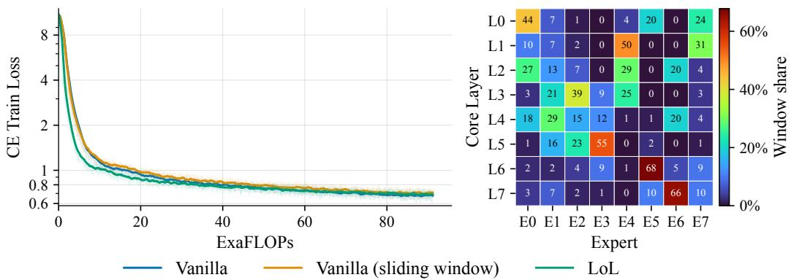  
Figure 4: Library of Layers is competitive with vanilla dense models. Left: Cross-entropy training loss over training FLOPs for 1B models. We see growing gives LoL an early loss advantage and all models finish with comparable training loss. Right: Heatmap of expert utilization of one LoL model. We see experts mainly tend to be used in groups of neighboring depths, but some are used throughout the model.

## 4.1.3 SUDOKU

Next, we analyze forcing routing paths to control the sudoku solving strategy. We train the model with strategy information available only to the router, then extract a representative routing path for each strategy. At inference, we remove the strategy information and force the model to follow the corresponding path.

We construct our dataset including five sudoku solving strategies, each with its own step syntax, fully described in Table 3 in the appendix. Our data is formatted as Q : <Input Grid> [Sx] R : <Solving Steps> A : <Final Grid> <eos>, where [Sx], with $\mathrm { x } \in \ \{ 1 , 2 , 3 , 4 , 5 \}$ identifies the solving strategy used to generate the reasoning trace. As the first window for all inputs is just the sudoku grid, we need the [Sx] identifier to tell the model which algorithm to use at test time. The strategy description tokens are masked from all parts of the network but the router. We train for approximately 10B tokens, computing the loss over only the solving steps and final grid, masking the question and strategy description.

For each strategy, we find the mode path by running the trained model with teacher forcing on heldout validation puzzles containing the strategy description. For each window and routed depth, we select the expert with the highest mean router probability across these puzzles and fix its residual weight to that mean. Here, mode refers to the highest mean probability, not the most frequent discrete choice; the path fixes both expert choices and residual weights. We report both the mode paths and how consistently the router agrees with the mode path at each depth in Appendix Figures 13 and 12, respectively.

We then test LoL on new sudoku grids, replacing the strategy description with a neutral filler, [...], and forcing each window to follow the corresponding mode path for the requested strategy. This tests whether fixing the path is enough to make the model follow that strategy. A trajectory is marked correct only if every step is legal, follows the requested strategy’s syntax and rules, and leads to the correct solution.

In Figure 3 (middle), we plot the confusion matrix where we force the mode path for each strategy. We see that the model uses the expected strategy with close to 100% accuracy when the mode path is forced for that strategy. Appendix Figure 14 also shows that LoL solves sudoku puzzles with close to 100% accuracy when given the strategy token [Sx] instead of forcing a routing path.

## 4.1.4 MAZES

Finally, we study mazes, where all five strategies share the same trace syntax, a list of visited cells, and only differ in the order in which they visit cells. We solve loop-free mazes on an $8 \times 8$ grid using: BFS (Cormen et al., 1990), DFS (Cormen et al., 1990), A\* (Hart et al., 1968), bidirectional search (Pohl, 1969), and dead-end filling. See Appendix Table 4 for examples of each strategy.

<table><tr><td>Model</td><td>ARC-E</td><td>ARC-C</td><td>HellaSwag</td><td>PIQA</td><td>GSM8K</td></tr><tr><td>Random</td><td>25.0</td><td>25.0</td><td>25.0</td><td>50.0</td><td>0.0</td></tr><tr><td>Vanilla</td><td> $4 0 . 8 \pm 1 . 0$ </td><td> $2 8 . 2 \pm 1 . 3$ </td><td> $3 1 . 4 \pm 0 . 5$ </td><td> $5 6 . 6 \pm 1 . 2$ </td><td> $2 9 . 7 \pm 1 . 3$ </td></tr><tr><td>Vanilla (sliding window)</td><td> $4 9 . 5 \pm 1 . 0$ </td><td> $2 8 . 5 \pm 1 . 3$ </td><td> $3 1 . 3 \pm 0 . 5$ </td><td> $5 8 . 8 \pm 1 . 1$ </td><td> $2 7 . 5 \pm 1 . 2$ </td></tr><tr><td>LoL</td><td> $5 0 . 3 \pm 1 . 0$ </td><td> $2 9 . 1 \pm 1 . 3$ </td><td> $3 1 . 2 \pm 0 . 5$ </td><td> $5 9 . 7 \pm 1 . 1$ </td><td> $2 7 . 9 \pm 1 . 2$ </td></tr></table>

Table 1: Library of Layers is competitive across benchmarks. We benchmark the same models shown in Figure 4 on ARC, HellaSwag, PIQA, and GSM8K. Performance is broadly comparable, except that the full-attention vanilla model scores substantially lower on ARC-Easy.

We then repeat the sudoku procedure for mazes, extracting each algorithm’s mode path. Unlike the strategies used for sudoku, the maze solving strategies all share the same output syntax and differ in the order in which they visit cells. We therefore ask whether LoL can learn these different exploration orders by changing the order of its own experts. Figure 3 (right) shows that forcing LoL to follow a particular computational path produces the requested algorithm’s trace with nearly 100% accuracy, even when all strategies share the same output syntax. Appendix Figure 18 shows that LoL also solves unseen mazes with close to 100% accuracy when given the strategy description in context, without path forcing.

## 4.2 MATHEMATICAL REASONING AT THE 1B SCALE

Next, we scale training to 1B parameters with models that are 16 layers deep. For LoL, we divide the 16 layers into 4 prelude layers, 4 coda layers, and a depth of 8 in the routed core. We train on a mixture of Nemotron (Mahabadi et al., 2025) and OpenMath (Toshniwal et al., 2024) data. We also grow the LoL models using a 1 − sqrt schedule for 75% of training, following McLeish et al. (2025). We train for approximately 90 ExaFLOPs; this equates to approximately 20B tokens for the most efficient model.

In Figure 4 (left), we see our models are competitive in terms of training loss with the parameter equivalent dense baselines. We use both full attention and sliding window attention as baselines, where we set the size of the sliding window to be equal to the window size in the strided attention in LoL. In Appendix Figure 20 and Table 5, we include a comparison to the vanilla model with strided attention. This model performs slightly worse than the vanilla and vanilla sliding window attention models. We note that the math training data is synthetic; therefore, loss values in Figure 4 are lower than the FineWeb ones in other plots. Moreover, in Figure 4 (right), we see our models are learning to use different experts at different routed depths. In this setting, where the library size equals the routed core depth, we see clusters form where experts are often used across neighboring depths. However, some experts are used across a wider range of depths.

In Table 1, we benchmark the same models on ARC-Easy (Clark et al., 2018), ARC-Challenge (Clark et al., 2018), HellaSwag (Zellers et al., 2019), PIQA (Bisk et al., 2020), and GSM8K (Cobbe et al., 2021). We use lm-evaluation-harness (Gao et al., 2024) and report the standard errors for each benchmark in the table. We use these benchmarks as they are known to provide a stronger, more reliable signal at smaller model sizes and token counts (Magnusson et al., 2025; McLeish et al., 2026). We see almost all evaluations are competitive and remain within 2 standard errors of each other on all benchmarks, showing LoL is competitive across a range of modern architectures. The only exception is the vanilla model, which scores poorly on ARC-Easy.

## 4.3 HOW BIG SHOULD YOUR LIBRARY BE?

Library size (L) determines how many distinct blocks are available, while core depth (D) determines how many blocks are executed. A small library requires reuse; a large library allows blocks to remain unused along a given routing path. We compare the small-library regime with looped transformers and the large-library regime with sparse MoE models.

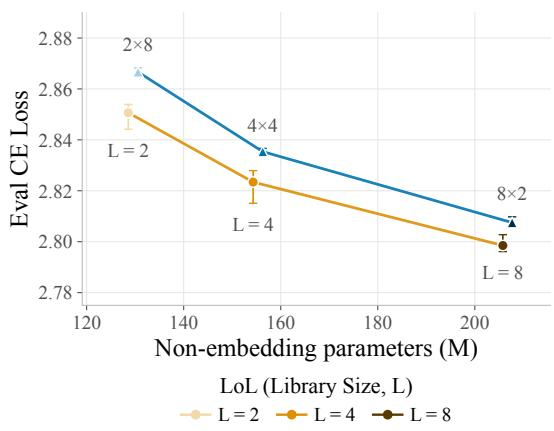

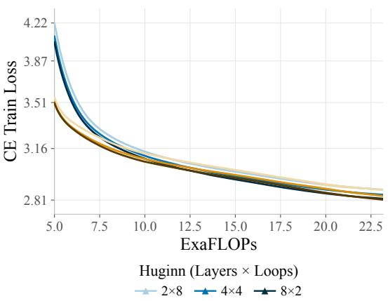  
Figure 5: Library of Layers is competitive with looped transformer models. Left: Cross-entropy evaluation loss, matching the number of unique layers in the core block of the LoL and looped transformer. We see LoL performs competitively with looped transformer models and offers more flexibility in layer ordering. Error bars are min/max loss over 3 random seeds. We note larger variance for the LoL models as changing the random seed changes the paths explored during training. Right: Cross-entropy training loss over training FLOPs, averaged over 3 random seeds per model.

We use 360M models for all comparisons, sweeping at least six learning rates, testing multiple learning rate schedules, and tuning the learning rates for Muon and AdamW separately.

## 4.3.1 COMPARISON TO LOOPED TRANSFORMERS

First, we compare to looped transformers. Following the analysis of Huang et al. (2026a), we use the Huginn (Geiping et al., 2026) architecture for our looped model baseline. We compare models at several distinct parameter counts, reusing layers to reach a total effective parameter count of 360M. To ensure a fair comparison, we fix the library size in our LoL models to match the size of the recurrent block in the Huginn models. We train for 10B tokens of FineWeb data (Penedo et al., 2024).

In Figure 5, we see that our LoL models are competitive in terms of loss with the parameter matched looped models. We note that the LoL models have slightly higher variance in final loss over three seeds. We hypothesize this is due to sensitivity to the initialization of the router causing different paths to be explored during training. In Appendix Figure 21, we show the routing diversity for each LoL model shown in Figure 5. Unlike Huginn, LoL can offer sparse behavior by simply scaling the size of its library.

## 4.3.2 COMPARISON TO SPARSE MIXTURE OF EXPERTS

Finally, we compare to sparse mixture of experts models. We compare at a 3 : 2 sparsity ratio: the MoE model uses three experts per layer with two active, while LoL uses 24 experts over 16 routed depths. We increase the MoE experts’ intermediate expansion factor relative to our standard 360M model to match active parameters per token as closely as possible. To align computation, LoL uses MoE prelude and coda layers, and the MoE baseline uses strided attention at the same depths as LoL. We again use growing for the LoL models and train all models for approximately 17 ExaFLOPs; this equates to approximately 10B tokens for the most efficient model.

In Figure 6 (left), the MoE baseline achieves a slightly lower training loss than LoL, with a gap of approximately 0.05 (2.75 vs. 2.8). We note it is common for higher cross-entropy loss to coexist with strong downstream performance in latent reasoning models (Saunshi et al., 2025; Huang et al., 2026a). In Figure 6 (right), we visualize the expert utilization across routed depths on an evaluation set. Experts vary in depth specialization: some favor earlier or later depths, while others are used across depths, highlighting the flexibility of LoL models on real-world language modeling data.

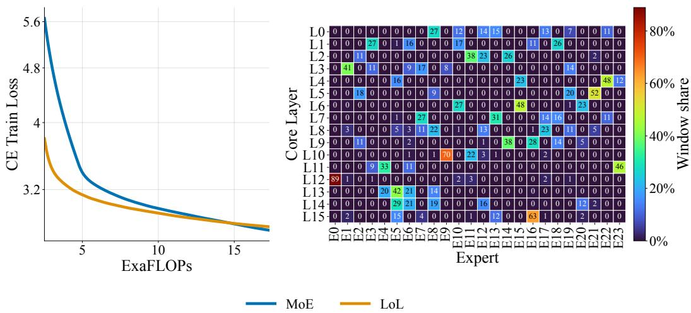  
Figure 6: Library of Layers is competitive with mixture of experts models. Left: Cross-entropy training loss over training FLOPs, averaged over 3 random seeds. We see growing gives LoL an early loss advantage and both models finish training with similar training losses. Right: Heatmap of expert utilization of one LoL model. We see some experts are heavily used by specific routed depths or neighboring groups of depths, while others are used diversely over depths, showing LoL learns to use the sparsity effectively.

## 5 DISCUSSION

LoL generalizes the parameter reuse and sparsity of looped models, standard feedforward trans formers, and MoEs into a single model family, allowing us to switch between these regimes simply by varying the library size. While our design addresses several challenges we discuss above, this paper is an initial exploration into dynamic layer ordering, and we believe that future work will vastly improve on our design. Moreover, the goal of our experiments is to show not merely that an architecture with dynamic layer ordering can achieve competitive performance, but also that it provides a new tool for model interpretability and control over a model’s reasoning strategies.

We now enumerate several directions for future work that we believe are especially promising. First, LoL is built with controllability at the core. We see in Figure 3 that we can find distinct routing paths underlying languages and algorithms, and we can intervene on routing paths at inference to control the model. In Section 4.1.2, we show that routing features distinguish safe from unsafe text. Whether such features can also support interventions in chat settings, including behaviors related to lying, scheming, and safety (Park et al., 2024), remains an open question. Next, LoL can in principle employ a larger computational depth at inference time than at training time, offering a mechanism for test-time scaling and increasing its capacity for latent reasoning. Finally, another promising direction is to combine test-time learning (Chen et al., 2026; Hotsko et al., 2026; Zhao & Jones, 2026) with our top-1 routing. For example, instead of routing over full transformer blocks, one may route over a growing library of test-time learnable adapters for each layer. This approach would allow the parametric memory to be available to all layers of the model.

## ACKNOWLEDGMENTS

We thank John Kirchenbauer for helpful feedback on earlier drafts of this paper.

## REFERENCES

Sangmin Bae, Yujin Kim, Reza Bayat, Sungnyun Kim, Jiyoun Ha, Tal Schuster, Adam Fisch, Hrayr Harutyunyan, Ziwei Ji, Aaron Courville, et al. Mixture-of-recursions: Learning dynamic recursive depths for adaptive token-level computation. arXiv preprint arXiv:2507.10524, 2025.

Arpit Bansal, Avi Schwarzschild, Eitan Borgnia, Zeyad Emam, Furong Huang, Micah Goldblum, and Tom Goldstein. End-to-end algorithm synthesis with recurrent networks: Extrapolation with out overthinking. Advances in Neural Information Processing Systems, 35:20232–20242, 2022.

Jay Bear, Adam Prugel-Bennett, and Jonathon Hare. Rethinking deep thinking: Stable learning of algorithms using lipschitz constraints. Advances in Neural Information Processing Systems, 37: 97027–97052, 2024.

Yonatan Bisk, Rowan Zellers, Jianfeng Gao, Yejin Choi, et al. Piqa: Reasoning about physical commonsense in natural language. In Proceedings of the AAAI conference on artificial intelligence, volume 34, pp. 7432–7439, 2020.

Sidney Black, Stella Biderman, Eric Hallahan, Quentin Anthony, Leo Gao, Laurence Golding, Horace He, Connor Leahy, Kyle McDonell, Jason Phang, et al. Gpt-neox-20b: An open-source autoregressive language model. In Proceedings of BigScience Episode# 5–Workshop on Challenges & Perspectives in Creating Large Language Models, pp. 95–136, 2022.

Zeming Chen, Angelika Romanou, Gail Weiss, and Antoine Bosselut. Perk: Long-context reasoning as parameter-efficient test-time learning. In International Conference on Learning Representations, volume 2026, pp. 10350–10377, 2026.

Aakanksha Chowdhery, Sharan Narang, Jacob Devlin, Maarten Bosma, Gaurav Mishra, Adam Roberts, Paul Barham, Hyung Won Chung, Charles Sutton, Sebastian Gehrmann, et al. Palm: Scaling language modeling with pathways. Journal of machine learning research, 24(240):1– 113, 2023.

Peter Clark, Isaac Cowhey, Oren Etzioni, Tushar Khot, Ashish Sabharwal, Carissa Schoenick, and Oyvind Tafjord. Think you have solved question answering? try arc, the ai2 reasoning challenge. arXiv preprint arXiv:1803.05457, 2018.

Karl Cobbe, Vineet Kosaraju, Mohammad Bavarian, Mark Chen, Heewoo Jun, Lukasz Kaiser, Matthias Plappert, Jerry Tworek, Jacob Hilton, Reiichiro Nakano, et al. Training verifiers to solve math word problems. arXiv preprint arXiv:2110.14168, 2021.

Thomas H Cormen, Charles Eric Leiserson, Ronald L Rivest, Clifford Stein, et al. Introduction to algorithms, volume 2. MIT press Cambridge, 1990.

Robert Csord ´ as, Kazuki Irie, J ´ urgen Schmidhuber, Christopher Potts, and Christopher D. Manning.¨ Moeut: Mixture-of-experts universal transformers. arXiv preprint arXiv:2305.13245, 2024.

Mostafa Dehghani, Stephan Gouws, Oriol Vinyals, Jakob Uszkoreit, and Łukasz Kaiser. Universal transformers. arXiv preprint arXiv:1807.03819, 2018.

Mostafa Elhoushi, Akshat Shrivastava, Diana Liskovich, Basil Hosmer, Bram Wasti, Liangzhen Lai, Anas Mahmoud, Bilge Acun, Saurabh Agarwal, Ahmed Roman, et al. Layerskip: Enabling early exit inference and self-speculative decoding. In Proceedings of the 62nd Annual Meeting of the Associationfor Computational Linguistics (Volume 1: Long Papers), pp. 12622–12642, 2024.

Ying Fan, Yilun Du, Kannan Ramchandran, and Kangwook Lee. Looped transformers for length generalization. arXiv preprint arXiv:2409.15647, 2024.

William Fedus, Barret Zoph, and Noam Shazeer. Switch transformers: Scaling to trillion parameter models with simple and efficient sparsity. Journal of Machine Learning Research, 23(120):1–39, 2022.

Leo Gao, Jonathan Tow, Baber Abbasi, Stella Biderman, Sid Black, Anthony DiPofi, Charles Foster, Laurence Golding, Jeffrey Hsu, Alain Le Noac’h, Haonan Li, Kyle McDonell, Niklas Muennighoff, Chris Ociepa, Jason Phang, Laria Reynolds, Hailey Schoelkopf, Aviya Skowron, Lintang Sutawika, Eric Tang, Anish Thite, Ben Wang, Kevin Wang, and Andy Zou. The language model evaluation harness, 07 2024. URL https://zenodo.org/records/12608602.

Jonas Geiping, Sean McLeish, Neel Jain, John Kirchenbauer, Siddharth Singh, Brian Bartoldson, Bhavya Kailkhura, Abhinav Bhatele, and Tom Goldstein. Scaling up test-time compute with latent reasoning: A recurrent depth approach. Advances in Neural Information Processing Systems, 38: 41340–41391, 2026.

Angeliki Giannou, Shashank Rajput, Jy-yong Sohn, Kangwook Lee, Jason D Lee, and Dimitris Papailiopoulos. Looped transformers as programmable computers. In International Conference on Machine Learning, pp. 11398–11442. PMLR, 2023.

Linyuan Gong, Di He, Zhuohan Li, Tao Qin, Liwei Wang, and Tieyan Liu. Efficient training of bert by progressively stacking. In International conference on machine learning, pp. 2337–2346. PMLR, 2019.

Zhuocheng Gong, Ang Lv, Jian Guan, Wei Wu, Huishuai Zhang, Minlie Huang, Dongyan Zhao, and Rui Yan. Mixture-of-modules: Reinventing transformers as dynamic assemblies of modules. In Proceedings of the 2024 Conference on Empirical Methods in Natural Language Processing, pp. 20924–20938, 2024.

Peter E. Hart, Nils J. Nilsson, and Bertram Raphael. A formal basis for the heuristic determination of minimum cost paths. IEEE Transactions on Systems Science and Cybernetics, 4(2):100–107, 1968. doi: 10.1109/TSSC.1968.300136.

Liliana Hotsko, Yinxi Li, Yuntian Deng, and Pengyu Nie. Code2lora: Hypernetwork-generated adapters for code language models under software evolution. arXiv preprint arXiv:2606.06492, 2026.

Benhao Huang, Chufan Shi, Junlin Chen, Shicheng Wen, Zhengzhong Liu, Eric Xing, and Xuezhe Ma. Towards looped models done right, part i: Topology, input injection, recurrent-state design. arXiv preprint arXiv:2610.23036, 2026a.

Minbin Huang, Han Shi, Chuanyang Zheng, Yimeng Wu, Guoxuan Chen, Xintong Yu, Yichun Yin, and Hong Cheng. Unipool: A globally shared expert pool for mixture-of-experts. arXiv preprint arXiv:2605.06665, 2026b.

Borja Ibarz, Vitaly Kurin, George Papamakarios, Kyriacos Nikiforou, Mehdi Bennani, Robert´ Csordas, Andrew Joseph Dudzik, Matko Bo´ snjak, Alex Vitvitskyi, Yulia Rubanova, et al. Aˇ generalist neural algorithmic learner. In Learning on graphs conference, pp. 2–1. PMLR, 2022.

Keller Jordan, Yuchen Jin, Vlado Boza, Jiacheng You, Franz Cesista, Laker Newhouse, and Jeremy Bernstein. Muon: An optimizer for hidden layers in neural networks, 2024. URL https: //kellerjordan.github.io/posts/muon/.

Ali Kayyam, Anusha Madan Gopal, and M Anthony Lewis. Do transformers need three projections? systematic study of qkv variants. arXiv preprint arXiv:2606.04032, 2026.

Diederik P Kingma and Jimmy Ba. Adam: A method for stochastic optimization. arXiv preprint arXiv:1412.6980, 2014.

Zhenzhong Lan, Mingda Chen, Sebastian Goodman, Kevin Gimpel, Piyush Sharma, and Radu Soricut. Albert: A lite bert for self-supervised learning of language representations. arXiv preprint arXiv:1909.11942, 2019.

Aixin Liu, Bei Feng, Bing Xue, Bingxuan Wang, Bochao Wu, Chengda Lu, Chenggang Zhao, Chengqi Deng, Chenyu Zhang, Chong Ruan, et al. Deepseek-v3 technical report. arXiv preprint arXiv:2412.19437, 2024.

Ilya Loshchilov and Frank Hutter. Decoupled weight decay regularization. arXiv preprint arXiv:1711.05101, 2017.

Ian Magnusson, Nguyen Tai, Ben Bogin, David Heineman, Jena D Hwang, Luca Soldaini, Akshita Bhagia, Jiacheng Liu, Dirk Groeneveld, Oyvind Tafjord, et al. Datadecide: How to predict best pretraining data with small experiments. arXiv preprint arXiv:2504.11393, 2025.

Rabeeh Karimi Mahabadi, Sanjeev Satheesh, Shrimai Prabhumoye, Mostofa Patwary, Mohammad Shoeybi, and Bryan Catanzaro. Nemotron-cc-math: A 133 billion-token-scale high quality math pretraining dataset. arXiv preprint arXiv:2508.15096, 2025.

Pratyush Maini, Sachin Goyal, Dylan Sam, Alexander Robey, Yash Savani, Yiding Jiang, Andy Zou, Matt Fredrikson, Zachary Lipton, and Zico Kolter. Safety pretraining: Toward the next generation of safe ai. Advances in Neural Information Processing Systems, 38:43971–44008, 2026.

Sean McLeish, Arpit Bansal, Alex Stein, Neel Jain, John Kirchenbauer, Brian Bartoldson, Bhavya Kailkhura, Abhinav Bhatele, Jonas Geiping, Avi Schwarzschild, et al. Transformers can do arithmetic with the right embeddings. Advances in Neural Information Processing Systems, 37: 108012–108041, 2024.

Sean McLeish, Ang Li, John Kirchenbauer, Dayal Singh Kalra, Brian R Bartoldson, Bhavya Kailkhura, Avi Schwarzschild, Jonas Geiping, Tom Goldstein, and Micah Goldblum. Teaching pretrained language models to think deeper with retrofitted recurrence. arXiv preprint arXiv:2511.07384, 2025.

Sean McLeish, John Kirchenbauer, David Miller, Siddharth Singh, Abhinav Bhatele, Micah Goldblum, Ashwinee Panda, and Tom Goldstein. Gemstones: A model suite for multi-faceted scaling laws. Advances in Neural Information Processing Systems, 38:123419–123454, 2026.

Meta. Llama 3.2: Revolutionizing edge ai and vision with open, customizable models, September 2024. URL https://ai.meta.com/blog/ llama-3-2-connect-2024-vision-edge-mobile-devices.

Team Olmo, Allyson Ettinger, Amanda Bertsch, Bailey Kuehl, David Graham, David Heineman, Dirk Groeneveld, Faeze Brahman, Finbarr Timbers, Hamish Ivison, et al. Olmo 3. arXiv preprint arXiv:2512.13961, 2025.

OpenAI. gpt-oss-120b & gpt-oss-20b model card, 2025. URL https://arxiv.org/abs/ 2508.10925.

Peter S. Park, Simon Goldstein, Aidan O’Gara, Michael Chen, and Dan Hendrycks. Ai deception: A survey of examples, risks, and potential solutions. Patterns, 5(5):100988, 2024. ISSN 2666-3899. doi: https://doi.org/10.1016/j.patter.2024.100988. URL https://www.sciencedirect. com/science/article/pii/S266638992400103X.

Guilherme Penedo, Hynek Kydl´ıcek, Anton Lozhkov, Margaret Mitchell, Colin Raffel, Leandroˇ Von Werra, Thomas Wolf, et al. The fineweb datasets: Decanting the web for the finest text data at scale. Advances in Neural Information Processing Systems, 37:30811–30849, 2024.

Guilherme Penedo, Hynek Kydl´ıcek, Vinko Sabolˇ cec, Bettina Messmer, Negar Foroutan, Amir Hos-ˇ sein Kargaran, Colin Raffel, Martin Jaggi, Leandro Von Werra, and Thomas Wolf. Fineweb2: One pipeline to scale them all–adapting pre-training data processing to every language. arXiv preprint arXiv:2506.20920, 2025.

Ethan Perez, Florian Strub, Harm De Vries, Vincent Dumoulin, and Aaron Courville. Film: Visual reasoning with a general conditioning layer. In Proceedings of the AAAI conference on artificial intelligence, volume 32, 2018.

Ira Pohl. Bi-directional and heuristic search in path problems. PhD thesis, Department of Computer Science, Stanford University, 1969.

Hayden Prairie, Zachary Novack, Taylor Berg-Kirkpatrick, and Daniel Y Fu. Parcae: Scaling laws for stable looped language models. arXiv preprint arXiv:2604.12946, 2026.

Alec Radford, Jeffrey Wu, Rewon Child, David Luan, Dario Amodei, Ilya Sutskever, et al. Language models are unsupervised multitask learners. OpenAI blog, 1(8):9, 2019.

David Raposo, Sam Ritter, Blake Richards, Timothy Lillicrap, Peter Conway Humphreys, and Adam Santoro. Mixture-of-depths: Dynamically allocating compute in transformer-based language models. arXiv preprint arXiv:2404.02258, 2024.

Nikunj Saunshi, Nishanth Dikkala, Zhiyuan Li, Sanjiv Kumar, and Sashank J Reddi. Reasoning with latent thoughts: On the power of looped transformers. arXiv preprint arXiv:2502.17416, 2025.

Avi Schwarzschild. Deep Thinking Systems: Logical Extrapolation With Recurrent Neural Networks. PhD thesis, University of Maryland, College Park, 2023.

Avi Schwarzschild, Eitan Borgnia, Arjun Gupta, Furong Huang, Uzi Vishkin, Micah Goldblum, and Tom Goldstein. Can you learn an algorithm? generalizing from easy to hard problems with recurrent networks. Advances in Neural Information Processing Systems, 34:6695–6706, 2021.

Noam Shazeer. Glu variants improve transformer. arXiv preprint arXiv:2002.05202, 2020.

Noam Shazeer, Azalia Mirhoseini, Krzysztof Maziarz, Andy Davis, Quoc Le, Geoffrey Hinton, and Jeff Dean. Outrageously large neural networks: The sparsely-gated mixture-of-experts layer. arXiv preprint arXiv:1701.06538, 2017.

Jianlin Su, Murtadha Ahmed, Yu Lu, Shengfeng Pan, Wen Bo, and Yunfeng Liu. Roformer: Enhanced transformer with rotary position embedding. Neurocomputing, 568:127063, 2024.

Yutao Sun, Li Dong, Yi Zhu, Shaohan Huang, Wenhui Wang, Shuming Ma, Quanlu Zhang, Jianyong Wang, and Furu Wei. You only cache once: Decoder-decoder architectures for language models. Advances in Neural Information Processing Systems, 37:7339–7361, 2024.

Ivan Ternovtsii and Yurii Bilak. Mixture of layers with hybrid attention. arXiv preprint arXiv:2605.09516, 2026.

Shubham Toshniwal, Wei Du, Ivan Moshkov, Branislav Kisacanin, Alexan Ayrapetyan, and Igor Gitman. Openmathinstruct-2: Accelerating ai for math with massive open-source instruction data. arXiv preprint arXiv:2410.01560, 2024.

Ashish Vaswani, Noam Shazeer, Niki Parmar, Jakob Uszkoreit, Llion Jones, Aidan N Gomez, Łukasz Kaiser, and Illia Polosukhin. Attention is all you need. Advances in neural information processing systems, 30, 2017.

Lean Wang, Huazuo Gao, Chenggang Zhao, Xu Sun, and Damai Dai. Auxiliary-loss-free load balancing strategy for mixture-of-experts. arXiv preprint arXiv:2408.15664, 2024.

Anyi Xu, Bangcai Lin, Bing Xue, Bingxuan Wang, Bingzheng Xu, Bochao Wu, Bowei Zhang, Chaofan Lin, Chen Dong, Chenchen Ling, et al. Deepseek-v4: Towards highly efficient milliontoken context intelligence. arXiv preprint arXiv:2606.19348, 2026.

Liu Yang, Kangwook Lee, Robert Nowak, and Dimitris Papailiopoulos. Looped transformers are better at learning learning algorithms. arXiv preprint arXiv:2311.12424, 2023.

Rowan Zellers, Ari Holtzman, Yonatan Bisk, Ali Farhadi, and Yejin Choi. Hellaswag: Can a machine really finish your sentence? arXiv preprint arXiv:1905.07830, 2019.

Biao Zhang and Rico Sennrich. Root mean square layer normalization. Advances in neural information processing systems, 32, 2019.

Tianyu Zhao and Llion Jones. Fast-weight product key memory. arXiv preprint arXiv:2601.00671, 2026.

## TABLE OF CONTENTS

A Additional Architecture and Training Details 16   
B Additional Architecture Ablations 17   
B.1 Library of Layers 17   
B.2 Baselines 17   
C Additional Experimental Information 19   
C.1 Multilingual . 19   
C.2 Safety 20   
C.3 Sudoku 20   
C.3.1 Sudoku Data Example 23   
C.4 Maze 25   
C.4.1 Maze Data Example 27   
C.5 Math . 29   
C.6 Looped Transformers 30   
C.7 MoE 30

```latex
Algorithm 1 Library of Layers forward pass
Require: Input $\overline { { \textbf { x } \in \ V ^ { n } } }$ , core depth D, window size W, stride S; model parameters $\Theta =$
$\{ P , \{ E _ { m } \} _ { m = 1 } ^ { L }$ , Router, $\{ { \mathbf e } ^ { ( \ell ) } \} _ { \ell = 1 } ^ { D } , C \}$
1: $\mathbf { s } ^ { ( 0 ) }  P ( \mathbf { x } )$ ▷ Full causal attention
2: for $\ell = 1 , \ldots , D$ do
// Window preparation
3: $\delta _ { \ell } \gets ( \ell - 1 ) S$ mod W
4: $I _ { k } \gets \{ i \in \{ 0 , \dots , n - 1 \} : \lfloor ( i + \delta _ { \ell } ) / W \rfloor = k \} , \mathrm { f o r } k = 0 , \dots , K _ { \ell } - 1$
5: $\mu _ { k }  \mathrm { M e a n } ( \mathbf { s } _ { I _ { k } } ^ { ( \ell - 1 ) } )$ , for $k = 0 , \ldots , K _ { \ell } - 1$
// Forward pass per window (k)
6: for $k = 0 , \ldots , K _ { \ell } - 1$ do
7: if $k = 0$ then
8: $\mathbf { r } _ { k }  \frac { 1 } { 2 } \big ( \mathbf { e } ^ { ( \ell ) } + \mathbf { s } _ { 0 } ^ { ( \ell - 1 ) } \big )$ ▷ $\mathbf { e } ^ { ( \ell ) }$ : learned vector for depth ℓ
9: else
10: $\begin{array} { r } { \mathbf { r } _ { k }  \frac { 1 } { k } \sum _ { j = 0 } ^ { k - 1 } \pmb { \mu } _ { j } } \end{array}$ ▷ Mean of prior windows only
11: end if
12: $( \rho _ { k } , \alpha _ { k } ) \gets \mathrm { T o p 1 } \big ( \mathrm { R o u t e r } ( \mathbf { r } _ { k } ) \big )$ ▷ $\rho _ { k } \colon$ selected expert; $\alpha _ { k } \mathrm { : }$ expert weight
13: $\mathbf { y } _ { k }  E _ { \rho _ { k } } \big ( \mathbf { s } _ { I _ { k } } ^ { ( \ell - 1 ) } \big )$ ▷ Causal attention within window
14: $\mathbf { s } _ { I _ { k } } ^ { ( \ell ) } \gets \mathbf { s } _ { I _ { k } } ^ { ( \ell - 1 ) } + \alpha _ { k } \left( \mathbf { y } _ { k } - \mathbf { s } _ { I _ { k } } ^ { ( \ell - 1 ) } \right)$
15: end for
16: end for
17: p ← softmax $\big ( C ( \mathbf { s } ^ { ( D ) } ) \big )$ ▷ Full causal attention
18: return p
```

## A ADDITIONAL ARCHITECTURE AND TRAINING DETAILS

Given a core depth of $D ,$ , a library of L experts, and an input sequence $\pmb { x } \in V ^ { n }$ , these three groups produce the output probabilities $\dot { \mathbf { p } } \in \mathbb { R } ^ { n \times | \dot { V } | }$ as shown in Algorithm 1.

Our main experiments are conducted at the 360M parameter scale based on the GPT-2 Medium architecture (Radford et al., 2019). Unlike GPT-2, our models use RoPE (Su et al., 2024), RMSNorm (Zhang & Sennrich, 2019), SwiGLU MLPs (Shazeer, 2020), and bias free attention (Chowdhery et al., 2023). Our 1B model shape is based upon the Llama-3.2-1b shape (Meta, 2024), using the same architecture as the 360M model. We use the GPT-NeoX tokenizer (Black et al., 2022) for our predominantly English FineWeb training experiments and the larger OLMo3 (Olmo et al., 2025) tokenizer for our multilingual experiments. For our toy sudoku and maze experiments, we use small tokenizers specifically for the vocabulary of each task. For natural language experiments, we use $W = 1 2 8$ and $S = 6 4$ , with a total context length of 1024 tokens. For sudoku and mazes, we set the first window to span the question and strategy description. Subsequent windows use $W = 1 2 8$ and $S = 6 4$ for sudoku, and $W = 6 4$ and $S = 3 2$ for mazes.

To train the router, we use loss-free load balancing (Wang et al., 2024), adding a per-expert bias only for expert selection, $\rho _ { k } = \arg \operatorname* { m a x } _ { m } \left( a _ { k , m } + b _ { m } \right)$ , where ${ a } _ { k , m }$ is the softmax probability of expert m before adding the balancing bias. We weight the selected expert using this probability, $\alpha _ { k } = a _ { k , \rho _ { k } }$ . As in MoE routing (Shazeer et al., 2017; Fedus et al., 2022), this retains a differentiable path from the loss to the router through $\alpha _ { k }$ , without differentiating through the discrete selection.

For our LoL models, we apply a learned, depth-dependent scale and bias after each normalization in the transformer block. Specifically, in place of the regular normalization in the transformer block, we use: $\gamma _ { s } \odot \mathrm { N o r m } _ { s } ( \mathbf { x } ) \dot { { + } } \beta _ { s } , \mathrm { ~ } s \in \{ \mathrm { a t t n } , \mathrm { f i n } \}$ , where $\gamma$ and $\beta$ are depth-dependent.

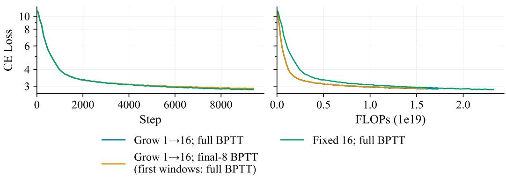

We use the Muon optimizer (Jordan et al., 2024) with AdamW (Kingma & Ba, 2014; Loshchilov & Hutter, 2017). We note we use PyTorch Muon with adjust lr fn=match rms adamw, and all learning rates should be taken in this context. We use loss-free load balancing (Wang et al., 2024) to train routers. We use document blocked attention, meaning that tokens in one document never attend to tokens in another document in any experiment.

## B ADDITIONAL ARCHITECTURE ABLATIONS

## B.1 LIBRARY OF LAYERS

In Figure 7, we ablate the impact of growing LoL during training. In Figure 8, we ablate the impact of auxiliary loss versus loss-free load balancing. In Figure 9, we see sharing router weights across routed depths has minimal impact on final training loss.

Figure 7: Increasing depth over training saves FLOPs with only a minor increase in final loss.  
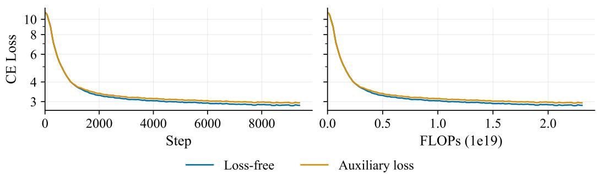  
Figure 8: Loss-free load balancing (Wang et al., 2024) achieves a lower final cross-entropy loss when compared to auxiliary loss load balancing methods.

## B.2 BASELINES

In Figure 10, we see varying attention patterns in vanilla models has a small impact on training loss.

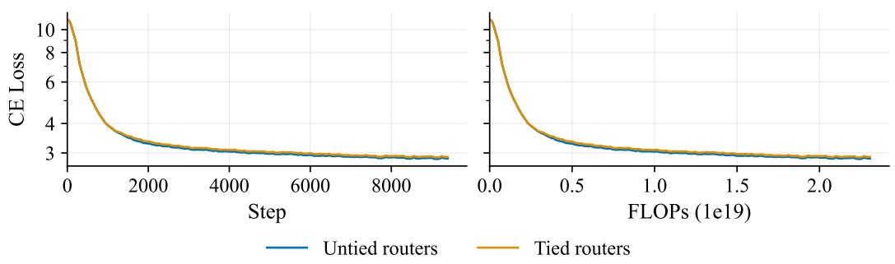  
Figure 9: Sharing router weights across routed depths causes minimal change in cross-entropy loss.

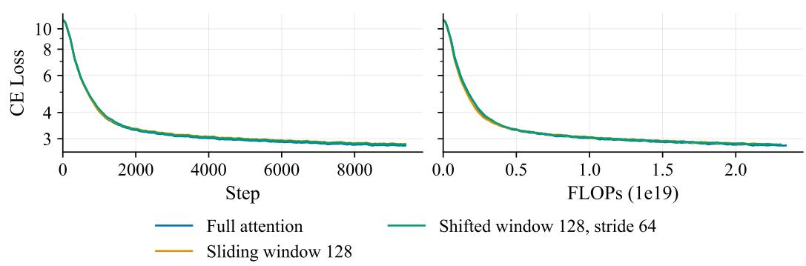  
Figure 10: Varying the attention pattern for dense fixed-depth models, we see full attention achieves the lowest loss.

## C ADDITIONAL EXPERIMENTAL INFORMATION

## C.1 MULTILINGUAL

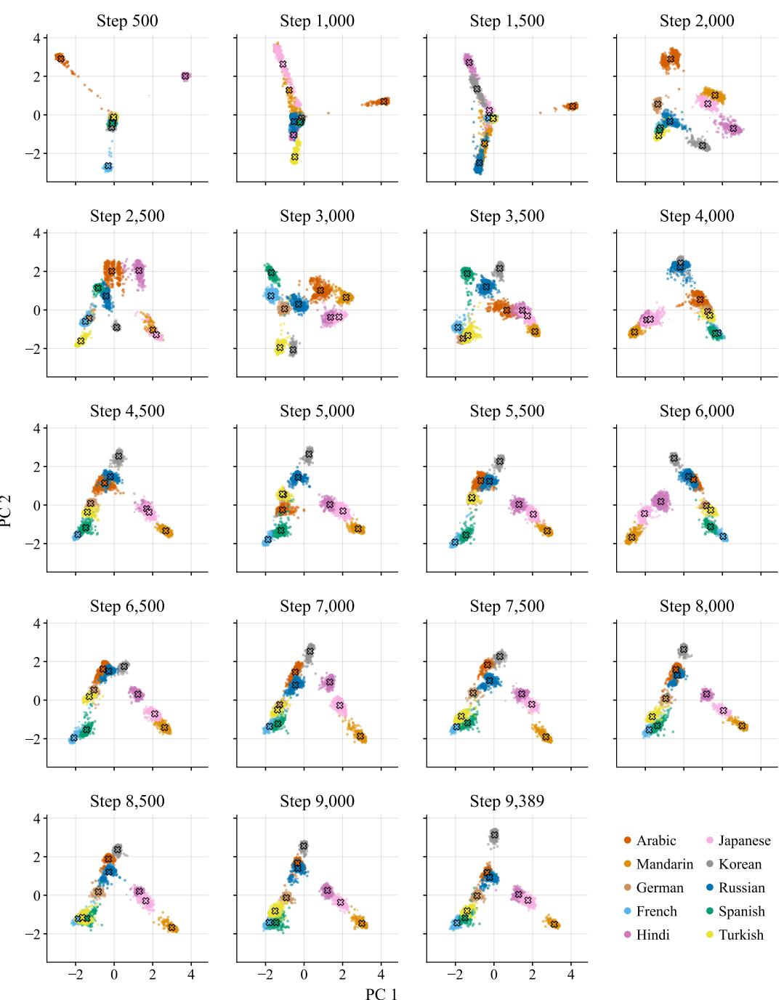  
Figure 11: Evolution of multilingual routing during training.

## C.2 SAFETY

To confirm the safety classifier in Section 4.1.2 is using predictive information in routing, we evaluate several readouts and a label-shuffling control. We report the mean AUROC over five crossvalidation folds of the development set. In Table 2 we analyze:

• Ridge regression on the single top-1 expert probability at every depth.

• Single winning-expert probability where we directly rank windows by the negative winning-expert probability at a depth selected on the training folds.

• Expert-frequency log-likelihood ratio where we estimate class-conditional expert frequencies from training data.

The simpler readouts recover much of the top-1 ridge probe’s performance, while shuffling labels at the document level reduces ridge performance to chance. We note that this data is labeled by a classifier trained by Maini et al. (2026); hence, our results measure agreement with those noisy labels.

<table><tr><td>Readout or control</td><td>AUROC</td></tr><tr><td>Top-1 ridge</td><td>0.8754</td></tr><tr><td>Single winning-expert probability</td><td>0.8244</td></tr><tr><td>Expert-frequency log-likelihood ratio</td><td>0.8300</td></tr><tr><td>Shuffled labels (99 permutations, mean / max)</td><td>0.5014/0.5231</td></tr></table>

Table 2: Development-set cross-validation AUROCs for safety readouts and the document-level label-shuffling control.

## C.3 SUDOKU

To construct our dataset, we generate sudoku grids by randomized depth-first filling under the rules of sudoku. We then retain between 30 and 36 digits in the grid, ensuring it is still solvable by all strategies. Each puzzle is solved using all five strategies, and every trace becomes one sequence of the dataset. In total, we have 20M sequences, which equates to approximately 10B training tokens, after deduplication.

<table><tr><td>Strategy</td><td colspan="7">Solving Step Format</td></tr><tr><td>Repeated row-major naked-single sweeps.</td><td> $\Sigma 5 { \mathsf { C } } 5 = \{ \begin{array} { l } { 5 } \end{array} \}$ </td><td></td><td></td><td></td><td></td><td></td></tr><tr><td>Hidden singles, scanning rows, columns, then boxes.</td><td> $\mathtt { r o w 3 5 } \overset { \cdot } {  } \overset { \cdot } { \mathtt { r } 3 } \mathtt { c } 7$ </td><td></td><td></td><td></td><td></td><td></td></tr><tr><td>Digit-major crosshatching over boxes.</td><td> $3 \mathrm { ~ \ b o x 4 ~ }  \mathrm { ~ \ r 6 c { 3 } ~ }$ </td><td></td><td></td><td></td><td></td><td></td></tr><tr><td>First-in-first-out propagation of forced cells, recording newly forced peers.</td><td> $\mathtt { s e t \ \mathtt { r } S c S } ~ = ~ 5 ~ :$ </td><td></td><td></td><td></td><td></td><td>r5c2 -&gt; { 2 }</td></tr><tr><td>Deterministic DFS backtracking: first empty cell, digits ascending.</td><td> $\mathtt { r } 1 { \mathtt { c } } 3 = \mathtt { 1 } \ \mathtt { x }$ </td><td></td><td></td><td></td><td></td><td></td></tr></table>

Table 3: Sudoku data strategies and data formatting.

S1 Naked singles  
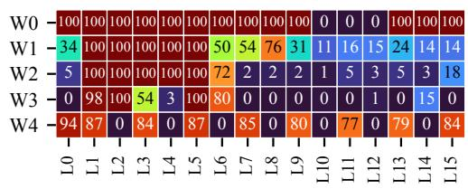

S2 Hidden singles  
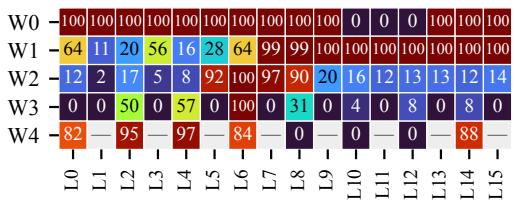

S3 Crosshatching  
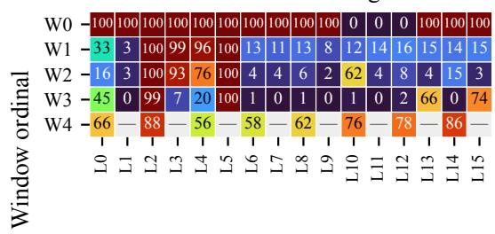  
S4 Propagation

S5 Backtracking  
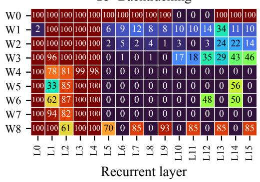

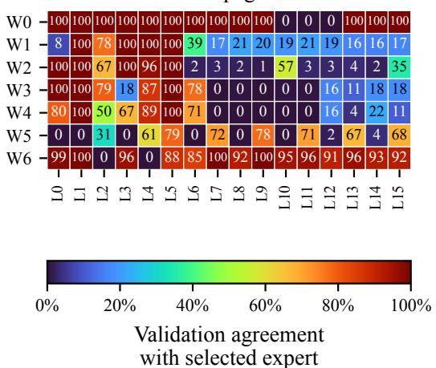  
Figure 12: Routing agreement on sudoku. Each panel shows one strategy, with window positions as rows and routed depths k as columns. Each cell gives the percentage of observed routing decisions that agree with the mode-path expert at that position. Gray cells indicate positions with no observations.

S1 Naked singles  
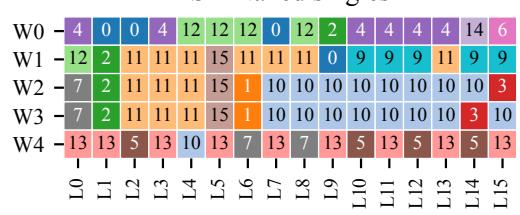

S2 Hidden singles  
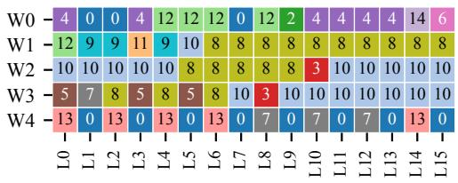

S3 Crosshatching  
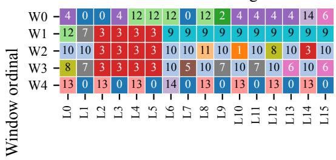  
S5 Backtracking

S4 Propagation  
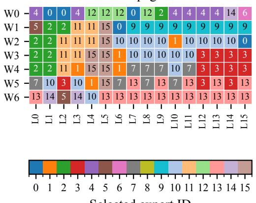

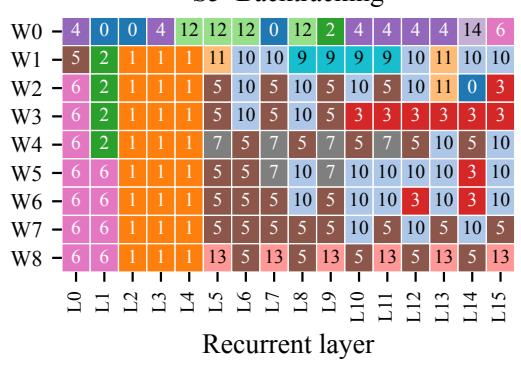  
Figure 13: Mode routing paths on sudoku. Each panel shows one strategy, with window positions as rows and routed depths k as columns. Cell labels and colors identify the expert assigned to each (strategy, window position, routed depth) tuple.

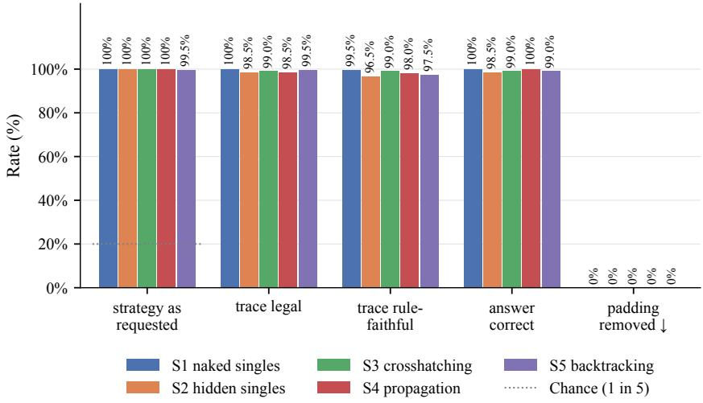  
Figure 14: Strategy adherence and sudoku solution accuracy under forced routing.

In Figure 14, we report different evaluation metrics:

• Strategy as requested: the percentage of outputs whose solving steps all use the requested strategy’s syntax.

• Trace legal: the percentage of outputs whose placements are all legal and lead to the true solution. Traces that do not match any strategy count as failures.

• Trace rule-faithful: the percentage of outputs that pass the legality check and correctly apply every claimed deduction.

• Answer correct: the percentage of outputs whose final 81 digit grid, after the answer marker, matches the true solution.

• Padding removed ↓: the fraction of tokens before the end-of-sequence token that are padding, averaged across outputs.

We see that LoL, with close to 100% accuracy, uses the expected strategy with legal traces and succeeds in solving the sudoku grid without adding any unneeded padding.

## C.3.1 SUDOKU DATA EXAMPLE

<table><tr><td rowspan=1 colspan=1></td><td rowspan=1 colspan=1></td><td rowspan=1 colspan=1></td><td rowspan=1 colspan=1></td><td rowspan=1 colspan=1>3</td><td rowspan=1 colspan=1></td><td rowspan=1 colspan=1>1</td><td rowspan=1 colspan=1>9</td><td rowspan=1 colspan=1>4</td></tr><tr><td rowspan=1 colspan=1></td><td rowspan=1 colspan=1>1</td><td rowspan=1 colspan=1></td><td rowspan=1 colspan=1>4</td><td rowspan=1 colspan=1></td><td rowspan=1 colspan=1>7</td><td rowspan=1 colspan=1></td><td rowspan=1 colspan=1>3</td><td rowspan=1 colspan=1></td></tr><tr><td rowspan=1 colspan=1></td><td rowspan=1 colspan=1></td><td rowspan=1 colspan=1></td><td rowspan=1 colspan=1>1</td><td rowspan=1 colspan=1></td><td rowspan=1 colspan=1></td><td rowspan=1 colspan=1>8</td><td rowspan=1 colspan=1>7</td><td rowspan=1 colspan=1>6</td></tr><tr><td rowspan=1 colspan=1></td><td rowspan=1 colspan=1>5</td><td rowspan=1 colspan=1></td><td rowspan=1 colspan=1>9</td><td rowspan=1 colspan=1>1</td><td rowspan=1 colspan=1>8</td><td rowspan=1 colspan=1>3</td><td rowspan=1 colspan=1></td><td rowspan=1 colspan=1>7</td></tr><tr><td rowspan=1 colspan=1></td><td rowspan=1 colspan=1>7</td><td rowspan=1 colspan=1>8</td><td rowspan=1 colspan=1></td><td rowspan=1 colspan=1>4</td><td rowspan=1 colspan=1>6</td><td rowspan=1 colspan=1></td><td rowspan=1 colspan=1></td><td rowspan=1 colspan=1>1</td></tr><tr><td rowspan=1 colspan=1></td><td rowspan=1 colspan=1></td><td rowspan=1 colspan=1></td><td rowspan=1 colspan=1>7</td><td rowspan=1 colspan=1>5</td><td rowspan=1 colspan=1>2</td><td rowspan=1 colspan=1></td><td rowspan=1 colspan=1></td><td rowspan=1 colspan=1></td></tr><tr><td rowspan=1 colspan=1>2</td><td rowspan=1 colspan=1></td><td rowspan=1 colspan=1>6</td><td rowspan=1 colspan=1></td><td rowspan=1 colspan=1>9</td><td rowspan=1 colspan=1>4</td><td rowspan=1 colspan=1></td><td rowspan=1 colspan=1></td><td rowspan=1 colspan=1>8</td></tr><tr><td rowspan=1 colspan=1></td><td rowspan=1 colspan=1>8</td><td rowspan=1 colspan=1></td><td rowspan=1 colspan=1></td><td rowspan=1 colspan=1></td><td rowspan=1 colspan=1></td><td rowspan=1 colspan=1></td><td rowspan=1 colspan=1></td><td rowspan=1 colspan=1>3</td></tr><tr><td rowspan=1 colspan=1></td><td rowspan=1 colspan=1></td><td rowspan=1 colspan=1>1</td><td rowspan=1 colspan=1></td><td rowspan=1 colspan=1></td><td rowspan=1 colspan=1></td><td rowspan=1 colspan=1>6</td><td rowspan=1 colspan=1></td><td rowspan=1 colspan=1>2</td></tr></table>

<table><tr><td rowspan=1 colspan=1>8</td><td rowspan=1 colspan=1>2</td><td rowspan=1 colspan=1>7</td><td rowspan=1 colspan=1>6</td><td rowspan=1 colspan=1>3</td><td rowspan=1 colspan=1>5</td><td rowspan=1 colspan=1>1</td><td rowspan=1 colspan=1>9</td><td rowspan=1 colspan=1>4</td></tr><tr><td rowspan=1 colspan=1>6</td><td rowspan=1 colspan=1>1</td><td rowspan=1 colspan=1>9</td><td rowspan=1 colspan=1>4</td><td rowspan=1 colspan=1>8</td><td rowspan=1 colspan=1>7</td><td rowspan=1 colspan=1>2</td><td rowspan=1 colspan=1>3</td><td rowspan=1 colspan=1>5</td></tr><tr><td rowspan=1 colspan=1>3</td><td rowspan=1 colspan=1>4</td><td rowspan=1 colspan=1>5</td><td rowspan=1 colspan=1>1</td><td rowspan=1 colspan=1>2</td><td rowspan=1 colspan=1>9</td><td rowspan=1 colspan=1>8</td><td rowspan=1 colspan=1>7</td><td rowspan=1 colspan=1>6</td></tr><tr><td rowspan=1 colspan=1>4</td><td rowspan=1 colspan=1>5</td><td rowspan=1 colspan=1>2</td><td rowspan=1 colspan=1>9</td><td rowspan=1 colspan=1>1</td><td rowspan=1 colspan=1>8</td><td rowspan=1 colspan=1>3</td><td rowspan=1 colspan=1>6</td><td rowspan=1 colspan=1>7</td></tr><tr><td rowspan=1 colspan=1>9</td><td rowspan=1 colspan=1>7</td><td rowspan=1 colspan=1>8</td><td rowspan=1 colspan=1>3</td><td rowspan=1 colspan=1>4</td><td rowspan=1 colspan=1>6</td><td rowspan=1 colspan=1>5</td><td rowspan=1 colspan=1>2</td><td rowspan=1 colspan=1>1</td></tr><tr><td rowspan=1 colspan=1>1</td><td rowspan=1 colspan=1>6</td><td rowspan=1 colspan=1>3</td><td rowspan=1 colspan=1>7</td><td rowspan=1 colspan=1>5</td><td rowspan=1 colspan=1>2</td><td rowspan=1 colspan=1>4</td><td rowspan=1 colspan=1>8</td><td rowspan=1 colspan=1>9</td></tr><tr><td rowspan=1 colspan=1>2</td><td rowspan=1 colspan=1>3</td><td rowspan=1 colspan=1>6</td><td rowspan=1 colspan=1>5</td><td rowspan=1 colspan=1>9</td><td rowspan=1 colspan=1>4</td><td rowspan=1 colspan=1>7</td><td rowspan=1 colspan=1>1</td><td rowspan=1 colspan=1>8</td></tr><tr><td rowspan=1 colspan=1>7</td><td rowspan=1 colspan=1>8</td><td rowspan=1 colspan=1>4</td><td rowspan=1 colspan=1>2</td><td rowspan=1 colspan=1>6</td><td rowspan=1 colspan=1>1</td><td rowspan=1 colspan=1>9</td><td rowspan=1 colspan=1>5</td><td rowspan=1 colspan=1>3</td></tr><tr><td rowspan=1 colspan=1>5</td><td rowspan=1 colspan=1>9</td><td rowspan=1 colspan=1>1</td><td rowspan=1 colspan=1>8</td><td rowspan=1 colspan=1>7</td><td rowspan=1 colspan=1>3</td><td rowspan=1 colspan=1>6</td><td rowspan=1 colspan=1>4</td><td rowspan=1 colspan=1>2</td></tr></table>

Figure 15: Example of sudoku data. We input the grid into the model as a sequence, as shown below.  
Our data is formatted as $\Theta : ~ < \mathrm { I n p u t ~ \Theta ~ G r i d } > ~ [ \mathrm { S x } ] ~ \mathbb { R } ~ : ~ < \mathrm { S o l v i n g ~ \Theta ~ S t e p s } > \mathbb { A } ~ : ~ < \mathrm { F i n a l } $ Grid> <eos>

. In Figure 15, we visualize an example grid and below show the sequences to solve this grid using each strategy.

## S1: Naked singles

$$
\begin{array} { r l } &  \begin{array} { r l } & { \mathrm {  ~ { \mathfrak { Q } ~ } } : \quad , \quad \cdot , \quad \cdot , \quad \mathrm { \gamma } \_ { 3 } \quad \cdot \mathrm { \gamma } _ { 3 } \quad \cdot \mathrm { \gamma } _ { 4 } , \quad \mathrm { \gamma } _ { 4 } , \quad \mathrm { \gamma } _ { 4 } , \quad \mathrm { \gamma } _ { 4 } , \quad \mathrm { \gamma } _ { 7 } , \quad \cdot , \mathrm { \gamma } _ { 3 } , \quad \cdot , \mathrm { \gamma } _ { 7 } , \quad \cdot , \mathrm { \gamma } _ { 5 } \quad \cdot , \mathrm { \gamma } _ { 7 } , \quad \cdot , \mathrm { \gamma } _ { 8 } , \mathrm { \gamma } _ { 7 } , } \\ & { \mathrm { \gamma } _ { 5 } \quad \cdot \mathrm { \gamma } _ { 9 } , \quad \mathrm { \gamma } _ { 1 } \quad \mathrm { \gamma } _ { 3 } \quad \cdot \mathrm { \gamma } _ { 3 } \quad \cdot \mathrm { \gamma } _ { 7 } , \quad \cdot \mathrm { \gamma } _ { 7 } \quad \mathrm { \gamma } _ { 8 } , \quad \cdot \mathrm { \gamma } _ { 4 } , \quad \mathrm { \gamma } _ { 6 } \quad \cdot \mathrm { \gamma } _ { 8 } , \quad \cdot \cdot , \mathrm { \gamma } _ { 1 } , \quad \cdot \cdot , \mathrm \cdot , \cdot \mathrm , \cdot \mathrm , \mathrm { \gamma } _ { 7 } , \quad \cdot \cdot \mathrm , \cdot \mathrm , \gamma _ { 8 } , \quad \cdot \cdot \mathrm \gamma _ { 2 } , \quad \cdot \mathrm { \gamma } _ { 1 } , } \\ &  \mathrm { \gamma } _ { 6 } \quad \cdot \mathrm { \gamma } _ { 7 } \quad \mathrm { \gamma } _ { 7 } \quad \mathrm { \gamma } _ { 8 } , \quad \cdot \mathrm { \gamma } _ { 8 } \quad \cdot \mathrm { \gamma } _ { 8 } \quad \cdot \mathrm { \gamma } _ { 9 } \quad \cdot \mathrm { \gamma } _ { 7 } \quad \cdot \mathrm { \gamma } _ { 1 } \quad \cdot \mathrm { \gamma } _ { 8 } \mathrm { \gamma } _ { 5 } \quad \mathrm { \gamma } _ { 8 } \quad \cdot \mathrm { \gamma } _ { 7 } \quad \cdot \mathrm   \end{array} \end{array}
$$

S2: Hidden singles
<table><tr><td>Q</td><td>:</td><td>•</td><td></td><td>•</td><td></td><td>3</td><td></td><td></td><td>1</td><td>9</td><td>4</td><td></td><td>1</td><td></td><td>4</td><td>e</td><td>7</td><td>•</td><td></td><td>3</td><td></td><td></td><td></td><td></td><td>1</td><td>#</td><td>e</td><td></td><td>8 7</td><td>6</td></tr><tr><td>•</td><td>5</td><td>•</td><td>9</td><td>1</td><td>3</td><td></td><td></td><td></td><td></td><td>7</td><td>8</td><td>.</td><td>4</td><td>6</td><td></td><td>•</td><td></td><td>1 •</td><td></td><td>•</td><td>•</td><td>7</td><td>5</td><td>2</td><td></td><td>•</td><td>•</td><td>2</td><td></td></tr><tr><td>6</td><td>#</td><td>9</td><td>4</td><td></td><td></td><td>8</td><td></td><td>8</td><td>·</td><td></td><td></td><td></td><td></td><td></td><td></td><td></td><td>3</td><td>·</td><td>•</td><td>1</td><td>•</td><td></td><td></td><td></td><td>6</td><td></td><td>2</td><td>[ S2</td><td>]</td></tr><tr><td>R</td><td>: </td><td>row6</td><td></td><td>. 1</td><td>-&gt;</td><td>r6c1</td><td>; row6</td><td></td><td></td><td></td><td>8</td><td>-V</td><td></td><td></td><td>r6c8</td><td>1</td><td>row7</td><td></td><td>1</td><td>-&gt;</td><td></td><td>r7c8</td><td></td><td>row7</td><td>7</td><td></td><td>-&gt;</td><td>r7c7</td><td>;</td></tr><tr><td></td><td>row8</td><td>1</td><td>-&gt;</td><td>r8c6</td><td></td><td>;</td><td>col6</td><td></td><td>3</td><td></td><td>-&gt;</td><td>r9c6</td><td></td><td>;</td><td></td><td>col6</td><td>9</td><td>-&gt;</td><td></td><td>r3c6</td><td>;</td><td></td><td>col8</td><td>6</td><td>-&gt;</td><td></td><td>r4c8</td><td></td><td></td></tr><tr><td>col9</td><td></td><td>5</td><td>-&gt;</td><td>r2c9</td><td></td><td>;</td><td>col9</td><td></td><td>9</td><td></td><td>-&gt;</td><td></td><td>r6c9</td><td>;</td><td></td><td>box3</td><td>2</td><td>-&gt;</td><td>r2c7</td><td></td><td>;</td><td></td><td>box4</td><td>2</td><td>-&gt;</td><td></td><td>r4c3</td><td>;</td><td></td></tr><tr><td>box4</td><td></td><td>6</td><td>-&gt;</td><td>r6c2</td><td></td><td>;</td><td>box4</td><td></td><td>9</td><td></td><td>-&gt;</td><td></td><td>r5c1</td><td>i</td><td></td><td>box5</td><td>3</td><td>-&gt;</td><td>r5c4</td><td></td><td>i</td><td></td><td>box6</td><td>2</td><td>-&gt;</td><td></td><td>r5c8 ;</td><td></td><td></td></tr><tr><td>box6</td><td></td><td>4</td><td>-&gt;</td><td>r6c7</td><td></td><td>;</td><td>box6</td><td></td><td>5</td><td></td><td>-&gt;</td><td></td><td>r5c7</td><td></td><td></td><td>box7</td><td>3</td><td>-&gt;</td><td>r7c2</td><td></td><td>;</td><td></td><td>box9</td><td>9</td><td>-&gt;</td><td></td><td>r8c7</td><td>;</td><td></td></tr><tr><td>row2</td><td></td><td>9</td><td>-&gt;</td><td>r2c3</td><td></td><td>;</td><td>row4</td><td></td><td>4</td><td></td><td>-&gt;</td><td></td><td>r4c1</td><td>i</td><td></td><td>row6</td><td>3</td><td>-&gt;</td><td>r6c3</td><td></td><td>i</td><td></td><td>row7</td><td>5</td><td>-&gt;</td><td></td><td></td><td>r7c4 ;</td><td></td><td></td></tr><tr><td>row9</td><td></td><td>9</td><td>-&gt;</td><td>r9c2</td><td></td><td>;</td><td></td><td>col1</td><td>3</td><td></td><td>-&gt;</td><td>r3c1</td><td></td><td>;</td><td></td><td>col2</td><td>4</td><td>-&gt;</td><td></td><td></td><td>r3c2</td><td></td><td>col3</td><td></td><td>4</td><td>-&gt;</td><td></td><td>r8c3</td><td>;</td><td></td></tr><tr><td>col3</td><td></td><td>7</td><td>-&gt;</td><td>r1c3</td><td></td><td>i</td><td>col6</td><td></td><td>5</td><td></td><td>-&gt;</td><td>r1c6</td><td></td><td>;</td><td></td><td>col8</td><td>4</td><td>-&gt;</td><td></td><td></td><td>r9c8</td><td></td><td>col8</td><td></td><td>5</td><td>-&gt;</td><td></td><td></td><td>r8c8 ;</td><td></td></tr><tr><td>box1</td><td></td><td>2</td><td>-&gt;</td><td>r1c2</td><td></td><td>;</td><td></td><td>box1</td><td>5</td><td></td><td>-&gt;</td><td>r3c3</td><td></td><td>;</td><td></td><td>box2</td><td>2</td><td>-&gt;</td><td></td><td></td><td>r3c5</td><td></td><td>box7</td><td></td><td>5</td><td>-&gt;</td><td></td><td>r9c1</td><td>;</td><td></td></tr><tr><td>box7</td><td></td><td>7</td><td>-&gt;</td><td>r8c1</td><td></td><td>;</td><td></td><td>box8</td><td>2</td><td></td><td>-&gt;</td><td>r8c4</td><td></td><td>;</td><td></td><td>box8</td><td>6</td><td>-&gt;</td><td></td><td></td><td>r8c5</td><td></td><td>box8</td><td></td><td>7</td><td>-&gt;</td><td></td><td>r9c5</td><td>;</td><td></td></tr><tr><td>box8</td><td></td><td>8</td><td>-&gt;</td><td>r9c4</td><td></td><td>;</td><td></td><td></td><td></td><td></td><td></td><td></td><td></td><td></td><td></td><td>row2</td><td>6</td><td>-&gt;</td><td></td><td></td><td></td><td></td><td></td><td></td><td></td><td>-&gt;</td><td></td><td>r2c5</td><td></td><td></td><td></td></tr><tr><td>col4</td><td></td><td>6</td><td>-&gt;</td><td>r1c4</td><td></td><td></td><td>：</td><td>row1 8</td><td>2</td><td>&gt;</td><td>-&gt; 6</td><td>r1c1 3</td><td></td><td>i 9</td><td>4</td><td>6</td><td>1</td><td>9</td><td></td><td>r2c1 8 7</td><td>; 2</td><td>3</td><td></td><td>row2 5 3</td><td>8 4</td><td>5</td><td>1</td><td></td><td>; 2 9</td><td></td><td>8 7 6</td></tr><tr><td>4</td><td>5 2</td><td>9</td><td>1</td><td>8</td><td>6</td><td>A</td></table>

## S3: Crosshatching

<table><tr><td>Q</td><td>:</td><td>.</td><td></td><td>•</td><td></td><td></td><td></td><td></td><td>1</td><td>9 4</td><td></td><td></td><td>1</td><td></td><td>4</td><td></td><td>7</td><td></td><td>3</td><td></td><td></td><td></td><td></td><td></td><td>1</td><td>.</td><td>e</td><td></td><td>8 76</td><td></td></tr><tr><td>•</td><td>5</td><td></td><td>9</td><td>1</td><td>8 3</td><td>.</td><td></td><td>7 .</td><td></td><td></td><td>8</td><td>•</td><td>4</td><td>6</td><td>.</td><td>·</td><td></td><td>1</td><td></td><td>•</td><td>•</td><td>7</td><td>5</td><td>2</td><td></td><td>•</td><td>•</td><td></td><td>2.</td></tr><tr><td>6</td><td>#</td><td>9</td><td>4</td><td></td><td></td><td>8</td><td></td><td>8</td><td></td><td></td><td></td><td></td><td></td><td></td><td></td><td></td><td>3</td><td>#</td><td>e</td><td>1</td><td>.</td><td></td><td></td><td></td><td>6</td><td></td><td>2</td><td></td><td>[ S3 ]</td></tr><tr><td>R</td><td></td><td>: 1 box4</td><td></td><td>-V</td><td></td><td>r6c1 ; 1 box8</td><td></td><td></td><td></td><td></td><td></td><td></td><td></td><td></td><td>3 -&gt; r8c6</td><td></td><td></td><td>; 1 box9</td><td></td><td></td><td></td><td>-&gt; r7c8</td><td></td><td></td><td>3 ; 2 box3</td><td></td><td>-V</td><td></td><td>r2c7</td></tr><tr><td></td><td>2 box4 -&gt; r4c3</td><td></td><td></td><td></td><td></td><td>; 2 box6 -&gt; r5c8</td><td></td><td></td><td></td><td></td><td></td><td></td><td></td><td></td><td></td><td></td><td>; 3 box5</td><td></td><td>-&gt; r5c4</td><td></td><td></td><td></td><td></td><td></td><td>4 ; 3 box8 -&gt; r9c6</td><td></td><td></td><td>6 ; 5</td><td></td></tr><tr><td>box3 -&gt; r2c9 ;</td><td></td><td></td><td></td><td></td><td></td><td></td><td>5 box6</td><td></td><td>-&gt; r5c7 ;</td><td></td><td></td><td></td><td></td><td></td><td></td><td>8 box6</td><td></td><td> -&gt; r6c8 ;</td><td></td><td></td><td>9</td><td></td><td>box2</td><td></td><td></td><td></td><td>2 -&gt; r3c6 ;</td><td>9</td><td></td></tr><tr><td></td><td>box9</td><td> -&gt;</td><td>r8c7 ;</td><td></td><td></td><td>3</td><td>box7 -&gt;</td><td></td><td></td><td></td><td>r7c2 ;</td><td></td><td></td><td>6</td><td></td><td>box6</td><td>-V</td><td>r4c8</td><td></td><td>;</td><td>7</td><td></td><td>box9</td><td>-V</td><td></td><td></td><td></td><td>r7c7 ; 9</td><td></td></tr><tr><td>box4</td><td>box6</td><td>-V</td><td>r6c9</td><td></td><td>;</td><td>3</td><td>box4</td><td></td><td>-V</td><td></td><td>r6c3</td><td></td><td>;</td><td>4 </td><td></td><td>box6</td><td>-V</td><td>r6c7 ;</td><td></td><td></td><td>6</td><td></td><td>box4</td><td>-V</td><td></td><td>r6c2</td><td>;</td><td>9</td><td></td></tr><tr><td>box7</td><td></td><td>-V</td><td>r5c1 ;</td><td></td><td></td><td>9 box7</td><td></td><td></td><td>-V</td><td></td><td>r9c2</td><td></td><td>;</td><td>3</td><td></td><td>box1</td><td>-&gt;</td><td>r3c1</td><td></td><td>;</td><td>4</td><td></td><td>box4</td><td>-V</td><td></td><td></td><td></td><td>r4c1 ; 4</td><td></td><td></td></tr><tr><td>box1</td><td></td><td>1 -&gt;</td><td>r8c3</td><td></td><td>;</td><td>4</td><td></td><td>box9</td><td></td><td>-&gt;</td><td>r9c8</td><td></td><td>;</td><td>5</td><td>box9</td><td></td><td></td><td>-&gt;</td><td>r8c8</td><td></td><td>;</td><td>9</td><td></td><td>box1</td><td>-&gt;</td><td></td><td></td><td>r2c3</td><td>;</td><td>4</td><td></td></tr><tr><td>box8</td><td></td><td>-&gt;</td><td>r3c2</td><td></td><td>;</td><td>5</td><td></td><td>box7</td><td></td><td>-V</td><td>r9c1 ;</td><td></td><td></td><td>5</td><td></td><td>box8</td><td>-V</td><td></td><td>r7c4</td><td></td><td>;</td><td>7</td><td></td><td>box7</td><td></td><td>-&gt;</td><td></td><td></td><td></td><td>r8c1 ; 7</td><td></td></tr><tr><td></td><td></td><td>-V</td><td>r9c5</td><td></td><td>;</td><td>8</td><td></td><td>box8</td><td></td><td>-&gt;</td><td>r9c4 ;</td><td></td><td></td><td>2 box1</td><td></td><td></td><td></td><td>-&gt;</td><td>r1c2</td><td></td><td>;</td><td>2 box2</td><td></td><td></td><td></td><td>-V</td><td></td><td>r3c5</td><td></td><td>； 2</td><td></td></tr><tr><td>box8</td><td></td><td>-V</td><td>r8c4 ;</td><td></td><td></td><td></td><td>5 box2</td><td></td><td></td><td>-&gt;</td><td>rlc6 ;</td><td></td><td></td><td>6 box8</td><td></td><td></td><td></td><td>-&gt;</td><td></td><td></td><td>r8c5 ;</td><td>71</td><td>box1</td><td></td><td></td><td>-&gt;</td><td></td><td></td><td>r1c3 ;</td><td>8</td><td></td></tr><tr><td>box2</td><td></td><td>-&gt;</td><td>r2c5</td><td></td><td>5;</td><td>5</td><td></td><td></td><td></td><td>5 box1 -&gt;</td><td></td><td>r3c3 ; </td><td></td><td>6 box2</td><td></td><td></td><td></td><td>-&gt;</td><td></td><td></td><td>rlc4 ;</td><td>8</td><td>box1</td><td></td><td></td><td></td><td></td><td></td><td></td><td>6</td><td></td></tr><tr><td>box1</td><td></td><td>-&gt;</td><td>r2c1 </td><td></td><td>A</td><td>：</td><td>8 2</td><td></td><td></td><td>6</td><td></td><td>5 1</td><td></td><td>9</td><td></td><td></td><td>461</td><td></td><td>8</td><td></td><td>37 2</td><td></td><td>5 3 4</td><td></td><td></td><td>-&gt;</td><td></td><td>1 2 9</td><td>r1cl ; 8</td><td></td><td>7 6 4</td></tr><tr><td>5</td><td>2 9</td><td>1</td></table>

S4: Propagation

Q : . . 3 1 9 4 . 1 . 4 . 7 3 . . . . 1 . . 8 7 6 . 5 . 9 1 8 3 . 7 7 8 . 4 6 . . 1 . . 7 5 2 . . . 2 . 9 4 . 8 . 8 . • 3 . 1 . • . 6 2 [ S4 ] R : set r1c6 = 5 : r3c6 -> { 9 } r8c6 -> { 1 } r9c6 -> { 3 } ; set r2c9 = 5 : r2c7 -> 2 } ; set r3c5 = 2 ; set r5c4 = 3 : r5c1 -> { 9 } r7c4 -> { 5 } ; set r6c9 = 9 : r6c7 -> { 4 } ; set r7c2 = 3 ; set r3c6 = 9 : r3c2 -> { 4 } ; set r8c6 = 1 ; set r9c6 = 3 ; set r2c7 = 2 : r2c3 -> { 9 } r5c7 -> { 5 } ; set r5c1 = 9 ; set r7c4 = 5 : r7c7 -> { 7 } r7c8 -> { 1 } r9c4 -> { 8 } ; set r6c7 = 4 : r6c2 -> { 6 } r6c3 -> { 3 } ; set r3c2 = 4 : r9c2 -> { 9 } ; set r2c3 = 9 ; set r5c7 = 5 : r5c8 -> { 2 } ; set r7c7 = 7 : r8c7 -> { 9 } ; set r7c8 = 1 ; set r9c4 = 8 : r1c4 -> { 6 } r9c5 -> { 7 } ; set r6c2 = 6 : r1c2 -> { 2 } r4c1 -> { 4 } r6c8 -> { 8 } ; set r6c3 = 3 : r3c3 -> { 5 } r6c1 -> { 1 } ; set r9c2 = 9 ; set r5c8 = 2 : r4c8 -> { 6 } ; set r8c7 = 9 ; set r1c4 = 6 : r2c5 -> { 8 } r8c4 -> { 2 } ; set r9c5 = 7 : r8c5 -> { 6 } ; set r1c2 = 2 : r1c3 -> { 7 } ; set r4c1 = 4 : r4c3 -> { 2 } r9c1 -> { 5 } ; set r6c8 = 8 ; set r3c3 = 5 : r3c1 -> { 3 } ; set r6c1 = 1 ; set r4c8 = 6 ; set r2c5 = 8 : r2c1 -> { 6 } ; set r8c4 = 2 ; set r8c5 = 6 ; set r1c3 = 7 : r1c1 -> { 8 } r8c3 -> { 4 } ; set r4c3 = 2 ; set r9c1 = 5 : r8c1 -> { 7 } r9c8 -> { 4 } ; set r3c1 = 3 ; set r2c1 = 6 ; set r1c1 = 8 ; set r8c3 = 4 : r8c8 -> { 5 } ; set r8c1 = 7 ; set r9c8 = 4 ; set r8c8 = 5 A : 8 2 7 6 3 5 1 9 4 6 1 9 4 8 7 2 3 5 3 4 5 1 2 9 8 7 6 4 5 2 9 1 8 3 6 7 9 7 8 3 4 6 5 2 1 1 1 6 3 7 5 2 4 8 9 2 3 6 5 9 4 7 1 8 7 8 4 2 6 1 9 5 3 5 9 1 8 7 3 6 4 2 <eos>

S5: Backtracking
<table><tr><td>Q :</td><td></td><td></td><td></td><td></td><td></td><td></td><td>3 .</td><td></td><td></td><td></td><td>1 9 4</td><td></td><td></td><td>1.</td><td></td><td>4</td><td></td><td>7.</td><td></td><td>3</td><td></td><td></td><td></td><td></td><td></td><td>1</td><td></td><td></td><td></td><td>8 7 6</td></tr><tr><td>•</td><td>5.</td><td></td><td>9</td><td>1</td><td></td><td>8 3.</td><td></td><td></td><td></td><td></td><td>78</td><td></td><td></td><td>3.4 6</td><td>.</td><td></td><td></td><td>1.</td><td></td><td></td><td></td><td></td><td>7 5 2</td><td></td><td></td><td></td><td>•</td><td>•</td><td>2.</td><td></td></tr><tr><td>6</td><td>.</td><td>9 4</td><td>.</td><td></td><td></td><td></td><td>8.</td><td>8</td><td>.</td><td></td><td></td><td></td><td></td><td></td><td></td><td></td><td></td><td>3 .</td><td></td><td>•</td><td>1 •</td><td></td><td></td><td></td><td></td><td>6</td><td>.</td><td></td><td>2 [ S5 ]</td><td></td></tr><tr><td></td><td></td><td></td><td></td><td></td><td>R : r1c1 = 5 x ; r1c1 = 6 ; r1c2 = 2 ; r1c3</td><td></td><td></td><td></td><td></td><td></td><td></td><td></td><td></td><td></td><td></td><td></td><td></td><td></td><td></td><td>• = 5</td><td>5 x ; r1c3 = 7 ; r1c4 = 5</td><td></td><td></td><td></td><td></td><td></td><td></td><td></td><td></td><td></td></tr><tr><td></td><td></td><td></td><td></td><td></td><td>x ; r1c4 = 8 ; r1c6 = 5 ; r2c1 = 5 x ; r2c1 = 8 ; r2c3 = 5 x ; r2c3 = 9</td><td></td><td></td><td></td><td></td><td></td><td></td><td></td><td></td><td></td><td></td><td></td><td></td><td></td><td></td><td></td><td></td><td></td><td></td><td></td><td></td><td></td><td></td><td></td><td></td><td></td><td></td></tr><tr><td></td><td></td><td></td><td></td><td></td><td>; r2c5 = 2 x ; r2c5 = 6 ; r2c7 = 2 ; r2c9 = 5 ; r3c1 = 3 ; r3c2 = 4 ;</td><td></td><td></td><td></td><td></td><td></td><td></td><td></td><td></td><td></td><td></td><td></td><td></td><td></td><td></td><td></td><td></td><td></td><td></td><td></td><td></td><td></td><td></td><td></td><td></td><td></td><td></td></tr><tr><td rowspan="11"></td><td></td><td>r3c3 = 5 ; r3c5 = 2 ; r3c6 = 9 ; r4c1 = 4 ; r4c3 = 2 ; r4c8 = 6 ; r5c1 =</td><td></td><td></td><td></td><td></td><td></td><td></td><td></td><td></td><td></td><td></td><td></td><td></td><td></td><td></td><td></td><td></td><td></td><td></td><td></td><td></td><td></td><td></td><td></td><td></td><td></td><td></td><td></td><td></td><td></td><td></td></tr><tr><td></td><td></td><td>9 ; r5c4 = 3 ; r5c7 = 5 ; r5c8 = 2 ; r6c1 = 1 ; r6c2 = 3 x ; r6c2 = 6 ;</td><td></td><td></td><td></td><td></td><td></td><td></td><td></td><td></td><td></td><td></td><td></td><td></td><td></td><td></td><td></td><td></td><td></td><td></td><td></td><td></td><td></td><td></td><td></td><td></td><td></td><td></td><td></td><td></td><td></td></tr><tr><td></td><td></td><td>back ; r7c2 back ; r6c9 back ; r6c8 back ; r6c7 = 9 x ; r6c7 back ; r6c3</td><td></td><td></td><td></td><td></td><td></td><td></td><td></td><td></td><td></td><td></td><td></td><td></td><td></td><td></td><td></td><td></td><td></td><td></td><td></td><td></td><td></td><td></td><td></td><td></td><td></td><td></td><td></td><td></td><td></td></tr><tr><td></td><td>5 ; r5c8 = 2 ; r6c1 = 1 ; r6c2 = 3 x ; r6c2 = 6 ; r6c3 = 3 ; r6c7 = 4 ; r6c8 = 8 ; r6c9 = 9 ; r7c2 = 3 ; r7c4 = 5 ; r7c7 = 7 ; r7c8 = 1 ; r8c1 = 5 ; r8c3 = 4 x ; r8c3 back ; r8c1 = 7 ; r8c3 = 4 ; r8c4 = 2 ; r8c5 = 6 ; r8c6 = 1 ; r8c7 = 9 ; r8c8 = 5 ; r9c1 = 5 ; r9c2 = 9 ; r9c4 = 8 ; r9c5 = 7 ; r9c6 = 3 ; r9c8</td><td></td><td></td><td></td><td></td><td></td><td></td><td></td><td></td><td></td><td></td><td></td><td></td><td></td><td></td><td></td><td></td><td></td><td></td><td></td><td></td><td></td><td></td><td></td><td></td><td></td><td></td><td></td><td></td><td>r6c3 = 3 ; r6c7 = 4 ; r6c8 = 8 ; r6c9 = 9 ; r7c2 = 3 ; r7c4 = 5 x ; r7c4</td><td></td></tr><tr><td rowspan="8">back ; r3c2 back ; r3c1 = 4 x ; r3c1 = 5 ; r3c2 = 3 x ; r3c2 = 4 ; r3c3 = 3 ; r3c5 = 2 ; r3c6 = 9 ; r4c1 = 4 x ; r4c1 back ; r3c6 back ; r3c5 back ; r3c3 back ; r3c2 back ; r3c1 back ; r2c9 back ; r2c7 = 5 x ; r2c7</td><td rowspan="8"></td><td rowspan="4">back ; r4c8 back ; r4c3 back ; r4c1 back ; r3c6 back ; r3c5 back ; r3c3</td><td rowspan="4"></td><td rowspan="4"></td><td rowspan="4"></td><td rowspan="4"></td><td rowspan="4"></td><td rowspan="4"></td><td rowspan="4"></td><td rowspan="4"></td><td rowspan="4"></td><td rowspan="4"></td><td rowspan="4"></td><td rowspan="4"></td><td rowspan="4"></td><td></td><td></td><td></td><td></td><td></td><td></td><td></td><td></td><td></td><td></td><td></td><td></td><td></td><td></td><td rowspan="3"></td></tr><tr><td></td><td></td><td></td><td></td><td></td><td></td><td></td><td></td><td></td><td></td><td></td><td></td><td></td><td></td><td></td><td></td><td></td><td></td></tr><tr><td>back ; r6c2 back ; r6c1 back ; r5c8 back ; r5c7 back ; r5c4 back ; r5c1</td><td></td><td></td><td></td><td></td><td></td><td></td><td></td><td></td><td></td><td></td><td></td><td></td><td></td><td></td><td></td><td rowspan="2"></td></tr><tr><td></td><td></td><td></td><td></td><td></td><td></td><td></td><td></td><td></td><td></td><td></td><td></td><td></td><td></td><td></td><td></td></tr><tr><td>back ; r2c5 back ; r2c3 back ; r2c1 = 9 x ; r2c1 back ; r1c6 back ; r1c4 back ; r1c3 back ; r1c2 back ; r1c1 = 7 ; r1c2 = 2 ; r1c3 = 5 x ; r1c3 back ; r1c2 = 6 ; r1c3 = 2 x ; r1c3 = 5 x ; r1c3 back ; r1c2 back ; r1c1 = 8 ; r1c2 = 2 ; r1c3 = 5 x ; r1c3 = 7 ; r1c4 = 5 x ; r1c4 = 6 ; r1c6 = 5 ; r2c1 = 5 x ; r2c1 = 6 ; r2c3 = 5 x ; r2c3 = 9 ; r2c5 = 2 x ; r2c5 = 8 ; r2c7 = 2 ; r2c9 = 5 ; r3c1 = 3 ; r3c2 = 4 ; r3c3 = 5 ; r3c5 = 2 ;</td><td>r3c6 = 9 ; r4c1 = 4 ; r4c3 = 2 ; r4c8 = 6 ; r5c1 = 9 ; r5c4 = 3 ; r5c7 =</td><td></td><td></td><td></td><td></td><td></td><td></td><td></td><td></td><td></td><td></td><td></td><td></td><td></td></table>

## C.4 MAZE

We generate loop-free mazes on an 8×8 grid using randomized recursive backtracking and randomly choose distinct start and goal cells. We ensure all mazes have a unique solving trace per strategy and a solution path of at least 12 cells. We also require DFS to backtrack at least once and BFS to expand at least three cells outside the solution path. As in our sudoku experiments, we organize each example into a sequence of problem-solving steps, remove duplicate mazes, only allow the router to view the strategy description, and compute the loss only over the solving steps and final answer. We train on approximately 10B tokens of data made up of 7.2M mazes and 36M sequences, one per strategy for each maze.

<table><tr><td>Strategy</td><td colspan="6">Example Solving Steps</td></tr><tr><td>Breadth-first search in discovery order.</td><td> $\tt T 1 C 1$ </td><td> $\tt r l c 2$ </td><td> $\tt r 2 0 1$ </td><td> $\tt T 1 C 3$ </td><td> $\tt r 2 c 2$ </td><td> $\tt T 3 0 1$ </td></tr><tr><td>Depth-first traversal with backtracking.</td><td> $\tt T 1 C 1$ </td><td> $\tt r l c 2$ </td><td> $\tt T 1 C 3$ </td><td> $\tt { r l c 4 }$ </td><td> $\tt T 1 C 3$ </td><td> $\tt r 1 C 2$ </td></tr><tr><td> $\mathbf { A } ^ { * }$  search using Manhattan distance.</td><td> $\tt T 1 C 1$ </td><td> $\tt r l c 2$ </td><td> $\tt r 2 { \tt C 2 }$ </td><td> $\tt r 2 0 3$ </td><td> $\tt T 3 0 3$ </td><td> $\tt T 3 { \text c } 4$ </td></tr><tr><td>Alternating BFS from the start and goal.</td><td> $\tt T 1 C 1$ </td><td> $\tt r 8 C 8$ </td><td> $\tt r l c 2$ </td><td> $\tt r 8 c 7$ </td><td> $\tt T 1 C 3$ </td><td> $\mathtt { r 8 } \mathtt { C 6 }$ </td></tr><tr><td>Repeated row-major dead-end filling.</td><td> $\tt r 8 c 1$ </td><td> $\tt r 8 { \sf C 2 }$ </td><td> $\tt r 8 C 3$ </td><td> $\tt r l c 8$ </td><td> $\tt r 2 c 8$ </td><td> $\tt T 3 C 8$ </td></tr></table>

Table 4: Maze data strategies and data formatting.

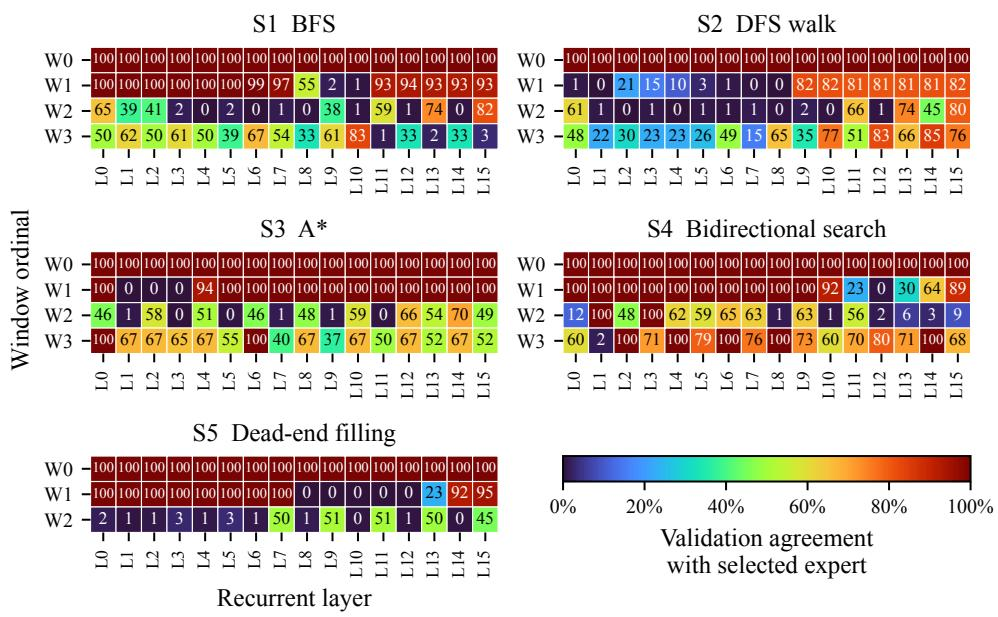  
Figure 16: Routing agreement on mazes. Each panel shows one strategy, with window positions as rows and routed depths k as columns. Each cell gives the percentage of observed routing decisions that agree with the mode-path expert at that position. The gray row marks window W3 for dead-end filling; no validation observations are available for that window-strategy combination.

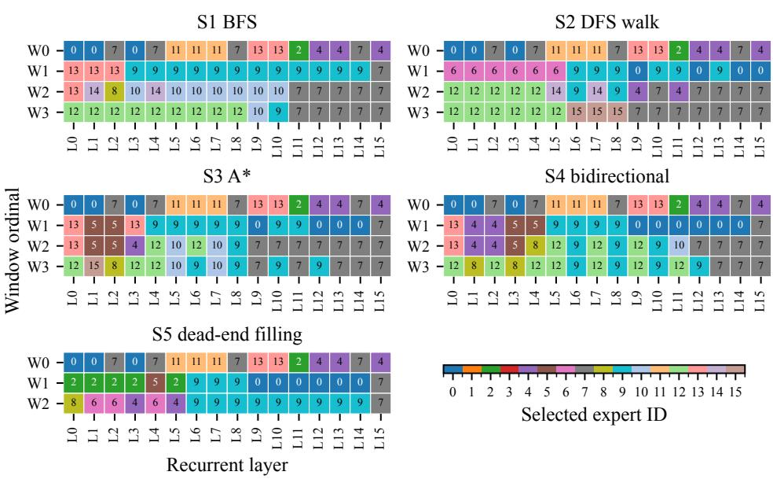

Figure 17: Mode routing paths on mazes. Each panel shows one strategy, with window positions as rows and routed depths k as columns. Cell labels and colors identify the expert with the highest mean router probability for each (strategy, window position, routed depth) tuple during validation. For dead-end filling, W3 has no validation observations and reuses the W2 expert sequence if reached.  
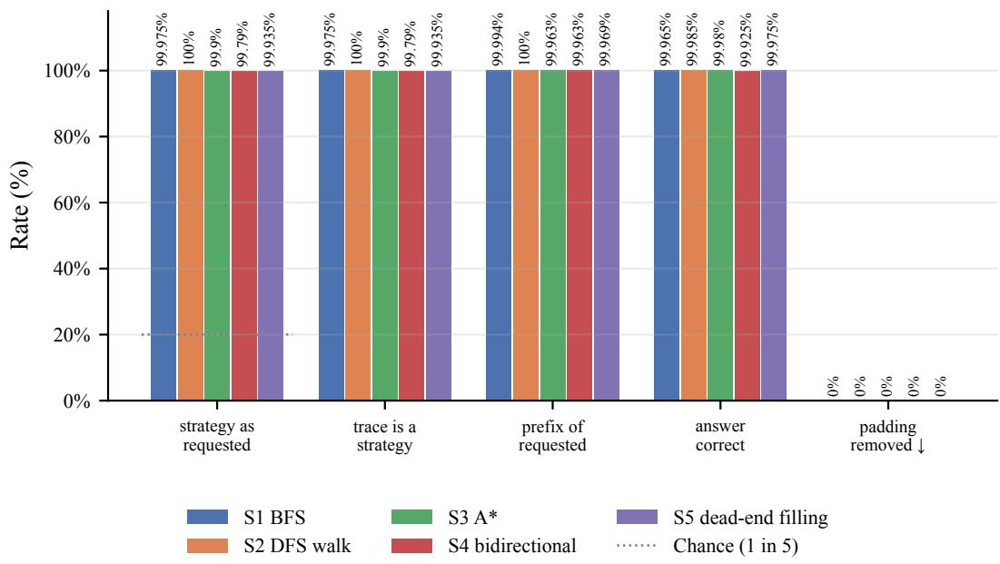  
Figure 18: Strategy and maze solution generation under forced routing.

The evaluations reported in the maze experiment are the same as those in the sudoku experiment.

## C.4.1 MAZE DATA EXAMPLE

Our data is formatted as Q : <Maze> start <Start Cell> goal <Goal Cell> [<Strategy Label>] R : <Search Trace> A : <Solution Path> <eos>.

#

Figure 19: Example of maze data. We input the maze into the model as a sequence, as shown below.

In Figure 19, we visualize an example maze and below show the sequences to solve this maze using each strategy.

## S1: BFS

<table><tr><td>Q</td><td>:</td><td>r1c1</td><td>E</td><td>S</td><td>r1c2</td><td></td><td>E W</td><td></td><td>r1c3</td><td>E</td><td>W</td><td>r1c4</td><td>E</td><td>S</td><td>W</td><td>r1c5</td><td>W</td><td>r1c6</td><td>E</td><td>S</td><td>r1c7</td><td></td><td>E</td><td>W</td><td>r1c8</td></tr><tr><td>S</td><td>W</td><td>r2c1</td><td>N</td><td>E</td><td>r2c2</td><td></td><td>S</td><td></td><td></td><td>W r2c3</td><td></td><td>W r2c4</td><td>N</td><td>E </td><td>r2c5</td><td>S</td><td>W</td><td>1r2c6</td><td>N</td><td>S</td><td></td><td>r2c7</td><td>E</td><td>S</td><td>r2c8</td></tr><tr><td>N</td><td>W</td><td>r3c1</td><td>S</td><td>r3c2 N</td><td></td><td></td><td>r3c3</td><td></td><td>E</td><td>S</td><td>r3c4</td><td>E</td><td>W</td><td>r3c5</td><td></td><td>N W</td><td>r3c6</td><td>N</td><td>S</td><td></td><td>r3c7</td><td>N</td><td>E</td><td>r3c8</td><td>S</td></tr><tr><td>W</td><td>r4c1</td><td>N</td><td>E</td><td>r4c2</td><td></td><td>N W</td><td>r4c3</td><td></td><td>N</td><td>S</td><td>r4c4</td><td>E</td><td>S</td><td>r4c5</td><td>E</td><td>W</td><td>r4c6</td><td>N</td><td>E</td><td></td><td>W r4c7</td><td></td><td>W</td><td>r4c8</td><td>N</td></tr><tr><td>S</td><td>r5c1</td><td>E</td><td>S</td><td>r5c2</td><td>S</td><td>W r5c3</td><td></td><td></td><td>N</td><td>S r5c4</td><td></td><td>N</td><td>E</td><td>r5c5</td><td>S</td><td></td><td>r5c6</td><td>S</td><td></td><td></td><td>r5c7 S r5c8 N S</td><td></td><td></td><td></td><td></td></tr><tr><td></td><td>r6c1</td><td>N S</td><td>r6c2 N</td><td></td><td>E</td><td>r6c3</td><td></td><td>N</td><td>S</td><td>W r6c4</td><td></td><td>E</td><td></td><td>S r6c5</td><td>N</td><td></td><td>W r6c6</td><td>N</td><td></td><td></td><td>S r6c7</td><td></td><td></td><td></td><td>N S r6c8 N</td></tr><tr><td>S</td><td>r7c1</td><td>N</td><td>S</td><td>r7c2</td><td>E</td><td>r7c3</td><td></td><td>N</td><td>W</td><td>r7c4 N</td><td></td><td>E</td><td></td><td>r7c5</td><td>S W</td><td></td><td>r7c6N</td><td>S</td><td></td><td></td><td>r7c7 N</td><td>E</td><td></td><td></td><td>r7c8 N W</td></tr><tr><td>r8c1</td><td>N</td><td>E</td><td>r8c2</td><td></td><td>E W</td><td>r8c3</td><td></td><td>E</td><td></td><td>W r8c4 </td><td>E</td><td>W</td><td></td><td>r8c5</td><td>N E</td><td></td><td>W r8c6</td><td>N</td><td>E</td><td></td><td>W r8c7</td><td></td><td></td><td></td><td>E W r8c8</td></tr><tr><td></td><td>W start</td><td></td><td>r3c6</td><td></td><td>goal</td><td>r8c2</td><td></td><td>[</td><td></td><td>r1cl r1c2</td><td></td><td></td><td></td><td>r2c1 r1c3</td><td></td><td>r2c2</td><td></td><td>2 r3c1 ] R : r3c6 r2c6</td><td></td><td></td><td></td><td></td><td></td><td></td><td></td></tr><tr><td>r4c6</td><td></td><td>r1c6</td><td></td><td>r4c7</td><td>r4c5</td><td></td><td>r1c7</td><td></td><td></td><td>r4c4</td><td>r1c8</td><td></td><td>r5c4</td><td>r2c8</td><td></td><td>r5c5</td><td></td><td>r2c7</td><td>r6c5</td><td></td><td></td><td></td><td></td><td></td><td></td></tr><tr><td>r3c8</td><td></td><td>r7c4</td><td></td><td>r4c8</td><td>r7c5</td><td></td><td>r5c8</td><td></td><td></td><td>r8c5</td><td>r6c8</td><td></td><td>r8c6</td><td>r8c4</td><td></td><td>r7c8</td><td></td><td>r7c6</td><td>r8c7</td><td></td><td></td><td></td><td></td><td>r3c7 r6c4</td><td></td></tr><tr><td>r6c6</td><td></td><td>r8c8</td><td></td><td>r8c2</td><td>A</td><td>:</td><td></td><td></td><td></td><td></td><td></td><td></td><td></td><td></td><td></td><td></td><td></td><td></td><td></td><td></td><td></td><td>r8c3</td><td></td><td>r7c7</td><td></td></tr><tr><td>r8c5</td><td></td><td>r8c4</td><td></td><td>r8c3</td><td>r8c2</td><td></td><td></td><td>&lt;eos&gt;</td><td></td><td></td><td></td><td></td><td></td><td></td><td></td><td></td><td></td><td></td><td></td><td></td><td></td><td>r3c6 r4c6 r4c5 r4c4 r5c4 r5c5 r6c5 r6c4 r7c4 r7c5</td><td></td><td></td><td></td></tr></table>

## S2: DFS walk

<table><tr><td>Q</td><td>:</td><td>r1c1</td><td>E</td><td>S</td><td>r1c2</td><td>E</td><td>W</td><td></td><td>r1c3</td><td>E</td><td>W</td><td>r1c4</td><td>E</td><td>S</td><td>W r1c5</td><td></td><td>W</td><td>r1c6</td><td>E</td><td>S</td><td>r1c7</td><td></td><td>E</td><td>W r1c8</td></tr><tr><td>S</td><td>W</td><td>r2c1</td><td>N</td><td>E</td><td>r2c2</td><td>E</td><td>S</td><td></td><td>W r2c3</td><td>W</td><td></td><td>V r2c4</td><td>N E</td><td>r2c5</td><td></td><td>S W</td><td>r2c6</td><td></td><td>N S</td><td></td><td>r2c7</td><td>E</td><td>S</td><td>r2c8</td></tr><tr><td>N</td><td>W</td><td>r3c1</td><td>S</td><td></td><td>r3c21</td><td>N S</td><td>r3c3</td><td></td><td>E</td><td>S</td><td>r3c4</td><td>E</td><td>W</td><td>r3c5</td><td>N W</td><td></td><td>r3c6</td><td>N S</td><td></td><td></td><td>r3c7 N</td><td>E</td><td>r3c8 S</td><td></td></tr><tr><td>W</td><td>r4c1</td><td>N</td><td>E</td><td>r4c2</td><td>N</td><td>W </td><td>r4c3</td><td></td><td>N S</td><td>r4c4</td><td></td><td>E</td><td>S</td><td>r4c5</td><td>E</td><td>W</td><td>r4c6</td><td>N</td><td>E W r4c7</td><td></td><td></td><td>W</td><td>r4c8 N</td><td></td></tr><tr><td>S</td><td>r5c1</td><td>E</td><td>S</td><td>r5c2</td><td>S</td><td>W r5c3</td><td></td><td></td><td>N S</td><td>r5c4</td><td></td><td>N</td><td>E r5c5</td><td></td><td>S</td><td>W r5c6</td><td></td><td>S</td><td></td><td></td><td>r5c7 S r5c8 N S</td><td></td><td></td><td></td></tr><tr><td></td><td>r6c1</td><td>N S</td><td></td><td>r6c2 N</td><td>E</td><td>r6c3 N S</td><td></td><td></td><td></td><td>W r6c4</td><td></td><td></td><td>E S r6c5</td><td></td><td></td><td></td><td>NW r6c6</td><td>N</td><td>I S r6c7 N S r6c8 N</td><td></td><td></td><td></td><td></td><td></td></tr><tr><td></td><td>S r7c1</td><td>N</td><td></td><td>S r7c2</td><td>E</td><td>r7c3</td><td></td><td>N</td><td>W</td><td>r7c4 N</td><td></td><td>E</td><td>r7c5</td><td>S</td><td>W</td><td>V r7c6 N</td><td></td><td>S</td><td>r7c7 N E r7c8 N W</td><td></td><td></td><td></td><td></td><td></td></tr><tr><td></td><td>r8c1 N E</td><td></td><td></td><td>r8c2 E</td><td>W</td><td>r8c3</td><td></td><td>E</td><td></td><td>W r8c4 E</td><td></td><td>W</td><td>1r8c5</td><td>N E</td><td></td><td>W r8c6</td><td>N</td><td>IE W r8c7 </td><td></td><td></td><td></td><td>E W r8c8</td><td></td><td></td></tr><tr><td colspan="2"></td><td>W start r3c6 goal r8c2</td><td></td><td></td><td></td><td></td><td></td><td></td><td></td><td>r1cl r1c2</td><td></td><td>r1c3</td><td></td><td>r1c4</td><td></td><td>r1c3</td><td>3 r1c2</td><td></td><td>] R : r3c6 r2c6</td><td></td><td></td><td></td><td></td><td></td></tr><tr><td colspan="2"></td><td colspan="7">r1c6 r1c7 r1c8 r2c8 r2c7</td><td>r3c7</td><td>r3c8</td><td>r4c8</td><td></td><td>r5c8</td><td></td><td>r6c8</td><td>r7c8</td><td></td><td>r7c7</td><td></td><td>r6c7 r5c7</td><td></td><td></td><td></td></tr><tr><td>r6c7</td><td colspan="2">r7c7</td><td>r7c8</td><td></td><td>r6c8</td><td></td><td>r5c8</td><td></td><td>r4c8</td><td>r3c8</td><td></td><td>r3c7</td><td></td><td>r2c7</td><td>r2c8</td><td></td><td>r1c8</td><td>r1c7</td><td></td><td>r1c6</td><td></td><td></td><td></td></tr><tr><td>r3c6</td><td></td><td>r4c6</td><td>r4c7</td><td></td><td>r4c6</td><td>r4c5</td><td></td><td>r4c4</td><td></td><td>r5c4</td><td></td><td>r5c5</td><td>r6c5</td><td></td><td>r6c4</td><td>r7c4</td><td></td><td>r7c5</td><td></td><td></td><td></td><td>r2c6</td><td></td></tr><tr><td></td><td>r7c6 r6c6 r5c6 r6c6 r7c6 r8c6 r8c7 r8c8 r8c7 r8c6 r8c5</td><td></td><td></td><td></td><td></td><td></td><td></td><td></td><td></td><td></td><td></td><td></td><td></td><td></td><td></td><td></td><td></td><td>r8c4</td><td></td><td>r8c5</td><td></td><td>r8c6</td><td></td></tr><tr><td></td><td></td><td></td><td></td><td></td><td></td><td></td><td></td><td></td><td></td><td></td><td></td><td></td><td></td><td></td><td></td><td></td><td></td><td></td><td></td><td>r8c3</td><td> r8c2 A</td><td></td><td></td></tr><tr><td colspan="2">&lt;eos&gt;</td><td>: r3c6 r4c6 r4c5 r4c4 r5c4 r5c5 r6c5 r6c4 r7c4 r7c5 r8c5 r8c4 r8c3 r8c2</td><td></td><td></td><td></td><td></td><td></td><td></td><td></td><td></td><td></td><td></td><td></td><td></td><td></td><td></td><td></td><td></td><td></td><td></td><td></td><td></td><td></td></tr></table>

S3: A\*

S5: Dead-end filling
<table><tr><td>Model</td><td>ARC-E</td><td>ARC-C</td><td>HellaSwag</td><td>PIQA</td><td>GSM8K</td></tr><tr><td>Random</td><td>25.0</td><td>25.0</td><td>25.0</td><td>50.0</td><td>0.0</td></tr><tr><td>Vanilla</td><td> $4 0 . 8 \pm 1 . 0$ </td><td> $2 8 . 2 \pm 1 . 3$ </td><td> $3 1 . 4 \pm 0 . 5$ </td><td> $5 6 . 6 \pm 1 . 2$ </td><td> $2 9 . 7 \pm 1 . 3$ </td></tr><tr><td>Vanilla (sliding window)</td><td> $4 9 . 5 \pm 1 . 0$ </td><td> $2 8 . 5 \pm 1 . 3$ </td><td> $3 1 . 3 \pm 0 . 5$ </td><td> $5 8 . 8 \pm 1 . 1$ </td><td> $2 7 . 5 \pm 1 . 2$ </td></tr><tr><td>LoL</td><td> $5 0 . 3 \pm 1 . 0$ </td><td> $2 9 . 1 \pm 1 . 3$ </td><td> $3 1 . 2 \pm 0 . 5$ </td><td> $5 9 . 7 \pm 1 . 1$ </td><td> $2 7 . 9 \pm 1 . 2$ </td></tr><tr><td>Vanilla (strided window)</td><td> $4 8 . 5 \pm 1 . 0$ </td><td> $2 8 . 0 \pm 1 . 3$ </td><td> $3 0 . 8 \pm 0 . 5$ </td><td> $5 9 . 0 \pm 1 . 1$ </td><td> $2 5 . 9 \pm 1 . 2$ </td></tr><tr><td>LoL (untied router)</td><td> $5 0 . 1 \pm 1 . 0$ </td><td> $3 0 . 0 \pm 1 . 3$ </td><td> $3 1 . 4 \pm 0 . 5$ </td><td> $5 7 . 1 \pm 1 . 2$ </td><td> $2 7 . 7 \pm 1 . 2$ </td></tr></table>

Table 5: Extended version of Table 1 with “Vanilla (strided window)” and “LoL (untied router).”

<table><tr><td>Q</td><td>:</td><td>r1c1</td><td>E</td><td>S</td><td>r1c2</td><td></td><td>W</td><td></td><td>r1c3</td><td>E</td><td>W</td><td>rlc4</td><td>E</td><td>S</td><td>W</td><td>r1c5</td><td>W</td><td>r1c6</td><td></td><td>E S</td><td>r1c7</td><td></td><td>E</td><td>W</td><td>r1c8</td></tr><tr><td>S</td><td></td><td>r2c1</td><td>N</td><td>E</td><td>r2c2</td><td></td><td>S</td><td>W</td><td>Ir2c3</td><td></td><td>W</td><td>r2c4</td><td>N</td><td>E</td><td></td><td>r2c5</td><td>S W</td><td>r2c6</td><td></td><td>N</td><td>S</td><td>r2c7</td><td>E</td><td>S</td><td>r2c8</td></tr><tr><td>N</td><td>W</td><td>r3cl</td><td>S</td><td>r3c2</td><td></td><td>E N S</td><td>r3c3</td><td></td><td>E</td><td>S</td><td>r3c4</td><td>E</td><td>W</td><td></td><td>r3c5 N</td><td>W</td><td></td><td>r3c6</td><td>N S</td><td></td><td>r3c7</td><td>N</td><td>E</td><td>r3c8</td><td>S</td></tr><tr><td>W</td><td>r4c1</td><td></td><td>N E</td><td>r4c2</td><td></td><td>N W</td><td>r4c3</td><td></td><td>N</td><td></td><td>r4c4</td><td>E</td><td>S</td><td>r4c5</td><td></td><td>W</td><td>r4c6</td><td></td><td>N E</td><td></td><td></td><td>W r4c7</td><td>W</td><td>r4c8</td><td>N</td></tr><tr><td>S</td><td>r5c1</td><td></td><td>E S</td><td>r5c2</td><td></td><td>W</td><td></td><td>r5c3</td><td>N</td><td>r5c4</td><td></td><td>N</td><td>E</td><td>r5c5</td><td>S</td><td>W</td><td>r5c6</td><td>S</td><td></td><td></td><td></td><td>r5c7 S r5c8 N S</td><td></td><td></td><td></td></tr><tr><td>r6c1 N</td><td></td><td>S</td><td>r6c2 N</td><td></td><td>E</td><td>r6c3</td><td></td><td>N</td><td>S</td><td>r6c4</td><td></td><td>E</td><td>S</td><td>r6c5</td><td>N</td><td>W</td><td>r6c6</td><td>N</td><td>S</td><td></td><td>r6c7</td><td>N</td><td>S</td><td>r6c8</td><td>N</td></tr><tr><td>S</td><td>r7c1</td><td>N</td><td>S</td><td>r7c2</td><td>E</td><td>r7c3</td><td></td><td>N</td><td>W W</td><td>r7c4</td><td>N</td><td>E</td><td>r7c5</td><td>S</td><td>W</td><td></td><td>r7c6N</td><td>S</td><td>r7c7</td><td></td><td>N</td><td>E</td><td></td><td></td><td>r7c8 N W</td></tr><tr><td>r8c1 N</td><td></td><td>E</td><td>r8c2 E</td><td></td><td>W</td><td>r8c3</td><td></td><td>E W</td><td></td><td>r8c4</td><td>E</td><td>W</td><td>r8c5</td><td>N</td><td>E</td><td>W</td><td>r8c6</td><td>N</td><td>E</td><td></td><td></td><td></td><td></td><td></td><td></td></tr><tr><td>W start r3c6 goal r8c2</td><td></td><td></td><td></td><td></td><td></td><td></td><td></td><td>[</td><td>r1c1 r1c2</td><td></td><td></td><td></td><td>r2c2</td><td></td><td>r2c3</td><td></td><td>r3c3</td><td>r3c4</td><td></td><td></td><td></td><td>W r8c7 </td><td>E</td><td></td><td>W r8c8</td></tr><tr><td>r4c5 r4c4 r5c4 r2c6 r4c7</td><td></td><td></td><td></td><td></td><td></td><td></td><td></td><td></td><td>r5c5</td><td>r6c5</td><td></td><td></td><td></td><td></td><td></td><td></td><td>r6c4 r7c4 r1c6 r7c5</td><td></td><td></td><td>]</td><td></td><td></td><td></td><td>R : r3c6 r4c6</td><td></td></tr><tr><td></td><td></td><td></td><td></td><td></td><td></td><td></td><td></td><td></td><td></td><td></td><td></td><td></td><td></td><td></td><td></td><td></td><td></td><td></td><td></td><td></td><td></td><td></td><td></td><td>r8c5 r8c4 r8c3</td><td></td></tr><tr><td>r8c3 r8c2</td><td>r8c2 A : r3c6 r4c6 r4c5 r4c4 r5c4 r5c5 r6c5 r6c4 r7c4 r7c5 r8c5 r8c4</td><td></td><td>2 &lt;eos&gt;</td><td></td><td></td><td></td><td></td><td></td><td></td><td></td><td></td><td></td><td></td><td></td><td></td><td></td><td></td><td></td><td></td><td></td><td></td><td></td><td></td><td></td><td></td></tr></table>

## S4: Bidirectional BFS

<table><tr><td>Q</td><td>:</td><td>r1c1</td><td>E</td><td>S</td><td>r1c2</td><td>E</td><td>W</td><td></td><td>r1c3</td><td>E</td><td>W</td><td>r1c4</td><td></td><td>E S</td><td>W</td><td>r1c5</td><td>W</td><td>r1c6</td><td></td><td>E S</td><td>r1c7</td><td></td><td>E</td><td>W</td><td>r1c8</td></tr><tr><td>S</td><td>W r2c1</td><td></td><td>N</td><td>E</td><td>r2c2</td><td>E</td><td>S</td><td>W</td><td></td><td>r2c3</td><td>W</td><td>r2c4</td><td>N</td><td>E</td><td>r2c5</td><td>S</td><td>W</td><td>r2c6</td><td></td><td>N S</td><td></td><td>r2c7</td><td>E</td><td>S</td><td>r2c8</td></tr><tr><td>N</td><td>W</td><td>r3c1</td><td>S</td><td>r3c2</td><td>N</td><td>S</td><td></td><td>r3c3</td><td>E</td><td>S</td><td>r3c4</td><td>E</td><td>W</td><td>r3c5</td><td>N</td><td>W</td><td></td><td>r3c6</td><td>N S</td><td></td><td>r3c7</td><td>N</td><td>E</td><td>r3c8</td><td>S</td></tr><tr><td>W</td><td>r4cl</td><td>N</td><td>E</td><td>r4c2</td><td></td><td>N W</td><td>r4c3</td><td></td><td>N</td><td>S</td><td>r4c4</td><td>E</td><td>S</td><td>r4c5</td><td>E</td><td>W</td><td>r4c6</td><td>N</td><td>E</td><td></td><td></td><td>W r4c7</td><td>W</td><td>r4c8</td><td>N</td></tr><tr><td>S</td><td>r5c1</td><td>E</td><td>S</td><td>r5c2</td><td></td><td>W</td><td></td><td>r5c3</td><td>N</td><td>S</td><td>r5c4</td><td>N</td><td>E</td><td>r5c5</td><td>S</td><td>W</td><td>r5c6</td><td>S</td><td>r5c7</td><td></td><td>S</td><td>r5c8</td><td></td><td>NS</td><td></td></tr><tr><td>r</td><td>6c1 N</td><td>S</td><td>r</td><td>6c2 N</td><td></td><td>r6c3</td><td></td><td>N</td><td>S</td><td>W r6c4</td><td></td><td>E</td><td>S</td><td>r6c5</td><td>N</td><td>W</td><td>r6c6</td><td>N</td><td>S</td><td></td><td>r6c7</td><td>N</td><td>S</td><td>r6c8</td><td>N</td></tr><tr><td>S</td><td>r7c1</td><td>N</td><td>S</td><td>r7c2</td><td></td><td>r7c3</td><td></td><td>N</td><td>W</td><td>r7c4</td><td></td><td>E</td><td></td><td>r7c5</td><td>S W</td><td></td><td>r7c6 N</td><td>S</td><td>r7c7</td><td></td><td>N</td><td>E</td><td>r7c8</td><td>N</td><td>W</td></tr><tr><td>r8c1</td><td>N</td><td>E</td><td></td><td>r8c2</td><td>E W</td><td>r8c3</td><td></td><td>E</td><td>W</td><td>r8c4</td><td>N E</td><td>W</td><td></td><td>r8c5</td><td>N E</td><td></td><td>W r8c6</td><td>N</td><td>E</td><td>W</td><td>r8c7</td><td>E</td><td>W</td><td>r8c8</td><td></td></tr><tr><td>W</td><td>start</td><td></td><td>r3c6</td><td></td><td>goal</td><td>r8c2</td><td></td><td>[</td><td></td><td>rlcl</td><td>r8c8</td><td></td><td>rlc2</td><td></td><td>r8c7</td><td></td><td>r1c3</td><td>r8c6</td><td></td><td></td><td>R :</td><td>r3c6</td><td></td><td>r8c2</td><td></td></tr><tr><td>r2c6</td><td></td><td>r8c3</td><td></td><td>r4c6</td><td>r8c1</td><td></td><td>r1c6</td><td></td><td></td><td>r8c4</td><td>r4c7</td><td></td><td>r7c1</td><td>r4c5</td><td></td><td>r8c5</td><td></td><td>r1c7</td><td></td><td>r6c1</td><td></td><td>r4c4</td><td></td><td>r7c5</td><td></td></tr><tr><td>r1c8</td><td></td><td>r8c6</td><td></td><td>r5c4</td><td>r5c1</td><td></td><td>r2c8</td><td></td><td></td><td>r7c4</td><td>r5c5</td><td></td><td>r7c6</td><td>r2c7</td><td></td><td>r8c7</td><td></td><td>r6c5</td><td></td><td>r6c4</td><td></td><td></td><td></td><td></td><td></td></tr><tr><td>r4c6</td><td></td><td>r4c5</td><td></td><td>r4c4</td><td>r5c4</td><td></td><td>r5c5</td><td></td><td>r6c5</td><td></td><td>r6c4</td><td></td><td>r7c4</td><td>r7c5</td><td></td><td>r8c5</td><td></td><td>r8c4</td><td>r8c3</td><td></td><td>r8c2</td><td>A :</td><td>r3c6</td><td></td><td>&lt;eos&gt;</td></tr></table>

<table><tr><td>Q</td><td>:</td><td>r1cl</td><td>E</td><td>S</td><td>r1c2</td><td>E</td><td></td><td></td><td>W r1c3</td><td>E</td><td>W</td><td>r1c4</td><td>E</td><td>S</td><td>W</td><td>r1c5</td><td>W r1c6</td><td></td><td>E</td><td>S</td><td>r1c7</td><td>E</td><td>W</td><td>r1c8</td></tr><tr><td>S</td><td>W</td><td>r2c1</td><td>N</td><td>E r2c2</td><td></td><td>E</td><td>S</td><td></td><td>W r2c3</td><td>W</td><td></td><td>r2c4</td><td>N</td><td>E</td><td>r2c5</td><td>S</td><td>W r2c6</td><td></td><td>N</td><td>S </td><td>r2c7</td><td>E</td><td>S</td><td>r2c8</td></tr><tr><td>N</td><td>W</td><td>r3c1</td><td>S</td><td>r3c2 N</td><td></td><td>S</td><td></td><td>r3c3</td><td>E S</td><td>r3c4</td><td></td><td>E W</td><td>r3c5</td><td></td><td>N</td><td>W</td><td>r3c6</td><td>N</td><td>S</td><td>r3c7</td><td>N</td><td>E</td><td>r3c8 S</td><td></td></tr><tr><td>W</td><td>r4c1</td><td>N</td><td>E</td><td>r4c2</td><td>N</td><td>W</td><td>r4c3</td><td></td><td>N</td><td>r4c4</td><td></td><td>E</td><td>r4c5</td><td></td><td>E</td><td>W</td><td>r4c6</td><td>N</td><td></td><td></td><td>E W r4c7</td><td>W</td><td>r4c8</td><td>N</td></tr><tr><td>S</td><td>r5c1</td><td>E</td><td>S</td><td>r5c2</td><td>S</td><td>W r5c3</td><td></td><td>N</td><td>S</td><td>r5c4</td><td></td><td>N E</td><td>r5c5</td><td></td><td>S</td><td>W</td><td>r5c6</td><td>S</td><td></td><td></td><td>r5c7 S r5c8 N S</td><td></td><td></td><td></td></tr><tr><td></td><td>r6c1 N</td><td>S</td><td>r6c2 N</td><td></td><td>E</td><td>r6c3</td><td></td><td>N S</td><td></td><td>W r6c4</td><td></td><td>E</td><td>S r6c5</td><td></td><td>N</td><td></td><td>W r6c6</td><td>N</td><td></td><td>S r6c71</td><td>N</td><td></td><td>S r6c8</td><td>N</td></tr><tr><td>S</td><td>r7c1</td><td>N</td><td>S</td><td>r7c2</td><td>E</td><td>r7c3</td><td></td><td>N</td><td>W</td><td>r7c4 N</td><td></td><td>E</td><td>r7c5</td><td>S</td><td></td><td></td><td>r7c6N</td><td>S</td><td></td><td>r7c7 N</td><td>E</td><td></td><td></td><td>r7c8 N W</td></tr><tr><td></td><td>r8c1 N</td><td>E</td><td>r8c2</td><td>E</td><td>W</td><td>r8c3</td><td></td><td>E</td><td></td><td>W r8c4 E</td><td></td><td>W</td><td>r8c5</td><td>N</td><td>E</td><td></td><td>W r8c6</td><td>N</td><td></td><td></td><td>E W r8c7</td><td>E</td><td>W r8c8</td><td></td></tr><tr><td>W</td><td>start</td><td></td><td>r3c6</td><td>goal</td><td></td><td>r8c2</td><td></td><td>[</td><td></td><td>r8c1 r8c2</td><td></td><td></td><td>r8c3</td><td>r1c8</td><td></td><td></td><td>r2c8 r3c8</td><td></td><td>]</td><td></td><td>R : r1c5</td><td></td><td>r2c3</td><td></td></tr><tr><td>r3c1</td><td></td><td>r4c1</td><td></td><td>r4c2</td><td>2 r4c7 r5c6</td><td></td><td></td><td></td><td>r5c7</td><td>r6c6</td><td></td><td></td><td>r6c7</td><td>r7c2</td><td></td><td>r7c3</td><td>r7c6</td><td></td><td></td><td>r7c7</td><td>r7c8</td><td></td><td>r8c8</td><td></td></tr><tr><td>r3c2</td><td></td><td>r6c8</td><td></td><td>r8c7</td><td>r2c2</td><td></td><td>r5c8</td><td></td><td>r8c6</td><td>r2c1</td><td></td><td>r4c8</td><td></td><td>r1c1</td><td></td><td>r1c2</td><td>r1c3</td><td></td><td>r1c4</td><td></td><td>r2c4</td><td></td><td>r2c5</td><td></td></tr><tr><td>r3c5</td><td></td><td>r3c8</td><td></td><td>r3c4</td><td>r3c7</td><td></td><td>r2c7</td><td></td><td>r2c8</td><td>r3c3</td><td></td><td>r4c3</td><td></td><td>r5c3</td><td></td><td>r6c3</td><td>r1c8</td><td></td><td>r6c2</td><td></td><td>r1c7</td><td></td><td>r5c2</td><td></td></tr><tr><td>r1c6</td><td></td><td>r2c6</td><td></td><td>r5c1</td><td>r6c1</td><td></td><td>r7c1</td><td></td><td>r8c1</td><td>A :</td><td></td><td></td><td></td><td></td><td></td><td></td><td></td><td></td><td></td><td></td><td>r3c6 r4c6 r4c5 r4c4 r5c4 r5c5 r6c5</td><td></td><td></td><td></td></tr><tr><td>r6c4</td><td></td><td>r7c4</td><td></td><td>r7c5</td><td>r8c5</td><td></td><td>r8c4</td><td></td><td>r8c3</td><td>r8c2</td><td></td><td>&lt;eos&gt;</td><td></td><td></td><td></td><td></td><td></td><td></td><td></td><td></td><td></td><td></td><td></td><td></td></tr></table>

## C.5 MATH

In Figure 20 and Table 5, we extend Figure 4 and Table 1 with “Vanilla (strided window)” and “LoL (untied router).” For our evaluations, we use 5 shot evaluation, except for GSM8K, where we use 3 shot evaluation to fit within the 1024 token context.

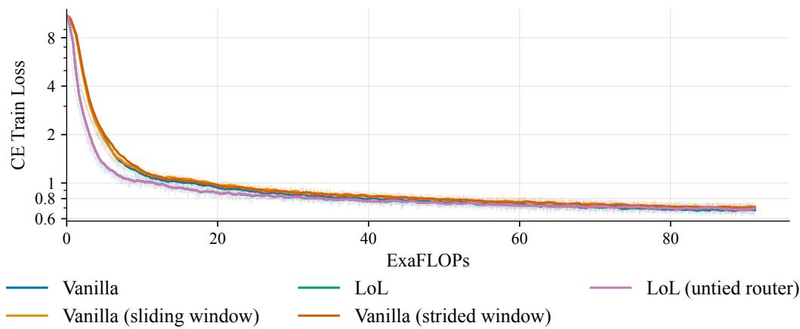  
Figure 20: Extended version of Figure 4 with “Vanilla (strided window)” and “LoL (untied router).”

## C.6 LOOPED TRANSFORMERS

In Figure 21, we visualize the expert utilization of the models shown in Figure 5.

## C.7 MOE

In Figure 22, we visualize the expert utilization of the models shown in Figure 6.

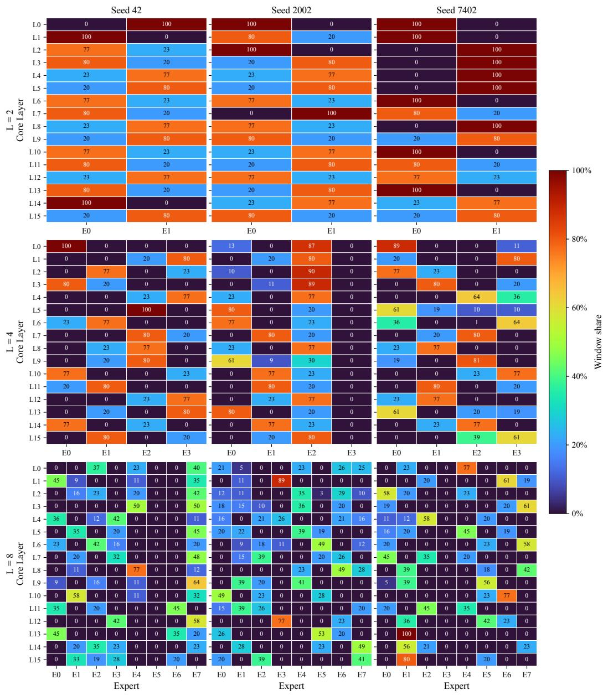  
Figure 21: Heatmap of expert utilization of LoL models shown in Figure 5.

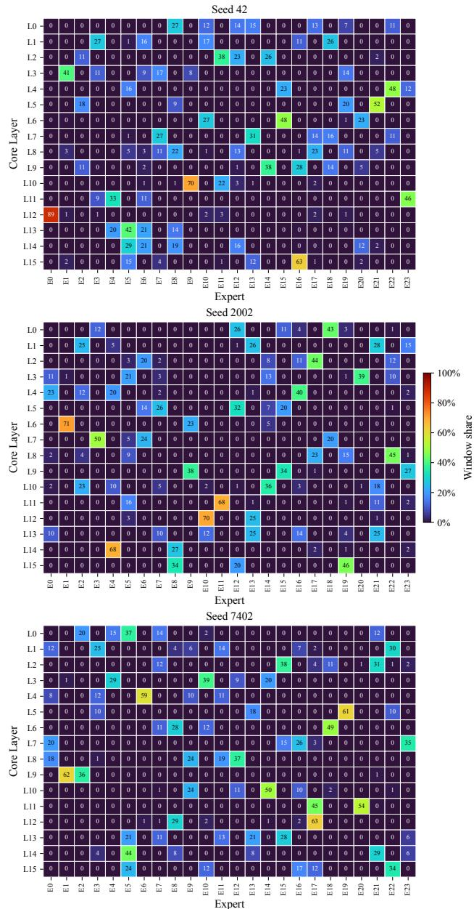  
Figure 22: Heatmap of expert utilization of LoL models shown in Figure 6.