Bir kişi hasarın üstündə zürafəni qidalandırı

# MultiInpaintCOCO: Fine‑Grained Visual Understanding in Multiple Languages

Andrei-Alexandru Manea1 and Jindřich Libovický1 and Philipp J. Rösch2 1Faculty of Mathematics and Physics, Charles University, Czech Republic 2Bundeswehr University Munich, Germany {manea, libovicky}@ufal.mff.cuni.cz philipp.roesch@unibw.de

## Abstract

Previous research shows that vision-language (VL) models struggle to understand finegrained image details and tend to focus on the overall layout. Moreover, any weakness in English tends to be further amplified in the multilingual setting. To study that, we extend InpaintCOCO, an English dataset focused on fine-grained visual details, to 13 typologically diverse languages across five language families, creating MultiInpaintCOCO – a new multilingual benchmark of 953 minimalpair examples. We further test several stateof-the-art models in multilingual multimodal retrieval, considering both light VL CLIP-like encoders and large language models. Our results show that performance degrades substantially for lower-resource languages, with the strongest predictor being the data resources available for the languages rather than typolog ical similarity to English. In cross-lingual retrieval, most models exhibit a systematic bias toward English: when given a correct caption in a non-English language and an incorrect one in English, models preferentially select the English caption. This bias varies considerably across architectures. Among the tested models, Gemma 3 shows the strongest English preference while Qwen 3 is the least biased, despite both reaching similar monolingual accuracy across languages. The code is available at https://github.com/ufal/ multi-inpaint-coco.

## 1 Introduction

Vision-language (VL) models take both images and text as input. Depending on the task, two main types of models are currently used. Dual encoders, such as CLIP (Radford et al., 2021) and SigLIP 2 (Tschannen et al., 2025), encode images and texts independently into a shared embedding space; they are the standard choice for retrieval and similarity tasks. Decoder-only models, such as Gemma 3 (Team et al., 2025) and Qwen 2.5-VL (Bai et al.,

Original image  

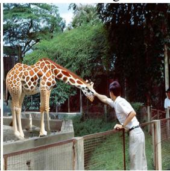  
Figure 1: Example from the MultiInpaintCOCO dataset. The left image and English caption are from the COCO dataset, the right equivalent part is from InpaintCOCO.

2025b), are decoder-based and generate text conditioned on both visual and textual input. Both model types are pre-trained on large image-text corpora using objectives (contrastive or generative) that do not require distinguishing between images or captions that difer only in fine-grained details.

Several studies have shown that VL models fail to capture fine-grained visual information and instead rely on coarse features, such as global scene layout or the most salient objects (Fu et al., 2025). To probe this limitation precisely, Rösch et al. (2024) proposes minimal pairs: each example consists of two images that difer by a single inpainted object and two captions that difer by exactly one keyword, so that the correct answer cannot be reached without identifying the specific visual detail. A similar strategy applied at the caption level underlies benchmarks such as SugarCrepe (Dumpala et al., 2024). The image-editing approach has a key advantage: it introduces genuine visual ambiguity, because neither the image nor the caption alone is suficient to determine the correct match.

All of this work is English-only. It is well established that VL model performance drops substantially when moving from English to lowerresource languages (Liu et al., 2021; Bugliarello et al., 2022a), and that multilingual models are not equally calibrated across languages. Errors in less-resourced languages may therefore not only be more frequent but also qualitatively diferent. The combination of fine-grained visual understanding and multilingual evaluation is therefore almost entirely unexplored. To close this gap, we extend InpaintCOCO (Rösch et al., 2024) to 13 typologically diverse languages (Azerbaijani, Arabic, Czech, German, Greek, Hindi, Italian, Japanese, Romanian, Russian, Slovak, Ukrainian, Vietnamese), producing the MultiInpaintCOCO dataset. Captions were first translated automatically and then post-edited by native speakers.

We evaluate several state-of-the-art dualencoder and generative decoder models on MultiInpaintCOCO and report two main findings. First, performance on lower-resource languages is substantially worse than on English and other highresource languages, confirming that fine-grained retrieval is harder in the multilingual setting. Second, and more surprisingly, when a model is given one correct caption in a non-English language and one incorrect caption in English, most models systematically prefer the English caption. This bias appears in both dual-encoder and generative decoder-only models, with Azerbaijani the least favored language. The strength of the bias varies considerably across models: Gemma 3 exhibits the strongest preference for English, while Qwen 3 is the least biased. This is not just a reflection of lower overall accuracy in weaker languages. It reveals a systematic preference for English that persists even when the model is otherwise capable of making the correct match.

## 2 Dataset Description

MultiInpaintCOCO extends the English Inpaint-COCO dataset (Rösch et al., 2024) to 13 more languages, producing a multilingual minimal-pair benchmark for fine-grained vision-language retrieval. The dataset covers 14 languages in total and spans five language families, with translations produced automatically and then post-edited by na-

tive speakers.

## 2.1 InpaintCOCO

InpaintCOCO (Rösch et al., 2024) is a minimalpair dataset built on top of COCO (Lin et al., 2014). For each example, a keyword is replaced in the original caption, and the corresponding image region is edited using Stable Difusion inpainting (Rombach et al., 2022), producing a pair of images that difer in a single localized detail and a pair of captions that reflect that diference. This construction ensures that a model can only retrieve the correct image–caption match by attending to finegrained visual content rather than overall scene similarity.

Before translation, we manually reviewed all 1,260 examples in InpaintCOCO and removed or corrected low-quality instances. We discarded examples in which the inpainted image contained visible artifacts or the edit was too subtle to warrant a diferent caption, and we corrected captions that were inaccurate or inconsistent with the edited image. After this review, 953 examples remained.

## 2.2 Translation Process

For each language, captions were first translated automatically and then post-edited by a native speaker. Three translation systems were available to the annotators: Hunyuan (Zheng et al., 2025) (the WMT25 winner; Kocmi et al., 2025), Google Translate, and GPT-4. Annotators were free to choose whichever system they found most useful as a starting point and were instructed to correct any errors in the output. All annotators were native speakers of the target language with an excellent command of English. The translation into Russian was post-edited, with German as the source language. More details about the annotation process are in the Appendix A.

## 2.3 The MultiInpaintCOCO Dataset

The final dataset covers 14 languages across five language families: Indo-European, Japonic, Turkic, Austroasiatic, and Afro-Asiatic, with Indo-European being the most represented (10 languages). The full list of languages with their metadata is given in Table 7. The languages vary substantially in their resource levels: following the tiers of Joshi et al. (2020), the dataset includes four tier-5 languages (English, German, Japanese, Arabic), five tier-4 languages, four tier-3 languages, and one tier-1 language (Azerbaijani). Morphologically, the majority are fusional (10), with two agglutinative languages (Japanese, Azerbaijani) and two isolating languages (English, Vietnamese).

The disparity in the availability of pretraining data across our languages is stark. In FineWeb2 (Penedo et al., 2025), a 20 TB multilingual web corpus covering over 1,000 languages, Russian alone accounts for 6,400 GB, while German and Japanese each contribute around 1,650 GB. At the other extreme, Azerbaijani has only 29 GB of data, roughly 220 times less than Russian. Slovak (92 GB) and Hindi (130 GB) also fall well below the high-resource languages despite having tens of millions of native speakers. This orders-of-magnitude gap in raw text data directly motivates our expectation (and findings) of performance diferences across languages in our experiments.

Table 9 places MultiInpaintCOCO in the context of existing multilingual vision-language benchmarks (Liu et al., 2021; Nooralahzadeh and Sennrich, 2023; Bugliarello et al., 2022b; Romero et al., 2024; Pfeifer et al., 2022; Schneider and Sitaram, 2024). Most existing benchmarks are either translation-based with a narrow language selection or culturally grounded but limited in scale. MultiInpaintCOCO occupies a distinct position: it is translation-based, enabling direct cross-lingual comparison, and the only benchmark that combines caption-level and image-level minimal pairs, allowing retrieval errors to be attributed to either the text or the visual representation. In terms of linguistic diversity, measured by the Grambank feature inclusion index (GBI; Ploeger et al., 2024), our dataset scores 79, which is higher than all other translation-based benchmarks in Table 9, such as xFlickrCo (Bugliarello et al., 2022b) (65) or XTD (Aggarwal and Kale, 2020) (71), and comparable to culturally grounded ones such as KnowRecall (Wang et al., 2025) (77.94) and CVQA (Romero et al., 2024) (88). Still, MultiInpaintCOCO’s 14 languages represent only 19% of the world’s population when considering languages spoken as first languages.

## 3 Multilingual Experiments

We evaluate both dual-encoder and decoder-only models on MultiInpaintCOCO across all 14 languages to assess how well current VL models handle fine-grained visual details in a multilingual setting. Beyond raw model performance, we measure consistency across languages and across models.

## 3.1 Experimental Setup

Task formulation. Each example in MultiInpaintCOCO consists of an original image–caption pair and an edited image–caption pair. We construct two retrieval subtasks from this structure. In the two-image task (2img), the model is given one caption and two images and must select the image that matches the caption. In the two-caption task (2txt), the model is given one image and two captions and must select the caption that describes the image. In both cases, either the original or the edited item serves as the query, while the two remaining items of the other modality serve as the context.

Dual encoders. Dual encoders map images and texts independently into a shared embedding space. For each example, we embed both images and both captions and compute all pairwise cosine similarities. The predicted match is the image (or caption) that is most similar to the query. This evaluation protocol follows Rösch et al. (2024).

Decoder-only models. Decoder-only models process inputs sequentially. We present the model with both options (two-image or two-caption) and a prompt asking which option is correct. The instruction prompt (see Appendix B) is written in English, regardless of the language of the captions. We are aware that this practice might amplify the English bias. To explore this, we also test with French (a language not in the current dataset), and the strict accuracy is generally lower (Table 23), but the diferences between languages follow the same patterns. We therefore decide to stick with the English prompts. Because decoder-only models are known to be sensitive to input order (Wardle and Susnjak, 2024; Tian et al., 2025), we evaluate each example in both orders and require both to be correct, yielding eight comparison configurations per example in total (see Table 11). A detailed evaluation of the position bias of the models used in this paper is provided in Appendix C.

Model performance. We report strict accuracy as a primary metric. A dataset item is counted as correct only if the model answers correctly across all comparison configurations: four for orderinvariant dual encoders and eight for decoder-only models.

Formally, each example consists of an original image-caption pair $( I _ { 0 } , T _ { 0 } )$ and an edited pair $( I _ { \mathrm { e } } , T _ { \mathrm { e } } )$ . We construct four binary correctness indicators: $c ( I _ { 0 } , \{ T _ { 0 } , T _ { \mathrm { e } } \} )$ and $c ( I _ { \mathrm { e } } , \{ T _ { 0 } , T _ { \mathrm { e } } \} )$ for the 2txt task, and $c ( T _ { 0 } , \{ I _ { 0 } , I _ { \mathrm { e } } \} )$ and $c ( T _ { \mathrm { e } } , \{ I _ { 0 } , I _ { \mathrm { e } } \} )$ for the 2img task, where $c ( q , \{ a , b \} ) = 1$ , if the model selects the correct item from the pair given the query q. For the sake of notation simplicity, we consider that $c ( \boldsymbol { q } , \{ a , b \} )$ contains the results in both input orders for decoder-only models; therefore, $c ( q , \{ a , b \} ) = c ( q , ( a , b ) ) \cdot c ( q , ( b , a ) )$

The 2img and 2txt accuracies are the averages of the corresponding indicators over all examples. Strict accuracy requires all four to be correct:

$$
\begin{array} { l l l } { { c _ { 2 i m g } } } & { { = } } & { { c ( T _ { \mathrm { o } } , \{ I _ { \mathrm { o } } , I _ { \mathrm { e } } \} ) \cdot c ( T _ { \mathrm { e } } , \{ I _ { \mathrm { o } } , I _ { \mathrm { e } } \} ) } } \end{array}\tag{1}
$$

$$
\begin{array} { l l l } { c _ { 2 t x t } } & { = } & { c ( I _ { 0 } , \{ T _ { 0 } , T _ { \mathrm { e } } \} ) \cdot c ( I _ { \mathrm { e } } , \{ T _ { 0 } , T _ { \mathrm { e } } \} ) } \end{array}\tag{2}
$$

$$
\begin{array} { l c l } { { c _ { \mathrm { s t r i c t } } } } & { { = } } & { { c _ { 2 i m g } \cdot c _ { 2 t x t } } } \end{array}\tag{3}
$$

and strict accuracy is the average of $c _ { \mathrm { s t r i c t } }$ over all examples.

Factors influencing model performance. Because we do not have access to the training data or methodology of the models we study, we can only partially explain cross-lingual performance diferences. To assess that, we compute the Spearman correlation between strict accuracy and a set of language-level variables listed in Table 2: resource tier (Joshi et al., 2020), number of native speakers according to Wikidata1 (Vrandecic and Krötzsch, 2014), typological similarity to English and Chinese from the URIEL+ database (Khan et al., 2025), number of Wikipedia articles, and the amount of available text in the FineWeb2 corpus (Penedo et al., 2025). Further, we consider the number of tokens into which our dataset is tokenized per language (see Table 10 in the Appendix).

Language agreement. Similar accuracy scores across languages do not necessarily mean that models make the same errors. To measure how similar the error patterns are across languages, we compute Cohen’s $\kappa ,$ a standard metric for interannotator agreement, between the per-language model predictions. The agreement between two languages, $l _ { 1 }$ and $l _ { 2 } .$ , inside the model m is represented by $C ( m , l _ { 1 } , l _ { 2 } )$ , and the average agreement across languages $A ( l _ { 1 } , l _ { 2 } )$ is computed as follows:

$$
C ( m , l _ { 1 } , l _ { 2 } ) = \kappa ( \hat { y } _ { m } ( l _ { 1 } ) , \hat { y } _ { m } ( l _ { 2 } ) ) ,\tag{4}
$$

$$
A ( l _ { 1 } , l _ { 2 } ) = \frac { 1 } { | M | } \sum _ { m } C ( m , l _ { 1 } , l _ { 2 } )\tag{5}
$$

where $\hat { y } _ { m } ( l )$ is the output of the model $m ,$ in language l. A value of 0 indicates that two languages make errors on completely diferent examples, while a value of 1 means their error patterns are identical.

Model agreement. We use the same method to compare error patterns across models. For two models $m _ { 1 }$ and $m _ { 2 }$ , in the language l, we compute the individual agreement $C ( m _ { 1 } , m _ { 2 } , l )$ and the average agreement $A ( m _ { 1 } , m _ { 2 } )$ as:

$$
\begin{array} { r c l } { { { \cal C } ( m _ { 1 } , m _ { 2 } , l ) } } & { { = } } & { { \kappa ( \hat { y } _ { m _ { 1 } } ( l ) , \hat { y } _ { m _ { 2 } } ( l ) ) , } } \end{array}\tag{6}
$$

$$
A ( m _ { 1 } , m _ { 2 } ) = \frac { 1 } { | L | } \sum _ { l } C ( m _ { 1 } , m _ { 2 } , l ) .\tag{7}
$$

## 3.2 Tested Models

We evaluate two model families: decoder-only generative VL models and dual-encoder CLIP-like models. Tables 12 and 8 provide additional model details.

Decoder-only models. We evaluate five openweight VL models with a parameter count ranging from 2B to 12B. Gemma 3 (Team et al., 2025) (12B parameters), Qwen VL 2.5 (Bai et al., 2025b) (7B), Qwen VL 3 (Bai et al., 2025a) (8B), Aya Vision (Dash et al., 2025) (8B), and Jina VL (Koukounas et al., 2026) (2B), the smallest model in our evaluation.

Dual encoder models. We evaluate seven CLIPlike models (Radford et al., 2021), all based on SigLIP (Zhai et al., 2023). This includes NLLB-SigLIP (Visheratin, 2023) in base and large sizes, MEXMA-SigLIP 2, and SigLIP 2 (Tschannen et al., 2025) from base to giant sizes. The vision encoders of SigLIP 2 are also used in Gemma and Qwen. The NLLB versions consist of the first SigLIP model, pre-trained across all languages in NLLB-200 (Team et al., 2022). MEXMA-SigLIP 2 combines the MEXMA text encoder (Janeiro et al., 2024) with the SigLIP visual backbone.

## 3.3 Results

Model performance. We report the strict accuracy in Table 1. Table 14 in the appendix contains the accuracy for the 2img task, and Table 15 for 2txt. On average, deciding between two images is slightly harder than deciding between two texts for all the models. This is expected, given that in the 2txt task, the query image is fixed across languages, and errors are driven mainly by shared visual ambiguity. However, in the 2img setup, the query is language-specific, so the per-language text-encoding quality introduces additional variation. The Jina model has the highest modality performance gap, while Qwen 3 has the lowest. Azerbaijani (tier-1) has the lowest performance, which is correlated with it being the least-resourced language we have. On the other hand, with dual encoders that rely on the SigLIP 2 text encoder, we observe a performance drop for Japanese, a highresource language (tier-5). Moreover, for the same models, the gap between the 2img/2txt accuracies and strict accuracy is unusually large for Hindi. Finally, MEXMA-SigLIP 2 performs best on Azerbaijani.

<table><tr><td>Model</td><td>ar</td><td>az</td><td>cs</td><td>de</td><td>el</td><td>en</td><td>hi</td><td>it</td><td>ja</td><td>ro</td><td>ru</td><td>sk</td><td>uk</td><td>vi</td><td>Avg.</td></tr><tr><td>Gemma 3 12B</td><td>.581</td><td>.425</td><td>.507</td><td>.581</td><td>.587</td><td>.569</td><td>.523</td><td>.580</td><td>.510</td><td>.570</td><td>.610</td><td>.472</td><td>.594</td><td>.599</td><td>.551</td></tr><tr><td>Qwen 2.5 VL 7B</td><td>.595</td><td>.335</td><td>.586</td><td>.690</td><td>.571</td><td>.714</td><td>.528</td><td>.664</td><td>.607</td><td>.571</td><td>.686</td><td>.544</td><td>.630</td><td>.621</td><td>.596</td></tr><tr><td>Qwen 3 VL 8B</td><td>.677</td><td>.504</td><td>.654</td><td>.700</td><td>.705</td><td>.723</td><td>.695</td><td>.705</td><td>.686</td><td>.678</td><td>.698</td><td>.623</td><td>.677</td><td>.685</td><td>.672</td></tr><tr><td>Aya Vision 8B</td><td>.244</td><td>.125</td><td>.296</td><td>.410</td><td>.407</td><td>.496</td><td>.301</td><td>.366</td><td>.335</td><td>.359</td><td>.379</td><td>.225</td><td>.346</td><td>.424</td><td>.337</td></tr><tr><td>Jina VL</td><td>.017</td><td>.002</td><td>.005</td><td>.034 .015</td><td></td><td>.019</td><td>.007</td><td>.021</td><td>.022</td><td>.012</td><td>.010</td><td>.007</td><td>.015</td><td>.033</td><td>.016</td></tr><tr><td>NLLB-SigLIP Base</td><td>.665</td><td>.338</td><td>.381</td><td>.488</td><td>.661</td><td>.678</td><td>.651</td><td>.478</td><td>.635</td><td>.450</td><td>.682</td><td>.405</td><td>.654</td><td>.516</td><td>.549</td></tr><tr><td>NLLB-SigLIP Large</td><td>.681</td><td>.443</td><td>.570</td><td>.599</td><td>.689</td><td>.699</td><td>.698</td><td>.643</td><td>.656</td><td>.608</td><td>.685</td><td>.573</td><td>.671</td><td>.551</td><td>.626</td></tr><tr><td>MEXMA-SigLIP2</td><td>.653</td><td>.657</td><td>.668</td><td>.687</td><td>.654</td><td>.678</td><td>.684</td><td>.677</td><td>.642</td><td>.677</td><td>.679</td><td>.671</td><td>.674</td><td>.654</td><td>.668</td></tr><tr><td>SigLIP2 Base</td><td>.630</td><td>.339</td><td>.645</td><td>.686</td><td>.587</td><td>.719</td><td>.501</td><td>.674</td><td>.450</td><td>.591</td><td>.687</td><td>.620</td><td>.623</td><td>.641</td><td>.599</td></tr><tr><td>SigLIP2 Large</td><td>.639</td><td>.397</td><td>.672</td><td>.709</td><td>.634</td><td>.722</td><td>.617</td><td>.696</td><td>.460</td><td>.639</td><td>.698</td><td>.643</td><td>.655</td><td>.668</td><td>.632</td></tr><tr><td>SigLIP2 SO400M</td><td>.633</td><td>.427</td><td>.664</td><td>.705</td><td>.659</td><td>.705</td><td>.611</td><td>.689</td><td>.511</td><td>.661</td><td>.698</td><td>.659</td><td>.660</td><td>.653</td><td>.638</td></tr><tr><td>SigLIP2 Giant</td><td>.627</td><td>.379</td><td>.674</td><td>.679</td><td>.641</td><td>.684</td><td>.573</td><td>.672</td><td>.490</td><td>.655</td><td>.677</td><td>.659</td><td>.650</td><td>.660</td><td>.623</td></tr><tr><td>Avg.</td><td>.554</td><td>.364</td><td>.527</td><td>.581 .567</td><td></td><td>.617</td><td>.532</td><td>.572</td><td>.500</td><td>.539</td><td>.599</td><td>.508</td><td>.571 .559</td><td></td><td>.542</td></tr></table>

Table 1: Strict accuracy for bidirectional retrieval, i.e. $c _ { \mathrm { s t r i c t } }$ from Equation (3). The upper part of the tables contains LLMs, while the lower part shows the dual encoders. The breakdown into 2img and 2txt accuracy is reported in the Appendix in Tables 14 and 15.

Statistical significance. To verify the robustness of our findings, we estimated 95% confidence intervals using bootstrap resampling with 10K samples (Table 22). With 953 examples per language, the intervals are roughly ±3 percentage points, and the main efects discussed above are statistically significant: the drop for Azerbaijani (with MEXMA-SigLIP 2 significantly outperforming all other models there), the drop for Japanese for SigLIP 2, and the English lead for Aya Vision. The overlapping intervals appear mostly among higherresource languages and among the strongest models, where performance is similar: e.g., for Qwen 3, all languages except Azerbaijani, Czech, and Slovak overlap with English, and for MEXMA-SigLIP 2, all 14 languages overlap.

Factors influencing model performance. Table 2 shows Spearman correlations between strict accuracy and a set of language-level variables. The strongest predictor across models is the amount of text in the FineWeb2 corpus $( \bar { \rho } = . 5 6 )$ , an opensource web crawl derived from CommonCrawl that reflects the amount of data realistically available for a given language on the web. The number of Wikipedia articles follows closely (ρ¯ = .53) and can be understood as a proxy for the same underlying quantity. Even though the exact amount and composition of the training data are unknown to the public, these two proxy variables suggest that the volume of pretraining data might be the dominant factor in cross-lingual performance differences.

Typological similarity to English correlates moderately (ρ¯ = .46) and less strongly than datasize proxies, indicating that the volume of training data matters more than cross-lingual transfer from English. The notably low correlation between English similarity and performance for NLLB-SigLIP models (.18 for both Base and Large) is consistent with the finding in Section 4 that these models are less English-centric than the rest. For models with a stronger Chinese component (Qwen family), similarity to Chinese correlates slightly more than similarity to English; averaged over all models, however, the correlation with similarity to Chinese is only .34.

Languages that require fewer tokens tend to perform better, especially in the SigLIP 2 family and Jina VL, but not in the MEXMA and NLLB families. Among the two largest decoder-only models, this efect is relatively strong for Gemma 3 but much weaker for Qwen 3 VL. However, the average correlation of .30 shows that token count remains only a rough proxy. A notable counterexample, shown in Table 10, is that the Qwen tokenizers overtokenize Greek and Hindi by 2.8× compared to English, yet these languages perform comparably to other languages. Meanwhile, Azerbaijani, despite having relatively long tokens, performs much worse.

Finally, Joshi’s resource tiers are the weakest explanatory factor $( \bar { \rho } = . 3 4 )$ . This is likely for two reasons: the tier classification partly reflects the availability of annotated linguistic resources (treebanks, lexicons, and so on), which are not directly relevant for vision-language pretraining; and the taxonomy is now six years old (Joshi et al., 2020) and might not reflect current data availability. The total number of native speakers is slightly more relevant $( \bar { \rho } = . 3 7 )$ .

Language agreement. The average agreement between languages is plotted in Table 3. The permodel breakdown is in the appendix (Table 19). Above the diagonal, the correlations within the 2img task are considerably lower than those in the 2txt task below. All the languages agree the least with Azerbaijani, making it an outlier language. All four SigLIP 2 models have a similar disregard for Japanese. On the other hand, the Qwen family of models shows the highest correlations, while Jina shows the lowest, which suggests a chaotic pattern in its output error. The individual model tables show no language outliers for Gemma 3, Qwen 3, and MEXMA-SigLIP 2. Jina pattern is totally random in the 2img task, and Czech is an outlier in the NLLB-SigLIP base 2txt setup.

Model agreement. The average agreement between models is plotted in Table 4. The perlanguage breakdown is in the appendix (Table 20 and Table 21). The average agreement is not as consistent as it is between languages. Gemma 3 and the Qwen family of models agree with each other. So do the SigLIP 2 models, but not with the NLLB-SigLIP. The highest correlation numbers are found in English, and the lowest in Azerbaijani. Moreover, in the Azerbaijani table, models do not agree with each other at all. In Japanese, the disagreement between SigLIP 2 models difers from that of other models.

## 4 Cross-lingual Experiments

Unlike the previous set of experiments, where we tested the models monolingually across all languages, here we test them in a more challenging two-text setup, in which each text is in a diferent language. This allows us to evaluate whether the models exhibit biases. We design a set of crosslingual experiments to measure whether models are biased toward better-resourced languages.

## 4.1 Experimental Setup

In these experiments, the model is given a single image together with two captions in diferent languages (one correct and one incorrect) and must identify which caption matches the image. We use the same evaluation protocol for dual encoders and decoder-only models as in Section 3. In addition to accuracy (equivalent to the 2txt task in Section 3), we report diferences in per-language mistakes.

For two languages x and y, the mistake $ { \mathbf { M } } ( x , y )$ measures how often the model makes an error by preferring y over x when x is correct. If the model makes mistakes randomly, ${ \bf M } ( x , y ) \ \approx \ { \bf M } ( y , x )$ and the diference $\mathbf { M } _ { \mathrm { d i f } } ( x , y )$ is close to zero. A positive value for $\mathbf { M } _ { \mathrm { d i f } } ( x , y )$ therefore indicates a systematic bias in favor of language x, while a negative value indicates a bias towards the language y. More concretely:

$$
\begin{array} { r l r } { { \bf M } ( x , y ) = { \sf Y } _ { c ( I _ { 0 } ^ { \mathrm { x } } , \{ T _ { \circ } ^ { \mathrm { x } } , T _ { \mathrm { e } } ^ { \mathrm { y } } \} ) } } & { + } & { { \sf Y } _ { c ( I _ { \mathrm { e } } ^ { \mathrm { x } } , \{ T _ { \circ } ^ { \mathrm { y } } , T _ { \mathrm { e } } ^ { \mathrm { x } } \} ) } ( 8 ) } \\ { { \bf M } _ { \mathrm { d i f } } ( x , y ) = { \bf M } ( y , x ) } & { - } & { { \bf M } ( x , y ) \qquad ( 9 ) } \end{array}
$$

where $\nvdash$ is the error indicator function.

## 4.2 Results

We report the detailed 2txt accuracy in this bilingual setup in Table 16 in the appendix. Table 5 presents the language-specific mistakes averaged across all models (above the diagonal; below are the negatives, making the matrix antisymmetric). The values in the table are $\mathbf { M } _ { \mathrm { d i f } } ( x , y )$ divided by the total number of samples. For completeness, we also compute the same table with the French prompts in Table 24. We notice that the bias patterns are very similar to those in the Englishprompt condition.

Overall trends. Averaged across models, there is a clear bias toward English: models systematically prefer an incorrect English caption over a correct one in another language. Azerbaijani is the most disfavored language overall, with Czech and Slovak also showing a mild negative bias.

<table><tr><td>Property</td><td>Gma3 12B</td><td>  7B</td><td>w8B</td><td>AyaVsi ion</td><td>Tin l</td><td></td><td>MEXSS-SIPD2</td><td>NIL -ase</td><td>NL -re</td><td>Si Base</td><td>Si are</td><td>SL S0M</td><td>Si Giant</td><td>Average</td></tr><tr><td>FineWeb2 (GB)</td><td>.76</td><td>.58</td><td>.75</td><td>.45</td><td>.36</td><td>.21</td><td>.62</td><td>.39</td><td>.72</td><td>.68</td><td></td><td>.58 .60</td><td></td><td>.56</td></tr><tr><td>Wikipedia Articles</td><td>.73</td><td>.43</td><td>.70</td><td>.21</td><td>.29</td><td>.61</td><td>.47</td><td></td><td>.42</td><td>.66</td><td>.66</td><td>.56</td><td>.56</td><td>.53</td></tr><tr><td>Similarity to en</td><td>.60</td><td>.36</td><td>.42</td><td>.54</td><td>.25</td><td>.68</td><td></td><td>.18</td><td>.18</td><td>.49</td><td>.58</td><td>.62</td><td>.55</td><td>.46</td></tr><tr><td>Similarity to zh</td><td>.51</td><td>.46</td><td>.44</td><td>.45</td><td>.10</td><td></td><td>.53</td><td>.37</td><td>.40</td><td>.13</td><td>.19</td><td>.32</td><td>.20</td><td>.34</td></tr><tr><td>Number of tokens</td><td>.38 .52</td><td>.27 .22</td><td>.22 .50</td><td>.14 -.04</td><td>.66 .53</td><td>-.08</td><td>.08</td><td>-.24 .44</td><td>-.12 .33</td><td>.64 .50</td><td>.62 .42</td><td>.53 .27</td><td>.59 .35</td><td>.30 .34</td></tr><tr><td>Joshi&#x27;s Tier</td><td>.70</td><td>.46</td><td>.61</td><td>-.01</td><td>.33</td><td></td><td>.30</td><td>.70</td><td>.63</td><td>.32</td><td>.22</td><td>.10</td><td>.12</td><td></td></tr><tr><td>Speakers (M)</td><td></td><td></td><td></td><td></td><td></td><td></td><td></td><td></td><td></td><td></td><td></td><td></td><td></td><td>.37</td></tr></table>

Table 2: Spearman correlation of the strict accuracy with the language properties.

<table><tr><td rowspan=1 colspan=15>ar az csdeelenhi itt ja ro rusk uk vi</td></tr><tr><td rowspan=1 colspan=1>ar</td><td rowspan=1 colspan=1></td><td rowspan=1 colspan=1>.58</td><td rowspan=1 colspan=1>3.73</td><td rowspan=1 colspan=1>.77</td><td rowspan=1 colspan=1>.76</td><td rowspan=1 colspan=1>.79</td><td rowspan=1 colspan=1>.75</td><td rowspan=1 colspan=1>.78</td><td rowspan=1 colspan=1>.72</td><td rowspan=1 colspan=1>.75</td><td rowspan=1 colspan=1>.80</td><td rowspan=1 colspan=1>.73</td><td rowspan=1 colspan=2>.78 .76</td></tr><tr><td rowspan=1 colspan=1>az</td><td rowspan=1 colspan=1>.64</td><td rowspan=1 colspan=1></td><td rowspan=1 colspan=1>.57 .</td><td rowspan=1 colspan=1>58 .</td><td rowspan=1 colspan=1>57</td><td rowspan=1 colspan=1>.58</td><td rowspan=1 colspan=1>.57</td><td rowspan=1 colspan=1>.59</td><td rowspan=1 colspan=1>.54 .5</td><td rowspan=1 colspan=1>8 .</td><td rowspan=1 colspan=1>60 .</td><td rowspan=1 colspan=1>59 .</td><td rowspan=1 colspan=2>59 .56</td></tr><tr><td rowspan=1 colspan=1>cs</td><td rowspan=1 colspan=1>.76</td><td rowspan=1 colspan=1>.62</td><td rowspan=1 colspan=1>一</td><td rowspan=1 colspan=1>.76</td><td rowspan=1 colspan=1>.72</td><td rowspan=1 colspan=1>.76</td><td rowspan=1 colspan=1>5.70</td><td rowspan=1 colspan=1>.76</td><td rowspan=1 colspan=1>.68</td><td rowspan=1 colspan=1>.74</td><td rowspan=1 colspan=1>3</td><td rowspan=1 colspan=1>.79</td><td rowspan=1 colspan=1>.76</td><td rowspan=1 colspan=1>.72</td></tr><tr><td rowspan=1 colspan=1>de</td><td rowspan=1 colspan=1>.82</td><td rowspan=1 colspan=1>.64</td><td rowspan=1 colspan=1>.79</td><td rowspan=1 colspan=1>一</td><td rowspan=1 colspan=1>.77</td><td rowspan=1 colspan=1>.83.</td><td rowspan=1 colspan=1>75</td><td rowspan=1 colspan=1>.82</td><td rowspan=1 colspan=1>.73</td><td rowspan=1 colspan=1>.76.</td><td rowspan=1 colspan=1>83</td><td rowspan=1 colspan=1>.75</td><td rowspan=1 colspan=1>.80</td><td rowspan=1 colspan=1>.77</td></tr><tr><td rowspan=1 colspan=1>el</td><td rowspan=1 colspan=1>.82</td><td rowspan=1 colspan=1>.63</td><td rowspan=1 colspan=1>.76.</td><td rowspan=1 colspan=1>82</td><td rowspan=1 colspan=1>二</td><td rowspan=1 colspan=1>.78</td><td rowspan=1 colspan=1>.76</td><td rowspan=1 colspan=1>.77</td><td rowspan=1 colspan=1>.71</td><td rowspan=1 colspan=1>.74</td><td rowspan=1 colspan=1>.79</td><td rowspan=1 colspan=1>.71.</td><td rowspan=1 colspan=1>77 .</td><td rowspan=1 colspan=1>76</td></tr><tr><td rowspan=1 colspan=1>en</td><td rowspan=1 colspan=1>.84</td><td rowspan=1 colspan=1>.64</td><td rowspan=1 colspan=1>.79</td><td rowspan=1 colspan=1>.87</td><td rowspan=1 colspan=1>.85</td><td rowspan=1 colspan=1>一</td><td rowspan=1 colspan=1>.76</td><td rowspan=1 colspan=1>.82</td><td rowspan=1 colspan=1>.74.</td><td rowspan=1 colspan=1>77.</td><td rowspan=1 colspan=1>84</td><td rowspan=1 colspan=1>.75</td><td rowspan=1 colspan=1>.80</td><td rowspan=1 colspan=1>.78</td></tr><tr><td rowspan=1 colspan=1>hi</td><td rowspan=1 colspan=1>.81</td><td rowspan=1 colspan=1>.64</td><td rowspan=1 colspan=1>.75</td><td rowspan=1 colspan=1>.80</td><td rowspan=1 colspan=1>.80</td><td rowspan=1 colspan=1>.83</td><td rowspan=1 colspan=1></td><td rowspan=1 colspan=1>.74.</td><td rowspan=1 colspan=1>722</td><td rowspan=1 colspan=1>.71</td><td rowspan=1 colspan=1>.76</td><td rowspan=1 colspan=1>.70.</td><td rowspan=1 colspan=1>75 .</td><td rowspan=1 colspan=1>73</td></tr><tr><td rowspan=1 colspan=1>it</td><td rowspan=1 colspan=1>.83</td><td rowspan=1 colspan=1>.64</td><td rowspan=1 colspan=1>.78</td><td rowspan=1 colspan=1>.85</td><td rowspan=1 colspan=1>2</td><td rowspan=1 colspan=1>.86</td><td rowspan=1 colspan=1>.80</td><td rowspan=1 colspan=1>一</td><td rowspan=1 colspan=1>.72</td><td rowspan=1 colspan=1>.77</td><td rowspan=1 colspan=1>.82</td><td rowspan=1 colspan=1>.75</td><td rowspan=1 colspan=1>.79</td><td rowspan=1 colspan=1>.77</td></tr><tr><td rowspan=1 colspan=1>ja</td><td rowspan=1 colspan=1>.78</td><td rowspan=1 colspan=1>.63</td><td rowspan=1 colspan=1>.71</td><td rowspan=1 colspan=1>.77</td><td rowspan=1 colspan=1>.</td><td rowspan=1 colspan=1>80.</td><td rowspan=1 colspan=1>783</td><td rowspan=1 colspan=1>.77</td><td rowspan=1 colspan=1>一</td><td rowspan=1 colspan=1>.68</td><td rowspan=1 colspan=1>.74</td><td rowspan=1 colspan=1>.67</td><td rowspan=1 colspan=1>.72</td><td rowspan=1 colspan=1>.71</td></tr><tr><td rowspan=1 colspan=1>ro</td><td rowspan=1 colspan=1>.80</td><td rowspan=1 colspan=1>.64</td><td rowspan=1 colspan=1>.77.</td><td rowspan=1 colspan=1>81.</td><td rowspan=1 colspan=1>80</td><td rowspan=1 colspan=1>.82</td><td rowspan=1 colspan=1>.78</td><td rowspan=1 colspan=1>.82</td><td rowspan=1 colspan=1>.74</td><td rowspan=1 colspan=1>一</td><td rowspan=1 colspan=1>.78</td><td rowspan=1 colspan=1>.74</td><td rowspan=1 colspan=1>.76</td><td rowspan=1 colspan=1>.73</td></tr><tr><td rowspan=1 colspan=1>ru</td><td rowspan=1 colspan=1>.84</td><td rowspan=1 colspan=1>.65</td><td rowspan=1 colspan=1>.80)</td><td rowspan=1 colspan=1>.86</td><td rowspan=1 colspan=1>.84</td><td rowspan=1 colspan=1>.88</td><td rowspan=1 colspan=1>.82</td><td rowspan=1 colspan=1>.85</td><td rowspan=1 colspan=1>.80</td><td rowspan=1 colspan=1>.82</td><td rowspan=1 colspan=1>一</td><td rowspan=1 colspan=1>.77.</td><td rowspan=1 colspan=1>84 .</td><td rowspan=1 colspan=1>78</td></tr><tr><td rowspan=1 colspan=1>sk</td><td rowspan=1 colspan=1>.78</td><td rowspan=1 colspan=1>.64</td><td rowspan=1 colspan=1>.81 .</td><td rowspan=1 colspan=1>80</td><td rowspan=1 colspan=1>.78</td><td rowspan=1 colspan=1>.80)</td><td rowspan=1 colspan=1>.76</td><td rowspan=1 colspan=1>.79</td><td rowspan=1 colspan=1>.73</td><td rowspan=1 colspan=1>.79</td><td rowspan=1 colspan=1>.81</td><td rowspan=1 colspan=1>一</td><td rowspan=1 colspan=1>.76 .</td><td rowspan=1 colspan=1>71</td></tr><tr><td rowspan=1 colspan=1>uk</td><td rowspan=1 colspan=1>.83</td><td rowspan=1 colspan=1>.65</td><td rowspan=1 colspan=1>.79</td><td rowspan=1 colspan=2>.84 .83</td><td rowspan=1 colspan=1>.855</td><td rowspan=1 colspan=1>.81</td><td rowspan=1 colspan=1>.83</td><td rowspan=1 colspan=1>.78.</td><td rowspan=1 colspan=1>811</td><td rowspan=1 colspan=1>.88</td><td rowspan=1 colspan=1>.80</td><td rowspan=1 colspan=1>一</td><td rowspan=1 colspan=1>.76</td></tr><tr><td rowspan=1 colspan=1>vi</td><td rowspan=1 colspan=1>.82</td><td rowspan=1 colspan=1>.62</td><td rowspan=1 colspan=1>.75</td><td rowspan=1 colspan=2>.82.81 .</td><td rowspan=1 colspan=1>84</td><td rowspan=1 colspan=1>.79</td><td rowspan=1 colspan=1>.82.</td><td rowspan=1 colspan=1>76 .</td><td rowspan=1 colspan=1>79</td><td rowspan=1 colspan=1> .83</td><td rowspan=1 colspan=1>.77</td><td rowspan=1 colspan=1>.82</td><td rowspan=1 colspan=1></td></tr><tr><td rowspan=1 colspan=13>Avg..80.633 .75 .80 .78 .80 .76 .78 .72 .75 .79 .73</td><td rowspan=1 colspan=2>.76 .73</td></tr></table>

Table 3: Languages’ agreement as Cohen’s Kappa coeficient averaged over all models. Above the diagonal: 2img task. Below the diagonal 2txt task.

Decoder-only models. The least biased model is Qwen 3 with close-to-zero language-specific mistakes in all languages, as displayed in Table 17. At the opposite extreme, Gemma 3 shows a stronger preference for English than other models, despite its competitive strict accuracy. Gemma disfavors languages using non-Latin scripts (Arabic, Japanese, Ukrainian, Greek, Hindi) as well as Azerbaijani. Aya and Qwen 2.5 show intermediate levels of English bias without strong script-related patterns. Jina VL exhibits an unusual pattern: in addition to preferring English, it strongly favors Hindi while systematically disfavoring Slavic languages, regardless of script.

Dual encoder models. Dual encoders show less English bias overall (Table 18) but difer substantially from one another. The first point is likely because their text towers are trained with a symmetric cross-lingual contrastive objective, whereas decoder-only LMs are pretrained on English-dominant text with vision attached afterward, which plausibly induces a stronger English preference at generation time. NLLB-SigLIP Base is a strong outlier: it is biased against European languages, suggesting that its training on 200 languages with NLLB representations may have introduced an unusual skew. The Large variant is more balanced, though it retains a dispreference for Czech and Slovak. MEXMA-SigLIP 2 and the SigLIP 2 family (especially in the base and giant versions) show little bias toward English but exhibit a consistent tendency to penalize Hindi and Japanese, similar to the accuracy drop for Japanese

<table><tr><td rowspan=1 colspan=12>NIL B-se NL L-rgew7B MES-SIP2       SP S0MG312B8BAyiVi VBSi BIseSi ageSi GintT T</td></tr><tr><td rowspan=4 colspan=3>Gemma 3 12B        .65Qwen 2.5 VL 7B   .79一Qwen 3 VL 8B     .82 .83Aya Vision 8B     .71 .72.74</td><td rowspan=1 colspan=1>.70</td><td rowspan=1 colspan=1>.51</td><td rowspan=1 colspan=1>.09</td><td rowspan=1 colspan=1>.57 .</td><td rowspan=1 colspan=2>61 .63 .</td><td rowspan=1 colspan=3>58 .61 .62 .62</td></tr><tr><td rowspan=1 colspan=1>.79</td><td rowspan=1 colspan=1></td><td rowspan=1 colspan=1>.76</td><td rowspan=1 colspan=1>.46.</td><td rowspan=1 colspan=1>09</td><td rowspan=1 colspan=1>.60 .</td><td rowspan=1 colspan=1>65</td><td rowspan=1 colspan=1>.67</td><td rowspan=1 colspan=3>.60 .62 .64 .63</td></tr><tr><td rowspan=1 colspan=1>.82</td><td rowspan=1 colspan=1>.83</td><td rowspan=1 colspan=1></td><td rowspan=1 colspan=1>.51</td><td rowspan=1 colspan=1>.08</td><td rowspan=1 colspan=1>.64 .</td><td rowspan=1 colspan=1>69 .</td><td rowspan=1 colspan=1>72.</td><td rowspan=1 colspan=3>64 .66 .68 .68</td></tr><tr><td rowspan=1 colspan=1>.71</td><td rowspan=1 colspan=1>.72</td><td rowspan=1 colspan=1>.74</td><td rowspan=1 colspan=1>_</td><td rowspan=1 colspan=1>.08.</td><td rowspan=1 colspan=1>45 .</td><td rowspan=1 colspan=1>48</td><td rowspan=1 colspan=1>.49.</td><td rowspan=1 colspan=1>45</td><td rowspan=1 colspan=2>.47.48 .48</td></tr><tr><td rowspan=1 colspan=1>Jina VL</td><td rowspan=1 colspan=1>.60</td><td rowspan=1 colspan=1>.67</td><td rowspan=1 colspan=1>.62</td><td rowspan=1 colspan=1>.56</td><td rowspan=1 colspan=1>—</td><td rowspan=1 colspan=1>.06 .</td><td rowspan=1 colspan=1>06 .</td><td rowspan=1 colspan=1>06</td><td rowspan=1 colspan=1>.06</td><td rowspan=1 colspan=2>.06 .06 .06</td></tr><tr><td rowspan=1 colspan=1>NLLB-SigLIP Base</td><td rowspan=1 colspan=1>.63 .</td><td rowspan=1 colspan=1>65 .</td><td rowspan=1 colspan=1>66</td><td rowspan=1 colspan=1>.60</td><td rowspan=1 colspan=1>.52</td><td rowspan=1 colspan=1></td><td rowspan=1 colspan=1>.70.</td><td rowspan=1 colspan=1>67.</td><td rowspan=1 colspan=1>.55 .</td><td rowspan=1 colspan=2>55 .57 .57</td></tr><tr><td rowspan=3 colspan=1>NLLB-SigLIP LargeMEXMA-SigLIP2SigLIP2 Base</td><td rowspan=1 colspan=1>.69</td><td rowspan=1 colspan=1>.71</td><td rowspan=1 colspan=1>.73</td><td rowspan=1 colspan=1>.65</td><td rowspan=1 colspan=1>.56</td><td rowspan=1 colspan=1>.71</td><td rowspan=1 colspan=1>—</td><td rowspan=1 colspan=1>.72</td><td rowspan=1 colspan=1>.59 .</td><td rowspan=1 colspan=2>60 .62 .62</td></tr><tr><td rowspan=1 colspan=1>.75</td><td rowspan=1 colspan=1>.76</td><td rowspan=1 colspan=1>.78</td><td rowspan=1 colspan=1>.68</td><td rowspan=1 colspan=1>.59</td><td rowspan=1 colspan=1>.68</td><td rowspan=1 colspan=1>.74</td><td rowspan=1 colspan=1>一</td><td rowspan=1 colspan=1>.60 .</td><td rowspan=1 colspan=2>61 .63 .63</td></tr><tr><td rowspan=1 colspan=1>.62</td><td rowspan=1 colspan=1>.61</td><td rowspan=1 colspan=1>.64</td><td rowspan=1 colspan=1>.57</td><td rowspan=1 colspan=1>.49.</td><td rowspan=1 colspan=1>51</td><td rowspan=1 colspan=1>.57</td><td rowspan=1 colspan=1>.60</td><td rowspan=1 colspan=1>一</td><td rowspan=1 colspan=1>.74 .</td><td rowspan=1 colspan=1>74 .74</td></tr><tr><td rowspan=3 colspan=1>SigLIP2 LargeSigLIP2 SO400MSigLIP2 Giant</td><td rowspan=1 colspan=1>.64</td><td rowspan=1 colspan=1>.63</td><td rowspan=1 colspan=1>.66</td><td rowspan=1 colspan=1>.58</td><td rowspan=1 colspan=1>.49</td><td rowspan=1 colspan=1>.53</td><td rowspan=1 colspan=1>.58</td><td rowspan=1 colspan=1>.61</td><td rowspan=1 colspan=1>.74</td><td rowspan=1 colspan=1>二</td><td rowspan=2 colspan=1>.78 .78一.80</td></tr><tr><td rowspan=1 colspan=2>.63 .62</td><td rowspan=1 colspan=1>.65</td><td rowspan=1 colspan=1>.58</td><td rowspan=1 colspan=1>.48</td><td rowspan=1 colspan=1>.52</td><td rowspan=1 colspan=1>.57</td><td rowspan=1 colspan=1>.61</td><td rowspan=1 colspan=1>.73.</td><td rowspan=1 colspan=1>77</td></tr><tr><td rowspan=1 colspan=2>.61 .60</td><td rowspan=1 colspan=1>.63</td><td rowspan=1 colspan=1>.56</td><td rowspan=1 colspan=1>.47</td><td rowspan=1 colspan=1>.51</td><td rowspan=1 colspan=1>.56.6</td><td rowspan=1 colspan=1>0.7</td><td rowspan=1 colspan=1>0 .</td><td rowspan=1 colspan=1>76 .</td><td rowspan=1 colspan=1>78</td></tr><tr><td rowspan=1 colspan=1>Avg.</td><td rowspan=1 colspan=3>.68 .68 .69</td><td rowspan=1 colspan=1>.57</td><td rowspan=1 colspan=1>.36.5</td><td rowspan=1 colspan=1>3.5</td><td rowspan=1 colspan=5>7 .58 .57 .59 .60 .60</td></tr></table>

Table 4: Models’ agreement as Cohen’s Kappa coeficient averaged over all languages. Above the diagonal: 2img task. Below the diagonal 2txt task.

<table><tr><td>Lng.</td><td>ar</td><td>az</td><td>cS</td><td>de</td><td>el</td><td>en</td><td>hi</td><td>it</td><td>ja</td><td>ro</td><td>ru</td><td>sk</td><td>uk</td><td>vi</td><td>Avg.</td></tr><tr><td>ar</td><td></td><td>.17</td><td>.04</td><td>.01</td><td>-.01</td><td>-.05</td><td>-.02</td><td>.00</td><td>.00</td><td>.00</td><td>-.02</td><td>.05</td><td>.01</td><td>-.01</td><td>.01</td></tr><tr><td>az</td><td>-.17</td><td>一</td><td>-.16</td><td>-.17</td><td>-.21</td><td>-.24</td><td>-.21</td><td>-.18</td><td>-.18</td><td>-.20</td><td>-.19</td><td>-.14</td><td>-.17</td><td>-.20</td><td>-.19</td></tr><tr><td>cs</td><td>-.04</td><td>.16</td><td>一</td><td>-.05</td><td>-.07</td><td>-.13</td><td>-.06</td><td>-.05</td><td>-.04</td><td>-.05</td><td>-.06</td><td>.03</td><td>-.04</td><td>-.07</td><td>-.04</td></tr><tr><td>de</td><td>-.01</td><td>.17</td><td>.05</td><td>一</td><td>-.02</td><td>-.09</td><td>-.02</td><td>.00</td><td>.00</td><td>.00</td><td>-.02</td><td>.07</td><td>.01</td><td>-.02</td><td>.01</td></tr><tr><td>el</td><td>.01</td><td>.21</td><td>.07</td><td>.02</td><td></td><td>-.06</td><td>-.01</td><td>.02</td><td>.03</td><td>.02</td><td>.00</td><td>.09</td><td>.03</td><td>.00</td><td>.03</td></tr><tr><td>en</td><td>.05</td><td>.24</td><td>.13</td><td>.09</td><td>.06</td><td>一</td><td>.05</td><td>.09</td><td>.08</td><td>.09</td><td>.05</td><td>.15</td><td>.08</td><td>.05</td><td>.09</td></tr><tr><td>hi</td><td>.02</td><td>.21</td><td>.06</td><td>.02</td><td>.01</td><td>-.05</td><td></td><td>.02</td><td>.02</td><td>.01</td><td>.00</td><td>.08</td><td>.03</td><td>-.01</td><td>.03</td></tr><tr><td>it</td><td>.00</td><td>.18</td><td>.05</td><td>.00</td><td>-.02</td><td>-.09</td><td>-.02</td><td>一</td><td>.01</td><td>.00</td><td>-.02</td><td>.07</td><td>.01</td><td>-.02</td><td>.01</td></tr><tr><td>ja</td><td>.00</td><td>.18</td><td>.04</td><td>.00</td><td>-.03</td><td>-.08</td><td>-.02</td><td>-.01</td><td></td><td>-.01</td><td>-.02</td><td>.06</td><td>.01</td><td>-.02</td><td>.01</td></tr><tr><td>ro</td><td>.00</td><td>.20</td><td>.05</td><td>.00</td><td>-.02</td><td>-.09</td><td>-.01</td><td>.00</td><td>.01</td><td></td><td>-.02</td><td>.08</td><td>.01</td><td>-.02</td><td>.01</td></tr><tr><td>ru</td><td>.02</td><td>.19</td><td>.06</td><td>.02</td><td>.00</td><td>-.05</td><td>.00</td><td>.02</td><td>.02</td><td>.02</td><td></td><td>.09</td><td>.03</td><td>.00</td><td>.03</td></tr><tr><td>sk</td><td>-.05</td><td>.14</td><td>-.03</td><td>-.07</td><td>-.09</td><td>-.15</td><td>-.08</td><td>-.07</td><td>-.06</td><td>-.08</td><td>-.09</td><td></td><td>-.06</td><td>-.09</td><td>-.06</td></tr><tr><td>uk</td><td>-.01</td><td>.17</td><td>.04</td><td>-.01</td><td>-.03</td><td>-.08</td><td>-.03</td><td>-.01</td><td>-.01</td><td>-.01</td><td>-.03</td><td>.06</td><td></td><td>-.03</td><td>.00</td></tr><tr><td>vi</td><td>.01</td><td>.20</td><td>.07</td><td>.02</td><td>.00</td><td>-.05</td><td>.01</td><td>.02</td><td>.02</td><td>.02</td><td>.00</td><td>.09</td><td>.03</td><td>一</td><td>.03</td></tr></table>

Table 5: Diference between language-specific mistakes, $\mathbf { M } _ { \mathrm { d i f } } ( x , y )$ as defined in Equation (9) averaged over all models. Languages on the vertical axis correspond to x, while languages on the horizontal axis correspond to y.

## noted in Section 3.

Examples of English preferences. We further analyze a subset of the mistakes: for every sample in the bilingual setup with English and any other target language, we count the number of times the model considers the wrong caption in English over the correct one in the target language. Figure 3 contains the sample with one of the highest English preferences, ep = 161, showing that the diference between small and tiny is not as clear in the target languages as it is in English. On the opposite pole, there are 16 samples for which the models display no such preference at all; one example is shown in Figure 4, which demonstrates that the models are capable of distinguishing between animals. A similar phenomenon can be observed in the headline picture (Figure 1), where ep110 = 13. Additionally, for the image from the annotators’ instruction (Figure 2), ep672 = 64 shows that the models find it dificult to distinguish between color palettes.

Random pairs ablation. As a final ablation study, we aim to check the bilingual retrieval task with random pairs of captions. Table 25 and Table 26 display the accuracy and mistakes in this setup, showing that the task is almost trivial for our models, with high accuracies and few mistakes.

## 5 Related Work

Minimal pairs benchmarks. Minimal pairs, items difering in exactly one controlled dimension, are a standard diagnostic methodology in NLP. The most notable examples include BLiMP (Warstadt et al., 2020) and MultiBLiMP (Jumelet et al., 2025), which are sentence pairs isolating specific contrasts in syntax, morphology, and semantics. HANS (McCoy et al., 2019) probes whether natural language inference models exploit syntactic heuristics rather than genuine reasoning; Wino-Bias (Zhao et al., 2018) with Winograd-style coreference pairs measures gender bias in NLP systems.

The methodology has been adapted to visionlanguage models. Winoground (Thrush et al., 2022) tests whether models can match two images to two captions containing identical words in diferent orders. ARO (Yuksekgonul et al., 2023) scales this to 50,000 pairs, targeting relational and attributive understanding. SugarCrepe (Dumpala et al., 2024) addresses artifacts in earlier benchmarks by using an LLM to generate fluent hard-negative captions. All of these works focus exclusively on English. InpaintCOCO (Rösch et al., 2024) extends the paradigm by modifying both the caption and the image via inpainting, introducing genuine visual ambiguity. We extend InpaintCOCO to 13 more languages.

Multilingual vision-language benchmarks. A survey by Manea and Libovický (2025) identified 23 benchmarks for multilingual vision-language tasks. We refer the reader to that section for a broader overview.

Most existing multilingual benchmarks are either translation-based (XVNLI, xGQA, xFlickrCo; Bugliarello et al. 2022b; Nooralahzadeh and Sennrich 2023) or with region-specific imagery (MARVL, Liu et al. 2021; CVQA, Romero et al. 2024). MultiInpaintCOCO is translation-based, enables direct cross-lingual comparison, and is the only benchmark that combines caption-level and image-level minimal pairs, allowing retrieval errors to be attributed to either text or vision understanding.

Language bias. Language bias in NLP refers to the tendency of multilingual models to favor high-resource languages over lower-resource ones. Early work showed that multilingual BERT encodes a structural bias toward English, with the grammatical properties of higher-resource languages bleeding into the representations of lower-resource ones (Papadimitriou et al., 2023). Nowadays, this bias is particularly pronounced in retrieval settings: in multilingual retrievalaugmented generation, models systematically prefer high-resource language sources, especially English, even when lower-resource language documents are more relevant (Wu et al., 2024; Ki et al., 2025).

In vision-language models, related phenomena have been observed, such as models defaulting to English responses regardless of the query language when an image is present (Hinck et al., 2024), and degraded understanding of non-English text within images (Geigle et al., 2025).

However, to the best of our knowledge, none of the previous works conducted a direct study of language bias in a multilingual vision-language retrieval setup.

## 6 Conclusions

We introduced MultiInpaintCOCO, a multilingual minimal-pair benchmark for fine-grained visionlanguage retrieval, extending InpaintCOCO to 13 more typologically diverse languages via automatic translation followed by native-speaker postediting. The benchmark combines caption-level and image-level minimal pairs, enabling retrieval errors to be attributed to either the textual or visual representation, a combination absent from prior multilingual VL benchmarks.

We evaluated five decoder-only and seven dualencoder models and reported two main findings. First, performance drops substantially for lowerresource languages, with Azerbaijani—the leastresourced language in our study—consistently being the hardest across all models. The strongest predictor of this gap is the volume of pretraining data available for a language, as reflected by web corpus size, rather than typological proximity to English. Second, in cross-lingual retrieval, models exhibit a systematic preference for English captions over correct captions in other languages. This bias is not merely a consequence of lower monolingual accuracy; the tendency persists even in cases where a model would otherwise handle the non-English language well. The bias is strongest in Gemma 3 and weakest in Qwen 3, and it is present in both encoder and decoder architectures, though dual encoders tend to show less English preference overall.

These findings suggest that the English-centric nature of VL pretraining manifests in at least two separable ways: reduced representational capacity for lower-resource languages and an active preference for English during retrieval when English is one of the candidate options.

## Limitations

MultiInpaintCOCO covers 14 typologically diverse languages across five language families. This remains a small fraction of the world’s approximately 7,000 languages, and our findings may not generalize beyond the languages included.

Automatic translation followed by nativespeaker post-editing may introduce a bias toward grammatically correct but unnaturally formal phrasing, as post-editors tend to preserve the structure of machine-translated output rather than produce fully idiomatic text. Moreover, we did not evaluate the translation quality (e.g., for naturalness, consistency, or dificulty) of our annotated captions across languages. Therefore, we assumed that the low performance is the direct consequence of the models’ abilities.

Finally, the images in our dataset are drawn from COCO, which predominantly depicts scenes and objects from North America. This introduces a potential confound: strong performance on our benchmark does not necessarily imply that a model handles a given language well in its natural cultural context, since the visual content may be more familiar to models trained on Western-centric data, regardless of the language of the caption.

## Acknowledgments

We thank our translators: Konstantinos Diamantopulos, Turan Isgandarli, Nalin Kumar, Nam Luu, Yuka Miyake, Sabína Ságová, Tim Shchetilin, Ibrahim Qatato, and Gianluca Vico.

This research was supported by the Charles University project PRIMUS/23/SCI/023 and project CZ.02.01.01/00/23\_020/0008518 of the Ministry of Education, Youth and Sports of the Czech Republic.

We used several AI assistants for coding (Microsoft Copilot) and paper editing (Grammarly and Writefull).

## References

Pranav Aggarwal and Ajinkya Kale. 2020. Towards zero-shot cross-lingual image retrieval. CoRR, abs/ 2012.05107.

Shuai Bai, Yuxuan Cai, Ruizhe Chen, Keqin Chen, Xionghui Chen, Zesen Cheng, Lianghao Deng, Wei Ding, Chang Gao, Chunjiang Ge, and 1 others. 2025a. Qwen3-vl technical report. Preprint, arXiv:2511.21631.

Shuai Bai, Keqin Chen, Xuejing Liu, Jialin Wang, Wenbin Ge, Sibo Song, Kai Dang, Peng Wang, Shijie Wang, Jun Tang, Humen Zhong, Yuanzhi Zhu, Mingkun Yang, Zhaohai Li, Jianqiang Wan, Pengfei Wang, Wei Ding, Zheren Fu, Yiheng Xu, and 8 others. 2025b. Qwen2.5-vl technical report. Preprint, arXiv:2502.13923.

Loïc Barrault, Fethi Bougares, Lucia Specia, Chiraag Lala, Desmond Elliott, and Stella Frank. 2018. Findings of the third shared task on multimodal machine translation. In Proceedings of the Third Conference on Machine Translation: Shared Task Papers, pages 304–323, Belgium, Brussels. Association for Computational Linguistics.

Emanuele Bugliarello, Fangyu Liu, Jonas Pfeifer, Siva Reddy, Desmond Elliott, Edoardo Maria Ponti, and Ivan Vulić. 2022a. IGLUE: A benchmark for transfer learning across modalities, tasks, and languages. In Proceedings of the 39th International Conference on Machine Learning, volume 162 of Proceedings of Machine Learning Research, pages 2370–2392. PMLR.

Emanuele Bugliarello, Fangyu Liu, Jonas Pfeifer, Siva Reddy, Desmond Elliott, Edoardo Maria Ponti, and Ivan Vulic. 2022b. IGLUE: A Benchmark for Transfer Learning across Modalities, Tasks, and Languages. In International Conference on Machine Learning, ICML 2022, 17-23 July 2022, volume 162 of Proceedings of Machine Learning Research, pages 2370–2392, Baltimore, Maryland. PMLR.

Soravit Changpinyo, Linting Xue, Michal Yarom, Ashish Thapliyal, Idan Szpektor, Julien Amelot, Xi Chen, and Radu Soricut. 2023. MaXM: Towards multilingual visual question answering. In Findings of the Association for Computational Linguistics: EMNLP 2023, pages 2667–2682, Singapore. Association for Computational Linguistics.

Saurabh Dash, Yiyang Nan, John Dang, Arash Ahmadian, Shivalika Singh, Madeline Smith, Bharat Venkitesh, Vlad Shmyhlo, Viraat Aryabumi, Walter Beller-Morales, Jeremy Pekmez, Jason Ozuzu,

Pierre Richemond, Acyr Locatelli, Nick Frosst, Phil Blunsom, Aidan Gomez, Ivan Zhang, Marzieh Fadaee, and 6 others. 2025. Aya vision: Advancing the frontier of multilingual multimodality. Preprint, arXiv:2505.08751.

Sri Harsha Dumpala, Aman Jaiswal, Chandramouli Shama Sastry, Evangelos E. Milios, Sageev Oore, and Hassan Sajjad. 2024. SUG-ARCREPE++ dataset: Vision-language model sensitivity to semantic and lexical alterations. In Advances in Neural Information Processing Systems 38: Annual Conference on Neural Information Processing Systems 2024, NeurIPS 2024, Vancouver, BC, Canada, December 10 - 15, 2024.

Stephanie Fu, Tyler Bonnen, Devin Guillory, and Trevor Darrell. 2025. Hidden in plain sight: Vlms overlook their visual representations. Preprint, arXiv:2506.08008.

Matthieu Futeral, Cordelia Schmid, Ivan Laptev, Benoît Sagot, and Rachel Bawden. 2023. Tackling ambiguity with images: Improved multimodal machine translation and contrastive evaluation. In Proceedings ofthe 61stAnnual Meeting oftheAssociationfor Computational Linguistics (Volume 1: Long Papers), pages 5394–5413, Toronto, Canada. Association for Computational Linguistics.

Gregor Geigle, Florian Schneider, Carolin Holtermann, Chris Biemann, Radu Timofte, Anne Lauscher, and Goran Glavaš. 2025. Centurio: On drivers of multilingual ability of large vision-language model. In Proceedings of the 63rd Annual Meeting of the Association for Computational Linguistics (Volume 1: Long Papers), pages 2831–2881, Vienna, Austria. Association for Computational Linguistics.

Musashi Hinck, Carolin Holtermann, Matthew Lyle Olson, Florian Schneider, Sungduk Yu, Anahita Bhiwandiwalla, Anne Lauscher, Shao-Yen Tseng, and Vasudev Lal. 2024. Why do LLaVA vision-language models reply to images in English? In Findings of the Association for Computational Linguistics: EMNLP 2024, pages 13402–13421, Miami, Florida, USA. Association for Computational Linguistics.

João Maria Janeiro, Benjamin Piwowarski, Patrick Gallinari, and Loïc Barrault. 2024. Mexma: Tokenlevel objectives improve sentence representations. Preprint, arXiv:2409.12737.

Pratik Joshi, Sebastin Santy, Amar Budhiraja, Kalika Bali, and Monojit Choudhury. 2020. The state and fate of linguistic diversity and inclusion in the NLP world. In Proceedings ofthe 58th Annual Meeting of the Association for Computational Linguistics, pages 6282–6293, Online. Association for Computational Linguistics.

Jaap Jumelet, Leonie Weissweiler, and Arianna Bisazza. 2025. Multiblimp 1.0: A massively multilingual benchmark of linguistic minimal pairs. CoRR, abs/ 2504.02768.

Aditya Khan, Mason Shipton, David Anugraha, Kaiyao Duan, Phuong H. Hoang, Eric Khiu, A. Seza Doğruöz, and En-Shiun Annie Lee. 2025. URIEL+: Enhancing linguistic inclusion and usability in a typological and multilingual knowledge base. In Proceedings of the 31st International Conference on Computational Linguistics, pages 6937–6952, Abu Dhabi, UAE. Association for Computational Linguistics.

Dayeon Ki, Marine Carpuat, Paul McNamee, Daniel Khashabi, Eugene Yang, Dawn J. Lawrie, and Kevin Duh. 2025. Linguistic nepotism: Trading-of quality for language preference in multilingual RAG. CoRR, abs/2509.13930.

Tom Kocmi, Ekaterina Artemova, Eleftherios Avramidis, Rachel Bawden, Ondřej Bojar, Konstantin Dranch, Anton Dvorkovich, Sergey Dukanov, Mark Fishel, Markus Freitag, Thamme Gowda, Roman Grundkiewicz, Barry Haddow, Marzena Karpinska, Philipp Koehn, Howard Lakougna, Jessica Lundin, Christof Monz, Kenton Murray, and 10 others. 2025. Findings of the WMT25 general machine translation shared task: Time to stop evaluating on easy test sets. In Proceedings of the Tenth Conference on Machine Translation, pages 355–413, Suzhou, China. Association for Computational Linguistics.

Andreas Koukounas, Georgios Mastrapas, Florian Hönicke, Sedigheh Eslami, Guillaume Roncari, Scott Martens, and Han Xiao. 2026. jina-vlm: Small multilingual vision language model. Preprint, arXiv:2512.04032.

Tsung-Yi Lin, Michael Maire, Serge J. Belongie, James Hays, Pietro Perona, Deva Ramanan, Piotr Dollár, and C. Lawrence Zitnick. 2014. Microsoft COCO: common objects in context. In Computer Vision - ECCV 2014 - 13th European Conference, Zurich, Switzerland, September 6-12, 2014, Proceedings, Part V, volume 8693 of Lecture Notes in Computer Science, pages 740–755. Springer.

Fangyu Liu, Emanuele Bugliarello, Edoardo Maria Ponti, Siva Reddy, Nigel Collier, and Desmond Elliott. 2021. Visually grounded reasoning across languages and cultures. In Proceedings ofthe 2021 Conference on Empirical Methods in Natural Language Processing, pages 10467–10485, Online and Punta Cana, Dominican Republic. Association for Computational Linguistics.

Andrei-Alexandru Manea and Jindrich Libovický. 2025. Multilingual vision-language models, A survey. CoRR, abs/2509.22123.

R. Thomas McCoy, Ellie Pavlick, and Tal Linzen. 2019. Right for the wrong reasons: Diagnosing syntactic heuristics in natural language inference. In Proceedings of the 57th Annual Meeting of the Association for Computational Linguistics, pages 3428– 3448, Florence, Italy. Association for Computational Linguistics.

Farhad Nooralahzadeh and Rico Sennrich. 2023. Improving the Cross-lingual Generalisation in Visual Question Answering. In Thirty-Seventh AAAI Conference on Artificial Intelligence, AAAI 2023, Thirty-Fifth Conference on Innovative Applications ofArtificial Intelligence, IAAI 2023, Thirteenth Symposium on Educational Advances in Artificial Intelligence, EAAI 2023, pages 13419–13427, Washington, DC, USA. AAAI Press.

Isabel Papadimitriou, Kezia Lopez, and Dan Jurafsky. 2023. Multilingual BERT has an accent: Evaluating English influences on fluency in multilingual models. In Findings of the Association for Computational Linguistics: EACL 2023, pages 1194–1200, Dubrovnik, Croatia. Association for Computational Linguistics.

Guilherme Penedo, Hynek Kydlíček, Vinko Sabolčec, Bettina Messmer, Negar Foroutan, Amir Hossein Kargaran, Colin Rafel, Martin Jaggi, Leandro Von Werra, and Thomas Wolf. 2025. Fineweb2: One pipeline to scale them all — adapting pre-training data processing to every language. In Second Conference on Language Modeling.

Jonas Pfeifer, Gregor Geigle, Aishwarya Kamath, Jan-Martin O. Steitz, Stefan Roth, Ivan Vulić, and Iryna Gurevych. 2022. xGQA: Cross-lingual visual question answering. In Findings of the Association for Computational Linguistics: ACL 2022, pages 2497– 2511, Dublin, Ireland. Association for Computational Linguistics.

Esther Ploeger, Wessel Poelman, Miryam de Lhoneux, and Johannes Bjerva. 2024. What is “typological diversity” in NLP? In Proceedings of the 2024 Conference on Empirical Methods in Natural Language Processing, pages 5681–5700, Miami, Florida, USA. Association for Computational Linguistics.

Alec Radford, Jong Wook Kim, Chris Hallacy, Aditya Ramesh, Gabriel Goh, Sandhini Agarwal, Girish Sastry, Amanda Askell, Pamela Mishkin, Jack Clark, Gretchen Krueger, and Ilya Sutskever. 2021. Learning transferable visual models from natural language supervision. In Proceedings of the 38th International Conference on Machine Learning, volume 139 of Proceedings of Machine Learning Research, pages 8748–8763. PMLR.

Robin Rombach, Andreas Blattmann, Dominik Lorenz, Patrick Esser, and Björn Ommer. 2022. Highresolution image synthesis with latent difusion models. In IEEE/CVF Conference on Computer Vision and Pattern Recognition, CVPR 2022, New Orleans, LA, USA, June 18-24, 2022, pages 10674–10685. IEEE.

David Romero, Chenyang Lyu, Haryo Akbarianto Wibowo, Santiago Góngora, Aishik Mandal, Sukannya Purkayastha, Jesús-Germán Ortiz-Barajas, Emilio Villa-Cueva, Jinheon Baek, Soyeong Jeong, Injy Hamed, Zheng Xin Yong, Zheng Wei Lim, Paula Mónica Silva, Jocelyn Dunstan, Mélanie

Jouitteau, David Le Meur, Joan Nwatu, Ganzorig Batnasan, and 57 others. 2024. CVQA: Culturallydiverse Multilingual Visual Question Answering Benchmark. In Advances in Neural Information Processing Systems 38: Annual Conference on Neural Information Processing Systems 2024, NeurIPS 2024, Vancouver, BC, Canada.

Philipp J. Rösch, Norbert Oswald, Michaela Geierhos, and Jindřich Libovický. 2024. Enhancing conceptual understanding in multimodal contrastive learning through hard negative samples. In Proceedings of the 3rd Workshop on Advances in Language and Vision Research (ALVR), pages 102–115, Bangkok, Thailand. Association for Computational Linguistics.

Florian Schneider and Sunayana Sitaram. 2024. M5 – a diverse benchmark to assess the performance of large multimodal models across multilingual and multicultural vision-language tasks. In Findings of the Association for Computational Linguistics: EMNLP 2024, pages 4309–4345, Miami, Florida, USA. Association for Computational Linguistics.

Jingqun Tang, Qi Liu, Yongjie Ye, Jinghui Lu, Shu Wei, Chunhui Lin, Wanqing Li, Mohamad Fitri Faiz Bin Mahmood, Hao Feng, Zhen Zhao, Yangfan He, Kuan Lu, Yanjie Wang, Yuliang Liu, Hao Liu, Xiang Bai, and Can Huang. 2025. Mtvqa: Benchmarking multilingual text-centric visual question answering. Preprint, arXiv:2405.11985.

Gemma Team, Aishwarya Kamath, Johan Ferret, Shreya Pathak, Nino Vieillard, Ramona Merhej, Sarah Perrin, Tatiana Matejovicova, Alexandre Ramé, and 1 others. 2025. Gemma 3 Technical Report. Preprint, arXiv:2503.19786.

NLLB Team, Marta R. Costa-jussà, James Cross, Onur Çelebi, Maha Elbayad, Kenneth Heafield, Kevin Heffernan, Elahe Kalbassi, Janice Lam, Daniel Licht, Jean Maillard, Anna Sun, Skyler Wang, Guillaume Wenzek, Al Youngblood, Bapi Akula, Loic Barrault, Gabriel Mejia Gonzalez, Prangthip Hansanti, and 20 others. 2022. No language left behind: Scaling human-centered machine translation. Preprint, arXiv:2207.04672.

Ashish V. Thapliyal, Jordi Pont Tuset, Xi Chen, and Radu Soricut. 2022. Crossmodal-3600: A massively multilingual multimodal evaluation dataset. In Proceedings ofthe 2022 Conference on Empirical Methods in Natural Language Processing, pages 715–729, Abu Dhabi, United Arab Emirates. Association for Computational Linguistics.

Tristan Thrush, Ryan Jiang, Max Bartolo, Amanpreet Singh, Adina Williams, Douwe Kiela, and Candace Ross. 2022. Winoground: Probing vision and language models for visio-linguistic compositionality. In Proceedings of the IEEE/CVF Conference on Computer Vision and Pattern Recognition, pages 5238–5248.

Xinyu Tian, Shu Zou, Zhaoyuan Yang, and Jing Zhang. 2025. Identifying and mitigating position bias of multi-image vision-language models. In IEEE/CVF Conference on Computer Vision and Pattern Recognition, CVPR 2025, Nashville, TN, USA, June 11-15, 2025, pages 10599–10609. Computer Vision Foundation / IEEE.

Michael Tschannen, Alexey Gritsenko, Xiao Wang, Muhammad Ferjad Naeem, Ibrahim Alabdulmohsin, Nikhil Parthasarathy, Talfan Evans, Lucas Beyer, Ye Xia, Basil Mustafa, Olivier Hénaf, Jeremiah Harmsen, Andreas Steiner, and Xiaohua Zhai. 2025. Siglip 2: Multilingual vision-language encoders with improved semantic understanding, localization, and dense features. Preprint, arXiv:2502.14786.

Ashmal Vayani, Dinura Dissanayake, Hasindri Watawana, Noor Ahsan, Nevasini Sasikumar, Omkar Thawakar, Henok Biadglign Ademtew, Yahya Hmaiti, Amandeep Kumar, Kartik Kuckreja, Mykola Maslych, Wafa Al Ghallabi, Mihail Mihaylov, Chao Qin, Abdelrahman M Shaker, Mike Zhang, Mahardika Krisna Ihsani, Amiel Esplana, Monil Gokani, and 50 others. 2025. All languages matter: Evaluating lmms on culturally diverse 100 languages. Preprint, arXiv:2411.16508.

Alexander Visheratin. 2023. Nllb-clip – train performant multilingual image retrieval model on a budget. Preprint, arXiv:2309.01859.

Denny Vrandecic and Markus Krötzsch. 2014. Wikidata: a free collaborative knowledgebase. Commun. ACM, 57(10):78–85.

Hao Wang, Pinzhi Huang, Jihan Yang, Saining Xie, and Daisuke Kawahara. 2025. Traveling across languages: Benchmarking cross-lingual consistency in multimodal llms. Preprint, arXiv:2505.15075.

Grant Wardle and Teo Susnjak. 2024. Image first or text first? optimising the sequencing of modalities in large language model prompting and reasoning tasks. Preprint, arXiv:2410.03062.

Alex Warstadt, Alicia Parrish, Haokun Liu, Anhad Mohananey, Wei Peng, Sheng-Fu Wang, and Samuel R. Bowman. 2020. BLiMP: The benchmark of linguistic minimal pairs for English. Transactions ofthe Associationfor Computational Linguistics, 8:377–392.

Suhang Wu, Jialong Tang, Baosong Yang, Ante Wang, Kaidi Jia, Jiawei Yu, Junfeng Yao, and Jinsong Su. 2024. Not all languages are equal: Insights into multilingual retrieval-augmented generation. CoRR, abs/2410.21970.

Xiang Yue, Yueqi Song, Akari Asai, Seungone Kim, Jean de Dieu Nyandwi, Simran Khanuja, Anjali Kantharuban, Lintang Sutawika, Sathyanarayanan Ramamoorthy, and Graham Neubig. 2025. Pangea: A fully open multilingual multimodal llm for 39 languages. Preprint, arXiv:2410.16153.

Mert Yuksekgonul, Federico Bianchi, Pratyusha Kalluri, Dan Jurafsky, and James Zou. 2023. When and why vision-language models behave like bagsof-words, and what to do about it? In International Conference on Learning Representations.

Xiaohua Zhai, Basil Mustafa, Alexander Kolesnikov, and Lucas Beyer. 2023. Sigmoid loss for language image pre-training. Preprint, arXiv:2303.15343.

Jieyu Zhao, Tianlu Wang, Mark Yatskar, Vicente Ordonez, and Kai-Wei Chang. 2018. Gender bias in coreference resolution: Evaluation and debiasing methods. In Proceedings of the 2018 Conference of the North American Chapter of the Association for Computational Linguistics: Human Language Technologies, Volume 2 (Short Papers), pages 15–20, New Orleans, Louisiana. Association for Computational Linguistics.

Mao Zheng, Zheng Li, Yang Du, Bingxin Qu, and Mingyang Song. 2025. Shy-hunyuan-MT at WMT25 general machine translation shared task. In Proceedings of the Tenth Conference on Machine Translation, pages 607–613, Suzhou, China. Association for Computational Linguistics.

## A Annotation Process

The filtered dataset was translated into 13 additional languages. The filtering and corrections of the original dataset were carried out by researchers who are authors of this paper.

Translation into Czech, German, and Romanian was done by researchers. Translation into Russian was done by a language teacher of Russian. Translation into Arabic, Azerbaijani, Greek, Hindi, Italian, Japanese, Slovak, Ukrainian, and Vietnamese was done by university students. The students were recruited in classes. The students were paid an hourly rate that corresponds to 223% of the minimum wage and 125% of the median wage in the country where the translation was conducted.

We used Google Docs as the annotation interface (see Figure 2). The annotators were presented with the images, original English captions, and the machine translation and were instructed to edit the translation without changing the formatting. We asked the annotators to keep a separate list of issues that they encountered in the dataset. Self-reported postediting times (biased by telling annotators it should take 6 hours) and the preferred MT system are reported in Table 6.

## B Hyperparameters

For the decoder-only models, we use the following instruction prompts:

English:

<table><tr><td></td><td></td><td>ar az cs</td><td></td><td>de</td><td>el hi it ja ro ru sk uk vi</td><td></td><td></td><td></td><td></td><td></td><td></td><td></td><td></td><td></td></tr><tr><td>MT</td><td>4</td><td>4</td><td>4</td><td>4</td><td>4</td><td>4</td><td>G</td><td>H</td><td></td><td>4</td><td>4 </td><td>4</td><td>4</td><td>H</td></tr><tr><td>Hours</td><td>10</td><td>6</td><td>10</td><td>6</td><td>6</td><td>6</td><td>6</td><td>12</td><td>10</td><td>6</td><td></td><td>6</td><td>6</td><td>6</td></tr></table>

Table 6: Machine translation system used for postediting (G: Google Translate, H: Hunyuan, 4: GPT-4) and self-reported time spent by post-editing.

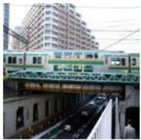

CoCO en 672: a green orange and silver train and some cars coCo trans 672:,3i市3  
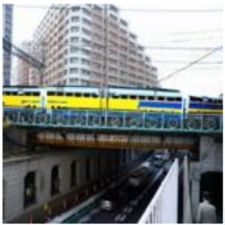  
Inpaint en 672: a blue train and some cars Inpaint trans 672:  
Figure 2: A screenshot from the post-editing document for Hindi.

2img Based on two images, which follow the caption [C] ? Answer with ’left’ or ’right’ and nothing else.

2txt Based on the 2 captions: [NEWLINE] (left) [C1] [NEWLINE] (right) [C2] [NEWLINE] Which one follows the image? Answer with ’left’ or ’right’ and nothing else.

French:

2img À partir des deux images, qui suivent la description [C] ? Répondez par ’gauche’ ou ’droite’ et rien d’autre.

2txt À partir des deux descriptions suivantes: [NEWLINE] (gauche) [C1] [NEWLINE] (droite) [C2] [NEWLINE] Laquelle correspond à l’image? Répondez par ’gauche’ ou ’droite’, et rien d’autre.

In the 2txt task, the newline was necessary for the captions written in a right-to-left system (e.g.

Arabic). Otherwise, the keywords left and right were confusing to the LLMs, causing them to produce a random input.

For encoder models, we note one small limitation of the SigLIP 2 text encoder: the maximum input length is 64 tokens. This impacts a maximum of 4 input captions, the highest number being in Greek, with the tokenizer of the base version.

## C Position Bias

Since the image order can introduce a small amount of noise in the results, we analyze how significant the noise is. We compute the number of mistakes for both query texts when the images are given in the direct order, $M _ { \mathrm { d i r } }$ , and in the swapped order, $M _ { \mathrm { s w a p } }$

$$
\begin{array} { r c l } { M _ { \mathrm { d i r } } } & { = } & { \mathsf { \nabla } \mathsf { K } _ { c ( T _ { 0 } , ( I _ { 0 } , I _ { \mathrm { e } } ) ) } + \mathsf { \nabla } \mathsf { K } _ { c ( T _ { \mathrm { e } } , ( I _ { 0 } , I _ { \mathrm { e } } ) ) } } \end{array}\tag{10}
$$

$$
\begin{array} { r c l } { M _ { \mathrm { s w a p } } } & { = } & { { \mathcal { k } } _ { c ( T _ { 0 } , ( I _ { \mathrm { e } } , I _ { 0 } ) ) } + { \mathcal { k } } _ { c ( T _ { \mathrm { e } } , ( I _ { \mathrm { e } } , I _ { 0 } ) ) } } \end{array}\tag{11}
$$

$$
\begin{array} { c c l } { M _ { \mathrm { o r d e r } } } & { = } & { M _ { \mathrm { d i r } } - M _ { \mathrm { s w a p } } } \end{array}\tag{12}
$$

where the $\vdash _ { c ( q , ( a , b ) ) }$ represents the number of times that $c ( q , ( a , b ) ) = 0$ . We report, for each model, the diference $M _ { \mathrm { o r d e r } } \mathrm { : }$ a negative value indicates a bias towards the dataset order, while a positive value indicates a bias towards the swap.

We report the position bias in Table 13. The impact of the generative decoder models is visible but not highly significant. However, we can still see that the lowest values are for the Aya model, indicating a preference for the swapped order. On the opposite pole, the Jina model has the highest values, preferring the dataset image order. For the dual encoders, we do not plot the values because they are always 0. This is because the modality similarity is obtained from an outer product, except in the case when the similarity is equal.

## D Additional Results

Original image  
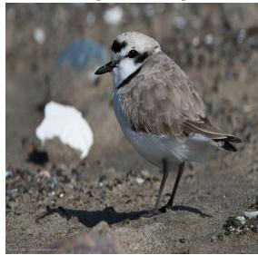

Edited image  
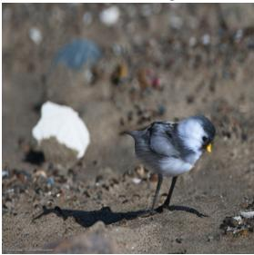  
en A small bird standing on a rocky ground.  
A tiny bird standing on a rocky ground.  
Figure 3: Sample from the MultiInpaintCOCO dataset, with a high number of English preference $\left( e p _ { 5 3 6 } \right. =$ 161).

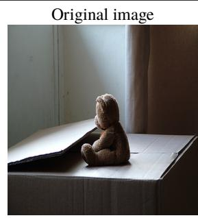  
en A brown teddy bear sitting on a huge box.

Edited image  
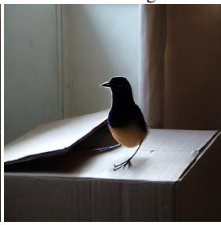  
A brown bird sitting on a huge box.  
Figure 4: Sample from the MultiInpaintCOCO dataset, with a high number of English preference $( e p _ { 1 8 5 } = 0 )$

<table><tr><td rowspan="2">Language</td><td rowspan="2"></td><td rowspan="2">Resource tier</td><td rowspan="2">Native speak- ers (M)</td><td rowspan="2">Morphology</td><td rowspan="2">Family</td><td rowspan="2">FineWeb (GB)</td><td rowspan="2">Wiki articles (M)</td><td colspan="2">WALS sim. w/</td></tr><tr><td>en</td><td>zh</td></tr><tr><td>English</td><td>en</td><td>5</td><td>380</td><td>Isolating</td><td>Indo-Europ.</td><td>2 · 108</td><td>6.90</td><td></td><td>.451</td></tr><tr><td>Czech</td><td>cS</td><td>4</td><td>11</td><td>Fusional</td><td>Indo-Europ.</td><td>222</td><td>0.56</td><td>.436</td><td>.385</td></tr><tr><td>Romanian</td><td>ro</td><td>3</td><td>24</td><td>Fusional</td><td>Indo-Europ.</td><td>200</td><td>0.43</td><td>.537</td><td>.469</td></tr><tr><td>Vietnamese</td><td>vi</td><td>4</td><td>76</td><td>Isolating</td><td>Austroasiatic</td><td>343</td><td>1.31</td><td>.525</td><td>.423</td></tr><tr><td>German</td><td>de</td><td>5</td><td>77</td><td>Fusional</td><td>Indo-Europ.</td><td>1655</td><td>2.98</td><td>.597</td><td>.450</td></tr><tr><td>Slovak</td><td>sk</td><td>3</td><td>6</td><td>Fusional</td><td>Indo-Europ.</td><td>92</td><td>0.26</td><td>.436</td><td>.385</td></tr><tr><td>Italian</td><td>it</td><td>4</td><td>65</td><td>Fusional</td><td>Indo-Europ.</td><td>794</td><td>1.86</td><td>.524</td><td>.421</td></tr><tr><td>Azerbaijani</td><td>az</td><td>1</td><td>24</td><td>Agglut.</td><td>Turkic</td><td>29</td><td>0.22</td><td>.451</td><td>.362</td></tr><tr><td>Japanese</td><td>ja</td><td>5</td><td>128</td><td>Agglut.</td><td>Japonic</td><td>1650</td><td>1.41</td><td>.421</td><td>.459</td></tr><tr><td>Ukrainian</td><td>uk</td><td>3</td><td>27</td><td>Fusional</td><td>Indo-Europ.</td><td>274</td><td>1.33</td><td>.541</td><td>.465</td></tr><tr><td>Arabic</td><td>ar</td><td>5</td><td>335</td><td>Fusional</td><td>Afro-Asiatic</td><td>315</td><td>1.22</td><td>.432</td><td>.348</td></tr><tr><td>Greek</td><td>el</td><td>3</td><td>15</td><td>Fusional</td><td>Indo-Europ.</td><td>238</td><td>0.21</td><td>.500</td><td>.403</td></tr><tr><td>Hindi</td><td>hi</td><td>4 4</td><td>341</td><td>Fusional</td><td>Indo-Europ.</td><td>130</td><td>1.62</td><td>.513</td><td>.463</td></tr><tr><td>Russian</td><td>ru</td><td></td><td>154</td><td>Fusional</td><td>Indo-Europ.</td><td>6400</td><td>1.99</td><td>.503</td><td>.469</td></tr></table>

Table 7: Language metadata for the 14 languages in this study. ISO codes follow ISO 639-1 and ISO 639-3. Resource tier by (Joshi et al., 2020) (0 = lowest, 5 = highest). FineWeb2 corpus size is given in gigabytes. Linguistic similarity (WALS. sim.) is 1 − dfeatural computed via URIEL+ (Khan et al., 2025), where higher values indicate greater typological similarity; EN = vs. English, ZH = vs. Mandarin Chinese.

<table><tr><td>Model</td><td>ar</td><td>az</td><td>cs</td><td>de</td><td>el</td><td>en</td><td>hi</td><td>it</td><td>ja</td><td>ro</td><td>ru</td><td>sk</td><td>uk</td><td>vi</td><td>Notes</td></tr><tr><td>Gemma 3 12B</td><td>?</td><td>?</td><td>?</td><td>?</td><td>?</td><td>?</td><td>?</td><td>?</td><td>?</td><td>?</td><td>?</td><td></td><td>?</td><td>?</td><td>&gt; 140 languages</td></tr><tr><td>Qwen 2.5 VL 7B</td><td>√</td><td>?</td><td>?</td><td>√</td><td>?</td><td>√</td><td>?</td><td>√</td><td>√</td><td>?</td><td>√</td><td>?</td><td>?</td><td>√</td><td>10 languages (OCR data)</td></tr><tr><td>Qwen 3 VL 8B</td><td>√</td><td>?</td><td>?</td><td>√</td><td>?</td><td>√</td><td>?</td><td>√</td><td>√</td><td>?</td><td>√</td><td>?</td><td>?</td><td>?</td><td>119 languages and dialects</td></tr><tr><td>Aya Vision 8B</td><td>√</td><td>-</td><td>√</td><td>√</td><td>√</td><td>√</td><td>√</td><td>√</td><td>√</td><td>√</td><td>√</td><td>-</td><td>√</td><td>√</td><td>23 languages</td></tr><tr><td>Jina VL</td><td>√</td><td>-</td><td>-</td><td>√</td><td>-</td><td>√</td><td>√</td><td>√</td><td>√</td><td>-</td><td>√</td><td>-</td><td>-</td><td>√</td><td>17 languages</td></tr><tr><td>NLLB SigLIP Family</td><td>√</td><td>√</td><td>√</td><td>√</td><td>√</td><td>√</td><td>√</td><td>√</td><td>√</td><td>√</td><td>√</td><td>√</td><td>√</td><td>√</td><td>200 languages</td></tr><tr><td>MEXMA SigLIP2</td><td>J</td><td>√</td><td>√</td><td>√</td><td>√</td><td>√</td><td>√</td><td>√</td><td>√</td><td>√</td><td>」</td><td>√</td><td>√</td><td>了</td><td>80 languages</td></tr><tr><td>SigLIP 2 Family</td><td>?</td><td>?</td><td>?</td><td>?</td><td>?</td><td>?</td><td>?</td><td>?</td><td>?</td><td>?</td><td>?</td><td>?</td><td>?</td><td>?</td><td>109 languages</td></tr></table>

Table 8: Overview of training data availability across the evaluated models for the 14 languages included in our dataset. Symbols indicate whether the training data is available (✓), the model was not trained on the language (-), or the exact data composition remains undisclosed (?).

<table><tr><td></td><td>Dataset</td><td># lang.</td><td>GBI</td><td># captions</td><td># images</td><td>% population</td></tr><tr><td>MARVL</td><td>Liu et al. (2021)</td><td>5</td><td>56.41</td><td>5.7K</td><td>4.9K</td><td>13.79%</td></tr><tr><td>M5 (VGR,VLOD)</td><td>Schneider and Sitaram (2024)</td><td>12</td><td>74.87</td><td>1.4K</td><td>6.8K</td><td>16.79%</td></tr><tr><td>ALM-bench</td><td>Vayani et al. (2025)</td><td>99</td><td>93.84</td><td>22K</td><td>3K</td><td>59.92%</td></tr><tr><td>XM3600</td><td>Thapliyal et al. (2022)</td><td>36</td><td>91.79</td><td>261K</td><td>3.6K</td><td>49.18%</td></tr><tr><td>MaXM</td><td>Changpinyo et al. (2023)</td><td>7</td><td>64.61</td><td>2K</td><td>0.3K</td><td>21.45%</td></tr><tr><td>MTVQA</td><td>Tang et al. (2025)</td><td>10</td><td>77.94</td><td>28.6K</td><td>8.7K</td><td>16.39%</td></tr><tr><td>CVQA</td><td>Romero et al. (2024)</td><td>31</td><td>88.2</td><td>10.3K</td><td>5.2K</td><td>40.89%</td></tr><tr><td>XVNLI</td><td>Bugliarello et al. (2022b)</td><td>5</td><td>49.74</td><td>1.1k</td><td>357</td><td>16.89%</td></tr><tr><td>xGQA</td><td>Nooralahzadeh and Sennrich (2023)</td><td>8</td><td>63.58</td><td>2.4M</td><td>85K</td><td>21.76%</td></tr><tr><td>xFlickrCo</td><td>Bugliarello et al. (2022b)</td><td>8</td><td>65.12</td><td>2k</td><td>2k</td><td>27.54%</td></tr><tr><td>Multi30k</td><td>Barrault et al. (2018)</td><td>4</td><td>33.84</td><td>620K</td><td>31K</td><td>6.60%</td></tr><tr><td>XTD</td><td>Aggarwal and Kale (2020)</td><td>7</td><td>71.28</td><td>7K</td><td>1K</td><td>22.13%</td></tr><tr><td>CoMMuTE</td><td>Futeral et al. (2023)</td><td>6</td><td>66.15</td><td>1.9K</td><td>0.3K</td><td>18.61%</td></tr><tr><td>xMMMU</td><td>Yue et al. (2025)</td><td>7</td><td>69.23</td><td>2.6K</td><td>300</td><td>18.04%</td></tr><tr><td>KnowRecall</td><td>Wang et al. (2025)</td><td>15</td><td>77.94</td><td>45K</td><td>1.5K</td><td>35.26%</td></tr><tr><td colspan="2">MultiInpaintCOCO</td><td>14</td><td>78.97</td><td>26K</td><td>1.9K</td><td>19.26%</td></tr></table>

Table 9: Dataset language coverage overview. The first half contains datasets with cultural knowledge, whereas the second ones are created by translating English samples.

<table><tr><td>Model</td><td>ar</td><td>az</td><td>cs</td><td>de</td><td>el</td><td>en</td><td>hi</td><td>it</td><td>ja</td><td>ro</td><td>ru</td><td>sk</td><td>uk</td><td>vi</td></tr><tr><td>Gemma 3 12B</td><td>16.6 4-56</td><td>19.5 5-78</td><td>17.2 4-63</td><td>15.5 5-51</td><td>25.9 8-74</td><td>12.3 440</td><td>16.3 4-37</td><td>16.1 5-50</td><td>13.5 3-46</td><td>19.2 5-63</td><td>16.6 6-50</td><td>17.9 469</td><td>19.4 5-65</td><td>18.3 6-60</td></tr><tr><td>Qwen 2.5 VL 7B</td><td>17.7 2-62</td><td>22.0 4-89</td><td>20.5 4-83</td><td>16.7 4-55</td><td>50.9 13-144</td><td>11.5 3-39</td><td>49.0 9-96</td><td>18.2 4-56</td><td>15.8 3-59</td><td>21.1 4-69</td><td>20.6 6-62</td><td>21.1 4-82</td><td>26.1 4-85</td><td>19.4 6-69</td></tr><tr><td>Qwen 3 VL 8B</td><td>17.7 2-62</td><td>22.0 4-89</td><td>20.5 4-83</td><td>16.7 4-55</td><td>50.9 13-144</td><td>11.5 3-39</td><td>49.0 9-96</td><td>18.2 4-56</td><td>15.8 3-59</td><td>21.1 4-69</td><td>20.6 6-62</td><td>21.1 4-82</td><td>26.1 4-85</td><td>19.4 6-69</td></tr><tr><td>Aya Vision</td><td>16.8 4-54</td><td>20.2 4-83</td><td>15.5 4-54</td><td>15.7 4-50</td><td>20.0 5-57</td><td>12.4 440</td><td>34.3 7-74</td><td>15.8 5-49</td><td>14.4 4-51</td><td>16.9 5-57</td><td>16.1 4-45</td><td>18.1 4-66</td><td>17.6 5-58</td><td>17.7 6-60</td></tr><tr><td>Jina VL</td><td>17.7 2-62</td><td>22.0 4-89</td><td>20.5 4-83</td><td>16.7 4-55</td><td>50.9 13-144</td><td>11.5 3-39</td><td>49.0 9-96</td><td>18.2 4-56</td><td>15.8 3-59</td><td>21.1 4-69</td><td>20.6 6-62</td><td>21.1 4-82</td><td>26.1 4-85</td><td>19.4 6-69</td></tr><tr><td>NLLB-SigLIP Base</td><td>17.9 5-59</td><td>17.1 5-63</td><td>17.7 5-63</td><td>18.6 6-58</td><td>22.9 8-66</td><td>14.8 5-46</td><td>18.8 4-40</td><td>17.9 6-55</td><td>15.3 5-48</td><td>19.5 6-67</td><td>19.1 7-55</td><td>17.6 5-65</td><td>19.8 5-63</td><td>19.7 7-62</td></tr><tr><td>NLLB-SigLIP Large</td><td>17.9 5-59</td><td>17.1 5-63</td><td>17.7 5-63</td><td>18.6 6-58</td><td>22.9 8-66</td><td>14.8 5-46</td><td>18.8 4-40</td><td>17.9 6-55</td><td>15.3 5-48</td><td>19.5 6-67</td><td>19.1 7-55</td><td>17.6 5-65</td><td>19.8 5-63</td><td>19.7 7-62</td></tr><tr><td>MEXMA-SigLIP2</td><td>16.5 5-52</td><td>16.1 5-60</td><td>16.5 5-59</td><td>17.1 6-53</td><td>20.9 7-62</td><td>15.0 5-47</td><td>19.2 440</td><td>17.2 5-53</td><td>16.8 6-53</td><td>18.4 5-62</td><td>17.4 6-53</td><td>16.6 5-62</td><td>18.2 5-61</td><td>19.3 7-62</td></tr><tr><td>SigLIP2 Base</td><td>16.9 4-56</td><td>19.5 5-80</td><td>16.8 5-62</td><td>14.5 448</td><td>26.4 8-76</td><td>12.3 440</td><td>22.7 6-48</td><td>15.1 5-46</td><td>12.6 3-43</td><td>18.8 5-61</td><td>15.7 5-50</td><td>17.4 5-67</td><td>19.2 5-65</td><td>17.9 6-62</td></tr><tr><td>SigLIP2 Large</td><td>16.9 4-56</td><td>19.5 5-80</td><td>16.8 5-62</td><td>14.5 4-48</td><td>26.4 8-76</td><td>12.3 440</td><td>22.7 6-48</td><td>15.1 5-46</td><td>12.6 3-43</td><td>18.8 5-61</td><td>15.7 5-50</td><td>17.4 5-67</td><td>19.2 5-65</td><td>17.9 6-62</td></tr><tr><td>SigLIP2 SO400M</td><td>16.9 4-56</td><td>19.5 5-80</td><td>16.8 5-62</td><td>14.5 448</td><td>26.4 8-76</td><td>12.3 4-40</td><td>22.7 6-48</td><td>15.1 5-46</td><td>12.6 3-43</td><td>18.8 5-61</td><td>15.7 5-50</td><td>17.4 5-67</td><td>19.2 5-65</td><td>17.9 6-62</td></tr><tr><td>SigLIP2 Giant</td><td>16.9 4-56</td><td>19.5 5-80</td><td>16.8 5-62</td><td>14.5 448</td><td>26.4 8-76</td><td>12.3 440</td><td>22.7 6-48</td><td>15.1 5-46</td><td>12.6 3-43</td><td>18.8 5-61</td><td>15.7 5-50</td><td>17.4 5-67</td><td>19.2 5-65</td><td>17.9 6-62</td></tr></table>

Table 10: Tokenizer statistics of the tested models for the MultiInpaintCOCO dataset. The table shows the average number of tokens per model-language pair and the range of text lengths.

<table><tr><td>#</td><td>Query</td><td>Option (1)</td><td>Option (2)</td></tr><tr><td>1</td><td></td><td>A man is feeding an elephant over a fence</td><td>A man is feeding a giraffe over a fence</td></tr><tr><td rowspan="2">2 3</td><td> 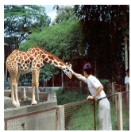</td><td>A man is feeding a giraffe over a fence</td><td>A man is feeding an elephant over a fence</td></tr><tr><td>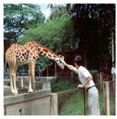</td><td>A man is feeding an elephant over a fence A man is feeding a giraffe over a fence A man is feeding an elephant over a fence</td><td>A man is feeding a giraffe over a fence</td></tr><tr><td>5</td><td>A man is feeding an elephant over a fence</td><td></td><td>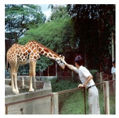 (1) correct</td></tr><tr><td>6</td><td>A man is feeding an elephant over a fence</td><td></td><td>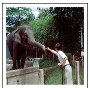 (2) correct</td></tr><tr><td>7</td><td>A man is feeding a giraffe over a fence</td><td></td><td>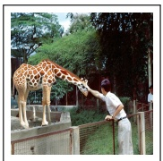 (2) correct </td></tr><tr><td>8</td><td>A man is feeding a giraffe over a fence</td><td colspan="2">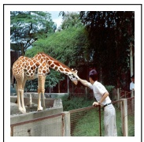 (1) correct</td></tr></table>

Table 11: For decoder-only models, each example is evaluated in both input orders to account for order sensitivity, resulting in eight comparison configurations per example. Above – 2txt configurations: the image is the query and the model selects the correct caption; correct answers are shown in bold. Below – 2img configurations: the caption is the query and the model selects the correct image; the correct option is framed and labeled.

<table><tr><td>Model</td><td>Hugging Face Identifiers</td><td> $\mathrm { P a r a m s } \left( \mathrm { V } + \mathrm { T } + ( \mathrm { X } ) { = } \mathrm { T o t a l } \right)$ </td><td>Img Size</td><td>Vocab Size</td></tr><tr><td>Gemma 3 12B</td><td>google/gemma-3-12b-it</td><td> $4 1 7 \mathbf { M } + 1 1 . 8 \mathbf { B } = 1 2 . 2 \mathbf { B }$ </td><td>896</td><td>262,144</td></tr><tr><td>Qwen 7B</td><td>Qwen/Qwen2.5-VL-7B-Instruct</td><td> $6 7 7 \mathrm { { M } + 7 . 1 \mathrm { { B } = 7 . 8 \mathrm { { B } } } }$ </td><td>3584</td><td>151,643</td></tr><tr><td>Qwen3 8B</td><td>Qwen/Qwen3-VL-8B-Instruct</td><td> $5 7 6 \mathbf { M } + 7 . 6 \mathbf { B } = 8 . 1 \mathbf { B }$ </td><td>3584</td><td>151,643</td></tr><tr><td>Aya Vision 8B</td><td>CohereLabs/aya-vision-8b</td><td> $4 1 3 \mathbf { M } + 8 . 0 \mathbf { B } + 1 9 0 . 9 \mathbf { M } = 8 . 6 \mathbf { B }$ </td><td>364</td><td>255,000</td></tr><tr><td>Jina VL</td><td>jinaai/jina-vlm</td><td> $4 4 9 \mathbf { M } + 1 . 7 2 \mathbf { B } + 3 1 1 \mathbf { M } = 2 . 5 \mathbf { B }$ </td><td>1176×910</td><td>151,643</td></tr><tr><td>NLLB-SigLIP Base</td><td>nllb-clip-base-siglip</td><td> $9 3 \mathbf { M } + 4 1 4 \mathbf { M } = 5 0 8 \mathbf { M }$ </td><td>384</td><td>256,204</td></tr><tr><td>NLLB-SigLIP Large</td><td>nllb-clip-large-siglip</td><td> $4 2 8 \mathbf { M } + 7 6 7 \mathbf { M } = 1 . 2 \mathbf { B }$ </td><td>384</td><td>256,204</td></tr><tr><td>MEXMA-SigLIP2</td><td>visheratin/mexma-siglip2</td><td> $4 2 8 \mathbf { M } + 5 7 3 \mathbf { M } = 1 \mathbf { B }$ </td><td>512</td><td>250,002</td></tr><tr><td>SigLIP2 Base</td><td>google/siglip2-base-patch16-224</td><td> $9 2 \mathbf { M } + 2 8 2 \mathbf { M } = 3 7 5 \mathbf { M }$ </td><td>224</td><td>256,000</td></tr><tr><td>SigLIP2 Large</td><td>google/siglip2-large-patch16-256</td><td> $3 1 6 \mathbf { M } + 5 6 5 \mathbf { M } = 8 8 1 \mathbf { M }$ </td><td>256</td><td>256,000</td></tr><tr><td>SigLIP2 SO400M</td><td>google/siglip2-so400m-patch16-256</td><td> $4 2 8 \mathbf { M } + 7 0 8 \mathbf { M } = 1 . 1 4 \mathbf { B }$ </td><td>256</td><td>256,000</td></tr><tr><td>SigLIP2 Giant</td><td>google/siglip2-giant-opt-patch16-256</td><td> $1 . 1 6 \mathrm { B } + 7 0 8 \mathrm { M } = 1 . 8 7 \mathrm { B }$ </td><td>256</td><td>256,000</td></tr></table>

Table 12: Model overview with Hugging Face identifiers, parameter counts split into vision (V), text (T), and optional cross-modal (X) components, maximum image size, and tokenizer vocabulary size. Image sizes are square resolutions unless otherwise indicated.

<table><tr><td>Model</td><td>ar</td><td>az</td><td>cs</td><td>de</td><td>el</td><td>en</td><td>hi</td><td>it</td><td>ja</td><td>ro</td><td>ru</td><td>sk</td><td>uk</td><td>vi</td><td>Avg.</td></tr><tr><td>Gemma 3 12B</td><td>.01</td><td>.02</td><td>-.03</td><td>.00</td><td>-.02</td><td>-.06</td><td>-.02</td><td>.00</td><td>-.03</td><td>-.03</td><td>-.02</td><td>.01</td><td>-.03</td><td>-.02</td><td>-.01</td></tr><tr><td>Qwen 2.5 VL 7B</td><td>-.04</td><td>-.03</td><td>-.03</td><td>-.06</td><td>-.05</td><td>-.03</td><td>-.04</td><td>-.04</td><td>-.04</td><td>-.01</td><td>-.03</td><td>-.01</td><td>-.04</td><td>-.04</td><td>-.04</td></tr><tr><td>Qwen 3 VL 8B</td><td>-.03</td><td>-.05</td><td>-.02</td><td>-.04</td><td>-.03</td><td>-.06</td><td>-.03</td><td>-.05</td><td>-.03</td><td>-.03</td><td>-.05</td><td>-.03</td><td>-.02</td><td>-.03</td><td>-.04</td></tr><tr><td>Aya Vision 8B</td><td>-.07</td><td>-.04</td><td>-.06</td><td>-.06</td><td>-.07</td><td>-.07</td><td>-.10</td><td>-.10</td><td>-.07</td><td>-.06</td><td>-.06</td><td>-.06</td><td>-.07</td><td>-.09</td><td>-.07</td></tr><tr><td>Jina VL</td><td>.03</td><td>-.01</td><td>-.03</td><td>.05</td><td>.11</td><td>-.04</td><td>.04</td><td>.03</td><td>.01</td><td>.05</td><td>.03</td><td>.04</td><td>.05</td><td>.04</td><td>.03</td></tr><tr><td>Avg.</td><td>-.02</td><td>-.02</td><td>-.04</td><td>-.02</td><td>-.01</td><td>-.05</td><td>-.03</td><td>-.03</td><td>-.03</td><td>-.02</td><td>-.02</td><td>-.01</td><td>-.02</td><td>-.03</td><td>-.03</td></tr></table>

Table 13: Per-language position bias for each model, measured as $M _ { \mathrm { o r d e r } }$ from Equation (12). Negative values indicate a preference for the dataset image order, whereas positive values indicate a preference for the swapped order.

<table><tr><td>Model</td><td>ar</td><td>az</td><td>cS</td><td>de</td><td>el</td><td>en</td><td>hi</td><td>it</td><td>ja</td><td>ro</td><td>ru</td><td>sk</td><td>uk</td><td>vi</td><td>Avg.</td></tr><tr><td>Gemma 3 12B</td><td>.639</td><td>.501</td><td>.562</td><td>.638</td><td>.652</td><td>.608</td><td>.578</td><td>.648</td><td>.571</td><td>.616</td><td>.663</td><td>.516</td><td>.650</td><td>.659</td><td>.607</td></tr><tr><td>Qwen 2.5 VL 7B</td><td>.651</td><td>.414</td><td>.641</td><td>.726</td><td>.614</td><td>.766</td><td>.615</td><td>.700</td><td>.643</td><td>.616</td><td>.724</td><td>.592</td><td>.672</td><td>.667</td><td>.646</td></tr><tr><td>Qwen 3 VL 8B</td><td>.745</td><td>.581</td><td>.739</td><td>.773</td><td>.771</td><td>.773</td><td>.769</td><td>.761</td><td>.747</td><td>.739</td><td>.770</td><td>.704</td><td>.761</td><td>.757</td><td>.742</td></tr><tr><td>Aya Vision 8B</td><td>.264</td><td>.163</td><td>.336</td><td>.459</td><td>.445</td><td>.548</td><td>.332</td><td>.412</td><td>.388</td><td>.387</td><td>.429</td><td>.268</td><td>.411</td><td>.470</td><td>.379</td></tr><tr><td>Jina VL</td><td>.023</td><td>.002</td><td>.008</td><td>.037</td><td>.018</td><td>.021</td><td>.016</td><td>.031</td><td>.026</td><td>.016</td><td>.016</td><td>.009</td><td>.017</td><td>.036</td><td>.020</td></tr><tr><td>NLLB-SigLIP Base</td><td>.768</td><td>.512</td><td>.548</td><td>.644</td><td>.754</td><td>.771</td><td>.759</td><td>.613</td><td>.726</td><td>.608</td><td>.775</td><td>.586</td><td>.748</td><td>.642</td><td>.675</td></tr><tr><td>NLLB-SigLIP Large</td><td>.766</td><td>.593</td><td>.701</td><td>.708</td><td>.774</td><td>.778</td><td>.771</td><td>.733</td><td>.740</td><td>.708</td><td>.770</td><td>.692</td><td>.767</td><td>.666</td><td>.726</td></tr><tr><td>MEXMA-SigLIP2</td><td>.759</td><td>.747</td><td>.756</td><td>.765</td><td>.749</td><td>.769</td><td>.757</td><td>.761</td><td>.742</td><td>.772</td><td>.763</td><td>.767</td><td>.771</td><td>.735</td><td>.758</td></tr><tr><td>SigLIP2 Base</td><td>.750</td><td>.495</td><td>.757</td><td>.814</td><td>.708</td><td>.817</td><td>.646</td><td>.794</td><td>.604</td><td>.700</td><td>.809</td><td>.745</td><td>.735</td><td>.757</td><td>.724</td></tr><tr><td>SigLIP2 Large</td><td>.765</td><td>.560</td><td>.783</td><td>.815</td><td>.744</td><td>.823</td><td>.709</td><td>.817</td><td>.619</td><td>.754</td><td>.818</td><td>.765</td><td>.775</td><td>.784</td><td>.752</td></tr><tr><td>SigLIP2 SO400M</td><td>.772</td><td>.600</td><td>.772</td><td>.832</td><td>.775</td><td>.827</td><td>.730</td><td>.827</td><td>.667</td><td>.785</td><td>.823</td><td>.793</td><td>.775</td><td>.784</td><td>.769</td></tr><tr><td>SigLIP2 Giant</td><td>.773</td><td>.566</td><td>.786</td><td>.825</td><td>.765</td><td>.839</td><td>.722</td><td>.815</td><td>.679</td><td>.774</td><td>.823</td><td>.776</td><td>.776</td><td>.801</td><td>.766</td></tr><tr><td>Avg.</td><td>.640</td><td>.478</td><td>.616</td><td>.670</td><td>.648</td><td>.695</td><td>.617</td><td>.659</td><td>.596</td><td>.623</td><td>.682</td><td>.601</td><td>.655</td><td>.646</td><td>.630</td></tr><tr><td>Model</td><td>ar</td><td>az</td><td>cs</td><td>de</td><td>el</td><td>en</td><td>hi</td><td>it</td><td>ja</td><td>ro</td><td>ru</td><td>sk</td><td>uk</td><td>vi</td><td>Avg.</td></tr><tr><td>Gemma 3 12B</td><td>.737</td><td>.630</td><td>.705</td><td>.751</td><td>.733</td><td>.767</td><td>.724</td><td>.742</td><td>.711</td><td>.750</td><td>.760</td><td>.704</td><td>.742</td><td>.747</td><td>.729</td></tr><tr><td>Qwen 2.5 VL 7B</td><td>.719</td><td>.505</td><td>.720</td><td>.786</td><td>.741</td><td>.801</td><td>.677</td><td>.785</td><td>.772</td><td>.737</td><td>.788</td><td>.714</td><td>.765</td><td>.758</td><td>.733</td></tr><tr><td>Qwen 3 VL 8B</td><td>.791</td><td>.692</td><td>.761</td><td>.803</td><td>.787</td><td>.818</td><td>.789</td><td>.815</td><td>.793</td><td>.794</td><td>.802</td><td>.759</td><td>.780</td><td>.794</td><td>.784</td></tr><tr><td>Aya Vision 8B</td><td>.635</td><td>.355</td><td>.595</td><td>.648</td><td>.630</td><td>.688</td><td>.617</td><td>.660</td><td>.613</td><td>.644</td><td>.651</td><td>.508</td><td>.617</td><td>.646</td><td>.608</td></tr><tr><td>Jina VL</td><td>.445</td><td>.187</td><td>.417</td><td>.512</td><td>.448</td><td>.675</td><td>.418</td><td>.554</td><td>.447</td><td>.477</td><td>.485</td><td>.445</td><td>.449</td><td>.443</td><td>.457</td></tr><tr><td>NLLB-SigLIP Base</td><td>.756</td><td>.463</td><td>.488</td><td>.605</td><td>.763</td><td>.782</td><td>.750</td><td>.626</td><td>.742</td><td>.578</td><td>.775</td><td>.522</td><td>.759</td><td>.659</td><td>.662</td></tr><tr><td>NLLB-SigLIP Large</td><td>.765</td><td>.567</td><td>.672</td><td>.735</td><td>.779</td><td>.792</td><td>.784</td><td>.750</td><td>.759</td><td>.720</td><td>.779</td><td>.669</td><td>.764</td><td>.685</td><td>.730</td></tr><tr><td>MEXMA-SigLIP2</td><td>.764</td><td>.769</td><td>.793</td><td>.806</td><td>.774</td><td>.796</td><td>.797</td><td>.795</td><td>.763</td><td>.790</td><td>.803</td><td>.787</td><td>.784</td><td>.785</td><td>.786</td></tr><tr><td>SigLIP2 Base</td><td>.715</td><td>.489</td><td>.748</td><td>.762</td><td>.697</td><td>.793</td><td>.625</td><td>.753</td><td>.572</td><td>.674</td><td>.767</td><td>.726</td><td>.717</td><td>.715</td><td>.697</td></tr><tr><td>SigLIP2 Large</td><td>.737</td><td>.501</td><td>.748</td><td>.769</td><td>.729</td><td>.789</td><td>.722</td><td>.766</td><td>.610</td><td>.731</td><td>.772</td><td>.726</td><td>.749</td><td>.748</td><td>.721</td></tr><tr><td>SigLIP2 SO400M</td><td>.720</td><td>.541</td><td>.759</td><td>.766</td><td>.742</td><td>.772</td><td>.729</td><td>.749</td><td>.618</td><td>.743</td><td>.750</td><td>.737</td><td>.744</td><td>.733</td><td>.722</td></tr><tr><td>SigLIP2 Giant</td><td>.699</td><td>.482</td><td>.741</td><td>.732</td><td>.726</td><td>.735</td><td>.664</td><td>.732</td><td>.587</td><td>.730</td><td>.740</td><td>.738</td><td>.725</td><td>.730</td><td>.697</td></tr><tr><td>Avg.</td><td></td><td>.707 .515</td><td>.679</td><td>.723</td><td>3.712</td><td>.767</td><td>.691</td><td>.727</td><td>.666</td><td>.697</td><td>.739</td><td>.669</td><td>.716.704</td><td></td><td>.694</td></tr></table>

Table 14: Accuracy 2img for bidirectional retrieval, i.e. $c _ { 2 i m g }$ from Equation (1). The upper part of the tables contains LLMs, while the lower has the dual encoders.

Table 15: Accuracy 2txt for bidirectional retrieval, i.e. $c _ { 2 t x t }$ from Equation (2). The upper part of the tables contains LLMs, while the lower has the dual encoders.

<table><tr><td></td><td>ar</td><td>az</td><td>cS</td><td>de</td><td>el</td><td>en</td><td>hi</td><td>it</td><td>ja</td><td>ro</td><td>ru</td><td>sk</td><td>uk</td><td>vi</td><td>Avg.</td></tr><tr><td>ar</td><td></td><td>.502</td><td>.622</td><td>.646</td><td>.665</td><td>.660</td><td>.621</td><td>.651</td><td>.600</td><td>.636</td><td>.683</td><td>.609</td><td>.660</td><td>.647</td><td>.657</td></tr><tr><td>az</td><td>.518</td><td></td><td>.508</td><td>.529</td><td>.520</td><td>.541</td><td>.490</td><td>.526</td><td>.475</td><td>.508</td><td>.545</td><td>.502</td><td>.531</td><td>.516</td><td>.551</td></tr><tr><td>cs</td><td>.601</td><td>.476</td><td></td><td>.626</td><td>.613</td><td>.630</td><td>.568</td><td>.621</td><td>.557</td><td>.614</td><td>.650</td><td>.652</td><td>.637</td><td>.602</td><td>.632</td></tr><tr><td>de</td><td>.644</td><td>.516</td><td>.645</td><td></td><td>.647</td><td>.669</td><td>.604</td><td>.655</td><td>.594</td><td>.647</td><td>.678</td><td>.630</td><td>.662</td><td>.632</td><td>.659</td></tr><tr><td>el</td><td>.663</td><td>.506</td><td>.628</td><td>.643</td><td></td><td>.680</td><td>.624</td><td>.654</td><td>.602</td><td>.645</td><td>.684</td><td>.617</td><td>.672</td><td>.653</td><td>.662</td></tr><tr><td>en</td><td>.661</td><td>.524</td><td>.648</td><td>.672</td><td>.690</td><td></td><td>.644</td><td>.669</td><td>.630</td><td>.670</td><td>.703</td><td>.631</td><td>.683</td><td>.672</td><td>.678</td></tr><tr><td>hi</td><td>.639</td><td>.489</td><td>.598</td><td>.616</td><td>.643</td><td>.652</td><td></td><td>.620</td><td>.591</td><td>.612</td><td>.657</td><td>.583</td><td>.639</td><td>.626</td><td>.640</td></tr><tr><td>it</td><td>.646</td><td>.506</td><td>.636</td><td>.654</td><td>.657</td><td>.670</td><td>.611</td><td></td><td>.599</td><td>.654</td><td>.672</td><td>.622</td><td>.660</td><td>.635</td><td>.659</td></tr><tr><td>ja</td><td>.625</td><td>.483</td><td>.600</td><td>.619</td><td>.632</td><td>.660</td><td>.611</td><td>.627</td><td></td><td>.612</td><td>.655</td><td>.582</td><td>.635</td><td>.620</td><td>.640</td></tr><tr><td>ro</td><td>.631</td><td>.487</td><td>.622</td><td>.640</td><td>.647</td><td>.662</td><td>.595</td><td>.653</td><td>.576</td><td></td><td>.668</td><td>.612</td><td>.652</td><td>.630</td><td>.648</td></tr><tr><td>ru</td><td>.675</td><td>.524</td><td>.661</td><td>.673</td><td>.680</td><td>.694</td><td>.640</td><td>.673</td><td>.625</td><td>.668</td><td></td><td>.644</td><td>.698</td><td>.665</td><td>.680</td></tr><tr><td>sk</td><td>.587</td><td>.464</td><td>.631</td><td>.612</td><td>.592</td><td>.612</td><td>.548</td><td>.612</td><td>.533</td><td>.594</td><td>.629</td><td></td><td>.626</td><td>.581</td><td>.616</td></tr><tr><td>uk</td><td>.655</td><td>.516</td><td>.639</td><td>.650</td><td>.669</td><td>.673</td><td>.621</td><td>.656</td><td>.606</td><td>.652</td><td>.695</td><td>.636</td><td></td><td>.645</td><td>.665</td></tr><tr><td>vi</td><td>.654</td><td>.507</td><td>.628</td><td>.636</td><td>.663</td><td>.680</td><td>.622</td><td>.648</td><td>.598</td><td>.645</td><td>.680</td><td>.612</td><td>.662</td><td></td><td>.660</td></tr><tr><td>Avg.</td><td>.657</td><td>.536</td><td>.647</td><td>.658</td><td>.665</td><td>.677</td><td>.628</td><td>.662</td><td>.613</td><td>.654</td><td>.686</td><td>.638</td><td>.673</td><td>.652</td><td>.646</td></tr></table>

Table 16: Accuracy of the bilingual retrieval, 2txt only.

<table><tr><td rowspan=1 colspan=17></td><td rowspan=1 colspan=16></td></tr><tr><td rowspan=1 colspan=15></td><td rowspan=1 colspan=1>Avg.</td><td rowspan=1 colspan=1></td><td rowspan=1 colspan=2>Lng. ar</td><td rowspan=1 colspan=14>az cs de el en hi it ja ro ru sk uk vi Avg.</td></tr><tr><td rowspan=1 colspan=1>ar</td><td rowspan=1 colspan=1></td><td rowspan=1 colspan=1>.14</td><td rowspan=1 colspan=1>-.12</td><td rowspan=1 colspan=1>-.15</td><td rowspan=1 colspan=1>.00</td><td rowspan=1 colspan=1>-.29</td><td rowspan=1 colspan=1>.04</td><td rowspan=1 colspan=1>-.11</td><td rowspan=1 colspan=1>-.03</td><td rowspan=1 colspan=2>-.18 -.10</td><td rowspan=1 colspan=1>-.10</td><td rowspan=1 colspan=2>-.04 -.11</td><td rowspan=1 colspan=1>-.08</td><td rowspan=1 colspan=1></td><td rowspan=1 colspan=2></td><td rowspan=1 colspan=1>14</td><td rowspan=1 colspan=1>-.07</td><td rowspan=1 colspan=1>-.12</td><td rowspan=1 colspan=1>-.06</td><td rowspan=1 colspan=1>-.18</td><td rowspan=1 colspan=1>.07</td><td rowspan=1 colspan=4>-.13 -.06 -.10 -.08</td><td rowspan=1 colspan=2>-.04 -.03</td><td rowspan=1 colspan=1>-.09</td><td rowspan=1 colspan=1>-.06</td></tr><tr><td rowspan=1 colspan=1>az</td><td rowspan=1 colspan=1>-.14</td><td rowspan=1 colspan=1></td><td rowspan=1 colspan=1>-.33</td><td rowspan=1 colspan=1>-.37</td><td rowspan=1 colspan=1>-.22</td><td rowspan=1 colspan=1>-.47</td><td rowspan=1 colspan=1>-.16</td><td rowspan=1 colspan=1>-.32</td><td rowspan=1 colspan=1>-.22</td><td rowspan=1 colspan=1>-.36</td><td rowspan=1 colspan=1>-.28</td><td rowspan=1 colspan=1>-.29</td><td rowspan=1 colspan=2>-.20 -.35</td><td rowspan=1 colspan=1>-.28</td><td rowspan=1 colspan=1></td><td rowspan=1 colspan=1>az</td><td rowspan=1 colspan=1>-.14</td><td rowspan=1 colspan=1></td><td rowspan=1 colspan=1>-.26</td><td rowspan=1 colspan=1>-.28</td><td rowspan=1 colspan=1>-.25</td><td rowspan=1 colspan=1>-.30</td><td rowspan=1 colspan=1>-.22</td><td rowspan=1 colspan=1>-.32</td><td rowspan=1 colspan=1>-.27</td><td rowspan=1 colspan=2>-.26 -.21</td><td rowspan=1 colspan=1>-.26</td><td rowspan=1 colspan=1>-.17</td><td rowspan=1 colspan=1>-.23</td><td rowspan=1 colspan=1>-.24</td></tr><tr><td rowspan=1 colspan=1>CS</td><td rowspan=1 colspan=1>.12</td><td rowspan=1 colspan=1>.33</td><td rowspan=1 colspan=1></td><td rowspan=1 colspan=1>-.10</td><td rowspan=1 colspan=1>.04</td><td rowspan=1 colspan=1>-.29</td><td rowspan=1 colspan=1>.19</td><td rowspan=1 colspan=1>-.02</td><td rowspan=1 colspan=1>.12</td><td rowspan=1 colspan=1>-.05</td><td rowspan=1 colspan=1>-.02</td><td rowspan=1 colspan=1>.02</td><td rowspan=1 colspan=2>.06-.07</td><td rowspan=1 colspan=1>.02</td><td rowspan=1 colspan=1></td><td rowspan=1 colspan=1>CS</td><td rowspan=1 colspan=1>.07</td><td rowspan=1 colspan=1>.26</td><td rowspan=1 colspan=1></td><td rowspan=1 colspan=1>-.08</td><td rowspan=1 colspan=1>-.05</td><td rowspan=1 colspan=1>-.18</td><td rowspan=1 colspan=1>.06</td><td rowspan=1 colspan=1>-.11</td><td rowspan=1 colspan=1>-.03</td><td rowspan=1 colspan=2>-.03-.05</td><td rowspan=1 colspan=1>.05</td><td rowspan=1 colspan=1>.04</td><td rowspan=1 colspan=1>-.02</td><td rowspan=1 colspan=1>-.01</td></tr><tr><td rowspan=1 colspan=1>de</td><td rowspan=1 colspan=1>.15</td><td rowspan=1 colspan=1>.37</td><td rowspan=1 colspan=1>.10</td><td rowspan=1 colspan=1></td><td rowspan=1 colspan=1>.14</td><td rowspan=1 colspan=1>-.15</td><td rowspan=1 colspan=1>.25</td><td rowspan=1 colspan=1>.09</td><td rowspan=1 colspan=1>.19</td><td rowspan=1 colspan=1>.06</td><td rowspan=1 colspan=1>.04</td><td rowspan=1 colspan=1>.14</td><td rowspan=1 colspan=2>.12 .04</td><td rowspan=1 colspan=1>.12</td><td rowspan=1 colspan=1></td><td rowspan=1 colspan=1>de</td><td rowspan=1 colspan=1>.12</td><td rowspan=1 colspan=1>.28</td><td rowspan=1 colspan=1>.08</td><td rowspan=1 colspan=1></td><td rowspan=1 colspan=1>.05</td><td rowspan=1 colspan=1>-.08</td><td rowspan=1 colspan=1>.14</td><td rowspan=1 colspan=1>.00</td><td rowspan=1 colspan=1>.05</td><td rowspan=1 colspan=2>.08 .04</td><td rowspan=1 colspan=2>.12.12</td><td rowspan=1 colspan=1>.05</td><td rowspan=1 colspan=1>.08</td></tr><tr><td rowspan=1 colspan=1>el</td><td rowspan=1 colspan=1>.00</td><td rowspan=1 colspan=1>.22</td><td rowspan=1 colspan=1>-.04</td><td rowspan=1 colspan=1>-.14</td><td rowspan=1 colspan=1></td><td rowspan=1 colspan=1>-.26</td><td rowspan=1 colspan=1>.04</td><td rowspan=1 colspan=1>-.09</td><td rowspan=1 colspan=1>.01</td><td rowspan=1 colspan=1>-.12</td><td rowspan=1 colspan=1>-.09</td><td rowspan=1 colspan=1>-.02</td><td rowspan=1 colspan=2>-.01 -.11</td><td rowspan=1 colspan=1>-.05</td><td rowspan=1 colspan=1></td><td rowspan=1 colspan=1>el</td><td rowspan=1 colspan=1>.06</td><td rowspan=1 colspan=1>.25</td><td rowspan=1 colspan=1>.05</td><td rowspan=1 colspan=1>-.05</td><td rowspan=1 colspan=1></td><td rowspan=1 colspan=1>-.12</td><td rowspan=1 colspan=1>.05</td><td rowspan=1 colspan=1>-.03</td><td rowspan=1 colspan=1>.02</td><td rowspan=1 colspan=2>.00-.02</td><td rowspan=1 colspan=2>.09 .04</td><td rowspan=1 colspan=1>.00</td><td rowspan=1 colspan=1>.03</td></tr><tr><td rowspan=1 colspan=1>en</td><td rowspan=1 colspan=1>.29</td><td rowspan=1 colspan=1>47</td><td rowspan=1 colspan=1>.29</td><td rowspan=1 colspan=1>.15</td><td rowspan=1 colspan=1>.26</td><td rowspan=1 colspan=1></td><td rowspan=1 colspan=1>.37</td><td rowspan=1 colspan=1>.26</td><td rowspan=1 colspan=1>.35</td><td rowspan=1 colspan=1>.24</td><td rowspan=1 colspan=1>.18</td><td rowspan=1 colspan=1>.30</td><td rowspan=1 colspan=2>.24.19</td><td rowspan=1 colspan=1>.28</td><td rowspan=1 colspan=1></td><td rowspan=1 colspan=1>en</td><td rowspan=1 colspan=1>.18</td><td rowspan=1 colspan=1>.30</td><td rowspan=1 colspan=1>.18</td><td rowspan=1 colspan=1>.08</td><td rowspan=1 colspan=1>.12</td><td rowspan=1 colspan=1></td><td rowspan=1 colspan=1>.17</td><td rowspan=1 colspan=1>.08</td><td rowspan=1 colspan=1>.12</td><td rowspan=1 colspan=2>.15 .08</td><td rowspan=1 colspan=2>.19.14</td><td rowspan=1 colspan=1>.12</td><td rowspan=1 colspan=1>.15</td></tr><tr><td rowspan=1 colspan=1>hi</td><td rowspan=1 colspan=1>-.04</td><td rowspan=1 colspan=1>.16</td><td rowspan=1 colspan=1>-.19</td><td rowspan=1 colspan=1>-.25</td><td rowspan=1 colspan=1>-.04</td><td rowspan=1 colspan=1>-.37</td><td rowspan=1 colspan=1></td><td rowspan=1 colspan=1>-.22</td><td rowspan=1 colspan=1>-.11</td><td rowspan=1 colspan=1>-.29</td><td rowspan=1 colspan=1>-.18</td><td rowspan=1 colspan=1>-.16</td><td rowspan=1 colspan=2>-.11 -.21</td><td rowspan=1 colspan=1>-.15</td><td rowspan=1 colspan=1></td><td rowspan=1 colspan=1>hi</td><td rowspan=1 colspan=1>-.07</td><td rowspan=1 colspan=1>.22</td><td rowspan=1 colspan=1>-.06</td><td rowspan=1 colspan=1>-.14</td><td rowspan=1 colspan=1>-.05</td><td rowspan=1 colspan=1>-.17</td><td rowspan=1 colspan=1></td><td rowspan=1 colspan=1>-.16</td><td rowspan=1 colspan=1>-.10</td><td rowspan=1 colspan=2>-.09-.11</td><td rowspan=1 colspan=2>-.01-.04</td><td rowspan=1 colspan=1>-.10</td><td rowspan=1 colspan=1>-.07</td></tr><tr><td rowspan=1 colspan=1>it</td><td rowspan=1 colspan=1>.11</td><td rowspan=1 colspan=1>.32</td><td rowspan=1 colspan=1>.02</td><td rowspan=1 colspan=1>-.09</td><td rowspan=1 colspan=1>.09</td><td rowspan=1 colspan=1>-.26</td><td rowspan=1 colspan=1>.22</td><td rowspan=1 colspan=1>二</td><td rowspan=1 colspan=1>.11</td><td rowspan=1 colspan=1>-.02</td><td rowspan=1 colspan=1>-.03</td><td rowspan=1 colspan=1>.06</td><td rowspan=1 colspan=2>.06-.03</td><td rowspan=1 colspan=1>.04</td><td rowspan=1 colspan=1></td><td rowspan=1 colspan=1>it</td><td rowspan=1 colspan=1>.13</td><td rowspan=1 colspan=1>.32</td><td rowspan=1 colspan=1>.11</td><td rowspan=1 colspan=1>.00</td><td rowspan=1 colspan=1>.03</td><td rowspan=1 colspan=1>-.08</td><td rowspan=1 colspan=1>.16</td><td rowspan=1 colspan=1></td><td rowspan=1 colspan=1>.08</td><td rowspan=1 colspan=2>.08.04</td><td rowspan=1 colspan=2>.14.12</td><td rowspan=1 colspan=1>.05</td><td rowspan=1 colspan=1>.09</td></tr><tr><td rowspan=1 colspan=1>ja</td><td rowspan=1 colspan=1>.03</td><td rowspan=1 colspan=1>.22</td><td rowspan=1 colspan=1>-.12</td><td rowspan=1 colspan=1>-.19</td><td rowspan=1 colspan=1>-.01</td><td rowspan=1 colspan=1>-.35</td><td rowspan=1 colspan=1>.11</td><td rowspan=1 colspan=1>-.11</td><td rowspan=1 colspan=1></td><td rowspan=1 colspan=2>-.21-.13</td><td rowspan=1 colspan=1>-.08</td><td rowspan=1 colspan=2>-.04-.18</td><td rowspan=1 colspan=1>-.08</td><td rowspan=1 colspan=1></td><td rowspan=1 colspan=1>ja</td><td rowspan=1 colspan=1>.06</td><td rowspan=1 colspan=1>.27</td><td rowspan=1 colspan=1>.03</td><td rowspan=1 colspan=1>-.05</td><td rowspan=1 colspan=1>-.02</td><td rowspan=1 colspan=1>-.12</td><td rowspan=1 colspan=1>.10</td><td rowspan=1 colspan=1>-.08</td><td rowspan=1 colspan=1></td><td rowspan=1 colspan=2>-.03-.03</td><td rowspan=1 colspan=1>.06</td><td rowspan=1 colspan=1>.04</td><td rowspan=1 colspan=1>.00</td><td rowspan=1 colspan=1>.02</td></tr><tr><td rowspan=1 colspan=1>ro</td><td rowspan=1 colspan=1>.18</td><td rowspan=1 colspan=1>.36</td><td rowspan=1 colspan=1>.05</td><td rowspan=1 colspan=1>-.06</td><td rowspan=1 colspan=1>.12</td><td rowspan=1 colspan=1>-.24</td><td rowspan=1 colspan=1>.29</td><td rowspan=1 colspan=1>.02</td><td rowspan=1 colspan=1>.21</td><td rowspan=1 colspan=1></td><td rowspan=1 colspan=1>.02</td><td rowspan=1 colspan=1>.08</td><td rowspan=1 colspan=1>.11</td><td rowspan=1 colspan=1>.00</td><td rowspan=1 colspan=1>.09</td><td rowspan=1 colspan=1></td><td rowspan=1 colspan=1>ro</td><td rowspan=1 colspan=1>.10</td><td rowspan=1 colspan=1>.26</td><td rowspan=1 colspan=1>.03</td><td rowspan=1 colspan=1>-.08</td><td rowspan=1 colspan=1>.00</td><td rowspan=1 colspan=1>-.15</td><td rowspan=1 colspan=1>.09</td><td rowspan=1 colspan=1>-.08</td><td rowspan=1 colspan=1>.03</td><td rowspan=1 colspan=2>-.02</td><td rowspan=1 colspan=1>.08</td><td rowspan=1 colspan=1>.07</td><td rowspan=1 colspan=1>-.02</td><td rowspan=1 colspan=1>.02</td></tr><tr><td rowspan=1 colspan=1>ru</td><td rowspan=1 colspan=1>.10</td><td rowspan=1 colspan=1>.28</td><td rowspan=1 colspan=1>.02</td><td rowspan=1 colspan=1>-.04</td><td rowspan=1 colspan=1>.09</td><td rowspan=1 colspan=1>-.18</td><td rowspan=1 colspan=1>.18</td><td rowspan=1 colspan=1>.03</td><td rowspan=1 colspan=1>.13</td><td rowspan=1 colspan=1>-.02</td><td rowspan=1 colspan=1></td><td rowspan=1 colspan=1>.08</td><td rowspan=1 colspan=1>.07</td><td rowspan=1 colspan=1>-.01</td><td rowspan=1 colspan=1>.06</td><td rowspan=1 colspan=1></td><td rowspan=1 colspan=1>ru</td><td rowspan=1 colspan=1>.08</td><td rowspan=1 colspan=1>.21</td><td rowspan=1 colspan=1>.05</td><td rowspan=1 colspan=1>-.04</td><td rowspan=1 colspan=1>.02</td><td rowspan=1 colspan=1>-.08</td><td rowspan=1 colspan=1>.11</td><td rowspan=1 colspan=1>-.04</td><td rowspan=1 colspan=1>.03</td><td rowspan=1 colspan=1>.02</td><td rowspan=1 colspan=1></td><td rowspan=1 colspan=1>.09</td><td rowspan=1 colspan=1>.07</td><td rowspan=1 colspan=1>.01</td><td rowspan=1 colspan=1>.04</td></tr><tr><td rowspan=1 colspan=1>sk</td><td rowspan=1 colspan=1>.10</td><td rowspan=1 colspan=1>.29</td><td rowspan=1 colspan=1>-.02</td><td rowspan=1 colspan=1>-.14</td><td rowspan=1 colspan=1>.02</td><td rowspan=1 colspan=1>-.30</td><td rowspan=1 colspan=1>.16</td><td rowspan=1 colspan=1>-.06</td><td rowspan=1 colspan=1>.08</td><td rowspan=1 colspan=1>-.08</td><td rowspan=1 colspan=1>-.08</td><td rowspan=1 colspan=1></td><td rowspan=1 colspan=1>.01</td><td rowspan=1 colspan=1>-.11</td><td rowspan=1 colspan=1>-.01</td><td rowspan=1 colspan=1></td><td rowspan=1 colspan=1>sk</td><td rowspan=1 colspan=1>.04</td><td rowspan=1 colspan=1>.26</td><td rowspan=1 colspan=1>-.05</td><td rowspan=1 colspan=1>-.12</td><td rowspan=1 colspan=1>-.09</td><td rowspan=1 colspan=1>-.19</td><td rowspan=1 colspan=1>.01</td><td rowspan=1 colspan=1>-.14</td><td rowspan=1 colspan=1>-.06</td><td rowspan=1 colspan=1>-.08</td><td rowspan=1 colspan=1>-.09</td><td rowspan=1 colspan=1></td><td rowspan=1 colspan=1>-.02</td><td rowspan=1 colspan=1>-.08</td><td rowspan=1 colspan=1>-.05</td></tr><tr><td rowspan=1 colspan=1>uk</td><td rowspan=1 colspan=1>.04</td><td rowspan=1 colspan=1>.20</td><td rowspan=1 colspan=1>-.06</td><td rowspan=1 colspan=1>-.12</td><td rowspan=1 colspan=1>.01</td><td rowspan=1 colspan=1>-.24</td><td rowspan=1 colspan=1>.11</td><td rowspan=1 colspan=1>-.06</td><td rowspan=1 colspan=1>.04</td><td rowspan=1 colspan=1>-.11</td><td rowspan=1 colspan=1>-.07</td><td rowspan=1 colspan=1>-.01</td><td rowspan=1 colspan=1></td><td rowspan=1 colspan=1>-.10</td><td rowspan=1 colspan=1>-.03</td><td rowspan=1 colspan=1></td><td rowspan=1 colspan=1>uk</td><td rowspan=1 colspan=1>.03</td><td rowspan=1 colspan=1>.17</td><td rowspan=1 colspan=1>-.04</td><td rowspan=1 colspan=1>-.12</td><td rowspan=1 colspan=1>-.04</td><td rowspan=1 colspan=1>-.14</td><td rowspan=1 colspan=1>.04</td><td rowspan=1 colspan=1>-.12</td><td rowspan=1 colspan=1>-.04</td><td rowspan=1 colspan=1>-.07</td><td rowspan=1 colspan=1>-.07</td><td rowspan=1 colspan=1>.02</td><td rowspan=1 colspan=1></td><td rowspan=1 colspan=1>-.08</td><td rowspan=1 colspan=1>-.04</td></tr><tr><td rowspan=1 colspan=1>vi</td><td rowspan=1 colspan=1>.11</td><td rowspan=1 colspan=1>.35</td><td rowspan=1 colspan=1>.07</td><td rowspan=1 colspan=1>-.04</td><td rowspan=1 colspan=1>.11</td><td rowspan=1 colspan=1>-.19</td><td rowspan=1 colspan=1>.21</td><td rowspan=1 colspan=1>.03</td><td rowspan=1 colspan=1>.18</td><td rowspan=1 colspan=1>.00</td><td rowspan=1 colspan=1>.01</td><td rowspan=1 colspan=1>.11</td><td rowspan=1 colspan=1>.10</td><td rowspan=1 colspan=1></td><td rowspan=1 colspan=1>.08</td><td rowspan=1 colspan=1></td><td></td><td></td><td></td><td></td><td></td><td></td><td></td><td></td><td></td><td></td><td></td><td rowspan=1 colspan=1>-.01</td><td rowspan=1 colspan=1>.08</td><td rowspan=1 colspan=1>.08</td><td rowspan=1 colspan=1></td><td rowspan=1 colspan=1>.03</td></tr><tr><td rowspan=1 colspan=16>Qwen 3VL 8B</td><td rowspan=1 colspan=1></td><td rowspan=1 colspan=3></td><td rowspan=1 colspan=2></td><td rowspan=1 colspan=1>A</td><td rowspan=1 colspan=1>Aya</td><td rowspan=1 colspan=2>Visio</td><td rowspan=1 colspan=3>n8B</td><td rowspan=1 colspan=3></td><td rowspan=1 colspan=1></td></tr><tr><td rowspan=1 colspan=1>Lng.</td><td rowspan=1 colspan=1>ar</td><td rowspan=1 colspan=1>az</td><td rowspan=1 colspan=1>cs</td><td rowspan=1 colspan=1>de</td><td rowspan=1 colspan=1>el</td><td rowspan=1 colspan=1>en</td><td rowspan=1 colspan=1>hi</td><td rowspan=1 colspan=1>it</td><td rowspan=1 colspan=1>ja</td><td rowspan=1 colspan=2>roru</td><td rowspan=1 colspan=1>sk</td><td rowspan=1 colspan=2>uk vi</td><td rowspan=1 colspan=1>Avg.</td><td rowspan=1 colspan=1></td><td rowspan=1 colspan=2>Lng.ar</td><td rowspan=1 colspan=1>az</td><td rowspan=1 colspan=1>cs</td><td rowspan=1 colspan=1>de</td><td rowspan=1 colspan=1>el</td><td rowspan=1 colspan=1>en</td><td rowspan=1 colspan=1>hi</td><td rowspan=1 colspan=1>it</td><td rowspan=1 colspan=1>ja</td><td rowspan=1 colspan=2>roru</td><td rowspan=1 colspan=1>sk</td><td rowspan=1 colspan=1>uk</td><td rowspan=1 colspan=1>vi</td><td rowspan=1 colspan=1>Avg.</td></tr><tr><td rowspan=1 colspan=1>ar</td><td rowspan=1 colspan=1></td><td rowspan=1 colspan=1>.08</td><td rowspan=1 colspan=1>-.01</td><td rowspan=1 colspan=1>-.05</td><td rowspan=1 colspan=1>-.02</td><td rowspan=1 colspan=1>-.09</td><td rowspan=1 colspan=1>-.01</td><td rowspan=1 colspan=1>-.04</td><td rowspan=1 colspan=1>-.08</td><td rowspan=1 colspan=2>-.02-.01</td><td rowspan=1 colspan=1>.01</td><td rowspan=1 colspan=1>.02</td><td rowspan=1 colspan=1>-.08</td><td rowspan=1 colspan=1>-.02</td><td rowspan=1 colspan=1></td><td rowspan=1 colspan=1>ar</td><td rowspan=1 colspan=1></td><td rowspan=1 colspan=1>.31</td><td rowspan=1 colspan=1>.11</td><td rowspan=1 colspan=1>.19</td><td rowspan=1 colspan=1>-.09</td><td rowspan=1 colspan=1>.21</td><td rowspan=1 colspan=1>-.22</td><td rowspan=1 colspan=1>.08</td><td rowspan=1 colspan=1>-.13</td><td rowspan=1 colspan=2>.04-.03</td><td rowspan=1 colspan=1>.19</td><td rowspan=1 colspan=1>-.03</td><td rowspan=1 colspan=1>-.08</td><td rowspan=1 colspan=1>.04</td></tr><tr><td rowspan=1 colspan=1>az</td><td rowspan=1 colspan=1>-.08</td><td rowspan=1 colspan=1></td><td rowspan=1 colspan=1>-.15</td><td rowspan=1 colspan=1>-.14</td><td rowspan=1 colspan=1>-.12</td><td rowspan=1 colspan=1>-.17-</td><td rowspan=1 colspan=1>.13</td><td rowspan=1 colspan=1>-.14</td><td rowspan=1 colspan=1>-.18</td><td rowspan=1 colspan=2>-.11-.08</td><td rowspan=1 colspan=1>-.12</td><td rowspan=1 colspan=1>-.05</td><td rowspan=1 colspan=1>-.15</td><td rowspan=1 colspan=1>-.12</td><td rowspan=1 colspan=1></td><td rowspan=1 colspan=1>az</td><td rowspan=1 colspan=1>-.31</td><td rowspan=1 colspan=1></td><td rowspan=1 colspan=1>-.27</td><td rowspan=1 colspan=1>-.11</td><td rowspan=1 colspan=1>-.43-</td><td rowspan=1 colspan=1>.27</td><td rowspan=1 colspan=1>-.55</td><td rowspan=1 colspan=1>-.22</td><td rowspan=1 colspan=1>-.45</td><td rowspan=1 colspan=2>-.34-.34</td><td rowspan=1 colspan=1>-.15</td><td rowspan=1 colspan=1>-.34</td><td rowspan=1 colspan=1>-.43</td><td rowspan=1 colspan=1>-.32</td></tr><tr><td rowspan=1 colspan=1>cs</td><td rowspan=1 colspan=1>.01</td><td rowspan=1 colspan=1>.15</td><td rowspan=1 colspan=1></td><td rowspan=1 colspan=1>-.05</td><td rowspan=1 colspan=1>-.02</td><td rowspan=1 colspan=1>-.10</td><td rowspan=1 colspan=1>.00</td><td rowspan=1 colspan=1>-.06</td><td rowspan=1 colspan=1>-.08</td><td rowspan=1 colspan=2>-.01-.02</td><td rowspan=1 colspan=1>.04</td><td rowspan=1 colspan=1>.03</td><td rowspan=1 colspan=1>-.06</td><td rowspan=1 colspan=1>-.01</td><td rowspan=1 colspan=1></td><td rowspan=1 colspan=1>cs</td><td rowspan=1 colspan=1>-.11</td><td rowspan=1 colspan=1>.27</td><td rowspan=1 colspan=1>_</td><td rowspan=1 colspan=1>.06</td><td rowspan=1 colspan=1>-.19</td><td rowspan=1 colspan=1> -.10</td><td rowspan=1 colspan=1>-.29</td><td rowspan=1 colspan=1>-.01</td><td rowspan=1 colspan=1>-.20</td><td rowspan=1 colspan=2>-.083-.07</td><td rowspan=1 colspan=1>.12</td><td rowspan=1 colspan=1>-.07</td><td rowspan=1 colspan=1>-.19</td><td rowspan=1 colspan=1>-.07</td></tr><tr><td rowspan=1 colspan=1>de</td><td rowspan=1 colspan=1>.05</td><td rowspan=1 colspan=1>.14</td><td rowspan=1 colspan=1>.05</td><td rowspan=1 colspan=1></td><td rowspan=1 colspan=1>.02</td><td rowspan=1 colspan=1>-.08</td><td rowspan=1 colspan=1>.03</td><td rowspan=1 colspan=1>.01</td><td rowspan=1 colspan=1>-.02</td><td rowspan=1 colspan=2>.04.02</td><td rowspan=1 colspan=1>.07</td><td rowspan=1 colspan=1>.06</td><td rowspan=1 colspan=1>-.02</td><td rowspan=1 colspan=1>.03</td><td rowspan=1 colspan=1></td><td rowspan=1 colspan=1>de</td><td rowspan=1 colspan=1>-.19</td><td rowspan=1 colspan=1>.11</td><td rowspan=1 colspan=1>-.06</td><td rowspan=1 colspan=1></td><td rowspan=1 colspan=1>-.22</td><td rowspan=1 colspan=1> -.22</td><td rowspan=1 colspan=1>-.36</td><td rowspan=1 colspan=1>-.07</td><td rowspan=1 colspan=1>-.26</td><td rowspan=1 colspan=2>-.13-.14</td><td rowspan=1 colspan=1>.02</td><td rowspan=1 colspan=1>-.14</td><td rowspan=1 colspan=1>-.21</td><td rowspan=1 colspan=1>-.14</td></tr><tr><td rowspan=1 colspan=1>el</td><td rowspan=1 colspan=1>.02</td><td rowspan=1 colspan=1>.12</td><td rowspan=1 colspan=1>.02</td><td rowspan=1 colspan=1>-.02</td><td rowspan=1 colspan=1></td><td rowspan=1 colspan=1>-.05</td><td rowspan=1 colspan=1>.02</td><td rowspan=1 colspan=1>-.01</td><td rowspan=1 colspan=1>-.03</td><td rowspan=1 colspan=2>.01.01</td><td rowspan=1 colspan=1>.04</td><td rowspan=1 colspan=1>.04</td><td rowspan=1 colspan=1>-.03</td><td rowspan=1 colspan=1>.01</td><td rowspan=1 colspan=1></td><td rowspan=1 colspan=1>el</td><td rowspan=1 colspan=1>.09</td><td rowspan=1 colspan=1>.43</td><td rowspan=1 colspan=1>.19</td><td rowspan=1 colspan=1>.22</td><td rowspan=1 colspan=1></td><td rowspan=1 colspan=1>.19</td><td rowspan=1 colspan=1>-.09</td><td rowspan=1 colspan=1>.14</td><td rowspan=1 colspan=1>-.01</td><td rowspan=1 colspan=2>.08.07</td><td rowspan=1 colspan=1>.31</td><td rowspan=1 colspan=1>.10</td><td rowspan=1 colspan=1>.01</td><td rowspan=1 colspan=1>.13</td></tr><tr><td rowspan=1 colspan=1>en</td><td rowspan=1 colspan=1>.09</td><td rowspan=1 colspan=1>.17</td><td rowspan=1 colspan=1>.10</td><td rowspan=1 colspan=1>.08</td><td rowspan=1 colspan=1>.05</td><td rowspan=1 colspan=1></td><td rowspan=1 colspan=1>.06</td><td rowspan=1 colspan=1>.08</td><td rowspan=1 colspan=1>.05</td><td rowspan=1 colspan=2>.10.07</td><td rowspan=1 colspan=1>.12</td><td rowspan=1 colspan=1>.09</td><td rowspan=1 colspan=1>.03</td><td rowspan=1 colspan=1>.08</td><td rowspan=1 colspan=1></td><td rowspan=1 colspan=1>en</td><td rowspan=1 colspan=1>-.21</td><td rowspan=1 colspan=1>.27</td><td rowspan=1 colspan=1>.10</td><td rowspan=1 colspan=1>.22</td><td rowspan=1 colspan=1>-.19</td><td rowspan=1 colspan=1></td><td rowspan=1 colspan=1>-.40</td><td rowspan=1 colspan=1>.07</td><td rowspan=1 colspan=1>-.06</td><td rowspan=1 colspan=2>.02-.05</td><td rowspan=1 colspan=1>.15</td><td rowspan=1 colspan=1>-.01</td><td rowspan=1 colspan=1>-.12</td><td rowspan=1 colspan=1>-.02</td></tr><tr><td rowspan=1 colspan=1>hi</td><td rowspan=1 colspan=1>.01</td><td rowspan=1 colspan=1>.13</td><td rowspan=1 colspan=1>.00</td><td rowspan=1 colspan=1>-.03 -</td><td rowspan=1 colspan=1>.02</td><td rowspan=1 colspan=1>-.06</td><td rowspan=1 colspan=1></td><td rowspan=1 colspan=1>-.04</td><td rowspan=1 colspan=1>-.05</td><td rowspan=1 colspan=2>.01-.01</td><td rowspan=1 colspan=1>.03</td><td rowspan=1 colspan=1>.04</td><td rowspan=1 colspan=1>-.05</td><td rowspan=1 colspan=1>.00</td><td rowspan=1 colspan=1></td><td rowspan=1 colspan=1>hi</td><td rowspan=1 colspan=1>.22</td><td rowspan=1 colspan=1>.55</td><td rowspan=1 colspan=1>.29</td><td rowspan=1 colspan=1>.36</td><td rowspan=1 colspan=1>.09</td><td rowspan=1 colspan=1>.40</td><td rowspan=1 colspan=1>_</td><td rowspan=1 colspan=1>.26</td><td rowspan=1 colspan=1>.08</td><td rowspan=1 colspan=2>.20.19</td><td rowspan=1 colspan=1>.39</td><td rowspan=1 colspan=1>.19</td><td rowspan=1 colspan=1>.09</td><td rowspan=1 colspan=1>.26</td></tr><tr><td rowspan=1 colspan=1>it</td><td rowspan=1 colspan=1>.04</td><td rowspan=1 colspan=1>.14</td><td rowspan=1 colspan=1>.06</td><td rowspan=1 colspan=1>-.01</td><td rowspan=1 colspan=1>.01</td><td rowspan=1 colspan=1>-.08</td><td rowspan=1 colspan=1>.04</td><td rowspan=1 colspan=1>一</td><td rowspan=1 colspan=1>-.01</td><td rowspan=1 colspan=2>.04.02</td><td rowspan=1 colspan=1>.08</td><td rowspan=1 colspan=1>.06</td><td rowspan=1 colspan=1>-.02</td><td rowspan=1 colspan=1>.03</td><td rowspan=1 colspan=1></td><td rowspan=1 colspan=1>it</td><td rowspan=1 colspan=1>-.08</td><td rowspan=1 colspan=1>.22</td><td rowspan=1 colspan=1>.01</td><td rowspan=1 colspan=1>.07</td><td rowspan=1 colspan=1>-.14</td><td rowspan=1 colspan=1>-.07</td><td rowspan=1 colspan=1>-.26</td><td rowspan=1 colspan=1>一</td><td rowspan=1 colspan=1>-.16</td><td rowspan=1 colspan=2>-.03 -.04</td><td rowspan=1 colspan=1>.12</td><td rowspan=1 colspan=1>-.03</td><td rowspan=1 colspan=1>-.12</td><td rowspan=1 colspan=1>-.04</td></tr><tr><td rowspan=1 colspan=1>ja</td><td rowspan=1 colspan=1>.08</td><td rowspan=1 colspan=1>.18</td><td rowspan=1 colspan=1>.08</td><td rowspan=1 colspan=1>.02</td><td rowspan=1 colspan=1>.03</td><td rowspan=1 colspan=1>-.05</td><td rowspan=1 colspan=1>.05</td><td rowspan=1 colspan=1>.01</td><td rowspan=1 colspan=1>一</td><td rowspan=1 colspan=1>.08</td><td rowspan=1 colspan=1>.05</td><td rowspan=1 colspan=1>.10</td><td rowspan=1 colspan=1>.09</td><td rowspan=1 colspan=1>.00</td><td rowspan=1 colspan=1>.06</td><td rowspan=1 colspan=1></td><td rowspan=1 colspan=1>ja</td><td rowspan=1 colspan=1>.13</td><td rowspan=1 colspan=1>.45</td><td rowspan=1 colspan=1>.20</td><td rowspan=1 colspan=1>.26</td><td rowspan=1 colspan=1>.01</td><td rowspan=1 colspan=1>.06</td><td rowspan=1 colspan=1>-.08</td><td rowspan=1 colspan=1>.16</td><td rowspan=1 colspan=1>一</td><td rowspan=1 colspan=1>.11</td><td rowspan=1 colspan=1>.13</td><td rowspan=1 colspan=1>.31</td><td rowspan=1 colspan=1>.15</td><td rowspan=1 colspan=1>.03</td><td rowspan=1 colspan=1>.15</td></tr><tr><td rowspan=1 colspan=1>ro</td><td rowspan=1 colspan=1>.02</td><td rowspan=1 colspan=1>.11</td><td rowspan=1 colspan=1>.01</td><td rowspan=1 colspan=1>-.04</td><td rowspan=1 colspan=1>-.01</td><td rowspan=1 colspan=1>-.10</td><td rowspan=1 colspan=1>-.01</td><td rowspan=1 colspan=1>-.04</td><td rowspan=1 colspan=1>-.08</td><td rowspan=1 colspan=1></td><td rowspan=1 colspan=1>.00</td><td rowspan=1 colspan=1>.04</td><td rowspan=1 colspan=1>.05</td><td rowspan=1 colspan=1>-.05</td><td rowspan=1 colspan=1>-.01</td><td rowspan=1 colspan=1></td><td rowspan=1 colspan=1>ro</td><td rowspan=1 colspan=1>-.04</td><td rowspan=1 colspan=1>.34</td><td rowspan=1 colspan=1>.08</td><td rowspan=1 colspan=1>.13</td><td rowspan=1 colspan=1>-.08</td><td rowspan=1 colspan=1>-.02</td><td rowspan=1 colspan=1>-.20</td><td rowspan=1 colspan=1>.03</td><td rowspan=1 colspan=1>-.11</td><td rowspan=1 colspan=1></td><td rowspan=1 colspan=1>.00</td><td rowspan=1 colspan=1>.21</td><td rowspan=1 colspan=1>.00</td><td rowspan=1 colspan=1>-.09</td><td rowspan=1 colspan=1>.02</td></tr><tr><td rowspan=1 colspan=1>ru</td><td rowspan=1 colspan=1>.01</td><td rowspan=1 colspan=1>.08</td><td rowspan=1 colspan=1>.02</td><td rowspan=1 colspan=1>-.022-</td><td rowspan=1 colspan=1>.01</td><td rowspan=1 colspan=1>-.07</td><td rowspan=1 colspan=1>.01</td><td rowspan=1 colspan=1>-.02</td><td rowspan=1 colspan=1>-.05</td><td rowspan=1 colspan=1>.00</td><td rowspan=1 colspan=1>一</td><td rowspan=1 colspan=1>.03</td><td rowspan=1 colspan=1>.04</td><td rowspan=1 colspan=1>-.04</td><td rowspan=1 colspan=1>.00</td><td rowspan=1 colspan=1></td><td rowspan=1 colspan=1>ru</td><td rowspan=1 colspan=1>.03</td><td rowspan=1 colspan=1>.34</td><td rowspan=1 colspan=1>.07</td><td rowspan=1 colspan=1>.14</td><td rowspan=1 colspan=1>-.07</td><td rowspan=1 colspan=1>.05</td><td rowspan=1 colspan=1>-.19</td><td rowspan=1 colspan=1>.04</td><td rowspan=1 colspan=1>-.13</td><td rowspan=1 colspan=1>.00</td><td rowspan=1 colspan=1>一</td><td rowspan=1 colspan=1>.20</td><td rowspan=1 colspan=1>.01</td><td rowspan=1 colspan=1>-.10</td><td rowspan=1 colspan=1>.03</td></tr><tr><td rowspan=1 colspan=1>sk</td><td rowspan=1 colspan=1>-.01</td><td rowspan=1 colspan=1>.12</td><td rowspan=1 colspan=1>-.04</td><td rowspan=1 colspan=1>-.07</td><td rowspan=1 colspan=1>-.04</td><td rowspan=1 colspan=1>-.12</td><td rowspan=1 colspan=1>-.03</td><td rowspan=1 colspan=1>-.08</td><td rowspan=1 colspan=1>-.10</td><td rowspan=1 colspan=1>-.04 -</td><td rowspan=1 colspan=1>.03</td><td rowspan=1 colspan=1></td><td rowspan=1 colspan=1>.01</td><td rowspan=1 colspan=1>-.09</td><td rowspan=1 colspan=1>-.04</td><td rowspan=1 colspan=1></td><td rowspan=1 colspan=1>sk</td><td rowspan=1 colspan=1>-.19</td><td rowspan=1 colspan=1>.15</td><td rowspan=1 colspan=1>-.12</td><td rowspan=1 colspan=1>-.02</td><td rowspan=1 colspan=1>-.31</td><td rowspan=1 colspan=1>-.15</td><td rowspan=1 colspan=1>-.39</td><td rowspan=1 colspan=1>-.12</td><td rowspan=1 colspan=1>-.31</td><td rowspan=1 colspan=1>-.21</td><td rowspan=1 colspan=1>-.20</td><td rowspan=1 colspan=1>一</td><td rowspan=1 colspan=1>-.19</td><td rowspan=1 colspan=1>-.30</td><td rowspan=1 colspan=1>-.18</td></tr><tr><td rowspan=1 colspan=1>uk</td><td rowspan=1 colspan=1>-.02</td><td rowspan=1 colspan=1>.05</td><td rowspan=1 colspan=1>-.03</td><td rowspan=1 colspan=1>-.06</td><td rowspan=1 colspan=1>-.04</td><td rowspan=1 colspan=1>-.09</td><td rowspan=1 colspan=1>-.04</td><td rowspan=1 colspan=1>-.06</td><td rowspan=1 colspan=1>-.09</td><td rowspan=1 colspan=1>-.05</td><td rowspan=1 colspan=1>-.04</td><td rowspan=1 colspan=1>-.01</td><td rowspan=1 colspan=1>一</td><td rowspan=1 colspan=1>-.09</td><td rowspan=1 colspan=1>-.04</td><td rowspan=1 colspan=1></td><td rowspan=1 colspan=1>uk</td><td rowspan=1 colspan=1>.03</td><td rowspan=1 colspan=1>.34</td><td rowspan=1 colspan=1>.07</td><td rowspan=1 colspan=1>.14</td><td rowspan=1 colspan=1>-.10</td><td rowspan=1 colspan=1>.01</td><td rowspan=1 colspan=1>-.19</td><td rowspan=1 colspan=1>.03</td><td rowspan=1 colspan=1>-.15</td><td rowspan=1 colspan=1>.00-</td><td rowspan=1 colspan=1>.01</td><td rowspan=1 colspan=1>.19</td><td rowspan=1 colspan=1>一</td><td rowspan=1 colspan=1>-.11</td><td rowspan=1 colspan=1>.02</td></tr><tr><td rowspan=1 colspan=1>vi</td><td rowspan=1 colspan=1>.08</td><td rowspan=1 colspan=1>.15</td><td rowspan=1 colspan=1>.06</td><td rowspan=1 colspan=1>.02</td><td rowspan=1 colspan=1>.03</td><td rowspan=1 colspan=1>-.03</td><td rowspan=1 colspan=1>.05</td><td rowspan=1 colspan=1>.02</td><td rowspan=1 colspan=1>.00</td><td rowspan=1 colspan=1>.05</td><td rowspan=1 colspan=1>.04</td><td rowspan=1 colspan=1>.09</td><td rowspan=1 colspan=1>.09</td><td rowspan=1 colspan=1></td><td rowspan=1 colspan=1>.05</td><td rowspan=1 colspan=1></td><td rowspan=1 colspan=1>vi</td><td rowspan=1 colspan=1>.08</td><td></td><td></td><td></td><td rowspan=1 colspan=1>-.01</td><td rowspan=1 colspan=1>.12</td><td rowspan=1 colspan=1>-.09</td><td rowspan=1 colspan=1>.12</td><td rowspan=1 colspan=1>-.03</td><td rowspan=1 colspan=1>.09</td><td rowspan=1 colspan=1>.10</td><td rowspan=1 colspan=1>.30</td><td rowspan=1 colspan=1>.11</td><td rowspan=1 colspan=1></td><td rowspan=1 colspan=1>.13</td></tr><tr><td rowspan=1 colspan=1></td><td rowspan=1 colspan=1></td><td rowspan=1 colspan=1></td><td rowspan=1 colspan=1></td><td rowspan=1 colspan=1></td><td rowspan=1 colspan=1></td><td rowspan=1 colspan=1></td><td rowspan=1 colspan=1>ina</td><td rowspan=1 colspan=1>VL</td><td rowspan=1 colspan=1></td><td rowspan=1 colspan=1></td><td rowspan=1 colspan=1></td><td rowspan=1 colspan=1></td><td rowspan=1 colspan=1></td><td rowspan=1 colspan=1></td><td rowspan=1 colspan=1></td><td rowspan=15 colspan=17></td></tr><tr><td rowspan=1 colspan=1>Lng.</td><td rowspan=1 colspan=1>ar</td><td rowspan=1 colspan=1>az</td><td rowspan=1 colspan=1>cs</td><td rowspan=1 colspan=1>de</td><td rowspan=1 colspan=1>el</td><td rowspan=1 colspan=1>en</td><td rowspan=1 colspan=1>hi</td><td rowspan=1 colspan=1>it</td><td rowspan=1 colspan=1>ja</td><td rowspan=1 colspan=1>ro</td><td rowspan=1 colspan=1>ru</td><td rowspan=1 colspan=1>sk</td><td rowspan=1 colspan=1>uk</td><td rowspan=1 colspan=1>vi</td><td rowspan=1 colspan=1>Avg.</td><td rowspan=1 colspan=1></td></tr><tr><td rowspan=1 colspan=1>ar</td><td rowspan=1 colspan=1></td><td rowspan=1 colspan=1>.24</td><td rowspan=1 colspan=1>.05</td><td rowspan=1 colspan=1>.00</td><td rowspan=1 colspan=1>.03</td><td rowspan=1 colspan=1>-.06</td><td rowspan=1 colspan=1>-.15</td><td rowspan=1 colspan=1>-.05</td><td rowspan=1 colspan=1>-.03</td><td rowspan=1 colspan=1>-.01</td><td rowspan=1 colspan=1>.13</td><td rowspan=1 colspan=1>.02</td><td rowspan=1 colspan=1>.19</td><td rowspan=1 colspan=1>.01</td><td rowspan=1 colspan=1>.03</td><td rowspan=1 colspan=1></td></tr><tr><td rowspan=1 colspan=1>az</td><td rowspan=1 colspan=1>-.24</td><td rowspan=1 colspan=1>_</td><td rowspan=1 colspan=1>-.23</td><td rowspan=1 colspan=1>-.21</td><td rowspan=1 colspan=1>-.28</td><td rowspan=1 colspan=1>-.28</td><td rowspan=1 colspan=1>-.44</td><td rowspan=1 colspan=1>-.30</td><td rowspan=1 colspan=1>-.22</td><td rowspan=1 colspan=1>-.29</td><td rowspan=1 colspan=1>-.15</td><td rowspan=1 colspan=1>-.25</td><td rowspan=1 colspan=1>-.15</td><td rowspan=1 colspan=1>-.21</td><td rowspan=1 colspan=1>-.25</td><td rowspan=1 colspan=1></td><td rowspan=1 colspan=2></td></tr><tr><td rowspan=1 colspan=1>cs</td><td rowspan=1 colspan=1>-.05</td><td rowspan=1 colspan=1>.23</td><td rowspan=1 colspan=1>_</td><td rowspan=1 colspan=1>-.06</td><td rowspan=1 colspan=1>-.09</td><td rowspan=1 colspan=1>-.22-</td><td rowspan=1 colspan=1>.26</td><td rowspan=1 colspan=1>-.11</td><td rowspan=1 colspan=1>-.10</td><td rowspan=1 colspan=1>-.06</td><td rowspan=1 colspan=1>-.01</td><td rowspan=1 colspan=1>-.01</td><td rowspan=1 colspan=1>.02</td><td rowspan=1 colspan=1>-.08</td><td rowspan=1 colspan=1>-.06</td><td rowspan=1 colspan=1></td><td rowspan=1 colspan=2></td></tr><tr><td rowspan=1 colspan=1>de</td><td rowspan=1 colspan=1>.00</td><td rowspan=1 colspan=1>.21</td><td rowspan=1 colspan=1>.06</td><td rowspan=1 colspan=1></td><td rowspan=1 colspan=1>.01</td><td rowspan=1 colspan=1>-.16</td><td rowspan=1 colspan=1>-.19</td><td rowspan=1 colspan=1>-.08</td><td rowspan=1 colspan=1>-.08</td><td rowspan=1 colspan=1>.00</td><td rowspan=1 colspan=1>.14</td><td rowspan=1 colspan=1>.03</td><td rowspan=1 colspan=1>.16</td><td rowspan=1 colspan=1>-.09</td><td rowspan=1 colspan=1>.00</td><td rowspan=1 colspan=1></td><td rowspan=1 colspan=2></td></tr><tr><td rowspan=1 colspan=1>el</td><td rowspan=1 colspan=1>-.03</td><td rowspan=1 colspan=1>.28</td><td rowspan=1 colspan=1>.09</td><td rowspan=1 colspan=1>-.01</td><td rowspan=1 colspan=1></td><td rowspan=1 colspan=1>-.34</td><td rowspan=1 colspan=1>-.28</td><td rowspan=1 colspan=1>-.05</td><td rowspan=1 colspan=1>-.07</td><td rowspan=1 colspan=1>-.02</td><td rowspan=1 colspan=1>.04</td><td rowspan=1 colspan=1>.08</td><td rowspan=1 colspan=1>.08</td><td rowspan=1 colspan=1>-.07</td><td rowspan=1 colspan=1>-.02</td><td rowspan=1 colspan=1></td><td rowspan=1 colspan=2></td></tr><tr><td rowspan=1 colspan=1>en</td><td rowspan=1 colspan=1>.06</td><td rowspan=1 colspan=1>.28</td><td rowspan=1 colspan=1>.22</td><td rowspan=1 colspan=1>.16</td><td rowspan=1 colspan=1>.34</td><td rowspan=1 colspan=1>_</td><td rowspan=1 colspan=1>.12</td><td rowspan=1 colspan=1>.10</td><td rowspan=1 colspan=1>.00</td><td rowspan=1 colspan=1>.12</td><td rowspan=1 colspan=1>.17</td><td rowspan=1 colspan=1>.21</td><td rowspan=1 colspan=1>.24</td><td rowspan=1 colspan=1>.03</td><td rowspan=1 colspan=1>.16</td></tr><tr><td rowspan=1 colspan=1>it</td><td rowspan=1 colspan=1>.05</td><td rowspan=1 colspan=1>.30</td><td rowspan=1 colspan=1>.11</td><td rowspan=1 colspan=1>.08</td><td rowspan=1 colspan=1>.05</td><td rowspan=1 colspan=1>-.10</td><td rowspan=1 colspan=1>-.16</td><td rowspan=1 colspan=1>_</td><td rowspan=1 colspan=1>-.02</td><td rowspan=1 colspan=1>.02</td><td rowspan=1 colspan=1>.18</td><td rowspan=1 colspan=1>.08</td><td rowspan=1 colspan=1>.21</td><td rowspan=1 colspan=1>.01</td><td rowspan=1 colspan=1>.06</td></tr><tr><td rowspan=1 colspan=1>ja</td><td rowspan=1 colspan=1>.03</td><td rowspan=1 colspan=1>.22</td><td rowspan=1 colspan=1>.10</td><td rowspan=1 colspan=1>.08</td><td rowspan=1 colspan=1>.07</td><td rowspan=1 colspan=1>.00</td><td rowspan=1 colspan=1>-.13</td><td rowspan=1 colspan=1>.02</td><td rowspan=1 colspan=1></td><td rowspan=1 colspan=1>.06</td><td rowspan=1 colspan=1>.14</td><td rowspan=1 colspan=1>.09</td><td rowspan=1 colspan=1>.18</td><td rowspan=1 colspan=1>.09</td><td rowspan=1 colspan=1>.07</td></tr><tr><td rowspan=1 colspan=1>ro</td><td rowspan=1 colspan=1>.01</td><td rowspan=1 colspan=1>.29</td><td rowspan=1 colspan=1>.06</td><td rowspan=1 colspan=1>.00</td><td rowspan=1 colspan=1>.02</td><td rowspan=1 colspan=1>-.12</td><td rowspan=1 colspan=1>-.15</td><td rowspan=1 colspan=1>-.02</td><td rowspan=1 colspan=1>-.06</td><td rowspan=1 colspan=1></td><td rowspan=1 colspan=1>.13</td><td rowspan=1 colspan=1>.05</td><td rowspan=1 colspan=1>.15</td><td rowspan=1 colspan=1>-.04</td><td rowspan=1 colspan=1>.02</td></tr><tr><td rowspan=1 colspan=1>ru</td><td rowspan=1 colspan=1>-.13</td><td rowspan=1 colspan=1>.15</td><td rowspan=1 colspan=1>.01</td><td rowspan=1 colspan=1>-.14</td><td rowspan=1 colspan=1>-.04</td><td rowspan=1 colspan=1>-.17</td><td rowspan=1 colspan=1>-.30</td><td rowspan=1 colspan=1>-.18-</td><td rowspan=1 colspan=1>.14 -</td><td rowspan=1 colspan=1>.13</td><td rowspan=1 colspan=1></td><td rowspan=1 colspan=1>-.03</td><td rowspan=1 colspan=1>.03</td><td rowspan=1 colspan=1>-.11</td><td rowspan=1 colspan=1>-.09</td></tr><tr><td rowspan=1 colspan=1>sk</td><td rowspan=1 colspan=1>-.02</td><td rowspan=1 colspan=1>.25</td><td rowspan=1 colspan=1>.01</td><td rowspan=1 colspan=1>-.03</td><td rowspan=1 colspan=1>-.08</td><td rowspan=1 colspan=1>-.21</td><td rowspan=1 colspan=1>-.23</td><td rowspan=1 colspan=1>-.08 -</td><td rowspan=1 colspan=1>.09</td><td rowspan=1 colspan=1>-.05</td><td rowspan=1 colspan=1>.03</td><td rowspan=1 colspan=1>一</td><td rowspan=1 colspan=1>.07</td><td rowspan=1 colspan=1>-.06</td><td rowspan=1 colspan=1>-.04</td></tr><tr><td rowspan=1 colspan=1>uk</td><td rowspan=1 colspan=1>-.19</td><td rowspan=1 colspan=1>.15</td><td rowspan=1 colspan=1>-.02</td><td rowspan=1 colspan=1>-.16</td><td rowspan=1 colspan=1>-.08</td><td rowspan=1 colspan=1>-.24</td><td rowspan=1 colspan=1>-.36</td><td rowspan=1 colspan=1>-.21</td><td rowspan=1 colspan=1>-.18</td><td rowspan=1 colspan=1>-.15</td><td rowspan=1 colspan=1>-.03</td><td rowspan=1 colspan=1>-.07</td><td rowspan=1 colspan=1></td><td rowspan=1 colspan=1>-.18</td><td rowspan=1 colspan=1>-.13</td></tr><tr><td rowspan=1 colspan=1>vi</td><td rowspan=1 colspan=1>-.01</td><td rowspan=1 colspan=1>.21</td><td rowspan=1 colspan=1>.08</td><td rowspan=1 colspan=1>.09</td><td rowspan=1 colspan=1>.07</td><td rowspan=1 colspan=1>-.03</td><td rowspan=1 colspan=1>-.04</td><td rowspan=1 colspan=1>-.01</td><td rowspan=1 colspan=1>-.09</td><td rowspan=1 colspan=1>.04</td><td rowspan=1 colspan=1>.11</td><td rowspan=1 colspan=1>.06</td><td rowspan=1 colspan=1>.18</td><td rowspan=1 colspan=1></td><td rowspan=1 colspan=1>.05</td></tr></table>

Table 17: The diference between the language-specific mistakes, for decoder-only model.

<table><tr><td colspan="19">S SO400M</td></tr><tr><td>Lng.</td><td>ar</td><td>az</td><td>cs</td><td>de</td><td>Sigl el</td><td>en</td><td>hi</td><td>it</td><td>ja</td><td>ro</td><td>ru</td><td>sk</td><td>uk</td><td>vi</td><td>Avg.</td></tr><tr><td>ar</td><td></td><td>.09</td><td>-.02 -.02 -.01</td><td></td><td></td><td>-.02</td><td>.00</td><td>-.01</td><td>.05</td><td>-.01</td><td>-.01</td><td>-.01</td><td>-.01 -.01</td><td></td><td>.00</td></tr><tr><td>az</td><td>-.09</td><td>一</td><td>-.11</td><td>-.11</td><td>-.10</td><td>-.12</td><td>-.09</td><td>-.10</td><td>-.04</td><td>-.10</td><td>-.10</td><td>-.10</td><td>-.10 -.10</td><td></td><td>-.10</td></tr><tr><td>cs</td><td>.02</td><td>.11</td><td></td><td>-.01</td><td>.01</td><td>-.01</td><td>.01</td><td>.00</td><td>.07</td><td>.01</td><td>.00</td><td>.01</td><td>.01</td><td>.01</td><td>.02</td></tr><tr><td>de</td><td>.02</td><td>.11</td><td>.01</td><td></td><td>.01</td><td>.00</td><td>.02</td><td>.01</td><td>.08</td><td>.01</td><td>.01</td><td>.02</td><td>.01</td><td>.02</td><td>.02</td></tr><tr><td>el</td><td>.01</td><td>.10</td><td>-.01</td><td>-.01</td><td></td><td>-.02</td><td>.01</td><td>.00</td><td>.06</td><td>.00</td><td>-.01</td><td>.00</td><td>.00</td><td>.00</td><td>.01</td></tr><tr><td>en</td><td>.02</td><td>.12</td><td>.01</td><td>.00</td><td>.02</td><td></td><td>.02</td><td>.01</td><td>.08</td><td>.01</td><td>.01</td><td>.02</td><td>.01</td><td>.02</td><td>.03</td></tr><tr><td>hi</td><td>.00</td><td>.09</td><td>-.01</td><td>-.02</td><td>-.01</td><td>-.02</td><td></td><td>-.01</td><td>.06</td><td>-.01</td><td>-.01</td><td>.00</td><td>-.01</td><td>.00</td><td>.00</td></tr><tr><td>it</td><td>.01</td><td>.10</td><td></td><td>.00-.01</td><td>.00-.01</td><td></td><td>.01</td><td></td><td>.07</td><td>.00</td><td>.00</td><td>.01</td><td>.00</td><td>.01</td><td>.02</td></tr><tr><td>ja</td><td>-.05</td><td>.04</td><td>-.07</td><td>-.08</td><td></td><td>-.06 -.08</td><td>-.06</td><td>-.07</td><td></td><td>-.06</td><td>-.07</td><td>-.06</td><td>-.06</td><td>-.06</td><td>-.06</td></tr><tr><td>ro</td><td>.01</td><td>.10</td><td>-.01</td><td>-.01</td><td>.00-.01</td><td></td><td>.01</td><td>.00</td><td>.06</td><td></td><td>.00</td><td>.00</td><td>.00</td><td>.00</td><td>.01</td></tr><tr><td>ru</td><td>.01</td><td>.10</td><td>.00</td><td>-.01</td><td>.01</td><td>-.01</td><td>.01</td><td>.00</td><td>.07</td><td>.00</td><td></td><td>.01</td><td>.00</td><td>.01</td><td>.02</td></tr><tr><td>sk</td><td>.01</td><td>.10</td><td>-.01</td><td>-.02</td><td>.00</td><td>-.02</td><td>.00</td><td>-.01</td><td>.06</td><td>.00</td><td>-.01</td><td></td><td>.00</td><td>.00</td><td>.01</td></tr><tr><td>uk</td><td>.01</td><td>.10</td><td>-.01</td><td>-.01</td><td>.00</td><td>-.01</td><td>.01</td><td>.00</td><td>.06</td><td>.00</td><td>.00</td><td>.00</td><td></td><td>.00</td><td>.01</td></tr><tr><td>vi</td><td>.01</td><td>.10</td><td>-.01</td><td>1 -.02</td><td>.00-.02</td><td></td><td></td><td>.00-.01</td><td>.06</td><td>.00-.01</td><td></td><td>.00</td><td>.00</td><td></td><td>.01</td></tr></table>

<table><tr><td colspan="10">10</td><td colspan="7"></td></tr><tr><td>Lng.</td><td>ar</td><td>az</td><td>cs</td><td>de</td><td>el</td><td>en</td><td>hi</td><td>it</td><td>ja</td><td>ro</td><td>ru</td><td>sk</td><td>uk</td><td></td><td>vi</td><td>Avg.</td></tr><tr><td>ar</td><td></td><td>.12</td><td>-.02</td><td>-.02</td><td>.01</td><td>-.04</td><td>.05</td><td>-.02</td><td>.07</td><td>.02</td><td>-.03</td><td>-.01</td><td></td><td>.00</td><td>.00</td><td>.01</td></tr><tr><td>az</td><td>-.12</td><td>1</td><td>-.13</td><td>-.14</td><td>-.11</td><td>-.16</td><td>-.07</td><td>-.13</td><td>-.04</td><td>-.09</td><td>-.14</td><td>-.12</td><td>-.12</td><td></td><td>-.11</td><td>-.11</td></tr><tr><td>cs</td><td>.02</td><td>.13</td><td></td><td>-.01</td><td>.03</td><td>-.02</td><td>.06</td><td>.00</td><td>.09</td><td>.04</td><td>-.01</td><td></td><td>.01</td><td>.02</td><td>.02</td><td>.03</td></tr><tr><td>de</td><td>.02</td><td>.14</td><td>.01</td><td></td><td>.03</td><td>-.02</td><td>.07</td><td>.00</td><td>.10</td><td></td><td>.05</td><td>.00</td><td>.02</td><td>.02</td><td>.02</td><td>.04</td></tr><tr><td>el</td><td>-.01</td><td>.11</td><td>-.03</td><td>-.03</td><td></td><td>-.05</td><td>.04</td><td>-.03</td><td>.06</td><td>.01</td><td>-.04</td><td>-.02</td><td></td><td>-.01</td><td>-.01</td><td>.00</td></tr><tr><td>en</td><td>.04</td><td>.16</td><td>.02</td><td>.02</td><td>.05</td><td></td><td>.09</td><td>.02</td><td>.11</td><td>.06</td><td>.01</td><td></td><td>.03</td><td>.04</td><td>.04</td><td>.05</td></tr><tr><td>hi</td><td>-.05</td><td>.07</td><td>-.06</td><td>-.07</td><td>-.04</td><td>-.09</td><td></td><td>-.07</td><td>.03</td><td>-.03</td><td>-.07</td><td>-.05</td><td></td><td>-.05</td><td>-.05</td><td>-.04</td></tr><tr><td>it</td><td>.02</td><td>.13</td><td>.00</td><td>.00</td><td>.03</td><td>-.02</td><td>.07</td><td>一</td><td>.09</td><td>.04</td><td>-.01</td><td>.01</td><td></td><td>.02</td><td>.02</td><td>.03</td></tr><tr><td>ja</td><td>-.07</td><td>.04</td><td>-.09</td><td>-.10</td><td>-.06</td><td>-.11</td><td>-.03</td><td>-.09</td><td></td><td>-.05</td><td>-.10</td><td>-.08</td><td></td><td>-.07</td><td>-.07</td><td>-.07</td></tr><tr><td>ro</td><td>-.02</td><td>.09</td><td>-.04</td><td>-.05</td><td>-.01</td><td>-.06</td><td>.03</td><td>-.04</td><td>.05</td><td></td><td>-.05</td><td>-.03</td><td>-.02</td><td></td><td>-.02</td><td>-.01</td></tr><tr><td>ru</td><td>.03</td><td>.14</td><td>.01</td><td>.00</td><td>.04</td><td>-.01</td><td>.07</td><td>.01</td><td>.10</td><td>.05</td><td></td><td>.02</td><td></td><td>.03</td><td>.03</td><td>.04</td></tr><tr><td>sk</td><td>.01</td><td>.12</td><td>-.01</td><td>-.02</td><td>.02</td><td>-.03</td><td>.05</td><td>-.01</td><td>.08</td><td>.03</td><td>-.02</td><td></td><td></td><td>.01</td><td>.01</td><td>.02</td></tr><tr><td>uk</td><td>.00</td><td>.12</td><td>-.02</td><td>-.02</td><td>.01</td><td>-.04</td><td>.05</td><td>-.02</td><td>.07</td><td>.02</td><td>-.03</td><td>-.01</td><td></td><td></td><td>.00</td><td>.01</td></tr><tr><td>vi</td><td>.00</td><td>.11</td><td>-.02 -.02</td><td></td><td>.01</td><td>-.04</td><td>.05</td><td>-.02</td><td>.07</td><td></td><td>.02 -.03</td><td>-.01</td><td></td><td>.00</td><td></td><td>.01</td></tr></table>

NLLB-SigLIP Base  
NLLB-SigLIP Large  
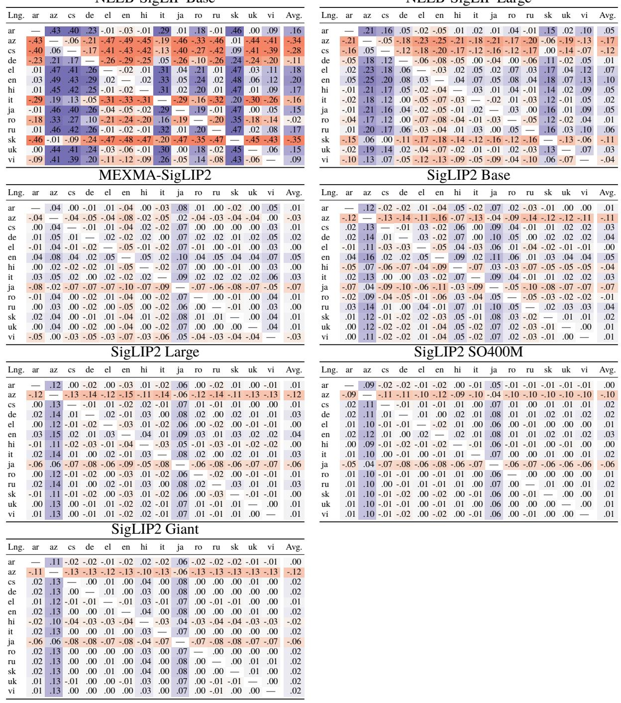  
Table 18: The diference between the language-specific mistakes, for encoder-only models.

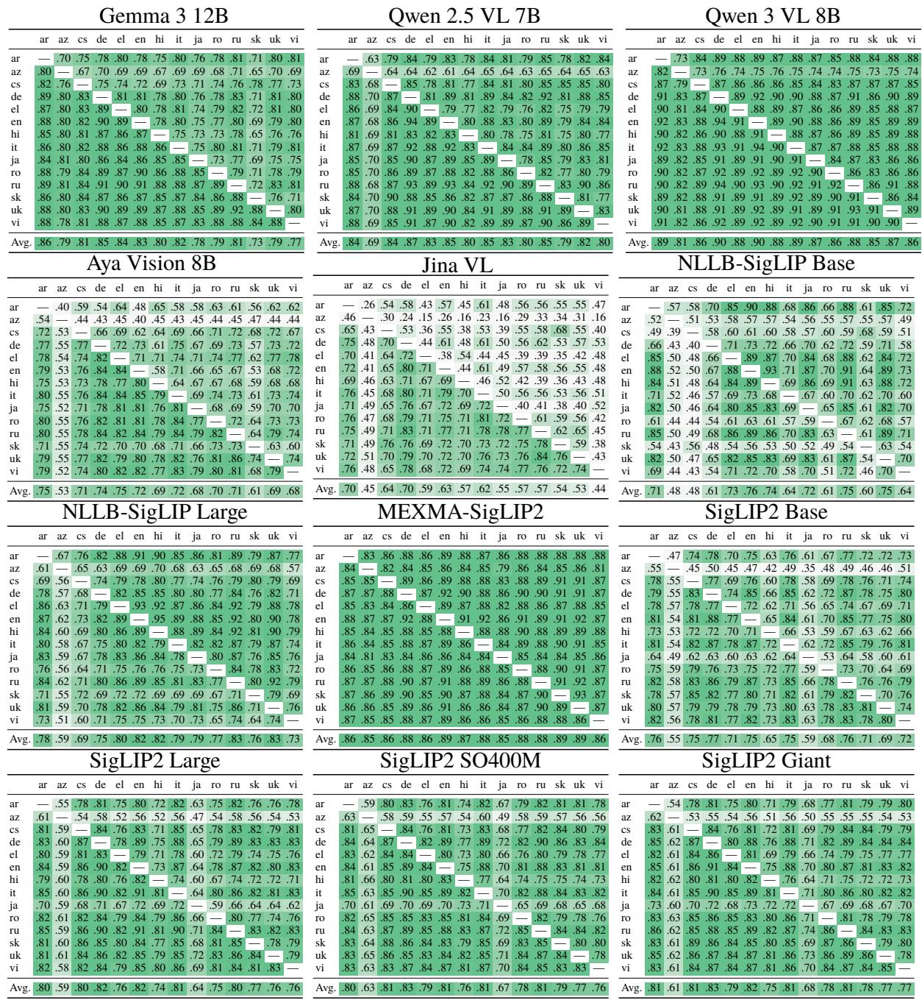  
Table 19: Languages’ agreement as Cohen-Kappa coeficient for all model.

<table><tr><td></td><td>Arabic</td></tr><tr><td>SI P00M Si Giant Gemma 3 12B .64 Qwen 2.5 VL 7B</td><td>NIL -ase NL -are MES-SLIP2 e  7B Gem3 12B en  VBB Ayasi oB Si ase Si re Tin l .68 40 .08 64 .66 64 .61 64</td></tr><tr><td>668 Qwen 3 VL 8B Aya Vision 8B 370 Jina VL NLLB-SigLIP Base .78 6547678.8 NLLB-SigLIP Large .73 .72 .76 .75</td><td>78 0100 0 .66 .782 34 .68 .66 .62 6267 00468 .67 .83 .73 .73 .73 .65 .74 .73 602 15 307 .306 .08 .30 370 30 .60 .67 .72 .75 .78 .75 .63 .72</td></tr><tr><td>MEXMA-SigLIP2 SigLIP2 Base 45的的 .62 66 SigLIP2 Large 0的00 句古古 SigLIP2 SO400M SigLIP2 Giant Avg. .70 .69 .71 .56</td><td>55549974 453 句5的75.80 80 658 .73 .76 6的585 .74 76 .75 00058 .60 .61 .76 6. 0 0557 .74 .78 .60 .71 .80 .78</td></tr><tr><td></td><td>.36 .59 .59 .58 .58 .60 .61 .61 Czech</td></tr><tr><td>Sil Giant Gemma 3 12B 62.651 Qwen 2.5 VL 7B Qwen 3 VL 8B</td><td>NIL -ase NL -re MEXS-SLIP2 Oe  V 7B SLL S00M Gma 12B wn V8B AyaVsi B SiL Base Si rge Tin TVl .68 .69 .44 .09 65—45 .57 .63 .59 .62 6.5-8 7.0720 .76 1441 0.06 .625 .68 .63 .75 .72 .68 _</td></tr><tr><td>Aya Vision 8B Jina VL NLLB-SigLIP Base NLLB-SigLIP Large 0.755009 MEXMA-SigLIP2 4 SigLIP2 Base 656 の的 的的的 .66 SigLIP2 Large SigLIP2 SO400M</td><td>18171 .139 .03 .47 .45 .46 .46 .46 .58 .64 .55 .05 .06 .05 .05 .06 .45 .48 .48 .43 .39 .56 .55 .47 .45 .46 .48 .58 .62 .65 .65 .57 .68 .59 66 6. 57. 82 057882 .72 .75 .77 .66 .67 .62 .66 6.56 一 .78</td></tr><tr><td>SigLIP2 Giant Avg.</td><td>07855 .66 .77 78 .65 .65 .67 .61 .66 .73 .79 .81 .66 .67 .67 .55.35 .42 .53 .58 .58 .60 .60 .61 Greek</td></tr><tr><td>Gemma 3 12B .65 .73 .59 Qwen 2.5 VL 7B</td><td>NIL -BaseG NL -age MESS-SLIP2   B SP2 SP00M Gmam3 12B e  8B Ayas oB Si rge Si Base Sil Giant TI l .68 .66 .59 .63 .65</td></tr><tr><td>Qwen 3 VL 8B .84 Aya Vision 8B .75 .76 Jina VL .58 .65 .60 NLLB-SigLIP Base .72 .75 77 NLLB-SigLIP Large .74 MEXMA-SigLIP2</td><td>0.0.06.10 552 .66 1808.73 .74 .4557 .7 .65 .57 .60 .63 :710 .72 .64 .67 .71 .56 .57 .54 49 .5 .035 .52 .05 .54 .05 .05 .04 .05 .70 .57 .79 .74 .60 .62 .65 .63</td></tr><tr><td>SigLIP2 Base 6的 的的的 6 8505 . SigLIP2 Large SigLIP2 SO400M SigLIP2 Giant .63 .62 .64</td><td>.77 .78 2 70 57.58 76 .5 6560 06377 .78 句6370.7680 .74 .77 .80 .77 .79 6620 0的的 16. 的的的 .70 二 .73</td></tr><tr><td>Avg. .69 .70 .71.60.35 Hindi</td><td>.72 78.7. 二 .63 7j .79 .60 .62 .61</td></tr><tr><td></td><td>.60 .62 .60 .57</td></tr><tr><td>e  V 7B Ge3 12B ww  V8B</td><td>NIL -ase NI -rre MEXS-SIP2 SL 00M AyaVsi og Si arge Si Base Si  Giant Tin l</td></tr><tr><td>Gemma 3 12B .59 .67 Qwen 2.5 VL 7B .76 一 .75 20688日 Qwen 3 VL 8B Aya Vision 8B .76 Jina VL .59 .65 .58 NLLB-SigLIP Base .71 75</td><td>5.3.47 00.0.0 .61 .63 .61 495258 .58 57.60 5.60.65 .64 .66 .66 .73 .75 .73 .64 .65 .47 .47 .46 .39 .437 .06 .53 .05 .06 .06 .06 44 .07</td></tr><tr><td>7 NLLB-SigLIP Large .74 .73 MEXMA-SigLIP2 .75 .73 .78 SigLIP2 Base 5的的 36600 5765 32555 SigLIP2 Large SigLIP2 SO400M .57 SigLIP2 Giant .56 .60</td><td>67771 .55 .79 75 555 .59 0的063 .61 .61 .57 .77 .76 60. 58 6乃73 .76 .79 4.4.45.4 51065 .5 564 .64 .66 .64 .63 .69 .74 1</td></tr></table>

<table><tr><td rowspan=1 colspan=4>Azerbajani</td></tr><tr><td rowspan=1 colspan=4>NL -aseNL -ge 7BMES-SSLIP2      SP2 SP00MGem3 12Bw8BAyasi BSi BaseSi reSil GiantTin TVl</td></tr><tr><td rowspan=1 colspan=4>Gemma 3 12B       .5058. 6130 5 320.0.0.033 3 46 26 03.44.553 3 4042 3 5 270043. 40 47.26 042 38 4 26 0Qwen 2.5 VL 7B.63一.49.54Qwen 3 VL 8B.74.65Aya Vision 8B.49.465135.29.30.03Jina VL.35.47.29.02.02</td></tr><tr><td rowspan=2 colspan=4>NLLB-SigLIP Base.43.43.463 3 4 3 33225 2 34 2 5 4 1  .55.56.32.3615526 27 826347533955343474NLLB-SigLIP Large.51.47.56.583 43MEXMA-SigLIP2.68.58.72.40165SigLIP2 Base.36.441 3 43 45 38SigLIP2 Large.41.37.457.34.591SigLIP2 SO400M.538.3839.56.641SigLIP2 Giant.31.40.49.60.63</td></tr><tr><td rowspan=1 colspan=3>NLLB-SigLIP Large .51</td></tr><tr><td rowspan=1 colspan=4>Avg.           .50.45.50.33.18.33.38.44.37.42.42.40</td></tr><tr><td rowspan=1 colspan=4>German</td></tr><tr><td rowspan=1 colspan=4>NIL S-aseNIL S-are   7BMES-SLIPD2 8B   Si areS2 SP0MGema3 12BAya s gBSi BaseSil GiantTi nVl</td></tr><tr><td rowspan=1 colspan=4>Gemma 3 12B       .6972.56.11.55.61 66.64.6767.72. 46.724Qwen 2.5 VL 7B184741.81.5961.67.72.70.72Qwen 3 VL 8B.7.68.73.72.73Aya Vision 8B.78.47.53.54.56.55.56.55F99Jina VL         .66.72.68.62  .08.08.07.08.08.08.08</td></tr><tr><td rowspan=1 colspan=4>NLLB-SigLIP Base.60.62.63.59.53   .66.64.56.57584的NLLB-SigLIP Large.71.74.74.68.67.71.63</td></tr><tr><td rowspan=1 colspan=4>的57554                806858品02550SigLIP2 Base的86.696 70.632505656.8384.8.SigLIP2 Large.80SigLIP2 SO400M.68.69.63.66.715.82SigLIP2 Giant.66.66.67.60.58.63.80.81</td></tr><tr><td rowspan=1 colspan=4>Avg.           .71 .72 .72 .62.40.51.58 .61.63.64 .65 .65</td></tr><tr><td rowspan=1 colspan=4>English</td></tr><tr><td rowspan=1 colspan=4>NL -aseNL -ge  7BMEXSS-SLIP2e 8B   Si reSP SP00MGem 12BAyaAsi nBSi BaseSi Giantin l</td></tr><tr><td rowspan=1 colspan=4>Gemma 3 12B       .70.71.63. 0.0.65.66.65.65.64.66.67Qwen 2.5 VL 7B.8.85.6874 73.7574.74.73T2.727. 73.75Qwen 3 VL 8B.89.75Aya Vision 8B    .80818.81    .11.63.63.63.63.62.63.64Jina VL.76.80.72.06.07</td></tr><tr><td rowspan=1 colspan=3>NLLB-SigLIP Base</td><td rowspan=3 colspan=1>.76.78.78.74.72   .79.76.69.67的7.64.87. 7.7. 4 868.79.79.7473.74.81二.7766.68.808072756..79.80.66.71.66.67.69.68.83767071.6765.46句5的6865-6的.81.69.70.706.80二.66.66.66.62.8178.8.7.</td></tr><tr><td rowspan=2 colspan=3>NLLB-SigLIP LargeMEXMA-SigLIP2SigLIP2 BaseSigLIP2 LargeSigLIP2 SO400MSigLIP2 Giant</td></tr><tr><td rowspan=1 colspan=1>MEX</td><td rowspan=1 colspan=1>XMA-Si</td></tr><tr><td rowspan=1 colspan=4>Avg.           .76.76 .76.69.46.64.65.64.66 .66 .67 .68</td></tr><tr><td rowspan=1 colspan=4>Italian</td></tr><tr><td rowspan=1 colspan=4>NIL S-aseNIL -are   7BMEXS-SIP2wn 8B   Si rgeSL2 S0MGma3 12BAyas oBSIi BaseSi GiantTin vl</td></tr><tr><td rowspan=1 colspan=4>Gemma 3 12B       .68.725571212121252 5 60.64.65.67.67670.72670.73Qwen 2.5 VL 7B188374187 7.80.69の7.68.69Qwen 3 VL 8B.7071.71Aya Vision 8B.78.44.52.51.52.52.52.54Jina VL         .68.73.69.62   .08.09.08.09.09.09.09</td></tr><tr><td rowspan=2 colspan=3>NLLB-SigLIP BaseNLLB-SigLIP LargeMEXMA-SigLIP2</td><td rowspan=1 colspan=1>.60.63.64.59.55   .66.64.54.52.53</td></tr><tr><td rowspan=1 colspan=1>.70.76.77.71.57     .7266.64.75.78.79.72.66.77.66</td></tr><tr><td rowspan=1 colspan=3>SigLIP2 BaseSigLIP2 LargeSigLIP2 SO400MSigLIP2 Giant</td><td rowspan=1 colspan=1>566824866.6870.72 82352008⎓550515947的的6665.84.6965.65.76.80.65.67.60.63.75.79.80</td></tr><tr><td rowspan=1 colspan=3>Avg.</td><td rowspan=1 colspan=1>.71 .72 .73 .62 .42.51.59 .60 .62 .63 .64 .65</td></tr></table>

Table 20: Models’ agreement as Cohen-Kappa coeficient, for each language, part 1.

<table><tr><td rowspan=1 colspan=11>Japanese</td></tr><tr><td rowspan=1 colspan=11>NIL S-aseNL S-ree   BMEXMS-SSIP2w  8B      SPP2 SP00MGema3 12BAyasi ioBSi aseSi reSi iantTiV</td></tr><tr><td rowspan=1 colspan=1>Gemma 3 12B</td><td rowspan=1 colspan=2>.65.69</td><td rowspan=1 colspan=6>.51.10.58.59.60.48</td><td rowspan=1 colspan=2>.48.51.52</td></tr><tr><td rowspan=1 colspan=1>Qwen 2.5 VL 7B</td><td rowspan=1 colspan=2>.80一.77</td><td rowspan=1 colspan=1>.48</td><td rowspan=1 colspan=1>.12</td><td rowspan=1 colspan=1>.65</td><td rowspan=1 colspan=2>.67.67</td><td rowspan=1 colspan=1>.50</td><td rowspan=1 colspan=1>.51</td><td rowspan=1 colspan=1>.56.57</td></tr><tr><td rowspan=1 colspan=1>Aya Vision 8B</td><td rowspan=1 colspan=2>.71.73.76</td><td rowspan=1 colspan=1></td><td rowspan=1 colspan=1>.12</td><td rowspan=1 colspan=3>.49.50.50</td><td rowspan=1 colspan=1>.38</td><td rowspan=1 colspan=1>.38</td><td rowspan=1 colspan=1>.42.43</td></tr><tr><td rowspan=1 colspan=1>Jina VL</td><td rowspan=1 colspan=2>.59.67.60</td><td rowspan=1 colspan=6>.51_.07.08.08.07</td><td rowspan=1 colspan=1>.07</td><td rowspan=1 colspan=1>.08.08</td></tr><tr><td rowspan=1 colspan=1>NLLB-SigLIP Base</td><td rowspan=1 colspan=2>.70.73.74</td><td rowspan=1 colspan=1>.68</td><td rowspan=1 colspan=1>.56</td><td rowspan=1 colspan=1></td><td rowspan=1 colspan=2>.75.74</td><td rowspan=1 colspan=1>.49</td><td rowspan=1 colspan=1>.50</td><td rowspan=1 colspan=1>.55.56</td></tr><tr><td rowspan=1 colspan=1>NLLB-SigLIP Large</td><td rowspan=1 colspan=2>.71.76.76</td><td rowspan=1 colspan=1>.69</td><td rowspan=1 colspan=1>.57</td><td rowspan=1 colspan=1>.79</td><td rowspan=1 colspan=1>一</td><td rowspan=1 colspan=1>.75</td><td rowspan=1 colspan=1>.48</td><td rowspan=1 colspan=1>.50</td><td rowspan=1 colspan=1>.55</td></tr><tr><td rowspan=1 colspan=1>MEXMA-SigLIP2</td><td rowspan=1 colspan=2>.74.76.77</td><td rowspan=1 colspan=1>.68</td><td rowspan=1 colspan=1>.57</td><td rowspan=1 colspan=1>.79</td><td rowspan=1 colspan=1>.78</td><td rowspan=1 colspan=1></td><td rowspan=1 colspan=1>.47</td><td rowspan=1 colspan=1>.50</td><td rowspan=1 colspan=1>.53</td></tr><tr><td rowspan=1 colspan=1>SigLIP2 Base</td><td rowspan=1 colspan=2>.49.50.52</td><td rowspan=1 colspan=1>.47</td><td rowspan=1 colspan=1>.39</td><td rowspan=1 colspan=1>.47</td><td rowspan=1 colspan=1>.47</td><td rowspan=1 colspan=1>.47</td><td rowspan=1 colspan=1></td><td rowspan=1 colspan=1>.61</td><td rowspan=1 colspan=1>.61.65</td></tr><tr><td rowspan=1 colspan=1>SigLIP2 Large</td><td rowspan=1 colspan=2>.53.52.55</td><td rowspan=1 colspan=1>.49</td><td rowspan=1 colspan=1>.39</td><td rowspan=1 colspan=1>.49</td><td rowspan=1 colspan=1>.50</td><td rowspan=1 colspan=1>.49</td><td rowspan=1 colspan=1>.63</td><td rowspan=1 colspan=1></td><td rowspan=1 colspan=1>.66.67</td></tr><tr><td rowspan=1 colspan=1>SigLIP2 SO400M</td><td rowspan=1 colspan=2>.54.54.56</td><td rowspan=1 colspan=1>.51</td><td rowspan=1 colspan=1>.40</td><td rowspan=1 colspan=1>.50</td><td rowspan=1 colspan=2>.50.51</td><td rowspan=1 colspan=1>.63</td><td rowspan=1 colspan=1>.69</td><td rowspan=1 colspan=1>.70</td></tr><tr><td rowspan=1 colspan=1>SigLIP2 Giant</td><td rowspan=1 colspan=2>.50.50.53</td><td rowspan=1 colspan=1>.46</td><td rowspan=1 colspan=1>.37</td><td rowspan=1 colspan=1>.47</td><td rowspan=1 colspan=2>.47.49</td><td rowspan=1 colspan=1>.59</td><td rowspan=1 colspan=1>.65</td><td rowspan=1 colspan=1>.70</td></tr><tr><td rowspan=1 colspan=1>Avg.</td><td rowspan=1 colspan=10>.65.65.66.55.34.54.55.55.48.49.52.54</td></tr><tr><td rowspan=1 colspan=1></td><td rowspan=1 colspan=10>Russian</td></tr><tr><td rowspan=1 colspan=1></td><td rowspan=1 colspan=2></td><td rowspan=1 colspan=1></td><td rowspan=1 colspan=2></td><td rowspan=1 colspan=2></td><td rowspan=1 colspan=1></td><td rowspan=3 colspan=2></td></tr><tr><td rowspan=1 colspan=1></td><td rowspan=3 colspan=5>NIL IS-aseGema3 12BOe   Bwe  8BAyaysi ioTiV</td><td rowspan=1 colspan=2>B</td><td rowspan=1 colspan=1></td><td rowspan=3 colspan=2></td></tr><tr><td></td><td rowspan=2 colspan=3>NL -ge   Si ase</td></tr><tr><td></td><td rowspan=1 colspan=2>Si are</td></tr><tr><td rowspan=1 colspan=1>Gemma 3 12B</td><td rowspan=1 colspan=2>.71.74</td><td rowspan=1 colspan=1>.58</td><td rowspan=1 colspan=1>.09</td><td rowspan=1 colspan=1>.68</td><td rowspan=1 colspan=3>.67.66.66</td><td rowspan=1 colspan=1>.68</td><td rowspan=1 colspan=1>.68.69</td></tr><tr><td rowspan=1 colspan=1>Qwen 3 VL 8B</td><td rowspan=1 colspan=2>.871</td><td rowspan=1 colspan=1>.56</td><td rowspan=1 colspan=1>.07</td><td rowspan=1 colspan=1>.73</td><td rowspan=1 colspan=3>.73.73.72</td><td rowspan=1 colspan=1>.73</td><td rowspan=1 colspan=1>.74.75</td></tr><tr><td rowspan=1 colspan=1>Aya Vision 8B</td><td rowspan=1 colspan=2>.79.79</td><td rowspan=1 colspan=1></td><td></td><td></td><td></td><td></td><td></td><td></td><td></td></tr><tr><td rowspan=1 colspan=1>Jina VL</td><td rowspan=1 colspan=2>.63.68.65</td><td rowspan=1 colspan=1>.61</td><td rowspan=1 colspan=1></td><td rowspan=1 colspan=1>.06</td><td rowspan=1 colspan=3>.06.05.06</td><td rowspan=1 colspan=2>.06.05.06</td></tr><tr><td rowspan=1 colspan=1>NLLB-SigLIP Base</td><td rowspan=1 colspan=2>.74.78.78</td><td rowspan=1 colspan=1>.71</td><td rowspan=1 colspan=1>.62</td><td rowspan=1 colspan=1></td><td rowspan=1 colspan=3>.79.76.69</td><td rowspan=1 colspan=2>.68.69.71</td></tr><tr><td rowspan=1 colspan=1>NLLB-SigLIP Large</td><td rowspan=1 colspan=2>.75.78.78</td><td rowspan=1 colspan=1>.71</td><td rowspan=1 colspan=1>.62</td><td rowspan=1 colspan=1>.80</td><td rowspan=1 colspan=2>二.78</td><td rowspan=1 colspan=1>.68</td><td rowspan=1 colspan=2>.68.70</td></tr><tr><td rowspan=1 colspan=1>MEXMA-SigLIP2</td><td rowspan=1 colspan=2>.78.80.80</td><td rowspan=1 colspan=1>.73</td><td rowspan=1 colspan=1>.63</td><td rowspan=1 colspan=1>.79</td><td rowspan=1 colspan=2>.80</td><td></td><td></td><td></td></tr><tr><td rowspan=1 colspan=1>SigLIP2 Base</td><td rowspan=1 colspan=2>.68.69.70</td><td rowspan=1 colspan=1>.63</td><td rowspan=1 colspan=1>.55</td><td rowspan=1 colspan=1>.65</td><td rowspan=1 colspan=2>.64.68</td><td rowspan=1 colspan=1></td><td rowspan=1 colspan=2>.82.84.82</td></tr><tr><td rowspan=1 colspan=1>SigLIP2 Large</td><td rowspan=1 colspan=2>.70.70.72</td><td rowspan=1 colspan=1>.64</td><td rowspan=1 colspan=1>.55</td><td rowspan=1 colspan=1>.65</td><td rowspan=1 colspan=2>.66.66</td><td rowspan=1 colspan=1>.80</td><td rowspan=1 colspan=2>.85.85</td></tr><tr><td rowspan=1 colspan=1>SigLIP2 SO400M</td><td rowspan=1 colspan=2>.68.67.68</td><td rowspan=1 colspan=1>.62</td><td rowspan=1 colspan=1>.52</td><td rowspan=1 colspan=1>.64</td><td rowspan=1 colspan=2>.63.65</td><td rowspan=1 colspan=1>.79</td><td rowspan=1 colspan=2>.81   .86</td></tr><tr><td rowspan=1 colspan=1>SigLIP2 Giant</td><td rowspan=1 colspan=2>.67.66.68</td><td rowspan=1 colspan=1>.63</td><td rowspan=1 colspan=1>.52</td><td rowspan=1 colspan=1>.63</td><td rowspan=1 colspan=2>.62.65</td><td rowspan=1 colspan=1>.76</td><td rowspan=1 colspan=2>.82.81</td></tr><tr><td rowspan=1 colspan=1>Avg.</td><td rowspan=1 colspan=10>.73.74.74 .63.40.63.62.62.64.65.67.67</td></tr><tr><td rowspan=1 colspan=1></td><td rowspan=1 colspan=10>Ukrainian</td></tr><tr><td rowspan=1 colspan=1></td><td rowspan=1 colspan=10>NIL S-aseNL S-ree   BMEXS-SSLIP2w  8B      SPP2 SP00MMGema312BAYyaysi ionSiL aseSiageSi GiantTin Vl</td></tr><tr><td rowspan=1 colspan=1>Gemma 3 12B</td><td rowspan=1 colspan=2>.71.74</td><td rowspan=1 colspan=1>.54</td><td rowspan=1 colspan=1>.12</td><td rowspan=1 colspan=1>.66</td><td rowspan=1 colspan=3>.66.66.63</td><td rowspan=1 colspan=2>.64.66.64</td></tr><tr><td rowspan=1 colspan=1>Qwen 2.5 VL 7B</td><td rowspan=1 colspan=2>.81一.78</td><td rowspan=1 colspan=1>.48</td><td rowspan=1 colspan=1>.09</td><td rowspan=1 colspan=1>.68</td><td rowspan=1 colspan=2>.70.70</td><td rowspan=1 colspan=1>.64</td><td rowspan=1 colspan=2>.66.66.65</td></tr><tr><td rowspan=1 colspan=1>Qwen 3 VL 8B</td><td rowspan=1 colspan=2>.82.84</td><td rowspan=1 colspan=1>.54</td><td rowspan=1 colspan=1>.08</td><td rowspan=1 colspan=1>.72</td><td rowspan=1 colspan=2>.74.74</td><td rowspan=1 colspan=1>.67</td><td rowspan=1 colspan=2>.68.69.69</td></tr><tr><td rowspan=1 colspan=1>Aya Vision 8B</td><td rowspan=1 colspan=2>.72.75.76</td><td rowspan=1 colspan=1></td><td rowspan=1 colspan=1>.07</td><td rowspan=1 colspan=1>.51</td><td rowspan=1 colspan=2>.53.53</td><td rowspan=1 colspan=1>.49</td><td rowspan=1 colspan=2>.50.51.50</td></tr><tr><td rowspan=1 colspan=1>Jina VL</td><td rowspan=1 colspan=2>.60.66.60</td><td rowspan=1 colspan=1>.57</td><td rowspan=1 colspan=1>一</td><td rowspan=1 colspan=4>.06.06.06.06</td><td rowspan=1 colspan=2>.06.06.05</td></tr><tr><td rowspan=1 colspan=1>NLLB-SigLIP Base</td><td rowspan=1 colspan=2>.72.76.75</td><td rowspan=1 colspan=1>.68</td><td rowspan=1 colspan=1>.57</td><td rowspan=1 colspan=1></td><td rowspan=1 colspan=3>.78.74.62</td><td rowspan=1 colspan=2>.63.63.65</td></tr><tr><td rowspan=1 colspan=1>NLLB-SigLIP Large</td><td rowspan=1 colspan=2>.73.77.76</td><td rowspan=1 colspan=1>.68</td><td rowspan=1 colspan=1>.57</td><td rowspan=1 colspan=1>.79</td><td rowspan=1 colspan=2>一.77</td><td rowspan=1 colspan=1>.64</td><td rowspan=1 colspan=2>.65.65.66</td></tr><tr><td rowspan=1 colspan=1>MEXMA-SigLIP2</td><td rowspan=1 colspan=2>.75.78.79</td><td rowspan=1 colspan=1>.69</td><td rowspan=1 colspan=1>.59</td><td rowspan=1 colspan=1>.76</td><td rowspan=1 colspan=2>.78</td><td rowspan=1 colspan=1>.61</td><td rowspan=1 colspan=2>.64.63.65</td></tr><tr><td rowspan=1 colspan=1>SigLIP2 Base</td><td rowspan=1 colspan=2>.64.65.67</td><td rowspan=1 colspan=1>.59</td><td rowspan=1 colspan=1>.50</td><td rowspan=1 colspan=1>.60</td><td rowspan=1 colspan=2>.61.63</td><td rowspan=1 colspan=1></td><td rowspan=1 colspan=2>.76.76.75</td></tr><tr><td rowspan=1 colspan=1>SigLIP2 Large</td><td rowspan=1 colspan=2>.66.67.68</td><td rowspan=1 colspan=1>.60</td><td rowspan=1 colspan=1>.51</td><td rowspan=1 colspan=1>.62</td><td rowspan=1 colspan=2>.62.64</td><td rowspan=1 colspan=1>.75</td><td rowspan=1 colspan=1></td><td rowspan=1 colspan=1>.80.82</td></tr><tr><td rowspan=1 colspan=1>SigLIP2 SO400M</td><td rowspan=1 colspan=2>.65.66.68</td><td rowspan=1 colspan=1>.60</td><td rowspan=1 colspan=1>.50</td><td rowspan=1 colspan=1>.62</td><td rowspan=1 colspan=2>.62.63</td><td rowspan=1 colspan=1>.73</td><td rowspan=1 colspan=1>.78</td><td rowspan=1 colspan=1>.83</td></tr><tr><td rowspan=1 colspan=1>SigLIP2 Giant</td><td rowspan=1 colspan=2>.65.66.66</td><td rowspan=1 colspan=1>.60</td><td rowspan=1 colspan=1>.49</td><td rowspan=1 colspan=1>.62</td><td rowspan=1 colspan=2>.62.63</td><td rowspan=1 colspan=1>.73</td><td rowspan=1 colspan=2>.78.80</td></tr><tr><td rowspan=1 colspan=1>Avg.</td><td rowspan=1 colspan=10>.70 .72.72.60.37.60.61.61.60 .62.62.63</td></tr></table>

<table><tr><td rowspan=1 colspan=2>Romanian</td></tr><tr><td rowspan=1 colspan=2>NL SS-aseNL -reOe  7BMEXS-SLIP2e V8B     SEL2 SP0MGema3 12BAYyaVsi iooBSiL aseSIirgeSi GiantTin V</td></tr><tr><td rowspan=2 colspan=2>Gemma 3 12B       .64.70.52.09.53.62.65.57.62.64.62Qwen 2.5 VL 7B  .80  .76.42.10.52.62.66.58.62.63.63Qwen 3 VL 8B    .83.83  .50.09.57.67.72.62.67.69.68</td></tr><tr><td rowspan=1 colspan=1>Qwen 3 VL 8B</td></tr><tr><td rowspan=2 colspan=1>Aya Vision 8BJina VL</td><td></td></tr><tr><td rowspan=1 colspan=1>.74.74.76   .06.42.50.50.45.50.49.50.64.71.65.61   .04.06.06.05.06.06.06</td></tr><tr><td rowspan=1 colspan=1>NLLB-SigLIP Base</td><td rowspan=1 colspan=1>.56.57.57.55.47  .64.61.50.51.53.51</td></tr><tr><td rowspan=1 colspan=1>NLLB-SigLIP Large</td><td></td></tr><tr><td rowspan=2 colspan=1>MEXMA-SigLIP2</td><td></td></tr><tr><td rowspan=1 colspan=1>.68.70.71.64.56.63  .73.58.61.61.61.76.77.78.72.62.57.70   .60.65.65.65</td></tr><tr><td rowspan=1 colspan=1>SigLIP2 Base</td><td rowspan=1 colspan=1>.61.60.62.57.48.46.58.60_.70.72.71</td></tr><tr><td rowspan=1 colspan=1>SigLIP2 Large</td><td rowspan=1 colspan=1>.67.65.68.62.52.51.60.64.71   .76.77</td></tr><tr><td rowspan=1 colspan=1>SigLIP2 SO400MSigLIP2 Giant</td><td rowspan=1 colspan=1>.65.64.65.61.51.49.59.62.69.78  .80.63.59.51.58.62.67.77.80</td></tr><tr><td rowspan=1 colspan=1>Avg.</td><td rowspan=1 colspan=1>.69.68.69.58.36.48.56.58.55.59.60.59</td></tr><tr><td rowspan=1 colspan=2>Slovak</td></tr><tr><td rowspan=1 colspan=2>NL -aseNLL -reOwe  V  BMEXS-SLIP2w 8B     SL SP0MGe3 12BAyaVi ioBSiL BaseSi rgeSil GiantTa Vl</td></tr><tr><td rowspan=1 colspan=1>Gemma 3 12B</td><td rowspan=3 colspan=1>.64.65.37.08.48.55.59.55.57.59.58.77   .71.35.09.51.59.65.60.61.63.62.78.82  .41.08.54.66.70.65.65.68.68</td></tr><tr><td rowspan=1 colspan=1>Qwen 2.5 VL 7B</td></tr><tr><td rowspan=1 colspan=1>Qwen 3 VL 8B</td></tr><tr><td rowspan=1 colspan=1>Aya Vision 8BJina VL</td><td rowspan=1 colspan=1>.63.68.67一.06.32.37.40.38.39.41.41.59.67.60.561.04.05.05.05.06.06.05</td></tr><tr><td rowspan=1 colspan=1>NLLB-SigLIP Base</td><td rowspan=1 colspan=1>.48.52.52.45.43  .61.56.49.48.52.50</td></tr><tr><td rowspan=2 colspan=1>MEXMA-SigLIP2</td><td></td></tr><tr><td rowspan=1 colspan=1>.63.65.66.55.53.55一.69.58.57.60.59.73.75.77.62.59.51.69   .62.62.64.63</td></tr><tr><td rowspan=1 colspan=1>SigLIP2 Large</td><td rowspan=1 colspan=1>.65.63.66.54.48.43.54.61.75  .82.79</td></tr><tr><td rowspan=1 colspan=1>SigLIP2 SO400MSigLIP2 Giant</td><td rowspan=1 colspan=1>.63.62.65.53.48.43.53.62.74.78   .82.64.63.65.54.48.42.54.62.71.76.80</td></tr><tr><td rowspan=1 colspan=1>Avg.</td><td rowspan=1 colspan=1>.65.66.65.50.35.42.52.55.56.57.59.59</td></tr><tr><td rowspan=1 colspan=1></td><td rowspan=1 colspan=1>Vietnamese</td></tr><tr><td rowspan=1 colspan=2>NL -aseNLL -reOwe  V  BMEXS-SIP2     SLL2 S00MGema3 12BwV8BAya si iBSiL BaseSi rgeSil GiantTa Vl</td></tr><tr><td rowspan=1 colspan=1>Gemma 3 12B</td><td rowspan=3 colspan=1>.66.72.59.11.54.58.63.63.65.66.68.83   .78.53.10.59.61.66.63.65.65.66.84.85  .58.09.60.63.70.67.69.70.71.74.74.77   .10.46.49.54.54.55.55.56.61.69.61.541.06.07.07.07.08.08.08</td></tr><tr><td rowspan=1 colspan=1>Qwen 2.5 VL 7BQwen 3 VL 8BAya Vision 8B</td></tr><tr><td rowspan=1 colspan=1>Jina VL</td></tr><tr><td rowspan=1 colspan=1>NLLB-SigLIP BaseNLLB-SigLIP Large</td><td rowspan=3 colspan=1>.63.64.65.59.50  .67.64.53.53.54.58.65.66.68.62.52.68一.67.55.56.59.59.76.77.80.72.60.68.71   .61.61.61.63.63.63.65.59.49.52.54.61   .78.77.78</td></tr><tr><td rowspan=1 colspan=1>MEXMA-SigLIP2</td></tr><tr><td rowspan=1 colspan=1>SigLIP2 Base</td></tr><tr><td rowspan=1 colspan=1>SigLIP2 Large</td><td rowspan=1 colspan=1>.66.67.62.50.54.54.62.75   .79.82</td></tr><tr><td rowspan=1 colspan=1>SigLIP2 SO400MSigLIP2 Giant</td><td rowspan=1 colspan=1>.64.63.66.60.48.52.52.61.76.79   .82.65.64.65.60.49.54.55.62.73.79.79</td></tr><tr><td rowspan=1 colspan=2>Avg.           .70 .69.69.60.36.52.54 .58.59.61.61.63</td></tr></table>

Table 21: Models’ agreement as Cohen-Kappa coeficient, for each language, part 2.

<table><tr><td>Model</td><td>ar</td><td>az</td><td>cs</td><td>de</td><td>el</td><td>en</td><td>hi</td><td>it</td><td>ja</td><td>ro</td><td>ru</td><td>sk</td><td>uk</td><td>vi</td></tr><tr><td>Gemma 3 12B</td><td>.581 H .395 37 2</td><td>.3 王</td><td>.507 5 H</td><td>.581 68 f</td><td>.587 H .371 ±</td><td>.569 1</td><td>.523 H .5b 王</td><td>.581 H .032 .663 f</td><td>.510 .887 多 8 è</td><td>.569 ± .371</td><td>.610 王 .886</td><td>.472 王 .344</td><td>.593 王 .83b</td><td>.600 .832 王</td></tr><tr><td>Qwen 2.5 VL 7B Qwen 3 VL 8B</td><td>王 .031 .676</td><td>.030 .504 H</td><td>.033 3 H</td><td>.980 士</td><td>.904 98 王</td><td></td><td></td><td>.905</td><td>.886 王</td><td>±</td><td>f .688 2 壬</td><td>± .032</td><td>王 .876 2 王</td><td>&#x27; .685 士</td></tr><tr><td>Aya Vision 8B</td><td>.030 .245 士</td><td></td><td>.030</td><td>.029 .410 王</td><td>.029 .408 士</td><td>.899 王</td><td>029 .302</td><td>士</td><td></td><td>王</td><td></td><td>.030</td><td>.030 .347 ±</td><td>.029 </td></tr><tr><td>Jina VL</td><td>.078 .008</td><td>.004 .004</td><td>.007 .005</td><td>.031 .035 王 .012</td><td>.031 .016 .008 X</td><td>.032 .020 士 .009</td><td>.009 土 .006</td><td>.031 士 .009</td><td>.009</td><td>士 H .007</td><td>士 王 .007</td><td>.809 士 .006</td><td>.030 .016 生 .008</td><td>.032 .034 王 .011</td></tr><tr><td>NLLB-SigLIP Base</td><td>.665 士 .029 .680</td><td>.030 .443</td><td>.382 .031</td><td>.488 .399 王</td><td>.661 .889 H</td><td>.677 王 .030 .698</td><td>.651 士</td><td>.478 H .031</td><td>.635 .836 H</td><td>.450</td><td>.682 .885 王</td><td>.407 H</td><td>.654 H</td><td>.517 .55 =</td></tr><tr><td>NLLB-SigLIP Large</td><td>士 .832</td><td>王 .031 .657</td><td>.571 ± .031</td><td>王 .031</td><td>王 .029</td><td>.8239 王</td><td>王 .029.</td><td>.643 ± .030</td><td>王 .030</td><td></td><td>士 .029</td><td>±</td><td>.071 士 .873</td><td>#3 王</td></tr><tr><td>MEXMA-SigLIP2</td><td>H</td><td>H .030</td><td>.668 H .045 230</td><td>.687 H .030</td><td>.653 H</td><td>6 王</td><td>.684 王 .301</td><td>H .030</td><td>.641 王</td><td>76 H</td><td>.678 ±</td><td>H .030</td><td>f .030</td><td>3 王H .030</td></tr><tr><td>SigLIP2 Base</td><td>.o8</td><td></td><td>H</td><td>.686 王 .909</td><td>-031</td><td>王 L</td><td>王</td><td>士 .029</td><td>.032</td><td>王</td><td>.89 2 王</td><td>.620 H -031</td><td>.624 王</td><td>.642 ± -031</td></tr><tr><td>SigLIP2 Large</td><td>.633</td><td>.031</td><td>.029</td><td>.905 士</td><td>.639</td><td>.985</td><td>.031</td><td></td><td>.460 壬</td><td>.030</td><td>.097 士</td><td>.644 ± -030</td><td>.034 王</td><td>.668 .032 士</td></tr><tr><td>SigLIP2 SO400M</td><td>王 .030</td><td>.033</td><td>.664 士 .030</td><td>士 .029</td><td>壬 .030</td><td>王 .029 .684</td><td>.610 士 .373</td><td>.889 王 .030</td><td>.430</td><td>.661 士</td><td>.098 王</td><td>.658 士 .838</td><td>.660 士 .030</td><td>壬 .030</td></tr><tr><td>SigLIP2 Giant</td><td>.031</td><td>.380 王 .031</td><td>.674 壬 .030</td><td>.678 王 .030</td><td>.641 ± .031</td><td>H .029</td><td>王 .031</td><td>士 .030</td><td>士 .032</td><td>.035 士 .030</td><td>.829 王 .029</td><td>王</td><td>王 .030 .030</td><td>.660 .030 士</td></tr></table>

Table 22: Confidence intervals for strict accuracy obtained with bootstrap.

<table><tr><td>Model</td><td>ar</td><td>az</td><td>cs</td><td>de</td><td>el</td><td>en</td><td>hi</td><td>it</td><td>ja</td><td>ro</td><td>ru</td><td>sk</td><td>uk</td><td>vi</td><td>Avg.</td></tr><tr><td>Gemma 3 12B</td><td>.476</td><td>.308</td><td>.352</td><td>.517</td><td>.494</td><td>.542</td><td>.499</td><td>.467</td><td>.470</td><td>.462</td><td>.535</td><td>.337</td><td>.506</td><td>.508</td><td>.462</td></tr><tr><td>Qwen 2.5 VL 7B</td><td>.525</td><td>.326</td><td>.462</td><td>.252</td><td>.507</td><td>.654</td><td>.471</td><td>.577</td><td>.510</td><td>.532</td><td>.590</td><td>.439</td><td>.527</td><td>.572</td><td>.496</td></tr><tr><td>Qwen 3 VL 8B</td><td>.584</td><td>.407</td><td>.546</td><td>.625</td><td>.630</td><td>.674</td><td>.619</td><td>.616</td><td>.598</td><td>.519</td><td>.646</td><td>.485</td><td>.595</td><td>.592</td><td>.581</td></tr><tr><td>Aya Vision 8B</td><td>.268</td><td>.101</td><td>.284</td><td>.352</td><td>.371</td><td>.299</td><td>.226</td><td>.328</td><td>.226</td><td>.328</td><td>.356</td><td>.203</td><td>.357</td><td>.327</td><td>.288</td></tr><tr><td>Jina VL</td><td>.010</td><td>.000</td><td>.006</td><td>.006</td><td>.001</td><td>.019</td><td>.004</td><td>.007</td><td>.007</td><td>.019</td><td>.001</td><td>.005</td><td>.002</td><td>.018</td><td>.008</td></tr><tr><td>Avg.</td><td>.373</td><td>.229</td><td>.330</td><td>.350</td><td>.401</td><td>.438</td><td>.364</td><td>.399</td><td>.362</td><td>.372</td><td>.426</td><td>.294</td><td>.397</td><td>.403</td><td>.367</td></tr></table>

Table 23: Strict accuracy for bidirectional retrieval with the instruction prompt in French, only for LLMs, i.e. cstrict from Equation (3).

<table><tr><td colspan="16" rowspan="1">Lng.  ar   az  cS  de  el  en  hi   it   ja  ro  ru  sk  uk  vi Avg.</td></tr><tr><td colspan="1" rowspan="1">ar</td><td colspan="1" rowspan="1"></td><td colspan="1" rowspan="1">.17</td><td colspan="1" rowspan="1">.05</td><td colspan="1" rowspan="1">.01</td><td colspan="1" rowspan="1">.00</td><td colspan="1" rowspan="1">-.08</td><td colspan="1" rowspan="1">.03</td><td colspan="2" rowspan="1">.01  .02</td><td colspan="2" rowspan="1">.00-.01</td><td colspan="1" rowspan="1">.07</td><td colspan="3" rowspan="1">.01  .01  .02</td></tr><tr><td colspan="1" rowspan="1">az</td><td colspan="1" rowspan="1">-.17</td><td colspan="1" rowspan="1"></td><td colspan="1" rowspan="1">-.14</td><td colspan="1" rowspan="1">-.17</td><td colspan="1" rowspan="1">-.18</td><td colspan="1" rowspan="1">-.24</td><td colspan="1" rowspan="1">-.16</td><td colspan="2" rowspan="1">-.17 -.17</td><td colspan="1" rowspan="1">-.19</td><td colspan="1" rowspan="1">-.18</td><td colspan="1" rowspan="1">-.11</td><td colspan="1" rowspan="1">-.16</td><td colspan="1" rowspan="1">-.18</td><td colspan="1" rowspan="1">-.17</td></tr><tr><td colspan="1" rowspan="1">cs</td><td colspan="1" rowspan="1">-.05</td><td colspan="1" rowspan="1">.14</td><td colspan="1" rowspan="1"></td><td colspan="1" rowspan="1">-.05</td><td colspan="1" rowspan="1">-.06</td><td colspan="1" rowspan="1">-.14</td><td colspan="1" rowspan="1">-.02</td><td colspan="1" rowspan="1">-.05</td><td colspan="1" rowspan="1">-.03</td><td colspan="1" rowspan="1">-.06</td><td colspan="1" rowspan="1">-.06</td><td colspan="1" rowspan="1">.03</td><td colspan="1" rowspan="1">-.04</td><td colspan="1" rowspan="1">-.06</td><td colspan="1" rowspan="1">-.03</td></tr><tr><td colspan="1" rowspan="1">de</td><td colspan="1" rowspan="1">-.01</td><td colspan="1" rowspan="1">.17</td><td colspan="1" rowspan="1">.05</td><td colspan="1" rowspan="1"></td><td colspan="1" rowspan="1">-.02</td><td colspan="1" rowspan="1">-.08</td><td colspan="1" rowspan="1">.02</td><td colspan="1" rowspan="1">.01</td><td colspan="1" rowspan="1">.01</td><td colspan="1" rowspan="1">.00</td><td colspan="1" rowspan="1">-.02</td><td colspan="1" rowspan="1">.08</td><td colspan="1" rowspan="1">.00</td><td colspan="1" rowspan="1">-.01</td><td colspan="1" rowspan="1">.01</td></tr><tr><td colspan="1" rowspan="1">el</td><td colspan="1" rowspan="1">.00</td><td colspan="1" rowspan="1">.18</td><td colspan="1" rowspan="1">.06</td><td colspan="1" rowspan="1">.02</td><td colspan="1" rowspan="1"></td><td colspan="1" rowspan="1">-.07</td><td colspan="1" rowspan="1">.03</td><td colspan="1" rowspan="1">.02</td><td colspan="1" rowspan="1">.03</td><td colspan="1" rowspan="1">.01</td><td colspan="1" rowspan="1">.00</td><td colspan="1" rowspan="1">.09</td><td colspan="1" rowspan="1">.02</td><td colspan="1" rowspan="1">.01</td><td colspan="1" rowspan="1">.03</td></tr><tr><td colspan="1" rowspan="1">en</td><td colspan="1" rowspan="1">.08</td><td colspan="1" rowspan="1">.24</td><td colspan="1" rowspan="1">.14</td><td colspan="1" rowspan="1">.08</td><td colspan="1" rowspan="1">.07</td><td colspan="1" rowspan="1">一</td><td colspan="1" rowspan="1">.10</td><td colspan="1" rowspan="1">.09</td><td colspan="1" rowspan="1">.10</td><td colspan="1" rowspan="1">.09</td><td colspan="1" rowspan="1">.05</td><td colspan="1" rowspan="1">.16</td><td colspan="1" rowspan="1">.08</td><td colspan="1" rowspan="1">.08</td><td colspan="1" rowspan="1">.10</td></tr><tr><td colspan="1" rowspan="1">hi</td><td colspan="1" rowspan="1">-.03</td><td colspan="1" rowspan="1">.16</td><td colspan="1" rowspan="1">.02</td><td colspan="1" rowspan="1">-.02</td><td colspan="1" rowspan="1">-.03</td><td colspan="1" rowspan="1">-.10</td><td colspan="1" rowspan="1"></td><td colspan="1" rowspan="1">-.02</td><td colspan="1" rowspan="1">.00</td><td colspan="1" rowspan="1">-.04</td><td colspan="1" rowspan="1">-.03</td><td colspan="1" rowspan="1">.05</td><td colspan="1" rowspan="1">-.01</td><td colspan="1" rowspan="1">-.02</td><td colspan="1" rowspan="1">-.01</td></tr><tr><td colspan="1" rowspan="1">it</td><td colspan="1" rowspan="1">-.01</td><td colspan="1" rowspan="1">.17</td><td colspan="1" rowspan="1">.05</td><td colspan="1" rowspan="1">-.01</td><td colspan="1" rowspan="1">-.02</td><td colspan="1" rowspan="1">-.09</td><td colspan="1" rowspan="1">.02</td><td colspan="1" rowspan="1"></td><td colspan="1" rowspan="1">.01</td><td colspan="1" rowspan="1">-.01</td><td colspan="1" rowspan="1">-.03</td><td colspan="1" rowspan="1">.08</td><td colspan="1" rowspan="1">.00</td><td colspan="1" rowspan="1">-.01</td><td colspan="1" rowspan="1">.01</td></tr><tr><td colspan="1" rowspan="1">ja</td><td colspan="1" rowspan="1">-.02</td><td colspan="1" rowspan="1">.17</td><td colspan="1" rowspan="1">.03</td><td colspan="1" rowspan="1">-.01</td><td colspan="1" rowspan="1">-.03</td><td colspan="1" rowspan="1">-.10</td><td colspan="1" rowspan="1">.00</td><td colspan="1" rowspan="1">-.01</td><td colspan="1" rowspan="1"></td><td colspan="1" rowspan="1">-.03</td><td colspan="1" rowspan="1">-.03</td><td colspan="1" rowspan="1">.06</td><td colspan="1" rowspan="1">-.01</td><td colspan="1" rowspan="1">-.02</td><td colspan="1" rowspan="1">.00</td></tr><tr><td colspan="1" rowspan="1">ro</td><td colspan="1" rowspan="1">.00</td><td colspan="1" rowspan="1">.19</td><td colspan="1" rowspan="1">.06</td><td colspan="1" rowspan="1">.00</td><td colspan="1" rowspan="1">-.01</td><td colspan="1" rowspan="1">-.09</td><td colspan="1" rowspan="1">.04</td><td colspan="1" rowspan="1">.01</td><td colspan="1" rowspan="1">.03</td><td colspan="1" rowspan="1"></td><td colspan="1" rowspan="1">-.02</td><td colspan="1" rowspan="1">.09</td><td colspan="1" rowspan="1">.01</td><td colspan="1" rowspan="1">-.01</td><td colspan="1" rowspan="1">.02</td></tr><tr><td colspan="1" rowspan="1">ru</td><td colspan="1" rowspan="1">.01</td><td colspan="1" rowspan="1">.18</td><td colspan="1" rowspan="1">.06</td><td colspan="1" rowspan="1">.02</td><td colspan="1" rowspan="1">.00</td><td colspan="1" rowspan="1">-.05</td><td colspan="1" rowspan="1">.03</td><td colspan="1" rowspan="1">.03</td><td colspan="1" rowspan="1">.03</td><td colspan="1" rowspan="1">.02</td><td colspan="1" rowspan="1"></td><td colspan="1" rowspan="1">.09</td><td colspan="1" rowspan="1">.02</td><td colspan="1" rowspan="1">.02</td><td colspan="1" rowspan="1">.04</td></tr><tr><td colspan="1" rowspan="1">sk</td><td colspan="1" rowspan="1">-.07</td><td colspan="1" rowspan="1">.11</td><td colspan="1" rowspan="1">-.03</td><td colspan="1" rowspan="1">-.08</td><td colspan="1" rowspan="1">-.09</td><td colspan="1" rowspan="1">-.16</td><td colspan="1" rowspan="1">-.05</td><td colspan="1" rowspan="1">-.08</td><td colspan="1" rowspan="1">-.06</td><td colspan="1" rowspan="1">-.09</td><td colspan="1" rowspan="1">-.09</td><td colspan="1" rowspan="1"></td><td colspan="1" rowspan="1">-.07</td><td colspan="1" rowspan="1">-.09</td><td colspan="1" rowspan="1">-.06</td></tr><tr><td colspan="1" rowspan="1">uk</td><td colspan="1" rowspan="1">-.01</td><td colspan="1" rowspan="1">.16</td><td colspan="1" rowspan="1">.04</td><td colspan="1" rowspan="1">.00</td><td colspan="1" rowspan="1">-.02</td><td colspan="1" rowspan="1">-.08</td><td colspan="1" rowspan="1">.01</td><td colspan="1" rowspan="1">.00</td><td colspan="1" rowspan="1">.01</td><td colspan="1" rowspan="1">-.01</td><td colspan="1" rowspan="1">-.02</td><td colspan="1" rowspan="1">.07</td><td colspan="1" rowspan="1"></td><td colspan="1" rowspan="1">-.01</td><td colspan="1" rowspan="1">.01</td></tr><tr><td colspan="1" rowspan="1">vi</td><td colspan="1" rowspan="1">-.01</td><td colspan="1" rowspan="1">.18</td><td colspan="1" rowspan="1">.06</td><td colspan="2" rowspan="1">.01 -.01</td><td colspan="1" rowspan="1">-.08</td><td colspan="1" rowspan="1">.02</td><td colspan="1" rowspan="1">.01</td><td colspan="1" rowspan="1">.02</td><td colspan="1" rowspan="1">.01</td><td colspan="1" rowspan="1">-.02</td><td colspan="1" rowspan="1">.09</td><td colspan="1" rowspan="1">.01</td><td colspan="1" rowspan="1">一</td><td colspan="1" rowspan="1">.02</td></tr><tr><td></td><td>ar</td><td>az</td><td>cS</td><td>de</td><td>el</td><td>en</td><td>hi</td><td>it</td><td>ja</td><td>ro</td><td>ru</td><td>sk</td><td>uk</td><td>vi</td><td>Avg.</td></tr><tr><td>ar</td><td></td><td>.949</td><td>.985</td><td>.987</td><td>.988</td><td>.982</td><td>.980</td><td>.989</td><td>.981</td><td>.986</td><td>.989</td><td>.981</td><td>.987</td><td>.989</td><td>.984</td></tr><tr><td>az</td><td>.967</td><td></td><td>.964</td><td>.969</td><td>.962</td><td>.963</td><td>.948</td><td>.969</td><td>.955</td><td>.962</td><td>.969</td><td>.962</td><td>.965</td><td>.965</td><td>.966</td></tr><tr><td>cs</td><td>.984</td><td>.949</td><td></td><td>.990</td><td>.986</td><td>.987</td><td>.976</td><td>.990</td><td>.979</td><td>.985</td><td>.990</td><td>.985</td><td>.987</td><td>.988</td><td>.984</td></tr><tr><td>de</td><td>.988</td><td>.952</td><td>.988</td><td></td><td>.985</td><td>.989</td><td>.974</td><td>.990</td><td>.979</td><td>.987</td><td>.990</td><td>.987</td><td>.988</td><td>.987</td><td>.985</td></tr><tr><td>el</td><td>.988</td><td>.948</td><td>.985</td><td>.986</td><td></td><td>.986</td><td>.983</td><td>.990</td><td>.980</td><td>.986</td><td>.990</td><td>.983</td><td>.988</td><td>.991</td><td>.985</td></tr><tr><td>en</td><td>.979</td><td>.946</td><td>.983</td><td>.988</td><td>.983</td><td>一</td><td>.976</td><td>.990</td><td>.980</td><td>.986</td><td>.986</td><td>.978</td><td>.984</td><td>.986</td><td>.982</td></tr><tr><td>hi</td><td>.984</td><td>.941</td><td>.980</td><td>.979</td><td>.986</td><td>.979</td><td></td><td>.983</td><td>.979</td><td>.983</td><td>.985</td><td>.976</td><td>.983</td><td>.989</td><td>.980</td></tr><tr><td>it</td><td>.989</td><td>.952</td><td>.989</td><td>.991</td><td>.988</td><td>.990</td><td>.981</td><td></td><td>.982</td><td>.989</td><td>.992</td><td>.988</td><td>.991</td><td>.991</td><td>.987</td></tr><tr><td>ja</td><td>.985</td><td>.946</td><td>.982</td><td>.983</td><td>.984</td><td>.984</td><td>.979</td><td>.985</td><td></td><td>.981</td><td>.987</td><td>.979</td><td>.983</td><td>.985</td><td>.982</td></tr><tr><td>ro</td><td>.986</td><td>.949</td><td>.984</td><td>.987</td><td>.987</td><td>.986</td><td>.977</td><td>.991</td><td>.978</td><td></td><td>.990</td><td>.983</td><td>.988</td><td>.989</td><td>.984</td></tr><tr><td>ru</td><td>.989</td><td>.952</td><td>.989</td><td>.992</td><td>.988</td><td>.988</td><td>.981</td><td>.992</td><td>.981</td><td>.989</td><td></td><td>.987</td><td>.989</td><td>.991</td><td>.986</td></tr><tr><td>sk</td><td>.979</td><td>.944</td><td>.981</td><td>.986</td><td>.980</td><td>.980</td><td>.969</td><td>.986</td><td>.974</td><td>.980</td><td>.986</td><td></td><td>.984</td><td>.982</td><td>.979</td></tr><tr><td>uk</td><td>.986</td><td>.951</td><td>.986</td><td>.988</td><td>.987</td><td>.985</td><td>.978</td><td>.990</td><td>.980</td><td>.986</td><td>.990</td><td>.984</td><td></td><td>.989</td><td>.984</td></tr><tr><td>vi</td><td>.990</td><td>.952</td><td>.987</td><td>.987</td><td>.991</td><td>.992</td><td>.985</td><td>.993</td><td>.983</td><td>.990</td><td>.992</td><td>.985</td><td>.990</td><td></td><td>.987</td></tr><tr><td>Avg.</td><td>.985</td><td>.952</td><td>.985</td><td>.987</td><td>.985</td><td>.985</td><td>.978</td><td>.988</td><td>.979</td><td>.985</td><td>.988</td><td>.983</td><td>.986</td><td>.987</td><td>.982</td></tr></table>

Table 24: Diference between language-specific mistakes with the instruction prompt in French.

Table 25: Accuracy of the bilingual retrieval for in the random pairs scenario, 2txt only.

<table><tr><td>Lng.</td><td>ar</td><td>az</td><td>cs</td><td>de</td><td>el</td><td>en</td><td>hi</td><td>it</td><td>ja</td><td>ro</td><td>ru</td><td>sk</td><td>uk</td><td>vi</td><td>Avg.</td></tr><tr><td>ar</td><td></td><td>.03</td><td>.00</td><td>.00</td><td>.00</td><td>.00</td><td>.00</td><td>.00</td><td>.00</td><td>.00</td><td>.00</td><td>.00</td><td>.00</td><td>.00</td><td>.00</td></tr><tr><td>az</td><td>-.03</td><td></td><td>-.03</td><td>-.02</td><td>-.03</td><td>-.03</td><td>-.03</td><td>-.03</td><td>-.02</td><td>-.03</td><td>-.03</td><td>-.02</td><td>-.02</td><td>-.03</td><td>-.03</td></tr><tr><td>cs</td><td>.00</td><td>.03</td><td>一</td><td>.00</td><td>.00</td><td>.00</td><td>.00</td><td>.00</td><td>.00</td><td>.00</td><td>.00</td><td>.00</td><td>.00</td><td>.00</td><td>.00</td></tr><tr><td>de</td><td>.00</td><td>.02</td><td>.00</td><td></td><td>.00</td><td>.00</td><td>.00</td><td>.00</td><td>.00</td><td>.00</td><td>.00</td><td>.00</td><td>.00</td><td>.00</td><td>.00</td></tr><tr><td>el</td><td>.00</td><td>.03</td><td>.00</td><td>.00</td><td></td><td>.00</td><td>.00</td><td>.00</td><td>.00</td><td>.00</td><td>.00</td><td>.00</td><td>.00</td><td>.00</td><td>.00</td></tr><tr><td>en</td><td>.00</td><td>.03</td><td>.00</td><td>.00</td><td>.00</td><td></td><td>.00</td><td>.00</td><td>.01</td><td>.00</td><td>.00</td><td>.01</td><td>.00</td><td>.00</td><td>.00</td></tr><tr><td>hi</td><td>.00</td><td>.03</td><td>.00</td><td>.00</td><td>.00</td><td>.00</td><td></td><td>.00</td><td>.00</td><td>.00</td><td>.00</td><td>.01</td><td>.00</td><td>.00</td><td>.00</td></tr><tr><td>it</td><td>.00</td><td>.03</td><td>.00</td><td>.00</td><td>.00</td><td>.00</td><td>.00</td><td>一</td><td>.01</td><td>.00</td><td>.00</td><td>.00</td><td>.00</td><td>.00</td><td>.00</td></tr><tr><td>ja</td><td>.00</td><td>.02</td><td>.00</td><td>.00</td><td>.00</td><td>-.01</td><td>.00</td><td>-.01</td><td>一</td><td>-.01</td><td>-.01</td><td>.00</td><td>.00</td><td>-.01</td><td>.00</td></tr><tr><td>ro</td><td>.00</td><td>.03</td><td>.00</td><td>.00</td><td>.00</td><td>.00</td><td>.00</td><td>.00</td><td>.01</td><td>一</td><td>.00</td><td>.00</td><td>.00</td><td>.00</td><td>.00</td></tr><tr><td>ru</td><td>.00</td><td>.03</td><td>.00</td><td>.00</td><td>.00</td><td>.00</td><td>.00</td><td>.00</td><td>.01</td><td>.00</td><td>一</td><td>.00</td><td>.00</td><td>.00</td><td>.00</td></tr><tr><td>sk</td><td>.00</td><td>.02</td><td>.00</td><td>.00</td><td>.00</td><td>-.01</td><td>-.01</td><td>.00</td><td>.00</td><td>.00</td><td>.00</td><td></td><td>.00</td><td>-.01</td><td>.00</td></tr><tr><td>uk</td><td>.00</td><td>.02</td><td>.00</td><td>.00</td><td>.00</td><td>.00</td><td>.00</td><td>.00</td><td>.00</td><td>.00</td><td>.00</td><td>.00</td><td></td><td>.00</td><td>.00</td></tr><tr><td>vi</td><td>.00</td><td>.03</td><td>.00</td><td>.00</td><td>.00</td><td>.00</td><td>.00</td><td>.00</td><td>.01</td><td>.00</td><td>.00</td><td>.01</td><td>.00</td><td>一</td><td>.01</td></tr></table>

Table 26: Diference between language-specific mistakes in the random pairs scenario.