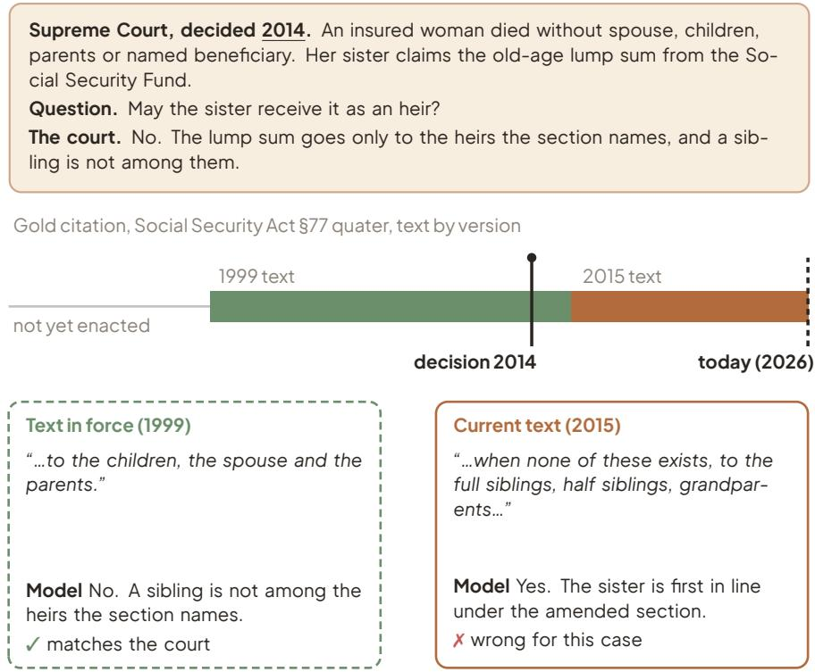
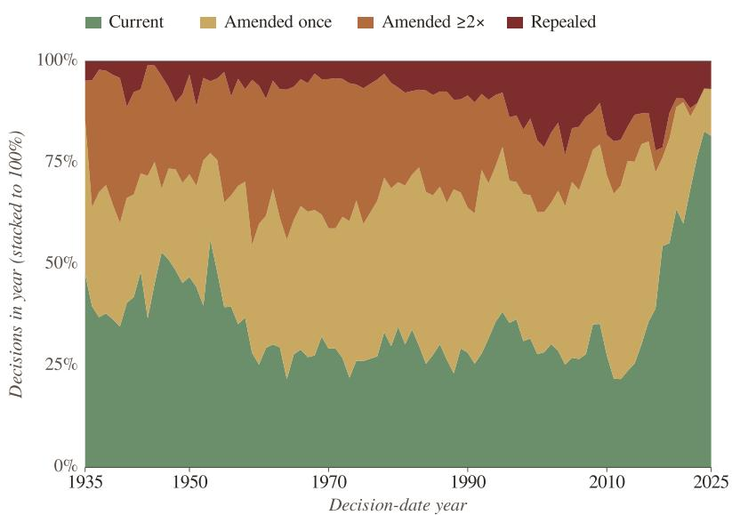
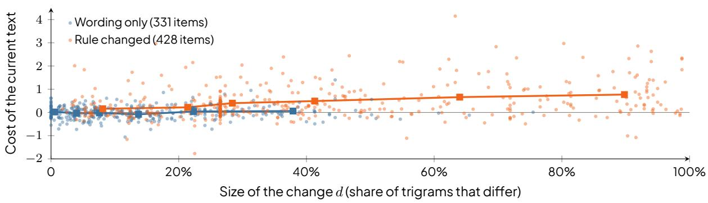
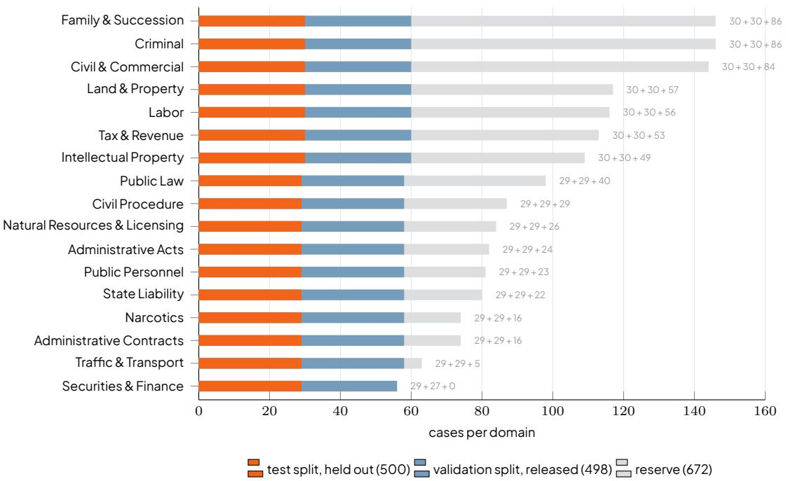
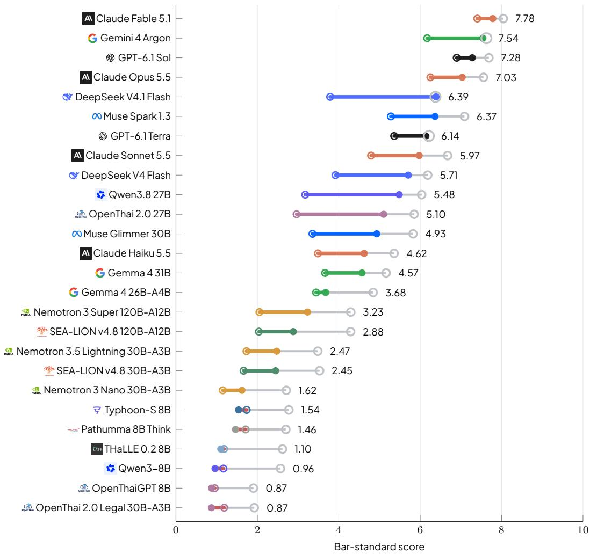
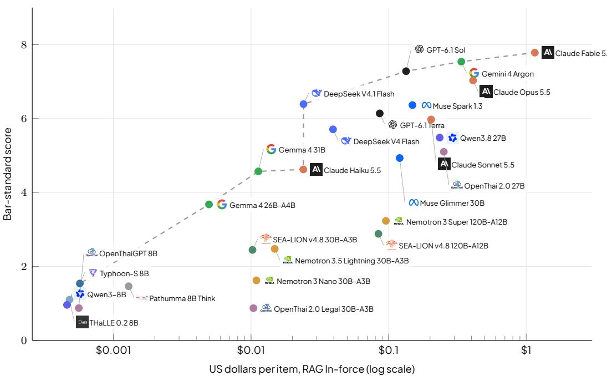
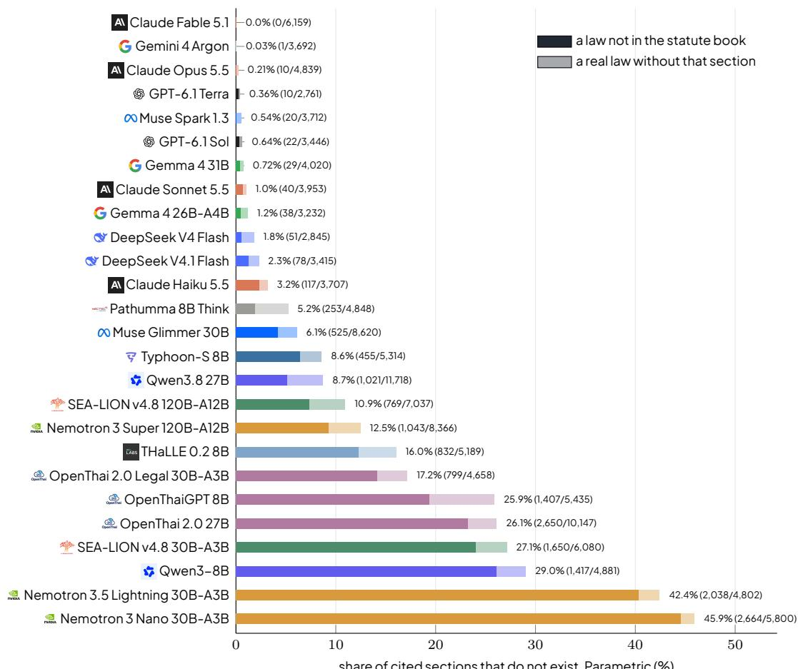
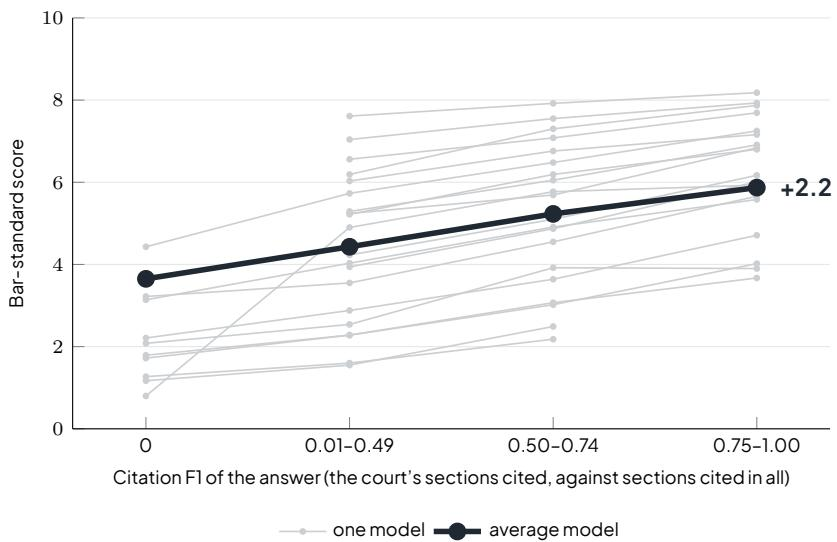

# NitiBench+: A Temporal Thai Legal Question Answering Benchmark Across 17 Domains

Pawitsapak Akarajaradwong1 Sarana Nutanong2 Chompakorn Chaksangchaichot1

1FourCorners Team, VISAI AI, Thailand 2VISTEC, Thailand

{pawitsapaka\_visai, sarana.n, chompakornc\_pro}@vistec.ac.th

## Abstract

Law changes over time. A court decides a case under the law in force on that day, and legal QA benchmarks grade answers against today’s law. We checked 156,650 decisions of four Thai courts. Up to 67% of them cite law that has since been amended or repealed. We introduce NitiBench+, the sequel of our NitiBench, a Thai legal QA benchmark with 1,670 items across 17 domains, built from decisions of three courts. For each cited section it holds both the text in force on the decision date and the current text, and its retrieval corpus holds every dated version of every Thai statute section. Answers are graded on the Thai Bar Council rubric, the Bar-standard score, and on the overlap between the cited sections and the court’s. The report has two parts. Part I measures the cost of the wrong text on 13 open-weight models. Reading the current text of amended law drops the Bar-standard score by 0.25 and missing repealed law drops it by 0.79. The penalty comesfromrulechanges,0.45onthe428rule-changeditemsandnoneonthe331wording-onlyitems,and Citation F1 does not see it. The text in force is the fair setting. Part II benchmarks today’s models on that setting. Apublic leaderboard ranks26modelson a held-out test splitof500 items stratifiedbydomain,with a validation split of the same shape released for public use, from memory alone, with the court’s sections provided, and as a retrieval agent over the law in force, with the cost per item and the hallucinated citations. The best model scores 7.78 out of 10 and the best open-weight model 6.39. Without a search tool only five open-weight models recall any Thai law, and with it twenty of the 26 models gain and six lose. Leaderboard will take new models as they are released. Legal benchmarks must track dates, and on the right text today’s models still leave a wide gap on Thai law.

Dataset VISAI-AI/nitibench-plus Leaderboard benchmark.fourcorners.law

This report describes the evaluation of language models. Nothing in it is legal advice, and no model output quoted here should be relied on for a legal decision.

## 1 Introduction

Language models are already asked questions of Thai law. Lawyers, students and the public ask which section applies to a set of facts, what the consequence is, and how a court would decide. A benchmark that measures how well a model does this needs four things. (1) It needs questions from real disputes, with the verdict and the reasoning a court gave. (2) It needs the grading a Thai lawyer would apply, which scores the reasoning and not only the outcome. (3) It needs the full statute book, so that a model can be testedasaretrievalagentandnotonlyfrommemory. And(4)itneedstheversionofeachsectionthatwas in force when the case was decided, because the law changes and a court applies the law of its day.

No Thai legal benchmark has had the four together. Our earlier benchmark, NitiBench [1], asks questions written for the Civil and Commercial Code and the Revenue Code against a 2024 snapshot of the text, and two years later 2.3% of its citations are already outdated (§2). Benchmarks for English and Chinese law treat the law as a fixed text as well [26, 27, 31].

  
Figure 1. An item of NitiBench+. The cited section was rewritten after the decision. The same model reads the same case with the text in force on that day or with the current text.

NitiBench+, its sequel, has all of them. The benchmark is temporal in one sense only. Every question carriesthedateofitscase, andtheanswerisgradedagainstthelawinforceonthatdate. Itholds1,670items and4,071sub-questionsfromdecisionsofthreeThai courts, in17domainsoflawfromfamilyandsuccessiontoadministrativecontracts(§4). Eachitemgivesthefactpatternandasksfortheverdict, thereasoningandthesectionsapplied,andthegoldansweriscopiedfromthedecision. Answersaregradedonthe Thai Bar Council rubric, from 0 to 10, which we call the Bar-standard score, and on the overlap between the sections the model cites and the sections the court relied on (§5). Every gold citation is resolved to the version in force on the decision date and paired with the current text (Figure 1). The retrieval corpus holds every version of every Thai statute section, 394,943 dated texts of 106,041 sections.

## We built the benchmark for two purposes.

The first is to show that the version of the text matters, and to set up the task so that it does not distort the score. Lawisnotafixedtext. Statutesareamendedandrepealed. Aquestiontakenfromacourtdecision has its answer in the text in force on that day, not in the current text. Across 156,650 decisions of four Thai courts, the cited law has changed since the decision in up to 67% of the cases by court, and of the 1,031 ActsParliamenthaspassedsince2002, 55%amendorrepealanearlierone(§3). Of53legalbenchmarks from 19 jurisdictions, none grades the version of the law. A benchmark that checks the section number but not the version rewards an answer drawn from the wrong text. We ask what happens when a model reads the current text of a correct section, and whether searching the law in force on the decision date fixes the problem. We ran two experiments on 13 open-weight models over the full benchmark. First, we gavethemodelthecorrectcitationandswappedtheversion,thetextinforceorthecurrenttext. Second, we placed the model in a retrieval agent and changed its index from the current text to the text in force on the decision date. Reading the current text of an amended section lowers the Bar-standard score by

0.25 points. For questions on repealed sections, the current text contains no provision for the model to cite, and the score falls by 0.79 points. Searching the law in force recovers part of these points for the models that search, and none for the models that do not (Part I, §6). The text in force is the fair setting for a question taken from a dated decision, and every result in Part II uses it.

The second is to measure today’s models on that setting. Lawyers, students and the public already put legal questions to language models, and no measurement says how far the answers can be trusted. We run a public leaderboard on a held-out test split of 500 items stratified by domain, 29 or 30 per domain, so that a new model canbe added ata bounded cost, and werelease a validationsplit ofthe same shape. It ranks 26 models in three settings, from memory alone, with the court’s sections provided, and as a retrievalagentoverthelawinforce,anditreportsthecostperitem,thehallucinatedcitationsandthescore bydomain. Theleaderboardthenaskswhatlimitsthemodels, theknowledgeofthestatutes, theuseofa searchtool,ortheapplicationofthelawtothefacts,andwhatThaiandlegalpost-trainingaddstoabase. The leading model scores 7.78 out of 10 as a retrieval agent and the best open-weight model 6.39 (Part II, §7).

This report makes three contributions.

1. A temporal benchmark. NitiBench+, 1,670 items from three courts in 17 domains, with every gold citation resolved to the version in force on the decision date and paired with the current text, and the full dated statute corpus to retrieve from.

2. Thecostoftheversion. Anauditof156,650Thaidecisions,andthescore13open-weightmodelslose whentheyreadthecurrenttextinsteadofthetextinforce,bydriftbandandbythekindofchange. The text in force is the fair setting.

3. A leaderboard and an analysis of today’s models. A public ranking of 26 models on a held-out 500− item test split in three settings, with citation precision and recall, hallucinated citations and the cost per item, and an analysis of what limits the models, in statute knowledge, tool use and the application of the law.

## 2 Related Work

Legal QA benchmarks. Legal QA benchmarks exist for English (LegalBench [31], LexGLUE [16], Case-HOLD [85]), Chinese (LawBench [27], LexEval [49]), law-school examinations (LEXam [26], KCL [62]), retrieval (LegalBench-RAG [67]), tool-using agents (LegalAgentBench [51]), and Thai law (NitiBench [1]). Most of them score a multiple-choice answer or a retrieved passage, and none of them grades the version of the law (§3). NitiBench+ scores a free-form verdict and its reasoning on the rubric Thai bar examiners use, and the cited sections against the court’s own.

ThailegalNLP. NitiBench+ isthesequelofNitiBench[1],ourearlierThailegalQAbenchmark,anditisbuilt tomeasurealanguagemodelonThailawineveryaspectaThailawyerwouldaskofit. NitiBenchhasaCCL split of 3,729 questions on the Civil and Commercial Code and a Tax split of 50 questions from Revenue Department rulings, each written against a 2024 snapshot of the statute text. Two years later, 2.3% of its CCLcitationsnolongermatchthecurrenttext,and25%ofitscitedsectionshavebeenamendedatsome point (§3). NitiBench+ widens every part of it. The questions come from decided cases of three courts across 17 domains instead of two codes. The answer is a free-form verdict with its reasoning, graded on the rubric Thai bar examiners use, with the cited sections checked against the court’s own. Every citation is resolved to the version in force on the decision date and paired with the current text, and the retrieval corpus holds every dated version of every section, so a model can be tested from memory, with the court’s sections, and as a retrieval agent. A public leaderboard keeps the measurement current as models are released. On the model side, several Thai post-trainings of open bases have been released, among them Typhoon [66], Pathumma [58], THaLLE [44], OpenThaiGPT [65], SEA-LION [9] and OpenThai 2.0 Legal [38]. Section 7.6 tests what they add to their bases on Thai law.

Versioned legal text. Several jurisdictions publish point-in-time statutes, including the UK, Australia, and Canada, and citation graphs exist across multiple legal systems [42, 47]. No single resource combines dated statute versions, dated court rulings with resolved citations, and an evaluation benchmark. FourCorners [3] unifies all three for Thai law and supplies our corpus of dated statutes and rulings. Recent studies of time in legal QA add dates to German statutory questions [69], track versions of the French tax code [18], and compare Chinese judgments before and after the 2021 Civil Code [36]. Each relies on a task-specific dataset. NitiBench+ covers a national case-law corpus with the complete statute book in every version.

LLM judges for legal QA. LLM evaluators sufer from length and position bias and from variance between models [50]. LeMAJ [24] breaks legal answers into atomic components. NitiBench+ uses the oficial Thai Bar Council grading rubric, applied by models calibrated against human bar examination graders [2].

## 3 How Much Law Drifts

Using FourCorners [3], we examine drift from three angles, how often court citations become outdated, what existing benchmarks record about time, and how often Parliament amends existing statutes rather than passing new ones. To measure court drift, we compare the statute text in force on the decision date withthetextcurrenton1September2026. Acitedsectionhasdriftedifitstextwasamendedorrepealed between those two dates (Figure 1). We evaluated every decision with resolved citations across four courts: the Supreme Court (51,566 decisions since 1935), the Constitutional Court (2,025 rulings since 1998), the Administrative Courts (101,315judgments since 2001), and the Court of Appeal for Specialised Cases (1,744 decisions since 2016).

Mostdecisionscitelawthathassincechanged. Table1categorizeseachdecisionbyitsmostseverely drifted citation. Across all four courts, 79,394 of 156,650 decisions (50.7%) cite law that has changed. Specifically, cited law changed in 67.1% of Supreme Court decisions, 62.4% of Constitutional Court rulings, 42.6% of Administrative Court judgments, and 23.3% of specialised appeal court decisions. Each court drifts for diferent reasons The Supreme Court relies on legal codes amended incrementally overdecades. The ConstitutionalCourtcitesconstitutions replaced in2007 and 2017 alongwith their organic acts. The Administrative Courts cite general codes alongside repealed administrative laws (one in sixjudgments cites a repealed act, such as the 1992 Civil Service Act or the 1987 Expropriation Act). The specialised appeal court cites commercial, labor, and family codes amended over the past decade. This drift is not limited to older cases. As shown in Figure 2, only Supreme Court decisions from the 2020s maintain over 80% alignment with current text. For cases from the 2010s, half had a cited section rewritten within five years.

Existing benchmarks cannot see it. We checked 53 legal benchmarks across 19jurisdictions for what theyrecordabouttime(Table2). Ofthe53, 44citestatutesintheirgoldanswers,10givethedateofevery item, 9 carry a statute version, and none grades a model on the version. Every reported score therefore reflects the current law, even for a benchmark built from past court decisions. Table 3 lists the 53 benchmarks. Each cell was read from the dataset’s schema, its data files or its paper on 5 October 2026. The audit file released with the code holds, for every cell, the field names or the quoted sentence it rests on and a confidence grade. Two rows are graded low confidence because only the paper was available. In total,44benchmarkscitestatutesintheirgoldanswers(20fully),10givefullitemdatesand15partialones, 9 carry a statute version, 5 of them the concurrent temporal studies, and 10 state a snapshot date.

The law itself keeps moving. Legislative records confirm this pattern. Since 2002, Parliament published 1,031 Acts in the Royal Gazette. Of these, 567 (55%) amended or repealed existing statutes rather than introducing new ones. This proportion rose from 53% in the 2000s to 65% in the 2020s. Over the same period, the executive issued 3,299 royal decrees and 4,440 ministerial regulations. Because most legislative activity updates existing law, static benchmarks based on snapshot statutes quickly fall out of sync.

  
Figure 2. Drift by decision year, 1935–2025, stacked to 100%. Each decision takes the most severe state among its citations. Totals in Table 1.

<table><tr><td>Court</td><td>Decisions</td><td></td><td>Current Amended</td><td>Repealed</td><td>Drifted</td></tr><tr><td>Supreme Court</td><td>51,566</td><td>32.9</td><td>56.1</td><td>11.0</td><td>67.1</td></tr><tr><td>Constitutional Court</td><td>2,025</td><td>37.6</td><td>2.7</td><td>59.8</td><td>62.4</td></tr><tr><td>Administrative Courts</td><td>101,315</td><td>57.4</td><td>26.2</td><td>16.4</td><td>42.6</td></tr><tr><td>Court of Appeal for Specialised Cases</td><td>1,744</td><td>76.7</td><td>19.3</td><td>3.9</td><td>23.3</td></tr></table>

Table 1. Decisions whose cited law has changed since the decision, by court, in percent. A decision takes the most severe state among its citations; Drifted is Amended plus Repealed.
<table><tr><td>Released</td><td>Bench.</td><td>Cites statute</td><td>Item date</td><td></td><td>Version Snapshot</td></tr><tr><td>before 2024</td><td>20</td><td>5(+11)</td><td>2(+6)</td><td>1</td><td>2(+2)</td></tr><tr><td>2024-2025</td><td>19</td><td>9(+5)</td><td>1(+5)</td><td>3</td><td>3(+2)</td></tr><tr><td>2026</td><td>14</td><td>6(+8)</td><td>7(+4)</td><td>5(+1)</td><td>5(+1)</td></tr><tr><td>All</td><td>53</td><td>20(+24)</td><td>10(+15)</td><td>9(+1)</td><td>10(+5)</td></tr></table>

Table2. Canalegalbenchmarktestanythingbutcurrentlaw? 53legalNLPbenchmarksfrom19jurisdictions, audited from their dataset cards and papers (Table 3 lists every benchmark). Testing law in force needs the version in the gold and in the corpus. Cites statute: gold answers cite statute sections. Item date: items carry the date of the underlying decision,examinationorquestion. Version: goldanswersidentifywhichversionofthestatutetheyrelyon. Snapshot: the paper states the date of the statute text it used. Counts in parentheses are partial cases.

NitiBench has already drifted. Without version tracking, benchmarks cannot detect when their gold answers expire (§2). We evaluated our own earlier benchmark, NitiBench [1], whose questions include the statutory text used during annotation (Table 4): NitiBench-CCL was built on 2024 statutes. Two years later, 2.3% of its citations are outdated, including Section 1435 of the Civil and Commercial Code (marriage age, amended by the 2025 marriage equality act). Over 25% of its cited sections have been amended previously, and errors will accumulate undetected. To avoid drift, NitiBench-Tax sampled only post-2021 Revenue Department rulings that match the latest Revenue Code. While this preserved temporalaccuracy,itshrankthebenchmarktojust50questions. NitiBench+ avoidsthistrade-ofbypreserving decision dates and indexing both historical and current texts.

<table><tr><td>Benchmark</td><td>Year Jurisdiction</td><td></td><td>Cites</td><td>Date</td><td>Ver.</td><td>Snap.</td></tr><tr><td>before 2024</td><td></td><td></td><td></td><td></td><td></td><td></td></tr><tr><td>CAIL2018 [80]</td><td>2018 China</td><td></td><td>√</td><td></td><td></td><td></td></tr><tr><td>JEC-QA[87]</td><td>2020</td><td>China</td><td>1</td><td></td><td></td><td></td></tr><tr><td>SARA[35]</td><td>2020</td><td>US</td><td>√</td><td>√</td><td></td><td></td></tr><tr><td>CaseHOLD [85]</td><td>2021</td><td>US</td><td>(√)</td><td>=</td><td></td><td></td></tr><tr><td>COLIEE statute law tasks [72]</td><td>2021</td><td>Japan</td><td>√</td><td>(√)</td><td></td><td></td></tr><tr><td>CUAD[33]</td><td>2021</td><td>US</td><td></td><td>(√)</td><td></td><td></td></tr><tr><td>ECtHR datasets [15]</td><td>2021</td><td>Council of Europe</td><td>(√)</td><td></td><td></td><td></td></tr><tr><td>ILDC [54]</td><td>2021</td><td>India</td><td>1</td><td>(√)</td><td></td><td></td></tr><tr><td>Zalo AI Challenge 2021 Legal Text [30]</td><td>2021</td><td>Vietnam</td><td>√</td><td>1</td><td></td><td></td></tr><tr><td>BSARD[53]</td><td>2022</td><td>Belgium</td><td>√</td><td></td><td></td><td></td></tr><tr><td>LBOX OPEN [37]</td><td>2022</td><td>Korea</td><td>(√)</td><td>1</td><td></td><td></td></tr><tr><td></td><td>2022</td><td>Council of Europe, EU,</td><td></td><td></td><td></td><td></td></tr><tr><td>LexGLUE[16]</td><td>2022</td><td>US</td><td>(√)</td><td>I</td><td></td><td></td></tr><tr><td>NCBE MBE practice exam set used in [43]</td><td></td><td></td><td></td><td></td><td></td><td>(√)</td></tr><tr><td>DISC-Law-Eval[82]</td><td>2023</td><td>China</td><td>(√)</td><td>(√)</td><td></td><td></td></tr><tr><td>LAiW[19]</td><td>2023</td><td>China</td><td>(√)</td><td></td><td></td><td></td></tr><tr><td>LawBench [27] LegalBench [31]</td><td>2023 2023</td><td>China</td><td>(√)</td><td>1</td><td></td><td></td></tr><tr><td>LeXFiles / LegalLAMA [17]</td><td>2023</td><td>US</td><td>(√)</td><td>(√)</td><td></td><td></td></tr><tr><td>Open Australian Legal QA [12]</td><td>2023</td><td>Canada, Council of Eur Australia</td><td>(√) (√)</td><td>(√)</td><td>√</td><td>(√)</td></tr><tr><td>SCALE/ Swiss legal benchmark suit [75]</td><td>2023</td><td>Switzerland</td><td>(√)</td><td>√</td><td></td><td></td></tr><tr><td>2024-2025</td><td></td><td></td><td></td><td></td><td></td><td></td></tr><tr><td>ArabLegalEval [34] IL-TUR[40]</td><td>2024 2024</td><td>Saudi Arabia India</td><td>(√) √</td><td>(√)</td><td></td><td></td></tr><tr><td>KBL: Korean Benchmark for Legal la [45]</td><td>2024</td><td>Korea</td><td>(√)</td><td>(√)</td><td></td><td></td></tr><tr><td>LegalBench-RAG [67]</td><td>2024</td><td>US</td><td>一</td><td>=</td><td></td><td></td></tr><tr><td>LeKUBE[79]</td><td>2024</td><td>China</td><td>√</td><td>=</td><td>了</td><td></td></tr><tr><td>LexEval[49]</td><td>2024</td><td>China</td><td>(√)</td><td></td><td>V</td><td></td></tr><tr><td>NyayaAnumana [60]</td><td>2024</td><td>India</td><td>一</td><td>(√)</td><td></td><td></td></tr><tr><td>PredEx[59]</td><td>2024</td><td>India</td><td>=</td><td>=</td><td></td><td></td></tr><tr><td>STARD [76]</td><td>2024</td><td>China</td><td>√</td><td></td><td></td><td></td></tr><tr><td>ALQAC [4]</td><td>2025</td><td>Vietnam</td><td>√</td><td></td><td></td><td></td></tr><tr><td>Bar Exam QA [86]</td><td>2025</td><td>US</td><td>(√)</td><td></td><td></td><td>(√)</td></tr><tr><td>CLaw [81]</td><td>2025</td><td>China</td><td>√</td><td>(√)</td><td>V</td><td>(√)</td></tr><tr><td>Housing Statute QA [86]</td><td>2025</td><td>US</td><td>√</td><td>(√)</td><td></td><td>√</td></tr><tr><td>JBE-QA[13]</td><td>2025</td><td></td><td>=</td><td>√</td><td></td><td></td></tr><tr><td>JuDGE[77]</td><td>2025</td><td>Japan China</td><td>√</td><td></td><td></td><td></td></tr><tr><td>LaborBench[32]</td><td>2025</td><td>US</td><td></td><td></td><td></td><td></td></tr><tr><td>LegalAgentBench [51]</td><td>2025</td><td></td><td>(√)</td><td></td><td></td><td></td></tr><tr><td>LexRAG[52]</td><td>2025</td><td>China China</td><td>√</td><td></td><td></td><td></td></tr><tr><td>NitiBench [1]</td><td>2025</td><td>Thailand</td><td>√</td><td></td><td></td><td></td></tr><tr><td>2026</td><td></td><td></td><td></td><td></td><td></td><td></td></tr><tr><td>BenGER[57]</td><td>2026</td><td>Germany</td><td>(√)</td><td>(√)</td><td></td><td></td></tr><tr><td>CALRK-Bench[41] ClaimRAG-LAW [20]</td><td>2026 2026</td><td>Korea EU, Luxembourg</td><td>(√) (√)</td><td>(√) I</td><td></td><td>(√)</td></tr><tr><td>FiscalQA Pro [18]</td><td>2026</td><td>France</td><td>√</td><td>√</td><td>√</td><td>√</td></tr><tr><td>GreekBarRetrieval [10]</td><td>2026</td><td>Greece</td><td>√</td><td>√</td><td></td><td>5</td></tr><tr><td>Legal RAG Bench [11]</td><td>2026</td><td></td><td></td><td></td><td></td><td></td></tr><tr><td></td><td></td><td>Australia</td><td>(√)</td><td>=</td><td></td><td></td></tr><tr><td>Legal Research Bench [23]</td><td>2026</td><td>US</td><td>(√)</td><td>(√)</td><td>=</td><td></td></tr><tr><td>LegalSearch-R1 benchmark [25]</td><td>2026</td><td>China</td><td>√</td><td>√</td><td>√</td><td></td></tr><tr><td>LEXam [26]</td><td>2026</td><td>Switzerland</td><td>(√)</td><td>V</td><td>=</td><td></td></tr><tr><td>LexKairos [48]</td><td>2026</td><td>China</td><td>(√)</td><td>√</td><td>√</td><td></td></tr><tr><td>Prior et al. (German statutory QA) [69]</td><td>2026</td><td>Germany</td><td>√</td><td>(√)</td><td>(√)</td><td></td></tr><tr><td>SearchFireSafety [14]</td><td>2026</td><td>Korea</td><td>√</td><td>=</td><td>=</td><td>√</td></tr><tr><td>TALD (applicable-law determination [36]</td><td>2026</td><td>China</td><td>√</td><td>√ √</td><td>V √</td><td>√</td></tr><tr><td>TIDE [74]</td><td>2026</td><td>Bangladesh</td><td>(√)</td></table>

Table 3. The 53 legal NLP benchmarks in the audit, by release period. ✓ yes, (✓) in part, – no. Cites, gold cites statute sections. Date, items carry a date. Ver., gold names the statute version. Snap., the paper states when its statute text was taken.

<table><tr><td>Benchmark</td><td>Questions</td><td>Amended ever</td><td>Stale</td></tr><tr><td>NitiBench-CCL</td><td>3,729</td><td>25%</td><td>2.3%</td></tr><tr><td>NitiBench-Tax</td><td>50</td><td>72%</td><td>0.0%</td></tr></table>

Table 4. Temporal drift in NitiBench two years after release. Amended ever: percentage of cited sections amended at least once. Stale: percentage of citations whose embedded text is no longer current.

## 4 The NitiBench+ Benchmark

NitiBench+ consists of 1,670 items and 4,071 sub-questions spanning 17 Thai legal domains, sourced from three courts (Table 5). The Supreme Court provides private, criminal, and regulatory domains (1,303 items). The Constitutional Court provides public constitutional law (50 items). The Supreme AdministrativeCourtprovidesadministrativedomainscoveringoficialacts,statecontracts,publicliability,andpersonnel (317 items).

Domains reflect the core areas of each court’s reasoning. We preserved major fields, split standalone statutory areas (such as narcotics and trafic), and merged smaller categories. Each domain contains 56 to 146 items. Benchmark summary scores are equal-weighted macro-averages across domains. Becausejudicial decisions donotfollowquestion-answerformats, an extractionpipelineconvertseachdecision into a fact pattern, sub-questions, and statutory provisions (§4.1). Gold verdicts and reasoning are preserved as verbatim excerpts from the decisions.

<table><tr><td colspan="3"></td><td colspan="3">Drift band (items)</td><td colspan="5">Sub-questions by type (court&#x27;s own + four added kinds)</td></tr><tr><td>Domain</td><td>Items</td><td>Sub-q.</td><td>No drift</td><td>Amended</td><td>Repealed</td><td>Court&#x27;s own</td><td>Governs</td><td>Conseq.</td><td>Combine</td><td>Lower ct.</td></tr><tr><td>Family &amp; Succession</td><td>146</td><td>326</td><td>60</td><td>85</td><td>1</td><td>153</td><td>15</td><td>61</td><td>57</td><td>40</td></tr><tr><td>Criminal</td><td>146</td><td>352</td><td>13</td><td>106</td><td>27</td><td>157</td><td>39</td><td>52</td><td>43</td><td>61</td></tr><tr><td>Civil &amp; Commercial</td><td>144</td><td>351</td><td>63</td><td>60</td><td>21</td><td>153</td><td>31</td><td>63</td><td>56</td><td>48</td></tr><tr><td>Land &amp; Property</td><td>117</td><td>284</td><td>43</td><td>42</td><td>32</td><td>123</td><td>22</td><td>56</td><td>50</td><td>33</td></tr><tr><td>Labor</td><td>116</td><td>239</td><td>41</td><td>63</td><td>12</td><td>117</td><td>12</td><td>37</td><td>35</td><td>38</td></tr><tr><td>Tax &amp; Revenue</td><td>113</td><td>290</td><td>18</td><td>47</td><td>48</td><td>128</td><td>25</td><td>53</td><td>52</td><td>32</td></tr><tr><td>Intellectual Property</td><td>109</td><td>255</td><td>36</td><td>48</td><td>25</td><td>116</td><td>23</td><td>44</td><td>41</td><td>31</td></tr><tr><td>Public Law</td><td>98</td><td>263</td><td>27</td><td>26</td><td>45</td><td>119</td><td>26</td><td>47</td><td>55</td><td>16</td></tr><tr><td>Civil Procedure</td><td>87</td><td>180</td><td>13</td><td>61</td><td>13</td><td>91</td><td>11</td><td>26</td><td>17</td><td>35</td></tr><tr><td>Natural Resources &amp; Licensing</td><td>84</td><td>173</td><td>15</td><td>36</td><td>33</td><td>87</td><td>11</td><td>31</td><td>28</td><td>16</td></tr><tr><td>Administrative Acts</td><td>82</td><td>233</td><td>36</td><td>34</td><td>12</td><td>99</td><td>32</td><td>29</td><td>63</td><td>10</td></tr><tr><td>Public Personnel</td><td>81</td><td>244</td><td>32</td><td>21</td><td>28</td><td>98</td><td>31</td><td>36</td><td>55</td><td>24</td></tr><tr><td>State Liability</td><td>80</td><td>241</td><td>36</td><td>21</td><td>23</td><td>96</td><td>20</td><td>43</td><td>53</td><td>29</td></tr><tr><td>Narcotics</td><td>74</td><td>159</td><td>3</td><td>2</td><td>69</td><td>78</td><td>18</td><td>20</td><td>13</td><td>30</td></tr><tr><td>Administrative Contracts</td><td>74</td><td>227</td><td>28</td><td>31</td><td>15</td><td>82</td><td>20</td><td>49</td><td>41</td><td>35</td></tr><tr><td>Traffic &amp; Transport</td><td>63</td><td>117</td><td>8</td><td>48</td><td>7</td><td>64</td><td>8</td><td>19</td><td>11</td><td>15</td></tr><tr><td>Securities &amp; Finance</td><td>56</td><td>137</td><td>15</td><td>28</td><td>13</td><td>59</td><td>10</td><td>25</td><td>25</td><td>18</td></tr><tr><td>Total</td><td>1,670</td><td>4,071</td><td>487</td><td>759</td><td>424</td><td>1,820</td><td>354</td><td>691</td><td>695</td><td>511</td></tr></table>

Table 5. Items and sub-questions per domain, by drift band and question type. Drift band is the most severe state among the citations an item relies on. Court’s own are the questions the court answers. The four other kinds are defined in §4.1.

Citations and sub-questions. Each item contains one or more sub-questions with its own verdict, reasoning, and citations. Dependent sub-questions are flagged and answered sequentially. Gold citations are resolved via FourCorners [3] to the version active on the ruling date. Citations mentioned only for background context are kept in the record but ignored during scoring. Figure 1 illustrates an item with both texts for a drifted citation. Appendix A.1 contains the full schema and a worked item.

## 4.1 Construction pipeline

The pipeline extracts facts, reasoning, and citations directly from the court’s decision.

Selection. Candidatedecisionsarestratifiedbydecadeanddriftstatus. ClaudeOpus5screenscandidates, keeping challenging cases where the court applies at least three substantive statutory provisions. Fact-only disputes and procedural rulings are excluded. Duplicate holdings are grouped so no question appears more than twice, maximizing question diversity.

Extraction. Claude Fable 5 generates structured records from selected decisions. Each record contains the fact pattern, decision date, sub-questions with corresponding verdicts and reasoning, and exact source spans. Citations are classified as either primary or background. In addition to direct judicial rulings,wecreatefourtargetedquestiontypes: (1)Identifyinggoverningprovisions. (2)Determininglegal consequences. (3)Interpretinginteractionsbetweenmultipleprovisions. (4)Identifyingdeparturesfrom lower court decisions. All gold answers remain verbatim text spans. Table 5 provides full item counts.

Verification. Deterministic checks confirm that text spans match the source records and citations are well-formed. Citations are resolved to the version active on the ruling date; items with unresolvable primary citations are removed. Citations to external materials like ministerial notifications remain unscored, and joined cases are consolidated. Finally, human annotators review every item against the original ruling to verify legal accuracy.

## 4.2 Drift bands

Decisions span from 1949 to 2026. Items are assigned to one of three drift bands based on their most heavily altered citation: No-drift (Control): 487 items (29%) where cited statutes remain unchanged. Amended: 759 items (46%) where statutory text has been modified. Repealed: 424 items (25%) where the cited statute was subsequently repealed, or was already repealed at the time of the ruling (Appendix A.2). Because a single changed citation shifts an entire item out of the control band, 71% of items exhibit drift even though 65% of individual citations remain current (Table 5).

## 4.3 Current and In-force corpora

The retrieval corpus indexes 394,943 texts across 106,041 sections in 5,912 laws. Each section includes efective dates and operational status as of 1 September 2026. Across all benchmark items, 9,223 citationsreference3,006sectionsacross298laws. Eachcitationincludesbothitsin-forceandmoderntext: 5,869citationsareunchangedbetweenversions. 1,934citationsareamendedtext. 1,263citationsarerepealed laws with no modern counterpart.

We evaluate models across two statutory corpora. The Current corpus reflects statutory text on 1 September 2026, matching traditional benchmark setups. The In-force corpus reflects the statutory text active on each item’s decision date. These corpora difer only for amended and repealed sections. Experiments in §5.2 supply models with cited text from one corpus or grant access to a retrieval index built over it.

## 4.4 Release

Thebenchmarkisreleasedinthreeparts,definedin§7.1. Thevalidationsplit,498cases,ispublic. Foreach case it gives the facts, the questions, the court’s verdict and reasoning, and the gold citations with the version in force on the decision date and the current version, together with the text of those sections in both versions and the grading instruments, the rubric, thejudge prompt and the citation-matching rules. The test split, 500 cases, is held out and is never published, neither its ids nor its text. The leaderboard runs on it, and a modeljoins the leaderboard when we run it. The remaining 672 cases are kept in reserve. Thestatutecorpus,itsindex,theretrievalserviceandtheharnessarenotreleased. Auserofthevalidation splitcanruntheParametricandGold-citedIn-forcesettingsandnottheretrievalsettings. Everyreleased file carries a canary string so that it can be filtered from training corpora.

## 5 Experimental Setup

## 5.1 Metrics

We report one score and one diagnostic. The Bar-standard score is the main metric. It grades the whole answer as a Thai bar examiner would, the verdict, the reasoning and the sections applied. Citation F1 is a diagnostic of one part of that answer, the statute references. It takes the sections the answer cites and compares them with the sections the court relied on. The judge reads the answer with its citations, and the citations are therefore already graded inside the Bar-standard score. Citation F1 measures that one part on its own. We do not add the two into one number, because that would count the citations twice. We show Citation F1 next to the score because the two can move apart, and the gap is informative. The current text of a changed law lowers the score and leaves Citation F1 almost unchanged (§6.4). A model cancitemoresectionsthanthecourtdidandstillscoreinthegoodtier(§7.2). Withinamodel,thecitations account for 13 percent of the diferences between answers, and the rest is the reasoning (§7.6).

<table><tr><td colspan="6">Reasoning quality</td></tr><tr><td>Final answer</td><td>Unusable</td><td>Some</td><td>Acceptable</td><td>Good</td><td>Very good</td></tr><tr><td>matches gold</td><td>T4: 0-1</td><td>T5:2-5</td><td>T6: 5-6</td><td>T7:7-8</td><td>T8: 9-10</td></tr><tr><td>differs</td><td>T1:0</td><td>T2:1-2</td><td></td><td>T3: 2-4</td><td></td></tr></table>

Table 6. The Thai Bar Council eight-tier rubric (used since 2014).

Bar-standard score. The Bar-standard score is the grade of a free-form answer on the oficial Thai Bar Council grading rubric (Table 6, Appendix B.1). The rubric is the instrument and the score is its result. The rubric combines verdict accuracy with five tiers of reasoning quality. A matching verdict (T4 to T8) scores from 0 to 10 points. An incorrect verdict (T1 to T3) is capped at 4 points. We call the resulting 0 to 10 grade the Bar-standard score. Following Akarajaradwong et al. [2], we use a panel of three LLM judges (Claude 4.6 Opus, Gemini 3.1 Pro Preview, and GPT-5.4 Pro) evaluated against human bar examination standards. Each judge receives the verbatim rubric instructions (Appendix B.2), and we report the median score across the panel.

CitationF1. Goldcitationsincludeallstatutorysectionsrequiredforasub-question’sverdict. Modelcitationsareresolvedtothestatutecorpus,andbackgroundcitationsmentionedintherulingareexcluded from the predicted set before scoring. We compute Citation F1 per sub-question as the harmonic mean of precision and recall (0 if no sections are cited). Precision and recall breakdowns appear in Table E.7.

Aggregation. Scores are computed hierarchically. Sub-questions are averaged within each item, items are averaged within each domain, and the overall benchmark score is the macro-average across all 17 domains.

## 5.2 Settings

We test five experimental configurations across all items:

1. Parametric. The model receives only the question and decision date, testing pretraining recall.

2. Gold-cited Current. The prompt includes the question, decision date, and verbatim text of goldcited sections on current version.

3. Gold-cited In-force. Identical to Gold-cited Current, but instead uses statutory text active on the decision date, including repealed provisions (serving as the upper bound for perfect retrieval).

4. RAG Current. An agent retrieves sections using a dense index of current statutes via Qwen3− Embedding-8B [84], chosen for Thai following SEA-BED [68]. The tool returns the top 10 matches, and the model controls the tool freely.

5. RAG In-force. Identical to RAG Current, but the evaluation harness filters retrieval candidates by the decisiondate. Themodelneverselectsdatesorversionsdirectly,isolatingtheimpactoftheretrieved text.

The public leaderboard labels Parametric, Gold-cited In-force and RAG In-force as Closed book, Handout and Open book. This report keeps the names above.

## 5.3 Models

Open-weight models. We evaluate 18 open-weight models. Thirteen are served locally with vLLM [46] on four A100 80GB GPUs (Table C.1 lists checkpoints and serving configuration, Table C.2 the compute), inthreegroups. GeneralinstructionmodelsareGemma431BandGemma426B-A4B[28],Nemotron3.5 Lightning 30B-A3B [61], and Muse Glimmer 30B [56]. The Nemotron 3 post-training family holds Nano 30B-A3B and Super 120B-A12B [61], their SEA-LION v4.8 derivatives [9], and OpenThai 2.0 Legal [38], which is based on Nano 30B-A3B. The Thai specialized models are the four ThaiLLM 8B models, Typhoon-S [66], Pathumma [58], THaLLE [44] and OpenThaiGPT [65]. Each is a post-training of ThaiLLM-8B [78], a Thai continued pretraining of Qwen3−8B-Base [70] that has no chat template and cannot answer the benchmark itself. The other five are Qwen3.8 27B [71], OpenThai 2.0 27B [39], DeepSeek V4.1 Flash [22], DeepSeek V4 Flash [21] and Qwen3−8B [70], Alibaba’s own post-training of Qwen3−8B-Base, the base the ThaiLLM 8B models descend from, which stands in for their unservable base in the comparisons of §7.6.

Proprietary models. Eight models are available only through their providers’ APIs. Claude Haiku 5.5 [6], Claude Sonnet 5.5 [8], Claude Opus 5.5 [7] and Claude Fable 5.1 [5], Gemini 4 Argon [29], GPT-6.1 Sol [63] and GPT-6.1 Terra [64], and Muse Spark 1.3 [55].

Serving and sampling. Every model receives the same prompts and the same retrieval tool. A locally served model runs with the sampling parameters of its model card. A model behind an API runs with its provider’s defaults. No prompt is tuned per model.

## 5.4 Two protocols

Every table caption names the protocol it follows. The benchmark protocol runs the 13 locally served open-weight models on all 1,670 items, in the five settings, with k = 3 samples per item, and reports avg@3 (additional results in Appendix E). Part I follows it. The leaderboard protocol runs all 26 models on the held-out 500−item test split (§7.1), in Parametric, Gold-cited In-force and RAG In-force. The 13 models of the benchmark protocol keep their three samples there, and Qwen3−8B has three as well. Every other row has one sample per item.

<table><tr><td></td><td colspan="5">Citation F1</td><td colspan="5">Bar-standard (0-10)</td></tr><tr><td>Model</td><td>Param.</td><td>GC Cur.</td><td>GC InF.</td><td>RAG Cur.</td><td>RAG InF.</td><td>Param.</td><td>GC Cur.</td><td>GC InF.</td><td>RAG Cur.</td><td>RAG InF.</td></tr><tr><td colspan="9">General</td><td></td><td></td></tr><tr><td>Gemma 4 31B</td><td>0.304</td><td>0.645</td><td>0.778</td><td>0.432</td><td>0.512</td><td>3.68</td><td>4.60</td><td>5.11</td><td>4.20</td><td>4.55</td></tr><tr><td>Gemma 4 26B-A4B</td><td>0.272</td><td>0.667</td><td>0.791</td><td>0.228</td><td>0.262</td><td>3.42</td><td>4.37</td><td>4.79</td><td>3.61</td><td>3.71</td></tr><tr><td>Nemotron 3.5 Lightning 3OB-A3B</td><td>0.028</td><td>0.655</td><td>0.770</td><td>0.287</td><td>0.354</td><td>1.76</td><td>3.08</td><td>3.44</td><td>2.26</td><td>2.47</td></tr><tr><td>Muse Glimmer 30B</td><td>0.198</td><td>0.742</td><td>0.878</td><td>0.456</td><td>0.551</td><td>3.34</td><td>5.18</td><td>5.75</td><td>4.39</td><td>4.94</td></tr><tr><td colspan="9">Nemotron 3 bases and their adaptations</td><td></td><td></td></tr><tr><td>Nemotron 3 Nano 3OB-A3B</td><td>0.020</td><td>0.650</td><td>0.762</td><td>0.205</td><td>0.260</td><td>1.22</td><td>2.44</td><td>2.71</td><td>1.52</td><td>1.66</td></tr><tr><td>↔SEA-LIONv4.8 30B-A3B</td><td>0.038</td><td>0.644</td><td>0.753</td><td>0.283</td><td>0.347</td><td>1.69</td><td>3.16</td><td>3.49</td><td>2.25</td><td>2.50</td></tr><tr><td> OpenThai 2.0 Legal 30B-A3B</td><td>0.073</td><td>0.427</td><td>0.474</td><td>0.004</td><td>0.005</td><td>1.16</td><td>1.84</td><td>1.95</td><td>0.88</td><td>0.88</td></tr><tr><td>Nemotron 3 Super 120B-A12B</td><td>0.099</td><td>0.691</td><td>0.814</td><td>0.358</td><td>0.444</td><td>2.08</td><td>3.79</td><td>4.27</td><td>2.92</td><td>3.31</td></tr><tr><td> SEA-LION v4.8 12OB-A12B</td><td>0.092</td><td>0.677</td><td>0.801</td><td>0.305</td><td>0.362</td><td>2.05</td><td>3.78</td><td>4.26</td><td>2.71</td><td>2.94</td></tr><tr><td colspan="9">ThaiLLM 8B derivatives</td><td></td><td></td></tr><tr><td>Typhoon-S 8B</td><td>0.096</td><td>0.604</td><td>0.687</td><td>0.013</td><td>0.036</td><td>1.73</td><td>2.62</td><td>2.79</td><td>1.61</td><td>1.56</td></tr><tr><td>Pathumma 8B Think</td><td>0.140</td><td>0.592</td><td>0.669</td><td>0.124</td><td>0.161</td><td>1.71</td><td>2.61</td><td>2.70</td><td>1.40</td><td>1.47</td></tr><tr><td>THaLLE 0.2 8B</td><td>0.022</td><td>0.611</td><td>0.713</td><td>0.001</td><td>0.002</td><td>1.21</td><td>2.34</td><td>2.61</td><td>1.11</td><td>1.11</td></tr><tr><td>OpenThaiGPT 8B</td><td>0.020</td><td>0.567</td><td>0.667</td><td>0.000</td><td>0.000</td><td>0.94</td><td>1.79</td><td>1.95</td><td>0.88</td><td>0.88</td></tr></table>

Table 7. Citation F1 and Bar-standard score (0–10) by model and setting, avg@3 over 1,670 items. GC is Gold-cited. Cur.andInF.arethecurrenttextandthetextinforce. Bestpercolumninbold,secondbestunderlined. Spreadacross the three samples in Table E.5.

## 6 Part I. The Cost of the Current Text

Part I asks whether the version of the text matters. It follows the benchmark protocol, 13 open-weight models, 1,670 items, three samples per item. It first reports the 13 models in the five settings, the base of every comparison that follows. It then swaps the version of the cited sections, the text in force against the current text, and measures what a model loses when it reads the current text of a law that changed after the decision (§3). It asks whether a search tool over the law in force gives the loss back, and whether the loss comes from the rule or from the wording. The answer sets the setting that Part II uses.

## 6.1 Open-weight models on the full benchmark

Table 7 reports the Bar-standard score and Citation F1 for the 13 open-weight models in the five settings. Gold-cited In-force provides the historically accurate text and is the best setting for every model. Citation F1 ranges from 0.47 to 0.88, and Bar-standard scores range from 2.0 to 5.8 out of 10. Without provided text (Parametric), only Gemma 4 and Muse Glimmer can recall some laws from memory, reaching a maximum Citation F1 of 0.30. Even with the correct sections provided, no model exceeds 5.8 in Barstandard score. The sections supply the correct law. Applying that law to the facts remains the major challenge, and leaves substantial headroom on NitiBench+.

RAGIn-forceisthesettingclosesttoadeployedassistant,amodelwithasearchtooloverthelawinforce. Scoresthererunfrom0.88to4.94, withameanof2.45overthe13models. MuseGlimmer30Bleadswith 4.94, Gemma 4 31B follows with 4.55, then Gemma 4 26B-A4B with 3.71 and Nemotron 3 Super with 3.31. The four ThaiLLM 8B models and OpenThai 2.0 Legal score below 1.6. Citation F1 follows the same order, 0.551 for Muse Glimmer and 0.512 for Gemma 4 31B, and no 8B model reaches 0.17. The spread across the three samples is 0.00 to 0.09 points on this setting (Table E.5), so the ranking is stable. The best of the three samples per item is in Table E.4 (Appendix E.2).

<table><tr><td></td><td colspan="2">Gold-cited</td><td colspan="2">RAG</td></tr><tr><td>Model</td><td></td><td>Amend. Repeal.</td><td></td><td>Amend. Repeal.</td></tr><tr><td>General</td><td></td><td></td><td></td><td></td></tr><tr><td>Gemma 4 31B</td><td> $+ 0 . 4 5 ^ { * }$ </td><td> $+ 0 . 9 8 ^ { * }$ </td><td> $+ 0 . 2 9 ^ { * }$ </td><td> $+ 0 . 8 7 ^ { * }$ </td></tr><tr><td>Gemma 4 26B-A4B</td><td> $+ 0 . 3 1 ^ { * }$ </td><td> $+ 0 . 9 7 ^ { * }$ </td><td> $+ 0 . 0 3$ </td><td> $+ 0 . 3 5 ^ { * }$ </td></tr><tr><td>Nemotron 3.5 Lightning 30B-A3B</td><td> $+ 0 . 3 1 ^ { * }$ </td><td> $+ 0 . 8 6 ^ { * }$ </td><td> $+ 0 . 1 4 ^ { * }$ </td><td> $+ 0 . 6 0 ^ { * }$ </td></tr><tr><td>Muse Glimmer 30B</td><td> $+ 0 . 4 5 ^ { * }$ </td><td> $+ 1 . 3 5 ^ { * }$ </td><td> $+ 0 . 3 2 ^ { * }$ </td><td> $+ 1 . 5 1 ^ { * }$ </td></tr><tr><td colspan="5">Nemotron 3 bases and their adaptations</td></tr><tr><td>Nemotron 3 Nano 30B-A3B</td><td> $+ 0 . 2 2 ^ { * }$ </td><td> $+ 0 . 5 8 ^ { * }$ </td><td> $+ 0 . 1 0 ^ { * }$ </td><td> $+ 0 . 3 8 ^ { * }$ </td></tr><tr><td> $\hookrightarrow \mathsf { S E A - L I O N v 4 . 8 3 0 B - A 3 B }$ </td><td> $+ 0 . 2 9 ^ { * }$ </td><td> $+ 0 . 8 8 ^ { * }$ </td><td> $+ 0 . 1 8 ^ { * }$ </td><td> $+ 0 . 6 3 ^ { * }$ </td></tr><tr><td> OpenThai 2.0 Legal 30B-A3B</td><td> $+ 0 . 1 2 ^ { * }$ </td><td> $+ 0 . 2 7 ^ { * }$ </td><td> $+ 0 . 0 3$ </td><td>-0.00</td></tr><tr><td>Nemotron 3 Super 120B-A12B</td><td> $+ 0 . 3 9 ^ { * }$ </td><td> $+ 1 . 1 0 ^ { * }$ </td><td> $+ 0 . 2 9 ^ { * }$ </td><td> $+ 0 . 9 2 ^ { * }$ </td></tr><tr><td> $\hookrightarrow \mathsf { S E A - L l O N v } 4 . 8 1 2 0 \mathsf { B - A l } 2 \mathsf { B }$ </td><td> $+ 0 . 4 2 ^ { * }$ </td><td> $+ 1 . 1 3 ^ { * }$ </td><td> $+ 0 . 1 4 ^ { * }$ </td><td> $+ 0 . 7 0 ^ { * }$ </td></tr><tr><td colspan="5">ThaiLLM 8B derivatives</td></tr><tr><td>Typhoon-S 8B</td><td> $+ 0 . 0 9 ^ { * }$ </td><td> $+ 0 . 4 8 ^ { * }$ </td><td>-0.05</td><td>-0.05</td></tr><tr><td>Pathumma 8B Think</td><td> $- 0 . 0 1$ </td><td> $+ 0 . 4 5 ^ { * }$ </td><td>+0.01</td><td>+0.22*</td></tr><tr><td>THaLLE 0.2 8B</td><td> $+ 0 . 1 9 ^ { * }$ </td><td> $+ 0 . 7 0 ^ { * }$ </td><td>+0.01</td><td>-0.00</td></tr><tr><td>OpenThaiGPT 8B</td><td> $+ 0 . 0 9 ^ { * }$ </td><td> $+ 0 . 4 8 ^ { * }$ </td><td>+0.00</td><td>-0.01</td></tr><tr><td>All models</td><td> $+ 0 . 2 5 ^ { * }$ </td><td> $+ 0 . 7 9 ^ { * }$ </td><td>+0.11*</td><td>+0.47*</td></tr><tr><td>No-drift control</td><td colspan="2">+0.01</td><td colspan="2">-0.02</td></tr></table>

Table8. GaininBar-standardscorefromthetextinforceoverthecurrenttext,avg@3. Astarmarksa95%intervalthat excludes zero. The No-drift control is the same contrast on items whose text is identical in both prompts. Intervals in Table E.6.

<table><tr><td>Amendment</td><td>Median d</td><td>△ Bar-standard</td><td>△ Citation F1</td></tr><tr><td>Rule changed (428 items)</td><td>0.34</td><td> $+ 0 . 4 5 \ [ + 0 . 3 8 , + 0 . 5 3 ]$ </td><td> $+ 0 . 0 4 \left[ + 0 . 0 3 , + 0 . 0 6 \right]$ </td></tr><tr><td>Wording only (331 items)</td><td>0.10</td><td> $- 0 . 0 0 \left[ - 0 . 0 3 , + 0 . 0 3 \right]$ </td><td> $- 0 . 0 0 \left[ - 0 . 0 1 , + 0 . 0 0 \right]$ </td></tr></table>

Table 9. Cost of the current text by what the amendment changed. Thejudge labeled each changed gold section of the 759 Amended items as changing the rule the question turns on or only the wording. An item is rule-changed when any of its sections is. Median d is the median size of the change. ∆ is Gold-cited In-force minus Current, pooled over 13judged models, with 95% intervals from a bootstrap over item clusters.

## 6.2 The cost of the current text

Table 8 compares the Bar-standard scores of historically accurate text (In-force) against modern text (Current). The No-drift control group shifts by only 0.01. In contrast, using the correct historical text improves scores by 0.25 on Amended items and 0.79 on Repealed items. Every model improves on Repealed items, and everymodelbut PathummaonAmended items. Strongermodels see the largestgains, improving by up to 0.45 on Amended items and 1.35 on Repealed items. Because the rubric evaluates verdicts and reasoning together, Table 10 reports court agreement alongside scores for agreeing answers. For drifted items, in-force text yields modest agreement gains (+1.6 pp on amended, +4.5 pp on repealed) but larger reasoning gains among agreeing answers (+0.29 and +0.95 points). The right text occasionally corrects a verdict. Its main benefit is a stronger reasoning behind it.

<table><tr><td rowspan="2"></td><td colspan="2">Agrees with court (%) Score if agreeing</td><td colspan="2"></td></tr><tr><td>Current</td><td>In force</td><td>Current</td><td>In force</td></tr><tr><td>No drift</td><td>60.9</td><td>61.2</td><td>5.07</td><td>5.06</td></tr><tr><td>Amended</td><td>57.6</td><td>59.2</td><td>4.83</td><td>5.12</td></tr><tr><td>Repealed</td><td>53.9</td><td>58.4</td><td>3.88</td><td>4.83</td></tr></table>

Table 10. Verdict and reasoning in the two Gold-cited settings, pooled over 13judged models, avg@3. Agrees with court is the share of answers in tiers T4 to T8. Score if agreeing is the mean score among those answers.

## 6.3 Recovery through historical retrieval

The RAG columns of Table 8 test these efects inside a retrieval agent. Searching on a historical index recovers a Bar-standard score of 0.11 on Amended items and 0.47 on Repealed items. Recovery is limited by the search tool. The modern index finds the gold sections 40% of the time, the historical index 48% of the time. Repealed laws do not appear in a modern index. Models that search often, such as Muse Glimmer, recover more. Weaker models that rarely search recover nothing.

## 6.4 Changes of the rule and changes of the wording

The cost comes from changes of the rule, not of the wording. The Amended band holds 759 items whose cited sections changed but still exist (§4.2). We manually labeled each of them by whether the amendmentchangedtherulethequestionturnsonoronlythephrasing. Figure3showsoneofeach. Forthe428 rule-changed items, the current text lowers the score by 0.45. For the 331 wording-only items, it costs 0.00, the same as the No-drift control (Table 9). The overall cost of 0.25 on Amended items is the average of the two groups.

Figure 4 sets this label against the size of the text change, measured with character trigrams. I ${ \mathrm { : } } T ( x )$ is the setofthree-charactersequencesofatextx, thedistancebetweenthetextinforceaandthecurrenttext b is

$$
d ( a , b ) = 1 - { \frac { | T ( a ) \cap T ( b ) | } { | T ( a ) \cup T ( b ) | } } .\tag{1}
$$

The distance is 0 when the texts are identical and 1 when they share no trigram. Wording-only edits cost nothing at any size, 0.02 below the median distance (d < 0.24) and 0.05 above it. Rule changes cost at every size, 0.21 points below the median and 0.54 above it. The size of an edit does not predict its cost. Whether the amendment changes the rule does. A second measure of the size, the normalized Levenshtein distance between the two texts, agrees. Table 11 correlates both measures, averaged over the amended gold sections of an item, with the per-item change from Gold-cited Current to Gold-cited Inforce. Largeramendmentscostmore, ontheBar-standardscoreandonCitationF1, andthecorrelations are small. The size of an amendment is one of several factors behind the per-item cost.

<table><tr><td>Wording only</td><td>Civil and Commercial Code §1533, Supreme Court 2014</td></tr><tr><td>1976 text</td><td>On divorce, the marital property is divided equally between the man and the woman.</td></tr><tr><td>2025 text</td><td>On divorce, the marital property is divided equally between each spouse.</td></tr><tr><td>Question</td><td>Are the two plots marital property, to be divided in half?</td></tr><tr><td>Judge</td><td>The equal share survives the rewrite. Same answer from either text.</td></tr></table>

<table><tr><td>Rule changed</td><td>Bankruptcy Act §116, Supreme Court 1996</td></tr><tr><td>1941 text</td><td>The two preceding sections do not affect the rights of a third party acquired in good faith and for value before the bankruptcy petition.</td></tr><tr><td>1999 text</td><td>Section 115 does not affect the rights of a third party acquired in good faith and for value before the bankruptcy petition.</td></tr><tr><td>Question</td><td>Is the buyer whose transfer the court revoked an interested party who may pay the debtor&#x27;s creditors?</td></tr><tr><td>Judge</td><td>The protection no longer covers §l14, the ground of the revocation. The answer changes.</td></tr></table>

Figure 3. Two Amended items. Green is the text in force at the decision, brown the current text, bold the words that changed. The first amendment changed only the words. The second moved one cross-reference and changed the rule.

  
Figure 4. Cost of the current text on Amended items against the size of the text change d. Each dot is one item. Squares are the mean cost in six bins of equal size.

<table><tr><td>Amendment size</td><td>△ Bar-standard</td><td>△ Citation F1</td></tr><tr><td>1 — character-trigram Jaccard</td><td> $+ 0 . 3 5 [ + 0 . 2 8 , + 0 . 4 7 ]$ </td><td> $+ 0 . 2 9 [ + 0 . 2 2 , + 0 . 3 7 ]$ </td></tr><tr><td>Normalized Levenshtein distance</td><td> $+ 0 . 3 4 [ + 0 . 2 7 , + 0 . 4 1 ]$ </td><td> $+ 0 . 2 8 [ + 0 . 2 0 , + 0 . 3 5 ]$ </td></tr></table>

Table 11. Spearman correlation between the size of the amendment and the per-item change from Gold-cited CurrenttoGold-citedIn-force,onthe759Amendeditems,pooledoverthejudgedmodels. Bracketsgive95%intervals from a bootstrap over item clusters.

The models still cite the right sections under both texts. On rule-changed items Citation F1 drops by 0.04 while the Bar-standard score drops by 0.45.

## 7 Part II. The Leaderboard and the Limits of the Open-Weight Models

Part II measures today’s models on the setting Part I established, the text in force. It follows the leaderboard protocol (§5.4). Every model runs on the held-out test split of 500 items in three settings, and the public leaderboard page reports the same runs. The page is live and takes new models as we run them. The numbers in this report are the leaderboard as of 2 November 2026. The page names the settings for a general reader, Closed book for Parametric, Open book for RAG In-force and Handout for Gold-cited In-force. This report keeps the names of §5.2. In short, Parametric is the model alone, RAG In-force is the modelwithatoolthatsearchesthelawinforce,andGold-citedIn-forceisthemodelwiththecourt’ssections handed to it. Part II ranks the models (§7.2), sets the score against its cost (§7.3), reads the score by domain (§7.4) and counts invented citations (§7.5). It ends with what limits the models (§7.6).

## 7.1 The test split and the validation split

  
Figure 5. The three parts of the benchmark. For each domain, the cases in the held-out test split (orange), the released validation split (blue) and the reserve (gray). The label gives the three counts.

A leaderboard has to take in new models as they are released, and a run over all 1,670 items at three samples is too costly to repeat for each one (§5.4). A leaderboard also has to stay honest once its questions are public. A model can be trained on a published test set, and its public score then stops meaning anything. GSM1k rebuilt a public arithmetic benchmark in private and found several model families up to 13 percent weaker on the private twin [83], and an audit of Chatbot Arena found providers testing dozens of private variants and publishing the best [73]. We therefore cut the benchmark into three parts (Figure 5). The test split holds 500 items, 29 or 30 from each of the 17 domains, with the drift bands of each domain in the domain’s own proportion and one item per shared-question cluster. The leaderboard runs on it, and it is never published. The validation split is drawn by the same recipe from the remaining items, 498 in all, with no item that shares a question with a test item, and it is released with the text of its gold sections (§4.4). The 672 items left over are the reserve, which replaces the test split if it ever leaks. The two splits are drawn to be alike, and the full-benchmark runs of Part I show that they are.

Table 12 gives the 13 models of the benchmark protocol on the full benchmark, the test split and the validation split, from the samejudged rows. A model’s test score and validation score difer by 0.05 points on average and by 0.16 at most, and the two rank the models the same way, with a Spearman correlation of 0.97 to 0.99 across the three settings. The test split also tracks the full benchmark within 0.07 points foreverymodel. Scoresonasplitaremacro-averagedoverthe17domains, asonthefullbenchmark. The gapbetweenamodel’svalidationscoreanditstestscoreisalsotheleaderboard’scheckagainsttraining on the released data. For the 13 models it stays within 0.16 points. A new model whose validation score runs far ahead of its test score has seen the validation split.

<table><tr><td rowspan="2">Model</td><td colspan="3">Parametric</td><td colspan="3">Gold-cited In-force</td><td colspan="3">RAG In-force</td></tr><tr><td>Full</td><td>Test</td><td>Val.</td><td>Full</td><td>Test</td><td>Val.</td><td>Full</td><td>Test</td><td>Val.</td></tr><tr><td>General</td><td></td><td></td><td></td><td></td><td></td><td></td><td></td><td></td><td></td></tr><tr><td>Gemma 4 31B</td><td>3.68</td><td>3.66</td><td>3.74</td><td>5.11</td><td>5.16</td><td>5.07</td><td>4.55</td><td>4.57</td><td>4.52</td></tr><tr><td>Gemma 4 26B-A4B</td><td>3.42</td><td>3.44</td><td>3.43</td><td>4.79</td><td>4.84</td><td>4.76</td><td>3.71</td><td>3.68</td><td>3.74</td></tr><tr><td>Nemotron 3.5 Lightning 3OB-A3B</td><td>1.76</td><td>1.73</td><td>1.82</td><td>3.44</td><td>3.49</td><td>3.46</td><td>2.47</td><td>2.47</td><td>2.47</td></tr><tr><td>Muse Glimmer 30B</td><td>3.34</td><td>3.35</td><td>3.40</td><td>5.75</td><td>5.83</td><td>5.72</td><td>4.94</td><td>4.93</td><td>4.95</td></tr><tr><td>Nemotron 3 bases and their adaptations</td><td></td><td></td><td></td><td></td><td></td><td></td><td></td><td></td><td></td></tr><tr><td>Nemotron 3 Nano 30B-A3B</td><td>1.22</td><td>1.15</td><td>1.27</td><td>2.71</td><td>2.71</td><td>2.75</td><td>1.66</td><td>1.62</td><td>1.67</td></tr><tr><td> SEA-LION v4.8 3OB-A3B</td><td>1.69</td><td>1.66</td><td>1.71</td><td>3.49</td><td>3.53</td><td>3.54</td><td>2.50</td><td>2.45</td><td>2.54</td></tr><tr><td> OpenThai 2.0 Legal 30B-A3B</td><td>1.16</td><td>1.18</td><td>1.18</td><td>1.95</td><td>1.92</td><td>1.95</td><td>0.88</td><td>0.87</td><td>0.89</td></tr><tr><td>Nemotron 3 Super120B-A12B</td><td>2.08</td><td>2.05</td><td>2.15</td><td>4.27</td><td>4.29</td><td>4.37</td><td>3.31</td><td>3.23</td><td>3.36</td></tr><tr><td> SEA-LION v4.8 120B-A12B</td><td>2.05</td><td>2.04</td><td>2.07</td><td>4.26</td><td>4.29</td><td>4.28</td><td>2.94</td><td>2.88</td><td>3.04</td></tr><tr><td>ThaiLLM 8B derivatives</td><td></td><td></td><td></td><td></td><td></td><td></td><td></td><td></td><td></td></tr><tr><td>Typhoon-S 8B</td><td>1.73</td><td>1.74</td><td>1.77</td><td>2.79</td><td>2.77</td><td>2.82</td><td>1.56</td><td>1.54</td><td>1.56</td></tr><tr><td>Pathumma 8B Think</td><td>1.71</td><td>1.71</td><td>1.70</td><td>2.70</td><td>2.70</td><td>2.71</td><td>1.47</td><td>1.46</td><td>1.50</td></tr><tr><td>THaLLE 0.2 8B</td><td>1.21</td><td>1.18</td><td>1.25</td><td>2.61</td><td>2.62</td><td>2.64</td><td>1.11</td><td>1.10</td><td>1.11</td></tr><tr><td>OpenThaiGPT 8B</td><td>0.94</td><td>0.95</td><td>0.97</td><td>1.95</td><td>1.90</td><td>2.00</td><td>0.88</td><td>0.87</td><td>0.89</td></tr><tr><td colspan="10">Agreement over the 13 models</td></tr><tr><td>Spearman, test against validation</td><td>0.967</td><td></td><td></td><td></td><td>0.995</td><td></td><td></td><td>0.989</td><td></td></tr><tr><td>Spearman, test against full</td><td></td><td>0.973</td><td></td><td></td><td>1.000</td><td></td><td></td><td>0.995</td><td></td></tr><tr><td>Mean absolute difference, test against validation</td><td></td><td>0.05</td><td></td><td></td><td>0.05</td><td></td><td></td><td>0.05</td><td></td></tr><tr><td>Largest absolute difference, test against validation</td><td></td><td>0.12</td><td></td><td></td><td>0.11</td><td></td><td></td><td>0.16</td><td></td></tr></table>

Table12. Thetwosplitsarefair. Bar-standardscoreofthe13modelsofthebenchmarkprotocolonthefullbenchmark (1,670 items), the held-out test split (500) and the released validation split (498), three samples per item, the same judge rows. Val. is the validation split.

## 7.2 The leaderboard

  
Parametric RAG In-force Gold-cited In-force  
Figure 6. The leaderboard as of 2 November 2026, 500 items. One line per row with the RAG In-force score printed. Hollow dot Parametric, solid dot RAG In-force, ring Gold-cited In-force. The colored segment is the gain from the search tool, red when the tool lowers the score.

Figure 6 ranks the 26 models by their Bar-standard score in RAG In-force, the setting closest to a deployed assistant, where the model searches the law in force itself. Table D.1 in Appendix D gives every number. ClaudeFable5.1isthebestmodelat7.78. Gemini4Argonfollowswith7.54,GPT-6.1Solwith7.28 and Claude Opus 5.5 with 7.03. The best open-weight model is DeepSeek V4.1 Flash at 6.39, and its predecessor DeepSeek V4 Flash scores 5.71. Qwen3.8 27B scores 5.48 and its Thai post-training OpenThai 2.0 27B 5.10. Muse Glimmer 30B, the best model of the benchmark protocol, is twelfth with 4.93. Perdomain scores of every row are in Figure 8 and Table E.3.

The Parametric column shows what a model knows with no text in front of it. Claude Fable 5.1 scores 7.40 from memory alone, more than any open-weight model reaches with the search tool, and GPT-6.1 Sol 6.90. The proprietary models score 3.49 to 7.40 in this column, the open-weight models 0.95 to 3.92.

The Gold-cited In-force column is each row’s ceiling, the score it reaches when the court’s sections are handed to it. The five best models reach 7.56 to 8.04 there, and their RAG In-force runs stay within 0.6 points of it. Finding the sections costs them little. Lower in the table the distance grows, to 0.74 for

The cited sections show two kinds of answer. Every proprietary model has a recall above its precision, 0.69 to 0.88 against 0.39 to 0.61, and so do the two DeepSeek models, 0.80 against 0.37 and 0.74 against 0.48. They cite more sections than the court did and catch most of the court’s sections among them. GPT-6.1 Sol has the best F1, 0.657. Most open-weight models of the benchmark protocol do the reverse. They cite few sections and miss many of the court’s. Gemma 4 31B has a precision of 0.642 and a recall of 0.460.

## 7.3 What the score costs

  
Figure 7. Bar-standard score against US dollars per item in RAG In-force. The dashed line is the Pareto frontier.

An item’s cost is what the answer would have cost to buy. For a model behind an API it is the provider’s list priceon26October2026appliedtothemeasuredinput,cachedandoutputtokens. Foranopen-weight model served locally it is the public API price of the same weights applied to the measured tokens, or the price of the base model when the post-training has no public price. Figure 7 sets the score of each row against that cost in RAG In-force. Table D.2 in Appendix D gives the cost, the output length, the searches and the hallucinated citations of each row. An item costs from a tenth of a cent for the 8B models to 1.155 dollars for Claude Fable 5.1. GPT-6.1 Sol at 0.134 dollars scores 7.28, at about one ninth of that price. DeepSeek V4.1 Flash scores 6.39 at 0.024 dollars, the price of Claude Haiku 5.5, which scores 4.62. Writing more does not buy score. DeepSeek V4.1 Flash writes 25.6 thousand tokens per item, DeepSeek V4 Flash 45.4 thousand and Qwen3.8 27B 52.3 thousand. GPT-6.1 Sol writes 4.1 thousand and scores above both. Searching more does not buy score either. Among the models that search, the calls per item run from 5.3 for Claude Opus 5.5 to 19.0 for DeepSeek V4 Flash, with no relation to rank.

## 7.4 Performance by domain

Figure 8 gives the RAG In-force score of every row in every domain. Averaged over the 26 models, the easiest domain is Natural Resources & Licensing at 4.48 and the hardest is Public Personnel at 3.76. The three lowest domains are Narcotics, Tax & Revenue and Public Personnel, and the three highest Natural Resources & Licensing, Public Law and Trafic & Transport. The order of the rows holds from one domain to the next. Claude Fable 5.1 is the best model in 12 of the 17 domains and Gemini 4 Argon in the other five, and the scores of Claude Fable 5.1 run from 7.16 to 8.17. A reader who needs one domain should read that column rather than the overall score. The 13 open-weight models of the benchmark protocol give the same order on all 1,670 items at three samples per item, with Public Personnel again the lowest domain (Appendix E.1). Narcotics is low for a reason of its own. In 69 of its 74 cases the court applied law that has since been repealed, and a model must answer from the text in force and not from what it learned about the current code.

<table><tr><td rowspan=15 colspan=1>AIClaude Fable 5.1GGemini 4 ArgonGPT-6.1SolAlClaude Opus 5.5DeepSeek V4.1Flash0Muse Spark1.3GPT-6.1TerraAIClaude Sonnet 5.5DeepSeek V4 Flash六Qwen3.8 27BOpenThai 2.0 27BMuse Glimmer 30BAlClaude Haiku 5.5</td><td></td><td></td><td></td><td></td><td></td><td></td><td></td><td></td><td></td><td></td><td></td><td></td><td></td><td></td><td></td><td></td><td></td><td></td><td></td><td></td><td></td><td></td></tr><tr><td rowspan=2 colspan=1>8</td><td rowspan=2 colspan=1>8.2</td><td rowspan=2 colspan=1>8.1</td><td rowspan=2 colspan=1>8.1</td><td rowspan=2 colspan=1>8.1</td><td rowspan=2 colspan=1>8.1</td><td rowspan=2 colspan=1>8.1</td><td rowspan=2 colspan=1>7.8</td><td rowspan=2 colspan=1>7.8</td><td rowspan=2 colspan=1>7.8</td><td rowspan=2 colspan=1>7.8</td><td rowspan=2 colspan=1>7.8</td><td rowspan=2 colspan=1>7.4</td><td rowspan=2 colspan=1>7.2</td><td rowspan=2 colspan=1>7.6</td><td rowspan=2 colspan=1>7.3</td><td rowspan=2 colspan=2>7.2-</td><td></td><td></td><td></td><td></td></tr><tr><td rowspan=13 colspan=3></td><td rowspan=15 colspan=1>1098765</td></tr><tr><td rowspan=1 colspan=1>8</td><td rowspan=1 colspan=1>8.2</td><td rowspan=1 colspan=1>7.6</td><td rowspan=1 colspan=1>8.3</td><td rowspan=1 colspan=1>7.6</td><td rowspan=1 colspan=1>7.7</td><td rowspan=1 colspan=1>7.6</td><td rowspan=1 colspan=1>7.6</td><td rowspan=1 colspan=1>7.7</td><td rowspan=1 colspan=1>7.8</td><td rowspan=1 colspan=1>7.7</td><td rowspan=1 colspan=1>7.2</td><td rowspan=1 colspan=1>7.5</td><td rowspan=1 colspan=1>7</td><td rowspan=1 colspan=1>6.4</td><td rowspan=1 colspan=1>6.8</td><td rowspan=1 colspan=2>7.4-</td></tr><tr><td rowspan=1 colspan=1>-7.8</td><td rowspan=1 colspan=1>7.8</td><td rowspan=1 colspan=1>7.4</td><td rowspan=1 colspan=1>7.8</td><td rowspan=1 colspan=1>7.7</td><td rowspan=1 colspan=1>7.8</td><td rowspan=1 colspan=1>7</td><td rowspan=1 colspan=1>7.7</td><td rowspan=1 colspan=1>7.6</td><td rowspan=1 colspan=1>7.5</td><td rowspan=1 colspan=1>7.2</td><td rowspan=1 colspan=1>7</td><td rowspan=1 colspan=1>7.3</td><td rowspan=1 colspan=1>6.4</td><td rowspan=1 colspan=1>6.5</td><td rowspan=1 colspan=1>6.4</td><td rowspan=1 colspan=2>7</td></tr><tr><td rowspan=1 colspan=1>-7.6</td><td rowspan=1 colspan=1>7.3</td><td rowspan=1 colspan=1>7.2</td><td rowspan=1 colspan=1>7.9</td><td rowspan=1 colspan=1>7.5</td><td rowspan=1 colspan=1>7</td><td rowspan=1 colspan=1>7</td><td rowspan=1 colspan=1>7.1</td><td rowspan=1 colspan=1>7.3</td><td rowspan=1 colspan=1>7.2</td><td rowspan=1 colspan=1>7.2</td><td rowspan=1 colspan=1>6.8</td><td rowspan=1 colspan=1>6.7</td><td rowspan=1 colspan=1>6.3</td><td rowspan=1 colspan=1>6.7</td><td rowspan=1 colspan=1>6.1</td><td rowspan=1 colspan=2>6.8-</td></tr><tr><td rowspan=1 colspan=1>-6.8</td><td rowspan=1 colspan=1>6.9</td><td rowspan=1 colspan=1>6.9</td><td rowspan=1 colspan=1>6.7</td><td rowspan=1 colspan=1>6.4</td><td rowspan=1 colspan=1>6.8</td><td rowspan=1 colspan=1>6.2</td><td rowspan=1 colspan=1>6.5</td><td rowspan=1 colspan=1>6.6</td><td rowspan=1 colspan=1>6.6</td><td rowspan=1 colspan=1>6.4</td><td rowspan=1 colspan=1>6</td><td rowspan=1 colspan=1>5.7</td><td rowspan=1 colspan=1>5.6</td><td rowspan=1 colspan=1>6.6</td><td rowspan=1 colspan=1>5.9</td><td rowspan=1 colspan=2>6.2-</td></tr><tr><td rowspan=1 colspan=1>-6.8</td><td rowspan=1 colspan=1>6.9</td><td rowspan=1 colspan=1>6.9</td><td rowspan=1 colspan=1>6.6</td><td rowspan=1 colspan=1>6.8</td><td rowspan=1 colspan=1>6.1</td><td rowspan=1 colspan=1>6.4</td><td rowspan=1 colspan=1>6.8</td><td rowspan=1 colspan=1>6.8</td><td rowspan=1 colspan=1>5.7</td><td rowspan=1 colspan=1>6.3</td><td rowspan=1 colspan=1>6</td><td rowspan=1 colspan=1>6.3</td><td rowspan=1 colspan=1>5.9</td><td rowspan=1 colspan=1>6</td><td rowspan=1 colspan=1>5.8</td><td rowspan=1 colspan=2>6.1</td></tr><tr><td rowspan=1 colspan=1>-6.5</td><td rowspan=1 colspan=1>6.5</td><td rowspan=1 colspan=1>6.6</td><td rowspan=1 colspan=1>6.2</td><td rowspan=1 colspan=1>6.5</td><td rowspan=1 colspan=1>6.4</td><td rowspan=1 colspan=1>5.9</td><td rowspan=1 colspan=1>6.4</td><td rowspan=1 colspan=1>6.3</td><td rowspan=1 colspan=1>5.7</td><td rowspan=1 colspan=1>6.2</td><td rowspan=1 colspan=1>6</td><td rowspan=1 colspan=1>6</td><td rowspan=1 colspan=1>6</td><td rowspan=1 colspan=1>5.5</td><td rowspan=1 colspan=1>5.6</td><td rowspan=1 colspan=2>6.1-</td></tr><tr><td rowspan=1 colspan=1>-6.5</td><td rowspan=1 colspan=1>6.4</td><td rowspan=1 colspan=1>6.1</td><td rowspan=1 colspan=1>6.4</td><td rowspan=1 colspan=1>6.2</td><td rowspan=1 colspan=1>6.2</td><td rowspan=1 colspan=1>6.1</td><td rowspan=1 colspan=1>6.5</td><td rowspan=1 colspan=1>6.4</td><td rowspan=1 colspan=1>5.9</td><td rowspan=1 colspan=1>6</td><td rowspan=1 colspan=1>5.4</td><td rowspan=1 colspan=1>5.4</td><td rowspan=1 colspan=1>5.6</td><td rowspan=1 colspan=1>5.7</td><td rowspan=1 colspan=1>5.5</td><td rowspan=1 colspan=2>5.4</td></tr><tr><td rowspan=1 colspan=1>-6.3</td><td rowspan=1 colspan=1>6.2</td><td rowspan=1 colspan=1>5.7</td><td rowspan=1 colspan=1>6.1</td><td rowspan=1 colspan=1>6</td><td rowspan=1 colspan=1>6.3</td><td rowspan=1 colspan=1>5.7</td><td rowspan=1 colspan=1>5.8</td><td rowspan=1 colspan=1>6.1</td><td rowspan=1 colspan=1>5.4</td><td rowspan=1 colspan=1>5.7</td><td rowspan=1 colspan=1>5.8</td><td rowspan=1 colspan=1>5.7</td><td rowspan=1 colspan=1>5.3</td><td rowspan=1 colspan=1>5</td><td rowspan=1 colspan=1>5.2</td><td rowspan=1 colspan=2>4.8</td></tr><tr><td rowspan=1 colspan=1>-5.9</td><td rowspan=1 colspan=1>6.1</td><td rowspan=1 colspan=1>6</td><td rowspan=1 colspan=1>5.7</td><td rowspan=1 colspan=1>5.1</td><td rowspan=1 colspan=1>6.1</td><td rowspan=1 colspan=1>5.8</td><td rowspan=1 colspan=1>5.3</td><td rowspan=1 colspan=1>5.9</td><td rowspan=1 colspan=1>5.2</td><td rowspan=1 colspan=1>5.7</td><td rowspan=1 colspan=1>5.7</td><td rowspan=1 colspan=1>5</td><td rowspan=1 colspan=1>5.4</td><td rowspan=1 colspan=1>4.3</td><td rowspan=1 colspan=1>5.2</td><td rowspan=1 colspan=2>5</td></tr><tr><td rowspan=1 colspan=1>-5.9</td><td rowspan=1 colspan=1>5.9</td><td rowspan=1 colspan=1>5.7</td><td rowspan=1 colspan=1>5.2</td><td rowspan=1 colspan=1>5.1</td><td rowspan=1 colspan=1>4.8</td><td rowspan=1 colspan=1>5.4</td><td rowspan=1 colspan=1>5.4</td><td rowspan=1 colspan=1>4.5</td><td rowspan=1 colspan=1>5.4</td><td rowspan=1 colspan=1>5</td><td rowspan=1 colspan=1>5.3</td><td rowspan=1 colspan=1>4.2</td><td rowspan=1 colspan=1>4.7</td><td rowspan=1 colspan=1>5</td><td rowspan=1 colspan=1>4.8</td><td rowspan=1 colspan=2>4.5-</td></tr><tr><td rowspan=1 colspan=1>-5.4</td><td rowspan=1 colspan=1>5.4</td><td rowspan=1 colspan=1>5.5</td><td rowspan=1 colspan=1>5</td><td rowspan=1 colspan=1>5.4</td><td rowspan=1 colspan=1>5.3</td><td rowspan=1 colspan=1>5</td><td rowspan=1 colspan=1>5.1</td><td rowspan=1 colspan=1>4.5</td><td rowspan=1 colspan=1>5</td><td rowspan=1 colspan=1>4.5</td><td rowspan=1 colspan=1>4.8</td><td rowspan=1 colspan=1>4.7</td><td rowspan=1 colspan=1>4.6</td><td rowspan=1 colspan=1>4.7</td><td rowspan=1 colspan=1>4.5</td><td rowspan=1 colspan=2>4.4-</td></tr><tr><td rowspan=1 colspan=1>-4.8</td><td rowspan=1 colspan=1>5.3</td><td rowspan=1 colspan=1>5.3</td><td rowspan=1 colspan=1>5.1</td><td rowspan=1 colspan=1>4.5</td><td rowspan=1 colspan=1>4.7</td><td rowspan=1 colspan=1>4.5</td><td rowspan=1 colspan=1>4.6</td><td rowspan=1 colspan=1>4.8</td><td rowspan=1 colspan=1>4.6</td><td rowspan=1 colspan=1>4.4</td><td rowspan=1 colspan=1>4.6</td><td rowspan=1 colspan=1>4.4</td><td rowspan=1 colspan=1>4.5</td><td rowspan=1 colspan=1>4.4</td><td rowspan=1 colspan=1>4.2</td><td rowspan=1 colspan=2>4.1-</td></tr><tr><td rowspan=6 colspan=1>GGemma 4 31BGGemma 4 26B-A4B Nemotron 3 Super 120B-A12BSEA-LIONv4.8120B-A12B</td><td rowspan=1 colspan=1>-5.1</td><td rowspan=1 colspan=1>4.6</td><td rowspan=1 colspan=1>4.9</td><td rowspan=1 colspan=1>4.7</td><td rowspan=1 colspan=1>4.6</td><td rowspan=1 colspan=1>4.2</td><td rowspan=1 colspan=1>4.9</td><td rowspan=1 colspan=1>4.9</td><td rowspan=1 colspan=1>4.8</td><td rowspan=1 colspan=1>4.6</td><td rowspan=1 colspan=1>4.1</td><td rowspan=1 colspan=1>4.6</td><td rowspan=1 colspan=1>4.9</td><td rowspan=1 colspan=1>4.5</td><td rowspan=1 colspan=1>4.1</td><td rowspan=1 colspan=1>4.3</td><td rowspan=1 colspan=2>3.8-</td><td rowspan=2 colspan=2></td><td rowspan=2 colspan=1></td></tr><tr><td rowspan=1 colspan=1>-3.9</td><td rowspan=1 colspan=1>3.5</td><td rowspan=1 colspan=1>4</td><td rowspan=1 colspan=1>4.2</td><td rowspan=1 colspan=1>3.6</td><td rowspan=1 colspan=1>3.6</td><td rowspan=1 colspan=1>3.8</td><td rowspan=1 colspan=1>3.8</td><td rowspan=1 colspan=1>3.8</td><td rowspan=1 colspan=1>3.8</td><td rowspan=1 colspan=1>3.4</td><td rowspan=1 colspan=1>3.6</td><td rowspan=1 colspan=1>4.1</td><td rowspan=1 colspan=1>3.8</td><td rowspan=1 colspan=1>3.2</td><td rowspan=1 colspan=1>3.6</td><td rowspan=1 colspan=2>3</td><td rowspan=1 colspan=1></td></tr><tr><td rowspan=3 colspan=1>-3.3</td><td rowspan=3 colspan=1>3.3</td><td rowspan=3 colspan=1>3.8</td><td rowspan=3 colspan=1>3.1</td><td rowspan=3 colspan=1>3.2</td><td rowspan=3 colspan=1>3.3</td><td rowspan=3 colspan=1>3.8</td><td rowspan=3 colspan=1>3.3</td><td rowspan=3 colspan=1>3.3</td><td rowspan=3 colspan=1>3.2</td><td rowspan=3 colspan=1>2.8</td><td rowspan=3 colspan=1>3.4</td><td rowspan=3 colspan=1>3</td><td rowspan=3 colspan=1>3.1</td><td rowspan=3 colspan=1>3</td><td rowspan=3 colspan=1>3.1</td><td rowspan=3 colspan=2>2.9-</td><td></td><td></td><td></td><td></td></tr><tr><td rowspan=2 colspan=2></td><td></td><td></td><td></td></tr><tr><td rowspan=2 colspan=2></td><td rowspan=2 colspan=1></td><td rowspan=11 colspan=1>432</td></tr><tr><td rowspan=1 colspan=1>-3.5</td><td rowspan=1 colspan=1>2.9</td><td rowspan=1 colspan=1>3.5</td><td rowspan=1 colspan=1>2.7</td><td rowspan=1 colspan=1>3</td><td rowspan=1 colspan=1>3</td><td rowspan=1 colspan=1>3.2</td><td rowspan=1 colspan=1>2.9</td><td rowspan=1 colspan=1>2.7</td><td rowspan=1 colspan=1>2.6</td><td rowspan=1 colspan=1>2.8</td><td rowspan=1 colspan=1>2.9</td><td rowspan=1 colspan=1>2.6</td><td rowspan=1 colspan=1>2.7</td><td rowspan=1 colspan=1>2.7</td><td rowspan=1 colspan=1>2.9</td><td rowspan=1 colspan=2>2.3-</td></tr><tr><td rowspan=3 colspan=1> Nemotron 3.5 Lightning 30B-A3BpSEA-LION v4.8 30B-A3B Nemotron 3 Nano 30B-A3B</td><td rowspan=1 colspan=1>-2.6</td><td rowspan=1 colspan=1>2.5</td><td rowspan=1 colspan=1>2.7</td><td rowspan=1 colspan=1>2.5</td><td rowspan=1 colspan=1>2.5</td><td rowspan=1 colspan=1>2.6</td><td rowspan=1 colspan=1>2.9</td><td rowspan=1 colspan=1>2.6</td><td rowspan=1 colspan=1>2.4</td><td rowspan=1 colspan=1>2.3</td><td rowspan=1 colspan=1>2.3</td><td rowspan=1 colspan=1>2.6</td><td rowspan=1 colspan=1>2.4</td><td rowspan=1 colspan=1>2.3</td><td rowspan=1 colspan=1>2.3</td><td rowspan=1 colspan=1>2.3</td><td rowspan=1 colspan=2>2.2-</td><td rowspan=1 colspan=2></td><td rowspan=1 colspan=1></td></tr><tr><td rowspan=1 colspan=1>-2.6</td><td rowspan=1 colspan=1>2.6</td><td rowspan=1 colspan=1>2.7</td><td rowspan=1 colspan=1>2.2</td><td rowspan=1 colspan=1>2.6</td><td rowspan=1 colspan=1>2.5</td><td rowspan=1 colspan=1>2.8</td><td rowspan=1 colspan=1>2.6</td><td rowspan=1 colspan=1>2.3</td><td rowspan=1 colspan=1>2.4</td><td rowspan=1 colspan=1>2.5</td><td rowspan=1 colspan=1>2.8</td><td rowspan=1 colspan=1>2.3</td><td rowspan=1 colspan=1>2</td><td rowspan=1 colspan=1>2.3</td><td rowspan=1 colspan=1>2.2</td><td rowspan=1 colspan=2>2.3-</td><td rowspan=2 colspan=2></td><td rowspan=2 colspan=1></td></tr><tr><td rowspan=1 colspan=1>-1.8</td><td rowspan=1 colspan=1>1.7</td><td rowspan=1 colspan=1>1.6</td><td rowspan=1 colspan=1>1.4</td><td rowspan=1 colspan=1>2.1</td><td rowspan=1 colspan=1>1.6</td><td rowspan=1 colspan=1>2</td><td rowspan=1 colspan=1>1.8</td><td rowspan=1 colspan=1>1.6</td><td rowspan=1 colspan=1>1.5</td><td rowspan=1 colspan=1>1.5</td><td rowspan=1 colspan=1>1.6</td><td rowspan=1 colspan=1>1.6</td><td rowspan=1 colspan=1>1.3</td><td rowspan=1 colspan=1>1.6</td><td rowspan=1 colspan=1>1.4</td><td rowspan=1 colspan=2>1.4-</td></tr><tr><td rowspan=2 colspan=1>Typhoon-S 8BPathumma 8B Think</td><td rowspan=1 colspan=1>-1.6</td><td rowspan=1 colspan=1>1.8</td><td rowspan=1 colspan=1>1.5</td><td rowspan=1 colspan=1>1.6</td><td rowspan=1 colspan=1>1.8</td><td rowspan=1 colspan=1>1.5</td><td rowspan=1 colspan=1>1.7</td><td rowspan=1 colspan=1>1.5</td><td rowspan=1 colspan=1>1.4</td><td rowspan=1 colspan=1>1.4</td><td rowspan=1 colspan=1>1.6</td><td rowspan=1 colspan=1>1.5</td><td rowspan=1 colspan=1>1.6</td><td rowspan=1 colspan=1>1.6</td><td rowspan=1 colspan=1>1.4</td><td rowspan=1 colspan=1>1.4</td><td rowspan=1 colspan=2>1.2</td><td rowspan=2 colspan=2></td><td rowspan=2 colspan=1></td></tr><tr><td rowspan=1 colspan=1>-1.6</td><td rowspan=1 colspan=1>1.5</td><td rowspan=1 colspan=1>1.7</td><td rowspan=1 colspan=1>1.7</td><td rowspan=1 colspan=1>1.4</td><td rowspan=1 colspan=1>1.4</td><td rowspan=1 colspan=1>1.9</td><td rowspan=1 colspan=1>1.3</td><td rowspan=1 colspan=1>1.2</td><td rowspan=1 colspan=1>1.5</td><td rowspan=1 colspan=1>1.2</td><td rowspan=1 colspan=1>1.6</td><td rowspan=1 colspan=1>1.5</td><td rowspan=1 colspan=1>1.4</td><td rowspan=1 colspan=1>1.6</td><td rowspan=1 colspan=1>1.3</td><td rowspan=1 colspan=2>1.1-</td></tr><tr><td rowspan=2 colspan=1>CAeTHaLLE0.28BQwen3-8B</td><td rowspan=1 colspan=1>-1.2</td><td rowspan=1 colspan=1>1.2</td><td rowspan=1 colspan=1>1</td><td rowspan=1 colspan=1>1.1</td><td rowspan=1 colspan=1>1.2</td><td rowspan=1 colspan=1>1.4</td><td rowspan=1 colspan=1>1.1</td><td rowspan=1 colspan=1>1</td><td rowspan=1 colspan=1>1.1</td><td rowspan=1 colspan=1>1.1</td><td rowspan=1 colspan=1>1.2</td><td rowspan=1 colspan=1>0.8</td><td rowspan=1 colspan=1>1.1</td><td rowspan=1 colspan=1>1.1</td><td rowspan=1 colspan=1>1.1</td><td rowspan=1 colspan=1>1.1</td><td rowspan=1 colspan=2>0.8</td><td rowspan=4 colspan=2></td><td rowspan=4 colspan=1></td></tr><tr><td rowspan=1 colspan=1>-1.2</td><td rowspan=1 colspan=1>1.2</td><td rowspan=1 colspan=1>0.8</td><td rowspan=1 colspan=1>0.9</td><td rowspan=1 colspan=1>1.1</td><td rowspan=1 colspan=1>1</td><td rowspan=1 colspan=1>1</td><td rowspan=1 colspan=1>0.9</td><td rowspan=1 colspan=1>1</td><td rowspan=1 colspan=1>0.6</td><td rowspan=1 colspan=1>1.2</td><td rowspan=1 colspan=1>0.8</td><td rowspan=1 colspan=1>0.9</td><td rowspan=1 colspan=1>1</td><td rowspan=1 colspan=1>1</td><td rowspan=1 colspan=1>0.9</td><td rowspan=1 colspan=2>0.7-</td></tr><tr><td rowspan=2 colspan=1>OpenThaiGPT 8BOpenThai 2.0 Legal 30B-A3B</td><td rowspan=1 colspan=1>1</td><td rowspan=1 colspan=1>0.9</td><td rowspan=1 colspan=1>0.9</td><td rowspan=1 colspan=1>0.9</td><td rowspan=1 colspan=1>0.9</td><td rowspan=1 colspan=1>1.1</td><td rowspan=1 colspan=1>0.9</td><td rowspan=1 colspan=1>1</td><td rowspan=1 colspan=1>0.7</td><td rowspan=1 colspan=1>0.7</td><td rowspan=1 colspan=1>0.9</td><td rowspan=1 colspan=1>0.7</td><td rowspan=1 colspan=1>0.9</td><td rowspan=1 colspan=1>1</td><td rowspan=1 colspan=1>1.1</td><td rowspan=1 colspan=1>0.8</td><td rowspan=1 colspan=2>0.7</td></tr><tr><td rowspan=1 colspan=1>-0.9</td><td rowspan=1 colspan=1>0.8</td><td rowspan=1 colspan=1>0.9</td><td rowspan=1 colspan=1>1</td><td rowspan=1 colspan=1>0.9</td><td rowspan=1 colspan=1>0.8</td><td rowspan=1 colspan=1>1</td><td rowspan=1 colspan=1>0.8</td><td rowspan=1 colspan=1>0.9</td><td rowspan=1 colspan=1>1.1</td><td rowspan=1 colspan=1>0.8</td><td rowspan=1 colspan=1>0.8</td><td rowspan=1 colspan=1>1</td><td rowspan=1 colspan=1>0.8</td><td rowspan=1 colspan=1>1</td><td rowspan=1 colspan=1>0.8</td><td rowspan=1 colspan=2>0.6</td></tr></table>

Figure 8. Bar-standard score by leaderboard row and domain in RAG In-force. Columns run from the easiest domain to the hardest over the 26 models. Numbers in Table E.3.

## 7.5 Hallucinated citations

  
Figure 9. Hallucinated citations in the Parametric setting. The share of cited sections that do not exist, split into laws that are not in the statute book and real laws cited with a section they do not have.

Amodelcanciteasectionthatdoesnotexist. Wecheckeverycitedsectionagainstthestatutecorpus. A citation is hallucinated when the cited law is not in the corpus, or when the law exists and has no such section. Citationsthecorpuscannotdecideareleftoutofthecount,andsoarereferenceswithoutasection number. The corpus cannot decide an amending act or a ministerial regulation, a royal decree it does not hold, or a section of a repealed law whose text it does not hold. A real instrument the corpus lacks never counts as hallucinated. The rate is the share of hallucinated citations among the checked citations of a setting. Figure 9 gives the share of such citations in the Parametric setting, where every citation comes from the model’s memory. The best models almost never do it. Claude Fable 5.1 invents none of the 6,159 sections it cites and Gemini 4 Argon one of 3,692. Claude Opus 5.5 invents 0.2 percent and GPT-6.1 Terra 0.4 percent. At the other end, Nemotron 3 Nano 30B-A3B invents 45.9 percent of the sections it cites, Nemotron 3.5 Lightning 30B-A3B 42.4 percent, Qwen3−8B 29.0 percent and SEA-LION v4.8 30B-A3B

27.1 percent. Most invented citations are invented laws. Over the 26 models, 14,906 of the 17,939 hallucinated citations name a law that is not in the statute book, most of them from Nemotron 3 Nano 30B-A3B, and 3,033 name a real law with a section it does not have. With the search tool (Table D.2) one thing decides the rate, whether the model searches. The eight proprietary models are at or near zero, and so are the two open-weight DeepSeek models. The ThaiLLM 8B models invent 3.0 to 27.6 percent of the sectionsthey cite, Qwen3−8B25.5 percentand OpenThai 2.0Legal 24.7percent. These are themodels that never or rarely call the tool (§7.6).

## 7.6 What limits the models

Three things can hold a model back on this benchmark, what it knows of the statutes, how it uses the search tool and how it applies the law to the facts. The three settings separate them. Parametric shows what the model knows from memory, RAG In-force what it does with the search tool, and Gold-cited Inforce how it applies the court’s sections once it has them. We take them in turn.

Knowledge of the statutes. The Parametric setting asks how much Thai law a model knows from training alone. The model gets the question and nothing else, and every section it cites comes from memory. The proprietary models know a good deal. They score 3.49 to 7.40 and cite the court’s sections with an F1 of 0.28 to 0.58 (Table D.1). The open-weight models know little. They score 0.95 to 3.92, and only five of them recall some Thai law, the two DeepSeek models with an F1 of 0.31, Gemma 4 31B 0.30, Gemma 4 26B-A4B 0.27 and Muse Glimmer 0.20. No other open-weight model reaches 0.15. The ThaiLLM 8B models cite the court’s sections for 2 to 15 percent of sub-questions, and the Thai post-trainings know little more law than their reference models (Table 14). An open-weight model that answers from memory is guessing at the law for most questions.

Use of the search tool. The RAG In-force setting gives the model a tool that searches the law in force. Table 13 shows two numbers for each of the 26 models. The gain is what the tool adds, the RAG In-force score minus the Parametric score. The gap is how far the model still stays below its Gold-cited In-force score, where the court’s sections are given, and it is the most a better search could still add. For most models the tool helps. Twenty gain, by 0.24 to 2.60 points. Six lose, by 0.08 to 0.31. The models that search most gain most. DeepSeek V4 Flash makes 19.0 calls per item and gains 1.79 points, DeepSeek V4.1 Flash 17.9 calls and 2.60 points, Qwen3.8 27B 17.6 and 2.31, OpenThai 2.0 27B 16.6 and 2.14, and Muse Glimmer 15.8 and 1.58. The proprietary models gain less, 0.38 to 1.37 points with 5.3 to 9.2 calls per item, because they knew more before they searched. The six that lose are the four ThaiLLM 8B models, Qwen3−8BandOpenThai2.0Legal,andtheylosebecausetheydonotusethetool. Qwen3−8B,THaLLE, OpenThaiGPT and OpenThai 2.0 Legal never call it. Typhoon-S calls it on one item in three. Pathumma calls it 2.8 times per item and still loses 0.25 points. It retrieves text it cannot use. For these six models the tool only fills the context. It brings them no law. The gap is small at the top. For the proprietary models itis0.07to0.74points, andDeepSeekV4.1Flashhasclosedit, 6.39asanagentagainst6.38withthesections provided. Every other open-weight model stays 0.48 to 1.52 points below its Gold-cited In-force score. Even the best agents find the right sections for only part of the questions. With the tool the proprietary models cite the court’s sections with an F1 of 0.51 to 0.66. With the sections provided they reach 0.87 to 0.92.

Application of the law. The Gold-cited In-force setting gives the model the court’s sections in the prompt. Nothing is left to find, and the score measures one thing, how well the model applies the law it was given to the facts of the case. With the sections provided the proprietary models score 5.36 to 8.04 and the open-weight models 1.90 to 6.38. Three open-weight models pass 6, DeepSeek V4.1 Flash at 6.38, DeepSeek V4 Flash at 6.19 and Qwen3.8 27B at 6.04. The share of answers that reach the court’s verdict shows the same distance. The proprietary models reach it in 72 to 91 percent of their answers, the open-weight models in 39 to 79 percent. Retrieval does not set this distance. The sections were in the prompt. What remains between the model and a good answer is the reasoning from the statute to the case, and no open-weight model closes it.

<table><tr><td rowspan="2">Model</td><td colspan="3">Bar-standard</td><td rowspan="2"></td><td rowspan="2">Gap↓</td><td rowspan="2">Searches</td></tr><tr><td>Param.</td><td>RAG InF.</td><td>GC InF. Gain↑</td></tr><tr><td>Proprietary</td><td></td><td></td><td></td><td></td><td></td><td></td></tr><tr><td>Claude Fable 5.1</td><td>7.40</td><td>7.78</td><td>8.04</td><td>+0.38</td><td>+0.26</td><td>8.6</td></tr><tr><td>Gemini 4 Argon</td><td>6.17</td><td>7.54</td><td>7.63</td><td>+1.37</td><td>+0.09</td><td>7.6</td></tr><tr><td>GPT-6.1Sol</td><td>6.90</td><td>7.28</td><td>7.69</td><td>+0.38</td><td>+0.41</td><td>6.3</td></tr><tr><td>Claude Opus 5.5</td><td>6.25</td><td>7.03</td><td>7.56</td><td>+0.78</td><td>+0.53</td><td>5.3</td></tr><tr><td>Muse Spark 1.3</td><td>5.28</td><td>6.37</td><td>7.09</td><td>+1.09</td><td>+0.72</td><td>9.0</td></tr><tr><td>GPT-6.1Terra</td><td>5.36</td><td>6.14</td><td>6.21</td><td>+0.78</td><td>+0.07</td><td>9.2</td></tr><tr><td>Claude Sonnet 5.5</td><td>4.79</td><td>5.97</td><td>6.67</td><td>+1.18</td><td>+0.70</td><td>5.7</td></tr><tr><td>Claude Haiku 5.5</td><td>3.49</td><td>4.62</td><td>5.36</td><td>+1.14</td><td>+0.74</td><td>7.4</td></tr><tr><td>General</td><td></td><td></td><td></td><td></td><td></td><td></td></tr><tr><td>DeepSeek V4.1Flash</td><td>3.79</td><td>6.39</td><td>6.38</td><td>+2.60</td><td>-0.01</td><td>17.9</td></tr><tr><td>DeepSeek V4 Flash</td><td>3.92</td><td>5.71</td><td>6.19</td><td>+1.79</td><td>+0.48</td><td>19.0</td></tr><tr><td>Muse Glimmer 30B</td><td>3.35</td><td>4.93</td><td>5.83</td><td>+1.58</td><td>+0.89</td><td>15.8</td></tr><tr><td>Gemma 4 31B</td><td>3.66</td><td>4.57</td><td>5.16</td><td>+0.91</td><td>+0.59</td><td>3.4</td></tr><tr><td>Gemma 4 26B-A4B</td><td>3.44</td><td>3.68</td><td>4.84</td><td>+0.24</td><td>+1.17</td><td>1.2</td></tr><tr><td>Nemotron 3.5 Lightning 30B-A3B</td><td>1.73</td><td>2.47</td><td>3.49</td><td>+0.74</td><td>+1.01</td><td>5.3</td></tr><tr><td>Qwen3.8 27B and its Thai adaptation</td><td></td><td></td><td></td><td></td><td></td><td></td></tr><tr><td>Qwen3.8 27B</td><td>3.18</td><td>5.48</td><td>6.04</td><td>+2.31</td><td>+0.55</td><td>17.6</td></tr><tr><td>↔ OpenThai 2.0 27B</td><td>2.96</td><td>5.10</td><td>5.85</td><td>+2.14</td><td>+0.75</td><td>16.6</td></tr><tr><td>Nemotron 3 bases and their adaptations</td><td></td><td></td><td></td><td></td><td></td><td></td></tr><tr><td>Nemotron 3 Nano 30B-A3B</td><td>1.15</td><td>1.62</td><td>2.71</td><td>+0.47</td><td>+1.09</td><td>2.9</td></tr><tr><td> SEA-LION v4.8 3OB-A3B</td><td>1.66</td><td>2.45</td><td>3.53</td><td>+0.78</td><td>+1.08</td><td>4.7</td></tr><tr><td> OpenThai 2.0 Legal 30B-A3B</td><td>1.18</td><td>0.87</td><td>1.92</td><td>-0.31</td><td>+1.05</td><td>0.0</td></tr><tr><td>Nemotron 3 Super 120B-A12B</td><td>2.05</td><td>3.23</td><td>4.29</td><td>+1.18</td><td>+1.06</td><td>6.5</td></tr><tr><td> SEA-LIONv4.8 120B-A12B</td><td>2.04</td><td>2.88</td><td>4.29</td><td>+0.84</td><td>+1.41</td><td>6.2</td></tr><tr><td>Qwen3-8B-Base descendants</td><td></td><td></td><td></td><td></td><td></td><td></td></tr><tr><td>Qwen3-8B</td><td>1.17</td><td>0.96</td><td>2.57</td><td>-0.21</td><td>+1.61</td><td>0.0</td></tr><tr><td>→ Typhoon-S 8B</td><td>1.74</td><td>1.54</td><td>2.77</td><td>-0.20</td><td>+1.24</td><td>0.4</td></tr><tr><td> Pathumma 8B Think</td><td>1.71</td><td>1.46</td><td>2.70</td><td>-0.25</td><td>+1.24</td><td>2.8</td></tr><tr><td>↔THaLLE 0.2 8B</td><td>1.18</td><td>1.10</td><td>2.62</td><td>-0.08</td><td>+1.52</td><td>0.0</td></tr><tr><td> OpenThaiGPT 8B</td><td>0.95</td><td>0.87</td><td>1.90</td><td>-0.08</td><td>+1.03</td><td>0.0</td></tr></table>

Table 13. What the search tool adds, leaderboard protocol, 500 items. Bar-standard score in Parametric (Param.), RAG In-force (RAG InF.) and Gold-cited In-force (GC InF.). Gain is RAG In-force minus Parametric. Gap is Gold-cited In-force minus RAG In-force, the part a perfect retriever would add. Searches are retrieval calls per item in RAG Inforce. Indented rows are post-trainings of the base above them. In the last group the four ThaiLLM 8B models are not post-trainings of Qwen3−8B. Both descend from Qwen3−8B-Base, the ThaiLLM models through ThaiLLM-8B, a Thai continued pretraining that cannot be served, and Qwen3−8B through Alibaba’s own post-training. Best per column in bold, second best underlined; for Gap the smallest is best.

DoescitingtherightsectionsincreasetheBar-standardscore? Figure10sortseachmodel’sanswers by their Citation F1 and plots the mean score of each group. Every line rises. On the average model, answerswithanF1of0.75ormorescore2.2pointsaboveanswersthatcitednoneofthecourt’ssections. F1 is the one citation number to track. Within a model it follows the score as closely as recall does, a median correlation of 0.34 against 0.35, and more closely than precision, 0.30. Of its two halves, recall carries more weight, 0.28 against 0.11 in a regression with both. Citing related law beyond the court’s sections costslittle. Answersthatciteallofthecourt’ssectionsandmorethanasmanyagainstillscore0.45above themodel’smean,and78percentoftheirextrasectionsareinthesameactasoneofthecourt’s. Thegray lines sit about six points apart. The model matters more than its citations. Citations explain 13 percent of the diferences between answers. The rest is the reasoning the rubric grades. With the court’s sections handedtothemodel,inGold-citedIn-force,thesharefallsto5percent. Thejudgeseesthecitationsand the rubric rewards a right one, and part of the link is built in. Even so, the score is not citation matching in disguise. Better citations are worth about two points of ten. The reasoning is worth the rest.

  
Figure 10. Bar-standard score by the Citation F1 of the answer, RAG In-force. Gray, one line per model that cites. Black, the average model, with each model centered on its own mean. The number is the rise of the black line.

Thai and legal post-training. SeveralThaigroupstakeanopen-weightmodelandtrainitfurtheronThai text or on Thai legal text. The aim is a model that handles Thai law. Eight such models are on the split, each with a reference model (Table 14). For four of them the reference is the base they were trained from. The four ThaiLLM 8B models are post-trainings of ThaiLLM-8B, a Thai continued pretraining of Qwen3− 8B-Base that has no chat template and cannot answer the benchmark. Their reference is Qwen3−8B, Alibaba’s own post-training of the same Qwen3−8B-Base, a sibling rather than a parent. That comparison measures the Thai route, continued pretraining on Thai text and then post-training, against Alibaba’s post-training of the same base.

The extra training taught the models little law. In the Parametric setting, where a model answers from memory, each post-training scores close to its base. SEA-LION v4.8 30B-A3B gains the most, 0.51 points over Nemotron 3 Nano, and still cites almost none of the court’s sections from memory, a Citation F1of0.04inthatsetting(TableD.1). OpenThai2.0Legal,theonemodeltrainedonlegaltext,scoreswithin 0.03 of its base. OpenThai 2.0 27B scores 0.22 below Qwen3.8 27B. At 8B the Thai route is worth about halfapointfortwoofthefourmodels. Typhoon-SandPathummascore0.57and0.54aboveQwen3−8B, THaLLE is level with it and OpenThaiGPT is 0.22 below.

What the extra training changed in the larger pairs is how the model behaves with the search tool, and in three of the four it changed it for the worse. SEA-LION v4.8 30B-A3B searches more than its base, 4.7 calls per item against 2.9. It gains 0.83 points in RAG In-force and its Citation F1 rises from 0.25 to 0.34. SEA-LION v4.8 120B-A12B searches as often as Nemotron 3 Super and scores 0.35 below it. OpenThai

<table><tr><td></td><td colspan="6">Bar-standard</td><td colspan="4">In RAG In-force</td></tr><tr><td>Model</td><td colspan="2">Param.</td><td colspan="2">GC InF.</td><td colspan="2">RAG InF.</td><td colspan="2">Citation F1</td><td colspan="2">Searches</td></tr><tr><td>Nemotron 3 Nano 30B-A3B</td><td>1.15</td><td></td><td>2.71</td><td></td><td>1.62</td><td></td><td>0.251</td><td></td><td>2.9</td><td></td></tr><tr><td>SEA-LION v4.8 30B-A3B</td><td>1.66</td><td>(+0.51)</td><td>3.53</td><td>(+0.82)</td><td>2.45</td><td>(+0.83)</td><td>0.335</td><td>(+0.084)</td><td>4.7</td><td>(+1.8)</td></tr><tr><td> OpenThai 2.0 Legal 30B-A3B</td><td>1.18</td><td>(+0.03)</td><td>1.92</td><td>(−0.79)</td><td>0.87</td><td>(−0.75)</td><td></td><td>0.005 (-0.246)</td><td>0.0</td><td>(-2.9)</td></tr><tr><td>Nemotron 3 Super 120B-A12B</td><td>2.05</td><td></td><td>4.29</td><td></td><td>3.23</td><td></td><td>0.424</td><td></td><td>6.5</td><td></td></tr><tr><td> SEA-LION v4.8 120B-A12B</td><td></td><td>2.04 (-0.01)</td><td></td><td>4.29 (+0.00)</td><td></td><td>2.88 (−0.35)</td><td>0.351</td><td>(−0.073)</td><td>6.2</td><td>(−0.3)</td></tr><tr><td>Qwen3.8 27B</td><td>3.18</td><td></td><td>6.04</td><td></td><td>5.48</td><td></td><td>0.480</td><td></td><td>17.6</td><td></td></tr><tr><td> OpenThai 2.0 27B</td><td>2.96</td><td>(−0.22)</td><td>5.85</td><td>(−0.19)</td><td>5.10</td><td>(−0.38)</td><td>0.509</td><td>(+0.029)</td><td>16.6</td><td>(−1.0)</td></tr><tr><td>Qwen3-8B</td><td>1.17</td><td></td><td>2.57</td><td></td><td>0.96</td><td></td><td>0.000</td><td></td><td>0.0</td><td></td></tr><tr><td>↔Typhoon-S 8B</td><td>1.74</td><td>(+0.57)</td><td>2.77</td><td>(+0.20)</td><td>1.54</td><td>(+0.58)</td><td>0.034</td><td>(+0.034)</td><td>0.4</td><td>(+0.4)</td></tr><tr><td> Pathumma 8B Think</td><td>1.71</td><td>(+0.54)</td><td>2.70</td><td>(+0.13)</td><td>1.46</td><td>(+0.50)</td><td>0.155</td><td>(+0.155)</td><td>2.8</td><td>(+2.8)</td></tr><tr><td>THaLLE 0.2 8B</td><td>1.18</td><td>(+0.01)</td><td>2.62</td><td>(+0.05)</td><td>1.10</td><td>(+0.14)</td><td></td><td>0.003 (+0.003)</td><td>0.0</td><td>(+0.0)</td></tr><tr><td> OpenThaiGPT 8B</td><td>0.95 (−0.22)</td><td></td><td>1.90</td><td>(-0.67)</td><td>0.87</td><td>(−0.09)</td><td></td><td>0.000 (+0.000)</td><td>0.0</td><td>(+0.0)</td></tr></table>

Table 14. Bases and their post-trainings on the leaderboard split. Bar-standard score in Parametric (Param.), Goldcited In-force (GC InF.) and RAG In-force (RAG InF.), and Citation F1 and searches per item in RAG In-force. Indented rows are post-trainings of the base above them, with the change against the base in brackets. In the last group the reference row is Qwen3−8B, a sibling of the ThaiLLM 8B models rather than their base. Both descend from Qwen3− 8B-Base, the ThaiLLM models through ThaiLLM-8B, a Thai continued pretraining that cannot be served, and Qwen3− 8B through Alibaba’s own post-training. Best per column in bold, second best underlined.

2.027Bscores0.38belowQwen3.827B.OpenThai2.0Legalstoppedcallingthetool. Itsbasemakes2.9 calls per item and it makes none, and it loses 0.75 points. Searching the law in force is the one thing that lifts an open-weight model on this benchmark (Table 13). Losing it costs more than the training added.

At8Bthebaseisthelimit. Qwen3−8BandthefourThaiLLM8Bmodelslandwithin0.9pointsofeachother in every setting. None of the five calls the search tool, and the half point that Typhoon-S and Pathumma gain in Parametric is the same half point they gain in RAG In-force.

Two things raise an open-weight model on this benchmark, a stronger base and a search tool the model uses. Across the eight comparisons, training on Thai or legal text added no tool use the reference model lacked and removed it once. It added statute knowledge in two of the four ThaiLLM 8B models, about half apoint overQwen3−8B, and in none of the largerpairs. Everymodel ranwith itsmodel-card sampling parametersandthesameprompt(§5.3). Apost-trainingtunedforadiferentpromptstylemay dobetter than it does here.

## 8 Discussion

What the setup must hold. A benchmark built from dated court decisions and scored against the current law measures two things at once, how well a model reasons and how far the law has moved since the decision. The second part is large. Half of the 156,650 decisions we audited cite law that has since changed, and in the Supreme Court two in three do (§3). It is also easy to miss. The current text rarely flips the verdict. It weakens the reasoning behind a verdict that was right either way (§6.2). On the items where the Bar-standard score drops by 0.45, Citation F1 moves by 0.04 (§6.4). A benchmark that checks the section number or the outcome alone does not see this loss. Its score mixes legal reasoning with statutorydrift, inasharethatchangeseverytimethelegislaturesits. Afairsetuprecordsthedateofeachdecision, names the version of each gold citation, stores the text in forcenextto the current text, and releases the full versioned corpus. Without the corpus nobody can repeat the experiments or audit the gold answers. Without the dates a benchmark goes stale and nobody notices, as NitiBench shows two years after release (§3). Every result of Part II is measured on this setup. Of the 53 legal benchmarks we audited, none meets it (§3).

For system builders. Searching the current law is the wrong default for a dispute rooted in a past event. Missing repealed law costs three times more than reading amended law, 0.79 against 0.25 points. Repealed provisions must stay in the index. The date filter belongs in the retrieval layer rather than in the prompt. A search over the law in force recovers 0.11 points on amended law and 0.47 on repealed law for the models that search, and nothing for the models that do not (§6.3). The strongest models gain the most from the text in force, up to 0.45 points on amended law and 1.35 on repealed law, because they build their answer on the text they are given. As models improve, the penalty for the wrong version grows.

Where the models stand. The best proprietary models score 7.0 to 7.8 on the leaderboard with the searchtool,andClaudeFable5.1scores7.4frommemoryalone. OntheBarCouncilscalethisisthegood tier. These models know the Thai statutes, they search, and they stay within half a point of their own ceiling. They cite more sections than the court did, a precision of 0.39 to 0.61 against a recall of 0.69 to 0.88 (§7.2). Thebestopen-weightmodel, DeepSeekV4.1Flash, scores6.39, 1.4pointsbelowClaudeFable5.1, at0.02dollarsperanswer(§7.3). The13open-weightmodelsofthebenchmarkprotocolstopat4.94with the search tool and 5.75 with the court’s sections in the prompt, the acceptable tier. Two things stand between them and a good answer. The first is finding the law. The in-force index returns the court’s sections for 48 percent of the searches (§6.3). The second is applying it. With the right sections in hand no model passes 6, and about six answers in ten reach the court’s verdict (Table 10).

Thetoolisthedividingline. The26modelssplitintothosethatusethesearchtoolandthosethatdonot. The twenty that use it gain 0.24 to 2.60 points. The six that do not lose points. Four of the six never call the tool. Two call it and cannot use what it returns. A Thai legal system built on a model that does not search can only know what the model remembers. The Parametric column of Table 13 shows how little that is for every open-weight model but the two DeepSeek models, Gemma 4 and Muse Glimmer. Tool use comes first for Thai legal QA, before Thai data and before legal data

What post-training on Thai data adds. Training an open-weight model further on Thai or legal text is the main route Thai groups take to a Thai legal model. On NitiBench+ it added little law, about half a point in two of the four ThaiLLM 8B models over Qwen3−8B, which shares their base, and nothing in the larger pairs. In RAG In-force it raised one of the larger bases and lowered three, and in one pair the model stopped using the tool (§7.6). Qwen3−8B and the four ThaiLLM 8B models land within 0.9 points of each other, and none of the five searches. The gains on this benchmark come from a stronger base and from searching the law in force. The open problem is a post-training that keeps the tool use of the base and teaches the model to apply the statutes to the facts. The benchmark measures both.

Domains. Over the 27 leaderboard rows the mean score runs from 4.49 in Natural Resources & Licensing to 3.76 in Public Personnel. The five lowest domains are Public Personnel, Administrative Contracts, Tax & Revenue, Narcotics and Criminal (§7.4). Two of the five are domains of the Supreme Administrative Court. Its cases cite acts, decrees and regulations outside the codes, and each of these has its own history of amendment and repeal. A model trained on the codes alone is not a model of Thai law. The perdomain scores are the numbers a user should read, and Appendix E.1 gives them for every model.

## 9 Conclusion

NitiBench+ measures Thai legal question answering the way a Thai court and a Thai bar examiner would. The questions come from decided cases, the grade covers the verdict and the reasoning, and the sections the court relied on are read in the version in force on the day of the decision.

Part I shows that the version of the text is part of the task. Half of 156,650 Thai decisions cite law that has since changed. When a model reads the current text of a changed law, its Bar-standard score falls. This holdsforeverymodel,andverdictagreementandCitationF1barelymove. Alegalbenchmarkmustthereforerecordthedateofeachquestion,nametheversionofthelawinforceonthatdate,andgradeagainst that text. A deployed system must index the law by date and keep repealed provisions. The text in force is the fair setting, and it is the setting of the leaderboard.

Part II measures today’s models on that setting. The best proprietary model is graded good. The best open-weight model of the benchmark protocol is graded acceptable, and no open-weight model reaches the good tier. With no text in front of them, the open-weight models know almost no Thai law. ThetwoDeepSeekFlashmodels, Gemma4andMuseGlimmeraretheexceptions. Asearchtooloverthe law in force closes part of the distance for the models that use it, and none for the models that do not. The court’s sections in the prompt close more. What remains is the application of the law to the facts. The administrative domains are the hardest. Training on Thai or legal data added about half a point of law knowledge in two of the four ThaiLLM 8B models, against Alibaba’s post-training of the same base, and none in the three larger pairs we can test. The leaderboard takes new models as they are released, on the same setup. Its test split is held out, and a validation split of the same shape is public.

## Limitations

Scope. NitiBench+ coversThailawandfollowsThailegalpractice. Torepeatthemethodinanotherjurisdiction, one needs the statute text as it stood on each date and a corpus of dated decisions. The benchmark samples from three high courts. It leaves out military courts, lower courts, and advisory rulings from government agencies. The 17 domains hold between 56 and 146 items each. Themacro-average weights them equally.

Judges. An LLM judge scores the reasoning. Its agreement with human bar examination graders was checked in earlier work [2]. A judge model cannot fully replace a human expert, least of all on a fine or borderline point of law.

Models. The benchmark protocol holds 13 open-weight models of 8B to 120B parameters, served locally. The leaderboard adds eight proprietary models and five further open-weight models on the 500− item split, with one sample per item for every row outside the 13 and Qwen3−8B. A single sample carries the sampling noise shown in Table E.5. Every model runs with the sampling parameters of its model card and the same prompt. A prompt or an agent loop tuned to one model can move its score. The test split is held out, so a model appears on the leaderboard when we run it and not when its maker does.

Magnitudes. The version efects are modest. Reading the current text of amended law costs about 0.25 points of the Bar-standard score on its 10−point scale, and missing repealed law costs about 0.8 points. Seeing any legal text at all matters more. It adds 0.8 to 2.4 points across models.

## Ethics Statement

All rulings and decisions used are publicly available government documents. Under Section 7(2) to (5) of Thailand’sCopyrightActB.E.2537(1994), governmentdocumentsareexplicitlyexcludedfromcopyright protection and reside in the public domain. NitiBench+ is intended for research evaluation and is not a substitute for professional legal advice.

## References

[1] Pawitsapak Akarajaradwong, Pirat Pothavorn, Chompakorn Chaksangchaichot, Panuthep Tasawong, Thitiwat Nopparatbundit, Keerakiat Pratai, and Sarana Nutanong. NitiBench: Benchmarking LLM frameworks on Thai legal question answering capabilities. In Christos Christodoulopoulos, Tanmoy Chakraborty, Carolyn Rose, and Violet Peng, editors, Proceedings of the 2025 Conference on Empirical Methods in Natural Language Processing, pages 34304–34327, Suzhou, China, November 2025. Association for Computational Linguistics.

ISBN 979−8−89176−332−6. doi: 10.18653/v1/2025.emnlp-main.1739. URL https://aclanthology.org/2025. emnlp-main.1739/.

[2] Pawitsapak Akarajaradwong, Wuttikrai Lertprasertphakorn, Chompakorn Chaksangchaichot, and Sarana Nutanong. Atwo-phasestabilitystudyofllmjudgesandbarcouncilexaminersonthaibar-examfree-formessays, 2026. URL https://arxiv.org/abs/2605.25652.

[3] Pawitsapak Akarajaradwong, Sarana Nutanong, and Chompakorn Chaksangchaichot. FourCorners: A production knowledge graph unifying Thailand’s legal system. In Yunyao Li, Georg Rehm, and Mei Tu, editors, Proceedings of the 64th Annual Meeting of the Association for Computational Linguistics (Volume 6: Industry Track), pages 1808–1818, San Diego, California, USA, July 2026. Association for Computational Linguistics. ISBN 979− 8−89176−394−4. doi: 10.18653/v1/2026.acl-industry.124. URL https://aclanthology.org/2026.acl-industry. 124/.

[4] ALQAC Organizers. Automated legal question answering competition (ALQAC 2025). https://sites.google. com/view/ALQAC-2025, 2025. Shared task associated with KSE 2025. Competition website; no single overview paper verified, so the organisers are credited collectively.

[5] Anthropic. Claude Fable 5.1. https://www.anthropic.com/claude-fable-and-mythos-5-1, 2026. Large language model; accessed 1 November 2026.

[6] Anthropic. Claude Haiku 5.5. https://www.anthropic.com/claude-haiku-5-5, 2026. Large language model; accessed 1 November 2026.

[7] Anthropic. Claude Opus 5.5. https://www.anthropic.com/claude-opus-5-5, 2026. Large language model; accessed 1 November 2026.

[8] Anthropic. Claude Sonnet 5.5. https://www.anthropic.com/claude-sonnet-5-5, 2026. Large language model; accessed 1 November 2026.

[9] Adila Aulia, Ahmed Dabeer, Ahn Jeongmi, Antonyrex Sajeban, Chan Hok Teng Adwin, Cheng Zi Yi Nicholas, Choa Hsueh Mei Esther, Heng Jonathan, Jann Railey Estrada Montalan, Lee Chwan Ren, Leong Wai Yi, Leong Wei Qi, LiewRachel,LimkonchotiwatPeerat,MuhammadRidzuanBinMokhtar,NagarajanKarthik,NgBoonCheongRaymond, Ngee Chia Tai, Ngui Jian Gang, Nguyen Thanh Ngan, Ong Tat-Wee David, Pereira Mark, Phang Shi Wei Benjamin, Poon Joseph, Rengarajan Hamsawardhini, Susanto Yosephine, Sutaveephamochanon Anocha, Tan Choon Meng, Tan Chor Phin Evelyn, Tan Le Min Sheryl, Tan Siao Wei Jessica, Tan Yixian, Tasawong Panuthep, Tee Jun Yun, Teng Kok Wai Walter, Teo Eng Sipp Leslie, Tjhi William, Tuchinda Pume, Wu Donghang, Yong Xianbin, and Zhang Zhou. Sea-lion-v4.8: A technical report, 2026. URL https://arxiv.org/abs/2609.18310.

[10] Ernest Beta, Odysseas S. Chlapanis, Dimitrios Galanis, and Ion Androutsopoulos. Greekbarretrieval: A benchmark for greek statutory retrieval, 2026. URL https://arxiv.org/abs/2608.18752.

[11] Abdur-Rahman Butler and Umar Butler. Legal rag bench: an end-to-end benchmark for legal rag, 2026. URL https://arxiv.org/abs/2603.01710.

[12] Umar Butler. Open australian legal qa, 2023. URL https://huggingface.co/datasets/isaacus/ open-australian-legal-qa.

[13] Zhihan Cao, Fumihito Nishino, Hiroaki Yamada, Ha Thanh Nguyen, Yusuke Miyao, and Ken Satoh. JBE-QA: Japanese bar exam QA dataset for assessing legal domain knowledge. In Stelios Piperidis, Núria Bel, Henk van den Heuvel, Nancy Ide, Simon Krek, and Antonio Toral, editors, Proceedings of the Fifteenth Language Resources and Evaluation Conference, pages 5317–5327, Palma de Mallorca, Spain, May 2026. ELRA Language Resource Association. doi: 10.63317/5knc9vm8vgda. URL https://aclanthology.org/2026.lrec-1.415/.

[14] Kyubyung Chae, Jewon Yeom, Jeongjae Park, Seunghyun Bae, Ijun Jang, Hyunbin Jin, Jinkwan Jang, and Taesup Kim. Evaluating structure-aware retrieval and safety in statute-centric legal QA. In Maria Liakata, Viviane P. Moreira, Jiajun Zhang, and David Jurgens, editors, Proceedings of the 64th Annual Meeting of the Association for Computational Linguistics (Volume 1: Long Papers), pages 45553–45573, San Diego, California, United States, July 2026. Association for Computational Linguistics. ISBN 979−8−89176−390−6. doi: 10.18653/v1/ 2026.acl-long.2112. URL https://aclanthology.org/2026.acl-long.2112/.

[15] Ilias Chalkidis, Manos Fergadiotis, Dimitrios Tsarapatsanis, Nikolaos Aletras, Ion Androutsopoulos, and Prodromos Malakasiotis. Paragraph-level rationale extraction through regularization: A case study on European court of human rights cases. In Kristina Toutanova, Anna Rumshisky, Luke Zettlemoyer, Dilek Hakkani-Tur, Iz Beltagy, Steven Bethard, Ryan Cotterell, Tanmoy Chakraborty, and Yichao Zhou, editors, Proceedings of the 2021 Conference of the North American Chapter of the Association for Computational Linguistics: Human Language

Technologies, pages 226–241, Online, June 2021. Association for Computational Linguistics. doi: 10.18653/v1/ 2021.naacl-main.22. URL https://aclanthology.org/2021.naacl-main.22/.

[16] IliasChalkidis,AbhikJana,DirkHartung,MichaelBommarito,IonAndroutsopoulos,DanielKatz,andNikolaosAletras. LexGLUE:Abenchmarkdatasetforlegal languageunderstandinginEnglish. InSmaranda Muresan, Preslav Nakov, and Aline Villavicencio, editors, Proceedings of the 60th Annual Meeting of the Association for Computational Linguistics (Volume 1: Long Papers), pages 4310–4330, Dublin, Ireland, May 2022. Association for Computational Linguistics. doi: 10.18653/v1/2022.acl-long.297. URLhttps://aclanthology.org/2022.acl-long. 297/.

[17] IliasChalkidis,NicolasGarneau,CatalinaGoanta,DanielKatz,andAndersSøgaard. LeXFilesandLegalLAMA:Facilitating English multinational legal language model development. In Anna Rogers, Jordan Boyd-Graber, and Naoaki Okazaki, editors, Proceedings of the 61st Annual Meeting of the Association forComputational Linguistics (Volume 1: Long Papers), pages 15513–15535, Toronto, Canada, July 2023. Association for Computational Linguistics. doi: 10.18653/v1/2023.acl-long.865. URL https://aclanthology.org/2023.acl-long.865/.

[18] Rose Cymbler, DanielGuez, and Laurent Fabre. Temporalmisgrounding in legal rag: A versioned-corpus benchmark for french tax law, 2026. URL https://arxiv.org/abs/2608.09393.

[19] Yongfu Dai, Duanyu Feng, Jimin Huang, Haochen Jia, Qianqian Xie, Yifang Zhang, Weiguang Han, Wei Tian, and Hao Wang. LAiW: A Chinese legal large language models benchmark. In Owen Rambow, Leo Wanner, Marianna Apidianaki, Hend Al-Khalifa, Barbara Di Eugenio, and Steven Schockaert, editors, Proceedings ofthe 31st International Conference on Computational Linguistics, pages 10738–10766, Abu Dhabi, UAE, January 2025. Association for Computational Linguistics. URL https://aclanthology.org/2025.coling-main.716/.

[20] Souvick Das, Sallam Abualhaija, and Domenico Bianculli. Fine-grained claim-level rag benchmark for law, 2026. URL https://arxiv.org/abs/2605.21071.

[21] DeepSeek-AI. Deepseek-v4: Towards highly eficient million-token context intelligence, 2026.

[22] DeepSeek-AI. Deepseek-v4.1−flash: Pushing the limits of kv cache compression, 2026.

[23] KatrinaDrozdov, OliverChen, LangstonNashold, andRayanKrishnan. Legalresearchbench: Measuringend-toend reliability in long-horizon legal research agents, 2026. URL https://arxiv.org/abs/2610.00609.

[24] Joseph Enguehard, Morgane Van Ermengem, Kate Atkinson, Sujeong Cha, Arijit Ghosh Chowdhury, Prashanth Kallur Ramaswamy, Jeremy Roghair, Hannah R Marlowe, Carina Suzana Negreanu, Kitty Boxall, and Diana Mincu. LeMAJ (legal LLM-as-a-judge): Bridging legal reasoning and LLM evaluation. In Nikolaos Aletras, Ilias Chalkidis, Leslie Barrett, Cătălina Goanță, Daniel Preoțiuc-Pietro, and Gerasimos Spanakis, editors, Proceedings of the Natural Legal Language Processing Workshop 2025, pages 318–337, Suzhou, China, November 2025. Association for Computational Linguistics. ISBN 979−8−89176−338−8. doi: 10.18653/v1/2025.nllp-1.23. URL https://aclanthology.org/2025.nllp-1.23/.

[25] Wei Fan, Yining Zhou, Mufan Zhang, Yanbing Weng, Yiran HU, Tianshi Zheng, Baixuan Xu, Chunyang Li, Jianhui Yang, Haoran Li, and Yangqiu Song. Can llms time travel? enhancing temporal consistency in legal agentic search through reinforcement learning, 2026. URL https://arxiv.org/abs/2605.25920.

[26] Yu Fan, Jingwei Ni, Jakob Merane, Yang Tian, Yoan Hermstrüwer, Yinya Huang, Mubashara Akhtar, Etienne Salimbeni, Florian Geering, Oliver Dreyer, Daniel Brunner, Markus Leippold, Mrinmaya Sachan, Alexander Stremitzer, Christoph Engel, Elliott Ash, and Joel Niklaus. Lexam: Benchmarking legal reasoning on 340 law exams, 2026. URL https://arxiv.org/abs/2505.12864.

[27] Zhiwei Fei, Xiaoyu Shen, Dawei Zhu, Fengzhe Zhou, Zhuo Han, Alan Huang, Songyang Zhang, Kai Chen, Zhixin Yin, ZongwenShen, JidongGe, andVincentNg. LawBench: Benchmarkinglegalknowledgeoflargelanguagemodels. In Yaser Al-Onaizan, Mohit Bansal, and Yun-Nung Chen, editors, Proceedings of the 2024 Conference on Empirical Methods in Natural Language Processing, pages 7933–7962, Miami, Florida, USA, November 2024. Association for Computational Linguistics. doi: 10.18653/v1/2024.emnlp-main.452. URL https://aclanthology. org/2024.emnlp-main.452/.

[28] Gemma Team, Sherif El Abd, Vaibhav Aggarwal, Robin Algayres, Alek Andreev, Olivier Bachem, Ian Ballantyne, Cormac Brick, Victor Cărbune, Michelle Casbon, Mayank Chaturvedi, Aditya Chawla, Victor Cotruta, Alice Coucke, Phil Culliton, Robert Dadashi, Lucas Dixon, Mohamed Elhawaty, Utku Evci, Clément Farabet, Johan Ferret, Filippo Galgani, Sertan Girgin, Jean-Bastien Grill, Maarten Grootendorst, Jiaxian Guo, Cassidy Hardin, Yanzhang He, Steven M. Hernandez, Omri Homburger, Léonard Hussenot, Juyeong Ji, Armand Joulin, Aishwarya Kamath, Parnian Kassraie, Olivier Lacombe, Preethi Lahoti, Gaël Liu, Gus Martins, Luciano Martins, Tatiana Mate-

jovicova, Ramona Merhej, Nikola Momchev, Sneha Mondal, Ryan Mullins, Sindhu Raghuram Panyam, Shreya Pathak, Sarah Perrin, André Susano Pinto, Etienne Pot, Angéline Pouget, Alexandre Ramé, Sabela Ramos, Douglas Reid, David Rim, Morgane Rivière, Karsten Roth, Louis Rouillard, Omar Sanseviero, Pier Giuseppe Sessa, Shane Settle, Danila Sinopalnikov, Sara Smoot, Piotr Stanczyk, Andreas Steiner, Lawrence Stewart, Ilya Tolstikhin, Michael Tschannen, Anton Tsitsulin, Nino Vieillard, Renjie Wu, Pingmei Xu, Haichuan Yang, Edouard Yvinec, Biao Zhang, Li Zhang, Joe Zou, Nicolas Aagnes, Abdelrahman Abdelhamed, Jakub Adamek, Shivani Agrawal, Shubham Agrawal, Ibrahim Alabdulmohsin, Jean Baptiste Alayrac, Uri Alon, Chandramouli Amarnath, Ankesh Anand, Chrysovalantis Anastasiou, Setareh Ariafar, François-Xavier Aubet, Kyriakos Axiotis, Federico Barbero, Joelle Barral, Alexei Bendebury, Urs Bergmann, Stanley Bileschi, Kat Black, Mathieu Blondel, Sebastian Borgeaud, Arthur Bražinskas, Ryan Burnell, Robert Busa-Fekete, Mu Cai, Daniele Calandriello, Glenn Cameron, Charlotte Caucheteux, Rahma Chaabouni, Garima Chadha, Jetha Chan, Blake Jianhang Chen, Jesse Chen, Lin Chen, Xu Chen, Derek Cheng, Tzu hsiang Chien, Nikolai Chinaev, Yi Chou, Zhaohui Chu, Benjamin Coleman, Pooja Consul, Sam Conway-Rahman, Scott Crowell, Dylan Cutler, Vivek Dani, Samira Daruki, Anil Das, Daniel Deutsch, Nishanth Dikkala, Li Ding, Qiuhan Ding, Shenil Dodhia, Konstantin Donhauser, Tulsee Doshi, Anca Dragan, Alex Druinsky, Sahil Dua, Zoltan Egyed, Danielle Eisenbud, Daniel Eppens, Cindy Fan, Bahare Fatemi, Yassir Fathullah, Vlad Feinberg, Milen Ferev, Sebastian Flennerhag, Takumi Fujimoto, João Gabriel Oliveira, Isaac Galatzer-Levy, João Gante, Simon Geisler, Soham Ghosal, Antonious M. Girgis, Tamara von Glehn, Alec Go, Alhaad Gokhale, Alex Grills, Yiming Gu, Mayank Gupta, Pramod Gupta, Guru Guruganesh, Raia Hadsell, Hamza Harkous, Jitendra Harlalka, Demis Hassabis, Anja Hauth, Joe Heyward, Arian Hosseini, Chih-Yang Hsia, I-Hung Hsu, Xiaopeng Huang, Yangsibo Huang, Kevin Hui, Adrian Hutter, Te I, Fotis Iliopoulos, Advait Jain, Ganesh Jawahar, Ziwei Ji, Qilin Jin, Melvin Johnson, Kandarp Joshi, Arun Kandoor, Wang-Cheng Kang, Koray Kavukcuoglu, Mehran Kazemi, Kathleen Kenealy, Amr Khalifa, Phoebe Kirk, Ivan Korotkov, Suraj Kothawade, Vitaly Kovalev, Neel Kovelamudi, Adam Kraft, Ravin Kumar, Vivek Kumar, Harish Kuppam, Justin Lannin, Chen-Yu Lee, Seungji Lee, Dmitry Lepikhin, Alon Levkovitch, Dongdong Li, Qiujia Li, Valentin Liévin, Ethan Lin, Ziqian Lin, Casper Liu, Tianlin Liu, Tianqi Liu, Xin Liu, Ivan Lobov, Mayank Lunayach, Min Ma, Gagan Madan, Andrii Maksai, Eric Malmi, Michal Matuszak, Daniel McDuf, Gaurav Menghani, Maciej Mikuła, Daniil Mirylenka, Karolis Misiunas, Vedant Misra, Andreea Mitran, Kareem Mohamed, Maksim Mukha, Eric Noland, James O’Donnell, Brendan O’Donoghue, Kate Olszewska, Bernett Orlando, Wanqiong Pan, Rina Panigrahy, Unnati Parekh, Nicolas Perez-Nieves, Chunjong Park, Eric Paskie, Liqian Peng, Bryce Petrini, Slav Petrov, Jonas Pfeifer, Bilal Piot, Martyna Plomecka, Siim Poder, Octavio Ponce, Arijit Pramanik, David Racz, Anish Rajan, Michelle Ramanovich, Anand Rao, Marvin Ritter, Vitor Rodrigues, Evan Rosen, Mikołaj Rybiński, Noveen Sachdeva, Michaël E. Sander, Rohit Sathyanarayana, Sagar Savla, Samuel Schmidgall, Tal Schuster, George Scrivener, Benoit Seguin, Andrew Sellergren, Aliaksei Severyn, Izhak Shafran, Dhruv Shah, Bobak Shahriari, Yuan Shangguan, Ashish Shenoy, Pradeep Shenoy, Rakesh Shivanna, Pauline Sho, Lucas Spangher, Wojciech Stokowiec, Tim Strother, Yao Su, Yinghao Sun, Mukund Sundararajan, Andrea Tacchetti, Mor Hazan Taege, Pouya Tafti, Jean Tarbouriech, Chetan Tekur, Shantanu Thakoor, RahulThapa, MadeleineTraverse, LenartTreven, TaoTu, ChienTeTung, ÇağlarÜnlü, PetarVeličković, MaliniPooni Venkat, Sagar Gubbi Venkatesh, Vidya Venkiteswaran, Francesco Visin, Alex Vitvitskyi, Kiran Vodrahalli, Weiyi Wang,XinWang,TrisWarkentin,JanWassenberg,JohnWieting,CindyWu,LechaoXiao,HaoXu,YuhuiXu,Fuzhao Xue, Arun Yadav, Jun Yan, Antoine Yang, Lin Yang, Ming-Hsuan Yang, Ziyu Ying, Jae Hyeon Yoo, Morteza Zadimoghaddam, SajjadZafar, FredZhang, JiagengZhang, JianyiZhang, XiaofanZhang, ChaoZhao, DavidZhou, and Chen Zou. Gemma 4 technical report, 2026. URL https://arxiv.org/abs/2607.02770

[29] Google DeepMind. Gemini 4 Argon. https://deepmind.google/models/model-cards/gemini-4-argon/, 2026. Large language model; accessed 1 November 2026.

[30] GreenNode. Zalo AI challenge 2021: Legal text retrieval (Hugging Face mirror). https://huggingface.co/ datasets/GreenNode/zalo-ai-legal-text-retrieval-vn, 2021. Data from the Zalo AI Challenge 2021 (industry competition, no paper); author is the maintainer of the Hugging Face mirror, not the original organiser.

[31] Neel Guha, Julian Nyarko, Daniel E. Ho, Christopher Ré, Adam Chilton, Aditya Narayana, Alex Chohlas-Wood, Austin Peters, Brandon Waldon, Daniel N. Rockmore, Diego Zambrano, Dmitry Talisman, Enam Hoque, Faiz Surani, Frank Fagan, Galit Sarfaty, Gregory M. Dickinson, Haggai Porat, Jason Hegland, Jessica Wu, Joe Nudell, Joel Niklaus, John Nay, Jonathan H. Choi, Kevin Tobia, Margaret Hagan, Megan Ma, Michael Livermore, Nikon Rasumov-Rahe, Nils Holzenberger, Noam Kolt, Peter Henderson, Sean Rehaag, Sharad Goel, Shang Gao, Spencer Williams, Sunny Gandhi, Tom Zur, Varun Iyer, and Zehua Li. Legalbench: a collaboratively built benchmark for measuring legal reasoning in large language models. In Proceedings of the 37th International Conference on Neural Information Processing Systems, NIPS ’23, Red Hook, NY, USA, 2023. Curran Associates Inc.

[32] Emaan Hariri and Daniel E Ho. Ai for statutory simplification: A comprehensive state legal corpus and labor benchmark. In Proceedings of the Twentieth International Conference on Artificial Intelligence and Law, ICAIL ’25, page 177–187, New York, NY, USA, 2026. Association for Computing Machinery. ISBN 9798400719394. doi: 10.1145/3769126.3769256. URL https://doi.org/10.1145/3769126.3769256.

[33] Dan Hendrycks, Collin Burns, Anya Chen, and Spencer Ball. Cuad: An expert-annotated nlp dataset for legal contract review. NeurIPS, 2021.

[34] Faris Hijazi, Somayah AlHarbi, Abdulaziz AlHussein, Harethah Abu Shairah, Reem AlZahrani, Hebah AlShamlan, Omar Knio, and George Turkiyyah. ArabLegalEval: A multitask benchmark for assessing Arabic legal knowledge in large language models. In Nizar Habash, Houda Bouamor, Ramy Eskander, Nadi Tomeh, Ibrahim Abu Farha, Ahmed Abdelali, Samia Touileb, Injy Hamed, Yaser Onaizan, Bashar Alhafni, Wissam Antoun, Salam Khalifa, Hatem Haddad, Imed Zitouni, Badr AlKhamissi, Rawan Almatham, and Khalil Mrini, editors, Proceedings of the Second Arabic Natural Language Processing Conference, pages 225–249, Bangkok, Thailand, August 2024. Association for Computational Linguistics. doi: 10.18653/v1/2024.arabicnlp-1.20. URL https:// aclanthology.org/2024.arabicnlp-1.20/.

[35] Nils Holzenberger, Andrew Blair-Stanek, and Benjamin Van Durme. A dataset for statutory reasoning in tax law entailment and question answering, 2020. URL https://arxiv.org/abs/2005.05257.

[36] Yiqian Huang, Shuyuan Zheng, Qianying Liu, Shaowen Peng, Yuntao Kong, Kotaro Funakoshi, Chuan Xiao, Manabu Okumura, and Yang Cao. When do llms apply the wrong law? diagnosing llm failures in temporal legal reasoning, 2026. URL https://arxiv.org/abs/2608.14610.

[37] Wonseok Hwang, Dongjun Lee, Kyoungyeon Cho, Hanuhl Lee, and Minjoon Seo. A multi-task benchmark for korean legal language understanding andjudgement prediction. In Proceedings ofthe 36th International Conference on Neural Information Processing Systems, NIPS ’22, Red Hook, NY, USA, 2022. Curran Associates Inc ISBN 9781713871088.

[38] iApp Technology. Openthai 2.0 legal: a thai legal fine-tune of nemotron 3 nano 30b-a3b. https://openthai.ai/ openthai2p0-legal, 2026.

[39] iApp Technology and Artificial Intelligence Entrepreneur Association of Thailand. Openthai 2.0: An open thai knowledge and document ai, 2026. URL https://openthai.aieat.or.th.

[40] AbhinavJoshi,ShounakPaul,AkshatSharma,PawanGoyal,SaptarshiGhosh,andAshutoshModi. IL-TUR:Benchmark for Indian legal text understanding and reasoning. In Lun-Wei Ku, Andre Martins, and Vivek Srikumar, editors, Proceedingsofthe62ndAnnualMeetingoftheAssociationforComputationalLinguistics(Volume1: Long Papers), pages 11460–11499, Bangkok, Thailand, August 2024. Association for Computational Linguistics. doi: 10.18653/v1/2024.acl-long.618. URL https://aclanthology.org/2024.acl-long.618/.

[41] JiHyeok Jung, TaeYoung Yoon, and HyunSouk Cho. Calrk-bench: Evaluating context-aware legal reasoning in korean law, 2026. URL https://arxiv.org/abs/2603.26332

[42] Martin Kaltenboeck, Pascual Boil, Pieter Verhoeven, Christian Sageder, Elena Montiel-Ponsoda, and Pablo Calleja-Ibáñez. Using a Legal Knowledge Graph for Multilingual Compliance Services in Labor Law, Contract Management, and Geothermal Energy, pages 253–271. Springer International Publishing, Cham, 2022. ISBN 978−3−030−78307−5. doi: 10.1007/978-3-030-78307-5\_12. URL https://doi.org/10.1007/ 978-3-030-78307-5\_12.

[43] Daniel Martin Katz, Michael James Bommarito, Shang Gao, and Pablo Arredondo. Gpt-4 passes the bar exam. PhilosophicalTransactionsoftheRoyalSocietyA:Mathematical,PhysicalandEngineeringSciences,382(2270): 20230254, 02 2024. ISSN 1364−503X. doi: 10.1098/rsta.2023.0254. URL https://doi.org/10.1098/rsta.2023. 0254.

[44] KBTG Labs, :, Anuruth Lertpiya, Danupat Khamnuansin, Kantapong Sucharitpongpan, Pornchanan Balee, Tawunrat Chalothorn, Thadpong Pongthawornkamol, and Monchai Lertsutthiwong. Thalle-thaillm: Domainspecialized small llms for finance and thai – technical report, 2026. URL https://arxiv.org/abs/2601.04597.

[45] YeeunKim, YoungrokChoi, EunkyungChoi, JinHwanChoi, HaiJinPark, andWonseokHwang. Developingapragmatic benchmark for assessing Korean legal language understanding in large language models. In Yaser Al-Onaizan, Mohit Bansal, and Yun-Nung Chen, editors, Findings oftheAssociation forComputational Linguistics: EMNLP 2024, pages 5573–5595, Miami, Florida, USA, November 2024. Association for Computational Linguistics. doi: 10.18653/v1/2024.findings-emnlp.319. URL https://aclanthology.org/2024.findings-emnlp.319/.

[46] Woosuk Kwon, Zhuohan Li, Siyuan Zhuang, Ying Sheng, Lianmin Zheng, Cody Hao Yu, Joseph E. Gonzalez, Hao

Zhang, and Ion Stoica. Eficient memory management for large language model serving with pagedattention. In Proceedings oftheACM SIGOPS 29th Symposium on Operating Systems Principles, 2023.

[47] Lucio La Cava, Andrea Simeri, and Andrea Tagarelli. Lawnet-viz: A web-based system to visually explore networks of law article references. In Proceedings of the 45th International ACM SIGIR Conference on Research and Development in Information Retrieval, SIGIR ’22, page 3300–3305, New York, NY, USA, 2022. Association for Computing Machinery. ISBN 9781450387323. doi: 10.1145/3477495.3531668. URL https://doi.org/10.1145/ 3477495.3531668.

[48] Chenyang Li, Zejia Feng, Yuqin Huang, Yuxiao Ye, and Huiyuan Xie. Lexkairos: Benchmarking legal temporal capabilities in llms, 2026. URL https://arxiv.org/abs/2608.09106.

[49] Haitao Li, You Chen, Qingyao Ai, Yueyue Wu, Ruizhe Zhang, and Yiqun Liu. Lexeval: a comprehensive chinese legal benchmark for evaluating large language models. In Proceedings of the 38th International Conference on Neural Information Processing Systems, NIPS ’24, Red Hook, NY, USA, 2024. Curran Associates Inc. ISBN 9798331314385.

[50] Haitao Li, Qian Dong, Junjie Chen, Huixue Su, Yujia Zhou, Qingyao Ai, Ziyi Ye, and Yiqun Liu. Llms-as-judges: A comprehensive survey on llm-based evaluation methods, 2024. URL https://arxiv.org/abs/2412.05579.

[51] Haitao Li, Junjie Chen, Jingli Yang, Qingyao Ai, Wei Jia, Youfeng Liu, Kai Lin, Yueyue Wu, Guozhi Yuan, Yiran Hu, Wuyue Wang, Yiqun Liu, and Minlie Huang. LegalAgentBench: Evaluating LLM agents in legal domain. In Wanxiang Che, Joyce Nabende, Ekaterina Shutova, and Mohammad Taher Pilehvar, editors, Proceedings of the 63rd Annual Meeting of the Association for Computational Linguistics (Volume 1: Long Papers), pages 2322– 2344, Vienna, Austria, July 2025. Association for Computational Linguistics. ISBN 979−8−89176−251−0. doi: 10.18653/v1/2025.acl-long.116. URL https://aclanthology.org/2025.acl-long.116/.

[52] Haitao Li, Yifan Chen, Hu YiRan, Qingyao Ai, Junjie Chen, Xiaoyu Yang, Jianhui Yang, Yueyue Wu, Zeyang Liu, and Yiqun Liu. Lexrag: Benchmarking retrieval-augmented generation in multi-turn legal consultation conversation. In Proceedings of the 48th International ACM SIGIR Conference on Research and Development in Information Retrieval, SIGIR ’25, page 3606–3615, New York, NY, USA, 2025. Association for Computing Machinery. ISBN 9798400715921. doi: 10.1145/3726302.3730340. URL https://doi.org/10.1145/3726302.3730340.

[53] Antoine Louis and Gerasimos Spanakis. A statutory article retrieval dataset in French. In Smaranda Muresan, Preslav Nakov, and Aline Villavicencio, editors, Proceedings of the 60th Annual Meeting of the Association for Computational Linguistics (Volume 1: Long Papers), pages 6789–6803, Dublin, Ireland, May 2022. Association for Computational Linguistics. doi: 10.18653/v1/2022.acl-long.468. URL https://aclanthology.org/2022. acl-long.468/.

[54] Vijit Malik, Rishabh Sanjay, Shubham Kumar Nigam, Kripabandhu Ghosh, Shouvik Kumar Guha, Arnab Bhattacharya, and Ashutosh Modi. ILDC for CJPE: Indian legal documents corpus for courtjudgment prediction and explanation. In Chengqing Zong, Fei Xia, Wenjie Li, and Roberto Navigli, editors, Proceedings ofthe 59thAnnual Meeting oftheAssociation forComputational Linguistics and the 11th International Joint Conference on Natural Language Processing (Volume 1: Long Papers), pages 4046–4062, Online, August 2021. Association for Computational Linguistics. doi: 10.18653/v1/2021.acl-long.313. URL https://aclanthology.org/2021.acl-long.313/.

[55] Meta. Muse Spark 1.3. https://research.meta.ai/blog/introducing-muse-spark-1-3, 2026. Large language model; accessed 1 November 2026.

[56] Meta Superintelligence Lab. Muse-glimmer-30b model card. https://huggingface.co/meta-models/ Muse-Glimmer-30B, 2026.

[57] Sebastian Nagl, Ann-Kristin Mayrhofer, Martin Heidebach, Aleyna Koçak, Anne Zettelmeier, Elly Breu, Angelina Greiner, Sofija Milijas, and Matthias Grabmair. Benger: Benchmarking llm systems on subsumption-based legal reasoning in german law, 2026. URL https://arxiv.org/abs/2605.28183.

[58] NECTEC. Pathumma-thaillm-8b-think 3.0.0 model card. https://huggingface.co/nectec/ pathumma-thaillm-8b-think-3.0.0, 2026.

[59] Shubham Kumar Nigam, Anurag Sharma, Danush Khanna, Noel Shallum, Kripabandhu Ghosh, and Arnab Bhattacharya. Legal judgment reimagined: PredEx and the rise of intelligent AI interpretation in Indian courts. In Lun-Wei Ku, Andre Martins, and Vivek Srikumar, editors, Findings of the Association for Computational Linguistics: ACL 2024, pages 4296–4315, Bangkok, Thailand, August 2024. Association for Computational Linguistics. doi: 10.18653/v1/2024.findings-acl.255. URL https://aclanthology.org/2024.findings-acl.255/.

[60] Shubham Kumar Nigam, Deepak Patnaik Balaramamahanthi, Shivam Mishra, Noel Shallum, Kripabandhu Ghosh,

and Arnab Bhattacharya. NyayaAnumana and INLegalLlama: The largest Indian legal judgment prediction dataset and specialized language model for enhanced decision analysis. In Owen Rambow, Leo Wanner, Marianna Apidianaki, Hend Al-Khalifa, Barbara Di Eugenio, and Steven Schockaert, editors, Proceedings of the 31st International Conference on Computational Linguistics, pages 11135–11160, Abu Dhabi, UAE, January 2025. Association for Computational Linguistics. URL https://aclanthology.org/2025.coling-main.738/.

[61] NVIDIA, :, Aaron Blakeman, Aaron Grattafiori, Aarti Basant, Abhibha Gupta, Abhinav Khattar, Adi Renduchin tala, Aditya Vavre, Akanksha Shukla, Akhiad Bercovich, Aleksander Ficek, Aleksandr Shaposhnikov, Alex Kondratenko, Alexander Bukharin, Alexandre Milesi, Ali Taghibakhshi, Alisa Liu, Amelia Barton, Ameya Sunil Mahabaleshwarkar, Amir Klein, Amit Zuker, Amnon Geifman, Amy Shen, Anahita Bhiwandiwalla, Andrew Tao, An julie Agrusa, Ankur Verma, Ann Guan, Anubhav Mandarwal, Arham Mehta, Ashwath Aithal, Ashwin Poojary, Asif Ahamed, AsitMishra, AsmaKuriparambilThekkumpate, AyushDattagupta, BanghuaZhu, BardiyaSadeghi, Barnaby Simkin, Ben Lanir, Benedikt Schiferer, Besmira Nushi, Bilal Kartal, Bita Darvish Rouhani, Boris Ginsburg, Brandon Norick, Brandon Soubasis, Branislav Kisacanin, Brian Yu, Bryan Catanzaro, Carlo del Mundo, Chanta Hwang, Charles Wang, Cheng-Ping Hsieh, Chenghao Zhang, Chenhan Yu, Chetan Mungekar, Chintan Patel, Chris Alexiuk, Christopher Parisien, Collin Neale, Cyril Meurillon, Damon Mosk-Aoyama, Dan Su, Dane Corneil, Daniel Afrimi, Daniel Lo, Daniel Rohrer, Daniel Serebrenik, Daria Gitman, Daria Levy, Darko Stosic, David Mosallanezhad, Deepak Narayanan, Dhruv Nathawani, Dima Rekesh, Dina Yared, Divyanshu Kakwani, Dong Ahn, DuncanRiach,DusanStosic,EdgarMinasyan,EdwardLin,EileenLong,EileenPetersLong,EladSegal,ElenaLantz,EllieEvans, ElliottNing, EricChung, EricHarper, EricTramel, ErickGalinkin, ErikPounds, EvanBriones, EvelinaBakhturina, Evgeny Tsykunov, Faisal Ladhak, Fay Wang, Fei Jia, Felipe Soares, Feng Chen, Ferenc Galko, Frank Sun, Frankie Siino, Gal Hubara Agam, Ganesh Ajjanagadde, Gantavya Bhatt, Gargi Prasad, George Armstrong, Gerald Shen, Gorkem Batmaz, Grigor Nalbandyan, Haifeng Qian, Harsh Sharma, Hayley Ross, Helen Ngo, Herbert Hum, Herman Sahota, Hexin Wang, Himanshu Soni, Hiren Upadhyay, Huizi Mao, Huy C Nguyen, Huy Q Nguyen, Iain Cunningham, Ido Galil, Ido Shahaf, Igor Gitman, Ilya Loshchilov, Itamar Schen, Itay Levy, Ivan Moshkov, Izik Golan, Izzy Putterman, Jan Kautz, Jane Polak Scowcroft, Jared Casper, Jatin Mitra, Jefrey Glick, Jenny Chen, Jesse Oliver, Jian Zhang, Jiaqi Zeng, Jie Lou, Jimmy Zhang, Jinhang Choi, Jining Huang, Joey Conway, Joey Guman, John Kamalu, Johnny Greco, Jonathan Cohen, Joseph Jennings, Joyjit Daw, Julien Veron Vialard, Junkeun Yi, Jupinder Parmar, Kai Xu, Kan Zhu, Kari Briski, Katherine Cheung, Katherine Luna, Keith Wyss, Keshav Santhanam, Kevin Shih, Kezhi Kong, Khushi Bhardwaj, Kirthi Shankar, Krishna C. Puvvada, Krzysztof Pawelec, Kumar Anik, Lawrence McAfee, Laya Sleiman, Leon Derczynski, Li Ding, Lizzie Wei, Lucas Liebenwein, Luis Vega, Maanu Grover, Maarten Van Segbroeck, Maer Rodrigues de Melo, Mahdi Nazemi, Makesh Narsimhan Sreedhar, Manoj Kilaru, Maor Ashkenazi, Marc Romeijn, Marcin Chochowski, Mark Cai, Markus Kliegl, Maryam Moosaei, Matt Kulka, Matvei Novikov, Mehrzad Samadi, Melissa Corpuz, Mengru Wang, Meredith Price, Michael Andersch, MichaelBoone, MichaelEvans, MiguelMartinez, MikailKhona, MikeChrzanowski, MinseokLee, MohammadDab bah, Mohammad Shoeybi, Mostofa Patwary, Nabin Mulepati, Najeeb Nabwani, Natalie Hereth, Nave Assaf, Ne gar Habibi, Neta Zmora, Netanel Haber, Nicola Sessions, Nidhi Bhatia, Nikhil Jukar, Nikki Pope, Nikolai Ludwig, Nima Tajbakhsh, Nir Ailon, Nirmal Juluru, Nishant Sharma, Oleksii Hrinchuk, Oleksii Kuchaiev, Olivier Delalleau, Oluwatobi Olabiyi, Omer Ullman Argov, Omri Puny, Oren Tropp, Ouye Xie, Parth Chadha, Pasha Shamis, Paul Gibbons, Pavlo Molchanov, Pawel Morkisz, Peter Dykas, Peter Jin, Pinky Xu, Piotr Januszewski, Pranav Prashant Thombre,PrasoonVarshney,PritamGundecha,PrzemekTredak,QingMiao,QiyuWan,RabeehKarimiMahabadi, Rachit Garg, Ran El-Yaniv, Ran Zilberstein, Rasoul Shafipour, Rich Harang, Rick Izzo, Rima Shahbazyan, Rishabh Garg, Ritika Borkar, Ritu Gala, Riyad Islam, Robert Hesse, Roger Walefe, Rohit Watve, Roi Koren, Ruoxi Zhang, Russell Hewett, Russell J. Hewett, Ryan Prenger, Ryan Timbrook, Sadegh Mahdavi, Sahil Modi, Samuel Kriman, Sangkug Lim, Sanjay Kariyappa, Sanjeev Satheesh, Saori Kaji, Satish Pasumarthi, Saurav Muralidharan, Sean Narentharen, Sean Narenthiran, Seonmyeong Bak, Sergey Kashirsky, Seth Poulos, Shahar Mor, Shanmugam Ra masamy, Shantanu Acharya, Shaona Ghosh, Sharath Turuvekere Sreenivas, Shelby Thomas, Shiqing Fan, Shreya Gopal, Shrimai Prabhumoye, Shubham Pachori, Shubham Toshniwal, Shuoyang Ding, Siddharth Singh, Simeng Sun, Smita Ithape, Somshubra Majumdar, Soumye Singhal, Stas Sergienko, Stefania Alborghetti, Stephen Ge, Sugam Dipak Devare, Sumeet Kumar Barua, Suseella Panguluri, Suyog Gupta, Sweta Priyadarshi, Syeda Nahida Akter, Tan Bui, Teodor-Dumitru Ene, Terry Kong, Thanh Do, Tijmen Blankevoort, Tim Moon, Tom Balough, Tomer Asida, Tomer Bar Natan, Tomer Ronen, Tugrul Konuk, Twinkle Vashishth, Udi Karpas, Ushnish De, Vahid Noorozi, Vahid Noroozi, Venkat Srinivasan, Venmugil Elango, Victor Cui, Vijay Korthikanti, Vinay Rao, Vitaly Kurin, Vitaly Lavrukhin, Vladimir Anisimov, Wanli Jiang, Wasi Uddin Ahmad, Wei Du, Wei Ping, Wenfei Zhou, Will Jennings, William Zhang, Wojciech Prazuch, Xiaowei Ren, Yashaswi Karnati, Yejin Choi, Yev Meyer, Yi-Fu Wu, Yian Zhang Yigong Qin, Ying Lin, Yonatan Geifman, Yonggan Fu, Yoshi Subara, Yoshi Suhara, Yubo Gao, Zach Moshe, Zhen

Dong,ZhongboZhu,ZihanLiu,ZijiaChen,andZijieYan. Nvidianemotron3: Eficientandopenintelligence,2025. URL https://arxiv.org/abs/2512.20856.

[62] Hongseok Oh, Wonseok Hwang, and Kyoung-Woon On. Korean canonical legal benchmark: Toward knowledge-independent evaluation of LLMs’ legal reasoning capabilities. In Vera Demberg, Kentaro Inui, and Lluís Marquez, editors, Proceedings of the 19th Conference of the European Chapter of the Association for Computational Linguistics (Volume 2: Short Papers), pages 232–243, Rabat, Morocco, March 2026. Association for Computational Linguistics. ISBN 979−8−89176−381−4. doi: 10.18653/v1/2026.eacl-short.17. URL https://aclanthology.org/2026.eacl-short.17/.

[63] OpenAI. GPT-6.1 Sol. https://openai.com/index/introducing-gpt-6-1-sol/, 2026. Large language model; accessed 1 November 2026.

[64] OpenAI. GPT-6.1 Terra. https://openai.com/index/introducing-gpt-6-1-terra/, 2026. Large language model; accessed 1 November 2026.

[65] OpenThaiGPT. Openthaigpt-thaillm-8b-v7.2−research-preview: A thai knowledge-focused language model. https://huggingface.co/openthaigpt/openthaigpt-thaillm-8b-instruct-v0.7.2-research-preview, 2025.

[66] Kunat Pipatanakul and Pittawat Taveekitworachai. Typhoon-s: Minimal open post-training for sovereign large language models, 2026. URL https://arxiv.org/abs/2601.18129.

[67] Nicholas Pipitone and Ghita Houir Alami. Legalbench-rag: A benchmark for retrieval-augmented generation in the legal domain, 2024. URL https://arxiv.org/abs/2408.10343.

[68] Wuttikorn Ponwitayarat, Peerat Limkonchotiwat, Raymond Ng, Jann Railey Montalan, Thura Aung, Jian Gang Ngui, Yosephine Susanto, William Chandra Tjhi, Panuthep Tasawong, Erik Cambria, Ekapol Chuangsuwanich, and Sarana Nutanong. SEA-BED: How do embedding models represent Southeast Asian languages? In Maria Liakata, Viviane P. Moreira, Jiajun Zhang, and David Jurgens, editors, Proceedings of the 64th Annual Meeting of the Association for Computational Linguistics (Volume 1: Long Papers), pages 8788–8822, San Diego, California, United States, July 2026. Association for Computational Linguistics. ISBN 979−8−89176−390−6. doi: 10.18653/v1/2026.acl-long.397. URL https://aclanthology.org/2026.acl-long.397/.

[69] Max Prior, Andreas Schultz, andMatthiasGrabmair. Asking for an old friend: Diagnosing andmitigating temporal failure modes in llm-based statutory question answering, 2026. URL https://arxiv.org/abs/2605.23497.

[70] Qwen Team. Qwen3 technical report, 2025. URL https://arxiv.org/abs/2505.09388.

[71] Qwen Team. Qwen3.8−Max: A new bar for coding and cowork, August 2026. URL https://qwen.ai/blog?id= qwen3.8.

[72] Juliano Rabelo, Randy Goebel, Mi-Young Kim, Yoshinobu Kano, Masaharu Yoshioka, and Ken Satoh. Overview and discussion of the competition on legal information extraction/entailment (COLIEE) 2021. The Review of Socionetwork Strategies, 16:111–133, 2022. doi: 10.1007/s12626-022-00105-z.

[73] Shivalika Singh, Yiyang Nan, Alex Wang, Daniel D’Souza, Sayash Kapoor, Ahmet Üstün, Sanmi Koyejo, Yuntian Deng, Shayne Longpre, Noah A. Smith, Beyza Ermis, Marzieh Fadaee, and Sara Hooker. The leaderboard illusion, 2025. URL https://arxiv.org/abs/2504.20879.

[74] Mahbub E Sobhani, Md. Faiyaz Abdullah Sayeedi, Fahmid Hasan Chowdhury, Md Adnan Arefeen, Farig Sadeque, Md. Faizul Bari, and Swakkhar Shatabda. Time present and time past: Benchmarking large language models on temporally evolving document understanding, 2026. URL https://arxiv.org/abs/2608.08512.

[75] Ronja Stern, Vishvaksenan Rasiah, Veton Matoshi, Srinanda Brügger Bose, Matthias Stürmer, Ilias Chalkidis, Daniel E. Ho, and Joel Niklaus. One law, many languages: Benchmarking multilingual legal reasoning for judicial support, 2024. URL https://arxiv.org/abs/2306.09237.

[76] Weihang Su, Yiran Hu, Anzhe Xie, Qingyao Ai, Quezi Bing, Ning Zheng, Yun Liu, Weixing Shen, and Yiqun Liu. STARD: A Chinese statute retrieval dataset derived from real-life queries by non-professionals. In Yaser Al-Onaizan, Mohit Bansal, and Yun-Nung Chen, editors, Findings of the Association for Computational Linguistics: EMNLP 2024, pages 10658–10671, Miami, Florida, USA, November 2024. Association for Computational Linguistics. doi: 10.18653/v1/2024.findings-emnlp.625. URL https://aclanthology.org/2024.findings-emnlp. 625/.

[77] Weihang Su, Baoqing Yue, Qingyao Ai, Yiran Hu, Jiaqi Li, Changyue Wang, Kaiyuan Zhang, Yueyue Wu, and Yiqun Liu. Judge: Benchmarkingjudgmentdocumentgenerationforchineselegalsystem. InProceedingsofthe48th International ACM SIGIR Conference on Research and Development in Information Retrieval, SIGIR ’25, page

3573–3583, New York, NY, USA, 2025. Association for Computing Machinery. ISBN 9798400715921. doi: 10. 1145/3726302.3730295. URL https://doi.org/10.1145/3726302.3730295.

[78] ThaiLLM. ThaiLLM-8B model card. https://huggingface.co/ThaiLLM/ThaiLLM-8B, 2026.

[79] Changyue Wang, Weihang Su, Yiran Hu, Qingyao Ai, Yueyue Wu, Cheng Luo, Yiqun Liu, Min Zhang, and Shaoping Ma. Lekube: Aknowledgeupdatebenchmarkforlegaldomain. InProceedingsofthe2024AnnualInternational ACM SIGIR Conference on Research and Development in Information Retrieval in theAsia Pacific Region, SIGIR-AP2024,page175–185,NewYork,NY,USA,2024.AssociationforComputingMachinery. ISBN9798400707247. doi: 10.1145/3673791.3698407. URL https://doi.org/10.1145/3673791.3698407.

[80] Chaojun Xiao, Haoxi Zhong, Zhipeng Guo, Cunchao Tu, Zhiyuan Liu, Maosong Sun, Yansong Feng, Xianpei Han, ZhenHu, HengWang, andJianfengXu. Cail2018: Alarge-scalelegaldatasetforjudgmentprediction, 2018. URL https://arxiv.org/abs/1807.02478.

[81] Xinzhe Xu, Liang Zhao, Hongshen Xu, and Chenchenc. CLaw: Benchmarking Chinese legal knowledge in large language models - a fine-grained corpus and reasoning analysis. In Christos Christodoulopoulos, Tanmoy Chakraborty, Carolyn Rose, and Violet Peng, editors, Findings oftheAssociation forComputational Linguistics: EMNLP 2025, pages 12071–12103, Suzhou, China, November 2025. Association for Computational Linguistics. ISBN 979−8−89176−335−7. doi: 10.18653/v1/2025.findings-emnlp.646. URL https://aclanthology.org/2025 findings-emnlp.646/.

[82] Shengbin Yue, Wei Chen, Siyuan Wang, Bingxuan Li, Chenchen Shen, Shujun Liu, Yuxuan Zhou, Yao Xiao, Song Yun, Xuanjing Huang, and Zhongyu Wei. Disc-lawllm: Fine-tuning large language models for intelligent legal services, 2023. URL https://arxiv.org/abs/2309.11325.

[83] Hugh Zhang, Jef Da, Dean Lee, Vaughn Robinson, Catherine Wu, Will Song, Tifany Zhao, Pranav Raja, Charlotte Zhuang,DylanSlack,QinLyu,SeanHendryx,RussellKaplan,MicheleLunati,andSummerYue. Acarefulexamination of large language model performance on grade school arithmetic, 2024. URL https://arxiv.org/abs/2405 00332.

[84] Yanzhao Zhang, Mingxin Li, Dingkun Long, Xin Zhang, Huan Lin, Baosong Yang, Pengjun Xie, An Yang, Dayiheng Liu, Junyang Lin, Fei Huang, and Jingren Zhou. Qwen3 embedding: Advancing text embedding and reranking through foundation models, 2025. URL https://arxiv.org/abs/2506.05176.

[85] LuciaZheng, NeelGuha, BrandonR.Anderson, PeterHenderson, andDanielE.Ho. Whendoespretraininghelp? assessingself-supervisedlearningforlawandthecaseholddatasetof53,000+legalholdings. InProceedings ofthe Eighteenth International Conference onArtificial Intelligence and Law, ICAIL ’21, page 159–168, New York, NY, USA, 2021. Association for Computing Machinery. ISBN 9781450385268. doi: 10.1145/3462757.3466088 URL https://doi.org/10.1145/3462757.3466088.

[86] Lucia Zheng, Neel Guha, Javokhir Arifov, Sarah Zhang, Michal Skreta, Christopher D. Manning, Peter Henderson, and Daniel E. Ho. A reasoning-focused legal retrieval benchmark. In Proceedings of the 2025 Symposium on Computer Science and Law, CSLAW ’25, page 169–193, New York, NY, USA, 2025. Association for Computing Machinery. ISBN 9798400714214. doi: 10.1145/3709025.3712219. URL https://doi.org/10.1145/3709025. 3712219.

[87] Haoxi Zhong, Chaojun Xiao, Cunchao Tu, Tianyang Zhang, Zhiyuan Liu, and Maosong Sun. Jec-qa: A legaldomain question answering dataset. In Proceedings of AAAI, 2020.

## A Dataset

## A.1 Released files and dataset example

The validation split is released as two JSON Lines files (§4.4). Every record of both files carries the canary string in a canary field. In the text fields of the validation split the names of private individuals and of oficials named in person are replaced by their initials in the style of Thai law reports, with the same initial for the same person within a case, and citizen ID numbers, personal phone numbers, bank account numbers, vehicle plates and house numbers are masked. The example that follows is a case of the validation split, the item of Figure 1.

validation\_split.jsonl, one record per case. id, domain (one of the 17 domains), court and source (the deciding court, as a name and as a key), source\_id (the decision number), decision\_date (ISO-8601), year\_be, decade, title, fact\_pattern (the facts of the case, Thai), drift\_band, n\_sub\_questions, n\_cited\_laws, asks\_shared\_question (the cases that ask the same question, used to cluster confidence intervals and to keep the two splits apart), corpus\_date (the date of the current text) and sub\_questions.

Sub-question. question, question\_type (ruling for a question the court itself answered, or governing\_provisions, legal\_consequences, provision\_interaction and lower\_court\_departure for the four added kinds of §4.1), depends\_on\_previous (true when this sub-question’s verdict is conditioned on the prior one), verdict and reasoning (the gold answer, copied from the decision), and citations.

Citation. law\_code and law\_name\_th (the law), label (the section as cited), is\_loadbearing (true whenthecourtreliesonthesectionfortheverdict), version\_uriwithvalid\_fromandvalid\_to(the version in force on the decision date), current\_uri (the version in force on the corpus date) and drift (unchanged, amended or repealed). Only citations the court relies on are scored. Background mentions are kept with is\_loadbearing set to false. A citation of an instrument the statute corpus does not hold, a notification or an order for example, carries the instrument’s name in law and no identifier, and is left out of Citation F1.

gold\_sections.jsonl,onerecordpersectionversion. version\_uri(oftheformth/law/{law\_code}/ section-{label}/v/{valid\_from}), law\_code, law\_name\_th, label, component\_type, valid\_from, valid\_to, is\_law\_active and text. The file holds both versions of every gold section of the split, 3,253 section versions, so that the Gold-cited In-force setting can be run from the release by joining on version\_uri.

Therestoftherelease. Therubric,thejudgepromptandthecitation-matchingrulesasdocuments,the composition of the split, a license file and checksums.

Item labor::deka::18883-2557. Domain: labor. Source: Supreme Court Decision 18883/2557. Decision date: 2014. Drift band: Amended.

Fact pattern (Thai, translated): A voluntarily insured person under the Social Security Act B.E. 2533 died of causes unrelated to work. She had no spouse and no children, her parents had died before her, and she had named no beneficiary. Her full sister claimed the death grant and the old-age lump sum. The Social Security Ofice refused both, and the appeal committee upheld the refusals. The sister sued, arguing that the contributions were savings that passed to her as a statutory heir. The Central Labour Court upheld the refusal of the death grant. It held that the old-age lump sum was part of the estate and passed to the statutory heirs. Both parties appealed.

Sub-question 2 (contrast with the lower court): The Central Labour Court held that the right of a deceased insured person to the old-age lump sum passes to the statutory heirs under the Civil and Commercial Code, and that the full sister may therefore claim it. Was that correct, and why?

Gold verdict: No. The sister is not among the heirs that section 77 quater, paragraph two, entitles to the lump sum. Even when none of those heirs exists, money of the Social Security Fund cannot be paid to other heirs against sections 24 and 77 quater.

Gold citations: Social Security Act B.E. 2533, sections 77 quater, 77(2), and 24 paragraph one, all relied on. Section 77 bis is kept as background.

Section 77 quater. In force on the decision date: version\_uri .../v/2002-10-09, valid 2002−10− 09 to 2015−10−19. Current: current\_uri .../v/2023-10-25, drift amended. Both texts are in gold\_sections.jsonl. The current text adds a paragraph that gives the lump sum to full siblings first when no heir of paragraph two exists.

## A.2 Drift bands

Eachgoldcitationisresolvedtotwoversionsofitssectioninthedatedsectioncorpus. Oneistheversion in force on the decision date. The other is the current version, the one in force on 1 September 2026 in a law that is still active. A citation is repealed when its law is no longer active or the section no longer exists. It is amended when the two versions have diferent content hashes, and unchanged otherwise. An item takesthemostseverestateamongthecitationsitsverdictsrelyon,withrepealedaboveamendedabove unchanged. Background citations do not set the band. The Repealed band also holds the few citations toalawthatwasalreadyrepealedonthedecisiondate, becauseacourtappliesthelawinforcewhenthe facts occurred (Penal Code §2–3 set this rule for criminal matters). Such citations are rare. They are not drift, sincethetextdidnotchangeafterthedecision, butforaretrieverovercurrentlawthetextismissing all the same.

## B Judging

## B.1 Bar Council eight-tier rubric

Table 6 in the body summarizes the grading regulation reproduced inline in thejudge prompt. The regulation was issued by the Ofice of Legal Education Training of the Thai Bar Council in 2014 and remains the standardized grading instrument for Thai legal essay answers. We reproduce here an English translation of the scoring clause.

The grading considers the final answer and supporting reasons together, on a per-question basis:

(1) Final answer difers from gold, reasoning unusable: 0.

(2) Final answer difers, reasoning somewhat acceptable: 1 to 2.

(3) Final answer difers, reasoning good: 2 to 4.

(4) Final answer matches gold, reasoning unusable: 0 to 1.

(5) Final answer matches gold, reasoning somewhat acceptable: 2 to 5.

(6) Final answer matches gold, reasoning acceptable: 5 to 6.

(7) Final answer matches gold, reasoning good: 7 to 8.

(8) Final answer matches gold, reasoning very good: 9 to 10.

If a question contains multiple issues, the grader fixes the score for each issue first and then applies the criteria to each. For items with several sub-questions, we apply the rubric per sub-question and average within an item.

## B.2 Judge prompt

The prompt is identical acrossjudge models and across all items. Only the question text, decision date, gold answer, and model answer change per item. Thejudge is called once per answer at temperature 0, with no tools, no retrieval, and no few-shot examples. It receives four inputs, the question, the decision date, the gold answer and the model answer, and returns for each sub-question a tier of the regulation, a score within that tier’s range and a one-paragraphjustification, as strict JSON. The system prompt and the message builder are published verbatim in the release, file grading/judge\_prompt.md (§4.4).

Inputs thejudge does not receive. Thejudge receives no information about the model that produced the answer, no information about the setting under which the answer was produced, no scores from any otherjudge, and no access to the FourCorners graph. The citation scores are computed independently of the judge.

## B.3 Metric implementation

Citation scores are computed in two stages. Resolution maps each predicted citation to a section identifier in the corpus. Matching compares the resolved set with the gold set of the sub-question (§5.1).

1. Resolution. In every setting except Parametric the model copies a version identifier from the text it was given or retrieved. The scorer looks the identifier up in the dated section corpus and takes that version’s section. In Parametric the model names a law and a section, or gives the section identifier. A law name is resolved against the law catalog of the corpus with rapidfuzz.WRatio (threshold 85). The section label is normalized (Thai numerals to Arabic digits, sub-paragraph markers removed). The section is then resolved to its version in force on the decision date.

2. Matching. Citation F1 counts a match when the section identifiers agree. A predicted section that the sub-question’s source cites only as background is removed from the prediction set first, so it is neither a hit nor a false positive.

3. Aggregation. Precision, recall, and F1 are computed per sub-question, averaged within an item, averaged within a domain, and then macro-averaged over the seventeen domains.

Edge cases. A version identifier that the corpus does not hold still resolves to its section. The 44 subquestions whose gold has no resolvable citation are scored on the rubric only. An answer that does not parse scores zero on every citation metric.

## C Serving and Compute

TableC.1lists every evaluatedmodelwith its checkpoint, size, contextwindow, reasoningmode, and toolcall parser.

<table><tr><td>Model</td><td>Checkpoint (Hugging Face)</td><td>Params</td><td>TP</td><td>Window</td><td>Reasoning</td><td>Tool parser</td></tr><tr><td>General</td></tr><tr><td>Gemma 4 31B</td><td>google/gemma-4-31B-it</td><td>31B</td><td>2</td><td></td><td>262k on(gemma4)</td><td>gemma4</td></tr><tr><td>Gemma 4 26B-A4B</td><td>google/gemma-4-26B-A4B-it</td><td>26B/4B</td><td>2</td><td>262k</td><td>on(gemma4)</td><td>gemma4</td></tr><tr><td>Nemotron 3.5 Lightning 30B-A3B</td><td>nvidia/NVIDIA-Nemotron-3.5-Lightning-30B-A3B-BF16</td><td>32B/3B</td><td>2</td><td></td><td>262k on(nemotron_v3)</td><td>qwen3_xm1</td></tr><tr><td>Muse Glimmer 30B</td><td>meta-models/Muse-Glimmer-30B</td><td>30B</td><td>2</td><td>131k</td><td>on(muse_glimmer)</td><td>muse_glimmer</td></tr><tr><td>Nemotron 3 bases and their adaptations</td></tr><tr><td>Nemotron 3 Nano 30B-A3B</td><td>nvidia/NVIDIA-Nemotron-3-Nano-30B-A3B-BF16</td><td>32B/3B</td><td>2</td><td></td><td>262k on(nemotron_v3)</td><td>qwen3_coder</td></tr><tr><td>→ SEA-LION v4.8 30B-A3B</td><td>aisingapore/Nemotron-SEA-LION-v4.8-30B-A3B</td><td>33B/3B</td><td>2</td><td></td><td>262k on(nemotron_v3)</td><td>qwen3_coder</td></tr><tr><td>→ OpenThai 2.0 Legal 30B-A3B</td><td>iapp/openthai2.0-legal-thaillm-nemotron-3-nano-30b-a3b</td><td>32B/3B 124B/12B</td><td>2</td><td></td><td>262k on(nemotron_v3) 262k on(nemotron_v3)</td><td>qwen3_coder qwen3_coder</td></tr><tr><td>Nemotron 3 Super 120B-A12B → SEA-LION v4.8 120B-A12B</td><td>nvidia/NVIDIA-Nemotron-3-Super-120B-A12B-BF16 aisingapore/Nemotron-SEA-LION-v4.8-120B-A12B</td><td>124B/12B</td><td>4</td><td></td><td>262k on(nemotron_v3)</td><td>qwen3_coder</td></tr><tr><td></td><td></td><td></td><td>4</td><td></td><td></td><td></td></tr><tr><td>ThaiLLM 8B derivatives</td></tr><tr><td>Typhoon-S 8B</td><td>typhoon-ai/typhoon-s-thaillm-8b-instruct-research-preview</td><td>8B</td><td>1</td><td>32k none</td><td></td><td>hermes</td></tr><tr><td>Pathumma 8B Think</td><td>nectec/pathumma-thaillm-8b-think-3.0.0</td><td>8B</td><td>1</td><td></td><td>40k on(qwen3)</td><td>hermes</td></tr><tr><td>THaLLE 0.2 8B</td><td>KBTG-Labs/THaLLE-0.2-ThaiLLM-8B-fa</td><td>8B</td><td>1</td><td></td><td>40k on(qwen3)</td><td>hermes</td></tr><tr><td>OpenThaiGPT 8B</td><td>openthaigpt/openthaigpt-thaillm-8b-instruct-v0.7.2-research-preview</td><td>8B</td><td>1</td><td></td><td>40k on(qwen3)</td><td>hermes</td></tr></table>

TableC.1. Servingconfiguration. Allmodelsarethebf16releaseweightsonvLLM0.29.0witheachcheckpoint’schat template and generation\_config.json. The harness sets no sampling parameter and allows 32,768 output tokens per call, reasoning included. Params are total parameters and, for mixture-of-experts models, active parameters per token. TP is the tensor-parallel degree. Window is the context length. Reasoning is the vLLM reasoning parser. Indented rows are post-trainings of the row above.

Every model runs locally with vLLM on one node of four A100 80GB GPUs. Table C.2 reports, over the five settings and three samples, the tokens each model reads and writes, the share of what it writes that is reasoning, and the number of searches per item in the two RAG settings. The GPU hours column gives the wall-clock time of each model’s runs on the node times the GPUs it occupied.

ThetwobestmodelsarealsoeconomicalintheRAGIn-forcesetting. Gemma431Breaches4.55with7.8 thousandoutputtokensand3.3searchesperitem. MuseGlimmerreaches4.94with9.8thousandoutput tokens, but its 15.6 searches per item bring 341 thousand input tokens of tool results, more than any other model. Nemotron 3 Nano writes 30.7 thousand output tokens per item for a score of 1.66. Output length does not predict the score.

<table><tr><td rowspan="2">Model</td><td colspan="2">Tokens (M)</td><td>Reasoning</td><td colspan="2">Searches per item</td><td rowspan="2">GPU</td></tr><tr><td>In</td><td>Out</td><td>share</td><td>RAG Cur. RAG InF.</td><td>hours</td></tr><tr><td colspan="7">General</td></tr><tr><td>Gemma 4 31B</td><td>416</td><td>126.4</td><td>84%</td><td>3.2</td><td>3.3</td><td>315</td></tr><tr><td>Gemma 4 26B-A4B</td><td>193</td><td>202.8</td><td>91%</td><td>1.3</td><td>1.2</td><td>200</td></tr><tr><td>Nemotron 3.5 Lightning 30B-A3B</td><td>1563</td><td>424.2</td><td>92%</td><td>5.7</td><td>5.1</td><td>380</td></tr><tr><td>Muse Glimmer 30B</td><td>3599</td><td>165.7</td><td>84%</td><td>16.4</td><td>15.6</td><td>455</td></tr><tr><td colspan="7">Nemotron 3 bases and their adaptations</td></tr><tr><td>Nemotron 3 Nano 30B-A3B</td><td>729</td><td>389.1</td><td>93%</td><td>3.2</td><td>2.9</td><td>235</td></tr><tr><td>SEA-LIONv4.8 30B-A3B</td><td>1251</td><td>330.5</td><td>92%</td><td>5.2</td><td>4.6</td><td>175</td></tr><tr><td>OpenThai 2.0 Legal 3OB-A3B</td><td>101</td><td>195.0</td><td>93%</td><td>0.0</td><td>0.0</td><td>42</td></tr><tr><td>Nemotron 3 Super 120B-A12B</td><td>1853</td><td>183.7</td><td>83%</td><td>5.8</td><td>5.9</td><td>440</td></tr><tr><td>SEA-LIONv4.812OB-A12B</td><td>2117</td><td>156.5</td><td>86%</td><td>6.7</td><td>6.1</td><td>375</td></tr><tr><td colspan="7">ThaiLLM 8B derivatives</td></tr><tr><td>Typhoon-S 8B</td><td>106</td><td>69.0</td><td>0%</td><td>0.2</td><td>0.3</td><td>60</td></tr><tr><td>Pathumma 8B Think</td><td>264</td><td>69.6</td><td>74%</td><td>2.9</td><td>2.8</td><td>40</td></tr><tr><td>THaLLE 0.2 8B</td><td>92</td><td>53.2</td><td>57%</td><td>0.0</td><td>0.0</td><td>25</td></tr><tr><td>OpenThaiGPT 8B</td><td>100</td><td>62.4</td><td>34%</td><td>0.0</td><td>0.0</td><td>36</td></tr></table>

Table C.2. Compute per model over the five settings and three samples. Tokens in include tool results. Reasoning share is the part of the written characters that is reasoning. Searches per item is the mean number of retrieval calls per item in the two RAG settings. GPU hours is the wall-clock time of the model’s runs on the node times the GPUs it occupied.

## D Leaderboard Tables

Tables D.1 and D.2 give the numbers behind Figures 6 and 7.

<table><tr><td colspan="3"></td><td colspan="3">Bar-standard score</td><td colspan="3">Cited sections (RAG In-force)</td></tr><tr><td>#</td><td>Model</td><td>Access</td><td>RAG InF.</td><td>Parametric</td><td>GC InF.</td><td>F1</td><td>Precision</td><td>Recall</td></tr><tr><td>1</td><td>Claude Fable 5.1</td><td>Proprietary</td><td>7.78</td><td>7.40</td><td>8.04</td><td>0.515</td><td>0.394</td><td>0.880</td></tr><tr><td>2</td><td>Gemini 4 Argon</td><td>Proprietary</td><td>7.54</td><td>6.17</td><td>7.63</td><td>0.629</td><td>0.549</td><td>0.857</td></tr><tr><td>3</td><td>GPT-6.1Sol</td><td>Proprietary</td><td>7.28</td><td>6.90</td><td>7.69</td><td>0.657</td><td>0.614</td><td>0.799</td></tr><tr><td>4</td><td>Claude Opus 5.5</td><td>Proprietary</td><td>7.03</td><td>6.25</td><td>7.56</td><td>0.585</td><td>0.500</td><td>0.809</td></tr><tr><td>5</td><td>DeepSeek V4.1 Flash</td><td>Open</td><td>6.39</td><td>3.79</td><td>6.38</td><td>0.477</td><td>0.372</td><td>0.800</td></tr><tr><td>6</td><td>Muse Spark1.3</td><td>Proprietary</td><td>6.37</td><td>5.28</td><td>7.09</td><td>0.576</td><td>0.530</td><td>0.720</td></tr><tr><td>7</td><td>GPT-6.1Terra</td><td>Proprietary</td><td>6.14</td><td>5.36</td><td>6.21</td><td>0.624</td><td>0.576</td><td>0.769</td></tr><tr><td>8</td><td>Claude Sonnet 5.5</td><td>Proprietary</td><td>5.97</td><td>4.79</td><td>6.67</td><td>0.583</td><td>0.531</td><td>0.747</td></tr><tr><td>9</td><td>DeepSeek V4 Flash</td><td>Open</td><td>5.71</td><td>3.92</td><td>6.19</td><td>0.543</td><td>0.476</td><td>0.742</td></tr><tr><td>10</td><td>Qwen3.8 27B</td><td>Open</td><td>5.48</td><td>3.18</td><td>6.04</td><td>0.480</td><td>0.402</td><td>0.704</td></tr><tr><td>11</td><td>OpenThai 2.0 27B</td><td>Open</td><td>5.10</td><td>2.96</td><td>5.85</td><td>0.509</td><td>0.459</td><td>0.665</td></tr><tr><td>12</td><td>Muse Glimmer 30B</td><td>Open</td><td>4.93</td><td>3.35</td><td>5.83</td><td>0.541</td><td>0.536</td><td>0.620</td></tr><tr><td>13</td><td>Claude Haiku 5.5</td><td>Proprietary</td><td>4.62</td><td>3.49</td><td>5.36</td><td>0.513</td><td>0.454</td><td>0.692</td></tr><tr><td>14</td><td>Gemma 4 31B</td><td>Open</td><td>4.57</td><td>3.66</td><td>5.16</td><td>0.503</td><td>0.642</td><td>0.460</td></tr><tr><td>15</td><td>Gemma 4 26B-A4B</td><td>Open</td><td>3.68</td><td>3.44</td><td>4.84</td><td>0.254</td><td>0.358</td><td>0.217</td></tr><tr><td>16</td><td>Nemotron 3 Super 120B-A12B</td><td>Open</td><td>3.23</td><td>2.05</td><td>4.29</td><td>0.424</td><td>0.498</td><td>0.421</td></tr><tr><td>17</td><td>SEA-LIONv4.8 120B-A12B</td><td>Open</td><td>2.88</td><td>2.04</td><td>4.29</td><td>0.351</td><td>0.394</td><td>0.367</td></tr><tr><td>18</td><td>Nemotron 3.5 Lightning 30B-A3B</td><td>Open</td><td>2.47</td><td>1.73</td><td>3.49</td><td>0.342</td><td>0.420</td><td>0.330</td></tr><tr><td>19</td><td>SEA-LIONv4.8 30B-A3B</td><td>Open</td><td>2.45</td><td>1.66</td><td>3.53</td><td>0.335</td><td>0.401</td><td>0.330</td></tr><tr><td>20</td><td>Nemotron 3 Nano 3OB-A3B</td><td>Open</td><td>1.62</td><td>1.15</td><td>2.71</td><td>0.251</td><td>0.292</td><td>0.256</td></tr><tr><td>21</td><td>Typhoon-S 8B</td><td>Open</td><td>1.54</td><td>1.74</td><td>2.77</td><td>0.034</td><td>0.045</td><td>0.030</td></tr><tr><td>22</td><td>Pathumma 8B Think</td><td>Open</td><td>1.46</td><td>1.71</td><td>2.70</td><td>0.155</td><td>0.210</td><td>0.137</td></tr><tr><td>23</td><td>THaLLE 0.2 8B</td><td>Open</td><td>1.10</td><td>1.18</td><td>2.62</td><td>0.003</td><td>0.004</td><td>0.003</td></tr><tr><td>24</td><td>Qwen3-8B</td><td>Proprietary</td><td>0.96</td><td>1.17</td><td>2.57</td><td>0.000</td><td>0.000</td><td>0.000</td></tr><tr><td>25</td><td>OpenThaiGPT 8B</td><td>Open</td><td>0.87</td><td>0.95</td><td>1.90</td><td>0.000</td><td>0.000</td><td>0.000</td></tr><tr><td>26</td><td>OpenThai 2.0 Legal 30B-A3B</td><td>Open</td><td>0.87</td><td>1.18</td><td>1.92</td><td>0.005</td><td>0.006</td><td>0.004</td></tr></table>

Table D.1. The NitiBench+ leaderboard as of 1 November 2026. Leaderboard protocol: the 500−item held-out test split, three settings, avg@3 for the 13 open-weight models of the benchmark protocol and one sample for every other row (§5.4). Bar-standard score 0–10 in each setting. Cited sections F1, precision and recall in RAG In-force. Best per column in bold.

<table><tr><td>#</td><td>Model</td><td>Bar-standard</td><td>Cost (USD)</td><td>Output tokens (K)</td><td>Searches</td><td>Hallucinated citations</td></tr><tr><td>1</td><td>Claude Fable 5.1</td><td>7.78</td><td>1.155</td><td>8.3</td><td>8.6</td><td>0.0%</td></tr><tr><td>2</td><td>Gemini 4 Argon</td><td>7.54</td><td>0.338</td><td>5.2</td><td>7.6</td><td>0.0%</td></tr><tr><td>3</td><td>GPT-6.1Sol</td><td>7.28</td><td>0.134</td><td>4.1</td><td>6.3</td><td>0.0%</td></tr><tr><td>4</td><td>Claude Opus 5.5</td><td>7.03</td><td>0.411</td><td>5.3</td><td>5.3</td><td>0.0%</td></tr><tr><td>5</td><td>DeepSeek V4.1Flash</td><td>6.39</td><td>0.024</td><td>25.6</td><td>17.9</td><td>0.0%</td></tr><tr><td>6</td><td>Muse Spark1.3</td><td>6.37</td><td>0.149</td><td>9.2</td><td>9.0</td><td>0.0%</td></tr><tr><td>7</td><td>GPT-6.1Terra</td><td>6.14</td><td>0.086</td><td>3.4</td><td>9.2</td><td>0.0%</td></tr><tr><td>8</td><td>Claude Sonnet 5.5</td><td>5.97</td><td>0.204</td><td>5.1</td><td>5.7</td><td>0.0%</td></tr><tr><td>9</td><td>DeepSeek V4 Flash</td><td>5.71</td><td>0.039</td><td>45.4</td><td>19.0</td><td>0.0%</td></tr><tr><td>10</td><td>Qwen3.8 27B</td><td>5.48</td><td>0.235</td><td>52.3</td><td>17.6</td><td>0.1%</td></tr><tr><td>11</td><td>OpenThai 2.0 27B</td><td>5.10</td><td>0.252</td><td>43.0</td><td>16.6</td><td>0.0%</td></tr><tr><td>12</td><td>Muse Glimmer 30B</td><td>4.93</td><td>0.120</td><td>10.1</td><td>15.8</td><td>0.0%</td></tr><tr><td>13</td><td>Claude Haiku 5.5</td><td>4.62</td><td>0.024</td><td>12.3</td><td>7.4</td><td>0.0%</td></tr><tr><td>14</td><td>Gemma 4 31B</td><td>4.57</td><td>0.011</td><td>7.9</td><td>3.4</td><td>0.0%</td></tr><tr><td>15</td><td>Gemma 4 26B-A4B</td><td>3.68</td><td>0.005</td><td>11.8</td><td>1.2</td><td>0.3%</td></tr><tr><td>16</td><td>Nemotron 3 Super 120B-A12B</td><td>3.23</td><td>0.096</td><td>12.9</td><td>6.5</td><td>0.0%</td></tr><tr><td>17</td><td>SEA-LIONv4.8 120B-A12B</td><td>2.88</td><td>0.084</td><td>8.3</td><td>6.2</td><td>1.0%</td></tr><tr><td>18</td><td>Nemotron 3.5 Lightning 30B-A3B</td><td>2.47</td><td>0.015</td><td>22.6</td><td>5.3</td><td>0.7%</td></tr><tr><td>19</td><td>SEA-LION v4.8 3OB-A3B</td><td>2.45</td><td>0.010</td><td>15.3</td><td>4.7</td><td>0.1%</td></tr><tr><td>20</td><td>Nemotron 3 Nano 30B-A3B</td><td>1.62</td><td>0.011</td><td>30.1</td><td>2.9</td><td>0.5%</td></tr><tr><td>21</td><td>Typhoon-S 8B</td><td>1.54</td><td>0.001</td><td>2.6</td><td>0.4</td><td>8.6%</td></tr><tr><td>22</td><td>Pathumma 8B Think</td><td>1.46</td><td>0.001</td><td>2.7</td><td>2.8</td><td>3.0%</td></tr><tr><td>23</td><td>THaLLE 0.2 8B</td><td>1.10</td><td>0.000</td><td>2.8</td><td>0.0</td><td>13.4%</td></tr><tr><td>24</td><td>Qwen3-8B</td><td>0.96</td><td>0.000</td><td>2.9</td><td>0.0</td><td>25.5%</td></tr><tr><td>25</td><td>OpenThaiGPT 8B</td><td>0.87</td><td>0.001</td><td>3.5</td><td>-</td><td>27.6%</td></tr><tr><td>26</td><td>OpenThai 2.0 Legal 30B-A3B</td><td>0.87</td><td>0.010</td><td>11.5</td><td>0.0</td><td>24.7%</td></tr></table>

Table D.2. Cost and behavior of each leaderboard row in RAG In-force (leaderboard protocol, 500 items). Cost is US dollars per item (basis in §7.3). Output tokens per item in thousands. Searches are retrieval calls per item. Hallucinated citations is the share of cited sections that do not exist in the statute corpus (§7.5).

## E Additional Results

## E.1 Score by model and domain

Table E.1 gives the mean Bar-standard score per domain over the 13 open-weight models of the benchmark protocol in three settings, and Table E.2 the score of every model in every domain in RAG In-force.

<table><tr><td></td><td colspan="4">Mean Bar-standard</td><td colspan="2">Best (RAG InF.)</td><td></td></tr><tr><td>Domain</td><td>Items</td><td>Param.</td><td>GC InF. RAG InF. Model</td><td></td><td></td><td>Score</td><td>Lowest</td></tr><tr><td>Family &amp; Succession</td><td>146</td><td>2.02</td><td>3.99</td><td>2.72</td><td>Muse Glimmer 30B</td><td>5.09</td><td>0.90</td></tr><tr><td>Intellectual Property</td><td>109</td><td>2.31</td><td>3.66</td><td>2.70</td><td>Muse Glimmer 30B</td><td>5.30</td><td>1.04</td></tr><tr><td>Public Law</td><td>98</td><td>2.26</td><td>3.73</td><td>2.69</td><td>Muse Glimmer 30B</td><td>5.49</td><td>0.85</td></tr><tr><td>Natural Resources &amp; Licensing</td><td>84</td><td>2.07</td><td>3.82</td><td>2.66</td><td>Muse Glimmer 30B</td><td>5.39</td><td>0.93</td></tr><tr><td>Traffic &amp; Transport</td><td>63</td><td>1.88</td><td>3.57</td><td>2.62</td><td>Muse Glimmer 30B</td><td>5.45</td><td>0.88</td></tr><tr><td>Labor</td><td>116</td><td>1.97</td><td>3.56</td><td>2.56</td><td>Muse Glimmer 30B</td><td>5.10</td><td>0.89</td></tr><tr><td>Civil &amp; Commercial</td><td>144</td><td>1.99</td><td>3.76</td><td>2.49</td><td>Gemma 4 31B</td><td>4.92</td><td>0.82</td></tr><tr><td>Criminal</td><td>146</td><td>2.02</td><td>3.51</td><td>2.47</td><td>Muse Glimmer 30B</td><td>4.98</td><td>0.81</td></tr><tr><td>Tax &amp; Revenue</td><td>113</td><td>1.94</td><td>3.55</td><td>2.45</td><td>Muse Glimmer 30B</td><td>4.98</td><td>0.79</td></tr><tr><td>Securities &amp; Finance</td><td>56</td><td>2.01</td><td>3.56</td><td>2.44</td><td>Muse Glimmer 30B</td><td>4.88</td><td>0.73</td></tr><tr><td>Civil Procedure</td><td>87</td><td>1.95</td><td>3.55</td><td>2.43</td><td>Muse Glimmer 30B</td><td>5.00</td><td>0.81</td></tr><tr><td>Administrative Acts</td><td>82</td><td>2.03</td><td>3.50</td><td>2.40</td><td>Muse Glimmer 30B</td><td>4.94</td><td>0.82</td></tr><tr><td>Land &amp; Property</td><td>117</td><td>1.84</td><td>3.38</td><td>2.36</td><td>Gemma 4 31B</td><td>4.46</td><td>0.74</td></tr><tr><td>State Liability</td><td>80</td><td>2.08</td><td>3.39</td><td>2.31</td><td>Muse Glimmer 30B</td><td>4.73</td><td>0.76</td></tr><tr><td>Narcotics</td><td>74</td><td>1.80</td><td>3.13</td><td>2.30</td><td>Muse Glimmer 30B</td><td>4.70</td><td>0.83</td></tr><tr><td>Administrative Contracts</td><td>74</td><td>2.00</td><td>3.30</td><td>2.21</td><td>Muse Glimmer 30B</td><td>4.46</td><td>0.78</td></tr><tr><td>Public Personnel</td><td>81</td><td>1.81</td><td>2.97</td><td>1.99</td><td>Muse Glimmer 30B</td><td>4.22</td><td>0.53</td></tr><tr><td>All domains</td><td>1,670</td><td>2.00</td><td>3.52</td><td>2.46</td><td></td><td></td><td></td></tr></table>

Table E.1. Bar-standard score by domain, mean over the 13 models, avg@3, in the Parametric, Gold-cited In-force and RAG In-force settings. Domains are ordered from the easiest to the hardest in RAG In-force. Best is the highest RAG In-force score of any model in the domain and the model that reached it. Lowest is the lowest

<table><tr><td>Model Muse Glimmer 30B</td><td></td><td>All 4.94</td><td>Famiy &amp; sion Ilteleeerty 5.09</td><td>Publilaw</td><td>Naue   sin</td><td>Traf &amp; port</td><td>Laor</td><td>Civilr&amp; cocial</td><td>Crimnal</td><td>Tax vnue</td><td>Seur&amp; nance</td><td>Civio Pdure</td><td>Admi tscts</td><td>Lanpp perty</td><td>Satebaliry</td><td>Narcotics</td><td></td><td>Adamirtaat trsacts</td></tr><tr><td>Gemma 4 31B</td><td>4.55</td><td>5.05</td><td>5.30 4.83</td><td>5.49 4.85</td><td>5.39 4.75</td><td>5.45</td><td>5.10</td><td>4.87</td><td>4.98</td><td>4.98</td><td>4.88</td><td>5.00</td><td>4.94</td><td>4.45</td><td>4.73</td><td>4.70</td><td>4.46</td><td>4.22</td></tr><tr><td>Gemma 4 26B-A4B</td><td></td><td>3.98</td><td></td><td></td><td></td><td>4.59</td><td>4.76</td><td>4.92</td><td>4.73</td><td>4.59</td><td>4.64</td><td>4.50</td><td>4.37</td><td>4.46</td><td>4.20</td><td>4.16</td><td>4.23</td><td>3.79</td></tr><tr><td></td><td>3.71</td><td></td><td>4.04</td><td>4.08</td><td>3.78</td><td>3.77</td><td>3.85</td><td>3.94</td><td>3.92</td><td>3.76</td><td>3.75</td><td>3.74</td><td>3.68</td><td>3.58</td><td>3.47</td><td>3.33</td><td>3.51</td><td>2.97</td></tr><tr><td>Nemotron 3 Super</td><td>3.31</td><td>3.70</td><td>3.45</td><td>3.52</td><td>3.52</td><td>3.79</td><td>3.48</td><td>3.37</td><td>3.39</td><td>3.25</td><td>3.32</td><td>3.31</td><td>3.13</td><td>3.20</td><td>3.00</td><td>3.21</td><td>2.93</td><td>2.63</td></tr><tr><td>SEA-LION v4.8 120B</td><td>2.94</td><td>3.19</td><td>3.10</td><td>3.43</td><td>3.47</td><td>3.33</td><td>3.01</td><td>2.93</td><td>2.84</td><td>2.98</td><td>2.99</td><td>2.86</td><td>2.80</td><td>2.79</td><td>2.71</td><td>2.73</td><td>2.56</td><td>2.21</td></tr><tr><td>SEA-LION v4.8 30B</td><td>2.50</td><td>2.84</td><td>2.82</td><td>2.64</td><td>2.81</td><td>2.66</td><td>2.62</td><td>2.52</td><td>2.35</td><td>2.46</td><td>2.51</td><td>2.31</td><td>2.54</td><td>2.55</td><td>2.53</td><td>2.28</td><td>2.08</td><td>1.96</td></tr><tr><td>Nemotron 3.5 Lightning</td><td>2.47</td><td>2.81</td><td>2.70</td><td>2.57</td><td>2.74</td><td>2.70</td><td>2.61</td><td>2.46</td><td>2.51</td><td>2.56</td><td>2.46</td><td>2.36</td><td>2.45</td><td>2.45</td><td>2.13</td><td>2.34</td><td>2.09</td><td>2.02</td></tr><tr><td>Nemotron 3 Nano</td><td>1.66</td><td>2.02</td><td>1.97</td><td>1.69</td><td>1.81</td><td>1.74</td><td>1.74</td><td>1.65</td><td>1.64</td><td>1.68</td><td>1.58</td><td>1.51</td><td>1.63</td><td>1.70</td><td>1.54</td><td>1.64</td><td>1.28</td><td>1.34</td></tr><tr><td>Typhoon-S 8B</td><td>1.56</td><td>1.64</td><td>1.93</td><td>1.92</td><td>1.56</td><td>1.59</td><td>1.57</td><td>1.45</td><td>1.50</td><td>1.49</td><td>1.49</td><td>1.56</td><td>1.44</td><td>1.45</td><td>1.69</td><td>1.30</td><td>1.59</td><td>1.31</td></tr><tr><td>Pathumma 8B Think</td><td>1.47</td><td>1.76</td><td>1.51</td><td>1.55</td><td>1.69</td><td>1.56</td><td>1.66</td><td>1.41</td><td>1.52</td><td>1.34</td><td>1.33</td><td>1.53</td><td>1.35</td><td>1.46</td><td>1.28</td><td>1.50</td><td>1.28</td><td>1.28</td></tr><tr><td>THaLLE 0.2 8B</td><td>1.11</td><td>1.26</td><td>1.34</td><td>1.34</td><td>1.17</td><td>1.05</td><td>1.09</td><td>1.10</td><td>1.06</td><td>1.08</td><td>1.08</td><td>1.06</td><td>1.15</td><td>0.97</td><td>1.13</td><td>1.00</td><td>1.07</td><td>0.94</td></tr><tr><td>OpenThaiGPT 8B</td><td>0.88</td><td>0.90</td><td>1.06</td><td>1.02</td><td>0.93</td><td>0.88</td><td>0.89</td><td>0.82</td><td>0.81</td><td>0.86</td><td>0.96</td><td>0.81</td><td>0.94</td><td>0.74</td><td>0.90</td><td>0.83</td><td>0.83</td><td>0.72</td></tr><tr><td>OpenThai 2.0 Legal</td><td>0.88</td><td>1.06</td><td>1.04</td><td>0.85</td><td>0.98</td><td>0.93</td><td>0.93</td><td>0.94</td><td>0.90</td><td>0.79</td><td>0.73</td><td>1.07</td><td>0.82</td><td>0.84</td><td>0.76</td><td>0.95</td><td>0.78</td><td>0.53</td></tr><tr><td>Mean</td><td>2.46</td><td>2.72</td><td>2.70</td><td>2.69</td><td>2.66</td><td>2.62</td><td>2.56</td><td>2.49</td><td>2.47</td><td>2.45</td><td>2.44</td><td>2.43</td><td>2.40</td><td>2.36</td><td>2.31</td><td>2.30</td><td>2.21</td><td>1.99</td></tr></table>

Table E.2. Bar-standard score by model and domain, RAG In-force, avg@3. Columns follow the order of Table E.1, rows the order of Table 7. Cells run from orange (lowest) through white to green (highest). The last row is the mean over models.

Table E.3 gives the RAG In-force score of every leaderboard row in every domain.

<table><tr><td>Model</td><td>Lan&amp;Pprty</td><td>Iinteleepry 7.83 8.08</td><td>Famicc &amp; sion</td><td>Tx  nue</td><td>Ci Ccrial</td><td>Criminal</td><td>Laor</td><td>Secu   nance</td><td>Narcotcs</td><td>CiopPdpure</td><td>Nat   sing</td><td>Traf&amp; pot</td><td>Publ llaw</td><td>Admittscts</td><td>Adamtt ttsiacts</td><td>Ppublisoec Ponel</td><td>Staeity</td></tr><tr><td>Gemini 4 Argon</td><td></td><td></td><td>7.62</td><td></td><td></td><td>7.41 7.51</td><td>8.28</td><td>7.83 7.65</td><td>7.59 6.39</td><td>7.75 7.82</td><td>8.02 8.04</td><td>8.13 7.62</td><td>8.17 8.16</td><td>8.10 7.67</td><td>7.16 7.00</td><td>7.21 7.45</td><td>7.80</td></tr><tr><td>GPT-6.1Sol</td><td>7.23</td><td>7.57</td><td></td><td>6.76</td><td>7.68</td><td></td><td></td><td></td><td></td><td></td><td></td><td></td><td></td><td></td><td></td><td></td><td>7.71</td></tr><tr><td></td><td>7.01</td><td>7.68</td><td>6.96</td><td>6.38</td><td>7.55</td><td>7.31</td><td>7.75</td><td>7.70</td><td>6.50</td><td>7.52</td><td>7.77</td><td>7.39</td><td>7.84</td><td>7.84</td><td>6.40</td><td>6.98</td><td>7.19</td></tr><tr><td>Claude Opus 5.5</td><td>6.75</td><td>7.49</td><td>6.95</td><td>6.12</td><td>7.30</td><td>6.74</td><td>7.85</td><td>7.13</td><td>6.74</td><td>7.20</td><td>7.59</td><td>7.23</td><td>7.25</td><td>7.01</td><td>6.28</td><td>6.76</td><td>7.16</td></tr><tr><td>DeepSeek V4.1 Flash</td><td>5.97</td><td>6.37</td><td>6.18</td><td>5.93</td><td>6.64</td><td>5.67</td><td>6.67</td><td>6.49</td><td>6.58</td><td>6.62</td><td>6.84</td><td>6.85</td><td>6.87</td><td>6.76</td><td>5.58</td><td>6.23</td><td>6.36</td></tr><tr><td>Muse Spark1.3</td><td>5.97</td><td>6.82</td><td>6.35</td><td>5.85</td><td>6.83</td><td>6.31</td><td>6.58</td><td>6.79</td><td>6.00</td><td>5.72</td><td>6.77</td><td>6.92</td><td>6.85</td><td>6.12</td><td>5.95</td><td>6.07</td><td>6.32</td></tr><tr><td>GPT-6.1Terra</td><td>6.02</td><td>6.52</td><td>5.93</td><td>5.57</td><td>6.34</td><td>5.97</td><td>6.23</td><td>6.40</td><td>5.45</td><td>5.74</td><td>6.50</td><td>6.61</td><td>6.46</td><td>6.42</td><td>5.96</td><td>6.05</td><td>6.19</td></tr><tr><td>Claude Sonnet 5.5</td><td>5.36</td><td>6.25</td><td>6.05</td><td>5.49</td><td>6.37</td><td>5.38</td><td>6.35</td><td>6.54</td><td>5.67</td><td>5.87</td><td>6.47</td><td>6.09</td><td>6.39</td><td>6.23</td><td>5.58</td><td>5.44</td><td>6.03</td></tr><tr><td>DeepSeek V4 Flash</td><td>5.76</td><td>6.02</td><td>5.66</td><td>5.17</td><td>6.11</td><td>5.73</td><td>6.12</td><td>5.78</td><td>4.96</td><td>5.41</td><td>6.32</td><td>5.71</td><td>6.25</td><td>6.30</td><td>5.29</td><td>4.80</td><td>5.66</td></tr><tr><td>Qwen3.8 27B</td><td>5.68</td><td>5.06</td><td>5.78</td><td>5.20</td><td>5.88</td><td>4.95</td><td>5.75</td><td>5.26</td><td>4.28</td><td>5.18</td><td>5.89</td><td>6.02</td><td>6.15</td><td>6.11</td><td>5.42</td><td>4.99</td><td>5.65</td></tr><tr><td>OpenThai 2.0 27B</td><td>5.27</td><td>5.12</td><td>5.41</td><td>4.83</td><td>4.54</td><td>4.15</td><td>5.18</td><td>5.39</td><td>5.00</td><td>5.35</td><td>5.93</td><td>5.68</td><td>5.88</td><td>4.84</td><td>4.69</td><td>4.47</td><td>4.99</td></tr><tr><td>Muse Glimmer 30B</td><td>4.77</td><td>5.36</td><td>4.98</td><td>4.45</td><td>4.53</td><td>4.70</td><td>5.04</td><td>5.14</td><td>4.69</td><td>5.02</td><td>5.42</td><td>5.53</td><td>5.45</td><td>5.35</td><td>4.58</td><td>4.36</td><td>4.49</td></tr><tr><td>Claude Haiku 5.5</td><td>4.64</td><td>4.51</td><td>4.49</td><td>4.17</td><td>4.80</td><td>4.42</td><td>5.05</td><td>4.62</td><td>4.41</td><td>4.59</td><td>4.78</td><td>5.26</td><td>5.25</td><td>4.68</td><td>4.47</td><td>4.05</td><td>4.41</td></tr><tr><td>Gemma 4 31B</td><td>4.56</td><td>4.64</td><td>4.88</td><td>4.30</td><td>4.81</td><td>4.86</td><td>4.71</td><td>4.89</td><td>4.09</td><td>4.65</td><td>5.05</td><td>4.91</td><td>4.62</td><td>4.22</td><td>4.54</td><td>3.84</td><td>4.11</td></tr><tr><td>Gemma 426B-A4B</td><td>3.59</td><td>3.58</td><td>3.77</td><td>3.60</td><td>3.76</td><td>4.06</td><td>4.24</td><td>3.83</td><td>3.16</td><td>3.75</td><td>3.88</td><td>4.05</td><td>3.52</td><td>3.60</td><td>3.81</td><td>2.95</td><td>3.36</td></tr><tr><td>Nemotron 3 Super 120B-A12B</td><td>3.35</td><td>3.23</td><td>3.80</td><td>3.12</td><td>3.31</td><td>2.99</td><td>3.15</td><td>3.32</td><td>3.00</td><td>3.21</td><td>3.33</td><td>3.76</td><td>3.33</td><td>3.28</td><td>3.07</td><td>2.87</td><td>2.84</td></tr><tr><td>SEA-LION v4.8 120B-A12B</td><td>2.89</td><td>2.98</td><td>3.18</td><td>2.86</td><td>2.71</td><td>2.63</td><td>2.74</td><td>2.90</td><td>2.74</td><td>2.59</td><td>3.48</td><td>3.53</td><td>2.94</td><td>3.00</td><td>2.74</td><td>2.30</td><td>2.77</td></tr><tr><td>Nemotron 3.5 Lightning 30B-A3B</td><td>2.61</td><td>2.50</td><td>2.94</td><td>2.31</td><td>2.44</td><td>2.45</td><td>2.48</td><td>2.61</td><td>2.31</td><td>2.29</td><td>2.62</td><td>2.69</td><td>2.50</td><td>2.56</td><td>2.26</td><td>2.17</td><td>2.32</td></tr><tr><td>SEA-LIONv4.8 30B-A3B</td><td>2.77</td><td>2.63</td><td>2.76</td><td>2.20</td><td>2.27</td><td>2.28</td><td>2.19</td><td>2.55</td><td>2.31</td><td>2.41</td><td>2.56</td><td>2.68</td><td>2.56</td><td>2.55</td><td>2.02</td><td>2.29</td><td>2.55</td></tr><tr><td>Nemotron 3 Nano 30B-A3B</td><td>1.64</td><td>2.06</td><td>2.02</td><td>1.39</td><td>1.62</td><td>1.63</td><td>1.43</td><td>1.78</td><td>1.59</td><td>1.46</td><td>1.82</td><td>1.60</td><td>1.71</td><td>1.63</td><td>1.33</td><td>1.38</td><td>1.49</td></tr><tr><td>Typhoon-S 8B</td><td>1.53</td><td>1.82</td><td>1.66</td><td>1.35</td><td>1.44</td><td>1.60</td><td>1.62</td><td>1.54</td><td>1.36</td><td>1.38</td><td>1.62</td><td>1.55</td><td>1.76</td><td>1.50</td><td>1.56</td><td>1.23</td><td>1.62</td></tr><tr><td>Pathumma 8B Think</td><td>1.59</td><td>1.38</td><td>1.87</td><td>1.30</td><td>1.18</td><td>1.46</td><td>1.70</td><td>1.33</td><td>1.63</td><td>1.51</td><td>1.63</td><td>1.66</td><td>1.49</td><td>1.40</td><td>1.37</td><td>1.15</td><td>1.23</td></tr><tr><td>THaLLE 0.2 8B</td><td>0.81</td><td>1.25</td><td>1.12</td><td>1.10</td><td>1.09</td><td>1.12</td><td>1.14</td><td>1.03</td><td>1.07</td><td>1.09</td><td>1.18</td><td>1.01</td><td>1.18</td><td>1.37</td><td>1.14</td><td>0.85</td><td>1.19 1.17</td></tr><tr><td>Qwen3-8B</td><td>0.77</td><td>1.14 0.87</td><td>1.00 0.88</td><td>0.92 0.76</td><td>0.97 0.72</td><td>0.95 0.86</td><td>0.87 0.93</td><td>0.94 0.96</td><td>1.03 1.06</td><td>0.64 0.71</td><td>1.16 0.98</td><td>0.80 0.85</td><td>1.19 0.88</td><td>1.03 1.07</td><td>1.02 0.96</td><td>0.71 0.70</td></table>

Table E.3. Bar-standard score in RAG In-force by leaderboard row and domain (leaderboard protocol, 500 items). Domain order follows Table 5.

## E.2 Best of three samples

Table E.4 takes the best of the three samples of each item and then aggregates as for avg@3. It is a capability ceiling. No claim in the report rests on it.

<table><tr><td></td><td colspan="5">Citation F1, best@3</td><td colspan="5">Bar-standard, best@3</td></tr><tr><td>Model</td><td>Param.</td><td>GC Cur.</td><td>GC InF.</td><td>RAG Cur.</td><td>RAG InF.</td><td>Param.</td><td>GC Cur.</td><td>GC InF.</td><td>RAG Cur.</td><td>RAG InF.</td></tr><tr><td colspan="9">General</td><td></td><td></td></tr><tr><td>Gemma 4 31B</td><td>0.373</td><td>0.715</td><td>0.861</td><td>0.506</td><td>0.604</td><td>4.38</td><td>5.46</td><td>6.05</td><td>4.93</td><td>5.33</td></tr><tr><td>Gemma 4 26B-A4B</td><td>0.341</td><td>0.712</td><td>0.850</td><td>0.352</td><td>0.414</td><td>4.11</td><td>5.07</td><td>5.53</td><td>4.37</td><td>4.52</td></tr><tr><td>Nemotron 3.5 Lightning 30B-A3B</td><td>0.054</td><td>0.717</td><td>0.842</td><td>0.377</td><td>0.466</td><td>2.28</td><td>3.81</td><td>4.21</td><td>2.95</td><td>3.18</td></tr><tr><td>Muse Glimmer 30B</td><td>0.271</td><td>0.773</td><td>0.914</td><td>0.521</td><td>0.632</td><td>4.00</td><td>5.94</td><td>6.58</td><td>5.16</td><td>5.78</td></tr><tr><td colspan="9">Nemotron 3 bases and their adaptations</td><td></td><td></td></tr><tr><td>Nemotron 3 Nano 30B-A3B</td><td>0.036</td><td>0.719</td><td>0.842</td><td>0.306</td><td>0.379</td><td>1.70</td><td>3.09</td><td>3.39</td><td>2.09</td><td>2.26</td></tr><tr><td>SEA-LION v4.8 30B-A3B</td><td>0.071</td><td>0.716</td><td>0.839</td><td>0.383</td><td>0.467</td><td>2.23</td><td>3.96</td><td>4.33</td><td>2.95</td><td>3.29</td></tr><tr><td> OpenThai 2.O Legal 3OB-A3B</td><td>0.143</td><td>0.627</td><td>0.705</td><td>0.011</td><td>0.013</td><td>1.85</td><td>2.76</td><td>2.90</td><td>1.49</td><td>1.50</td></tr><tr><td>Nemotron 3 Super 120B-A12B</td><td>0.160</td><td>0.740</td><td>0.874</td><td>0.453</td><td>0.550</td><td>2.62</td><td>4.57</td><td>5.10</td><td>3.70</td><td>4.12</td></tr><tr><td> SEA-LION v4.8 12OB-A12B</td><td>0.153</td><td>0.733</td><td>0.873</td><td>0.439</td><td>0.530</td><td>2.65</td><td>4.61</td><td>5.16</td><td>3.61</td><td>4.00</td></tr><tr><td colspan="9">ThaiLLM 8B derivatives</td><td></td><td></td></tr><tr><td>Typhoon-S 8B</td><td>0.163</td><td>0.688</td><td>0.796</td><td>0.034</td><td>0.092</td><td>2.26</td><td>3.36</td><td>3.58</td><td>2.18</td><td>2.22</td></tr><tr><td>Pathumma 8B Think</td><td>0.235</td><td>0.686</td><td>0.787</td><td>0.228</td><td>0.285</td><td>2.34</td><td>3.43</td><td>3.57</td><td>2.17</td><td>2.26</td></tr><tr><td>THaLLE 0.2 8B</td><td>0.043</td><td>0.695</td><td>0.817</td><td>0.004</td><td>0.006</td><td>1.76</td><td>3.07</td><td>3.40</td><td>1.64</td><td>1.65</td></tr><tr><td>OpenThaiGPT 8B</td><td>0.041</td><td>0.695</td><td>0.815</td><td>0.000</td><td>0.000</td><td>1.51</td><td>2.55</td><td>2.74</td><td>1.43</td><td>1.42</td></tr></table>

TableE.4. best@3,thebestofthethreesamplesperitem. Bestpercolumninbold,secondbestunderlined. Column abbreviations as in Table 7.

## E.3 Variation across samples

Table E.5 scores each of the three samples alone and reports the standard deviation of the setting-level score.

<table><tr><td></td><td colspan="5">Citation F1, SD over samples</td><td colspan="5">Bar-standard, SD over samples</td></tr><tr><td>Model</td><td>Param.</td><td>GC Cur.</td><td>GC InF.</td><td>RAG Cur.</td><td>RAG InF.</td><td>Param.</td><td>GC Cur.</td><td>GCInF.</td><td>RAG Cur.</td><td>RAG InF.</td></tr><tr><td colspan="9">General</td></tr><tr><td>Gemma 4 31B</td><td>0.003</td><td>0.005</td><td>0.004</td><td>0.002</td><td>0.007</td><td>0.00</td><td>0.02</td><td>0.02</td><td>0.01</td><td>0.02</td></tr><tr><td>Gemma 4 26B-A4B</td><td>0.005</td><td>0.001</td><td>0.004</td><td>0.002</td><td>0.004</td><td>0.04</td><td>0.02</td><td>0.03</td><td>0.02</td><td>0.02</td></tr><tr><td>Nemotron 3.5 Lightning 3OB-A3B</td><td>0.002</td><td>0.003</td><td>0.004</td><td>0.001</td><td>0.002</td><td>0.00</td><td>0.02</td><td>0.01</td><td>0.01</td><td>0.03</td></tr><tr><td>Muse Glimmer 30B</td><td>0.003</td><td>0.003</td><td>0.002</td><td>0.002</td><td>0.002</td><td>0.01</td><td>0.01</td><td>0.02</td><td>0.02</td><td>0.04</td></tr><tr><td colspan="9">Nemotron 3 bases and their adaptations</td><td></td></tr><tr><td>Nemotron 3 Nano 30B-A3B</td><td>0.001</td><td>0.004</td><td>0.002</td><td>0.006</td><td>0.005</td><td>0.01</td><td>0.02</td><td>0.03</td><td>0.02</td><td>0.00</td></tr><tr><td>↔SEA-LIONv4.8 3OB-A3B</td><td>0.001</td><td>0.001</td><td>0.003</td><td>0.002</td><td>0.001</td><td>0.02</td><td>0.03</td><td>0.02</td><td>0.00</td><td>0.02</td></tr><tr><td> OpenThai 2.0 Legal 30B-A3B</td><td>0.002</td><td>0.005</td><td>0.004</td><td>0.001</td><td>0.000</td><td>0.01</td><td>0.01</td><td>0.02</td><td>0.01</td><td>0.01</td></tr><tr><td>Nemotron 3 Super 120B-A12B</td><td>0.001</td><td>0.003</td><td>0.002</td><td>0.001</td><td>0.004</td><td>0.02</td><td>0.03</td><td>0.03</td><td>0.01</td><td>0.03</td></tr><tr><td>SEA-LION v4.8 120B-A12B</td><td>0.003</td><td>0.006</td><td>0.002</td><td>0.010</td><td>0.008</td><td>0.01</td><td>0.03</td><td>0.05</td><td>0.07</td><td>0.02</td></tr><tr><td colspan="9">ThaiLLM 8B derivatives</td><td></td></tr><tr><td>Typhoon-S 8B</td><td>0.003</td><td>0.001</td><td>0.002</td><td>0.001</td><td>0.002</td><td>0.00</td><td>0.01</td><td>0.02</td><td>0.01</td><td>0.09</td></tr><tr><td>Pathumma 8B Think</td><td>0.002</td><td>0.010</td><td>0.003</td><td>0.001</td><td>0.006</td><td>0.03</td><td>0.06</td><td>0.03</td><td>0.01</td><td>0.02</td></tr><tr><td>THaLLE 0.2 8B</td><td>0.001</td><td>0.004</td><td>0.007</td><td>0.000</td><td>0.001</td><td>0.01</td><td>0.03</td><td>0.03</td><td>0.01</td><td>0.01</td></tr><tr><td>OpenThaiGPT 8B</td><td>0.000</td><td>0.001</td><td>0.001</td><td>0.000</td><td>0.000</td><td>0.02</td><td>0.01</td><td>0.01</td><td>0.01</td><td>0.01</td></tr></table>

Table E.5. Standard deviation of the setting-level score over the three samples, each scored alone. Column abbreviations as in Table 7.

## E.4 Per-model contrasts, precision and recall

TableE.6givestheper-modelcontrastsofTable8withtheir95%intervalsandtheNo-driftcontrolofeach model. Table E.7 reports the section-level precision and recall behind the Citation F1 of Table 7.

<table><tr><td></td><td colspan="3">Gold-cited, In-force minus Current</td><td colspan="3">RAG, In-force minus Current</td></tr><tr><td>Model</td><td>No drift</td><td>Amended</td><td>Repealed</td><td>No drift</td><td>Amended</td><td>Repealed</td></tr><tr><td colspan="7">General</td></tr><tr><td>Gemma 4 31B</td><td>+0.14[+0.04, +0.24]+0.45[+0.35,+0.56] +0.98[+0.83, +1.12]</td><td></td><td></td><td>-0.02[−0.09, +0.05] +0.29[+0.21, +0.38]</td><td></td><td> $+ 0 . 8 7 [ + 0 . 7 4 , + 0 . 9 9 ]$ </td></tr><tr><td>Gemma 4 26B-A4B</td><td> $+ 0 . 0 8 [ + 0 . 0 1 , + 0 . 1 4 ]$ </td><td></td><td>+0.31[+0.22,+0.39]+0.97[+0.83,+1.11]</td><td> $+ 0 . 0 1 \left[ - 0 . 0 7 , + 0 . 0 8 \right]$ </td><td> $+ 0 . 0 3 \left[ - 0 . 0 5 , + 0 . 1 0 \right]$ </td><td> $+ 0 . 3 5 \left[ + 0 . 2 6 , + 0 . 4 4 \right]$ </td></tr><tr><td>Nemotron 3.5 Lightning 30B-A3B</td><td> $+ 0 . 0 2 \left[ - 0 . 0 5 , + 0 . 0 9 \right]$ </td><td></td><td>+0.31[+0.23,+0.39]+0.86[+0.72,+1.00]</td><td> $- 0 . 0 6 \left[ - 0 . 1 3 , + 0 . 0 1 \right]$ </td><td> $+ 0 . 1 4 [ + 0 . 0 8 , + 0 . 2 0 ]$ </td><td> $+ 0 . 6 0 [ + 0 . 5 0 , + 0 . 7 0 ]$ </td></tr><tr><td>Muse Glimmer 30B</td><td>+0.02[−0.05, +0.09] +0.45[+0.35, +0.55] +1.35[+1.19, +1.51]</td><td></td><td></td><td> $- 0 . 0 1 \left[ - 0 . 1 0 , + 0 . 0 7 \right]$ </td><td></td><td>+0.32[+0.23,+0.40]+1.51[+1.35,+1.67]</td></tr><tr><td colspan="7">Nemotron 3 bases and their adaptations</td></tr><tr><td>Nemotron 3 Nano 30B-A3B</td><td>+0.08[+0.01,+0.14] +0.22[+0.16,+0.29]+0.58[+0.47,+0.68]</td><td></td><td></td><td>-0.01[−0.06,+0.04] +0.10[+0.05,+0.15] +0.38[+0.31,+0.46]</td><td></td><td></td></tr><tr><td> $\hookrightarrow \mathsf { S E A - L I O N v 4 . 8 3 0 B - A 3 B }$ </td><td>-0.08[−0.15, +0.00] +0.29[+0.21,+0.38]+0.88[+0.74, +1.01]</td><td></td><td></td><td></td><td></td><td>-0.00[−0.07,+0.07] +0.18[+0.12,+0.24] +0.63[+0.52,+0.73]</td></tr><tr><td>→OpenThai 2.0 Legal 30B-A3B</td><td> $- 0 . 0 3 \left[ - 0 . 1 2 , + 0 . 0 5 \right]$ </td><td></td><td>+0.12[+0.04,+0.19]+0.27[+0.17,+0.37]</td><td></td><td></td><td>-0.00[−0.06, +0.05] +0.03[−0.02, +0.07] −0.00[−0.06, +0.06]</td></tr><tr><td>Nemotron 3 Super120B-A12B</td><td> $+ 0 . 0 3 \left[ - 0 . 0 5 , + 0 . 1 0 \right]$ </td><td></td><td>+0.39[+0.30,+0.49]+1.10[+0.95,+1.25]</td><td>+0.02[−0.05,+0.10] +0.29[+0.21,+0.37]+0.92[+0.80,+1.05]</td><td></td><td></td></tr><tr><td>→SEA-LIONv4.8 120B-A12B</td><td> $- 0 . 0 5 \left[ - 0 . 1 4 , + 0 . 0 4 \right]$ </td><td></td><td>+0.42[+0.32,+0.52]+1.13[+0.98,+1.29]</td><td>-0.12[−0.22,−0.01] +0.14[+0.05,+0.23]+0.70[+0.57,+0.83]</td><td></td><td></td></tr><tr><td colspan="7">ThaiLLM 8B derivatives</td></tr><tr><td>Typhoon-S 8B</td><td>+0.02[-0.06, +0.09]+0.09[+0.02,+0.16] +0.48[+0.37, +0.59]</td><td></td><td></td><td>-0.05[−0.11,+0.01] -0.05[-0.10, +0.00] -0.05[−0.11,+0.01]</td><td></td><td></td></tr><tr><td>Pathumma 8B Think</td><td>-0.11[−0.19,−0.03] -0.01[−0.09, +0.07] +0.45[+0.34, +0.56]</td><td></td><td></td><td>+0.04[−0.04,+0.11] +0.01[−0.05,+0.07]+0.22[+0.15,+0.30]</td><td></td><td></td></tr><tr><td>THaLLE 0.2 8B</td><td>+0.03[−0.04, +0.09] +0.19[+0.12, +0.26] +0.70[+0.59, +0.81]</td><td></td><td></td><td>-0.00[−0.05, +0.04] +0.01[−0.03, +0.05] -0.00[−0.05, +0.05]</td><td></td><td></td></tr><tr><td>OpenThaiGPT 8B</td><td>-0.06[−0.14, +0.01] +0.09[+0.03, +0.15] +0.48[+0.38, +0.58]</td><td></td><td></td><td>-0.00[−0.05,+0.05] +0.00[-0.04, +0.04] -0.01[−0.06,+0.05]</td><td></td><td></td></tr><tr><td>All models</td><td>+0.01[−0.02, +0.03] +0.25[+0.21,+0.30] +0.79[+0.70,+0.88]</td><td></td><td></td><td>-0.02[−0.04,+0.00]+0.11[+0.09,+0.14] +0.47[+0.42,+0.52]</td><td></td><td></td></tr><tr><td>minus No drift</td><td></td><td>+0.25[+0.20, +0.30]+0.78[+0.69,+0.87]</td><td></td><td></td><td>+0.13[+0.10,+0.16]+0.49[+0.43,+0.54]</td><td></td></tr></table>

TableE.6. ChangeinBar-standardscorefromthetextinforceoverthecurrenttext,bydriftband,avg@3,with95%intervals from a bootstrap over item clusters. All models pools the items. Minus No drift subtracts the No-drift change.

<table><tr><td>Model</td><td>Param.</td><td>GC Cur.</td><td></td><td>GC InF. RAG Cur.</td><td>RAG InF.</td></tr><tr><td colspan="6">Citation precision</td></tr><tr><td>General</td><td></td><td></td><td></td><td></td><td></td></tr><tr><td>Gemma 4 31B</td><td>0.411</td><td>0.761</td><td>0.881</td><td>0.551</td><td>0.647</td></tr><tr><td>Gemma 4 26B-A4B</td><td>0.375</td><td>0.791</td><td>0.904</td><td>0.319</td><td>0.363</td></tr><tr><td>Nemotron 3.5 Lightning 30B-A3B</td><td>0.035</td><td>0.763</td><td>0.871</td><td>0.351</td><td>0.430</td></tr><tr><td>Muse Glimmer 30B</td><td>0.206</td><td>0.791</td><td>0.898</td><td>0.458</td><td>0.548</td></tr><tr><td colspan="6">Nemotron 3 bases and their adaptations</td></tr><tr><td>Nemotron 3 Nano 3OB-A3B</td><td>0.023</td><td>0.746</td><td>0.851</td><td>0.232</td><td>0.302</td></tr><tr><td> SEA-LION v4.8 30B-A3B</td><td>0.046</td><td>0.764</td><td>0.869</td><td>0.338</td><td>0.419</td></tr><tr><td> OpenThai 2.0 Legal 30B-A3B</td><td>0.090</td><td>0.510</td><td>0.546</td><td>0.005</td><td>0.006</td></tr><tr><td>Nemotron 3 Super 12OB-A12B</td><td>0.108</td><td>0.786</td><td>0.895</td><td>0.421</td><td>0.522</td></tr><tr><td> SEA-LIONv4.8 12OB-A12B</td><td>0.099</td><td>0.775</td><td>0.886</td><td>0.339</td><td>0.403</td></tr><tr><td>ThaiLLM 8B derivatives</td><td></td><td></td><td></td><td></td><td></td></tr><tr><td>Typhoon-S 8B</td><td>0.132</td><td>0.758</td><td>0.836</td><td>0.017</td><td>0.050</td></tr><tr><td>Pathumma 8B Think</td><td>0.189</td><td>0.754</td><td>0.852</td><td>0.169</td><td>0.219</td></tr><tr><td>THaLLE 0.2 8B</td><td>0.029</td><td>0.755</td><td>0.862</td><td>0.002</td><td>0.003</td></tr><tr><td>OpenThaiGPT 8B</td><td>0.026</td><td>0.677</td><td>0.779</td><td>0.000</td><td>0.000</td></tr><tr><td>Citation recall</td><td></td><td></td><td></td><td></td><td></td></tr><tr><td>General</td><td></td><td></td><td></td><td></td><td></td></tr><tr><td>Gemma 4 31B Gemma 4 26B-A4B</td><td>0.268</td><td>0.601</td><td>0.739</td><td>0.396</td><td>0.470</td></tr><tr><td></td><td>0.239</td><td>0.621</td><td>0.750</td><td>0.196</td><td>0.226</td></tr><tr><td>Nemotron 3.5 Lightning 30B-A3B</td><td>0.027</td><td>0.629</td><td>0.751</td><td>0.280</td><td>0.345</td></tr><tr><td>Muse Glimmer 30B</td><td>0.219</td><td>0.748</td><td>0.902</td><td>0.517</td><td>0.630</td></tr><tr><td colspan="6">Nemotron 3 bases and their adaptations</td></tr><tr><td>Nemotron 3 Nano 30B-A3B</td><td>0.019</td><td>0.633</td><td>0.753</td><td>0.213</td><td>0.266</td></tr><tr><td> SEA-LION v4.8 30B-A3B</td><td>0.038</td><td>0.611</td><td>0.724</td><td>0.282</td><td>0.342</td></tr><tr><td> OpenThai 2.0 Legal 3OB-A3B</td><td>0.071</td><td>0.408</td><td>0.461</td><td>0.004</td><td>0.004</td></tr><tr><td>Nemotron 3 Super 12OB-A12B</td><td>0.108</td><td>0.672</td><td>0.804</td><td>0.356</td><td>0.441</td></tr><tr><td> SEA-LION v4.8 120B-A12B</td><td>0.100</td><td>0.652</td><td>0.785</td><td>0.321</td><td>0.379</td></tr><tr><td>ThaiLLM 8B derivatives</td><td></td><td></td><td></td><td></td><td></td></tr><tr><td>Typhoon-S 8B</td><td>0.085</td><td>0.555</td><td>0.643</td><td>0.011</td><td>0.032</td></tr><tr><td>Pathumma 8B Think</td><td>0.126</td><td>0.536</td><td>0.608</td><td>0.110</td><td>0.144</td></tr><tr><td>THaLLE 0.2 8B</td><td>0.020</td><td>0.565</td><td>0.664</td><td>0.001</td><td>0.002</td></tr><tr><td>OpenThaiGPT 8B</td><td>0.019</td><td>0.545</td><td>0.647</td><td>0.000</td><td>0.000</td></tr></table>

Table E.7. Citation precision, recall, and section-only F1 by model and setting, avg@3. Column abbreviations as in Table 7.