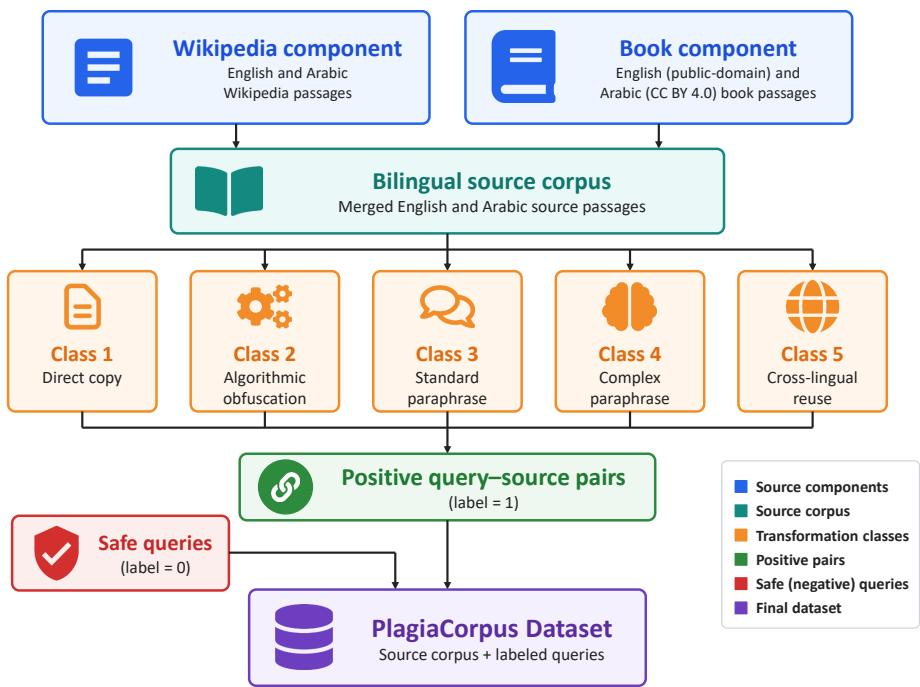
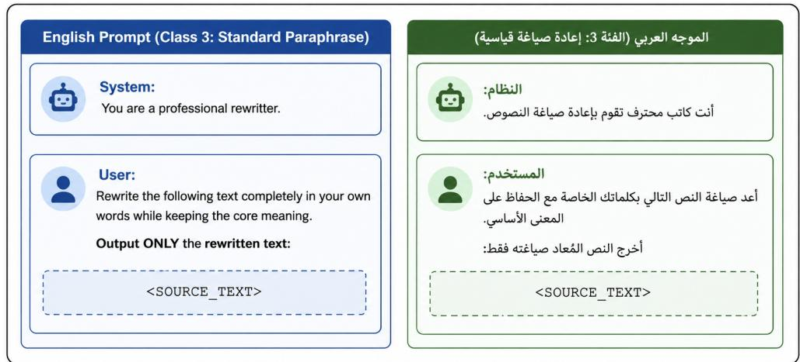
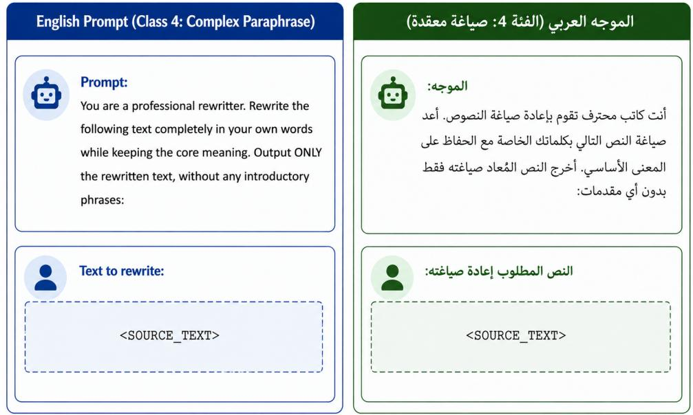
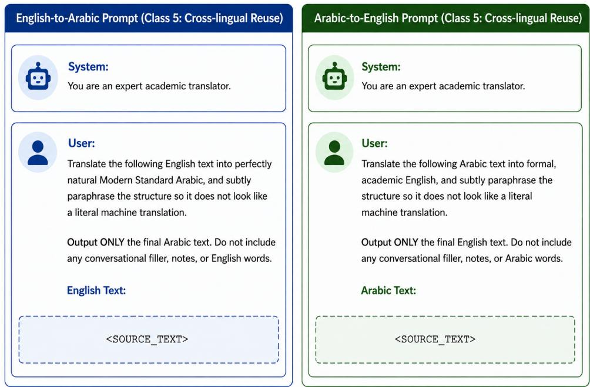

# PlagiaCorpus: A Bilingual, Adversarial, and Cross-Lingual Dataset for Forensic Plagiarism Detection

Adel Ammar1\*, Serry Sibaee1, Wadii Boulila1

1Robotics and Internet-of-Things Laboratory (RIOTU), Prince Sultan University, Riyadh 11586, Saudi Arabia \*Corresponding author: aammar@psu.edu.sa

## Abstract

PlagiaCorpus is a bilingual Arabic–English dataset for benchmarking plagiarism and text-reuse detection, including reuse produced by large language models (LLMs) and reuse across languages. It contains 198,643 text records: a source corpus of 34,885 passages drawn from English and Arabic Wikipedia and two openly licensed book collections, and 163,758 queries (147,381 for training and 16,377 for testing). The queries cover five reuse classes of increasing dificulty, namely verbatim copying, character-level obfuscation, same-language paraphrasing by two diferent LLMs, and English–Arabic translation with structural paraphrasing, together with a Safe class of non-reused passages. Every positive query is linked to its source passage, and the train/test split is grouped by source passage so that no passage contributes queries to both splits. The release was curated through language identification, removal of LLM generation artefacts, and exact and cross-lingual de-duplication. Technical validation reports perclass length statistics, automatic checks of the train/test split, and inter-annotator agreement on a manually rated sample. The dataset is distributed in JSON and Parquet formats under a CC BY-SA 4.0 license.

## Background & Summary

Plagiarism detection is a critical area in natural language processing (NLP), requiring standardized benchmark datasets for the reproducible evaluation of detection methods. The field has moved from string-matching techniques to semantic analysis driven by deep learning and large language models (LLMs). Historically, the corpora of the PAN plagiarism detection competitions [1, 2, 3, 4] served as the standard benchmarks, progressively introducing more realistic obfuscation strategies and cross-language cases. The PAN plagiarism detection task was revived in 2025 with a dataset of generative plagiarism in scientific articles, created with Llama, DeepSeek-R1 and Mistral models [5]. The task was continued at PAN 2026 as a retrieval-based challenge, in which a suspicious document generated by an LLM from one or more source documents must be matched to its sources within a candidate collection [6].

However, the challenge of plagiarism detection is amplified in languages with complex morphology, such as Arabic. Unlike English-centric datasets, Arabic benchmarks must contend with highly derivational word forms, making traditional string-matching inefective [7]. Furthermore, recent generative plagiarism datasets such as that of PAN 2025 are English-only and restricted to scientific articles from arXiv, which limits their use for Arabic and crosslingual scenarios.

PlagiaCorpus addresses these limitations by combining Arabic and English. It contains LLM-generated paraphrases in both languages as well as English-to-Arabic and Arabic-to-English reuse, a combination not covered by existing corpora. It also contains character-level obfuscations (leetspeak substitutions for English and tatweel insertion for Arabic) that target detectors relying on exact character or token overlap, and Safe passages that allow detectors to be evaluated on false positives as well as on detection.

As detailed in Table 1, PlagiaCorpus bridges the gap between traditional forensic plagiarism corpora and emerging generative benchmarks. Earlier resources such as PAN-PC-11 [3] and AraPlagDet [7] incorporate paraphrasing and artificial obfuscation, but predate LLM-generated plagiarism; PAN-PC-11 includes cross-language cases but no Arabic, and AraPlagDet is Arabiconly. PAWS [8], although designed around challenging paraphrase and nonparaphrase pairs, is English-only and does not address cross-lingual or LLMgenerated plagiarism. More recent benchmarks such as PAN 2026 [6] extend plagiarism detection to LLM-generated content, but remain English-only.

PlagiaCorpus is the only dataset in this comparison that combines Arabic coverage, cross-lingual reuse and LLM-generated plagiarism.

Table 1: Comparison of Forensic Plagiarism and Paraphrase Datasets
<table><tr><td>Feature / Capability</td><td></td><td>PAN-PC-11 [3] AraPlagDet 2015 [7]</td><td>PAWS [8]</td><td></td><td>PAN 2026 [6] PlagiaCorpus (Ours)</td></tr><tr><td>Multilingual Support</td><td>√</td><td>× (Ar only)</td><td>× (En only)</td><td>× (En only)</td><td>√</td></tr><tr><td>Arabic Coverage</td><td>X</td><td>√</td><td>X</td><td>X</td><td>√</td></tr><tr><td>Cross-Lingual Plagiarism</td><td>√</td><td>X</td><td>X</td><td>X</td><td>√</td></tr><tr><td>Adversarial / Artificial Obfuscation</td><td>√</td><td>√</td><td>√</td><td>√</td><td>√</td></tr><tr><td>Complex Paraphrasing</td><td>√</td><td>√</td><td>√</td><td>√</td><td>√</td></tr><tr><td>LLM-Generated Plagiarism</td><td>X</td><td>X</td><td>X</td><td>√</td><td>√</td></tr></table>

## Methods

The PlagiaCorpus dataset was constructed through a multi-stage bilingual generation pipeline designed to represent progressively more challenging forms of text reuse in English and Arabic. The dataset combines two complementary components constructed from (i) Wikipedia content and (ii) book-length texts from two openly licensed collections, hereafter referred to as the book component. These components were initially generated independently, subsequently merged, and finally curated into the released benchmark. As detailed in Table 2, the resulting corpus draws from English and Arabic Wikipedia, a public-domain English book collection, and a CC BY 4.0-licensed Arabic book corpus, providing broad topical, linguistic, and stylistic coverage.

Table 2: Data provenance and licenses of the source repositories: passages initially collected and passages retained in the released source corpus after curation.
<table><tr><td>Repository</td><td>License</td><td>Collected</td><td>Released (%)</td></tr><tr><td>English Wikipedia</td><td>CC BY-SA 4.0</td><td>12,188</td><td>12,102 (34.69%)</td></tr><tr><td>Arabic Wikipedia</td><td>CC BY-SA 4.0</td><td>6,549</td><td>6,483 (18.58%)</td></tr><tr><td>The Arabic E-Book Corpus</td><td>CC BY 4.0</td><td>10,000</td><td>9,999 (28.66%)</td></tr><tr><td>PleIAs English-PD</td><td>Public domain</td><td>10,000</td><td>6,301 (18.06%)</td></tr><tr><td>Total</td><td></td><td>38,737</td><td>34,885 (100.00%)</td></tr></table>

The construction methodology combines naturally occurring source material, deterministic text obfuscation, large language model (LLM)-based paraphrasing, cross-lingual translation with structural reformulation, and independently sampled non-reused texts. This design produces a controlled spectrum of text reuse ranging from exact lexical copying to cases in which the relationship between a query and its source is primarily semantic or crosslingual.

Figure 1 summarizes the overall dataset construction process. English and Arabic source passages were first collected from the Wikipedia and book components and segmented into paragraph-level units. Each selected source passage was then transformed according to diferent reuse strategies to produce positive query-source pairs. Independently selected passages were additionally incorporated as negative Safe examples. Finally, the Wikipedia and book components, together with the generated transformations, were consolidated and curated into the final PlagiaCorpus dataset.

## Source Corpus Construction

The PlagiaCorpus source corpus was assembled from two complementary data components. The first component was constructed from English and Arabic Wikipedia content [9]. A broad collection of topics spanning literature, history, culture, science, law, technology, philosophy, geography, and related domains was used to retrieve diverse Wikipedia articles in both languages through the MediaWiki API, using the wikipedia Python package, in April 2026. Article contents were segmented into paragraph-level passages using paragraph boundaries defined by the Wikipedia markup. To ensure that the retained passages contained suficient contextual information for subsequent transformations, only paragraphs exceeding 200 characters were preserved, while short fragments and section headings were discarded.

The second component, the book component, was constructed from two book collections. English passages were obtained from the PleIAs English-PD collection [10], which consists of public-domain texts. Arabic passages were obtained from The Arabic E-Book Corpus [11, 12], a collection of 1,745 books published by the Hindawi Foundation between 2008 and 2024 and distributed under a CC BY 4.0 license. The Arabic corpus was accessed through a third-party mirror of the original deposit on the Hugging Face Hub (mohres/The Arabic E-Book Corpus). Paragraphs longer than 150 characters were streamed from each collection, and the first 10,000 paragraphs per language were retained as source passages. These resources complement Wikipedia with book-length material, thereby increasing the topical, stylistic, and structural diversity of the benchmark. Provenance and license information for each repository is provided in Table 2.

  
Figure 1: Overview of the PlagiaCorpus dataset construction pipeline. Source passages are collected from two complementary components, namely Wikipedia and openly licensed book collections, and merged into a unified bilingual source corpus. Five transformation strategies are then applied to generate increasingly challenging forms of text reuse, ranging from direct copying and algorithmic obfuscation to LLM-based paraphrasing and cross-lingual translation with structural reformulation. The resulting positive query–source pairs are combined with independently sampled safe queries, which serve as negative examples, to construct the final PlagiaCorpus benchmark.

For both components, the selected English and Arabic passages formed the reference source corpus against which generated queries could be evaluated. The Wikipedia and book components were subsequently merged, producing a unified bilingual source collection covering heterogeneous topics, genres, and writing styles. Each selected source passage was subjected to transformations representing diferent forms and levels of text reuse. Table 3 summarizes these classes.

As shown in Table 3, the five positive classes were designed to span a continuum of detection dificulty. Class 1 preserves complete lexical identity and therefore represents the most explicit form of reuse. Class 2 retains the original content but perturbs its surface representation, targeting methods that rely heavily on exact character or token overlap. Classes 3 and 4 weaken lexical and syntactic correspondence through LLM-based rewriting while maintaining the underlying semantics. Class 5 introduces an additional level of dificulty by transferring the source content across languages. The Safe category complements these positive classes with independently selected negative examples. Collectively, this structure enables PlagiaCorpus to evaluate lexical, semantic, and cross-lingual text-reuse detection within a common benchmark.

Table 4 presents an illustrative example showing how the same source passage is transformed across the five positive classes while preserving a traceable relationship to the original text. The progression from exact copying (Class 1) to character-level obfuscation (Class 2), semantic paraphrasing using two diferent LLMs (Classes 3 and 4), and cross-lingual translation with structural reformulation (Class 5) illustrates the increasing dificulty posed to plagiarism and text-reuse detection systems. In contrast, the Safe example is sampled independently from the source corpus and shares no reuse relationship with the original passage, illustrating the negative examples included in the benchmark.

## Direct and Algorithmically Modified Reuse

For Class 1, each selected source paragraph was copied without modification and used directly as a positive query. These samples represent explicit verbatim reuse and provide a baseline against which the more heavily transformed classes can be compared.

Table 3: Text-reuse classes used in the PlagiaCorpus dataset.
<table><tr><td>Class</td><td>Reuse type</td><td>Generation method</td><td>Description</td></tr><tr><td>Class 1</td><td>Direct copy</td><td>Identity trans- formation</td><td>The source passage is reproduced ver- batim, representing exact textual reuse and providing the least obfuscated posi- tive examples.</td></tr><tr><td>Class 2</td><td>Algorithmic modification</td><td>Rule-based transformation</td><td>The source is modified at the charac- ter level without changing its underlying content. English passages use leetspeak- style character substitutions, while Ara- bic passages are modified by inserting the Arabic tatweel (elongation) charac- ter (U+0640) within words.</td></tr><tr><td>Class 3</td><td>Standard paraphrase</td><td>Qwen2.5-14B- Instruct</td><td>The source is rewritten in the same language using an instruction-tuned LLM while preserving its core mean- ing. This reduces direct lexical overlap while maintaining semantic correspon- dence with the source.</td></tr><tr><td>Class 4</td><td>Complex paraphrase</td><td>Gemma 4 31B</td><td>The source is independently rewritten using a second LLM, introducing an al- ternative paraphrasing regime and addi- tional variation in lexical choice and sen- tence structure.</td></tr><tr><td>Class 5</td><td>Cross-lingual reuse</td><td>Gemma 4 26B</td><td>The source is translated between En- glish and Arabic while simultaneously undergoing light structural paraphras- ing. Both English-to-Arabic and Arabic- to-English directions are represented.</td></tr><tr><td>Safe</td><td>Non-reused text</td><td>Independent sampling</td><td>An independently selected passage that is not generated from the correspond- ing source material is used as a negative example, representing text for which no reuse relationship should be detected.</td></tr></table>

<table><tr><td rowspan=1 colspan=1>Class</td><td rowspan=2 colspan=1>Texta technical or scientific diploma or degree from a university ortechnikon, involving at least a three-year course of study;six months&#x27;practical training in the office of a registered practicing patentattorney;sitting the Patent Board Examination.</td></tr><tr><td rowspan=1 colspan=1>Class 1 (DirectCopy)</td></tr><tr><td rowspan=1 colspan=1>Class 2(AlgorithmicModification)</td><td rowspan=1 colspan=1>@ t3chn1c@1 0r sc13nt1f1c d1p10m@ 0r d3gr33 fr0m @ un1v3rs1ty0r t3chn1k0n, 1nv0lv1ng @t 13@st @ thr33-y3@r cOurs3 0f study;s1xm0nths&#x27;pr@ct1c@1 tr@1n1ng 1n th3 0ff1c30f @ r3g1st3r3dpr@ct1c1ng p@t3nt @tt0rn3y;s1tt1ng th3 P@t3nt B0@rdEx@m1n@t10n.</td></tr><tr><td rowspan=1 colspan=1>Class 3(Paraphrase byQwen2.5-14B-Instruct)</td><td rowspan=1 colspan=1>To qualify, one must hold a diploma or degree in a technical orscientific field from an accredited institution, which requires at leastthree years of study. Additionally, six months of hands-on trainingunder a licensed and practicing patent attorney is necessary. Finally,passing the Patent Board Examination is required.</td></tr><tr><td rowspan=1 colspan=1>Class 4(Paraphrase bygemma4:31b)</td><td rowspan=1 colspan=1>- A minimum three-year technical or scientific degree from a universityor technical college.• Six months of practical experience working undera certified patent attorney.• Completion of the Patent BoardExamination.</td></tr><tr><td rowspan=1 colspan=1>Class 5 (Cross-lingualTranslation bygemma4:26b)</td><td rowspan=1 colspan=1> $x ^ { 1 } L = \frac { 1 } { 4 } \sin 2 \alpha \cos \alpha \sin \alpha \sin \alpha \sin \alpha \sin \beta \sin \alpha \sin \beta \sin \alpha \sin \beta \cos \alpha \sin \alpha \sin \beta \cos \alpha \sin \beta \cos \alpha \sin \beta \cos \alpha \sin \alpha \sin \beta \cos \alpha \sin \alpha \sin \beta \cos \alpha \sin \alpha \sin \beta$  $a ^ { ( 1 ) } ( 1 ) a ^ { ( 3 ) } a ^ { ( 4 ) } a ^ { ( 4 ) } a ^ { ( 3 ) } a ^ { ( 4 ) } a ^ { ( 4 ) } a ^ { ( 2 ) } a ^ { ( 4 ) } a ^ { ( 4 ) } a ^ { ( 4 ) } a ^ { ( 4 ) } a ^ { ( 4 ) } a ^ { ( 4 ) } a ^ { ( 4 ) } a ^ { ( 4 ) } a ^ { ( 4 ) } a ^ { ( 4 ) } a ^ { ( 4 ) } a ^ { ( 4 ) } a ^ { ( 4 ) } a ^ { ( 4 ) } a ^ { ( 4 ) } a ^ { ( 4 ) } a ^ { ( 4 ) } a ^ { ( 4 ) } a ^ { ( 4 ) } a ^ { ( 4 ) } a ^ { ( 4 ) } a ^ { ( 4 ) } a ^ { ( 4 ) } a ^ { ( 4 ) } a ^ { ( 4 ) } a ^ { ( 4 ) } a ^ { ( 4 ) } a ^ { ( 4 ) } a ^ { ( 4 ) } a ^ { ( 4 ) } a ^ { ( 4 ) } a ^ { ( 4 ) } a ^ { ( 4 ) } a ^ { ( 4 ) } a ^ { ( 4 ) } a ^ { ( 4 ) } a ^ { ( 4 ) } a ^ { ( 4 ) } a ^ { ( 4 ) } a ^ { ( 4 ) } a ^ { ( 4 ) } a ^ { ( 4 ) } a ^ { ( 4 ) } a ^ { ( 4 ) } a ^ { ( 4 ) } a ^ { ( 4 ) } a ^ { ( 4 ) } a ^ { ( 4 ) } a ^ { ( 4 ) } a ^ { ( 4 ) } a ^ { ( 4 ) } a ^ { ( 4 ) } a ^ { ( 4 ) } a ^ { ( 4 ) } a ^ { ( 4 ) } a ^ { ( 4 ) } a ^ { ( 4 ) } a ^ { ( 4 ) } a ^ { ( 4 ) } a ^ { ( 4 ) } a ^ { ( 4 ) } a ^ { ( 4 ) } a ^ { ( 4 ) } a ^ { ( 4 ) } a ^ { ( 4 ) } a ^ { ( 4 ) } a ^ { ( 4 ) } a ^ { ( 4 ) } a ^ { ( 4 ) } a ^ { ( 4 ) } a ^ { ( 4 ) } a ^ { ( 4 ) } a ^ { ( 4 ) } a ^ { ( 4 ) } a ^ { ( 4 ) } a ^ { ( 4 ) } a ^ { ( 4 ) } a ^ { ( 4 ) } a ^ { ( 4 ) } a ^ { ( 4 ) } a$  $\cdot ( 1 0 0 - x ) 1 \leq 1 \leq x \leq ( 2 0 - 1 ) \leq ( 1 0 0 - 0 ) \leq 1 \leq x - 1 - \sqrt [ 3 ] { 2 0 - 2 0 } \leq 0 \leq x \leq 1 5$ </td></tr><tr><td rowspan=1 colspan=1>Safe (NegativeExample)</td><td rowspan=1 colspan=1>When the elements of the codomain of a function are vectors, thefunction is said to be a vector-valued function. These functions areparticularly useful in applications, for example modeling physicalproperties. For example, the function that associates to each point of afluid its velocity vector is a vector-valued function. Some vector-valuedfunctions are defined on a subset of Rⁿ or related spaces such asmanifolds, and are commonly referred to as vector fields.</td></tr></table>

Table 4: Illustrative example of a source passage (ID: WIKI 006573) and its corresponding transformations across the five positive reuse classes in PlagiaCorpus, together with a Safe negative example. The examples demonstrate the progressive increase in transformation complexity from verbatim copying to algorithmic obfuscation, monolingual LLM-based rewriting, and cross-lingual semantic transfer.

For Class 2, deterministic language-specific transformations were applied to alter the surface representation of the source while leaving its textual content recognizable. For English, lower-case Latin characters were replaced using leetspeak-style substitutions, specifically e→3, a→@, i→1, and o→0. For Arabic, the Arabic tatweel (elongation) character was inserted after the first character of every word containing more than two characters. These transformations create adversarial cases in which the passage remains readily interpretable to a human reader while its character-level representation difers from the original.

## LLM-Based Paraphrase Generation

Classes 3 and 4 represent semantic text reuse in which the meaning of the source passage is retained while its lexical and syntactic realization is changed. Two diferent LLMs were employed to diversify the generated paraphrases and reduce dependence on the rewriting characteristics of a single model.

For Class 3, Qwen/Qwen2.5-14B-Instruct was used to paraphrase source passages in their original language through Hugging Face Transformers in bf16 precision. Generation used stochastic decoding with a temperature of 0.7 and a limit of 256 new tokens. For the book component, top-p was additionally set to 0.9. The model was explicitly instructed to rewrite the passage while preserving its core meaning and to return only the resulting paraphrase.

The English and Arabic prompt templates used for Class 3 paraphrase generation in the book component are illustrated in Figure 2. Both prompts follow a system-user instruction format and direct the model to rewrite the source passage while preserving its core meaning and returning only the resulting paraphrased text. The same paraphrasing objective is maintained across both languages, with language-specific instructions provided for English and Arabic.

The Wikipedia component used the same paraphrasing objective with a more concise instruction. For English, the model was instructed to rewrite the passage completely in its own words and return only the rewritten text. The equivalent instruction was provided in Arabic for the Arabic source passages. Thus, although the exact prompt wording varied slightly between the two components of the dataset, Class 3 consistently represents samelanguage semantic paraphrasing using Qwen2.5-14B-Instruct.

  
Figure 2: English and Arabic prompt templates used to generate Class 3 standard paraphrases with the Qwen2.5-14B-Instruct model. The prompts instruct the model to rewrite each source passage while preserving its core meaning and returning only the paraphrased text.

For Class 4, an additional paraphrasing process was performed using gemma4:31b served through Ollama. The model was configured with a temperature of 0.7 and top-p of 0.9 and instructed to rewrite the source while retaining its core meaning. Employing a second LLM provides an alternative paraphrase distribution, thereby increasing the diversity of semantic transformations represented in the benchmark. Moreover, the inclusion of paraphrases generated by two distinct LLMs allows plagiarism detection systems to be assessed for their robustness to model-specific paraphrasing styles and their ability to generalize across diferent generative models, rather than overfitting to the linguistic characteristics of a single LLM. Generation succeeded for 36,105 of the 38,737 collected passages; passages whose generation failed have no Class 4 query.

The English and Arabic prompt templates used for Class 4 paraphrase generation are illustrated in Figure 3. In both languages, gemma4:31b was instructed to completely rewrite the source passage in its own words while preserving the underlying meaning. The prompts additionally constrain the model to return only the rewritten passage without introductory phrases, thereby reducing extraneous generated content and ensuring that the resulting samples consist solely of the transformed source text.

The use of two independently parameterized LLM-based paraphrasing strategies therefore provides complementary forms of semantic rewriting, allowing the benchmark to assess whether detection methods remain efective when lexical overlap with the original source is substantially reduced.

  
Figure 3: English and Arabic prompt templates used to generate Class 4 complex paraphrases with the gemma4:31b model. The prompts instruct the model to rewrite each source passage in its own words while preserving the core meaning and returning only the rewritten text without introductory content.

## Cross-Lingual Text Reuse

Class 5 extends PlagiaCorpus from monolingual reuse to cross-lingual semantic reuse. Following construction and merging of the bilingual source corpus, the source passages were separated according to language and randomly sampled (seed 42) for a bidirectional English-Arabic transformation. Each source passage was used for at most one Class 5 query.

Cross-lingual samples were generated using gemma4:26b served through Ollama, for 6,870 English and 6,869 Arabic source passages. Importantly, the transformation was not formulated as literal translation alone. The model was explicitly instructed to produce natural target-language text while subtly reformulating its structure. Class 5 therefore represents cross-lingual text reuse in which the underlying semantic content is retained while both the language and surface realization are changed.

The bidirectional prompt templates used for Class 5 cross-lingual textreuse generation are illustrated in Figure 4. For English-to-Arabic transformation, gemma4:26b was instructed to produce natural Modern Standard Arabic while subtly paraphrasing the structure of the source passage. Conversely, Arabic-to-English transformation targeted formal academic English under the same structural paraphrasing constraint. In both directions, the prompts explicitly discourage literal translation and restrict the output to the target-language text only, thereby producing cross-lingual samples that preserve the underlying source meaning while reducing direct lexical and structural correspondence.

The two translation directions are labelled separately in the type field, while conceptually constituting a single cross-lingual reuse class. This class is particularly important for evaluating systems whose detection mechanisms extend beyond language-specific lexical overlap and instead rely on multilingual semantic correspondence.

## Negative Control Samples

A dedicated Safe category was incorporated to provide negative examples and prevent the benchmark from containing only reused or transformed material. Safe queries were not generated through any of the Class 1–5 transformations. Instead, they were independently selected from text pools separate from those used for the positive source passages.

  
Figure 4: English-to-Arabic and Arabic-to-English prompt templates used to generate Class 5 cross-lingual text-reuse samples with the gemma4:26b model. The prompts combine translation with structural paraphrasing to preserve the source meaning while reducing literal correspondence between the source and target texts.

For the Wikipedia component, separate English and Arabic control pools were crawled from articles retrieved for topics that were not used for the source passages. For the book component, Safe passages were taken from later portions of the English and Arabic book collections, after skipping the first 20,000 paragraphs of each collection, so that they do not overlap the source passages. Duplicate Safe passages were removed during curation (see below).

In the released dataset, 25% of the Safe queries in each language (3,928 queries) were additionally transformed with the same character-level rules as Class 2. Without this step, the presence of leetspeak or tatweel would identify a query as positive. The released dataset contains 15,714 Safe queries assigned label=0. These samples provide a negative control because a detection system must distinguish genuine source-derived reuse from independently sourced text rather than simply assigning positive labels to every query.

## Dataset Integration and Assembly

The Wikipedia and book components were consolidated into a unified dataset after their respective source passages and transformation classes had been generated. Source passages received stable identifiers (WIKI 000000, . . . , PD 000000, . . . ), and each positive query records the identifier of the passage from which it was derived. Positive examples from Classes 1–5 are assigned label=1, whereas Safe examples are assigned label=0. The original English and Arabic passages are retained as the reference source corpus, allowing each positive query to be evaluated against the material from which it was derived.

The final organization therefore combines heterogeneous source provenance with a controlled progression of reuse transformations. The Wikipedia component contributes broad encyclopedic and topic-driven coverage, while the book component introduces longer-form literary and non-fiction material from public-domain English books and contemporary Arabic books. Their integration produces a bilingual benchmark spanning exact copying, character-level obfuscation, monolingual semantic paraphrasing, cross-model paraphrasing, and cross-lingual semantic reuse, together with independently sourced negative examples.

## Curation and Train/Test Split

The assembled dataset was curated before release. All steps are deterministic (seed 42) and implemented in the code repository. The resulting release is available on Hugging Face [15]. Table 5 summarizes the records removed at each step.

Language filtering. Arabic-script passages were accepted as Arabic. Latin-script passages were treated as English unless two signals agreed that they were not: fewer than 5% English function words and a confidence below 0.2 for English according to the Lingua language identifier [13]. Source passages that were not English or Arabic, or whose language contradicted the language recorded in their queries, were removed together with all queries derived from them. Most removed passages were German (2,891) and French (792) text from the English book collection. Safe passages whose language difered from their label were also removed.

LLM output cleaning. For Classes 3–5 only, introductory phrases (e.g., “Here is the rewritten text:”), trailing notes and markdown formatting were stripped. Outputs were removed when they were refusals, echoed the prompt, were shorter than 20 characters, were in the wrong language or script, contained characters from an unrelated script (most often Chinese characters produced by Qwen2.5 when paraphrasing Arabic), or were identical to their source. Outputs that end without terminal punctuation while their source does (9,268 queries), or that contain fewer than 30% of the source’s words (1,025 queries), are retained but flagged in the quality flags field.

De-duplication. Safe queries identical to a source passage or to another Safe query were removed. In addition, all source and Safe passages were embedded with LaBSE [14], and pairs with a cosine similarity of at least 0.85 were identified. Safe passages matching a source passage at this threshold, including translations of a source passage, were removed. Source passages with an exact duplicate (3,393 passages in 1,393 groups) or a near-duplicate (5,819 pairs, 436 of them cross-lingual) were retained but treated as a single group for splitting.

Grouped split. Each source passage, merged with its duplicates and near-duplicates, defines a group, and every query derived from a group is assigned to the same split. Groups were assigned to the test split within strata defined by collection and language (Safe queries form their own strata) until 10% of the queries of each stratum were reached. As a result, no source passage contributes queries to both the training and the test split.

Table 5: Records removed during curation.
<table><tr><td>Reason</td><td>Records</td></tr><tr><td>Source corpus Passage not in English or Arabic, or language inconsistent with its queries</td><td>3,852</td></tr><tr><td>Queries</td><td></td></tr><tr><td>Derived from a removed source passage Safe query in a language other than its label</td><td>15,951 5,920</td></tr><tr><td>Safe query duplicating another Safe query</td><td>14,705</td></tr><tr><td>Safe query identical to a source passage</td><td>2,330</td></tr><tr><td>Safe query near-duplicate or translation of a source passage (LaBSE)</td><td>68</td></tr><tr><td>LLM output containing characters of an unrelated script</td><td>1,756</td></tr><tr><td>LLM output in the wrong language or script</td><td>284</td></tr><tr><td>LLM refusal</td><td>20</td></tr><tr><td>Total queries removed</td><td>41,034</td></tr></table>

## Data Records

The PlagiaCorpus dataset is hosted on Hugging Face [15] and is organized into two complementary components: a source corpus containing the reference passages and a queries collection containing transformed and negative examples used for benchmarking plagiarism and text-reuse detection systems. In total, the dataset comprises 198,643 text records. The source corpus contains 34,885 reference passages totaling 5.27 million words, while the remaining 163,758 records are queries, comprising 147,381 training queries and 16,377 test queries. The corpus integrates content from Wikipedia and two book collections, as summarized in Table 2.

The dataset consists of three files, each provided in JSON and in Parquet format: PlagiaCorpus\_corpus (source passages), PlagiaCorpus\_queries \_train and PlagiaCorpus\_queries\_test. After language filtering, every record is in English or Arabic (Table 6).

The source corpus and query collection adopt complementary record structures, summarized in Table 7. Each source corpus record contains a unique identifier, the reference passage, its language, and provenance and license metadata. Query records additionally describe the reuse class, the language of the query and of its source, the transformation applied, the binary label, the generating model, quality flags, and the identifier of the source passage.

Table 6: Language distribution across all text records (source passages and queries).
<table><tr><td>Language</td><td>Count</td><td>Percentage</td></tr><tr><td>English</td><td>103,269</td><td>51.99%</td></tr><tr><td>Arabic</td><td>95,374</td><td>48.01%</td></tr><tr><td>Total</td><td>198,643</td><td>100.00%</td></tr></table>

Table 7: Fields contained in the PlagiaCorpus source corpus and query records (C: corpus; Q: queries).
<table><tr><td>Field</td><td>In</td><td>Description</td></tr><tr><td>_id</td><td>C, Q</td><td>Unique identifier: WIKI_000000 or PD_000000 for source passages, Q_000000 for queries.</td></tr><tr><td>text</td><td>C, Q</td><td>Text of the source passage or query.</td></tr><tr><td>language</td><td>C, Q</td><td>Language of the text (en or ar).</td></tr><tr><td>domain</td><td>C, Q</td><td>Source collection, e.g., Wikipedia (Wikimedia Foundation) accessed April 2026, The Arabic E-Book Corpus (Hindawi Foundation), PleIAs English-PD.</td></tr><tr><td>source</td><td>C, Q</td><td>Attribution: Wikipedia article URL or book-collection citation with book title; for queries, preceded by the</td></tr><tr><td>source_license</td><td>C, Q</td><td>transformation applied. License of the underlying text (CC BY-SA 4.0, CC BY 4.0, or public domain).</td></tr><tr><td>type</td><td>Q</td><td>Reuse class and language, e.g., Class 4 (AR), Class 5 (EN-&gt;AR).</td></tr><tr><td>reuse_class</td><td>Q</td><td>Class 1-Class 5, or Safe.</td></tr><tr><td>source_language</td><td>Q</td><td>Language of the source passage (nul1 for Safe queries).</td></tr><tr><td>transformation</td><td>Q</td><td>verbatim, algorithmic, 1lm_paraphrase, 11m_cross_lingual, or none; obfuscated Safe queries are marked algorithmic.</td></tr><tr><td>label</td><td>Q</td><td>1 for reused content (Classes 1–5), 0 for Safe queries.</td></tr><tr><td>generator_model</td><td>Q</td><td>Generating model (Qwen2.5-14B-Instruct, gemma4:31b, gemma4:26b), or rule-based/human origin.</td></tr><tr><td>original_text_id</td><td>Q</td><td>Identifier of the source passage of the query (nul1 for Safe queries).</td></tr><tr><td>quality_flags</td><td>Q</td><td>Automatic flags for LLM outputs: possibly_truncated, much_shorter_than_source.</td></tr></table>

The original text id field establishes an explicit correspondence between each positive query and its source passage, enabling reproducible evaluation of retrieval-based plagiarism detection systems. Additional metadata, including the reuse class, transformation, languages, binary label and generation model, supports fine-grained analysis of detector performance across text-reuse strategies, language pairs, source collections and LLMs.

## License

PlagiaCorpus is released under the CC BY-SA 4.0 license (Creative Commons Attribution-ShareAlike 4.0 International). This license is required because the source corpus and the derived queries include Wikipedia text, which is distributed under CC BY-SA 4.0. Passages from The Arabic E-Book Corpus are redistributed under the attribution terms of its CC BY 4.0 license, which permits inclusion in CC BY-SA 4.0 adaptations, and passages from PleIAs English-PD are in the public domain. Attribution is provided at the record level through the domain, source and source license fields. Redistributions of PlagiaCorpus and of adapted versions must retain this attribution and be released under the same license.

## Technical Validation

The released query set comprises 148,044 positive and 15,714 Safe queries (90.4% and 9.6%). Table 8 reports the number of queries and word-length statistics for each class, with words counted as whitespace-separated tokens. Table 9 gives the number of queries per class in each split. The grouped split was verified automatically: no source passage, and no identical query text, occurs in both splits.

Paraphrases are shorter than their sources: on average, Class 3 queries contain 33% (English) and 33% (Arabic) fewer words than Class 1 queries, and Class 4 queries 27% and 22% fewer. LLM outputs that end without terminal punctuation, which may occur for long passages given the limit of 256 new tokens for Class 3, are identified in the quality flags field.

Table 8: Number of queries and word-length statistics (whitespace tokens) for each text-reuse class.
<table><tr><td>Class</td><td>Count (%)</td><td>Generator</td><td>Mean</td><td>Median</td><td>Std Dev</td></tr><tr><td>Class 1 (EN)</td><td>18,403 (11.2%)</td><td>None (direct copy)</td><td>167.7</td><td>120</td><td>151.2</td></tr><tr><td>Class 1 (AR)</td><td>16,482 2 (10.1%)</td><td>None (direct copy)</td><td>132.7</td><td>88</td><td>137.3</td></tr><tr><td>Class 2 (EN)</td><td>18,403 3 (11.2%)</td><td>None (rule-based)</td><td>167.7</td><td>120</td><td>151.2</td></tr><tr><td>Class 2 (AR)</td><td>16,482 2 (10.1%)</td><td>None (rule-based)</td><td>132.7</td><td>88</td><td>137.3</td></tr><tr><td>Class 3 (EN)</td><td>18,252 (11.1%)</td><td>Qwen2.5-14B-Instruct</td><td>112.8</td><td>106</td><td>58.9</td></tr><tr><td>Class 3 (AR)</td><td>14,679 (9.0%)</td><td>Qwen2.5-14B-Instruct</td><td>89.3</td><td>96</td><td>32.2</td></tr><tr><td>Class 4 (EN)</td><td>17,426 (10.6%)</td><td>Gemma 4 31B</td><td>122.3</td><td>92</td><td>94.2</td></tr><tr><td>Class 4 (AR)</td><td>15,068 (9.2%)</td><td>Gemma 4 31B</td><td>104.1</td><td>79</td><td>77.7</td></tr><tr><td>Class 5 (EN→AR)</td><td>5,997 (3.7%)</td><td>Gemma 4 26B</td><td>162.4</td><td>121</td><td>137.9</td></tr><tr><td>Class 5 (AR→EN)</td><td>6,852 (4.2%)</td><td>Gemma 4 26B</td><td>195.6</td><td>142</td><td>163.8</td></tr><tr><td>Safe (EN)</td><td>5,530 (3.4%)</td><td>None (human text)</td><td>104.9</td><td>70</td><td>101.9</td></tr><tr><td>Safe (AR)</td><td>10,184 (6.2%)</td><td>None (human text)</td><td>75.9</td><td>56</td><td>59.6</td></tr></table>

Table 9: Number of queries per class in the training and test splits.
<table><tr><td>Class</td><td>Train</td><td>Test</td></tr><tr><td>Class 1 (EN) Class 1 (AR)</td><td>16,593 14,807</td><td>1,810 1,675</td></tr><tr><td>Class 2 (EN)</td><td>16,593</td><td>1,810</td></tr><tr><td>Class 2 (AR)</td><td>14,807</td><td>1,675</td></tr><tr><td>Class 3 (EN)</td><td>16,454</td><td>1,798 1,515</td></tr><tr><td>Class 3 (AR)</td><td>13,164</td><td>1,722</td></tr><tr><td>Class 4 (EN) Class 4 (AR)</td><td>15,704</td><td></td></tr><tr><td></td><td>13,566</td><td>1,502</td></tr><tr><td>Class 5 (EN→AR)</td><td>5,407</td><td>590</td></tr><tr><td>Class 5 (AR→EN)</td><td>6,144</td><td>708</td></tr><tr><td>Safe (EN)</td><td></td><td>553</td></tr><tr><td></td><td>4,977</td><td></td></tr><tr><td>Safe (AR)</td><td>9,165</td><td>1,019</td></tr><tr><td>Total</td><td>147,381</td><td>16,377</td></tr></table>

## Human Annotation Reliability

To assess the quality of the generated queries, a sample of 300 queries (50 per class, Classes 1–5 and Safe) was drawn from the dataset before curation. Each query was shown together with its source passage (for Safe queries, an unrelated passage from the same component and language) and rated independently by two annotators, who did not see the class label, on three ordinal criteria: Linguistic Quality (1–5), Semantic Preservation (1–5), and Obfuscation Dificulty (1–3). Inter-annotator agreement was evaluated using quadratic weighted Cohen’s κ, together with the percentage of ratings within one scale point (Within ±1).

Table 10 summarizes the agreement statistics. Semantic Preservation achieved almost perfect agreement (κ = 0.921), while Linguistic Quality $( \kappa = 0 . 7 3 0 )$ and Obfuscation Dificulty (κ = 0.739) exhibited substantial agreement. The Within ±1 agreement exceeded 88% for all dimensions, reaching over 95% for Obfuscation Dificulty. These results indicate that the annotation protocol yields consistent quality assessments.

Table 10: Inter-annotator agreement on the manually annotated validation sample (300 queries). For each dimension, items that either annotator left blank or marked as not applicable are excluded.
<table><tr><td>Annotation Dimension</td><td>Weighted κ</td><td>Within ±1</td></tr><tr><td>Linguistic Quality</td><td>0.730</td><td>88.67%</td></tr><tr><td>Semantic Preservation</td><td>0.921</td><td>94.31%</td></tr><tr><td>Obfuscation Difficulty</td><td>0.739</td><td>95.74%</td></tr></table>

## Usage Notes

PlagiaCorpus is distributed in JSON and Parquet formats, which integrate directly with retrieval-augmented generation (RAG) and dense embedding workflows. Researchers should use PlagiaCorpus\_corpus as the static index for vector databases (e.g., FAISS, ChromaDB). PlagiaCorpus\_queries\_t rain (90%) and PlagiaCorpus\_queries\_test (10%) are designed for training and evaluating source retrieval (e.g., MRR@10, Recall@K over positive queries) and query–source pair verification (e.g., with cross-encoders). Because the split is grouped by source passage, test queries cannot be matched by memorizing training queries derived from the same passage. Users may exclude queries carrying quality flags for stricter evaluation.

The contents of PlagiaCorpus were collected through automated extraction from Wikipedia and openly licensed book collections and may therefore contain diverse political, ethical, cultural, religious, or other viewpoints expressed in the underlying source material. Such content is included solely as part of the source material and does not represent the views or positions of the authors, their institutions, or the funding organizations. PlagiaCorpus is intended for research on plagiarism and text-reuse detection; its use is governed by the CC BY-SA 4.0 license described in Data Records.

## Code Availability

All Python code used for dataset generation, algorithmic obfuscation, LLM prompting, curation, splitting and statistical validation is available in the GitHub repository https://github.com/riotu-lab/PlagiaCorpus.

## Author Contributions

A.A. conceived and designed the study, generated the dataset and developed the accompanying code, performed the technical validation and statistical analysis, and drafted the manuscript.

S.S. contributed to the investigation, generated the dataset, and performed the technical validation and statistical analysis.

W.B. contributed to the technical validation, supervised the work, and critically revised the manuscript.

All authors approved the submitted version and agree to be personally accountable for their own contributions and to ensure that questions related to the accuracy or integrity of any part of the work are appropriately investigated and resolved.

## Competing Interests

The authors declare that they have no competing financial or non-financial interests that are relevant to the work described.

## Acknowledgments

This research was conducted with the support of the Cultural Research Grants Program launched by the Ministry of Culture in the Kingdom of Saudi Arabia. All views expressed in this paper are those of the authors and do not necessarily reflect the views of the Ministry. The authors also acknowledge the support of Prince Sultan University for paying the Article Processing Charges (APC) of this publication.

## References

[1] M. Potthast, B. Stein, A. Eiselt, A. Barr´on-Cede˜no, and P. Rosso, “Overview of the 1st International Competition on Plagiarism Detection,” in CEUR Workshop Proceedings, vol. 502, pp. 1–9, 2009.

[2] M. Potthast, A. Barr´on-Cede˜no, A. Eiselt, B. Stein, and P. Rosso, “Overview of the 2nd International Competition on Plagiarism Detection,” in CEUR Workshop Proceedings, vol. 1176, pp. 1–14, 2010.

[3] M. Potthast, A. Eiselt, A. Barr´on-Cede˜no, B. Stein, and P. Rosso, “Overview of the 3rd International Competition on Plagiarism Detection,” in CEUR Workshop Proceedings, vol. 1177, 2011.

[4] M. Potthast, M. Hagen, T. Gollub, M. Tippmann, J. Kiesel, P. Rosso, E. Stamatatos, and B. Stein, “Overview of the 5th International Competition on Plagiarism Detection,” in Working Notes for CLEF 2013 Conference, CEUR Workshop Proceedings, vol. 1179, 2013.

[5] A. Greiner-Petter, M. Fr¨obe, J. P. Wahle, T. Ruas, B. Gipp, A. Aizawa, and M. Potthast, “Overview of the Plagiarism Detection Task at PAN 2025,” in 16th International Conference of the CLEF Association (CLEF), CEUR Workshop Proceedings, vol. 4038, pp. 3575–3585, CEUR-WS.org, 2025.

[6] J. Bevendorf, M. Fr¨obe, A. Greiner-Petter, A. Jakoby, M. Mayerl, P. Nakov, H. Plutz, M. Potthast, B. Stein, M. N. Ta, Y. Wang, and E. Zangerle. Overview of PAN 2026: Voight-Kampf Generative AI Detection, Text Watermarking, Multi-author Writing Style Analysis, Generative Plagiarism Detection, and Reasoning Trajectory Detection.

In R. Campos, A. Jatowt, Y. Lan, M. Aliannejadi, C. Bauer, S. MacAvaney, A. Anand, Z. Ren, S. Verberne, N. Bai, and M. Mansoury, editors, Advances in Information Retrieval (ECIR 2026), Lecture Notes in Computer Science, vol. 16486, pages 225–232, Cham, 2026. Springer. https://doi.org/10.1007/978-3-032-21321-1\_32

[7] I. Bensalem, I. Boukhalfa, P. Rosso, L. Abouenour, K. Darwish, and S. Chikhi, “Overview of the AraPlagDet PAN@FIRE2015 Shared Task on Arabic Plagiarism Detection,” in Post Proceedings of the Workshops at the 7th Forum for Information Retrieval Evaluation (FIRE 2015), CEUR Workshop Proceedings, vol. 1587, pp. 111–122, 2015.

[8] Y. Zhang, J. Baldridge, and L. He, “PAWS: Paraphrase Adversaries from Word Scrambling,” in Proceedings of the 2019 Conference of the North American Chapter of the Association for Computational Linguistics: Human Language Technologies, pp. 1298–1308, 2019. https: //doi.org/10.18653/v1/N19-1131

[9] Wikipedia contributors. English and Arabic Wikipedia. Wikimedia Foundation. Available at: https://en.wikipedia.org and https: //ar.wikipedia.org. Accessed: April 2026.

[10] PleIAs. English Public Domain Books (English-PD) [Data set]. Hugging Face. Available at: https://huggingface.co/datasets/PleIAs/Eng lish-PD. Accessed: August 2026.

[11] A. Hallberg, “An 81-million-word multi-genre corpus of Arabic books,” Data in Brief, vol. 60, 111456, 2025. https://doi.org/10.1016/j.di b.2025.111456

[12] A. Hallberg. The Arabic E-Book Corpus (Version 1) [Data set]. University of Gothenburg, Swedish National Data Service, 2025. https: //doi.org/10.5878/7rbh-gy93

[13] P. M. Stahl. Lingua: natural language detection library for Python [Software]. Available at: https://github.com/pemistahl/lingua-py.

[14] F. Feng, Y. Yang, D. Cer, N. Arivazhagan, and W. Wang, “Languageagnostic BERT Sentence Embedding,” in Proceedings of the 60th Annual Meeting of the Association for Computational Linguistics (Volume 1:

Long Papers), pp. 878–891, 2022. https://doi.org/10.18653/v1/20 22.acl-long.62

[15] A. Ammar, S. Sibaee, and W. Boulila. PlagiaCorpus (Revision c603a43) [Data set]. Hugging Face, 2026. https://doi.org/10.57967/hf/11369