# RE3RANK: Listwise Reranking with Reasoning-Conditioned Retrieval Heads

Ruiyi Yan Kyoto University ruiyi@nlp.ist.i.kyoto-u.ac.jp

Yugo Murawaki† Kyoto University murawaki@i.kyoto-u.ac.jp

## Abstract

Attention-based rerankers score each candidate by the attention mass that retrieval heads route to it from the question, but the question, serving as a fixed query, carries limited information for locating relevant evidence. We propose RE3RANK, a listwise reranker built on reasoning-conditioned retrieval heads (RRHeads). A generator first writes a reasoning trace over the question and the candidates, and a scorer then uses the trace tokens as the attention query of a few selected RRHeads, reading relevance as continuous scores. We present a straight-through estimator to propagate the ranking loss through the discrete trace, so that the generator and the scorer can be trained jointly for ranking. Averaged over 9 benchmarks, RE3RANK outperforms 11 baseline rerankers: our 4B variant exceeds the strongest baseline by 3.11 NDCG@10 points on average, and even our 0.6B variant surpasses rerankers with up to 32B parameters.

## 1 Introduction

Large language models (LLMs) are increasingly integrated into retrieval-augmented generation (RAG) systems, which supply knowledge beyond the model’s parameters (Jin et al., 2025). Such systems generally need to retrieve a candidate pool with a retriever and then reorder and filter it with a more expressive reranker (Zhou et al., 2025).

Zhuoyuan Mao LIGHTSPEED zhuoyuanmao@global.tencent.com

Advanced LLM-based rerankers commonly reason and verbalize relevance as a sequence of candidate identifiers (Zhang et al., 2025a; Liu et al., 2026), but verbalization can distort the model’s internal judgments (Li et al., 2023; Chen et al., 2025), and long generated outputs slow down inference. A complementary line of work probes relevance directly from internal attention. Retrieval heads

Yiwen Guo† Independent Researcher guoyiwen89@gmail.com

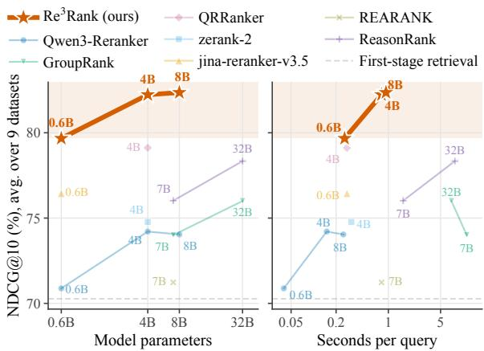  
Figure 1: NDCG@10 (%) of rerankers averaged over 9 datasets, against model size (left) and reranking time per query at a batch size of 50 (right).1

locate relevant information in long contexts (Wu et al., 2025b), and query-focused retrieval heads (QRHeads) score each candidate by the attention mass it receives from the question (Zhang et al., 2025b; Li et al., 2026c).

However, existing QRHead-based rerankers fix the attention query to the tokens of the original question, which often lack the information needed to locate relevant evidence. Reasoning rerankers do make intermediate reasoning steps explicit, but they still convert their reasoning into a verbalized permutation. Written after reading the candidates, such reasoning is more expressive than the question, as it spells out information that the question omits, such as bridge entities and intermediate facts. This raises the question of whether it can replace the question as the attention query.

Inspired by this, we propose RE3RANK, a listwise reranker built on reasoning-conditioned retrieval heads (RRHeads), as illustrated in Figure 2. Given a question and its candidate pool, a reasoning generator first writes a reasoning trace. A separate scorer then uses the trace tokens as the attention queries of selected RRHeads and scores each candidate by the attention mass it receives.

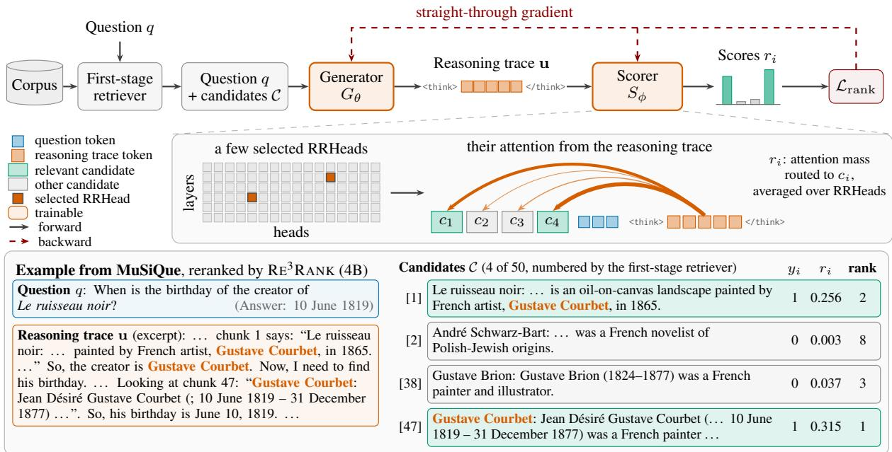  
Figure 2: Overview of $\mathrm { R E } ^ { 3 } \mathrm { R A N K } .$ A first-stage retriever returns candidates for the question from the corpus. The generator writes a reasoning trace from the question and the candidates, and the scorer reads the same input followed by the reasoning trace. Of all attention heads in the scorer, only a few selected RRHeads are used: each candidate is scored by the attention mass that these heads route from the reasoning trace positions to it. The ranking loss $\mathcal { L } _ { \mathrm { r a n k } }$ updates both components and reaches the generator through a straight-through estimator.

Our contributions are as follows. First, we identify the attention query as a dimension of attentionbased rerankers and introduce RRHeads with a generated reasoning trace as the attention query while scoring candidates continuously in one forward pass. Second, we introduce a straight-through joint training method to train the reasoning generator and the scorer jointly for ranking with a mixed ranking objective. Third, we build three $\mathrm { R E } ^ { 3 } \mathrm { R A N K }$ rerankers on Qwen3 backbones at 0.6B, 4B, and 8B (Yang et al., 2025), which outperform 11 baseline rerankers on 9 benchmarks (Figure 1). The 4B variant exceeds QRRanker (4B) by 3.31 R@3 and 3.11 NDCG@10 on average, and even the 0.6B variant outperforms every baseline, including 32B rerankers, in Recall@3, Recall@5, and NDCG@10. Besides, RE3RANK can serve as the retrieval component of a memory system, and the methods of RE3RANK are compatible with Gemma 4 backbones (Team et al., 2026).

## 2 Preliminaries

## 2.1 Post-Retrieval Reranking

Retrieval-augmented generation (RAG) supplements a language model’s parametric knowledge with non-parametric evidence retrieved from an external corpus, providing explicit context for knowledge-intensive reasoning and grounded generation while helping mitigate hallucinations (Lewis et al., 2020; Guu et al., 2020; Izacard and Grave, 2021; Li et al., 2024). In practical RAG pipelines, an efficient first-stage retriever constructs a candidate pool, after which a more expressive second-stage reranker can refine its ordering before generation (Karpukhin et al., 2020; Nogueira and Cho, 2020; Glass et al., 2022; Chuang et al., 2023; Zhou et al., 2025). Let q denote a question and $\mathcal { C } = \{ c _ { 1 } , \ldots , c _ { C } \}$ the candidate set returned by a first-stage retriever. For training and evaluation, each candidate carries a gold binary relevance label $y _ { i } \in \{ 0 , 1 \}$ , collected in $\mathbf { y } = ( y _ { 1 } , \dots , y _ { C } )$ ; the labels come mostly from dataset annotations (Appendix C.3) and are not available to the reranker at inference. We write $\mathcal { P } = \{ i \ | \ y _ { i } = 1 \}$ and $\mathcal { N } = \{ i \mid y _ { i } = 0 \}$ for the indices of the in-pool relevant and irrelevant candidates, respectively.

A reranker maps the question and the candidate set to one real-valued score per candidate and orders the candidates by decreasing score:

$$
\mathbf { r } = f _ { \psi } ( q , \mathcal { C } ) \in \mathbb { R } ^ { C } .\tag{1}
$$

Here, ψ denotes reranker parameters. Let D denote the distribution over labeled reranking instances $( q , \mathcal { C } , \mathbf { y } )$ . For a target cutoff $k ,$ a reranking objective is to maximize the conditional Recall@k (R@k) over the candidate pool:

$$
\operatorname* { m a x } _ { \psi } \mathbb { E } _ { ( q , \mathcal { C } , \mathbf { y } ) \sim \mathcal { D } } \left[ \frac { 1 } { | \mathcal { P } | } \sum _ { i \in \mathcal { P } } \mathbb { I } \{ i \in \mathrm { T o p } _ { k } ( \mathbf { r } ) \} \right] .\tag{2}
$$

Here, $\mathrm { T o p } _ { k } ( { \bf r } )$ denotes the indices of the k highest scores, and normalization by $| \mathcal { P } |$ restricts recall to relevant candidates present in the candidate pool.

## 2.2 Reranking Paradigms

Rerankers are commonly categorized by how many candidates they compare at once. (1) Pointwise methods score each query–candidate pair independently (Nogueira and Cho, 2020; Yang et al., 2026; Chen et al., 2026). They scale linearly with the pool size but cannot use other candidates as context for an individual decision. (2) Pairwise methods instead predict a preference between two candidates and aggregate such local comparisons into a global order (Qin et al., 2024; Luo et al., 2025). (3) Listwise methods expose the model to multiple candidates and output either a permutation or a score vector (Sun et al., 2023; Gangi Reddy et al., 2024; Ren et al., 2025; Yan et al., 2026). This enables cross-candidate reasoning, at the cost of longer prefilled contexts. Recent listwise rerankers further generate a reasoning chain before the permutation (Zhang et al., 2025a; Liu et al., 2026). Zhang et al. (2025b) and Li et al. (2026c) show that listwise rerankers based on query-focused retrieval heads (QRHeads) can achieve state-of-the-art performance by extracting relevance directly from internal attention patterns. Such internal probing, rather than verbalized relevance judgments or generated permutations, offers a promising direction for LLM-based reranking.

## 2.3 Query-Focused Retrieval Heads (QRHeads)

Consider a decoder-only Transformer applied to a sequence in which the candidate contexts precede the question. At layer l and head $h ,$ let $Q _ { t } ^ { ( l , h ) }$ and $K _ { j } ^ { ( l , h ) }$ be the query and key vectors at positions t and $j$ , and let $d _ { h }$ be the head dimension. The causally masked attention weight is ${ A } _ { t , j } ^ { ( l , h ) } = \mathrm { s o f t m a x } _ { j \leq t } \big ( { Q } _ { t } ^ { ( l , h ) } \cdot { K } _ { j } ^ { ( l , h ) } / \sqrt { d _ { h } } \big )$ , normalized over the positions $j \leq t ,$ with $A _ { t , j } ^ { ( l , h ) } = 0$ for future positions $j > t .$ . Let $\mathcal { T } _ { i }$ denote the contiguous span of positions occupied by the tokens of candidate $c _ { i }$ in the sequence, and let $\mathcal { Q }$ denote a set of attention-query positions, such as the positions $\mathcal { Q } _ { q }$ occupied by the tokens of $q .$ Since the candidates precede $\mathcal { Q } ,$ every $j \in \mathcal { I } _ { i }$ satisfies $j < t$ for all $t \in \mathcal { Q }$ . The attention mass routed from Q to candidate $c _ { i }$ is

$$
m _ { i } ^ { ( l , h ) } ( \mathscr { Q } ) = \frac { 1 } { \left. \mathscr { Q } \right. } \sum _ { t \in \mathscr { Q } } \sum _ { j \in \mathscr { T } _ { i } } A _ { t , j } ^ { ( l , h ) } .\tag{3}
$$

Wu et al. (2025b) identify retrieval heads as attention heads associated with locating relevant information in long contexts. Building on this idea, Zhang et al. (2025b) and Li et al. (2026c) select query-focused retrieval heads (QRHeads) whose query-to-context attention predicts relevance on a small annotated set. Let $\mathcal { H } _ { \mathrm { Q R } }$ denote the selected heads. A QRHead reranker sets $\mathcal { Q } = \mathcal { Q } _ { q }$ and instantiates Eq. 1 by averaging Eq. 3 over these heads, for $i = 1 , \ldots , C ;$

$$
r _ { i } = \frac { 1 } { \vert \mathcal { H } _ { \mathrm { Q R } } \vert } \sum _ { ( l , h ) \in \mathcal { H } _ { \mathrm { Q R } } } m _ { i } ^ { ( l , h ) } ( \mathcal { Q } _ { q } ) .\tag{4}
$$

The score vector $\mathbf { r } ~ = ~ ( r _ { 1 } , \ldots , r _ { C } )$ is thus read directly from attention, without decoding document identifiers or a ranking permutation.

## 3 RE3RANK

Existing QRHead-based rerankers optimize head selection or the scoring model while fixing the attention query to $\mathcal { Q } _ { q }$ . They therefore treat what serves as the attention query as immutable, overlooking the optimization space of constructing query content that better routes attention toward relevant candidates. This work addresses this neglected dimension by replacing the fixed question positions with a model-generated reasoning trace, making query construction itself trainable. Retrieval heads used in this way are termed reasoningconditioned retrieval heads (RRHeads).

## 3.1 Overview

RE3RANK comprises a reasoning generator $G _ { \theta }$ and a separate attention-based scorer $S _ { \phi }$ . They are initialized from the same backbone. Given a question and its candidate pool (retrieved from the first-stage retriever), $G _ { \theta }$ first produces a reasoning trace. $S _ { \phi }$ then uses the trace-token positions $\mathcal { Q } _ { u }$ in place of $\mathcal { Q } _ { q }$ in Eq. 3 and computes continuous candidate scores. To optimize the generator despite the discrete trace, we connect the two models with a straight-through relaxation, allowing the selected ranking objective to jointly train both components.

## 3.2 Reasoning Trace Generation and Scoring

We denote the generator prompt as the token sequence $\begin{array} { r l } { \mathbf { x } } & { { } = } \end{array}$ TokenPrompt $( { \mathcal { C } } \parallel q ) =$ $( x _ { 1 } , \ldots , x _ { n } )$ , where ∥ denotes ordered concatenation. TokenPrompt preserves the candidate order, and applies the backbone model’s native instruction format. The generator $G _ { \theta }$ continues the prompt with a reasoning trace $\mathbf { u } = ( u _ { 1 } , \dots , u _ { T } )$ , whose tokens are sampled autoregressively:

$$
u _ { t } \sim p _ { \theta } ( \cdot \mid { \bf x } , { \bf u } _ { < t } ) .\tag{5}
$$

Here, $\mathbf { u } _ { < t } = \left( u _ { 1 } , \ldots , u _ { t - 1 } \right)$

The trace occupies query positions $\mathcal { Q } _ { u } = \{ n +$ $1 , \ldots , n { + } T \}$ . Using Eq. 3 to compute the attention mass from $\mathcal { Q } _ { u }$ with a selected RRHead set ${ \mathcal { H } } _ { \mathrm { R R } }$ Eq. 4 becomes

$$
r _ { i } = \frac { 1 } { \vert \mathcal { H } _ { \mathrm { R R } } \vert } \sum _ { ( l , h ) \in \mathcal { H } _ { \mathrm { R R } } } m _ { i } ^ { ( l , h ) } ( \mathcal { Q } _ { u } ) .\tag{6}
$$

${ \mathcal { H } } _ { \mathrm { R R } }$ is identified on a small labeled seed set by ranking heads according to the attention mass they assign to relevant candidates; Section 4.1 gives the selection criterion and the resulting heads.

The procedure above also defines the inference procedure: $G _ { \theta }$ generates a trace $\mathbf { u } ,$ after which $S _ { \phi }$ uses $\mathcal { Q } _ { u }$ as its attention-query positions, computes Eq. $^ { 6 , }$ and sorts candidates by $r _ { i }$

## 3.3 Ranking Objectives

Raw attention masses vary in scale across examples. The scores of each candidate pool are first normalized to $[ 0 , \alpha ]$

$$
\widetilde { r } _ { i } = \alpha \frac { r _ { i } - \operatorname* { m i n } _ { j } r _ { j } } { \operatorname* { m a x } _ { j } r _ { j } - \operatorname* { m i n } _ { j } r _ { j } + \epsilon } ,\tag{7}
$$

where $\alpha > 0$ controls the score scale and $\epsilon > 0$ ensures numerical stability. In the default setting, they are instantiated with $8$ and $1 0 ^ { - 6 }$ , respectively.

## 3.3.1 Contrastive Cross-Entropy Loss

The primary objective is a grouped contrastive cross-entropy:

$$
\begin{array} { r } { \mathcal { L } _ { \mathrm { C E } } = - \displaystyle \frac { 1 } { | \mathcal { P } | } \sum _ { p \in \mathcal { P } } \log \frac { \exp ( \widetilde { r } _ { p } ) } { Z _ { p } } , } \\ { Z _ { p } = \exp ( \widetilde { r } _ { p } ) + \displaystyle \sum _ { j \in \mathcal { N } } \exp ( \widetilde { r } _ { j } ) . } \end{array}\tag{8}
$$

Each relevant candidate is contrasted against every irrelevant candidate in the same pool, and examples with $\mathcal { P } = \varnothing$ are excluded. However, the loss keeps enlarging margins that are already correct, spending gradient on relevant candidates that outrank every irrelevant one rather than on those still outranked (Sun et al., 2020; Patel et al., 2022).

## 3.3.2 Recall@k Surrogate Loss

Recall@k, in contrast, depends only on whether relevant candidates cross the top-k boundary. Inspired by Patel et al. (2022), we target this boundary directly by relaxing the discrete rank and the top-k indicator with the tempered sigmoid

$$
\sigma _ { \tau } ( a ) = \frac { 1 } { 1 + \exp ( - a / \tau ) } .\tag{9}
$$

For each relevant candidate $p \in \mathcal P$ , its soft rank and the soft number of relevant candidates within the top k are

$$
\begin{array} { r l } & { \rho _ { p } = 1 + \displaystyle \sum _ { z = 1 \atop z \neq p } ^ { C } \sigma _ { \tau _ { 2 } } ( \widetilde { r } _ { z } - \widetilde { r } _ { p } ) , ( 1 } \\ & { \displaystyle h _ { k } = \operatorname* { m i n } \left\{ \sum _ { p \in \mathcal { P } } \sigma _ { \tau _ { 1 } } ( k - \rho _ { p } ) , \operatorname* { m i n } ( k , | \mathcal { P } | ) \right\} . } \end{array}\tag{0}
$$

(11)

Here, $\tau _ { 2 }$ controls the rank relaxation and $\tau _ { 1 }$ controls the top-k boundary. Clipping $h _ { k }$ and normalizing by min $\left( k , | \mathcal { P } | \right)$ account for the maximum attainable number of hits. For a set of cutoffs $\kappa .$ the Recall@k surrogate is

$$
\mathcal { L } _ { \mathrm { r s k } } = \frac { 1 } { | \mathcal { K } | } \sum _ { k \in \mathcal { K } } \left( 1 - \frac { h _ { k } } { \operatorname* { m i n } ( k , | \mathcal { P } | ) } \right) .\tag{12}
$$

The surrogate can supplement the contrastive:

$$
\begin{array} { r } { \mathcal { L } _ { \mathrm { r a n k } } = \mathcal { L } _ { \mathrm { C E } } + \lambda \mathcal { L } _ { \mathrm { r s k } } , \qquad \lambda \geq 0 . } \end{array}\tag{13}
$$

## 3.4 Straight-Through Joint Training

The generator and scorer define the joint stochastic objective

$$
\begin{array} { r l } & { \overline { { \mathcal { L } } } _ { \boldsymbol { \theta , \phi } } ( \mathbf { x } , \mathbf { y } ) = \mathbb { E } _ { \mathbf { u } \sim p _ { \boldsymbol { \theta } } ( \cdot \vert \mathbf { x } ) } \big [ \mathcal { L } _ { \mathrm { r a n k } } ( S _ { \boldsymbol { \phi } } ( \mathbf { x } , \mathbf { u } ) , \mathbf { y } ) \big ] , } \\ & { \quad \mathcal { I } ( \boldsymbol { \theta } , \boldsymbol { \phi } ) = \mathbb { E } _ { ( q , \mathcal { C } , \mathbf { y } ) \sim \mathcal { D } } \big [ \overline { { \mathcal { L } } } _ { \boldsymbol { \theta } , \boldsymbol { \phi } } ( \mathbf { x } , \mathbf { y } ) \big ] . } \end{array}\tag{14}
$$

Here, $S _ { \phi } ( \mathbf { x } , \mathbf { u } )$ denotes the score vector in Eq. 6. The sampled tokens in Eq. 5 block direct pathwise differentiation with respect to θ. We therefore use a straight-through estimator (Bengio et al., 2013). After one hard trace is sampled without gradients, $G _ { \theta }$ is run once under teacher forcing on $\textbf { x } \Vert$ u. Let $V$ and $d$ denote the shared vocabulary size and scorer hidden dimension, respectively, and let $E \in \mathbb { R } ^ { V \times d }$ be the scorer’s frozen token-embedding matrix. The logits at position $n + t - 1$ , which predict $u _ { t }$ , and the corresponding relaxed token distribution are

$$
\begin{array} { r l } & { \ell _ { t } = G _ { \theta } ( \mathbf { x } \parallel \mathbf { u } ) _ { n + t - 1 } \in \mathbb { R } ^ { V } , } \\ & { \mathbf { p } _ { t } = \mathrm { s o f t m a x } ( \ell _ { t } / \tau _ { \mathrm { S T } } ) . } \end{array}\tag{15}
$$

Here, $\tau _ { \mathrm { S T } } > 0$ is the straight-through relaxation temperature. The scorer embedding at trace position t is constructed as

$$
\widetilde { \mathbf { e } } _ { t } = E \left[ u _ { t } \right] + E ^ { \top } \mathbf { p } _ { t } - \mathrm { s g } \left( E ^ { \top } \mathbf { p } _ { t } \right) ,\tag{16}
$$

where $\operatorname { s g } ( \cdot )$ denotes stop-gradient. Numerically, the two relaxed terms cancel in the forward pass, so $\widetilde { \mathbf e } _ { t } = E [ u _ { t } ]$ . In the backward pass, however,

$$
\begin{array} { r l r } {  { \frac { \partial  { { \widetilde { \mathbf { e } } } _ { t } } } { \partial \ell _ { t } } = E ^ { \top } \mathbf { J } _ { t } , } } \\ & { } & { \mathbf { J } _ { t } = \frac { 1 } { \tau _ { \mathrm { S T } } } [ \mathrm { D i a g } ( \mathbf { p } _ { t } ) - \mathbf { p } _ { t } \mathbf { p } _ { t } ^ { \top } ] . } \end{array}\tag{17}
$$

The scorer’s embedding gradient therefore becomes a token-level signal for the generator through the softmax Jacobian. This estimator is biased, as it substitutes a relaxed backward path for the derivative of discrete sampling, but it provides a low-variance differentiable route into $G _ { \theta } .$ . A single backward pass updates both $G _ { \theta }$ and ${ { S _ { \phi } } . } ^ { 2 }$

## 4 Experiments

## 4.1 RRHead Selection

RRHeads were selected independently for each Qwen3 backbone scale (Yang et al., 2025) before training. The base model first greedily generated a reasoning trace for each instance in a seed set $\mathcal { D } _ { \mathrm { s e e d } }$ of 800 labeled instances. Every attention head of the backbone (28 layers × 16 heads for 0.6B and 36 × 32 for 4B and 8B) was then scored by the average attention mass that the trace positions route to relevant candidates:

<table><tr><td>Source</td><td>#Questions</td><td>Avg. Gold</td><td>Avg. Tokens</td></tr><tr><td>NarrativeQA</td><td>12,000</td><td>2.47</td><td>10,213</td></tr><tr><td>MuSiQue</td><td>12,000</td><td>1.83</td><td>7,378</td></tr><tr><td>ConvoMem</td><td>7,000</td><td>2.06</td><td>10,390</td></tr><tr><td>QAConv</td><td>5,000</td><td>1.05</td><td>9,857</td></tr><tr><td>FriendsQA</td><td>2,000</td><td>1.01</td><td>11,940</td></tr><tr><td>Total</td><td>38,000</td><td>1.93</td><td>9,394</td></tr></table>

Table 1: Statistics of the training mixture by source dataset. Avg. Gold is the mean number of in-pool relevant candidates per question; Avg. Tokens is the mean prompt length before the generated trace.

$$
\gamma ^ { ( l , h ) } = \frac { 1 } { | \mathcal { D } _ { \mathrm { s e e d } } | } \sum _ { ( { q , \mathcal { C } } , \mathbf { y } ) \in \mathcal { D } _ { \mathrm { s e e d } } } \sum _ { i \in \mathcal { P } }  { m } _ { i } ^ { ( l , h ) } ( \mathcal { Q } _ { u } ) ,\tag{18}
$$

where $\begin{array} { r l } { \mathcal { P } , } & { { } \mathcal { Q } _ { u } . } \end{array}$ , and $m _ { i } ^ { ( l , h ) }$ were computed for each instance as in Section 3.2. The two highest-scoring heads formed ${ \mathcal { H } } _ { \mathrm { R R } }$ The selected sets were {(20, 4), (16, 8)} for Qwen3- 0.6B, {(23, 10), (21, 8)} for Qwen3-4B, and {(15, 11), (23, 10)} for Qwen3-8B. Appendix A details this procedure for Qwen3-4B.

## 4.2 Implementations of Training

The training mixture contained 38,000 English questions drawn from NarrativeQA (Kociský et al.ˇ , 2018), MuSiQue (Trivedi et al., 2022), ConvoMem (Pakhomov et al., 2025), QAConv (Wu et al., 2022), and FriendsQA (Yang and Choi, 2019). Each instance contained a question, for which up to 50 candidates were retrieved by Qwen3-Embedding-8B (Zhang et al., 2025c) before reranking. All constructed instances contained at least one relevant candidate. Table 1 summarizes the number of questions and in-pool relevant candidates per question, and mean prompt length for each source.3

## 4.3 Implementations of Evaluation

## 4.3.1 Benchmarks

We evaluated on nine English test sets that span four retrieval regimes: Wikipedia multi-hop QA with HotpotQA (Yang et al., 2018), 2WikiMultihopQA (Ho et al., 2020), and MuSiQue (Trivedi et al., 2022); open-domain factoid QA with Natural Questions (NQ) (Kwiatkowski et al., 2019) and PopQA (Mallen et al., 2023); long-narrative QA with the NarrativeQA (Kociský et al.ˇ , 2018) subset of HELMET (Yen et al., 2025) and the English portion of DetectiveQA (Xu et al., 2025b); and long-term conversational memory with LoCoMo (Maharana et al., 2024) and LongMemEval-S (Wu et al., 2025a). For every question, the first-stage retriever of Section 4.2 returned the top 50 candidates from a dataset-specific retrieval scope, and all rerankers scored the same candidate pools.4

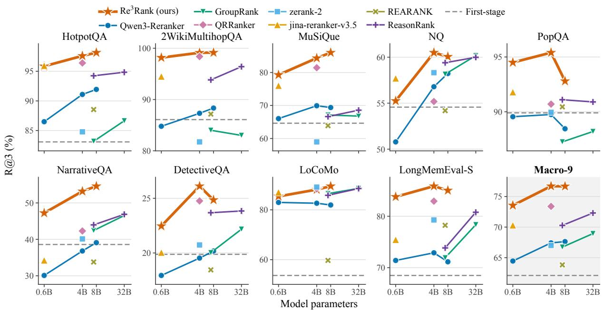  
Figure 3: Conditional R@3 (%) of rerankers across model sizes on the nine benchmarks and their macro average (Macro-9). Lines connect sizes of the same model family, and the dashed line marks the first-stage ranking of Qwen3-Embedding-8B.

## 4.3.2 Baselines

RE3RANK was compared with rerankers from the paradigms introduced in Section 2.2: the QRHead-based listwise reranker QRRanker (Li et al., 2026c), built on Qwen3-4B; the pointwise rerankers Qwen3-Reranker (Zhang et al., 2025c) at 0.6B, 4B, and 8B and zerank-2 (Pipitone et al., 2025) at 4B; the listwise reranker jina-rerankerv3.5 (Nasika et al., 2026) at 0.6B; the reasoning listwise rerankers REARANK (Zhang et al., 2025a) at 7B and ReasonRank (Liu et al., 2026) at 7B and 32B; and the generative groupwise reranker GroupRank (Long et al., 2026) at 7B and 32B. All methods reranked the same top-50 candidate pools.

## 4.4 Main Results

Configuration. Unless stated otherwise, $\mathcal { L } _ { \mathrm { r a n k } }$ in Eq. 13 used $\lambda \ = \ 2$ throughout the paper, with cutoffs $\mathcal { K } = \{ 3 , 1 0 \}$ and temperatures τ1 = $\tau _ { 2 } = 1$ for the Recall@k surrogate in Eqs. 10– 12. RE3RANK variants in this section were trained with this objective. The three scales shared the training recipe of Section 4.2 and differed only in the backbone and ${ \mathcal { H } } _ { \mathrm { R R } }$ . At inference, the generator decoded greedily with at most 1,024 trace tokens.

Overall comparison. Figure 3 compares the R@3 of rerankers across model sizes. Appendix B defines R@3 and normalized discounted cumulative gain (NDCG@10; Järvelin and Kekäläinen, 2002), shows the corresponding NDCG@10 comparison in Figure 8, and reports all results in Tables 8–11. With the 4B backbone, RE3RANK reaches 76.70 R@3 and 82.23 NDCG@10 on Macro-9, exceeding the strongest baseline, QR-Ranker, by 3.31 and 3.11 points and the first-stage ranking by 14.61 and 11.96 points.

Parameter efficiency. At each scale, RE3RANK outperforms the size-matched Qwen3-Reranker by 9.05–9.28 R@3 and 8.02–8.79 NDCG@10 points on Macro-9. The 0.6B variant already achieves higher Macro-9 R@3, R@5, and NDCG@10 than every baseline, including GroupRank-32B and ReasonRank-32B; it exceeds ReasonRank-32B by

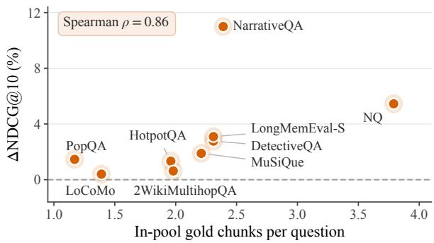  
Figure 4: NDCG@10 gain of $\mathrm { R E } ^ { 3 } \mathrm { R A N K }$ (4B) over QR-Ranker on each benchmark, measured as a difference and shown with the mean number of in-pool relevant chunks per question from Table 12.

1.24 R@3 and 1.33 NDCG@10 points. Scaling RE3RANK from 0.6B to 4B adds 3.15 R@3 and 2.56 NDCG@10 points.

Comparison with reasoning rerankers. REAR-ANK and ReasonRank also reason over the candidates before ranking, but output the ranking as a generated permutation. The stronger ReasonRank-32B reaches 72.31 R@3 and 78.34 NDCG@10 on Macro-9, 4.39 and 3.89 points below $\mathrm { R E } ^ { 3 } \mathrm { R }$ ANK (4B). This gap indicates effectiveness of probing relevance from internal attention compared to verbalizing the model’s relevance judgments as a discrete sequence of candidate identifiers which can distort them in the process.

Comparison with QRRanker. QRRanker shares the attention-mass scoring of Eq. 3 and the Qwen3- 4B backbone with $\mathrm { R E } ^ { 3 } \mathrm { R A N K }$ (4B) but uses the question as the attention query. $\mathrm { R E } ^ { 3 } \mathrm { R A N K }$ (4B) achieves higher NDCG@10 than QRRanker on all nine datasets and higher R@3 on eight, with the largest R@3 gains on NarrativeQA (+10.89), NQ (+5.32), and PopQA (+4.70). Figure 4 further shows that the NDCG@10 gain grows with the number of in-pool relevant chunks per question (Spearman $\rho = 0 . 8 6$ across the nine datasets). The two datasets with the fewest such chunks, PopQA and LoCoMo, gain less than 1.5 points, whereas NQ, which has the most, gains 5.45 points; NarrativeQA is an outlier with an 11.00-point gain. This trend is consistent with reasoning traces helping most when relevant evidence spans several chunks.

## 4.5 Ablation Study

## 4.5.1 Ablation Study of Query Construction

Table 2 compares query construction on Qwen3-4B. QR denotes query-focused retrieval with QRHeads (Section 2.3), where a single model scores candidates with the question tokens as attention queries. RR denotes reasoning-conditioned retrieval with RRHeads (Section 3), where the attention queries are the reasoning trace generated by a separate model. Without training, RR already improves over QR by 2.57 R@3 and 1.40 NDCG@10 points. After both were trained with $\mathcal { L } _ { \mathrm { r a n k } }$ , RR outperforms QR on all four metrics, by 1.44 R@1, 2.65 R@3, 2.03 R@5, and 1.90 NDCG@10 points. Appendix J analyzes which parts of the trace contribute to this advantage.

<table><tr><td>Method</td><td>R@1</td><td>R@3</td><td>R@5</td><td>N@10</td></tr><tr><td>QR (base)</td><td>41.14</td><td>69.16</td><td>77.06</td><td>76.12</td></tr><tr><td>RR (base)</td><td> ${ \bf 4 1 . 1 5 _ { + 0 . 0 1 } }$ </td><td> ${ 7 1 . 7 3 } _ { + 2 . 5 7 }$ </td><td> $\mathbf { 7 9 . 6 0 _ { \div 2 . 5 4 } }$ </td><td> $7 7 . 5 2 _ { + 1 . 4 0 }$ </td></tr><tr><td>QR (trained)</td><td>42.76</td><td> $7 4 . 0 5$ </td><td> $8 1 . 9 8$ </td><td>80.33</td></tr><tr><td>RR (trained)</td><td> $\mathbf { 4 4 . 2 0 _ { + 1 . 4 4 } }$ </td><td> $\mathbf { 7 6 . 7 0 _ { + 2 . 6 5 } }$ </td><td> $\mathbf { 8 4 . 0 1 } _ { + 2 . 0 3 }$ </td><td> $\mathbf { 8 2 . 2 3 _ { + 1 . 9 0 } }$ </td></tr></table>

Table 2: Comparison of query construction for Qwen3- 4B, reported as Macro-9 scores (%). QR uses a single model with the question tokens as attention queries and its top-2 QRHeads, (23, 10) and (15, 11). RR uses the generator’s reasoning trace as attention queries with the RRHeads (23, 10) and (21, 8). Base rows kept all weights untrained, and trained rows were trained with $\mathcal { L } _ { \mathrm { r a n k } }$ in Eq. 13. Subscripts give the gain of RR over QR under the same training setting.

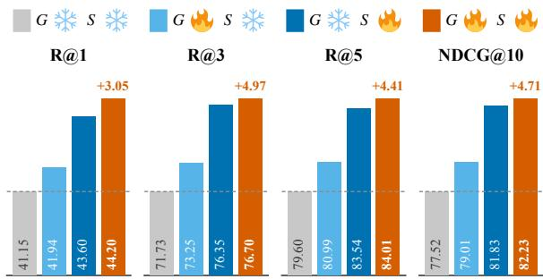  
Figure 5: Ablation of joint training for $\mathrm { R E } ^ { 3 } \mathrm { R A N K }$ (4B) trained with $\mathcal { L } _ { \mathrm { { r a n k } } }$ , reported as Macro-9 scores (%). Four settings refer to whether the generator (G) and the scorer (S) were trained or kept at their base weights.

## 4.5.2 Ablation Study of Joint Training and Ranking Objectives

Figure 5 isolates the contributions of training the generator and the scorer (4B models). Without any training, RRHeads computed on base-model reasoning traces reach 71.73 R@3. Training only the generator, with the scorer frozen, raises R@3 by 1.52 points, and training only the scorer, with the generator frozen, raises it by 4.62 points, which means that training the scorer is more effective than training the generator. Joint training achieves the best result on all four metrics and improves over scorer-only training by 0.35 R@3 and 0.40 NDCG@10 points, indicating that the generator and scorer benefit from being optimized together.

<table><tr><td>Objective</td><td>R@1</td><td>R@3</td><td>R@5</td><td>N@10</td></tr><tr><td> $\mathcal { L } _ { \mathrm { C E } }$ </td><td>43.91</td><td>76.57</td><td>83.87</td><td>82.05</td></tr><tr><td> $\mathcal { L } _ { \mathrm { C E } } , \alpha { = } 1 2$ </td><td> $4 3 . 7 7 _ { - 0 . 1 4 }$ </td><td> $7 5 . 6 0 _ { - 0 . 9 7 }$ </td><td> $8 3 . 0 9 _ { - 0 . 7 8 }$ </td><td> $8 1 . 3 5 _ { - 0 . 7 0 }$ </td></tr><tr><td> $\mathcal { L } _ { \mathrm { r s k } }$ </td><td> $4 3 . 7 9 _ { - 0 . 1 2 }$ </td><td> ${ \bf 7 6 . 8 1 _ { + 0 . 2 4 } }$ </td><td> $8 3 . 7 5 _ { - 0 . 1 2 }$ </td><td>81.99-0.06</td></tr><tr><td> $\mathcal { L } _ { \mathrm { C E } } { + } \mathcal { L } _ { \mathrm { r s k } }$ </td><td> $\pm 4 . 5 3 _ { + 0 . 6 2 }$ </td><td> $7 6 . 4 9 _ { - 0 . 0 8 }$ </td><td> $8 3 . 7 2 _ { - 0 . 1 5 }$ </td><td> $\mathbf { 8 2 . 2 8 _ { + 0 . 2 3 } }$ </td></tr><tr><td> $\mathcal { L } _ { \mathrm { C E } } { + } 2 \mathcal { L } _ { \mathrm { r s k } }$  十</td><td> $4 4 . 2 0 _ { + 0 . 2 9 }$ </td><td> $7 6 . 7 0 _ { + 0 . 1 3 }$ </td><td> $\mathbf { 8 4 . 0 1 _ { + 0 . 1 4 } }$ </td><td>82.23+0.18</td></tr><tr><td> $\mathcal { L } _ { \mathrm { C E } } { + } 4 \mathcal { L } _ { \mathrm { r s k } }$ </td><td> $4 4 . 1 5 _ { + 0 . 2 4 }$ </td><td> $7 6 . 6 2 _ { + 0 . 0 5 }$ </td><td> $8 3 . 9 8 _ { + 0 . 1 1 }$ </td><td> $8 2 . 1 9 _ { + 0 . 1 4 }$ </td></tr></table>

Table 3: Ablation of ranking objectives for $\mathrm { R E } ^ { 3 }$ RANK (4B), reported as Macro-9 scores (%). $\mathcal { L } _ { \mathrm { r s k } }$ used $\kappa =$ {3, 10} and $\tau _ { 1 } = \tau _ { 2 } = 1$ , and all rows used the score scale $\alpha = 8$ in Eq. 7 unless noted. Subscripts give the difference from the first row, with gains in green and losses in red. †Main configuration. Bold marks the best result in each column.

Table 3 compares ranking objectives for the 4B model. The Recall@k surrogate $\mathcal { L } _ { \mathrm { r s k } }$ alone yields the highest R@3 but slightly lowers the other metrics, whereas adding it to $\mathcal { L } _ { \mathrm { C E } }$ gives higher R@1 and NDCG@10 than either objective alone for every weight λ. With $\lambda = 2 , \mathcal { L } _ { \mathrm { r a n k } }$ improves over $\mathcal { L } _ { \mathrm { C E } }$ on all four metrics. Appendix D analyzes these results in detail, including the effect of the score scale α.

Appendix F compares straight-through training with reinforcement learning, which yields no notable gain over scorer-only training.

## 4.6 RE3RANK as a Memory Retrieval Component

$\boldsymbol { \mathrm { R E } } ^ { 3 }$ RANK can also serve as the retrieval component of a memory system. On LoCoMo, each reranker ordered the same 50 Qwen3-Embedding-8B candidates, and only the top-3 chunks were passed to a generator LLM for question answering; Appendix G describes the setup and reports full results. Reranking raises overall F1 over the firststage order by 16.48–18.79 points, whereas switching among GPT-4o-mini, GPT-5-mini, and GPT-6-luna as the generator changes it by at most 2.07 points. With GPT-4o-mini, all three RE3RANK variants achieve higher overall F1 than every memory framework reported by Li et al. (2026c).

## 4.7 Efficiency

Figure 6 compares accuracy with reranking time per query under batched inference. RE3RANK (0.6B) is slightly faster than QRRanker and jinareranker-v3.5 (0.26 vs. 0.28 s) while achieving higher accuracy, and the 4B and 8B variants add 3.3 R@3 points over QRRanker at 0.81 and 0.93 s per query, respectively. Truncating the reasoning trace at inference further trades accuracy for speed without retraining (Appendix H).

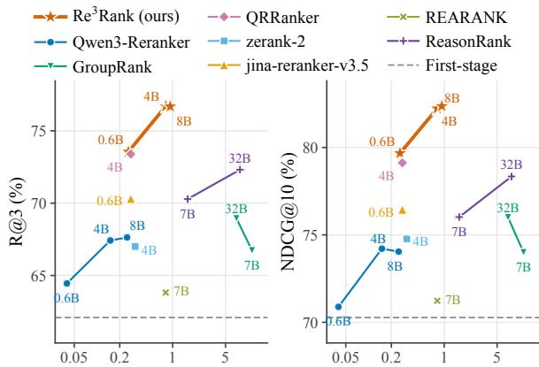  
Seconds per query (batch of 50)

Figure 6: Macro-9 R@3 (left) and NDCG@10 (right) against reranking time per query. For each test set, 50 sampled queries were submitted as one batch, and the wall-clock time until all were scored was divided by 50 and averaged over the nine test sets.
<table><tr><td>Backbone</td><td>R@1</td><td>R@3</td><td>R@5</td><td>N@10</td></tr><tr><td>Qwen3-0.6B</td><td>42.34</td><td>73.55</td><td>81.43</td><td>79.67</td></tr><tr><td>Qwen3-4B</td><td>44.20</td><td>76.70</td><td>84.01</td><td>82.23</td></tr><tr><td>Qwen3-8B</td><td>44.12</td><td>76.68</td><td>84.36</td><td>82.36</td></tr><tr><td>Gemma-4-E2B</td><td>44.00</td><td>75.44</td><td>82.99</td><td>81.47</td></tr><tr><td>Gemma-4-E4B</td><td>44.51</td><td>77.14</td><td>84.06</td><td>82.54</td></tr></table>

Table 4: Macro-9 results (%) of $\boldsymbol { \mathrm { R E } } ^ { 3 }$ RANK with Qwen3 and Gemma 4 backbones, all trained with $\mathcal { L } _ { \mathrm { r a n k } }$ . Bold marks the best result in each column.

## 4.8 Generality

RE3RANK is not tied to a particular model family. To verify this, we applied the same training procedure to Gemma-4-E2B and Gemma-4-E4B (Team et al., 2026), selecting their RRHeads as in Section 4.1. As Table 4 shows, both Gemma variants reach Macro-9 accuracy comparable to the Qwen3 variants and outperform every baseline on all four metrics. The mixed objective also improves over $\mathcal { L } _ { \mathrm { C E } }$ on both Gemma backbones, as it does on Qwen3-4B (Appendix I).

## 5 Conclusion

We presented $\boldsymbol { \mathrm { R E } ^ { 3 } }$ RANK, a listwise reranker built on reasoning-conditioned retrieval heads.

RE3RANK uses a generated reasoning trace as the attention query of a few selected RRHeads and reads relevance as continuous attention scores, without verbalizing a permutation. A straightthrough estimator carries the ranking loss through the discrete reasoning trace, so that the generator and the scorer can be trained jointly. On nine benchmarks, $\boldsymbol { \mathrm { R E } } ^ { 3 }$ RANK outperforms existing rerankers across model scales, with its smallest 0.6B variant already surpassing much larger baselines. Its design transfers across backbones, and its gains in downstream QA suggest its potential as the retrieval component of agentic memory systems.

## Limitations

The generator of $\mathrm { R E } ^ { 3 } \mathrm { R A N K }$ is optimized only through the ranking loss, so its reasoning traces carry no guarantee of linguistic quality or readability to humans. In addition, all experiments rerank a fixed pool of the top 50 candidates returned by a single first-stage retriever, Qwen3-Embedding-8B. Owing to constraints on computational resources and experimental scale, the correctness of the traces and the behavior of $\mathrm { R E } ^ { 3 }$ RANK with other retrievers or with larger candidate pools, which may exceed the context window, remain to be explored.

## References

Yoshua Bengio, Nicholas Léonard, and Aaron Courville. 2013. Estimating or propagating gradients through stochastic neurons for conditional computation. Preprint, arXiv:1308.3432.

Shijie Chen, Bernal Jimenez Gutierrez, and Yu Su. 2025. Attention in large language models yields efficient zero-shot re-rankers. In International Conference on Learning Representations, volume 2025, pages 73047–73069.

Xiaoyang Chen, Jie Liu, Haijin Liang, Haibo Shi, Jin Ma, Ben He, Yingfei Sun, and Dezhi Ye. 2026. Beyond polarization: The generative constraint of chain-of-thought in pointwise reranking. Preprint, arXiv:2608.30398.

Prateek Chhikara, Dev Khant, Saket Aryan, Taranjeet Singh, and Deshraj Yadav. 2025. Mem0: Building production-ready AI agents with scalable long-term memory. In Proceedings ofthe 28th European Conference on Artificial Intelligence (ECAI 2025), Frontiers in Artificial Intelligence and Applications, pages 2993–3000. SAGE Publications.

Yung-Sung Chuang, Wei Fang, Shang-Wen Li, Wen-tau Yih, and James Glass. 2023. Expand, rerank, and retrieve: Query reranking for open-domain question

answering. In Findings ofthe Associationfor Computational Linguistics: ACL 2023, pages 12131–12147, Toronto, Canada. Association for Computational Linguistics.

Jizhan Fang, Xinle Deng, Haoming Xu, Ziyan Jiang, Yuqi Tang, Ziwen Xu, Shumin Deng, Yunzhi Yao, Mengru Wang, Shuofei Qiao, Huajun Chen, and Ningyu Zhang. 2026. LightMem: Lightweight and efficient memory-augmented generation. In International Conference on Learning Representations, volume 2026, pages 98706–98729.

Revanth Gangi Reddy, JaeHyeok Doo, Yifei Xu, Md Arafat Sultan, Deevya Swain, Avirup Sil, and Heng Ji. 2024. FIRST: Faster improved listwise reranking with single token decoding. In Proceedings of the 2024 Conference on Empirical Methods in Natural Language Processing, pages 8642–8652, Miami, Florida, USA. Association for Computational Linguistics.

Michael Glass, Gaetano Rossiello, Md Faisal Mahbub Chowdhury, Ankita Rajaram Naik, Pengshan Cai, and Alfio Gliozzo. 2022. Re2G: Retrieve, rerank, generate. In Proceedings of the 2022 Conference of the North American Chapter of the Association for Computational Linguistics: Human Language Technologies, pages 2701–2715, Seattle, United States. Association for Computational Linguistics.

Bernal Jiménez Gutiérrez, Yiheng Shu, Weijian Qi, Sizhe Zhou, and Yu Su. 2025. From RAG to memory: Non-parametric continual learning for large language models. In Proceedings of the 42nd International Conference on Machine Learning, volume 267 of Proceedings of Machine Learning Research, pages 21497–21515. PMLR.

Kelvin Guu, Kenton Lee, Zora Tung, Panupong Pasupat, and Mingwei Chang. 2020. Retrieval augmented language model pre-training. In Proceedings of the 37th International Conference on Machine Learning, volume 119 of Proceedings of Machine Learning Research, pages 3929–3938. PMLR.

Xanh Ho, Anh-Khoa Duong Nguyen, Saku Sugawara, and Akiko Aizawa. 2020. Constructing a multihop QA dataset for comprehensive evaluation of reasoning steps. In Proceedings of the 28th International Conference on Computational Linguistics, pages 6609–6625, Barcelona, Spain (Online). International Committee on Computational Linguistics.

Yuyang Hu, Jiongnan Liu, Jiejun Tan, Yutao Zhu, and Zhicheng Dou. 2026. Memory matters more: Eventcentric memory as a logic map for agent searching and reasoning. In Findings of the Association for Computational Linguistics: ACL 2026, pages 22389– 22407, San Diego, California, United States. Association for Computational Linguistics.

Gautier Izacard and Edouard Grave. 2021. Leveraging passage retrieval with generative models for open domain question answering. In Proceedings ofthe 16th

Conference of the European Chapter of the Associationfor Computational Linguistics: Main Volume, pages 874–880, Online. Association for Computational Linguistics.

Kalervo Järvelin and Jaana Kekäläinen. 2002. Cumulated gain-based evaluation of ir techniques. ACM Trans. Inf. Syst., 20(4):422–446.

Hanqi Jiang, Junhao Chen, Yi Pan, Ling Chen, Weihang You, Yifan Zhou, Ruidong Zhang, Yohannes Abate, and Tianming Liu. 2026. Synapse: Empowering LLM agents with episodic-semantic memory via spreading activation. In Findings ofthe Association for Computational Linguistics: ACL 2026, pages 22020–22036, San Diego, California, United States. Association for Computational Linguistics.

Bowen Jin, Hansi Zeng, Zhenrui Yue, Jinsung Yoon, Sercan O Arik, Dong Wang, Hamed Zamani, and Jiawei Han. 2025. Search-R1: Training LLMs to reason and leverage search engines with reinforcement learning. In Second Conference on Language Modeling.

Jiazheng Kang, Mingming Ji, Zhe Zhao, and Ting Bai. 2025. Memory OS of AI agent. In Proceedings ofthe 2025 Conference on Empirical Methods in Natural Language Processing, pages 25961–25970, Suzhou, China. Association for Computational Linguistics.

Vladimir Karpukhin, Barlas Oguz, Sewon Min, Patrick Lewis, Ledell Wu, Sergey Edunov, Danqi Chen, and Wen-tau Yih. 2020. Dense passage retrieval for opendomain question answering. In Proceedings of the 2020 Conference on Empirical Methods in Natural Language Processing (EMNLP), pages 6769–6781, Online. Association for Computational Linguistics.

Tomáš Kociský, Jonathan Schwarz, Phil Blunsom, Chrisˇ Dyer, Karl Moritz Hermann, Gábor Melis, and Edward Grefenstette. 2018. The narrativeqa reading comprehension challenge. Transactions ofthe Associationfor Computational Linguistics, 6:317–328.

Tom Kwiatkowski, Jennimaria Palomaki, Olivia Redfield, Michael Collins, Ankur Parikh, Chris Alberti, Danielle Epstein, Illia Polosukhin, Jacob Devlin, Kenton Lee, Kristina Toutanova, Llion Jones, Matthew Kelcey, Ming-Wei Chang, Andrew M. Dai, Jakob Uszkoreit, Quoc Le, and Slav Petrov. 2019. Natural questions: A benchmark for question answering research. Transactions of the Association for Computational Linguistics, 7:452–466.

Patrick Lewis, Ethan Perez, Aleksandra Piktus, Fabio Petroni, Vladimir Karpukhin, Naman Goyal, Heinrich Küttler, Mike Lewis, Wen-tau Yih, Tim Rocktäschel, Sebastian Riedel, and Douwe Kiela. 2020. Retrieval-augmented generation for knowledgeintensive NLP tasks. In Advances in Neural Information Processing Systems, volume 33, pages 9459– 9474. Curran Associates, Inc.

Jiarui Li, Ye Yuan, and Zehua Zhang. 2024. Enhancing LLM factual accuracy with rag to counter hallucinations: A case study on domain-specific queries in private knowledge-bases. Preprint, arXiv:2403.10446.

Kai Li, Xuanqing Yu, Ziyi Ni, Yi Zeng, Yao Xu, Zheqing Zhang, Xin Li, Jitao Sang, Xiaogang Duan, Xuelei Wang, Chengbao Liu, and Jie Tan. 2026a. TiMem: Temporal-hierarchical memory consolidation for long-horizon conversational agents. In Findings ofthe Associationfor Computational Linguistics: ACL 2026, pages 21700–21720, San Diego, California, United States. Association for Computational Linguistics.

Kenneth Li, Oam Patel, Fernanda Viégas, Hanspeter Pfister, and Martin Wattenberg. 2023. Inference-time intervention: Eliciting truthful answers from a language model. In Advances in Neural Information Processing Systems, volume 36, pages 41451–41530. Curran Associates, Inc.

Yuqing Li, Jiangnan Li, Zheng Lin, Ziyan Zhou, Junjie Wu, Weiping Wang, Jie Zhou, and Mo Yu. 2026b. Mindscape-aware retrieval augmented generation for improved long context understanding. Preprint, arXiv:2512.17220.

Yuqing Li, Jiangnan Li, Mo Yu, Guoxuan Ding, Yanyu Chen, Zheng Lin, Wei Zhang, and Jie Zhou. 2026c. Query-focused and memory-aware reranker for long context processing. Preprint, arXiv:2602.12192.

Wenhan Liu, Xinyu Ma, Weiwei Sun, Yutao Zhu, Yuchen Li, Dawei Yin, and Zhicheng Dou. 2026. ReasonRank: Empowering passage ranking with strong reasoning ability. In Proceedings ofthe 64th Annual Meeting ofthe Associationfor Computational Linguistics (Volume 1: Long Papers), pages 22007– 22031, San Diego, California, United States. Association for Computational Linguistics.

Meixiu Long, Duolin Sun, Dan Yang, Yihan Jiao, Lei Liu, Jiahai Wang, Binbin Hu, Yue Shen, Jie Feng, Zhehao Tan, Junjie Wang, Lianzhen Zhong, Jian Wang, Peng Wei, and Jinjie Gu. 2026. GroupRank: A groupwise paradigm for effective and efficient passage reranking with LLMs. In Findings of the Associationfor Computational Linguistics: ACL 2026, pages 25165–25186, San Diego, California, United States. Association for Computational Linguistics.

Qin Luo, Erjia Chen, Zhao Shi, and Bang Wang. 2025. Anchor-based pairwise comparison via large language model for recommendation reranking. In Proceedings of the 34th ACM International Conference on Information and Knowledge Management, CIKM ’25, page 5001–5005, New York, NY, USA. Association for Computing Machinery.

Wenquan Ma, Jiayan Nan, and WenLong Wu. 2026. What deserves memory: Adaptive memory distillation for LLM agents. In Proceedings of the 64th Annual Meeting of the Association for Computational

Linguistics (Volume 1: Long Papers), pages 34789– 34812, San Diego, California, United States. Association for Computational Linguistics.

Adyasha Maharana, Dong-Ho Lee, Sergey Tulyakov, Mohit Bansal, Francesco Barbieri, and Yuwei Fang. 2024. Evaluating very long-term conversational memory of LLM agents. In Proceedings ofthe 62nd Annual Meeting ofthe Associationfor Computational Linguistics (Volume 1: Long Papers), pages 13851– 13870, Bangkok, Thailand. Association for Computational Linguistics.

Alex Mallen, Akari Asai, Victor Zhong, Rajarshi Das, Daniel Khashabi, and Hannaneh Hajishirzi. 2023. When not to trust language models: Investigating effectiveness of parametric and non-parametric memories. In Proceedings of the 61st Annual Meeting of the Association for Computational Linguistics (Volume 1: Long Papers), pages 9802–9822, Toronto, Canada. Association for Computational Linguistics.

Christina Nasika, Feng Wang, Antonis Krasakis, and Han Xiao. 2026. jina-reranker-v3.5: An efficient listwise reranker with hybrid attention and selfdistillation. Preprint, arXiv:2607.18152.

Rodrigo Nogueira and Kyunghyun Cho. 2020. Passage re-ranking with BERT. Preprint, arXiv:1901.04085.

Egor Pakhomov, Erik Nijkamp, and Caiming Xiong. 2025. Convomem benchmark: Why your first 150 conversations don’t need rag. Preprint, arXiv:2511.10523.

Yash Patel, Giorgos Tolias, and Jiˇrí Matas. 2022. Recall@k surrogate loss with large batches and similarity mixup. In Proceedings ofthe IEEE/CVF Conference on Computer Vision and Pattern Recognition, pages 7502–7511.

Nicholas Pipitone, Ghita Houir Alami, Advaith Avadhanam, Anton Kaminskyi, and Ashley Khoo. 2025. zELO: ELO-inspired training method for rerankers and embedding models. Preprint, arXiv:2509.12541.

Zhen Qin, Rolf Jagerman, Kai Hui, Honglei Zhuang, Junru Wu, Le Yan, Jiaming Shen, Tianqi Liu, Jialu Liu, Donald Metzler, Xuanhui Wang, and Michael Bendersky. 2024. Large language models are effective text rankers with pairwise ranking prompting. In Findings ofthe Associationfor Computational Linguistics: NAACL 2024, pages 1504–1518, Mexico City, Mexico. Association for Computational Linguistics.

Preston Rasmussen, Pavlo Paliychuk, Travis Beauvais, Jack Ryan, and Daniel Chalef. 2025. Zep: A temporal knowledge graph architecture for agent memory. Preprint, arXiv:2501.13956.

Ruiyang Ren, Yuhao Wang, Kun Zhou, Wayne Xin Zhao, Wenjie Wang, Jing Liu, Ji-Rong Wen, and Tat-Seng Chua. 2025. Self-calibrated listwise reranking with large language models. In Proceedings of the ACM on Web Conference 2025, WWW ’25, page

3692–3701, New York, NY, USA. Association for Computing Machinery.

John Schulman, Philipp Moritz, Sergey Levine, Michael Jordan, and Pieter Abbeel. 2018. High-dimensional continuous control using generalized advantage estimation. Preprint, arXiv:1506.02438.

John Schulman, Filip Wolski, Prafulla Dhariwal, Alec Radford, and Oleg Klimov. 2017. Proximal policy optimization algorithms. Preprint, arXiv:1707.06347.

Zhihong Shao, Peiyi Wang, Qihao Zhu, Runxin Xu, Junxiao Song, Xiao Bi, Haowei Zhang, Mingchuan Zhang, Y. K. Li, Y. Wu, and Daya Guo. 2024. DeepSeekMath: Pushing the limits of mathematical reasoning in open language models. Preprint, arXiv:2402.03300.

Weiwei Sun, Lingyong Yan, Xinyu Ma, Shuaiqiang Wang, Pengjie Ren, Zhumin Chen, Dawei Yin, and Zhaochun Ren. 2023. Is ChatGPT good at search? investigating large language models as re-ranking agents. In Proceedings of the 2023 Conference on Empirical Methods in Natural Language Processing, pages 14918–14937, Singapore. Association for Computational Linguistics.

Yifan Sun, Changmao Cheng, Yuhan Zhang, Chi Zhang, Liang Zheng, Zhongdao Wang, and Yichen Wei. 2020. Circle loss: A unified perspective of pair similarity optimization. In Proceedings of the IEEE/CVF Conference on Computer Vision and Pattern Recognition (CVPR).

Dehao Tao, Guoliang Ma, Yongfeng Huang, and Minghu Jiang. 2026. Membox: Weaving topic continuity into long-range memory for LLM agents. Preprint, arXiv:2601.03785.

Gemma Team, Sherif El Abd, Vaibhav Aggarwal, Robin Algayres, Alek Andreev, Olivier Bachem, Ian Ballantyne, Cormac Brick, Victor Carbune, Michelle˘ Casbon, Mayank Chaturvedi, Aditya Chawla, Victor Cotruta, Alice Coucke, Phil Culliton, Robert Dadashi, Lucas Dixon, Mohamed Elhawaty, Utku Evci, and 304 others. 2026. Gemma 4 technical report. Preprint, arXiv:2607.02770.

Harsh Trivedi, Niranjan Balasubramanian, Tushar Khot, and Ashish Sabharwal. 2022. MuSiQue: Multihop questions via single-hop question composition. Transactions of the Association for Computational Linguistics, 10:539–554.

Chien-Sheng Wu, Andrea Madotto, Wenhao Liu, Pascale Fung, and Caiming Xiong. 2022. QAConv: Question answering on informative conversations. In Proceedings of the 60th Annual Meeting of the Association for Computational Linguistics (Volume 1: Long Papers), pages 5389–5411, Dublin, Ireland. Association for Computational Linguistics.

Di Wu, Hongwei Wang, Wenhao Yu, Yuwei Zhang, Kai-Wei Chang, and Dong Yu. 2025a. LongMemEval:

Benchmarking chat assistants on long-term interactive memory. In The Thirteenth International Conference on Learning Representations.

Wenhao Wu, Yizhong Wang, Guangxuan Xiao, Hao Peng, and Yao Fu. 2025b. Retrieval head mechanistically explains long-context factuality. In The Thirteenth International Conference on Learning Representations.

Wujiang Xu, Zujie Liang, Kai Mei, Hang Gao, Juntao Tan, and Yongfeng Zhang. 2025a. A-Mem: Agentic memory for LLM agents. In Advances in Neural Information Processing Systems, volume 38, Main Conference, pages 17577–17604. Curran Associates, Inc.

Zhe Xu, Jiasheng Ye, Xiaoran Liu, Xiangyang Liu, Tianxiang Sun, Zhigeng Liu, Qipeng Guo, Linlin Li, Qun Liu, Xuanjing Huang, and Xipeng Qiu. 2025b. DetectiveQA: Evaluating long-context reasoning on detective novels. In Workshop on Reasoning and Planningfor Large Language Models.

Ruiyi Yan, Zhuoyuan Mao, and Yiwen Guo. 2026. MemDefrag: Latent memory defragmentation for large language models. Preprint, arXiv:2607.05969.

An Yang, Anfeng Li, Baosong Yang, Beichen Zhang, Binyuan Hui, Bo Zheng, Bowen Yu, Chang Gao, Chengen Huang, Chenxu Lv, Chujie Zheng, Dayiheng Liu, Fan Zhou, Fei Huang, Feng Hu, Hao Ge, Haoran Wei, Huan Lin, Jialong Tang, and 41 others. 2025. Qwen3 technical report. Preprint, arXiv:2505.09388.

Qingran Yang, Wenxuan Zhang, Yuting Wang, Xue Li, and Lanshun Nie. 2026. CRED: Calibrated relational enhanced distillation for llm-based pointwise reranking. In Proceedings ofthe 49th International ACM SIGIR Conference on Research and Development in Information Retrieval, SIGIR ’26, page 4311–4315, New York, NY, USA. Association for Computing Machinery.

Zhengzhe Yang and Jinho D. Choi. 2019. FriendsQA: Open-domain question answering on TV show transcripts. In Proceedings ofthe 20th Annual SIGdial Meeting on Discourse and Dialogue, pages 188–197, Stockholm, Sweden. Association for Computational Linguistics.

Zhilin Yang, Peng Qi, Saizheng Zhang, Yoshua Bengio, William Cohen, Ruslan Salakhutdinov, and Christopher D. Manning. 2018. HotpotQA: A dataset for diverse, explainable multi-hop question answering. In Proceedings of the 2018 Conference on Empirical Methods in Natural Language Processing, pages 2369–2380, Brussels, Belgium. Association for Computational Linguistics.

Howard Yen, Tianyu Gao, Minmin Hou, Ke Ding, Daniel Fleischer, Peter Izsak, Moshe Wasserblat, and Danqi Chen. 2025. HELMET: How to evaluate longcontext language models effectively and thoroughly. Preprint, arXiv:2410.02694.

Yang Yue, Zhiqi Chen, Rui Lu, Andrew Zhao, Zhaokai Wang, Yang Yue, Shiji Song, and Gao Huang. 2025. Does reinforcement learning really incentivize reasoning capacity in llms beyond the base model? In Advances in Neural Information Processing Systems, volume 38, Main Conference, pages 57654–57689. Curran Associates, Inc.

Le Zhang, Bo Wang, Xipeng Qiu, Siva Reddy, and Aishwarya Agrawal. 2025a. REARANK: Reasoning re-ranking agent via reinforcement learning. In Proceedings ofthe 2025 Conference on Empirical Methods in Natural Language Processing, pages 2458– 2471, Suzhou, China. Association for Computational Linguistics.

Wuwei Zhang, Fangcong Yin, Howard Yen, Danqi Chen, and Xi Ye. 2025b. Query-focused retrieval heads improve long-context reasoning and re-ranking. In Proceedings of the 2025 Conference on Empirical Methods in Natural Language Processing, pages 23791–23805, Suzhou, China. Association for Computational Linguistics.

Yanzhao Zhang, Mingxin Li, Dingkun Long, Xin Zhang, Huan Lin, Baosong Yang, Pengjun Xie, An Yang, Dayiheng Liu, Junyang Lin, Fei Huang, and Jingren Zhou. 2025c. Qwen3 Embedding: Advancing text embedding and reranking through foundation models. Preprint, arXiv:2506.05176.

Yinxin Zhou, Qin Luo, Bin Feng, and Bang Wang. 2025. Large language models for reranking: A survey. TechRxiv, 2025(1113).

Huhai Zou, Tianhao Sun, Chuanjiang He, Yu Tian, Zhenyang Li, Li Jin, Nayu Liu, Jiang Zhong, and Kaiwen Wei. 2026. ES-Mem: Event segmentation-based memory for long-term dialogue agents. Preprint, arXiv:2601.07582.

## A RRHead Selection for Qwen3-4B

This appendix details the head scan behind the Qwen3-4B RRHeads {(23, 10), (21, 8)} reported in Section 4.1 and examines why two heads suffice. All head indices are zero-based (layer, head) pairs.

Seed set. $\mathcal { D } _ { \mathrm { s e e d } }$ contained 400 instances each from the MuSiQue and NarrativeQA portions of the training mixture (Section 4.2). Instances were sampled with a fixed random seed from questions whose 50-candidate pool contains at least one relevant candidate, giving 2.31 relevant candidates per question on average. As training questions, they do not overlap with the evaluation questions in Section 4.3.1. On $\mathcal { D } _ { \mathrm { s e e d } }$ , the first-stage order reaches 51.78 R@3 and 64.14 NDCG@10.

Scan. A single forward pass over x ∥ u yielded, for every head, the attention weights $\ddot { A } _ { t , j } ^ { ( l , h ) }$ (Section 2.3) from the trace positions $\mathcal { Q } _ { u } ,$ which were converted into candidate masses by Eq. 3. Candidate spans $\mathcal { T } _ { i }$ covered only the candidate text, excluding index markers and separators. Qwen3-4B uses grouped-query attention with 32 query heads and 8 key–value heads per layer; h indexes query heads.

<table><tr><td>Rank</td><td>Head</td><td>Gold mass</td><td>Gold share</td><td>R@3</td><td>N@10</td></tr><tr><td></td><td></td><td>0.1813</td><td>0.395</td><td>59.42</td><td></td></tr><tr><td>1 2</td><td>(23,10) (21,8)</td><td>0.1669</td><td>0.332</td><td>59.24</td><td>70.48 69.78</td></tr><tr><td>3</td><td>(24,29)</td><td>0.1526</td><td>0.336</td><td>59.14</td><td>70.01</td></tr><tr><td>4</td><td>(3,5)</td><td>0.1487</td><td>0.178</td><td>52.32</td><td>60.91</td></tr><tr><td>5</td><td>(20,15)</td><td>0.1412</td><td>0.330</td><td>58.73</td><td>68.75</td></tr><tr><td>6</td><td>(15,11)</td><td>0.1386</td><td>0.297</td><td>59.42</td><td>70.14</td></tr><tr><td>7</td><td>(24,23)</td><td>0.1328</td><td>0.325</td><td>55.30</td><td>66.44</td></tr><tr><td>8</td><td>(24,5)</td><td>0.1181</td><td>0.323</td><td>53.75</td><td>66.29</td></tr><tr><td>9</td><td>(21,10)</td><td>0.1120</td><td>0.358</td><td>58.92</td><td>69.10</td></tr><tr><td>10</td><td>(20,30)</td><td>0.1113</td><td>0.297</td><td>54.59</td><td>66.09</td></tr><tr><td>11</td><td>(24,13)</td><td>0.1100</td><td>0.318</td><td>58.35</td><td>68.32</td></tr><tr><td>12</td><td>(23,30)</td><td>0.1079</td><td>0.341</td><td>57.97</td><td>68.72</td></tr></table>

Table 5: Top-12 Qwen3-4B heads on $\mathcal { D } _ { \mathrm { s e e d } }$ , sorted by gold mass. R@3 and N@10 are zero-shot single-head Recall@3 and NDCG@10 (%). Bold marks the two highest gold masses, whose heads form $\mathcal { H } _ { \mathrm { R R } }$

Per-head statistics. Besides the gold mass $\gamma ^ { ( l , h ) }$ in Eq. 18, each head was characterized by its gold share and its zero-shot ranking quality. The gold share averages $\textstyle \sum _ { i \in \mathcal { P } } m _ { i } ^ { ( l , h ) } { \big / } \bar { \sum _ { i = 1 } ^ { C } } ^ { \cdot } m _ { i } ^ { ( l , h ) }$ over $\mathcal { D } _ { \mathrm { s e e d } }$ and measures how concentrated the candidate-directed attention is on relevant candidates. Zero-shot Recall@3 (Eq. 2 with $k = 3 )$ and binary NDCG@10 were obtained by ranking candidates directly by $m _ { i } ^ { ( l , h ) }$

Selection. ${ \mathcal { H } } _ { \mathrm { R R } }$ consisted of the two heads with the highest gold mass, (23, 10) and (21, 8). Figure 7 shows $\bar { \gamma } ^ { ( l , h ) }$ for all 1,152 heads, and Table 5 lists the twelve heads with the highest gold mass.

Number of heads. Summing more heads does not reliably improve zero-shot ranking. Table 6 sums the masses of the top-n heads by gold mass, and differences are tested with a paired bootstrap over seed instances (2,000 resamples, stratified by dataset). The top two reach 59.96 R@3 against 59.42 for (23, 10) alone, a difference that is not significant (95% interval $[ - 0 . 3 4 , + 1 . 3 9 ] )$ . The top four reach the highest R@3, 60.93, but their gain over the top two is not significant either $( [ - 0 . 0 4 , + 2 . 0 5 ] )$ and comes with a slightly lower NDCG@10. Beyond four heads, both metrics decline: the top 16 heads, the number used by QR-Head (Zhang et al., 2025b), fall 1.40 R@3 points below the top two $( [ - 2 . 4 1 , - 0 . 4 6 ] )$ , and the top 64 fall 4.38 points below $( [ - 6 . 0 5 , - 2 . 7 3 ] )$ . Two heads therefore perform on par with the best number of heads, whereas adding many more heads hurts ranking.

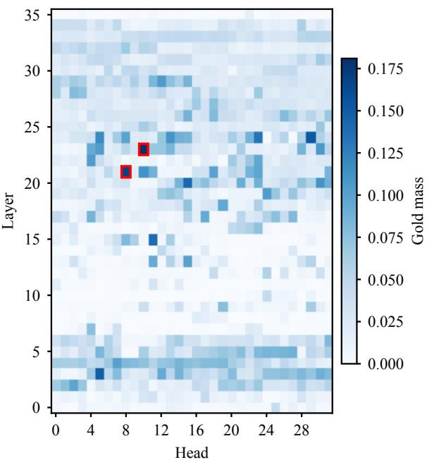

Figure 7: Gold mass $\gamma ^ { ( l , h ) }$ of all $3 6 \times 3 2$ Qwen3-4B heads on $\mathcal { D } _ { \mathrm { s e e d } }$ . Red boxes mark the selected RRHeads (23, 10) and (21, 8).
<table><tr><td>n</td><td>1</td><td>2</td><td>4</td><td>8</td><td>16</td><td>32</td><td>64</td></tr><tr><td>R@3</td><td>59.42</td><td>59.96</td><td>60.93</td><td>59.58</td><td>58.56</td><td>58.14</td><td>55.58</td></tr><tr><td>N@10</td><td>70.48</td><td>70.71</td><td>70.55</td><td>70.42</td><td>69.35</td><td>67.92</td><td>63.99</td></tr></table>

Table 6: Zero-shot R@3 and NDCG@10 (%) of Qwen3- 4B on $\mathcal { D } _ { \mathrm { s e e d } }$ when the masses of the top-n heads by gold mass are summed. $n = 1$ is (23, 10) alone, and $n = 2$ gives $\mathcal { H } _ { \mathrm { R R } }$ . Bold marks the best value in each row.

Redundancy among heads. Additional heads contribute little because the strongest heads largely duplicate one another. For each seed instance and each of its relevant candidates, a head hits the candidate if it ranks the candidate among the top three of the 50 candidates, and misses it otherwise. Comparing which relevant candidates two heads hit shows whether they locate the same evidence, and Table 7 compares every other head with (23, 10) in this way; (23, 10) itself hits 55.1% of the 1,848 relevant candidates in $\mathcal { D } _ { \mathrm { s e e d } }$ . Whatever their strength, other heads hit only 8.1–9.2% of the relevant candidates that (23, 10) misses, whereas the first-stage ranking, a different relevance signal, hits 23.6%; a head as accurate as (23, 10) but with independent errors would hit about 55%. Conversely, the weaker a head is, the more of its misses (23, 10) hits, rising from 10.9% for the 15 strongest heads to 52.9% for the weakest 896, close to the 55.2% for a random ranking. Strong heads therefore miss the same candidates as (23, 10), and most hits of weak heads are also hits of (23, 10).

<table><tr><td colspan="4">Ranking #Heads Shared Gain Covered</td></tr><tr><td>Rank 1–16 (excl. (23, 10))</td><td>15 92.6</td><td>9.0</td><td>10.9</td></tr><tr><td>Rank 17–64</td><td>48 91.9</td><td>9.2</td><td>18.8</td></tr><tr><td>Rank 65–256</td><td>192 88.0</td><td>9.0</td><td>38.2</td></tr><tr><td>Rank 257–1152</td><td>896 74.1</td><td>8.1</td><td>52.9</td></tr><tr><td>Random ranking</td><td>一 54.5</td><td>6.2</td><td>55.2</td></tr><tr><td>First-stage</td><td>一 77.6</td><td>23.6</td><td>35.0</td></tr></table>

Table 7: Overlap of top-3 hits between (23, 10) and other rankings on $\mathcal { D } _ { \mathrm { s e e d } }$ (%). Heads other than (23, 10) are grouped by their rank in single-head R@3 among all 1,152 heads, and each group reports the median over its heads; the random ranking averages 20 random orders. Shared is the share of a ranking’s hits that (23, 10) also hits, Gain is the share of the misses of (23, 10) that the ranking hits, and Covered is the share of the ranking’s misses that (23, 10) hits.

## B Full Reranking Results

Tables 8–11 report conditional R@1, R@3, R@5, and NDCG@10 of each reranker on each benchmark, together with the gap between the best RE3RANK variant and the best baseline and its statistical significance. Figure 8 plots NDCG@10 across model sizes in the format of Figure 3.

Evaluation protocol. Every reranker received the same 50 first-stage candidates per question. For a question, let $n _ { \mathrm { i n } }$ be the number of relevant chunks among its candidates. Questions with $n _ { \mathrm { i n } } = 0$ were excluded, so all metrics are conditional on the candidate pool. Let $y _ { ( t ) } \in \{ 0 , 1 \}$ be the relevance label of the candidate ranked at position t by a reranker. Recall@k, which matches Eq. 2, and normalized discounted cumulative gain (NDCG@10) with binary relevance (Järvelin and Kekäläinen, 2002) are

$$
\begin{array} { c } { { \mathrm { R @ } k = \displaystyle \frac { 1 } { n _ { \mathrm { i n } } } \sum _ { t = 1 } ^ { k } y _ { ( t ) } , } } \\ { { \mathrm { N D C G @ 1 0 } = \displaystyle \frac { \sum _ { t = 1 } ^ { 1 0 } y _ { ( t ) } / \log _ { 2 } ( t + 1 ) } { \sum _ { t = 1 } ^ { \operatorname* { m i n } ( 1 0 , n _ { \mathrm { i n } } ) } 1 / \log _ { 2 } ( t + 1 ) } , } } \end{array}
$$

where the numerator is the discounted cumulative gain (DCG) of the reranked list and the denominator is the DCG of an ideal ranking that places all in-pool relevant chunks first. Each metric was averaged over questions within a dataset, and Macro-9 is the unweighted mean over the nine datasets.

Baseline inference. QRRanker was evaluated with its official release and evaluation code.5 Qwen3-Reranker followed its official prompt and scored each question–candidate pair by the probability of “yes” against “no” at the final position.6 zerank-2 was scored by its raw “Yes” logit.7 jinareranker-v3.5 scored all 50 candidates in a single forward pass through its listwise interface. 8 GroupRank scored candidates in groups of 10 and averaged the scores over two shuffled passes.9 REARANK and ReasonRank followed their official inference settings.10

Significance testing. The significance row tests whether the gap in the $\Delta$ row is reliable, comparing the best $\mathrm { R E } ^ { 3 } \mathrm { R A N K }$ variant with the best baseline on the same questions. A two-sided paired randomization test was applied to their per-question scores: the sign of each question’s score difference was flipped at random 100,000 times, and the p-value is the fraction of these flips whose mean difference is at least as large in magnitude as the observed one. The test does not assume normally distributed differences, which suits the discrete perquestion values of Recall@k. Markers denote \*\*\* $p \ < \ 0 . 0 0 1 , \ast \ast _ { \mathit { p } } \ < \ 0 . 0 1 , \ast \ { p } \ < \ 0 . 0 5$ , and n.s. $p \geq 0 . 0 5$ , without correction for multiple comparisons.

Significance results. Of the 36 dataset-level columns, 24 show a significant difference, 15 at $p < 0 . 0 0 1$ , 6 at $p < 0 . 0 1$ , and 3 at $p < 0 . 0 5$ , and all four Macro-9 columns are significant. Every significant difference favors RE3RANK.

<table><tr><td colspan="16">Wikipedia multi-hop</td></tr><tr><td rowspan="2">Method</td><td colspan="4">HotpotQA</td><td colspan="4">2WikiMultihopQA</td><td colspan="4">MuSiQue</td></tr><tr><td colspan="4">R@1 R@3</td><td colspan="4">R@1 R@3 R@5</td><td colspan="4">R@1 R@3 R@5</td></tr><tr><td>First-stage</td><td>46.75</td><td>83.08</td><td>R@5 90.29</td><td>N@10 89.40</td><td>53.42</td><td>86.08</td><td>89.05</td><td>N@10 91.38</td><td>41.55</td><td>64.62</td><td>73.83</td><td>N@10 76.42</td></tr><tr><td>QRRanker (4B)</td><td>49.05</td><td>96.40</td><td>98.80</td><td>96.62</td><td>54.22</td><td>98.38</td><td>99.58</td><td>98.87</td><td>44.58</td><td>81.44</td><td>89.67</td><td>88.84</td></tr><tr><td>Qwen3-Reranker (0.6B)</td><td>48.10</td><td>86.49</td><td>91.84</td><td>91.23</td><td>54.20</td><td>84.78</td><td>87.66</td><td>90.38</td><td>41.29</td><td>66.02</td><td>73.69</td><td>74.91</td></tr><tr><td>Qwen3-Reranker (4B)</td><td>49.10</td><td>91.09</td><td>96.05</td><td>94.49</td><td>53.85</td><td>87.31</td><td>90.19</td><td>92.28</td><td>42.25</td><td>69.92</td><td>78.64</td><td>79.71</td></tr><tr><td>Qwen3-Reranker (8B)</td><td>48.90</td><td>91.94</td><td>95.65</td><td>94.41</td><td>51.45</td><td>88.33</td><td>90.99</td><td>91.92</td><td>39.71</td><td>69.38</td><td>79.25</td><td>78.71</td></tr><tr><td>zerank-2 (4B)</td><td>45.70</td><td>84.78</td><td>92.64</td><td>90.36</td><td>44.67</td><td>81.73</td><td>87.62</td><td>86.58</td><td>34.94</td><td>58.96</td><td>70.71</td><td>70.90</td></tr><tr><td>jina-reranker-v3.5 (0.6B)</td><td>49.25</td><td>95.95</td><td>98.30</td><td>96.57</td><td>54.90</td><td>94.51</td><td>97.12</td><td>97.50</td><td>45.28</td><td>76.02</td><td>83.01</td><td>84.71</td></tr><tr><td>GroupRank (7B)</td><td>44.69</td><td>83.18</td><td>92.44</td><td>89.13</td><td>47.38</td><td>84.00</td><td>90.30</td><td>88.23</td><td>38.93</td><td>67.11</td><td>77.20</td><td>77.22</td></tr><tr><td>GroupRank (32B)</td><td>45.45</td><td>86.64</td><td>93.69</td><td>90.65</td><td>45.52</td><td>83.00</td><td>89.96</td><td>87.21</td><td>37.77</td><td>66.78</td><td>78.38</td><td>77.75</td></tr><tr><td>REARANK (7B)</td><td>46.75</td><td>88.54</td><td>94.84</td><td>92.18</td><td>47.09</td><td>87.16</td><td>92.27</td><td>90.46</td><td>34.77</td><td>63.88</td><td>75.67</td><td>74.39</td></tr><tr><td>ReasonRank (7B)</td><td>48.60</td><td>94.24</td><td>96.75</td><td>95.29</td><td>51.77</td><td>93.83</td><td>95.08</td><td>94.68</td><td>38.18</td><td>66.63</td><td>74.24</td><td>74.87</td></tr><tr><td>ReasonRank (32B)</td><td>49.10</td><td>94.84</td><td>97.40</td><td>95.77</td><td>53.20</td><td>96.41</td><td>97.24</td><td>97.05</td><td>38.97</td><td>68.57</td><td>76.67</td><td>77.49</td></tr><tr><td>RE3RANK (0.6B)</td><td>48.85</td><td>95.85</td><td>98.45</td><td>96.38</td><td>54.17</td><td>98.17</td><td>99.90</td><td>98.90</td><td>44.94</td><td>79.28</td><td>88.15</td><td>88.36</td></tr><tr><td>RE3RANK (4B)</td><td>50.35</td><td>97.60</td><td>99.25</td><td>97.95</td><td>54.57</td><td>99.13</td><td>99.95</td><td>99.50</td><td>45.71</td><td>84.35</td><td>91.43</td><td>90.73</td></tr><tr><td>RE3RANK (8B)</td><td>50.00</td><td>98.15</td><td>99.30</td><td>98.03</td><td>54.48</td><td>99.15</td><td>99.95</td><td>99.52</td><td>47.00</td><td>86.02</td><td>93.10</td><td>92.57</td></tr><tr><td>∆ vs. best baseline</td><td></td><td>+1.75</td><td>+0.50</td><td>+1.41</td><td>-0.33</td><td>+0.77</td><td>+0.37</td><td>+0.65</td><td></td><td></td><td></td><td></td></tr><tr><td>Significance</td><td>+1.10 ***</td><td>***</td><td>n.s.</td><td>***</td><td>n.s.</td><td>**</td><td>**</td><td>***</td><td>+1.72 **</td><td>+4.58 ***</td><td>+3.43 ***</td><td>+3.73 ***</td></tr></table>

Table 8: Reranking results on the Wikipedia multi-hop datasets. R@k is conditional Recall@k and N@10 is NDCG@10 (%). First-stage is the Qwen3-Embedding-8B ranking before reranking. RE3RANK was trained with the mixed ranking loss in Eq. 13. Bold and underline mark the best and second-best reranker for each metric. The ∆ row gives the difference between the best RE3RANK result and the best baseline result in each column, with gains in green and losses in red. The significance row reports two-sided paired randomization tests on per-question scores (100,000 sign flips) for the same pair: \*\*\* $p < 0 . 0 0 1$ \*\* $p < 0 . 0 1$ \* $p < 0 . 0 5$ , and n.s. not significant.
<table><tr><td colspan="8">Open-domain factoid</td></tr><tr><td rowspan="2">Method</td><td colspan="4">NQ</td><td colspan="4">PopQA</td></tr><tr><td>R@1</td><td>R@3</td><td>R@5</td><td>N@10</td><td>R@1</td><td>R@3</td><td>R@5</td><td>N@10</td></tr><tr><td>First-stage</td><td>25.80</td><td>54.57</td><td>72.45</td><td>81.49</td><td>54.65</td><td>89.90</td><td>91.90</td><td>79.66</td></tr><tr><td>QRRanker (4B)</td><td>23.76</td><td>55.18</td><td>73.82</td><td>79.30</td><td>54.50</td><td>90.70</td><td>96.70</td><td>81.84</td></tr><tr><td>Qwen3-Reranker (0.6B)</td><td>23.14</td><td>50.79</td><td>69.45</td><td>78.29</td><td>57.55</td><td>89.55</td><td>91.55</td><td>79.92</td></tr><tr><td>Qwen3-Reranker (4B)</td><td>26.76</td><td>56.79</td><td>75.00</td><td>83.02</td><td>53.60</td><td>89.75</td><td>93.00</td><td>80.05</td></tr><tr><td>Qwen3-Reranker (8B)</td><td>27.32</td><td>58.23</td><td>76.33</td><td>84.09</td><td>49.95</td><td>88.45</td><td>94.05</td><td>78.55</td></tr><tr><td>zerank-2 (4B)</td><td>28.32</td><td>58.32</td><td>77.42</td><td>84.56</td><td>56.80</td><td>89.95</td><td>92.65</td><td>82.06</td></tr><tr><td>jina-reranker-v3.5 (0.6B)</td><td>28.50</td><td>57.71</td><td>74.69</td><td>82.94</td><td>57.50</td><td>91.80</td><td>96.20</td><td>83.48</td></tr><tr><td>GroupRank (7B)</td><td>27.55</td><td>58.15</td><td>76.37</td><td>83.63</td><td>51.55</td><td>87.25</td><td>91.95</td><td>78.29</td></tr><tr><td>GroupRank (32B)</td><td>28.63</td><td>60.17 54.19</td><td>77.90 71.05</td><td>84.75 79.92</td><td>51.20 55.80</td><td>88.20</td><td>93.40</td><td>78.99</td></tr><tr><td>REARANK (7B)</td><td>24.70</td><td>59.40</td><td>75.30</td><td>83.06</td><td>55.90</td><td>90.45 91.10</td><td>91.90</td><td>80.21</td></tr><tr><td>ReasonRank (7B) ReasonRank (32B)</td><td>28.85 28.64</td><td>59.99</td><td>76.87</td><td>84.23</td><td>56.80</td><td>90.90</td><td>94.40 94.95</td><td>81.59 81.91</td></tr><tr><td></td><td></td><td></td><td></td><td></td><td></td><td></td><td></td><td></td></tr><tr><td> $\boldsymbol { \mathrm { R E } } ^ { 3 }$  RANK (0.6B)</td><td>23.02</td><td>55.25</td><td>75.78 78.73</td><td>80.92</td><td>57.15</td><td>94.50</td><td>97.80</td><td>84.14</td></tr><tr><td> $\boldsymbol { \mathrm { R E } } ^ { 3 }$  RANK (4B) RE3RANK (8B)</td><td>27.44</td><td>60.50</td><td></td><td>84.75</td><td>54.95 52.50</td><td>95.40</td><td>98.75</td><td>83.30</td></tr><tr><td></td><td>26.69</td><td>60.06</td><td>78.40</td><td>84.07</td><td></td><td>92.80</td><td>97.60</td><td>81.60</td></tr><tr><td>∆ vs. best baseline Significance</td><td>-1.41 n.s.</td><td>+0.33 n.s.</td><td>+0.83 **</td><td>0.00 n.s.</td><td>-0.40 n.s.</td><td>+3.60 ***</td><td>+2.05 ***</td><td>+0.66 n.s.</td></tr></table>

Table 9: Reranking results on the open-domain factoid datasets. Metrics and markers follow Table 8.

## C Implementation Details

## C.1 Training Hyperparameters

Training used one epoch with a global batch size of 96. The generator and scorer were optimized with AdamW using a constant learning rate of $1 0 ^ { - 5 }$

Reasoning traces were sampled with temperature 1, top-p = 1, no top-k truncation, and a maximum length of 1,024 tokens. The straight-through relaxation used τST = 1.

<table><tr><td colspan="8">Long narrative</td></tr><tr><td rowspan="2">Method</td><td colspan="4">NarrativeQA</td><td colspan="4">DetectiveQA</td></tr><tr><td>R@1</td><td>R@3</td><td>R@5</td><td>N@10</td><td>R@1</td><td>R@3</td><td>R@5</td><td>N@10</td></tr><tr><td>First-stage</td><td>16.27</td><td>38.59</td><td>52.65</td><td>52.91</td><td>9.38</td><td>19.87</td><td>27.17</td><td>29.65</td></tr><tr><td>QRRanker (4B)</td><td>20.88</td><td>42.30</td><td>56.01</td><td>55.95</td><td>11.33</td><td>24.76</td><td>33.50</td><td>34.35</td></tr><tr><td>Qwen3-Reranker (0.6B)</td><td>15.85</td><td>30.09</td><td>39.33</td><td>40.59</td><td>6.75</td><td>17.94</td><td>25.59</td><td>25.96</td></tr><tr><td>Qwen3-Reranker (4B)</td><td>19.04</td><td>36.81</td><td>47.81</td><td>48.65</td><td>10.15</td><td>19.53</td><td>29.05</td><td>29.85</td></tr><tr><td>Qwen3-Reranker (8B)</td><td>20.78</td><td>39.10</td><td>50.51</td><td>51.50</td><td>9.71</td><td>20.17</td><td>28.32</td><td>30.05</td></tr><tr><td>zerank-2 (4B)</td><td>20.95</td><td>40.13</td><td>52.31</td><td>53.12</td><td>10.89</td><td>20.73</td><td>28.00</td><td>30.66</td></tr><tr><td>jina-reranker-v3.5 (0.6B)</td><td>16.51</td><td>34.25</td><td>45.03</td><td>45.93</td><td>8.07</td><td>20.04</td><td>27.10</td><td>28.28</td></tr><tr><td>GroupRank (7B)</td><td>22.55</td><td>42.43</td><td>54.11</td><td>54.78</td><td>8.17</td><td>20.02</td><td>29.19</td><td>29.86</td></tr><tr><td>GroupRank (32B)</td><td>24.98</td><td>46.54</td><td>60.45</td><td>60.40</td><td>9.25</td><td>22.17</td><td>30.29</td><td>31.50</td></tr><tr><td>REARANK (7B)</td><td>15.84</td><td>33.79</td><td>46.25</td><td>47.53</td><td>7.84</td><td>18.45</td><td>27.97</td><td>28.22</td></tr><tr><td>ReasonRank (7B)</td><td>20.57</td><td>43.97 46.87</td><td>55.91 57.43</td><td>55.23 58.99</td><td>9.41</td><td>23.68</td><td>32.18</td><td>33.32</td></tr><tr><td>ReasonRank (32B)</td><td>25.76</td><td></td><td></td><td></td><td>9.72</td><td>23.84</td><td>33.75</td><td>34.26</td></tr><tr><td>RE3RANK (0.6B)</td><td>22.67</td><td>47.23</td><td>60.36</td><td>60.71</td><td>10.09</td><td>22.46</td><td>31.77</td><td>32.97</td></tr><tr><td>RE3RANK (4B)</td><td>26.80</td><td>53.19</td><td>67.50</td><td>66.95</td><td>12.36</td><td>26.11</td><td>35.55</td><td>37.12</td></tr><tr><td>RE3RANK (8B)</td><td>28.07</td><td>54.60</td><td>68.65</td><td>68.52</td><td>11.57</td><td>24.85</td><td>36.67</td><td>36.38</td></tr><tr><td>∆ vs. best baseline</td><td>+2.31</td><td>+7.73</td><td>+8.20</td><td>+8.12</td><td>+1.03</td><td>+1.35</td><td>+2.92</td><td>+2.77</td></tr><tr><td>Significance</td><td>***</td><td>***</td><td>***</td><td>***</td><td>n.s.</td><td>n.s.</td><td>*</td><td>**</td></tr></table>

Table 10: Reranking results on the long-narrative datasets. Metrics and markers follow Table 8.
<table><tr><td colspan="16">Long dialogue and overall</td></tr><tr><td rowspan="2">Method</td><td colspan="4">LoCoMo</td><td colspan="4">LongMemEval-S</td><td colspan="4">Macro-9</td></tr><tr><td>R@1</td><td>R@3</td><td>R@5</td><td>N@10</td><td>R@1</td><td>R@3</td><td>R@5</td><td>N@10</td><td>R@1</td><td>R@3</td><td>R@5</td><td>N@10</td></tr><tr><td>First-stage</td><td>33.88</td><td>53.66</td><td>62.00</td><td>55.08</td><td>40.90</td><td>68.48</td><td>79.10</td><td>76.47</td><td>35.84</td><td>62.09</td><td>70.94</td><td>70.27</td></tr><tr><td>QRRanker (4B)</td><td>71.73</td><td>88.43</td><td>92.01</td><td>88.56</td><td>50.75</td><td>82.94</td><td>90.31</td><td>87.72</td><td>42.31</td><td>73.39</td><td>81.16</td><td>79.12</td></tr><tr><td>Qwen3-Reranker (0.6B)</td><td>61.98</td><td>82.97</td><td>88.12</td><td>81.62</td><td>44.26</td><td>71.40</td><td>78.29</td><td>74.98</td><td>39.24</td><td>64.45</td><td>71.72</td><td>70.88</td></tr><tr><td>Qwen3-Reranker (4B)</td><td>63.77</td><td>82.65</td><td>87.63</td><td>82.27</td><td>44.59</td><td>72.89</td><td>80.77</td><td>77.56</td><td>40.35</td><td>67.42</td><td>75.35</td><td>74.21</td></tr><tr><td>Qwen3-Reranker (8B)</td><td>63.28</td><td>81.94</td><td>86.99</td><td>81.67</td><td>45.11</td><td>71.14</td><td>77.43</td><td>75.46</td><td>39.58</td><td>67.63</td><td>75.50</td><td>74.04</td></tr><tr><td>zerank-2 (4B)</td><td>72.16</td><td>89.13</td><td>93.10</td><td>89.17</td><td>48.22</td><td>79.29</td><td>89.27</td><td>85.53</td><td>40.29</td><td>67.00</td><td>75.97</td><td>74.77</td></tr><tr><td>jina-reranker-v3.5 (0.6B)</td><td>72.16</td><td>87.07</td><td>90.70</td><td>87.90</td><td>47.60</td><td>75.44</td><td>82.90</td><td>80.77</td><td>42.20</td><td>70.31</td><td>77.23</td><td>76.45</td></tr><tr><td>GroupRank (7B)</td><td>66.09</td><td>86.51</td><td>91.07</td><td>85.56</td><td>43.16</td><td>71.91</td><td>82.24</td><td>79.33</td><td>38.90</td><td>66.73</td><td>76.10</td><td>74.00</td></tr><tr><td>GroupRank (32B)</td><td>70.81</td><td>88.59</td><td>92.70</td><td>88.35</td><td>46.65</td><td>78.36</td><td>88.87</td><td>84.43</td><td>40.03</td><td>68.94</td><td>78.40</td><td>76.00</td></tr><tr><td>REARANK (7B)</td><td>41.81</td><td>59.70</td><td>69.60</td><td>63.36</td><td>48.01</td><td>78.24</td><td>87.66</td><td>84.84</td><td>35.85</td><td>63.82</td><td>73.02</td><td>71.23</td></tr><tr><td>ReasonRank (7B)</td><td>68.51</td><td>85.83</td><td>89.65</td><td>85.41</td><td>46.84</td><td>73.84</td><td>80.92</td><td>80.71</td><td>40.96</td><td>70.28</td><td>77.16</td><td>76.02</td></tr><tr><td>ReasonRank (32B)</td><td>71.69</td><td>88.56</td><td>92.29</td><td>88.57</td><td>50.22</td><td>80.78</td><td>88.76</td><td>86.77</td><td>42.68</td><td>72.31</td><td>79.48</td><td>78.34</td></tr><tr><td>RE³RANK (0.6B)</td><td>68.07</td><td>85.40</td><td>89.66</td><td>85.55</td><td>52.12</td><td>83.79</td><td>90.96</td><td>89.10</td><td>42.34</td><td>73.55</td><td>81.43</td><td>79.67</td></tr><tr><td>RE3RANK (4B)</td><td>72.53</td><td>88.13</td><td>92.26</td><td>88.96</td><td>53.07</td><td>85.86</td><td>92.67</td><td>90.81</td><td>44.20</td><td>76.70</td><td>84.01</td><td>82.23</td></tr><tr><td>RE3RANK (8B)</td><td>74.11</td><td>89.50</td><td>93.30</td><td>90.16</td><td>52.66</td><td>85.03</td><td>92.29</td><td>90.43</td><td>44.12</td><td>76.68</td><td>84.36</td><td>82.36</td></tr><tr><td>∆ vs. best baseline</td><td>+1.95</td><td>+0.37</td><td>+0.20</td><td>+0.99</td><td>+2.32</td><td>+2.92</td><td>+2.36</td><td>+3.09</td><td>+1.52</td><td>+3.31</td><td>+3.20</td><td>+3.24</td></tr><tr><td>Significance</td><td>*</td><td>n.s.</td><td>n.s.</td><td>*</td><td>n.s.</td><td>***</td><td>**</td><td>***</td><td>**</td><td>***</td><td>***</td><td>***</td></tr></table>

Table 11: Reranking results on the long-dialogue datasets and the macro average over all nine datasets (Macro-9). Metrics and markers follow Table 8.

## C.2 Corpora and Chunking

Table 12 summarizes the evaluation benchmarks. HotpotQA, 2WikiMultihopQA, MuSiQue, NQ, and PopQA used the passages released by HippoRAG 2 (Gutiérrez et al., 2025), and each dataset shared a single corpus across its questions. The other four datasets restricted retrieval to the book, novel, conversation, or chat history associated with each question; in LongMemEval-S, every question comes with its own chat history of about 50 sessions. NarrativeQA books were split into non-overlapping 200-token chunks, and DetectiveQA novels were packed paragraph by paragraph into chunks of at most 200 tokens. LoCoMo conversations were packed turn by turn into chunks of at most 300 tokens without crossing session boundaries, and LongMemEval-S histories were split into two-turn windows with each message truncated to 200 tokens. Dialogue chunks were prefixed with their session date. Following QRRanker (Li et al., 2026c), NarrativeQA and MuSiQue serve as in-domain benchmarks: both contribute questions to the training mixture of Section 4.2, but their evaluation questions do not overlap with the training questions. The other seven benchmarks are not used for training.

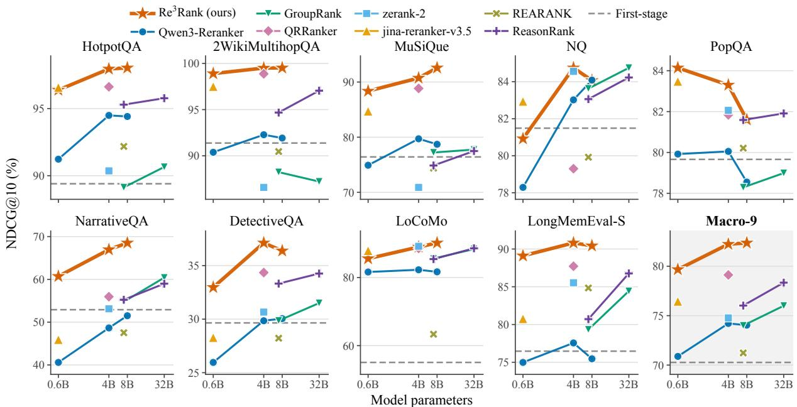

Figure 8: NDCG@10 (%) of rerankers across model sizes on the nine benchmarks and their macro average (Macro-9). Lines and markers follow Figure 3.
<table><tr><td colspan="6"></td><td colspan="2">Gold / question</td></tr><tr><td>Dataset</td><td>Regime</td><td>#Questions</td><td>Retrieval scope</td><td>#Chunks</td><td>Tok./chunk</td><td>All</td><td>In-pool</td></tr><tr><td>HotpotQA</td><td>Wiki multi-hop</td><td>1,000</td><td>Shared corpus</td><td>9,811</td><td>138</td><td>2.00</td><td>1.96</td></tr><tr><td>2WikiMultihopQA</td><td>Wiki multi-hop</td><td>1,000</td><td>Shared corpus</td><td>6,119</td><td>118</td><td>2.47</td><td>1.98</td></tr><tr><td>MuSiQue</td><td>Wiki multi-hop</td><td>1,000</td><td>Shared corpus</td><td>11,656</td><td>121</td><td>2.65</td><td>2.21</td></tr><tr><td>NQ</td><td>Open-domain</td><td>1,000</td><td>Shared corpus</td><td>9,633</td><td>148</td><td>3.79</td><td>3.79</td></tr><tr><td>PopQA</td><td>Open-domain</td><td>1,000</td><td>Shared corpus</td><td>8,676</td><td>146</td><td>2.00</td><td>1.17</td></tr><tr><td>NarrativeQA</td><td>Long narrative</td><td>1,902</td><td>Per book (65)</td><td>59,043</td><td>200</td><td>2.93</td><td>2.39</td></tr><tr><td>DetectiveQA</td><td>Long narrative</td><td>600</td><td>Per novel (62)</td><td>31,807</td><td>173</td><td>5.57</td><td>2.31</td></tr><tr><td>LoCoMo</td><td>Long dialogue</td><td>1,531</td><td>Per conversation (10)</td><td>849</td><td>261</td><td>1.42</td><td>1.39</td></tr><tr><td>LongMemEval-S</td><td>Long dialogue</td><td>466</td><td>Per chat history (466)</td><td>114,078</td><td>255</td><td>2.45</td><td>2.31</td></tr><tr><td>Total</td><td></td><td>9,499</td><td></td><td>251,672</td><td></td><td></td><td></td></tr></table>

Table 12: Evaluation benchmarks. For each question, Qwen3-Embedding-8B served as the first-stage retriever and returned the top-50 candidates from the retrieval scope; parentheses give the number of scopes. #Chunks counts all chunks in the retrieval scopes before first-stage retrieval, and Tok./chunk is the mean chunk length under the Qwen3 tokenizer. All is the mean number of gold chunks per question (Appendix C.3); In-pool is the mean number within the top-50 candidates, computed over questions with at least one such chunk.

## C.3 Relevance Labels

Every training and evaluation instance consists of a question, its 50 first-stage candidates ordered by first-stage rank, and a binary label for each candidate. Labels are assigned at the chunk level, and

Table 13 lists the type and source of the labels for each dataset. Throughout the paper, gold labels refer to these labels of all three types.

Silver labels. NarrativeQA provides no evidence annotations, so its labels for training and evaluation were constructed as silver labels. Following MiA-RAG (Li et al., 2026b), the question, the question with its answer, and the answer each retrieved the top 10 chunks of the book with Qwen3- Embedding-8B; the merged list was ranked by votes and truncated to 10 chunks; and GPT-5.4 selected the chunks relevant to the question and its reference answer with the MiA-RAG filtering prompt. In the evaluation set, the 79 questions for which GPT-5.4 selected no chunk were removed.

<table><tr><td>Dataset</td><td>Type</td><td>Source</td><td>Relevant if the chunk contains</td></tr><tr><td colspan="4">Training</td></tr><tr><td>NarrativeQA</td><td>Silver</td><td>GPT-5.4, MiA-RAG procedure</td><td>a passage selected by GPT-5.4</td></tr><tr><td>MuSiQue</td><td>Annotated</td><td>dataset annotation</td><td>a supporting paragraph</td></tr><tr><td>ConvoMem</td><td>Annotated</td><td>dataset annotation</td><td>an evidence message</td></tr><tr><td>QAConv</td><td>Derived</td><td>dataset answers</td><td>a reference answer string</td></tr><tr><td>FriendsQA</td><td>Annotated</td><td>dataset annotation</td><td>the turn holding the answer</td></tr><tr><td colspan="4">Evaluation</td></tr><tr><td>HotpotQA</td><td>Annotated</td><td>dataset annotation</td><td>a supporting paragraph</td></tr><tr><td>2WikiMultihopQA</td><td>Annotated</td><td>dataset annotation</td><td>a supporting paragraph</td></tr><tr><td>MuSiQue</td><td>Annotated</td><td>dataset annotation</td><td>a supporting paragraph</td></tr><tr><td>NQ</td><td>Annotated</td><td>HippoRAG 2 release</td><td>a supporting passage</td></tr><tr><td>PopQA</td><td>Derived</td><td>HippoRAG 2 release</td><td>the page of the question subject or the answer entity</td></tr><tr><td>NarrativeQA</td><td>Silver</td><td>GPT-5.4, MiA-RAG procedure</td><td>a passage selected by GPT-5.4</td></tr><tr><td>DetectiveQA</td><td>Annotated</td><td>dataset annotation</td><td>an annotated clue paragraph</td></tr><tr><td>LoCoMo</td><td>Annotated</td><td>dataset annotation</td><td>an evidence turn</td></tr><tr><td>LongMemEval-S</td><td>Annotated</td><td>dataset annotation</td><td>a message marked as holding the answer</td></tr></table>

Table 13: Type and source of the gold labels. Annotated labels come from the evidence annotations of each dataset or of the HippoRAG 2 release (Gutiérrez et al., 2025); derived labels are computed from annotated answers or entities; silver labels are selected by GPT-5.4 following MiA-RAG (Li et al., 2026b). A candidate chunk is relevant if it contains any of the listed evidence.

## C.4 Hardware and Software

Hardware. Unless stated otherwise, all training, evaluation, data construction, and baseline runs used a single node with eight GPUs, each providing 141 GB of HBM3e memory.

Software. The node ran with NVIDIA driver 580.65.06 and CUDA 13.0. The main environment used Python 3.12.14, PyTorch 2.13.0, Transformers 5.16.1 and vLLM 0.28.0.

## D Ablation of Ranking Objectives

Table 3 in Section 4.5.2 compares ranking objectives for the 4B model, leading to three findings.

(1) A moderate score scale matters. Raising the score scale α from 8 to 12 lowers all four metrics, by 0.97 R@3 and 0.70 NDCG@10 points. A larger scale sharpens the softmax in $\mathcal { L } _ { \mathrm { C E } }$ and further widens margins that are already correct, consistent with the over-sharpening effect discussed in Section 3.3.1.

(2) The Recall@k surrogate and $\mathcal { L } _ { \mathrm { C E } }$ are complementary. Replacing $\mathcal { L } _ { \mathrm { C E } }$ with the surrogate yields the highest R@3 (76.81), as expected from an objective that targets the top-3 boundary directly, but slightly lowers R@1, R@5, and NDCG@10. Because the surrogate saturates once a relevant candidate crosses a cutoff, it provides little signal for ordering candidates within the top ranks.

Combining the two objectives retains both signals: every mixed variant achieves higher R@1 and NDCG@10 than either objective alone.

(3) The mixed objective is robust to its weight. Every metric varies by at most 0.38 points across $\lambda \ \in \ \{ 1 , 2 , 4 \}$ With $\lambda \ = \ 1$ , the mixed objective attains the best R@1 and NDCG@10 but falls slightly below $\mathcal { L } _ { \mathrm { C E } }$ in R@3 and R@5. With $\lambda = 2 .$ it improves over $\mathcal { L } _ { \mathrm { C E } }$ on all four metrics, achieves the best R@5 and the highest R@3 among the mixed variants, and stays within 0.11 R@3 points of the surrogate alone.

## E Straight-Through Updates and Generated Traces

The trace as a medium. $\mathrm { R E } ^ { 3 } \mathrm { R }$ ANK is not required to return the reasoning trace to the user and the trace only serves as the attention query of the scorer. The quality of a trace is therefore measured by how much attention it leads the RRHeads to place on relevant candidates, regardless of its linguistic quality or readability to humans. The question is thus whether straight-through training makes the sampled discrete traces more useful for ranking.

What the update does. Proposition 1 states what the straight-through update computes for one sampled trace $\mathbf { u } = ( u _ { 1 } , \dots , u _ { T } )$

Proposition 1. For a trace position $t ,$ let $f _ { t } ( \mathbf { e } )$ be the ranking loss obtained when the scorer input at position t is set to e $\mathbf { \Psi } : \in \mathbb { R } ^ { d }$ and all other inputs are kept, and let $\pmb { \delta } _ { t } = \nabla f _ { t } \big ( E [ u _ { t } ] \big )$ and $\mathbf { g } _ { t } = E \delta _ { t } \in$ $\mathbb { R } ^ { V }$ . Define the first-order loss ofplacing token v at position t as

$$
\hat { f } _ { t } ( v ) = f _ { t } \big ( { E } [ u _ { t } ] \big ) + \big ( { E } [ v ] - { E } [ u _ { t } ] \big ) ^ { \top } \delta _ { t } .
$$

Then, under Eq. 16:

(i) theforward pass evaluates the loss ofthe discrete trace, ${ \mathcal { L } } _ { \mathrm { r a n k } } = f _ { t } { \big ( } E [ u _ { t } ] { \big ) }$ for every t;

(ii) with $\delta _ { t }$ held constant, the straight-through gradient with respect to the logits $\ell _ { t }$ satisfies

$$
\begin{array} { r l } & { \displaystyle \frac { \partial \mathcal { L } _ { \mathrm { r a n k } } } { \partial \ell _ { t } } = \nabla _ { \ell _ { t } } \mathbb { E } _ { v \sim \mathbf { p } _ { t } } \big [ \hat { f } _ { t } ( v ) \big ] } \\ & { \displaystyle = \frac { 1 } { \tau _ { \mathrm { S T } } } \mathbf { p } _ { t } \odot \big ( \mathbf { g } _ { t } - ( \mathbf { p } _ { t } ^ { \top } \mathbf { g } _ { t } ) \mathbf { 1 } \big ) . } \end{array}
$$

Proof. (i) The last two terms of Eq. 16 are numerically equal, so $\begin{array} { r } { \widetilde { \mathbf { e } } _ { t } = E [ u _ { t } ] + E ^ { \top } \mathbf { p } _ { t } - \mathrm { s g } ( E ^ { \top } \mathbf { p } _ { t } ) = } \end{array}$ $E [ u _ { t } ]$ for every $t ,$ and the scorer reads exactly the embeddings of the sampled tokens. Hence $\delta _ { t } = $ ${ \partial { \mathcal { L } } _ { \mathrm { r a n k } } } / { \partial { \widetilde { \mathbf { e } } } _ { t } }$ . (ii) By the chain rule, Eq. 17, and the symmetry of $\mathbf J _ { t } , \partial \mathcal L _ { \mathrm { r a n k } } / \partial \ell _ { t } = ( E ^ { \top } \mathbf J _ { t } ) ^ { \top } \pmb \delta _ { t } =$ $\mathbf { J } _ { t } \mathbf { g } _ { t }$ . Since $\textstyle \sum _ { v } p _ { t , v } = 1$ and $g _ { t , v } = E [ v ] ^ { \top } \delta _ { t }$

$$
\begin{array} { r } { \mathbb { E } _ { v \sim \mathbf { p } _ { t } } \big [ \hat { f } _ { t } ( v ) \big ] = f _ { t } \big ( E [ u _ { t } ] \big ) - g _ { t , u _ { t } } + \mathbf { p } _ { t } ^ { \top } \mathbf { g } _ { t } , } \end{array}
$$

which depends on $\ell _ { t }$ only through $\mathbf { p } _ { t }$ . Its gradient is therefore $( \partial \mathbf { p } _ { t } / \partial \ell _ { t } ) ^ { \top } \mathbf { g } _ { t } = \mathbf { J } _ { t } \mathbf { g } _ { t }$ , and expanding $\mathbf { J } _ { t } = \tau _ { \mathrm { { S T } } } ^ { - 1 } [ \operatorname { D i a g } ( \mathbf { p } _ { t } ) - \mathbf { p } _ { t } \mathbf { p } _ { t } ^ { \top } ]$ ] gives the last expression. □

Summed over positions, the generator is thus updated by gradient descent on $\begin{array} { r } { \sum _ { t } \mathbb { E } _ { v \sim \mathbf { p } _ { t } } [ \hat { f } _ { t } ( v ) ] } \end{array}$ where $\mathbf { p } _ { t } ~ = ~ p _ { \theta } ( \cdot ~ \vert ~ \mathbf { x } , \mathbf { u } _ { < t } )$ is computed under teacher forcing. Each step raises the logits of tokens whose $g _ { t , v }$ is below the $\mathbf { p } _ { t }$ -weighted average, and the factor $\mathbf { p } _ { t }$ concentrates the update on tokens that the generator already considers likely. Two approximations separate this surrogate from the objective in Eq. 14: $\hat { f } _ { t }$ is a first-order expansion that is accurate only for tokens whose embeddings lie close to $E [ u _ { t } ]$ , and each $\hat { f } _ { t }$ holds the other trace tokens fixed, ignoring how changing $u _ { t }$ would alter the rest of the continuation and never comparing alternative complete sequences. The estimator is therefore biased, and decreasing the surrogate does not guarantee better discrete traces.

## F Training the Generator with Reinforcement Learning

Straight-through training passes the gradient of the ranking loss to the generator through the scorer. A common alternative treats the scorer as a black-box reward model and trains the generator with reinforcement learning (RL). This appendix compares straight-through training with RL for training the generator of $\mathsf { R E } ^ { 3 } \mathsf { R A }$ NK on Qwen3-4B.

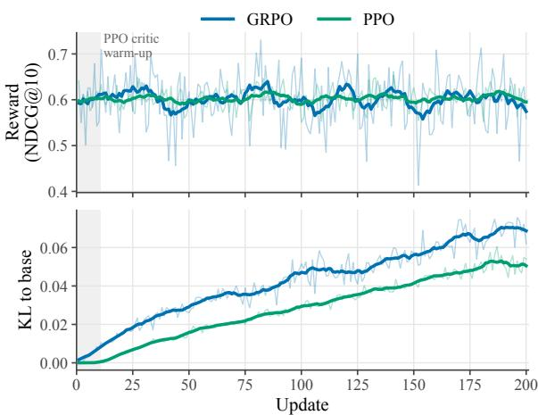  
Figure 9: Training curves of GRPO and PPO for the Qwen3-4B generator. The reward is the NDCG@10 that the frozen scorer assigns to each sampled trace. Thin lines show the value at each update, and thick lines show an 11-update moving average. The shaded region marks the first 10 PPO updates, which train only the critic.

Two-stage setup. RL requires a fixed reward, so the scorer and the generator were trained in two stages. In the first stage, the generator was kept at the base Qwen3-4B weights, and only the scorer was trained on its reasoning traces, following the training setup of the main experiments. In the second stage, this scorer was frozen and served as the reward model: the reward of a sampled trace u is the NDCG@10 of the ranking that the scorer produces from u.

Prompt pool. Over all prompts, greedy traces already reached a mean reward of 0.920, the best of eight samples improved it by only 0.019, and $73 \%$ of the eight-sample groups received identical rewards, which leaves group-normalized advantages without a learning signal. Among prompts with a greedy reward below 0.9, the greedy reward was 0.591, the best-of-eight gain rose to 0.093, and only 18% of the groups were tied. RL therefore used the 6,633 prompts of the training mixture whose greedy reward is below 0.9.

RL algorithms. We trained the generator with GRPO (Shao et al., 2024) and PPO (Schulman et al., 2017), both for 200 updates of 128 episodes each. Both used a learning rate of $1 0 ^ { - 6 }$ with a clipping ratio of 0.2, two epochs over two minibatches per update, and a KL coefficient of $\beta = 0 . 0 4$ toward the base generator. Rollouts were sampled at temperature 1 in thinking mode with at most 1,024 tokens, the trace budget of the main experiments. GRPO drew eight samples for each of 16 prompts per update. PPO drew one sample for each of 128 prompts per update and trained a separate critic initialized from Qwen3-4B, using generalized advantage estimation (Schulman et al., 2018) with $\lambda = 1$ for both the actor and the critic. Its KL term entered the reward as a per-token penalty, and its first 10 updates trained only the critic.

<table><tr><td>Setting</td><td>R@1</td><td>R@3</td><td>R@5</td><td>N@10</td></tr><tr><td>Scorer only</td><td>43.60</td><td>76.35</td><td>83.54</td><td>81.83</td></tr><tr><td>+ PPO</td><td> $4 3 . 6 6 _ { + 0 . 0 6 }$ </td><td></td><td> $8 3 . 6 9 _ { + 0 . 1 5 }$ </td><td> $8 1 . 9 0 _ { + 0 . 0 7 }$ </td></tr><tr><td>+ GRPO</td><td> $4 3 . 5 7 _ { - 0 . 0 3 }$ </td><td> $^ { 7 6 . 3 8 _ { + 0 . 0 3 } } _ { 7 6 . 3 1 _ { - 0 . 0 4 } }$ </td><td> $8 3 . 5 5 _ { + 0 . 0 1 }$ </td><td> $8 1 . 7 7 _ { - 0 . 0 6 }$ </td></tr><tr><td>Joint training</td><td> $\mathbf { 4 4 . 2 0 _ { + 0 . 6 0 } }$ </td><td> $\mathbf { 7 6 . 7 0 _ { + 0 . 3 5 } }$ </td><td> ${ \bf 8 4 . 0 1 _ { + 0 . 4 7 } }$ </td><td> $\mathbf { 8 2 . 2 3 _ { + 0 . 4 0 } }$ </td></tr></table>

Table 14: Macro-9 scores (%) of $\mathrm { R E } ^ { 3 } \mathrm { R A N K }$ (4B) when the generator is trained with RL against the frozen scorer. Scorer only is the setting of Figure 5 in which only the scorer is trained, and joint training is the setting in which both are trained with the straight-through estimator, as in $\mathrm { R E } ^ { 3 } \mathrm { R A N K }$ . Subscripts give the difference from scorer only, with gains in green and losses in red.

Evaluation. Table 14 compares the RL-trained generators with the scorer-only setting of Figure 5, which corresponds to the first stage before RL. Neither algorithm improves on it noticeably: PPO changes the four Macro-9 metrics by at most 0.15 points, and GRPO by at most 0.06 points, with slight losses on three of them. The training curves in Figure 9 show the same picture: the reward of both algorithms stays around 0.60 throughout the 200 updates, while the KL divergence from the base generator grows steadily to about 0.07 for GRPO and 0.05 for PPO. RL thus moves the generator away from its initialization without making its traces more useful to the frozen scorer. In contrast, joint straight-through training improves over scoreronly training by 0.35 R@3 and 0.40 NDCG@10 points (Section 4.5.2).

Why RL brings little gain. Three factors limit RL in this two-stage setting. First, analyses of RL with verifiable rewards find that it mainly concentrates probability on high-reward outputs that the base model can already sample, rather than expanding what the model can produce (Yue et al., 2025). A trace that scores higher on one prompt need not reflect a way of writing that also helps on other prompts. Without a consistent pattern to reinforce, the updates change the generator without raising the reward: the KL divergence from the base generator keeps growing while the reward stays flat (Figure 9). Second, the frozen scorer was trained on traces of the base generator and therefore relies on features of their style. It rewards traces that express these features but not new ways of writing that it has never learned to read. Third, the scorer itself is imperfect: on the same prompts, even the best of eight traces reaches a mean reward of only 0.684, far below the maximum of 1, so the attainable reward is often limited by the scorer rather than by the trace. Together, these factors indicate that alternating between training the scorer and training the generator against it is limited in improving how the two models work together, whereas straightthrough training updates both jointly so that each adapts to the other.

## G Downstream Question Answering on LoCoMo

Setup. We followed the LoCoMo question answering protocol of Li et al. (2026c). For each question, a reranker ordered the same 50 Qwen3- Embedding-8B candidates as in Section 4.3.1, and only the top-3 chunks were passed to the generator as context, without summaries or other memory mechanisms. We used GPT-4o-mini, GPT-5-mini, and GPT-6-luna as generators and report tokenlevel F1 against the reference answers on four question categories. Figure 10 shows the prompt given to the generator.

Effect of reranking. Reranking the same candidates raises overall F1 over the first-stage order by 16.48–18.79 points across rerankers and generators, whereas changing the generator moves the overall F1 of any fixed ranking by at most 2.07 points. In this setting, which chunks reach the generator matters far more than which generator reads them.

Comparison with memory frameworks. With GPT-4o-mini, three $\mathrm { R E } ^ { 3 } \mathrm { R A N K }$ variants achieve higher overall F1 than every memory framework while passing only three dialogue chunks to the generator. $\mathrm { R E } ^ { 3 } \mathrm { R A N K }$ (8B) reaches 57.37, 2.97 points above TiMem, and $\mathrm { R E } ^ { 3 } \mathrm { R A N K }$ (0.6B) still leads it by 1.44 points. The 4B and 8B variants score higher than all frameworks on single-hop, multihop, and temporal questions.

<table><tr><td>Generator</td><td>Method</td><td>Single-hop</td><td>Multi-hop</td><td>Temporal</td><td>Open-domain</td><td>Overall F1</td></tr><tr><td>GPT-4o-mini</td><td>A-Mem (Xu et al., 2025a)†</td><td>44.65</td><td>27.02</td><td>45.85</td><td>12.14</td><td>39.65</td></tr><tr><td></td><td>MemoryOS (Kang et al., 2025)†</td><td>48.62</td><td>35.27</td><td>41.15</td><td>20.02</td><td>42.84</td></tr><tr><td></td><td>Zep (Rasmussen et al., 2025)†</td><td>49.56</td><td>35.74</td><td>42.00</td><td>19.37</td><td>43.56</td></tr><tr><td></td><td>Mem0 (Chhikara et al., 2025)†</td><td>47.65</td><td>38.72</td><td>48.93</td><td>28.64</td><td>45.09</td></tr><tr><td></td><td>Nemori (Ma et al., 2026)†</td><td>46.33</td><td>32.36</td><td>55.99</td><td>29.19</td><td>44.72</td></tr><tr><td></td><td>LightMem (Fang et al., 2026)†</td><td>47.64</td><td>32.11</td><td>53.79</td><td>26.14</td><td>44.73</td></tr><tr><td></td><td>TiMem (Li et al., 2026a)†</td><td></td><td></td><td></td><td></td><td>54.40</td></tr><tr><td></td><td>Synapse (Jiang et al., 2026)†</td><td>48.90</td><td>35.70</td><td>50.10</td><td>25.90</td><td>40.50</td></tr><tr><td></td><td>Membox (Tao et al., 2026)†</td><td>60.09</td><td>39.88</td><td>58.03</td><td>27.96</td><td>53.10</td></tr><tr><td></td><td>CompassMem (Hu et al., 2026)†</td><td>57.36</td><td>38.84</td><td>57.96</td><td>26.61</td><td>52.18</td></tr><tr><td></td><td>ES-Mem (Zou et al., 2026)†</td><td>50.07</td><td>36.52</td><td>47.90</td><td>24.77</td><td>45.56</td></tr><tr><td></td><td>SFT-Emb-8B (Li et al., 2026c)†</td><td>57.22</td><td>37.06</td><td>56.27</td><td>29.11</td><td>51.58</td></tr><tr><td></td><td>Qwen3-Emb-8B (no reranking)</td><td>46.29</td><td>24.98</td><td>35.37</td><td>20.17</td><td>38.58</td></tr><tr><td></td><td>QRRanker (4B)</td><td>64.78</td><td>41.65</td><td>59.06</td><td>24.92</td><td>57.02</td></tr><tr><td></td><td>RE3RANK (0.6B)</td><td>63.73</td><td>37.18</td><td>59.08</td><td>28.58</td><td>55.84</td></tr><tr><td></td><td>RE3RANK (4B)</td><td>64.39-0.39</td><td> $\mathbf { 4 2 . 0 3 _ { + 0 . 3 8 } }$ </td><td> ${ \bf 5 9 . 8 4 _ { + 0 . 7 8 } }$ </td><td> $2 6 . 7 9 _ { + 1 . 8 7 }$ </td><td>57.15+0.13</td></tr><tr><td>GPT-5-mini</td><td>RE3RANK (8B)</td><td>64.78</td><td>41.69</td><td>59.80</td><td>28.26</td><td>57.37</td></tr><tr><td></td><td>Qwen3-Emb-8B (no reranking)</td><td>46.20</td><td>27.81</td><td>38.87</td><td>29.14</td><td>40.30</td></tr><tr><td></td><td>QRRanker (4B)</td><td>63.55</td><td>40.16</td><td>64.16</td><td>33.18</td><td>57.62</td></tr><tr><td></td><td>RE³RANK (0.6B)</td><td>63.19</td><td>38.90</td><td>63.27</td><td>34.00</td><td>57.05</td></tr><tr><td></td><td>RE3RANK (4B)</td><td> $6 3 . 9 0 _ { + 0 . 3 5 }$ </td><td> $\mathbf { 4 2 . 2 9 _ { \div 2 . 1 3 } }$ </td><td> ${ \bf 6 6 . 3 1 _ { + 2 . 1 5 } }$ </td><td></td><td> ${ 5 8 . 8 8 } _ { + 1 . 2 6 }$ </td></tr><tr><td></td><td>RE3RANK (8B)</td><td>64.13</td><td>41.77</td><td>64.76</td><td> $\begin{array} { l } { 3 7 . 1 5 _ { + 3 . 9 7 } } \\ { 3 4 . 3 4 } \end{array}$ </td><td>58.43</td></tr><tr><td>GPT-6-luna</td><td>Qwen3-Emb-8B (no reranking)</td><td>47.83</td><td>27.57</td><td>37.62</td><td>25.11</td><td>40.65</td></tr><tr><td></td><td>QRRanker (4B)</td><td>64.14</td><td>43.03</td><td>66.79</td><td>31.71</td><td>58.93</td></tr><tr><td></td><td>RE3RANK (0.6B)</td><td>62.98</td><td>38.85</td><td>64.05</td><td>34.65</td><td>57.13</td></tr><tr><td></td><td>RE3RANK (4B)</td><td> $6 4 . 2 6 _ { + 0 . 1 2 }$ </td><td> $4 3 . 1 9 _ { + 0 . 1 6 }$ </td><td> $6 6 . 1 7 _ { - 0 . 6 2 }$ </td><td> $3 4 . 5 4 _ { + 2 . 8 3 }$ </td><td> $5 9 . 0 6 _ { + 0 . 1 3 }$ </td></tr><tr><td></td><td>RE3RANK (8B)</td><td>64.71</td><td>43.30</td><td>67.26</td><td>31.41</td><td>59.37</td></tr></table>

Table 15: Downstream question answering on LoCoMo (F1, %) with different generator LLMs. †Results reported by Li et al. (2026c), where “–” marks metrics not reported. All non-† rows rerank the same Qwen3-Embedding-8B candidates and are evaluated by us. Subscripts on RE3RANK (4B) give the difference from QRRanker (4B) under the same generator. Bold marks the best result in each column within each generator.

Comparison with QRRanker. At the 4B scale, $\mathrm { R E } ^ { 3 } \mathrm { R A N K }$ achieves higher overall F1 than QR-Ranker under all three generators, by 1.26 points with GPT-5-mini and 0.13 points with the other two. The gains concentrate on open-domain questions (1.87–3.97 points), while single-hop differences stay within 0.39 points. The small overall margins are consistent with the close LoCoMo retrieval scores of the two rerankers (88.13 vs. 88.43 R@3 and 88.96 vs. 88.56 NDCG@10; Table 11).

## H Effect of Trace Budget

To examine how much of the reasoning trace $\mathrm { R E } ^ { 3 } \mathrm { R A N K }$ needs, we kept the trained models fixed and truncated the trace to B tokens at inference (Figure 11). All models were trained with $B =$ 1024, and $B = 0$ uses the question as the attention query without generating a trace.

Compared with the full budget of 1024 tokens, scoring with the question alone $( B = 0 )$ lowers

R@3 by 3.06, 4.51, and 3.92 points for the 0.6B, 4B, and 8B models, respectively. Since the model weights are identical in both settings, this gap measures how much the trace contributes as the attention query. Short traces close most of the gap: with 64 tokens, the three models recover 85.6%, 67.0%, and 48.5% of it, and the 4B and 8B models already surpass QRRanker (4B), which the 0.6B model does at 128 tokens.

The budget at which accuracy saturates grows with model size: the 0.6B model levels off at 128 tokens, the 4B model between 256 and 512 tokens, and the 8B model keeps improving up to 1024 tokens. Smaller budgets therefore reduce generation cost at a small loss in accuracy (Figure 12); at 256 tokens, the 4B and 8B models trail the full budget by only 0.26 and 0.49 R@3 points.

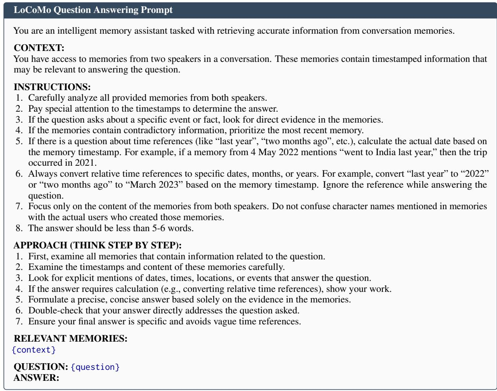  
Figure 10: Generation prompt for LoCoMo question answering. {context} is filled with the top-3 reranked chunks and {question} with the question.

## I Results with Gemma 4 Backbones

We applied the training method of Section 3 to Gemma-4-E2B and Gemma-4-E4B (Team et al., 2026), which have 2.3B and 4.5B effective parameters (5.1B and 8B including embeddings). RRHeads were selected as in Section 4.1, giving {(34, 2), (9, 7)} for Gemma-4-E2B and {(35, 0), (29, 4)} for Gemma-4-E4B. As Table 4 shows, Gemma-4-E2B falls between Qwen3- 0.6B and Qwen3-4B on all four Macro-9 metrics, and Gemma-4-E4B slightly exceeds Qwen3-4B and Qwen3-8B in R@3 and NDCG@10. Both Gemma 4 variants also outperform every baseline in Section 4.4 on all four Macro-9 metrics.

Table 16 reports per-dataset results, together with the same backbones trained with $\mathcal { L } _ { \mathrm { C E } }$ alone. The mixed objective improves Macro-9 R@3 and NDCG@10 over $\mathcal { L } _ { \mathrm { C E } }$ on both backbones and achieves higher R@3 on seven of the nine datasets for each.

## J What the Reasoning Trace Contributes

We analyze which parts of the reasoning trace drive the ranking of RE3RANK (4B). The generator’s greedy traces and the trained scorer were kept fixed, and only the query text after <think> in the scorer input was replaced. Each variant was used as is and, to compare variants with the same number of query positions, also repeated line by line to the token length of the original trace (881 tokens on average). As a control, the neutral sentence “Let me look through the retrieved chunks.” was repeated in the same way, which adds query positions without question-specific content. The answer, keywords, and evidence summary were extracted from the trace by GPT-6-luna given only the question and the trace, and verbatim excerpts and chunk identifiers by string matching. To isolate the effect of training, the question, the neutral sentence, and the full trace were also scored by the untrained Qwen3-4B with the same RRHeads, input, and scoring, where the full trace still came from the trained generator. Table 17 reports Macro-9 scores; differences were tested with a paired bootstrap over questions.

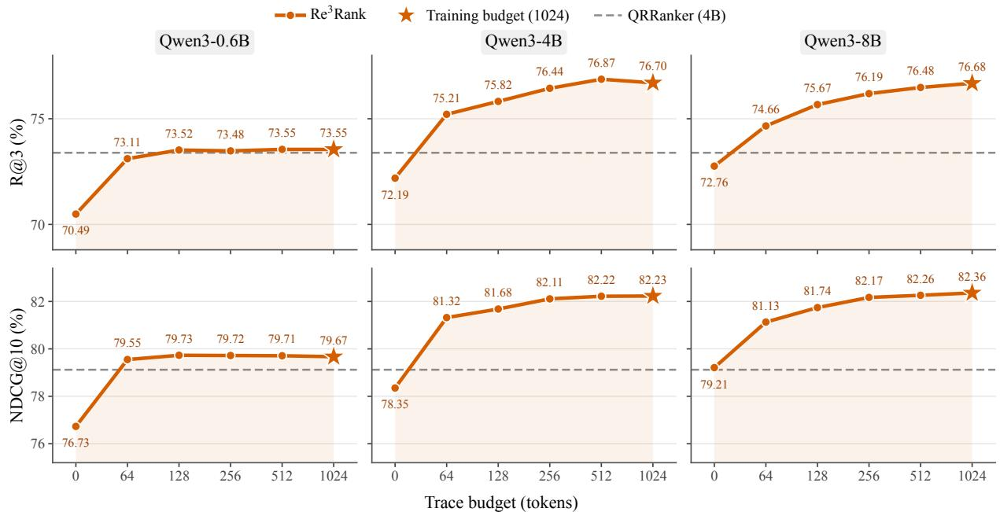  
Figure 11: Macro-9 R@3 (top) and NDCG@10 (bottom) of $\boldsymbol { \mathrm { R E } } ^ { 3 }$ RANK when the reasoning trace is truncated to a given token budget at inference. All models were trained with a budget of 1024 tokens. A budget of 0 generates no trace and uses the question as the attention query. The dashed line marks QRRanker (4B).

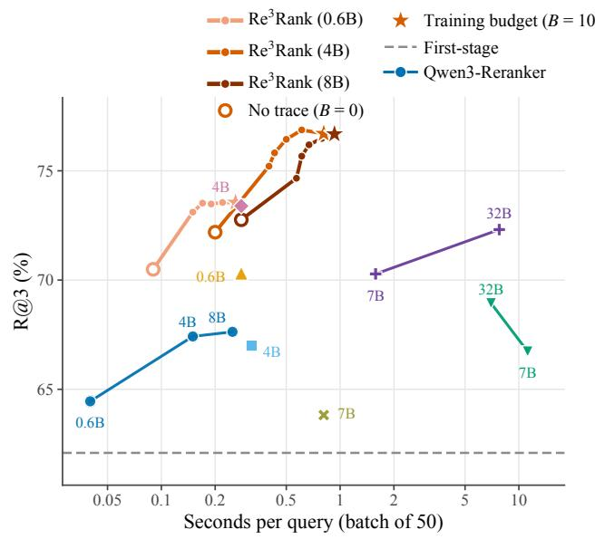

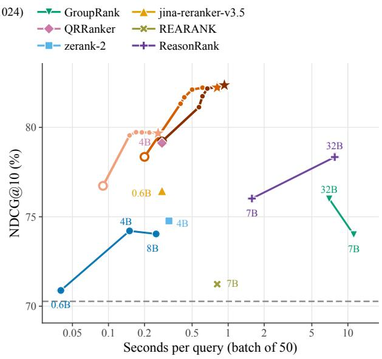  
Figure 12: Macro-9 R@3 (left) and NDCG@10 (right) against reranking time per query at a batch size of 50, extending Figure 6 with the trace budgets of Figure 11. Each RE3RANK curve connects budgets of 0, 64, 128, 256, 512, and 1024 tokens from left to right. Open circles mark $B = 0 ,$ where no trace is generated and the question serves as the attention query, and stars mark the training budget of 1024 tokens. Baseline points repeat Figure 6.

Format, positions, and content. Relative to reading the question in the user turn, the full trace improves R@3 by 4.51 points. Placing the question after <think>, where the scorer reads its queries during training, accounts for 3.08 of these points, and the reasoning content adds 1.43 points over this question-only query and 1.13 points over the question repeated to trace length. Additional query positions alone do not help: repeating the question changes R@3 by +0.30, which is not significant, and a repeated neutral sentence lowers it by 0.77 points. The gain also depends on question-specific content, as the trace of another question falls 5.88 points below the full trace.

<table><tr><td></td><td colspan="4"> $\mathcal { L } _ { \mathrm { C E } }$ </td><td colspan="4"> $\mathcal { L } _ { \mathrm { r a n k } }$ </td></tr><tr><td>Dataset</td><td colspan="4">R@1 R@3 R@5</td><td colspan="4">R@1 R@3 R@5</td></tr><tr><td></td><td></td><td></td><td>Gemma-4-E2B</td><td></td><td></td><td></td><td></td><td></td></tr><tr><td>HotpotQA</td><td>49.30</td><td>96.65</td><td>98.60</td><td>97.13</td><td>49.85</td><td>97.35</td><td>98.95</td><td>97.57</td></tr><tr><td>2WikiMultihopQA</td><td>54.40</td><td>98.55</td><td>99.54</td><td>99.10</td><td>54.77</td><td>99.26</td><td>99.82</td><td>99.65</td></tr><tr><td>MuSiQue</td><td>44.57</td><td>82.47</td><td>90.12</td><td>89.20</td><td>47.48</td><td>84.11</td><td>90.92</td><td>91.29</td></tr><tr><td>NQ</td><td>26.35</td><td>57.77</td><td>77.52</td><td>83.31</td><td>26.48</td><td>58.68</td><td>77.44</td><td>83.58</td></tr><tr><td>PopQA</td><td>54.80</td><td>94.65</td><td>98.90</td><td>83.15</td><td>57.65</td><td>93.55</td><td>97.65</td><td>84.21</td></tr><tr><td>NarrativeQA</td><td>24.30</td><td>49.36</td><td>64.00</td><td>62.99</td><td>24.69</td><td>49.79</td><td>64.50</td><td>63.59</td></tr><tr><td>DetectiveQA</td><td>10.40</td><td>23.90</td><td>33.11</td><td>34.08</td><td>10.08</td><td>22.37</td><td>32.94</td><td>33.70</td></tr><tr><td>LoCoMo</td><td>72.49</td><td>88.24</td><td>92.37</td><td>88.96</td><td>72.42</td><td>88.48</td><td>92.34</td><td>89.02</td></tr><tr><td>LongMemEval-S</td><td>51.65</td><td>84.74</td><td>91.89</td><td>89.69</td><td>52.55</td><td>85.38</td><td>92.33</td><td>90.59</td></tr><tr><td>Macro-9</td><td>43.14</td><td>75.15</td><td>82.89</td><td>80.85</td><td>44.00</td><td>75.44</td><td>82.99</td><td>81.47</td></tr><tr><td colspan="9">Gemma-4-E4B</td></tr><tr><td>HotpotQA</td><td>49.45</td><td>97.80</td><td>99.20</td><td>97.52</td><td>50.00</td><td>97.90</td><td>99.25</td><td>97.82</td></tr><tr><td>2WikiMultihopQA</td><td>54.80</td><td>99.42</td><td>100.00</td><td>99.76</td><td>54.70</td><td>99.57</td><td>99.95</td><td>99.72</td></tr><tr><td>MuSiQue</td><td>46.78</td><td>86.78</td><td>93.20</td><td>92.38</td><td>46.80</td><td>86.84</td><td>93.11</td><td>92.50</td></tr><tr><td>NQ</td><td>27.21</td><td>59.85</td><td>79.23</td><td>84.53</td><td>27.01</td><td>59.97</td><td>78.02</td><td>84.34</td></tr><tr><td>PopQA</td><td>53.55</td><td>94.00</td><td>97.90</td><td>82.52</td><td>55.75</td><td>93.90</td><td>98.45</td><td>83.36</td></tr><tr><td>NarrativeQA</td><td>28.51</td><td>54.06</td><td>68.32</td><td>68.09</td><td>28.55</td><td>55.26</td><td>68.42</td><td>68.55</td></tr><tr><td>DetectiveQA</td><td>10.75</td><td>23.91</td><td>34.86</td><td>34.75</td><td>10.35</td><td>23.50</td><td>32.71</td><td>34.46</td></tr><tr><td>LoCoMo</td><td>73.75</td><td>88.80</td><td>92.61</td><td>89.73</td><td>74.03</td><td>90.01</td><td>93.25</td><td>90.29</td></tr><tr><td>LongMemEval-S</td><td>51.92</td><td>85.28</td><td>92.03</td><td>90.15</td><td>53.41</td><td>87.31</td><td>93.42</td><td>91.79</td></tr><tr><td></td><td></td><td></td><td></td><td></td><td></td><td></td><td></td><td></td></tr><tr><td>Macro-9</td><td>44.08</td><td>76.66</td><td>84.15</td><td>82.16</td><td>44.51</td><td>77.14</td><td>84.06</td><td>82.54</td></tr></table>

Table 16: Per-dataset reranking results of RE3RANK with Gemma 4 backbones (%). Metrics follow Table 8. In the Macro-9 rows, bold marks the better objective on each metric.

Which content matters. Each component extracted from the trace, repeated to trace length, scores below the full trace; the evidence summary comes closest (−0.81 R@3). Removing verbatim excerpts or chunk identifiers from the trace changes R@3 by less than 0.1 points. The ranking signal thus comes from the question-specific reasoning context as a whole; keywords, verbatim excerpts, and chunk identifiers alone recover only part of it. Even the neutral sentence, which carries no content, reaches 74.50 R@3 with the trained scorer, above the question in the user turn (72.19). We attribute this to the causal attention of the scorer: the hidden state at each query position is built from all preceding tokens, including the question and the candidates, so its attention query depends mainly on this context and only partly on the embedding ofthe token at that position.

Required entities. Naming the required entities is one source of the gain of the trace. Whether an entity is required was judged by GPT-6-luna from the question, its answer, and its gold chunks, so the variants built on this judgment give near-oracle results that are unavailable at inference. Relative to the full trace, deleting them lowers R@3 by 0.59 and NDCG@10 by 0.55 points (76.11 vs. 76.70 and 81.68 vs. 82.23). Since the full trace outperforms the question after <think> by 1.43 R@3 and 0.99 NDCG@10 points, the deletion accounts for 41% and 56% of this gain, and the trace without required entities still outperforms the question after <think> (76.11 vs. 75.27 R@3). Which entities are named also matters. Appending the required entities named in the trace to the question reaches 77.78 R@3 with 20 tokens, 1.08 points above the full trace, whereas appending as many other entities from the trace (74.98) or all of its entities (75.30) brings no gain over the question after <think> (75.27). Appending all required entities, including those the trace misses, gives an upper bound of 80.71 R@3. The trace thus supplies the required entities within reasoning that singles them out among the many entities in the candidates, which a plain entity list achieves only with this near-oracle selection.

Effect of training. The untrained scorer ranks better with the question after <think> than with the full trace (71.97 vs. 67.95 R@3), and long query text degrades its ranking: repeating the question or the neutral sentence to trace length lowers R@3 by 7.95 and 11.61 points. Training mitigates this degradation, as both repeated texts stay within 0.8 points of the question after <think> for the trained scorer. It also raises the R@3 of the full trace by 8.75 points, so the full trace moves from below the question after <think> to above it. The effect of training extends beyond the reasoning trace to filler text at the query positions: training raises the R@3 of the repeated question and the neutral sentence by 11.54 and 14.13 points, more than that of the full trace. This again follows from how the hidden states are built. Each query position aggregates the question and the candidatesfrom its preceding context, and training teaches the scorer to route attention from these contextual states to relevant candidates, whichever tokens occupy the positions.

<table><tr><td rowspan="2">Query text after &lt;think&gt;</td><td></td><td colspan="2">As is</td><td colspan="2">At trace length</td><td rowspan="2">∆R@3 [95% CI]</td></tr><tr><td>Tokens</td><td>R@3</td><td>N@10</td><td>R@3</td><td>N@10</td></tr><tr><td colspan="7">Question and neutral text (∆R@3 vs. full trace)</td></tr><tr><td>Question in the user turn (B = 0)</td><td>15</td><td>72.19</td><td>78.35</td><td></td><td></td><td>-4.51 [-5.00, -4.03]</td></tr><tr><td>Question</td><td>15</td><td>75.27</td><td>81.24</td><td>75.57</td><td>81.07</td><td>-1.13[-1.46, -0.80]</td></tr><tr><td>Neutral sentence</td><td></td><td></td><td></td><td>74.50</td><td>80.22</td><td>-2.20 [-2.57, -1.84]</td></tr><tr><td colspan="7">Content extracted from the trace (∆R@3 vs. full trace)</td></tr><tr><td>Answer only</td><td>6</td><td>71.60</td><td>78.18</td><td>74.64</td><td>80.32</td><td>-2.05 [−2.43, -1.69]</td></tr><tr><td>Chunk identifiers</td><td>68</td><td>74.51</td><td>80.06</td><td>75.15</td><td>80.62</td><td>-1.55 [-1.89, -1.23]</td></tr><tr><td>Keywords</td><td>111</td><td>74.39</td><td>80.03</td><td>75.17</td><td>80.67</td><td>-1.53 [-1.87, -1.20]</td></tr><tr><td>Verbatim excerpts</td><td>249</td><td>75.40</td><td>80.88</td><td>75.38</td><td>80.91</td><td>-1.32 [−1.64, −0.99]</td></tr><tr><td>Evidence summary</td><td>47</td><td>75.63</td><td>81.26</td><td>75.89</td><td>81.39</td><td>-0.81 [−1.12, −0.52]</td></tr><tr><td>Question + all trace entities</td><td>76</td><td>75.30</td><td>80.83</td><td></td><td></td><td>-1.40 [-1.78, -1.01]</td></tr><tr><td colspan="7">Perturbed traces (∆R@3 vs. full trace)</td></tr><tr><td>Trace of another question</td><td>881</td><td>70.82</td><td>77.04</td><td></td><td></td><td>-5.88 [-6.36, -5.40]</td></tr><tr><td>Trace without verbatim excerpts</td><td>535</td><td>76.66</td><td>82.20</td><td></td><td></td><td>-0.04 [−0.23, +0.15]</td></tr><tr><td>Trace without chunk identifiers</td><td>810</td><td>76.65</td><td>82.15</td><td></td><td></td><td>-0.05 [-0.18, +0.09]</td></tr><tr><td colspan="7">Required entities (∆R@3 vs. full trace)</td></tr><tr><td>Trace without required entities</td><td>844</td><td>76.11</td><td>81.68</td><td></td><td></td><td>-0.59 [−0.73, -0.45]</td></tr><tr><td>Question + named required entities</td><td>20</td><td>77.78</td><td>83.33</td><td></td><td></td><td>+1.08 [+0.72, +1.43]</td></tr><tr><td>Question + as many other trace entities</td><td>19</td><td>74.98</td><td>80.85</td><td></td><td></td><td>-1.71 [-2.10, -1.33]</td></tr><tr><td>Question + all required entities</td><td>22</td><td>80.71</td><td>86.05</td><td></td><td></td><td>+4.01 [+3.57, +4.47]</td></tr><tr><td>Full trace</td><td>881</td><td>76.70</td><td>82.23</td><td></td><td></td><td></td></tr><tr><td colspan="7">Untrained Qwen3-4B scorer with the same RRHeads (∆R@3 from training)</td></tr><tr><td>Question in the user turn (B = 0)</td><td>15</td><td>70.01</td><td>76.60</td><td></td><td></td><td> $+ 2 . 1 8 \ [ + 1 . 6 5 , + 2 . 7 3 ]$ </td></tr><tr><td>Question</td><td>15</td><td>71.97</td><td>77.96</td><td>64.03</td><td>73.52</td><td> $+ 1 1 . 5 4 [ + 1 0 . 9 4 , + 1 2 . 1 4 ]$ </td></tr><tr><td>Neutral sentence</td><td></td><td></td><td></td><td>60.37</td><td>70.87</td><td> $+ 1 4 . 1 3 [ + 1 3 . 5 0 , + 1 4 . 7 9 ]$ </td></tr><tr><td>Full trace</td><td>881</td><td>67.95</td><td>74.16</td><td></td><td></td><td> $+ 8 . 7 5 \ [ + 8 . 1 7 , + 9 . 3 6 ]$ </td></tr></table>

Table 17: Macro-9 scores (%) of $\mathrm { R E } ^ { 3 } \mathrm { R A N K }$ (4B) when the query text read by the scorer is replaced, with the scorer and its RRHeads fixed. Tokens is the mean length of the text as is; at trace length, the text is repeated line by line to the token length of the original trace. The neutral sentence (“Let me look through the retrieved chunks.”) carries no question-specific content and was only used at trace length. The first row keeps the question in the user turn, as for B = 0 in Appendix H. Required entities are the bridge entities and answers that the question needs but omits, annotated by GPT-6-luna from the question, its answer, and its gold chunks; named ones are those mentioned in the trace. Variants built with them rely on gold labels and serve only for analysis; the control adds as many other entities from the trace. ∆R@3 compares the full trace with the version at trace length when it exists and with the text as is otherwise. The last group replaces the trained scorer with the untrained Qwen3-4B; its last column is the R@3 of the trained scorer minus that of the untrained one for the same query text, at trace length when it exists. Intervals come from a paired bootstrap over questions.

## K Comparison with Closed-Source LLM Rerankers

We compared RE3RANK with two closed-source reasoning LLMs, GPT-6.1-sol and GPT-6-luna, used as listwise rerankers. They serve only as a reference for the ranking quality of frontier models, separate from the baselines of Section 4.3.2. Each model was called once per question with the question and all 50 candidates in first-stage order. Both models received the same prompt (Figure 13), ran at their default reasoning effort, and returned the identifiers of their 10 most useful candidates, which were ranked first in that order, followed by the remaining candidates in first-stage order. Table 18 reports Macro-9 scores from a single run.

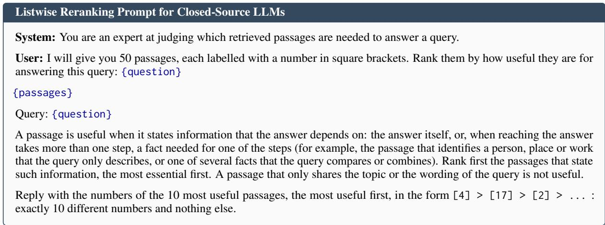  
Figure 13: Listwise reranking prompt for GPT-6.1-sol and GPT-6-luna. {passages} lists the 50 candidates as [1] to [50] in first-stage order, separated by blank lines, and {question} is the question.

<table><tr><td>Reranker</td><td>R@1</td><td>R@3</td><td>R@5</td><td>N@10</td></tr><tr><td colspan="5">Closed-source LLMs</td></tr><tr><td>GPT-6.1-sol</td><td>46.85</td><td>79.19</td><td>86.11</td><td>84.87</td></tr><tr><td>GPT-6-luna</td><td>46.15</td><td>77.88</td><td>84.67</td><td>83.55</td></tr><tr><td colspan="5">RE³RANK with Qwen3</td></tr><tr><td>0.6B</td><td>42.34</td><td>73.55</td><td>81.43</td><td>79.67</td></tr><tr><td>4B</td><td>44.20</td><td>76.70</td><td>84.01</td><td>82.23</td></tr><tr><td>8B</td><td>44.12</td><td>76.68</td><td>84.36</td><td>82.36</td></tr><tr><td colspan="5">RE³RANK with Gemma 4</td></tr><tr><td>Gemma-4-E2B</td><td>44.00</td><td>75.44</td><td>82.99</td><td>81.47</td></tr><tr><td>Gemma-4-E4B</td><td>44.51</td><td>77.14</td><td>84.06</td><td>82.54</td></tr></table>

these entities. This result shows that the attentionbased scorer is effective and that $\mathrm { R E } ^ { 3 } \mathrm { R A N K }$ has considerable potential as its generator learns to state the required information more precisely.  
Table 18: Macro-9 scores (%) of closed-source LLMs used as listwise rerankers and of $\mathrm { R E } ^ { 3 } \mathrm { R A N K }$ with Qwen3 and Gemma 4 backbones. Bold marks the best result among the closed-source LLMs and among the versions of $\mathrm { R E } ^ { 3 } \mathrm { R A N K }$

The gap between $\boldsymbol { \mathrm { R E } } ^ { 3 }$ RANK and these frontier LLMs is small. GPT-6.1-sol and GPT-6-luna lead $\mathrm { R E } ^ { 3 } \mathrm { R A N K }$ (4B) by only 2.49 and 1.19 R@3 points, $\tt R E ^ { 3 } \mathrm { R }$ ANK with Gemma-4-E4B comes within 0.74 R@3 points of GPT-6-luna, and RE3RANK (8B) is on par with GPT-6-luna on R@5 (84.36 vs. 84.67; paired difference $+ 0 . 3 1 \ [ - 0 . 1 9 , + 0 . 8 1 ] )$ $\mathrm { R E } ^ { 3 } \mathrm { R A N K }$ reaches this level with open backbones of a few billion parameters that run locally, at 0.81 s per query for the 4B model under batched inference (Figure 6), whereas the two LLMs are closed-source models of undisclosed size whose API calls took 5.2 and 11.0 s per question on average. Moreover, when the scorer of $\mathrm { R E } ^ { 3 } \mathrm { R A N K }$ (4B) reads the question followed by all required entities (Table 17), it reaches 80.71 R@3 and 86.05 NDCG@10, above GPT-6-luna used as a reranker (77.88 and 83.55), the same model that identified