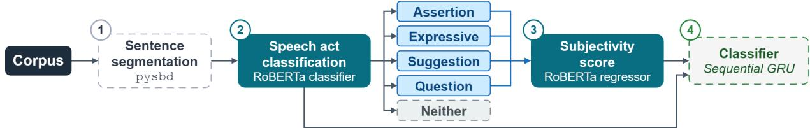
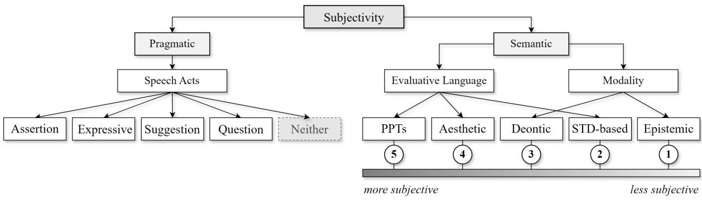
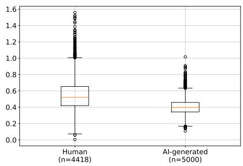
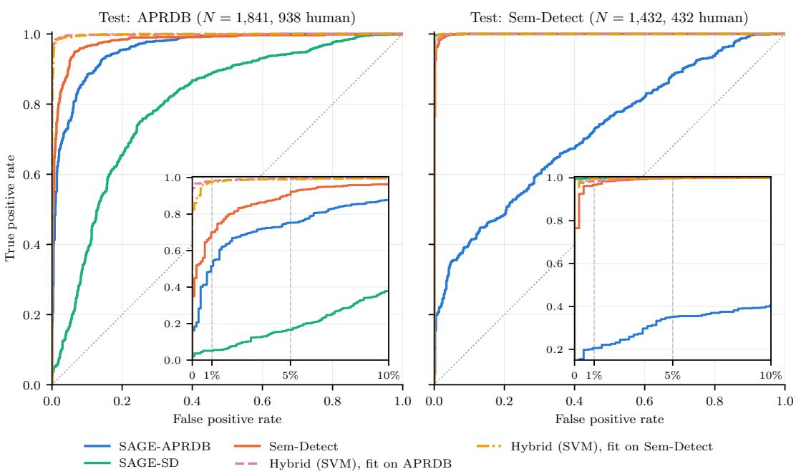

# SAGE (Subjectivity-Aware Generation Estimator): A Linguistic Framework for AI-Generated Review Detection \*

Gonzalo Freijedo Aduna1, Charles Yaiche2, Patrick Bas2, Alda Mari1

1Institut Jean Nicod - CNRS ENS/EHESS PSL University, Paris, France 2 UMR 9189 CRIStAL, Univ. Lille, CNRS, Centrale Lille gonzalo.freijedo.aduna@ens.psl.eu charles.yaiche.lf@gmail.com patrick.bas@cnrs.fr alda.mari@cnrs.fr

## Abstract

We propose a simple, linguistically motivated approach to detecting AI-generated peer reviews based on the inherently human trait of subjectivity. We capture subjectivity at two levels: the semantic level of evaluative language and modality and the pragmatic level of speech acts. Using features derived from speech act annotations and model-predicted subjectivity scores, we train a lightweight classifier that achieves an AUROC of 0.9566 with only these linguistic features. Combining its output with the state-of-the-art detector Sem-Detect raises the TPR at 1% FPR of Sem-Detect on the APRDB benchmark from 0.874 to 0.985, outperforming the current state of the art. Our results show that linguistic features of subjectivity provide an explainable source of information for detecting AI-generated peer reviews and can be readily integrated into existing detection methods. The code and models are publicly available on GitHub (https://github.com/Arys02/generated\_ text\_detection\_hub) and Hugging Face (https://huggingface.co/Arys02), respectively.

## 1 Introduction

AI-generated text detection is becoming one of the most challenging problems in natural language processing, as increasingly capable language models produce text that closely resembles human writing and can evade existing detection methods (Fraser et al., 2025; Wu et al., 2025). This challenge is particularly relevant in scientific research, where the increasing adoption of LLMs is reshaping both the production and evaluation of scientific works. Kusumegi et al. (2025) show that adopting LLMs to draft manuscripts is associated with a significant increase in paper production. The resulting growth in submissions also increases the burden on peer reviewers, potentially encouraging, in turn, the use of LLMs for reviewing. This makes detection especially pressing for peer reviews, which inform decisions on research evaluation, promotion, and selection, and where falsely identifying human-written text as AI-generated can have significant consequences for researchers’ reputations and careers.

Several recent studies have recently addressed the detection of AI-generated peer reviews (Yu et al., 2025; Zhou et al., 2026; Duarte et al., 2026). These approaches often rely on substantial resources, such as reviews regenerated by LLMs from the same paper or likelihood features computed with a 7B-parameter LLM (Yu et al., 2025; Duarte et al., 2026). Rather than competing with these detectors, we aim to provide lightweight linguistic features that complement them at a marginal computational cost, without requiring LLM inference or API access.

In this paper, we propose a novel method for AI-generated text detection that heavily relies on linguistic analysis, and leverages subjectivity encoded at two levels: language meaning (semantics) and language use (pragmatics). At the semantic level, evaluative language and modality provide access into the speaker’s preferences, normative judgments, and epistemic commitments, capturing different dimensions and degrees of subjectivity.1 At the pragmatic level, speech acts capture speaker’s communicative intentions (Austin, 1962; Searle, 1969). We hypothesize that these two sources of information provide complementary signals for distinguishing human from AI-generated text. Based on these features, we trained a GRUbased classifier and evaluated their contribution to AI-generated text detection, both on their own and in combination with an existing detector.

  
Figure 1: Overview of the SAGE pipeline. Speech act classification and subjectivity estimation are performed by two independently fine-tuned RoBERTa models: a five-class classifier and a regressor producing continuous scores on a 1–5 scale (Section 4).

On its own, our full model, depicted in Figure 1, achieves an AUROC of 0.9566 and a TPR of 46.8% at 1% FPR on the AI Peer Review Detection Benchmark (APRDB; Yu et al., 2025). Combining its output with the state-of-the-art detector Sem-Detect (Duarte et al., 2026) through a simple late fusion raises the TPR at 1% FPR of Sem-Detect on APRDB from 0.874 to 0.985.

The main findings show that speech-act information provides a strong signal for distinguishing human from AI-generated reviews. This contribution arises both from the distribution of individual speech acts and from their sequential patterns. Subjectivity scores also contribute substantially to the model’s predictions, providing complementary information to the speech-act features.

The main contributions of our study are as follows. First, we show that linguistic subjectivity, through its encoding of intentions, preferences, and attitudes (traditionally regarded as distinctly human (Portner, 2009; Fodor, 1975), provides a useful signal for distinguishing human from AI-generated text. Second, the method goes beyond detection by providing explainable insights into the linguistic differences between human and AI-generated texts. Finally, our approach is lightweight: it relies only on two RoBERTa-base models for annotation and a small GRU classifier, and needs only the review itself, not the reviewed paper. It can therefore be combined with existing detectors at a negligible additional cost to complement and improve their performance, as demonstrated by a simple late fusion with Sem-Detect (Duarte et al., 2026).

## 2 Related Works

## 2.1 Related Works on Generated Text Classifiers

The field of detecting generated peer reviews encompasses three main categories of detectors:

\- Active detectors are based on text watermarking (Giboulot and Furon, 2024) which can be extremely accurate since the generated text is modified during or after the generation to embed a watermark designed to be easily detectable. Nonetheless, these solutions are associated with practical constraints since they are inefficient if the watermark is not embedded beforehand, or if an adversary tries to remove it (Tarhini et al., 2026).

\- On the other hand, passive detectors can rely on metrics quantifying the text predictability which is larger when the text is generated. Popular metrics are the perplexity or the cross-perplexity in Binoculars (Hans et al., 2024), the log-likelihood, the token rank (Gehrmann et al., 2019). More elaborated detectors such as detect-GPT (Mitchell et al., 2023) or Fast-detect-GPT (Bao et al., 2024) uses informational outputs from perturbations of the text to improve the detection. The rational here is that generated texts, once perturbed, will be more affected than human texts which are known to be more erratic and consequently less sensitive to perturbations.

\- The last category encompasses passive detectors which use side-information. For generated peer review detection, this side-information is provided by the paper associated to the review. Anchor (Yu et al., 2025) directly compare the test review with a review directly generated from the paper. The comparison is performed by computing the cos similarity between an embedding of the generated review (the anchor), and the embedding of the tested review. The two embeddings are closer if the tested review is generated than if written by a human.

A noteworthy similar and competitive approach, but focusing on segments of the review, is proposed by Sem-Detect (Duarte et al., 2026). It provides 9 features. The text segments are first categorized into different types and the ones related to “evaluation”, “constructive input” and “clarification” are kept. Then five semantic features capturing the closest similarity between embeddings of segments of the test review and segments of regenerated reviews belonging to the same category, are then computed. Four other textures generic features represented by perplexity, entropy, likelihood and Fast-detect-GPT score, are also computed.

## 2.2 Related Works in Linguistics

Subjectivity broadly concerns the expression of a speaker’s perspective, attitudes, and evaluations. It can be expressed through linguistic choices at the lexical level (tasty, beautiful; Lasersohn, 2005; McNally and Stojanovic, 2017) and through modal expressions (possible, necessary; Portner, 2009; Nuyts et al., 2018). Subjectivity can also be conveyed through speech acts, such as assertions, questions, and exclamatives, which express communicative intentions (Searle, 1969; Portner, 2018).

Speech act annotation has been used in a variety of NLP and discourse-analysis tasks, including dialogue act classification (Stolcke et al., 2000; Bunt et al., 2010), conversational analysis (Asher et al., 2016), argumentation mining (Budzynska Katarzyna et al., 2014), and the analysis of social media messages for crisis management (Laurenti et al., 2022).

More recently, Maitra et al. (2025) used dialogue act annotation to compare LLM-generated and human conversational turns, showing significant differences in their distributions. Their study, however, focuses on telephone conversations from the Switchboard DialogAct corpus,2 rather than scientific peer reviews. They report that LLMs produce more opinion statements and questions than humans, whereas in our data, AI-generated reviews consist almost exclusively of assertions, and human-written reviews receive higher subjectivity scores (see Section 4.1). To the best of our knowledge, speech act annotation has not yet been systematically investigated as a feature for detecting AI-generated text. The closest approach is Duarte et al. (2026), discussed in Section 2.1.

On the other hand, although not extensively used, scores of subjectivity have recently been employed as features in text classification.

Mindner et al. (2023) were the first to use subjectivity as a feature for distinguishing human from AI-generated texts. They use TextBlob’s lexiconbased subjectivity score, which ranges from 0 (objective) to 1 (subjective) and is derived from human annotations.3 At the phrase level, scores are computed by averaging the scores of the relevant lexical items. Zhou et al. (2026) subsequently included the same TextBlob score among ten linguistic features for detecting AI-generated reviews and meta-reviews. However, as its lexicon is primarily adjective-oriented, it is limited in its ability to capture subjectivity expressed through other linguistic resources, such as modality. VAGO (Icard et al., 2022) relies on a theoretically motivated typology of vague expressions, including modality. However, its proportional measure of subjectivity cannot capture differences in degree between expressions with the same proportion of subjective markers. Although VAGO has been used to characterize human- and AI-generated press-like articles (Icard et al., 2026), it has not yet been applied to distinguishing AI-generated from human-written peer reviews.

## 3 Subjectivity: semantic and pragmatic dimensions

Natural languages provide a variety of resources for expressing a speaker’s perspective toward some content. As illustrated in Figure 2, we conceptualize subjectivity along two dimensions: a pragmatic dimension, concerning language use, and a semantic dimension, concerning linguistic meaning. SAGE captures these dimensions through two complementary sources of information: sentence-level speech act classification and subjectivity scores. The latter are predicted by a transformer trained on statements annotated according to a five-degree scale of subjectivity, as detailed in Section 4.

## 3.1 Pragmatic dimension

Following Searle (1969), we characterize speech acts in terms of the communicative function or intention of an utterance. For the annotation scheme used in this study, we distinguish four speech act categories: Assertions, Questions, Suggestions, and Expressives (Figure 2). These categories capture distinct attitudes toward the propositional content of an utterance: committing to it, as in Assertions (1); requesting information about it, as in Questions (2); requesting or suggesting that it be realized, as in Suggestions (3); or expressing internal states, as in Expressives (4).4 We also include a Neither class for phrases that do not instantiate any of these speech act categories, such as titles, separators (5), or references to sections.

  
Figure 2: The SAGE linguistic framework for subjectivity. The pragmatic dimension concerns speech acts, while the semantic dimension covers evaluative language and modality, organized along a five-degree subjectivity scale.

(1) This paper introduces a nonlinear dynamical model.5

(2) How does it look visually?

(3) I think it would be good to included these for reference.

(4) I am happy with the responses.

(5) ### Strengths

## 3.2 Semantic dimension

Subjectivity at the semantic level can be encoded through perspectival expressions, including evaluative language and modality (Figure 2).

Evaluative language encompasses a variety of expressions that can be graded from more to less subjective. At the more subjective end of this scale are Predicates ofPersonal Tastes (PPTs), such as (6). Paradigmatic examples in the semantic literature include tasty andfun, which can be embedded under find, as in I find this tasty (Kölbel, 2004; Lasersohn, 2005; Stephenson, 2007; Sæbø, 2009, a.m.o.).

## (6) The paper is a joy to read.

Because PPTs are grounded exclusively in the speaker’s individual preferences, they have often been distinguished from other types of evaluative predicates, such as aesthetic predicates (Hirvonen, 2014; McNally and Stojanovic, 2017). Unlike PPTs, aesthetic predicates such as (7) can be evaluated against both individual preferences and shared aesthetic standards or norms.

## (7) The idea of the paper is elegant.

At a lower degree of subjectivity, standard-based predicates as (8) qualify an entity, event, or state relative to a standard of adequacy, quality, or success. Like aesthetic predicates, they may be evaluated against standards shared across speakers, but unlike aesthetic predicates, these standards do not interact with individual preferences.

(8) The effect [...] is not successfully demonstrated.

While evaluative language concerns the assessment of entities, events, or states, modality concerns the qualification of the propositional content itself in terms of possibility, likelihood, necessity, or obligation, expressed through modal auxiliaries and adverbs such as may, must, probably, and necessarily (e.g. it is probably raining outside).

The linguistic literature on modality is extremely vast, and it would be impossible to discuss it comprehensively here (see, for instance, Kratzer, 1977, 1981; Hacquard, 2006; Portner, 2009; Rubinstein, 2012; Nuyts et al., 2018 and references therein). For present purposes, we broadly distinguish between epistemic and deontic modality. Epistemic modality concerns the possibility, likelihood, or necessity of a state of affairs as evaluated against available evidence, as in (9). Deontic modality, in turn, concerns what is permitted, required, or expected according to a set of norms or normative standards, as in (10).

(9) higher values might lead to faster convergence.

(10) Data should also be leveraged.

We treat deontic modality as more subjective than both standard-based modifiers and epistemic modality because the relevant norms may depend on the speaker’s preferences, although to a lesser extent than in the case of PPTs and aesthetic predicates. Epistemic modality, by contrast, concerns assessments that can in principle be settled by factual evidence and is therefore treated as the least subjective form of modality (see Portner, 2009 for discussion). Figure 2 illustrates these distinctions and their relative position along the subjectivity scale.

In our study, this five-degree scale provides the linguistic framework for estimating subjectivity, but its categories are not directly annotated in the review corpus. Instead, continuous subjectivity values are predicted by a transformer model trained on a separately annotated corpus (Section 4).

## 4 Annotation Pipeline

Our approach consists of three successive processing stages, followed by a classification head. The complete processing pipeline is illustrated in Figure 1.

Segmentation. We used PySBD, a rule-based sentence boundary disambiguation tool that identifies sentence boundaries using linguistic rules and contextual patterns.6

Annotation of Speech Acts. To classify the speech acts described in Section 3, we manually annotated 400 held-out reviews sampled from the train subset of the AI Peer Review Detection Benchmark (Yu et al., 2025). The 6,930 resulting sentences were labelled as Assertion, Question, Suggestion, Expressive or Neither by two annotators (Cohen’s $\kappa ~ = ~ 0 . 7 7 5$ on 50 double-annotated reviews; 92.2% raw agreement).

We fine-tuned RoBERTa-base (Liu et al., 2019) on this data for five epochs (learning rate $2 \times 1 0 ^ { - 5 }$ batch size 16, weight decay 0.01) and selected the checkpoint with the highest validation macro-F17, which achieved 97.69% accuracy and 84.04% macro-F1. This model was then used to annotate the full corpus.

Subjectivity Estimation. We used the RoBERTa model fine-tuned as a regressor by Freijedo Aduna et al. (2026) to automatically assign subjectivity scores to sentences in our corpus that were not labeled as Neither. We selected this model because it was trained using an annotation scheme closely related to that described in Section 3. Specifically, it was trained on a corpus of Reddit posts in which subjective statements were classified on a five-point scale of subjectivity, with discrete values ranging from 1 (least subjective) to 5 (most subjective).8 Because the model was trained as a regressor, it outputs continuous subjectivity scores rather than discrete class labels. In Freijedo Aduna et al. (2026), the model reached an MAE of 0.10 on the normalized scale, with Pearson $r = 0 . 8 5 6$ and Spearman $\rho = 0 . 8 3 0$ on held-out data, supporting the use of its continuous outputs as degrees of subjectivity. We used these scores as a feature for the classification task.

## 4.1 Corpus Characteristics

Before presenting the detection results, we first describe some key characteristics of the annotated corpus. First, regarding the distribution of speech acts across human and AI-generated reviews, both groups are dominated by Assertions, but AI reviews use them even more (84.6% vs. 73.5%), whereas human reviews contain more Questions, Suggestions, and Expressives (Table 1).

<table><tr><td>Speech Act</td><td>Human</td><td>AI</td></tr><tr><td>Assertion</td><td>73.5</td><td>84.6</td></tr><tr><td>Question</td><td>10.6</td><td>3.1</td></tr><tr><td>Neither</td><td>7.2</td><td>10.6</td></tr><tr><td>Suggestion</td><td>6.4</td><td>1.6</td></tr><tr><td>Expressive</td><td>2.3</td><td>0.2</td></tr></table>

Table 1: Speech act distribution (% of sentences) in human and AI-generated reviews from APRDB (Yu et al., 2025). All differences are significant (Bonferronicorrected, α = .05).

Secondly, regarding subjectivity scores, we also assign scores to Questions, as rhetorical or biased questions can convey implicit asserted content and the speaker’s attitude toward the expected answer.

For instance, (11) challenges the usefulness of the sentence by suggesting that it is redundant.

## (11) Isn’t this sentence redundant?

Despite these cases, Questions have the lowest median subjectivity score among the speech-act categories (1.662), while Expressives have the highest (2.863). This pattern is broadly consistent with our annotation scheme, in which Expressives are expected to be the most subjective speech acts.

Finally, to capture within-review variability, we computed the standard deviation of sentence-level subjectivity scores for each review. As shown in Figure 3, human reviews showed higher variability than AI-generated reviews (median subj\_std = 0.522 vs. 0.397; Cliff’s $\delta = 0 . 4 9 6 , p < 0 . 0 0 1 )$ indicating greater variation in subjectivity across sentences.

  
Figure 3: Subjectivity variability in human and AIgenerated reviews

## 5 Experiments

## 5.1 Dataset

APRDB. We mainly use the AI Peer Review Detection Benchmark (APRDB; Yu et al., 2025), a large-scale dataset of human and AI-generated peer reviews released by Intel Labs. It covers reviews from ICLR and NeurIPS and includes texts generated by multiple large language models. The benchmark provides separate train, test, and extended subsets for evaluating AI-generated review detection.

SD-DB We also use SD-DB, the dataset associated with the Sem-Detect framework (Duarte et al., 2026), mostly for evaluate the data drift of our model. It comprises three classes of peer reviews from papers sampled from OpenReview: original human-written reviews, fully AI-generated reviews produced by multiple LLMs, and human-written reviews refined by LLMs.

<table><tr><td>Variable</td><td>test</td><td>train</td></tr><tr><td>Generator</td><td></td><td></td></tr><tr><td>Gemini</td><td>20.9%</td><td>19.3%</td></tr><tr><td>Llama</td><td>20.4%</td><td>19.4%</td></tr><tr><td>Qwen</td><td>20.2%</td><td>19.6%</td></tr><tr><td>Claude</td><td>19.5%</td><td>20.8%</td></tr><tr><td>GPT-40</td><td>19.1%</td><td>20.9%</td></tr><tr><td>Label</td><td></td><td></td></tr><tr><td>Human (0)</td><td>46.9%</td><td>37.7%</td></tr><tr><td>AI (1)</td><td>53.1%</td><td>62.3%</td></tr><tr><td>Year</td><td></td><td></td></tr><tr><td>2021</td><td>22.3%</td><td>100%</td></tr><tr><td>2020</td><td>8.6%</td><td></td></tr><tr><td>2019</td><td>18.0%</td><td></td></tr><tr><td>2018</td><td>17.5%</td><td></td></tr><tr><td>2017</td><td>17.3%</td><td></td></tr><tr><td>2016</td><td>16.4%</td><td></td></tr><tr><td>Conference</td><td></td><td></td></tr><tr><td>NeurIPS</td><td>54.4%</td><td>49.8%</td></tr><tr><td>ICLR</td><td>45.6%</td><td>50.2%</td></tr></table>

Table 2: Distribution of the test (n = 9.424) and train (n = 8.026) splits.

## 5.1.1 Dataset Splits

test split. We use the test split of the dataset. It contains 9 424 examples, with 46.9 % humanwritten reviews and 53.1 % AI-generated reviews. The detailed breakdown is shown in Table 2.

train split. For model training, we use the train split (8 026 examples), consisting exclusively of reviews from 2021, with 37.7 % humanwritten reviews and 62.3 % AI-generated reviews. The detailed breakdown is also shown in Table 2.

## 5.2 Sequential GRU Model training of SAGE features

Our classifier exploits the chronological order of sentences within each review. Instead of aggregating statistics into a fixed vector, we model each review as a sequence of sentences read by a GRU (Gated Recurrent Unit, Cho et al., 2014) layer.

In this model, a block is a sequence: each sentence is one time step, in chronological order within the review. At each step, the model receives a feature vector describing that sentence. The GRU models sentences in order and maintains a hidden state that summarizes “what has happened so far.” Sequence length is therefore the number of sentences in the block, variable from one review to another. The shape of a block is $( L _ { b } , 6 )$ , where $L _ { b }$ is the sequence length (number of sentences). Sentence order in the dataset is preserved and correctly sequential.

At each time step, the feature vector has 6 dimensions:

<table><tr><td></td><td colspan="2">AUROC</td><td colspan="2">TPR@1%FPR</td><td colspan="2">TPR@0.1%FPR</td><td colspan="2">Accuracy</td></tr><tr><td>Condition</td><td>Value</td><td>∆</td><td>Value</td><td>∆</td><td>Value</td><td>∆</td><td>Value</td><td>∆</td></tr><tr><td>Permutation of subjectivity</td><td>0.8596</td><td>+0.0953</td><td>0.1762</td><td>+0.2826</td><td>0.0758</td><td>+0.1326</td><td>0.7494</td><td>+0.1312</td></tr><tr><td>Permutation of speech acts</td><td>0.8355</td><td>+0.1211</td><td>0.1326</td><td>+0.3365</td><td>0.0203</td><td>+0.1667</td><td>0.7527</td><td>+0.1299</td></tr><tr><td>Permutation of assertion</td><td>0.8404</td><td>+0.1162</td><td>0.1399</td><td>+0.3292</td><td>0.0248</td><td>+0.1622</td><td>0.7565</td><td>+0.1261</td></tr><tr><td>Permutation of neither</td><td>0.9205</td><td>+0.0362</td><td>0.2474</td><td>+0.2218</td><td>0.0815</td><td>+0.1054</td><td>0.8378</td><td>+0.0448</td></tr><tr><td>Permutation of question</td><td>0.9291</td><td>+0.0275</td><td>0.3817</td><td>+0.0874</td><td>0.1555</td><td>+0.0314</td><td>0.8448</td><td>+0.0378</td></tr><tr><td>Permutation of suggestion</td><td>0.9325</td><td>+0.0241</td><td>0.3412</td><td>+0.1279</td><td>0.1156</td><td>+0.0714</td><td>0.8491</td><td>+0.0335</td></tr><tr><td>Permutation of expressive</td><td>0.9511</td><td>+0.0055</td><td>0.4374</td><td>+0.0317</td><td>0.1761</td><td>+0.0108</td><td>0.8751</td><td>+0.0075</td></tr><tr><td>Shuffled (train + test)</td><td>0.9079</td><td>+0.0487</td><td>0.2917</td><td>+0.1774</td><td>0.0761</td><td>+0.1108</td><td>0.8191</td><td>+0.0635</td></tr><tr><td>Full model</td><td>0.9566</td><td></td><td>0.4691</td><td></td><td>0.1869</td><td></td><td>0.8826</td><td>一</td></tr></table>

Table 3: Feature importance (Breiman, 2001) by permutation with retraining. The category indicator is sampled at its own marginal rate in both train and test, so prevalence is preserved and only the association with the label is destroyed; the model is then retrained (5 seeds). Feature count and model capacity are identical across conditions.

• one-hot encoding of the speech-act categories (5 dimensions) and

• one raw subjectivity value (1 dimension). When the subjectivity score is missing (sentence classified as Neither), the value is imputed to a constant.

The GRU is trained on train set (see Table 2), using the same annotated reviews. Evaluation uses the same balanced subset of the test split: 8 848 reviews (4 424 human-written, 4 424 AI-generated).

## 5.3 Overall classification performance

On the APRDB test subset, SAGE reaches an AU-ROC of 0.964 and an accuracy of 0.901. At a false-positive rate of 5%, it detects 81.4% of AIgenerated reviews; at 1%, this proportion falls to 54.6%. Performance is homogeneous across four of the five generators, with AUROCs between 0.96 and 0.98, while Llama 3.1 70B is a clear outlier, with an AUROC of 0.93 and a TPR@1% of 0.28. Across conference editions, AUROCs range from 0.938 to 0.99. Detailed results by generator and conference edition, together with ROC curves, are reported in Appendix A.

## 5.4 Ablation study and analysis

We conducted an ablation analysis through permutation (Altmann et al., 2010) to assess the contribution of our two annotation levels to the model’s predictions.

The first level consists of speech act classifications, while the second assigns subjectivity scores to each sentence. As shown in Table 3, removing speech act information has a greater impact on model performance than removing subjectivity scores, with AUROC decreasing from 0.96 to 0.84 and 0.86, respectively. This indicates that speech acts provide the stronger signal for distinguishing human- from AI-generated reviews. Nevertheless, subjectivity scores also have a substantial impact on performance, suggesting that they provide complementary information to the speech act annotations. We can note that the importance of the different categories of speech acts follows roughly the proportions of these categories in the corpus (see Table 1).

Finally, the order of speech acts also contributes to model performance: shuffling their order reduces AUROC from 0.96 to 0.91. This means that the performance of the detector is linked to the possibility to exploit the sequence of categories and subjectivity scores.

## 5.5 Comparison with SOTA detectors

Table 4 compares SAGE with two zero-shot detectors and a domain-specific supervised detector. SAGE achieves an accuracy of 0.901, below Sem-Detect (0.942), and an AUROC of 0.964, close to Binoculars (0.984) and Sem-Detect (0.980), and well above Fast-DetectGPT (0.730).

Unlike these methods, SAGE only uses the sequence of speech-act categories and subjectivity scores of the target review. Binoculars requires token-level likelihoods from two 7B-parameter LLMs, while Sem-Detect uses AI-generated reference reviews of the same paper, LLM-based claim extraction, and likelihood features from a 7B-parameter LLM. Thus, review-level subjectivity features provide a competitive detection signal while remaining explainable.

Cross-dataset generalization. Table 5 evaluates each detector on APRDB and SD-DB (Duarte et al., 2026). In distribution, SAGE is on par with Sem-Detect: trained on SD-DB, it reaches an AUROC of 0.9999 and a TPR@1% of 0.997, against 0.9987 and 0.967 for Sem-Detect.

<table><tr><td>Detector</td><td>Training data</td><td>Accuracy</td><td>AUROC</td><td>TPR@1%</td></tr><tr><td>Binoculars (Hans et al., 2024)</td><td>zero-shot</td><td>0.8203</td><td>0.9836</td><td>0.7676</td></tr><tr><td>Fast-DetectGPT (Bao et al., 2024)</td><td>zero-shot</td><td>0.7900</td><td>0.7304</td><td>0.3974</td></tr><tr><td>SAGE</td><td>APRDB (train)</td><td>0.8826</td><td>0.9566</td><td>0.4691</td></tr><tr><td>Sem-Detect (Duarte et al., 2026)</td><td>SD-DB</td><td>0.9424</td><td>0.9801</td><td>0.6999</td></tr></table>

Table 4: Comparison of detectors on APRDB (Yu et al., 2025). Detectors are evaluated on a subsets of the APRDB test split.
<table><tr><td></td><td colspan="4">Test: APRDB</td><td colspan="4">Test: SD-DB</td></tr><tr><td>Detector</td><td>AUROC</td><td>TPR@1%</td><td>TPR@5%</td><td> $\operatorname { A c c } _ { \operatorname* { m a x } }$ </td><td>AUROC</td><td>TPR@1%</td><td>TPR@5%</td><td> $\operatorname { A c c } _ { \operatorname* { m a x } }$ </td></tr><tr><td>SAGE-APRDB</td><td>0.9566</td><td>0.4691</td><td>0.7530</td><td>0.8826</td><td>0.7208</td><td>0.2060</td><td>0.3510</td><td>0.7277</td></tr><tr><td>SAGE-SD-DB</td><td>0.7971</td><td>0.0509</td><td>0.1661</td><td>0.7496</td><td>0.9999</td><td>0.9970</td><td>0.9980</td><td>0.9965</td></tr><tr><td>Sem-Detect</td><td>0.9801</td><td>0.6999</td><td>0.9059</td><td>0.9424</td><td>0.9987</td><td>0.9670</td><td>0.9990</td><td>0.9867</td></tr><tr><td>Hybrid (SVM), trained on APRDB</td><td>0.9984</td><td>0.9845</td><td>0.9956</td><td>0.9875</td><td>0.9996</td><td></td><td></td><td></td></tr><tr><td>Hybrid (SVM), trained on SD-DB</td><td>0.9982</td><td>0.9756</td><td>0.9911</td><td>0.9842</td><td>0.9998</td><td>0.9850 0.9960</td><td>1.0000 1.0000</td><td>0.9902 0.9951</td></tr></table>

Table 5: Cross-dataset evaluation. Each detector is trained on one dataset and evaluated on both. SAGE-APRDB is trained on APRDB; SAGE-SD-DB and Sem-Detect (Duarte et al., 2026) are trained on SD-DB.

Across benchmarks, both SAGE models degrade sharply. SAGE-APRDB drops to an AUROC of 0.721 on Sem-Detect, and SAGE-SD-DB to 0.797 on APRDB. The transfer is asymmetric at low falsepositive rates: SAGE-APRDB still detects a fifth of AI reviews at 1% FPR (0.206), whereas SAGE-SD-DB detects almost none (0.051). This sensitivity to the source benchmark is not specific to SAGE, Binoculars reaches an AUROC of 0.984 on APRDB (Table 4).

Since SAGE models the sequence of speech acts, such a fixed template plausibly provides a structural cue that is learnable in distribution but does not transfer. This is consistent with the near-perfect in-distribution score of SAGE-SD-DB and its weak transfer to APRDB. Sem-Detect transfers markedly better, with an AUROC of 0.980 on APRDB.

## 5.6 Ensembling with Sem-Detect

SAGE and Sem-Detect rely on different signals: SAGE models the sequence of speech acts and subjectivity of a review, while Sem-Detect compares its semantic claims with reference AI reviews. To test whether these signals are complementary, we combine the two detectors in the simplest possible way, without modifying either of them. For each review, we take the output logits of SAGE-APRDB and of Sem-Detect and train a linear SVM on them. Table 5 shows that the hybrid improves over Sem-Detect on APRDB, raising TPR@1%FPR from 0.700 to 0.985 and the best accuracy from 0.942 to 0.988. The gain persists when the SVM is fitted on SD-DB and applied to APRDB without refitting (0.976). To separate the contribution of SAGE from that of the SVM itself, we apply the same SVM to the Sem-Detect prediction alone: its TPR@1%FPR on APRDB reaches only 0.874. Adding SAGE therefore brings a further gain of 0.11, which shows that the subjectivity and speech-act features capture information that the semantic comparison of Sem-Detect misses. On SD-DB, both detectors are already close to the ceiling, and the hybrid matches Sem-Detect within the resolution of the test set.

## 6 Conclusions

We presented a novel approach to detecting AIgenerated peer reviews by exploiting subjectivity, an inherently human feature, through linguistic annotations at two levels: speech acts and degrees of subjectivity. Our results show that SAGE achieves competitive detection performance, ranking second to Sem-Detect despite relying on a substantially simpler approach. On their own, these features already carry a substantial detection signal, despite relying only on two RoBERTa-base models and a small GRU, without any LLM inference or access to the reviewed paper. More importantly, this lightweight design allows them to be combined with existing detection methods at a negligible additional cost to enhance their performance: a simple late fusion of SAGE with Sem-Detect yields improved detection performance over either method alone.

## 7 Limitations

Subjectivity estimation. The model used to assign subjectivity scores was trained on Reddit conversations, whose informal register differs from that of peer reviews, which may limit its generalizability to this domain. As a result, the subjectivity scores may be less reliable for review sentences, and SAGE’s performance may be lower than it would be with a model fine-tuned on peer-review data.

Language. Our study is restricted to English, the working language of the venues covered by APRDB, and the upstream annotators were applied to English text only. Extending SAGE to other languages would require speech-act and subjectivity annotators for those languages, and the use of speech acts in reviews may itself vary across languages and scientific cultures. Within English, a more pressing issue is that many reviewers write in English as a second language, and AI-text detectors have been shown to flag non-native English writing disproportionately (Liang et al., 2023). We did not evaluate whether the pragmatic profile used by SAGE differs between native and non-native reviewers, which would be necessary before any use that could lead to accusations against reviewers.

Cross-dataset transfer. SAGE is a supervised detector: its decision boundary is learned from the distribution it is trained on. Applied without adaptation to a benchmark built with different generators and prompting strategies, its performance decreases. Trained on APRDB, its AUROC goes from 0.959 in distribution to 0.721 on the SD-DB. Conversely, trained on Sem-Detect, it reaches 0.797 on APRDB (Table 5). Since SAGE performs strongly on each benchmark when trained in-domain, this gap suggests that the pragmatic features carry signal on both benchmarks. The learned decision boundary, however, remains specific to each generation setup, which differs in generators, prompts and rating conditioning.

## References

André Altmann, Laura Tolo¸si, Oliver Sander, and Thomas Lengauer. 2010. Permutation importance: a corrected feature importance measure. Bioinformatics, 26(10):1340–1347.

Nicholas Asher, Julie Hunter, Mathieu Morey, Benamara Farah, and Stergos Afantenos. 2016. Discourse Structure and Dialogue Acts in Multiparty Dialogue: The STAC Corpus. In Proceedings of the Tenth International Conference on Language Resources and Evaluation (LREC‘16), pages 2721–2727, Portorož, Slovenia. European Language Resources Association (ELRA).

J. L. Austin. 1962. How to Do Things with Words. Oxford University Press.

Guangsheng Bao, Yanbin Zhao, Zhiyang Teng, Linyi Yang, and Yue Zhang. 2024. Fast-detectgpt: Efficient zero-shot detection of machine-generated text via conditional probability curvature. In International Conference on Learning Representations, volume 2024, pages 24814–24836.

Leo Breiman. 2001. Random forests. Machine learning, 45(1):5–32.

Budzynska Katarzyna, Janier Mathilde, Kang Juyeon, Reed Chris, Saint-Dizier Patrick, Stede Manfred, and Yaskorska Olena. 2014. Towards Argument Mining from Dialogue. In Frontiers in Artificial Intelligence and Applications. IOS Press.

Harry Bunt, Jan Alexandersson, Jean Carletta, Jae-Woong Choe, Alex Chengyu Fang, Koiti Hasida, Kiyong Lee, Volha Petukhova, Andrei Popescu-Belis, Laurent Romary, Claudia Soria, and David Traum. 2010. Towards an ISO Standard for Dialogue Act Annotation. In Seventh Conference on International Language Resources and Evaluation (LREC’10).

Kyunghyun Cho, Bart Van Merriënboer, Çaglar ˘ Gulçehre, Dzmitry Bahdanau, Fethi Bougares, Holger Schwenk, and Yoshua Bengio. 2014. Learning phrase representations using rnn encoder–decoder for statistical machine translation. In Proceedings of the 2014 conference on empirical methods in natural language processing (EMNLP), pages 1724–1734.

Andre Vicente Duarte, Brian Tufts, Aditya Oke, Fei Fang, Arlindo L. Oliveira, and Lei Li. 2026. Semdetect: Semantic level detection of AI generated peerreviews. In Forty-third International Conference on Machine Learning.

Donka F. Farkas and Kim B. Bruce. 2010. On Reacting to Assertions and Polar Questions. Journal of Semantics, 27(1):81–118.

Jerry Fodor. 1975. The Language of Thought. Harvard University Press.

Kathleen C. Fraser, Hillary Dawkins, and Svetlana Kiritchenko. 2025. Detecting AI-Generated Text: Factors Influencing Detectability with Current Methods. Journal ofArtificial Intelligence Research, 82:2233– 2278.

Gonzalo Freijedo Aduna, Anastasia Giannakidou, and Alda Mari. 2026. Degrees of subjectivity and their repercussions in conversation: The view from online interactions. In Proceedings of the Workshop on Structured Linguistic Data and Evaluation (SLiDE), pages 1–13, Palma, Mallorca, Spain. ELRA Language Resources Association.

Sebastian Gehrmann, Hendrik Strobelt, and Alexander M Rush. 2019. Gltr: Statistical detection and visualization of generated text. In Proceedings of

the 57th annual meeting ofthe associationfor computational linguistics: system demonstrations, pages 111–116.

Eva Giboulot and Teddy Furon. 2024. Watermax: breaking the llm watermark detectability-robustnessquality trade-off. Advances in neural information processing systems, 37:18848–18881.

Jonathan Ginzburg. 2012. The Interactive Stance: Meaningfor Conversation. Oxford University Press UK.

Valentine Hacquard. 2006. Aspects ofModality. Ph.D. thesis, Massachusetts Institute of Technology.

Abhimanyu Hans, Avi Schwarzschild, Valeriia Cherepanova, Hamid Kazemi, Aniruddha Saha, Micah Goldblum, Jonas Geiping, and Tom Goldstein. 2024. Spotting llms with binoculars: Zero-shot detection of machine-generated text. arXiv preprint arXiv:2401.12070.

Sanna Hirvonen. 2014. Predicates ofPersonal Taste and Perspective Dependence. Ph.D. thesis, University College London.

Benjamin Icard, Ghislain Atemezing, and Paul Egré. 2022. VAGO: Un outil en ligne de mesure du vague et de la subjectivité. In Conférence Nationale Sur Les Applications Pratiques de l’Intelligence Artificielle (PFIA 2022), pages 68–71.

Benjamin Icard, Thomas Girault, Géraud Faye, Lila Sainero, Alice Breton, Morgane Casanova, Victor Klötzer, Guillaume Gadek, Louis Lefebvre, Gauvain Bourgne, Laurent Amsaleg, Sylvain Gatepaille, Guillaume Gravier, Michel Le Nouy, Jean-Gabriel Ganascia, and Paul Égré. 2026. Measuring Vagueness-Based Persuasion Techniques in an AI-Generated Influence Campaign. In Journées Infox Sur Seine 2026.

Max Kölbel. 2004. III—Faultless Disagreement. Proceedings of the Aristotelian Society (Hardback), 104(1):53–73.

Angelika Kratzer. 1977. What ’Must’ and ’Can’ Must and Can Mean. Linguistics and Philosophy, 1(3):337– 355.

Angelika Kratzer. 1981. The Notional Category of Modality. In Hans-Jürgen Eikmeyer and Hannes Rieser, editors, Words, Worlds, and Contexts: New Approaches in Word Semantics, pages 38–74. W. de Gruyter.

Keigo Kusumegi, Xinyu Yang, Paul Ginsparg, Mathijs de Vaan, Toby Stuart, and Yian Yin. 2025. Scientific production in the era of Large Language Models. Science, 390(6779):1240–1243.

Peter Lasersohn. 2005. Context Dependence, Disagreement, and Predicates of Personal Taste\*. Linguistics and Philosophy, 28(6):643–686.

Peter Lasersohn. 2016. Subjectivity and Perspective in Truth-Theoretic Semantics. Oxford University Press UK.

Sven Lauer. 2013. Towards a dynamic pragmatics. Ph.D. thesis, Stanford University, Stanford, CA.

Enzo Laurenti, Nils Bourgon, Farah Benamara, Alda Mari, Véronique Moriceau, and Camille Courgeon. 2022. Give me your Intentions, I‘ll Predict our Actions: A Two-level Classification of Speech Acts for Crisis Management in Social Media. In Proceedings of the Thirteenth Language Resources and Evaluation Conference, pages 4333–4343, Marseille, France. European Language Resources Association.

Weixin Liang, Mert Yuksekgonul, Yining Mao, Eric Wu, and James Zou. 2023. Gpt detectors are biased against non-native english writers. Patterns, 4(7).

Yinhan Liu, Myle Ott, Naman Goyal, Jing-Fei Du, Mandar Joshi, Danqi Chen, Omer Levy, M. Lewis, Luke Zettlemoyer, and Veselin Stoyanov. 2019. RoBERTa: A Robustly Optimized BERT Pretraining Approach. ArXiv.

Arunima Maitra, Dorothea French, and Katharina von der Wense. 2025. Dialogue Acts as a Lens on Human–LLM Interaction: Analyzing Conversational Norms in Model-Generated Responses. In Proceedings of the Fourth Workshop on Bridging Human-Computer Interaction and Natural Language Processing (HCI+NLP), pages 317–325, Suzhou, China. Association for Computational Linguistics.

Louise McNally and Isidora Stojanovic. 2017. Aesthetic Adjectives. In James O. Young, editor, The Semantics ofAesthetic Judgements, page 0. Oxford University Press.

Lorenz Mindner, Tim Schlippe, and Kristina Schaaff. 2023. Classification of Human- and AI-Generated Texts: Investigating Features for ChatGPT. In Tianchong Wang, Eric C. K. Cheng, and Tim Schlippe, editors, Artificial Intelligence in Education Technologies: New Development and Innovative Practices, volume 190, pages 152–170. Springer Nature Singapore, Singapore.

Eric Mitchell, Yoonho Lee, Alexander Khazatsky, Christopher D Manning, and Chelsea Finn. 2023. Detectgpt: Zero-shot machine-generated text detection using probability curvature. In International conference on machine learning, pages 24950–24962. PMLR.

Jan Nuyts, Johan van der Auwera, Jan Nuyts, and Johan van der Auwera, editors. 2018. The Oxford Handbook of Modality and Mood. Oxford Handbooks. Oxford University Press, Oxford, New York.

Paul Portner. 2009. Modality. Oxford Surveys in Semantics and Pragmatics. Oxford University Press, Oxford, New York.

Paul Portner. 2018. Mood. Oxford University Press.

Aynat Rubinstein. 2012. Roots of Modality. Ph.d. dissertation, University of Massachusetts Amherst, Amherst, MA.

Kjell Johan Sæbø. 2009. Judgment ascriptions. Linguistics and Philosophy, 32(4):327–352.

John R. Searle. 1969. Speech Acts: An Essay in the Philosophy of Language. Cambridge University Press, Cambridge.

Alex Silk. 2016. Discourse Contextualism: A Framework for Contextualist Semantics and Pragmatics. Oxford University Press.

Tamina Stephenson. 2007. Judge dependence, epistemic modals, and predicates of personal taste. Linguistics and Philosophy, 30(4):487–525.

Isidora Stojanovic. 2007. Talking about taste: Disagreement, implicit arguments, and relative truth. Linguistics and Philosophy, 30(6):691–706.

Isidora Stojanovic and Louise McNally. 2023. Are Moral Predicates Subjective? A Corpus Study. In David Bordonaba-Plou, editor, Experimental Philosophy of Language: Perspectives, Methods, and Prospects, volume 33, pages 103–120. Springer International Publishing, Cham.

Andreas Stolcke, Klaus Ries, Noah Coccaro, Elizabeth Shriberg, Rebecca Bates, Daniel Jurafsky, Paul Taylor, Rachel Martin, Carol Van Ess-Dykema, and Marie Meteer. 2000. Dialogue act modeling for automatic tagging and recognition of conversational speech. Computational Linguistics, 26(3):339–374.

Hussein Tarhini, Aurélien Noirault, Jan Butora, and Patrick Bas. 2026. Neural Watermarking: Lack of a Secret Key is still Lack of Security. In 2026 IEEE International Conference on Image Processing, Tampere, Finland.

Carla Umbach. 2020. Evaluative Predicates: Beyond Fun and Tasty. In Daniel Gutzmann, Lisa Matthewson, Cécile Meier, Hotze Rullmann, and Thomas Zimmermann, editors, The Wiley Blackwell Companion to Semantics, first edition, pages 1–31. Wiley.

Junchao Wu, Shu Yang, Runzhe Zhan, Yulin Yuan, Lidia Sam Chao, and Derek Fai Wong. 2025. A Survey on LLM-Generated Text Detection: Necessity, Methods, and Future Directions. Computational Linguistics, 51(1):275–338.

Sungduk Yu, Man Luo, Avinash Madasu, Vasudev Lal, and Phillip Howard. 2025. Is Your Paper Being Reviewed by an LLM? Benchmarking AI Text Detection in Peer Review. In The Fourteenth International Conference on Learning Representations.

Li Zhou, Ruijie Zhang, Xunlian Dai, Daniel Hershcovich, and Haizhou Li. 2026. ScholarLens: Tracking the growing penetration of Large Language Models in scholarly writing and peer review. Engineering Applications ofArtificial Intelligence, 177:114988.

<table><tr><td>Generator</td><td>AUROC</td><td>TPR@1%</td><td>TPR@5%</td><td>Accuracy</td></tr><tr><td>GPT-40</td><td>0.9766</td><td>0.5770</td><td>0.8733</td><td>0.9264</td></tr><tr><td>Claude Sonnet 3.5</td><td>0.9755</td><td>0.6393</td><td>0.8849</td><td>0.9210</td></tr><tr><td>Gemini 1.5 Pro</td><td>0.9604</td><td>0.5515</td><td>0.8206</td><td>0.8970</td></tr><tr><td>Qwen 2.5 72B</td><td>0.9788</td><td>0.6844</td><td>0.8955</td><td>0.9270</td></tr><tr><td>Llama 3.1 70B</td><td>0.9309</td><td>0.2842</td><td>0.6030</td><td>0.8589</td></tr><tr><td>All</td><td>0.9566</td><td>0.4691</td><td>0.7530</td><td>0.8826</td></tr></table>

Table 6: Detection performance of SAGE per generator on the APRDB test subset.

## A Overall classification performance with SAGE features

On the APRDB test subset, SAGE reaches an AU-ROC of 0.964 and an accuracy of 0.901 (Table 6). At a false-positive rate of 5%, it detects 81.4% of AI-generated reviews; at 1%, this proportion falls to 54.6%. SAGE therefore ranks most reviews correctly, but its reliability decreases in the low falsepositive regime that matters most in deployment.

Per-generator performance. Performance is homogeneous across four of the five generators, with AUROCs between 0.960 and 0.979 and TPR@1% between 0.552 and 0.684 (Table 6). Qwen 2.5 72B is the most detectable generator on every metric. Llama 3.1 70B is a clear outlier: its AUROC drops to 0.931 and its TPR@1% to 0.284, less than half the average TPR@1% of the four other generators (0.613). Llama reviews therefore account for much of the performance gap at low false-positive rates.

This pattern is the reverse of the one reported for likelihood-based detectors. Yu et al. (2025) find Llama reviews to be among the easiest to detect for token-level methods, with Binoculars exceeding 99% TPR at 1% FPR. In contrast, their Anchor detector, which relies on semantic similarity to reference reviews, detects only 36.8% of them at the same operating point. Conversely, GPT-4o, which they find hardest to detect for Binoculars, is not the hardest generator for SAGE. The error profile of SAGE across generators resembles that of a content-level detector rather than that of tokenlevel detectors. This suggests that its signal may be complementary to likelihood-based methods.

Per-edition performance. Performance is stable across venues, with pooled AUROCs of 0.966 for ICLR and 0.963 for NeurIPS, and across editions, with AUROCs ranging from 0.938 to 0.990 (Table 7). This stability is notable because SAGE is trained on the APRDB train split, which only covers the 2021 and 2022 editions of both venues (Yu et al., 2025). The 2016–2020 editions therefore constitute a temporal shift. This shift also involves changes in review templates and, for ICLR 2017– 2018 and NeurIPS 2016–2019, a different data source (ASAP-Review). The 2021 editions, the only ones in our test subset that are also covered by the training split, yield the highest AUROC within each venue (0.990 for ICLR, 0.978 for NeurIPS). Earlier editions show a moderate degradation, with ICLR 2020 as the weakest (AUROC 0.938). ICLR 2020 is also the only ICLR edition in our subset whose template adds structured self-assessment fields to the free-text review (reviewer experience, checking of derivations and experiments, thoroughness of reading). These fields may alter the speechact profile of human reviews.

  
Figure 4: ROC curves of SAGE, Sem-Detect and their SVM hybrid on the APRDB test subset (left) and the Sem-Detect test set (right). SAGE-APRDB and SAGE-SD denote SAGE trained on APRDB and on Sem-Detect, respectively. The hybrid is an SVM fitted on the output logits of both detectors, either on APRDB or on Sem-Detect. Insets zoom on the low false-positive region $( \mathrm { F P R } \leq 1 0 \% )$ ; the dotted diagonal corresponds to a random classifier.

Overall, SAGE, trained on two recent editions, maintains an AUROC above 0.93 on reviews written up to five years earlier. This suggests that its discriminative signal can remain useful across editions despite temporal shifts and changes in review templates.

<table><tr><td>Conf.</td><td>Year</td><td>AUROC</td><td>TPR@1%</td><td>TPR@5%</td><td>Accuracy</td></tr><tr><td>ICLR</td><td>2017</td><td>0.9563</td><td>0.3426</td><td>0.8194</td><td>0.8963</td></tr><tr><td></td><td>2018</td><td>0.9652</td><td>0.4976</td><td>0.8180</td><td>0.9064</td></tr><tr><td></td><td>2019</td><td>0.9709</td><td>0.5316</td><td>0.8584</td><td>0.9217</td></tr><tr><td></td><td>2020</td><td>0.9377</td><td>0.3762</td><td>0.7336</td><td>0.8552</td></tr><tr><td></td><td>2021</td><td>0.9901</td><td>0.8611</td><td>0.9470</td><td>0.9513</td></tr><tr><td></td><td>All</td><td>0.9661</td><td>0.5452</td><td>0.8336</td><td>0.9033</td></tr><tr><td>NeurIPS</td><td>2016</td><td>0.9440</td><td>0.4672</td><td>0.7282</td><td>0.8629</td></tr><tr><td></td><td>2017</td><td>0.9692</td><td>0.6027</td><td>0.8539</td><td>0.9114</td></tr><tr><td></td><td>2018</td><td>0.9693</td><td>0.6732</td><td>0.8182</td><td>0.9078</td></tr><tr><td></td><td>2019</td><td>0.9695</td><td>0.5335</td><td>0.8568</td><td>0.9066</td></tr><tr><td></td><td>2021</td><td>0.9776</td><td>0.5540</td><td>0.8779</td><td>0.9206</td></tr><tr><td></td><td>All</td><td>0.9626</td><td>0.5290</td><td>0.7906</td><td>0.8973</td></tr></table>

Table 7: Detection performance of SAGE per conference edition on the APRDB test subset.