# SMILE: A Structured Multi-Agent Clinical Reasoning for Liver Ultrasound Understanding

Haris Ghafoor† Yonsei University

Minjee Seo† Yonsei University

Keungmo Yang The Catholic University of Korea

Seonaeng Cho Yonsei University

Jaejun Lee The Catholic University of Korea

Kyungho Yoon⋆ Yonsei University

## Abstract

Automated liver ultrasound report generation improves the diagnosis of liver diseases by producing clinically structured descriptions of anatomical and disease-related findings. However, current generative vision-language models (VLMs) often rely on a single reasoning pathway that maps ultrasound appearance directly to textual descriptions. In addition to the inherent vision-language modality gap, this design is limited for liver ultrasound because disease interpretation is constrained by subtle visual evidence, heterogeneous disease patterns, and limited paired supervision. To address these limitations, we propose SMILE, a Structured Multi-agent clInicaL rEasoning framework that uses multiple complementary specialist agents to interpret ultrasound images and consolidates their outputs through a judge-guided consensus mechanism. Our approach employs three specialized agents: an image interpretation agent for morphological descriptions, a clinical-stage reasoning agent, and a visual question answering (VQA) agent for targeted queries. These agent responses are then aggregated and scrutinized by a judge VLM using a consensus filtering prompt to produce a unified, clinically coherent output. Across a public liver ultrasound dataset and an internal clinical dataset, SMILE consistently outperforms state-of-the-art VLMs, achieving up to 19.0% improvement in ROUGE-1 and 18.8% improvement in clinical F1-score, while reaching VQA F1-scores of 0.82 and 0.65 on public and internal datasets, respectively. These results demonstrate the potential of SMILE for data-scarce and limitedsupervision clinical settings. Our models, datasets, and code are available here.

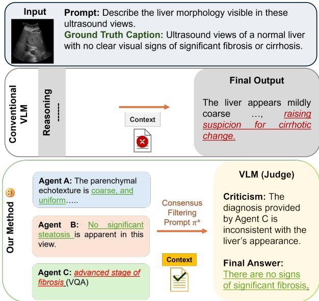  
Figure 1. Comparison with existing VLMs. Top (Conventional VLM): Utilizing a single VLM, pre-trained on a single source of clinical information, which generates responses with hallucinated findings. Bottom (Our Method): SMILE uses complementary specialist agents adapted with radiology-aligned and pathologyaligned supervision to extract complementary clinical evidence from liver ultrasound images. Red text indicates hallucinated findings, and green text indicates findings corrected by SMILE.

## 1. Introduction

Ultrasound imaging plays a central role in the evaluation of liver diseases due to its accessibility, real-time feedback, cost-effectiveness, and non-invasive assessment [13]. However, reliable diagnosis of liver diseases remains challenging because liver pathology presents heterogeneous and often ill-defined sonographic patterns, and ultrasound images are affected by data-acquisition artifacts such as speckle noise and acoustic shadowing [11, 32]. As a representative example, staging liver fibrosis from conventional ultrasound is particularly difficult because early fibrotic changes may not produce overt structural abnormalities [4, 40].

Recent advances in artificial intelligence (AI) have enabled automated analysis of ultrasound images [16, 20]. In particular, large language models (LLMs) have recently been explored for medical image understanding due to their strong capabilities in semantic abstraction and structured reasoning [14, 27, 41]. Unlike purely discriminative vision models, the integration of LLMs with vision systems can externalize intermediate reasoning steps through natural language, providing traceable and clinically interpretable explanations [6]. However, in liver ultrasound analysis, the primary challenge extends beyond text generation itself. The visual evidence provided by ultrasound is often under-constrained, allowing multiple clinically plausible interpretations to coexist for a single image. Conventional fine-tuning of single-agent LLMs implicitly assumes that a solitary reasoning trajectory is sufficient to resolve this ambiguity [18]. Under limited supervision and small-data regimes, this assumption leads to unstable reasoning behavior, loss of context awareness, and hallucinated findings that are weakly grounded in the image [1, 36, 44].

To improve the reasoning capabilities of LLMs, several studies have explored collaboration among multiple large language models for complex medical reasoning tasks [7, 17, 31, 33, 43]. These methods improve the reasoning of a LLM through role-playing, where each agent assumes a distinct expert perspective and proposes diverse plans that capture different aspects of the clinical problem. However, the benefit of such reasoning models depends strongly on the design of the collaboration mechanism among LLMs [33]. Moreover, without explicit constraints that enforce complementary reasoning, multi-agent systems may generate homogeneous, low-quality responses and induce misconceptions [5, 12]. These challenges are further highlighted in clinical imaging tasks, where limited access to independent and modality-specific evidence can reduce agent diversity and amplify unsupported clinical interpretations.

To address these limitations, we propose SMILE, a structured multi-agent clinical reasoning framework for liver ultrasound image analysis. Rather than depending on a single reasoning pathway, our approach decomposes the diagnostic process into complementary agents: (1) an image interpretation agent that converts visual features into structured morphological descriptions, (2) a clinical-stage reasoning agent guided by pathology-aligned supervision, and (3) a visual question answering (VQA) agent that improves diagnostic performance through targeted queries. These agentic responses are then evaluated by a dedicated LLM, referred to as the judge, that improves the consistency and clinical plausibility of the agents’ responses and synthesizes them into a unified, diagnostically coherent output (Fig. 1). Unlike existing multi-LLM medical reasoning frameworks, which operate on a specific clinical modality and require resource-intensive post-training, we only employ lightweight agents that can be adapted through simple fine-tuning with limited labeled datasets, making the framework suitable for data-scarce scenarios.

Our contributions can be summarized as follows: 1) We formulate liver ultrasound understanding as an underconstrained clinical reasoning problem; 2) We propose a structured multi-agent framework that stabilizes reasoning through cross-agent consistency; 3) We demonstrate improved robustness and interpretability by assessing medical image understanding under limited data conditions.

## 2. Related Work

## 2.1. Vision Language Models in Medical Report Generation

Medical report generation has evolved from task-specific image-to-text generation toward generative vision-language models (VLMs) with broader clinical reasoning ability. Early methods such as R2Gen used memory-driven Transformer architectures to generate long clinical reports directly from medical images [8]. Subsequent report generation methods addressed the cross-modal semantic gap between visual findings and clinical language, aiming to reduce inconsistent or visually unsupported descriptions [23, 37, 39]. With the rise of large language models in natural text generation, recent VLMs have moved beyond task-specific decoders by connecting visual encoders with pretrained language models for open-ended multi-modal generation. Flamingo and Med-Flamingo introduced fewshot multi-modal learning through visual resampling and gated cross-attention [2, 29]. LLaVA-Med further introduced biomedical visual instruction tuning by adapting a general vision-language assistant with biomedical captions and instruction-following data [21]. Recent state-ofthe-art VLMs such as Qwen2-VL improve image understanding through dynamic resolution processing and multimodal positional encoding, while medical VLMs such as MedGemma introduce medical-specific visual encoders to further improve the domain adaptation [30, 35]. Despite the remarkable performance on task-specific benchmarks, these VLMs focus on a single reasoning pathway, which limits the clinical correctness.

## 2.2. Multi-Agent Vision Language Models in Medical Report Generation

Researchers have explored several strategies to combine the strengths of multiple LLMs, including ensembling (e.g., Mixture-of-Experts), knowledge distillation, and multiagent debate (MAD) [19, 25, 31]. While Mixture-of-

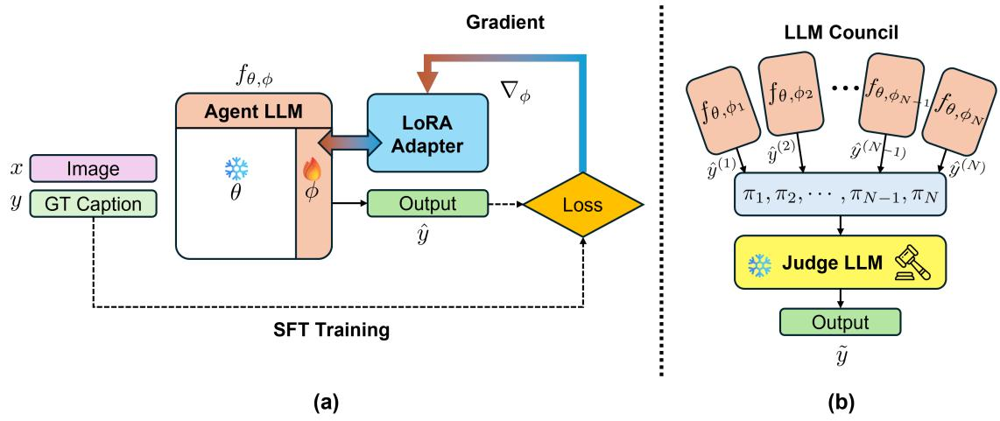  
Figure 2. An overview of our proposed method. (a) Training procedure of a single agent as explained in Section 3.3. (b) Inference from multi-agent under consensus filtering by a judge to obtain a high-fidelity liver ultrasound report.

Experts and knowledge distillation improve capacity, efficiency, or output quality, they rely on post-training or aggregation mechanisms, and thus do not explicitly support interactive, evidence-grounded reasoning at inference time. Inspired by Minsky’s Society of Mind [28], MAD instead allows multiple agents to assume different roles, exchange intermediate analyses, and reach a final decision through discussion or consensus [7, 10, 24].

Compared with general-purpose multi-agent frameworks, MedAgents [31] extended this idea to zero-shot medical reasoning by assigning domain expert roles and using multi-round discussion before final decision making. MDAgents [17] further adapted the collaboration structure according to medical task complexity, showing that the organization of agents can affect both efficiency and accuracy. Despite improvements over single LLMs, these models mainly rely on role-based discussion or response aggregation over already language-based evidence, which can lead to reasoning drift, low-quality feedback, and homogeneous outputs [33]. We argue that medical image understanding requires a different form of collaboration, where agents learn from specialized clinical evidence sources and their outputs are consolidated through complementary reasoning under a training-free judge mechanism.

## 3. Method

## 3.1. Overview of the LLM Council

We define SMILE as a council of LLMs specifically designed to analyze complementary attributes of liver ultrasound images. Each agent is fine-tuned on unique target datasets under a supervised fine-tuning (SFT) approach, which is illustrated in Fig. 2(a). We adopt parameterefficient low-rank adaptation (LoRA) [15], where agentspecific learnable parameters are introduced while keeping the shared multi-modal backbone frozen. Once all agents have been specialized, we ask them to collaborate under the guidance of an anchor LLM, referred to as the judge, which refines the outputs of each agent and provides both criticism and a verdict for their responses. As shown in Fig. 2(b), a judge can provide the final caption under a defined set of rules.

## 3.2. Problem Setup

Let $\mathcal { D } = \{ ( x _ { i } , y _ { i } ) \} _ { i = 1 } ^ { N }$ denote the training dataset, where $x _ { i }$ is a liver ultrasound case and $y _ { i }$ is the corresponding ground-truth caption. Our goal is to approximate the conditional distribution of a clinically coherent report given an ultrasound image, denoted as $p ( \tilde { y } \mid x )$ , where y˜ represents the final consensus caption generated through multi-agent reasoning and judge aggregation.

## 3.3. Agent-Level Conditional Modeling

Let $\mathcal { D } ^ { ( j ) } = \{ ( x _ { i } , y _ { i } ^ { ( j ) } ) \} _ { i = 1 } ^ { N }$ denote the agent-specific training dataset, where $y _ { i } ^ { ( j ) }$ is the ground-truth caption for agent $j ~ \in ~ \{ 1 , \dots , M \}$ , represented as a token sequence $y _ { i } ^ { ( j ) } ~ = ~ ( y _ { i , 1 } ^ { ( j ) } , \ldots , y _ { i , T _ { i } ^ { ( j ) } } ^ { ( j ) } )$ Each agent $f _ { \theta , \phi _ { j } }$ employs a frozen multi-modal backbone parameterized by θ and is adapted via the LoRA module with learnable parameters $\phi _ { j }$ . By conditioning on an agent-specific prompt $\pi _ { j }$ , the conditional distribution modeled by agent $j$ is defined as:

$$
p _ { \theta , \phi _ { j } } \left( y _ { i } ^ { ( j ) } \mid x _ { i } , \pi _ { j } \right) = \prod _ { t = 1 } ^ { T _ { i } ^ { ( j ) } } p _ { \theta , \phi _ { j } } \left( y _ { i , t } ^ { ( j ) } \mid x _ { i } , \pi _ { j } , y _ { i , < t } ^ { ( j ) } \right) .\tag{1}
$$

At inference time, the generated caption of agent $j$ is sampled as:

$$
\hat { y } _ { i } ^ { ( j ) } \sim p _ { \theta , \phi _ { j } } \left( y \mid x _ { i } , \pi _ { j } \right) .\tag{2}
$$

Each agent is trained independently using the SFT approach by minimizing the token-level negative log-likelihood. Specifically, the objective for agent $j$ can be written as:

$$
\mathcal { L } _ { \mathrm { S F T } } ^ { ( j ) } = - \sum _ { i = 1 } ^ { N } \sum _ { t = 1 } ^ { T _ { i } ^ { ( j ) } } \log p _ { \theta , \phi _ { j } } \left( y _ { i , t } ^ { ( j ) } \mid x _ { i } , \pi _ { j } , y _ { i , < t } ^ { ( j ) } \right) .\tag{3}
$$

## 3.4. Inference and Consolidation with a Judge

Once all agents are trained, their generated captions $\{ \hat { y } _ { i } ^ { ( j ) } \} _ { j = 1 } ^ { M }$ are aggregated and criticized by a judge model. The judge is a frozen LLM parameterized by θ and conditioned on a dedicated prompt $\pi ^ { * }$ . We refer to $\pi ^ { * }$ as the consensus filtering prompt, as it instructs the judge to extract a consensus from the complementary agentic responses by filtering the non-visual grounding attributes. The complete consensus-filtering prompt is provided in Supp. Note D.

Finally, the judge models the conditional distribution as:

$$
p _ { \theta } \left( \tilde { y } _ { i } \mid x _ { i } , \{ \hat { y } _ { i } ^ { ( j ) } \} _ { j = 1 } ^ { M } , \pi ^ { * } \right) ,\tag{4}
$$

and produces the final consensus caption

$$
\tilde { y } _ { i } \sim p _ { \theta } \left( y \mid x _ { i } , \{ \hat { y } _ { i } ^ { ( j ) } \} _ { j = 1 } ^ { M } , \pi ^ { * } \right) .\tag{5}
$$

## 4. Experiments

## 4.1. Datasets

Dataset-1. We utilize a publicly available Liver Ultrasound dataset consisting of 1,183 liver ultrasound images and their corresponding radiology reports [22]. For each patient, the dataset provides two distinct liver views along with a textual description of the overall liver appearance. We divide the dataset at the patient level into training, validation, and test sets with a 0.70/0.10/0.20 ratio.

Dataset-2. We retrospectively collected an independent multi-modal liver fibrosis ultrasound dataset under a protocol approved by the Institutional Review Board of the College of Medicine, The Catholic University of Korea (KC25ZISI0058). Dataset includes 1,417 liver ultrasound images obtained from 286 patients (mean age: 55.18 ± 16.04 years; 105 males (36.7%) and 181 females (63.3%)), along with 286 corresponding clinical descriptions. The ultrasound examinations consist of standardized liver views, including transverse and longitudinal scans of the left hepatic lobe, subcostal and intercostal scans of the right hepatic lobe, and hepatorenal comparative views. The clinical descriptions comprise imaging findings, histopathological examination results, and fibrosis stages based on the

METAVIR grading system. The distribution of fibrosis stages $( n = 2 8 6 )$ is as follows: F0, 34 (11.9%); F1, 107 (37.4%); F2, 38 (13.3%); F3, 67 (23.4%); F4, 40 (14.0%). We divide the patients into training and testing subsets with a ratio of 0.80/0.20. Additionally, we further split the training dataset, holding out 10% of it for validation.

## 4.2. Benchmarks

## 4.2.1. Baselines

We compare SMILE with three open source vision language models, including Qwen-2B [35], MedMO-4B [9], and MedGemma-4B [30]. All baselines are fine-tuned on the training subset of each benchmark dataset, following the same preprocessing and evaluation protocol to ensure a fair comparison with SMILE.

We further compare with MedAgents [31], a trainingfree multi-agent LLM for collaborative medical reasoning. To ensure a fair comparison, we follow the role-playing architecture and multi-stage collaboration protocol from the official implementation, including expert gathering, individual expert analysis, synthesized report generation, collaborative consultation, and final decision-making. Since the original MedAgents framework is designed for textbased medical reasoning, we adapt its prompts and agent roles to the liver ultrasound setting while preserving its original collaboration structure. Specifically, the individual experts, radiology- and pathology-specialized agents, have been fine-tuned on their respective domain-specific datasets. The task-adapted MedAgents configuration and collaboration protocol are detailed in Supp. Note A.1.

## 4.2.2. Evaluation Metrics

For natural language generation (NLG), we compare the generated text with ground truth reports and calculate ROUGE-1 (R-1), ROUGE-L (R-L) [26], METEOR (M) [3], and BERTScore (BS) [42] for assessing the linguistic quality of generated responses. For clinical efficacy (CE), we extract the appearance-based common keywords from generated reports and report accuracy, precision, recall, and F1- score.

We evaluate clinical correctness using closed-set visual question answering (VQA). We derive a set of questions from appearance-based ultrasound findings and clinical attributes described in the ground truth reports of both datasets. We report accuracy and F1-score for VQA evaluation.

We utilize MedCLIP [38] to encode the ultrasound images and reports into visual and textual embeddings, respectively. We measure the image text alignment by computing the cosine similarity between the visual embedding of each liver ultrasound image and the text embedding of its generated report. A detailed discussion on evaluation metrics is provided in Supp. Note B.

<table><tr><td rowspan="2">Dataset</td><td rowspan="2">Model</td><td colspan="4">NLG</td><td colspan="4">CE</td><td colspan="3">Cost</td></tr><tr><td>R-1</td><td>R-L</td><td>M</td><td>BS</td><td>Acc</td><td>Prec</td><td>Rec</td><td>F1</td><td>P</td><td>L</td><td>FLOPs</td></tr><tr><td rowspan="5">D-1</td><td>Qwen-2B [35]</td><td>0.10</td><td>0.09</td><td>0.02</td><td>0.81</td><td>0.88</td><td>0.88</td><td>0.05</td><td>0.01</td><td>4.36</td><td>13.2</td><td>3.9</td></tr><tr><td>MedMO-4B [9]</td><td>0.69</td><td>0.59</td><td>0.47</td><td>0.93</td><td>0.94</td><td>0.84</td><td>0.59</td><td>0.69</td><td>80.54</td><td>23.8</td><td>7.0</td></tr><tr><td>MedGem-4B [30]</td><td>0.59</td><td>0.48</td><td>0.49</td><td>0.90</td><td>0.94</td><td>0.78</td><td>0.66</td><td>0.72</td><td>77.00</td><td>25.6</td><td>7.6</td></tr><tr><td>MedAgents [31]</td><td>0.60</td><td>0.45</td><td>0.50</td><td>0.90</td><td>0.94</td><td>0.77</td><td>0.70</td><td>0.73</td><td>55.63</td><td>228.9</td><td>81.9</td></tr><tr><td>SMILE (Ours)</td><td>0.72</td><td>0.61</td><td>0.56</td><td>0.93</td><td>0.96</td><td>0.85</td><td>0.80</td><td>0.82</td><td>55.63</td><td>74.3</td><td>34.0</td></tr><tr><td rowspan="5">D-2</td><td>Qwen-2B [35]</td><td>0.19</td><td>0.19</td><td>0.08</td><td>0.74</td><td>一</td><td>一</td><td></td><td>一</td><td>4.36</td><td>15.5</td><td>6.1</td></tr><tr><td>MedMO-4B [9]</td><td>0.40</td><td>0.38</td><td>0.29</td><td>0.80</td><td>一</td><td>一</td><td></td><td></td><td>80.54</td><td>28.1</td><td>11.0</td></tr><tr><td>MedGem-4B [30]</td><td>0.42</td><td>0.39</td><td>0.35</td><td>0.78</td><td></td><td>一</td><td></td><td></td><td>77.00</td><td>30.2</td><td>11.9</td></tr><tr><td>MedAgents [31]</td><td>0.37</td><td>0.33</td><td>0.31</td><td>0.77</td><td></td><td></td><td></td><td></td><td>55.63</td><td>266.1</td><td>116.7</td></tr><tr><td>SMILE (Ours)</td><td>0.50</td><td>0.50</td><td>0.32</td><td>0.81</td><td></td><td></td><td></td><td></td><td>55.63</td><td>81.8</td><td>35.3</td></tr></table>

Table 1. Quantitative comparison of the proposed SMILE with finetuned state-of-the-art models. We report the NLG, CE and computationa cost on the test subsets of Dataset-1 and Dataset-2. The best results are highlighted in bold. P, L, and FLOPs denote trainable parameters, inference latency, and floating-point operations, reported in millions (106), seconds, and trillion $( 1 0 ^ { 1 2 } )$ operations, respectively.

## 4.2.3. Implementation Details

Role of Agents. We define three agents, represented by A, B, and $C ,$ to decompose liver ultrasound understanding into complementary reasoning tasks. Agent A generates structured descriptions of appearance-based features, including echogenicity patterns, parenchymal texture, organ boundaries, and anatomical visibility. Its role is restricted to visually verifiable findings, without inferring pathological conclusions beyond the image evidence. Agent B performs pathology-oriented diagnostic reasoning and provides higher-level interpretations related to diffuse liver disease and fibrosis-relevant findings. Agent C follows a VQA setting, where it answers a predefined attribute question bank with a closed answer set.

Training Strategy. We select our agents and the judge model from a pool of open-source VLMs, including Qwen-2B, MedMO-4B, and MedGemma-4B. Specifically, we design the training procedure to utilize target captions from Dataset-1 (n = 828) and Dataset-2 (n = 228) to train Agent A and Agent B, respectively. To enforce visual grounding and reduce hallucinations and response repetition, we train Agent C on our VQA-driven questions derived from both datasets. All agents are trained independently on their respective datasets using SFT with parameter-efficient finetuning method (PeFT) [34].

Post-training and Hyperparameter Selection. During training, we select hyperparameters on the validation subsets by performing a bounded grid search over LoRA configurations. We search over rank $r \in \{ 4 , 8 , 1 6 , 3 2 \}$ , scale $\alpha ~ \in ~ \{ 4 , 8 , 1 6 , 3 2 , 6 4 \}$ , learning rate in $\{ 2 \times 1 0 ^ { - 5 } , 2 \times$ $1 0 ^ { - 4 } , \dot { 1 0 } ^ { - 3 } , 1 0 ^ { - 2 } \}$ , and batch size in $\{ 2 , 4 , 8 \}$ . The selected configurations are MedGemma-4B for Agent A (r =

<table><tr><td>Dataset</td><td>Model</td><td>Accuracy</td><td>F1-score</td></tr><tr><td rowspan="4">D-1</td><td>Qwen-2B [35]</td><td>0.62</td><td>0.77</td></tr><tr><td>MedMO-4B [9]</td><td>0.67</td><td>0.76</td></tr><tr><td>MedGem-4B [30]</td><td>0.53</td><td>0.62</td></tr><tr><td>MedAgents [31] SMILE (Ours)</td><td>0.50 0.77</td><td>0.41 0.82</td></tr><tr><td rowspan="4">D-2</td><td>Qwen-2B [35] MedMO-4B [9]</td><td>0.32 0.56</td><td>0.44 0.57</td></tr><tr><td>MedGem-4B [30]</td><td>0.46</td><td>0.61</td></tr><tr><td>MedAgents [31]</td><td></td><td></td></tr><tr><td>SMILE (Ours)</td><td>0.40 0.48</td><td>0.39 0.65</td></tr></table>

Table 2. VQA-based clinical verification on Dataset-1 (D-1) and Dataset-2 (D-2)

16, α = 32) and Qwen-2B for both Agents B&C $( r \ =$ $8 , \alpha = 1 6 )$ , all trained with learning rate $2 \times 1 0 ^ { - 4 }$ . LoRA is applied to all linear projections for A/B and only query/key projections for C. A zero-shot MedGemma-4B acts as a judge during inference, and aggregates all responses as detailed in 3.4. All models are implemented in PyTorch with CUDA using publicly available model weights and official implementations. All experiments are conducted on two A6000 GPU nodes. Additional implementation details are provided in Supp. Notes A and E.

## 4.3. Results

## 4.3.1. Medical Image Understanding

Table 1 reports the performance of SMILE against fine-tuned VLMs and a multi-agent VLM baseline. SMILE achieves the best overall performance among fine-tuned open-source VLMs on both datasets. On Dataset-1, our method outperforms the strongest fine-tuned baseline, MedMO-4B, improving ROUGE-1 by 4.3% from 0.69 to 0.72, ROUGE-L by 3.4% from 0.59 to 0.61, and METEOR by 19.1% from 0.47 to 0.56. Under CE evaluation, SMILE improves the F1-score by 18.8% from 0.69 to 0.82 compared with MedMO-4B. Similarly, on Dataset-2, SMILE outperforms the strongest fine-tuned baseline, MedGemma-4B, improving both ROUGE-1 and ROUGE-L by 19.0% and 28.2%, respectively.

<table><tr><td>Dataset</td><td>Model Qwen-2B [35] MedMO-4B [9] MedGem-4B [30] MedAgents [31]</td><td>Mean 0.48 0.45 0.49 0.45</td><td>Std 0.014 0.009 0.020 0.007</td></tr><tr><td>D-2</td><td>SMILE (Ours) Qwen-2B [35] MedMO-4B [9] MedGem-4B [30] MedAgents [31]</td><td>0.51 0.33 0.32 0.30 0.32</td><td>0.014 0.010 0.064 0.009 0.017 0.010</td></tr></table>

Table 3. Image text alignment between liver ultrasound images and generated reports. We report the mean and standard deviation of cosine similarity between visual and textual embeddings.

We further compare SMILE with MedAgents to evaluate the effectiveness of our designed framework for liver ultrasound understanding. On Dataset-1, SMILE improves over MedAgents by 0.12 in ROUGE-1, 0.16 in ROUGE-L, 0.06 in METEOR, and 0.09 in CE-F1. On Dataset-2, SMILE also improves over MedAgents by 0.13 in ROUGE-1, 0.17 in ROUGE-L, and 0.01 in METEOR.

SMILE achieves stronger medical image understanding across NLG and CE metrics despite requiring fewer trainable parameters than the single VLM baselines, such as MedMO-4B and MedGemma-4B. Compared with MedAgents under the same trainable parameter count of 55.63M, SMILE requires much less inference compute, with 2.7× 2.4× fewer FLOPs and 3.1× lower latency on Dataset-1 (3.31× and 3.25× on Dataset-2). These results show that the role specialization and consensus filtering improve the use of both model capacity and efficiency of inference cost (see more analysis in Supp. Note E).

## 4.3.2. Evaluation on Visual Question Answering

Table 2 summarizes closed-ended VQA performance across 837 and 108 evaluated questions for Dataset-1 and Dataset-2, respectively. On Dataset-1, SMILE achieves the highest accuracy and F1-score, with scores of 0.77 and 0.82, respectively. Compared with the strongest baseline by F1- score, Qwen-2B, SMILE improves F1-score from 0.77 to 0.82, corresponding to a relative improvement of 6.5%. It also improves over MedMO-4B from 0.76 to 0.82 and over MedGemma-4B from 0.62 to 0.82. Similarly, on Dataset-2, SMILE achieves the highest F1-score of 0.65, improving over MedMO-4B from 0.57 to 0.65, MedGemma-4B from 0.61 to 0.65, and Qwen-2B from 0.44 to 0.65.

## 4.3.3. Image Text Alignment

Table 3 reports the cosine similarity between visual embeddings from liver ultrasound images and text embeddings from generated reports. SMILE achieves the highest image text alignment on both datasets, with a mean similarity of 0.51 on Dataset-1 and 0.36 on Dataset-2. On Dataset-1, SMILE improves the MedGemma-4B, from 0.49 to 0.51. It also improves over MedAgents from 0.45 to 0.51. These results suggest that the reports generated by SMILE are more closely aligned with the corresponding ultrasound images in the shared embedding space.

## 4.3.4. Ablation Studies

We perform ablation studies on agent specialization, agent collaboration, judge inputs, fusion strategy, and council composition, as shown in Table 4 (see implementation details in Supp. Note A). We note that each agent specializes in specific aspects of liver ultrasound knowledge; however, on its own, it struggles to achieve optimal understanding performance. For example, Agent A outperforms other single-agent VLMs by achieving ROUGE-L of 0.37, ME-TEOR of 0.24, and CE-F1 of 0.53. While Agent B struggles to perform on-par with Agent A because Agent A has been finetuned on the specialized knowledge for appearancebased interpretation as compared to Agent B, which focuses on pathology-motivated cues. Agent C also performs poorly as a report generator, with ROUGE-L of 0.14 and METEOR of 0.06, but its CE-F1 of 0.26 shows that the VQA agent still contributes some finding-level evidence despite weak free text generation.

Pairwise Agents. We perform pairwise ablations of our council, which shows that agent collaboration improves image understanding of liver diagnosis. Specifically, when combined Agents A and B, it gives the strongest pairwise report generation scores, increasing ROUGE-L from 0.37 to 0.62 and METEOR from 0.24 to 0.50 compared with Agent A alone. However, its CE-F1 remains 0.70, which is further improved by adding the VQA agent, and finally enforces the constraints upon council toward clinical entity preservation. We also observe that the A+C setting increases CE-F1 from 0.53 to 0.73 compared with Agent A alone, even though its ROUGE-L decreases from 0.37 to 0.33.

Judge Ablations We isolate the contribution of the judge through input, fusion, and council controls: 1) using the image alone yields only 0.17 ROUGE-1 and 0.20 CE-

<table><tr><td>Setting</td><td>R-1</td><td>R-L</td><td>M</td><td>CE-F1</td><td>P (M)</td><td>Calls</td><td>L (s)</td><td>FLOPs</td></tr><tr><td>Single Agents</td><td></td><td></td><td></td><td></td><td></td><td></td><td></td><td></td></tr><tr><td>Agent A (Radiology Specialist)</td><td>0.44†</td><td>0.37†</td><td>0.24†</td><td>0.53</td><td>38.50</td><td>1</td><td>25.6</td><td>7.6</td></tr><tr><td>Agent B (Pathology Specialist)</td><td>0.25†</td><td>0.24†</td><td>0.05†</td><td>0.03</td><td>14.61</td><td>1</td><td>13.2</td><td>3.9</td></tr><tr><td>Agent C (VQA Specialist)</td><td>0.18†</td><td>0.14†</td><td>0.06†</td><td>0.26</td><td>2.52</td><td>1</td><td>49.4</td><td>14.6</td></tr><tr><td>Pairwise Agents</td><td></td><td></td><td></td><td></td><td></td><td></td><td></td><td></td></tr><tr><td>A +B</td><td>0.70</td><td>0.62</td><td>0.50†</td><td>0.70</td><td>53.11</td><td>3</td><td>70.2</td><td>24.4</td></tr><tr><td>A +C</td><td>0.42†</td><td>0.33†</td><td>0.16†</td><td>0.73</td><td>41.02</td><td>3</td><td>58.7</td><td>27.9</td></tr><tr><td>B+C</td><td>0.29†</td><td>0.21†</td><td>0.13†</td><td>0.62</td><td>17.13</td><td>3</td><td>46.3</td><td>24.2</td></tr><tr><td>Judge Input</td><td></td><td></td><td></td><td></td><td></td><td></td><td></td><td></td></tr><tr><td>SMILE (Judge with image only)</td><td>0.17†</td><td>0.14†</td><td>0.06†</td><td>0.20</td><td>0.00</td><td>1</td><td>26.7</td><td>8.6</td></tr><tr><td>SMILE (Judge with agent outputs only)</td><td>0.48†</td><td>0.38†</td><td>0.32†</td><td>0.74</td><td>55.63</td><td>4</td><td>69.6</td><td>29.6</td></tr><tr><td>Fusion Controls</td><td></td><td></td><td></td><td></td><td></td><td></td><td></td><td></td></tr><tr><td>SMILE (Judge with an ensembling prompt)</td><td>0.41†</td><td>0.32†</td><td>0.20†</td><td>0.53</td><td>55.63</td><td>4</td><td>74.3</td><td>34.1</td></tr><tr><td>SMILE (Judge with a Cross Attention Module)</td><td>0.23†</td><td>0.17†</td><td>0.09†</td><td>0.42</td><td>120.81</td><td>4</td><td>68.5</td><td>28.6</td></tr><tr><td>Council and Judge Controls</td><td></td><td></td><td></td><td></td><td></td><td></td><td></td><td></td></tr><tr><td>SMILE (Homogeneous Council)</td><td>0.68†</td><td>0.55†</td><td>0.57</td><td>0.77</td><td>60.97</td><td>4</td><td>84.8</td><td>33.1</td></tr><tr><td>SMILE (General Agents)</td><td>0.30†</td><td>0.21†</td><td>0.13†</td><td>0.72</td><td>0.00</td><td>4</td><td>74.3</td><td>34.0</td></tr><tr><td>SMILE (Qwen-2B as a Judge)</td><td>0.57†</td><td>0.45†</td><td>0.36</td><td>0.77</td><td>55.63</td><td>4</td><td>59.0</td><td>27.7</td></tr><tr><td>SMILE (Ours)</td><td>0.72</td><td>0.61</td><td>0.56</td><td>0.82</td><td>55.63</td><td>4</td><td>74.3</td><td>34.1</td></tr></table>

Table 4. Ablation analysis of SMILE on Dataset-1. We report single agents, pairwise agents, judge-input controls, fusion controls, and judge-backbone ablations. P denotes the number of trainable parameters in millions, Calls denotes the number of model invocations pe patient, L denotes average inference latency per patient in seconds, and FLOPs denote floating-point operations, reported in trillions $( 1 0 ^ { 1 2 } )$ CE-F1 represents the clinical efficacy F1-score. For the NLG metrics, \dager indicates that the complete SMILE model significantly outperforms the corresponding ablation according to a two-sided Wilcoxon signed-rank test with Holm correction $( p _ { \mathrm { a d j } } < 0 . 0 5 )$ . Unmarked NLG values indicate that the difference is not statistically significant. The statistical testing protocol is detailed in Supp. Note F.

F1, whereas providing agent outputs without visual input improves these scores to 0.48 and 0.74, showing that agent-derived responses provide stronger clinical evidence to the judge; 2) simple aggregation remains insufficient, as an ensembling prompt achieves CE-F1 of 0.53, identical to Agent A alone, while Cross Attention fusion reaches only 0.23 ROUGE-1 and 0.42 CE-F1 despite requiring 120.81M trainable parameters; 3) a homogeneous council reaches 0.68 ROUGE-1 and 0.77 CE-F1, remaining below SMILE at 0.72 and 0.82 while requiring more trainable parameters (60.97M vs. 55.63M) and higher latency (84.8s vs. 74.3s); 4) general zero-shot agents achieve only 0.30 ROUGE-1 despite using the same four model calls, showing that additional inference alone does not guarantee better performance; and 5) replacing the MedGem-4B judge with Qwen-2B shows that specialized agents provide sufficiently informative clinical evidence for consolidation across different judge LLM. Overall, these results, including statistically significant improvements in NLG, suggest that SMILE benefits from complementary agent specialization and criticism-based consensus filtering rather than increased model capacity or inference cost.

## 4.3.5. Qualitative Analysis:

To further highlight the importance of a multi-agent LLM council in providing the complementary reasoning paths for liver ultrasound, we present a case study from VQA task and a case from Report Generation Task in (a) and (b) Fig S1. In example (a), the image shows diffused echogenicity in the parenchymal region. Initially, Agent C fails to answer correctly, as do other single LLM baselines. However, Agent A, which reasons over grounded captions learned during fine-tuning, and Agent B, which provides fibrosis hints based on contrast patterns, together supply the contextual information needed for the council to self-correct without any external context. Example (b) highlights an important failure mode of the council. The reference report describes a plump liver with increased parenchymal echogenicity, whereas Agent A incorrectly characterizes the liver as normal in shape and echogenicity. In this case, Agent C correctly identifies increased echogenicity, yet the judge fails to incorporate this evidence and does not recover the reference liver morphology and echogenicity. This case shows that consensus aggregation can fail when correct evidence from one specialist is ignored relative to conflicting agent responses (see more case-studies in Supp. Note C.)

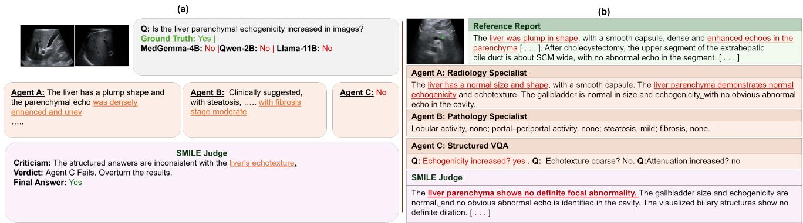  
Figure 3. Qualitative analysis of SMILE. (a) Successful correction using complementary agent evidence. (b) Failure case where the judge overlooks a correct agent finding. Red, green, and orange denote incorrect, correct, and complementary findings, respectively.

## 5. Discussion

Complementary roles of radiology- and pathologyaligned supervision. SMILE leverages two complementary sources of clinical supervision instead of relying on a single source. Radiology-aligned supervision captures visually observable findings, including echogenicity, parenchymal texture, anatomical visibility, and lesion appearance. Pathology-aligned supervision provides disease-level interpretive context through textual staging labels (e.g., fibrosis grade, steatosis score). Instead of forcing a single VLM to map images directly to both visual descriptions and disease stages, we assign each supervision target to a specialized agent. Finally, a training-free judge VLM, aligns the outputs of these agents by retaining findings supported by complementary evidence.

Benefits of consensus filtering over role-based aggregation. Role-based aggregation, as used in MedAgents, improves general medical QA through iterative expert discussion. However, it is less effective for ultrasound-specific visual reasoning because it lacks an explicit mechanism to verify whether a stated finding is grounded in the image. In SMILE, each agent is prompted to provide a complementary source of evidence: radiology-oriented morphology, pathology-aligned disease interpretation, and structured fact verification. Our prompting strategy ensures that the judge does not simply merge these outputs or select the majority response. Instead, it cross-references each candidate’s findings against the complementary evidence from the other agents, as shown in Fig. S1. We observe that findings unsupported by cross-agent evidence or contradicted by other agents are filtered out, reducing hallucination-related errors in the final output.

Clinical adaptability under limited-data conditions. SMILE improves clinical adaptability by reducing the training and inference requirements that often limit medical multi-agent systems in data-scarce radiology settings. First, SMILE does not require end-to-end fine-tuning of a large VLM. Each agent is adapted through lightweight LoRA for a specific supervision source. Second, SMILE does not rely on multiple rounds of agent debate. Each agen produces its report once, while a zero-shot VLM acting as the judge performs consensus filtering, reducing inference complexity and limiting repeated reasoning errors compared with multi-agent systems that require iterative discussion. Third, SMILE enables learning from unpaired radiology and pathology supervision without requiring each ultrasound case to include both a radiology report and a pathology-based description. Instead, agents are specialized using their respective supervision sources, and their outputs are integrated at inference through judge-guided consensus filtering. This design makes SMILE better suited for heterogeneous clinical datasets, where data are often uni-modal, institution-dependent, and collected under different reporting protocols.

Limitations. Our results also highlight the limitations of direct fine-tuning in low-data medical VLM settings. Although fine-tuned single models improve task adaptation, they remain sensitive to dataset bias and incomplete clinica supervision. If all agents miss the same finding or produce the same incorrect observation, the judge may not recover the correct interpretation. Furthermore, while we avoid iterative debate, the parallel forward pass of three specialized agents increases inference latency compared to a single model. Future work should evaluate SMILE across larger multi-center cohorts and diverse clinical tasks to assess its broader generalization.

## 6. Conclusion

We propose SMILE, a structured multi-agent framework that enhances interpretability in liver ultrasound understanding. By leveraging agents trained on diverse information sources, our approach provides complementary context to generate visually-grounded and accurate medical reports. Experimental results demonstrate that SMILE significantly outperforms conventional methods in both image understanding and clinical diagnostic performance. Future work will focus on incorporating reinforcement learningbased policy optimization for judge decisions and developing more sophisticated collaborative rules, which could drive further breakthroughs in both natural imaging and clinical applications.

## Acknowledgement

This work was supported by the National Research Foundation of Korea (NRF) grant funded by the Korea government (MSIT) (No. RS-2024-00335185). This work was also supported by the Korea Medical Device Development Fund grant funded by the Korea government (the Ministry of Science and ICT, the Ministry of Trade, Industry and Energy, the Ministry of Health & Welfare, the Ministry of Food and Drug Safety) (Project Number: RS-2026-25543484).

## References

[1] Aisha Alansari and Hamzah Luqman. Large language models hallucination: A comprehensive survey. arXiv preprint arXiv:2510.06265, 2025. 2

[2] Jean-Baptiste Alayrac, Jeff Donahue, Pauline Luc, Antoine Miech, Iain Barr, Yana Hasson, Karel Lenc, Arthur Mensch, Katherine Millican, Malcolm Reynolds, et al. Flamingo: a visual language model for few-shot learning. Advances in neural information processing systems, 35:23716–23736, 2022. 2, 12

[3] Satanjeev Banerjee and Alon Lavie. Meteor: An automatic metric for mt evaluation with improved correlation with human judgments. In Proceedings of the acl workshop on intrinsic and extrinsic evaluation measuresfor machine translation and/or summarization, pages 65–72, 2005. 4, 14

[4] Ramon Bataller, David A Brenner, et al. Liver fibrosis.´ J. Clin. Invest., 115(2):209–218, 2005. 2

[5] Jonas Becker, Lars Benedikt Kaesberg, Andreas Stephan, Jan Philip Wahle, Terry Ruas, and Bela Gipp. Stay focused: Problem drift in multi-agent debate. In Findings of the Association for Computational Linguistics: EACL 2026, pages 5068–5102, 2026. 2

[6] Junying Chen, Chi Gui, Ruyi Ouyang, Anningzhe Gao, Shunian Chen, Guiming Hardy Chen, Xidong Wang, Zhenyang Cai, Ke Ji, Xiang Wan, and Benyou Wang. Towards injecting medical visual knowledge into multimodal LLMs at scale. In Proceedings of the 2024 Conference on Empirical Methods in Natural Language Processing, pages 7346–7370, Miami,

Florida, USA, 2024. Association for Computational Linguistics. 2

[7] Justin Chen, Swarnadeep Saha, and Mohit Bansal. Reconcile: Round-table conference improves reasoning via consensus among diverse llms. In Proceedings of the 62nd An nual Meeting of the Association for Computational Linguistics (Volume 1: Long Papers), pages 7066–7085, 2024. 2, 3

[8] Zhihong Chen, Yan Song, Tsung-Hui Chang, and Xiang Wan. Generating radiology reports via memory-driven transformer. In Proceedings of the 2020 conference on empirical methods in natural language processing (EMNLP), pages 1439–1449, 2020. 2

[9] Ankan Deria, Komal Kumar, Adinath Madhavrao Dukre, Eran Segal, Salman Khan, and Imran Razzak. Medmo: Grounding and understanding multimodal large language model for medical images, 2026. 4, 5, 6

[10] Yilun Du, Shuang Li, Antonio Torralba, Joshua B Tenenbaum, and Igor Mordatch. Improving factuality and reasoning in language models through multiagent debate. arXiv preprint arXiv:2305.14325, 2023. 3

[11] Julia C D’Souza, Laith R Sultan, Stephen J Hunt, Susan M Schultz, Angela K Brice, Andrew KW Wood, and Chandra M Sehgal. B-mode ultrasound for the assessment of hep atic fibrosis: A quantitative multiparametric analysis for a radiomics approach. Scientific Reports, 9(1):8708, 2019. 2

[12] Andrew Estornell and Yang Liu. Multi-llm debate: Framework, principals, and interventions. Advances in Neural In formation Processing Systems, 37:28938–28964, 2024. 2

[13] Mireen Friedrich-Rust, Katrin Wunder, Susanne Kriener, Fariba Sotoudeh, Swantje Richter, Joerg Bojunga, Eva Her rmann, Thierry Poynard, Christoph F Dietrich, Johannes Vermehren, et al. Liver fibrosis in viral hepatitis: noninvasive assessment with acoustic radiation force impulse imag ing versus transient elastography. Radiology, 252(2):595– 604, 2009. 1

[14] Takanobu Hirosawa, Ren Kawamura, Yukinori Harada, Kazuya Mizuta, Kazuki Tokumasu, Yuki Kaji, Tomoharu Suzuki, and Taro Shimizu. Chatgpt-generated differential diagnosis lists for complex case–derived clinical vignettes: diagnostic accuracy evaluation. JMIR Med. Inform., 11: e48808, 2023. 2

[15] Edward J. Hu, Yelong Shen, Phillip Wallis, Zeyuan Allen-Zhu, Yuanzhi Li, Shean Wang, Lu Wang, and Weizhu Chen. Lora: Low-rank adaptation of large language models, 2021. 3

[16] Yunsang Joo, Hyun-Cheol Park, O-Joun Lee, Changhan Yoon, Moon Hyung Choi, and Chang Choi. Classification of liver fibrosis from heterogeneous ultrasound image. Ieee Access, 11:9920–9930, 2023. 2

[17] Yubin Kim, Chanwoo Park, Hyewon Jeong, Yik S Chan, Xuhai Xu, Daniel McDuff, Hyeonhoon Lee, Marzyeh Ghassemi, Cynthia Breazeal, and Hae W Park. Mdagents: An adaptive collaboration of llms for medical decision-making. Advances in Neural Information Processing Systems, 37: 79410–79452, 2024. 2, 3

[18] Yubin Kim, Hyewon Jeong, Shan Chen, Shuyue Stella Li, Chanwoo Park, Mingyu Lu, Kumail Alhamoud, Jimin Mun,

Cristina Grau, Minseok Jung, et al. Medical hallucinations in foundation models and their impact on healthcare. arXiv preprint arXiv:2503.05777, 2025. 2

[19] Byung-Kwan Lee, Ryo Hachiuma, Yong Man Ro, Frank Wang, and Yueh-Hua Wu. Unified reinforcement and imitation learning for vision-language models. Advances in Neural Information Processing Systems, 38:156508–156534, 2026. 2

[20] Jeong Hyun Lee, Ijin Joo, Tae Wook Kang, Yong Han Paik, Dong Hyun Sinn, Sang Yun Ha, Kyunga Kim, Choonghwan Choi, Gunwoo Lee, Jonghyon Yi, et al. Deep learning with ultrasonography: automated classification of liver fibrosis using a deep convolutional neural network. Eur. Radiol., 30(2):1264–1273, 2020. 2

[21] Chunyuan Li, Cliff Wong, Sheng Zhang, Naoto Usuyama, Haotian Liu, Jianwei Yang, Tristan Naumann, Hoifung Poon, and Jianfeng Gao. Llava-med: Training a large languageand-vision assistant for biomedicine in one day. Advances in Neural Information Processing Systems, 36:28541–28564, 2023. 2

[22] Jun Li, Tongkun Su, Baoliang Zhao, Faqin Lv, Qiong Wang, Nassir Navab, Ying Hu, and Zhongliang Jiang. Ultrasound report generation with cross-modality feature alignment via unsupervised guidance. IEEE Trans. Med. Imaging, 44(1): 19–30, 2025. 4

[23] Mingjie Li, Wenjia Cai, Karin Verspoor, Shirui Pan, Xiaodan Liang, and Xiaojun Chang. Cross-modal clinical graph transformer for ophthalmic report generation. In Proceedings of the IEEE/CVF Conference on Computer Vision and Pattern Recognition, pages 20656–20665, 2022. 2

[24] Tian Liang, Zhiwei He, Wenxiang Jiao, Xing Wang, Yan Wang, Rui Wang, Yujiu Yang, Shuming Shi, and Zhaopeng Tu. Encouraging Divergent Thinking in Large Language Models through Multi-Agent Debate. In Proceedings of the 2024 Conference on Empirical Methods in Natural Language Processing, pages 17889–17904. Association for Computational Linguistics, 2024. 3

[25] Bin Lin, Zhenyu Tang, Yang Ye, Jinfa Huang, Junwu Zhang, Yatian Pang, Peng Jin, Munan Ning, Jiebo Luo, and Li Yuan. Moe-llava: Mixture of experts for large vision-language models. IEEE Transactions on Multimedia, 2026. 2

[26] Chin-Yew Lin. Rouge: A package for automatic evaluation of summaries. In Text summarization branches out, pages 74–81, 2004. 4, 14

[27] Xu Liu, Chaoli Duan, Min-kyu Kim, Lu Zhang, Eunjin Jee, Beenu Maharjan, Yuwei Huang, Dan Du, and Xian Jiang. Claude 3 opus and chatgpt with gpt-4 in dermoscopic image analysis for melanoma diagnosis: comparative performance analysis. JMIR Med. Inform., 12:e59273, 2024. 2

[28] Marvin Minsky. Society ofmind. Simon and Schuster, 1986. 3

[29] Michael Moor, Qian Huang, Shirley Wu, Michihiro Yasunaga, Yash Dalmia, Jure Leskovec, Cyril Zakka, Eduardo Pontes Reis, and Pranav Rajpurkar. Med-flamingo: a multimodal medical few-shot learner. In Machine learning for health (ML4H), pages 353–367. PMLR, 2023. 2

[30] Andrew Sellergren, Sahar Kazemzadeh, Tiam Jaroensri, Atilla Kiraly, Madeleine Traverse, Timo Kohlberger,

Shawn Xu, Fayaz Jamil, C´ıan Hughes, Charles Lau, et al. Medgemma technical report. arXiv preprint arXiv:2507.05201, 2025. 2, 4, 5, 6

[31] Xiangru Tang, Anni Zou, Zhuosheng Zhang, Ziming Li, Yilun Zhao, Xingyao Zhang, Arman Cohan, and Mark Ger stein. Medagents: Large language models as collaborators for zero-shot medical reasoning. In Findings of the Associationfor Computational Linguistics: ACL 2024, pages 599– 621, 2024. 2, 3, 4, 5, 6, 12

[32] Hisham Tchelepi, Philip W. Ralls, Randall Radin, and Edward Grant. Sonography of diffuse liver disease. J. Ultra sound Med., 21(9):1023–1032, 2002. 2

[33] Khanh-Tung Tran, Dung Dao, Minh-Duong Nguyen, Quoc Viet Pham, Barry O’Sullivan, and Hoang D Nguyen. Multiagent collaboration mechanisms: A survey of llms. arXiv preprint arXiv:2501.06322, 2025. 2, 3

[34] Luping Wang, Sheng Chen, Linnan Jiang, Shu Pan, Runze Cai, Sen Yang, and Fei Yang. Parameter-efficient fine-tuning in large language models: a survey of methodologies. Artif. Intell. Rev., 58(8):227, 2025. 5

[35] Peng Wang, Shuai Bai, Sinan Tan, Shijie Wang, Zhihao Fan, Jinze Bai, Keqin Chen, Xuejing Liu, Jialin Wang, Wenbin Ge, Yang Fan, Kai Dang, Mengfei Du, Xuancheng Ren, Rui Men, Dayiheng Liu, Chang Zhou, Jingren Zhou, and Junyang Lin. Qwen2-vl: Enhancing vision-language model’s perception of the world at any resolution, 2024. 2, 4, 5, 6

[36] Yihan Wang, Andrew Bai, Nanyun Peng, and Cho-Jui Hsieh. On the loss of context-awareness in general instruction finetuning. arXiv preprint arXiv:2411.02688, 2024. 2

[37] Zhanyu Wang, Mingkang Tang, Lei Wang, Xiu Li, and Lup ing Zhou. A medical semantic-assisted transformer for ra diographic report generation. In International Conference on Medical Image Computing and Computer-Assisted Intervention, pages 655–664. Springer, 2022. 2

[38] Zifeng Wang, Zhenbang Wu, Dinesh Agarwal, and Jimeng Sun. Medclip: Contrastive learning from unpaired medical images and text. In Proceedings of the 2022 Conference on Empirical Methods in Natural Language Processing, pages 3876–3887, 2022. 4, 15

[39] Zhanyu Wang, Lingqiao Liu, Lei Wang, and Luping Zhou. R2gengpt: Radiology report generation with frozen llms. Meta-Radiology, 1(3):100033, 2023. 2

[40] Thomas A Wynn and Thirumalai R Ramalingam. Mecha nisms of fibrosis: therapeutic translation for fibrotic disease. Nat. Med., 18(7):1028–1040, 2012. 2

[41] Xintian Yang, Tongxin Li, Qin Su, Yaling Liu, Chenxi Kang, Yong Lyu, Lina Zhao, Yongzhan Nie, and Yanglin Pan. Ap plication of large language models in disease diagnosis and treatment. Chin. Med. J., 138(02):130–142, 2025. 2

[42] Tianyi Zhang, Varsha Kishore, Felix Wu, Kilian Q Weinberger, and Yoav Artzi. Bertscore: Evaluating text generation with bert. arXiv preprint arXiv:1904.09675, 2019. 4, 14

[43] Weitong Zhang, Mengyun Qiao, Chengqi Zang, Steven Niederer, Paul M Matthews, Wenjia Bai, and Bernhard Kainz. Multi-agent reasoning for cardiovascular imaging phenotype analysis. In International Conference on Medi

cal Image Computing and Computer-Assisted Intervention, pages 429–439. Springer, 2025. 2

[44] Jingming Zhuo, Songyang Zhang, Xinyu Fang, Haodong Duan, Dahua Lin, and Kai Chen. Prosa: Assessing and understanding the prompt sensitivity of llms. In Findings ofthe Association for Computational Linguistics: EMNLP 2024, pages 1950–1976, 2024. 2

# SMILE: A Structured Multi-Agent Clinical Reasoning for Liver Ultrasound Understanding Supplementary Material

## Supplementary Note A: Baseline and Control Implementations

## A.1. Task Adapted MedAgents

MedAgents [31] is originally formulated as a zero-shot collaborative medical reasoning framework. For a fair task-specific comparison, we instantiate the three expert roles corresponding to the SMILE radiology, pathology, and VQA specialists using the same adapted models employed in our council. Any additional experts recruited by the MedAgents protocol retain their original zero-shot behavior. The coordination and discussion procedure is also preserved from the original implementation. This design provides both methods with comparable task-specific specialist knowledge while retaining their respective collaboration mechanisms.

Task adaptation. The three adapted experts use the same backbones and LoRA configurations as their corresponding SMILE agents. Their combined trainable parameter budget is 55.63M, which matches the SMILE council. The remaining MedAgents experts and coordination components receive no task-specific adaptation.

Collaboration protocol. We retain the complete MedAgents inference procedure, which consists of expert recruitment, independent analysis, collaborative revision, and final synthesis. The three task-adapted specialists participate within the recruited expert panel, while any remaining recruited experts continue to operate in the original zero-shot setting. During collaborative revision, each participating expert receives the current responses of the other experts before producing its updated assessment. The final moderator then synthesizes the accumulated discussion into the output. All model invocations required by this protocol are included in the computational accounting reported in Table 1 of the main paper.

At an identical trainable parameter budget, the resulting MedAgents implementation requires 2.4× the FLOPs and 3.1× the latency of SMILE on Dataset-1. The comparison therefore evaluates the two collaboration strategies under matched task-specific adaptation capacity while accounting for their complete inference procedures.

Reproducibility. We will release the task-adapted MedAgents implementation together with the SMILE training and inference code through the project repository with the camera-ready version.

## A.2. Cross-Attention Fusion

This control replaces prompt-level consolidation with representation-level fusion, following the gated cross-attention mech anism introduced in Flamingo [2]. The judge backbone remains the MedGemma-4B model used by SMILE, but it is trained here rather than frozen.

<table><tr><td>Setting</td><td>Value</td></tr><tr><td>Adapter</td><td>LoRA</td></tr><tr><td>Radiology expert</td><td>MedGemma-4B, r=16</td></tr><tr><td>Pathology expert</td><td>Qwen2-VL-2B, r=8</td></tr><tr><td>VQA expert</td><td>Qwen2-VL-2B, restricted r=8</td></tr><tr><td>Additional MedAgents experts</td><td>Zero shot</td></tr><tr><td>Coordinator / moderator</td><td>Frozen</td></tr><tr><td>Optimiser</td><td>AdamW, weight decay 0.01</td></tr><tr><td>Learning rate</td><td>2 × 10−4</td></tr><tr><td>Epochs / batch</td><td>3 / 1 with gradient accumulation</td></tr><tr><td>Trainable budget</td><td>55.63M</td></tr><tr><td>Maximum new tokens</td><td>512</td></tr></table>

Table S1. Hyperparameters of Task-Adapted MedAgents

Architecture. The three specialist outputs are encoded once by a frozen Bio ClinicalBERT text encoder, and a learned agent-type embedding is added to each stream so that the judge can distinguish its source. A Q-Former-style resampler then compresses the encoded evidence into 8 latent queries at an internal width of 512. Three gated cross-attention blocks are inserted into the MedGemma-4B decoder at layers 8, 17, and 25 of 34, each computing $h  h + \operatorname { t a n h } ( \alpha _ { l } )$ CrossAttn(q=h, kv=evidence). Every gate $\alpha _ { l }$ is initialised to zero, so that tanh(α )=0 at the first optimisation step and the model is numerically identical to a plain LoRA baseline. Any subsequent divergence therefore measures how much evidence the gates admit, and it does so independently of any caption metric.

Training and budget. The backbone is held frozen in 4-bit precision and adapted with LoRA r=16, trained for one epoch on Dataset-1 with the fusion module in fp32 and the language model in bf16. The trainable budget comprises 26.68M for the fusion module, covering the resampler, the three cross-attention blocks and their gates, together with 38.50M for the LoRA adapter. The trained judge therefore accounts for 65.18M parameters, and the control totals 120.81M once the 55.63M specialist adapters are included. Constraining the cross-attention to an internal width of 512 is what keeps the module comparable in size to the council, since an unconstrained variant operating at the full decoder width of 2560 requires 211.82M parameters for the fusion module alone. This control reaches 0.23 ROUGE-1 and 0.42 CE-F1, against 0.72 and 0.82 for SMILE, and it tests whether representation-level fusion on its own can reproduce rule-constrained consensus consolidation.

## A.3. Council Controls

We construct two council variants to examine specialist supervision and backbone heterogeneity while preserving the overall SMILE inference structure.

General-agent council. The general-agent council preserves the same three agent roles, four model invocations, role prompts, and MedGemma-4B judge used by SMILE. The specialist agents receive no task-specific LoRA adaptation and instead operate directly from their pretrained checkpoints under the corresponding role instructions. This control retains the council structure and inference budget while removing task-specific specialist supervision. It therefore evaluates the contribution provided by pretrained zero-shot agents and role prompting alone.

Homogeneous council. The homogeneous council retains task-specific specialist supervision and the same judge-mediated consensus procedure as SMILE, but all specialist roles are instantiated from the MedGemma-4B backbone family. Each role is adapted using its corresponding supervision source. The radiology, pathology, and VQA roles therefore remain functionall specialized, while backbone diversity is removed. This control enables the contribution of role-specific adaptation to be examined under a common backbone family.

The general and homogeneous councils use the same final MedGemma-4B judge and the same consensus-filtering procedure as SMILE. Their performance, trainable parameters, model calls, latency, and FLOPs are reported in Table 4 of the main paper.

## Supplementary Note B: Clinical Evaluation Protocol

We use complementary automatic metrics for report similarity, clinical-entity preservation, finding-level verification, and image–text alignment. These metrics are not interpreted as direct measures of clinical factuality, which would require finding level clinical annotation.

## B.1. Natural language generation

ROUGE-1, ROUGE-L [26], METEOR [3] and BERTScore [42] are used as report-similarity measures: they quantify lexica and embedding-level agreement between a generated report and its reference. We interpret them as report-similarity measures rather than direct evidence of clinical correctness; Table S5 illustrates this limitation.

## B.2. Clinical Efficacy

Clinical efficacy (CE) measures whether a generated report preserves clinically relevant entities from the reference report.

Entity vocabulary. We start from the 16 appearance-based seed terms provided with Dataset-1. Several seed terms refer to the same underlying clinical concept and are therefore consolidated into canonical entities. To account for lexical variation in radiology reporting, we use an LLM to propose morphological variants, plural forms, adjectival forms, and common clinica abbreviations for each seed term. Every proposed variant is subsequently verified against the Dataset-1 report corpus before inclusion. This process yields 13 canonical entities and 100 accepted surface variants:

<table><tr><td>Canonical entity</td><td>Surface variants</td></tr><tr><td>portal vein</td><td>portal vein, main portal vein, portal venous</td></tr><tr><td>bile duct</td><td>bile duct(s), intrahepatic bile ducts, biliary</td></tr><tr><td>gallbladder</td><td>gallbladder, GB</td></tr><tr><td>pancreas</td><td>pancreas, pancreatic</td></tr><tr><td>spleen</td><td>spleen, splenic</td></tr><tr><td>parenchyma</td><td>parenchyma, parenchymal, parenchymal echo, spleen/pancreas parenchymal</td></tr><tr><td>echogenicity</td><td>echogenicity, echogenic, echogenicities</td></tr><tr><td>echotexture</td><td>echotexture, echotextural, coarse, heterogeneous, heterogeneity</td></tr><tr><td>attenuation</td><td>attenuation, acoustic attenuation, posterior attenuation</td></tr><tr><td>capsule</td><td>capsule, capsular</td></tr><tr><td>lesion</td><td>lesion(s), space-occupying</td></tr><tr><td>cyst</td><td>cyst, cysts, cystic</td></tr><tr><td>nodule</td><td>nodule, nodules</td></tr></table>

Table S2. Clinical entity vocabulary used for CE evaluation. Representative surface variants are shown for the 13 canonical entities derived from the Dataset-1 seed terminology. The complete vocabulary contains 100 accepted surface variants.

Severity handling. CE is evaluated at the canonical-entity level. Severity modifiers remain in the report text but are no scored as independent entities. CE therefore measures entity preservation rather than agreement in severity.

Matching and scoring. Each report is converted into a binary presence vector over the canonical entities. An entity is marked as present when any accepted surface variant occurs in the lower-cased, whitespace-normalised text. Accuracy, precision, recall, and F1-score are computed between the reference and generated vectors using micro aggregation over entities and reports. The current CE protocol is presence-based and polarity-agnostic. For example, both “no dilation of the bile ducts” and “the bile ducts were dilated” register the bile duct entity. CE should therefore be interpreted as preservation of clinically relevant report content and considered together with the closed-set VQA evaluation, which tests finding-level polarity.

## B.3. Closed-Set Visual Question Answering

VQA provides finding-level verification of clinically defined ultrasound attributes. For each dataset, three predefined questions are derived from the corresponding reference findings and answered independently for each patient:

<table><tr><td>Dataset</td><td>Question</td></tr><tr><td></td><td>Is the liver parenchymal echogenicity diffusely increased in the imaged portion?</td></tr><tr><td>D-1</td><td>Is the hepatic echotexture coarse or heterogeneous in the imaged portion?</td></tr><tr><td></td><td>Is posterior acoustic attenuation increased in the imaged portion?</td></tr><tr><td></td><td>Is steatosis or fatty change reported for the liver, and is it visually assessable?</td></tr><tr><td>D-2</td><td>Is cirrhosis reported, and are cirrhotic morphological features visually assessable?</td></tr><tr><td></td><td>Is a focal hepatic lesion reported, and is it visually assessable?</td></tr></table>

Table S3. List of closed-ended Questions for VQA

Answers are restricted to {yes, no, not assessable}. Accuracy is computed over the evaluable patient-question pairs, while F1-score is obtained by macro aggregation across questions and patients. We report both metrics because the answer distributions are imbalanced across datasets and question categories. Qualitative examples are provided in Fig. S1.

## B.4. Image–Text Alignment

Cross-modal similarity provides an auxiliary measure of whether the semantic content of a generated report remains aligned with the source image. Such alignment is relevant to multimodal downstream applications, including image-report retrieval and representation learning. We therefore compute cosine similarity between the ultrasound image embedding and generatedreport embedding using the fixed MedCLIP [38] image-text encoder.

MedCLIP was pretrained using MIMIC-CXR and CheXpert chest radiograph data rather than liver ultrasound, and we therefore expect limited sensitivity to fine-grained sonographic differences. This domain mismatch may partly explain the relatively small absolute differences observed between systems. We retain MedCLIP because it provides a publicly available medical contrastive image-text representation and has been evaluated for both zero-shot prediction and image-text retrieval [38]. All methods are evaluated using the same frozen encoder, so we interpret the resulting values only as a relative auxiliary alignment measure rather than as evidence of clinical correctness. ... Future work can evaluate ultrasound-specific or SigLIP-style medical contrastive encoders once validated representations for this modality become available.

## Supplementary Note C: Success and Failure Analysis

## C.1. Successful Consensus Correction

Table S4 shows representative cases in which conflicting specialist evidence is reconciled and the judge recovers clinically relevant reference findings.

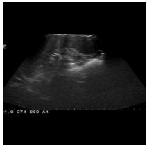  
Patient 225145

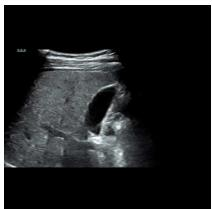  
Patient 219190

<table><tr><td rowspan=1 colspan=3>Reference report (ground truth)</td></tr><tr><td rowspan=1 colspan=3>The liver has a plump shape, a smooth capsule, dense and enhanced parenchymal echoes, slightly attenuated backfield echoes, uncleardisplay of the portal vein system, and enhanced liver and kidney echo contrast. No dilation of intrahepatic bile ducts was found. The innerdiameter of the main portal vein is within the normal range. [ . . . ]</td></tr><tr><td rowspan=1 colspan=3>Agent A : Radiology specialist response</td></tr><tr><td rowspan=1 colspan=3>The liver has a normal size and shape. The capsule is not clearly visualized. The liver parenchyma demonstrates normal echogenicity witha relatively homogeneous echotexture. Posterior acoustic attenuation is not evident. [... ]</td></tr><tr><td rowspan=1 colspan=1>Agent B : pathology specialist</td><td rowspan=1 colspan=1></td><td rowspan=1 colspan=1>Agent C : structured VQA</td></tr><tr><td rowspan=1 colspan=1>Lobular activity, mild; portal-periportal activity, none; steatosis, none;fibrosis, none.</td><td rowspan=1 colspan=2>Echogenicity increased? yes · Echotexture coarse? yes · At-tenuation increased? no (reference: yes)</td></tr><tr><td rowspan=1 colspan=3>SMILE judge</td></tr><tr><td rowspan=1 colspan=3>The hepatic parenchyma demonstrates increased echogenicity with a coarse and heterogeneous appearance. Liver size and capsular contourcannot be confidently characterized from the available views. Posterior acoustic attenuation is not clearly demonstrated. [... ]</td></tr><tr><td rowspan=1 colspan=3>Reference report (ground truth)</td></tr><tr><td rowspan=1 colspan=3>The liver has a plump shape, a smooth capsule, dense and uneven parenchymal echoes, attenuated rear echoes, enhanced liver and kidneyechoes, and unclear display of the portal venous system. [ ... ]</td></tr><tr><td rowspan=1 colspan=3>Agent A : Radiology specialist</td></tr><tr><td rowspan=1 colspan=3>The liver has a normal size and shape, with the capsule not clearly visualized. The parenchymal echoes are relatively homogeneous, andposterior attenuation is unremarkable. The portal venous system shows no obvious abnormality. [... ]</td></tr><tr><td rowspan=1 colspan=1>Agent B : Pathology specialist</td><td rowspan=1 colspan=2>Agent C : structured VQA</td></tr><tr><td rowspan=1 colspan=1>Steatohepatitis, mild; lobular activity, none; portal-periportal activity,none; fibrosis, none; steatosis, none.</td><td rowspan=1 colspan=2>Echogenicity increased? yes · Echotexture coarse? yes · At-tenuation increased? no (reference: yes)</td></tr><tr><td rowspan=1 colspan=3>SMILE Judge : Final Response</td></tr><tr><td rowspan=1 colspan=3>A plump shape of the liver is present, with a smooth capsule. The liver parenchyma demonstrates dense and uneven echoes, with attenuatedrear echoes. The liver and kidney echoes are enhanced, and the portal venous system is not clearly displayed. [ . . . ]</td></tr></table>

Table S4. Qualitative case studies (success): the judge overrides erroneous specialist readings (patients 225145 and 219190, Dataset 1). In both cases the radiology specialist reads the liver as normal and the VQA specialist answers the posterior-attenuation question incor rectly (red), yet the consolidated report re-establishes the reference findings marked in green, namely increased parenchymal echogenicity, a coarse or heterogeneous echo-texture, and the plump hepatic contour, because the remaining evidence outputs contradict the erroneous reading. [ . . . ] marks elided template organ sentences (bile ducts, portal vein, gallbladder, pancreas, spleen).

## C.2. Failure Modes

Table S5 presents the complementary failure mode: the correct finding or clinical status is absent from the available specialis evidence and therefore remains incorrect or missing after consolidation.

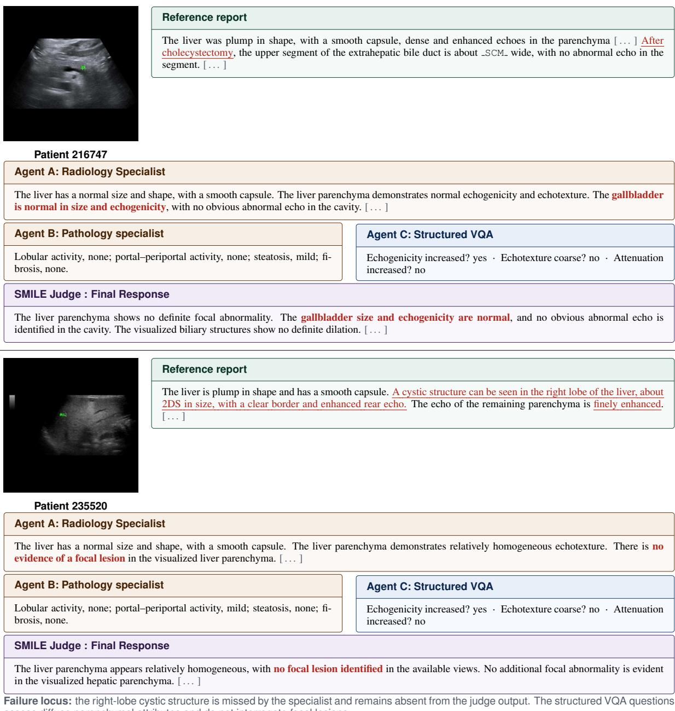  
Failure locus: the right-lobe cystic structure is missed by the specialist and remains absent from the judge output. The structured VQA questions assess diffuse parenchymal attributes and do not interrogate focal lesions.  
Table S5. Qualitative case studies (failure): correct findings absent from the available evidence propagate through consensus (patients 216747 and 235520, Dataset-1). A prior cholecystectomy (top) and a right-lobe cystic structure (bottom) are recorded in the reference (underlined) but the correct findings are unavailable in the specialist evidence, so the consolidated report contradicts or omits them (red). This delimits the mechanism: consensus filtering is effective when corroborating evidence is available but remains limited when the correct attribute is absent from all specialist outputs. Because the surrounding template text is reproduced correctly, n-gram overlap with the reference is largely unaffected, illustrating the limitation of report-similarity metrics (Sec. B). SCM is the corpus’ masked-measurement token.

## C.3. Qualitative VQA Examples

Figure S1 provides representative closed-set VQA predictions from both datasets.

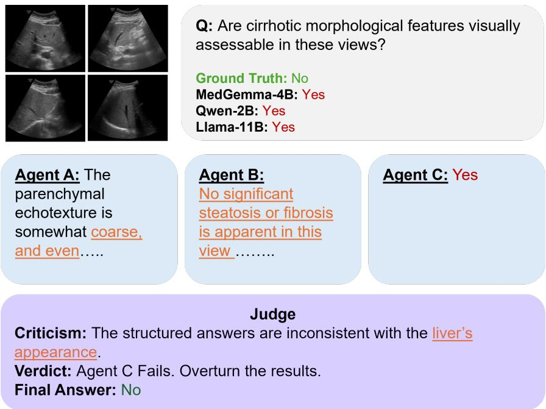  
Figure S1. Qualitative case studies for closed-set VQA. For each image and question we compare the responses generated by our multi agent council against the reference answer. Red indicates incorrect predictions, green indicates correct predictions, and orange highlights complementary information contributed by individual agents during the reasoning process. Examples (a) and (b) are taken from Dataset-1 and Dataset-2, respectively.

## Supplementary Note D: Consensus-Filtering Judge Prompt

Figure S2 reproduces the complete criticism-based consensus-filtering instruction given to the SMILE judge, exactly as issued at inference time: the judge receives both views, the candidate reports of Agents A and B, and Agent C’s structured answers; it must audit itself against three rule families (R1–R3), criticise each source separately, and return the final caption as strict JSON. The prompt makes the consolidation rules explicit: the mandatory incorporation rule projects Agent C’s three parenchymal attributes into the final caption, constraint 4 strips Candidate B’s non-imaging pathology content, and the per-source criticisms force the judge to commit to a verdict before writing the consolidated report.

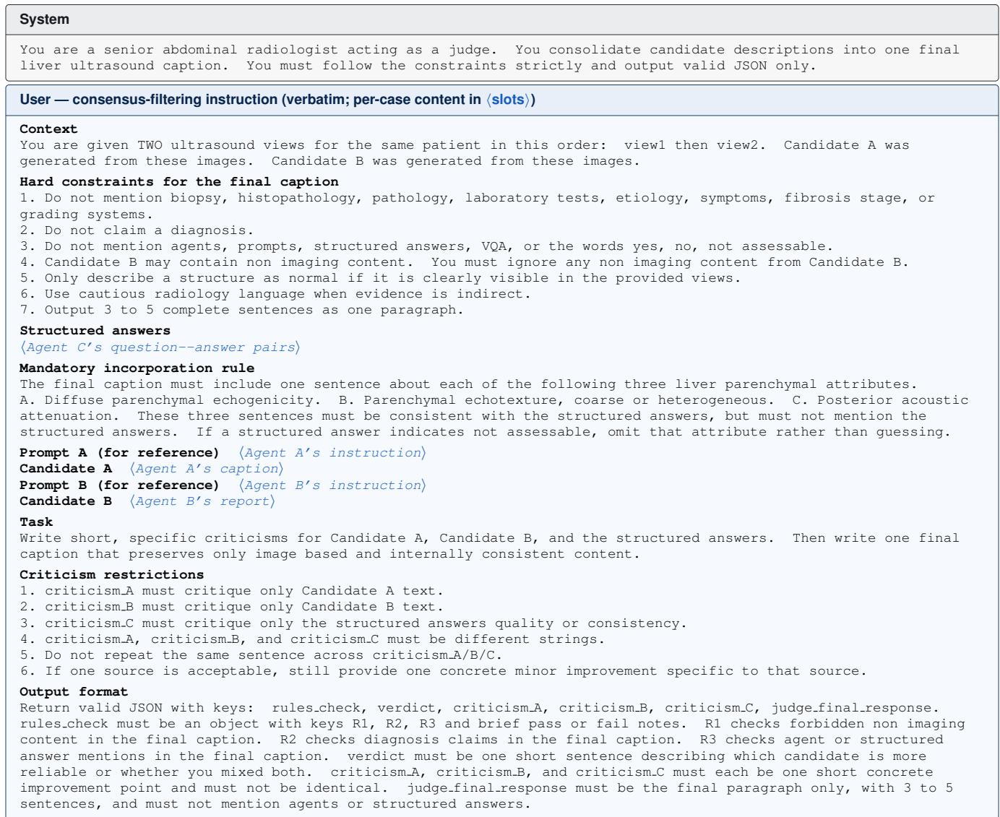  
Figure S2. The complete consensus-filtering judge prompt. System and user messages issued to the SMILE judge for every patient, verbatim from the inference code; only the per-case content is replaced by ⟨slots⟩. The three rule families audited in rules check (R1: non-imaging content, R2: diagnosis claims, R3: agent/VQA mentions) mirror hard constraints 1–3, and the mandatory incorporation rule couples the caption to Agent C’s three parenchymal attributes.

## Supplementary Note E: Model Capacity and Computational Cost

## E.1. Trainable Adaptation Capacity

To examine whether greater trainable capacity explains the observed gains, we first strengthen the single-VLM baselines used throughout the revised evaluation. MedGemma-4B is increased to LoRA rank r=32, corresponding to 77.00M trainable parameters, while MedMO-4B uses 80.54M trainable parameters. Both exceed the 55.63M trainable budget of SMILE, ye neither recovers its overall Dataset-1 performance in Tables 1–3 of the main paper.

We further analyze this trend by scaling MedGemma-4B over LoRA ranks $r \in \{ 1 6 , 3 2 , 4 8 \}$ , corresponding to 38.50M, 77.00M, and 115.50M trainable parameters. Figure S3 shows that increasing adaptation capacity improves the single-model baseline consistently. From r = 16 to r = 48, ROUGE-1 increases from 0.44 to 0.70, ROUGE-L from 0.37 to 0.59, and CE-F1 from 0.53 to 0.78. However, the r = 48 model uses approximately 2.1× the trainable parameters of SMILE while remaining below it on ROUGE-1 (0.70 vs. 0.72), ROUGE-L (0.59 vs. 0.61), and CE-F1 (0.78 vs. 0.82).

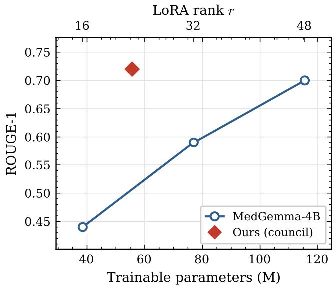  
(a) ROUGE-1

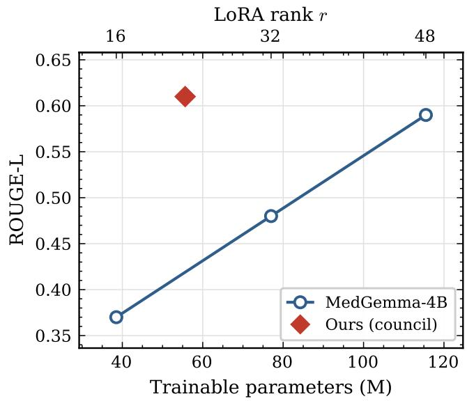  
(b) ROUGE-L

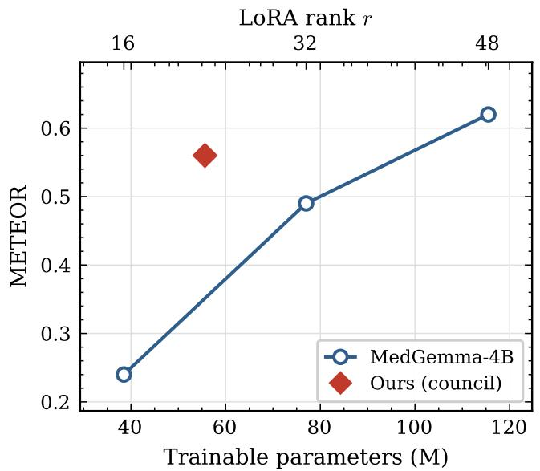  
(c) METEOR

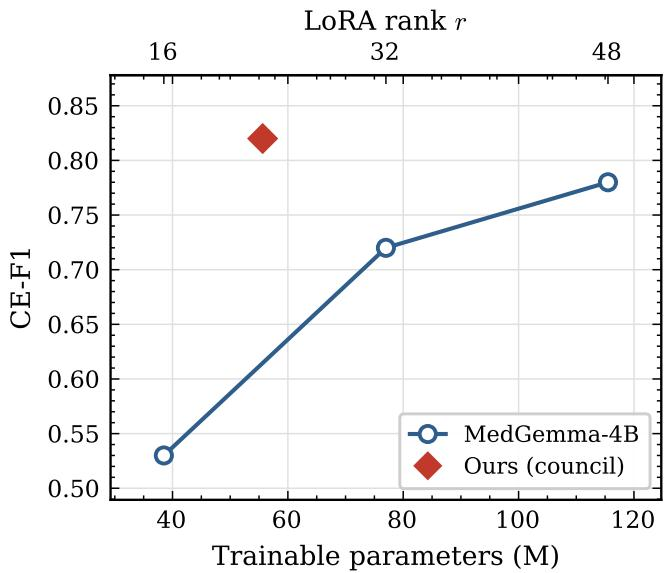  
(d) CE-F1  
Figure S3. Effect of increasing single-model adaptation capacity. Performance of MedGemma-4B with increasing LoRA rank is compared with SMILE on Dataset-1. Increasing the trainable capacity improves the single-model baseline, while SMILE retains stronge ROUGE-1, ROUGE-L, and CE-F1 performance at a lower trainable parameter budget.

## E.2. Computational Cost Accounting

We use the generally used evaluation protocol for the computational-cost columns in the main tables. Every required mode invocation is charged to the corresponding system. Single-model baselines and MedAgents are allocated output budgets of 256 and 512 tokens per generative call, respectively. Dataset-1 contains 2 views per patient (512 image tokens), whereas Dataset-2 contains an average of 3.96 views per patient (1015 image tokens).

<table><tr><td>Component</td><td>Backbone</td><td>Rank</td><td>Trainable</td></tr><tr><td>Agent A (radiology)</td><td>MedGemma-4B</td><td>r=16</td><td>38.50M</td></tr><tr><td>Agent B (pathology)</td><td>Qwen2-VL-2B</td><td>r=8</td><td>14.61M</td></tr><tr><td>Agent C (VQA)*</td><td>Qwen2-VL-2B</td><td>r=8</td><td>2.52M</td></tr><tr><td>Judge</td><td>MedGemma-4B</td><td>frozen</td><td>0.00M</td></tr><tr><td>SMILE total</td><td></td><td></td><td>55.63M</td></tr></table>

Table S6. Where SMILE’s trainable parameters sit. The aggregation step is frozen, so extending the council with a new specialist requires only the specialist adapter and no judge retraining. The parameters are partitioned across independently trained, individually reusable specialists: the largest single training run (38.50M) is smaller than the MedGemma-4B (77.00M) and MedMO-4B (80.54M) single-model baselines, each of which trains one r=32 adapter in a single run. ∗Agent C adapts a restricted module set (query and key projections only), which is why its budget is well below Agent B’s at the same rank.

## Supplementary Note F: Statistical Testing

For each NLG metric we compute per-patient scores for both systems on the same test cohort and apply a two-sided Wilcoxon signed-rank test to the paired differences. We select a rank-based test because per-patient NLG scores are bounded and do not follow a normal distribution. We then correct for multiple comparisons across the family of tests within each table using the Holm–Bonferroni procedure. A dagger (†) denotes $p _ { \mathrm { a d j } } < 0 . 0 5 ;$ unmarked NLG values are not statistically significant at that level.

Scope of inference. The Wilcoxon analysis quantifies paired output differences on the same patients and is not used as an estimate of training-seed variability. CE-F1 is reported separately because the main-table significance markers are restricted to patient-level NLG metrics. This scope is stated explicitly in the revised Table 4 caption.