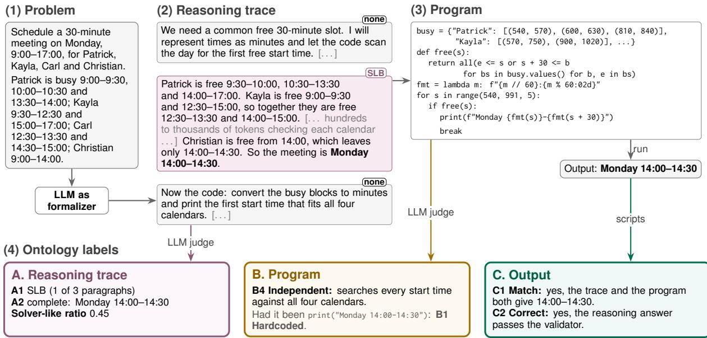
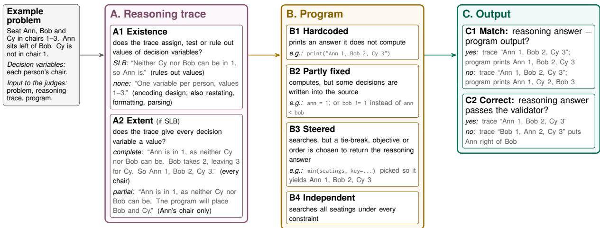
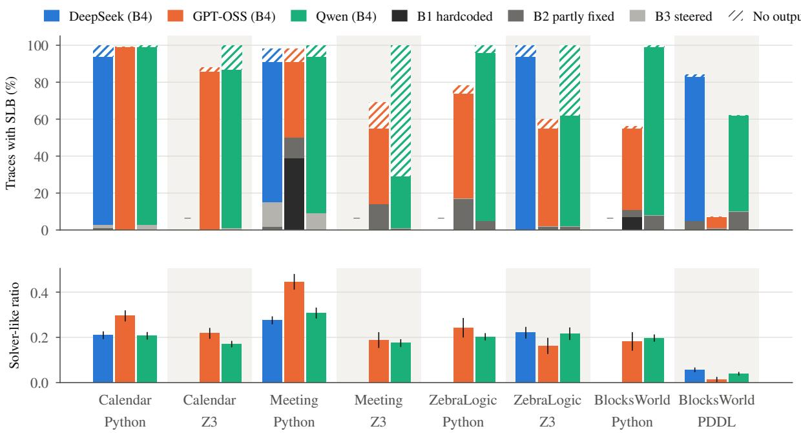
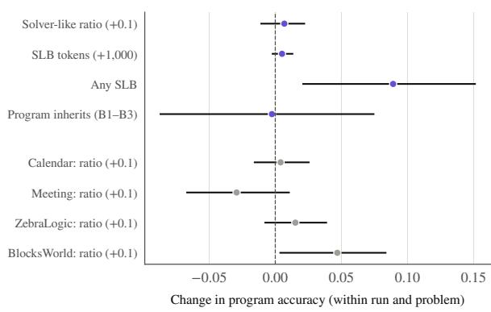
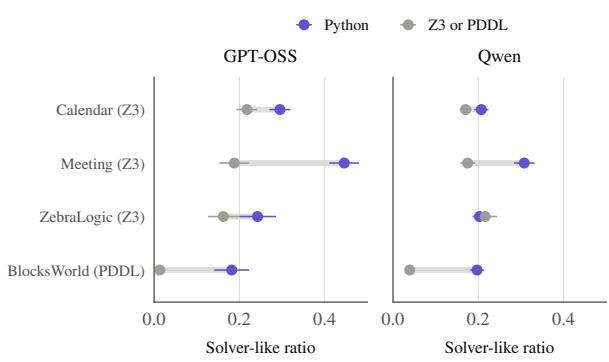
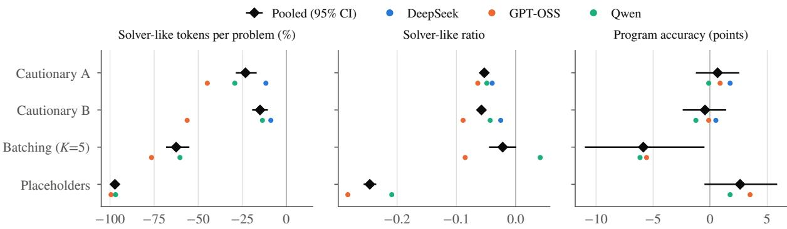
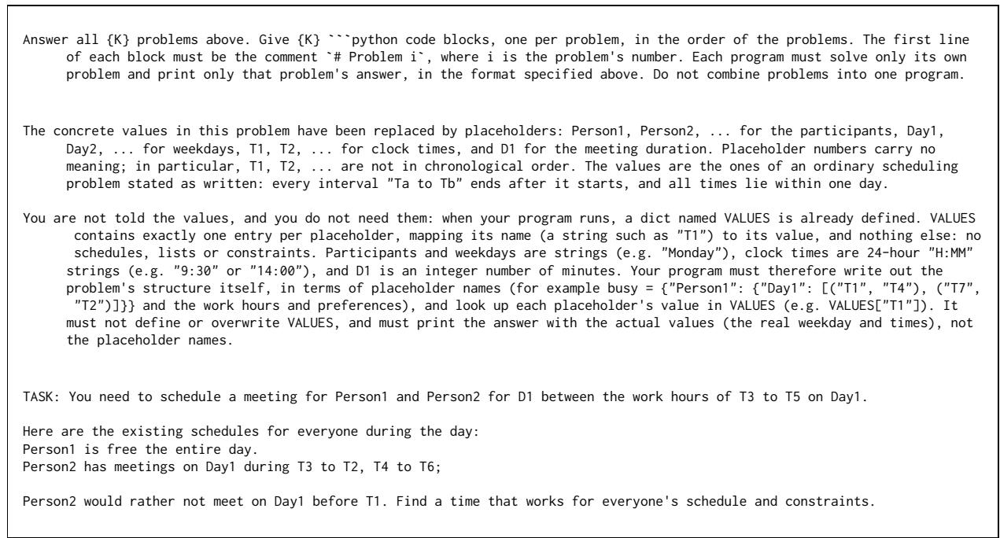
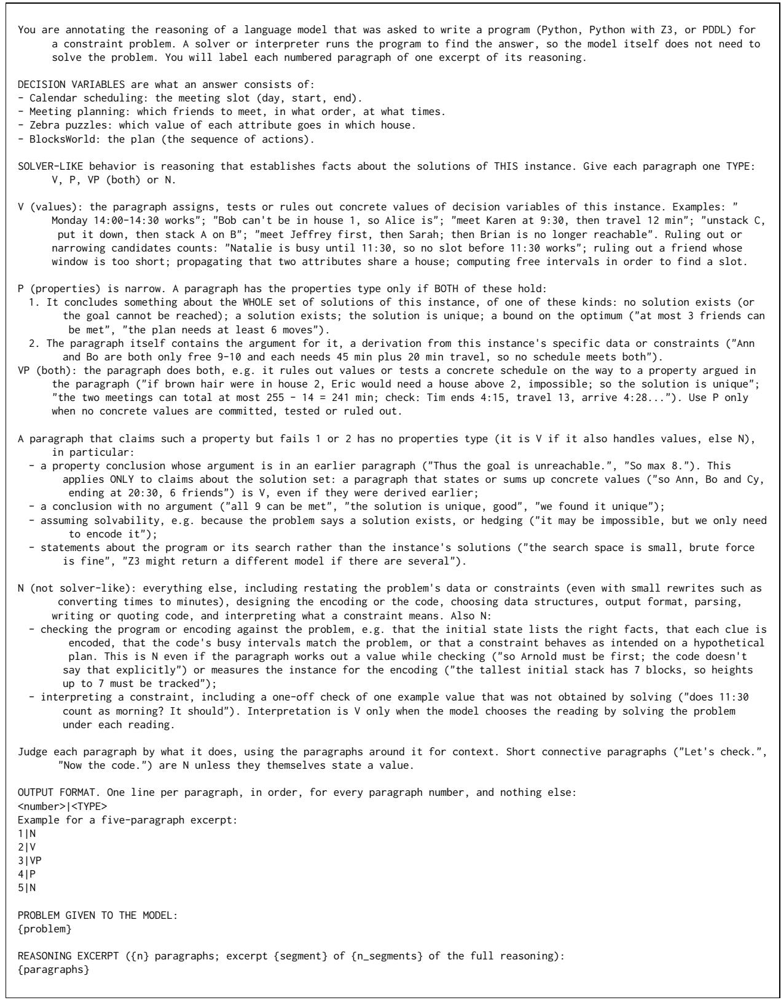
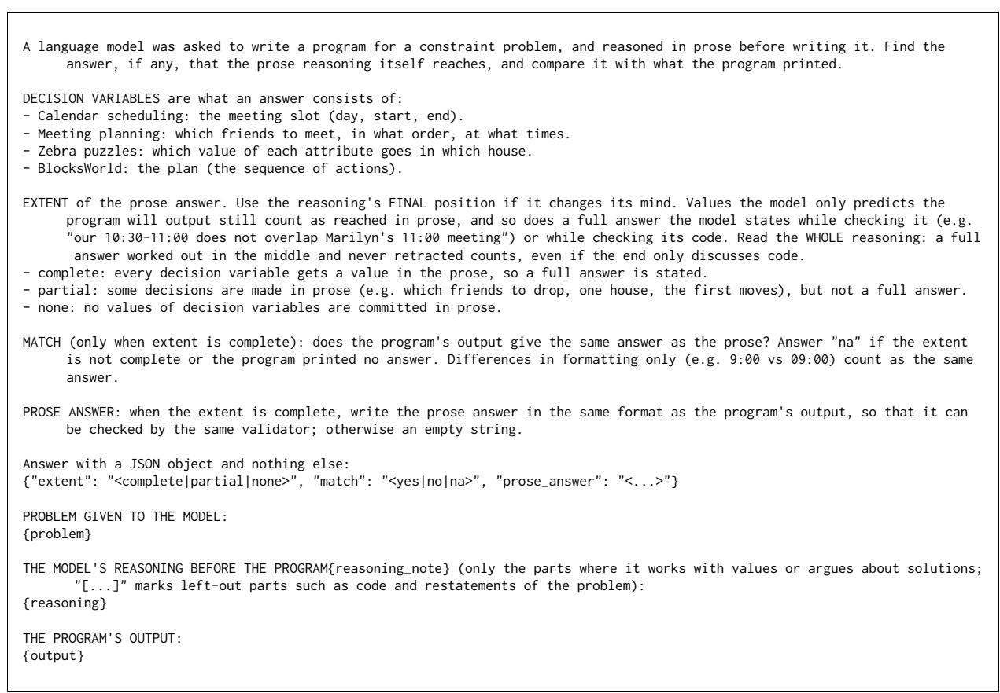
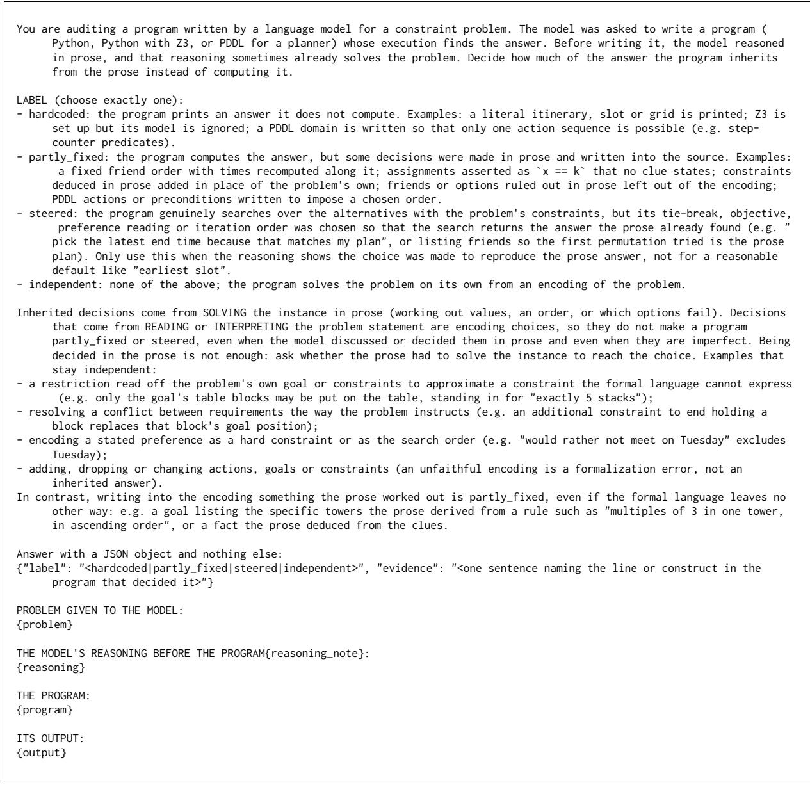

# Solver-Like Behavior in Large Language Models as Formalizers

Rikhil Amonkar Stuti Mohan Kevin Nguyen   
Ceyhun Efe Kayan Ronan Le Bras Li Zhang Drexel University Allen Institute for AI {rikhil.amonkar|harry.zhang@drexel.edu}

## Abstract

In the LLM-as-formalizer paradigm, a large language model translates a problem into a formal program and leaves the search to a solver, gaining the solver’s guarantees. Formalizers are now often reasoning models that write a long reasoning trace before the program, yet they are judged only by the program’s output. We find that the trace routinely does the solver’s job, assigning, testing and ruling out values until it often reaches the full answer; we call this solver-like behavior (SLB). We define an ontology of SLB over the trace, the program and its output, and use LLM judges, checked against human labels, to label 2,000 generations from three reasoning models on four constraint satisfaction datasets, each formalized in a declarative and an imperative formal language. SLB appears in 85% of traces and takes 24% of reasoning tokens, yet the program usually recomputes the answer, so the effort is redundant. The 9% of programs that inherit the trace’s answer also inherit its errors, and pass output-based evaluation whenever that answer is correct. The amount of SLB is not associated with accuracy, and SLB is more common in imperative Python than in declarative Z3 or PDDL. Cautionary prompts reduce it by only a quarter, but hiding the problem’s values behind placeholders, which the program receives only at run time, removes 97% of it without loss of accuracy. Formalizers should therefore be evaluated by how their programs are reached, not only by what they output.1

## 1 Introduction

In the LLM-as-formalizer paradigm (Tantakoun et al., 2025), a large language model (LLM) does not solve a problem but translates it into a formal program, such as a planning domain or a set of constraints, which a solver executes (Huang and Zhang, 2025; Lin et al., 2025; Amonkar et al., 2026). The

LLM handles language, and the solver performs the search with guarantees that the LLM’s own reasoning lacks (Wei et al., 2025). Formalizers today are often reasoning models that write a long reasoning trace before the program. Yet they are judged almost only by whether the program’s output is correct, which cannot tell a program that searches from one that restates an answer the model already worked out in its trace. The trace itself has gone unexamined: work on reasoning traces, which finds them often unfaithful or wasteful (Lanham et al., 2023; Arcuschin et al., 2025; Chen et al., 2025a; Sui et al., 2025), studies models that solve the problem themselves, and formalizer traces have been discussed only in passing (Amonkar et al., 2026).

We find that formalizers routinely do the solver’s job themselves, a phenomenon we call solver-like behavior (SLB): before writing the program, the reasoning trace assigns, tests and rules out values of the problem’s variables, often until it reaches the full answer (Figure 1). This defeats the purpose of formalization in two ways. It is costly: constraint satisfaction is NP-complete (Cook, 1971), and solving in tokens grows with the instance: on Meeting Planning, solver-like tokens nearly triple from the smallest to the largest problems, though the program usually searches anyway. And it can silently void the solver’s guarantee: a program that prints the answer from the trace, i.e. inherits it, passes output-based evaluation while also inheriting the trace’s errors, so where outputs are not independently validated, a formalization that looks correct may be no more verifiable than chain-of-thought.

We study SLB in three reasoning models on four constraint satisfaction datasets, each formalized in a declarative formal language (Z3 or PDDL) and an imperative one (Python). We define an ontology over the trace, the program and its output (Figure 2), label 2,000 generations with LLM judges that agree with blind human labels on 94% of paragraphs, and test four hypotheses (§5). (H1) SLB is common and redundant: 85% of traces contain it, yet the program usually recomputes the answer. (H2) Its forms differ in harm: the 9% of programs that inherit the reasoning answer also inherit its errors, and pass output-based evaluation whenever that answer is correct; hardcoding is rare and mostly comes from one model on one dataset. (H3) Its amount is not associated with accuracy on the same problem. (H4) The formal language matters most: Python draws more SLB than Z3 or PDDL in every dataset. Cautionary prompts cut SLB by about a quarter, while hiding the problem’s values behind placeholders that the program receives at run time removes 97% of it without loss of accuracy (§6). SLB is thus pervasive and mostly redundant, and occasionally voids the solver’s guarantee.

  
Figure 1: Overview on a calendar scheduling problem (1). An LLM as formalizer writes a reasoning trace (2) and then a program (3), which is run and scored. The middle paragraph is solver-like: it solves the problem in the trace, finding first the common free intervals and then the meeting time, which is the solver’s job; in real traces such a passage runs to hundreds or thousands of tokens. Our ontology (§3) labels every generation (4): whether the reasoning trace is solver-like (A), how much of the reasoning answer the program inherits (B), and whether the program’s output matches the reasoning answer, which is checked for correctness (C). Here the program searches independently, so the solver-like behavior, 45% of the trace, was wasted.

## 2 Related Work

LLMs as formalizers. An LLM paired with an external solver writes PDDL for classical planners (Liu et al., 2023; Guan et al., 2023; Xie et al., 2023; Zuo et al., 2025; Hu et al., 2025; Huang and Zhang, 2025; Gong et al., 2025; Huang et al., 2026), logic for theorem provers and SAT/SMT solvers (Pan et al., 2023; Olausson et al., 2023; Ye et al., 2023), optimization models (Li et al., 2026) and scheduling constraints (Amonkar et al., 2026); Tantakoun et al. (2025) survey the planning line, and programaided reasoning (Gao et al., 2023; Chen et al., 2023; Lyu et al., 2023) likewise delegates computation to an interpreter. These works evaluate the program, by whether it executes, matches a reference or yields a valid solution; we examine the reasoning that precedes it.

Reasoning traces. Chains of thought often misrepresent the computation behind the answer: models omit cues that sway them (Turpin et al., 2023; Chen et al., 2025b), rationalize after the fact (Arcuschin et al., 2025), and keep their answer when the reasoning is truncated or corrupted (Lanham et al., 2023). Other work dissects traces into behaviors such as verification and backtracking (Marjanovic et al.´ , 2025; Gandhi et al., 2025) or finds the sentences that steer the outcome (Bogdan et al., 2025). Reasoning models also spend far more tokens than a problem needs (Chen et al., 2025a; Sui et al., 2025; Cuadron et al., 2025), which motivates budgets on reasoning length (Muennighoff et al., 2025) and measures of effort beyond length (Chen et al., 2026), while accuracy can still collapse as problems grow complex (Shojaee et al., 2025). All of this work studies models that solve the problem themselves. For a formalizer, solver-like behavior is a specific waste: its tokens duplicate the solver’s work and grow on the hard instances that formalization is meant to offload.

Delegation and hardcoding. LLMs often reason in text when code would serve better (Chen et al., 2025d,c), or call tools they do not need (Qian et al., 2025; Wang et al., 2025); solver-like behavior is a failure to delegate that persists after the model has written a program. Its extreme form, a program that prints the trace’s answer, resembles reward hacking in code generation, where models hardcode test outputs (Baker et al., 2025; Zhong et al., 2025); training against a monitor of the trace can drive such behavior into less visible forms (Baker et al., 2025), much as our cautionary prompts turn literal itineraries into fixed orders (§6).

## 3 An Ontology of Solver-Like Behavior

We view each task as a constraint satisfaction problem: a set of decision variables, the unknowns that together make up an answer (e.g., when a meeting starts, where each object goes, or which action comes next in a plan), and constraints on their values. In the LLM-as-formalizer paradigm, encoding the variables and constraints is the model’s job, and finding values that satisfy them is the solver’s. Figure 2 illustrates every definition below on a toy problem: seat Ann, Bob and Cy in chairs 1–3, with Ann left of Bob and Cy not in chair 1. Its decision variables are each person’s chair.

Solver-like behavior (SLB) is text in the reasoning trace that does the solver’s job on the instance: assigning, testing or ruling out values of its decision variables. Designing the encoding, restating the problem’s data or constraints, choosing the output format, parsing, and interpreting an ambiguous constraint are not solver-like, unless the reading is chosen by solving under each one. A formalizer’s generation has two parts: a reasoning trace (trace for short), the natural-language text the model writes first, and a program, whose output is what it prints when run. An answer stated in the trace is the reasoning answer. We describe solverlike behavior along these three components: the trace (A), the program (B), and its output (C).

A. Reasoning trace is read from the trace alone. A1 (existence) is SLB if the trace assigns, tests or rules out values of decision variables, and none otherwise. Arguments about the solution set that commit no values, such as uniqueness, are rare and not counted. A2 (extent) applies when A1 is SLB.

It is complete if every decision variable receives a value and partial otherwise, including a tentative answer the trace later abandons. The solver-like ratio is the share of the trace that is solver-like.

B. Program records how much of the reasoning answer the program inherits rather than computes. A program inherits a decision when it takes the value from the trace instead of computing it; B1– B3 are the forms this takes. B1 Hardcoded: it prints an answer it does not compute, so the formalization adds no guarantee. B2 Partly fixed: it computes the answer, but decisions made in the trace are written into its source. This shrinks the solver’s search, which can be harmless or even necessary, as when a numerical BlocksWorld constraint, which PDDL cannot express, must be turned into fluents in the trace. B3 Steered: it searches, but its tiebreak, objective or iteration order is chosen so that the search returns the reasoning answer. B4 Independent: it searches under every constraint, so any SLB in the trace was wasted. Only decisions the trace had to solve for count as inherited; a restriction read off the problem statement is part of the encoding. B1–B3 presuppose A1 = SLB, and B does not apply when the program does not run.

C. Output compares the program’s output with the reasoning answer, and applies when A2 is complete and the program runs. C1 (match) asks whether the reasoning answer equals the program’s output. C2 (correct) asks whether the reasoning answer passes the validator used to score the program. Together they distinguish programs that merely reproduce the reasoning answer from programs that override an incorrect one or are led astray by it.

## 4 Methods

Tasks, Datasets and Formal Languages. Given a natural-language constraint satisfaction problem (CSP) (Russell and Norvig, 2009), the model must write a program in a formal language (FL) that returns a valid solution when executed. We sample 100 instances from each of four benchmarks. Calendar Scheduling and Meeting Planning (Zheng et al., 2024) require meeting times and multi-location itineraries that satisfy availability, duration, and travel-time constraints. ZebraLogic (Lin et al., 2025) consists of logic grid puzzles. BlocksWorld (IPC, 1998) is classical planning. Full task descriptions are in Appendix B.

We formalize every dataset in two FLs; following the formalizer literature, FL here includes general-purpose programming languages. The two differ in who searches for a solution, which is what solver-like behavior is about. A declarative program states what a solution is and a solver finds one; an imperative program states how to find one, so the model designs the search. Our imperative FL is Python with only the standard library. Our declarative FL is PDDL (Ghallab et al., 1998) for BlocksWorld, solved by a classical planner, and Z3 for the other datasets: Python programs that state constraints through the API of the Z3 SMT solver (de Moura and Bjørner, 2008), which returns a satisfying assignment. Programs that use another library, or Z3 programs that never call the solver, are flagged as not written in the requested FL (at most 5% of any run; Table 2).

  
Figure 2: Ontology of solver-like behavior, with an example of each node on a toy seating problem (left). A describes the reasoning trace: whether it contains solver-like behavior (A1), and how much of an answer it reaches (A2). B describes how much of the reasoning answer the program inherits rather than computes; B1–B3 require A1 = SLB. C compares the program’s output with a complete reasoning answer (C1), and checks the reasoning answer with the validator (C2).

Prompt. Each model receives one prompt per dataset and FL: a prefix that instructs it to formalize the problem in the FL and let the program solve it, rather than solving it in the reasoning trace, followed by the task’s output format (Appendix D). All Z3 prompts give the import and coding steps of the ZebraLogic Z3 prompt (Lin et al., 2025). The PDDL prompt supplies the ground-truth problem PDDL as a reference and asks for a domain and a problem; the Python BlocksWorld prompt gives only the natural-language problem, which states the same initial and goal states.

Models. We evaluate three reasoning models that write a reasoning trace before the program. We need the complete trace: closed frontier models such as Claude, GPT-5 and Gemini return at most a summary of their reasoning through their APIs, from which solver-like behavior cannot be measured. DeepSeek-V4-Flash (DeepSeek-AI et al., 2025) runs via API, and GPT-OSS-120B (OpenAI et al., 2025) and Qwen3.8-27B (Qwen Team, 2025) locally with vLLM. DeepSeek is run in one FL per dataset (Python for Calendar Scheduling and Meeting Planning, Z3 for ZebraLogic, PDDL for BlocksWorld), because the model behind its API changed between our runs (Appendix C).

Metrics. We report the ontology labels of §3, the solver-like ratio, and program accuracy for every generation.

LLM judges. No script can tell whether a passage does the solver’s job, and the traces are too many and too long to label by hand. We therefore label A1, A2 and B with LLM judges, using Gemma 4 31B-it (Gemma Team, 2026) (FP8), which is not one of the evaluated models. Traces are too long to judge at once, so we cut each into segments of at most 2,000 tokens at paragraph boundaries and give the A1 judge one segment at a time, with the problem, to label every paragraph as SLB or none; a trace is SLB if any paragraph is, and the solver-like ratio is the share of the trace’s characters in such paragraphs. The A2 judge extracts the reasoning answer from the SLB paragraphs, and the B judge compares the program with the trace. C1 and C2 are scripts. Against reference labels covering both FLs of every dataset, the judges agree on 90–98% of cases (Table 1). Judge designs and further checks are in Appendix E, labeled examples in Appendix G.

<table><tr><td>Node</td><td>Reference</td><td>Agree</td><td>95% CI</td></tr><tr><td>A1 paragraph</td><td>human, blind</td><td>103/110</td><td>.87-.97</td></tr><tr><td>SLB precision</td><td>human, blind</td><td>38/42</td><td>.78-.96</td></tr><tr><td>SLB recall</td><td>human, blind</td><td>38/41</td><td>.81-.97</td></tr><tr><td>A2 extent</td><td>human + script</td><td>39/40</td><td>.87-1.00</td></tr><tr><td>B program</td><td>model, blind</td><td>19/20</td><td>.76-.99</td></tr><tr><td>B program (held out) human, not blind</td><td></td><td>38/40</td><td>.83-.99</td></tr><tr><td>Ci, C2</td><td>deterministic scripts</td><td></td><td></td></tr></table>

Table 1: Agreement of each ontology judge with reference labels, with Wilson 95% confidence intervals. A1: one annotator, labeling blind (70 development and 40 held-out paragraphs). A2: complete labels verified by humans, partial ones by searching the trace for the program’s answer and having a second model read the passages found. B: blind reference labels by a second model; held out: a human shown the judge’s evidence, on programs labeled B1–B4. A1 and held-out B references cover both FLs of every dataset. C1 and C2 are computed by scripts from the A2 extraction, so they need no agreement check.

Accuracy. A program is correct if it runs and its output satisfies every constraint of the problem (Appendix B).

## 5 Results

We label 2,000 generations: Qwen and GPT-OSS in both FLs of each dataset and DeepSeek in one, each on 100 problems under the prompt above, and test the four hypotheses of §1. Confidence intervals are 95% bootstrap intervals over problems; Appendix F lists the labels of every run.

## H1: SLB is common and redundant

We call solver-like behavior practically significant in a trace when it takes at least 10% of the trace or at least 1,000 tokens. By either measure, it is the norm. 85% of traces contain SLB (91% outside BlocksWorld in PDDL), 71% spend at least 10% of their tokens on it, and 47% at least 1,000 tokens (Figure 3). Across all traces, 24% of reasoning tokens are solver-like. A DeepSeek trace spends on average 6,123 of its 26,572 reasoning tokens on solver-like behavior, a Qwen trace 3,788 of 15,310, and a GPT-OSS trace 575 of 1,892. The one setting where it is rare is BlocksWorld in PDDL (51% of traces, ratio 0.04). Stray paragraphs do not drive this: only 29 of the 1,699 traces with SLB spend under 2% of their text on it, and in 77% of all traces the SLB paragraphs alone state a complete answer.

It grows with the problem. From the smallest to the largest third of problems, solver-like tokens per trace rise from 3,873 to 10,971 on Meeting Planning (by number of friends) and from 532 to 4,148 on ZebraLogic (by grid size), as accuracy falls from 0.70 to 0.51 and from 0.90 to 0.78; GPT-OSS on ZebraLogic is the exception. On Calendar and BlocksWorld they do not grow.

The program rarely uses it. Of the generations whose trace contains SLB, the program computes the answer anew (B4; Figure 3, top) in 89% for DeepSeek and 77% for Qwen and GPT-OSS. Yet the two usually agree: where the trace states a complete answer and the program prints one, an independent program prints exactly the reasoning answer in 88% of cases (1,027 of 1,174; C1). The solving duplicates the work the program then does.

## H2: SLB takes forms that differ in harm

SLB usually reaches a complete answer. When a trace contains SLB, it states a complete answer in 87% (DeepSeek), 86% (GPT-OSS) and 96% (Qwen) of cases (A2), i.e. the very answer the program is meant to compute. The reasoning answer is wrong in 2% (DeepSeek), 11% (Qwen) and 13% (GPT-OSS) of the complete answers that can be checked (C2).

Inheritance is rare and concentrated. Of the 1,791 programs that ran, 163 inherit the reasoning answer (grey in Figure 3, top, which shows the 157 whose trace contains SLB): 47 are hardcoded (B1), 40 of them GPT-OSS on Meeting Planning in Python; 88 are partly fixed (B2), mostly on BlocksWorld, Meeting Planning and ZebraLogic; and 28 are steered (B3), mostly Meeting programs in Python that try friends in the order of the reasoning answer. As B1 implies, 44 of the 45 hardcoded programs whose output can be compared print exactly the reasoning answer (C1).

Inheritance passes on errors in the reasoning answer. When the reasoning answer is wrong, none of the 19 hardcoded programs and 1 of the 13 partly fixed ones is correct, against 32% of the 84 independent programs, which recompute the answer and can recover. Recomputing is no guarantee, though: 37 of those 84 independent programs print the same wrong answer as the trace (C1), so a program can share the trace’s error without taking any value from it, unless the B judge misses subtler inheritance. Steering is harmless: both steered programs with a wrong reasoning answer are correct. When the reasoning answer is correct, all four kinds of program are correct at least 93% of the time, so output-based evaluation cannot tell a hardcoded program from an independent one: all 26 hardcoded programs with a correct reasoning answer pass it.

  
Figure 3: H1 and H2: solver-like behavior is common, and the program rarely inherits it. For each dataset and FL, the share of traces with SLB (A1) and the mean solver-like ratio, with 95% confidence intervals. Each SLB bar is split by the program’s label (B): programs that inherit the reasoning answer (B1–B3, grey) at the bottom, independent programs (B4) in the model’s colour, and programs with no output (missing, failed, or printed nothing) hatched; most of these are Qwen’s Z3 programs, which call Z3 methods that do not exist. DeepSeek is run in one FL per dataset (–).

  
Figure 4: H3: the amount of solver-like behavior is not associated with accuracy. Change in the probability that the program is correct per unit of each measure, from a linear model with fixed effects for model, dataset and FL and for the problem, with 95% confidence intervals. Grey: the ratio’s effect within each dataset.

## H3: The amount of SLB is not associated with accuracy

Harder problems may draw both more SLB and more errors, so we compare generations of the same problem: a linear probability model of program correctness with fixed effects for the problem and for each model, dataset and FL. The amount of solving has no detectable effect (Figure 4). Ten more points of solver-like ratio change accuracy by +0.007 [−0.011, +0.022], and 1,000 more solver-like tokens by +0.005 [−0.002, +0.013]; within datasets the ratio’s effect lies between −0.03 and +0.02, except on BlocksWorld (+0.047 [+0.004, +0.083]). Programs that inherit the reasoning answer are not less accurate on average $( - 0 . 0 0 \left[ - 0 . 0 9 , + 0 . 0 7 \right] )$ . Traces with no SLB are less often correct $( - 0 . 0 9 \ [ - 0 . 1 5 , - 0 . 0 2 ]$ relative to traces with some), but the gap lies in programs that fail to run: 25% of them crash, against 12%, and among programs that run the gap is −0.04 $\left[ - 0 . 0 9 , + 0 . 0 3 \right]$ . We cannot rule out that working through the problem helps a model write a program that runs. The interventions of §6 agree: removing solver-like behavior does not lower accuracy.

  
Figure 5: H4: on the same 100 problems, Python draws more solver-like behavior than each dataset’s declarative FL (in parentheses). Mean solver-like ratio per model, with 95% confidence intervals.

## H4: SLB differs by formal language

On the same problems, Python draws more SLB than either Z3 or PDDL, in every dataset (Figure 5; pooled over the two models, with Qwen on ZebraLogic the one exception). The ratio is higher in Python by 0.06 [0.04, 0.08] on Calendar, 0.20 [0.17, 0.23] on Meeting Planning and 0.03 [0.01, 0.06] on ZebraLogic than in Z3, and by 0.16 [0.14, 0.18] on BlocksWorld than in PDDL. In a linear model of the ratio with all three factors (Qwen and GPT-OSS; $R ^ { 2 } = 0 . 2 7 )$ , removing the FL loses 0.123 of explained variance, the dataset 0.057, and the model 0.008. Using only the FLs DeepSeek is run in, where all three models are run, the model explains 0.011.

The dataset matters through the search the FL leaves to the model. The FL effect is largest where the declarative FL takes over a search that is hard to program: in PDDL the planner finds the plan, and in Z3 the solver chooses Meeting Planning’s friend order, which in Python the model must program as a search over orders. On Calendar (a trivial search) and ZebraLogic (permutations in Python) the FLs differ little. With the FL fixed, the datasets differ in Python (Meeting Planning 0.38, the others 0.19–0.25) but not in Z3 (0.18–0.19). The two prompts of a dataset also differ in more than the FL (§4): the PDDL prompt supplies the reference problem file, which may account for part of the BlocksWorld gap, so the Z3 comparisons are the cleaner test of the FL.

## 6 Deterring Solver-Like Behavior

We test three ways to deter SLB: warning against it in the prompt, batching several problems into one prompt, and hiding the problem’s values behind placeholders. Each generation is compared with the baseline generation of the same problem (Figure 6).

## Cautionary prompts

We add one of two warnings to the prompt of §4 (Appendix $\mathrm { D } ;$ Listings 1–3). Cautionary A frames solver-like behavior by its outcome, precomputing the answer in the trace and hardcoding it, and Cautionary B by the act, substituting the given values into arithmetic in the trace. Each illustrates the contrast with a math word problem, so no taskspecific solution leaks. We run both for every model, dataset and FL of §5.

Cautionary prompts reduce solver-like behavior by about a quarter, without removing it or changing accuracy (Figure 6). From a baseline of 0.20, the ratio falls by 0.053 [0.045, 0.061] under Cautionary A and 0.058 [0.051, 0.065] under Cautionary B, and solver-like tokens by 689 and 443 per trace (23% and 15%). Yet most traces still contain SLB: the share with SLB falls by 4 and 9 points, almost all of it GPT-OSS (−10 and −19 points), while DeepSeek (+1, −4) and Qwen (−1, −1) barely change. Programs that inherit the reasoning answer fall by 4 points. Accuracy does not change (+0.01 [−0.01, +0.02] and −0.00 $[ - 0 . 0 2 , + 0 . 0 1 ] )$ , so reducing solver-like behavior neither helps nor hurts, as H3 found by observation.

The prompts remove hardcoded answers more than inherited decisions. GPT-OSS’s 40 hardcoded Meeting programs in Python fall to 0 and 1, but its partly fixed ones go from 11 to 15 and 7: the program now encodes the problem, yet still follows a friend order chosen in the trace.

## Batching and placeholders

A trace can only assign, test or rule out values it is given. Two changes to the problem make this harder while leaving the formalization task intact. Batching gives K problems of the same dataset in one prompt and asks for K separate programs, each headed by its problem’s number: the encoding can be designed once, but solving in prose must be done K times. Placeholders replace every value of a problem by a name (Person1, Day1, T1 for clock times, D1 for durations, L1 for locations, and a table TRAVEL for Meeting Planning’s travel times), and the program receives the values only when it runs, as a dictionary VALUES (Appendix D, Listing 4). The model must therefore write out the problem’s structure in placeholder names. Placeholder numbers are shuffled, so their order reveals nothing about the times. The model can still choose among placeholders (“meet Person2 first, from T3”), which the A judge counts as SLB. We apply placeholders only to Calendar and Meeting Planning, whose values separate cleanly from the structure. We run both methods for Qwen and GPT-OSS on the same 100 problems of every dataset and FL except PDDL, with $K = 5 .$ and add $K \in \{ 2 , 1 0 \}$ for GPT-OSS on Calendar and Meeting Planning in Python. A batch’s trace serves K problems, so each of them is credited with the trace’s ratio and $1 / K$ of its tokens. The A judge overcounts SLB in placeholder traces, which can only understate the placeholders’ effect (Appendix E).

  
Figure 6: Placeholders all but remove solver-like behavior without costing accuracy; cautionary prompts remove about a quarter of it, and batching shortens all reasoning at a cost in accuracy. Change from the baseline prompt on the same problems in solver-like tokens per problem (% of the baseline mean), solver-like ratio, and program accuracy (points): pooled estimate with 95% bootstrap confidence interval, and one dot per model. Each method is measured where it was run: cautionary prompts for every model, dataset and FL (2,000 pairs), batching (K = 5) for Qwen and GPT-OSS in every dataset and FL except PDDL (1,400), placeholders for Qwen and GPT-OSS on Calendar and Meeting Planning in Python and Z3 (800). The subsets differ, so the text compares each method with the cautionary prompts on its own problems.

Placeholders all but remove solver-like behavior without costing accuracy (Figure 6). Solverlike tokens per problem fall by 97% [96, 98], from 2,820 to 78; the ratio falls from 0.25 to 0.005, and the share of traces with SLB from 94% to 15%, for both models in both FLs. On the same problems, the cautionary prompts cut solver-like tokens by only 32% and 18%. Accuracy rises by 2.6 points $[ - 0 . 5 , + 5 . 9 ]$ . The largest gain, GPT-OSS on Meeting Planning in Python (0.66 to 0.82), comes partly from programs that inherited the reasoning answer: 13 of the 28 problems that placeholders fix had such a program under the baseline. Since the model never sees a value, it cannot hardcode an answer, and the program, not the trace, computes the result. The cost is length for Qwen, whose reasoning per problem grows by 54% (more than threefold on Calendar); in the longest of these traces we read, the added text concerns the program’s robustness to values it cannot see, such as intervals ending at 24:00, not the solution. GPT-OSS’s reasoning shrinks by 31%.

Batching shortens all reasoning, not just the solving, and costs accuracy. Solver-like tokens per problem fall by 62% [55, 68], but reasoning tokens fall almost as much (61%), so the ratio barely moves (−0.02 [−0.045, +0.001]; Qwen +0.04): the encoding is designed once for the batch, while each problem is still worked out in prose. Accuracy falls by 5.9 points $[ - 1 1 . 0 , - 0 . 5 ]$ , most on ZebraLogic, by 15 to 26 points for each model in each FL. Larger batches cut more: for GPT-OSS on Calendar and Meeting Planning in Python, solver-like tokens per problem fall by 56%, 78% and 91% at K = 2, 5 and 10, with accuracy 2, 6 and 3 points above the baseline.

## 7 Conclusion

Formalizers are meant to leave the search to a solver, yet their reasoning traces routinely do it themselves. Across three models and four datasets, this solver-like behavior is common and redundant, is not associated with accuracy, and depends most on the formal language. The few programs that inherit the reasoning answer also inherit its errors, and output-based evaluation cannot tell them from programs that search, so formalizers should be judged by how their programs are reached, not only by what they output. For practitioners, the most reliable remedy is to keep the instance’s values out of the prompt: placeholders bound at run time remove nearly all solver-like behavior without loss of accuracy and rule out hardcoded answers. Otherwise, cautionary prompts remove only a quarter of it, and batching costs accuracy.

## Limitations

Our study covers three reasoning models and four constraint satisfaction datasets, each in two formal languages. Other task types, such as theorem proving or optimization, and other languages may show different amounts of solver-like behavior. DeepSeek is run in only one formal language per dataset because the model behind its API changed between our runs, so H4 rests on Qwen and GPT-OSS, and its runs cannot be reproduced exactly. The two prompts of a dataset differ in more than the formal language (§4), notably the reference problem file in the PDDL prompt, which may contribute to the differences H4 attributes to it. Each problem is generated once per setting, so our intervals do not capture sampling variation across generations.

Our ontology labels come from LLM judges and scripts. The judges agree well with reference labels (Table 1), but the reference samples are small (110 paragraphs for A1, 40 traces for A2, 60 programs for B) and come from one annotator, one B check compares against labels written by a second model and the other showed the human the judge’s evidence, A1 was checked on paragraphs and not on whole traces, and A2 was checked with the help of a script and a second model because full traces are too long to annotate by hand. B and C cover nonrandom subsets: B only programs that run (1,791 of 2,000, which drops most of Qwen’s crashing Z3 programs), and C only the 1,547 complete reasoning answers, of which C1 can compare 1,314 with the program’s output. C also covers only reasoning answers that the task’s parser reads, and for Meeting Planning an extracted reasoning answer sometimes combines two tentative itineraries, so its error rate is an upper bound. The solver-like ratio counts whole paragraphs, so a paragraph that mixes encoding and solving counts entirely toward it.

Finally, H3 is observational: fixed effects for the problem remove differences in difficulty, but not every confounder. The cautionary prompts in §6 reduce solver-like behavior without changing accuracy, which supports H3, but they remove only part of it. Placeholders remove almost all of it, but apply only where a problem’s values separate from its structure; we test them, and batching, on two models and not in PDDL, and placeholders on two datasets.

## Ethical Considerations

Risks. We study how formalizers reach their programs and see no direct path to misuse. The risk our results point to is in deployment: a program that hardcodes or inherits the reasoning answer looks as verifiable as one that searches, so systems that trust formalizer output without validating it may act on answers no solver checked (§5). Solver-like reasoning is also redundant computation, which placeholders remove (§6).

Data. The datasets are synthetic English constraint satisfaction problems. Calendar Scheduling and Meeting Planning refer to fictional people by first name only; the problems contain no information about real people, and we found no offensive content in them or in the traces we read. Datasets, models and licenses are listed in Appendix A.

Human annotation. All human reference labels (Table 1, Appendix E) were written by one of the authors, an NLP researcher, using the definitions in the judge prompts. No crowdworkers or other participants were involved, and no personal data was collected.

Use of AI assistants. We used Claude Code as a coding and writing assistant: to write and debug the experiment and analysis code, to run experiments, and to draft and edit text. The authors designed the study, directed and checked this work, and take responsibility for the paper; all reported numbers come from scripts in our repository.

## References

Rikhil Amonkar, Ceyhun Efe Kayan, Qimei Lai, Ronan Le Bras, and Li Zhang. 2026. A reality check of language models as formalizers on constraint satisfaction problems. In COLM 2026 Workshop on Efficient Reasoning.

Iván Arcuschin, Jett Janiak, Robert Krzyzanowski, Senthooran Rajamanoharan, Neel Nanda, and Arthur Conmy. 2025. Chain-of-thought reasoning in the wild is not always faithful. arXiv preprint arXiv:2503.08679.

Bowen Baker, Joost Huizinga, Leo Gao, Zehao Dou, Melody Y. Guan, Aleksander Madry, Wojciech Zaremba, Jakub Pachocki, and David Farhi. 2025. Monitoring reasoning models for misbehavior and the risks of promoting obfuscation. Preprint, arXiv:2503.11926.

Paul C. Bogdan, Uzay Macar, Neel Nanda, and Arthur Conmy. 2025. Thought anchors: Which LLM reasoning steps matter? Preprint, arXiv:2506.19143.

Wei-Lin Chen, Liqian Peng, Tian Tan, Chao Zhao, Blake JianHang Chen, Ziqian Lin, Alec Go, and Yu Meng. 2026. Think deep, not just long: Measuring llm reasoning effort via deep-thinking tokens. Preprint, arXiv:2602.13517.

Wenhu Chen, Xueguang Ma, Xinyi Wang, and William W. Cohen. 2023. Program of thoughts prompting: Disentangling computation from reasoning for numerical reasoning tasks. Transactions on Machine Learning Research.

Xingyu Chen, Jiahao Xu, Tian Liang, Zhiwei He, Jianhui Pang, Dian Yu, Linfeng Song, Qiuzhi Liu, Mengfei Zhou, Zhuosheng Zhang, Rui Wang, Zhaopeng Tu, Haitao Mi, and Dong Yu. 2025a. Do NOT think that much for 2+3=? on the overthinking of long reasoning models. In Forty-second International Conference on Machine Learning.

Yanda Chen, Joe Benton, Ansh Radhakrishnan, Jonathan Uesato, Carson Denison, John Schulman, Arushi Somani, Peter Hase, Misha Wagner, Fabien Roger, Vlad Mikulik, Samuel R. Bowman, Jan Leike, Jared Kaplan, and Ethan Perez. 2025b. Reasoning models don’t always say what they think. Preprint, arXiv:2505.05410.

Yongchao Chen, Yilun Hao, Yueying Liu, Yang Zhang, and Chuchu Fan. 2025c. CodeSteer: Symbolicaugmented language models via code/text guidance. In Forty-second International Conference on Machine Learning.

Yongchao Chen, Harsh Jhamtani, Srinagesh Sharma, Chuchu Fan, and Chi Wang. 2025d. Steering large language models between code execution and textual reasoning. In The Thirteenth International Conference on Learning Representations.

Stephen A. Cook. 1971. The complexity of theoremproving procedures. In Proceedings of the Third Annual ACM Symposium on Theory of Computing, STOC ’71, page 151–158, New York, NY, USA. Association for Computing Machinery.

Alejandro Cuadron, Dacheng Li, Wenjie Ma, Xingyao Wang, Yichuan Wang, Siyuan Zhuang, Shu Liu, Luis Gaspar Schroeder, Tian Xia, Huanzhi Mao, Nicholas Thumiger, Aditya Desai, Ion Stoica, Ana Klimovic, Graham Neubig, and Joseph E. Gonzalez. 2025. The danger of overthinking: Examining the reasoning-action dilemma in agentic tasks. Preprint, arXiv:2502.08235.

Leonardo de Moura and Nikolaj Bjørner. 2008. Z3: an efficient smt solver. In Tools and Algorithmsfor Construction and Analysis of Systems, pages 337– 340. Springer, Berlin, Heidelberg.

DeepSeek-AI, Aixin Liu, Aoxue Mei, Bangcai Lin, Bing Xue, Bingxuan Wang, Bingzheng Xu, Bochao Wu, Bowei Zhang, Chaofan Lin, Chen Dong, Chengda Lu, Chenggang Zhao, Chengqi Deng, Chenhao Xu, Chong Ruan, Damai Dai, Daya Guo, Dejian Yang, Deli Chen, Erhang Li, Fangqi Zhou, Fangyun

Lin, Fucong Dai, Guangbo Hao, Guanting Chen, Guowei Li, H. Zhang, Hanwei Xu, Hao Li, Haofen Liang, Haoran Wei, Haowei Zhang, Haowen Luo Haozhe Ji, Honghui Ding, Hongxuan Tang, Huanqi Cao, Huazuo Gao, Hui Qu, Hui Zeng, Jialiang Huang, Jiashi Li, Jiaxin Xu, Jiewen Hu, Jingchang Chen, Jingting Xiang, Jingyang Yuan, Jingyuan Cheng, Jin hua Zhu, Jun Ran, Junguang Jiang, Junjie Qiu, Jun long Li, Junxiao Song, Kai Dong, Kaige Gao, Kang Guan, Kexin Huang, Kexing Zhou, Kezhao Huang, Kuai Yu, Lean Wang, Lecong Zhang, Lei Wang, Liang Zhao, Liangsheng Yin, Lihua Guo, Lingx iao Luo, Linwang Ma, Litong Wang, Liyue Zhang, M. S. Di, M. Y Xu, Mingchuan Zhang, Minghua Zhang, Minghui Tang, Mingxu Zhou, Panpan Huang, Peixin Cong, Peiyi Wang, Qiancheng Wang, Qihao Zhu, Qingyang Li, Qinyu Chen, Qiushi Du, Ruiling Xu, Ruiqi Ge, Ruisong Zhang, Ruizhe Pan, Runji Wang, Runqiu Yin, Runxin Xu, Ruomeng Shen, Ruoyu Zhang, S. H. Liu, Shanghao Lu, Shangyan Zhou, Shanhuang Chen, Shaofei Cai, Shaoyuan Chen, Shengding Hu, Shengyu Liu, Shiqiang Hu, Shirong Ma, Shiyu Wang, Shuiping Yu, Shunfeng Zhou, Shut ing Pan, Songyang Zhou, Tao Ni, Tao Yun, Tian Pei, Tian Ye, Tianyuan Yue, Wangding Zeng, Wen Liu, Wenfeng Liang, Wenjie Pang, Wenjing Luo, Wenjun Gao, Wentao Zhang, Xi Gao, Xiangwen Wang, Xiao Bi, Xiaodong Liu, Xiaohan Wang, Xi aokang Chen, Xiaokang Zhang, Xiaotao Nie, Xin Cheng, Xin Liu, Xin Xie, Xingchao Liu, Xingka Yu, Xingyou Li, Xinyu Yang, Xinyuan Li, Xu Chen, Xuecheng Su, Xuehai Pan, Xuheng Lin, Xuwei Fu, Y. Q. Wang, Yang Zhang, Yanhong Xu, Yanru Ma, Yao Li, Yao Li, Yao Zhao, Yaofeng Sun, Yaohui Wang, Yi Qian, Yi Yu, Yichao Zhang, Yifan Ding Yifan Shi, Yiliang Xiong, Ying He, Ying Zhou, Yinmin Zhong, Yishi Piao, Yisong Wang, Yixiao Chen, Yixuan Tan, Yixuan Wei, Yiyang Ma, Yiyuan Liu, Yonglun Yang, Yongqiang Guo, Yongtong Wu, Yu Wu, Yuan Cheng, Yuan Ou, Yuanfan Xu, Yuduan Wang, Yue Gong, Yuhan Wu, Yuheng Zou, Yukun Li, Yunfan Xiong, Yuxiang Luo, Yuxiang You, Yuxuan Liu, Yuyang Zhou, Z. F. Wu, Z. Z. Ren, Zehua Zhao Zehui Ren, Zhangli Sha, Zhe Fu, Zhean Xu, Zhenda Xie, Zhengyan Zhang, Zhewen Hao, Zhibin Gou, Zhicheng Ma, Zhigang Yan, Zhihong Shao, Zhixian Huang, Zhiyu Wu, Zhuoshu Li, Zhuping Zhang Zian Xu, Zihao Wang, Zihui Gu, Zijia Zhu, Zilin Li, Zipeng Zhang, Ziwei Xie, Ziyi Gao, Zizheng Pan, Zongqing Yao, Bei Feng, Hui Li, J. L. Cai, Jiaqi Ni, Lei Xu, Meng Li, Ning Tian, R. J. Chen, R. L. Jin, S. S. Li, Shuang Zhou, Tianyu Sun, X. Q. Li, Xiangyue Jin, Xiaojin Shen, Xiaosha Chen, Xin nan Song, Xinyi Zhou, Y. X. Zhu, Yanping Huang, Yaohui Li, Yi Zheng, Yuchen Zhu, Yunxian Ma, Zhen Huang, Zhipeng Xu, Zhongyu Zhang, Dongjie Ji, Jian Liang, Jianzhong Guo, Jin Chen, Leyi Xia, Miaojun Wang, Mingming Li, Peng Zhang, Ruyi Chen, Shangmian Sun, Shaoqing Wu, Shengfeng Ye, T. Wang, W. L. Xiao, Wei An, Xianzu Wang, Xiaowen Sun, Xiaoxiang Wang, Ying Tang, Yukun Zha, Zekai Zhang, Zhe Ju, Zhen Zhang, and Zihua Qu. 2025. Deepseek-v3.2: Pushing the frontier of open large language models. Preprint, arXiv:2512.02556.

Kanishk Gandhi, Ayush Chakravarthy, Anikait Singh, Nathan Lile, and Noah D. Goodman. 2025. Cognitive behaviors that enable self-improving reasoners, or, four habits of highly effective STaRs. Preprint, arXiv:2503.01307.

Luyu Gao, Aman Madaan, Shuyan Zhou, Uri Alon, Pengfei Liu, Yiming Yang, Jamie Callan, and Graham Neubig. 2023. Pal: Program-aided language models. In International Conference on Machine Learning, pages 10764–10799. PMLR.

Gemma Team. 2026. Gemma 4 technical report. Preprint, arXiv:2607.02770.

Malik Ghallab, Adele Howe, Craig Knoblock, Drew McDermott, Ashwin Ram, Manuela Veloso, Daniel Weld, and David Wilkins. 1998. PDDL—the planning domain definition language. Technical Report CVC TR-98-003 / DCS TR-1165, Yale Center for Computational Vision and Control.

Liancheng Gong, Wang Zhu, Jesse Thomason, and Li Zhang. 2025. Zero-shot iterative formalization and planning in partially observable environments. Preprint, arXiv:2505.13126.

Lin Guan, Karthik Valmeekam, Sarath Sreedharan, and Subbarao Kambhampati. 2023. Leveraging pretrained large language models to construct and utilize world models for model-based task planning. Advances in Neural Information Processing Systems, 36:79081–79094.

Mengkang Hu, Tianxing Chen, Yude Zou, Yuheng Lei, Qiguang Chen, Ming Li, Yao Mu, Hongyuan Zhang, Wenqi Shao, and Ping Luo. 2025. Text2world: Benchmarking large language models for symbolic world model generation. Preprint, arXiv:2502.13092.

Cassie Huang, Stuti Mohan, Ziyi Yang, Stefanie Tellex, and Li Zhang. 2026. Language model as planner and formalizer under constraints. Preprint, arXiv:2510.05486.

Cassie Huang and Li Zhang. 2025. On the limit of language models as planning formalizers. In Proceedings ofthe 63rd Annual Meeting ofthe Association for Computational Linguistics (Volume 1: Long Papers), pages 4880–4904, Vienna, Austria. Association for Computational Linguistics.

IPC. 1998. International planning competition. https: //www.icaps-conference.org/competitions.

Tamera Lanham, Anna Chen, Ansh Radhakrishnan, Benoit Steiner, Carson Denison, Danny Hernandez, Dustin Li, Esin Durmus, Evan Hubinger, Jackson Kernion, Kamile Lukoši˙ ut¯ e, Karina Nguyen,˙ Newton Cheng, Nicholas Joseph, Nicholas Schiefer, Oliver Rausch, Robin Larson, Sam McCandlish, Sandipan Kundu, Saurav Kadavath, Shannon Yang, Thomas Henighan, Timothy Maxwell, Timothy Telleen-Lawton, Tristan Hume, Zac Hatfield-Dodds, Jared Kaplan, Jan Brauner, Samuel R. Bowman, and

Ethan Perez. 2023. Measuring faithfulness in chainof-thought reasoning. Preprint, arXiv:2307.13702.

Zhong Li, Hongliang Lu, Tao Wei, Wenyu Liu, Yuxuan Chen, Yuan Lan, Fan Zhang, and Zaiwen Wen. 2026. Constructing industrial-scale optimization modeling benchmark. Preprint, arXiv:2602.10450.

Bill Yuchen Lin, Ronan Le Bras, Kyle Richardson, Ashish Sabharwal, Radha Poovendran, Peter Clark, and Yejin Choi. 2025. Zebralogic: On the scaling limits of LLMs for logical reasoning. In Forty-second International Conference on Machine Learning.

Bo Liu, Yuqian Jiang, Xiaohan Zhang, Qiang Liu, Shiqi Zhang, Joydeep Biswas, and Peter Stone. 2023. Llm+ p: Empowering large language models with optimal planning proficiency. arXiv preprint arXiv:2304.11477.

Qing Lyu, Shreya Havaldar, Adam Stein, Li Zhang, Delip Rao, Eric Wong, Marianna Apidianaki, and Chris Callison-Burch. 2023. Faithful chain-ofthought reasoning. In Proceedings of the 13th International Joint Conference on Natural Language Processing and the 3rd Conference ofthe Asia-Pacific Chapter of the Association for Computational Linguistics (Volume 1: Long Papers), pages 305–329, Nusa Dua, Bali. Association for Computational Linguistics.

Sara Vera Marjanovic, Arkil Patel, Vaibhav Adlakha,´ Milad Aghajohari, Parishad BehnamGhader, Mehar Bhatia, Aditi Khandelwal, Austin Kraft, Benno Krojer, Xing Han Lù, Nicholas Meade, Dongchan Shin, Amirhossein Kazemnejad, Gaurav Kamath, Marius Mosbach, Karolina Stanczak, and Siva Reddy. 2025.´ DeepSeek-R1 thoughtology: Let’s think about LLM reasoning. Transactions on Machine Learning Research.

Niklas Muennighoff, Zitong Yang, Weijia Shi, Xiang Lisa Li, Li Fei-Fei, Hannaneh Hajishirzi, Luke Zettlemoyer, Percy Liang, Emmanuel Candès, and Tatsunori Hashimoto. 2025. s1: Simple test-time scaling. Preprint, arXiv:2501.19393.

Theo Olausson, Alex Gu, Ben Lipkin, Cedegao Zhang, Armando Solar-Lezama, Joshua Tenenbaum, and Roger Levy. 2023. LINC: A neurosymbolic approach for logical reasoning by combining language models with first-order logic provers. In Proceedings ofthe 2023 Conference on Empirical Methods in Natural Language Processing, pages 5153–5176, Singapore. Association for Computational Linguistics.

OpenAI, :, Sandhini Agarwal, Lama Ahmad, Jason Ai, Sam Altman, Andy Applebaum, Edwin Arbus, Rahul K. Arora, Yu Bai, Bowen Baker, Haiming Bao, Boaz Barak, Ally Bennett, Tyler Bertao, Nivedita Brett, Eugene Brevdo, Greg Brockman, Sebastien Bubeck, Che Chang, Kai Chen, Mark Chen, Enoch Cheung, Aidan Clark, Dan Cook, Marat Dukhan, Casey Dvorak, Kevin Fives, Vlad Fomenko, Timur Garipov, Kristian Georgiev, Mia

Glaese, Tarun Gogineni, Adam Goucher, Lukas Gross, Katia Gil Guzman, John Hallman, Jackie Hehir, Johannes Heidecke, Alec Helyar, Haitang Hu, Romain Huet, Jacob Huh, Saachi Jain, Zach Johnson, Chris Koch, Irina Kofman, Dominik Kundel, Jason Kwon, Volodymyr Kyrylov, Elaine Ya Le, Guillaume Leclerc, James Park Lennon, Scott Lessans, Mario Lezcano-Casado, Yuanzhi Li, Zhuohan Li, Ji Lin, Jordan Liss, Lily, Liu, Jiancheng Liu, Kevin Lu, Chris Lu, Zoran Martinovic, Lindsay McCallum, Josh McGrath, Scott McKinney, Aidan McLaughlin, Song Mei, Steve Mostovoy, Tong Mu, Gideon Myles, Alexander Neitz, Alex Nichol, Jakub Pachocki, Alex Paino, Dana Palmie, Ashley Pantuliano, Giambattista Parascandolo, Jongsoo Park, Leher Pathak, Carolina Paz, Ludovic Peran, Dmitry Pimenov, Michelle Pokrass, Elizabeth Proehl, Huida Qiu, Gaby Raila, Filippo Raso, Hongyu Ren, Kimmy Richardson, David Robinson, Bob Rotsted, Hadi Salman, Suvansh Sanjeev, Max Schwarzer, D. Sculley, Harshit Sikchi, Kendal Simon, Karan Singhal, Yang Song, Dane Stuckey, Zhiqing Sun, Philippe Tillet, Sam Toizer, Foivos Tsimpourlas, Nikhil Vyas, Eric Wallace, Xin Wang, Miles Wang, Olivia Watkins, Kevin Weil, Amy Wendling, Kevin Whinnery, Cedric Whitney, Hannah Wong, Lin Yang, Yu Yang, Michihiro Yasunaga, Kristen Ying, Wojciech Zaremba, Wenting Zhan, Cyril Zhang, Brian Zhang, Eddie Zhang, and Shengjia Zhao. 2025. gpt-oss-120b & gpt-oss-20b model card. Preprint, arXiv:2508.10925.

Liangming Pan, Alon Albalak, Xinyi Wang, and William Wang. 2023. Logic-LM: Empowering large language models with symbolic solvers for faithful logical reasoning. In Findings of the Association for Computational Linguistics: EMNLP 2023, pages 3806–3824, Singapore. Association for Computational Linguistics.

Cheng Qian, Emre Can Acikgoz, Hongru Wang, Xiusi Chen, Avirup Sil, Dilek Hakkani-Tür, Gokhan Tur, and Heng Ji. 2025. SMART: Self-aware agent for tool overuse mitigation. In Findings of the Associationfor Computational Linguistics: ACL 2025.

Qwen Team. 2025. Qwen3 technical report. Preprint, arXiv:2505.09388.

Stuart J. Russell and Peter Norvig. 2009. Artificial Intelligence: a modern approach, 3 edition. Pearson.

Parshin Shojaee, Iman Mirzadeh, Keivan Alizadeh, Maxwell Horton, Samy Bengio, and Mehrdad Farajtabar. 2025. The illusion of thinking: Understanding the strengths and limitations of reasoning models via the lens of problem complexity. Preprint, arXiv:2506.06941.

Yang Sui, Yu-Neng Chuang, Guanchu Wang, Jiamu Zhang, Tianyi Zhang, Jiayi Yuan, Hongyi Liu, Andrew Wen, Shaochen Zhong, Na Zou, Hanjie Chen, and Xia Hu. 2025. Stop overthinking: A survey on efficient reasoning for large language models. Transactions on Machine Learning Research.

Marcus Tantakoun, Christian Muise, and Xiaodan Zhu. 2025. LLMs as planning formalizers: A survey for leveraging large language models to construct automated planning models. In Findings of the Association for Computational Linguistics: ACL 2025, pages 25167–25188, Vienna, Austria. Association for Computational Linguistics.

Miles Turpin, Julian Michael, Ethan Perez, and Samuel R Bowman. 2023. Language models don’t always say what they think: Unfaithful explanations in chain-of-thought prompting. In Advances in Neural Information Processing Systems, volume 36, pages 80772–80785.

Hongru Wang, Cheng Qian, Wanjun Zhong, Xiusi Chen, Jiahao Qiu, Shijue Huang, Bowen Jin, Mengdi Wang, Kam-Fai Wong, and Heng Ji. 2025. Acting less is reasoning more! teaching model to act efficiently. Preprint, arXiv:2504.14870.

Hui Wei, Zihao Zhang, Shenghua He, Tian Xia, Shijia Pan, and Fei Liu. 2025. PlanGenLLMs: A modern survey of LLM planning capabilities. In Proceedings of the 63rd Annual Meeting of the Association for Computational Linguistics (Volume 1: Long Papers), pages 19497–19521, Vienna, Austria. Association for Computational Linguistics.

Yaqi Xie, Chen Yu, Tongyao Zhu, Jinbin Bai, Ze Gong, and Harold Soh. 2023. Translating natural language to planning goals with large-language models. arXiv preprint arXiv:2302.05128.

Xi Ye, Qiaochu Chen, Isil Dillig, and Greg Durrett. 2023. SatLM: Satisfiability-aided language models using declarative prompting. In Advances in Neural Information Processing Systems.

Huaixiu Steven Zheng, Swaroop Mishra, Hugh Zhang, Xinyun Chen, Minmin Chen, Azade Nova, Le Hou, Heng-Tze Cheng, Quoc V. Le, Ed H. Chi, and Denny Zhou. 2024. Natural plan: Benchmarking llms on natural language planning. arXiv preprint arXiv:2406.04520.

Ziqian Zhong, Aditi Raghunathan, and Nicholas Carlini. 2025. ImpossibleBench: Measuring LLMs’ propensity of exploiting test cases. Preprint, arXiv:2510.20270.

Max Zuo, Francisco Piedrahita Velez, Xiaochen Li, Michael Littman, and Stephen Bach. 2025. Planetarium: A rigorous benchmark for translating text to structured planning languages. In Proceedings ofthe 2025 Conference ofthe Nations ofthe Americas Chapter of the Association for Computational Linguistics: Human Language Technologies (Volume 1: Long Papers), pages 11223–11240, Albuquerque, New Mexico. Association for Computational Linguistics.

## A Experimental Details

Each model receives one zero-shot prompt per problem, built from a prefix for the formal language and an output format for the task (Appendix D). We extract the program from the model’s final answer and run it: Python and Z3 programs with the Python interpreter, and PDDL domains and problems with the Fast Downward planner. The output is scored as in Appendix B, and each generation is labeled by the ontology judges (Appendix E). Each dataset contributes the same 100 randomly sampled problems in both formal languages. Table 2 lists every run: 6,000 generations, of which the 2,000 under the baseline prompt are used in §5. It also counts the programs flagged as not written in the requested formal language: those that import a library outside the standard library in Python, or Z3 programs that never import Z3 or never call the solver. PDDL is not checked, since a planner rejects anything else.

Artifacts and licenses. Calendar Scheduling and Meeting Planning come from NaturalPlan (Zheng et al., 2024) (code Apache 2.0, data CC BY 4.0), ZebraLogic from Lin et al. (2025) (released for evaluation, without a stated license), and BlocksWorld from the IPC domain (IPC, 1998). All are evaluation benchmarks, and we use them only for evaluation. GPT-OSS-120B, Qwen3.8- 27B and Gemma 4 31B-it are released under Apache 2.0 and run locally; DeepSeek-V4-Flash is used through its API under DeepSeek’s terms of service. We release our code, prompts, model outputs and labels under the MIT license for research on formalizers.

Software and compute. Local models and judges run on vLLM 0.32.0 (PyTorch 2.13), one NVIDIA H100 NVL (94 GB) per model instance; GPT-OSS-120B uses its released MXFP4 weights and the Gemma judges FP8. Python and Z3 programs run under Python 3.12 with z3-solver 4.14– 4.15 and a 30-second limit. PDDL is solved by Fast Downward (commit 487e33c, alias lama-first), and plans are validated by VAL (commit 3c7a1f3). Tokens are counted with tiktoken’s cl100k\_base. Generation and judging, including judge development and §6, took roughly 150 H100 GPU-hours by our logs, plus the DeepSeek API calls. Decoding settings (Appendix C) are fixed for all runs; we did no hyperparameter search.

## B Tasks and Datasets

Each dataset consists of constraint satisfaction problems (CSPs) (Russell and Norvig, 2009) stated in natural language, from which we sample 100 problems with their ground-truth solutions. Every dataset is formalized in Python, restricted to the standard library, and in a declarative formal language: Z3 for Calendar Scheduling, Meeting Planning and ZebraLogic, and PDDL (Ghallab et al., 1998) for BlocksWorld.

<table><tr><td></td><td></td><td></td><td colspan="3">Not in FL</td></tr><tr><td>Model</td><td>Task</td><td>FL</td><td>0</td><td>A</td><td>B</td></tr><tr><td>DeepSeek</td><td>Calendar</td><td>Python</td><td>0</td><td>0</td><td>0</td></tr><tr><td></td><td>Meeting</td><td>Python</td><td>0</td><td>0</td><td>0</td></tr><tr><td></td><td>ZebraLogic</td><td>Z3</td><td>0</td><td>0</td><td>1</td></tr><tr><td></td><td>BlocksWorld</td><td>PDDL</td><td>一</td><td>一</td><td>一</td></tr><tr><td>GPT-OSS</td><td>Calendar</td><td>Python</td><td>0</td><td>0</td><td>0</td></tr><tr><td></td><td>Calendar</td><td>Z3</td><td>0</td><td>0</td><td>0</td></tr><tr><td></td><td>Meeting</td><td>Python</td><td>0</td><td>0</td><td>0</td></tr><tr><td></td><td>Meeting</td><td>Z3</td><td>0</td><td>0</td><td>0</td></tr><tr><td></td><td>ZebraLogic</td><td>Python</td><td>0</td><td>0</td><td>0</td></tr><tr><td></td><td>ZebraLogic</td><td>Z3</td><td>0</td><td>0</td><td>0</td></tr><tr><td></td><td>BlocksWorld</td><td>Python</td><td>0</td><td>0</td><td>0</td></tr><tr><td></td><td>BlocksWorld</td><td>PDDL</td><td>一</td><td>一</td><td>一</td></tr><tr><td>Qwen</td><td>Calendar</td><td>Python</td><td>0</td><td>0</td><td>0</td></tr><tr><td></td><td>Calendar</td><td>Z3</td><td>0</td><td>0</td><td>0</td></tr><tr><td></td><td>Meeting</td><td>Python</td><td>0</td><td>0</td><td>0</td></tr><tr><td></td><td>Meeting</td><td>Z3</td><td>3</td><td>5</td><td>2</td></tr><tr><td></td><td>ZebraLogic</td><td>Python</td><td>0</td><td>0</td><td>0</td></tr><tr><td></td><td>ZebraLogic</td><td>Z3</td><td>0</td><td>0</td><td>0</td></tr><tr><td></td><td>BlocksWorld</td><td>Python</td><td>0</td><td>0</td><td>0</td></tr><tr><td></td><td>BlocksWorld</td><td>PDDL</td><td>一</td><td>一</td><td>一</td></tr></table>

Table 2: Runs: each model, task and formal language has 300 generations (100 problems under each of three prompts; 6,000 in total). Not in FL: programs not written in the requested FL under the baseline (0) and Cautionary A and B prompts. DeepSeek is run in one FL per dataset.

Calendar Scheduling (Zheng et al., 2024) involves scheduling meetings among multiple people given their existing constraints and availability windows. Models must find time slots that satisfy duration requirements and avoid conflicts with busy intervals for all participants.

Meeting Planning (Zheng et al., 2024) focuses on coordinating multi-location meetings with logistical constraints including people, locations, available time windows, and travel time between locations. Solutions require planning feasible itineraries that respect temporal and spatial constraints.

ZebraLogic (Lin et al., 2025) presents logic grid puzzles where models must determine which attributes (e.g., colors, pets, drinks) belong to which entities (e.g., houses, people) based on a set of logical clues. In Z3, the program states the clues as constraints over the attributes; in Python, it must search the assignments itself, typically by enumer-

ating permutations.

BlocksWorld (IPC, 1998) is classical planning: rearranging blocks into a goal configuration under additional constraints. In PDDL, the model writes a domain and a problem, given a reference problem that omits the additional constraint (in 53 of the 100 instances it therefore differs from the ground-truth problem), and the Fast Downward planner finds the plan; in Python, the program prints the plan itself. Either plan is checked by the VAL validator against the ground-truth domain and problem.

Accuracy. For each problem instance, we construct a constraint JSON containing relevant restrictions and verify that the program’s output violates none of them. Since multiple valid solutions may exist for some of the tasks (e.g. Calendar Scheduling), a generation is marked correct if the program executes successfully and its output satisfies all constraints, and incorrect otherwise. For Meeting Planning, the itinerary is simulated step by step against the start location and time, the travel times, and each friend’s location, availability window, and minimum meeting duration; since the goal is to meet as many friends as possible, it must also meet at least as many friends as the ground-truth solution. For ZebraLogic, the printed grid must match the ground-truth solution. For BlocksWorld, the plan, found by the planner for a PDDL formalization or printed by a Python program, must be valid under the ground-truth domain and problem, and for unsolvable instances the formalization must be proven unsolvable or the program must report that no plan exists. Ten of the 100 BlocksWorld instances are unsolvable; for one of them the planner cannot prove unsolvability within its time limit even from the ground-truth PDDL, so PDDL accuracy on BlocksWorld is at most 99%.

## C Model Details

We evaluate on three models with varying reasoning capabilities. All models support extended reasoning modes that produce explicit reasoning traces before generating code, making them suitable for analyzing solver-like behavior.

DeepSeek-V4-Flash (DeepSeek-AI et al., 2025) is a large reasoning model accessed via the DeepSeek API with thinking enabled, reasoning effort medium, and at most 131,072 output tokens.

GPT-OSS-120B (OpenAI et al., 2025) is a 120- billion-parameter model run locally with vLLM at reasoning effort medium (temperature 0.7, top-p

0.9), generating up to the 131,072-token context window.

Qwen3.8-27B (Qwen Team, 2025) is a 27- billion-parameter model run locally with vLLM with thinking enabled (temperature 0.7, top-p 0.9), generating up to the 131,072-token context window.

All models are evaluated as formalizers, prompted to generate executable Python code (or Z3/PDDL, where appropriate) that returns the solution upon execution.

DeepSeek in one FL. DeepSeek is run in one FL per dataset: Python for Calendar Scheduling and Meeting Planning, Z3 for ZebraLogic, and PDDL for BlocksWorld. The model served under its API name changed before our runs in the other FL: rerunning 20 earlier prompts with the same settings gives traces 4–5 times shorter, on every problem. Since its runs in the other FL would compare two different models, we leave them out.

## D Prompt Configurations

We evaluate each model under three prompting conditions to assess whether explicit warnings can deter solver-like behavior. All prompts consist of the same two parts: (i) a prefix for the formal language (Python, Z3 or PDDL) that instructs the model to formalize the problem, and (ii) a task-specific output format, which for Z3 also gives the import and the coding steps.

Baseline is the default prompt. The Python and Z3 prefixes instruct the model to write a program that “solves it directly rather than solving it yourself in prose.” The baseline discourages solving in natural language only implicitly. The PDDL prefix has no such clause; it supplies the ground-truth problem PDDL as a reference for the initial and goal states, and asks for a domain and a problem that encode the problem’s constraints. The baseline measures how much solver-like behavior persists under an ordinary formalization instruction.

Cautionary A frames solver-like behavior by its outcome: the model works out the answer in its reasoning trace, and the code then just outputs that precomputed result. It contrasts a solver-like and a sound response to a multi-step wage problem with a conditional bonus; the sound response lists the given values and enumerates the computation steps without performing any arithmetic. It closes with an explicit instruction not to compute intermediate values or final answers during reasoning.

Cautionary B defines solver-like behavior by the act itself: substituting the given values into arithmetic, or deriving an intermediate or final result in the trace, before any code is written. It illustrates this with a single-step GSM8K problem, and its sound example refers to the given values only abstractly. It closes by instructing the model to reason only about the variables and constraints and to outline the steps a program would take.

Listings 1–3 show the three prompts in Python for Calendar Scheduling; Listing 5 shows the Z3 prefix with its Calendar Scheduling output format, and the PDDL prefix. The cautionary prompts add the same warning to every prefix.

Both cautionary prompts use math word problems rather than benchmark instances, so they leak no task-specific solutions but require the model to transfer the contrast to scheduling, logic, and planning. This design allows us to test whether explicit prompt variations reduce solver-like behavior and whether such reductions change formalization performance (§6).

Batching and placeholders (§6) change the problem part of the baseline prompt instead of adding a warning. A batched prompt uses the baseline prefix in the plural (“You are given K constraint satisfaction problems (CSPs) of the same kind . . . enclose each problem’s complete solution in its own code block”), lists the problems under headers “### Problem i”, gives the output format once, and ends with the instruction at the top of Listing 4. Each problem is assigned the program headed by its number. A placeholder prompt is the baseline prompt with the problem rewritten in placeholders and preceded by a note on them (Listing 4). Before execution, the program is prefixed with the definition of VALUES (and, for Meeting Planning, TRAVEL), and placeholder names in its output are mapped back to their values. The A judge sees the placeholder problem, with a note that choosing among placeholder values counts as SLB. Batch groups are fixed by a seeded shuffle of the 100 problems, so every model and FL sees the same groups.

## E Ontology Judges and Their Reliability

All LLM judges use Gemma 4 31B-it (FP8, temperature 0, thinking mode), which is not one of the evaluated models; their prompts were fixed before the labeling runs. Reference labels are sampled evenly across each judge’s predicted labels, so rare labels such as hardcoded are tested as often as common ones. Because the judges were developed on traces in the FLs DeepSeek is run in, A1 and B are also checked by a human on held-out traces in each dataset’s other FL. Each judge’s input, output and reliability check are as follows; Listings 6–8 give their prompts.

Segments and paragraphs. The A1 judge labels paragraphs, a unit a human can also label, but a whole trace is too long for one request (a DeepSeek trace averages 26,572 tokens). We therefore cut each trace into segments of at most 2,000 tokens (counted with the cl100k\_base tokenizer). Cuts fall between paragraphs, i.e. at blank lines; only a paragraph longer than a whole segment is cut between sentences. Each segment is then divided into numbered units for labeling: its paragraphs, where a paragraph over 700 characters is cut at line breaks (and a very long line at sentence ends) into pieces of at most about 700 characters. One request holds the problem and one segment, and states which segment of how many it is; the judge returns one label per unit and sees no other segment, so the context of a unit is its own segment. We keep segments short because long ones made the judge loop: in a pilot with an earlier prompt, 6,000-token segments looped until the output budget ran out in 83% of responses, against 7% at 2,000 tokens. The 2,000 generations of §5 give 14,027 segments (median 3 per trace, at most 58; 31% of traces fit in one) and 372,234 units (median 24 per segment, median length 153 characters). The 2,046 units (0.5%) that the judge’s response leaves unlabeled count as none. The solver-like ratio is the share of a trace’s characters in units labeled SLB, over all its segments. The other judges read one request per trace. The A2 judge reads the trace condensed to its SLB units, in order, with “[. . . ]” marking each run of units left out. The B judge reads the whole trace; the two traces longer than 400,000 characters keep their first 50,000 and last 350,000.

A1 (existence). The judge labels every paragraph of a segment, given the problem. Its prompt distinguishes paragraphs that establish values (V), argue a property of the whole solution set such as uniqueness (P), both (VP), or neither (N); V and VP are SLB, and P and N are none. The prompt defines the decision variables of each task and lists what is not solver-like (restating, encoding design, checking the encoding on a hypothetical example, assuming solvability, and one-off checks of what a constraint means). Three rounds of human labels (60 paragraphs, the third balanced by the judge’s predictions) plus 10 paragraphs selected to probe arguments about the solution set give 70 references. The judge agrees on 66/70 (49/52 on paragraphs not paraphrased in its prompt), with precision and recall of SLB of 20/22 each. In the other FL of each dataset (the one DeepSeek is not run in), a human labeled 40 paragraphs blind (10 per dataset, half of them predicted SLB, one per trace): the judge agrees on 37/40 (SLB precision 18/20, recall 18/19; Table 1 reports these blind labels), and on 39/40 after the annotator reviewed the disagreements, with precision 19/20 and recall 19/19. The remaining miss is a boundary case: a paragraph that mostly interprets a soft preference but ends by choosing between two candidate answers found earlier.

A2 (extent). The judge reads only the paragraphs labeled SLB, condensed into one text, and the program’s output, and states whether they contain a complete answer, which it writes in the task’s output format. Because the traces are too long for annotators to read in full, the label complete was verified by humans, and partial labels were checked by searching the trace for the program’s answer and by a second model reading the passages found. The judge agrees on 20/20 traces in the first round and 19/20 in the second (the miss follows from an A1 error).

B (program). The judge sees the problem, the trace (its beginning and end when long) and the program with its output, and returns a label with the evidence for it; a script sets B to n/a when the program fails or prints nothing. Only decisions the trace had to solve for count as inherited: a restriction read off the problem statement, or a preference encoded as a hard constraint, leaves the program independent. On 20 programs balanced by predicted label, the judge agrees with blind reference labels on 19. These reference labels were written by a second model, and the prompt’s examples were drawn from them, so this agreement is optimistic. On 20 held-out programs that the judge labels hardcoded (10) or partly fixed (10), a human shown the judge’s evidence agreed with all 20 labels. These programs are concentrated in two cells: every hardcoded one is GPT-OSS on Meeting Planning, where hardcoding is common, and 9 of the 10 partly fixed ones are BlocksWorld. In the other FLs, a human shown the judge’s evidence checked 20 further programs, 9 of them in Z3: 10 that the judge labels B1–B3 (3 each of hardcoded and steered, 4 partly fixed) and, as a check of recall, 10 that it labels independent although the trace reached a complete answer, shown next to the program. The human agrees on 18/20: all 10 independent labels, and 8 of the 10 others. In the two misses the judge took a program detail for inheritance: an action order labeled steered cannot change the result, because the shortest plan is unique, and a partly fixed name order is the problem’s listing order, left in by a missing loop.

Placeholder traces. The A judge was developed on traces that name concrete values. In placeholder traces (§6), a human read 20 paragraphs it labels none that mention placeholders alongside words such as first or earliest: all 20 interpret the problem or design the code, so none is a missed SLB paragraph. Of 10 random paragraphs it labels SLB, the human judged 4 solver-like, such as one that orders the placeholder times and sweeps two calendars for a free slot; the other 6 reason about the program’s behavior on unseen values or interpret a constraint. The judge thus overcounts SLB in placeholder traces, so the reduction placeholders achieve is, if anything, understated.

C (output). C1 and C2 are deterministic scripts given the reasoning answer extracted for A2: C1 parses the reasoning answer and the program’s output with the task’s parsers and compares them, and C2 runs the task’s validator on the reasoning answer. A reasoning answer that the task’s parser cannot read makes C1 n/a, and we report how often this happens.

Checks over all traces. Two checks over all traces agree with the reference comparisons. Of the 1,314 complete reasoning answers that can be compared with the program’s output, 88% match it exactly, which an A2 extraction that invented answers would not achieve. The A and B judges run independently, yet only 6 of the 163 programs labeled B1–B3 come from traces without SLB, the combination the ontology rules out.

## F Full Results

Table 3 lists the ontology labels of every run, in both formal languages and under all three prompts. It is generated from the per-generation labels by scripts/paper\_figures.py.

## G Labeled Examples

Figures 7 and 8 show real outputs with the labels of the final judges (§4, Appendix E). Text is quoted verbatim except for elisions marked [. . . ] and the

<table><tr><td rowspan=1 colspan=2>Model  Task      FL   Cond.</td><td rowspan=1 colspan=1>Acc.</td><td rowspan=1 colspan=2>SLBCmpl.Part.RatioSLB tok</td><td rowspan=1 colspan=8>.B1B2 B3B4 n/a|C1 noC2 no</td></tr><tr><td rowspan=10 colspan=2>DeepSeek Calendar   Python 0ABMeeting</td><td rowspan=1 colspan=1>0.930.990.97</td><td rowspan=1 colspan=2>100 100  00.21  2,49100 100  00.17  2,833100 100  00.18  2,67</td><td rowspan=1 colspan=6>6 0 1 291 51000 10006 0 0    97</td><td rowspan=1 colspan=2>0/953/990/1001/1000/992/100</td></tr><tr><td rowspan=3 colspan=1></td><td rowspan=1 colspan=1>0.92</td><td rowspan=1 colspan=2>98  97  10.28 15,56</td><td rowspan=1 colspan=6>10213767</td><td rowspan=3 colspan=2>| 7/890/90611/832/878/900/90</td></tr><tr><td rowspan=1 colspan=1>0.93</td><td rowspan=1 colspan=2>100  90 100.22 13,52</td><td rowspan=1 colspan=6>9 00 688</td></tr><tr><td rowspan=1 colspan=1>0.93</td><td rowspan=1 colspan=2>100  98  20.24 14,28</td><td rowspan=1 colspan=6>4 0 0 981</td></tr><tr><td rowspan=3 colspan=1></td><td rowspan=1 colspan=1>|0.94</td><td rowspan=2 colspan=2>100  98  20.22  4,18999  85 140.16  3,401</td><td rowspan=3 colspan=6>|0 0 0946200098301</td><td rowspan=3 colspan=2>2 0/920/970/843/850/931/95</td></tr><tr><td rowspan=1 colspan=1>0.94</td><td rowspan=1 colspan=1>99</td></tr><tr><td rowspan=1 colspan=1>0.96</td><td rowspan=1 colspan=2>100  95  50.21  3,83</td><td rowspan=1 colspan=3>0 97</td></tr><tr><td rowspan=3 colspan=1>Bloks ord  DL A</td><td rowspan=1 colspan=1>|0.76</td><td rowspan=1 colspan=2>| 84  38 460.06  2,24</td><td rowspan=1 colspan=3>5 0</td><td rowspan=1 colspan=4>094</td><td rowspan=3 colspan=2>18/28 4/2719/303/2911/185/17</td></tr><tr><td rowspan=1 colspan=1>0.76</td><td rowspan=1 colspan=2>88  34 540.05  1,88</td><td rowspan=1 colspan=3>2 0 5</td><td rowspan=1 colspan=3>095</td></tr><tr><td rowspan=1 colspan=1>0.71</td><td rowspan=1 colspan=2>67  28 390.04  1,53</td><td rowspan=1 colspan=3>8 0 5</td><td rowspan=1 colspan=3>094</td></tr><tr><td rowspan=12 colspan=1>GPT-OSS Ca</td><td rowspan=6 colspan=1>lendar   Python 0ABZ3   0AB</td><td rowspan=1 colspan=1>0.98</td><td rowspan=1 colspan=2>99  98  10.30   476</td><td rowspan=1 colspan=2>0</td><td rowspan=1 colspan=3>0 0</td><td rowspan=1 colspan=1>99 1</td><td rowspan=1 colspan=1>2/98</td><td rowspan=2 colspan=1>2/983/81</td></tr><tr><td rowspan=1 colspan=1>0.97</td><td rowspan=1 colspan=2>84  81  30.23   369</td><td rowspan=3 colspan=6>00 0 197 200 097 3</td><td rowspan=1 colspan=3>0 0 98</td><td rowspan=1 colspan=1>3/80</td></tr><tr><td rowspan=1 colspan=1>0.97</td><td rowspan=2 colspan=2>66  65  10.16   25688  88  00.22   355</td><td rowspan=2 colspan=1>1/645/85</td><td rowspan=2 colspan=1>0/652/86</td></tr><tr><td rowspan=1 colspan=1>0.96</td></tr><tr><td rowspan=2 colspan=1>0.910.95</td><td rowspan=2 colspan=2>85  84  10.21    34464  63  10.15   220</td><td rowspan=1 colspan=6>02 091</td><td rowspan=2 colspan=2>1/802/612/61</td></tr><tr><td rowspan=1 colspan=6>01 095 4</td></tr><tr><td rowspan=1 colspan=1>Meeting   Python 0</td><td rowspan=1 colspan=1>0.66</td><td rowspan=1 colspan=2>98  85 130.45  1,73</td><td rowspan=1 colspan=6>24011 042 7</td><td rowspan=3 colspan=2>19/7225/6814/406/3522/4810/41</td></tr><tr><td rowspan=3 colspan=1>ABZ3   0</td><td rowspan=1 colspan=1>0.74</td><td rowspan=1 colspan=2>78  60 180.26   692</td><td rowspan=1 colspan=6>015 276</td></tr><tr><td rowspan=1 colspan=1>0.79</td><td rowspan=1 colspan=2>68  56 120.23   519</td><td rowspan=1 colspan=6>1     08110</td><td rowspan=1 colspan=1>22/48</td></tr><tr><td rowspan=1 colspan=1>0.38</td><td rowspan=1 colspan=2>69  63  60.19   724</td><td rowspan=1 colspan=6>014 06025</td><td rowspan=1 colspan=1>9/29</td><td rowspan=3 colspan=1>6/232/224/18</td></tr><tr><td rowspan=2 colspan=1>AB</td><td rowspan=1 colspan=1>0.44</td><td rowspan=1 colspan=2>62  46 160.13   354</td><td rowspan=2 colspan=6>13 0662109 05833</td><td rowspan=2 colspan=1>4/268/21</td></tr><tr><td rowspan=1 colspan=1>0.33</td><td rowspan=1 colspan=2>58  41 170.12   317</td></tr><tr><td rowspan=12 colspan=1></td><td rowspan=6 colspan=1>ZebraLogicPython 0ABZ3   0AB</td><td rowspan=1 colspan=1>|0.86</td><td rowspan=1 colspan=2>| 78  56 220.24   548</td><td rowspan=1 colspan=6>0 17075 8</td><td rowspan=1 colspan=1>| 3/55</td><td rowspan=1 colspan=1>4/56</td></tr><tr><td rowspan=1 colspan=1>0.86</td><td rowspan=1 colspan=2>52  29 230.12   174</td><td rowspan=1 colspan=6>011 080</td><td rowspan=1 colspan=1>0/29</td><td rowspan=1 colspan=1>0/29</td></tr><tr><td rowspan=1 colspan=1>0.85</td><td rowspan=1 colspan=2>66  40 260.18   365</td><td rowspan=1 colspan=6>011 080</td><td rowspan=1 colspan=2>2/401/40</td></tr><tr><td rowspan=1 colspan=1>0.84</td><td rowspan=1 colspan=2>60  47 130.16   345</td><td rowspan=1 colspan=6>02 08612</td><td rowspan=1 colspan=2>1/452/47</td></tr><tr><td rowspan=1 colspan=1>0.87</td><td rowspan=1 colspan=2>68  49 190.17   364</td><td rowspan=1 colspan=6>05 087</td><td rowspan=1 colspan=2>0/471/49</td></tr><tr><td rowspan=1 colspan=1>0.85</td><td rowspan=1 colspan=2>37  28  90.07   124</td><td rowspan=1 colspan=6>1  095</td><td rowspan=1 colspan=2>2/272/28</td></tr><tr><td rowspan=6 colspan=1>BlocksWorld Python 0ABPDDL 0AB</td><td rowspan=1 colspan=1>|0.34</td><td rowspan=1 colspan=2>56  40 160.18   399</td><td rowspan=1 colspan=6>7 6 085</td><td rowspan=4 colspan=2>12/3613/365/166/169/2613/260/0</td></tr><tr><td rowspan=1 colspan=1>0.28</td><td rowspan=1 colspan=2>35  20 150.09   191</td><td rowspan=1 colspan=2>1</td><td rowspan=1 colspan=5>4 095</td></tr><tr><td rowspan=1 colspan=1>0.34</td><td rowspan=2 colspan=2>37  27 100.11    1857   2  50.01    22</td><td rowspan=2 colspan=6>5  20 4 096 0</td><td rowspan=1 colspan=2>0 93</td><td rowspan=2 colspan=1>9126</td></tr><tr><td rowspan=1 colspan=1>0.52</td></tr><tr><td rowspan=2 colspan=1>0.540.45</td><td rowspan=2 colspan=2>10   3  70.02    497   1  60.01     24</td><td rowspan=1 colspan=6>0 5 095</td><td rowspan=2 colspan=2>0/0 0/00/0 0/0</td></tr><tr><td rowspan=1 colspan=6>0 4 096</td></tr><tr><td rowspan=7 colspan=1>Qwen</td><td rowspan=7 colspan=1>Calendar   Python 0ABZ3   0AB</td><td rowspan=1 colspan=1>|0.97</td><td rowspan=2 colspan=2>100 100  00.21  1,29100 100  00.15  1,17</td><td rowspan=2 colspan=6>1 0 0 3964 0 0 198 1</td><td rowspan=7 colspan=2>3/993/1001/993/1003/994/1000/872/971/891/910/81 1/93</td></tr><tr><td rowspan=1 colspan=1>0.97</td></tr><tr><td rowspan=3 colspan=1>0.96</td><td rowspan=5 colspan=2>100 100  00.13  1,178100 100  00.17  1,1599  99  00.14  1,161100 100  00.12  1,07</td><td></td><td></td><td></td><td></td><td></td><td></td></tr><tr><td rowspan=2 colspan=5>0 0</td><td></td></tr><tr><td rowspan=2 colspan=3>988613</td></tr><tr><td rowspan=1 colspan=1>0.85</td><td rowspan=1 colspan=4>4</td><td rowspan=1 colspan=1>0/87</td></tr><tr><td rowspan=1 colspan=1>0.880.81</td><td rowspan=1 colspan=6>00 3871060 0 08218</td></tr><tr><td rowspan=11 colspan=2>AB</td><td rowspan=4 colspan=3></td><td rowspan=2 colspan=1>|0.890.880.960.27</td><td rowspan=2 colspan=7>|100 100  00.31 10,43100  90 100.25  7,571100  98  20.29 10,07100  94  60.17  6,397</td></tr><tr><td rowspan=1 colspan=6>0 3919 0 2 591 20 1 02871</td></tr><tr><td rowspan=1 colspan=1>0.25</td><td rowspan=2 colspan=2>96  79 170.11  3,611100  83 170.14  4,87</td><td rowspan=2 colspan=6>00 1 25746 0 0 02377</td><td></td><td></td></tr><tr><td rowspan=1 colspan=1>0.18</td><td></td><td></td></tr><tr><td rowspan=3 colspan=1></td><td rowspan=3 colspan=1>|0.950.950.960.590.590.56</td><td rowspan=1 colspan=2>100 100  00.20  2,3698  87 110.16  1,52</td><td rowspan=2 colspan=6>0 0 5 091 40  0  0 096 40 2 09440 2 06038</td><td rowspan=3 colspan=2>4/964/1002/854/871/901/933/624/951/462/651/544/78</td></tr><tr><td rowspan=2 colspan=2>97  95  20.14  2,312100 100  00.22  2,01497  78 190.13  1,0194  91  30.15  1,32</td></tr><tr><td rowspan=1 colspan=6>1 0 0 059412 0 2 05444</td></tr><tr><td rowspan=2 colspan=1></td><td rowspan=2 colspan=1>|0.660.670.670.71</td><td rowspan=2 colspan=2>|100 100  00.20  5,74100  96  40.16  4,551100  99  10.16  4,57762  41 210.04   913</td><td rowspan=2 colspan=6>208 09104 195 0092 0090 0</td><td rowspan=4 colspan=2>|21/10029/9924/9628/9528/9928/9821/309/299/134/1216/217/19</td></tr><tr><td rowspan=1 colspan=3>0 18</td></tr><tr><td rowspan=2 colspan=1>0.690.69</td><td rowspan=2 colspan=2>63  21 420.04   83563  27 360.03    765</td><td rowspan=2 colspan=6>070 7 093</td><td rowspan=2 colspan=1></td></tr><tr><td rowspan=1 colspan=3>0</td></tr></table>

Table 3: Ontology labels per cell (100 generations). FL: formal language (DeepSeek: one per dataset). Cond.: 0 = Baseline, A and B = Cautionary A and B. Acc.: program accuracy. SLB: % of traces with SLB (A1). Cmpl., Part.: % of traces with a complete or partial reasoning answer (A2). Ratio: mean solver-like ratio. SLB tok.: mean solver-like tokens per trace. B1–B4, n/a: % of programs. C1 no: reasoning answers that differ from the program’s output, of those compared. C2 no: wrong reasoning answers, of those checked.

GPT-OSS channel markers, which we remove.

Problem (calendar\_scheduling\_example\_32, GPT-OSS-120B, Baseline): schedule a 30-minute meeting for Emily,   
Melissa and Frank between 9:00 and 17:00 on Monday. Emily is busy 10:00–10:30, 11:30–12:30, 14:00–15:00, 16:00–16:30;   
Melissa 9:30–10:00, 14:30–15:00; Frank 10:00–10:30, 11:00–11:30, 12:30–13:00, 13:30–14:30, 15:00–16:00, 16:30–17:00.   
Frank does not want to meet on Monday after 9:30.   
1 none We need to parse the problem. We have to formalize variables and constraints, then write python code that   
solves it. The task description: schedule a meeting for Emily, Melissa and Frank for half an hour between work hours   
9:00 to 17:00 on Monday. Existing schedules given. Additional constraint: Frank do not want to meet on Monday after   
9:30. Means meeting must start no later than 9:30? Actually “after 9:30” means after 9:30 (i.e., start after 9:30?), but   
Frank does not want to meet after 9:30. So meeting must be at or before 9:30 start, and duration 30 minutes, so meeting   
must be within 9:00-9:30? Let’s see.   
2 none Work hours 9:00-17:00. Frank busy intervals: 10:00-10:30, 11:00-11:30, 12:30-13:00, 13:30-14:30, 15:00-16:00,   
16:30-17:00.   
3 SLB Frank does not want to meet after 9:30, meaning meeting must finish by 9:30? [. . . ] So meeting must be within   
9:00-9:30 (start at 9:00, end at 9:30). Let’s check other participants: Emily has meetings 10:00-10:30 etc, none before   
10:00, so she is free 9:00-10:00. Melissa is busy 9:30-10:00, so she is free 9:00-9:30. So the only common free slot   
before constraints is 9:00-9:30. That fits Frank’s preference.   
4 SLB Thus answer: [’Monday’, ’09:00’, ’09:30’]   
5 none We need to produce code that reads nothing (hardcode data) and outputs that list. Use constraints solving   
approach maybe brute force intervals.   
6 none We’ll parse intervals as minutes from midnight. Define work start end. Build busy intervals for each participant.   
Add constraint that meeting duration 30 minutes, start >= work\_start, end <= work\_end, and must not intersect any busy   
interval of any participant. Also constraint Frank preference: meeting end <= 9:30? [. . . ] The earlier reasoning gave   
unique solution 9:00-9:30. We’ll enforce meeting end <= 9:30 to be safe.   
7 none Implement algorithm: iterate start minute from work\_start to work\_end - duration inclusive. For each start,   
end=start+duration. Check constraints and break when found. Print list with formatting.   
8 none Let’s write code accordingly.   
Program (excerpt; it prints [’Monday’, ’09:00’, ’09:30’], scored correct):   
frank\_latest\_end = to\_min("09:30")   
def feasible(start):   
end = start + duration   
if start < work\_start or end > work\_end: return False   
if end > frank\_latest\_end: return False # Frank's preference   
for person, intervals in busy\_min.items():   
for b\_start, b\_end in intervals:   
if overlaps(start, end, b\_start, b\_end): return False   
return True   
for minute in range(work\_start, work\_end - duration + 1):   
if feasible(minute):   
solution = [day, to\_str(minute), to\_str(minute + duration)]; break  
Labels. A1 SLB (paragraphs 3–4). A2 complete: Monday 9:00–9:30. Solver-like ratio 0.28. B4 independent; judge’s evidence: “The program encodes all provided busy schedules and the preference constraint (‘end <= 9:30’) and searches for a feasible slot using a loop.” C1 yes, C2 yes  
Figure 7: A trace with every paragraph and its A1 label. Paragraph 1 only interprets Frank’s preference, which is not solver-like; paragraph 3 checks the schedules and rules out every slot but one. Although the trace has already found the unique answer, the program searches for it independently (B4), so the SLB is wasted.

B1 Hardcoded meeting\_planning\_example\_66, GPT-OSS-120B, Baseline   
Trace: “Calculate times: 9:00 AM start. Wait until 10:58 AM departure. Travel 17 min, arrive at 11:15 AM (since   
10:58+17=11:15). Meet from 11:15 to 1:15 (120 min). That satisfies.”   
itinerary = [   
"You start at Nob Hill at 9:00AM.",   
"You wait until 10:58AM.",   
"You travel to Presidio in 17 minutes and arrive at 11:15AM.",   
"You meet Robert from 11:15AM to 1:15PM."   
]   
print(itinerary)   
Judge: “The program defines a list ‘itinerary’ containing the final answer strings derived in the prose and prints it without   
performing any computation.”   
B2 Partly fixed meeting\_planning\_example\_73, GPT-OSS-120B, Baseline   
Trace: “We can travel from Russian Hill to Pacific Heights (7 min) arriving at 9:07AM. Then we can meet from 9:07 to   
10:07 (60 min) which is within Barbara’s presence (till 10PM). That satisfies constraints. [. . . ]”   
start = datetime.datetime(2023, 1, 1, 9, 0) # 9:00AM   
travel\_minutes = 7   
meet\_minutes = 60   
arrive = start + datetime.timedelta(minutes=travel\_minutes)   
meet\_end = arrive + datetime.timedelta(minutes=meet\_minutes)   
itinerary = [   
f"You start at Russian Hill at {fmt(start)}.",   
f"You travel to Pacific Heights in {travel\_minutes} minutes and arrive at {fmt(arrive)}.",   
f"You meet Barbara from {fmt(arrive)} to {fmt(meet\_end)}."   
]   
print(itinerary)   
Judge: “The program implements a specific itinerary decided in the prose, using a fixed meeting duration of 60 minutes   
and a pre-determined sequence of events.”   
B3 Steered meeting\_planning\_example\_91, Qwen3.8-27B, Baseline   
Trace: “[. . . ] likely expected: [’You start at Russian Hill at 9:00AM.’, ’You travel to Richmond District   
in 14 minutes and arrive at 9:14AM.’, ’You wait until 7:00PM.’, ’You meet Daniel for 75 minutes   
from 7:00PM to 8:15PM.’]” . . . “If we choose earliest departure (start at 9:00) and earliest meeting (7:00), output   
expected. That’s a reasonable tie-breaker [. . . ]”   
for depart in range(start\_time, 24 \* 60):   
arrive = depart + travel\_time   
earliest\_meet = max(arrive, friend\_start)   
latest\_meet = friend\_end - required\_minutes   
if latest\_meet < earliest\_meet:   
continue   
for meet\_start in range(earliest\_meet, latest\_meet + 1):   
key = (0, depart, meet\_start, arrive, meet\_start - arrive)   
if best is None or key < best[0]:   
best = (key, depart, arrive, meet\_start)   
Judge: “The program uses a tie-breaking key (0, depart, meet\_start, arrive, meet\_start - arrive) to ensure   
the search returns the earliest possible departure and meeting time, a choice the reasoning explicitly states was made to   
reproduce the specific itinerary derived in the prose.”  
Figure 8: Programs labeled B1–B3, each with an excerpt of the solver-like trace it follows and the B judge’s evidence. All three are scored correct. The hardcoded program only prints the itinerary from the trace; the partly fixed one computes the times but along the single itinerary chosen in the trace; the steered one searches all departures and meeting times, but with a tie-break chosen so that the search returns the itinerary the trace expected.

You are given a constraint satisfaction problem (CSP) expressed in natural language: a set of   
entities, constraints between them, and a goal state that must be reached without violating   
any constraint. Formalize the variables and constraints from the text, then write a Python   
program that solves it directly rather than solving it yourself in prose. Use only the   
Python standard library, enclose the complete solution in a single \`\`\`python code block, and   
have the program print only the final answer in the exact format specified below.   
CRITICAL: Your Python code block must be a complete, executable script with no prose,   
explanations, or natural language mixed into the code. Any text inside the \`\`\`python block   
must be valid Python syntax (code or comments only). All reasoning, explanations, or   
commentary must appear OUTSIDE the code block. The code must run without syntax errors when   
executed directly.   
{PROBLEM}   
This problem is a calendar-scheduling task: find a single meeting time that fits every   
participant's availability.   
Print only a Python list of three strings —day, start time, end time.   
Rules: the day must be a full weekday name (e.g. "Monday"), each time must be in zero-padded 24-   
hour HH:MM format with no AM/PM suffix and no seconds, and the list should follow the exact   
form [day, start time, end time] with no extra strings.   
Here is an example:   
['Monday', '13:30', '14:00']   
SOLUTION CODE:  
Listing 1: Baseline Prompt: Universal CSP formalization prompt with no cautionary warnings, shown with the Calendar Scheduling output specification.

You are given a constraint satisfaction problem (CSP) expressed in natural language: a set of   
entities, constraints between them, and a goal state that must be reached without violating   
any constraint. Formalize the variables and constraints from the text, then write a Python   
program that solves it directly rather than solving it yourself in prose. Use only the   
Python standard library, enclose the complete solution in a single \`\`\`python code block,   
and have the program print only the final answer in the exact format specified below.   
CRITICAL: Your Python code block must be a complete, executable script with no prose,   
explanations, or natural language mixed into the code. Any text inside the \`\`\`python block   
must be valid Python syntax (code or comments only). All reasoning, explanations, or   
commentary must appear OUTSIDE the code block. The code must run without syntax errors when   
executed directly.   
IMPORTANT: Avoid solver-like reasoning patterns. Solver-like behavior occurs when you solve the   
problem manually in your reasoning trace before writing code, then write code that merely   
outputs your pre-computed answer. This defeats the purpose of formalization.   
Example problem: "Sarah earns \$18 per hour tutoring students. Yesterday, she tutored for 45   
minutes. Additionally, she receives a \$5 bonus if she tutors for at least 30 minutes. How   
much did she earn in total?"   
Solver-like reasoning (avoid this): Sarah earns \$18 per hour. For 45 minutes, I need to convert   
this to a per-minute rate. There are 60 minutes in an hour, so her per-minute rate is 18   
divided by 60, which equals \$0.30 per minute. For 45 minutes of work, she earned 45 times   
0.30, which is \$13.50. Since she worked at least 30 minutes, she gets the \$5 bonus. Adding   
the bonus: 13.50 plus 5 equals \$18.50. Therefore, Sarah earned \$18.50 total.   
Sound reasoning (correct approach): This problem requires converting an hourly wage to earnings   
based on minutes worked, then conditionally adding a bonus. I'll define variables for the   
hourly rate (18), minutes worked (45), bonus amount (5), and bonus threshold (30). The   
formalization involves: (1) computing the per-minute rate by dividing the hourly rate by 60,   
(2) multiplying the per-minute rate by minutes worked to get base earnings, (3) checking   
if minutes worked meets the threshold, and (4) adding the bonus if the condition holds. The   
code will encode these computational steps and output the final total.   
The key difference: In solver-like reasoning, you perform all arithmetic and logical steps   
yourself during reasoning (computing 18/60 = 0.30, then 45 \* 0.30 = 13.50, then 13.50 + 5 =   
18.50), arriving at the specific numerical answer before any code exists. The code then   
becomes a trivial output statement. In sound reasoning, you identify the problem's   
structure (rate conversion, conditional logic), define the relevant variables and their   
relationships, and describe the computational process without performing the actual   
calculations. Your code implements the formalization and produces the answer through   
execution.   
Do not compute intermediate values or final answers during reasoning. Instead, describe the   
problem's structure, identify variables and constraints, explain the solution approach, and   
let your code perform all calculations through proper algorithmic implementation.   
{PROBLEM}   
This problem is a calendar-scheduling task: find a single meeting time that fits every   
participant's availability.   
Print only a Python list of three strings —day, start time, end time.   
Rules: the day must be a full weekday name (e.g. "Monday"), each time must be in zero-padded 24-   
hour HH:MM format with no AM/PM suffix and no seconds, and the list should follow the exact   
form [day, start time, end time] with no extra strings.   
Here is an example: ['Monday', '13:30', '14:00']   
SOLUTION CODE:  
Listing 2: Cautionary Prompt A: The Baseline prompt with an added outcome-focused warning against solver-like reasoning, illustrated with a multi-step problem containing a conditional. Shown with the Calendar Scheduling output specification.

You are given a constraint satisfaction problem (CSP) expressed in natural language: a set of   
entities, constraints between them, and a goal state that must be reached without violating   
any constraint. Formalize the variables and constraints from the text, then write a Python   
program that solves it directly rather than solving it yourself in prose. Use only the   
Python standard library, enclose the complete solution in a single \`\`\`python code block, and   
have the program print only the final answer in the exact format specified below.   
CRITICAL: Your Python code block must be a complete, executable script with no prose,   
explanations, or natural language mixed into the code. Any text inside the \`\`\`python block   
must be valid Python syntax (code or comments only). All reasoning, explanations, or   
commentary must appear OUTSIDE the code block. The code must run without syntax errors when   
executed directly.   
We define solver-like behavior as when, instead of formalizing the problem's structure for code   
to solve, the reasoning performs the problem instance's actual computation in natural   
language - substituting the given values into arithmetic or deriving an intermediate or   
final result in prose - before any code is written.   
For example, consider the following problem "Weng earns \$12 an hour for babysitting. Yesterday,   
she just did 50 minutes of babysitting. How much did she earn?"   
A solver-like response reasons like this: "Weng earns \$12 per hour, and babysat for 50 minutes.   
Since there are 60 minutes in an hour, her per-minute rate is 12/60 = \$0.2 per minute. For   
50 minutes, she earned 50 \* 0.2 = \$10. So the answer is \$10." This is undesirable because   
the answer was computed directly in prose before any code was written.   
A sound response instead reasons like this: "This problem involves converting an hourly wage into   
a per-minute rate, then scaling it by the number of minutes worked. We can define variables   
for the hourly rate and minutes worked, convert the hourly rate to a per-minute rate by   
dividing by 60, and then multiply that per-minute rate by the number of minutes to get the   
total earnings. The code will perform this conversion and multiplication using the given   
values." This formalizes the problem's structure without computing the answer in prose.   
Avoid the solver-like pattern. Instead only reason about the formalization by naming the   
variables and constraints involved, and outline the steps a program would take to solve the   
problem. Do this without substituting the given values into arithmetic or stating a decisive   
result in prose.   
{PROBLEM}   
This problem is a calendar-scheduling task: find a single meeting time that fits every   
participant's availability.   
Print only a Python list of three strings —day, start time, end time.   
Rules: the day must be a full weekday name (e.g. "Monday"), each time must be in zero-padded 24-   
hour HH:MM format with no AM/PM suffix and no seconds, and the list should follow the exact   
form [day, start time, end time] with no extra strings.   
Here is an example:   
['Monday', '13:30', '14:00']   
SOLUTION CODE:  
Listing 3: Cautionary Prompt B: The Baseline prompt with an added act-focused definition of solver-like behavior, illustrated with a single-step GSM8K problem. Shown with the Calendar Scheduling output specification.

  
Listing 4: Batching and placeholders (§6). Top: the instruction that ends a batched prompt. Middle: the note that precedes a Calendar Scheduling problem with placeholders (Meeting Planning’s note also introduces locations, durations and TRAVEL). Bottom: the task of a Calendar Scheduling problem with placeholders; the program receives VALUES = {"Person1": "Judy", "Person2": "Nicole", "Day1": "Monday", "T3": "9:00", ..., "D1": 30}.

You are given a constraint satisfaction problem (CSP) expressed in natural language: a set of entities, constraints between   
them, and a goal state that must be reached without violating any constraint. Formalize the variables and constraints   
from the text, then write a Z3-Python program that solves it directly rather than solving it yourself in prose. You may   
use the z3-solver library (imported as \`from z3 import \*\`), enclose the complete solution in a single \`\`\`python code   
block, and have the program print only the final answer in the exact format specified below.   
CRITICAL: Your Python code block must be a complete, executable script with no prose, explanations, or natural language mixed   
into the code. Any text inside the \`\`\`python block must be valid Python syntax (code or comments only). All reasoning,   
explanations, or commentary must appear OUTSIDE the code block. The code must run without syntax errors when executed   
directly.   
{PROBLEM}   
This problem is a calendar-scheduling task: find a single meeting time that fits every participant's availability.   
Write Z3-Python code that declares variables, encodes all constraints, solves with a Z3 solver, and prints the meeting time.   
Required imports:   
\`\`\`python   
from z3 import \*   
Your code should:   
1. Define Z3 variables for the meeting (day and start time)   
2. Add domain constraints (work hours, meeting duration)   
3. Encode all participant constraints (busy times, preferences)   
4 Call solver check() and retrieve the model   
5. Print the solution in the format below   
Print only a Python list of three strings —day, start time, end time.   
Rules: the day must be a full weekday name (e.g. "Monday"), each time must be in zero-padded 24-hour HH:MM format with no AM/   
PM suffix and no seconds, and the list should follow the exact form [day, start time, end time] with no extra strings.   
Here is an example:   
['Monday', '13:30', '14:00']   
SOLUTION CODE:   
You are given a constraint satisfaction problem (CSP) expressed in natural language: a set of entities, constraints between   
them, and a goal state that must be reached without violating any constraint. Formalize the variables and constraints   
from the text, then write PDDL code (Planning Domain Definition Language) that defines the planning domain and problem.   
PDDL is NOT Python - it is a specialized planning language with Lisp-like syntax.   
CRITICAL: Your code block must contain valid PDDL 1.0 syntax only (with comments allowed using semicolons \`;\`). All reasoning,   
explanations, or commentary must appear OUTSIDE the code block. The PDDL must be syntactically correct and compatible   
with standard PDDL planners (VAL validator).   
IMPORTANT CONTEXT:   
The groundtruth problem PDDL for this specific instance (with the correct initial and goal states) is provided below. You   
should use this as a reference for:   
- Understanding the exact initial configuration   
- Understanding the exact goal configuration   
- The correct object names and structure   
However, you MUST create your own domain PDDL that properly encodes the constraints mentioned in the problem description.   
GROUNDTRUTH PROBLEM PDDL (for reference):   
{GROUNDTRUTH\_PROBLEM\_PDDL}   
DOMAIN DESCRIPTION:   
{DOMAIN\_DESCRIPTION}   
PROBLEM-SPECIFIC DESCRIPTION:   
{PROBLEM\_DESCRIPTION}   
FULL PROBLEM WITH CONSTRAINTS:   
{PROBLEM}  
Listing 5: Baseline prompts in the declarative formal languages. Top: the Z3 prefix, followed by the Z3 output format for Calendar Scheduling, which gives the import and coding steps. Bottom: the PDDL prefix for BlocksWorld, which supplies the ground-truth problem PDDL as a reference; its output format asks for a domain and a problem as a JSON object.

  
Listing 6: Prompt of the A1 judge, applied to one segment of a trace at a time. V and VP are read as SLB, P and N as none. “Prose” in the judge prompts refers to the reasoning trace.

  
Listing 7: Prompt of the A2 judge, which extracts the reasoning answer from the paragraphs the A1 judge labeled SLB and decides whether it is complete.

  
Listing 8: Prompt of the B judge, which labels the program B1–B4 with its evidence.