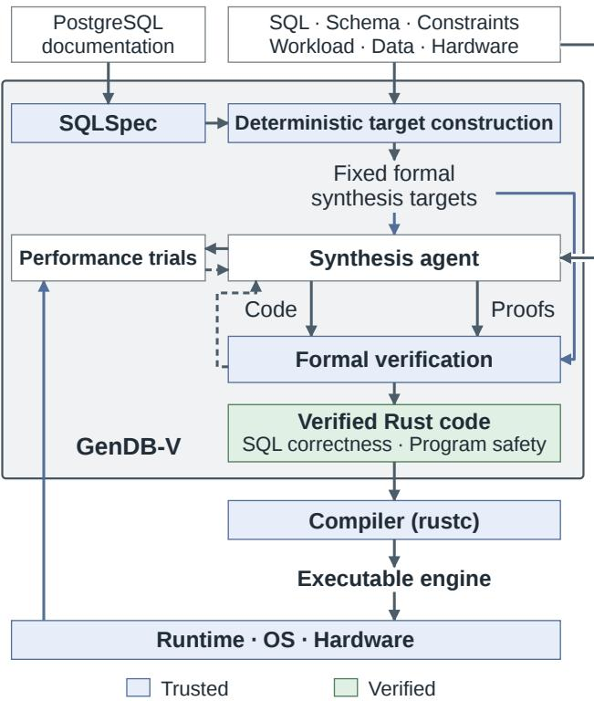
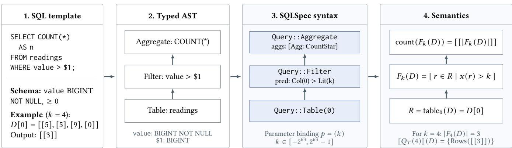
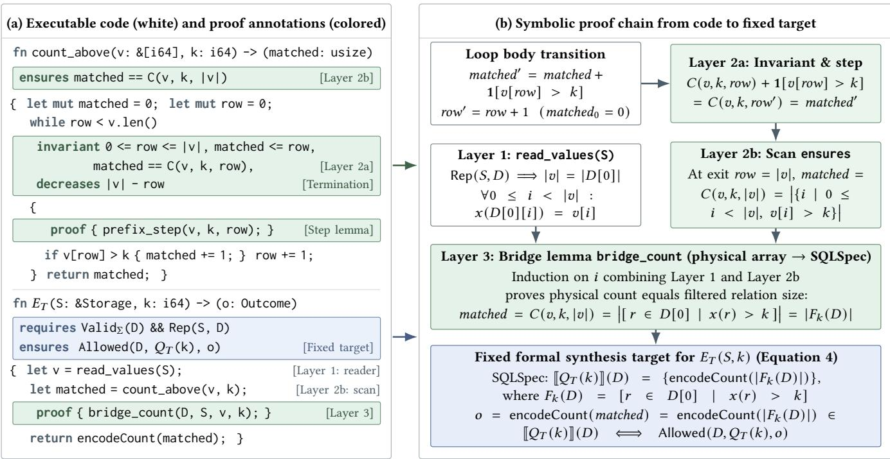
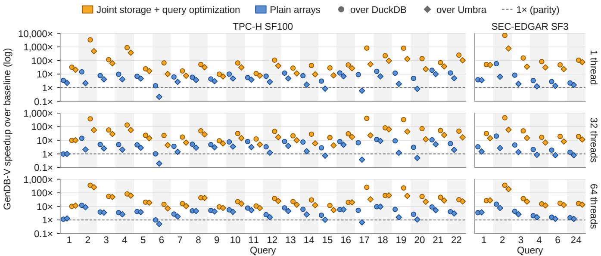
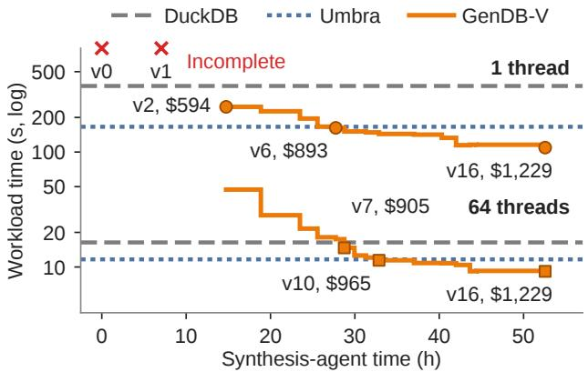

# Stop Handcrafting Your Engine! GenDB-V: Towards AI-Generated and Formally Verified Database Systems

Jiale Lao

Cornell University

Ithaca, New York, USA

jiale@cs.cornell.edu

Immanuel Trummer

Cornell University

Ithaca, New York, USA

itrummer@cornell.edu

## ABSTRACT

For over 50 years, the database community has developed a wide range of successful engines to answer two fundamental questions: how can database systems run faster, and how can we ensure their correctness? Experience with these engines shows that performance depends on hardware and workloads. As both change over time, we repeatedly redesign and rebuild database systems, a time-consuming and expensive process. Correctness remains another long-standing challenge: recent studies continue to uncover wrong-answer bugs even in mature database engines, despite years of development and testing. To address these, we present GenDB-V, a system that enables AI agents to synthesize database engines specialized to hardware and workloads for performance, and formally verified for correctness. GenDB-V supports specialized implementations of SQL templates and general-purpose engines that accept any query within a supported SQL subset. First, we develop SQLSpec to formalize SQL semantics and deterministically construct fixed, implementation-agnostic synthesis targets for storage preservation and query correctness. Second, we enable joint synthesis of fast code and formal proofs through storage–execution co-optimization, performance-first exploration, and three-layer modular proofs that bridge low-level execution to SQLSpec se mantics. Third, we verify the synthesized code and proofs against the fixed synthesis targets in an isolated pipeline, proving SQL correctness and program safety. We evaluate GenDB-V on TPC-H and SEC-EDGAR, a benchmark designed to reduce LLM training-data leakage. For verified template implementations, GenDB-V achieves geometric-mean speedups of 22.0–61.3× over DuckDB and Umbra. For a verified general-purpose engine, GenDB-V also achieves speedups of 1.27–3.4× on TPC-H. GenDB-V also achieves better performance than a testing-based LLM synthesis method, while our audit and tests expose incorrect answers in that method’s implementations for 16 of 28 templates. This project is available at https://github.com/GenLang-V/GenDB-V.

## 1 INTRODUCTION

For more than five decades, the database community has developed successful engines for workloads ranging from short transactions [2, 28] to analytical queries [5, 20, 21], and more [1, 27]. Across these workloads, two fundamental questions have remained central: how can database systems run faster, and how can we ensure their correctness? Despite decades of progress, both remain long-standing challenges that continue to drive database research.

Database performance depends on hardware and workloads, and changes in both have repeatedly led to costly redesigns and reimplementations. In 2007, H-Store demonstrated the benefits of redesigning transaction processing for main memory, motivating a call for “a complete rewrite” [28]. How often has this call returned? Cloud computing prompted Snowflake to replace fixed-resource assumptions with an elastic warehouse architecture [7]. Embedded analytics motivated DuckDB to bring query processing into the application’s own process [24]. Cheaper, faster SSDs led Umbra to redesign HyPer’s memory-only architecture [21]. More recently, advances in GPU memory and interconnects motivated Sirius, a GPU-native engine that replaces CPU query execution within existing systems [38]. Each new design addresses a new setting, but hardware and workloads continue to evolve, and this never ends.

Ensuring correctness remains dificult: testing continues to expose bugs, while formal verification requires substantial human efort. EET found 35 logic bugs across five database systems, including a PostgreSQL hash-join bug that had survived for 20 years [13]. More recently, SQLancer++ reported 196 bugs across 18 systems, including 140 logic bugs [39]. These findings illustrate why extensive testing cannot establish correctness for every valid input. Formal verification can establish that code satisfies a precise specification for every input covered by the proof. For example, CompCert proves that compilation preserves program behavior [17]. In a compilertesting study, Csmith reported 79 bugs in GCC and 202 in LLVM, but found no wrong-code bugs in CompCert’s verified passes despite approximately six CPU-years of testing [37]. However, developing such proofs requires substantial efort: verifying seL4’s 8,700-line C kernel required approximately 20 person-years [14].

Recent advances in large language models (LLMs) have enabled agents to optimize software and generate machine-checked proofs [22, 36]. AlphaEvolve [22] improved production code at Google beyond expert-designed implementations, while GSO [11, 25] demonstrates agents’ growing ability to match expert optimizations across real software repositories. Progress in proof generation spans both software and mathematics: VeruSAGE [36] constructs correctness proofs for systems software, AlphaProof [12] produces Lean proofs for Olympiad problems, and Gauss [18] helped formalize the strong prime number theorem in Lean.

Building on these advances, we present GenDB-V to address the performance and correctness challenges of database systems by having AI agents synthesize engines that are specialized to hardware and workloads for performance and formally verified for correctness. Our key insight is to deterministically construct fixed formal synthesis targets, let agents freely explore optimizations and proofs together, and independently verify that their implementations satisfy those targets. The targets define the required behavior without prescribing how it must be implemented. Agents choose storage layouts and execution strategies, then develop intermediate contracts and proofs connecting their code to these targets. An independent verifier checks both that the code satisfies the intermediate contracts and that those contracts establish the fixed requirements.

First, we develop SQLSpec to formalize SQL semantics and deterministically construct fixed, implementation-agnostic synthesis targets for storage preservation and query correctness. To prevent agents from hallucinating or weakening the specification, GenDB-V generates these targets automatically outside the agent’s control. SQLSpec defines formal query operators, expressions, predicates, aggregates, and ordering based on PostgreSQL semantics. These definitions account for nulls, duplicate rows, runtime SQL errors, and the multiple valid results permitted by unspecified row order and ordering ties. SQLSpec also provides a verified reference interpreter, which we validate against PostgreSQL and use as the initial baseline for engine synthesis. Using a deterministic SQL-to-SQLSpec translator, GenDB-V constructs fixed synthesis targets that specify only input assumptions and permitted outcomes, leaving storage layouts and execution algorithms open so agents can freely optimize for performance. For storage, the targets require custom storage builders to prove that they preserve all input data without loss. For query execution, the targets require the synthesized code to return a permitted SQLSpec result on every valid database, across all allowed parameter bindings for a SQL template or across all supported queries for a general-purpose engine.

Second, we enable agents to jointly synthesize fast implementations and formal proofs through storage–execution co-optimization, performance-first exploration, and modular verification. GenDB-V lets agents co-design custom storage layouts and execution algorithms together, while also supporting fixed storage when storage changes are disabled. To reason formally about custom storage, the storage builder proves physical layout invariants in a representation predicate that query execution proofs can then use. Because writing formal proofs is expensive in LLM tokens and verifier time, agents first prototype and profile candidate designs in an unveri fied mode and only develop proofs for the fastest design. Finally, proving low-level execution code directly against recursive SQL semantics in a single step makes the proof too large and complex for agents to develop and for the verifier to check. Agents therefore decompose each proof into three modular layers: storage reader contracts, physical loop invariants, and inductive bridge lemmas that connect physical execution to SQLSpec semantics.

Third, we verify the synthesized code and proofs against the fixed synthesis targets in an isolated pipeline, proving SQL correctness, data preservation, memory and arithmetic safety, race-free parallel execution, and termination. In this pipeline, all specification files and a top-level entry-point function are fixed and read-only outside the agent’s control, so agents cannot weaken the synthesis targets. GenDB-V builds this pipeline on Verus [16, 34], which extends a safe subset of Rust with specification and proof annotations. Verus translates the executable Rust code, contracts, loop invariants, and proof lemmas into logical verification conditions, and uses the Z3 SMT solver to check that the code satisfies the agent’s intermediate contracts and that those contracts establish the fixed synthesis targets. Once all proofs check, the verified Rust code is compiled into a shared library ready for query execution.

We evaluate GenDB-V on TPC-H at SF100 and SEC-EDGAR at SF3, a benchmark designed to reduce LLM training-data leakage [15]. Experiments cover diferent parameter bindings and degrees of parallelism. To prevent speedups from stored answers, we require complete, lossless base data and prohibit redundant data copies, materialized joins, stored derived values, precomputed aggregates, and cached query results. Agents may optimize physical storage within a fixed budget. To isolate the benefits of query-code specialization, we also synthesize verified query implementations over fixed plain column arrays, with no storage optimization.

GenDB-V produces verified implementations for all 28 templates and a verified general-purpose engine. Joint storage and query optimization achieves geometric-mean speedups of 22.0–61.3× over DuckDB and Umbra across the two benchmarks. Even over fixed plain arrays, verified query implementations achieve geometricmean speedups of 1.84–5.49× over DuckDB and Umbra, demonstrating substantial gains from query-code specialization alone. The general engine evolves from a reference interpreter that completes only two TPC-H queries at SF1 within the timeout into an engine that completes the full SF100 workload, achieving total-workload speedups of 1.27–3.4× over DuckDB and Umbra. The engine accepts any well-typed query within SQLSpec’s supported fragment over the TPC-H schema. GenDB-V also achieves lower execution times than Bespoke OLAP’s testing-based LLM synthesis [35]. Our audit and tests expose incorrect answers on valid inputs in Bespoke OLAP’s implementations for 16 of 28 templates, while GenDB-V requires proofs covering every input in the declared domain.

Joint template synthesis costs approximately \$2,310 across both benchmarks, and general engine synthesis costs \$1,229. Compared with the substantial human efort required by prior verification projects, these results demonstrate a promising path toward automating the development of fast, formally verified database systems. Future work should expand SQLSpec’s coverage and strengthen confidence in its semantics through community review. Further advances should reduce synthesis cost and enable verification of more language features and larger systems.

The original scientific contributions are the following:

• SQLSpec and fixed formal synthesis targets. We develop SQLSpec (defining mathematical SQL semantics and a verified reference interpreter) and deterministically construct fixed storage and execution targets for SQL templates and general-purpose query engines outside the agent’s control (Section 3).

• Joint code and proof synthesis with independent verification. We enable agents to synthesize fast, verified implementations through storage–execution co-optimization, performancefirst exploration, and three-layer modular proofs, checked by an independent Verus verification pipeline in an isolated environment (Sections 4–5).

• Experimental evaluation. We evaluate verified template implementations on TPC-H and SEC-EDGAR and a verified generalpurpose engine on TPC-H. Template implementations achieve geometric-mean speedups of 22.0–61.3× over DuckDB and Umbra, while the general engine achieves total-workload speedups of 1.27–3.4×. We also analyze synthesis time and monetary cost, code and proof size, the efects of storage optimization, correctness beyond synthesis tests, and case studies (Section 6).

  
Figure 1: GenDB-V overview.

## 2 GENDB-V OVERVIEW

Synthesizing a fast and formally verified database engine presents a core design challenge: to achieve high performance, agents need the freedom to invent specialized storage layouts and execution algorithms, yet an untrusted agent should not define or weaken the correctness requirement, and the correctness requirement should not restrict the agent’s implementation choices. GenDB-V addresses this challenge by separating the definition and verification of correctness from the implementation search, and by specifying fixed formal synthesis targets purely in terms of required SQL behavior rather than physical implementation details. Before synthesis begins, GenDB-V deterministically constructs the fixed formal synthesis targets from the SQL workload and schema. During synthesis, agents freely explore physical implementations, intermediate contracts, and proofs together. Before admission, an independent verifier checks that the generated code and proofs establish the fixed formal synthesis targets. Figure 1 shows the system architecture.

First, deterministic target construction (Section 3) translates the input SQL, schema, and integrity constraints into fixed formal syn thesis targets. We develop SQLSpec, a formal library in Verus that mathematically defines SQL semantics based on PostgreSQL documentation. Using SQLSpec, the target constructor deterministically builds the correctness requirements before agent synthesis. GenDB-V supports two settings: constructing a target for a single SQL template across all allowed parameter bindings, or constructing a target for a general-purpose engine across all input queries within a supported SQL subset. When agents optimize storage, the targets also require storage builders and readers to preserve the logical data. Each target specifies only the input assumptions and permitted outcomes, without restricting the implementation choices.

Second, joint code and proof synthesis (Section 4) combines storage–execution co-optimization, performance-first exploration, and modular verification. Guided by the workload, data, and hard ware, agents co-design storage layouts and execution algorithms, or optimize query execution over fixed storage. Because proof development is expensive, agents first prototype, measure, and profile candidate implementations, then develop proofs for the fastest design. Because proving optimized execution code directly against SQLSpec in a single proof is complex, agents decompose the proof into three modular layers: storage reader contracts, physical loop invariants, and bridge lemmas connecting physical execution to SQLSpec. Each layer establishes a smaller claim, and the claims together establish the fixed formal synthesis target.

Third, independent verification (Section 5) checks the generated code and proofs against the fixed formal synthesis targets without trusting the agent. Using Verus, GenDB-V checks both that the executable Rust code satisfies the agent’s intermediate contracts and that the intermediate contracts establish the fixed formal synthesis targets. If verification fails, GenDB-V returns verification feedback to the agent for further refinement. Once verification succeeds, the verified Rust code guarantees SQL correctness and program safety under the declared input domains and trusted assumptions. The Rust compiler (rustc) then erases the proof code and compiles the verified Rust code into an executable engine, so query execution incurs no proof-checking overhead. As shown in Figure 1, SQLSpec, deterministic target construction, the verifier, the compiler, and the runtime environment form the trusted foundation, whereas no agent-generated code or proof is trusted.

## 3 FORMAL SYNTHESIS TARGETS

To build a formally verified database engine, we need a formal specification that defines correctness for SQL workloads. Because agents are untrusted, we cannot rely on agents to write the specification: model hallucinations can produce an incorrect specification, and agents can weaken the target to make proving easier. Moreover, to achieve high performance, the specification should not prescribe physical data layouts or execution algorithms, so that agents remain free to explore optimizations. To address these requirements, GenDB-V formalizes SQL semantics in a reusable library, SQLSpec, and deterministically constructs fixed formal synthesis targets before agent synthesis begins. Each target specifies only the input assumptions and permitted outcomes on every valid database, leaving physical representations, execution algorithms, and proof strategies to the agent so that agents can freely optimize for the target workload and hardware.

## 3.1 SQLSpec: Formal SQL Semantics

Formalizing SQL for database engine verification requires capturing real SQL behaviors that idealized relational algebra omits, including nulls, duplicate rows, runtime errors, and nondeterministic row ordering. To provide this foundation, we develop SQLSpec, a formal SQL library in Verus based on PostgreSQL documentation [23]. We select the SQL features needed by TPC-H and SEC-EDGAR as a core analytical subset, summarized in Table 1. The subset covers relational operators, correlated subqueries, expressions, three-valued predicates, aggregates, ordering, limits, and ofsets. SQLSpec can be extended with additional features and it rejects currently unsupported features such as window functions and recursive queries. It consists of three parts: (1) a logical data model and query syntax, (2) mathematical evaluation functions that define the set of permitted outcomes for a query, and (3) a verified executable interpreter.

Table 1: Supported SQL subset and semantics in SQLSpec.
<table><tr><td>Category</td><td>Supported features and semantics</td></tr><tr><td>Schema</td><td>Typed values, NULL, primary/unique/foreign keys, CHECK</td></tr><tr><td>Expressions</td><td>Literals, columns, arithmetic, casts, CASE, scalar subqueries</td></tr><tr><td>Predicates</td><td>Comparisons, three-valued logic, EXISTS, IN, ANY/ALL</td></tr><tr><td>Operators</td><td>Table, Filter, Project, Product, LeftJoin, Distinct</td></tr><tr><td>Aggregates Ordering</td><td>COUNT, SUM, AVG, MIN, MAX, DISTINCT, GROUP BY ORDER BY, NULL order, OFFSET, LIMIT, permitted tie orders</td></tr></table>

Data model and query syntax. To keep the specification independent of physical storage layouts, SQLSpec defines a logical data model and represents queries as operator trees (Table 1). In the data model, values are mathematical integers, exact decimals, dates, strings, booleans, or NULL. A row � is a sequence of values, a relation � is a sequence ofrows that preserves duplicates, and a database � contains one relation � [�] for each table index � (starting from 0) in the schema Σ. Note that the sequence representation of relations is a modeling choice and does not change SQL’s bag semantics. The permitted-outcome definition below accounts for all row orders and selections allowed by SQL. To enforce schema rules and integrity constraints, SQLSpec defines boolean specification functions over � that check whether every value fits its declared column type and nullability, and whether the relations satisfy the declared pri mary keys, unique keys, foreign keys, and CHECK constraints. These functions serve as preconditions in the formal synthesis targets, restricting the proof to valid databases. Over this data model, SQL Spec represents a SQL query by composing syntax constructors into an operator tree. Each constructor specifies a relational operator, expression, predicate, or aggregate together with its arguments and child queries. For example, Query::Filter(p, q) applies predicate � to each row produced by child operator tree �, retaining rows for which � evaluates to True.

Mathematical evaluation and permitted outcomes. To give op erator trees a mathematical meaning, SQLSpec defines a pure Verus specification function for each syntax constructor and evaluates a query tree recursively by composing these functions. Specification functions define mathematical behavior for proof checking and are erased during compilation, so they add no runtime overhead. To handle correlated subqueries, SQLSpec defines the outer-row context � as a flat sequence of values from the current row at each enclosing query level, where a row may combine multiple tables. The frontend resolves names and aliases to positional column references before evaluation. An evaluation function eval(�, �, �) evaluates an operator tree � on database � and outer-row context $\rho ,$ recursively evaluating child queries and applying each constructor’s specification function to return either a relation or a specified SQL error. For example, evaluating Query::Filter(�, �) first calls eval $( D , \rho , q )$ to evaluate child query �, and applies the filter specification function to evaluate predicate � on each row under three-valued logic (True, False, Unknown): if either � or � raises a runtime error (such as division by zero), evaluation returns that SQL error; otherwise, it keeps only rows where � evaluates to True. The remaining constructors similarly formalize standard SQL semantics for expressions, joins, and aggregates while accounting for nulls, duplicates, and runtime errors, so we omit their detailed definitions for brevity.

A SQL query can permit multiple valid results due to unspecified row order, ordering ties, and limits. Requiring a single canonical result could reject correct results produced by valid execution plans. For a top-level query $Q = ( q , { \vec { o } } , \ell , d )$ with body �, ordering keys �®, optional limit ℓ, and ofset �, SQLSpec defines the set of permitted outcomes � (�). We write Rows(�′) for a successful outcome containing row sequence �′, and SqlError(�) for an outcome reporting SQL error �. If eval(�, [], �) returns error �, the only permitted outcome is SqlError(�). If evaluation returns relation �, SQLSpec defines permitted outcomes in two steps. First, SQLSpec considers permitted orderings of all rows in �, preserving duplicates. Without ORDER BY, every ordering is permitted. With ORDER BY, SQLSpec permits every ordering that follows the sort keys, including every permutation of rows with equal sort keys. Second, SQLSpec applies OFFSET followed by LIMIT to each permitted ordering. Each resulting sequence �′ gives a permitted outcome Rows(�′). Query correctness requires the returned outcome to belong to � (�).

Verified executable interpreter. In Verus, mathematical specification functions exist only for verification: they operate over unbounded mathematical integers and sequences and are erased by the compiler, so they cannot be compiled into a runnable program. To execute queries on actual data, SQLSpec pairs its mathematical specification with a naive executable reference interpreter written in Rust over fixed-width types (i64 integers, i128 decimals, and Vec<u8> byte arrays). This interpreter is formally proved in Verus to satisfy � (�) for any valid database � and query � using the formal correctness targets defined in Section 3.2 and the proof structure described in Section 4. GenDB-V uses the verified reference interpreter as the initial engine that agents iteratively optimize into a high-performance general-purpose engine (Section 4).

## 3.2 Deterministic Target Construction

GenDB-V supports two synthesis modes: (1) template specialization, which synthesizes a query executor for a single parameterized SQL template across all allowed parameter bindings, and (2) engine synthesis, which synthesizes a general-purpose query engine across all input queries within the supported SQL subset. In both modes, if an LLM agent translates the SQL template or supported SQL subset into a formal theorem, hallucination or reward hacking can cause it to misinterpret SQL semantics, drop constraints, or restrict the input domain. GenDB-V prevents this risk by programmatically and deterministically translating SQL templates, database schemas, and the supported SQL subset into fixed formal synthesis targets outside the agent’s control. These targets connect the execution of a synthesized program over physical storage to the permitted SQL-Spec outcomes across all valid databases and all allowed parameter bindings or input queries.

  
Figure 2: Translating the running example from a SQL template (step 1) to a typed AST (step 2), a SQLSpec query tree �� (�) (step 3), and its mathematical semantics (step 4).

From SQL text to SQLSpec terms. First, the frontend parses a SQL query with SQLGlot [26] and resolves table and column names, expression types, and type conversions against the schema under PostgreSQL rules to produce a typed AST (Figure 2, steps 1–2). Next, a deterministic translator converts this typed AST into a SQLSpec query tree (step 3). Because this translator is part of the trusted foundation, SQLSpec is designed so that its syntax constructors directly mirror the nodes of a typed SQL AST. The translator can therefore map each relational operator, expression, predicate, and aggregate in the AST one-to-one to its corresponding SQLSpec constructor, keeping the translator small, auditable, and easy to extend. In template specialization, a SQL template � is fixed at synthesis time and may contain parameters $( \$ 1,\$ 12,.. . )$ , each with a resolved SQL type and an allowed value range. For any parameter binding � within these ranges, the translator replaces each parameter \$i with its value $\mathcal { P } i$ to form a parameterized SQLSpec query tree $Q _ { T } ( p )$ In engine synthesis, the query is not fixed ahead of time: instead, the translator converts each incoming SQL query at runtime into a SQLSpec query tree �, and the synthesized engine must handle any valid query tree � within the supported SQL subset.

Example 3.1. Figure 2 illustrates this pipeline on our running example over table readings (with column value BIGINT NOT NULL and constraint CHECK(value >= 0)) for template � (step 1):

## SELECT COUNT(\*) AS n FROM readings WHERE value > \$1;

First, the frontend resolves table readings and column value, infers that value (BIGINT NOT NULL) and parameter \$1 (BIGINT) both have 64-bit integer type, and builds a typed AST with bottomto-top operator nodes Table: readings, Filter: value $> \$ 1$ , and $\mathsf { A g - }$ gregate: COUNT(\*) (step 2). Next, for any parameter binding $\hbar =$ (�) where � lies in the range $[ - 2 ^ { 6 3 } , 2 ^ { 6 3 } - 1 ]$ , the translator maps each AST node to its corresponding SQLSpec constructor to form $Q _ { T } ( k )$ (step 3): Query::Table(0) for table 0, Query::Filter with predicate $\mathtt { C o l } ( 0 ) > \mathsf { L i t } ( k )$ , and Query::Aggregate over [Agg:: CountStar]. Finally, SQLSpec’s mathematical semantics evaluates $Q _ { T } ( k )$ bottom-to-top on database � (step 4). Let $R = \mathrm { t a b l e } _ { 0 } ( D ) =$ � [0] be the rows of table 0 and $x ( r )$ be the integer at column 0 of row �. The filter keeps all qualifying rows, preserving duplicates:

$$
F _ { k } ( D ) = [ r \in R \mid x ( r ) > k ] .\tag{1}
$$

The aggregate then counts the qualifying rows. When $| F _ { k } ( D ) | \le$ $2 ^ { 6 3 } - 1$ , the unique permitted outcome in $\mathbb { [ } Q _ { T } ( k ) ] ( D )$ is the singlerow relation Rows( $[ [ | F _ { k } ( D ) | ] ] )$ ; when $| F _ { k } ( D ) | > 2 ^ { 6 3 } - 1$ , the unique permitted outcome is SqlError(22003). On example input $D [ 0 ] =$ [ [5], [5], [9], [0]] with $k = 4 ,$ the filter keeps $F _ { 4 } ( D ) = [ [ 5 ] , [ 5 ]$ , [9]] and the required output is [ [3]].

Storage targets: builder correctness and losslessness. GenDB-V requires two storage guarantees: the builder must implement the chosen representation correctly, and the representation must preserve all logical data. The agent defines the builder � and a representation predicate Rep(�, �) that describes how physical storage � represents logical database �. The predicate is a Booleanvalued Verus specification function whose definition depends on the chosen layout, such as compressed columns, reordered rows, or zone maps. For example, given a single integer column stored as a plain array, Rep(�, �) requires the array length and values to match the logical column. GenDB-V leaves the definition of Rep to the agent because a fixed definition would restrict physical storage designs. To ensure correctness without restricting this design space, GenDB-V requires the agent to prove two fixed targets: builder correctness and losslessness.

First, builder correctness requires that building storage from � establishes Rep(�(�), �). Letting $\mathsf { V a l i d } _ { \Sigma } ( D )$ denote that � satisfies the schema types and integrity constraints of Σ, the target is:

$$
\forall D : \quad \forall \mathsf { a l i d } _ { \Sigma } ( D ) \Longrightarrow \mathsf { R e p } ( B ( D ) , D ) .\tag{2}
$$

Second, Equation 2 alone does not guarantee losslessness because an untrusted agent defines Rep. GenDB-V therefore requires a fixed losslessness target that the agent must prove. Losslessness means that a recovery function � exists on the outputs of � such that $G ( B ( D ) ) = D$ for every valid �. By the left-inverse theorem [9, 10, 19], this is equivalent to � being injective: for all valid databases $D _ { 1 } , D _ { 2 } , B ( D _ { 1 } ) = B ( D _ { 2 } )$ implies $D _ { 1 } = D _ { 2 }$ . Equation 2 guarantees that every builder output represents its input database. Therefore, to prove that equal builder outputs imply equal input databases, it is suficient to require that the same physical storage cannot represent two diferent logical databases. GenDB-V fixes this requirement as the losslessness target:

$$
\forall S , D _ { 1 } , D _ { 2 } : \quad \mathsf { R e p } ( S , D _ { 1 } ) \wedge \mathsf { R e p } ( S , D _ { 2 } ) \Longrightarrow D _ { 1 } = D _ { 2 } .\tag{3}
$$

Equation 3 gives $D _ { 1 } = D _ { 2 }$ , establishing injectivity and therefore lossless storage construction. Here, $D _ { 1 } \ = \ D _ { 2 }$ requires the same rows in the same order in each logical table. Physical storage may reorder rows but must preserve enough information to recover the logical order. This logical order does not prescribe query output order, which follows SQLSpec’s ordering and row-selection rules (Section 3.1). Note that lossless storage may change physical values, such as storing $v + 1$ for a logical value �. We establish end-to-end correctness by also requiring query execution proofs to use the same Rep(�, �) and show that execution over � returns an outcome permitted by SQLSpec on the original logical database �.

Query and engine execution targets. Both synthesis modes use the same outcome condition to connect physical query execution over � to SQLSpec semantics over $D .$ . Because executable code uses fixed-width hardware types (such as 64-bit integers and 128- bit decimals), we define Allowed(�, �, �) for a query tree $Q$ and execution outcome � to hold if and only ${ \mathrm { i f ~ } } o \ \in \ [ [ Q ] ] ( D )$ , or $o \ =$ Capacity when evaluating $Q$ on � produces an intermediate value that exceeds hardware type bounds.

In template specialization, the SQL template� is fixed at synthesis time and the synthesized executor $E _ { T }$ receives a tuple of parameter values � at runtime. Let $\mathcal { P }$ denote the declared domain of allowed parameter bindings for � . The fixed formal synthesis target requires $E _ { T }$ to return a permitted outcome for every valid database �, every matching physical storage state �, and every allowed parameter binding $p \in { \mathcal { P } }$

$$
\begin{array} { r l } { \forall D , S , \forall p \in \mathcal { P } : } & { \mathsf { V a l i d } _ { \Sigma } ( D ) \land \mathsf { R e p } ( S , D ) } \\ & { \implies \mathsf { A l l o w e d } ( D , Q _ { T } ( \boldsymbol { \phi } ) , E _ { T } ( S , \boldsymbol { p } ) ) . } \end{array}\tag{4}
$$

In Example $3 . 1 , p \ = \ ( k )$ ranges over $\mathcal { P } ~ = ~ \{ ( k ) ~ | ~ - 2 ^ { 6 3 } ~ \leq ~ k ~ \leq$ $2 ^ { 6 3 } - 1 , \ k \in \mathbb { Z } \}$ , so a single proof guarantees correctness across every threshold � and every valid database $D .$

In engine synthesis, the synthesized engine � does not hardcode specific query templates, table names, or column names. At runtime, � receives a query tree $Q \in Q _ { \Sigma } ,$ , where $Q _ { \Sigma }$ contains all well-typed SQLSpec query trees over the user-declared schema Σ within the supported SQL subset. The fixed formal synthesis target requires � to return a permitted outcome for every such query on every valid database and matching physical storage state:

$$
\begin{array} { r l } { \forall D , S , \forall Q \in Q _ { \Sigma } : } & { \lor \mathrm { a l i d } _ { \Sigma } ( D ) \land \mathsf { R e p } ( S , D ) } \\ & { \implies \land \mathsf { I I o w e d } ( D , Q , E ( S , Q ) ) . } \end{array}\tag{5}
$$

The verified interpreter in Section 3.1 supports all schemas, databases, and queries within SQLSpec’s supported subset, and its correctness guarantee additionally quantifies over the schema Σ. For continual optimization, GenDB-V instantiates the general engine for the user’s declared schema and uses the data, representative workload, and hardware to guide optimization. The engine retains general SQL coverage through verified execution paths, ranging from optimized operators to the reference interpreter, while performance optimization targets the given context.

End-to-end instantiation on imported data. Combining the storage targets (Equations 2–3) with the execution target (Equation 4 or 5) establishes end-to-end correctness on imported user data. When GenDB-V imports a valid database � satisfying $\mathsf { V a l i d } _ { \Sigma } ( D )$ and runs the verified storage builder $S = B ( D )$ , Equation 2 establishes Rep(�, �) and Equation 3 ensures that � uniquely preserves �. Instantiating Equation 4 or 5 with (�, �) then guarantees that running $E _ { T } ( S , p )$ for any $p \in { \mathcal { P } }$ , or $E ( S , Q )$ for any $Q \in Q _ { \Sigma }$ , returns a permitted SQLSpec outcome for �.

## 4 JOINT CODE AND PROOF SYNTHESIS

The fixed formal synthesis targets in Section 3 define what outcomes an implementation must produce, but leave open how an agent can synthesize an implementation that is both fast and verifiable. Jointly synthesizing high-performance database code and formal proofs presents three challenges. First, query performance depends on both physical storage layouts and execution algorithms, so optimizing query execution alone over a fixed storage layout misses major speedups. Second, writing formal proofs is expensive in LLM tokens and verifier time, so proving every candidate design during performance exploration is impractical. Third, proving low-level, fused execution code directly against recursive SQLSpec semantics in a single monolithic proof makes the proof too large and complex for agents to develop and for the verifier to check. GenDB-V addresses these three challenges below.

## 4.1 Storage–Execution Co-Optimization

High-performance analytical engines rely on specialized physical storage layouts together with execution operators tailored to those layouts. Allowing an agent to co-design storage and execution introduces two dificulties: unrestricted storage changes could corrupt data or precompute query answers, and the execution proof must be able to reason formally about custom physical layouts. GenDB-V resolves both dificulties by governing storage customization under formal and policy safeguards, and by exposing physical layout invariants to execution proofs through the predicate Rep(�, �).

Storage customization and safeguards. When storage optimization is enabled, an agent analyzes the schema, data, workload, and hardware to synthesize a custom storage builder �, reader functions, and a representation predicate Rep(�, �). The agent can improve execution through physical designs such as compact encodings, table sorting and partitioning, single-table indexes, and data-skipping metadata. GenDB-V applies two safeguards to preserve data and prevent performance gains from stored query answers. First, GenDB-V automatically invokes Verus to check the storage proofs against the fixed storage targets (Equations 2–3), establishing builder correctness and losslessness. Second, a configurable storage policy limits storage size and restricts what the agent may store. Our experiments require one complete, lossless copy of the base data and prohibit redundant copies and materialized query computations (Section $6 . 1 ) .$ . GenDB-V checks storage sizes programmatically, and we audit the generated code for storage-policy violations to ensure a fair experimental comparison. For ablation studies that isolate query execution optimization from physical storage design, GenDB-V also supports a fixed-storage mode in which agents optimize execution over plain column arrays.

Exposing physical invariants to execution proofs. Because the execution targets constrain only the input preconditions and permitted outcomes, agents can design physical execution plans that difer from SQLSpec’s recursive operator tree, such as reordered joins, custom hash tables, fused single-pass loops, and parallel execution. Since an execution proof sees physical storage � only through

Rep(�, �), any physical property that an execution algorithm relies on for correctness must be stated as a mathematical invariant inside Rep(�, �) and proved by the storage builder �. Instead ofrestricting agents to predefined storage layouts, GenDB-V lets agents specify in Rep(�, �) both how the physical structures decode to the logical rows of � and what physical properties hold over those structures (such as sort orders, index coverage, or block min/max bounds). In Example 3.1, a plain-array layout states in Rep(�, �) that array ele ment � [�] equals column 0 of logical row $i \left( D [ 0 ] [ i ] [ 0 ] = \mathsf { l n t } ( v [ i ] ) \right)$ If the agent instead partitions the column into blocks � and stores a zone-map maximum $m _ { b }$ for each block, the storage builder proves as part of Rep(�, �) that every row � in block � satisfies $x ( r ) \leq m _ { b }$ The query proof can then skip any block with $m _ { b } \leq k ,$ because Rep(�, �) guarantees that no row in � satisfies $x ( r ) > k$ . Agents can similarly exploit schema constraints from $\mathsf { V a l i d } _ { \Sigma } ( D )$ : because readings.value has CHECK(value >= 0), every row in a valid database satisfies $x ( r ) \geq 0 ,$ , allowing a verified fast path to return the table length |�[0]| in �(1) time whenever $k < 0$

## 4.2 Performance-First Exploration

Developing a complete proof requires writing loop invariants, arithmetic bounds, and bridge lemmas, which consumes substantial agent reasoning tokens and verifier runtime. If an agent writes proofs before measuring performance, it either wastes proof efort on slow designs or chooses simple execution plans that are easy to prove but slow at runtime. GenDB-V addresses this by decoupling fast empirical performance exploration from proof generation.

Decoupling performance trials from verification. GenDB-V provides an interactive toolset for agents to compile code, build storage, check outputs, time execution, and profile CPU and I/O across parameter bindings and thread counts. During exploration, agents invoke these tools in an unverified diagnostic mode (–no-verify) that compiles and runs candidate code without running the formal verifier. In this mode, an agent can rapidly prototype and compare competing designs, use diferential testing against a reference system for fast result feedback, and inspect hardware profiling metrics. Once the agent identifies the fastest design that meets the userspecified performance target, it freezes the physical algorithm and develops the formal contracts and proofs for that winning design. The unverified mode is used only during exploration; when the agent submits a candidate implementation, GenDB-V always runs the formal verifier and rejects any code without a complete proof. Iterative refinement across attempts and versions. When a candidate fails verification or misses a performance target, GenDB-V returns structured diagnostic feedback to guide the next iteration, such as storage contracts, query execution time, baseline speed targets, verifier error messages, and optimization notes recorded by agents in prior sessions. In template specialization, GenDB-V evaluates verified submissions across diferent parameter bindings and thread counts, admitting the fastest verified implementation. In engine synthesis, optimization proceeds iteratively across sequen tial engine versions starting from the verified reference interpreter (Section 3.1). In each iteration, the agent profiles the current best verified engine on a representative workload, identifies bottlenecks, replaces them with faster implementations and develops proofs of correctness, and submits a new complete engine. A candidate engine version replaces the active version only if it passes full verification and improves workload execution time.

## 4.3 Modular Contracts and Proofs

Proving an optimized implementation directly against SQLSpec’s recursive definitions in a single step makes the proof large and complex for agents to develop and for the verifier to check. In SQLSpec, each operator constructor is defined functionally by materializing a full intermediate relation from its child query. However, an optimized physical implementation could fuse operators within a pipeline into tight loops over physical arrays and in-memory state, rather than materializing a full logical relation after every operator. To keep proof steps small and checkable, GenDB-V guides agents to organize proofs into three layers: (1) storage reader contracts, (2) physical loop contracts and step lemmas, and (3) inductive bridge lemmas. Within each layer, agents can further decompose proofs into smaller contracts and helper lemmas as needed.

Three-layer proof decomposition. First, at the storage boundary (Layer 1), each storage reader function takes the representation predicate Rep(�, �) as a precondition (requires) and specifies a postcondition (ensures) describing how the returned physical arrays decode to the logical rows and columns of �[�], along with any physical layout invariants. Second, at the execution loop level (Layer 2), the agent defines mathematical helper functions that describe the computation over physical data. A loop invariant (invariant) relates the current program state to these functions. The invariant tracks progress according to the algorithm, such as a scan position, two positions in a nested-loop join, or the hash table built from processed rows. The agent also supplies a termination measure (decreases) and helper lemmas for individual steps. Verus checks that the invariant holds at loop entry and that each iteration preserves it. At loop exit, the invariant and exit condition establish the function’s postcondition (ensures). Third, at the semantic boundary (Layer 3), the agent writes an inductive bridge lemma that combines the Layer 1 storage reader contract with the Layer 2 physical postcondition. The bridge proof connects the physical computation to SQLSpec’s evaluation over the logical database �, establishing the fixed synthesis target (Equation 4 or 5).

Example 4.1. Figure 3 illustrates this three-layer method on our running COUNT query from Example 3.1. Recall that readings is table 0 (�[0]), value is column 0 (BIGINT NOT NULL), and � is a non-null 64-bit integer parameter. In Figure 3(a), executable code is on a white background, agent-written proof annotations are in green, and the fixed synthesis target is in blue. The top-level executor $E _ { T } ( S , k )$ calls read\_values(S) to obtain the physical 64- bit integer slice � (Layer 1), calls count\_above(v, k) to compute matched in a single fused loop (Layer 2), invokes the bridge lemma bridge\_count (Layer 3), and returns � = encodeCount(matched).

To verify count\_above(v, k) in Layer 2, the agent defines a mathematical prefix-count function $C ( v , k , i )$ that counts elements above � in the slice prefix � [0..�):

$$
C ( v , k , i ) = \big | \{ j \ \mid 0 \leq j < i \ \wedge \ v [ j ] > k \} \big | ,\tag{6}
$$

and proves a one-step lemma (prefix\_step) showing how � advances from row to row + 1:

$$
C ( v , k , r o w + 1 ) = C ( v , k , r o w ) + 1 [ v [ r o w ] > k ] ,\tag{7}
$$

  
Figure 3: Modular code and proof synthesis for Example 4.1.

The indicator $1 [ v [ r o w ] > k ]$ equals 1 when � [row] > � and 0 otherwise. As shown in the top row of Figure 3(b), the verifier first checks that the loop invariant matched = �(�, �, row) holds at loop entry $( m a t c h e d _ { 0 } = 0 = C ( \upsilon , k , 0 )$ at row = 0). Next, the verifier translates the loop body into the logical transition formula matched′ = matched + 1[� [row] > �] and row′ = row + 1. Using prefix\_step, the verifier checks that whenever matched $\mathbf { \Psi } = C ( v , k , r o w )$ holds at the start of an iteration, matched′ = �(�, �, row) + 1[� [row] > $k ] = C ( v , k , r o w ^ { \prime } )$ holds after the iteration (Layer 2a), while $0 ~ \leq$ matched ≤ row < |�| guarantees valid array bounds and no counter overflow. When the loop exits at $r o w = | \boldsymbol { v } |$ , the verified invariant establishes the scan postcondition matched $= C ( \boldsymbol { v } , \boldsymbol { k } , | \boldsymbol { v } | ) \ =$ $\left| \{ i \mid 0 \leq i < | v | , v [ i ] > k \} \right| ( \mathrm { L a y e r }$ 2b).

In Layer 3, the bridge lemma (bridge\_count) combines the Layer 1 reader contract under Rep(�, �) (which guarantees $| \boldsymbol { v } | =$ |� [0] | and � (� [0] [�]) = � [�] for all $0 \leq i < | \boldsymbol { v } | )$ ) with the Layer 2b scan postcondition (matched = �(�, �, |�|)). By induction on �, bridge\_count proves that the physical count equals the size of SQLSpec’s filtered relation $F _ { k } ( D ) = \left[ r \in D [ 0 ] \ | \ x ( r ) > k \right]$ from Equation 1, giving matched $= C ( v , k , | v | ) = | F _ { k } ( D ) |$ . Finally, wrapping count �:

$$
\begin{array} { r } { \mathsf { e n c o d e C o u n t } ( c ) = \left\{ \begin{array} { l l } { \mathsf { R o w s } ( [ [ c ] ] ) } & { c \leq 2 ^ { 6 3 } - 1 , } \\ { \mathsf { S q l E r r o r } ( 2 2 0 0 3 ) } & { c > 2 ^ { 6 3 } - 1 , } \end{array} \right. } \end{array}\tag{8}
$$

matches the permitted outcome set $\mathbb { [ } Q _ { T } ( k ) ] ( D )$ defined in Exam ple 3.1: { encodeCount $( | F _ { k } ( D ) | ) \}$ }. Here, Rows denotes a successful query outcome, and [[�]] abbreviates a single row containing the integer value Int(�), with SQL result type BIGINT. Since matched = $| F _ { k } ( D ) |$ , the returned outcome � = encodeCount(matched) satisfies $) \in \mathbb { [ } Q _ { T } ( k ) ] \mathbb { ( } D )$ , which holds ifand only ifAllowed(�, �� (�), �), proving the fixed formal synthesis target across all valid databases � and all 64-bit integer bindings $p = ( k ) \in \mathcal { P }$

From template proofs to general-purpose engine proofs. Template specialization proves a single execution plan for a fixed query template $Q _ { T } ( p )$ . A general-purpose engine �(�, �) receives an arbitrary query tree $Q \in { \cal Q } _ { \Sigma }$ at runtime and must satisfy the engine target (Equation 5) for every well-typed query over Σ. Although queries can nest operators to arbitrary depth, every query in QΣ is built from the finite set of constructors in Table 1. SQLSpec defines whether a query tree � belongs to $Q _ { \Sigma }$ bottom-up: each leaf Table(�) must refer to a valid table � in $\Sigma ,$ and each parent operator’s column indices, expressions, and predicates must match the output column types of its child subqueries.

Every query tree $Q \in Q _ { \Sigma }$ has base table accesses Table(�) at its leaves, query operators (such as Filter, Project, each parameterized by expression, predicate, or aggregate trees) at its internal nodes, and top-level ordering, limit, and ofset $( q , \vec { o } , \ell , d )$ at its root. To prove that our baseline reference interpreter (Section 3.1) covers any $Q \in { \cal Q } _ { \Sigma }$ of any height, we verify its recursive evaluation function from the leaves up to the root. (1) In the base case at a leaf node Table(�), SQLSpec defines the required result to be the logical base table, eva $| ( D , \rho ,$ Table(�)) = �[�]. A Layer 1 storage reader contract parameterized by runtime table index � and column index � proves under $\mathsf { R e p } ( S , D )$ that reading table � from physical storage � decodes to the logical rows of�[�]. (2) In the inductive step at an internal operator node � (such as Filter, LeftJoin, or Aggregate), the interpreter first recursively evaluates its child subqueries $q _ { i } .$ Because each child $q _ { i }$ has strictly smaller tree height than �, the recursion is guaranteed to terminate, which allows the parent proof to assume the recursive call’s postcondition (ensures): that each child call returns a physical relation matching eval $( D , \rho , q _ { i } )$ . Given these verified child relations, the parent operator runs its loops over the input rows (while evaluating any attached expression or predicate trees, verified in the same bottom-up way). Layer 2 loop contracts prove what the operator’s loops compute over the input rows, and a Layer 3 bridge lemma proves that this physical output matches SQLSpec’s mathematical definition for � applied to eval $( D , \rho , q _ { i } )$ establishing eva $( D , \rho , q )$ . (3) At the root $Q = ( q , { \vec { o } } , \ell , d )$ , applying top-level sorting and limit/ofset slicing to eval(�, [], �) proves via Layers 2–3 that the returned outcome � belongs to � (�) (or $o = \mathsf { C a p a c i t y } )$ , establishing Allowed(�, �, �(�, �)).

Because each operator proof relies only on the postcondition of its child calls rather than their internal structure, proving these steps once for each constructor in Table 1 (rather than for every combination of operators) proves the reference interpreter across all $Q \in { \cal Q } _ { \Sigma }$ . However, evaluating one constructor at a time and materializing full intermediate relations is slow at scale. To achieve high performance while preserving universal coverage, agents optimize the engine at two levels within this same inductive framework. First, agents replace full-row intermediate relations with compact physical representations (e.g., late-materialized row-ID vectors over columnar storage) and upgrade individual operators (e.g., hash-based GROUP BY), proving the same per-node postcon dition $\mathsf { e v a l } ( D , \rho , q )$ . Second, agents fuse multi-operator subtrees into single-pass physical kernels (such as turning Filter over Product into a hash join, or extracting equi-join keys from compound predicates) or normalize subplans via proved equivalence lemmas $( { \mathrm { e v a l } } ( D , \rho , q ^ { \prime } ) = { \mathrm { e v a l } } ( D , \rho , q ) )$ ). Each specialized kernel is guarded by a runtime check over the subtree � and Σ: when the check holds, the kernel’s Layer 1–3 proof establishes eval $( D , \rho , q )$ directly without materializing intermediate nodes; otherwise, evaluation falls back to the general verified operators.

## 5 INDEPENDENT VERIFICATION

## 5.1 Verification and Compilation Pipeline

When an agent submits candidate code and proofs, GenDB-V checks that it proves the exact synthesis target, does not skip any proof steps, and produces the executable that matches the verified code. Binding agent code to the fixed targets. To prevent reward hacking, GenDB-V runs verification in an isolated environment. In this environment, all specification files (SQLSpec, the schema and constraints $\mathsf { V a l i d } _ { \Sigma } ( D )$ , parameter domains P, and the admitted storage specification Rep(�, �)) and a top-level entry-point function are fixed and read-only. The fixed entry point first validates runtime inputs, rejecting out-of-range parameters, unsupported queries $( Q \notin Q _ { \Sigma } ) .$ , or invalid thread counts. It then calls the agent’s implementation function and enforces the fixed formal synthesis target (Equations 2–5) as its required postcondition (ensures). Because the agent can only write the code and helper proofs called by this fixed entry point, it cannot weaken the target, add extra input assumptions, or prove an unused function.

Checking code and proofs with Verus. GenDB-V builds its verifier on Verus [16, 34], a formal verification tool that extends Rust with specification and proof annotations. Agents in GenDB-V write storage and query implementations in a safe subset of Rust that

Verus can translate into logical formulas. For each function, Verus translates the executable Rust code, preconditions (requires), postconditions (ensures), loop invariants, and proof lemmas into logical verification conditions. It then uses the Z3 SMT solver to check that every function satisfies its contracts and that the top-level contracts establish the fixed formal synthesis target. To prevent agents from bypassing these checks, GenDB-V deterministically rejects unsafe language features (such as unsafe pointers and external libraries) and runs Verus across the entire program with all proof-skipping annotations (such as assume and admit) disabled.

Single-pass verification and compilation. To ensure that the binary executed at runtime matches the verified source code, GenDB-V runs Verus in a single verify-and-compile pass (–compile). Once all proofs check, the compiler erases all specification functions, loop invariants, and proof lemmas, and compiles the remaining executable Rust code into a shared library. At query serving time, GenDB-V loads this verified library and its verified storage files directly, executing queries at native compiled speed with zero runtime overhead from specifications or proofs.

## 5.2 Verified Guarantees and Trusted Foundation

Semantic and program safety guarantees. First, for semantic correctness, Verus proves that storage builders and readers preserve all stored data (Equations 2–3) and that query execution satisfies the permitted outcome targets (Equations 4–5). Second, for program safety, safe Rust and Verus checks guarantee that execution is free of memory corruption, out-of-bounds array indexing, and silent arithmetic overflow. SQL overflow raises the error specified by SQLSpec. For parallel execution, the current implementation supports fork–join parallelism with shared read-only storage and worker-owned mutable state, providing verified correctness and strong performance in our experiments. Proofs establish complete input coverage and correct result merging. Extending support to shared mutable structures and more parallelization strategies is future work. Finally, Verus checks a strictly decreasing measure on every loop and recursive function, guaranteeing termination.

Trusted foundation. GenDB-V establishes the guarantees without trusting agent-generated code, contracts, or proofs. We trust GenDB-V’s SQLSpec and its deterministic translation and target construction. We also trust the external verification and execution infrastructure: Verus, Z3, the Rust compiler and runtime, the operating system, and hardware. The proofs apply to databases satisfying the declared schema constraints. Termination assumes that the environment provides suficient memory and stack space, and that the operating system does not indefinitely starve runnable threads.

## 6 EVALUATION

## 6.1 Experimental Setup

Hardware and agents. All experiments use a server with two 16-core Intel Xeon Gold 5218 processors (32 physical cores, 64 hardware threads) and 384 GB of RAM. Both GenDB-V and the LLM-based baseline use Claude Opus 5.5 with high efort.

Workloads. We evaluate all 22 TPC-H templates at SF100 [31] and all 6 SEC-EDGAR templates at SF3 [15]. TPC-H is well studied, and LLMs may have encountered its queries and optimization techniques during training. We therefore also use SEC-EDGAR, a new benchmark introduced in GenDB [15] to reduce training-data leakage and test whether synthesis methods generalize beyond fa miliar benchmarks. For each parameterized template, we use three parameter bindings (generated by the oficial TPC-H qgen tool for TPC-H and sampled from the benchmark parameter domains for SEC-EDGAR) and calculate each template’s arithmetic mean execution time across these bindings. For LLM-based methods, we also evaluate up to three additional unseen bindings per template to check for overfitting (Section 6.4).

  
Figure 4: Verified template synthesis: per-query speedup of GenDB-V over DuckDB and Umbra.

Baselines. We compare with DuckDB 1.5.6 [24] and Umbra 26.08 [21], using Umbra’s optimized compilation mode and each system’s default physical design. For unverified synthesis, we use Bespoke OLAP [35] through its maintained implementation, SynnoDB [29], with the same model and settings as GenDB-V.

Synthesis settings. For template synthesis, we target at least 5× speedup over the faster of DuckDB and Umbra across parameter bindings and thread counts with at most 5 submissions. For engine synthesis, we iteratively optimize the verified interpreter to reduce total workload time relative to DuckDB and Umbra, with a \$1,500 budget. In both settings, an agent may run multiple local trials using performance measurements for fast exploration. However, each submitted submission must pass formal verification.

Storage settings and policy. We evaluate GenDB-V under two settings: (1) joint storage and query optimization, where agents codesign physical storage layouts and query execution code, and (2) query optimization over plain arrays, where agents synthesize query code over fixed, plain typed columns in the original row order, without sorting, compression, indexes, or skipping metadata.

For joint optimization, storage must preserve all base data losslessly. We cap storage at the uncompressed source-file size: 114.64 GB for TPC-H’s pipe-delimited files generated by dbgen, and 5.44 GB for SEC-EDGAR’s cleaned, tab-separated financialstatement files. Agents may optimize layouts, row orders, and encodings, and add skipping metadata or single-table indexes containing only search keys and row positions. We prohibit redundant base-data copies, cross-table row locators, stored derived values, materialized joins, precomputed aggregates, and cached query answers. Our audit of the generated storage and query implementations found no policy violations.

Measurements. We measure query execution time at 1, 32, and 64 threads, running one cold run followed by three hot runs and reporting the median of the three hot runs. For each template, we average its execution time across its three parameter bindings. We report both total workload time and geometric-mean speedups.

## 6.2 Verified Template Synthesis

GenDB-V synthesizes formally verified implementations for all benchmark templates. Figure 4 compares per-template speedups over DuckDB and Umbra under joint optimization and plain arrays, while Table 2 reports total workload execution times. Joint storage and query optimization outperforms both baselines on every evaluated template at all three thread counts. Across templates and thread counts, geometric-mean speedups reach 51.6× over DuckDB and 22.0× over Umbra on TPC-H, and 61.3× and 28.3× on SEC-EDGAR. The gains across both workloads show that the approach extends beyond TPC-H query patterns that are familiar to LLMs.

Specialized query code delivers substantial gains even over fixed plain arrays. Without compression, sorting, persistent indexes, or skipping metadata, GenDB-V outperforms DuckDB on 65 of66 TPC-H query–thread combinations and all 18 SEC-EDGAR combinations, and Umbra on 55 of 66 and 15 of 18, respectively. These results show that query-code specialization alone can outperform generalpurpose engines on most templates, even with a restricted physical representation. Allowing agents to optimize storage together with execution further reduces total workload time by 4.8×–5.3× on TPC-H and 9.7×–23.8× on SEC-EDGAR. Section 6.5 examines the generated designs behind these gains.

Table 2: Workload time (s) for verified template synthesis.
<table><tr><td></td><td></td><td></td><td></td><td colspan="2">GenDB-V</td></tr><tr><td>Workload</td><td>Threads</td><td>DuckDB</td><td>Umbra</td><td>Plain</td><td>Joint</td></tr><tr><td>TPC-H</td><td>1</td><td>367.841</td><td>170.103</td><td>50.134</td><td>10.380</td></tr><tr><td></td><td>32</td><td>21.258</td><td>10.209</td><td>4.452</td><td>0.844</td></tr><tr><td></td><td>64</td><td>16.740</td><td>11.979</td><td>3.953</td><td>0.749</td></tr><tr><td>SEC-EDGAR</td><td>1</td><td>26.720</td><td>10.940</td><td>7.043</td><td>0.296</td></tr><tr><td></td><td>32</td><td>1.869</td><td>0.746</td><td>0.837</td><td>0.078</td></tr><tr><td></td><td>64</td><td>1.555</td><td>1.143</td><td>0.731</td><td>0.076</td></tr></table>

  
Figure 5: Verified engine synthesis on TPC-H SF100.

## 6.3 Verified General-Purpose Engine Synthesis

GenDB-V produces one verified engine that executes any well-typed query expressible in SQLSpec over the TPC-H schema. Figure 5 traces its development from the reference interpreter, which completes only 2 of 22 queries within 60 s at SF1. By version 2, the engine completes the full workload at SF100 and outperforms DuckDB at one thread. Version 16 reduces total execution time to 109.3 s at one thread and 9.16 s at 64 threads, achieving speedups of 3.4× and 1.8× over DuckDB, and 1.52× and 1.27× over Umbra, respectively.

The generated engine combines compact column storage, formally verified query rewrites, runtime join planning, and specialized parallel operators. Agents refine these shared components against the target workload while preserving correctness for arbitrary queries within SQLSpec’s fragment. The resulting engine specializes its physical design and execution strategies without restricting query coverage to the benchmark templates.

The engine applies rewrite rules formally verified during synthesis to incoming queries at runtime, without requiring new proofs. The engine derives predicates through equality transitivity and disjunction analysis, pushes filters toward their inputs, removes redundant projections, and transforms applicable subqueries into keyed lookups. Proofs establish that the transformations preserve SQLSpec’s behavior under their applicability conditions. Runtime join planning then uses filtered row counts and sampled join fan-out to select a greedy join order. After each join, the planner uses the actual intermediate-result size to select the next input and choose between hash joins and index probes.

Storage and execution co-design reduces data movement and intermediate-result construction. Dictionary codes and bounded integer keys enable direct array aggregation without hashing. Fused scans combine filtering and aggregation without constructing intermediate row lists, while parallel tasks process row ranges. For grouped top-� queries, the engine constructs ordering columns first and builds the remaining output columns only for selected groups. General operators and the verified interpreter handle cases outside the specialized operators’ applicability conditions.

## 6.4 Comparison with Unverified Synthesis

Performance. Table 3 compares GenDB-V and Bespoke OLAP using geometric mean execution times. Both systems substantially outperform DuckDB and Umbra, with GenDB-V achieving lower geometric mean times than Bespoke OLAP across the evaluated thread counts and workloads. Both systems retain strong performance on unseen parameter values, showing that the generated code generalizes beyond the bindings used during synthesis. Bespoke OLAP’s agent is prompted to use the configured thread count, but Bespoke OLAP performs best at 32 rather than 64 threads because of thread-management costs and limited additional parallel speedup. GenDB-V follows a diferent design: the configured thread count is an upper bound, and agents choose whether to parallelize and how many threads to use. For example, the generated Q2 implementation remains serial even when 64 threads are available.

Table 3: Verified vs. unverified template synthesis: geometric mean execution time (ms).
<table><tr><td></td><td></td><td>Parameters System</td><td>1 thread</td><td>32 threads</td><td>64 threads</td></tr><tr><td>Workload TPC-H</td><td>Visible</td><td>Bespoke OLAP</td><td>176.29</td><td>35.19</td><td>50.65</td></tr><tr><td></td><td></td><td>GenDB-V</td><td>137.22</td><td>18.19</td><td>17.02</td></tr><tr><td></td><td>Unseen</td><td>Bespoke OLAP</td><td>180.82</td><td>33.93</td><td>44.76</td></tr><tr><td></td><td></td><td>GenDB-V</td><td>152.70</td><td>17.64</td><td>16.27</td></tr><tr><td>SEC-EDGAR Visible</td><td></td><td></td><td></td><td></td><td></td></tr><tr><td></td><td></td><td>Bespoke OLAP GenDB-V</td><td>23.40 20.14</td><td>22.58</td><td>34.92 6.42</td></tr><tr><td></td><td>Unseen</td><td></td><td></td><td>6.63</td><td></td></tr><tr><td></td><td></td><td>Bespoke OLAP GenDB-V</td><td>16.33 15.19</td><td>21.73 4.46</td><td>33.28 4.90</td></tr></table>

Correctness beyond synthesis tests. Passing the synthesis tests does not prevent silent wrong answers on other valid inputs. We inspect Bespoke OLAP’s generated code and construct databases that satisfy the declared types and keys but violate assumptions embedded in the implementation. Execution confirms wrong answers for 10 TPC-H templates and all 6 SEC-EDGAR templates.

TPC-H failures expose assumptions about arithmetic, group sizes, and data relationships that the schema does not guarantee. Valid line prices trigger 32-bit overflow in Q1, Q6, Q14, and Q15; an order with 70 lines breaks Q21’s 64-line limit. Other failures arise from assuming that shipment dates follow order dates (Q7), nation names are unique (Q7, Q9, Q11), nation keys are below 32 (Q2), or every order has nonzero revenue (Q10).

SEC-EDGAR failures also expose assumptions absent from the declared schema. Negative fiscal years and industry codes are permitted by the declared types but produce wrong answers in Q2, Q3,

Q4, and Q6. Q4 and Q24 mishandle custom tags defined in another filing, while Q1 miscounts a group containing more than 224 rows. Q2 and Q6 use large negative constants to represent an empty result, but valid values can fall below those constants. The Q6 failure also occurs on the original SF3 database: an unseen currency binding produces a suficiently negative group sum that the implementation omits, returning 21 of 22 rows.

GenDB-V requires proofs that cover every input within the declared domain, rather than only the inputs used during synthesis. GenDB-V’s verified implementations agree with DuckDB on all tested databases that expose incorrect results in Bespoke OLAP.

## 6.5 Optimization Case Studies

Replace self-joins with per-order checks (plain arrays, Q21). GenDB-V evaluates Q21’s correlated existence tests within each order, avoiding two self-joins. The inspected DuckDB plan uses three lineitem scans, while Umbra uses two scans and an index lookup. Both plans evaluate the correlated subqueries using two joins: a semi-join for EXISTS and an anti-join for NOT EXISTS. GenDB-V instead uses one main scan over rows grouped by order, with bit operations to identify late deliveries and reject orders that cannot qualify. Only candidate orders require the remaining checks. The code checks the row ordering during execution and falls back to a general algorithm if the ordering fails. The proof establishes that both paths satisfy the same SQL semantics. Over unchanged plain arrays, the implementation takes 227 ms at 32 threads, outperforming DuckDB by 10.8× and Umbra by 5.1×.

Search in result order (joint optimization, Q2). GenDB-V combines storage and query optimization to find the top results without evaluating every candidate. The storage holds supplier row positions in descending account-balance order. The query follows that order, checks the region and part predicates, and verifies the minimum-cost condition for qualifying candidates. Once at least 100 candidates qualify and the account balance decreases, execution stops. The proof establishes that no unvisited candidate can enter the result, including under the query’s tie-breaking rules. This strategy turns a join-and-sort task into an ordered search. The implementation takes 0.73 ms on one thread, compared with 165 ms for the separately synthesized plain-array implementation.

Count matches without constructing join results (general engine, Q13). GenDB-V’s generated engine combines a left join and aggregation into direct counting. For Q13, the engine counts qualifying orders in each customer’s index range, avoiding construction of customer–order pairs and subsequent hash grouping. The proof preserves the distinction between COUNT(\*) and COUNT(o\_orderkey): a customer with no matching orders contributes one outer-join row but zero non-null order keys. The engine selects this optimization from the input query’s structure and checks its prerequisites at runtime. The optimization therefore applies beyond Q13, with a general execution path for queries that do not meet the prerequisites.

## 6.6 Synthesis Cost and Artifact Size

Joint optimization costs \$1,868 for TPC-H and \$442 for SEC-EDGAR, with median synthesis times of 5.4 and 3.5 hours per template. Plainarray synthesis costs \$1,285 and \$390, respectively. The general engine costs \$1,229 through version 16. Specifications and proofs account for most of the generated code. Jointly optimized query implementations contain a median of approximately 6,500 source lines for TPC-H and 5,900 for SEC-EDGAR, per template. Specifications, contracts, and proofs comprise 77% of the source across both workloads. The general engine contains approximately 104,000 lines, of which 68% are specifications and proofs.

## 7 RELATED WORK

LLM-Based SQL Code Synthesis. CodexDB [32] and GenesisDB [33] focus on customizable query-processing code rather than performance optimization. GenDB [15] and Bespoke OLAP [35] target performance by synthesizing specialized storage and query implementations, with correctness tested against a reference system. Both only generate implementations for given SQL templates. GenDB-V requires formal proofs and supports both template implementations and a general-purpose engine. Our audit and tests found incorrect results on valid inputs in Bespoke OLAP’s implementations for 16 of 28 templates, illustrating the limits of testing-based validation.

JetStream [3] is concurrent work that synthesizes query-specific accelerators within an existing DBMS, including a formally verified stateful variant. GenDB-V difers in two main ways. (1) SQLSpec deeply embeds SQL syntax and semantics directly in Verus, enabling engine-wide proofs over all supported input queries. GenDB-V can therefore synthesize a formally verified general-purpose engine, while JetStream only supports SQL templates. (2) SQLSpec models nullable input data, three-valued logic, and explicit SQL-error outcomes. JetStream requires input columns to be NOT NULL and does not report SQL-error semantics. JetStream’s implementation is not publicly available, preventing direct performance evaluation. Its stateless setting provides the closest comparison because stateful accelerators use materialized views and precomputed results, which is prohibited in both Bespoke OLAP and GenDB-V. JetStream reports a 2.1× geometric-mean speedup over DuckDB for its tested stateless accelerators. Both Bespoke OLAP and GenDB-V achieve substantially larger speedups over DuckDB in their respective evaluations, although the experimental settings difer.

Formal Verification. Prior work formalizes SQL primarily to verify query rewrites [6], with additional work on verified query compilers [4]. GenDB-V connects optimized storage and execu tion code to formal SQL semantics. More broadly, LLMs increasingly generate proofs that tools such as Lean [8], Rocq [30], and Verus [16] check independently. This approach has achieved substantial progress in mathematics and software verification, exemplified by AlphaProof [12] and VeruSAGE [36]. GenDB-V follows this approach and extends joint code and proof synthesis to high performance SQL engines.

## 8 CONCLUSION

GenDB-V enables AI agents to synthesize formally verified SQL template implementations and general-purpose database engines. Fixed formal synthesis targets and independent verification let agents jointly explore storage designs, execution code, and proofs. Experimental results show that formal correctness can accompany substantial speedups over established engines, ofering a promising path toward AI-generated and formally verified database systems.

## REFERENCES

[1] Daniel J. Abadi, Don Carney, Uğur Çetintemel, Mitch Cherniack, Christian Convey, Sangdon Lee, Michael Stonebraker, Nesime Tatbul, and Stan Zdonik. 2003. Aurora: A New Model and Architecture for Data Stream Management. The VLDB Journal 12 (2003), 120–139. https://doi.org/10.1007/s00778-003-0095-z

[2] M. M. Astrahan, M. W. Blasgen, D. D. Chamberlin, K. P. Eswaran, J. N. Gray, P. P. Grifiths, W. F. King, R. A. Lorie, P. R. McJones, J. W. Mehl, G. R. Putzolu, I. L. Traiger, B. W. Wade, and V. Watson. 1976. System R: Relational Approach to Database Management. ACM Transactions on Database Systems 1, 2 (1976), 97–137. https://dsf.berkeley.edu/cs286/papers/systemr-tods1976.pd

[3] Akhilesh Balasingam, Amadou Ngom, Geofrey X. Yu, and Tim Kraska. 2026. JetStream: Generating Verified Query Accelerators for Existing Database Systems. arXiv:2610.20527. https://arxiv.org/abs/2610.20527

[4] Véronique Benzaken, Évelyne Contejean, Mohammed Houssem Hachmaoui, Chantal Keller, Louis Mandel, Avraham Shinnar, and Jérôme Siméon. 2022. Translating Canonical SQL to Imperative Code in Coq. Proceedings of the ACM on Programming Languages 6, OOPSLA1 (2022). https://doi.org/10.1145/3527327

[5] Peter Boncz, Marcin Zukowski, and Niels Nes. 2005. MonetDB/X100: Hyper-Pipelining Query Execution. In Second Biennial Conference on Innovative Data Systems Research (CIDR). https://www.cidrdb.org/cidr2005/papers/P19.pdf

[6] Shumo Chu, Konstantin Weitz, Alvin Cheung, and Dan Suciu. 2017. HoTTSQL: Proving Query Rewrites with Univalent SQL Semantics. In Proceedings ofthe 38th ACM SIGPLANConference on Programming Language Design and Implementation. 510–524. https://doi.org/10.1145/3062341.3062348

[7] Benoit Dageville, Thierry Cruanes, Marcin Zukowski, Vadim Antonov, Artin Avanes, Jon Bock, Jonathan Claybaugh, Daniel Engovatov, Martin Hentschel, Jiansheng Huang, Allison W. Lee, Ashish Motivala, Abdul Q. Munir, Steven Pelley, Peter Povinec, Greg Rahn, Spyridon Triantafyllis, and Philipp Unterbrunner. 2016. The Snowflake Elastic Data Warehouse. In Proceedings ofthe 2016 International Conference on Management ofData. https://doi.org/10.1145/2882903.2903741

[8] Leonardo de Moura and Sebastian Ullrich. 2021. The Lean 4 Theorem Prover and Programming Language. In Automated Deduction – CADE 28 (Lecture Notes in Computer Science), Vol. 12699. Springer International Publishing, 625–635. https://doi.org/10.1007/978-3-030-79876-5\_37

[9] Seçkin Demirbaş and Andrew Rechnitzer. 2026. PLP: An Introduction to Mathematical Proof. University of British Columbia. https://personal.math.ubc.ca/ \~PLP/book/sec\_inv\_func.html Section 10.6, Lemma 10.6.3. Accessed November 1, 2026.

[10] Dana Ernst. 2022. An Introduction to Proof via Inquiry-Based Learning: Compositions and Inverse Functions. https://math.libretexts.org/Bookshelves/ Mathematical\_Logic\_and\_Proof/An\_Introduction\_to\_Proof\_via\_Inquiry-Based\_Learning\_(Ernst)/08%253A\_New\_Page/8.03%253A\_New\_Page Section 8.3, Theorem 8.64. Accessed November 1, 2026.

[11] GSO Team. 2026. GSO Software Optimization Benchmark: Leaderboard. https: //gso-bench.github.io/ Accessed October 23, 2026; leaderboard data updated September 27, 2026.

[12] Thomas Hubert et al. 2026. Olympiad-Level Formal Mathematical Reasoning with Reinforcement Learning. Nature 651 (2026), 607–613. https://doi.org/10. 1038/s41586-025-09833-y

[13] Zu-Ming Jiang and Zhendong Su. 2024. Detecting Logic Bugs in Database Engines via Equivalent Expression Transformation. In 18th USENIX Symposium on Operating Systems Design and Implementation (OSDI 24). USENIX Association, 821–835. https://www.usenix.org/conference/osdi24/presentation/jiang

[14] Gerwin Klein, Kevin Elphinstone, Gernot Heiser, June Andronick, David Cock, Philip Derrin, Dhammika Elkaduwe, Kai Engelhardt, Rafal Kolanski, Michael Nor rish, Thomas Sewell, Harvey Tuch, and Simon Winwood. 2009. seL4: Formal Verification of an OS Kernel. In Proceedings ofthe ACM SIGOPS 22nd Symposium on Operating Systems Principles. 207–220. https://doi.org/10.1145/1629575.1629596

[15] Jiale Lao and Immanuel Trummer. 2026. GenDB: The Next Generation of Query Processing—Synthesized, Not Engineered. arXiv:2603.02081. https://arxiv.org/ abs/2603.02081

[16] Andrea Lattuada, Travis Hance, Chanhee Cho, Matthias Brun, Isitha Subasinghe, Yi Zhou, Jon Howell, Bryan Parno, and Chris Hawblitzel. 2023. Verus: Verifying Rust Programs using Linear Ghost Types. Proceedings ofthe ACMon Programming Languages 7, OOPSLA1, Article 85 (2023). https://doi.org/10.1145/3586037

[17] Xavier Leroy. 2009. A Formally Verified Compiler Back-end. Journal of Automated Reasoning 43, 4 (2009), 363–446. https://doi.org/10.1007/s10817-009-9155-4

[18] Math, Inc. [n.d.]. Introducing Gauss, an Agent for Autoformalization. https: //www.math.inc/gauss Accessed October 23, 2026.

[19] Mathlib Contributors. 2026. Mathlib: Injective Functions Have Left Inverses. https://leanprover-community.github.io/mathlib4\_docs/Mathlib/Logic/ Function/Basic.html#Function.Injective.hasLeftInverse Lean theorem Func tion.Injective.hasLeftInverse. Accessed November 1, 2026.

[20] Thomas Neumann. 2011. Eficiently Compiling Eficient Query Plans for Modern Hardware. Proceedings of the VLDB Endowment 4, 9 (2011), 539–550. https: //www.vldb.org/pvldb/vol4/p539-neumann.pdf

[21] Thomas Neumann and Michael Freitag. 2020. Umbra: A Disk-Based System with In-Memory Performance. In 10th Conference on Innovative Data Systems Research (CIDR). https://vldb.org/cidrdb/papers/2020/p29-neumann-cidr20.pdf

[22] Alexander Novikov et al. 2025. AlphaEvolve: A Coding Agent for Scientific and Algorithmic Discovery. arXiv:2506.13131 https://arxiv.org/abs/2506.13131

[23] PostgreSQL Global Development Group. 2026. PostgreSQL 18 Documentation. https://www.postgresql.org/docs/18/ Accessed October 25, 2026.

[24] Mark Raasveldt and Hannes Mühleisen. 2019. DuckDB: An Embeddable Analyti cal Database. In Proceedings ofthe 2019 International Conference on Management ofData. https://doi.org/10.1145/3299869.3320212

[25] Manish Shetty, Naman Jain, Jinjian Liu, Vijay Kethanaboyina, Koushik Sen, and Ion Stoica. 2025. GSO: Challenging Software Optimization Tasks for Evaluating SWE-Agents. arXiv:2505.23671 https://arxiv.org/abs/2505.23671

[26] SQLGlot Contributors. 2026. SQLGlot: SQL Parser, Transpiler, Optimizer and Engine. https://github.com/tobymao/sqlglot Accessed October 25, 2026.

[27] Michael Stonebraker, Paul Brown, Alex Poliakov, and Suchi Raman. 2011. The Architecture of SciDB. In Scientific and Statistical Database Management (SS-DBM). https://www.odbms.org/wp-content/uploads/2014/04/The\_Architecture\_ of\_SciDB.pdf

[28] Michael Stonebraker, Samuel Madden, Daniel J. Abadi, Stavros Harizopoulos, Nabil Hachem, and Pat Helland. 2007. The End of an Architectural Era (It’s Time for a Complete Rewrite). In Proceedings ofthe 33rd International Conference on Very Large Data Bases. 1150–1160. https://www.vldb.org/conf/2007/papers/ industrial/p1150-stonebraker.pdf

[29] SynnoDB Contributors. 2026. SynnoDB. https://github.com/SynnoDB/SynnoDB Accessed November 1, 2026.

[30] The Rocq Development Team. 2026. The Rocq Prover Reference Manual. https: //rocq-prover.org/refman Accessed November 1, 2026.

[31] Transaction Processing Performance Council. 2026. TPC Benchmark H (TPC-H). https://www.tpc.org/tpch/ Accessed October 30, 2026.

[32] Immanuel Trummer. 2022. CodexDB: Generating Code for Processing SQL Queries using GPT-3 Codex. arXiv:2204.08941. https://arxiv.org/abs/2204.08941

[33] Immanuel Trummer. 2025. Customizing Operator Implementations for SQL Processing via Large Language Models. A Quarterly bulletin ofthe Computer Society ofthe IEEE Technical Committee on Data Engineering (2025).

[34] Verus Contributors. 2026. Verus Tutorial and Reference. https://verus-lang. github.io/verus/guide/overview.html Accessed October 25, 2026.

[35] Johannes Wehrstein, Timo Eckmann, Matthias Jasny, and Carsten Binnig. 2026. Bespoke OLAP: Synthesizing Workload-Specific One-size-fits-one Database En gines. arXiv:2603.02001. https://arxiv.org/abs/2603.02001

[36] Chenyuan Yang, Natalie Neamtu, Chris Hawblitzel, Jacob R. Lorch, and Shan Lu. 2026. VeruSAGE: A Study of Agent-Based Verification for Rust Systems. arXiv:2512.18436 https://arxiv.org/abs/2512.18436v2

[37] Xuejun Yang, Yang Chen, Eric Eide, and John Regehr. 2011. Finding and Understanding Bugs in C Compilers. In Proceedings ofthe 32nd ACM SIGPLAN Conference on Programming Language Design and Implementation. 283–294. https://doi.org/10.1145/1993498.1993532

[38] Bobbi Yogatama, Yifei Yang, Kevin Kristensen, Devesh Sarda, Abigale Kim, Adrian Cockcroft, Yu Teng, Joshua Patterson, Gregory Kimball, Wes McKinney, Weiwei Gong, and Xiangyao Yu. 2025. Rethinking Analytical Processing in the GPU Era. arXiv:2508.04701. https://arxiv.org/abs/2508.04701

[39] Suyang Zhong and Manuel Rigger. 2026. Scaling Automated Database System Testing. In Proceedings ofthe 31st ACM International Conference on Architectural Support for Programming Languages and Operating Systems, Volume 2. https: //doi.org/10.1145/3779212.3790215