# Strategist: Evolving Reasoning with Agents

Taiming Lu<sup>1</sup> Qi Xu<sup>2</sup> Zhigang Hua<sup>2</sup> Zhuang Liu<sup>1</sup>

<sup>1</sup>Princeton University <sup>2</sup>Meta

## Abstract

A model is only half of an AI agent system. The other half is the inference strategy: the reasoning procedure that turns model calls into a response. Today that second half is written by hand, and the experience of building one strategy never carries to the next. We introduce Strategist, a meta-agent that evolves inference strategies across tasks. Each strategy is written as a blueprint, executable code that other strategies can reuse, and together the blueprints form a library. Given a task and a small development set, Strategist retrieves related blueprints, writes candidate strategies, tests them on real samples, and revises them from the results. Every candidate then enters the library, so later tasks build on earlier discoveries. On 30 benchmarks, Strategist beats the strongest baseline on 24 and matches its average accuracy (74.7% vs. 74.0%) at 39% lower inference cost. Its strategies also transfer to unseen tasks and other models without further search. The part of an AI system that is not improved on its own now does.

Code  
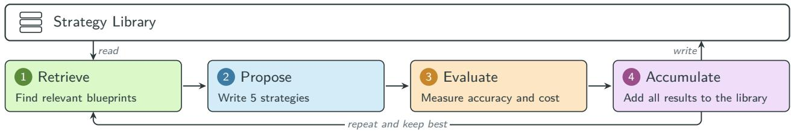

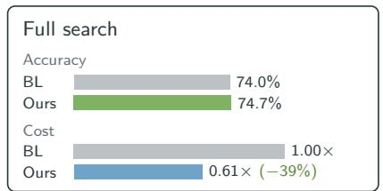

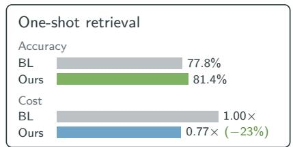

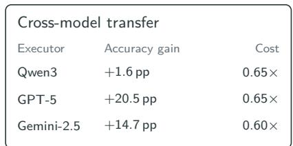  
Figure 1. Strategist turns strategy design into a search that accumulates knowledge. Top: in each round, an LLM writes new inference strategies as code, runs them, and stores every one, with its measured accuracy and cost, in a library shared across tasks, so later tasks build on what earlier ones found. The models stay frozen; only the strategies change. Bottom: the search matches the strongest baseline (BL) at lower cost, and its strategies work on new tasks and new models without further search. Cost ratios are per-benchmark averages; transfer costs are totals in USD.

## 1 Introduction

A model is only half of an AI system. The other half is how that model is put to work, and it matters just as much. Everything from the prompt to the reasoning procedure decides how it behaves. Today that second half is designed by people, fixed, one system at a time. Someone writes the prompt, tries it, adjusts it, and once the system works, the design is left as it is. It is the part of the system that never improves on its own.

There is no reason it has to stay that way. The prompts and reasoning procedures that put a model to work are text and code, and agents themselves have become good at writing both. What humans do to design (write, try, adjust) such inference strategies is the natural agentic loop. Such loops have already been shown to evolve programs far beyond their starting point (Novikov et al., 2025), and AI scientists now run the same loop end to end (Lu et al., 2024; Gottweis et al., 2025; Yamada et al., 2025). Designing an inference strategy is the same work with a diferent object. So why not evolve agentic reasoning itself the same way? Run on far more cases than a person could try, the loop could outdo what people build by hand.

Recent work has begun to automate this loop: searching over strategy designs, as raw code or as assemblies of fixed components (Hu et al., 2025; Zhang et al., 2025c; Shang et al., 2025; Zhang et al., 2025a); training controllers that route each input to an existing strategy (Taparia et al., 2026; Yue et al., 2025; Zhang et al., 2025b; Su et al., 2025); or optimizing one strategy per task by training, evolution, or iterative refinement (Gao et al., 2024; Li et al., 2024; Zhang et al., 2026; Gao et al., 2025; Liu et al., 2025a). All of them beat hand-designed strategies on individual benchmarks, and all of them stop there. Searching or routing over a fixed set of strategies can never discover a new one. Trained optimizers need to start over for every task. These methods make the design automatic. We want to make it cumulative (Figure 2).

We start from the representation. Evolving strategies needs a form open enough to express any reasoning procedure and structured enough for later searches to reuse and combine. We introduce the Strategy Blueprint: an executable program with one shared code interface, so any blueprint can serve as a component inside another. New designs are built from old ones, and the library grows as it is used.

On this representation we build Strategist, a meta-agent that does not answer questions but designs the strategies that do. It runs the write, try, adjust loop at scale, with frozen models and no training. Given a task and a small development set, it writes candidate strategies as blueprints, runs them on real samples, reads the traces, and revises them against measured accuracy and cost. Before each round it queries a shared library for relevant blueprints and for diverse ones as inspiration. After each round every candidate goes back into the library with its measurements and experience notes.

On 30 benchmarks spanning math, code, commonsense, multi-hop QA, knowledge, logic, and recommendation, we compare Strategist against 18 baselines. Strategist wins on 24 of 30, matching the strongest baseline’s average accuracy (74.0%→74.7%) at 39% lower cost. The library pays of on its own: on 10 held-out benchmarks, retrieval with no search stays within 2 points of the strongest baseline on all 10 and beats it on 8 (77.8% → 81.4%). The same strategies, moved to GPT-5 and Gemini-2.5 without changing a line, still beat the baselines there. Each task solved leaves the next one a better place to start. Until now, only the model in an AI system could learn. Now the rest of it can too.

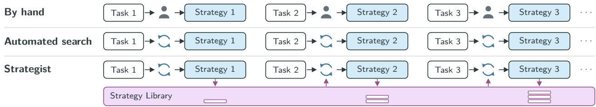  
Figure 2. Strategy design is per task; Strategist makes it cumulative. By hand and in prior automated search, nothing carries between tasks. Strategist keeps every strategy in a library that the next task starts from.

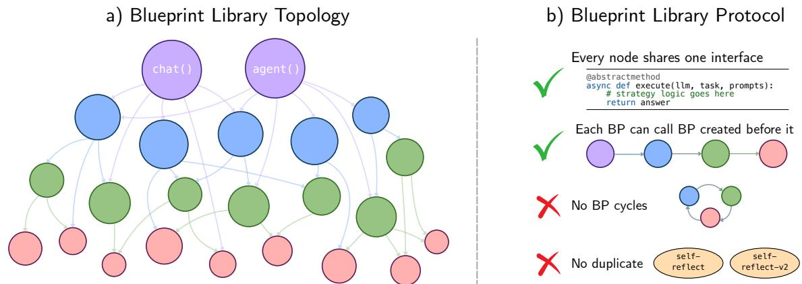  
Figure 3. The Strategy Blueprint is a freeform graph that grows through the library. (a) Two foundations (<sub>chat</sub> and agent) sit at the top. Strategies compose from them and from each other, forming a directed graph whose levels emerge naturally from composition depth. (b) Four protocols govern the graph: every node shares one abstract interface, each node can only call nodes created before it, no cycles are allowed, and no duplicates should exist.

## 2 The Strategy Blueprint

Every inference strategy, ultimately, is a program. How it is represented determines what an automated designer can build, test, and reuse. Existing work represents strategies as computation graphs (Wu et al., 2024; Zhuge et al., 2024) and declarative pipelines (Khattab et al., 2024; Yue et al., 2026), which are composable but can only express pre-defined patterns, or as monolithic code (Hu et al., 2025), which can express anything but produces isolated strategies. We introduce the Strategy Blueprint: a reasoning flow that specifies how to solve a task (which models to call, in what order, at which tier, and how) using the open interface of code. Every blueprint exposes the same interface, so any can call any other, and a library can grow by composition.

Foundations. A blueprint is a Python program that captures the structure of a reasoning strategy without the task-specific prompts. For example, one blueprint defines a loop: generate three candidate answers, review each, then majority-vote. Filling in prompts produces a runnable strategy. It has one interface, execute(llm, task) -> str, and is built from two foundations: chat (single- or multi-turn conversation) and agent (with scafold and tools). See Figure 4 for an example.

Multi-tier model routing. We allow strategies to route across three model tiers (fast, balanced, complex), each in two modes (nothink and thinking), mirroring the tiered pricing and efort levels of common model providers. Not every reasoning step needs the same intelligence, so each step can target a diferent tier. This internal routing is what allows a single strategy to be accurate and cost-eficient at the same time.

The Blueprint Library. Blueprints live in a shared library that grows over time. They are added along with their measured performance and experience notes on when it works and when it does not. Because every blueprint exposes the same interface,

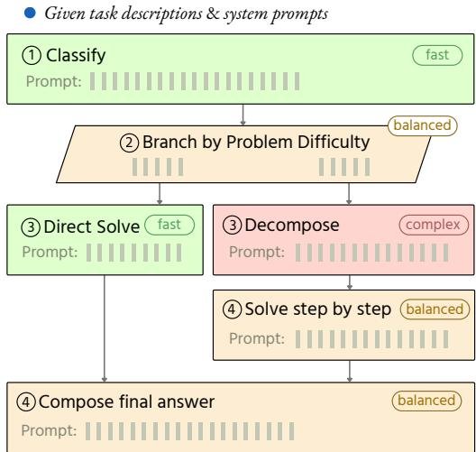  
Figure 4. Strategy blueprint captures reasoning structure. This simplified blueprint example defines the steps, control flow, and the model tier for each step. Prompts are not specified; filling in produces a runnable strategy.

a new blueprint can use any existing one as a component, so the library compounds: early blueprints build on the two foundations, later ones compose from those, and depth grows naturally (Figure 3a). Four protocols govern the library (Figure 3b): a shared interface, no forward calls, no cycles, and no duplicates.

iterate × N — accumulated blueprints feed the next round

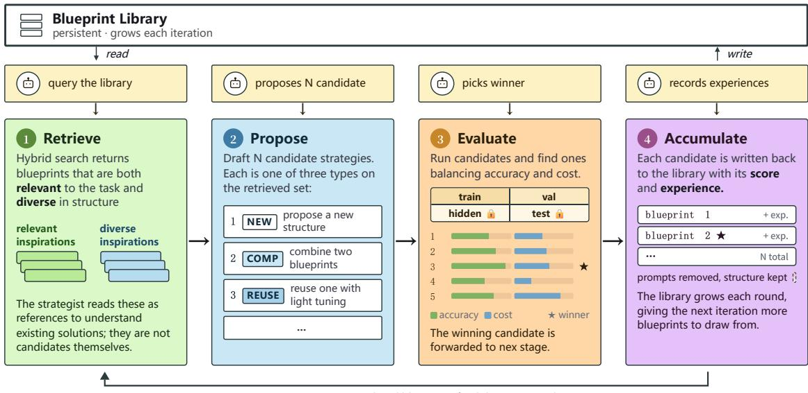  
Figure 5. The Strategist four-stage iterative pipeline. Each iteration: (1) Retrieve relevant blueprints and diverse inspiration from the Library; (2) Propose � candidates as a mix of new, composed, and reuse blueprints paired with task-specific prompts; (3) Evaluate each candidate, seeing full traces on the training set and aggregated scores on validation; (4) Accumulate the underlying blueprints into the library with measurement cards and experience notes.

## 3 Strategist

Given a task and a small development set, Strategist iteratively retrieves relevant blueprints, proposes �=5 candidates, evaluates them on real samples, and accumulates the results back into the library (Figure 5). After � iterations, the candidate that beats BL on both the validation and hidden splits by the largest hidden-set margin is returned, or BL itself if none does (Algorithm 1).

Step 1: Retrieve. The strategist queries the Blueprint Library with a short text prompt. The search is hybrid (TF–IDF plus embedding similarity). Each blueprint carries traits, a measurement card, and experience notes written by previous strategists; the search indexes over all of these, so the strategist finds blueprints by measured behavior and prior analyses, not just structural similarity. Beyond relevant results, the library returns adjacent inspiration (blueprints from other domains or reasoning patterns) to inspire new designs.

Step 2: Propose. Using the retrieved blueprints and inspiration, the strategist designs new blueprints or composes from existing ones, each paired with task-specific prompts to form candidate strategies. Each blueprint must be one of three kinds: new (a blueprint with no library backbone), composed (a blueprint that wraps or extends an existing one), or reuse (directly applies an existing library blueprint with new prompts). Every iteration includes at least one candidate of each kind, balancing exploration and exploitation.

Step 3: Evaluate. The system operates at two levels. At the agent level (inner loop), each candidate strategy processes inputs directly, and the strategist observes the full reasoning trace, execution status, and scores. At the meta level (outer loop), the strategist uses these observations to improve its proposals. The data is split into four parts. The training set: strategies run on these samples and the strategist sees both the scores and the full agent traces. The validation set: strategies also run on these samples, but the strategist sees only the aggregated scores; this mirrors standard train/validation practice and prevents overfitting to the training signal. The hidden set: used to select the winning strategy across all iterations, preventing overfitting to any single iteration. The test set: held out entirely from the search loop and used only for final confirmation.

Step 4: Accumulate. The library stores blueprints, not strategies: it retains the reusable structure while discarding task-specific prompts. This is what enables cross-task transfer. After each iteration, the strategist writes an analysis of each candidate’s structural properties and adds the underlying blueprints to the library with their measurement cards and experience notes, with deduplication.

## 4 Experiments

Benchmarks. We evaluate on 40 benchmarks spanning seven categories (Table 1). From these, 30 randomly selected benchmarks form the main results and 10 are held out for one-shot retrieval. Each benchmark is split into training, validation, and hidden sets of up to 100 samples each, plus a fixed 200-sample test set.

Models. The task models consist of three tiers: Qwen3-0.6B (fast), Qwen3-1.7B (balanced), and Qwen3-4B (complex), each run with thinking of (nothink) or on (thinking), giving six model configs. The strategist is GPT-6, a separate frozen LLM accessed through the Codex CLI; it writes strategies but never answers questions.

Baselines. We compare against 18 baselines (Table 2), all using the same task models without internet access. They span from direct prompting to multi-agent workflows, and each runs at all six model configurations, giving 18 × 6 = 108 cells per benchmark. Our baseline (BL) is the cell most accurate on a benchmark’s training split, scored on the test set. This mirrors deployment: a method is chosen on the small sample at hand, then applied to a larger unseen sample from the same distribution. Our strategy is likewise chosen without seeing the test set.

Metrics. We report accuracy and weighted cost. Cost is token usage (input and output) weighted by tier (fast = 1×, balanced = 2.83×, complex = 6.67×, matching the 0.6B/1.7B/4B parameter ratio), since per-token floating-point operations (FLOPs) scale linearly with the parameter count (Kaplan et al., 2020).

<table><tr><td>Math</td><td>AQuA-RAT (Ling et al., 2017) AIME 2024 (MAA, 2024) SVAMP (Patel et al., 2021)</td><td>Gaokao-Math (Zhong et al., 2024) MATH500 (Hendrycks et al., 2021b) MinervaM (Lewkowycz et al., 2022)</td><td>GSM8K (Cobbe et al., 2021) ASDiv (Miao et al., 2020)</td></tr><tr><td>Commonsense</td><td>StrategyQA (Geva et al., 2021) HellaSwag (Zellers et al., 2019) COPA (Roemmele et al., 2011) BoolQ (Clark et al., 2019)</td><td>CommonsenseQA (Talmor et al., 2019) OpenBookQA (Mihaylov et al., 2018) WinoGrande (Sakaguchi et al., 2020)</td><td>PIQA (Bisk et al., 2020) SIQA (Sap et al., 2019) SciQ (Welbl et al., 2017)</td></tr><tr><td>Knowledge</td><td>TruthfulQA (Lin et al., 2022) TriviaQA (Joshi et al., 2017)</td><td>SQuAD v2 (Rajpurkar et al., 2018) NQ-Open (Kwiatkowski et al., 2019)</td><td>MMLU-STEM-Hard MMLU (Hendrycks et al., 2021a)</td></tr><tr><td>Multi-hop</td><td>QUALITY (Pang et al., 2022) MuSiQue (Trivedi et al., 2022)</td><td>2WikiMQA (Ho et al., 2020) HotpotQA (Yang et al., 2018)</td><td>DROP (Dua et al., 2019)</td></tr><tr><td>Logic</td><td>LSAT-RC (Zhong et al., 2024) ANLI-R3 (Nie et al., 2020) SAT-EN (Zhong et al., 2024)</td><td>SAT-Math (Zhong et al., 2024) LSAT-AR (Zhong et al., 2024) LSAT-LR (Zhong et al., 2024)</td><td>MedQA (Jin et al., 2021) ReCLor (Yu et al., 2020) BBH (Suzgun et al., 2023)</td></tr><tr><td>Code</td><td>MBPP+ (Liu et al., 2023)</td><td></td><td></td></tr></table>

Table 1. 40 benchmarks across seven task categories. We randomly select 30 for the main iterative search and hold out the remaining 10 for one-shot retrieval. Each benchmark is split into training, validation, hidden, and test sets.

<table><tr><td>Prompting</td><td>Monte-Carlo vote Direct thinking Shortlist vote</td><td>Chain-of-thought (Wei et al., 2022) Tree of thoughts (Yao et al., 2023a) Self-consistency (Wang et al., 2023)</td><td>Self-discover (Zhou et al., 2024) Self-refine (Madaan et al., 2023) Reflexion (Shinn et al., 2023)</td></tr><tr><td>Agentic</td><td>Direct Agent with code Vanilla agent</td><td>Least-to-most (Zhou et al., 2023) Multi-agent debate (Du et al., 2024) Chain-of-agents (Zhang et al., 2024)</td><td>CoVe (Dhuliawala et al., 2024) MetaGPT (Hong et al., 2024) AutoGen (Wu et al., 2023)</td></tr></table>

Table 2. Baselines. Prompting methods call the model directly; agentic methods add tool use or multiple interacting agents. Each baseline runs at all six tier/mode configurations, and we compare against the strongest training split cell.

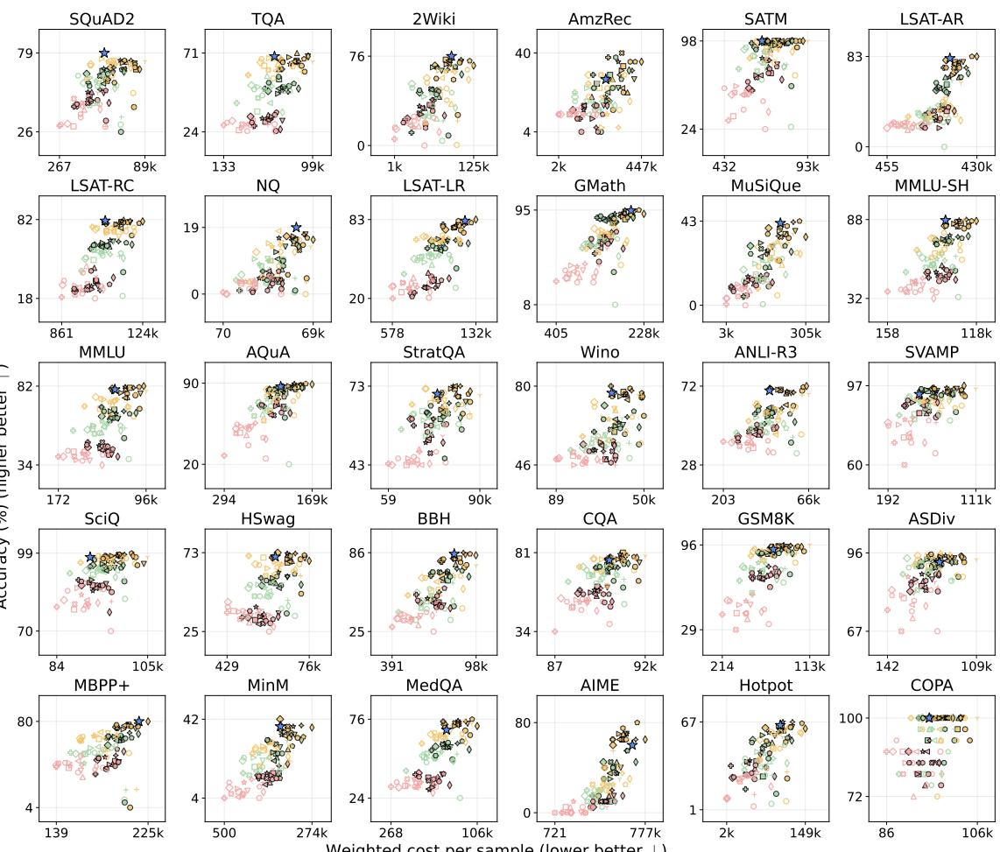  
Ours 4B agent CoV L2M debate discover think  
0.6B thinking autogen CoT metagpt reflex refine ToT  
1.7B nothink CoA direct MC vote SC shortlist vanilla

Figure 6. Ours among all 108 baseline cells (accuracy vs weighted cost per sample, test set). Each small marker is one baseline cell (a baseline strategy at one model tier and mode); the star is Strategist’s strategy. BL, the comparison point, is the cell chosen on the training split (Figure 7). The highest marker in a panel is the best of 108 cells chosen by looking at the test results, which no method can do in advance; it is shown for context, not as the comparison point. Appendix Figure 10 shows the same view on the training split, where the bias runs the other way Against BL, Ours is more than 2% cheaper on 26 of 30 benchmarks and within 2 accuracy points or better on 28.

## 5 Results

We run the full Strategist loop on each of the 30 main benchmarks. BL is the cell of the 18 × 6 baseline matrix that is most accurate on the benchmark’s training split; all methods share the same executors, extractor, and 200-sample test split. A strategy wins if it is better than BL on accuracy (by more than 2 points) or on cost (by more than 2%) and worse on neither. Strategist wins on 24 of 30 benchmarks, ties on 2 (MBPP+, MinervaM), trades accuracy for cost on 2 (MedQA, AIME) and loses on 2 (HotpotQA and COPA, at equal accuracy but 9% and 6% higher cost); it cuts weighted cost by more than 2% on 26 of 30 (Figure 7; Figure 6 places Ours among all 108 baseline cells; per-benchmark numbers in Appendix C.1). On average, Strategist matches BL’s accuracy (74.0% → 74.7%) while reducing weighted cost by 39% (a mean per-benchmark cost ratio of 0.61× relative to BL).

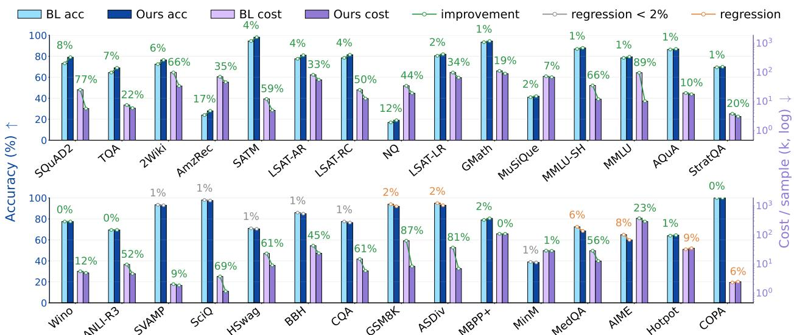  
Figure 7. Per-benchmark head-to-head: Strategist vs the baseline (BL) on the 30 main benchmarks. For each benchmark, test accuracy (%, left axis) and weighted cost per sample (log scale, right axis) of Ours and of BL. BL is the baseline cell (one of the 18 × 6 baseline–configuration pairs) that is most accurate on the benchmark’s training split, scored on the test set; Strategist’s strategy is also chosen without seeing the test set, so this is the like-for-like comparison behind the win counts. Numbers above each pair are relative changes (green: improvement; grey: regression under 2%; orange: larger regression).

The largest accuracy gains come with large cost cuts: SQuAD v2 (73.2% → 79.1% at 0.23× cost), TruthfulQA (+4.5 points), 2WikiMQA (+4.0 at 0.34×), Amazon-Rec (+4.0), SAT-Math (+3.6 at 0.41×), LSAT-AR (+3.4) and LSAT-RC (+3.0 at 0.50×). On benchmarks where the models are near their accuracy ceiling (e.g., MMLU, GSM8K, ASDiv, SciQ, MMLU-STEM-Hard), Strategist keeps accuracy within 2 points of BL and cuts cost instead, by 66–89%. Of the 24 wins, most come from strategist-designed strategies and and some are from simpler baseline scripts, found during search, that match BL’s accuracy at a lower cost. Strategist is not Pareto-improving everywhere: on MedQA and AIME 2024 it is cheaper (0.44×, 0.77×) but 4–5 points less accurate, and on HotpotQA and COPA it matches accuracy at slightly higher cost.

<table><tr><td></td><td colspan="2">Test acc (%)</td><td colspan="2">∆ vs baseline</td></tr><tr><td>Benchmark</td><td>Ours</td><td>BL</td><td>∆Acc</td><td>∆Cost</td></tr><tr><td>ReCLor</td><td>83.5</td><td>85.0</td><td>↓1.8%</td><td>↓34.2%</td></tr><tr><td>SAT-EN</td><td>86.5</td><td>86.5</td><td>0.0%</td><td>↓55.6%</td></tr><tr><td>TriviaQA</td><td>50.5</td><td>46.0</td><td>↑9.8%</td><td>↓60.0%</td></tr><tr><td>MATH500</td><td>94.5</td><td>92.5</td><td>↑2.2%</td><td>↓22.6%</td></tr><tr><td>BoolQ</td><td>85.5</td><td>73.5</td><td>↑16.3%</td><td>↑3103%</td></tr><tr><td>SIQA</td><td>77.5</td><td>73.5</td><td>↑5.4%</td><td>↑337%</td></tr><tr><td>OpenBookQA</td><td>94.5</td><td>93.0</td><td>↑1.6%</td><td>↓49.2%</td></tr><tr><td>PIQA</td><td>89.0</td><td>87.5</td><td>↑1.7%</td><td>↓64.5%</td></tr><tr><td>QUALITY</td><td>79.5</td><td>78.5</td><td>↑1.3%</td><td>↑7.4%</td></tr><tr><td>DROP</td><td>72.5</td><td>61.5</td><td>↑17.9%</td><td>↑92.4%</td></tr></table>

Table 3. One-shot library retrieval. Top-5 blueprints retrieved from the final strategies, one picked on development questions. On 10 held-out benchmarks, ΔAcc and ΔCost are relative changes vs. the strongest baseline ((Ours − BL)/BL). Full results in Appendix C.2.

<table><tr><td rowspan="2">Benchmark</td><td colspan="2">GPT-5</td><td colspan="2">Gemini-2.5</td></tr><tr><td>∆Acc</td><td>∆Cost</td><td>∆Acc</td><td>∆Cost</td></tr><tr><td>AQuA-RAT</td><td>↑189%</td><td>↓86.5%</td><td>↑27.5%</td><td>↓51.6%</td></tr><tr><td>2WikiMQA</td><td>↑166%</td><td>↓50.8%</td><td>↑260%</td><td>↓72.0%</td></tr><tr><td>HotpotQA</td><td>↑96.2%</td><td>↓7.5%</td><td>↑132%</td><td>↓52.2%</td></tr><tr><td>MBPP+</td><td>↑46.0%</td><td>↓12.3%</td><td>↑15.8%</td><td>↓23.7%</td></tr><tr><td>SQuAD2</td><td>↑28.7%</td><td>↓61.5%</td><td>↓4.7%</td><td>↓57.9%</td></tr><tr><td>NQ-Open</td><td>↑35.0%</td><td>↓22.8%</td><td>↑118%</td><td>↓21.8%</td></tr><tr><td>TruthfulQA</td><td>↑13.7%</td><td>↓71.9%</td><td>↑9.4%</td><td>↓61.9%</td></tr><tr><td>ASDiv</td><td>↑2.2%</td><td>↑163%</td><td>↑2.1%</td><td>↓33.1%</td></tr><tr><td>HellaSwag</td><td>↑0.5%</td><td>↑16.9%</td><td>↑0.5%</td><td>↓12.3%</td></tr><tr><td>MinervaM</td><td>↑2.1%</td><td>↑4.8%</td><td>↓9.4%</td><td>↓25.9%</td></tr></table>

Table 4. Cross-model transfer. Strategies discovered on Qwen3, executed directly on GPT-5 and Gemini-2.5 without modification. ΔAcc and ΔCost are relative changes vs. the strongest baseline re-executed on the same backend. Full numbers in Appendix C.3.

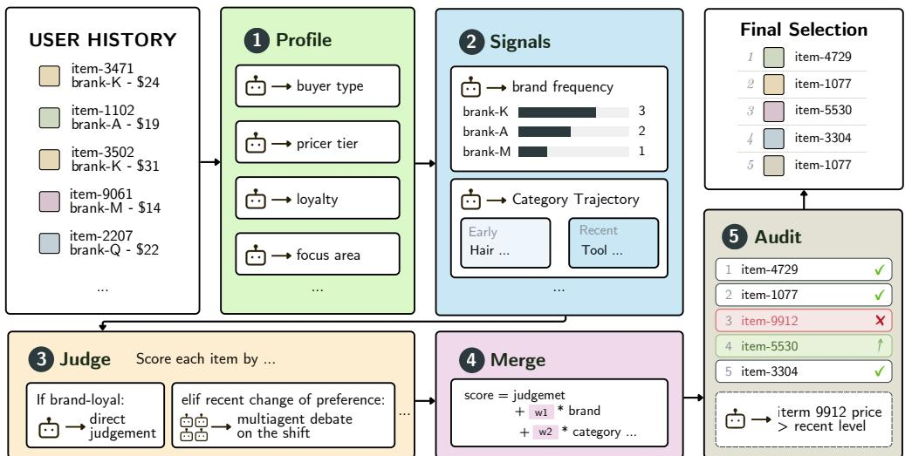  
Figure 8. An example reasoning strategy discovered by Strategist for the Amazon-Rec task. The strategy decomposes the task into a profile, signal extraction, conditional judge, merge, and audit stage. The structure and branch conditions were generated by the strategist, not by us.

One-shot library retrieval. The 30-benchmark main run grew the library to 1,865 blueprints. We test if a future task can skip the full search: on 10 held-out benchmarks, the strategist queries the final strategies of the main searches (not the full library) once, instantiates the top-5 retrieved blueprints for the task, measures each on up to 300 development questions, and runs the chosen one (the most accurate candidate cheaper than BL if within 2 points of the best, otherwise the best) on the test set, with no search. It stays within 2 points of BL’s accuracy on all 10 and above it on 8 (77.8% → 81.4% on average) and wins on 6 (Table 3); on BoolQ, SIQA, and DROP it is more accurate but costlier than their very cheap BL (1.0–4.9k per sample), and on QUALITY it costs 7% more at equal accuracy. Its per-benchmark average cost (as in Figure 7) is 0.77× BL’s without BoolQ and SIQA, whose single-call BL puts their ratios at 32× and 4.5×.

Cross-model transfer. A strategy is most useful if it captures structure of the task rather than idiosyncrasies of the executor it was searched on. We re-run Strategist-discovered strategies, without any modification to the blueprint code or its prompts, on two model families the strategist never saw during search: OpenAI GPT-5 (nano, mini, full) and Google Gemini-2.5 (flash-lite, flash). On GPT-5 the strategies win on 7 of 10 benchmarks and lose on 3 (ASDiv, HellaSwag, MinervaM: within 2 points of the baseline but costlier); on Gemini they win on 8 of 10, with SQuAD2 and MinervaM mixed (cheaper but less accurate). Aggregate cost in USD drops by 35% and 40%. Part of the GPT-5 margin comes from baseline workflows that break on the new backend (self\_refine and multi\_agent\_debate return malformed answers there) while the discovered strategies run unchanged. That a Qwen3-discovered blueprint carries over at all shows that Strategist captures the structure of the task, not executor-specific tricks.

## 6 Analysis

Anatomy of a discovered reasoning strategy. Figure 8 shows one strategy (accuracy driven) designed for the Amazon-Rec task: it builds a user profile with cheap calls, extracts brand and category signals, and conditionally routes to a multi-agent debate only for users with shifting preferences, before merging and auditing the top picks. The branching is cheap deterministic logic that decides which inputs deserve the expensive call, so the strategy spends its capacity where it actually changes the answer rather than uniformly across all inputs. The conditional routing, the merge weighting, and the audit step all emerged from iterative proposals against measured accuracy. Because the result is plain Python, a user can read and edit it directly, and the call is structural, which is hard to do with prompt-bag methods or training-based alternatives.

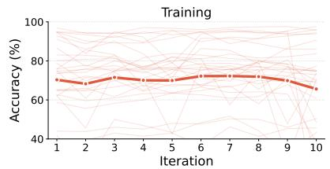

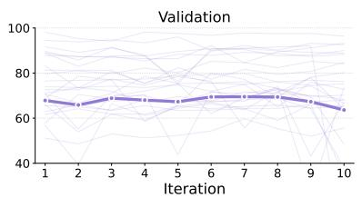

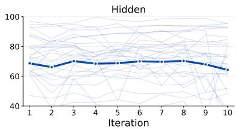  
Figure 9. Accuracy across data splits over the 10-iteration search loop. Each point is the mean accuracy of an iteration’s five candidates on a split. Bold curves are the mean across the 30 main benchmarks; faint background curves are individual benchmarks. The training–hidden gap stays between 1.2 and 2.5 points, not widening over iterations.

Overfitting across data splits. The strategist sees training traces and validation scores at every iteration and could fit noise in them; if it did, the training curve would pull away from the hidden curve. Figure 9 plots, per iteration, the mean accuracy of that iteration’s five candidates on each split, averaged over the 30 main benchmarks. The curves move together and the training–hidden gap stays between 1.2 and 2.5 points, so the proposals do not drift away from data the strategist never sees. Selection is a diferent matter: the final strategy is chosen for being best on the hidden split, and part of that is luck. Across the 30 benchmarks the pick is 4.3 points above BL on hidden but 0.7 on test (BL itself moves by 0.5). The test split, on which nothing is chosen, is the only unbiased estimate, and it is what every table reports.

## 7 Ablations and Comparisons

To probe which components of Strategist are responsible for the gains in Section 5, we run two ablations on a fixed 10-benchmark set. Neither ablation falls back to BL, for testing purposes. They are drawn from the 30 main ones, disjoint from transfer and one-shot sets.

Zero-shot selection. We disable the library and cap the loop at one iteration. The strategist sees only the task description and sample questions. It averages 39.4% with three crashed runs counted as zero (56.2% over the seven that ran), 39.3 points below (78.7%).

Iteration without the library. We restore the 10-iteration loop but disable the library to isolate its contribution. This averages 65.4% at 41.4� cost (Table 5), still 13.3 points below (78.7%). The main observation is that, without inspirations, it goes on to a narrow repetition.

Cross-framework comparison. We compare against five published frameworks (AFlow (Zhang et al., 2025c), ADAS (Hu et al., 2025), EvoFlow (Zhang et al., 2025a), StrategyLLM (Gao et al., 2024), AgentSquare (Shang et al., 2025)), all sharing the same meta-LLM and executor. Strategist wins on 8 of 10 benchmarks at 78.7% mean accuracy. Many of these strategies fit the few development questions and fail on the test set.

<table><tr><td></td><td colspan="3">STRATEGIST variants</td><td colspan="5">Other frameworks</td></tr><tr><td>Benchmark</td><td>full</td><td></td><td>no library zero-shot</td><td>AFlow</td><td>ADAS</td><td>EvoFlow</td><td>StrategyLLM AgentSquare</td><td></td></tr><tr><td>BBH</td><td>85.0</td><td>31.0</td><td>27.5</td><td>38.0</td><td>34.5</td><td>34.5</td><td>35.5</td><td>27.5</td></tr><tr><td>Gaokao-Math</td><td>94.5</td><td>65.5</td><td>81.5</td><td>84.0</td><td>82.0</td><td>86.5</td><td>89.5</td><td>82.5</td></tr><tr><td>LSAT-LR</td><td>82.0</td><td>81.0</td><td>71.5</td><td>81.0</td><td>74.5</td><td>75.5</td><td>77.0</td><td>73.5</td></tr><tr><td>LSAT-RC</td><td>81.5</td><td>75.0</td><td>38.0</td><td>74.5</td><td>75.5</td><td>75.0</td><td>74.5</td><td>74.0</td></tr><tr><td>SAT-Math</td><td>98.2</td><td>99.0</td><td>failed</td><td>99.0</td><td>96.9</td><td>96.9</td><td>97.9</td><td>97.9</td></tr><tr><td>MMLU-STEM-Hard</td><td>88.0</td><td>83.5</td><td>86.5</td><td>83.0</td><td>82.5</td><td>87.5</td><td>86.0</td><td>86.5</td></tr><tr><td>MMLU</td><td>79.5</td><td>78.0</td><td>failed</td><td>71.0</td><td>74.5</td><td>72.0</td><td>73.0</td><td>71.5</td></tr><tr><td>MuSiQue</td><td>42.0</td><td>23.0</td><td>16.0</td><td>11.5</td><td>8.5</td><td>20.5</td><td>17.5</td><td>9.5</td></tr><tr><td>CommonsenseQA</td><td>76.5</td><td>78.0</td><td>72.5</td><td>74.5</td><td>77.0</td><td>74.0</td><td>75.0</td><td>74.5</td></tr><tr><td>AIME 2024</td><td>60.0</td><td>40.0</td><td>failed</td><td>53.3</td><td>53.3</td><td>20.0</td><td>46.7</td><td>53.3</td></tr><tr><td>Average Acc</td><td>78.7</td><td>65.4</td><td>39.4</td><td>67.0</td><td>65.9</td><td>64.2</td><td>67.3</td><td>65.1</td></tr></table>

Table 5. Ablations and cross-framework comparison on 10 benchmarks. Test accuracy (%); best per row bolded. External frameworks share the same meta-LLM and executor; “failed” is runtime crash.

## 8 Related Work

LLM agents. LLM agents span chain-of-thought (CoT) and self-consistency reasoning (Wei et al., 2022; Wang et al., 2023), deliberate search (Yao et al., 2023a), tool-use loops (Yao et al., 2023b; Schick et al., 2023), verbal self-reflection (Shinn et al., 2023), multi-agent conversation (Wu et al., 2023), and formal representations from state machines to declarative compilation to optimizable graphs (Wu et al., 2024; Khattab et al., 2024; Zhuge et al., 2024; Yue et al., 2026). The strategy layer (how models are called, in what order, and with what verification) has become the central design bottleneck; Strategist automates its design. (An extended discussion of related work is in Appendix D.)

Automated design of agentic systems. Structure-search methods write strategies as raw code (Hu et al., 2025) or compose them from fixed components or predefined modules (Zhang et al., 2025c; Shang et al., 2025; Zhang et al., 2025a); the first yields isolated programs, the second bounds what can be discovered. Optimization methods refine one strategy per task, by reinforcement learning (Li et al., 2024; Zhang et al., 2026; Gao et al., 2025) or by LLM-driven evolution and refinement (Gao et al., 2024; Liu et al., 2025a), and start over on the next task. Routing methods select among existing strategies without building them (Taparia et al., 2026; Yue et al., 2025; Zhang et al., 2025b). Strategist instead allows freeform creation via the Strategy Blueprint, needs no training, builds strategies itself, and routes across model tiers in each strategy.

Cross-task transfer and experience accumulation. Cross-task transfer has been studied through metalearning (Finn et al., 2017; Hospedales et al., 2022), neural architecture search (Elsken et al., 2019), and prompt optimization (Yang et al., 2024); in the LLM-agent setting, ExpeL (Zhao et al., 2024) and Voyager (Wang et al., 2024) accumulate experience or skills, and lifelong-agent learning has been formalized as a direction (Zheng et al., 2025). Existing automated design methods (Hu et al., 2025; Zhang et al., 2025c) still largely optimize per task. Strategist maintains a shared blueprint library that grows with every task, providing both exploitation (relevant components) and exploration (diverse inspiration); to our knowledge, the first automated strategy-design system that accumulates knowledge from one task to the next.

## 9 Conclusion

We presented Strategist, a meta-agent that designs inference strategies as freeform executable programs on a layered framework, the Strategy Blueprint, and grows a shared Blueprint Library across tasks. On 30 benchmarks, Strategist-designed strategies match or beat most strongest baselines on accuracy while running at substantially lower cost, and the discovered strategies transfer to backends the strategist never searched on. We view freeform strategy design over an accumulating library as a step toward inference systems that get better the more they are used.

## Acknowledgments

This work is supported by the computational resources generously provided by Google’s TPU Research Cloud program. This work was also performed using Princeton Research Computing resources, a consortium led by the Princeton Institute for Computational Science and Engineering (PICSciE) and Research Computing at Princeton University. We also gratefully acknowledge the use of the Neuronic GPU computing cluster maintained by the Department of Computer Science at Princeton University.

## References

Yonatan Bisk, Rowan Zellers, Ronan Le Bras, Jianfeng Gao, and Yejin Choi. Piqa: Reasoning about physical commonsense in natural language. In AAAI, 2020.

Christopher Clark, Kenton Lee, Ming-Wei Chang, Tom Kwiatkowski, Michael Collins, and Kristina Toutanova. Boolq: Exploring the surprising dificulty of natural yes/no questions. In NAACL, 2019.

Karl Cobbe, Vineet Kosaraju, Mohammad Bavarian, Mark Chen, Heewoo Jun, Lukasz Kaiser, Matthias Plappert, Jerry Tworek, Jacob Hilton, Reiichiro Nakano, Christopher Hesse, and John Schulman. Training verifiers to solve math word problems. arXiv preprint arXiv:2110.14168, 2021.

Shehzaad Dhuliawala, Mojtaba Komeili, Jing Xu, Roberta Raileanu, Xian Li, Asli Celikyilmaz, and Jason Weston. Chain-of-verification reduces hallucination in large language models. In Findings of ACL, 2024.

Yilun Du, Shuang Li, Antonio Torralba, Joshua B. Tenenbaum, and Igor Mordatch. Improving factuality and reasoning in language models through multiagent debate. In ICML, 2024.

Dheeru Dua, Yizhong Wang, Pradeep Dasigi, Gabriel Stanovsky, Sameer Singh, and Matt Gardner. Drop: A reading comprehension benchmark requiring discrete reasoning over paragraphs. In NAACL, 2019.

Thomas Elsken, Jan Hendrik Metzen, and Frank Hutter. Neural architecture search: A survey. Journal of Machine Learning Research, 20(55):1–21, 2019.

Chelsea Finn, Pieter Abbeel, and Sergey Levine. Model-agnostic meta-learning for fast adaptation of deep networks. In ICML, 2017.

Chang Gao, Haiyun Jiang, Deng Cai, Shuming Shi, and Wai Lam. Strategyllm: Large language models as strategy generators, executors, optimizers, and evaluators for problem solving. In NeurIPS, 2024.

Hongcheng Gao, Yue Liu, Yufei He, Longxu Dou, Chao Du, Zhijie Deng, Bryan Hooi, Min Lin, and Tianyu Pang. Flowreasoner: Reinforcing query-level meta-agents. arXiv preprint arXiv:2504.15257, 2025.

Mor Geva, Daniel Khashabi, Elad Segal, Tushar Khot, Dan Roth, and Jonathan Berant. Did aristotle use a laptop? a question answering benchmark with implicit reasoning strategies. TACL, 2021.

Juraj Gottweis, Wei-Hung Weng, Alexander Daryin, Tao Tu, Anil Palepu, Petar Sirkovic, Artiom Myaskovsky, Felix Weissenberger, Keran Rong, Ryutaro Tanno, et al. Towards an AI co-scientist. arXiv preprint arXiv:2502.18864, 2025.

Dan Hendrycks, Collin Burns, Steven Basart, Andy Zou, Mantas Mazeika, Dawn Song, and Jacob Steinhardt. Measuring massive multitask language understanding. In ICLR, 2021a.

Dan Hendrycks, Collin Burns, Saurav Kadavath, Akul Arora, Steven Basart, Eric Tang, Dawn Song, and Jacob Steinhardt. Measuring mathematical problem solving with the math dataset. arXiv preprint arXiv:2103.03874, 2021b.

Xanh Ho, Anh-Khoa Duong Nguyen, Saku Sugawara, and Akiko Aizawa. Constructing a multi-hop qa dataset for comprehensive evaluation of reasoning steps. In COLING, 2020.

Sirui Hong, Mingchen Zhuge, Jiaqi Chen, Xiawu Zheng, Yuheng Cheng, Ceyao Zhang, Jinlin Wang, Zili Wang, Steven Ka Shing Yau, Zijuan Lin, Liyang Zhou, Chenyu Ran, Lingfeng Xiao, Chenglin Wu, and Jürgen Schmidhuber. Metagpt: Meta programming for a multi-agent collaborative framework. In ICLR, 2024.

Timothy Hospedales, Antreas Antoniou, Paul Micaelli, and Amos Storkey. Meta-learning in neural networks: A survey. IEEE Transactions on Pattern Analysis and Machine Intelligence, 2022.

Shengran Hu, Cong Lu, and Jef Clune. Automated design of agentic systems. In ICLR, 2025.

Di Jin, Eileen Pan, Nassim Oufattole, Wei-Hung Weng, Hanyi Fang, and Peter Szolovits. What disease does this patient have? a large-scale open domain question answering dataset from medical exams. Applied Sciences, 2021.

Mandar Joshi, Eunsol Choi, Daniel S. Weld, and Luke Zettlemoyer. Triviaqa: A large scale distantly supervised challenge dataset for reading comprehension. In ACL, 2017.

Jared Kaplan, Sam McCandlish, Tom Henighan, Tom B. Brown, Benjamin Chess, Rewon Child, Scott Gray, Alec Radford, Jefrey Wu, and Dario Amodei. Scaling laws for neural language models. arXiv preprint arXiv:2001.08361, 2020.

Omar Khattab, Arnav Singhvi, Paridhi Maheshwari, Zhiyuan Zhang, Keshav Santhanam, Sri Vardhamanan, Saiful Haq, Ashutosh Sharma, Thomas T. Joshi, Hanna Moazam, Heather Miller, Matei Zaharia, and Christopher Potts. Dspy: Compiling declarative language model calls into self-improving pipelines. In ICLR, 2024.

Tom Kwiatkowski, Jennimaria Palomaki, Olivia Redfield, Michael Collins, Ankur Parikh, Chris Alberti, Danielle Epstein, Illia Polosukhin, Jacob Devlin, Kenton Lee, Kristina Toutanova, Llion Jones, Matthew Kelcey, Ming-Wei Chang, Andrew M. Dai, Jakob Uszkoreit, Quoc Le, and Slav Petrov. Natural questions: A benchmark for question answering research. TACL, 2019.

Aitor Lewkowycz, Anders Andreassen, David Dohan, Ethan Dyer, Henryk Michalewski, Vinay Ramasesh, Ambrose Slone, Cem Anil, Imanol Schlag, Theo Gutman-Solo, Yuhuai Wu, Behnam Neyshabur, Guy Gur-Ari, and Vedant Misra. Solving quantitative reasoning problems with language models. In NeurIPS, 2022.

Zelong Li, Shuyuan Xu, Kai Mei, Wenyue Hua, Balaji Rama, Om Raheja, Hao Wang, He Zhu, and Yongfeng Zhang. Autoflow: Automated workflow generation for large language model agents. arXiv preprint arXiv:2407.12821, 2024.

Stephanie Lin, Jacob Hilton, and Owain Evans. Truthfulqa: Measuring how models mimic human falsehoods. In ACL, 2022.

Wang Ling, Dani Yogatama, Chris Dyer, and Phil Blunsom. Program induction by rationale generation: Learning to solve and explain algebraic word problems. In ACL, 2017.

Jiawei Liu, Chunqiu Steven Xia, Yuyao Wang, and Lingming Zhang. Is your code generated by chatgpt really correct? rigorous evaluation of large language models for code generation. In NeurIPS, 2023.

Siwei Liu, Jinyuan Fang, Han Zhou, Yingxu Wang, and Zaiqiao Meng. Sew: Self-evolving agentic workflows for automated code generation. arXiv preprint arXiv:2505.18646, 2025a.

Zhanyu Liu, Shiyao Wang, Xingmei Wang, Rongzhou Zhang, Jiaxin Deng, Honghui Bao, Jinghao Zhang, Wuchao Li, Pengfei Zheng, Xiangyu Wu, Yifei Hu, Qigen Hu, Xinchen Luo, Lejian Ren, Zixing Zhang, Qianqian Wang, Kuo Cai, Yunfan Wu, Hongtao Cheng, Zexuan Cheng, Lu Ren, Huanjie Wang, Yi Su, Ruiming Tang, Kun Gai, and Guorui Zhou. Onerec-think: In-text reasoning for generative recommendation. arXiv preprint arXiv:2510.11639, 2025b.

Chris Lu, Cong Lu, Robert Tjarko Lange, Jakob Foerster, Jef Clune, and David Ha. The AI Scientist: Towards fully automated open-ended scientific discovery. arXiv preprint arXiv:2408.06292, 2024.

Aman Madaan, Niket Tandon, Prakhar Gupta, Skyler Hallinan, Luyu Gao, Sarah Wiegrefe, Uri Alon, Nouha Dziri, Shrimai Prabhumoye, Yiming Yang, Shashank Gupta, Bodhisattwa Prasad Majumder, Katherine Hermann, Sean Welleck, Amir Yazdanbakhsh, and Peter Clark. Self-refine: Iterative refinement with self-feedback. In NeurIPS, 2023.

Mathematical Association of America. Aime 2024 (american invitational mathematics examination), 2024.

Shen-Yun Miao, Chao-Chun Liang, and Keh-Yih Su. A diverse corpus for evaluating and developing english math word problem solvers. In ACL, 2020.

Todor Mihaylov, Peter Clark, Tushar Khot, and Ashish Sabharwal. Can a suit of armor conduct electricity? a new dataset for open book question answering. In EMNLP, 2018.

Yixin Nie, Adina Williams, Emily Dinan, Mohit Bansal, Jason Weston, and Douwe Kiela. Adversarial nli: A new benchmark for natural language understanding. In ACL, 2020.

Alexander Novikov, Ngân V˜u, Marvin Eisenberger, Emilien Dupont, Po-Sen Huang, Adam Zsolt Wagner, Sergey Shirobokov, Borislav Kozlovskii, Francisco J. R. Ruiz, Abbas Mehrabian, M. Pawan Kumar, Abigail See, Swarat Chaudhuri, George Holland, Alex Davies, Sebastian Nowozin, Pushmeet Kohli, and Matej Balog. Alphaevolve: A coding agent for scientific and algorithmic discovery. arXiv preprint arXiv:2506.13131, 2025.

Richard Yuanzhe Pang, Alicia Parrish, Nitish Joshi, Nikita Nangia, Jason Phang, Angelica Chen, Vishakh Padmakumar, Johnny Ma, Jana Thompson, He He, and Samuel R. Bowman. Quality: Question answering with long input texts, yes! In NAACL, 2022.

Arkil Patel, Satwik Bhattamishra, and Navin Goyal. Are nlp models really able to solve simple math word problems? In NAACL, 2021.

Pranav Rajpurkar, Robin Jia, and Percy Liang. Know what you don’t know: Unanswerable questions for squad. In ACL, 2018.

Melissa Roemmele, Cosmin Adrian Bejan, and Andrew S. Gordon. Choice of plausible alternatives: An evaluation of commonsense causal reasoning. In AAAI Spring Symposium, 2011.

Keisuke Sakaguchi, Ronan Le Bras, Chandra Bhagavatula, and Yejin Choi. Winogrande: An adversarial winograd schema challenge at scale. In AAAI, 2020.

Maarten Sap, Hannah Rashkin, Derek Chen, Ronan Le Bras, and Yejin Choi. Social iqa: Commonsense reasoning about social interactions. In EMNLP, 2019.

Timo Schick, Jane Dwivedi-Yu, Roberto Dessì, Roberta Raileanu, Maria Lomeli, Luke Zettlemoyer, Nicola Cancedda, and Thomas Scialom. Toolformer: Language models can teach themselves to use tools. In NeurIPS, 2023.

Yu Shang, Yu Li, Keyu Zhao, Likai Ma, Jiahe Liu, Fengli Xu, and Yong Li. Agentsquare: Automatic llm agent search in modular design space. In ICLR, 2025.

Noah Shinn, Federico Cassano, Edward Berman, Ashwin Gopinath, Karthik Narasimhan, and Shunyu Yao. Reflexion: Language agents with verbal reinforcement learning. In NeurIPS, 2023.

Jinwei Su, Qizhen Lan, Yinghui Xia, Lifan Sun, Weiyou Tian, Tianyu Shi, Xinyuan Song, Lewei He, and Jingsong Yang. Dificulty-aware agent orchestration in llm-powered workflows. arXiv preprint arXiv:2509.11079, 2025.

Mirac Suzgun, Nathan Scales, Nathanael Schärli, Sebastian Gehrmann, Yi Tay, Hyung Won Chung, Aakanksha Chowdhery, Quoc V. Le, Ed H. Chi, Denny Zhou, and Jason Wei. Challenging big-bench tasks and whether chain-of-thought can solve them. In Findings of ACL, 2023.

Alon Talmor, Jonathan Herzig, Nicholas Lourie, and Jonathan Berant. Commonsenseqa: A question answering challenge targeting commonsense knowledge. In NAACL, 2019.

Aditya Taparia, Som Sagar, and Ransalu Senanayake. Learning to configure agentic ai systems. arXiv preprint arXiv:2602.11574, 2026.

Harsh Trivedi, Niranjan Balasubramanian, Tushar Khot, and Ashish Sabharwal. Musique: Multihop questions via single-hop question composition. TACL, 10:539–554, 2022.

Guanzhi Wang, Yuqi Xie, Yunfan Jiang, Ajay Mandlekar, Chaowei Xiao, Yuke Zhu, Linxi Fan, and Anima Anandkumar. Voyager: An open-ended embodied agent with large language models. TMLR, 2024.

Xuezhi Wang, Jason Wei, Dale Schuurmans, Quoc Le, Ed Chi, Sharan Narang, Aakanksha Chowdhery, and Denny Zhou. Self-consistency improves chain of thought reasoning in language models. In ICLR, 2023.

Jason Wei, Xuezhi Wang, Dale Schuurmans, Maarten Bosma, Brian Ichter, Fei Xia, Ed Chi, Quoc Le, and Denny Zhou. Chain-of-thought prompting elicits reasoning in large language models. In NeurIPS, 2022.

Johannes Welbl, Nelson F. Liu, and Matt Gardner. Crowdsourcing multiple choice science questions. In Workshop on Noisy User-generated Text (W-NUT), 2017.

Qingyun Wu, Gagan Bansal, Jieyu Zhang, Yiran Wu, Beibin Li, Erkang Zhu, Li Jiang, Xiaoyun Zhang, Shaokun Zhang, Jiale Liu, Ahmed Hassan Awadallah, Ryen W. White, Doug Burger, and Chi Wang. Autogen: Enabling next-gen llm applications via multi-agent conversation. arXiv preprint arXiv:2308.08155, 2023.

Yiran Wu, Tianwei Yue, Shaokun Zhang, Chi Wang, and Qingyun Wu. Stateflow: Enhancing llm task-solving through state-driven workflows. In COLM, 2024.

Yutaro Yamada, Robert Tjarko Lange, Cong Lu, Shengran Hu, Chris Lu, Jakob Foerster, Jef Clune, and David Ha. The ai scientist-v2: Workshop-level automated scientific discovery via agentic tree search. arXiv preprint arXiv:2504.08066, 2025.

Chengrun Yang, Xuezhi Wang, Yifeng Lu, Hanxiao Liu, Quoc V. Le, Denny Zhou, and Xinyun Chen. Large language models as optimizers. In ICLR, 2024.

Zhilin Yang, Peng Qi, Saizheng Zhang, Yoshua Bengio, William W. Cohen, Ruslan Salakhutdinov, and Christopher D. Manning. Hotpotqa: A dataset for diverse, explainable multi-hop question answering. In EMNLP, 2018.

Shunyu Yao, Dian Yu, Jefrey Zhao, Izhak Shafran, Thomas L. Grifiths, Yuan Cao, and Karthik Narasimhan. Tree of thoughts: Deliberate problem solving with large language models. In NeurIPS, 2023a.

Shunyu Yao, Jefrey Zhao, Dian Yu, Nan Du, Izhak Shafran, Karthik Narasimhan, and Yuan Cao. React: Synergizing reasoning and acting in language models. In ICLR, 2023b.

Weihao Yu, Zihang Jiang, Yanfei Dong, and Jiashi Feng. Reclor: A reading comprehension dataset requiring logical reasoning. In ICLR, 2020.

Ling Yue, Kushal Raj Bhandari, Ching-Yun Ko, Dhaval Patel, Shuxin Lin, Nianjun Zhou, Jianxi Gao, Pin-Yu Chen, and Shaowu Pan. From static templates to dynamic runtime graphs: A survey of workflow optimization for llm agents. arXiv preprint arXiv:2603.22386, 2026.

Yanwei Yue, Guibin Zhang, Boyang Liu, Guancheng Wan, Kun Wang, Dawei Cheng, and Yiyan Qi. Masrouter: Learning to route llms for multi-agent systems. In ACL, 2025.

Rowan Zellers, Ari Holtzman, Yonatan Bisk, Ali Farhadi, and Yejin Choi. Hellaswag: Can a machine really finish your sentence? In ACL, 2019.

Guibin Zhang, Kaijie Chen, Guancheng Wan, Heng Chang, Hong Cheng, Kun Wang, Shuyue Hu, and Lei Bai. Evoflow: Evolving diverse agentic workflows on the fly. arXiv preprint arXiv:2502.07373, 2025a.

Guibin Zhang, Luyang Niu, Junfeng Fang, Kun Wang, Lei Bai, and Xiang Wang. Multi-agent architecture search via agentic supernet. In ICML, 2025b.

Jiayi Zhang, Jinyu Xiang, Zhaoyang Yu, Fengwei Teng, Xionghui Chen, Jiaqi Chen, Mingchen Zhuge, Xin Cheng, Sirui Hong, Jinlin Wang, Bingnan Zheng, Bang Liu, Yuyu Luo, and Chenglin Wu. Aflow: Automating agentic workflow generation. In ICLR, 2025c.

Mingda Zhang, Haoran Luo, Tiesunlong Shen, Qika Lin, Xiaoying Tang, Rui Mao, and Erik Cambria. Flowsteer: Interactive agentic workflow orchestration via end-to-end reinforcement learning, 2026. arXiv preprint arXiv:2602.01664.

Yusen Zhang, Ruoxi Sun, Yanfei Chen, Tomas Pfister, Rui Zhang, and Sercan Ö. Arik. Chain of agents: Large language models collaborating on long-context tasks. In NeurIPS, 2024.

Andrew Zhao, Daniel Huang, Quentin Xu, Matthieu Lin, Yong-Jin Liu, and Gao Huang. Expel: Llm agents are experiential learners. In AAAI, 2024.

Junhao Zheng, Chengming Shi, Xidi Cai, Qiuke Li, Duzhen Zhang, Chenxing Li, Dong Yu, and Qianli Ma. Lifelong learning of large language model based agents: A roadmap. arXiv preprint arXiv:2501.07278, 2025.

Wanjun Zhong, Ruixiang Cui, Yiduo Guo, Yaobo Liang, Shuai Lu, Yanlin Wang, Amin Saied, Weizhu Chen, and Nan Duan. Agieval: A human-centric benchmark for evaluating foundation models. In Findings of NAACL, 2024.

Denny Zhou, Nathanael Schärli, Le Hou, Jason Wei, Nathan Scales, Xuezhi Wang, Dale Schuurmans, Claire Cui, Olivier Bousquet, Quoc Le, and Ed Chi. Least-to-most prompting enables complex reasoning in large language models. In ICLR, 2023.

Pei Zhou, Jay Pujara, Xiang Ren, Xinyun Chen, Heng-Tze Cheng, Quoc V. Le, Ed Chi, Denny Zhou, Swaroop Mishra, and Huaixiu Steven Zheng. Self-discover: Large language models self-compose reasoning structures. In NeurIPS, 2024.

Mingchen Zhuge, Wenyi Wang, Louis Kirsch, Francesco Faccio, Dmitrii Khizbullin, and Jürgen Schmidhuber. Gptswarm: Language agents as optimizable graphs. In ICML, 2024.

## Appendix Contents

A. Method and Implementation Details   
A.1 Pseudocode for the Strategist Design Loop . 16   
A.2 Benchmark and Baseline Settings 16   
A.3 Data Split and Scaling . 18   
A.4 Search, Library, and Models 19   
A.5 Strategist Prompt Template 20   
A.6 Cost-Weight Derivation 20   
A.7 Cross-Model Transfer Setup 21   
B. Examples and Case Studies   
B.1 Sample Discovered Reasoning Strategy . 21   
B.2 Additional Sample Reasoning Strategies. 22   
B.3 Sample Measurement Card 23   
B.4 Search Queries and Experience Notes 24   
B.5 Per-Iteration Progression Example 25   
C. Per-Benchmark Result Tables   
C.1 Per-Benchmark Main Results . 25   
C.2 Per-Benchmark One-Shot Library Retrieval 25   
C.3 Per-Benchmark Cross-Model Transfer . . 25   
D. Extended Related Work . 28

## A Method and Implementation Details

## A.1 Pseudocode for the Strategist Design Loop

Algorithm 1 formalizes the four-stage iterative pipeline described in Section 3. Inputs are a task description �, a development set � split into feedback/validation/hidden subsets, the current shared blueprint library ℒ, and the number of iterations �. Each iteration runs four steps: (i) the strategist queries ℒ for the most relevant blueprints and a set of adjacent-domain inspirations; (ii) the strategist proposes � candidate strategies, balanced across the kinds new/composed/reuse and the targets accuracy/eficiency/balanced; (iii) each candidate is executed on � and scored on accuracy and cost; (iv) the strategist writes experience notes summarizing what worked and what failed, and the candidates plus their measurement cards are written back to ℒ with structural deduplication. The reference baseline � (the baseline cell most accurate on the training split, run with its exact code) is evaluated alongside the candidates in the first iteration. After � iterations, every candidate is compared with � question by question on the validation and hidden splits; among the candidates that beat � under the 2% rule on both (better by more than 2 points in accuracy or 2% in cost, worse on neither), the one with the largest hidden-set accuracy gain is returned as �\*, and � itself if none qualifies. The updated library ℒ′ is carried forward for future tasks.

## A.2 Benchmark and Baseline Settings

Scoring mechanism. All strategies and baselines run as 0-shot generation: the executor LLM produces a free-form response and an answer extractor parses the final answer from the trace. The extractor is benchmark-aware (multiple-choice letter, integer, LaTeX numeric, span, or yes/no) and is the same across Strategist, all baselines, and all five comparison frameworks, so reported accuracy diferences reflect strategy choices rather than scoring asymmetries.

Benchmarks. We evaluate on 40 publicly released benchmarks. From these, 30 are randomly selected as the main benchmark set used for the iterative search and the remaining 10 are held out exclusively for the one-shot retrieval experiment.

Algorithm 1 The Strategist design loop   
Require: Task description �, development set �, library ℒ, iterations �, reference baseline �   
Ensure: Winning strategy �\*, updated library ℒ′   
1: for � = 1 to � do   
2: Strategist queries ℒ for relevant blueprints and diverse inspiration   
3: Strategist proposes � candidate strategies {�<sub>1</sub>, . . . , �<sub>�</sub> }   
4: for each candidate � do   
5: Evaluate $s _ { j }$ on �: measure accuracy and cost   
6: end for   
7: Strategist analyzes results and writes experience notes   
8: Add each �<sub>�</sub>, its measurement card, and experience notes to ℒ (with deduplication)   
9: end for   
10: � ← candidates that beat � under the 2% rule on both validation and hidden   
11: �<sup>\*</sup> ← arg max<sub>�∈�</sub> Δaccuracy<sub>hidden</sub>(�, �), or � if � = ∅   
12: return �\*, ℒ

• Mathematical reasoning: GSM8K (Cobbe et al., 2021) (grade-school word problems, numeric), MATH500 (Hendrycks et al., 2021b) (competition math, LaTeX/numeric), AQuA-RAT (Ling et al., 2017) (algebra, 5 choices), AIME 2024 (Mathematical Association of America, 2024) (American Invitational Math, 30 problems, integer 0–999), ASDiv (Miao et al., 2020) (diverse word problems, numeric), SVAMP (Patel et al., 2021) (perturbed word problems, numeric), MinervaMath (Lewkowycz et al., 2022) (graduate-level quantitative, LaTeX/numeric), Gaokao-Math-QA (Zhong et al., 2024) (Chinese college-entrance MCQ, 4 choices).

• Code generation: MBPP+ (Liu et al., 2023) (Python function synthesis, pass@1 on extra-test variant of MBPP).

• Commonsense reasoning: HellaSwag (Zellers et al., 2019) (sentence completion, 4 choices), PIQA (Bisk et al., 2020) (physical commonsense, 2 choices), Social IQa (Sap et al., 2019) (social commonsense, 3 choices), WinoGrande (Sakaguchi et al., 2020) (coreference, 2 choices), CommonsenseQA (Talmor et al., 2019) (general commonsense, 5 choices), COPA (Roemmele et al., 2011) (causal alternatives, 2 choices), OpenBookQA (Mihaylov et al., 2018) (elementary science, 4 choices), SciQ (Welbl et al., 2017) (crowdsourced science, 4 choices), StrategyQA (Geva et al., 2021) (implicit-reasoning yes/no), BoolQ (Clark et al., 2019) (passage-grounded yes/no).

• Knowledge and QA: MMLU (Hendrycks et al., 2021a) (57 subjects, 4 choices), MMLU-STEM-Hard (filtered hard STEM subset, 4 choices), TriviaQA (Joshi et al., 2017) (closed-book trivia, EM), NQ-Open (Kwiatkowski et al., 2019) (closed-book Wikipedia QA, EM), TruthfulQA (Lin et al., 2022) (misconception-resistant MC1), SQuAD v2 (Rajpurkar et al., 2018) (extractive with unanswerables, F1).

• Multi-hop QA: HotpotQA (Yang et al., 2018) (2-hop with passages, EM), 2WikiMultihopQA (Ho et al., 2020) (Wikipedia multi-hop, EM), MuSiQue (Trivedi et al., 2022) (2–4-hop composition, EM), DROP (Dua et al., 2019) (discrete reasoning over paragraphs, EM), QuALITY (Pang et al., 2022) (long-passage MCQ on 5 k-token articles, 4 choices).

• Logical and analytical reasoning: BBH (Suzgun et al., 2023) (23 BIG-Bench Hard tasks, mixed format), ANLI-R3 (Nie et al., 2020) (round-3 adversarial NLI, 3 choices), ReClor (Yu et al., 2020) (logical reading comprehension, 4 choices), AGIEval English MCQ (Zhong et al., 2024): SAT-Math, SAT-EN, LSAT-AR, LSAT-LR, LSAT-RC (4–5 choices each), MedQA (Jin et al., 2021) (USMLE-style, 4 choices).

• Recommendation: Amazon-Rec (Liu et al., 2025b) (rank top item from a candidate pool, hit-rate).

Baselines. We compare against 18 standard baselines covering both single-call prompting and full agentic systems. Each baseline is evaluated on every one of the six tier/mode configurations, giving an 18 ×6 = 108-cell baseline matrix per benchmark. The matrix is measured on both the training split and the test set; the cell most accurate on the training split is BL, and its test result is reported.

• direct: a single LLM call that returns the answer with no intermediate reasoning. The minimum-cost baseline; serves as the floor for comparisons on easy benchmarks.

• chain-of-thought (CoT) (Wei et al., 2022): a single call prompted with “Let’s think step by step”, encouraging the model to emit intermediate reasoning before the final answer.

• self-consistency (Wang et al., 2023): sample 3 CoT trajectories at temperature 0.7 and return the majority-voted final answer; trades cost for variance reduction.

• direct-thinking: a single call in <sub>thinking</sub> mode with no extra prompting, isolating the contribution of the model’s hidden reasoning trace from any prompting trick.

• tree-of-thoughts (ToT) (Yao et al., 2023a): maintain a tree of partial reasoning states, expand each by sampling a few continuations, score with the model itself, and search BFS-style for a high-scoring leaf.

• least-to-most (Zhou et al., 2023): a first call decomposes the question into sub-problems; subsequent calls solve them in order, each conditioned on prior answers.

• chain-of-verification (CoVe) (Dhuliawala et al., 2024): produce a draft answer, generate verification questions about it, answer those independently, and revise if any verification disagrees.

• self-discover (Zhou et al., 2024): the model first selects and composes a custom reasoning structure (decomposition, verification, etc.) from a fixed pool, then applies that structure to the input.

• self-refine (Madaan et al., 2023): a feedback-and-revise loop in which the model critiques its own draft and rewrites it; we cap the loop at three rounds.

• vanilla-agent: an OpenHands ReAct loop with the <sub>TerminalTool</sub> and <sub>FileEditorTool</sub> only, no extra prompt scafolding.

• agent-code: the same agent but the prompt instructs the model to write and execute Python via the terminal tool, so numeric/code-heavy steps are grounded in actual computation.

• multi-agent-debate (Du et al., 2024): 3 agents propose answers, then in 2 subsequent rounds each agent sees the others’ answers and revises; the final majority vote is returned.

• MetaGPT (Hong et al., 2024): a role-based pipeline (planner, executor, reviewer) that hands a structured artifact between roles; we use the open-source role prompts unchanged.

• AutoGen (Wu et al., 2023): a two-agent conversable setup (assistant + user-proxy with tool-use) that converses until the assistant emits a termination signal.

• chain-of-agents (CoA) (Zhang et al., 2024): a chain of worker agents each summarises a slice of the input and passes a hand-of message to the next; a final manager agent answers from the chain.

• reflexion (Shinn et al., 2023): an outer loop that, on failure, asks the model to write a verbal self-reflection and retries with the reflection appended to the next prompt.

• monte-carlo-vote / shortlist-vote: two self-consistency variants—the first samples 5 traces and returns the strict majority (resampling on a tie), the second pre-filters to a top-10 shortlist before a 3-way vote—used to test whether voting beyond the standard 3 samples helps.

All baselines run on the same Qwen3 executors and the same OpenHands tool sandbox (TerminalTool + FileEditorTool only) with no internet access, identical to Strategist strategies. Each baseline is evaluated independently at every one of the six tier/mode configurations, but baselines do not internally route across tiers within a single run; the ability to mix tiers within one strategy is part of the design space Strategist searches over, and BL is the single-config cell most accurate on the training split.

## A.3 Data Split and Scaling

Every benchmark is partitioned into four disjoint subsets: training, validation, hidden, and test. The training set is what the strategist sees in full, including per-sample reasoning traces, when proposing the next iteration’s slate. The validation set is also evaluated each iteration but only aggregate scores are visible, mirroring standard train/val practice. The validation and hidden sets are used to pick the final strategy across all � iterations (Algorithm 1); the hidden set is never shown to the strategist; in particular, experience notes written back to the library are derived from training-set traces only, so hidden-set signal cannot leak across iterations or to future tasks. The test set is held out from the search loop entirely and is used only for the final number reported in the main text.

Sizes and caps. The development rows of each benchmark come from a separate development pool (300 rows where available), drawn deterministically with a fixed seed and split into training, validation, and hidden sets of 100 rows each; benchmarks with smaller pools scale all three down proportionally, and AIME 2024 and Amazon-Rec, whose questions are about 10× longer to solve, use 50 rows per split. Where a benchmark’s own pool was too small, it was extended: COPA and SVAMP with rows from their oficial training data, and AIME with the 299 problems of AIME 2014–2023. The test set is around the first 200 rows of each benchmark’s test file, disjoint from all development rows and never seen during search. Six benchmarks have fewer questions due to limit data. Splits are deterministic, so reruns and ablations operate identically.

## A.4 Search, Library, and Models

Search loop. Each iteration proposes � = 5 candidate strategies; the search runs for � = 10 iterations per benchmark. Every iteration must include at least one candidate of each kind (new, composed, reuse) and of each target (accuracy: beat BL’s accuracy within its cost; eficiency: hold its accuracy at lower cost; balanced); slates that violate this rule, deduplicate a recent candidate, or omit required JSON fields are rejected and the strategist is re-prompted. The strategist is shown the baseline matrix measured on the training split (every baseline at all six configurations, with BL highlighted) and the 2% rule by which candidates are judged; it keeps one session across iterations, so later iterations send only the new results. Each LLM call from a strategy uses max\_tokens=16384. A full search evaluates about 60 candidates per benchmark (�=5 per iteration plus the reference and repairs), each on all three development splits, roughly 20,000 candidate-sample executions for a benchmark with 100 rows per split, plus about 135k prompt tokens and 45k response tokens for the strategist (about 10k prompt tokens per iteration), so the search dominates the per-task cost and amortises across future tasks via library reuse (Section 5).

Deduplication. Two blueprints are considered duplicates if their <sub>execute</sub> function bodies hash to the same value after task-specific string literals (prompts, format instructions) are elided; this is computed over the Python AST so that whitespace and comment changes do not produce spurious distinctions. Duplicate proposals are rejected at submission time and not added to the library.

Strategist proposal format. Each iteration the strategist returns Python code (the candidate strategies) followed by a JSON block describing the slate. The JSON has six required fields per candidate (name, kind, target, tier\_mode\_anchors, why, builds\_on) and an optional prompts field that replaces a blueprint’s prompt texts for this task, plus three search-side fields (search\_queries, read\_cards, experience). A non-fatal AST audit checks that builds\_on matches the imports in the code block; warnings are fed into the next iteration’s prompt rather than killing the run.

Library retrieval. At each iteration the strategist issues two textual queries against the library: a relevance query summarising what the current task is asking for, and an inspiration query phrased to deliberately drift from the task description (e.g., asking for “multi-path verification on long-context $\mathrm { Q A } ^ { \prime \prime }$ when the task itself is short-form math). Each query is scored by a hybrid function $s = \alpha s _ { \mathrm { t f i d f } } + ( 1 - \alpha ) s _ { \mathrm { e m b } }$ over every blueprint’s index entry, where $s _ { \mathrm { t f i d f } }$ is computed over the blueprint name, one-line description, when-to-use field, and trait tags, and $s _ { \mathrm { e m b } }$ is the cosine similarity between the query and a sentence-transformer (all-MiniLM-L6-v2) embedding of the blueprint’s measurement card and experience notes; we use $\alpha = 0 . 4$ throughout. Each query returns its top-5 blueprints, deduplicated against blueprints already returned by the relevance query so the inspiration slate cannot overlap. The strategist sees a total of 10 blueprints per iteration (5 relevance hits with their measurement cards rendered in full, 5 adjacent inspirations with only the one-line description shown) and is asked, in the prompt, to use the relevance hits as composition or reuse candidates and the inspiration hits as material for new blueprints.

Library size. After the 30 main searches, the library contained 1,865 blueprints (deduplicated by structural hash) with measurement cards (cards are written only after a blueprint has been evaluated at least once). Of these, the strategist chose only those with relevance scores above a fixed threshold during retrieval; on average, 5 relevance hits and 5 adjacent inspirations were returned per query.

Models. The executor LLMs are Qwen3-0.6B (<sub>fast</sub> tier), Qwen3-1.7B (<sub>balanced</sub>), and Qwen3-4B (<sub>complex</sub>), each available in nothink and thinking modes for a total of six configurations; cross-model transfer (Section 5, Appendix A.7) maps each tier to GPT-5 (nano, mini, full) or Gemini-2.5 (flash-lite, flash). The strategist agent is GPT-6 (gpt-6-sol), accessed through the Codex CLI. All five comparison frameworks in the cross-framework table use the same strategist and executor as Strategist for fairness.

Infrastructure. The Qwen3 executors are served via vLLM on a local cluster of 8× NVIDIA H200 GPUs (144 GB each). Agent-tier strategies execute through OpenHands with TerminalTool and FileEditorTool only; we cap subprocess concurrency at 48 to avoid timeouts. All hyperparameters above are fixed across the 30 main benchmarks, the 10 one-shot held-out benchmarks, and the cross-model transfer experiments.

## A.5 Strategist Prompt Template

The strategist receives the full prompt in the first iteration and keeps one session; later iterations send only what is new (results, library hits, the updated history). Listing 1 shows the abridged template.

```ini
[SYSTEM]
You a r e t h e S t r a t e g i s t meta−a g e n t . D e s i g n 5 c a n d i d a t e s t r a t e g i e s f o r t h e t a s k .
Goal : b e a t t h e r e f e r e n c e b a s e l i n e (BL) on t h i s benchmark . BL ’ s a c c u r a c y i s t h e
f l o o r and i t s c o s t p e r sample t h e budget ; w i t h i n 2 p o i n t s o f a c c u r a c y o r 2% o f
c o s t i s a t i e . A win i s l o w e r c o s t a t no worse a c c u r a c y , o r h i g h e r a c c u r a c y a t
no h i g h e r c o s t .
A s t r a t e g y i s an e x e c u t a b l e Python program :
a s y n c d e f e x e c u t e ( l l m , t a s k : s t r ) −> s t r ( one t i e r /mode ) , o r
a s y n c d e f e x e c u t e ( l l m s , t a s k : s t r ) −> s t r ( r o u t e s a c r o s s t i e r s )
Models : { fa s t , b a l a n c e d , complex } x { n o t h i n k , t h i n k i n g } ; l i b r a r y b l u e p r i n t s a r e
q u e r y a b l e by name , t r a i t s and measurement c a r d s .
Every s l a t e has >=1 o f each k i n d ( new / composed / r e u s e ) and o f each t a r g e t
( a c c u r a c y / e f f i c i e n c y / b a l a n c e d ) .
[USER]
T a s k : { t a s k _ d e s c r i p t i o n } ; s a m p l e t r a i n i n g q u e s t i o n s w i t h a n s w e r s
B a s e l i n e s on t h e t r a i n i n g s p l i t : {18 x 6 t a b l e , BL h i g h l i g h t e d }
L i b r a r y h i t s :
R e l e v a n t : { t o p _ 5 _ r e l e v a n t _ b l u e p r i n t s _ w i t h _ c a r d s }
A d j a c e n t i n s p i r a t i o n : { t o p _ 5 _ a d j a c e n t _ b l u e p r i n t s }
R e s u l t s s o f a r : { e a c h c a n d i d a t e v s BL o n t h e t r a i n i n g s p l i t : a c c u r a c y , c o s t
r a t i o , q u e s t i o n s f i x e d / b rok en }
Produce ( 1 ) Python code f o r 5 c a n d i d a t e s then ( 2 ) a JSON b l o c k w i t h f i e l d s :
c a n d i d a t e s [ 5 ] = { name , k i n d , t a r g e t , t i e r _ m o d e _ a n c h o r s , why , b u i l d s _ o n , p r o m p t s } ,
s e a r c h _ q u e r i e s , r e a d _ c a r d s , e x p e r i e n c e [ ] = { w o r k fl o w , o b s e r v a t i o n , r e c o m m e n d a t i o n } .
```  
Listing 1 | Abridged strategist prompt template (GPT-6).

The experience field is the strategist’s own writeback to the library: every blueprint it referenced or used must come back with one observation (numerical, e.g., “card shows +12% on math/fast/nothink”) and one recommendation (concrete, e.g., “use as cheap lift on short-math fast-tier; skip on commonsense”). These notes feed forward into future strategists’ card lookups.

## A.6 Cost-Weight Derivation

We use two cost units in the paper. For the Qwen3 main experiments, where we control the inference stack, we report weighted tokens: per-tier weights proportional to parameter count, justified below. For the cross-model transfer experiments on GPT-5 and Gemini-2.5, we report USD computed at the oficial list prices published

on the OpenAI<sup>1</sup> and Google<sup>2</sup> pricing pages, applied identically to baseline and Strategist runs so that any diference reflects strategy choices rather than assumptions.

Qwen3 weights. For a dense decoder-only transformer, per-token forward FLOPs scale as ≈2� where � is the parameter count (Kaplan et al., 2020). The Qwen3 tiers used in the main experiment have 0.6B, 1.7B, and 4B parameters, giving weight ratios of 1.00 : 2.83 : 6.67 (Table 6). Input tokens count at the same per-token weight, and tool execution for agent strategies (a sandboxed terminal) is not charged. Thinking-mode tokens are counted along with output tokens; their accuracy lift is paid for in the same currency.
<table><tr><td>Tier</td><td>Model</td><td>Parameters</td><td>Cost weight</td></tr><tr><td>fast</td><td>Qwen3-0.6B</td><td>0.60B</td><td>1.00×</td></tr><tr><td>balanced</td><td>Qwen3-1.7B</td><td>1.70B</td><td>2.83×</td></tr><tr><td>complex</td><td>Qwen3-4B</td><td>4.00B</td><td>6.67×</td></tr></table>

Table 6. Tier cost weights used throughout the paper. Per-token weights are proportional to parameter counts, matching the leading 2� FLOPs/token term for dense transformers (Kaplan et al., 2020).

## A.7 Cross-Model Transfer Setup

Cross-model transfer (Section 5) runs the same Strategist-discovered strategies on backends never used during search. The tier-mode mapping is fixed per backend; nothing is re-tuned. Table 7 reports the mapping.

<table><tr><td>Tier/mode</td><td>GPT-5 backend</td><td>Gemini-2.5 backend</td></tr><tr><td>fast/nothink</td><td>gpt-5-nano (effort=minimal)</td><td>gemini-2.5-flash-lite</td></tr><tr><td>fast/thinking</td><td>gpt-5-nano (effort=medium)</td><td>gemini-2.5-flash-lite (thinking)</td></tr><tr><td>balanced/nothink</td><td>gpt-5-mini (effort=minimal)</td><td>gemini-2.5-flash</td></tr><tr><td>balanced/thinking</td><td>gpt-5-mini (effort=medium)</td><td>gemini-2.5-flash (thinking)</td></tr><tr><td>complex/nothink</td><td>gpt-5 (effort=minimal)</td><td>gemini-2.5-flash</td></tr><tr><td>complex/thinking</td><td>gpt-5 (effort=medium)</td><td>gemini-2.5-flash (thinking)</td></tr></table>

Table 7. Tier-mode mapping for cross-model transfer. GPT-5 uses three model sizes (nano/mini/full) crossed with two reasoning-efort levels (minimal/medium). Gemini-2.5 uses flash-lite for the fast tier and flash for the balanced and complex tiers; the API sets its own thinking budget, so the nothink and thinking modes issue the same call. Each strategy executes its own routing; only the tier-to-model mapping changes.

## B Examples and Case Studies

## B.1 Sample Discovered Reasoning Strategy

To make the structure of a discovered strategy concrete, we reproduce one (abstraction\_ladder) which the strategist proposed as a multi-path reasoning blueprint. The header declares its meta-information (when to use, traits, foundation); the execute function (abridged below) defines the call graph. The listings show the interface as implemented: execute(llm, task, \*\*prompts), where llm is one client or, for strategies that route across tiers, the dictionary of six clients (written llms), and prompt replacements arrive as keyword arguments.

The strategist annotates every blueprint with traits (above) so future searches can retrieve by structural similarity (multi\_path, decomposition, . . . ) rather than only by name. The when\_to\_use field is what subsequent strategists read to decide whether to compose on top of this blueprint.

META = {   
" name ": " abstraction\_ladder ",   
" description ": (   
" Solve at 3 abstraction levels ( principle , specific , "   
" concrete ). If all agree , high confidence . If "   
" disagreement , prefer the concrete - example answer as most grounded ."   
) ,   
" when\_to\_use ": (   
"Multi - step reasoning or math problems where abstract "   
" reasoning might miss details but pure computation might "   
" miss the big picture ."   
) ,   
" tags ": [" reasoning ", " multi\_path "],   
" uses ": [" generate "],   
" traits ": {   
" foundation ": " generate ",   
" reasoning ": True ,   
" self\_improving ": False ,   
" multi\_path ": True ,   
" tool\_use ": False ,   
" decomposition ": True ,   
" multi\_turn ": True ,   
},   
}   
<sub>async</sub> def <sub>execute</sub> (<sub>llm , task :</sub> s t r <sub>, \*\* kwargs</sub> ) <sub>-></sub> s t r <sub>:</sub>   
system = f"{ base\_system ( task )} { output\_instruction ( task )}"   
abstract = await generate (llm , level1\_prompt ( task ), system )   
specific = await generate (llm , level2\_prompt (task , abstract ), system )   
concrete = await generate (llm , level3\_prompt (task , specific ), system )   
i f <sub>extract\_answer</sub> (<sub>task , specific</sub> ) <sub>== extract\_answer</sub> (<sub>task , concrete</sub> )<sub>:</sub>   
r e t u r n <sub>extract\_answer</sub> (<sub>task , concrete</sub> ) <sub># two grounded levels agree</sub>   
adjudicated = await generate (   
llm , adjudicate\_prompt ( task , abstract , specific , concrete ) , system )   
r e t u r n <sub>extract\_answer</sub> (<sub>task , adjudicated</sub> )

Listing 2 | The abstraction\_ladder blueprint: META declaration plus execute body. Multi-path reasoning at three abstraction levels; agreement between the two grounded levels is accepted, otherwise a fourth call adjudicates with all three visible. Prompt text is abridged into named helpers.

## B.2 Additional Sample Reasoning Strategies

To illustrate the diversity of structures the strategist discovers, we show three more final picks from the main run, each the strategy selected for its benchmark across all iterations (Algorithm 1). The code is abridged from the library files: prompt text is replaced by named helpers, control flow is unchanged.

Logic (BBH): <sub>high\_precision\_execution\_router</sub>. A 0.6B router call decides whether a short program on the literal data in the task can compute and verify the answer. If so, the task goes to the library’s tool-using agent blueprint at complex/thinking; otherwise to self-consistency at the same tier. The blueprint is composed from two library blueprints and adds only the gate. On BBH it scores 85.0% against BL’s 86.0% at 0.55× the cost.

Multi-hop QA (MuSiQue): <sub>strict\_roundtrip\_count\_multihop</sub>. The strategy runs a library multi-hop blueprint and then guards one failure mode: a count answered as a digit when the passages spell it as a word. It asks a 1.7B model to spell the number, accepts the word only if it occurs in the context and an independent call decodes it back to the same number, and otherwise keeps the digit. On MuSiQue it scores 42.0% against BL’s 41.0% at 0.93× the cost.

```python
from <sub>strategist . workflows . baseline_agent_code</sub> import <sub>execute</sub> as <sub>agent_code</sub>
from <sub>strategist . workflows . baseline_self_consistency</sub> import <sub>execute</sub> as <sub>self_consistency</sub>
<sub>async</sub> def <sub>execute</sub> (<sub>llms , task</sub> )<sub>:</sub>
# EXECUTE if a program on the literal data can compute and verify the answer;
# CONSENSUS for world knowledge , pragmatics , analogy , or when uncertain .
route = await generate ( llms [" fast "][" nothink "], route_prompt ( task ))
i f <sub>route . strip</sub> ()<sub>. upper</sub> ()<sub>. startswith</sub> (<sub>" EXECUTE "</sub>)<sub>:</sub>
result = await agent_code ( llms [" complex "][" thinking "], task )
e l s e <sub>:</sub>
result = await self_consistency ( llms [" complex "][" thinking "], task )
r e t u r n <sub>extract_answer</sub> (<sub>task , result</sub> )
```

Listing 3 | high\_precision\_execution\_router: a cheap router sends deterministic computations to the tool agent and everything else to self-consistency.

```python
from <sub>strategist . workflows . question_bound_span_projection_multihop</sub> import <sub>projected_walk</sub>
<sub>async</sub> def <sub>execute</sub> (<sub>llms , task</sub> )<sub>:</sub>
answer = extract_answer (task , await projected_walk (llms , task )). strip (" .")
context , _, question = task . rpartition ("\ nQuestion :")
<sub>asks_for_count =</sub> (<sub>" how many "</sub> i n <sub>question . casefold</sub> ()
or <sub>" number of"</sub> i n <sub>question . casefold</sub> ())
i f <sub>asks_for_count</sub> and <sub>answer . isdecimal</sub> () and <sub>0 <=</sub> i n t ( <sub>answer</sub> ) <sub><= 12:</sub>
word = ( await generate ( llms [" balanced "][" nothink "],
spell_prompt ( answer ))). strip (). lower ()
attested = (re. fullmatch (r"[a-z]{3 ,}", word )
and <sub>re. search</sub> (<sub>rf"</sub>\<sub>b</sub>{<sub>re. escape</sub> ( <sub>word</sub> )}\<sub>b", context , re.I</sub>))
i f <sub>attested :</sub>
decoded = await generate ( llms [" balanced "][" nothink "], decode_prompt ( word ))
m = re. fullmatch (r"\s *(\ d{1 ,2}) \.?\ s*", decoded )
i f <sub>m</sub> and <sub>m.</sub> <sub>group</sub> (<sub>1</sub>) <sub>==</sub> <sub>answer</sub> <sub>:</sub>
answer = word
r e t u r n <sub>extract_answer</sub> (<sub>task , answer</sub> )
```

Listing 4 | strict\_roundtrip\_count\_multihop: a library multi-hop blueprint followed by a round-trip check before a count is rewritten as a word.

Math (GSM8K): <sub>dual\_verbatim\_evidence\_lens\_math</sub>. Two parallel <sub>complex</sub>/<sub>nothink</sub> calls copy verbatim spans from the problem, one for what is asked and one for counting scope and units; spans that do not occur in the problem are dropped. A single complex/thinking call then solves the original problem with the spans as an attention guide. On GSM8K it scores 92.0% against BL’s 94.0% at 0.13× the cost.

These three strategies cover diferent control-flow patterns (route-then-delegate, compose-then-guard, parallelextract-then-solve) yet share the same interface, so each can serve as a component of a later blueprint.

## B.3 Sample Measurement Card

After a strategy is run on a benchmark, the strategist writes a measurement card summarizing what worked, what failed, and how to use the strategy next time. Cards are stored alongside their strategy and are returned as part of library retrieval. Below is a simplified, shortened excerpt of the card for cite\_then\_extract:

<sub>async</sub> def <sub>execute</sub> (<sub>llms , task</sub> )<sub>:</sub>   
target\_text , scope\_text = await asyncio . gather (   
generate ( llms [" complex "][" nothink "], copy\_target\_spans\_prompt ( task )) ,   
generate ( llms [" complex "][" nothink "], copy\_scope\_spans\_prompt ( task )))   
<sub>spans =</sub> [<sub>l. strip</sub> () fo r <sub>l</sub> i n ( <sub>target\_text + "</sub>\<sub>n" + scope\_text</sub> )<sub>. splitlines</sub> ()   
i f <sub>l. strip</sub> () and <sub>l. strip</sub> () i n <sub>task</sub> ][<sub>:6</sub>]   
<sub>focus = "</sub>\<sub>n". join</sub> ( <sub>spans</sub> ) i f <sub>spans</sub> e l s e <sub>"No exact spans were selected ."</sub>   
answer = await generate ( llms [" complex "][" thinking "],   
solve\_prompt (task , focus ),   
system = output\_instruction ( task ))   
r e t u r n <sub>extract\_answer</sub> (<sub>task , answer</sub> )

Listing 5 | dual\_verbatim\_evidence\_lens\_math: parallel verbatim evidence extraction, filtered against the source, then one solving call.

```markdown
# cite_then_extract
## Summary
Two - step pipeline : first cite the supporting passage , then extract
the answer from the cited span . Reduces hallucination on multi - hop
QA where the document provides the evidence .
## Measured behavior
2 WikiMQA : 74.5% acc (BL 66.5% , +12.0% rel ) at 23.2 k weighted
tokens / sample .
HotpotQA : 63.5% acc (BL 53.0% , +19.8% rel ).
MuSiQue : 24.5% acc (BL 19.5% , +25.6% rel ).
## Strengths
- Stable on benchmarks where the evidence sits in a long context .
Robust to distractor passages : citing first forces the model to
commit to a span before answering .
## Weaknesses
- On short - context QA the citation step is wasted cost .
If the cite step picks the wrong span , the extraction step
inherits the error with no recovery .
## Notes from prior use
- 2026 -04 -22: Used as composition base for entity_focused_debate
( HotpotQA ). Composed candidate beat parent +5 pp .
```

Listing 6 | Excerpt of the measurement card for cite\_then\_extract, written by the strategist after evaluation.   
Cards are returned with their blueprint during retrieval and inform future strategists’ design choices.

## B.4 Search Queries and Experience Notes

Table 8 samples actual search\_queries and experience notes the strategist wrote during search runs. These notes are the cross-task knowledge that future iterations and future tasks read; they are why the library compounds rather than starts from scratch each task.

<table><tr><td>Field</td><td>Sample value</td></tr><tr><td>search_queries</td><td>&quot;cite-then-extract on long context multi-hop&quot; &quot;self-consistency vote at fast tier with 3 samples&quot; &quot;multi-agent debate but only on questionable cases&quot;</td></tr><tr><td>experience (workflow, obs, rec)</td><td>&quot;decomposition into sub-questions then aggregate&quot; self_consistency: &quot;card shows +12pp on math/fast/nothink; blind matched at 11pp&quot; / “use as cheap lift on short-math fast-tier; skip on commonsense.&quot; multi_agent_debate: &quot;2-agent fails by mutual-error agreement on 30% of NQ-Open misses&quot; / &quot;add a third tie-breaking agent or vote.&quot; cite_then_extract: &quot;stable on long-context QA; wasted cost on short-context&quot; /</td></tr></table>

Table 8. Sampled <sub>search\_queries</sub> and <sub>experience</sub> notes. The strategist writes both at every iteration; queries are the input to library retrieval, and experience notes are the writeback that next-iteration strategists (or strategists on a diferent task) read in the card.

## B.5 Per-Iteration Progression Example

To make the iterative dynamics concrete, Table 9 shows the per-iteration progression on AQuA-RAT. Each row reports the candidate of that iteration with the highest hidden-set accuracy; the final pick follows Algorithm 1.

<table><tr><td>Iter</td><td>Kind</td><td>Best candidate on hidden</td><td>Hidden Acc</td><td>Hidden Cost (k)</td></tr><tr><td>1</td><td>reference</td><td>baseline_cot (BL)</td><td>85.0</td><td>21.2</td></tr><tr><td>2</td><td>reuse</td><td>difficulty_routed_certificate_mcq</td><td>89.0</td><td>18.5</td></tr><tr><td>3</td><td>reuse</td><td>difficulty_routed_certificate_mcq</td><td>91.0</td><td>21.7</td></tr><tr><td>4</td><td>reuse</td><td>difficulty_routed_certificate_mcq</td><td>92.0</td><td>20.9</td></tr><tr><td>5</td><td>composed</td><td>intended_operation__commitment_cot_math</td><td>90.0</td><td>16.2</td></tr><tr><td>6</td><td>new</td><td>rotated_label_invariance_math</td><td>88.0</td><td>18.6</td></tr><tr><td>7</td><td>reuse</td><td>label_permutation_invariance_vote_mcq</td><td>90.0</td><td>37.3</td></tr><tr><td>8</td><td>composed</td><td>structural_coordinate_switch_math</td><td>89.0</td><td>15.9</td></tr><tr><td>9</td><td>composed</td><td>terminal_leakage_sanitized_math</td><td>90.0</td><td>17.4</td></tr><tr><td>10</td><td>new</td><td>first_commitment_race_math</td><td>89.0</td><td>18.0</td></tr></table>

Table 9. Iteration-by-iteration progression on AQuA-RAT. For each iteration, the candidate with the highest hidden-set accuracy and its weighted cost per sample; iteration 1 is the reference BL (CoT on complex/thinking). The final strategy (bold, from iteration 5) beats BL on both validation and hidden (+5 points at 0.77× cost on hidden); the iteration-4 candidate, the most accurate on hidden, is not picked because on validation it matches BL’s accuracy at 14% higher cost.

## C Per-Benchmark Result Tables

## C.1 Per-Benchmark Main Results

Table 10 reports per-benchmark numbers behind Figure 7 for the 30 main benchmarks. Cost is weighted tokens per sample (parameter-count weights), in thousands. Colors and arrows follow the rest of the paper.

## C.2 Per-Benchmark One-Shot Library Retrieval

Table 11 reports the absolute Ours/Baseline accuracy and cost values underlying Table 3.

## C.3 Per-Benchmark Cross-Model Transfer

Table 12 reports the absolute Ours/Baseline accuracy and total USD cost values underlying Table 4.

<table><tr><td>Benchmark</td><td>Ours Acc</td><td>BL Acc</td><td>∆Acc</td><td>Ours Cost (k)</td><td>BL Cost (k)</td><td>∆Cost</td><td>Result</td></tr><tr><td>SQuAD v2</td><td>79.1</td><td>73.2</td><td>↑8.0%</td><td>5.6</td><td>25.0</td><td>↓77.4%</td><td>Win</td></tr><tr><td>TruthfulQA</td><td>69.0</td><td>64.5</td><td>↑7.0%</td><td>5.8</td><td>7.5</td><td>↓21.9%</td><td>Win</td></tr><tr><td>2WikiMQA</td><td>76.5</td><td>72.5</td><td>↑5.5%</td><td>33.8</td><td>98.6</td><td>↓65.7%</td><td>Win</td></tr><tr><td>Amazon-Rec</td><td>28.0</td><td>24.0</td><td>↑16.7%</td><td>45.6</td><td>70.3</td><td>↓35.1%</td><td>Win</td></tr><tr><td>SAT-Math</td><td>98.2</td><td>94.5</td><td>↑3.8%</td><td>4.9</td><td>12.1</td><td>↓59.4%</td><td>Win</td></tr><tr><td>LSAT-AR</td><td>81.0</td><td>77.6</td><td>↑4.4%</td><td>54.9</td><td>82.0</td><td>↓33.0%</td><td>Win</td></tr><tr><td>LSAT-RC</td><td>81.5</td><td>78.5</td><td>↑3.8%</td><td>12.4</td><td>24.8</td><td>↓49.9%</td><td>Win</td></tr><tr><td>NQ-Open</td><td>19.0</td><td>17.0</td><td>↑11.8%</td><td>19.1</td><td>34.4</td><td>↓44.5%</td><td>Win</td></tr><tr><td>LSAT-LR</td><td>82.0</td><td>80.5</td><td>↑1.9%</td><td>65.2</td><td>98.1</td><td>↓33.5%</td><td>Win</td></tr><tr><td>Gaokao-Math</td><td>94.5</td><td>93.5</td><td>↑1.1%</td><td>89.7</td><td>111.3</td><td>↓19.4%</td><td>Win</td></tr><tr><td>MuSiQue</td><td>42.0</td><td>41.0</td><td>↑2.4%</td><td>67.6</td><td>73.0</td><td>↓7.4%</td><td>Win</td></tr><tr><td>MMLU-STEM-Hard</td><td>88.0</td><td>87.0</td><td>↑1.1%</td><td>11.9</td><td>35.2</td><td>↓66.2%</td><td>Win</td></tr><tr><td>MMLU</td><td>79.5</td><td>78.5</td><td>↑1.3%</td><td>10.2</td><td>96.3</td><td>↓89.4%</td><td>Win</td></tr><tr><td>AQuA-RAT</td><td>87.0</td><td>86.5</td><td>↑0.6%</td><td>17.5</td><td>19.4</td><td>↓9.6%</td><td>Win</td></tr><tr><td>StrategyQA</td><td>70.0</td><td>69.5</td><td>↑0.7%</td><td>3.0</td><td>3.7</td><td>↓19.6%</td><td>Win</td></tr><tr><td>WinoGrande</td><td>77.5</td><td>77.5</td><td>0.0%</td><td>4.9</td><td>5.6</td><td>↓11.8%</td><td>Win</td></tr><tr><td>ANLI-R3</td><td>69.5</td><td>69.5</td><td>0.0%</td><td>4.6</td><td>9.6</td><td>↓51.7%</td><td>Win</td></tr><tr><td>SVAMP</td><td>93.0</td><td>93.5</td><td>↓0.5%</td><td>1.8</td><td>2.0</td><td>↓9.3%</td><td>Win</td></tr><tr><td>SciQ</td><td>97.5</td><td>98.0</td><td>↓0.5%</td><td>1.2</td><td>3.7</td><td>↓69.1%</td><td>Win</td></tr><tr><td>HellaSwag</td><td>70.5</td><td>71.0</td><td>↓0.7%</td><td>9.0</td><td>22.9</td><td>↓60.9%</td><td>Win</td></tr><tr><td>BBH</td><td>85.0</td><td>86.0</td><td>↓1.2%</td><td>23.3</td><td>42.5</td><td>↓45.2%</td><td>Win</td></tr><tr><td>CommonsenseQA</td><td>76.5</td><td>77.5</td><td>↓1.3%</td><td>5.8</td><td>14.8</td><td>↓60.8%</td><td>Win</td></tr><tr><td>GSM8K</td><td>92.0</td><td>94.0</td><td>↓2.1%</td><td>8.3</td><td>62.8</td><td>↓86.8%</td><td>Win</td></tr><tr><td>ASDiv</td><td>93.0</td><td>95.0</td><td>↓2.1%</td><td>6.9</td><td>36.6</td><td>↓81.1%</td><td>Win</td></tr><tr><td>MBPP+</td><td>80.5</td><td>79.0</td><td>↑1.9%</td><td>108.5</td><td>109.0</td><td>↓0.4%</td><td>Tie</td></tr><tr><td>MinervaM</td><td>38.5</td><td>39.0</td><td>↓1.3%</td><td>28.2</td><td>28.7</td><td>↓1.5%</td><td>Tie</td></tr><tr><td>MedQA</td><td>68.5</td><td>72.5</td><td>↓5.5%</td><td>12.6</td><td>28.5</td><td>↓55.8%</td><td>Mixed</td></tr><tr><td>AIME 2024</td><td>60.0</td><td>65.0</td><td>↓7.7%</td><td>287.6</td><td>372.5</td><td>↓22.8%</td><td>Mixed</td></tr><tr><td>HotpotQA</td><td>64.5</td><td>64.0</td><td>↑0.8%</td><td>34.7</td><td>31.9</td><td>↑9.0%</td><td>Lose</td></tr><tr><td>COPA</td><td>100.0</td><td>100.0</td><td>0.0%</td><td>2.4</td><td>2.3</td><td>↑6.1%</td><td>Lose</td></tr></table>

Table 10. Per-benchmark main results across 30 benchmarks. BL is the baseline cell (of the 18 × 6 matrix) with the highest accuracy on the benchmark’s training split, scored on the test set. Δ values are relative changes; colors follow the 2-point accuracy and 2% cost tie bands. Result: Win = better on accuracy or cost and worse on neither; Mixed = better on one and worse on the other; Lose = worse on at least one and better on neither. Cost is weighted tokens per sample (parameter-count weights), in thousands.

<table><tr><td>Benchmark</td><td>Ours Acc</td><td>Ours Cost (k)</td><td>BL Acc</td><td>BL Cost (k)</td><td>∆Acc</td><td>∆Cost</td></tr><tr><td>ReCLor</td><td>83.5</td><td>47.4</td><td>85.0</td><td>72.0</td><td>↓1.8%</td><td>↓34.2%</td></tr><tr><td>SAT-EN</td><td>86.5</td><td>16.7</td><td>86.5</td><td>37.6</td><td>0.0%</td><td>↓55.6%</td></tr><tr><td>TriviaQA</td><td>50.5</td><td>25.8</td><td>46.0</td><td>64.6</td><td>↑9.8%</td><td>↓60.0%</td></tr><tr><td>MATH500</td><td>94.5</td><td>47.2</td><td>92.5</td><td>61.0</td><td>↑2.2%</td><td>↓22.6%</td></tr><tr><td>BoolQ</td><td>85.5</td><td>32.7</td><td>73.5</td><td>1.0</td><td>↑16.3%</td><td>↑3103%</td></tr><tr><td>SIQA</td><td>77.5</td><td>6.7</td><td>73.5</td><td>1.5</td><td>↑5.4%</td><td>↑337%</td></tr><tr><td>OpenBookQA</td><td>94.5</td><td>6.9</td><td>93.0</td><td>13.6</td><td>↑1.6%</td><td>↓49.2%</td></tr><tr><td>PIQA</td><td>89.0</td><td>5.8</td><td>87.5</td><td>16.3</td><td>↑1.7%</td><td>↓64.5%</td></tr><tr><td>QUALITY</td><td>79.5</td><td>52.0</td><td>78.5</td><td>48.4</td><td>↑1.3%</td><td>↑7.4%</td></tr><tr><td>DROP</td><td>72.5</td><td>9.5</td><td>61.5</td><td>4.9</td><td>↑17.9%</td><td>↑92.4%</td></tr></table>

Table 11. Full per-benchmark one-shot library retrieval results. Accuracy is on the test set; cost is weighted tokens per sample (parameter-count weights). ΔAcc and ΔCost are relative changes vs the baseline (formula and color/arrow conventions match Table 10).

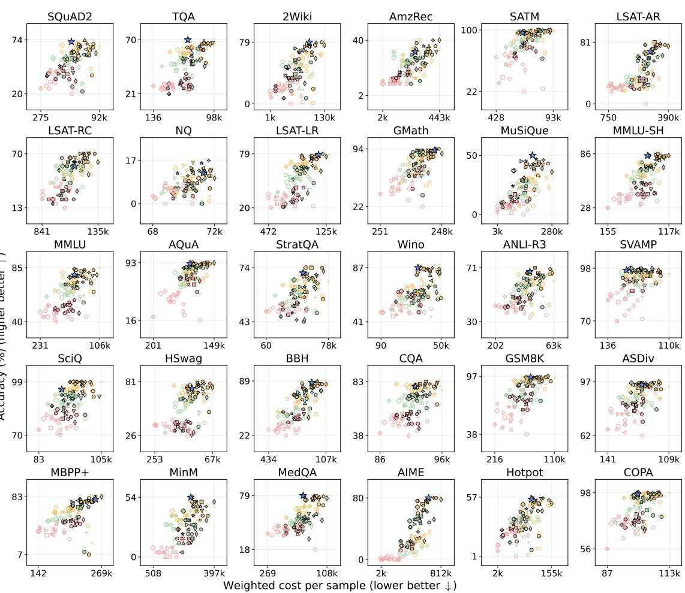  
Ours 4B agent CoV L2M debate discover think  
0.6B thinking autogen CoT metagpt reflex refine ToT  
1.7B nothink CoA direct MC vote SC shortlist vanilla

Figure 10. The same view on the training split. As Figure 6, but every baseline cell and Strategist’s final strategy are scored on the benchmark’s training split (the rows the strategist sees) instead of the test set. This comparison is biased toward BL: BL is, by definition, the most accurate of the 108 cells on exactly these rows, so it sits at the top of each panel, while Strategist’s strategy was chosen on the separate validation and hidden splits. Only the test set (Figure 7, Figure 6) scores both on questions neither was chosen on, which is why the paper reports it.

<table><tr><td></td><td colspan="6">GPT-5</td><td colspan="6">Gemini-2.5</td></tr><tr><td>Benchmark</td><td>BL Acc</td><td>Ours Acc</td><td>∆Acc</td><td>BL $</td><td>Ours $</td><td>∆Cost</td><td>BL Acc</td><td>Ours Acc</td><td>∆Acc</td><td>BL $</td><td>Ours $</td><td>∆Cost</td></tr><tr><td>AQuA-RAT</td><td>31.0</td><td>89.5</td><td>↑189%</td><td>12.39</td><td>1.67</td><td>↓86.5%</td><td>71.0</td><td>90.5</td><td>↑27.5%</td><td>2.22</td><td>1.07</td><td>↓51.6%</td></tr><tr><td>2WikiMQA</td><td>29.5</td><td>78.5</td><td>↑166%</td><td>7.45</td><td>3.67</td><td>↓50.8%</td><td>21.5</td><td>77.5</td><td>↑260%</td><td>2.02</td><td>0.57</td><td>↓72.0%</td></tr><tr><td>HotpotQA</td><td>39.0</td><td>76.5</td><td>↑96.2%</td><td>7.71</td><td>7.13</td><td>↓7.5%</td><td>33.0</td><td>76.5</td><td>↑132%</td><td>2.52</td><td>1.20</td><td>↓52.2%</td></tr><tr><td>MBPP+</td><td>56.5</td><td>82.5</td><td>↑46.0%</td><td>2.16</td><td>1.89</td><td>↓12.3%</td><td>69.5</td><td>80.5</td><td>↑15.8%</td><td>1.79</td><td>1.37</td><td>↓23.7%</td></tr><tr><td>SQuAD2</td><td>57.5</td><td>74.0</td><td>↑28.7%</td><td>0.29</td><td>0.11</td><td>↓61.5%</td><td>74.0</td><td>70.5</td><td>↓4.7%</td><td>0.37</td><td>0.16</td><td>↓57.9%</td></tr><tr><td>NQ-Open</td><td>10.0</td><td>13.5</td><td>↑35.0%</td><td>9.28</td><td>7.17</td><td>↓22.8%</td><td>11.0</td><td>24.0</td><td>↑118%</td><td>1.91</td><td>1.50</td><td>↓21.8%</td></tr><tr><td>TruthfulQA</td><td>84.0</td><td>95.5</td><td>↑13.7%</td><td>3.86</td><td>1.08</td><td>↓71.9%</td><td>85.0</td><td>93.0</td><td>↑9.4%</td><td>1.31</td><td>0.50</td><td>↓61.9%</td></tr><tr><td>ASDiv</td><td>93.0</td><td>95.0</td><td>↑2.2%</td><td>0.67</td><td>1.76</td><td>↑163%</td><td>93.5</td><td>95.5</td><td>↑2.1%</td><td>0.88</td><td>0.59</td><td>↓33.1%</td></tr><tr><td>HellaSwag</td><td>93.5</td><td>94.0</td><td>↑0.5%</td><td>0.07</td><td>0.09</td><td>↑16.9%</td><td>91.5</td><td>92.0</td><td>↑0.5%</td><td>0.50</td><td>0.44</td><td>↓12.3%</td></tr><tr><td>MinervaM</td><td>24.0</td><td>24.5</td><td>↑2.1%</td><td>9.97</td><td>10.45</td><td>↑4.8%</td><td>26.5</td><td>24.0</td><td>↓9.4%</td><td>4.96</td><td>3.68</td><td>↓25.9%</td></tr><tr><td>Total</td><td></td><td></td><td></td><td>53.86</td><td>35.02</td><td>↓35.0%</td><td></td><td></td><td></td><td>18.50</td><td>11.07</td><td>↓40.1%</td></tr></table>

Table 12. Full per-benchmark cross-model transfer results. For each benchmark, the Strategist-discovered strategy and the strongest leaderboard baseline workflow are both re-executed on the new backend; ΔAcc and ΔCost compare them on the same backend. 200 deterministic samples per cell. BL \$ and Ours \$ are total USD across all 200 samples, computed at the oficial list prices published on the OpenAI (GPT-5) and Google (Gemini-2.5) websites; the same per-token rates are applied to baseline and Strategist strategies.

## D Extended Related Work

This appendix expands the three Related Work paragraphs in the main text. Citations are identical; only the discussion is longer.

LLM agents. Large language models have rapidly evolved from single-call question answerers into multi-step agent systems. Chain-of-thought prompting (Wei et al., 2022) and self-consistency decoding (Wang et al., 2023) showed that intermediate reasoning steps improve accuracy on complex tasks. Tree of Thoughts (Yao et al., 2023a) extended this to deliberate search over reasoning paths. ReAct (Yao et al., 2023b) interleaved reasoning with tool use, and Toolformer (Schick et al., 2023) taught models to call external APIs autonomously. Reflexion (Shinn et al., 2023) introduced verbal self-reflection as a feedback mechanism. Multi-agent frameworks such as AutoGen (Wu et al., 2023) enabled conversational collaboration among multiple LLM agents. Formal representations for these systems range from state machines (Wu et al., 2024) to declarative compilation (Khattab et al., 2024) to optimizable computational graphs (Zhuge et al., 2024). A recent survey (Yue et al., 2026) organizes this landscape as agentic computation graphs, distinguishing static, pre-execution, and in-execution optimization. As these systems grow more complex, the strategy layer that determines how models are called, in what order, and with what verification has become the central design bottleneck. Strategist addresses this bottleneck by automating the design of the strategy layer itself.

Automated design of agentic systems. Structure search methods write strategies as raw code (Hu et al., 2025) or compose them from fixed components (Zhang et al., 2025c) or predefined modules (Shang et al., 2025; Zhang et al., 2025a); the first yields isolated programs, the second bounds what strategies can be discovered. Optimization methods refine one strategy per task, by reinforcement learning (Li et al., 2024; Zhang et al., 2026; Gao et al., 2025) or by LLM-driven evolution and refinement (Gao et al., 2024; Liu et al., 2025a), and start over on the next task. Routing methods train controllers to select among existing strategies (Taparia et al., 2026; Yue et al., 2025) without constructing them (Zhang et al., 2025b). Strategist difers by allowing freeform creation through the Strategy Blueprint, requiring no training, constructing strategies itself, and routing across model tiers within each strategy.

Cross-task transfer and experience accumulation. Transferring knowledge across tasks has been studied through meta-learning (Finn et al., 2017; Hospedales et al., 2022), neural architecture search (Elsken et al., 2019), and prompt optimization (Yang et al., 2024). In the LLM agent setting, ExpeL (Zhao et al., 2024) extracts reusable insights from agent experiences, Voyager (Wang et al., 2024) grows a skill library as it explores new environments, and recent work has formalized this direction as lifelong learning for LLM agents (Zheng et al., 2025). Despite this, automated system design methods (Hu et al., 2025; Zhang et al., 2025c) still optimize per task independently. Strategist maintains a shared library of blueprints and their measured properties that grows with every task, providing both relevant components (exploitation) and diverse inspiration from other tasks (exploration). To our knowledge, it is the first system for automated strategy design that accumulates knowledge across tasks.