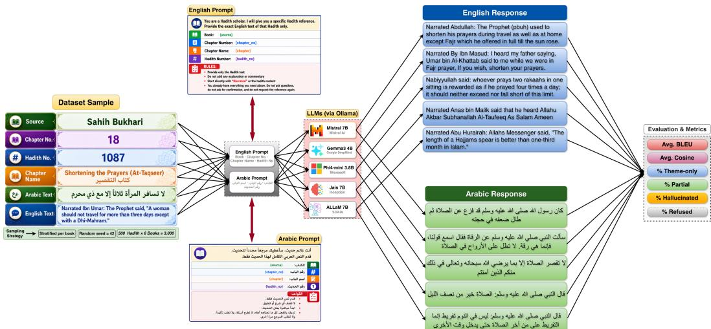
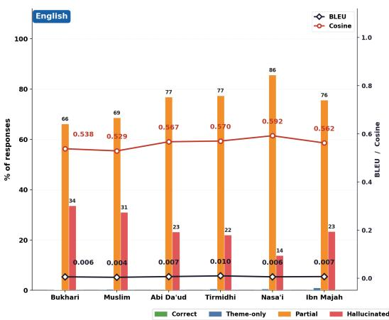
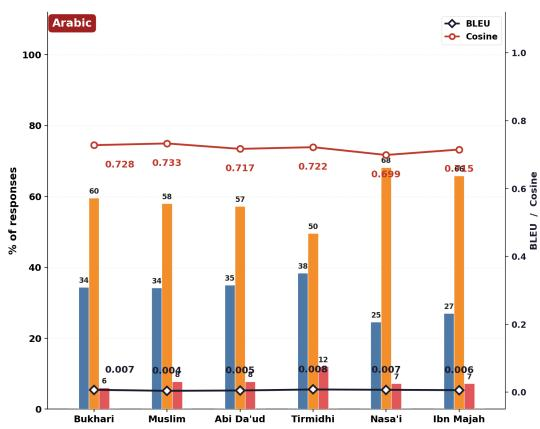
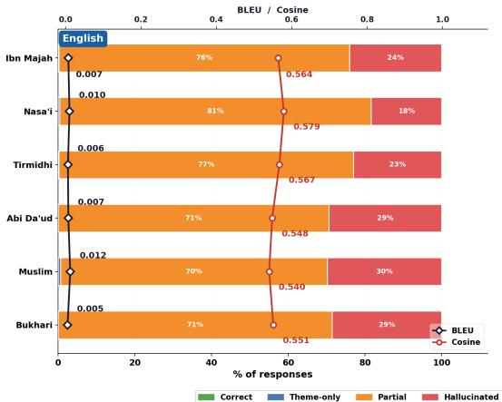
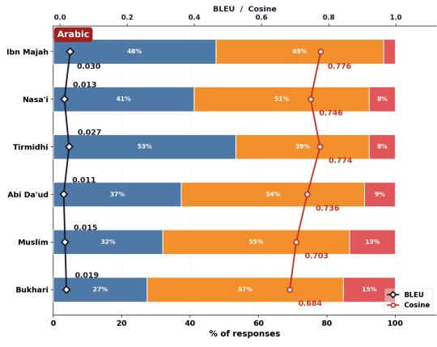
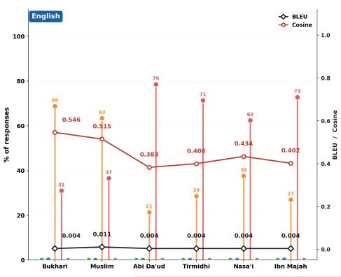
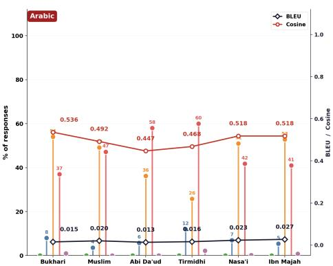
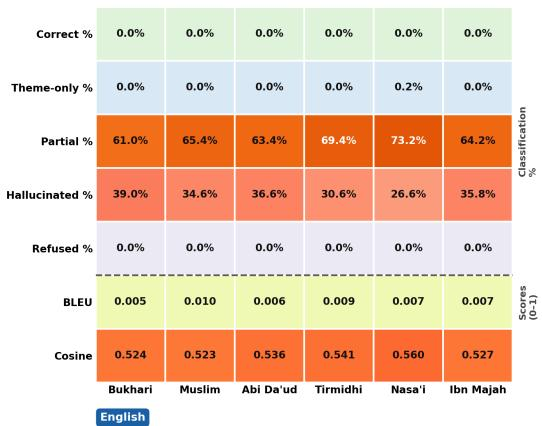
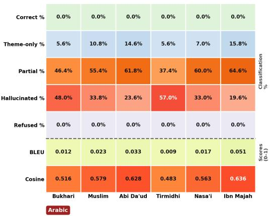
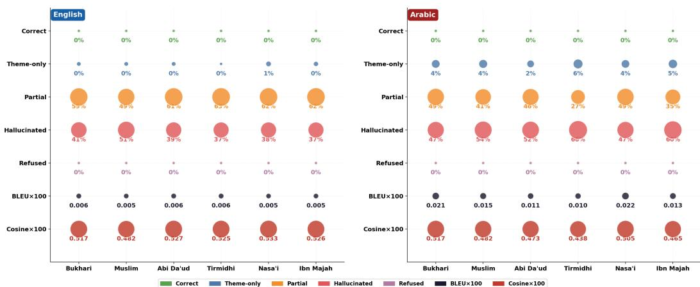

# They Know Where It Is, But Not What It Says: A Bilingual Hallucination Benchmark of Hadith Recall in Open LLMs

Dayam Nadeem Jamia Hamdard dayam8696@gmail.com

Safdar Mustafa Jamia Hamdard safdarmustafa01@gmail.com

Ameen Ur Rehman KFUPM g202527430@kfupm.edu.sa

Shahab Saquib Sohail∗ Jamia Hamdard shahabssohail@jamiahamdard.ac.in

Mohammad Nadeem Aligarh Muslim University mnadeem.cs@amu.ac.in

Usman Naseem Macquarie University usman.naseem@mq.edu.au

## Abstract

Large language models are increasingly consulted for religious knowledge, including the recall of specific Hadith (recorded sayings and actions of the Prophet Muhammad, peace be upon him). Unlike open-ended generation, Hadith recall is a high-stakes, verifiable task: a reference (collection, chapter, and Hadith number) has exactly one correct text, and any deviation from it constitutes a fabrication that can be mistaken for authentic scripture. This study introduces a bilingual (English/Arabic) benchmark that probes five open-weight, locally-deployable language models (Mistral-7B, Gemma3-4B, Jais-7B, ALLaM-7B, and Phi4-mini-3.8B) across all six canonical Sunni Hadith collections (Sahih al-Bukhari, Sahih Muslim, Sunan Abi Da’ud, Jami’ al-Tirmidhi, Sunan an-Nasa’i, Sunan Ibn Majah), sampling 500 Hadith per collection (3,000 per model per language, 30,000 responses total). Each model is given only the bibliographic reference and asked to reproduce the exact Hadith text, with no retrieval augmentation, and is scored on lexical fidelity (BLEU) and semantic fidelity (multilingual cosine similarity), with refusals flagged separately. Across all five models and both languages, 0% of 30,000 responses achieve both high lexical and high semantic fidelity, i.e., an exact, verifiable match to the source text. Arabic responses fare uniformly worse than English. These findings suggest that current open-weight LLMs, used without retrieval grounding, are unreliable and potentially dangerous sources for exact religious-text recall, and that deployment for Islamic scholarship should mandate retrieval-augmented generation over a verified corpus rather than parametric memory. The complete code, prompts, evaluation pipeline, and scored outputs are publicly available at https://github.com/dayam8696/Hadith-Hallucination-Benchmark.

## 1 Introduction

Large language models (LLMs) are used, informally and increasingly, as reference tools for religious knowledge: users ask a chatbot to quote a specific verse, ruling, or Hadith rather than opening a physical text or a vetted digital corpus. For most everyday knowledge tasks this convenience is acceptable because errors are low-stakes and easily checked. Religious scripture is different. A Hadith is a specific, canonicalized unit of text attributed, numbered, and preserved across centuries of chain-of-narration (isnad) scholarship and a model that produces a fluent, confident, but fabricated Hadith text is not merely wrong; it is putting invented words into the mouth of the Prophet (peace be upon him) under the appearance of authentic transmission. This is a uniquely severe form of hallucination: the failure mode is not an unhelpful answer, but a convincing forgery.

One might reasonably expect that a model built within the Arab world, and trained explicitly for Arabic fluency, would recall Arabic religious text more faithfully than a general-purpose model trained mostly on English. The results tell the opposite story: Jais and ALLaM, both developed for Arabic-language understanding, hallucinate at rates no better, and on several collections worse, than models with no Arabic specialization at all. Fluency in a language, it turns out, is not the same as having memorized its scripture.

Despite this, no existing benchmark to date isolates exact-recall hallucination for Hadith text specifically, across multiple canonical collections, in both Arabic (the original language of transmission) and English (the language most commonly used by non-Arabic-speaking Muslims and by LLMs deployed globally). Existing hallucination benchmarks for LLMs largely target general factual QA, summarization consistency, or code correctness, and multilingual religious-text benchmarks are sparse in the open literature. This gap matters because Hadith recall has a property that makes it an especially clean hallucination probe: for a given reference, there is exactly one correct answer, drawn from a fixed, well-documented corpus, so lexical and semantic similarity to the ground truth can be measured directly, without the ambiguity that plagues open-ended factuality evaluation.

Contributions. This study presents the first systematic bilingual benchmark of Hadith-recall hallucination in open-weight LLMs, to the best of current knowledge. Concretely:

• This study constructs a stratified, reproducible evaluation set of 3,000 Hadith references per language (500 randomly sampled from each of the six major Sunni collections), paired with ground-truth Arabic and English text.

• This study evaluates five open-weight models runnable on consumer hardware via Ollama including two models built specifically for Arabic (Jais-7B, ALLaM-7B) under a referenceonly prompt with no retrieval augmentation, in both Arabic and English.

• This study proposes a two-axis scoring protocol (lexical fidelity via BLEU, semantic fidelity via multilingual sentence-embedding cosine similarity) with explicit refusal detection, and uses it to classify every response as correct, partial, theme-only, hallucinated, or refused.

• This study shows that across all five models and both languages, the correct category is empty: 0% of 30,000 responses simultaneously match the ground truth lexically and semantically, and Arabic responses are uniformly classified as hallucinated regardless of model or collection.

Figure 1 gives a complete visual walkthrough of this pipeline end to end: how a bare bibliographic reference becomes a bilingual prompt, how that prompt is answered by each of the five evaluated models, and how every resulting response is filtered, scored, and finally sorted into one of five outcomes. Rather than describing each stage in the abstract, the figure lets the reader trace a single Hadith reference through the entire system at a glance; each step is unpacked in turn in Section 3 and Section 4.

## 2 Related Work

Hallucination benchmarks. General-purpose hallucination and factuality benchmarks (e.g., TruthfulQA-style probes, retrieval-free factual QA suites) typically evaluate open-domain trivia or encyclopedic facts, where partial credit and paraphrase are acceptable. Hadith recall differs in requiring near-verbatim fidelity to a fixed source text, which allows translation-style lexical metrics (BLEU) to be applied directly as a hallucination signal rather than relying solely on binary factuality judgments.

Religious and low-resource-domain NLP. Prior work on Arabic and Islamic NLP has largely focused on classification (authenticity/sanad grading of Hadith, topic classification of Quranic verses) rather than generative recall. Arabic-centric LLMs such as Jais [1] and ALLaM [2] have been evaluated on general Arabic benchmarks (MMLU-Arabic-style suites, translation) but not, to date, on verbatim recall of a fixed religious corpus, which is the setting targeted here.

Retrieval-augmented generation (RAG). These results are consistent with the broader RAG literature’s premise that parametric memory alone is an unreliable substitute for grounding in a verified corpus for knowledge-intensive, low-tolerance-for-error tasks. This benchmark is presented as a motivating case for why Islamic-scholarship LLM applications should be retrieval-grounded rather than relying on model memorization.

## 3 Benchmark Construction

Figure 1 lays out the complete methodology end to end, tracing the path from a raw Hadith reference all the way to a final classification label. It shows, in a single view, how the source corpus is sampled, how each sampled reference becomes a bilingual prompt, how that prompt is routed to each of the five evaluated models, and how the resulting response is filtered for refusals, scored for lexical and semantic fidelity, and classified. The remainder of this section walks through each of these stages in the order the figure presents them, with the scoring details deferred to Section 4.

## 3.1 Source Corpus

This study uses the publicly available Hadith Dataset [3], released on Kaggle under a CC0 (public domain) license. The dataset provides parallel Arabic and English text together with collection name, chapter number and name, Hadith number, and a narrator chain-of-transmission index for every record. After deduplication and a cleaning pass on whitespace and encoding artifacts, the working corpus contains 34,441 Hadith spanning the six canonical Sunni collections (kutub al-sittah): Sahih al-Bukhari [4] (7,370), Sahih Muslim [5] (7,596), Sunan Abi Da’ud [6] (5,260), Jami’ al-Tirmidhi [7] (4,214), Sunan an-Nasa’i [8] (5,774), and Sunan Ibn Majah [9] (4,227).

## 3.2 Sampling

From this corpus, a stratified random sample of 500 Hadith per collection (3,000 total) is drawn, using a fixed random seed for reproducibility. Sampling is per-book to guarantee balanced coverage of every collection regardless of its size in the source corpus.

## 3.3 Prompting Protocol

Each model receives only the bibliographic reference collection name, chapter number, chapter name, and Hadith number and is instructed to reproduce the Hadith text exactly, with no explanation or commentary, and with an explicit instruction not to ask for clarification. No retrieval context or search access is provided: the model must answer from parametric memory alone. Prompts are issued in two parallel forms, English and Arabic, with language-matched instructions; the structure of both prompt variants, and how each is routed to every evaluated model, is shown in Figure 1.

## 3.4 Models

This study evaluates five open-weight models, all served locally via Ollama [10], chosen to span general-purpose and Arabic-specialized instruction-tuned models runnable on consumer hardware (8– 16 GB RAM): Mistral-7B [11], Gemma3-4B [12], Phi4-mini-3.8B [13], Jais-7B [1] (Arabic-adapted), and ALLaM-7B [2] (Arabic-centric). Decoding is deterministic-leaning (low temperature, repetition penalty) to reduce degenerate repetition and isolate content hallucination from decoding artifacts.

## 4 Evaluation Protocol

Let r denote a model response and g the ground-truth Hadith text. Every response is passed through the pipeline below in order: refusal detection, then (if not refused) lexical scoring, semantic scoring, and classification.

  
Figure 1: End-to-end evaluation pipeline: reference-only prompt → local LLM inference (Ollama) → model response → refusal filter → dual scoring (BLEU lexical match; multilingual cosine semantic match) → five-way classification (correct / theme-only / partial / hallucinated / refused).

## 4.1 Refusal Detection

Responses in which the model declines to answer or requests clarification are flagged. Let $\mathcal { P } _ { \mathrm { l a n g } }$ be the fixed list of refusal phrases and $L _ { \operatorname* { m a x } } = 1 5 0$ characters. A response is a refusal if:

$$
\mathrm { i s \_ r e f u s a l } ( r ) = \left[ \left| r \right| \le L _ { \operatorname* { m a x } } \right] \wedge \left[ \exists p \in \mathcal { P } _ { \mathrm { l a n g } } : p \in r \right] .\tag{1}
$$

The length cutoff separates a genuine refusal from a response that hedges briefly and then still fabricates a full Hadith, which is scored as a hallucination rather than a refusal.

## 4.2 Lexical Fidelity: BLEU

Sentence-level BLEU [14] is computed between the whitespace-tokenized response r and ground truth $g \colon$

$$
\mathrm { B P } ( r , g ) = \left\{ \begin{array} { l l } { 1 } & { \mathrm { i f ~ } | r | _ { \mathrm { t o k } } > | g | _ { \mathrm { t o k } } , } \\ { \mathrm { e x p } \bigl ( 1 - | g | _ { \mathrm { t o k } } / | r | _ { \mathrm { t o k } } \bigr ) } & { \mathrm { o t h e r w i s e } , } \end{array} \right.\tag{2}
$$

$$
{ \mathrm { B L E U } } ( r , g ) = { \mathrm { B P } } ( r , g ) \cdot \exp \Bigl ( \sum _ { n = 1 } ^ { 4 } w _ { n } \log p _ { n } ( r , g ) \Bigr ) , \quad w _ { n } = \textstyle { \frac { 1 } { 4 } } \forall n .\tag{3}
$$

n-grams up to $n { = } 4$ are used with additive smoothing. $\mathrm { B L E U } ( r , g ) \in [ 0 , 1 ] ;$ a response that truly reproduces the Hadith scores near 1.0. Smoothing is needed because unsmoothed BLEU collapses to zero whenever any single n-gram order has no matches, which is common given how short Hadith texts are relative to typical machine-translation segments.

## 4.3 Semantic Fidelity: Cosine Similarity

Let $E ( \cdot )$ denote the multilingual sentence encoder paraphrase-multilingual-MiniLM-L12-v2 [15], $E ( \cdot ) \in \mathbb { R } ^ { 3 8 4 }$ . With $\mathbf { u } = E ( r )$ and $\mathbf { v } = E ( g )$

$$
\cos ( r , g ) = \operatorname* { m a x } \Bigl ( 0 , \ \operatorname* { m i n } \Bigl ( 1 , \ \frac { { \bf u \cdot v } } { \| { \bf u } \| \ \| { \bf v } \| } \Bigr ) \Bigr ) .\tag{4}
$$

This captures topical relatedness even when exact wording differs, giving partial credit BLEU alone cannot.

Table 1: Hadith-recall results aggregated over all six collections (3,000 responses per model–language cell). Correct = 0.0% and Refused $\leq 0 . 7 \%$ in every row; remaining columns sum to 100%.
<table><tr><td>Model</td><td>Lang</td><td>Avg. BLEU</td><td>Avg. Cosine</td><td>%Theme-only</td><td>%Partial</td><td>%Halluc.</td></tr><tr><td>Mistral-7B</td><td>English</td><td>0.007</td><td>0.559</td><td>0.47</td><td>75.03</td><td>24.50</td></tr><tr><td>Mistral-7B</td><td>Arabic</td><td>0.006</td><td>0.719</td><td>32.27</td><td>59.73</td><td>8.00</td></tr><tr><td>Gemma3-4B</td><td>English</td><td>0.008</td><td>0.558</td><td>0.23</td><td>74.23</td><td>25.53</td></tr><tr><td>Gemma3-4B</td><td>Arabic</td><td>0.019</td><td>0.736</td><td>39.83</td><td>50.80</td><td>9.37</td></tr><tr><td>Phi4-mini-3.8B Phi4-mini-3.8B</td><td>English</td><td>0.005</td><td>0.447</td><td>0.07</td><td>41.13</td><td>58.80</td></tr><tr><td></td><td>Arabic</td><td>0.019</td><td>0.500</td><td>6.97</td><td>44.83</td><td>47.50</td></tr><tr><td>Jais-7B</td><td>English</td><td>0.007</td><td>0.535</td><td>0.03</td><td>66.10</td><td>33.87</td></tr><tr><td>Jais-7B</td><td>Arabic</td><td>0.024</td><td>0.567</td><td>9.90</td><td>54.27</td><td>35.83</td></tr><tr><td>ALLaM-7B</td><td>English</td><td>0.006</td><td>0.518</td><td>0.27</td><td>59.30</td><td>40.43</td></tr><tr><td>ALLaM-7B</td><td>Arabic</td><td>0.015</td><td>0.480</td><td>4.37</td><td>41.37</td><td>54.27</td></tr></table>

## 4.4 Classification

Using thresholds $\tau _ { \mathrm { t e x t } } { = } 0 . 4 , \tau _ { \mathrm { l o w } } { = } 0 . 5$ , and $\tau _ { \mathrm { h i g h } } { = } 0 . 8$ , with $b { = } \mathrm { B L E U } ( r , g )$ and $c { = } \mathrm { c o s } ( r , g )$ :

$$
\mathrm { l a b e l } ( b , c ) = \left\{ \begin{array} { l l } { \mathrm { h a l l u c i n a t e d } } & { \mathrm { i f } c < \tau _ { \mathrm { l o w } } , } \\ { \mathrm { c o r r e c t } } & { \mathrm { i f } c \geq \tau _ { \mathrm { l o w } } , b > \tau _ { \mathrm { t e x t } } , c > \tau _ { \mathrm { h i g h } } , } \\ { \mathrm { t h e m e \_ o n l y } } & { \mathrm { i f } c \geq \tau _ { \mathrm { l o w } } , b \leq \tau _ { \mathrm { t e x t } } , c > \tau _ { \mathrm { h i g h } } , } \\ { \mathrm { p a r t i a l } } & { \mathrm { o t h e r w i s e } . } \end{array} \right.\tag{5}
$$

Intuitively, hallucinated fails the semantic floor outright, correct clears both thresholds, theme\_only is on-theme but wrongly worded, and partial covers the remaining borderline cases. Thresholds were fixed once from pilot inspection and held constant across all models.

## 5 Results

Table 1 reports aggregate scores across all six collections per model per language (30,000 responses total). The correct rate is 0.0% and the refusal rate is negligible (≤0.7%) in every cell; both columns are omitted from the table.

## 5.1 No Model Achieves Reliable Exact Recall

Across every model and both languages, the correct category is empty. This holds even for the strongest general-purpose models (Mistral-7B, Gemma3-4B) and for the Arabic-specialized models (Jais-7B, ALLaM-7B), indicating that Arabic-domain pretraining does not translate into reliable verbatim Hadith recall. This pattern is visible directly in Figures 2–6, where the %Correct bar remains at zero for every collection and every model, complementing the aggregate view in Table 1.

## 5.2 Arabic Lexical Fidelity Is Near-Zero

Average BLEU for Arabic responses (0.006–0.024) is comparable to or lower than English BLEU across all models, confirming that no model reproduces the exact Arabic wording of the requested Hadith. This near-zero fidelity holds uniformly across every one of the six collections, as the percollection BLEU values in Figures 2–6 show, rather than being concentrated in a small subset of collections.

## 5.3 Refusals Are Rare

Explicit refusals are rare across models, meaning most failures are silent fabrications rather than abstentions arguably the more dangerous failure mode, since a user has no explicit signal that the model does not actually know the answer. Where refusals do appear in the per-collection figures, they are isolated, nonzero %Refused values concentrated almost entirely in Arabic responses from a single model, rather than a behavior shared across the benchmark.

Figure 2: Mistral-7B per-collection results showing %Correct, %Theme-only, %Partial, %Hallucinated, %Refused, BLEU, and Cosine similarity for English and Arabic across all six Hadith collections. %Correct and %Refused are 0.00% for both English and Arabic across all collections.  

  
Figure 3: Gemma3-4B per-collection results showing %Correct, %Theme-only, %Partial, %Hallucinated, %Refused, BLEU, and Cosine similarity for English and Arabic across all six Hadith collections. %Correct and %Refused are 0.00% for both English and Arabic across all collections.

## 5.4 Per-Collection Breakdown

Figures 2–6 break the aggregate numbers in Table 1 down by individual Hadith collection for each model. Collection abbreviations used throughout: Bukhari, Muslim, Abi Da’ud, Tirmidhi, Nasa’i, Ibn Majah. Each figure reports %Correct, %Theme-only, %Partial, %Hallucinated, and %Refused alongside average BLEU and cosine scores, split by language, allowing a direct visual comparison of a given model’s behavior across all six canonical collections.

One pattern is consistent across all five per-collection figures: within a given model and language, BLEU never approaches the correctness threshold $\tau _ { \mathrm { t e x t } } { = } 0 . 4$ for any individual collection the near-zero lexical fidelity in Table 1 is not an artifact of averaging over a few well-recalled collections and many poorly-recalled ones; it holds uniformly, collection by collection (Figure 2 for Mistral-7B; Figure 3 for Gemma3-4B).

Phi4-mini-3.8B (Figure 4) shows the highest hallucination rates in English among the five models, with %Hallucinated exceeding 70% on Abi Da’ud, Tirmidhi, and Ibn Majah collections for which even the Partial rate is substantially depressed. Arabic responses for Phi4-mini-3.8B are comparatively more balanced across Partial and Hallucinated, though BLEU remains near zero in both languages.

The Arabic-specialized models tell a similar story. Jais-7B (Figure 5) shows no advantage in Arabic lexical fidelity over the general-purpose models despite its Arabic-adapted pretraining, with BLEU scores uniformly below 0.06 across all collections in both languages. ALLaM-7B (Figure 6), trained with substantial Arabic and Islamic-domain data, likewise fails to approach the correctness threshold in either language, with Arabic %Hallucinated exceeding English %Hallucinated for every collection the reverse of the pattern one might expect from domain-specific training.

CorrectTheme-onlyPartialHallucinatedRefused-BLEU (right axis)-Cosine (right axis)  

  
Figure 4: Phi4-mini-3.8B per-collection results showing %Correct, %Theme-only, %Partial, %Hallucinated, %Refused, BLEU, and Cosine similarity for English and Arabic across all six Hadith collections. %Correct is 0.00% across all collections; Arabic refusals where nonzero: Bukhari 1.0%, Tirmidhi 2.2%, Nasa’i 0.2%, Ibn Majah 0.8%.

  
Figure 5: Jais-7B per-collection results showing %Correct, %Theme-only, %Partial, %Hallucinated, %Refused, BLEU, and Cosine similarity for English and Arabic across all six Hadith collections. %Correct and %Refused are 0.00% for both English and Arabic across all collections.

## 6 Discussion

These results indicate that current 4-8B-parameter open-weight LLMs, run locally with no retrieval augmentation, cannot be trusted to recall exact Hadith text from a bibliographic reference in either Arabic or English. This is not a marginal miscalibration it is a near-total absence of verified recall across 30,000 trials. Two implications follow. First, any user-facing application that lets people ask an LLM to “quote” a Hadith by reference, without grounding the model in a retrieval pipeline over a verified corpus, is at serious risk of surfacing confident fabrications that read as authentic religious text. Second, Arabic-specialized pretraining, at least at the model scales tested here, does not close this gap suggesting the failure is one of memorization ofa long-tail, exact-text corpus, not general language competence in Arabic.

This benchmark is presented as a call to action for the community building LLM tools for Muslim users: prioritize retrieval-augmented designs with a verified Hadith database as the source of truth, add refusal/uncertainty-signaling for the many silent-fabrication cases observed, and treat verbatim scriptural recall as a distinct, high-stakes evaluation axis.

  
Figure 6: ALLaM-7B per-collection results showing %Correct, %Theme-only, %Partial, %Hallucinated, %Refused, BLEU, and Cosine similarity for English and Arabic across all six Hadith collections. %Correct and %Refused are 0.00% for both English and Arabic across all collections.

## 7 Limitations

This study uses a publicly available, open-source Hadith dataset, and independently verified a substantial number of its entries for structural consistency (row-level completeness, correct book and chapter attribution) prior to sampling. While its creator has flagged it as a preliminary release, this verification found no evidence that residual noise would inflate model performance, so it does not threaten this study’s central near-zero-recall finding. Thresholds were chosen based on manual inspection and are not learned; the qualitative finding is robust to reasonable threshold variation given how far below threshold observed BLEU scores fall. Due to limited hardware resources, this study evaluates five open-weight models at consumer-hardware scale (3.8–8B parameters) and does not evaluate larger closed-source models. Finally, this study evaluates zero-shot, retrieval-free recall by design; how much retrieval augmentation would close the gap is left to future work.

## 8 Ethical Considerations

This work studies factual fidelity in the generation of religious scripture and is intended to surface a safety concern, not to produce or promote fabricated religious content. All fabricated Hadith text produced during this study is used strictly for scoring and analysis and is not published, redistributed, or presented as authentic. Transparently documenting this failure mode is believed to be in the interest of both the ML and Muslim communities, and downstream applications are encouraged to adopt retrieval-grounded designs as discussed in Section 6.

## References

[1] Sengupta, N. et al. (2023). Jais and Jais-chat: Arabic-centric foundation and instruction-tuned open generative large language models. arXiv preprint. https://doi.org/10.48550/arXiv.2308.16149

[2] Bari, M. S. et al. (2024). ALLaM: Large language models for Arabic and English. arXiv preprint. https: //doi.org/10.48550/arXiv.2407.15390

[3] Fahd (2018). Hadith Dataset. Kaggle. CC0: Public Domain. https://www.kaggle.com/datasets/ fahd09/hadith-dataset.

[4] al-Bukhari, M. I. Sahih al-Bukhari. 9th century CE.

[5] Muslim ibn al-Hajjaj. Sahih Muslim. 9th century CE.

[6] Abu Dawud, S. Sunan Abi Da’ud. 9th century CE.

[7] al-Tirmidhi, M. Jami’ al-Tirmidhi. 9th century CE.

[8] al-Nasa’i, A. Sunan an-Nasa’i. 9th century CE.

[9] Ibn Majah, M. Sunan Ibn Majah. 9th century CE.

[10] Ollama. Get up and running with large language models locally. https://ollama.com.

[11] Jiang, A. Q. et al. (2023). Mistral 7B. arXiv preprint. https://doi.org/10.48550/arXiv.2310. 06825

[12] Gemma Team et al. (2025). Gemma 3 technical report. arXiv preprint. https://doi.org/10.48550/ arXiv.2503.19786

[13] Abouelenin, A. et al. (2025). Phi-4-Mini technical report. arXiv preprint. https://doi.org/10.48550/ arXiv.2503.01743

[14] Papineni, K., Roukos, S., Ward, T., & Zhu, W. J. (2002). BLEU: A method for automatic evaluation of machine translation. ACL, pp. 311–318. https://doi.org/10.3115/1073083.1073135

[15] Reimers, N. & Gurevych, I. (2019). Sentence-BERT: Sentence embeddings using Siamese BERT-networks. EMNLP-IJCNLP, pp. 3982–3992. https://doi.org/10.18653/v1/D19-1410