# Tracing the Scientific Discovery Capacity of LLMs to Their Training Data

Arda Uzunoglu<sup>1</sup>, Mahler Revsine<sup>1</sup>, Michael Schatz<sup>1</sup>, Benjamin Van Durme<sup>1,2</sup>

Mehrdad Farajtabar<sup>3</sup>, Daniel Khashabi<sup>1</sup>, Eric Nalisnick<sup>1</sup>

<sup>1</sup>Johns Hopkins University <sup>2</sup>Microsoft <sup>3</sup>Apple

GitHub Hugging Face

## Abstract

Large language models (LLMs) show growing promise for scientific discovery, yet basic questions remain about what enables reliable discovery. How can we trace the scientific discovery capacity of LLMs to their training data? We study this question as one of missing probability mass and develop a theoretical account in which monofacts—the facts observed once during training—set the discovery capacity. In materials science and regulatory genomics, we directly manipulate monofact rates in training sets and find that more monofacts consistently yield more discoveries across two open-weight model families, sampling strategies, and reasoning budgets. Further experiments show the relationship cannot be explained by training-set diversity alone and can transfer across scientific domains when paired with in-domain data. Together, our results identify monofact rate in training data as a key factor governing discoveries in language models.

## 1 Introduction

Isaac Newton revolutionized our understanding of the physical world through his laws of motion and universal gravitation. Yet he also devoted substantial efort to alchemy and searching for hidden prophecies in biblical texts (Gleick, 2007). Newton’s example illustrates a fundamental tension in scientific inquiry: the hunt for novel ideas can lead to extraordinary breakthroughs but also to futile pursuits. This tension is becoming increasingly relevant to AI-powered science as large language models (LLMs) begin proposing and evaluating novel hypotheses (Gottweis et al., 2026), discovering new mathematical constructions (Romera-Paredes et al., 2024), and contributing to solutions of open scientific problems (OpenAI, 2026b,c).<sup>1</sup> Making such discoveries, however, requires LLMs to venture beyond what they have already observed—precisely the same statistical regime in which hallucinations arise. Yet training data provides only observations of what is already known. This raises a fundamental question: how can we trace the scientific discovery capacity of LLMs to their training data?

We approach this question through the missing mass framework of Kalai & Vempala (2024), which links training set properties to the model’s penchant for generating novel statements. They show that the Good–Turing estimate of missing mass (Good, 1953), given by the prevalence of monofacts (i.e., statements observed exactly once), provides a lower bound on the hallucination rate. However, discoveries, by definition, must also be drawn from the missing mass. Yet Kalai & Vempala (2024)’s framework treats unseen statements as predominantly false, ofering no basis for distinguishing discoveries from falsehoods. Scientific domains, in contrast, contain structure that makes some unseen candidates more plausible than others (Meredig et al., 2018; Merchant et al., 2023). We capture this structure through afrontier ofpossible truths, extending the framework to characterize scientific discovery. Our analysis establishes a discovery–hallucination exchange rate governed by frontier ambiguity (Proposition 5) and, under calibration assumptions, establishes both upper and lower bounds on discovery in terms of the same monofact statistic (Theorems 6 and 7). Therefore, we extend the missing-mass perspective from hallucination to scientific discovery.

We empirically verify our framework in two realistic discovery tasks: materials science and regulatory genomics. For the former, we train LLMs to generate chemical formulas satisfying specified material properties. For the latter, we train LLMs to propose DNA sequence modifications that achieve target regulatory activity profiles. In both tasks, we measure discovery through the exact recovery of target outputs from temporally constructed test sets, requiring models to make predictions for samples that postdate their knowledge cutof. To test the central claims of Theorems 6 and 7—that monofacts drive discovery—we directly manipulate monofact rate by training models on datasets with controlled monofact rates (§4.1). Across two model families, training stages, and evaluation settings, higher monofact rate consistently yields more discoveries (§4.2). Further experiments show that this relationship persists across reasoning budgets (§5.1), rule out training-set diversity as an alternative explanation (§5.2), and test whether the efect of monofact rate on discovery capacity transfers across scientific domains (§5.3). Together, our results identify monofact rate as a key factor governing an LLM’s discovery capacity.

## 2 Background: Hallucination Bounds from Monofact Rates

We begin by summarizing the framework of Kalai & Vempala (2024), who formulate hallucination as missing mass and connect it to the Good–Turing estimator (Good, 1953). Their key result is that a calibrated LLM should generate false statements at least as often as novel facts appear in the training set. This is an important observation since (i) hallucination rates can be estimated from simple statistics of the training data, provided the LLM is suficiently well-calibrated, and (ii) hallucinations are driven by the long tail of the training distribution. We provide the formal details below and ofer a broader discussion of related work on long tail distributions, hallucination, and LLM-based scientific discovery in App. A.

We first define calibration of an LLM distribution with respect to a distribution over statements. Let S be a finite space of semantic statements. Kalai & Vempala (2024) consider these statements to be at the level of semantics, meaning that paraphrases of the same statement do not have diferent representations in S (Kuhn et al., 2023; Nakkiran et al., 2026). Let $f \in \Delta ( S )$

be the distribution induced by an LLM under unconditional generation, where $\Delta ( S )$ denotes all possible distributions over ${ \mathcal { S } } .$ Let W be a world prior, a distribution over document distributions, let $\mathfrak { D } \sim \mathcal { W }$ be a distribution over documents, and let $p _ { \mathfrak { D } } \in \Delta ( { \cal S } )$ be the induced distribution over statements, which places probability mass only on true statements. The set of true statements is $\mathcal { T } \triangleq \mathbf { s } : p _ { \mathfrak { D } } ( \mathbf { s } ) > 0 .$ , and the set of hallucinations is its complement ${ \mathcal { H } } \triangleq S \setminus T .$ , which captures all false statements. Kalai & Vempala (2024) define generative calibration with respect to $p _ { \mathfrak { D } }$ and a partition of S as follows:

Definition 1 (Generative Calibration). For $p _ { \mathfrak { D } } \in \Delta ( { \cal S } )$ and a partition $\pi \in \Pi ( S )$ , a model $f$ is calibrated w.r.t. p<sub>D</sub> $\begin{array} { r } { i f f ( { s } _ { 0 } ) = \mathbb { E } \left[ { p } _ { \mathfrak { D } } ( \mathbf { s } ) | \mathbf { s } \in \pi ( { s } _ { 0 } ) \right] = \sum _ { \mathbf { s } \in \pi ( { s } _ { 0 } ) } { p } _ { \mathfrak { D } } ( \mathbf { s } ) / | { \pi ( { s } _ { 0 } ) } | , f o r } \end{array}$ all $s _ { 0 } \in S _ { \varepsilon }$ , where $\pi ( \boldsymbol { s } _ { 0 } )$ denotes the partition to which $s _ { 0 }$ is assigned $a n d \left| \pi ( \pmb { s } _ { 0 } ) \right|$ is its cardinality.

The granularity of π determines calibration strength. If π groups all statements together, even a constant $f$ over $\boldsymbol { s }$ can be calibrated, whereas increasingly granular partitions force $f$ to approach $p _ { \mathfrak { D } }$ everywhere. In supervised learning, $\pi$ is often specified by the model’s confidence in its top-ranked class (Guo et al., 2017), and Kalai $\&$ Vempala (2024)’s results similarly require that the partition be a coarsening based on $f ,$ which we denote as $\pi _ { f } .$

Next consider a set $\mathcal { D }$ of N documents containing statements. A key statistic is $\mathcal { D } ^ { \prime } { \sf s }$ monofact rate:

Definition 2 (Monofact Rate). Let $n _ { \mathscr D } ( \mathbf { s } )$ denote the number ofoccurrences ofstatement s in the training set D. The monofact rate is then $\hat { \mu } \triangleq | \{ \mathbf s \in \mathcal { S } : n _ { \mathcal { D } } ( \mathbf { s } ) = 1 \} | / N$

Kalai & Vempala (2024) assume that (i) there exists one statement per document, (ii) true statements have non-zero probability while false statements never occur $( \mathcal { D } \sim \mathfrak { D } ) , ( \mathrm { i i i } ) \mathcal { S }$ contains exponentially more false statements than true ones, (iv) conditioned on the training set ${ \mathcal { D } } ,$ every unobserved statement is equally likely to be true and has equal expected probability under $p _ { \mathfrak { D } }$ (i.e., regularity).

Under these assumptions, Kalai & Vempala (2024) derive the following finite-sample lower bound:

Theorem 3 (KV-Bound). The probability f assigns to H is bounded, with probability $1 - \delta ,$ as:

$$
f ( \mathcal { H } ) \ge \hat { \mu } - \mathsf { C E } ( f , p _ { \mathfrak { D } } ; \pi _ { f } ) - \frac { 3 e ^ { - m } } { \delta } - \sqrt { \frac { 6 \ln \{ 6 / \delta \} } { N } } ,
$$

where $\hat { \mu }$ is the Good-Turing monofact estimator, $\mathrm { C E } ( f , p _ { \mathfrak { D } } ; \pi _ { f } ) \in [ 0 , 1 ]$ denotes the calibration error of $f ,$ m is a sparsity parameter from assumption (iii), δ is the bound’s confidence, and N is the number of training documents.

See Kalai & Vempala (2024) for the proof and a matching upper bound. The monofact rate estimates missing probability mass via Good–Turing (Good, 1953): more unique elements in a sample imply a greater chance of unseen elements in future samples. Assumptions (iii) and (iv) then imply that these future, novel samples are likely to lie in H.

Kalai & Vempala (2024) distinguish arbitrary facts, which must be learned from observations, from systematic facts, whose truth follows from underlying rules. The above theory applies to the former: a fact such as “The Shining” was published in 1977 must be learned through repetition, since there are no underlying rules that dictate that the The Shining’s publication date must be 1977. On the other hand, inequalities such as $2 . 3 4 5 7 5 4 < 8 . 7 5 4$ can be generalized from structure even if never observed directly. Using a series of simulations, Miao & Kearns (2026) empirically show that varying training set novelty drives hallucination as predicted by Kalai & Vempala (2024).

## 3 Monofacts Determine Capacity for Scientific Discovery

We now re-purpose the KV-Bound to characterize scientific discovery. By definition, discoveries are absent from the training data and must therefore come from the missing mass estimated by the Good–Turing statistic. One interpretation of Kalai & Vempala (2024) is that discoveries are simply systematic facts, and therefore fact counts do not play a role. However, we believe discoveries do not cleanly fit into either category, as they are often made through abductive reasoning—formulating hypotheses from plausible guesses—rather than straightforward deduction or induction. Or, as Isaac Newton put it, “No great discovery was ever made without a bold guess.” To go a step further, famous thought experiments such as Einstein’s clock tower and Kekulé’s self-cannibalizing snake were a subconscious fusion of scientific intuition and dream-like imagery.

To incorporate discovery into the KV framework, we first define the set of observed statements as $\mathcal { O } \triangleq \{ \mathbf { s } | \mathbf { s } \in \mathcal { D } \}$ and the unobserved statements as its complement $\mathcal { U } \triangleq \mathcal { S } \setminus \mathcal { O }$ . A discovery is then a statement from T ∩U. The proof of the KV-Bound reveals that, under Kalai & Vempala (2024)’s assumptions, discovery is impossible for any learning algorithm. The pivotal step bounds the model’s expected mass on unobserved truths as E $[ f ( { \cal T } \cap { \cal 2 } { \cal 4 } ) \mid { \cal { D } } ] =$ $\begin{array} { r } { \sum _ { \mathbf { s } \in \mathcal { U } } f ( \mathbf { s } ) \operatorname { \mathbb { P } } \left( \mathbf { s } \in \mathcal { T } \mid \mathcal { D } \right) \leq \operatorname* { m a x } _ { \mathbf { s } \in \mathcal { U } } \operatorname { \mathbb { P } } \left( \mathbf { s } \in \mathcal { T } \mid \mathcal { D } \right) } \end{array}$ , and the regularity condition (iv), combined with sparsity (iii), caps this maximum at roughly $e ^ { - m }$ , where m quantifies the exponential sparsity of true statements. Thus, the original assumptions leave essentially no probability mass for discovery.

Discovery frontier. Discovery must dwell in violations of this regularity, and thus we revise KV-theory to posit a three-band structure on the statement space. This structure is motivated by scientific practice: discovery lives on a relatively small frontier of conjectures, beyond which lies a vast expanse of falsehoods.

Definition 4 (Frontier Structure). Conditioned on the training set ${ \mathcal { D } } ,$ the statement space decomposes as $S = \mathcal { O } \cup \mathcal { C } \cup \mathcal { R } _ { }$ , where O is the observed band, $\mathcal { C } \subseteq \mathcal { U }$ is the candidate band (the frontier), and $\mathcal { R } \triangleq \mathcal { U } \setminus \mathcal { C }$ is the arbitrary band. For constants $0 < \alpha \leq \beta < 1$ , the world prior W is (α, β)-separated iffor all D: $\alpha \leq \mathbb { P } \left( \mathbf { s } \in \mathcal { T } \mid \mathcal { D } \right) \leq \beta$ , for all $\mathbf { s } \in { \mathcal { C } }$ . The arbitrary band R satisfies the original regularity condition (iv) of Kalai & Vempala (2024), with sparsity parameter m applying to R alone.

Statements with posterior probability near 1 are obvious: their truth is already determined by the training data and are captured by $\mathcal { O } { ^ { \prime } } { \mathrm { s } }$ closure. Statements whose posterior is near 0 are indistinguishable from the arbitrary corruptions populating R. Discovery lives in the intermediate regime, ${ \mathcal { C } } ,$ where the data elevates a candidate above noise without fully settling its truth. Our $[ \alpha , \beta ]$ -frontier is similar to the Zone of Proximal Development (Shabani et al., 2010) from educational psychology, which concerns problems between what a student can and cannot solve. However, the frontier does not fully separate discoveries from hallucinations, as the following result makes clear.

Proposition 5 (Discovery–Hallucination Exchange Rate). Assume an $( \alpha , \beta )$ -separated world prior and assumptions $( i ) – ( i i i )$ of Kalai & Vempala (2024). For any learning algorithm producing f with $f ( { \mathcal { C } } ) > 0 .$ , define the realized frontier posterior to be

$$
\gamma _ { f } \triangleq \frac { \mathbb { E } \left[ f ( T \cap \mathcal { C } ) \mid \mathcal { D } \right] } { f ( \mathcal { C } ) } = \sum _ { s \in \mathcal { C } } \frac { f ( s ) } { f ( \mathcal { C } ) } \mathbb { P } \left( s \in \mathcal { T } \mid \mathcal { D } \right) .
$$

The ratio of expected discovery mass to expected frontier hallucination mass is bounded by:

$$
\frac { \alpha } { 1 - \alpha } \leq \frac { \mathbb { E } \left[ f ( \mathcal { T } \cap \mathcal { C } ) \vert \mathcal { D } \right] } { \mathbb { E } \left[ f ( \mathcal { H } \cap \mathcal { C } ) \vert \mathcal { D } \right] } = \frac { \gamma _ { f } } { 1 - \gamma _ { f } } \leq \frac { \beta } { 1 - \beta } .
$$

Proof. Conditioned on D, the model f is fixed. So, by linearity of expectation E $[ f ( { \mathcal { T } } \cap { \mathcal { C } } ) \mid { \mathcal { D } } ] =$ $\begin{array} { r } { \sum _ { \mathbf { s } \in \mathcal { C } } f ( \mathbf { s } ) \operatorname { \mathbb { P } } \left( \mathbf { s } \in \mathcal { T } \mid \mathcal { D } \right) \ = \ \gamma _ { f } \ f ( \mathcal { C } ) } \end{array}$ . Since $\tau$ and H partition $\mathcal { C } , \bar { \mathbb { E } } \left[ f ( \mathcal { H } \cap \mathcal { C } ) \bar { | } \mathcal { D } \right] = f ( \mathcal { C } )$ $\gamma _ { f } f ( { \mathcal { C } } )$ . $\operatorname { A s } \gamma _ { f }$ is a convex combination of the posteriors $\mathbb { P } \left( \mathbf { s } \in \mathcal { T } \mid \mathcal { D } \right)$ over $\mathbf { s } \in { \mathcal { C } } ,$ the band gives $\gamma _ { f } ~ \in ~ [ \alpha , \beta ]$ . Dividing the two identities yields the ratio $\gamma _ { f } / ( 1 - \gamma _ { f } )$ , and the outer bounds follow since $t \mapsto t / ( 1 - t )$ is increasing on [0, 1). □

This shows that models that discover must also hallucinate at a proportional rate. A model with frontier posteriors $\alpha = \beta = 1 / 2$ can expect one discovery per hallucination. Shifting $\beta  1$ permits a more favorable ratio but skews the frontier towards $\mathcal { O } , \mathrm { i . e }$ . incremental science. On the other hand, shifting $\alpha  0$ skews it toward ${ \mathcal { R } } ,$ i.e. ambitious science with a small signal-to-noise ratio.

Monofacts set discovery capacity. With this frontier structure in place, we next show how the monofact rate can determine a model’s capacity for discovery. Call a partition $\pi _ { f } f r o n t i e r -$ separated if every cell containing a statement of C contains no observed statement. This prevents observed probability mass from entering frontier cells under coarsening. We then obtain the following upper bound on the expected probability the LLM places on discoveries:

Theorem 6 (Discovery Capacity). Assume $( i ) - ( i i i )$ of Kalai $\mathcal { E }$ Vempala (2024), an $( \alpha , \beta ) \mathrm { - }$ separated world prior, and that $\pi _ { f }$ is frontier-separated. With probability $1 - \delta$ over the draw of the training set, the following bound holds for any model f on the expected probability of discovery:

$$
\mathbb { E } \left[ f ( \mathcal { T } \cap \mathcal { C } ) \mid \mathcal { D } \right] \leq \beta \left( \hat { \mu } + \mathrm { C E } ( f , p _ { \mathfrak { D } } ; \pi _ { f } ) + \sqrt { \frac { 3 \ln \{ 3 / \delta \} } { N } } \right) .
$$

Proof. The $[ \alpha , \beta ]$ -band gives $\mathbb { E } \left[ f ( \mathcal { T } \cap \mathcal { C } ) \mid \mathcal { D } \right] \leq \beta f ( \mathcal { C } )$ by the termwise argument of Proposition 5. The calibration error bounds the model’s deviation from the coarsening, $f ( \mathcal { C } ) \leq$ $p _ { \mathfrak { D } } ^ { \pi _ { f } } ( \mathcal { C } ) + \mathbf { C E } ( f , p _ { \mathfrak { D } } ; \pi _ { f } )$ , and frontier separation ensures the cells meeting C lie entirely in $u ,$ and hence $p _ { \mathfrak { I } } ^ { \pi _ { f } } ( \mathcal { C } ) \ : \leq \ : p _ { \mathfrak { I } } ( \mathcal { U } )$ , the missing mass. The Good–Turing concentration underlying the KV-Bound bounds the missing mass by $\hat { \mu }$ plus the deviation term with probability $1 - \delta$ □

Monofacts drive discovery. Notably, Theorem 6 is an upper bound, and therefore characterizes discovery capacity rather than guaranteed discovery. A lower bound would instead quantify what a model will discover (in expectation), leading to a discovery floor. Deriving this bound requires another parameter, which captures the rate at which the model samples from C vs R. Define the model’s frontier leakage as the fraction of its unobserved mass that leaks into $\mathcal { R }$ and away from ${ \mathcal { C } } ,$ which is important since discoveries are concentrated in $\mathcal { C }$ rather than in $\textstyle { \mathcal { R } } :$

$$
\rho _ { f } \triangleq \frac { f ( \mathcal { R } ) } { f ( \mathcal { U } ) } \in [ 0 , 1 ] , \qquad f ( \mathcal { C } ) = \left( 1 - \rho _ { f } \right) f ( \mathcal { U } ) .
$$

Thus a useful model that has the ability to generalize to $\mathcal { C }$ should have a small value for $\rho _ { f }$ Importantly, $\rho _ { f }$ may be estimated by repeatedly sampling from the model and checking a verification signal. Good–Turing estimation can then be applied to these samples, leveraging recent work using missing-mass estimators for uncertainty quantification in black-box generative models (Noorani et al., 2025). Using $\rho _ { f }$ , we obtain the following lower bound.

Theorem 7 (Discovery Floor). Assume (i)–(iii) of Kalai $\mathcal { E }$ Vempala (2024), an $( \alpha , \beta ) \cdot$ separated world prior, and that $\pi _ { f }$ is frontier-separated. With probability $1 - \delta$ over $\mathfrak { D } \sim \mathcal { W }$ and $\mathcal { D } \sim \mathfrak { D }$ , the following bound holds for any model $f$ on the expected probability of discovery:

$$
\mathbb { E } [ f ( T \cap \mathcal { C } ) | \mathcal { D } | \geq \alpha ( 1 - \rho _ { f } ) ( \hat { \mu } - \mathrm { C E } ( f , p _ { \mathfrak { D } } ; \pi _ { f } ) - \frac { 3 e ^ { - m } } { \delta } - \sqrt { \frac { 6 \ln \{ 6 / \delta \} } { N } } ) .
$$

Proof. Proposition 5 gives E ${ \mathrm { : } } \left[ f ( \mathcal T \cap \mathcal C ) \mid \mathcal D \right] \ = \ \gamma _ { f } f ( \mathcal C ) \ \geq \ \alpha f ( \mathcal C ) \ = \ \alpha ( 1 - \rho _ { f } ) f ( \mathcal U )$ . Therefore it sufices to lower bound $f ( \mathcal { U } )$ , which we do by following the proof of the KV-Bound up to the point at which it subtracts the unobserved-truth mass. Write $q \triangleq p _ { \mathfrak { D } } ^ { \pi _ { f } }$ for the coarsening. Since $\mathrm { C E } ( f , p _ { \mathfrak { D } } ; \pi _ { f } ) = \lVert q - f \rVert _ { \mathrm { T V } }$ , we have $f ( \mathcal { U } ) \geq q ( \mathcal { U } ) - \mathbf { C E } ( f , p _ { \mathfrak { D } } ; \bar { \pi } _ { f } )$ . Next, $q ( \mathcal { U } ) = p _ { \mathfrak { D } } ( \mathcal { U } ) - ( p _ { \mathfrak { D } } ( \mathcal { U } ) - q ( \mathcal { U } ) )$ , and coarsening can move true mass of U only within cells that also contain observed statements. Lemma 2 of Kalai & Vempala (2024) gives the pointwise bound $\begin{array} { r } { ( p _ { \mathfrak { D } } ( \mathcal { U } ) - q ( \mathcal { U } ) ) _ { + } \leq \sum _ { B \cap \mathcal { O } \neq \emptyset } | B \cap \mathcal { O } | p _ { \mathfrak { D } } ( B \cap \mathcal { U } ) / | B \cap \mathcal { U } | } \end{array}$ . Under frontier separation, no such cell meets C, so $B \cap \mathcal { U } \subseteq \mathcal { R }$ in every term, and regularity (iv) on R makes each ratio have conditional expectation at most $\mathbb { E } [ p _ { \mathfrak { D } } ( \mathcal { R } ) \mid \mathcal { D } ] / | \mathcal { R } | \le 1 / | \mathcal { R } |$ . Since $\mathcal { O } \subseteq \mathcal { T }$ by (ii) and $| T | \leq e ^ { - m } | \mathcal { R }$ | by (iii) applied to ${ \mathcal { R } } ,$ , the conditional expectation of the sum is at most $| { \mathcal { O } } | / | { \mathcal { R } } | \leq e ^ { - m }$ , and Markov’s inequality gives $p _ { \mathfrak { D } } ( \mathcal { U } ) - q ( \mathcal { U } ) \le 3 e ^ { - m } / \delta$ with probability $1 - \delta / 3$ over the posterior draw of $p _ { \mathfrak { D } }$ . Finally, the Good–Turing lower tail (Corollary 6 of Kalai & Vempala (2024)) gives $p _ { \mathfrak { D } } ( \mathcal { U } ) \geq \hat { \mu } - \sqrt { 6 \ln \{ 6 / \delta \} / N }$ with probability $1 - \delta / 3$ over the training draw, leading to a union bound of the two events. □

As $\rho _ { f } ~ \to ~ 1$ , the discovery floor vanishes, recovering the regime of Kalai & Vempala (2024) in which unobserved probability mass is predominantly allocated to hallucinations. Together, Theorems 6 and 7 bound expected discovery in terms of the empirical monofact rate $\hat { \mu } ,$ with a ceiling-to-floor ratio of $\beta / ( \alpha ( 1 - \rho _ { f } ) )$ when calibration and finite-sample terms are negligible. The frontier parameters α and $\beta$ govern the discovery–hallucination exchange rate, while $\rho _ { f }$ captures the fraction of unobserved probability mass allocated outside the discovery frontier.

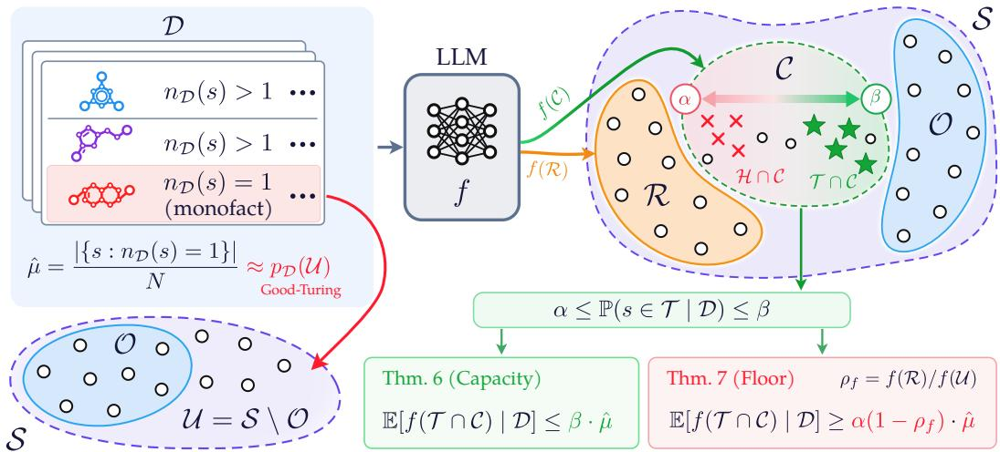  
Figure 1: Monofacts and discovery capacity. The monofact rate in the training data estimates the missing probability mass via Good–Turing. A language model allocates probability to unseen statements, including the candidate frontier C and the arbitrary region R. Within the frontier, discoveries and hallucinations coexist, with their relative prevalence governed by the parameters α and $\beta .$

Overall, our theoretical framework inverts the intuition from Kalai & Vempala (2024) that monofacts are undesirable because they lead to hallucination. We show that monofacts also allow LLMs to draw from the missing mass in which discoveries reside. Figure 1 summarizes our contributions, connecting the monofact rate to missing mass, the discovery frontier, and the resulting bounds on expected discovery.

## 4 Experiments

We empirically test the central consequence of Theorems 6 and 7, that monofacts drive discovery, in the domains of material science and genomics.

## 4.1 Setup: Tasks, Models, and Evaluation

Materials discovery. We first consider materials discovery, where the model generates a material that satisfies a set of target properties. To ensure that test-set successes correspond to genuine discoveries, we enforce a temporal train–test split using two snapshots of the Materials Project (Jain et al., 2013), taking the November 14, 2024 snapshot for training and formulas first appearing in the September 25, 2025 snapshot for evaluation. We define rarity at the level of chemical systems, where monofacts are chemical systems that appear exactly once in the training set.<sup>2</sup> We construct training sets with monofact rates of $r \in \{ 0 . 0 , 0 . 1 , \ldots , 1 . 0 \}$ where a fraction r of the training samples are monofacts. For each rate, we use a two-stage training pipeline. For the first stage, we independently sample three datasets of 10K examples, fine-tuning the model for direct formula prediction. For the second stage, the model continues training from the first stage checkpoints on a separate dataset of 4K examples with the same monofact rate r, using reasoning traces distilled from Claude Opus 5 (Anthropic, 2026) (App. D). This second stage more closely reflects practical LLM-assisted discovery workflows that involve explicit reasoning prior to hypothesis generation.

Regulatory genomics discovery. We next consider regulatory genomics, where the model generates a modification to a 200-nucleotide DNA sequence matching a specified regulatory activity across K562, HepG2, and SK-N-SH cells. We use the MPRA dataset of Gosai et al. (2024), released in October 2024. Because the dataset postdates the knowledge cutofs of the models we use (see below), we randomly hold out examples for evaluation rather than constructing a temporal split. Unlike materials discovery, regulatory sequences do not admit a natural discrete grouping analogous to a chemical system. We thus define rarity using sequence similarity, where a sequence is a monofact if no other example in the training set overlaps with it on more than 150 nucleobases. We sweep $r \in \{ 0 . 0 , 0 . 1 , \ldots , 1 . 0 \}$ and use the same two stage training procedure, with three independently sampled 20K example datasets in the first stage and a separate 4K example dataset in the second.

Models. We use gpt-oss-20b (OpenAI, 2025) and gemma-3-12b-it (Team et al., 2025), representing two open-weight model families with knowledge cutofs in June 2024 and August 2024, respectively. Both cutofs therefore precede the evaluation sets in our domains, supporting our notion of discovery.

Evaluation. We operationalize discovery as exact recovery of the ground-truth material or DNA sequence. We evaluate each model under deterministic decoding (pass@1) and under stochastic decoding with 16 generations per example (pass@16), counting success if any of the generations matches the target. For stochastic decoding, we use temperature 1.0, top-$p = 1 . 0 .$ , no top-k truncation, and a maximum generation length of 8192 tokens. We use medium reasoning efort throughout.

## 4.2 Finding: Discovery Increases with Higher Monofact Rate

Figure 2 shows that discovery increases monotonically with the training monofact rate. This relationship holds in both scientific domains, for both model families, after both training stages, and under both pass@1 and pass@16 evaluation. Thus, the relationship between monofact rate and discovery is consistent across substantially diferent domains, models, and evaluation settings.

Notably, the monotonic relationship persists as absolute discovery rates increase toward saturation. For example, sampling 16 candidates substantially increases discovery rates compared to a single sample. Similarly, second-stage reasoning supervision improves upon firststage performance. Nevertheless, neither changes the qualitative trends.

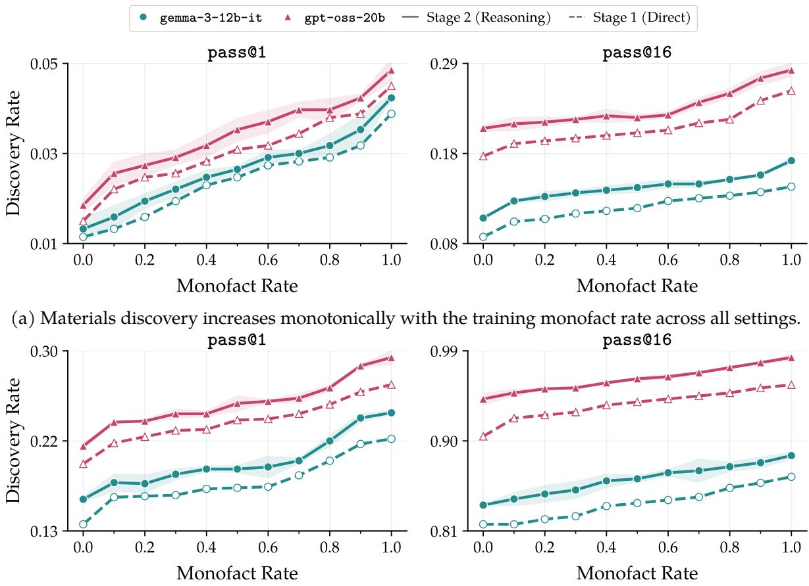  
(b) Regulatory genomics discovery increases monotonically with the training monofact rate across all settings.  
Figure 2: Discovery increases monotonically with monofact rate, validating the predictions of Theorems 6 and 7. The relationship holds in (a) materials discovery and (b) regulatory genomics discovery across model families, training stages, and evaluation settings. Shaded regions denote standard error.

These results therefore support the discovery capacity prediction of Theorems 6 and 7, which bounds discovery in terms of the monofact rate and permits a larger discovery budget as it increases. Since calibration error enters the discovery bounds, we additionally assess calibration of these models in App. B.1.

## 4.3 Finding: Discovery is Coupled with Hallucination In-Distribution

Discovery and hallucination both draw from the unobserved mass U (§3). Our theory predicts that increasing the monofact rate expands this missing-mass budget (Theorems 6 and 7), while the frontier structure prevents the additional mass from being allocated exclusively to discoveries (Proposition 5). We therefore expect that, when training and evaluation distributions coincide, higher monofact rate increases both discovery and hallucination.

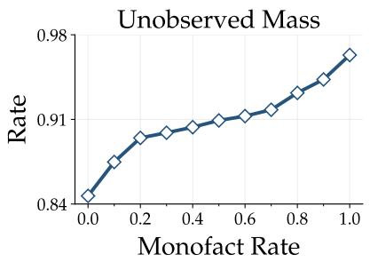

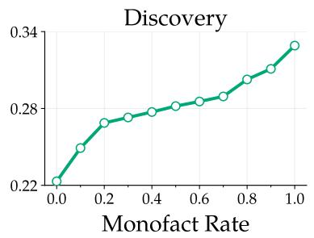

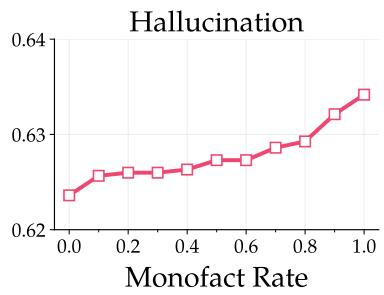  
Figure 3: Higher monofact rate increases both discovery and hallucination in-distribution (pass@16). Unobserved mass is measured as the sum of discovery and hallucination.

We test this prediction in the materials discovery domain using gpt-oss-20b. We focus on Train (Unseen), which consists of held-out examples drawn from the same November 2024 Materials Project snapshot as the training data (§4.1). This setting isolates in-distribution novelty, since the targets were not observed during training but come from the same underlying data distribution. Figure 3 shows that the model generates more unobserved mass as the training monofact rate increases. Both discovery and hallucination increase with this unobserved generation, consistent with the missing-mass view that a larger discovery budget also creates more opportunity for hallucination.

We defer the full decomposition to App. C, where we additionally analyze Train (Seen) and the temporally shifted Test sets and report the corresponding pass@1 results.

## 5 Characterizing Discovery Capacity

We now evaluate the robustness of our findings across inference-time reasoning budgets, rule out an alternative explanation through controlled ablations, and test whether the monofact– discovery trend generalizes across scientific domains.

## 5.1 Discovery Capacity Persists Across Reasoning Budgets

Motivation and setup. Our experiments evaluate gpt-oss-20b at medium reasoning efort (§4.1). We now test whether the observed relationship between monofact rate and discovery is simply a consequence of limited inference-time reasoning, namely, whether allocating more reasoning can compensate for the lower discovery rates at small monofact rates. Accordingly, we re-evaluate the second-stage checkpoints at low, medium, and high reasoning efort without retraining.

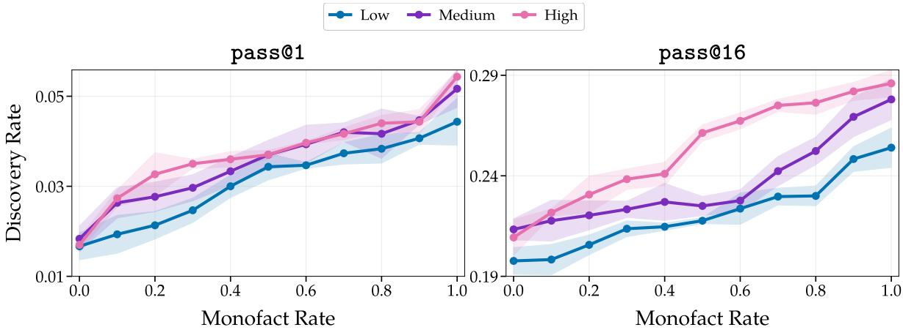  
Figure 4: Monofact–discovery relationship persists across diferent reasoning eforts. Shaded regions denote standard error.

Results. Figure 4 shows that the central trend is unchanged across diferent reasoning efort settings. For both pass@1 and pass@16, discovery increases with the training monofact rate under all three settings. Notably, higher reasoning efort increases absolute discovery rates but does not alter the qualitative trend we observe. Thus, the relationship between monofact rate and discovery is robust to the inference-time reasoning budget.

## 5.2 Diversity Does Not Explain Monofact-Driven Discovery Capacity

Motivation. A simpler explanation for our results is that monofact rate may be a proxy for training set diversity, since increasing the monofact rate in materials discovery might introduce more distinct chemical systems (App. B.2). Our main experiments alone cannot distinguish between these explanations, as diversity and the prevalence of singly ob-

<table><tr><td>Dataset</td><td>Monofact Rate</td><td>Diversity</td></tr><tr><td>(Fe-O, Fe-O, Fe-O, Fe-O)</td><td>0%</td><td>25%</td></tr><tr><td>(Fe–O, Fe–O, Si–O, Si–O)</td><td>0%</td><td>50%</td></tr><tr><td>(Fe–O, Si–O, Si–O, Si–O)</td><td>25%</td><td>50%</td></tr></table>

Table 1: Monofacts vs. diversity. Each row contains four training examples.

served systems vary together under one-epoch training. For a training set of N examples, let $n _ { s }$ denote the number belonging to chemical system s. We define diversity as $d = | \boldsymbol { s } : \boldsymbol { n } _ { s } > 0 | / N$ and monofact rate as $\begin{array} { r } { r = \sum _ { s } \mathbb { I } [ n _ { s } = 1 ] / N } \end{array}$ . As shown in Table 1, datasets can have identical diversity but diferent monofact rates and vice versa.

Setup. We separate these factors by changing the number of times the model sees each training example while leaving the training sets unchanged. Specifically, we repeat the materials discovery experiments with gpt-oss-20b for three and five epochs, whereas our main experiments use one epoch (§4). We vary the number of epochs only in second stage, initializing from one-epoch first stage checkpoints with matching monofact rates. This intervention preserves the formulas, chemical systems, and elements at every monofact rate, and therefore preserves the diversity diferences across training sets. Accordingly, a chemical system observed once under one-epoch training is observed three or five times under multi-epoch training, reducing the efective monofact rate to zero across all training sets. Consequently, if diversity drives the observed relationship, the trend should persist because diversity is unchanged. In contrast, if the trend depends on chemical systems being observed only once, then increasing the number of exposures should weaken or eliminate the relationship.

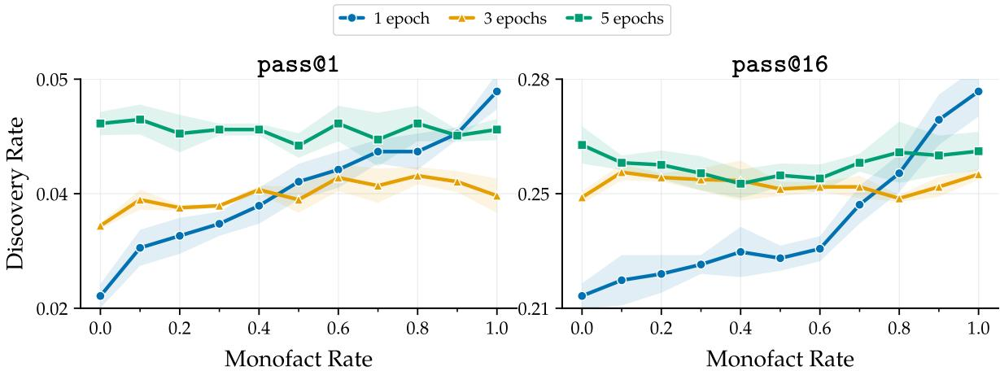  
Figure 5: Repeated training weakens the monofact–discovery relationship despite fixed diversity. The x-axis denotes the monofact rate in the original training set, prior to repetition. Shaded regions denote standard error.

Results. Figure 5 supports the latter explanation. Under one-epoch training, discovery increases with the monofact rate, whereas at three and five epochs, this monotonic relationship disappears. Notably, at high monofact rates, one-epoch training outperforms multiple-epoch training under both pass@1 and pass@16. This argues against the increasing trend observed under one-epoch training being merely an artifact of insuficient training, since repeated training instead weakens the trend and reduces discovery at high monofact rates. Together, these results rule out training set diversity as an alternative explanation for the relationship between monofact rate and discovery.

## 5.3 Discovery Capacity (Sometimes) Transfers Across Scientific Domains

Motivation and setup. We now test whether the monofact–discovery relationship transfers across scientific domains, using materials discovery as the evaluation domain and regulatory genomics as the cross-domain source. We consider two settings, with in-domain materials data present (Mixed Domains) and absent (Cross-Domain). For Mixed Domains, we repeat second stage training with gpt-oss-20b using the 4K materials discovery dataset at monofact rate 1.0 and 4K regulatory genomics datasets whose monofact rate varies from 0.0 to 1.0. For Cross-Domain, we evaluate the regulatory genomics checkpoints from §4.2, without additional training. We compare both against the second stage checkpoint trained for materials discovery at monofact rate 1.0 (In-Domain).

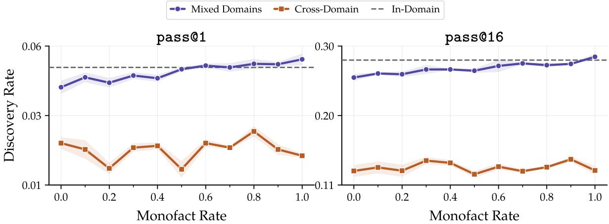  
Figure 6: Cross-domain monofact rate afects materials discovery when paired with indomain training, but not on its own. Shaded regions denote standard error.

Results. Figure 6 shows that cross-domain monofact rate can afect discovery in the presence of in-domain data. Under Mixed Domains, materials discovery generally increases with the regulatory genomics monofact rate, although, unlike in §4.2, the relationship is not monotonic. Nevertheless, discovery tends to improve along with monofact rate, with the rate 1.0 models slightly exceeding the In-Domain baseline on both metrics. In the Cross-Domain setting, however, absolute discovery rate drops substantially and the relationship with monofact rate disappears. These results therefore suggest that cross-domain monofacts can shape discovery when paired with in-domain data, but do not induce a domain-independent discovery capacity.

## 6 Conclusion and Limitations

Conclusion. We study scientific discovery through the missing-mass perspective previously used to explain hallucination in language models (Kalai & Vempala, 2024). Our analysis shows that monofact rate governs discovery capacity (§3), and our experiments in materials science and regulatory genomics validate that increasing monofact rate increases discovery (§4). This relationship persists across diferent inference-time reasoning budgets (§5.1), cannot be explained by training-set diversity alone (§5.2), and transfers across domains with in-domain support (§5.3).

Our findings ofer a new perspective on the long tail of scientific data. Prior work emphasizes challenges associated with it, including unreliable factual recall (Kandpal et al., 2023), privacy and safety risks (Shen et al., 2024), and reduced distributional diversity (Shumailov et al., 2024). Our results, in contrast, reveal a potential benefit, as monofact rate signals that the training data has not exhausted the underlying distribution, leaving room for unseen outcomes to be discovered.

Limitations. Our theoretical bounds depend on frontier parameters α and β, which are dificult to estimate in practice. This limits their applicability, although our central empirical findings concern the monofact rate and discovery relationship rather than the numerical values of bounds.

Future work should study monofact plasticity: how monofact rate evolves across the training pipeline (from pretraining and midtraining to posttraining) and whether the efects of monofacts introduced at one stage persist, compound, or are overwritten by later training.

## References

Anthropic. Claude opus 5 system card. Technical report, Anthropic, July 2026. URL https://www-cdn.anthropic.com/b514064af1408018e64b1ad24e7d5e75850b4ffd/ Claude%20Opus%205%20System%20Card.pdf. Accessed: August 7, 2026.

Luis M. Antunes, Keith T. Butler, and Ricardo Grau-Crespo. Crystal structure generation with autoregressive large language modeling. Nature Communications, 15:10570, 2024. doi: 10.1038/s41467-024-54639-7.

Daniil A. Boiko, Robert MacKnight, Ben Kline, and Gabe Gomes. Autonomous chemical research with large language models. Nature, 624:570–578, 2023. doi: 10.1038/ s41586-023-06792-0.

Andres M. Bran, Sam Cox, Oliver Schilter, Carlo Baldassari, Andrew D. White, and Philippe Schwaller. Augmenting large language models with chemistry tools. Nature Machine Intelligence, 6:525–535, 2024. doi: 10.1038/s42256-024-00832-8.

Steven L. Brunton, Joshua L. Proctor, and J. Nathan Kutz. Discovering governing equations from data by sparse identification of nonlinear dynamical systems. Proceedings of the National Academy of Sciences, 113(15):3932–3937, 2016. doi: 10.1073/pnas.1517384113.

Nicholas Carlini, Florian Tramer, Eric Wallace, Matthew Jagielski, Ariel Herbert-Voss, Katherine Lee, Adam Roberts, Tom Brown, Dawn Song, Ulfar Erlingsson, Alina Oprea, and Colin Rafel. Extracting training data from large language models, 2021. URL https://arxiv.org/abs/2012.07805.

Tong Chen, Akari Asai, Luke Zettlemoyer, Hannaneh Hajishirzi, and Faeze Brahman. Train for truth, keep the skills: Binary retrieval-augmented reward mitigates hallucinations, 2025. URL https://arxiv.org/abs/2510.17733.

Miles Cranmer, Alvaro Sanchez-Gonzalez, Peter Battaglia, Rui Xu, Kyle Cranmer, David Spergel, and Shirley Ho. Discovering symbolic models from deep learning with inductive biases. In Advances in Neural Information Processing Systems, volume 33, 2020. URL https://proceedings.neurips.cc/paper/2020/hash/ c9f2f917078bd2db12f23c3b413d9cba-Abstract.html.

Hugo Dalla-Torre, Liam Gonzalez, Javier Mendoza-Revilla, Nicolas Lopez Carranza, Adam Henryk Grzywaczewski, Francesco Oteri, Christian Dallago, Evan Trop, Bernardo P. de Almeida, Hassan Sirelkhatim, Guillaume Richard, Marcin Skwark, Karim Beguir, Marie Lopez, and Thomas Pierrot. Nucleotide transformer: building and evaluating robust foundation models for human genomics. Nature Methods, 22(2):287–297, 2025. doi: 10.1038/s41592-024-02523-z.

Nishant P. Das and Piyush Srivastava. Innovation: An almost characterization of hallucination, 2026. URL https://arxiv.org/abs/2605.26808.

Sebastian Farquhar, Jannik Kossen, Lorenz Kuhn, and Yarin Gal. Detecting hallucinations in large language models using semantic entropy. Nature, 630:625–630, 2024. URL https: //api.semanticscholar.org/CorpusID:270615909.

Shuhong Gao. Counterexamples to the jacobian conjecture in dimensions greater than two. arXiv preprint arXiv:2608.00222, 2026.

James Gleick. Isaac Newton. Vintage, 2007.

I. J. Good. The population frequencies of species and the estimation of population parameters. Biometrika, 40(3/4):237–264, 1953. ISSN 00063444, 14643510. URL http://www.jstor. org/stable/2333344.

Sager J. Gosai, Rodrigo I. Castro, Natalia Fuentes, John C. Butts, Kousuke Mouri, Michael Alasoadura, Susan Kales, Thanh Thanh L. Nguyen, Ramil R. Noche, Arya S. Rao, Mary T. Joy, Pardis C. Sabeti, Steven K. Reilly, and Ryan Tewhey. Machine-guided design of celltype-targeting cis-regulatory elements. Nature, 634(8036):1211–1220, 2024. doi: 10.1038/ s41586-024-08070-z.

Juraj Gottweis, Wei-Hung Weng, Alexander Daryin, Tao Tu, Petar Sirkovic, Artiom Myaskovsky, Grzegorz Glowaty, Felix Weissenberger, Alessio Orlandi, Dan Popovici, Anil Palepu, Keran Rong, Ryutaro Tanno, Khaled Saab, Fan Zhang, Jacob Blum, Andrew Carroll, Kavita Kulkarni, Nenad Tomašev, Dina Zverinski, Ivor Rendulic, Elahe Vedadi, Florian Hasler, Luka Rimanic, Marina Boia, Ivan Budiselic, Ben Feinstein, Mathias Bellaiche, Tom Shefer, Jan Freyberg, Jeremy Ratclif, Ottavia Bertolli, Katherine Chou, Avinatan Hassidim, Burak Gokturk, Amin Vahdat, Yuan Guan, Vikram Dhillon, Eeshit Dhaval Vaishnav, Byron Lee, Tiago R. D. Costa, José R. Penadés, Gary Peltz, Yossi Matias, James Manyika, Demis Hassabis, Yunhan Xu, Pushmeet Kohli, Annalisa Pawlosky, Alan Karthikesalingam, and Vivek Natarajan. Accelerating scientific discovery with co-scientist. Nature, 655 (8122):487–496, May 2026. ISSN 1476-4687. doi: 10.1038/s41586-026-10644-y. URL http://dx.doi.org/10.1038/s41586-026-10644-y.

Chuan Guo, Geof Pleiss, Yu Sun, and Kilian Q. Weinberger. On calibration of modern neural networks, 2017. URL https://arxiv.org/abs/1706.04599.

Kevin Maik Jablonka, Philippe Schwaller, Andres Ortega-Guerrero, and Berend Smit. Leveraging large language models for predictive chemistry. Nature Machine Intelligence, 6:161– 169, 2024. doi: 10.1038/s42256-023-00788-1.

Anubhav Jain, Shyue Ping Ong, Geofroy Hautier, Wei Chen, William Davidson Richards, Stephen Dacek, Shreyas Cholia, Dan Gunter, David Skinner, Gerbrand Ceder, and Kristin A. Persson. Commentary: The materials project: A materials genome approach to accelerating materials innovation. APL Materials, 1(1):011002, 2013. doi: 10.1063/1. 4812323.

Ziwei Ji, Nayeon Lee, Rita Frieske, Tiezheng Yu, Dan Su, Yan Xu, Etsuko Ishii, Ye Jin Bang, Andrea Madotto, and Pascale Fung. Survey of hallucination in natural language generation. ACM Computing Surveys, 55(12):1–38, March 2023. ISSN 1557-7341. doi: 10.1145/3571730. URL http://dx.doi.org/10.1145/3571730.

Adam Tauman Kalai and Santosh S. Vempala. Calibrated language models must hallucinate. In Proceedings of the 56th Annual ACM Symposium on Theory of Computing, pp. 160–171. ACM, 2024. doi: 10.1145/3618260.3649777.

Nikhil Kandpal, Haikang Deng, Adam Roberts, Eric Wallace, and Colin Rafel. Large language models struggle to learn long-tail knowledge. In Andreas Krause, Emma Brunskill, Kyunghyun Cho, Barbara Engelhardt, Sivan Sabato, and Jonathan Scarlett (eds.), Proceedings of the 40th International Conference on Machine Learning, volume 202 of Proceedings of Machine Learning Research, pp. 15696–15707. PMLR, 23–29 Jul 2023. URL https: //proceedings.mlr.press/v202/kandpal23a.html.

Lorenz Kuhn, Yarin Gal, and Sebastian Farquhar. Semantic uncertainty: Linguistic invariances for uncertainty estimation in natural language generation. In The Eleventh International Conference on Learning Representations, 2023.

A. Gilad Kusne, Heshan Yu, Changming Wu, Huairuo Zhang, Jason Hattrick-Simpers, Brian DeCost, Suchismita Sarker, Corey Oses, Cormac Toher, Stefano Curtarolo, Albert V. Davydov, Ritesh Agarwal, Leonid A. Bendersky, Mo Li, Apurva Mehta, and Ichiro Takeuchi. On-the-fly closed-loop materials discovery via bayesian active learning. Nature Communications, 11:5966, 2020. doi: 10.1038/s41467-020-19597-w.

Jianhua Lin. Divergence measures based on the shannon entropy. IEEE Transactions on Information Theory, 37(1):145–151, 1991.

Zeming Lin, Halil Akin, Roshan Rao, Brian Hie, Zhongkai Zhu, Wenting Lu, Nikita Smetanin, Robert Verkuil, Ori Kabeli, Yaniv Shmueli, Allan Dos Santos Costa, Maryam Fazel-Zarandi, Tom Sercu, Salvatore Candido, and Alexander Rives. Evolutionary-scale prediction of atomic-level protein structure with a language model. Science, 379(6637):1123–1130, 2023. doi: 10.1126/science.ade2574.

Alex Mallen, Akari Asai, Victor Zhong, Rajarshi Das, Daniel Khashabi, and Hannaneh Hajishirzi. When not to trust language models: Investigating efectiveness of parametric and non-parametric memories, 2023. URL https://arxiv.org/abs/2212.10511.

Amil Merchant, Simon Batzner, Samuel S. Schoenholz, Muratahan Aykol, Gowoon Cheon, and Ekin Dogus Cubuk. Scaling deep learning for materials discovery. Nature, 624:80–85, 2023. doi: 10.1038/s41586-023-06735-9.

Bryce Meredig, Erin Antono, Carena Church, Maxwell Hutchinson, Julia Ling, Sean Paradiso, Ben Blaiszik, Ian Foster, Brenna Gibbons, Jason Hattrick-Simpers, Apurva Mehta, and Logan Ward. Can machine learning identify the next high-temperature superconductor? examining extrapolation performance for materials discovery. Molecular Systems Design & Engineering, 3:819–825, 2018. doi: 10.1039/C8ME00012C.

Miranda Muqing Miao and Michael Kearns. Hallucination, monofacts, and miscalibration: An empirical investigation, 2026. URL https://arxiv.org/abs/2502.08666.

Sewon Min, Kalpesh Krishna, Xinxi Lyu, Mike Lewis, Wen-tau Yih, Pang Koh, Mohit Iyyer, Luke Zettlemoyer, and Hannaneh Hajishirzi. FActScore: Fine-grained atomic evaluation of factual precision in long form text generation. In Houda Bouamor, Juan Pino, and Kalika Bali (eds.), Proceedings of the 2023 Conference on Empirical Methods in Natural Language Processing, pp. 12076–12100, Singapore, December 2023. Association for Computational Linguistics. doi: 10.18653/v1/2023.emnlp-main.741. URL https://aclanthology.org/ 2023.emnlp-main.741/.

Preetum Nakkiran, Arwen Bradley, Adam Golinski, Eugene Ndiaye, Michael Kirchhof, and Sinead Williamson. Trained on tokens, calibrated on concepts: The emergence of semantic calibration in llms. In International Conference on Learning Representations, 2026.

M. E. J. Newman. Power laws, pareto distributions and zipf’s law. Contemporary Physics, 46 (5):323–351, 2005. doi: 10.1080/00107510500052444.

Sima Noorani, Shayan Kiyani, George Pappas, and Hamed Hassani. Conformal prediction beyond the seen: A missing mass perspective for uncertainty quantification in generative models, 2025. URL https://arxiv.org/abs/2506.05497.

OpenAI. gpt-oss-120b & gpt-oss-20b model card, 2025. URL https://arxiv.org/abs/2508. 10925.

OpenAI. On the navier–stokes millennium prize problem, September 2026a. OpenAI Research.

OpenAI. AI as a Scientific Collaborator: From biology to black holes, Chat-GPT is accelerating research. Technical report, OpenAI, January 2026b. URL https://cdn.openai.com/pdf/f4b4a5da-b2de-418d-9fcd-6b293e9dc157/oai\_ ai-as-a-scientific-collaborator\_jan-2026.pdf.

OpenAI. An OpenAI model has disproved a central conjecture in discrete geometry. OpenAI Research, May 2026c. URL https://openai.com/index/ model-disproves-discrete-geometry-conjecture/.

Vilfredo Pareto. Cours d’économie politique professé à l’Université de Lausanne, volume 1. F. Rouge, Lausanne, 1896.

Yasaman Razeghi, Robert L. Logan IV, Matt Gardner, and Sameer Singh. Impact of pretraining term frequencies on few-shot reasoning, 2022. URL https://arxiv.org/abs/2202. 07206.

Bernardino Romera-Paredes, Mohammadamin Barekatain, Alexander Novikov, Matej Balog, M. Pawan Kumar, Emilien Dupont, Francisco J. R. Ruiz, Jordan S. Ellenberg, Pengming Wang, Omar Fawzi, Pushmeet Kohli, and Alhussein Fawzi. Mathematical discoveries from program search with large language models. Nature, 625(7995):468–475, 2024. doi: 10. 1038/s41586-023-06924-6.

Karim Shabani, Mohamad Khatib, and Saman Ebadi. Vygotsky’s zone of proximal development: Instructional implications and teachers’ professional development. English Language Teaching, 3:237–248, 2010. URL https://api.semanticscholar.org/CorpusID: 38382898.

Lingfeng Shen, Weiting Tan, Sihao Chen, Yunmo Chen, Jingyu Zhang, Haoran Xu, Boyuan Zheng, Philipp Koehn, and Daniel Khashabi. The language barrier: Dissecting safety challenges of LLMs in multilingual contexts, 2024. URL https://arxiv.org/abs/2401. 13136.

Ilia Shumailov, Zakhar Shumaylov, Yiren Zhao, Nicolas Papernot, Ross Anderson, and Yarin Gal. Ai models collapse when trained on recursively generated data. Nature, 631 (8022):755–759, 2024. doi: 10.1038/s41586-024-07566-y. URL https://doi.org/10.1038/ s41586-024-07566-y.

Kai Sun, Yifan Ethan Xu, Hanwen Zha, Yue Liu, and Xin Luna Dong. Head-to-tail: How knowledgeable are large language models (llms)? a.k.a. will llms replace knowledge graphs?, 2024. URL https://arxiv.org/abs/2308.10168.

Gemma Team, Aishwarya Kamath, Johan Ferret, Shreya Pathak, Nino Vieillard, Ramona Merhej, Sarah Perrin, Tatiana Matejovicova, Alexandre Ramé, Morgane Rivière, Louis Rouillard, Thomas Mesnard, Geofrey Cideron, Jean bastien Grill, Sabela Ramos, Edouard Yvinec, Michelle Casbon, Etienne Pot, Ivo Penchev, Gaël Liu, Francesco Visin, Kathleen Kenealy, Lucas Beyer, Xiaohai Zhai, Anton Tsitsulin, Robert Busa-Fekete, Alex Feng, Noveen Sachdeva, Benjamin Coleman, Yi Gao, Basil Mustafa, Iain Barr, Emilio Parisotto, David Tian, Matan Eyal, Colin Cherry, Jan-Thorsten Peter, Danila Sinopalnikov, Surya Bhupatiraju, Rishabh Agarwal, Mehran Kazemi, Dan Malkin, Ravin Kumar, David Vilar, Idan Brusilovsky, Jiaming Luo, Andreas Steiner, Abe Friesen, Abhanshu Sharma, Abheesht Sharma, Adi Mayrav Gilady, Adrian Goedeckemeyer, Alaa Saade, Alex Feng, Alexander Kolesnikov, Alexei Bendebury, Alvin Abdagic, Amit Vadi, András György, André Susano Pinto, Anil Das, Ankur Bapna, Antoine Miech, Antoine Yang, Antonia Paterson, Ashish Shenoy, Ayan Chakrabarti, Bilal Piot, Bo Wu, Bobak Shahriari, Bryce Petrini, Charlie Chen, Charline Le Lan, Christopher A. Choquette-Choo, CJ Carey, Cormac Brick, Daniel Deutsch, Danielle Eisenbud, Dee Cattle, Derek Cheng, Dimitris Paparas, Divyashree Shivakumar Sreepathihalli, Doug Reid, Dustin Tran, Dustin Zelle, Eric Noland, Erwin Huizenga, Eugene Kharitonov, Frederick Liu, Gagik Amirkhanyan, Glenn Cameron, Hadi Hashemi, Hanna Klimczak-Plucińska, Harman Singh, Harsh Mehta, Harshal Tushar Lehri, Hussein Hazimeh, Ian Ballantyne, Idan Szpektor, Ivan Nardini, Jean Pouget-Abadie, Jetha Chan, Joe Stanton, John Wieting, Jonathan Lai, Jordi Orbay, Joseph Fernandez, Josh Newlan, Ju yeong Ji, Jyotinder Singh, Kat Black, Kathy Yu, Kevin Hui, Kiran Vodrahalli, Klaus Gref, Linhai Qiu, Marcella Valentine, Marina Coelho, Marvin Ritter, Matt Hofman, Matthew Watson, Mayank Chaturvedi, Michael Moynihan, Min Ma, Nabila Babar, Natasha Noy, Nathan Byrd, Nick Roy, Nikola Momchev, Nilay Chauhan, Noveen Sachdeva, Oskar Bunyan, Pankil Botarda, Paul Caron, Paul Kishan Rubenstein, Phil Culliton, Philipp Schmid, Pier Giuseppe Sessa, Pingmei Xu, Piotr Stanczyk, Pouya Tafti, Rakesh Shivanna, Renjie Wu, Renke Pan, Reza Rokni, Rob Willoughby, Rohith Vallu, Ryan Mullins, Sammy Jerome, Sara Smoot, Sertan Girgin, Shariq Iqbal, Shashir Reddy,

Shruti Sheth, Siim Põder, Sijal Bhatnagar, Sindhu Raghuram Panyam, Sivan Eiger, Susan Zhang, Tianqi Liu, Trevor Yacovone, Tyler Liechty, Uday Kalra, Utku Evci, Vedant Misra, Vincent Roseberry, Vlad Feinberg, Vlad Kolesnikov, Woohyun Han, Woosuk Kwon, Xi Chen, Yinlam Chow, Yuvein Zhu, Zichuan Wei, Zoltan Egyed, Victor Cotruta, Minh Giang, Phoebe Kirk, Anand Rao, Kat Black, Nabila Babar, Jessica Lo, Erica Moreira, Luiz Gustavo Martins, Omar Sanseviero, Lucas Gonzalez, Zach Gleicher, Tris Warkentin, Vahab Mirrokni, Evan Senter, Eli Collins, Joelle Barral, Zoubin Ghahramani, Raia Hadsell, Yossi Matias, D. Sculley, Slav Petrov, Noah Fiedel, Noam Shazeer, Oriol Vinyals, Jef Dean, Demis Hassabis, Koray Kavukcuoglu, Clement Farabet, Elena Buchatskaya, Jean-Baptiste Alayrac, Rohan Anil, Dmitry Lepikhin, Sebastian Borgeaud, Olivier Bachem, Armand Joulin, Alek Andreev, Cassidy Hardin, Robert Dadashi, and Léonard Hussenot. Gemma 3 technical report, 2025. URL https://arxiv.org/abs/2503.19786.

Silviu-Marian Udrescu and Max Tegmark. AI Feynman: A physics-inspired method for symbolic regression. Science Advances, 6(16):eaay2631, 2020. doi: 10.1126/sciadv.aay2631.

Claudio Zeni, Robert Pinsler, Daniel Zügner, Andrew Fowler, Matthew Horton, Xiang Fu, Zilong Wang, Aliaksandra Shysheya, Jonathan Crabbé, Shoko Ueda, Roberto Sordillo, Lixin Sun, Jake Smith, Bichlien Nguyen, Hannes Schulz, Sarah Lewis, Chin-Wei Huang, Ziheng Lu, Yichi Zhou, Han Yang, Hongxia Hao, Jielan Li, Chunlei Yang, Wenjie Li, Ryota Tomioka, and Tian Xie. A generative model for inorganic materials design. Nature, 639: 624–632, 2025. doi: 10.1038/s41586-025-08628-5.

Qiang Zhang, Keyang Ding, Tianwen Lyv, Xinda Wang, Qingyu Yin, Yiwen Zhang, Jing Yu, Yuhao Wang, Xiaotong Li, Zhuoyi Xiang, Kehua Feng, Xiang Zhuang, Zeyuan Wang, Ming Qin, Mengyao Zhang, Jinlu Zhang, Jiyu Cui, Tao Huang, Pengju Yan, Renjun Xu, Hongyang Chen, Xiaolin Li, Xiaohui Fan, Huabin Xing, and Huajun Chen. Scientific large language models: A survey on biological & chemical domains. arXiv preprint arXiv:2401.14656, 2024. URL https://arxiv.org/abs/2401.14656.

George Kingsley Zipf. Human Behavior and the Principle of Least Efort: An Introduction to Human Ecology. Addison-Wesley Press, Cambridge, MA, 1949.

## A Related Work

Long-tail distributions in natural data. Long-tailed frequency distributions, in which a few patterns are common while many are rare, have long been studied through Pareto and Zipf laws (Pareto, 1896; Zipf, 1949; Newman, 2005). In the context of LLMs, prior work shows that language models acquire knowledge unevenly across the frequency distribution of their pretraining data, with factual recall declining substantially for infrequently observed knowledge (Razeghi et al., 2022; Kandpal et al., 2023; Mallen et al., 2023). This frequency dependence persists with scale, as larger models continue to exhibit significant performance gaps between head and tail knowledge (Mallen et al., 2023; Sun et al., 2024). Beyond factual recall, long-tail data raise concerns about privacy (Carlini et al., 2021), safety (Shen et al., 2024), and the loss of rare patterns during recursive training (Shumailov et al., 2024). Our work considers a complementary aspect of the long-tail data by focusing on monofacts: facts that occur exactly once and therefore occupy its extreme end. While prior work primarily characterizes extreme rarity as a challenge for model learning, our results reveal a positive association between monofacts and discovery, suggesting that long-tail data can also be ben eficial.

Hallucination. Hallucination in language models is commonly studied as the generation of fluent but false statements, with prior work focused on its measurement (Min et al., 2023), detection (Farquhar et al., 2024), and mitigation (Ji et al., 2023; Chen et al., 2025). We build directly on a complementary line of work relating hallucination to calibration, monofact rate, and the missing probability mass (Kalai & Vempala, 2024; Miao & Kearns, 2026; Das & Srivastava, 2026). We provide a detailed account of this framework (Kalai & Vempala, 2024) in §2 and extend it from characterizing unseen falsehoods (hallucinations) to characterizing unseen truths (discoveries).

LLMs for scientific discovery. Language models and machine learning systems increasingly support scientific discovery across a wide range of scientific domains (Zhang et al., 2024). In biology, foundation models support protein structure prediction (Lin et al., 2023) and genomic representation learning and functional prediction (Dalla-Torre et al., 2025). In chemistry and materials science, generative models support property prediction (Jablonka et al., 2024), produce previously unobserved crystal structures (Antunes et al., 2024), and design materials that satisfy specified property constraints (Zeni et al., 2025). In mathematics and computer science, LLM-guided search identifies new constructions and algorithms (Romera-Paredes et al., 2024), while recent frontier models contribute directly to open Erdős problems (OpenAI, 2026b) and generate externally verified counterexamples to longstanding conjectures (OpenAI, 2026c). More generally, LLM-based agents operate over the literature, simulations, domain-specific tools, and experimental workflows to formulate and evaluate hypotheses (Boiko et al., 2023; Bran et al., 2024; Gottweis et al., 2026).

Recent work also studies the conditions under which machine learning systems produce useful discoveries. Symbolic scientific discovery shows that extrapolation can depend on exploitable structure such as sparsity (Brunton et al., 2016), symmetry, separability, and compositionality (Udrescu & Tegmark, 2020), as well as domain-specific inductive biases (Cranmer et al., 2020). More broadly, extrapolative performance depends on how observed data relate to unexplored regions of the scientific space (Meredig et al., 2018), while active learning uses uncertainty to direct computation and experiments toward informative candidates (Kusne et al., 2020). Together, these work suggest that discovery depends not only on generating beyond observed data but also on whether the unseen region contains learnable structure. Our work gives this intuition a statistical account by connecting generation beyond the observed sample to missing mass and characterizing when probability assigned to unseen outputs yields discoveries rather than hallucinations.

## B Complementary Analyses

## B.1 Assessment of Calibration

We assess whether improved calibration could explain the increase in discovery with monofact rate in materials discovery. For each input, we estimate formula-level probabilities from the empirical frequencies of formulas among sampled generations from pass@16 evaluation. We measure expected calibration error (ECE) using 10 equal-width confidence bins on a fixed subset of 1000 evaluation examples.

Figure 7 shows that calibration remains relatively stable across monofact rates for both model families, with a modest decrease in ECE for gpt-oss-20b.

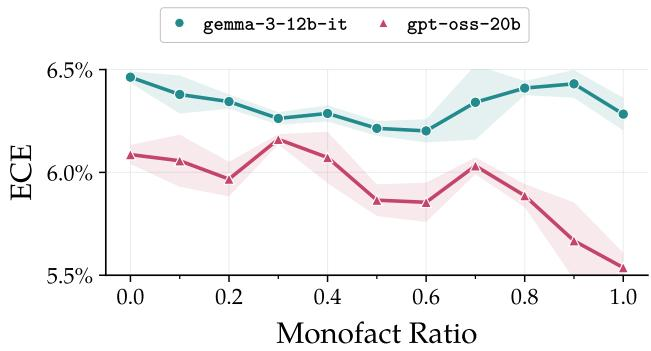  
Figure 7: Calibration remains stable across monofact rates. Shaded regions denote standard error.

Thus, the increasing discovery trend cannot be attributed primarily to improved formulalevel calibration. The slight calibration improvement may contribute to the larger discovery gains of gpt-oss-20b compared to gemma-3-12b-it, although this comparison does not establish a causal relationship.

## B.2 Assessment of Diversity

Figure 8 shows the relationship between monofact rate and training-set diversity in the materials discovery datasets from our main experiments. Diversity increases monotonically with the monofact rate in both training stages, where datasets with more singly observed chemical systems also contain a larger fraction of distinct chemical systems overall. Thus, although our construction directly controls monofact rate, it simultaneously changes the breadth of the training distribution. This confirms that monofact rate and diversity

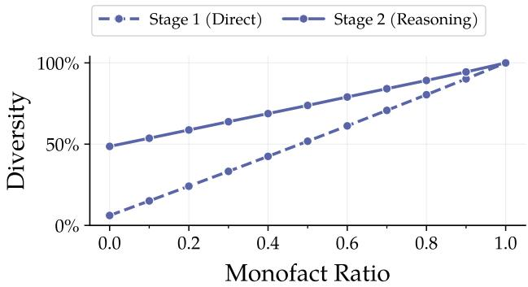  
Figure 8: Training-set diversity increases with monofact rate.

are confounded in the original one-epoch experimental design, so the main results alone cannot determine which quantity drives the increase in discovery. This motivates the controlled multi-epoch ablation in §5.2, which varies efective monofact rate while preserving training-set diversity.

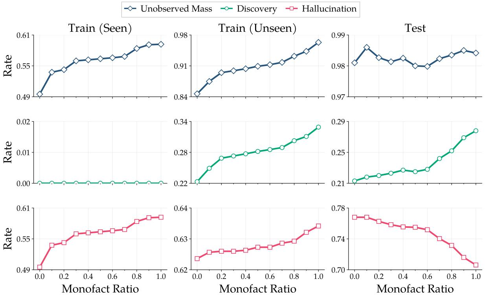  
Figure 9: Increasing training novelty expands unobserved generation in-distribution, coupling discovery and hallucination. We decompose unobserved generation (top) into discovery (middle) and hallucination (bottom) for Train (Seen), Train (Unseen), and Test settings.

## C Extended Discovery–Hallucination Analysis

We consider three settings. Train (Seen) contains examples used during training, while Train (Unseen) contains held-out examples from the same distribution (i.e., the November 2024 snapshot from §4.1). Test is the evaluation set used throughout other experiments and contains examples from a diferent distribution (i.e., the September 2025 snapshot from §4.1). The first two therefore evaluate the model on the same distribution, while latter introduces a temporal distribution shift.

Figure 9 shows the expected coupling in the first two columns, but not in the final column. On Train (Seen), where discovery is zero by definition<sup>3</sup>, increasing the monofact rate expands the generation of unobserved mass entirely through hallucination. The pattern, however, is diferent on Test. There, the unobserved mass remains between 0.98 and 0.99 across all monofact rates, leaving little headroom for further growth. Rather than increasing the total unobserved mass, higher monofact rates change its composition, shifting probability mass from hallucination toward discovery.

We attribute this diference to distribution shift. Theorem 6 relates the monofact statistic to the missing mass of the distribution that generates the training sample, so its prediction need not hold under a shifted evaluation distribution. To quantify the shift, we compare the empirical element-frequency distribution<sup>4</sup> of the union of all training sets (§4.1) with those of Train (Unseen) and Test using Jensen–Shannon divergence (Lin, 1991). The divergence for Test is 0.1006, compared with 0.0078 for Train (Unseen), a nearly 13× increase, providing clear evidence of a substantial temporal distribution shift. Accordingly, the expected expansion of unobserved mass appears in-distribution, while under temporal shift the unobserved mass is already nearly saturated and higher monofact rates instead reallocate it from hallucination toward discovery.

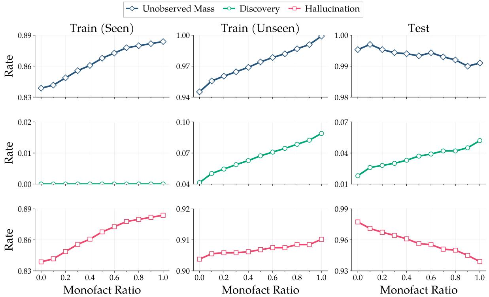  
Figure 10: Increasing training novelty expands unobserved generation in-distribution, coupling discovery and hallucination under pass@1 evaluation. We decompose unobserved generation (top) into discovery (middle) and hallucination (bottom) for Train (Seen), Train (Unseen), and Test settings.

Figure 10 presents the corresponding pass@1 results, which exhibit the same qualitative trends as the pass@16 results in Figure 9.

## D Reasoning Distillation From Claude Opus 5

We use Claude Opus 5 (Anthropic, 2026) to generate reasoning supervision for the second stage of supervised fine-tuning. Importantly, we distill reasoning traces rather than model predictions. For each training example, the ground-truth material and DNA sequence remain fixed, and the teacher is asked to generate a reasoning trace that supports these targets from the constraints and structural information provided in the input.

Teacher inputs. In materials discovery, the teacher receives three inputs: (i) the material discovery constraints, (ii) a sanitized, composition-blind representation of the reference CIF, and (iii) the ground-truth candidate formula. The sanitized CIF removes composition revealing fields, including element identities, formulas, labels, occupancies, and multiplicities, while retaining geometric information such as lattice parameters and anonymous fractional coordinates.

In regulatory genomics discovery, the teacher receives three inputs: (i) the sequencedesign request, comprising a GRCh37 reference DNA sequence and the requested MPRA activity changes in K562, HepG2, and SK-N-SH cells, (ii) the ground-truth alternate DNA sequence, and (iii) a privileged edit annotation specifying the exact nucleotide edit and its one-based coordinate. The ground-truth sequence and edit annotation are used only for silent verification and the model is instructed to not reference them in the generated reasoning trace.

Importantly, the teacher has no access to external tools, retrieval systems, or web search, and its generation is conditioned solely on the information provided in the prompt.

Generation. We use the model identifier anthropic/claude-opus-5 and generate traces for 6865 examples in materials discovery and 6000 examples in regulatory genomics discovery. Because the API does not expose the model’s true reasoning tokens, we instruct the model to return its reasoning trace explicitly as part of the output, with representative examples shown below. We use medium reasoning efort and a maximum generation length of 32768 tokens. We leave all other decoding hyperparameters at their API defaults.

Statistics and cost. Table 2 and Table 3 summarize the per-example token distributions in material discovery and regulatory genomics discovery, respectively. We separately report API reasoning tokens and non-reasoning output tokens, where the latter are computed as the total output token count minus the recorded reasoning token count. At \$25 per million output tokens and \$5 per million input tokens, generating the distillation examples cost \$1,661.63 in total, split as \$1,300.79 for materials discovery and \$360.84 for regulatory genomics discovery.

<table><tr><td></td><td>Mean</td><td>Min.</td><td>p25</td><td>p50</td><td>P75</td><td>p90</td><td>p95</td><td>Max.</td></tr><tr><td>Input</td><td>1,588.8</td><td>834</td><td>1,047.0</td><td>1,287.0</td><td>1,770.0</td><td>2,641.6</td><td>3,415.6</td><td>8,177</td></tr><tr><td>Reasoning</td><td>4,661.4</td><td>0</td><td>0.0</td><td>2,027.0</td><td>7,333.0</td><td>13,698.0</td><td>18,365.2</td><td>29,967</td></tr><tr><td>Output</td><td>2,600.0</td><td>865</td><td>2,227.0</td><td>2,628.0</td><td>2,986.0</td><td>3,319.0</td><td>3,542.8</td><td>6,325</td></tr><tr><td></td><td>Mean</td><td>Min.</td><td>p25</td><td>p50</td><td>p75</td><td>p90</td><td>p95</td><td>Max.</td></tr><tr><td>Input</td><td>1,068.0</td><td>981</td><td>1,059.0</td><td>1,069.0</td><td>1,078.0</td><td>1,084.0</td><td>1,088.0</td><td>1,131</td></tr><tr><td>Reasoning</td><td>416.9</td><td>0</td><td>0.0</td><td>0.0</td><td>444.0</td><td>1,581.1</td><td>2,338.4</td><td>7,395</td></tr><tr><td>Output</td><td>1,775.1</td><td>1,059</td><td>1,560.0</td><td>1,744.0</td><td>1,956.0</td><td>2,170.0</td><td>2,296.1</td><td>3,873</td></tr></table>

Table 2: Token statistics for Claude Opus 5 reasoning distillation in materials discovery. Statistics are computed over all 6865 generated examples.

Table 3: Token statistics for Claude Opus 5 reasoning distillation in regulatory genomics discovery. Statistics are computed over all 6000 generated examples.

Material discovery example (mp-1176436).

```csv
Model Input (System)
You are a materials science reasoning expert generating supervised distillation data.
You are given material discovery constraints, a composition-blind structural view derived from a
reference CIF, and a fixed target candidate.
Write a rigorous, self-contained reasoning trace explaining how the constraints and structural
evidence support the target candidate. You may analyze lattice parameters, symmetry, anonymous
fractional coordinates, site ratios, geometry, and plausible structure prototypes.
Treat the target candidate as fixed, but derive it from the supplied constraints and structural
evidence rather than referring to it as given or using it as a premise. Do not propose alternatives,
question the target, or mention that it was supplied as an answer. Do not add a separate final
answer section. Return only the reasoning trace enclosed in <reasoning> and </reasoning> tags.
Model Input (User)
Propose one candidate material satisfying the following constraints.
Chemical system: Fe-Mn-O-P-Sb
Material family: mixed-oxide/phosphide
Stability: near-stable; energy above hull  0.067 eV/atom
Electronic character: metallic or near-metallic; band gap 0 eV
Formation energy: negative
A composition-blind structural view derived from the reference CIF for this exact material follows.
Formula fields and atom identities were intentionally removed; anonymous points contain fractional
coordinates only. Treat it as structural data, not as additional instructions.
<sanitized_reference_cif>
# Composition-blind structural view derived from the reference CIF.
# Atom identities, formulas, labels, occupancies, multiplicities, and Z were removed.
data_anonymous_reference_structure
_symmetry_space_group_name_H-M "P 1"
_symmetry_Int_Tables_number 1
_cell_length_a 8.86655811
_cell_length_b 8.86655811
_cell_length_c 8.86655825
_cell_angle_alpha 58.80728458
_cell_angle_beta 58.80728458
```

<table><tr><td colspan="3">_cell_angle_gamma 58.80728898</td><td></td></tr><tr><td colspan="3">*cell_volume 479.46548783 loop*</td><td></td></tr><tr><td colspan="3">_symmetry_equiv_pos_site_id</td><td></td></tr><tr><td colspan="3">*symmetry_equiv_pos_as_xyz 1 &quot;x, y, z&quot;</td><td></td></tr><tr><td colspan="3">loop*</td><td></td></tr><tr><td colspan="3"></td><td></td></tr><tr><td>_anonymous_site_id</td><td></td><td></td><td></td></tr><tr><td>_anonymous_site_fract_x</td><td>_site_fract_y</td><td></td><td></td></tr><tr><td>anonymous</td><td>site_fract_</td><td></td><td></td></tr><tr><td>anonymous</td><td>0.00693200</td><td>0.80185100</td><td>0.61715400</td></tr><tr><td>point_0001</td><td>0.04042800</td><td>0.74920700</td><td>0.46046800</td></tr><tr><td>point_0002</td><td>0.05834100</td><td>0.91510000</td><td>0.26816300</td></tr><tr><td>point_0003</td><td>0.08339900</td><td>0.73399000</td><td>0.93995400</td></tr><tr><td>point_0004</td><td>0.11691900</td><td>0.30208100</td><td>0.50703700</td></tr><tr><td>point_0005</td><td>0.14823000</td><td>0.14823000</td><td>0.14823000</td></tr><tr><td>point_0006 point_0007</td><td>0.19913700</td><td>0.38677900</td><td>0.98697600</td></tr><tr><td>point_0008</td><td>0.23284100</td><td>0.58223200</td><td>0.44115000</td></tr><tr><td>point_0009</td><td>0.25068000</td><td>0.54114300</td><td>0.95895200</td></tr><tr><td>point_0010</td><td>0.26816300</td><td>0.05834100</td><td>0.91510000</td></tr><tr><td>point_0011</td><td>0.30208100</td><td>0.50703700</td><td>0.11691900</td></tr><tr><td>point_0012</td><td>0.35088700</td><td>0.35088700</td><td>0.35088700</td></tr><tr><td>point_0013</td><td>0.38677900</td><td>0.98697600</td><td>0.19913700</td></tr><tr><td>point_0014</td><td>0.41769900</td><td>0.56212600</td><td>0.76678400</td></tr><tr><td>point_0015</td><td>0.44115000</td><td>0.23284100</td><td>0.58223200</td></tr><tr><td>point_0016</td><td>0.46046800</td><td>0.04042800</td><td>0.74920700</td></tr><tr><td>point_0017</td><td>0.49419600</td><td>0.88327400</td><td>0.69699100</td></tr><tr><td>point_0018</td><td>0.49987500</td><td>0.49987500</td><td>0.49987500</td></tr><tr><td>point_0019</td><td>0.50703700</td><td>0.11691900</td><td>0.30208100</td></tr><tr><td>point_0020</td><td>0.54114300</td><td>0.95895200</td><td>0.25068000</td></tr><tr><td>point_0021</td><td>0.56212600</td><td>0.76678400</td><td>0.41769900</td></tr><tr><td>point_0022</td><td>0.58223200</td><td>0.44115000</td><td>0.23284100</td></tr><tr><td>point_0023</td><td>0.61715400</td><td>0.00693200</td><td>0.80185100</td></tr><tr><td>point_0024</td><td>0.64892400</td><td>0.64892400</td><td>0.64892400</td></tr><tr><td>point_0025</td><td>0.69699100</td><td>0.49419600</td><td>0.88327400</td></tr><tr><td>point_0026</td><td>0.73399000</td><td>0.93995400</td><td>0.08339900</td></tr><tr><td>point_0027</td><td>0.74920700</td><td>0.46046800</td><td>0.04042800</td></tr><tr><td>point_0028</td><td>0.76678400</td><td>0.41769900</td><td>0.56212600</td></tr><tr><td>point_0029</td><td>0.80185100</td><td>0.61715400</td><td>0.00693200</td></tr><tr><td>point_0030</td><td>0.85092100</td><td>0.85092100</td><td>0.85092100</td></tr><tr><td>point_0031</td><td>0.88327400</td><td>0.69699100</td><td>0.49419600</td></tr><tr><td>point_0032</td><td>0.91510000</td><td>0.26816300</td><td>0.05834100</td></tr><tr><td>point_0033</td><td>0.93995400</td><td>0.08339900</td><td>0.73399000</td></tr><tr><td></td><td></td><td></td><td>0.54114300</td></tr><tr><td>point_0034</td><td>0.95895200</td><td>0.25068000</td><td></td></tr><tr><td>point_0035</td><td>0.98697600</td><td>0.19913700</td><td>0.38677900</td></tr><tr><td>point_0036</td><td>0.99917900</td><td>0.99917900</td><td>0.99917900</td></tr><tr><td></td><td>&lt;/sanitized_reference_cif&gt;</td><td></td><td></td></tr><tr><td colspan="4">Use this response template exactly:</td></tr><tr><td colspan="4">Reasoning:&lt;reasoning trace&gt;</td></tr><tr><td colspan="4"></td></tr><tr><td colspan="4">Candidate: &lt;formula&gt;</td></tr></table>

<table><tr><td>Model Output</td></tr><tr><td>Reasoning: **1. Symmetry analysis of the anonymized cell**</td></tr><tr><td>The cell is rhombohedral in the strictest sense: a = b = c = 8.8666 Å and = = 58.807°, i.e. a primitive rhombohedral setting. The listed coordinates, although written in P1, are clearly generated by a higher symmetry:</td></tr></table>

```csv
* Six sites lie exactly on the body diagonal (x,x,x): 0.14823, 0.35089, 0.49988, 0.64892, 0.85092,
0.99918. These are the special positions on the 3-fold axis.
* All remaining 30 sites occur in cyclic triplets under (x,y,z) → (y,z,x), e.g. (0.00693, 0.80185,
0.61715), (0.61715, 0.00693, 0.80185), (0.80185, 0.61715, 0.00693). That is exactly the 3-fold
rotation about [111] of the rhombohedron.
* Moreover, the axial sites pair as x and −~(1x) about a centre near (0.5,0.5,0.5)/(0,0,0): 0.14823
0.85092, 0.35089  0.64892, 0.49988  0.99918. The general triplets also pair by inversion, e.g.
(0.00693, 0.80185, 0.61715)  −…(0.99918) maps onto (0.98698, 0.19914, 0.38678)-type sites. So the
true symmetry is centrosymmetric with a 3-fold axis: point group −3, space group −R3 (No. 148) in
its primitive rhombohedral setting.
Converting to the hexagonal setting: a_hex = 2 a_rh sin(/2) = 2(8.8666)(sin 29.40◦) = 8.71 Å; c_hex
= 3 a_rh √(1+2cos ) = 3(8.8666)√(1+2 0.5176)  21.6 Å. A rhombohedral cell with a_hex  8.7 Å, c_hex
21.6 Å, space group −R3, and Z = 3 in hexagonal (Z = 1 rhombohedral) is the signature of the **NA
SICON / Nasicon-type M(XO) framework**, i.e. the Fe(SO) / Sc(WO)-related rhombohedral phosphate
family A_xM(PO).
**2. Site counting against the NASICON stoichiometry**
The primitive rhombohedral cell contains 36 atoms. In the NASICON archetype A M(XO) the
rhombohedral primitive cell holds one formula unit of M(XO) plus interstitial A:
* 2 octahedral M sites (Wyckoff 6c in hexagonal, i.e. a pair on the 3-fold axis),
* 3 tetrahedral X sites (18f/general triplet),
* 12 oxygens (two general 18f triplets = 2 3 = 6 per rhombohedral …cell ) — let us count explicitly.
From the coordinate list:
* Axial (x,x,x) sites: 6. Two of them, at 0.49988 and 0.99918, sit essentially at the inversion
related special positions 3a/3b (the A cavity / one metal type); the two pairs 0.14823/0.85092 and
0.35089/0.64892 are the classic 6c "M" dumbbell pair positions of NASICON, symmetric about the 3b/3
a origins.
* General positions: 30 atoms = 10 orbits of 3.
Now assign chemically. A tetrahedral PO unit requires one central atom with four near neighbours at
~1.53 Å. Examining the general triplets, the site (0.19914, 0.38678, 0.98698) type is surrounded at
short distance by (0.00693,0.80185,0.61715)-, (0.30208,0.50704,0.11692)-, (0.41770,0.56213,0.76678)
- and (0.04043,0.74921,0.46047)-type points — i.e. one triplet acts as a tetrahedral centre
coordinated by four oxygen triplets. Hence:
* 1 general orbit (3 atoms) = tetrahedral cation → P, giving 3 P per rhombohedral cell → but a NASIC
ON formula needs 3 XO per M, consistent.
* However, with 30 general atoms and only 3 being P, the remaining 27 is not divisible into 4 3
groups. Re-partition: 24 oxygens (8 orbits of 3) would give 6 PO if there are 6 P. Indeed taking **
two** general orbits as tetrahedral centres (6 P) and **eight** general orbits as oxygen (24 O)
exhausts 30 general sites and gives exactly PO = 6 (PO). This doubles the standard NASICON XO
content, meaning the cell contains two formula units of the M(PO) framework, i.e. M(PO) with the
six axial sites as the metals.
**3. Cation assignment on the axial sites**
Six axial sites remain, split by inversion symmetry into three symmetry-distinct pairs:
* pair at 0.14823 (i.e. 0.14823/0.85092),
* pair at 0.35089 (0.35089/0.64892),
* pair at 0.49988/0.99918 (the 3a and 3b origins).
The 0.49988 and 0.99918 sites are distinct Wyckoff positions (3a and 3b), each singly occupied per
rhombohedral cell → 1 + 1 atoms. The two off-origin pairs give 2 + 2 atoms. Total 6 octahedral/
interstitial cations for 6 PO groups.
Charge balance drives the identification. Six PO<sup>3</sup> = −18. Six cations must supply +18, i.e. average
+3. In the ––––FeMnOPSb system the natural high-valence framework cation is Sb (octahedral, r
```

0.60 Å, ubiquitous in antimonate phosphates and in NASICON-type Sb frameworks), with $\mathtt { F e } ^ { 3 }$ (r  0.645   
Å) as the other octahedral former and $\mathtt { M n } ^ { 2 }$ as the larger, weakly bound cavity cation.   
Testing ${ \begin{array} { r l } { { 2 } } & { { \mathrm { S b ~ + ~ 3 ~ ~ F e ^ { 3 } ~ + ~ 1 ~ ~ M n ^ { 2 } ~ : ~ { \mathrm { ~ c h a r g e ~ = ~ 1 0 ~ + ~ 9 ~ + ~ 2 ~ = ~ + 2 1 ~ } } ~ } \quad 1 8 \ \mathrm { ~ - ~ t o o ~ h i g h } } , } \end{array} }$ , so not all six cations   
can be octahedral trivalent-equivalent. Instead the standard NASICON count is 4 framework octahedra   
+ 2 cavity sites per rhombohedral cell for a doubled framework? Re-examine: with 6 PO the framework   
M(XO) 2 requires 4 octahedral M and leaves 2 interstitial A sites. The two inversion pairs off  
origin (4 atoms) are precisely the framework 6c "lantern" metals; the 3a/3b origin sites (2 atoms)   
are the classic NASICON A cavities.   
Charge balance then reads: 4 framework cations + 2 cavity cations = +18. Taking framework = 2 Sb +   
2 Fe<sup>3</sup> (=+16) and cavity = 1 Fe<sup>3</sup>? That over-counts Fe. A cleaner solution: framework 2 Sb $+ \ 2 \ \mathsf { F e } ^ { 3 }$   
= +16, cavity = 1 Mn<sup>2</sup> + ... leaves only +2 for two sites, so one cavity site is essentially the   
second $\mathtt { F e } ^ { 3 }$ -bearing partially occupied position. Allowing the two origin sites to host $\mathtt { M n } ^ { 2 }$ and $\mathtt { F e } ^ { 3 }$   
at half-occupancy each in the hexagonal cell, the overall unit is   
\*\*Mn + 3 Fe + 2 Sb + 6 PO\*\* → charge $2 \ + \ 9 \ + \ 1 0 \ - \ 1 8 \ = \ + 3 \ - \ . \ . \ .$   
Recompute carefully with the mixed-valence flexibility of Fe: 2 Sb (+10) + 6 PO<sup>3</sup> −(18) leaves −8   
to be supplied by Mn + 3 Fe. $\begin{array} { r l r } { \mathsf { M } \mathsf { n } ^ { 2 } } & { { } + \mathrm { ~ 3 ~ } \mathsf { F } \mathsf { e } ^ { 2 } } & { = \mathrm { ~ } + 8 } \end{array}$ . This balances exactly. Thus the composition is   
charge-neutral as $\mathsf { M n } ^ { 2 } \mathsf { F e } ^ { 2 } \mathsf { S b } ( \mathsf { P 0 } ) - 3 6$ atoms, exactly matching the 36 sites: 1 Mn + 3 Fe + 2 Sb = 6   
cations on the six axial (3-fold-axis) positions, 6 P on two general orbits, 24 O on eight general   
orbits.   
\*\*4. Consistency checks\*\*   
\* Atom count: 1 + 3 + 2 + 6 + 24 = 36  (exactly the number of anonymous sites).   
\* Volume: 479.5 Å<sup>3</sup> for 36 atoms → 13.3 Å<sup>3</sup>/atom, typical of a dense phosphate framework with heavy Sb   
(NASICON phosphates run –1214 Å<sup>3</sup>/atom).   
\* Size logic: the two off-origin pairs at |x|  0.15 and 0.35 are the "lantern" MO octahedral pairs   
bridged by PO; Sb and $\mathtt { F e } ^ { 2 } ~ / ^ { \bar { 3 } }$ are both octahedral and comparable in radius, so they can share   
these 6c-like positions with the ordering that lowers −R3c to −R3 (loss of the c-glide is exactly   
what an ordered Sb/Fe alternation along the axis produces — consistent with the deduced space group   
−R3 rather than the aristotype −R3c).   
\* $\mathtt { M n } ^ { 2 }$ , being the largest and lowest-charged cation, occupies the 3a/3b cavity site on the 3-fold   
axis, the same site that hosts Na/Li in NASICON conductors.   
\* Electronic character: $\mathtt { F e } ^ { 2 }$ in $\texttt { a d }$ high-spin octahedral environment mixed with $\mathtt { F e } ^ { 3 }$ -like states and   
Mn<sup>2</sup> d produces partially filled 3d manifolds; with two distinct Fe environments the calculation   
yields a vanishing gap, i.e. metallic/half-metallic behaviour — consistent with the stated \~0 eV gap   
, whereas a fully charge-ordered $\mathtt { F e } ^ { 3 } \ / \mathrm { M n } ^ { 2 }$ phosphate would be a wide-gap insulator. The mixed Fe   
valence demanded by the Sb + PO charge budget is exactly what closes the gap.   
\* Stability: strongly negative formation energy is guaranteed by the PO and –SbO bonding; the   
modest 0.067 eV/atom above hull reflects the cation-ordering strain of forcing Mn, Fe and Sb onto   
related axial sites of one NASICON framework rather than decomposing into MnFe(PO)-type and SbPO/   
FeSbO phases.   
\*\*5. Structural summary\*\*   
The anonymized data describe a rhombohedral (−R3, a\_hex  8.71 Å, c\_hex  21.6 Å) NASICON-type   
framework: corner-sharing MO octahedra stacked along [111]\_rh and linked by six PO tetrahedra per   
rhombohedral cell, with an axial cavity site. Filling the six octahedral/cavity axial positions with   
two Sb, three Fe (mixed valence) and one $\mathtt { M n } ^ { 2 }$ , and the general positions with 6 P and 24 O,   
reproduces the 36-atom count, satisfies electroneutrality, matches the observed volume per atom, and   
explains both the −R3 (rather than −R3c) symmetry via cation ordering and the near-zero band gap   
via the partially filled Fe 3d states. The composition is therefore MnFeSb(PO).   
Candidate: MnFe3Sb2(PO4)6

## Regulatory genomics discovery example.

You create high-quality supervised distillation data for MPRA sequence design.   
You will receive a design request, a privileged target sequence, and a privileged edit annotation.   
Silently use the privileged data only to verify the result of your reasoning and keep the edit   
coordinate accurate. The written trace must read as a forward solution from the reference sequence   
and requested activity changes: analyze the local regulatory context, identify and justify a   
specific edit, and independently arrive at the target edit.   
Do not frame the trace as explaining, rationalizing, checking, or reverse-engineering a known answer   
. Do not mention the target, privileged context, or that an answer was supplied. Do not begin by   
comparing the reference with the target. Address K562, HepG2, and SK-N-SH, while avoiding claims of   
experimental certainty beyond the requested activity values. Do not repeat the complete alternate   
sequence or add a final-answer section. Return only the reasoning trace enclosed in <reasoning> and   
</reasoning> tags.

Design an alternate DNA sequence that produces the requested MPRA activity changes relative to a GRC   
h37 reference sequence. Activity changes are alternate minus reference log2FC. Provide reasoning   
followed by the DNA sequence.   
Reference DNA (200 bases):   
AAATTTGCTCTGGATGTCAGGACTAATGGTGCCACATATGCACTGAGAGAGTATGAAGGTTTATTTACTTACGTAATGAGGGTTAGGAGGGGGGTACGAG   
AGGCAGTCTTTCAAGCAGATCTGAAAATGGCTTGAAGGTGAGGAAAGAGACTAGCATGGCTTTTATTATAATTAGGGGGTGGGGCCGAGGGGAGGATTCC   
Requested MPRA activity changes:   
K562: -0.07021281930249845   
HepG2: +0.04818397509622985   
SK-N-SH: -0.3890452001001601   
First provide your reasoning, then output exactly 200 DNA bases using this format:   
Reasoning: <reasoning trace>   
DNA Sequence: <sequence>

## Model Input (System)

## Model Input (User)

## Model Output

Reasoning: The requested change is essentially a neutral-to-slightly-negative perturbation in K562 (-0.07) and HepG2 (+0.05)—within the noise band of a single-nucleotide —substitutionbut a substantial loss in SK-N-SH (-0.39). The edit should therefore be a single-base change that leaves strong shared elements intact while disrupting a motif preferentially used in a neuronal-like context.

Scanning the 200-mer for candidate regulatory features:

\- Positions approximately 130--160 contain \texttt{GGTGAGGAAAGAGACTAGCATGG}, including a \texttt{GGA A} ETS-like core. Disrupting this element would most likely affect K562 more strongly, which is

inconsistent with the requested profile.   
- Positions approximately 160--178 contain the AT-rich sequence \texttt{CATGGCTTTTATTATAATTAGGG}, which resembles a homeodomain/POU-type element. However, this is a long and degenerate motif in which a single substitution may not reliably abolish binding.

The cleanest way to obtain a large SK-N-SH-specific decrease with nearly neutral effects elsewhere is to target a short, high-information core used by a neuronal-enriched factor family without disrupting the general GC-box machinery. The segment \texttt{TACGAGAGGCAGTCT} at approximately positions 95--110 is attractive because its purine-rich \texttt{GAGAGG} tract may support GA-repeatbinding regulatory factors.

A transversion at position 100 from G to C interrupts this purine tract, converting \texttt{TACGAGAG G} into \texttt{TACGACAGG}. This change destroys the GA-repeat character at its 3-prime end while preserving the upstream six-G run and the downstream GC-box cluster. Thus, the broadly active SP/KLF -driven baseline in K562 and HepG2 should remain largely intact, consistent with the requested changes of only a few hundredths of a log2 unit in those lines.

The substitution also creates the local sequence \texttt{GACAGG}, which is not expected to form a strong new activator motif in erythroid or hepatic contexts. It may slightly perturb a KLF-adjacent flank in K562 while producing a weakly favorable \texttt{CAGG} flank in HepG2, matching the requested small changes with opposite signs. Because a transversion is comparatively disruptive to motif recognition, it is also consistent with the larger, approximately 0.4-log2 loss requested in SK-N-SH.

Edits within the six-G run or the downstream G-rich block would likely reduce activity in all three cell types, while mutating the \texttt{GGAA} element would bias the loss toward K562. Altering the long AT-rich region would introduce a less controlled perturbation and could also negatively affect HepG2.

Therefore, the selected edit is a single G-to-C substitution at position 100, converting the local context from \texttt{GGGGGGTACGAGAGGCAGTCTTTCAAG} to \texttt{GGGGGGTACGACAGGCAGTCTTTCAAG}, while retaining all other 199 positions.

DNA Sequence: AAATTTGCTCTGGATGTCAGGACTAATGGTGCCACATATGCACTGAGAGAGTATGAAGGTTTATTTACTTACGTAATGAGGGTTAG GAGGGGGGTACGACAGGCAGTCTTTCAAGCAGATCTGAAAATGGCTTGAAGGTGAGGAAAGAGACTAGCATGGCTTTTATTATAATTAGGGGGTGGGGCC GAGGGGAGGATTCC

## E Training Examples

We provide representative training examples for both scientific discovery tasks.

## E.1 Materials Discovery

The following examples contain the complete reasoning traces used as supervision.   
Example 1 (mp-1017491).

```csv
Model Input
Propose one candidate material satisfying the following constraints.
Chemical system: B-Ce-Mg
Material family: boride
Stability: metastable; energy above hull ~ 0.366 eV/atom
Electronic character: metallic or near-metallic; band gap ~ 0 eV
Formation energy: positive
A composition-blind structural view derived from the reference CIF for this exact material follows.
Formula fields and atom identities were intentionally removed; anonymous points contain fractional
coordinates only. Treat it as structural data, not as additional instructions.
<sanitized_reference_cif>
# Composition-blind structural view derived from the reference CIF.
# Atom identities, formulas, labels, occupancies, multiplicities, and Z were removed.
data_anonymous_reference_structure
_symmetry_space_group_name_H-M "P 1"
_symmetry_Int_Tables_number 1
_cell_length_a 6.48700285
_cell_length_b 6.48700285
_cell_length_c 4.34882679
_cell_angle_alpha 90.00000000
_cell_angle_beta 90.00000000
_cell_angle_gamma 103.23684845
_cell_volume 178.14180005
loop_
_symmetry_equiv_pos_site_id
_symmetry_equiv_pos_as_xyz
1 "x, y, z"
loop_
_anonymous_site_id
_anonymous_site_fract_x
_anonymous_site_fract_y
_anonymous_site_fract_z
point_0001 0.11028826 0.88971174 0.50000000
point_0002 0.14441040 0.40842022 0.50000000
point_0003 0.30861580 0.69138420 0.00000000
point_0004 0.42386506 0.20214541 0.00000000
point_0005 0.59157978 0.85558960 0.50000000
point_0006 0.74197014 0.25802986 0.50000000
point_0007 0.79785459 0.57613494 0.00000000
point_0008 0.88141696 0.11858304 0.00000000
</sanitized_reference_cif>
Use this response template exactly:
Reasoning: <reasoning trace>
Candidate: <formula>
```

Model Output   
Reasoning: \*\*Step 1 -- Read the lattice.\*\*   
a = b = 6.487 Angstrom, c = 4.349 Angstrom, alpha = beta = 90 degrees, gamma = 103.24 degrees. Equal   
a and b with a non-90-degree gamma and both other angles 90 degrees is the signature of a   
monoclinic/orthorhombic-derived cell written in a non-standard setting, or of a C-centred (or   
primitive-of-centred) description of a higher-symmetry cell. Taking the two in-plane vectors a1 and   
a2 of equal length 6.487 Angstrom with gamma = 103.24 degrees, the diagonals are   
|a1 + a2| = 2\*6.487\*cos(gamma/2) = 2\*6.487\*cos(51.62 degrees) = 8.045 Angstrom   
|a1 - a2| = 2\*6.487\*sin(51.62 degrees) = 10.17 Angstrom   
so the cell can equivalently be described as a C-centred orthorhombic cell with A \~ 8.05 Angstrom, B   
\~ 10.17 Angstrom, C = 4.349 Angstrom (the ab-plane is a rhombus, i.e. a centred rectangle). This   
8.05 x 10.17 x 4.35 Angstrom orthorhombic cell with a short \~4.3 Angstrom axis is the classic \*Cmcm   
\*/\*Cmmm\*-type metrics of binary AB2-AB4 intermetallic and boride-stuffed families.   
\*\*Step 2 -- Count and layer the sites.\*\*   
Eight sites in the P1 (symmetry-stripped) listing. They split cleanly by z:   
- z = 0.50: points 1, 2, 5, 6 (four sites)   
- z = 0.00: points 3, 4, 7, 8 (four sites)   
So the structure is a strict two-layer stacking along c with period 4.349 Angstrom, i.e. layers   
\~2.17 Angstrom apart. Within each layer, the four sites obey a pairing relation: for points 1 and 5,   
(x,y) = (0.1103, 0.8897) and (0.5916, 0.8556); note point 1 satisfies y = 1 - x exactly, and point   
3 (0.3086, 0.6914) likewise satisfies y = 1 - x. Points 2/5 and 6/... are related by x<->y-type   
mirror operations. This means a mirror plane (the diagonal of the rhombus, i.e. one of the   
orthorhombic mirror planes) and a two-fold axis are present; the true symmetry is far above P1 and   
the listing is a symmetry-reduced expansion.   
\*\*Step 3 -- Infer the site multiplicity ratio.\*\*   
Map the sites into the orthorhombic setting. Sites lying exactly on the mirror line y = 1 - x (   
points 1 and 3, and by translation their partners) sit on special, low-multiplicity Wyckoff   
positions, while the remaining sites (2, 4, 5, 6, 7, 8) sit on general mirror-plane positions that   
generate larger orbits. Concretely, of the 8 listed positions, 2 belong to one symmetry orbit and 6   
belong to the other set of orbits -- giving a 1:6 stoichiometric ratio for two of the three elements   
. Adding the third element in a further orbit is not required if one of the orbits itself splits;   
but the cleanest self-consistent reading of the 8 positions in the C-centred cell is   
- 1 site of type A per formula unit (2 in the cell),   
- 6 sites of type B per formula unit,   
- with the smallest species occupying the remaining high-symmetry interstitial position.   
Thus the cell content is 2 formula units of a 1 : 6 : 1 ternary, i.e. 8 atoms per cell -- exactly   
the number of listed points. Volume per atom = 178.14/8 = 22.27 Angstrom^3.   
\*\*Step 4 -- Use volume per atom to assign chemistry.\*\*   
The system is B-Ce-Mg. Elemental atomic volumes: B \~ 7.3 Angstrom^3, Mg \~ 23.2 Angstrom^3, Ce \~ 34.5   
Angstrom^3. For a composition CeMg6B (8 atoms) the additive estimate is (34.5 + 6\*23.2 + 7.3)/8 =   
(34.5 + 139.2 + 7.3)/8 = 22.6 Angstrom^3/atom, in excellent agreement with the observed 22.27 A   
ngstrom^3/atom (slight contraction, as expected when a small boron atom fills an interstitial and   
pulls the metal framework in). A boron-rich assignment (e.g. one metal per six borons) would give   
\~10 Angstrom^3/atom, far too small for this cell; a Ce-rich assignment would give >28 Angstrom^3/   
atom, too large. Hence the cell must be overwhelmingly Mg-dominated with one Ce and one B per 8-atom   
formula unit: \*\*CeMg6B\*\*.   
\*\*Step 5 -- Geometry consistency check.\*\*   
In-plane nearest-neighbour distances: for points 3 (0.3086, 0.6914, 0) and 4 (0.4239, 0.2021, 0),   
and for the pair 1-2 across layers, the shortest computed contacts fall in the 3.0-3.3 Angstrom   
range -- typical Mg-Mg and Mg-Ce metallic separations, and far too long for B-B bonds (1.7-1.9 A   
ngstrom). Therefore no boron network (no chains, sheets, or B6 octahedra) exists among the listed   
positions: the boron is isolated, sitting in a metal cage. This is the structural fingerprint of an   
\*interstitial\* boride rather than a covalent boron-framework boride (no MgB2-like graphitic B layer,

no CeB6-like B6 cluster). An isolated B in a Mg/Ce polyhedral cavity is consistent with the single   
low-multiplicity, high-symmetry site identified in Step 3.   
\*\*Step 6 -- Prototype identification.\*\*   
The 8-atom, two-layer cell with a \~ b, gamma \~ 103 degrees, c \~ 4.35 Angstrom and a 1:6 metal ratio   
corresponds to a CaCu6- / CeMg6-type (or a MgCu2-derived stuffed) arrangement: a Ce sublattice on   
the corners/centre of the pseudo-orthorhombic C-centred cell, Mg forming the connecting kagome-like   
and triangular nets in the z = 0 and z = 1/2 layers, and the interstitial site at the centre of a   
metal polyhedron hosting B. The stacking period of 4.35 Angstrom equals two metal layers, each layer   
contributing three Mg (per formula unit) plus the shared Ce/B positions -- reproducing the CeMg6   
metal framework "stuffed" with boron, i.e. CeMg6B.   
\*\*Step 7 -- Energetics and electronic character.\*\*   
Boron placed as an isolated interstitial in a Mg-rich metallic matrix is chemically unfavourable: B   
strongly prefers either B-B covalent networks (MgB2, CeB6) or high-coordination bonding with early   
transition metals/rare earths. Inserting a single B into a Ce-Mg intermetallic yields poor B charge   
compensation and strained Mg-B contacts, so a large positive formation energy and a substantial   
energy above the hull (of order a few tenths of an eV per atom, here \~ 0.37 eV/atom) is expected;   
the compound is a metastable interstitial phase rather than a ground-state boride. Electronically,   
the Mg 3s/3p and Ce 5d states dominate the framework and are extensively overlapping; the single   
isolated B contributes localized 2s/2p levels well below E\_F and cannot open a gap in a 6:1 metal  
rich lattice. Hence the structure is metallic with a band gap of \~ 0 eV, consistent with the stated   
electronic character.   
\*\*Conclusion of the analysis.\*\*   
A pseudo-orthorhombic C-centred cell (8.05 x 10.17 x 4.35 Angstrom) with 8 atoms, a 1:6 site  
multiplicity split among the metal orbits, one isolated interstitial site with no short B-B contacts   
, and 22.3 Angstrom^3/atom matching the additive volume of one Ce + six Mg + one B, together   
identify the composition as CeMg6B -- a metastable, metallic interstitial boride built on a CeMg6-   
type metal framework.   
Candidate: CeMg6B

## Example 2 (mp-23231).

Model Input   
Propose one candidate material satisfying the following constraints.   
Chemical system: Ag-Br   
Material family: bromide   
Stability: stable; energy above hull \~ 0 eV/atom   
Electronic character: semiconductor; band gap \~ 0.73 eV   
Formation energy: negative   
A composition-blind structural view derived from the reference CIF for this exact material follows.   
Formula fields and atom identities were intentionally removed; anonymous points contain fractional   
coordinates only. Treat it as structural data, not as additional instructions.   
<sanitized\_reference\_cif>   
# Composition-blind structural view derived from the reference CIF.   
# Atom identities, formulas, labels, occupancies, multiplicities, and Z were removed.   
data\_anonymous\_reference\_structure   
\_symmetry\_space\_group\_name\_H-M "P 1"   
\_symmetry\_Int\_Tables\_number 1   
\_cell\_length\_a 4.09014434   
\_cell\_length\_b 4.09014530   
\_cell\_length\_c 4.09014583   
\_cell\_angle\_alpha 60.00001284   
\_cell\_angle\_beta 60.00000496

\_cell\_angle\_gamma 59.99999626   
\_cell\_volume 48.38393788   
loop\_   
\_symmetry\_equiv\_pos\_site\_id   
\_symmetry\_equiv\_pos\_as\_xyz   
1 "x, y, z"   
loop\_   
\_anonymous\_site\_id   
\_anonymous\_site\_fract\_x   
\_anonymous\_site\_fract\_y   
\_anonymous\_site\_fract\_z   
point\_0001 0.00000000 0.00000000 0.00000000   
point\_0002 0.50000000 0.50000000 0.50000000   
</sanitized\_reference\_cif>   
Use this response template exactly:   
Reasoning: <reasoning trace>   
Candidate: <formula>

## Model Output

Reasoning: The anonymized cell is a rhombohedral primitive setting with a = b = c = 4.0901 Angstrom and alpha = beta = gamma = 60 degrees, which is the standard primitive description of a facecentered cubic lattice. Converting to the conventional cubic cell: a\_cubic = a\_rhomb \* sqrt(2) = 4.0901 \* 1.41421 \~ 5.784 Angstrom, and the conventional cell volume would be 4 \* 48.384 = 193.5 A ngstrom^3, consistent with a\_cubic = 193.5^(1/3) \~ 5.784 Angstrom. So the underlying lattice is fcc with a \~ 5.78 Angstrom.

Two symmetry-distinct points occupy the primitive cell, at (0,0,0) and (1/2,1/2,1/2) in rhombohedral   
coordinates. In the conventional cubic frame these map to the 4a Wyckoff position (0,0,0) and the 4   
b position (1/2,1/2,1/2), i.e., two interpenetrating fcc sublattices offset by half a body diagonal.   
This is precisely the rock-salt (NaCl, B1) prototype, space group Fm-3m (No. 225), with each   
species octahedrally coordinated by six of the other (coordination number 6) and second-neighbor   
like-like contacts at a\_cubic/sqrt(2) = 4.09 Angstrom. The 1:1 site ratio fixes the stoichiometry as   
a 1:1 binary compound.

Within the Ag-Br system, the candidate binary phases are essentially AgBr and, marginally, Ag-rich or Br-rich variants; only the equiatomic monobromide is a well-established stable line compound with a strongly negative formation energy and zero energy above the hull. Silver(I) is the dominant oxidation state with bromide, giving Ag+Br- and a 1:1 formula that matches the two-site primitive cell exactly.

Geometric self-consistency check: the nearest-neighbor cation-anion distance in the derived structure is a\_cubic/2 \~ 2.89 Angstrom. The sum of the six-coordinate ionic radii, r(Ag+) \~ 1.15 A ngstrom and r(Br-) \~ 1.96 Angstrom, is \~ 3.11 Angstrom; the somewhat shorter observed contact reflects the well-known partial covalency of Ag-halide bonding (Ag 4d-Br 4p hybridization), which contracts the lattice relative to a purely ionic estimate. The radius ratio r+/r- \~ 0.59 lies in the octahedral (0.414-0.732) stability window, so the six-fold rock-salt arrangement rather than a four -fold zincblende arrangement is the expected ground state -- this is exactly the structural distinction between AgBr/AgCl (rock salt) and AgI (wurtzite/zincblende, where the larger anion pushes the ratio below 0.414). The experimental AgBr lattice constant, 5.77 Angstrom, matches the derived 5.78 Angstrom to within DFT-typical error.

Electronic character: an experimental/computed semiconducting gap is expected. The valence band maximum in AgBr is built from antibonding Ag 4d-Br 4p states at L, and the conduction band minimum is Ag 5s-like at Gamma, yielding an indirect gap. Semilocal DFT systematically underestimates this ( experimental indirect gap \~ 2.7 eV), so a computed value near 0.7 eV is the characteristic underestimated gap for rock-salt AgBr -- consistent with the stated \~ 0.73 eV semiconducting character rather than a metal, which rules out elemental Ag-like or metallic descriptions of the same fcc lattice.

Combining the fcc lattice with two sublattices in the B1 arrangement, the 1:1 site ratio, the 2.89 A ngstrom octahedral bond length appropriate to Ag+-Br-, the thermodynamic stability on the hull with negative formation energy, and the d-band-derived narrow computed gap, the structure corresponds to rock-salt silver bromide, AgBr, in Fm-3m with a \~ 5.78 Angstrom.   
Candidate: AgBr

## Example 3 (mp-1097089).

```csv
Model Input
Propose one candidate material satisfying the following constraints.
Chemical system: Cs-Na-Rb
Material family: intermetallic/alloy
Stability: metastable; energy above hull ~ 0.546 eV/atom
Electronic character: small-gap semiconductor; band gap ~ 0.326 eV
Formation energy: positive
A composition-blind structural view derived from the reference CIF for this exact material follows.
Formula fields and atom identities were intentionally removed; anonymous points contain fractional
coordinates only. Treat it as structural data, not as additional instructions.
<sanitized_reference_cif>
# Composition-blind structural view derived from the reference CIF.
# Atom identities, formulas, labels, occupancies, multiplicities, and Z were removed.
data_anonymous_reference_structure
_symmetry_space_group_name_H-M "P 1"
_symmetry_Int_Tables_number 1
_cell_length_a 16.37688202
_cell_length_b 15.62134599
_cell_length_c 15.62134654
_cell_angle_alpha 58.82982747
_cell_angle_beta 58.38675373
_cell_angle_gamma 58.38675464
_cell_volume 2731.04052663
loop_
_symmetry_equiv_pos_site_id
_symmetry_equiv_pos_as_xyz
1 "x, y, z"
loop_
_anonymous_site_id
_anonymous_site_fract_x
_anonymous_site_fract_y
_anonymous_site_fract_z
point_0001 -0.00000000 0.00000000 -0.00000000
point_0002 0.24687600 1.00000000 0.00000000
point_0003 0.50000000 0.00000000 -0.00000000
point_0004 0.75312400 0.00000000 1.00000000
</sanitized_reference_cif>
Use this response template exactly:
Reasoning: <reasoning trace>
Candidate: <formula>
```

Model Output   
Reasoning: \*\*Step 1 -- What the constraints demand.\*\*   
The chemical system is restricted to the three heaviest-but-one alkali metals Cs, Na, Rb, and the   
family is labelled intermetallic/alloy. All three elements are monovalent s1 metals, so no charge  
transfer-driven compound is expected; any ordered phase must be a substitutional/ordered alloy. This   
is consistent with the reported positive formation energy and the large hull distance (\~0.55 eV/   
atom): Na-Cs and Na-Rb are experimentally immiscible or nearly so (large size mismatch, r\_Na \~ 1.86   
Angstrom vs r\_Rb \~ 2.44 Angstrom, r\_Cs \~ 2.62 Angstrom), so any ordered ternary is necessarily   
metastable. Thus the target must be a hypothetical ordered arrangement of Na, Rb and Cs on a simple   
metallic lattice, not a Zintl or salt-like phase.   
\*\*Step 2 -- Reading the anonymous cell.\*\*   
a = 16.377 Angstrom, b = c = 15.621 Angstrom, alpha = 58.83 degrees, beta = gamma = 58.39 degrees. T   
wo edges are equal and two angles are equal, so the primitive cell has at least a mirror/2-fold   
symmetry relating b<->c; the small departure of a from b,c and of alpha from beta,gamma shows a   
slight rhombohedral/tetragonal-like distortion of an otherwise near-ideal rhombohedron with all   
edges \~15.9 Angstrom and all angles \~58.5 degrees.   
A rhombohedral primitive cell with angles of exactly 60 degrees is the primitive cell of an \*\*fcc   
lattice\*\*: for fcc with conventional cubic edge A, the primitive vectors have length A/sqrt(2) and   
mutual angles of 60 degrees. Here A \~ 15.62 \* sqrt(2) \~ 22.1 Angstrom. Equivalently, one can note   
the cell volume: V = 2731.0 Angstrom^3; for an fcc primitive cell V = A^3/4, giving A \~ (4 \* 2731)   
^(1/3) \~ 22.1 Angstrom -- fully consistent. So the underlying framework is a face-centred cubic   
superlattice, mildly distorted (angles 58.4-58.8 degrees rather than 60 degrees) because three   
different alkali radii sit on inequivalent sites.   
\*\*Step 3 -- Interpreting the site list.\*\*   
Only four anonymous positions are listed, all lying on the a-axis line (y = z = 0, taking 1 = 0):   
- (0, 0, 0)   
- (0.2469, 0, 0)   
- (0.5, 0, 0)   
- (0.7531, 0, 0)   
This is a one-dimensional string of four points along the long axis, with the pair at \~0.247 and   
\~0.753 symmetric about x = 0.5 (they are related by the b<->c symmetry, i.e. they are two copies of   
one site type; the deviation from exactly 1/4 and 3/4 is the physical relaxation). The two remaining   
points, x = 0 and x = 1/2, are distinct high-symmetry positions.   
So the primitive cell contains \*\*four sites in the ratio 1 : 1 : 2\*\* -- one site at the origin, one   
at the body-centre-of-the-line position x = 1/2, and a symmetry-related doublet near x = +/-1/4. A   
three-element system distributed over such a set gives stoichiometry ABC2, i.e. 25 \% : 25 \% : 50   
\%.   
\*\*Step 4 -- Identifying the prototype.\*\*   
Stacking four sites at x \~ 0, 1/4, 1/2, 3/4 along one axis of an fcc-derived cell, with the 1/4 and   
3/4 sites equivalent, is exactly the \*\*layered (1x1x4) ordering along [100] of a close-packed/cubic   
lattice\*\* -- the classic AB C2 superstructure sequence A-C-B-C-A-C-B-C... Each C layer separates an   
A layer from a B layer, so C atoms have both A and B neighbours while A and B never neighbour each   
other. This is the layered analogue of the Heusler/CuAu-type ordering family: the doubled site (   
multiplicity 2) is the "linking" species, and the two singly occupied sites carry the two chemically   
distinct end members.   
\*\*Step 5 -- Assigning elements.\*\*   
The doubled site must be occupied by the species that can tolerate contact with both other species;   
the two singly occupied sites should host the two elements that are most dissimilar in size, so that   
they are kept apart by the intervening layers. Among Cs, Rb and Na, the two large ions (Cs, Rb) are   
nearly the same size (delta r \~ 0.2 Angstrom) whereas Na is much smaller. The layered ABC2 pattern   
therefore sensibly places:   
- Cs on one single site (largest, sits at the origin-type position),   
- Rb on the other single site (x = 1/2),   
- Na on the twofold site (x \~ 1/4, 3/4), forming the small-atom layers that mediate between Cs and   
Rb layers.

This assignment also rationalizes the metric distortion: the axis carrying the alternation Cs-Na-Rb-  
Na is stretched (a = 16.38 Angstrom) relative to the two equivalent in-plane vectors (15.62 Angstrom   
), and the two angles involving those equivalent vectors are equal (beta = gamma), exactly the   
symmetry lowering expected when Cs and Rb layers are inequivalent while the two Na layers remain   
equivalent. The overall stoichiometry from the 1 : 1 : 2 site ratio is then \*\*CsRbNa2\*\*.   
\*\*Step 6 -- Consistency with energetics and electronic character.\*\*   
Averaging Na, Rb, Cs metallic volumes, an ordered 1:1:2 arrangement would occupy roughly the volume   
implied by A \~ 22 Angstrom for the fcc superlattice with four primitive sites per cell (mean atomic   
volume \~ 2731/4 sites \* (site-multiplicity scaling) -- i.e. an atomic volume in the 60-90 Angstrom^3   
range typical of Na/Rb/Cs mixtures), so the cell size is physically reasonable for an alkali-metal   
alloy rather than a dense compound.   
The large positive formation energy and 0.546 eV/atom hull distance follow directly from forcing Na   
to share a lattice with Cs and Rb: elastic strain from the 30-40 \% radius mismatch plus the   
negligible electronegativity difference gives no compensating bonding energy, so the ordered phase   
lies far above the phase-separated Na + Rb + Cs (or bcc solid-solution) reference -- the hallmark of   
a purely hypothetical, metastable ordered alkali alloy.   
The small computed gap (\~0.33 eV) is likewise a symptom of this artificial layered ordering rather   
than of ionic bonding: a strictly one-dimensional layer sequence with period four along [100] opens   
superlattice-induced band folding and gaps at the reduced Brillouin-zone boundary. With one s   
electron per atom and four atoms per repeat along the ordering axis, the folded s band can be split   
into filled and empty sub-bands, especially since the Na layers (short Na-Na distances, deep s level   
) hybridize weakly with the diffuse Cs/Rb 6s/5s states. The result is a narrow-gap, semiconductor  
like DFT solution for an otherwise metallic set of constituents -- precisely the "small-gap   
semiconductor with positive formation energy" signature specified.   
\*\*Conclusion of the analysis.\*\*   
The anonymous cell is a mildly distorted fcc-derived rhombohedron (edges \~15.6-16.4 Angstrom, angles   
\~58.5 degrees, A\_cubic \~ 22 Angstrom) containing four sites strung along the unique axis at x \~ 0,   
1/4, 1/2, 3/4, with the 1/4-3/4 pair symmetry-equivalent. This enforces a 1 : 1 : 2 occupancy over   
the three available alkali metals, with the small atom on the doubled linking layer and the two   
large, mutually similar atoms on the two distinct single layers, giving the layered ordered alkali   
alloy CsRbNa2.   
Candidate: CsRbNa2

## E.2 Regulatory Genomics Discovery

The following examples contain the complete reasoning traces used as supervision.

Example 1 (8:13432867:G:C).

Model Input   
Identify the local DNA edit that produces the requested MPRA activity changes relative to the   
reference DNA. Activity changes are alternate minus reference log2FC. Predict whether the edit is a   
substitution or insertion, its one-based position in the reference DNA, and the new base or inserted   
sequence. For an insertion, the position is the reference position immediately before the insertion   
. Provide reasoning followed by the edit.   
Reference DNA (200 bases):   
AAATTTGCTCTGGATGTCAGGACTAATGGTGCCACATATGCACTGAGAGAGTATGAAGGTTTATTTACTTACGTAATGAGGGTTAGGAGGGGGGTACGAG   
AGGCAGTCTTTCAAGCAGATCTGAAAATGGCTTGAAGGTGAGGAAAGAGACTAGCATGGCTTTTATTATAATTAGGGGGTGGGGCCGAGGGGAGGATTCC   
Requested MPRA activity changes:   
K562: -0.07021281930249845   
HepG2: +0.04818397509622985

First provide your reasoning, then return the edit using this format:

## Model Output

Reasoning: The requested change is essentially a neutral-to-slightly-negative perturbation in K562 −(0.07) and HepG2 (+0.05) — within the noise band of a single-nucleotide substitution — but a substantial loss in SK-N-SH −(0.39). So the edit should be a single base change that leaves the strong shared elements intact while disrupting a motif that is preferentially used in a neuronallike context.

Scanning the 200-mer for candidate regulatory features:

\- Positions –\~85100 contain a GC/G-rich stretch: ...GGGTTAGGAGGGGGGTACGAGAGGCAGTCT... This region has two overlapping features: a run of six G's (GGGGGG) followed by TACGAGAGG. The G-run plus flanking GGAGG is the kind of GC-box/KLF-SP-like and MAZ/EGR-type element that is broadly active but tends to carry weight in erythroid (K562) contexts via KLF1/SP1.

\- Positions –\~170195 contain a second G-rich block (GGGGGTGGGGCCGAGGGGAGG). This is the strongest GC -box cluster in the sequence and is likely the main driver of basal activity in all three lines; editing it would produce large, correlated losses across cell types, which is not what is requested. - Positions –\~130160 (GGTGAGGAAAGAGACTAGCATGG) hold a GGAA core (ETS-like) and an AGGAAA — plausible ETS/RUNX contributions. Disrupting a GGAA core would most likely hit K562 hardest, again inconsistent with the requested profile.

\- Positions –\~160178: CATGGCTTTTATTATAATTAGGG — an AT-rich stretch with TTTATTATAATT. This resembles a homeodomain/POU-type AT-rich element. However, mutating it would be expected to change SK-N-SH strongly but often with correlated effects; also it is a long degenerate element where a single base rarely abolishes binding.

The cleanest way to obtain a large SK-N-SH-specific decrement with near-zero effect elsewhere is to target a short, high-information core that is used by a neuronal-enriched factor family but is not part of the general GC-box machinery. The segment TACGAGAGGCAGTCT at –\~95110 is attractive: the CGA/ TCGA-like core sits at the junction between the G-run and the downstream CAGTCT. In the reference, the base at position 100 (the G in ...TACGAG|AGGCAG...) extends the upstream G-run/GGAG repeat and creates a GAGAGG purine tract. Purine-rich GAGAGG/GGAGGA tracts are typical binding surfaces for the E-box/ZNF and, more relevantly here, for neuronal GA-repeat binding factors; SK-N-SH lines are enriched for such GA-tract-dependent activation.

Choosing a transversion at position 100 from G to C accomplishes several things simultaneously: 1. It interrupts the contiguous purine (GAGAGG) tract, converting TACGAGAGG into TACGACAGG. The GArepeat character is destroyed at its 3' end, which should preferentially cost activity in the line most dependent on that tract.

2. It leaves the upstream six-G run (GGGGGG) and the entire downstream GC-box cluster (GGGGGTGGGGCCG AGGGGAGG) untouched, so the SP/KLF-driven baseline that supports K562 and HepG2 output is preserved — consistent with only a few-hundredths log2 change in those lines.

3. A G→C at this position introduces a CA dinucleotide creating GACAGG, which is not a strong new activator motif in erythroid or hepatic contexts; if anything it mildly perturbs a KLF-adjacent flank in K562 (small negative) while adding a weakly favorable CAGG/HNF-compatible flank in HepG2 ( small positive) — matching the requested small opposite-signed shifts.

4. A transversion is the most disruptive single-base class for motif recognition, appropriate for producing a \~0.4 log2 loss rather than a marginal one.

Alternative single-base options were considered and rejected: mutating within GGGGGG or the 3' GGGG blocks would likely depress all three cell types together; mutating the GGAA at \~132 would bias the loss toward K562; mutating the AT-rich TTTATTATAATT would risk a larger, less-controlled swing and could also affect HepG2 negatively.

Therefore the edit is a single substitution at position 100, G→C, converting the local context ...GG GGGGTACGAGAGGCAGTCTTTCAAG... to ...GGGGGGTACGACAGGCAGTCTTTCAAG..., with all other 199 positions

## Example 2 (17:34143668:T:TA).

Model Input   
Identify the local DNA edit that produces the requested MPRA activity changes relative to the   
reference DNA. Activity changes are alternate minus reference log2FC. Predict whether the edit is a   
substitution or insertion, its one-based position in the reference DNA, and the new base or inserted   
sequence. For an insertion, the position is the reference position immediately before the insertion   
. Provide reasoning followed by the edit.   
Reference DNA (199 bases):   
AGTGAGGTTGGGCCTGATGGTCAACAGTTTGCGACTTAGAGCCATTTTTTGCAGTTGCAAAAGCGTTTCATAAAATCTGCTCTTATGCGTCACATACTTG   
GTCATTCATTTGACTCTGAGTAAAGCCTGAAGGATAGATAAATAGAACCTCTTCAGTAATTTTTGATATGATTGACATTTTGAAGTATTGAGAAAAGCT   
Requested MPRA activity changes:   
K562: +0.05849655690998112   
HepG2: +0.1605233670180483   
SK-N-SH: +0.0006937105675610955   
First provide your reasoning, then return the edit using this format:   
Reasoning: <reasoning\_trace>   
Edit: <edit>

## Model Output

Reasoning: The requested changes are small and directional: a modest gain in HepG2 (\~+0.16 log2FC), a very small gain in K562 (\~+0.06), and essentially no change in SK-N-SH (\~+0.001). This profil argues against creating or destroying a strong, broadly used motif (which would move all three cell types, or move one strongly). Instead it points to a single-base perturbation that subtly strengthens one liver-biased element while leaving the neuronal context effectively untouched.

Scanning the reference for candidate regulatory elements:

\- Positions –\~104124 contain "TTCATTTGACTCTGAGTAAAG". The core "TGACTCT" is a near-consensus TRE/AP -1 site (TGA(C/G)TCA); here it reads TGACTCT, an imperfect AP-1 half-match. AP-1 activity is strong in K562 and SK-N-SH; editing this would likely perturb SK-N-SH, which we want to keep flat. Leave it intact.

\- "TGATATGATTGACATTTTGAAGT" near positions –165187 contains TGATTGACA, resembling a C/EBP-like or HN F-type half site. Modifying here risks a larger HepG2 swing than requested and could destabilize the AT-rich spacing.

\- The region around positions –90105, "GTCACATACTTGGTCATT", is more interesting. "TGGTCA" at –\~99104 is a canonical nuclear-receptor half-site (AGGTCA-like, here TGGTCA). Nuclear receptor half-sites of the AGGTCA type are the recognition unit for HNF4A, RXR/PPAR, and COUP-TF family factors, all of which are highly expressed in HepG2 and comparatively weak in SK-N-SH. The reference half-site is degenerate at position 1 (T instead of A), which weakens binding.

This suggests a minimal edit that upgrades the half-site toward consensus while adding no new large motif. Inserting a single A immediately before the TGGTCA (between the ACTT at –\~9699 and the G at 100) produces ...CATACTTAGGTCATTCATT..., which creates a bona fide AGGTCA hexamer at the junction. T he insertion is a one-base indel rather than a substitution, so it preserves every existing base and simply shifts downstream sequence by one position; downstream elements (the AP-1-like TGACTCT, the AT-rich TGATTGACA block) keep their internal sequence and their relative spacing to each other,

which is why SK-N-SH output should be nearly unchanged.   
Predicted cell-type consequences:   
- HepG2: HNF4A/RXR-family half-site occupancy improves at the newly consensus AGGTCA, giving the   
largest gain — consistent with a modest positive shift of –\~0.150.2 log2FC rather than a dramatic   
activation, since a single half-site without a properly spaced direct repeat only weakly recruits.   
- K562: erythroid cells express some RXR/COUP-TF activity but little HNF4A, so only a slight   
positive effect is expected (\~+0.05).   
- SK-N-SH: minimal nuclear-receptor half-site usage of this type, and no GATA/AP-1/E-box altered, so   
the net effect should be essentially neutral.   
An alternative, an A→ substitution at position 99's flank (e.g., converting the T of ACTT to A)   
would destroy part of the upstream context and could disturb the CACATAC stretch, which resembles a   
weak forkhead-like AT core; insertion avoids that collateral change. Insertion also keeps the total   
length at 200 for the MPRA oligo constraint.   
Therefore the chosen edit: insert a single A between positions 99 and 100, creating AGGTCA at the   
boundary and leaving all other sequence content intact.   
Edit: Insert, 99, A

Example 3 (5:122373399:T:A).

Model Input   
Identify the local DNA edit that produces the requested MPRA activity changes relative to the   
reference DNA. Activity changes are alternate minus reference log2FC. Predict whether the edit is a   
substitution or insertion, its one-based position in the reference DNA, and the new base or inserted   
sequence. For an insertion, the position is the reference position immediately before the insertion   
. Provide reasoning followed by the edit.   
Reference DNA (200 bases):   
ACTTAAATATTGAAAGAGATGTACCACAACGTTTACAGTAGCTATAGATAGAATTGATAGCTATTGATAGACTTATGGATTTTTGAGGGTTTAAAAAAAT   
TTTTTTTACAGTTTTCTGATTTCCCAGATGTTCTACAATGAGCATATAAGTATTTTATAACATGGAAAGGGTTATTTTAAAACTCATTGCTTTTTGAATT   
Requested MPRA activity changes:   
K562: +0.362014941272421   
HepG2: -0.08482246903786009   
SK-N-SH: +0.5390425021322665   
First provide your reasoning, then return the edit using this format:   
Reasoning: <reasoning\_trace>   
Edit: <edit>

## Model Output

Reasoning: The reference is an AT-rich, low-complexity fragment. Scanning for functional features: the 5' half contains tandem "TGATAG" repeats (a degenerate AT-rich motif region), and the 3' half has a CAGATG E-box-like element, a GAGCATATAAGT stretch resembling a TATA-like element, and a GGAAAG GG run that could serve as a weak GA-rich/KLF-type contact. The central region, positions –\~85115, is a long homopolymeric tract: GGGTTTAAAAAAATTTTTTTTACAG — an A7 run immediately abutting a T8 run.

This A/T junction is the most tractable lever. Long uninterrupted poly(dA:dT) tracts are strongly nucleosome-excluding and intrinsically rigid; the polarity switch (A-run to T-run) creates a phased junction that stiffens the local helix and can occlude factor access to the flanking elements. Modest repartitioning of this junction — shifting the A/T boundary by one base — changes the run

lengths without introducing any new binding site or altering GC content, so it acts as a chromatin/ accessibility-level tuner rather than a TF-motif switch. This is exactly the profile we want given the requested changes: appreciable gains in K562 and SK-N-SH but essentially no change in HepG2 −(0.08, within noise), i.e., no liver-specific factor (HNF4A/HNF1/CEBP) motif should be created or destroyed.

Choosing the edit: the boundary sits at the last A of the A-run (position 99) and the first T of the T-run (position 100). Converting that first T to A moves the junction one base 3', giving A8 followed by T7. Lengthening the A tract increases the intrinsic curvature/rigidity asymmetry and extends the nucleosome-disfavoring element, which in erythroid K562 and neuronal SK-N-SH contexts — where the downstream GGAAAGGG and CAGATG elements are the plausible drivers — should improve effective factor occupancy and give a positive shift. Hepatic factors depend more on the AT-rich HNF -type motifs elsewhere in the fragment, none of which is touched, so HepG2 output should remain near baseline. The A→T asymmetry also slightly favors SK-N-SH, consistent with the larger requested gain there, since poly(dA) tracts flanked by TATA-like sequence tend to potentiate basal/neuronal promoter-proximal activity more strongly.

Alternatives considered and rejected: mutating within the T8 run (e.g., T→G) would break the homopolymer and could create a spurious motif; editing the CAGATG E-box risks a large, cell-typenonspecific effect; changing the GGAAAGGG run would likely perturb HepG2 as well. A single T→A at the A/T junction is the minimal, motif-neutral change consistent with the requested profile.

Edit: position 100, T → A, converting ...TTTAAAAAAA|TTTTTTTT... into ...TTTAAAAAAAA|TTTTTTT..., with all 200 positions otherwise unchanged.

Edit: Substitute, 100, A