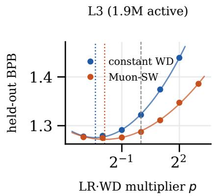
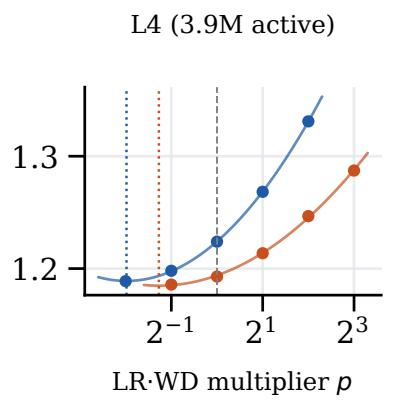
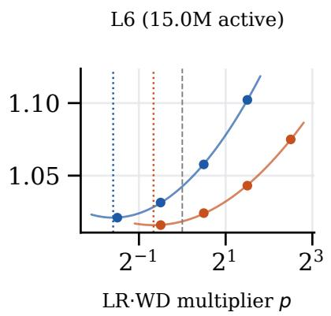
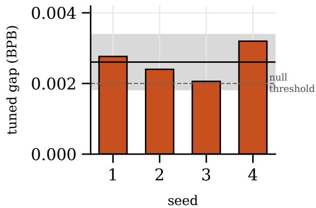
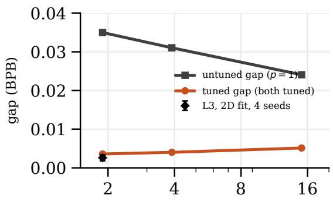
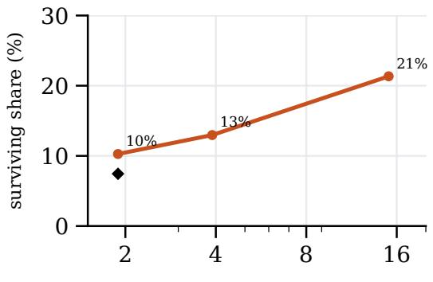
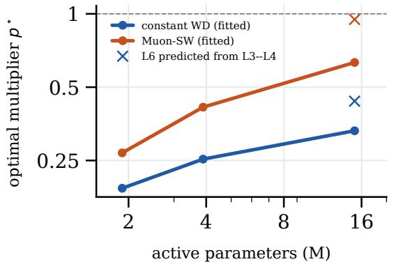
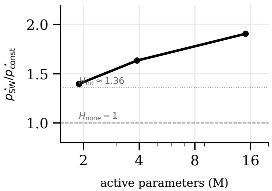

# Tune the Baseline First: Most of Muon’s Scaled Weight Decay Gain Is a Tuning Gap, but Its Small Real Advantage Grows With Model Size

Esther Xin

Independent Researcher

yixin@microsoft.com

Code and data: https://github.com/ethxin0011/weight\_decay\_ladder

## Abstract

Scaled weight decay for Muon (Muon-SW) has been reported to train language models more eficiently than constant decoupled weight decay, but such comparisons usually reuse one learningrate (LR) and weight-decay (WD) setting for both methods. We re-run the comparison under the MAI-Base-2 protocol: LR and WD are tuned jointly through their product for each method, on a source-scaled mixture-of-experts (MoE) scaling ladder (1.9M to 15M active parameters) that holds tokens per active parameter and data repetition fixed across sizes. We find:

(1) Most of the gain is a tuning gap. At the shared setting Muon-SW wins by 0.035 bits per byte (BPB), a 1.52 compute saving. After both methods are tuned, the gap is 0.0026 BPB (95% CI [0.0018, 0.0034]), a 1.03 saving: about 90% of the advantage disappears.

(2) The small advantage that remains is real. At the smallest size, all four paired seeds favour Muon-SW at the tuned settings.

(3) That advantage grows with model size. Across an 8 range of active parameters, the tuned gap rises from 0.0036 to 0.0051 BPB while the untuned gap shrinks from 0.035 to 0.024, so the share of the advantage that survives tuning rises from about 10% to 21%.

(4) The best weight decay moves with scale. The optimal LR WD product grows for both methods, faster for Muon-SW (ratio 1.40 1.91). A law fitted on the two smallest sizes overshoots the third by 1.3–1.5 , costing up to 0.002 BPB.

The whole study runs on one NVIDIA T4 GPU; we release the code and all run results.

## 1 Introduction

New optimizer variants are commonly evaluated by training a model with the variant and with a baseline, at one shared set of hyperparameters, and reporting the diference. When the variant changes how strongly a hyperparameter acts—as a weight-decay schedule does—the shared setting can be well tuned for one method and poorly tuned for the other, and part of the reported gain is then a tuning gap. This concern is old (Choi et al., 2019; Dahl et al., 2023), but it is sharper for weight decay, whose efect is coupled to the learning rate (Loshchilov and Hutter, 2019; Kosson et al., 2023; Wang and Aitchison, 2024) and whose optimum moves with model and data size.

Muon (Jordan et al., 2024) is now used for the hidden-layer matrices of large language models (Liu et al., 2025), including the 2.8T parameter MAI-Base-2 (Microsoft AI, 2026). Apte (2026) propose scaling Muon’s weight-decay coeficient over training (Muon-SW) and report gains over constant decay. MAI-Base-2 introduced two practices that make a cleaner test possible. First, LR and WD are swept jointly on a grid in (LR, LR WD), because good settings lie on a narrow diagonal of the (LR, WD) plane and a 2D quadratic fit gives the optimum. Second, models are compared on a scaling ladder with fixed tokens per active parameter (TPP) and source scaling, which keeps the number of repetitions of every data source fixed across rungs so that small models do not favour under-regularised settings.

We ask one question: how much of Muon-SW’s advantage survives once the baseline is tuned as carefully as the method, and how does that share change with scale? Our contributions are:

• A tuned comparison of Muon-SW and constant decay under the MAI-Base-2 LR WD protocol on a source-scaled MoE ladder (three rungs, 1.9M to 15M active parameters, 81 completed runs).

• The finding that about 90% of Muon-SW’s untuned advantage disappears after joint tuning at the smallest rung (survival 7.4% in the full 2D analysis, 10.3% in the 1D slice), but that the residual is consistent across seeds and grows with scale (survival 10%  13%  21%).

• Measurements of how the optimal LR WD product moves with scale for each method, a test of three preregistered predictions for the ratio of optima, and an out-of-sample check of the fitted law at L6.

• A pre-emption-safe pipeline that runs the full ladder on one T4 GPU.

## 2 Related work

Fair optimizer comparison. Choi et al. (2019) showed that optimizer rankings change once every optimizer’s hyperparameters, including those usually held fixed, are tuned, and AlgoPerf (Dahl et al., 2023) builds tuning budgets into the benchmark. We apply the same principle to a single optimizer modification and measure the surviving share explicitly.

Weight decay and scale. Decoupled weight decay (Loshchilov and Hutter, 2019) interacts with the learning rate through their product, which sets the equilibrium norm and efective rotation of weights (Kosson et al., 2023). Wang and Aitchison (2024) derive how WD should change with model and dataset size for AdamW, and Wortsman et al. (2023) study LR and WD sensitivity with small proxies. For Muon, Liu et al. (2025) find weight decay important at scale; Apte (2026) propose scaling it over training. MAI-Base-2 (Microsoft AI, 2026) fits the joint LR WD optimum as a function of size and TPP.

Scaling ladders and data repetition. Scaling laws (Kaplan et al., 2020; Hofmann et al., 2022) motivate comparing methods across sizes rather than at one point. Repeating data changes what is optimal (Muennighof et al., 2023); source scaling holds repetition fixed across rungs. Our models use sparse MoE layers (Shazeer et al., 2017; Fedus et al., 2021); we also test the warmup–stable– decay (WSD) schedule (Hu et al., 2024).

## 3 Method

## 3.1 Methods compared

Both methods use Muon for non-embedding 2D parameters and AdamW for all other parameters, as in MAI-Base-2. Let $\eta _ { t } = \eta f ( t )$ be the learning rate at step t, where $f ( t ) \in [ 0 . 1 , 1 ]$ is the schedule (linear warmup, then cosine or WSD decay to 10% of the peak). Constant applies decoupled weight decay with a fixed coeficient λ: $\theta  \theta ( 1 - \eta _ { t } \lambda )$ . Muon-SW (Apte, 2026) multiplies the coeficient at step t by $s ( t ) = \eta _ { t } / \eta _ { \mathrm { m a x } } = f ( t )$ , so the decay step becomes $\theta  \theta ( 1 - \eta _ { t } ^ { 2 } \lambda / \eta _ { \mathrm { m a x } } )$ : decay is applied at full strength at the peak learning rate and weakens as the learning rate anneals. Both methods share the same η and λ at a given grid point. We write s¯ for the ratio of total decay applied by Muon-SW to that applied by constant decay over a run, $\textstyle { \bar { s } } = \sum _ { t } f ( t ) s ( t ) / \sum _ { t } f ( t )$ ; under our cosine schedule $\bar { s } = 0 . 7 3 3$ and under WSD $\bar { s } = 0 . 9 5 6$

## 3.2 Joint LR WD tuning

Following MAI-Base-2, each rung has a law-predicted learning rate $\eta _ { 0 }$ and product $( \eta \lambda ) _ { 0 }$ . We sweep multipliers on both: an LR multiplier and a product multiplier $p ,$ so a run uses $\eta = m _ { \eta } \eta _ { 0 }$ and $\eta \lambda = p ( \eta \lambda ) _ { 0 }$ . At L3 we sweep the full 2D grid $( m _ { \eta } \in \{ 0 . 5 , 1 , 2 \}$ , p on a factor-of-2 grid), fit a 2D quadratic in $( \log _ { 2 } m _ { \eta } , \log _ { 2 } p )$ per method, and extend the grid wherever the fitted optimum falls on its edge. At L4 and L6 we sweep p at $m _ { \eta } = 1$ and fit a 1D quadratic in $\log _ { 2 } p .$ The same 1D slice is extracted at L3 so that all three rungs can be compared on equal terms.

## 3.3 Quantities reported

For each rung, the untuned gap is the constant-decay BPB minus the Muon-SW BPB, both at $p = 1$ ; the tuned gap is the diference between the two methods’ tuned BPB. Survival is tuned gap divided by untuned gap. At L3 we also convert gaps into a compute-equivalent speedup with the loss-versus-compute fit used by our analysis pipeline.

## 3.4 Hypotheses for the ratio of optima

We preregistered three predictions for $r = \ p _ { \mathrm { S W } } ^ { \star } / p _ { \mathrm { c o n s t } } ^ { \star } . ~ H _ { \mathrm { n o n e } }$ : the schedule does not change the optimal product, $r = 1 . H _ { \mathrm { { i n t } } } \mathrm { { : } }$ the optimum matches total decay applied over training, $r = 1 / \bar { s }$ (1.364 cosine, 1.046 WSD). $H _ { \mathrm { e n d } }$ : the optimum matches the final-step coeficient, $r = 1 0$

## 3.5 Ladder, data and training

Each rung is named by its layer count L, which fixes the hidden size, head counts and MoE layout (Appendix Table 3). All rungs train for 120 tokens per active parameter. The data pool has three public sources: web text from FineWeb-Edu (Penedo et al., 2024) (sample-10BT; 1,174.8M training tokens, 60% of each batch), Python code from CodeParrot-clean (CodeParrot, 2022) (122.0M tokens, 25%) and mathematical web text from OpenWebMath (Paster et al., 2023) (79.3M tokens, 15%). Documents shorter than 200 characters and exact duplicates are removed, and 3,000 documents per source are held out for evaluation. We train an 8,192-token byte-level BPE tokenizer on the pool. Under source scaling, web data is seen once and code and math four times at every rung; lower rungs therefore draw a proportionally smaller unique subset of each source. The metric is held-out bits per byte, pooled over the three sources. Main runs use a cosine schedule; WSD is used for the schedule-robustness check.

## 3.6 Compute

All runs train on a single NVIDIA T4 (16 GB) in a low-priority (Spot) cluster. A self-resubmitting job chain checkpoints every 15 minutes and on eviction; after a pre-emption a queued successor job resumes from the last checkpoint. Resumed runs reproduce uninterrupted runs exactly in our tests. The L6 runs (1.8B tokens each, about 23 GPU-hours) survived 19 evictions without loss.

<table><tr><td>Rung</td><td>Active (M)</td><td>Untuned gap</td><td>Tuned gap</td><td>Survival</td><td> $p _ { \mathrm { c o n s t } } ^ { \star }$ </td><td> $p _ { \mathrm { S W } } ^ { \star }$ </td><td>Ratio</td><td>Seeds</td></tr><tr><td>L3</td><td>1.89</td><td>0.03499</td><td>0.00359</td><td>10.3%</td><td>0.192</td><td>0.269</td><td>1.40</td><td>4</td></tr><tr><td>L4</td><td>3.89</td><td>0.03105</td><td>0.00403</td><td>13.0%</td><td>0.253</td><td>0.414†</td><td>1.63</td><td>1</td></tr><tr><td>L6</td><td>15.04</td><td>0.02407</td><td>0.00514</td><td>21.3%</td><td>0.331†</td><td>0.631†</td><td>1.91</td><td>1</td></tr><tr><td colspan="9">L3, full 2D  $( L R \times L R { \cdot } W D )$  fit, four paired seeds at the fitted optima L3 1.89 0.03499 0.00261</td></tr></table>

Measured T4 throughput is 29 that of one 16-core CPU node on L3, so all training was moved to the GPU.

## 4 Experimental design

The study proceeded through preregistered gates. Gate 1 (L3, untuned) tested whether Muon-SW beats constant decay at $p = 1$ by more than seed noise (6 runs). Stage 2 (L3 grid) swept the 2D grid with edge extensions (39 runs). Stage 3 (L3 confirmation) retrained both methods at their fitted optima with paired seeds (four seeds per method) and ran the WSD comparison. Stage 4 (L4) and Stage 5 (L6) swept p for each method. A planned L9 rung was not run (§7).

## 5 Results

tuned-gap 95% CI [0.00183, 0.00338]; Muon-SW better on 4/4 seeds

Table 1: Main result. Untuned gap: constant-WD BPB minus Muon-SW BPB, both at the MAIlaw setting $( p = 1 )$ . Tuned gap: the same diference after each method is tuned over the LR WD multiplier $p$ (quadratic fit in $\log _ { 2 } p )$ . Survival = tuned gap / untuned gap. $p ^ { \star }$ is the fitted optimal multiplier; Ratio is $p _ { \mathrm { S W } } ^ { \star } / p _ { \mathrm { c o n s t } } ^ { \star }$ . Upper block: one-dimensional sweep at learning-rate multiplier 1 for every rung. Lower block: the full two-dimensional $( \mathrm { L R } \times \mathrm { L R } { \cdot } \mathrm { W D } )$ L3 analysis, confirmed by four paired seeds at the fitted optima. †Fitted optimum lies outside the sampled range; the tuned BPB is the better of the fitted and best observed value. All BPB values are on held-out data.
<table><tr><td>Schedule</td><td>Measured ratio</td><td>95% CI</td><td>Consistent with Closest</td></tr><tr><td>cosine WSD</td><td>1.41 0.29</td><td>[0.88, 2.25]  $H _ { \mathrm { n o n e } } , H _ { \mathrm { i n t } }$  [0.19, 0.43] none</td><td> $H _ { \mathrm { i n t } }$   $( H _ { \mathrm { n o n e } } )$ </td></tr><tr><td colspan="4">Predictions (cosine / WSD):  $H _ { \mathrm { n o n e } } = 1$  Hint = 1.364 / 1.046;  $H _ { \mathrm { e n d } } = 1 0$ </td></tr></table>

Table 2: Measured ratio of optimal LR WD products (Muon-SW over constant decay) at L3, with bootstrap 95% intervals, against the three preregistered predictions (§3.4). Under the cosine schedule the data are consistent with no change and with matched integrated decay, and rule out endpoint matching. Under WSD the ratio falls below every prediction.

At the shared setting, Muon-SW is clearly better. Gate 1 passed: at p = 1 on L3 the gap is 0.0350 BPB, against a seed noise of 0.0010, and it is also positive at TPP 30 (0.046). This reproduces the direction and size of the reported gain and corresponds to a 1.52 compute-equivalent speedup.

Figure 1: Held-out BPB against the LR WD multiplier p (log scale) for each rung. Points are runs; curves are quadratic fits in $\log _ { 2 } p ;$ dotted lines mark fitted optima; the dashed line marks the MAI-law setting $p = 1$ . At $p = 1$ Muon-SW (orange) is far better, but constant decay (blue) recovers most of the gap by moving to a smaller $p .$  
  
Figure 2: Tuned gap at L3 for each of four paired seeds at the 2D-fitted optima. Black line: mean; grey band: 95% CI; dashed: the preregistered 0.002 BPB threshold.

After joint tuning, most of the gap disappears. Figure 1 shows why. Both methods’ optima lie below $p = 1$ , and constant decay’s lies much further below it. Once each is evaluated at its own optimum, the L3 gap from the full 2D analysis is 0.0026 BPB (Table 1, lower block), 7.4% of the untuned gap, and the speedup falls to 1.03 . The 1D slice gives a similar 10.3%.

The residual is small but real. At the fitted optima, all four paired seeds favour Muon-SW (Figure 2); the 95% interval [0.0018, 0.0034] excludes zero. It does not clear our preregistered practical-significance threshold of 0.002 BPB, so we describe the residual as consistent rather than large.

The share that survives tuning grows with scale. Across rungs (Table 1, Figure 3) the untuned gap shrinks $( 0 . 0 3 5 0  0 . 0 3 1 1  0 . 0 2 4 1 )$ while the tuned gap grows $( 0 . 0 0 3 6  0 . 0 0 4 0 $ 0.0051). Survival therefore rises from about 10% to 13% to 21%. Both trends are monotone over an 8 range of active parameters, but the L4 and L6 values come from one seed and from optima at or just beyond the sweep edge (§7).

Optimal decay moves with scale, faster for Muon-SW. The fitted optimal multiplier rises with size for both methods (Figure 4): from 0.19 to 0.33 for constant decay and from 0.27 to 0.63 for Muon-SW. Their ratio grows from 1.40 to 1.91. A baseline tuned at small scale and reused at larger scale would therefore be increasingly mis-tuned, and the direction of that error depends on the method.

  
active parameters (M)

  
active parameters (M)

Figure 3: Left: untuned and tuned gaps against active parameters; the diamond is the four-seed L3 estimate with its 95% CI. Right: share of the untuned gap that survives tuning.  

  
Figure 4: Left: fitted optimal LR WD multiplier per method (circles) and the L6 values predicted from L3 and L4 (crosses). Right: ratio of the two optima with the $H _ { \mathrm { n o n e } }$ and $H _ { \mathrm { i n t } }$ predictions for the cosine schedule.

Which hypothesis explains the ratio? Under cosine at L3 the ratio is 1.41 (95% CI [0.88, 2.25]; Table 2): consistent with matched integrated decay $( H _ { \mathrm { i n t } } = 1 . 3 6 )$ and, given its width, with no change; endpoint matching $( r = 1 0 )$ is ruled out. Under WSD the ratio is 0.29 ([0.19, 0.43]), below every prediction. We have not resolved this anomaly; it may reflect an interaction between the long constant-LR phase of WSD and the decay schedule, and we report it as an open question.

The LR WD law transfers approximately. Extrapolating the L3 and L4 optima to L6 predicts multipliers of 0.44 (constant) and 0.95 (Muon-SW), against fitted values of 0.33 and 0.63 (Appendix Table 4). Using the predicted value costs 0.0014 and 0.0020 BPB respectively—comparable to the tuned gap itself. Comparisons at transferred rather than measured optima would therefore misstate the gap at the scale of interest.

## 6 Discussion

What practitioners should take away. At small scale, almost all of Muon-SW’s reported benefit can be obtained by tuning the LR WD product of ordinary constant decay. Optimizer comparisons that hold this product fixed overstate gains roughly tenfold in our setting. At the same time, the benefit that remains after tuning grows with scale, which is the regime that matters for large models; our data are consistent with Muon-SW being a small genuine improvement whose importance increases with size.

Why the untuned gap shrinks. The MAI-law setting p = 1 is too high for both methods on our ladder, but less so at larger rungs, where both optima move toward 1. Because constant decay is penalised more by an over-large product, the untuned gap mostly measures how far p = 1 is from constant decay’s optimum, and that distance shrinks with scale.

## 7 Limitations

• Scale. Our largest rung has 15M active (94M total) parameters, far below production models. The planned L9 rung (51M active) was not run for compute reasons; extrapolating the growth of the residual beyond L6 is not supported by our data.

• Seeds. Only L3 has multiple paired seeds. L4 and L6 use one seed per setting; at L3 the seed standard deviation of the gap is about 0.0007 BPB, small relative to the L4 and L6 tuned gaps, but the scale trend rests on three points.

• Sweep edges. The fitted optimum lies outside the sampled range for Muon-SW at L4 and for both methods at L6. We use the better of the fitted and best observed values; finer sweeps could move the L4 and L6 tuned gaps.

• One dimension above L3. L4 and L6 sweep only the product at the law-predicted LR. The L3 1D slice gives a slightly larger survival (10.3%) than the full 2D fit (7.4%), so the 1D numbers may overstate survival somewhat.

• Schedule. The WSD result does not match any hypothesis and was tested only at L3.

• Data. One data mixture and one tokenizer; results on other mixtures or with more data repetition may difer.

## 8 Conclusion

Most of the advantage reported for Muon’s scaled weight decay is a tuning gap: when constant decay’s LR WD product is tuned as carefully as the method’s, about 90% of the gain disappears at small scale. What remains is small but consistent, and it grows with model size, from about 10% to 21% of the untuned gap across an 8 range of active parameters, while the optimal products of the two methods move apart. Optimizer comparisons should tune the baseline at every scale they report, and claims about scaled weight decay should be made from tuned comparisons at the target scale.

## Reproducibility

Code, run configurations, all 81 run summaries and the script that regenerates every figure and table (make\_figures.py) are available at https://github.com/ethxin0011/weight\_decay\_ladder.

## References

Apte. Scaled weight decay for the Muon optimizer. arXiv preprint arXiv:2607.23777, 2026.

Dami Choi, Christopher J. Shallue, Zachary Nado, Jaehoon Lee, Chris J. Maddison, and George E. Dahl. On empirical comparisons of optimizers for deep learning. arXiv preprint arXiv:1910.05446, 2019.

CodeParrot. CodeParrot-clean: Deduplicated Python code from GitHub. https://huggingface. co/datasets/codeparrot/codeparrot-clean, 2022.

George E. Dahl, Frank Schneider, Zachary Nado, et al. Benchmarking neural network training algorithms. arXiv preprint arXiv:2306.07179, 2023.

William Fedus, Barret Zoph, and Noam Shazeer. Switch transformers: Scaling to trillion parameter models with simple and eficient sparsity. arXiv preprint arXiv:2101.03961, 2021.

Jordan Hofmann, Sebastian Borgeaud, Arthur Mensch, et al. Training compute-optimal large language models. arXiv preprint arXiv:2203.15556, 2022.

Shengding Hu, Yuge Tu, Xu Han, et al. MiniCPM: Unveiling the potential of small language models with scalable training strategies. arXiv preprint arXiv:2404.06395, 2024.

Keller Jordan, Yuchen Jin, Vlado Boza, Jiacheng You, Franz Cesista, Laker Newhouse, and Jeremy Bernstein. Muon: An optimizer for hidden layers in neural networks. Blog post, https:// kellerjordan.github.io/posts/muon/, 2024.

Jared Kaplan, Sam McCandlish, Tom Henighan, et al. Scaling laws for neural language models. arXiv preprint arXiv:2001.08361, 2020.

Atli Kosson, Bettina Messmer, and Martin Jaggi. Rotational equilibrium: How weight decay balances learning across neural networks. arXiv preprint arXiv:2305.17212, 2023.

Jingyuan Liu, Jianlin Su, Xingcheng Yao, et al. Muon is scalable for LLM training. arXiv preprint arXiv:2502.16982, 2025.

Ilya Loshchilov and Frank Hutter. Decoupled weight decay regularization. In International Conference on Learning Representations (ICLR), 2019.

Microsoft AI. MAI-Base-2: Technical report. Technical report / blog post, 2026.

Niklas Muennighof, Alexander M. Rush, Boaz Barak, et al. Scaling data-constrained language models. arXiv preprint arXiv:2305.16264, 2023.

Keiran Paster, Marco Dos Santos, Zhangir Azerbayev, and Jimmy Ba. OpenWebMath: An open dataset of high-quality mathematical web text. arXiv preprint arXiv:2310.06786, 2023.

Guilherme Penedo, Hynek Kydlíček, Loubna Ben Allal, et al. The FineWeb datasets: Decanting the web for the finest text data at scale. arXiv preprint arXiv:2406.17557, 2024.

Noam Shazeer, Azalia Mirhoseini, Krzysztof Maziarz, et al. Outrageously large neural networks: The sparsely-gated mixture-of-experts layer. arXiv preprint arXiv:1701.06538, 2017.

Xi Wang and Laurence Aitchison. How to set AdamW’s weight decay as you scale model and dataset size. arXiv preprint arXiv:2405.13698, 2024.

Mitchell Wortsman, Peter J. Liu, Lechao Xiao, et al. Small-scale proxies for large-scale transformer training instabilities. arXiv preprint arXiv:2309.14322, 2023.

## A Ladder configuration and transfer check

Table 3 lists the rungs and measured T4 throughput; Table 4 gives the L6 transfer check.

<table><tr><td>Rung</td><td> $d _ { \mathrm { m o d e l } }$ </td><td>Heads  $\mathrm { ( Q / K V ) }$ </td><td>Active</td><td>Total</td><td>Tokens (TPP 120)</td><td>T4 tok  $\mathrm { \langle / s }$ </td></tr><tr><td>L3</td><td>256</td><td>4/1</td><td>1.89M</td><td>14.9M</td><td>227M</td><td>122,131</td></tr><tr><td>L4</td><td>320</td><td>5/1</td><td>3.89M</td><td>27.6M</td><td>467M</td><td>73,642</td></tr><tr><td>L6</td><td>512</td><td>8/2</td><td>15.04M</td><td>94.2M</td><td>1,805M</td><td>21,583</td></tr><tr><td>L9</td><td>768</td><td>12/3</td><td>50.65M</td><td>302.1M</td><td>6,078M</td><td>4,372</td></tr></table>

Table 3: Scaling-ladder rungs. Each rung is defined by its layer count $L ,$ which fixes the rest of the architecture. Tokens are for 120 training tokens per active parameter. Throughput is measured on one NVIDIA T4 (§3.6). L9 was planned but not trained.

<table><tr><td>Method</td><td> $p ^ { \star }$  predicted (L3-L4)</td><td> $p ^ { \star }$  fitted (L6)</td><td>BPB at predicted</td><td>Regret</td></tr><tr><td>constant WD</td><td>0.438</td><td>0.331</td><td>1.02241</td><td>0.00140</td></tr><tr><td>Muon-SW</td><td>0.948</td><td>0.632</td><td>1.01791</td><td>0.00202</td></tr></table>

Table 4: Transfer of the LR WD law to L6. The optimal multiplier predicted by extrapolating the L3 and L4 optima overshoots the fitted L6 optimum by 1.3–1.5 for both methods. Regret is the BPB lost by using the predicted rather than the fitted value.