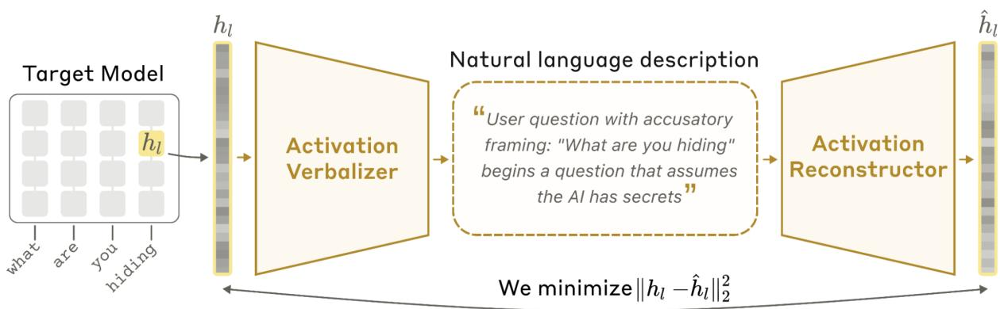
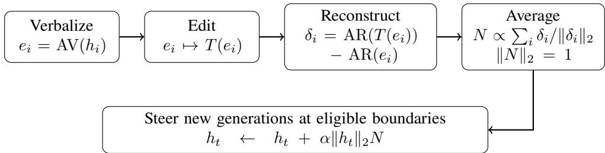
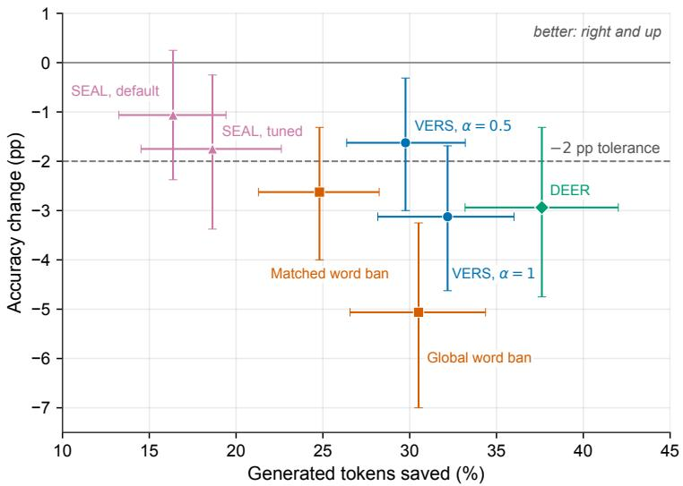
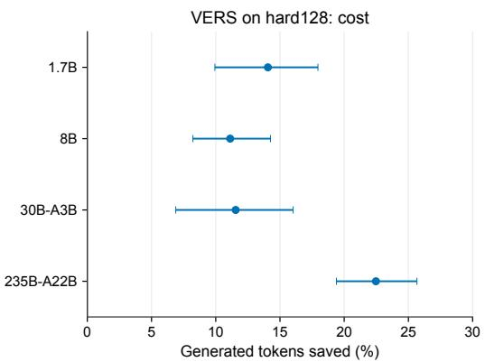
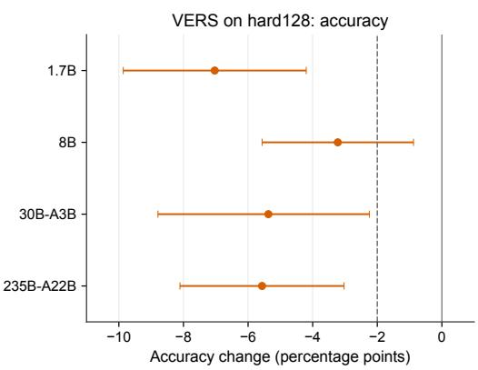

# VERS: Steering Reasoning Models by Editing Their Activation Explanations

Ihor Vitenko igor.vitenko13@gmail.com

## Abstract

Reasoning language models write a chain of thought before they answer, and many checks in it do not change the final answer. Natural language autoencoders (NLAs) explain a model’s activations in text and rebuild activations from text, and editing an explanation can steer a model at a single token. We study whether such edits can also steer how a model reasons. We build VERS (Verbalize, Edit, Reconstruct, Steer): it turns explanation edits at the doubt points of one reasoning trace into one fixed direction, and adds this direction at paragraph breaks. On the full GSM8K test, VERS cuts generated tokens by 45.8% at an accuracy change of −0.82 percentage points (pp); on MATH-500 it saves 31.3% at −3.05 pp. At half strength, its trade-of between tokens and accuracy lies between those of the published methods SEAL and DEER. With fitted afine maps and a strength tuned for each model, the direction transfers to larger Qwen3 models, up to 235B-A22B, and saves 30–35% of tokens. On competition problems, however, VERS loses 3–7 pp at every model size, and a fixed direction did not separate necessary checks from unneeded ones.

## 1 Introduction

Reasoning models often check their own work many times. Some checks repair mistakes; others add length without changing the answer. Related work finds such decorative reasoning across model sizes [1]. We want a control that removes useless checks but keeps necessary ones.

Steering directions are usually built from a contrastively labeled corpus: many examples with the behavior and many without it [2, 3]. We ask whether a text edit can specify the change instead. Natural language autoencoders (NLAs) make this possible [4]. An NLA is a pair of models trained on one layer of a language model. The activation verbalizer (AV) reads an activation and writes a text explanation of it. The activation reconstructor (AR) reads that explanation and rebuilds the activation (Figure 1).

The original NLA work already uses explanation edits for interventions [4]. It edits the explanation of one token, for example a planned rhyme word “rabbit” to “mouse”. The AR rebuilds both texts, and the diference of the two rebuilt activations is added at that same token. One test averages this diference over five explanation samples of the token. The goal there is to show that explanations are causally linked to outputs. We study whether such edits can also steer how a model reasons on math problems. To test this, we build VERS (Verbalize, Edit, Reconstruct, Steer). Compared with the original use, it adds four things: (a) one fixed direction, built from one trace, is reused on other questions; (b) it is added again and again during reasoning, at paragraph breaks found while the model generates; (c) it is transferred to larger models; and (d) we test where this control loses selectivity.

In VERS, the AV explains the activation at points where the model is about to start a check. We replace the predicted check with a continuation of the solution (the continue edit). The AR rebuilds the activation from both texts, and we average the diferences into one fixed direction, N. Our results show that this gives an efective direction built through an NLA interface. They do not show that the activation-conditioned explanation is needed: we did not test generic hand-written texts without AV explanations, or the edited predictions without the context that the AV describes. Shorter reasoning is our test case. We measure output length and detected doubt paragraphs, whose first sentence has an English doubt marker such as “Wait” (Section 3.2). Our three contributions are:

  
Figure 1: A natural language autoencoder. The AV turns the layer-l activation $h _ { l }$ of the target model into a text description. The AR reads the description and rebuilds the activation as hˆ . [4]

1. A steering policy built from explanation edits. Edits at 35 sites in one trace give a fixed direction. On the full GSM8K test (1,319 questions), it saves 45.8% of tokens at a 0.82 pp accuracy cost. Section 4.3 also compares N with a diference-of-means direction built without the NLA.

2. Transfer of the interface and the intervention. Fitted afine maps let the frozen 1.7B NLA read and rebuild 8B and 30B-A3B states, and carry N to larger Qwen3 models, up to 235B-A22B. With strength tuned for each model, N saves 30–35% of tokens on 400 MATH test questions at all four model sizes.

3. Limits of control. On competition problems, accuracy falls by 3–7 pp at all model sizes. A probe predicts at each paragraph boundary whether a useful check (one that turns a wrong answer into a right one) starts next, with AUC 0.84. But the two tested selective constructions did not improve the accuracy–length trade-of. The opposite direction −N adds detected doubt paragraphs, but a direction built from the doubt edit does not.

Section 3 defines VERS, and Sections 4–6 test the three contributions. Section 7 adds a supporting study of students fine-tuned on steered traces.

## 2 Related Work

Language interfaces to activations. NLA gives the training recipe for the verbalizer and the reconstructor [4]. It also steers by adding, at the one explained token, the diference of the AR outputs for the edited and original explanation. Patchscopes is another language interface to hidden representations [5]. We reuse NLA’s edit-and-rebuild step and extend it into a reusable policy (Section 1).

Activation steering. Activation steering adds a direction to the residual stream at inference time. ActAdd builds the direction from the activation diference of a pair of prompts [6]. Contrastive activation addition (CAA) averages this diference over many contrastive examples [2]. Representation engineering reads and controls concepts through directions in the representation space [7]. VERS also adds a fixed direction, but it builds the direction from text edits instead of contrastive examples.

Steering and shortening reasoning. Reasoning models often think longer than needed, and this overthinking has been measured directly [8]. Budget forcing in s1 controls thinking length by ending thinking early or by appending “Wait” [9]. Other work shortens chain of thought by steering activations. ASC adds the mean diference between the states of long and short chains of thought [10]. Manifold Steering projects a reflection direction onto a low-dimensional subspace of the model’s states to remove noise [11]. Venhof et al. steer uncertainty and backtracking with diference-of-means vectors [3]. Our comparison direction D is built in the same way as these directions, from the mean diference between two kinds of states, and it does not use the NLA. SEAL uses reflection and execution directions [12]. Among the published methods, it is the closest to Manifold Steering, so we use it as the comparison from this family. NoWait suppresses thinking-related tokens [13]. DEER exits thinking early when a trial answer is confident [14]. We run these methods with the same questions, model, and token budget as VERS (Appendix D), and we count DEER’s discarded trial-answer tokens in its cost. Caldarella et al. use the gold answer to find the first correct answer in a trace [15]. This motivates our study of what happens after an answer appears, but it does not give a stopping rule that can run during generation. Our final policy does not need to detect answers.

Reuse across models and through training. Model stitching, transfer of activation interventions, and steering large models with small models are precedents for afine transport [16, 17, 18]. A related NLA study maps another model’s sparse-autoencoder features into a verbalizer [19]. We test reuse for two separate goals: reading and rebuilding target-model states, and carrying one steering vector to the target. The supporting student study uses supervised fine-tuning and direct preference optimization [20]. It also trains on matched natural traces, to measure what the steered data adds.

## 3 VERS: Verbalize, Edit, Reconstruct, Steer

VERS has two parts (Figure 2). Ofline, it builds one fixed steering direction, N, from hidden states of one trace. The AV turns each state into text, we edit the text, and the AR maps both texts back to vectors. During generation, VERS only adds N to the hidden state at paragraph boundaries. N stands for the NLA direction. Section 4 compares it with D, a diference-of-means direction built without the NLA.

  
Figure 2: The two parts of VERS. Top: ofline, we build the direction N from the donor sites (Section 3.2). Bottom: during generation, we add N at eligible paragraph boundaries. Generation calls neither the AV nor the AR.

## 3.1 The trained activation interface

We train an NLA on Qwen3-1.7B with the training procedure of the original NLA work [4], at a smaller scale, and then keep it fixed. It reads the residual stream at the output of decoder layer 20 (about 70% of the model’s depth, as in the original NLA work [4]). This state has 2,048 dimensions. The NLA has two parts:

• The activation verbalizer (AV) turns a state into text. It is a full copy of the model. Its prompt contains one <|image\_pad|> token. We replace the embedding of this token with the state, scaled to norm 1,000. Source states have a norm of about 900 on average. Following the original NLA work [4], we pick a round number slightly above this average. The AV then writes an explanation e.

• The activation reconstructor (AR) turns text back into a state. It is the model cut after layer 20, without the final normalization and the language-model head. A bias-free linear map predicts the state from the explanation’s final token.

Neither part changes during the steering and transfer experiments.

Training has two stages. A supervised warm start uses about 500k positions from Ultra-FineWeb documents, with text summaries written by Qwen3.8-27B. Joint training then uses the reference reconstruction reward and the GRPO recipe [21] on about 400k new web and chat positions. Appendix H gives the data details.

We measure reconstruction with the fraction of variance explained (FVE). For n evaluated states $h _ { j }$ with reconstructions $\hat { h } _ { j }$ , we scale both to unit length, $u _ { j } = h _ { j } / \lVert h _ { j } \rVert _ { 2 }$ and $\hat { u } _ { j } = \hat { h } _ { j } / \lVert \hat { h } _ { j } \rVert _ { 2 }$ , and compute

$$
\mathrm { F V E } = 1 - \frac { \sum _ { j = 1 } ^ { n } \| \hat { u } _ { j } - u _ { j } \| _ { 2 } ^ { 2 } } { \sum _ { j = 1 } ^ { n } \| u _ { j } - \bar { u } \| _ { 2 } ^ { 2 } } , \qquad \bar { u } = \frac { 1 } { n } \sum _ { j = 1 } ^ { n } u _ { j } .\tag{1}
$$

The mean u¯ is not scaled back to unit length, as in the reference code [4]. FVE is 1 for a perfect reconstruction. It is 0 when the reconstruction error equals the spread of the scaled states around their mean u¯. We sample three explanations per state at temperature 1 and average the FVE over the three samples. The AR reaches an FVE of 0.50 after the warm start and 0.63 after one epoch of joint training. We use this checkpoint everywhere. On 10,000 new web and chat positions, the FVE is 0.632 (web 0.655, chat 0.604). On 456 positions from reasoning traces, it is only 0.304. So the interface rebuilds reasoning states much less well than web and chat states. For comparison, the original NLA work reports 0.6–0.8 for its models [4].

## 3.2 The donor trace and donor sites

We build N from states of one trace. We use these terms:

• A paragraph boundary is a generated token inside thinking (after <think> and before the first </think>) whose text contains at least two newline characters, such as \n\n or .\n\n. This token ends a paragraph.

• A doubt marker is one of 13 words or phrases, such as “Wait”, “Hmm”, “But”, and “Let me verify” (full list in Appendix H). Matching ignores case.

• A doubt paragraph is a paragraph inside thinking, other than the first one, whose first sentence contains a doubt marker as a whole word. Unless we say otherwise, all doubt counts use this rule.

• The donor trace is a correct 1.7B rollout of AIME 2025 I, Problem 2. We drew 42 correct traces at random, 14 each from GSM8K, AMC 2023, and AIME 2025, keeping only traces with at least six donor sites. From these, we used the trace with the most donor sites.

• A donor site is a paragraph boundary in the donor trace where the next paragraph starts with a doubt marker.

So a donor site needs a marker at the very start of the next paragraph, and a doubt paragraph needs one anywhere in its first sentence.

This count is a proxy. It counts English markers only, so it misses checks without a marker and checks in other languages. In one example, VERS still checks without a marker, and a ban on doubt words makes the model check in Chinese (Appendix D.2). At full strength on hard problems, the 1.7B switches into Chinese in 37% of rollouts (Section 6.1).

The donor trace has 35 donor sites. At each one we record the layer-20 state $h _ { 2 0 } ( t ) \in \mathbb { R } ^ { 2 0 4 8 }$ . Figure 3 shows two of them.

Construction uses information that generation does not have. We chose a trace with a correct answer, and we chose sites by reading the paragraph that follows. The steering policy (Section 3.4) uses neither: it steers at every eligible paragraph boundary, whether or not doubt follows.

Donor trace: aime2025:1, rollout 1. The problem gives quadrilateral DEGF area 288 and asks for a   
heptagon’s area. The correct final answer is 588.   
[. . . ] Take absolute value and multiply by 1/2: 1/2 \* |1248| = 624\n\n t = 1809 −→ h (1809)   
But the problem says that quadrilateral DEGF has area 288. But according to my calculation, it’s 624. Which   
is a contradiction. Therefore, my coordinates must be wrong.\n\n t = 1851 −→ h20(1851)   
Wait, that’s a problem. So either my coordinates are incorrect, or my application of shoelace formula is   
wrong. [. . . ]  
Figure 3: Two of the 35 donor sites. The captured token is underlined in red; t is its index in the response, counted from zero. The bold words “But” and “Wait” make these boundaries donor sites; they are not captured. [. . . ] marks omitted text. Here the doubt is useful: it finds a wrong intermediate result (624 instead of the given 288).

## 3.3 The edit and the direction

At each donor site i, the AV reads the state $h _ { i }$ and writes an explanation $e _ { i } .$ . An explanation has several paragraphs, separated by blank lines. The last paragraph predicts what text comes next. The edit T keeps every paragraph except the last one and replaces the last one with a fixed template:

Continue: This ends the sentence, implying the next token likely starts a new sentence or clause, such as “Therefore, the total is calculated as follows.” to continue the derivation.

Doubt: This indicates the sentence is concluding the thought about verification, likely expecting a concluding clause like “Wait, let me double-check that.” to complete the reasoning.

We call the first edit the continue edit and the second the doubt edit. VERS uses the continue edit. Section 6.3 uses the doubt edit to build a second direction, P. Figure 4 shows a real explanation and its edited version.

Both templates follow how the AV itself writes (Table 1). In 289 correct traces, we verbalized three boundaries at a similar depth: one before a paragraph that starts with “Wait”, one before another doubt marker, and one before a paragraph with no marker. Before doubt, the AV names the coming marker and writes about the answer and checking it. Before a plain paragraph, it writes about going on to the next step. The doubt template is copied from one such explanation before “Wait”. So the continue edit replaces a prediction of doubt with the kind of prediction the AV already writes before an ordinary step.

The “answer” row (shaded in Table 1) shows a pattern. Before a doubt paragraph, most explanations (58–62%) say that the model already has an answer. Before a plain paragraph, only 22.5% do. So the model tends to start doubting once it has an answer, and this does not depend on whether the answer is right. In 1,000 other 1.7B traces (Section 6.2), the forced answer is already right before 42.6% of doubt paragraphs, and the check leaves it unchanged in 97% of these cases.1

The AR maps both texts back to vectors. Their diference $\delta _ { i }$ is the change in the state that the edit asks for. We scale each $\delta _ { i }$ to unit length, average the unit vectors over all K donor sites (K = 35 for our donor trace), and scale the mean to unit length again:

$$
\delta _ { i } = \mathrm { A R } ( T ( e _ { i } ) ) - \mathrm { A R } ( e _ { i } ) , \qquad N = \frac { \sum _ { i = 1 } ^ { K } \delta _ { i } / \| \delta _ { i } \| _ { 2 } } { \left\| \sum _ { i = 1 } ^ { K } \delta _ { i } / \| \delta _ { i } \| _ { 2 } \right\| _ { 2 } } .\tag{2}
$$

We do not normalize the two AR outputs before we take their diference. Section 4.2 also tests single edits without averaging: at each test boundary, it adds that boundary’s own unit diference $\delta _ { i } / \lvert \delta _ { i } \rvert \rvert _ { 2 }$ once, at that boundary only.

<table><tr><td rowspan="2">Word in explanation</td><td colspan="3">Next paragraph starts with</td></tr><tr><td>“Wait&quot;</td><td>other doubt marker</td><td>no marker</td></tr><tr><td>&quot;Wait&quot;</td><td>43.6%</td><td>12.1%</td><td>1.7%</td></tr><tr><td>“answer”</td><td>61.6%</td><td>58.1%</td><td>22.5%</td></tr><tr><td>“check&quot;</td><td>46.7%</td><td>53.3%</td><td>20.8%</td></tr><tr><td>“correct&quot;</td><td>41.2%</td><td>37.4%</td><td>8.7%</td></tr><tr><td>“continuation”</td><td>10.0%</td><td>12.8%</td><td>32.9%</td></tr><tr><td>“next”&quot;</td><td>18.7%</td><td>20.1%</td><td>41.5%</td></tr></table>

Table 1: Share of AV explanations that contain each word (whole word, any case), at three boundaries of similar depth in the same 289 correct traces. Each column is a separate set of 289 explanations. One explanation can contain several words, so the values do not sum to 100%. Paired McNemar tests against the plain boundary give $p < 1 0 ^ { - 6 }$ for every row (for “Wait”, the boundary before “Wait”; for the other words, the boundary before another doubt marker).

Explanation e of donor site t = 1851 (the site before “Wait, that’s a problem.” in Figure 3).   
Paragraph 1 (kept): The text establishes a formal, academic register regarding a math problem, specifically   
highlighting a contradiction in the solution process.   
Paragraph 2 (kept): The sentence structure “But this seems to be wrong because the solution is inconsistent   
with the assumption, so I must have made a mistake in my thinking.” creates a strong semantic expectation   
for a concluding clause or elaboration on the error.   
Paragraph 3 (kept): The final token “is inconsistent with the assumption.”   
Paragraph 4, original (prediction): This indicates the immediate next tokens must complete the thought,   
likely with “Or perhaps I made a miscalculation?” or “So why is this happening?” to resolve the confusion.   
Paragraph 4 in T(e) (continue edit): This ends the sentence, implying the next token likely starts a new   
sentence or clause, such as “Therefore, the total is calculated as follows.” to continue the derivation.  
Figure 4: A real AV explanation and its edited version T(e). The edit replaces only the last paragraph. The text is verbatim. It comes from a later rebuild of the direction, N′, which has cosine 0.996 with the deployed N. The explanations behind the deployed N were not saved, so they may difer slightly from this text. The AV gets the kind of moment right: the model has just found a contradiction. But it also invents details: the sentence quoted in paragraph 2 is not in the trace, although its meaning is close.

One donor trace was enough in our tests. Directions built from more traces or more sites shorten outputs about as much as N. Their pairwise cosines are 0.93–0.999, and none clearly works better (Appendix A). “One trace” refers only to building N: the NLA itself needs the training run of Section 3.1. We did not test whether the AV’s activation-conditioned explanation is needed (Section 8).

## 3.4 The steering policy

During generation, VERS changes the state $h _ { t }$ at a layer about 70% of the way through the model (layer 20 for the 1.7B; Section 5 gives the layers of the larger models) at each eligible token t:

$$
h _ { t } ^ { \prime } = h _ { t } + \alpha \| h _ { t } \| _ { 2 } N .\tag{3}
$$

N has unit norm, so the added vector has norm $\alpha \| h _ { t } \| _ { 2 } . \ \mathrm { A t } \ \alpha = 1$ , the added vector is as long as the current state itself. The random-direction controls in Section 4.3 add random unit vectors with the same α and schedule.

A token is eligible if it is a paragraph boundary inside thinking and its generated index is at least the delay d. The index counts generated tokens from one. The thinking opener <think> has index 1, and prompt tokens are not counted. The policy for the 1.7B model uses α = 1 and d = 256. It does not detect answers, does not predict whether a check is useful, and does not look at the next paragraph. For larger models (Section 5), we map N into the target model, normalize it again, and choose α on the target’s development data.

Appendix H gives the implementation details.

## 4 Controlling Reasoning at Inference Time

This section tests VERS on the 1.7B source model. We first describe the evaluation setup. Then we test the local edit behind the direction, evaluate the frozen policy, and compare it with other methods.

## 4.1 Evaluation and policy selection

All models are from the Qwen3 family [22]. The source model is Qwen3-1.7B in thinking mode. Questions come from GSM8K [23], MATH [24], and four math competitions: AIME 2024, AIME 2025, AMC 2023, and HMMT February 2025. We give each question set (cohort) a short name. There are four main test cohorts. gsm997 holds the 997 GSM8K test questions not used in earlier experiments. The model solved each of them in 4 of 4 earlier samples (base accuracy 98.92%), so gsm997 is an easy subset, not natural GSM8K (Appendix B). Section 4.3 also reports the full GSM8K test (gsm1319). MATH-500 is the standard 500-question subset of the MATH test set. confirm400 has 400 other MATH test questions with the same level mix as MATH-500. hard128 has 128 competition problems. gsm997, MATH-500, and confirm400 share no question text with each other or with the development questions. Appendix B lists every cohort, with its source, size, number of samples, and use.

Sampling and scoring. Whole generations use temperature 0.6, top-p 0.95, top-k 20, and one shared instruction to give the final answer in \boxed{}. An answer is correct if it is symbolically equal to the reference answer. Some MATH reference answers are written in short LaTeX without braces, for example \frac43. Before grading, we rewrite these into standard form, such as \frac{4}{3}; this changes 8 MATH-500 and 8 confirm400 references. Outputs with no answer, or that reach the token budget, count as wrong. We report the mean number of generated tokens, including the final answer. When a question has several samples, we first average over them. 95% intervals for paired diferences come from a bootstrap over questions. The one exception is accuracy on gsm997, which uses a normal approximation to the paired question-level diferences.

Accuracy tolerance. Before testing, we fixed an accuracy tolerance of −2 percentage points (pp). A method is non-inferior to a reference if the lower end of the 95% interval for its accuracy change is above $- 2 { \mathsf { p p } }$ . Non-inferiority allows a small loss; it does not mean “no loss”.

Directions and policy selection. We compare N with D, a direction built without the NLA. To build D, we take 297 correct 1.7B traces (dpairs297): 244 from GSM8K, 38 from AMC 2023, and 15 from AIME 2025. In each trace, we read the state at two boundaries of similar depth: one right before a “Wait” paragraph and one before an ordinary paragraph. D is the mean of the ordinary states minus the mean of the “Wait” states, scaled to unit length.

Each direction needs a strength α and a delay d. We chose them on development questions that share no text with any test set: first a screen on 200 questions (dev200, one sample each), then a choice on 400 questions (dev400, two samples each). These are mostly GSM8K questions taken from all dificulty levels, so the base model solves only about 55% of them. We took the setting with the fewest tokens whose accuracy estimate stayed within the −2 pp tolerance set above. This gave α = 1, d = 256 for N and $\alpha = 0 . 5 , d = 5 1 2$ for D. We then froze both settings. All test runs use four samples per question. Appendix C gives the full selection and a delay ablation.

## 4.2 Do explanation edits change the next reasoning step?

Before we average many edits into N, we check that a single edit does what its text says. We take 200 correct traces (local200). In each trace, we pick two boundaries: one before an ordinary paragraph, where the model did not doubt, and one right before a “Wait” paragraph, where it did. At each boundary we apply one edit: the AV explains the state, we edit the explanation, and we add the unit diference of the two AR outputs at that boundary only, once, with a small strength $\alpha = 0 . 2 5$ . Then the model writes 60 more tokens, and we count how often its next paragraph starts with doubt, that is, has a doubt marker (Section 3.2) in its first sentence. As a control, we add a random vector of the same length instead of the edit.

Table 2: One edit at one boundary (α = 0.25). Each value is the share of 60-token continuations whose next paragraph starts with doubt. 200 boundaries of each kind; 4 samples per ordinary boundary and 8 per boundary before “Wait”.
<table><tr><td>Added at the boundary</td><td>Before ordinary paragraph</td><td>Before “Wait&quot;</td></tr><tr><td>Nothing (base)</td><td>8.8%</td><td>96.5%</td></tr><tr><td>Doubt edit</td><td>35.1%</td><td>96.7%</td></tr><tr><td>Continue edit</td><td>6.5%</td><td>74.2%</td></tr><tr><td>Random vector, same length</td><td>6.5%</td><td>94.1%</td></tr></table>

Each edit pushes the next step the way its text says (Table 2). At ordinary boundaries the model rarely doubts (8.8%). The doubt edit raises this to 35.1%, while the continue edit and the random vector do not. Right before “Wait” the model almost always doubts (96.5%). The continue edit lowers this to 74.2%, while the doubt edit and the random vector leave it near base. We use a small strength on purpose: at larger strengths even the control edits suppress doubt, so the test could no longer show that the efect follows the meaning of the edit. This test covers one edit at one boundary. The rest of this section tests the averaged direction N over whole generations.

## 4.3 Behavior of the frozen policy

We compare the frozen VERS policy with three baselines:

1. D, the diference-of-means direction (Section 4.1);

2. a concision prompt, with no steering: the system prompt adds “Solve concisely. Avoid repeating calculations or explanations.”;

3. three random unit directions, with the same α and schedule as VERS.

One fixed direction built from edited explanations shortens output by 45.8% on the full GSM8K test, with an accuracy change of −0.82 pp (Table 3). On gsm997 it saves 42.9% at −0.78 pp, and on MATH-500 it saves 31.3% at −3.05 pp (Table 4).

VERS is non-inferior on gsm997: the lower end of its interval, −1.29 pp, is above −2 pp. The loss is small but real, because the interval excludes zero. On MATH-500, no method is non-inferior. D and the prompt save fewer tokens and also lose less accuracy. Section 6 shows where the losses happen. Random vectors with the same strength do not shorten output, so adding a large vector does not by itself explain the savings. Repeated steering also does not wear of, and its edits do not build up in long answers. Edits of the hidden state stay in the attention cache, and edits at every token can make the output incoherent [25]. In an earlier test with steering at every paragraph break, detected doubt stayed 99–100% removed from the first to the 50th paragraph. When we ran 789 steered answers again with and without the hook, the edits in the cache barely changed later tokens: 99.1% of their probabilities changed by less than 20% (Appendix C.1). The concision prompt is a strong simple baseline. On gsm997 it saves 37.0% at −0.55 pp, and VERS saves 42.9% at −0.78 pp. So on easy questions, VERS gains little over a prompt.

Full GSM8K test. gsm997 holds only questions that the model already solves. To test natural GSM8K, we also ran base, VERS, and the concision prompt on all 1,319 GSM8K test questions (gsm1319, four samples each) in one run (Table 3). VERS saves 45.8% of tokens at −0.82 pp, and it is still non-inferior. On the gsm997 part, the run repeats the result above. On the other 322 questions, where base solves only 63.3%, VERS saves 51.0% with no clear accuracy change. Here the concision prompt raises accuracy by 2.64 pp, and VERS is 2.80 pp [−5.43,−0.16] below the prompt. So on harder questions, the prompt can be the better choice.

Table 3: The full GSM8K test (gsm1319, four samples per question, one run). Each method is compared with base from the same run. Accuracy changes are in pp with 95% bootstrap intervals over questions.
<table><tr><td rowspan="2">Questions</td><td rowspan="2">Base acc.</td><td colspan="3">VERS (N)</td><td colspan="3">Concision prompt</td></tr><tr><td>Tokens saved</td><td></td><td>∆ accuracy</td><td>Tokens saved</td><td></td><td>∆ accuracy</td></tr><tr><td>All 1,319</td><td>90.3%</td><td>45.8%</td><td></td><td>-0.82 [-1.42,-0.21]</td><td>34.9%</td><td>-0.09</td><td>[-0.83,+0.63]</td></tr><tr><td>gsm997 part</td><td>99.1%</td><td></td><td>42.6% -1.03</td><td>[−1.50,-0.58]</td><td>36.6%</td><td>-0.98</td><td>[-1.55,-0.45]</td></tr><tr><td>Other 322</td><td>63.3%</td><td></td><td>51.0%</td><td>−0.16 [-2.25,+1.86]</td><td>32.1%</td><td></td><td>+2.64 [+0.08,+5.36]</td></tr></table>

Removing doubt markers is not the same as shortening. Under the frozen policies, D removes fewer detected doubt paragraphs than VERS (Table 4), so the two cannot be compared on this point. A separate, earlier test does compare them at the same level of doubt removal. On 150 questions (dom150: 149 GSM8K questions that the model did not always solve, and one AIME 2025 question), we steered with each direction at α = 1 at every paragraph boundary, with one sample per question. Both removed about 90% of detected doubt paragraphs (VERS 90%, D 91%). But VERS shortened median thinking by 55%, and D by only 27%. So VERS does more than remove doubt markers. The accuracy changes in this small test are uncertain: −4.7 pp [−13.8,+4.5] for VERS and −2.7 pp [−10.3,+5.0] for D.

Table 4: Frozen-policy results. VERS rows are shaded and the main results are in bold. VERS saves the most tokens on both datasets (42.9% and 31.3%) and removes the most detected doubt. On gsm997 its loss stays within the −2 pp tolerance (lower end −1.29, bold). On MATH-500 the saving costs 3.05 pp, more than D or the prompt lose. Random vectors with the same strength make outputs longer, not shorter. Mean length counts all generated tokens (thinking and final answer). “Detected doubt reduced”: share of doubt paragraphs (English marker rule, Section 3.2) that disappear relative to base. Accuracy changes have 95% intervals for the paired per-question diference: from a normal approximation on gsm997, and from resampling questions (bootstrap) on MATH-500 (Section 4.1). Each dataset is compared with its own base. “Random” adds three random unit vectors, one at a time, with the same α and schedule as VERS. Its row gives the range over the three vectors, which have no intervals. Negative values mean longer output or more detected doubt.

<table><tr><td>Dataset</td><td>Method</td><td>Mean length</td><td>Tokens saved</td><td>Detected doubt reduced</td><td colspan="2">∆ accuracy [CI], pp</td></tr><tr><td>gsm997</td><td>Base (98.92%)</td><td>1,813</td><td></td><td>reference</td><td></td><td></td></tr><tr><td></td><td>VERS (N)</td><td>1,035</td><td>42.9%</td><td>90.4%</td><td></td><td>-0.78 [-1.29,-0.27]</td></tr><tr><td rowspan="3"></td><td>D</td><td>1,327</td><td>26.8%</td><td>66.5%</td><td>-0.30</td><td>[−0.72,+0.12]</td></tr><tr><td>Concision prompt</td><td>1,143</td><td>37.0%</td><td>52%</td><td>-0.55 [</td><td>[-1.10,-0.01]</td></tr><tr><td>Random (3 vectors)</td><td>1,813–2,156</td><td>-18.9 to 0.0%</td><td>–25 to 18%</td><td></td><td>−0.2 to +0.1</td></tr><tr><td>MATH-500</td><td>Base (91.15%)</td><td>5,602</td><td></td><td>reference</td><td></td><td></td></tr><tr><td></td><td>VERS (N)</td><td>3,848</td><td>31.3%</td><td>88.9%</td><td>-3.05 [</td><td>[-4.40,-1.70]</td></tr><tr><td rowspan="3"></td><td>D</td><td>4,477</td><td>20.1%</td><td>77.3%</td><td>-1.45</td><td>[−2.60,−0.35]</td></tr><tr><td>Concision prompt</td><td>4,263</td><td>23.9%</td><td>29%</td><td></td><td>-1.75 [-3.05,-0.45]</td></tr><tr><td>Random (3 vectors)</td><td>5,896–6,030</td><td>−7.6 to −5.2%</td><td>−5 to 33%</td><td></td><td>0.00 to +0.35</td></tr></table>

## 4.4 Comparison with other interventions

We compare VERS with three published methods on confirm400, with four samples per question:

• A NoWait-style word ban [13] blocks the tokens that open doubt paragraphs. The matched ban blocks them only at VERS’s sites. The global ban blocks them everywhere.

• SEAL [12] builds its direction from states in execution paragraphs versus reflection and transition paragraphs.

• DEER [14] tries a short answer at each “Wait” and stops thinking when its confidence is above 0.95. We count its trial-answer tokens as cost.

This comparison uses the same confirm400 questions as the transfer test (Section 5), but in a separate run. In that run we evaluate the base model again, with the same settings as the other methods, and compare every method with this base. The two runs give slightly diferent results on the same questions (base accuracy 91.4% here and 90.2% in Table 5). Appendix D gives all settings, intervals, and results.

Against base (Figure 5), full-strength VERS saves $3 2 . 2 \% \mathrm { a t } - 3 . 1 2 \mathrm { p p } [ - 4 . 6 2 , - 1 . 6 9 ]$ . Half-strength VERS saves 29.8% at −1.62 pp [−3.00,−0.31], so it is not non-inferior to base. The matched ban saves 24.8% at −2.62 pp, and tuned SEAL saves 18.6% at −1.75 pp. The global ban saves 30.5% but loses 5.06 pp. DEER saves the most, 37.6%, at −2.94 pp.

  
Figure 5: Tokens saved and accuracy change of each method compared with base, on confirm400 (Qwen3-1.7B, 400 questions, four samples each). Up and to the right is better. Bars are 95% paired bootstrap intervals over questions, in both directions. The dashed line is the $- 2 { \mathsf { p p } }$ tolerance. VERS uses delay 256. DEER’s cost includes its trial-answer tokens. These intervals compare each method with base; the pairwise comparisons in the text use Table 18.

We also compare methods directly (Table 18). Before any run, the comparator protocol listed $\alpha = 0 . 5$ as a second VERS setting and fixed a pairwise rule: a method passes against another if it saves more (interval above zero) and the accuracy diference has a lower end of at least −2 pp. These intervals are not adjusted for multiple comparisons. Half-strength VERS passes against the matched ban (accuracy diference $+ 1 . 0 0 \mathrm { p p } \left[ - 0 . 3 8 , + 2 . 3 8 \right] )$ and against tuned SEAL $( + 0 . 1 2 \mathrm { p p } [ - 1 . 3 1 , + 1 . 6 2 ] )$ . SEAL’s unit vector on VERS’s schedule at the same strength saves 19.5%, with a diference of $+ 0 . 6 2 \mathrm { p p } \left[ - 0 . 8 1 , + 2 . 0 6 \right]$ Full-strength VERS saves more than the matched ban, but does not pass the accuracy part of the rule. DEER passes against full-strength VERS: its accuracy minus that of VERS is +0.19 pp [−1.62,+1.88]. VERS changes the continuation, while DEER mainly stops it.

Is reasoning after the answer useful? Early-exit methods such as DEER stop thinking once the answer looks settled. We test what stopping costs, and whether VERS can shorten the same reasoning without that cost. On 387 development questions (cont387), the model thinks until its answer settles: at each paragraph break we ask it for an answer, and we stop when four answers in a row agree. From exactly this text, we then continue in four ways: (1) return the settled answer; (2) close thinking and let the model write an answer; (3) keep thinking normally; (4) keep thinking with VERS. Compared with thinking normally, returning the settled answer loses 13.7 pp, and closing thinking right away loses 3.9 pp. So the reasoning after a settled answer often still fixes it. VERS cuts this later thinking by 75%, with an accuracy change of −0.3 pp [−3.2,+2.7]. This interval is too wide to show equal accuracy, but VERS shortens the later reasoning instead of stopping it. Appendix D.1 gives the full setup and results, and Appendix D.2 shows one solution shortened by each method.

## 5 Transferring the Intervention to Larger Models

Training the NLA on the 1.7B source model is expensive, so we test whether parts of it can be reused on larger Qwen3 models. We make two claims of diferent strength. (a) Direction transfer: the mapped steering direction N cuts tokens and detected doubt paragraphs at every tested size, up to 235B-A22B (Section 5.2). (b) Interface transfer: reading the larger models with the 1.7B NLA works only partly (Section 5.3). Through linear maps, the unchanged 1.7B AV can explain 8B and 30B-A3B states, and the 1.7B AR can rebuild them. But the rebuilt states keep much less of the original (FVE 0.334–0.386, against 0.632 on the 1.7B itself). The explanations also carry only a small signal that is specific to the larger model. Both depend on fitted afine maps. Steering also uses a strength α tuned for each model on development data. All models are from one family, Qwen3.

## 5.1 Mapping the direction into larger models

Following afine model alignment [16], we fit two ridge maps. Here $h _ { s }$ is a source state and $h _ { t }$ is a target state at the same token. $E ( h _ { t } ) = W _ { E } h _ { t } + b _ { E }$ maps a target state into the source space, so the frozen AV can read it. $U ( h _ { s } ) = W _ { U } h _ { s } + b _ { U }$ maps a source-space vector, such as an AR reconstruction or $N$ back into the target space. We fit the maps on pairs $\left( h _ { s } , h _ { t } \right)$ from the same text run through both models; Qwen3 models share one tokenizer. The target layer keeps the source layer’s relative depth (column $l / L$ of Table 5). We follow the original NLA work and use a layer at about 70% of the depth, and we did not tune it. A small sweep on the 8B (layers 18 to 30) found no clearly better layer for our task: layers 22 to 30 behaved similarly, and layer 18 was too weak. We do not claim that this choice is optimal. Appendix E gives the details.

Steering uses $N _ { t } = W _ { U } N / \| W _ { U } N \| _ { 2 }$ . The policy is the source policy (Eq. 3): steer at paragraph boundaries after generated token 256, with strength scaled by the current target residual norm. We choose $\alpha _ { t }$ for each target on its own development data. We use a fixed development accuracy rule: a strength qualifies if, on development data, accuracy falls by at most 1 pp and the share of outputs that reach the token limit at most doubles. Among the strengths that qualify, we take the one whose token saving is closest to the 1.7B’s development saving (48.8%). Steering does not use the AV or the AR.

## 5.2 The steering direction transfers

With fitted maps and a tuned $\alpha ,$ the mapped direction transfers to all three larger models. On confirm400, it saves 30–35% of tokens on every target and meets every pre-stated criterion (Table 5). The token saving must be within five points of the source’s saving. Detected doubt paragraphs must fall by at least 85%. The accuracy change must be at most 1 pp worse than the source’s change.

Confirm400 cannot show that the larger models keep their reasoning quality: their base accuracy is near the ceiling (97.8–99.2%). On the hard competition set hard128, every size loses accuracy at its primary strength: −7.0 pp (1.7B), −3.2 pp (8B), −5.4 pp (30B-A3B), and −5.6 pp (235B-A22B) (Section 6.1).

<table><tr><td>Model</td><td>l/L</td><td>α</td><td>Base acc.</td><td>Detected doubt reduced</td><td>∆ accuracy, pp [95% CI]</td><td>Tokens saved [95% CI]</td></tr><tr><td>1.7B</td><td>20/28</td><td>1.00</td><td>90.2%</td><td>89.4%</td><td>-2.1 [-3.7, −0.4]</td><td>30.2% [25.8, 34.4]</td></tr><tr><td>8B</td><td>26/36</td><td>0.75</td><td>97.8%</td><td>92.0%</td><td>−0.1 [−0.9, +0.6]</td><td>31.9% [28.9, 34.9]</td></tr><tr><td>30B-A3B</td><td>34/48</td><td>0.75</td><td>99.0%</td><td>87.9%</td><td>-0.6 [−1.1, −0.1]</td><td>30.2% [26.8, 33.5]</td></tr><tr><td>235B-A22B</td><td>67/94</td><td>1.50</td><td>99.2%</td><td>91.3%</td><td>-0.8 [−1.4, −0.2]</td><td>35.1% [32.2, 37.8]</td></tr></table>

Table 5: Steering transfer on confirm400 (four samples per question). Tokens saved is the drop in mean generated tokens (thinking and final answer) relative to the base model of the same size; ∆ accuracy is also relative to that base. Detected doubt reduced is the drop in detected doubt paragraphs. α is tuned for each model on development data. The 1.7B row is a separate run from the comparator run in Appendix D, with its own base. The 235B uses FP8 weights and bf16 activations.

Three controls point to N, not the maps, as the source of the saving (Table 6). Random source directions sent through the same maps make output longer. A diference-of-means direction D built from each larger model’s own states, and tuned separately, saves less than mapped N. On the 8B, the source D sent through the same map saves less still, so the gap between N and D is not due to the alignment alone.
<table><tr><td>Direction added in the larger model</td><td>8B</td><td>30B-A3B</td><td>235B-A22B</td></tr><tr><td>VERS: 1.7B direction N, mapped</td><td>31.9%</td><td>30.2%</td><td>35.1%</td></tr><tr><td>Difference of means D, built in the larger model</td><td>26.7%</td><td>25.9%</td><td>not run‡</td></tr><tr><td>Difference of means D from the 1.7B, mapped</td><td>22.0%</td><td>30.6%†</td><td>not run‡</td></tr><tr><td>Random 1.7B direction, mapped</td><td>-6.6%</td><td>-7.2%</td><td>-3.5%†</td></tr></table>

Table 6: Does the saving in larger models come from N, or from the maps? Only N saves this much. A random direction sent through the same maps makes outputs longer, and D saves less, whether it is built in the larger model or mapped from the 1.7B. Values are tokens saved relative to each model’s base on confirm400; negative values mean longer output. †On development data, not confirm400. On the same 30B-A3B development questions, mapped N saves 42.4% at −0.2 pp, while the mapped 1.7B D saves 30.6% at −1.9 pp. ‡The 235B-A22B test covered only N and a random control.

## 5.3 How much of the interface transfers?

Steering needs only the mapped direction N. Here we ask a separate question: can the unchanged 1.7B NLA also read the larger models? We test two things on the 8B and the 30B-A3B; we did not test the 235B-A22B.

Rebuilding states. We send a state of the larger model through the maps, the 1.7B AV, and the 1.7B AR, and compare the result with the true state (FVE, Eq. 1). On 10,000 fresh web and chat states, FVE is 0.334 on the 8B and 0.386 on the 30B-A3B, against 0.632 for the 1.7B NLA on its own states (Table 22 in Appendix E). Most of the loss comes from the text step: the same maps without the AV and AR reach 0.584 and 0.686.

Reading the larger model. A useful reader should describe what the larger model will do, not only the text it has read. At about 964 paragraph boundaries per model, the 1.7B and the larger model read the same text but difer in how likely they are to start doubting next. We test whether the explanations of the two models’ states difer in the same direction as this gap. They do, but only weakly: Spearman ρ is +0.09 to +0.19 on the 8B and +0.07 to +0.12 on the 30B-A3B, over three ways of scoring doubt. So the explanations mostly describe the text, and only a little of what is specific to the larger model. Appendix E gives the details.

## 6 Where Control Fails

## 6.1 Hard problems keep an accuracy cost across scale

On hard competition problems, every method we tested has a lower accuracy estimate than base, at every model size (Table 7). We test on hard128 (128 problems from AIME 2024 and 2025, AMC 2023, and HMMT February 2025), with eight seeds per problem. It leaves out two AIME 2025 problems: the donor-trace problem and one development problem.

(a) VERS at every model size
<table><tr><td></td><td>1.7B</td><td>8B</td><td>30B-A3B</td><td>235B-A22B</td></tr><tr><td>Strength α</td><td>1.0</td><td>0.75</td><td>0.75</td><td>1.5</td></tr><tr><td>Base accuracy (%)</td><td>50.0</td><td>72.7</td><td>76.6</td><td>83.4</td></tr><tr><td>∆acc (pp)</td><td>-7.0</td><td>-3.2</td><td>-5.4</td><td>-5.6</td></tr><tr><td>Tokens saved (%)</td><td>14.1</td><td>11.1</td><td>11.6</td><td>22.5</td></tr></table>

(b) All methods on the 1.7B and the 8B
<table><tr><td rowspan="2">Method</td><td colspan="2">1.7B</td><td colspan="2">8B</td></tr><tr><td>∆acc</td><td>TS</td><td>∆acc</td><td>TS</td></tr><tr><td>VERS, main strength</td><td>-7.0</td><td>14.1</td><td>-3.2</td><td>11.1</td></tr><tr><td>VERS, α = 0.5</td><td>-5.6</td><td>11.7</td><td>not run</td><td></td></tr><tr><td>D, built in the same model</td><td>-5.7</td><td>9.3</td><td>−2.4†</td><td>8.8</td></tr><tr><td>D from the 1.7B, mapped</td><td>same as row above</td><td></td><td>-2.7</td><td>8.7</td></tr><tr><td>Matched word ban</td><td>-6.5</td><td>12.6</td><td>-2.6</td><td>13.1</td></tr><tr><td>SEAL, default</td><td>-4.3</td><td>3.7</td><td>−2.1†</td><td>6.3</td></tr><tr><td>DEER</td><td>-2.2†</td><td>7.6</td><td>-2.7</td><td>8.5</td></tr></table>

Table 7: Hard128 results. ∆acc: accuracy change from the same model’s base (pp); a negative value means lower accuracy than base. TS (tokens saved): drop in mean generated tokens relative to the same base (%); for DEER this counts its trial tokens. Panel (a) covers every size; the other methods were run only on the 1.7B and the 8B (panel b). On the 30B-A3B, D built in the same model gives −3.9 pp and saves 5.0%. †: the 95% accuracy interval includes zero. No configuration meets the −2 pp non-inferiority margin.

No configuration is non-inferior: for every one, the lower end of the accuracy interval is below our margin of −2 pp. For three configurations (DEER on the 1.7B, native D and SEAL on the 8B), the interval includes zero, so their loss is not certain. Halving the 1.7B strength does not clearly bring accuracy back: VERS loses 5.6 pp at $\alpha = 0 . 5$ and 7.0 pp at $\alpha = 1 . 0 $ . At α = 1.0, the 1.7B also switches into Chinese in 37% of rollouts. Too much strength also causes loops: at $\alpha = 2$ , the 235B reaches the token limit in 39% of rollouts.

Larger models do not reliably remove the cost (Figure 6 in Appendix F). Compared with the 1.7B, which loses 7.0 pp, the 8B loses 3.8 pp less (95% interval $[ + 0 . 4 , + 7 . 1 ] )$ . For the 30B-A3B and the 235B-A22B the diference is uncertain: 1.7 pp less [−2.9,+6.0] and 1.5 pp less $[ - 2 . 5 , + 5 . 5 ]$ . Both intervals include zero, so we cannot say that these models lose less than the 1.7B.

Harder problems need more of their checks. On MATH-500, the accuracy cost grows with dificulty. The VERS accuracy changes for levels 1 to 5 are 0.0, −0.8, −1.0, −2.0, and −8.2 pp (level 5: [−12.13, −4.29]), and level 5 also has the smallest token saving, 24.8%. The larger losses on hard problems are consistent with steering away checks that do useful work. But our tests do not separate this cause from other efects of steering. If it is the cause, a better policy would steer only the checks that are not needed. Section 6.2 tests two ways to do this.

Trace quality. This audit checks that VERS traces still read as clear solutions and not as broken text. It does not measure the overall quality of the reasoning. A blind judge (gpt-5.6-luna, low reasoning efort) read 200 pairs of correct traces from MATH-500, 40 per level, one pair per question where both base and VERS were correct. It saw one solution at a time, with the problem and the reference answer, but not which method wrote it. For each solution it answered whether it would “accept this solution as a worked example to teach a student”.2 We call the share of “yes” answers acceptance (Table 8).

<table><tr><td>Traces judged</td><td>Base</td><td>VERS</td><td>Difference (pp)</td></tr><tr><td>All levels (200 pairs)</td><td>85.0%</td><td>83.5%</td><td>-1.5 [−6.5,+3.5]</td></tr><tr><td>Level 5 (40 pairs)</td><td>75.0%</td><td>67.5%</td><td>-7.5</td></tr></table>

Table 8: Share of correct MATH-500 traces that a blind judge accepts as a worked example. The 95% interval is given for all levels together.

Acceptance is close for base and VERS, so the audit gives no clear sign that VERS traces are worse. The small drop, larger at level 5, may come from steering at every paragraph break, which can break the flow of the argument from one paragraph to the next. We did not test this.

## 6.2 Two selective constructions do not improve the trade-of

We tried two ways to steer more selectively, so that the few doubt episodes that fix an error stay unsteered. Neither improved the observed accuracy–length trade-of. This does not show that selective control is impossible; we tested only these two constructions, and we encourage future research in this direction.

A doubt episode starts at a doubt paragraph and runs for at most four paragraphs. It is productive if the model’s forced answer changes from wrong before it to right after it, and redundant if the answer stays right. These labels are proxies: “redundant” does not prove that the reasoning was unnecessary. In probe1000 (1,000 base 1.7B rollouts on MATH training questions), 1.8% of doubt episodes are productive and 41% are redundant; most of the rest stay wrong (Appendix F).

First, we check that the state holds the needed information. We fit two logistic-regression probes on the layer-20 state. Probe A, read just before a doubt paragraph, tells productive from redundant episodes with AUC 0.75. Probe B, read at every paragraph boundary, predicts whether a productive episode starts next, with AUC 0.84. So the state does carry some signal about which checks are useful.

We then tried two ways to use this signal (Table 9):

1. Build the direction onlyfrom redundant doubt, so that it does not push away useful checks. This direction is almost the same as one built from productive doubt or from all doubt (cosine 0.98–0.99), and it behaves like N.

2. Gate the steering with probe B. During generation, when probe B predicts a useful check, we skip steering at that boundary and the next three. We compare the gate with random skipping that leaves the same share of boundaries unsteered. The gate does not keep more accuracy, and it saves fewer tokens.

Appendix F gives the label shares, the probes, the gate, and the limits of these tests.

## 6.3 Reversing N adds doubt, but the doubt-edit direction does not

Can the steering also make the model doubt more? We tested two directions on 400 development questions (dev400, two samples each) at three strengths (Table 10). The first is −N, the opposite of N. The second is P, built in the same way as N: from the same 35 donor sites and the same explanations, but with the doubt edit, which predicts that the next sentence is “Wait, let me double-check that.”

<table><tr><td>Test set</td><td>Steering</td><td>∆acc (pp)</td><td>Tokens saved</td></tr><tr><td rowspan="2">sel400</td><td>N</td><td> $- 3 . 3 \left[ - 4 . 9 , - 1 . 6 \right]$ </td><td>29.5%</td></tr><tr><td>N built only from redundant doubt</td><td> $- 3 . 7 \ [ - 5 . 4 , - 2 . 0 ]$ </td><td>30.2%</td></tr><tr><td rowspan="2">gate400</td><td>Random skipping (control)</td><td>reference</td><td>29.5%</td></tr><tr><td>Gate with probe B</td><td> $- 1 . 0 \left[ - 2 . 7 , + 0 . 6 \right]$ </td><td>20.1%</td></tr></table>

Table 9: Two selective constructions on hard MATH questions (sel400 and gate400: 400 level-4 and level-5 MATH test questions each, four samples per question). Tokens saved is relative to base. ∆acc is relative to base on sel400, and relative to random skipping on gate400.
<table><tr><td rowspan="2">α</td><td colspan="3">Doubt-edit direction  $P$ </td><td colspan="2">Reversed direction —N</td></tr><tr><td>Longer output</td><td></td><td>∆ doubt paragraphs Longer output</td><td></td><td>∆ doubt paragraphs</td></tr><tr><td>0.25</td><td>3.4%</td><td></td><td> $+ 0 . 1 7 \left[ - 1 . 7 5 , + 2 . 1 5 \right]$ </td><td>35.2%</td><td> $+ 2 4 . 5 \ : [ + 2 1 . 1 , + 2 8 . 4 ]$ </td></tr><tr><td>0.5</td><td>10.3%</td><td></td><td> $+ 1 . 2 6 \left[ - 0 . 6 5 , + 3 . 2 2 \right]$ </td><td>73.2%</td><td> $+ 5 0 . 9 \ [ + 4 5 . 6 , + 5 6 . 9 ]$ </td></tr><tr><td>1.0</td><td>14.7%</td><td></td><td> $- 1 . 1 3 \left[ - 2 . 9 7 , + 0 . 7 0 \right]$ </td><td>229.8%</td><td> $+ 1 9 4 . 6 \ [ + 1 7 9 . 1 , + 2 1 2 . 2 ]$ </td></tr></table>

Table 10: Steering toward doubt on dev400. $\Delta$ doubt paragraphs is the change in detected doubt paragraphs per rollout, with 95% intervals; base has about 27–29. Each direction is compared with the base model from its own run. P makes outputs longer, but every interval for the change in doubt includes zero. −N adds doubt at every strength.

−N adds doubt, and $P$ does not. At $\alpha = 0 . 2 5 , - N$ almost doubles the detected doubt paragraphs (53.2 per rollout, against 28.7 for base), with an accuracy change of $- 0 . 6 2 \mathrm { p p } \left[ - 3 . 5 0 , + 2 . 2 5 \right]$ $\mathrm { A t } \alpha = 1$ it breaks the model: 55% of outputs reach the token limit (base: 0.75%), and accuracy falls by 5.00 pp $[ - 8 . 0 0 , - 2 . 3 8 ]$ (Table 27). So steering along N works in both directions. The failure of P comes from the doubt edit, not from steering itself. By our pre-set rule, $P ^ { * } { \bf s }$ result ended its test, so we did not run $P$ on the hard test sets.

Two things may explain why the doubt edit fails. First, the donor sites lie right before doubt paragraphs, so the state may already hold most of what the doubt edit asks for. The doubt edit also changes the AR output less than the continue edit (Appendix F). A single doubt edit at ordinary boundaries did raise doubt from 8.8% to 35.1% (Section 4.2), so the choice of donor sites may matter. Second, $P$ is not the opposite of $N { : }$ the two are almost orthogonal $( \cos ( P , N ) = 0 . 0 2 2 )$ . Both are diferences from the same original explanation, so nothing requires them to point in opposite directions.

## 7 Learning from Steered Reasoning Traces

Can a model learn the shorter style from steered traces, and keep it without the steering hook? We use Qwen3-8B. With the hook of, it writes natural traces; with the VERS hook on (the hooked teacher), it writes steered traces. Both cover 6,268 MATH training questions. We then fine-tune four Qwen3-8B students:

1. Short-SFT: supervised fine-tuning on the shortest correct natural trace of each question;

2. Steered-SFT: the same, on the shortest correct steered trace;

3. DPO-natural and DPO-steered [20]: DPO on 2,477 preference pairs each, built from natural or from steered traces.

All students use rank-64 LoRA [26], one epoch, and one training seed, and they run without the hook. We did not fully fine-tune the 8B: on the 1.7B, LoRA and full fine-tuning gave the same verdict on every comparison of steered with natural data (Appendix G.2). We test them on two MATH test sets that

share no questions with training: fresh1000 (1,000 questions, 200 per level) and gate400 (400 level-4/5 questions), with four samples per question. Appendix G gives the full setup.
<table><tr><td rowspan="2">Student</td><td colspan="2">fresh1000 (mixed)</td><td colspan="2">gate400 (hard)</td></tr><tr><td>∆acc (pp)</td><td>Tokens saved</td><td>∆acc (pp)</td><td>Tokens saved</td></tr><tr><td>Short-SFT†</td><td>-0.52</td><td>0.2%</td><td>-0.88</td><td>2.1%</td></tr><tr><td>Steered-SFT</td><td>-0.85</td><td>33.2%</td><td>-1.44</td><td>28.7%</td></tr><tr><td>DPO-natural†</td><td>-0.12</td><td>8.5%</td><td>-0.25</td><td>7.7%</td></tr><tr><td>DPO-steered†</td><td>-0.40</td><td>9.7%</td><td>-0.50</td><td>9.7%</td></tr></table>

Table 11: Hook-free 8B students, compared with the base model before student fine-tuning. Shading marks the student with the largest token saving (Steered-SFT). †Passes the −2 pp accuracy rule on both sets. Intervals and paired comparisons are in Appendix G.

Steered-SFT learns most of the shorter style (Table 11): without the hook, it saves 33.2% of tokens on fresh1000 and 28.7% on gate400. It passes the −2 pp accuracy rule on fresh1000 but not on gate400. Training on the model’s own shortest natural traces does not shorten it (Short-SFT), so the saving comes from the steered data. Both DPO students pass the −2 pp rule on both sets, but they save much less (8–10%), and steered data adds little to DPO. So steered traces can teach a shorter style, but the cost on hard questions remains. The 1.7B students agree on all four points: Steered-SFT saves the most but loses accuracy, Short-SFT barely shortens, DPO loses little accuracy, and steered data does not improve DPO. The only diference is how much DPO saves: 8–10% on the 8B, but 15–25% on the 1.7B (Appendix G.2).

## 8 Discussion and Conclusion

We asked whether edits of activation explanations can steer how a model reasons. Within the limits below, they can. One fixed direction, built from explanation edits in a single trace, shortens reasoning on other math questions. It transfers to larger Qwen3 models through afine maps, and students fine-tuned on steered traces keep the shorter style without the hook.

In practice. The accuracy cost is small on GSM8K (−0.82 pp on the full test) and larger on MATH-500 and competition problems, so VERS fits best where the base model already solves most questions. Even there, it gains little over a concision prompt (Section 4.3), and among published methods it is one option on the trade-of between tokens and accuracy (Section 4.4). One trained NLA can serve larger models through afine maps, which should be much cheaper than training a new NLA, although we did not measure this cost. Through the maps, the NLA rebuilds the larger models’ states much less well (FVE 0.33–0.39, against 0.63 on the 1.7B). Steering only needs the mapped direction N, but work that uses the NLA to read larger models should take this loss into account.

Limitations. All tasks are math problems, and all models come from the Qwen3 family. Of the two edits we tested, only the continue edit gave a working control. We did not test whether the AV is needed: the AR alone, given hand-written “check” and “continue” texts instead of the AV’s explanations of real states, might give a similar direction. A high reconstruction FVE does not by itself show that the explanations are faithful. Our doubt detector counts English markers only (Section 3.2). Each student was trained with one seed, and token savings are not measured wall-clock speedups.

## Future work.

1. Test whether the AV is needed. Build the direction with the AR alone, from hand-written “check” and “continue” texts, and repeat our edits without the kept context paragraphs of each explanation.

2. Train the NLA on reasoning. Its FVE is 0.63 on web and chat text but only 0.30 on reasoning states.

3. Adapt the NLA better to larger models, for example by training an interface for each model with RL, and compare it with the maps on reconstruction, on a second edit, and on cost.

4. Find the checks that matter. The main open problem is selectivity: the direction does not tell the checks a model needs from the ones it does not, so hard problems still lose accuracy. Better labels should include necessary case analysis and error correction, and a gate built on them must work during generation, where steering changes the later states (Section 6.2).

## 9 References

[1] Jiachen Zhao, Yiyou Sun, Weiyan Shi, and Dawn Song. Can Aha Moments Be Fake? Towards Quantifying Decorative and True Thinking in Chain-of-Thought, 2026. URL https://arxiv.org/abs/ 2510.24941.

[2] Nina Panickssery, Nick Gabrieli, Julian Schulz, Meg Tong, Evan Hubinger, and Alexander Matt Turner. Steering Llama 2 via Contrastive Activation Addition, 2023. URL https://arxiv.org/abs/ 2312.06681.

[3] Constantin Venhof, Iván Arcuschin, Philip Torr, Arthur Conmy, and Neel Nanda. Understanding Reasoning in Thinking Language Models via Steering Vectors, 2025. URL https://arxiv.org/abs/ 2506.18167v3.

[4] Kit Fraser-Taliente, Subhash Kantamneni, Euan Ong, Dan Mossing, Christina Lu, Paul C. Bogdan, Emmanuel Ameisen, James Chen, Dzmitry Kishylau, Adam Pearce, Julius Tarng, Alex Wu, Jef Wu, Yang Zhang, Daniel M. Ziegler, Evan Hubinger, Joshua Batson, Jack Lindsey, Samuel Zimmerman, and Samuel Marks. Natural language autoencoders produce unsupervised explanations of LLM activations. Transformer Circuits Thread, 2026. URL https://transformer-circuits.pub/2026/nla/ index.html.

[5] Asma Ghandeharioun, Avi Caciularu, Adam Pearce, Lucas Dixon, and Mor Geva. Patchscopes: A Unifying Framework for Inspecting Hidden Representations of Language Models, 2024. URL https://arxiv.org/abs/2401.06102.

[6] Alexander Matt Turner, Lisa Thiergart, Gavin Leech, David Udell, Juan J. Vazquez, Ulisse Mini, and Monte MacDiarmid. Steering Language Models With Activation Engineering, 2023. URL https://arxiv.org/abs/2308.10248.

[7] Andy Zou, Long Phan, Sarah Chen, James Campbell, Phillip Guo, Richard Ren, Alexander Pan, Xuwang Yin, Mantas Mazeika, Ann-Kathrin Dombrowski, Shashwat Goel, Nathaniel Li, Michael J. Byun, Zifan Wang, Alex Mallen, Steven Basart, Sanmi Koyejo, Dawn Song, Matt Fredrikson, J. Zico Kolter, and Dan Hendrycks. Representation Engineering: A Top-Down Approach to AI Transparency, 2023. URL https://arxiv.org/abs/2310.01405.

[8] Xingyu Chen, Jiahao Xu, Tian Liang, Zhiwei He, Jianhui Pang, Dian Yu, Linfeng Song, Qiuzhi Liu, Mengfei Zhou, Zhuosheng Zhang, Rui Wang, Zhaopeng Tu, Haitao Mi, and Dong Yu. Do NOT Think That Much for 2+3=? On the Overthinking of o1-Like LLMs, 2024. URL https://arxiv.org/abs/2412.21187.

[9] Niklas Muennighof, Zitong Yang, Weijia Shi, Xiang Lisa Li, Li Fei-Fei, Hannaneh Hajishirzi, Luke Zettlemoyer, Percy Liang, Emmanuel Candès, and Tatsunori Hashimoto. s1: Simple test-time scaling, 2025. URL https://arxiv.org/abs/2501.19393.

[10] Seyedarmin Azizi, Erfan Baghaei Potraghloo, Souvik Kundu, and Massoud Pedram. Activation steering for chain-of-thought compression. In Maria Liakata, Viviane P. Moreira, Jiajun Zhang, and David Jurgens, editors, Findings of the Association for Computational Linguistics: ACL 2026, pages 36676–36687, San Diego, California, United States, July 2026. Association for Computational Linguistics. ISBN 979-8-89176-395-1. doi: 10.18653/v1/2026.findings-acl.1828. URL https://aclanthology.org/2026.findings-acl.1828/.

[11] Yao Huang, Huanran Chen, Shouwei Ruan, Yichi Zhang, Xingxing Wei, and Yinpeng Dong. Mitigating Overthinking in Large Reasoning Models via Manifold Steering, 2025. URL https: //arxiv.org/abs/2505.22411.

[12] Runjin Chen, Zhenyu Zhang, Junyuan Hong, Souvik Kundu, and Zhangyang Wang. SEAL: Steerable Reasoning Calibration of Large Language Models for Free, 2025. URL https://arxiv.org/abs/2504. 07986.

[13] Chenlong Wang, Yuanning Feng, Dongping Chen, Zhaoyang Chu, Ranjay Krishna, and Tianyi Zhou. Wait, We Don’t Need to “Wait”! Removing Thinking Tokens Improves Reasoning Eficiency, 2025. URL https://arxiv.org/abs/2506.08343.

[14] Chenxu Yang, Qingyi Si, Yongjie Duan, Zheliang Zhu, Chenyu Zhu, Qiaowei Li, Minghui Chen, Zheng Lin, and Weiping Wang. Dynamic Early Exit in Reasoning Models, 2025. URL https://arxiv.org/abs/2504.15895.

[15] Simone Caldarella, Davide Talon, Rahaf Aljundi, Elisa Ricci, and Massimiliano Mancini. Thinking Past the Answer: Evaluating Harmful Overthinking in Large Reasoning Models, 2026. URL https://arxiv.org/abs/2606.02835.

[16] Alan Chen, Jack Merullo, Alessandro Stolfo, and Ellie Pavlick. Transferring Linear Features Across Language Models With Model Stitching, 2025. URL https://arxiv.org/abs/2506.06609.

[17] Narmeen Oozeer, Dhruv Nathawani, Nirmalendu Prakash, Michael Lan, Abir Harrasse, and Amirali Abdullah. Activation Space Interventions Can Be Transferred Between Large Language Models, 2025. URL https://arxiv.org/abs/2503.04429.

[18] Femi Bello, Anubrata Das, Fanzhi Zeng, Fangcong Yin, and Liu Leqi. Linear Representation Transferability Hypothesis: Leveraging Small Models to Steer Large Models, 2025. URL https: //arxiv.org/abs/2506.00653.

[19] fzafino. Explaining SAE features with foreign natural language autoencoders. LessWrong, 2026. URL https://www.lesswrong.com/posts/AtbZQuAn2iY2jCup2/ sae-it-across-models-explaining-features-with-foreign-nla.

[20] Rafael Rafailov, Archit Sharma, Eric Mitchell, Christopher D Manning, Stefano Ermon, and Chelsea Finn. Direct Preference Optimization: Your Language Model is Secretly a Reward Model. In A. Oh, T. Naumann, A. Globerson, K. Saenko, M. Hardt, and S. Levine, editors, Advances in Neural Information Processing Systems, volume 36, pages 53728–53741. Curran Associates, Inc., 2023. doi: 10.52202/075280-2338. URL https://proceedings.neurips.cc/paper\_files/paper/2023/file/ a85b405ed65c6477a4fe8302b5e06ce7-Paper-Conference.pdf.

[21] Zhihong Shao, Peiyi Wang, Qihao Zhu, Runxin Xu, Junxiao Song, Xiao Bi, Haowei Zhang, Mingchuan Zhang, Y. K. Li, Y. Wu, and Daya Guo. DeepSeekMath: Pushing the Limits of Mathematical Reasoning in Open Language Models, 2024. URL https://arxiv.org/abs/2402.03300.

[22] An Yang, Anfeng Li, Baosong Yang, Beichen Zhang, Binyuan Hui, Bo Zheng, Bowen Yu, Chang Gao, Chengen Huang, Chenxu Lv, Chujie Zheng, Dayiheng Liu, Fan Zhou, Fei Huang, Feng Hu, Hao Ge, Haoran Wei, Huan Lin, Jialong Tang, Jian Yang, Jianhong Tu, Jianwei Zhang, Jianxin

Yang, Jiaxi Yang, Jing Zhou, Jingren Zhou, Junyang Lin, Kai Dang, Keqin Bao, Kexin Yang, Le Yu, Lianghao Deng, Mei Li, Mingfeng Xue, Mingze Li, Pei Zhang, Peng Wang, Qin Zhu, Rui Men, Ruize Gao, Shixuan Liu, Shuang Luo, Tianhao Li, Tianyi Tang, Wenbiao Yin, Xingzhang Ren, Xinyu Wang, Xinyu Zhang, Xuancheng Ren, Yang Fan, Yang Su, Yichang Zhang, Yinger Zhang, Yu Wan, Yuqiong Liu, Zekun Wang, Zeyu Cui, Zhenru Zhang, Zhipeng Zhou, and Zihan Qiu. Qwen3 Technical Report, 2025. URL https://arxiv.org/abs/2505.09388.

[23] Karl Cobbe, Vineet Kosaraju, Mohammad Bavarian, Mark Chen, Heewoo Jun, Lukasz Kaiser, Matthias Plappert, Jerry Tworek, Jacob Hilton, Reiichiro Nakano, Christopher Hesse, and John Schulman. Training Verifiers to Solve Math Word Problems, 2021. URL https://arxiv.org/abs/2110. 14168.

[24] Dan Hendrycks, Collin Burns, Saurav Kadavath, Akul Arora, Steven Basart, Eric Tang, Dawn Song, and Jacob Steinhardt. Measuring Mathematical Problem Solving With the MATH Dataset, 2021. URL https://arxiv.org/abs/2103.03874.

[25] Diancheng Kang, Zheyuan Liu, Ningshan Ma, Yue Huang, Zhaoxuan Tan, and Meng Jiang. Promptactivation duality: Improving activation steering via attention-level interventions, 2026. URL https://arxiv.org/abs/2605.10664.

[26] Edward J. Hu, Yelong Shen, Phillip Wallis, Zeyuan Allen-Zhu, Yuanzhi Li, Shean Wang, Lu Wang, and Weizhu Chen. LoRA: Low-Rank Adaptation of Large Language Models, 2021. URL https://arxiv.org/abs/2106.09685.

[27] Woosuk Kwon, Zhuohan Li, Siyuan Zhuang, Ying Sheng, Lianmin Zheng, Cody Hao Yu, Joseph E. Gonzalez, Hao Zhang, and Ion Stoica. Eficient Memory Management for Large Language Model Serving with PagedAttention, 2023. URL https://arxiv.org/abs/2309.06180.

## A How the Construction of N Afects Its Behavior

One donor trace is enough to build a working direction. Directions built from more traces, other sites, or another averaging rule point almost the same way and shorten outputs by a similar amount. This appendix gives the evidence.

Variants and test set. All variants come from pool42. These are the 42 random correct 1.7B traces from which we chose the donor trace (Section 3.2): 14 from GSM8K, 14 from AMC 2023, and 14 from AIME 2025, each with at least six donor sites. Together they give 656 diference vectors $\delta _ { i }$ . We vary four things: the number of diference vectors, the number of traces, the depth of the sites in the trace, and the averaging rule. We test each variant on cons120: 120 questions (117 GSM8K, 3 AMC 2023) that share no question with pool42.

This is an earlier test than the main policy. It steers at every paragraph boundary inside thinking, with α = 1, a 6,144-token budget, and one sample per question. Mean tokens count all generated tokens, including the final answer and runs that reach the budget. Runs that reach the budget count as wrong.

Results. Every NLA variant cuts mean length from about 2,160 to about 1,240–1,340 tokens and removes most detected doubt paragraphs (Table 12). A random direction of the same norm barely changes either. No multi-trace variant clearly does better than the one-trace N. The test is too small to rank the variants, and we built the one-trace direction from only one trace, so other single traces may work less well.

The variants are also close in direction. Their pairwise cosines range from 0.93 to 0.999. The deployed N averages normalized diferences. Averaging the raw diferences of the same 35 sites gives a direction with cosine 0.99914 to N.

Table 12: Construction variants on cons120 (one sample per question). “Normalized” averages unit diference vectors and then scales the mean to unit length, as for the deployed N (Eq. 2). “Raw” averages the unscaled diference vectors. The 297-site row uses dpairs297, the 297 traces from which we also build D. Detected doubt paragraphs are the mean count per answer, by the English marker rule of Section 3.2. With one sample on 120 questions, accuracy diferences of this size (for example, 96.7% vs 92.5%) are within noise.
<table><tr><td colspan="4">Detected doubt</td></tr><tr><td>Direction construction</td><td>Mean tokens</td><td>Accuracy</td><td>paragraphs</td></tr><tr><td>No steering (base)</td><td>2,158.3</td><td>92.5%</td><td>13.46</td></tr><tr><td>35 sites, one trace, normalized (N)</td><td>1,282.7</td><td>96.7%</td><td>0.69</td></tr><tr><td>40 traces, one random site each, normalized</td><td>1,250.8</td><td>95.8%</td><td>0.44</td></tr><tr><td>40 traces, first site of each, normalized</td><td>1,288.8</td><td>92.5%</td><td>0.88</td></tr><tr><td>465 sites, 30 traces, normalized</td><td>1,344.3</td><td>92.5%</td><td>1.13</td></tr><tr><td>465 sites, 30 traces, raw</td><td>1,289.6</td><td>92.5%</td><td>0.81</td></tr><tr><td>297 sites, 297 traces</td><td>1,239.8</td><td>95.8%</td><td>0.52</td></tr><tr><td>Random direction, same norm</td><td>2,151.4</td><td>89.2%</td><td>10.59</td></tr></table>

Source data and template wording. The donor data do not need to come from the test dataset. A direction from eight boundaries of one GSM8K trace lowers local doubt on 14 AIME probes from 88.4% to 6.2%. Here local doubt means that a short continuation starts with doubt, as in Section 4.2. This test measures local doubt only, not final accuracy.

The wording of the template matters more than these construction choices. Five paraphrases of the continue template give directions with a mean pairwise cosine of only 0.754. We therefore keep the template wording fixed.

## B Question Sets and Evaluation Details

Table 13 lists every question set (cohort) in the paper and the short name we use for it.

Why the GSM8K test set is reliably solved. gsm997 holds the 997 GSM8K test questions not used in earlier experiments. Each of them was solved 4 of 4 times in an earlier screening census, so gsm997 is an easy subset, not natural GSM8K. Here is why this happened.

1. The census sampled every GSM8K question four times.

2. Earlier experiments chose questions by dificulty. In total, they used 322 of the 1,319 GSM8K test questions.

3. We wanted a held-out set that is still the oficial GSM8K test split, so we took all 997 remaining test questions and added no training questions.

4. The 322 used questions include all 212 test questions that the model failed at least once in the census.

Base accuracy on gsm997 is 98.92%, so gsm997 describes questions that this model reliably solves. To test natural GSM8K, we also ran all 1,319 test questions (gsm1319, Section 4.3). Base accuracy there is 90.3%, and 63.3% on the 322 questions outside gsm997.

Development questions. We chose policies on dev200 and dev400 (dev200 is part of dev400). They are GSM8K questions from both the training and the test split, plus one AIME 2025 question. They are balanced across four dificulty bands from the census: solved in 4, in 2 or 3, in 1, or in 0 of 4 samples. So they are much harder than gsm997: base accuracy is about 55%. The 86 GSM8K test questions in dev400 are among the 322 test questions used in earlier experiments. The larger models in Section 5 also choose their strength α on dev400.

Table 13: Cohorts used in this paper. “Samples” is the number of generated samples per question and method. “Fixed” marks saved traces that we only read, with no new generation. “4+4” means four base and four steered teacher traces per question. The census is an earlier screening run that sampled every GSM8K question four times; a band is a dificulty band from this census (see below). Token budgets are 16,384 for gsm997, gsm1319, dev200, and dev400; 32,768 for MATH-500, confirm400, gate400, and hard128; 12,288 for cont387 and dom150; and 6,144 for cons120. The test cohorts gsm997, MATH-500, confirm400, gate400, sel400, and fresh1000 share no question text with each other or with dev400. gsm1319 contains gsm997 and the 86 GSM8K test questions of dev400. gate400 is one question set used twice: as the probe-gate test for the 1.7B and as the hard test for the 8B students.
<table><tr><td>Name</td><td>Source</td><td>Size</td><td>Samples Purpose</td><td></td><td>Used in</td></tr><tr><td colspan="6">Test cohorts</td></tr><tr><td>gsm997</td><td>GSM8K test questions not used in earlier experiments; all solved 4/4 in the census</td><td>997 4</td><td></td><td>Main frozen-policy test</td><td>§4.3</td></tr><tr><td>gsm1319</td><td>All GSM8K test questions: gsm997 and the 322 others</td><td>1,319 4</td><td></td><td>Frozen-policy test on natural GSM8K</td><td>§4.3</td></tr><tr><td>MATH-500</td><td>MATH-500 (levels 1–5: 43/90/105/128/134)</td><td>500 4</td><td></td><td>Frozen-policy test; levels</td><td>§4.3, §6.1</td></tr><tr><td>confirm400</td><td>MATH test minus MATH-500; same level mix</td><td>4004</td><td></td><td>Transfer test; comparators</td><td>§4.4, §5, App. D, G</td></tr><tr><td>hard128</td><td>AIME 2024 (30), AIME 2025 (28; the donor-trace problem and one</td><td>1288</td><td></td><td>Competition stress test</td><td>§6.1</td></tr><tr><td></td><td>development problem left out), AMC 2023 (40), HMMT Feb. 2025 (30)</td><td></td><td></td><td></td><td></td></tr><tr><td>gate400</td><td>MATH test, levels 4 and 5 (200 each)</td><td>4004</td><td></td><td>test (8B)</td><td>Probe gate (1.7B); student §6.2, §7, App. G</td></tr><tr><td>sel400</td><td>MATH test, levels 4 and 5 (200 each)</td><td>4004</td><td></td><td>Redundant-only direction test</td><td>§6.2</td></tr><tr><td>fresh1000 pipe956</td><td>MATH test, 200 per level MATH test; 1,000 planned, level 1 short</td><td>1,0004 956 4</td><td></td><td>Student test 1.7B Gated-SFT test</td><td>§7, App. G App. G.2</td></tr><tr><td></td><td>by 44</td><td></td><td></td><td></td><td></td></tr><tr><td colspan="6">Development and earlier cohorts</td></tr><tr><td>dev200</td><td>Part of dev400: GSM8K (157 train, 43 test); 50 per band</td><td>2001</td><td></td><td>Policy screen</td><td>§4.1, App. C</td></tr><tr><td>dev400</td><td>GSM8K (313 train, 86 test), 1 AIME 2025; 100 per band</td><td>400 2-4</td><td></td><td>Policy choice; α for larger models; SEAL tuning; P and -N</td><td>§4.1, §5, §6.3, App. C, D</td></tr><tr><td>cont387</td><td>dev400 minus 13 questions with no candidate answer</td><td>387 2</td><td></td><td>Continuation value</td><td>§4.4, App. D.1</td></tr><tr><td>dom150</td><td>GSM8K (116 train, 33 test), 1 AIME 2025; 50 per band, three harder bands</td><td>1501</td><td></td><td>Earlier N versus D test</td><td>§4.3</td></tr><tr><td>cons120</td><td>117 GSM8K, 3 AMC 2023; no pool42 question</td><td>1201</td><td></td><td>Construction variants test</td><td>App. A</td></tr><tr><td colspan="6">Fixed source-model traces</td></tr><tr><td>local200</td><td>200 correct 1.7B traces (147 GSM8K, 38 AMC 2023, 15 AIME 2025)</td><td>400 sites 4 or 8</td><td></td><td>Local edit test</td><td>§4.2</td></tr><tr><td>dpairs297</td><td>297 correct 1.7B traces (244 GSM8K, 38 AMC 2023, 15 AIME 2025)</td><td>297 pairs fixed</td><td></td><td>Build D</td><td>§4.1, App. A</td></tr><tr><td>pool42</td><td>42 random correct 1.7B traces (14 each: GSM8K, AMC 2023, AIME 2025),</td><td>42</td><td>fixed</td><td>Choose the donor trace; other ways to build N</td><td>§3.2, App. A</td></tr><tr><td>probe1000</td><td>each with at least 6 donor sites 1.7B base traces, MATH train levels 3–5, 935 questions</td><td>1,000 fixed</td><td></td><td>Label episodes; train</td><td>§6.2, App. F</td></tr><tr><td>audit200</td><td>MATH-500, 40 per level; base and VERS both correct</td><td>200 pairs fixed</td><td></td><td>probes Trace-quality audit</td><td>§6.1</td></tr><tr><td>mathtrain6588</td><td>MATH train; no text shared with MATH-500, confirm400, fresh1000,</td><td>6,5884+4</td><td></td><td>Student training (base and §7, App. G steered teacher)</td><td></td></tr></table>

## C Policy Selection and Delay Ablation

This appendix shows how we chose the strength α and the delay d of each direction on Qwen3-1.7B. A rule fixed in advance took the setting with the fewest tokens whose accuracy estimate stayed within the −2 pp tolerance. It chose $\alpha = 1 , d = 2 5 6$ for N and $\alpha = 0 . 5 , d = 5 1 2 \mathrm { f o r } D$ . We then froze both settings for all test runs.

The two directions are N (Section 3.3) and D, the diference-of-means direction built from dpairs297 (Section 4.1). Both use the same simple policy: add the direction at paragraph boundaries inside thinking after a fixed delay. The policy needs no detector and does not look at candidate answers. Selection used development questions only, in two stages (Table 13 describes both cohorts):

1. Screen on dev200, with one sample per question. We ran 32 settings: four delays (0, 256, 512, 1,024) times four strengths (0.1, 0.25, 0.5, 1.0) for each of N and D. A rule fixed in advance kept four settings per direction.

2. Choice on dev400, with two samples per question. We ran the eight kept settings and two concision prompts, and the rule above chose one setting per direction.

Stage 1: the delay matters little. Strength drives the savings; the delay barely changes them. Table 14 shows the four delays for N at α = 1. All rows use the same questions, base, and seed. N saves 44–52% at every delay, and starting later does not give a steady accuracy gain. The estimate at delay 256 is positive, but its interval includes zero.

Table 14: Delay ablation for N at $\alpha = 1$ , on dev200 (one sample per question; base accuracy 55.0%). Delay 0 means the first eligible paragraph boundary, not the first generated token. Length counts all generated tokens. Accuracy changes have paired 95% intervals from a normal approximation; positive values favor the intervention.
<table><tr><td>Policy</td><td>Mean length</td><td>Tokens saved</td><td colspan="2">∆ accuracy [CI], pp</td></tr><tr><td>Base</td><td>3,856</td><td>reference</td><td></td><td></td></tr><tr><td>N, delay 0</td><td>1,981</td><td>48.6%</td><td></td><td> $- 4 . 0 \left[ - 9 . 9 , + 1 . 9 \right]$ </td></tr><tr><td>N, delay 256</td><td>1,870</td><td>51.5%</td><td></td><td> $+ 2 . 5 \ : [ - 2 . 6 , + 7 . 6 ]$ </td></tr><tr><td>N, delay 512</td><td>2,049</td><td>46.9%</td><td></td><td> $- 1 . 0 \left[ - 5 . 8 , + 3 . 8 \right]$ </td></tr><tr><td>N, delay 1,024</td><td>2,152</td><td>44.2%</td><td></td><td> $+ 1 . 5 \left[ - 2 . 3 , + 5 . 3 \right]$ </td></tr></table>

Stage 2: the choice. Table 15 gives every setting of stage 2. The rule took the setting with the fewest tokens whose accuracy point estimate was at least −2 pp. Ties would go to higher accuracy, then smaller α, then shorter delay. For N, it chose $\alpha = 1 , d = 2 5 6$ , which saved 48.8% at an estimated −0.4 pp. For D, it chose $\alpha = 0 . 5 , d = 5 1 2$ , which saved 32.9% at an estimated −1.9 pp. Two settings sit exactly at −2.0 pp. They count as within the tolerance, but they use more tokens, so the rule did not choose them. The first concision prompt is the one we use as a baseline in Section 4.3. This stage only chose the settings. We test non-inferiority on the test cohorts (Section 4.3).

## C.1 Stability over long answers

Steering adds a vector at about 36 paragraph breaks in one answer. Each edited state stays in the attention cache, so every later token reads it. Recent work shows that such edits can add up: when the state is edited at every token, the output becomes incoherent after a few turns [25]. The edits could therefore add up over a long answer and damage the model. Then shorter answers could simply mean a broken model that stops early. We check whether the efect of steering changes from the start to the end of an answer.

Table 15: Stage 2 of policy selection on dev400 (two samples per question; base accuracy 55.8%). Chosen settings are shaded. Length counts all generated tokens. “Detected doubt reduced”: share of doubt paragraphs (English marker rule, Section 3.2) that disappear relative to base. Accuracy changes have paired 95% intervals.
<table><tr><td></td><td colspan="4">Detected doubt</td></tr><tr><td>Setting Base</td><td>Mean length Tokens saved 3,716</td><td>reduced</td><td></td><td>∆ accuracy [CI], pp</td></tr><tr><td></td><td></td><td>reference</td><td></td><td></td></tr><tr><td> $N , \alpha = 1 , d = 2 5 6$ </td><td>1,902</td><td>48.8%</td><td>89%</td><td>−0.4 [−3.4,+2.7]</td></tr><tr><td> $N , \alpha = 1 , d = 1 , 0 2 4$ </td><td>2,174</td><td>41.5%</td><td>73%</td><td>-2.0 [−4.3,+0.3]</td></tr><tr><td> $N , \alpha = 0 . 2 5 , d = 2 5 6$   $N , \alpha = 0 . 2 5 , d = 1 , 0 2 4$ </td><td>2,825</td><td>24.0% 20.0%</td><td>52% 43%</td><td>−0.6 [-3.3,+2.1]</td></tr><tr><td></td><td>2,974</td><td></td><td></td><td>-1.1 [−3.4,+1.1]</td></tr><tr><td> $D , \alpha = 0 . 5 , d = 5 1 2$ </td><td>2,495</td><td>32.9%</td><td>72%</td><td>-1.9 [−4.5,+0.7]</td></tr><tr><td> $D , \alpha = 0 . 5 , d = 2 5 6$ </td><td>2,555</td><td>31.2%</td><td>77%</td><td>+0.1 [−2.6,+2.8]</td></tr><tr><td> $D , \alpha = 0 . 5 , d = 1 , 0 2 4$ </td><td>2,695</td><td>27.5%</td><td>61%</td><td>-1.6 [-3.8,+0.6]</td></tr><tr><td> $D , \alpha = 0 . 1 , d = 0$ </td><td>3,389</td><td>8.8%</td><td>25%</td><td>-2.0 [−4.8,+0.8]</td></tr><tr><td>Concision prompt (Section 4.3)</td><td>2,590</td><td>30.3%</td><td>36%</td><td>-1.6 [−4.9,+1.6]</td></tr><tr><td>Second concision prompt</td><td>3,496</td><td>5.9%</td><td>10%</td><td>+0.1 [−2.9,+3.2]</td></tr></table>

Setup. This is an earlier test. It steered at every paragraph break with α = 1, using the direction built from 297 traces (Appendix A). It used 120 questions (111 GSM8K, 7 AMC 2023, 2 AIME 2025) with a budget of 6,144 tokens. It has three conditions: base (no steering), steered, and a random vector of the same length added at the same places. We split each answer into paragraphs and numbered them: 1st, 2nd, 3rd, and so on. Then we grouped the paragraphs by position, for example all 6th to 10th paragraphs of all answers.

Table 16: Share of paragraphs that start with a doubt marker (Section 3.2), by position in the answer. Each row groups paragraphs by their number in the answer. For example, 41.8% of the 6th to 10th paragraphs of base answers start with doubt, but only 0.4% of steered ones. “Doubt removed” is 1 − steered/base, here 99%. If the efect of steering faded over a long answer, the steered values would rise in the lower rows. They stay near 0% down to the 50th paragraph.
<table><tr><td rowspan="2">Paragraph position</td><td colspan="3">Paragraphs that start with doubt</td><td rowspan="2">Doubt removed</td></tr><tr><td>Base</td><td>Steered</td><td>Random vector</td></tr><tr><td>1st-5th</td><td>16.0%</td><td>0.0%</td><td>16.2%</td><td>100%</td></tr><tr><td>6th-10th</td><td>41.8%</td><td>0.4%</td><td>40.2%</td><td>99%</td></tr><tr><td>11th-15th</td><td>39.0%</td><td>0.3%</td><td>41.5%</td><td>99%</td></tr><tr><td>16th-20th</td><td>40.7%</td><td>0.0%</td><td>42.9%</td><td>100%</td></tr><tr><td>21st-30th</td><td>41.6%</td><td>0.5%</td><td>43.0%</td><td>99%</td></tr><tr><td>31st-50th</td><td>46.8%</td><td>0.0%</td><td>43.1%</td><td>100%</td></tr></table>

Result. The efect of steering does not fade. Steering removes 99–100% of detected doubt at every position, up to the 50th paragraph. The random vector is added at the same places with the same length, but its values stay close to base. So adding vectors at these places does not by itself change the model, and the efect comes from the direction. Two other checks show no sign of damage. Repetition falls over the steered answer, and it stays flat with the random vector. Paragraph length stays about the same in all three conditions. The edits may not add up because we steer only at paragraph breaks, which are about 3–5% of all tokens.

Direct test of the cache. We also measured how much the edited states in the cache change the tokens that come after them. We took 789 answers generated with the deployed N (α = 1, at every paragraph break) on hard questions that the model often fails, 1.93 million tokens in total. We ran each answer through the model twice with the same tokens: once with the hook at the same places as during generation, and once without it. For every token we compared its probability in the two runs. About 1% of tokens come right after a steered break, and there the hook changes the probability strongly, as intended (median ratio 793). All other tokens are afected only through the cache. For them, the median ratio is 1.00, 99.1% of ratios lie between 0.8 and 1.2, and only 30 of 1.9 million exceed 10. So the edited states in the cache change the later tokens very little.

## D Comparison with Other Methods: Details

This appendix gives the settings and full results of the comparison in Section 4.4, the continuation-value test (Appendix D.1), and one worked example (Appendix D.2). The comparison runs use Qwen3-1.7B on confirm400, with four samples per question. Every method is compared with the base model of the same run.

## Settings.

• Word ban. The ban blocks the eight one-word doubt markers (“Wait”, “Hmm”, “Hold”, “Actually”, “Alternatively”, “But”, “Maybe”, “However”). These words map to 36 token IDs. In base outputs, 96.2% of doubt paragraphs open with one of these tokens. The matched ban blocks them only as the first token of a paragraph inside thinking, from generated token 256 on. These are the same sites and schedule as VERS. The global ban blocks them everywhere.

• SEAL. We build SEAL’s vector from 1,000 correct source traces, with our sampler and answer-format prompt. We use the output of decoder block 20. The original code edits one block earlier (block 19 in our counting). Default SEAL adds its vector, at its own size, at every paragraph break inside thinking, from the first generated token. We report this default strength and a strength of 1.5 tuned on dev400. A further check puts SEAL’s unit vector on VERS’s schedule at α = 0.5, so that only the vector difers from half-strength VERS.

• DEER. DEER allows up to ten trial answers, uses a confidence threshold of 0.95, and closes thinking at 80% of the budget, as in its oficial Qwen3 setting. Costs include the discarded trial answers. Our token count does not measure the extra latency of branching.

Table 17: Comparator results on confirm400 (four samples per question). Mean length counts all generated tokens, including DEER’s trial answers. “Detected doubt reduced” is the share of doubt paragraphs, detected by the English marker rule of Section 3.2, that disappear relative to base. Accuracy changes and 95% intervals are relative to the base of this run. The SEAL vector on VERS’s schedule uses α = 0.5.
<table><tr><td rowspan="2">Method</td><td colspan="4">Detected doubt</td></tr><tr><td>Mean length</td><td>Tokens saved</td><td>reduced</td><td>∆ accuracy [CI], pp</td></tr><tr><td>Base (accuracy 91.4%)</td><td>5,520</td><td></td><td>reference</td><td></td></tr><tr><td>VERS, α = 1</td><td>3,744</td><td>32.2%</td><td></td><td>89.9% -3.12 [−4.62,-1.69]</td></tr><tr><td>VERS, α = 0.5</td><td>3,877</td><td>29.8%</td><td></td><td>83.0% -1.62 [-3.00,-0.31]</td></tr><tr><td>Matched ban</td><td>4,151</td><td>24.8%</td><td>88.5%</td><td>-2.62 [−4.00,-1.31]</td></tr><tr><td>Global ban</td><td>3,836</td><td>30.5%</td><td>99.1%</td><td>-5.06 [−7.00,-3.25]</td></tr><tr><td>SEAL, default</td><td>4,617</td><td>16.4%</td><td></td><td>66.3% -1.06 [-2.38,+0.25]</td></tr><tr><td>SEAL, tuned</td><td>4,491</td><td>18.6%</td><td>82.5%</td><td>-1.75 [-3.38,-0.25]</td></tr><tr><td>SEAL vector, VERS schedule</td><td>4,445</td><td>19.5%</td><td>81.2%</td><td> -2.25 [−3.69,−0.94]</td></tr><tr><td>DEER</td><td>3,444</td><td>37.6%</td><td>47.3%</td><td>-2.94 [−4.75,−1.31]</td></tr></table>

Pairwise comparisons. Half-strength VERS passes the pre-set rule against the matched ban, tuned SEAL, and SEAL’s vector on VERS’s schedule (Table 18). The rule is the one of Section 4.4: a method passes against another if it saves more (interval above zero) and its accuracy diference has a lower end of at least −2 pp. Each row gives the savings of the two methods, the diference in savings, and the diference in accuracy, with paired 95% bootstrap intervals over questions. The intervals are not adjusted for multiple comparisons.

Table 18: Pairwise comparisons on confirm400, VERS minus the other method. The diference in tokens saved is VERS’s saving minus the other method’s saving, in points of base tokens. It is computed before rounding, so it can difer by 0.1 from the diference of the rounded savings. A positive accuracy diference favors VERS.
<table><tr><td>VERS</td><td>Other method</td><td>Tokens saved (VERS vs other)</td><td colspan="2">Difference in tokens saved [CI]</td><td colspan="2">∆ accuracy [CI], pp</td></tr><tr><td>α = 0.5</td><td>Matched ban</td><td>29.8% vs 24.8%</td><td></td><td>+4.96 [+1.66,+8.40]</td><td></td><td>+1.00 [-0.38,+2.38]</td></tr><tr><td>α = 1</td><td>Matched ban</td><td>32.2% vs 24.8%</td><td></td><td>+7.38 [+3.49,+11.52]</td><td></td><td>-0.50 [−2.01,+0.94]</td></tr><tr><td>α = 0.5</td><td>SEAL, tuned</td><td>29.8% vs 18.6%</td><td></td><td>+11.12 [+7.41,+14.87]</td><td>+0.12</td><td>[−1.31,+1.62]</td></tr><tr><td>α = 0.5</td><td>SEAL vector, VERS schedule</td><td>29.8% vs 19.5%</td><td></td><td>+10.27 [+6.99,+13.85]</td><td>+0.62</td><td>[−0.81,+2.06]</td></tr><tr><td>α = 0.5</td><td>SEAL, default</td><td>29.8% vs 16.4%</td><td></td><td>+13.39 [+10.42,+16.40]</td><td>-0.56</td><td>[-2.06,+0.88]</td></tr><tr><td>α = 1</td><td>DEER</td><td>32.2% vs 37.6%</td><td></td><td>-5.43 [−10.28,-0.75]</td><td>-0.19</td><td>[−1.88,+1.62]</td></tr><tr><td>α = 0.5</td><td>DEER</td><td>29.8% vs 37.6%</td><td></td><td>-7.85 [-12.46,-3.24]</td><td></td><td>+1.31 [−0.31,+2.94]</td></tr></table>

The other rows read as follows:

1. Full-strength VERS saves more than the matched ban, but it does not pass the rule: the lower end of its accuracy interval, −2.01 pp, is just below −2 pp.

2. DEER passes the rule against full-strength VERS.

3. Against default SEAL and DEER, half-strength VERS sits between the two. It saves more tokens than default SEAL (29.8% vs 16.4%) but fewer than DEER (37.6%). It loses more accuracy than default SEAL (1.62 vs 1.06 pp) but less than DEER (2.94 pp). Neither pairwise comparison passes the rule in either direction.

For such trade-ofs, the protocol fixed one tie-break in advance: tokens per accepted rollout in a pipeline that checks answers against the reference, tries the method twice, and then tries base twice (Table 19). By this tie-break, half-strength VERS is cheaper than default SEAL, and DEER is cheaper than half-strength VERS.

Table 19: Tie-break on confirm400: tokens per accepted rollout in the check-and-retry pipeline (lower is cheaper). Coverage is 96.25% for VERS, SEAL, and DEER.
<table><tr><td>Method</td><td>Tokens per accepted rollout</td></tr><tr><td>Base</td><td>13,084</td></tr><tr><td>SEAL, default</td><td>11,084</td></tr><tr><td>VERS, α = 0.5</td><td>9,688</td></tr><tr><td>DEER</td><td>9,083</td></tr></table>

## D.1 Continuation value

This test asks what the reasoning after a settled answer is worth, and whether VERS keeps that value. Earlier results showed that much reasoning happens after an answer appears. They could not show whether this later reasoning is useless or repairs wrong answers. Here all arms start from exactly the same text, so any diference comes from what happens next.

We use cont387: the dev400 questions where the model gives a candidate answer. The model thinks until its answer settles. At each paragraph boundary, we ask for its current answer by appending </think> and \boxed{; the reference answer is never used. The answer has settled when four answers in a row agree. This happens after about 540 thinking tokens (median). From exactly this text, the model continues in five ways:

1. return the settled answer;

2. close thinking and write an answer;

3. keep thinking normally (base);

4. keep thinking with VERS;

5. keep thinking with D.

Each arm has two samples and a budget of 12,288 tokens. N and D are added at $\alpha = 1$ at every paragraph boundary after the settle point, with no delay.

Table 20: Continuation value on cont387. All arms start from the same text, at the point where the answer settles. Thinking tokens are counted after this point. Accuracy changes are relative to keeping thinking normally, with 95% intervals clustered by question.
<table><tr><td>What the model does after its answer settles</td><td>Accuracy</td><td>Thinking tokens</td><td>∆ accuracy [CI], pp</td><td></td></tr><tr><td>(1) Return the settled answer</td><td>39.5%</td><td>0</td><td>-13.7 [-17.8,-9.6]</td><td></td></tr><tr><td>(2) Close thinking and write an answer</td><td>49.4%</td><td>0</td><td></td><td>-3.9 [−7.3,−0.5]</td></tr><tr><td>(3) Keep thinking normally (base)</td><td>53.2%</td><td>2,388</td><td></td><td>reference</td></tr><tr><td>(4) Keep thinking with VERS (N)</td><td>53.0%</td><td>588</td><td></td><td>-0.3 [-3.2,+2.7]</td></tr><tr><td>(5) Keep thinking with D</td><td>54.5%</td><td>1,468</td><td></td><td>+1.3 [−1.3,+3.8]</td></tr></table>

Stopping costs accuracy, while VERS shortens the later reasoning (Table 20). Returning the settled answer loses 13.7 pp, and closing thinking loses 3.9 pp. Closing thinking loses most on questions whose settled answer was wrong: −7.1 pp [−11.8,−2.3]. VERS cuts the later thinking by 75% (2,388 to 588 tokens), and D cuts it by 38%.

## D.2 Example: shortening a correct solution

Fewer detected doubt paragraphs do not always mean fewer checks. We show one ellipse-area problem (MATH intermediate\_algebra:133, seed 0), where every method gives the correct answer, 15π (Table 21).

Table 21: One MATH test problem solved by each method (seed 0). Tokens count all generated tokens; for DEER they include its trial answer. Doubt paragraphs are detected by the English marker rule of Section 3.2.
<table><tr><td></td><td colspan="3">Detected doubt</td></tr><tr><td>Method</td><td>Tokens</td><td>paragraphs</td><td>What happens</td></tr><tr><td>Base</td><td>3,682</td><td>13</td><td>finds 15π, then checks again and again</td></tr><tr><td>VERS, α = 0.5</td><td>2,603</td><td>0</td><td>keeps one geometric check, with no marker</td></tr><tr><td>Matched ban</td><td>3,147</td><td>0</td><td>keeps checking, in Chinese</td></tr><tr><td>SEAL, default</td><td>2,746</td><td>4</td><td>keeps some checks</td></tr><tr><td>DEER</td><td>2,153</td><td>1</td><td>stops after the area calculation</td></tr></table>

Two methods remove all detected doubt paragraphs, but in diferent ways. VERS still makes one geometric check of the result, and this check has no marker. The matched ban blocks the English words, but the model keeps checking in Chinese, which the English rule does not see: 但是，让我再仔细检查 一遍 (“But let me check carefully once more”). DEER stops right after the area calculation, with one detected doubt paragraph before it exits.

## E Transfer Details

This appendix gives the details behind Section 5. Steering transfer (Section 5.2) uses only the maps and N. The interface tests (Section 5.3) also use the frozen AV and AR.

Pair sets and maps. We record both residual streams at the same tokens of the same text. The text is web documents plus reasoning traces from both models, read at paragraph boundaries and at random positions. The pair sets have 46,671 positions for the 8B, 46,688 for the 30B-A3B, and 46,677 for the 235B-A22B. We split them by document or by question, so all traces of one question fall in the same split. We fit E and $U$ separately and choose the ridge strength on validation data. For the 8B and the 30B-A3B, the maps used to read and rebuild states (Table 22 and the reading test) are fit with 24,000 more web and chat rows.

Layers. The target layer keeps the source layer’s relative depth, about 70% of the model: $l _ { t } \approx ( 2 0 / 2 8 ) L _ { t } ,$ where $l _ { t }$ is a zero-indexed block and $L _ { t }$ is the number of blocks. This gives layer 26 of 36 (8B), 34 of 48 (30B-A3B), and 67 of 94 (235B-A22B). In the mixture-of-experts models, we read and steer the block’s residual output after the expert outputs are added together.

Reading and rebuilding a target state. Reading and rebuilding a target state uses the whole interface:

$$
e _ { t } = \mathrm { A V } \left( 1 0 0 0 \frac { E ( h _ { t } ) } { \| E ( h _ { t } ) \| _ { 2 } } \right) , \qquad \hat { h } _ { t } = U \left( m _ { s } \frac { \mathrm { A R } ( e _ { t } ) } { \| \mathrm { A R } ( e _ { t } ) \| _ { 2 } } \right) .\tag{4}
$$

The AV reads the mapped state at norm 1,000, as in its training, and writes the explanation $\it { e } _ { t } . \it { U }$ was fit on source states, so we rescale the AR output to $m _ { s } = 8 9 4 . 9 7$ before we apply U. This is the median source-state norm in the evaluation data. Source replay and the no-text cycle use the same rescaling. For FVE, we scale both $\hat { h } _ { t }$ and $h _ { t }$ to unit length, as in Eq. 1. Steering uses none of these steps: it only maps N through $W _ { U }$ and normalizes again. N is a diference of two AR reconstructions, so the bias $b _ { U }$ cancels.

<table><tr><td>Path</td><td>Mapping chain</td><td>8B</td><td>30B-A3B</td></tr><tr><td>Adapted</td><td> $h _ { t } \to E \to \mathrm { A V } \to e _ { t } \to \mathrm { A R } \to U \to \hat { h } _ { t }$ </td><td>0.334</td><td>0.386</td></tr><tr><td>Source replay</td><td> $h _ { s }  \mathrm { A V }  e _ { s }  \mathrm { A R }  U  \hat { h } _ { t }$ </td><td>0.318</td><td>0.374</td></tr><tr><td>Ridge from  $h _ { s }$ </td><td> $h _ { s }  U  \hat { h } _ { t } ( \mathrm { n o t e x t } )$ </td><td>0.437</td><td>0.500</td></tr><tr><td>MLP from  $h _ { s }$ </td><td> $h _ { s } \to \mathrm { a f f i n e } \operatorname* { m a p } + \mathrm { M L P } \left( 4 , 0 9 6 \mathrm { h i d d e n } \mathrm { u n i t s } \right) \to \hat { h } _ { t }$  (no text)</td><td>0.465</td><td>0.512</td></tr><tr><td>No-text cycle</td><td> $h _ { t } \to E \to U \to \hat { h } _ { t } ( \mathrm { n o } \mathrm { A V } \mathrm { o r } \mathrm { A R } )$ </td><td>0.584</td><td>0.686</td></tr><tr><td>Shuffled</td><td>Adapted, with explanations shuffled across positions</td><td>-0.612</td><td>-0.613</td></tr><tr><td>Source NLA (reference)</td><td> $h _ { s }  \mathrm { A V }  e _ { s }  \mathrm { A R }  \hat { h } _ { s }$ </td><td colspan="2">0.632</td></tr></table>

Table 22: FVE on 10,000 fresh web and chat states. $h _ { s }$ is the source state on the same text. Target rows are scored against $h _ { t } ;$ the reference row is scored against $h _ { s }$ . Paths through the AR rescale its output to the median source norm before $U .$ . Prediction and target are scaled to unit length before scoring. Ridge and MLP are the best maps we tried, not upper bounds.

What the fidelity table shows. The text step loses the most. The no-text cycle, which starts from $h _ { t }$ scores higher than the ridge and MLP predictors, which start from $h _ { s } .$ . The Adapted path scores slightly above Source replay. Shufled explanations give a negative FVE, so the explanations carry information about their own position. On 456 reasoning positions, FVE is lower than on web and chat text: 0.233 for the Adapted path on the 8B, 0.275 on the 30B-A3B, and 0.304 for the source NLA.

The reading test. We use about 964 held-out paragraph boundaries per target. At each one, the target and the 1.7B read the same text. Each model has its own probability that the next paragraph starts with doubt. The test asks: where the two models disagree, does the diference between their explanations follow the disagreement? We score each explanation for doubt in three ways: a doubt-word cue in its last paragraph, the projection $\langle \mathrm { A R } ( e ) , N \rangle$ , and a blind judge that reads only the explanation. The test statistic is the Spearman correlation $\rho$ between the score diference (target explanation minus 1.7B explanation) and the probability diference. By a pre-stated rule, the test passes if the 95% interval, clustered by question, excludes zero.

Both targets pass (Table 23).

<table><tr><td></td><td colspan="2">Spearman ρ [95% CI]</td><td colspan="2">Behavioral AUC, target / 1.7B</td></tr><tr><td>Doubt score</td><td>8B</td><td>30B-A3B</td><td>8B</td><td>30B-A3B</td></tr><tr><td>Doubt-word cue</td><td>+0.15 [0.08, 0.23]</td><td>+0.11 [0.04, 0.18]</td><td>0.736 / 0.687</td><td>0.685 / 0.686</td></tr><tr><td> $\langle \mathrm { A R } ( e ) , N \rangle$ </td><td>+0.19 [0.12, 0.27]</td><td>+0.12 [0.04, 0.21]</td><td>0.780 / 0.754</td><td>0.707 / 0.707</td></tr><tr><td>Blind judge</td><td>+0.09 [0.02, 0.16]</td><td>+0.07 [0.00, 0.14]</td><td>0.755 / 0.729</td><td>0.710 / 0.693</td></tr></table>

Table 23: The reading test. ρ compares the doubt-score diference of the two explanations with the diference in the two models’ probability of doubting next. The behavioral AUC (see text) compares explanations of the target state with explanations of the 1.7B state on the same text.

The behavioral AUC is a second statistic. It measures how well an explanation’s doubt score predicts whether the target will likely doubt next (target probability above 0.5). We compute it on the quarter of boundaries with the largest disagreement in each direction. Explaining the target state instead of the 1.7B state raises this AUC by 0.026–0.049 on the 8B and by about 0.00–0.02 on the 30B-A3B.

A no-text control runs the same correlation without the AV or the AR. It uses the projection on N of the mapped target state minus that of the 1.7B state. It gives $\rho = + 0 . 3 8$ on the 8B and +0.17 on the 30B-A3B, more than any explanation score. So the mapped states keep more of the target-specific signal than the explanations do.

Building the direction on the target. We also built the direction on the target itself. The AV reads the target’s own doubt states through E, we apply the same continue edit, and we map the AR diferences back with $W _ { U }$ . This gives almost the same direction as mapping N: cosine 0.958 on the 8B and 0.950 on the 30B-A3B. On dev400 at $\alpha = 0 . 7 5$ , both directions save 49.1% of tokens. For this edit, building the direction on the target adds little.

Mapped 1.7B D on the 30B-A3B. On the 30B-A3B, the mapped 1.7B direction D does not pass the development accuracy rule (Section 5.1) at any tested strength (best −1.9 pp). So we did not run it on confirm400 (Table 6 reports its development result).

Two 1.7B results on confirm400. The 1.7B row of Table 5 and the 1.7B results in Table 17 come from two separate runs. We compare each run only with its own base: 90.2% in the transfer run and 91.4% in the comparator run.

## F Hard-Problem and Selectivity Details

This appendix gives the details behind Section 6: VERS on hard problems at each model size, the two selective constructions, and the two directions that steer toward doubt (P and −N).

## F.1 Hard problems at each model size

Figure 6 shows VERS on hard128 at each model size (Section 6.1).

  
Figure 6: VERS at its primary strength on hard128, for each model size. Left: generated tokens saved (%). Right: accuracy change from the same model’s base (pp). Error bars are pointwise 95% intervals from a paired bootstrap over questions. The dashed line marks the −2 pp non-inferiority margin.

## F.2 Which doubt is useful?

To steer selectively, we first need to know which doubt helps. We label each doubt with its efect on the answer.

A doubt episode starts at a doubt paragraph. It ends at whichever comes first: the next doubt paragraph, four paragraphs later, or the end of thinking. We stop the model twice, right before the episode and at its end, and each time force it to give its current answer. The two answers give the label (Table 24). For example, if the answer is wrong before the episode and right after it, the episode is productive: the check fixed an error. If the answer is right before and stays the same, the episode is redundant: the check changed nothing.

We label all episodes in probe1000: 1,000 base 1.7B rollouts on 935 MATH training questions of levels 3 to 5. Each doubt paragraph starts one episode, which gives 43,539 episodes.

<table><tr><td>Label</td><td>Forced answer, before → after</td><td>Episodes</td><td>Share</td></tr><tr><td>Productive</td><td>wrong → right</td><td>769</td><td>1.8%</td></tr><tr><td>Redundant</td><td>right → right, same answer</td><td>18,026</td><td>41.4%</td></tr><tr><td>Failed</td><td>wrong → wrong</td><td>24,188</td><td>55.6%</td></tr><tr><td>Harmful</td><td>right → wrong</td><td>520</td><td>1.2%</td></tr><tr><td>Other</td><td>right → right, different form</td><td>10</td><td>0.02%</td></tr><tr><td>Excluded</td><td>no usable answer before</td><td>26</td><td>0.06%</td></tr></table>

Table 24: Labels of the 43,539 doubt episodes in probe1000. Useful doubt is rare: only 1.8% of episodes fix a wrong answer.

These labels only approximate how useful a check is. A productive episode improves the forced answer right away, but the model might have found the right answer another way. A redundant episode may still check a condition or prevent a later error. Most episodes are failed: the answer is wrong before and after. Our tests of selectivity say nothing about failed episodes.

## F.3 Two probes

Can the model’s state tell useful doubt from unneeded doubt? We fit two logistic-regression probes on the layer-20 state in probe1000 (Table 25). Probe A asks, just before a doubt paragraph: will this episode be productive or redundant? Probe B asks, at every paragraph boundary: does a productive episode start right after this boundary? Probe A reaches AUC 0.75 and probe B reaches AUC 0.84, so the state carries some signal. For probe B, the chosen regularization strength was at one end of the grid that we fixed in advance, and we did not search further.

<table><tr><td></td><td>Probe A</td><td>Probe B</td></tr><tr><td>Read at</td><td>the boundary just before a doubt paragraph</td><td>every paragraph boundary inside thinking</td></tr><tr><td>Predicts Examples</td><td>productive or redundant episode 18,795 episodes (769 productive, 18,026</td><td>a productive episode starts next 150,501 boundaries; 769 positive (about 0.5%)</td></tr><tr><td></td><td>redundant); failed and harmful left out</td><td></td></tr><tr><td>Evaluation</td><td>5-fold cross-validation, grouped by question</td><td>held-out questions (80/20 split by question)</td></tr><tr><td>AUC [95% CI] Use</td><td>0.75 [0.718, 0.782] selective directions</td><td>0.84 [0.809, 0.873] the gate</td></tr></table>

Table 25: The two logistic-regression probes on the layer-20 state, both fit on probe1000.

A high AUC does not make a good gate when positives are this rare. What matters is how the probe behaves at the threshold the gate uses. The gate fires at the 10% of boundaries with the highest probe B scores. On held-out base traces, it then catches 36.6% [27.2, 47.7] of the boundaries before a productive episode. Firing at random at the same rate would catch 10%. But only about 0.5% of all boundaries come before a productive episode, and the gate fires at 10%. So most of its firings cannot come before a productive episode. We did not measure precision directly.

## F.4 Selective directions

The first construction changes the direction. We rebuilt the steering direction from probe1000 boundaries in three ways: from boundaries before redundant doubt only, before productive doubt only, and before any doubt. The three directions are almost the same: the cosine between any two of them is 0.98–0.99. So leaving out useful doubt does not change the direction. We tested the redundant-only direction on sel400 (Table 9). It saves about as many tokens as N and loses about as much accuracy.

## F.5 The probe gate

The second construction keeps N but decides where to apply it. During generation, we read probe B at each boundary. When its score is above the threshold, the gate does not steer at this boundary and at the next three. The idea is to leave the model free when a useful check may start.

To test whether the gate skips the right boundaries, we compare it with random skipping. Random skipping also skips blocks of four boundaries, but it starts a block at a random boundary, with probability 0.0804. We chose this probability on 50 training questions, so that both arms leave about the same share of boundaries unsteered (27.8% for the gate, 28.2% for random skipping). So the two arms difer only in where the skipped blocks start. The gate starts them where probe B fires, often at the start of a run of doubt. During steering, probe B fired at 12.1% of the boundaries where steering could act, a little more often than the 10% on base traces.

We test both arms on gate400. The gate reaches 86.75% accuracy, and random skipping reaches 87.75%. The change is −1.0 pp [−2.69, +0.62], so the interval includes zero. The gate saves 20.1% of tokens and random skipping 29.5%; the diference is −9.34 points of base tokens [−12.37, −6.64]. So the gate does not keep more accuracy, and it saves fewer tokens.

Table 26 shows why. The gate keeps twice as many productive episodes per rollout as random skipping (0.48 vs 0.24). But it also keeps 2.6 times as many redundant ones (7.595 vs 2.91). So it keeps 0.063 productive episodes per redundant one, which is fewer than random skipping (0.082). Each time the gate fires, a whole run of doubt can continue, and most of this doubt is redundant.

## F.6 The doubt-edit direction $P$

Section 6.3 builds P with the same code as N. To check this code, we used it to rebuild N. The result $N ^ { \prime }$ has cos $( N ^ { \prime } , N ) = 0 . 9 9 6$ , so the code reproduces N.

<table><tr><td>Steering</td><td>Productive</td><td>Redundant</td></tr><tr><td>Base (no steering)</td><td>0.735</td><td>21.125</td></tr><tr><td>VERS (N)</td><td>0.115</td><td>1.255</td></tr><tr><td>Random skipping</td><td>0.24</td><td>2.91</td></tr><tr><td>Gate with probe B</td><td>0.48</td><td>7.595</td></tr></table>

Table 26: Doubt episodes per rollout on gate400, counted on a sample of 200 rollouts per arm, with the labels of Table 24. The gate keeps more productive episodes than random skipping, but it keeps even more redundant ones.

The doubt edit gives a weaker and less consistent signal than the continue edit. At each donor site, it changes the AR output less (mean norm 200 vs 288). Its changes also agree less across the 35 sites: the mean cosine between each site’s change and the average change is 0.69 for the doubt edit and 0.80 for the continue edit. In the local test of Section 4.2, the doubt edit at boundaries right before “Wait” left the doubt share close to base (96.7% vs 96.5%).

## F.7 The reversed direction −N

−N is the deployed N with its sign flipped, used with the same schedule (delay 256). We ran it on dev400 (two samples per question) together with a new base run, and compare it with that base. Table 27 gives the full results.

Table 27: −N on dev400, compared with base from the same run (base: 54.2% accuracy, 3,850 tokens, 28.7 detected doubt paragraphs per rollout, 0.75% of outputs at the token limit). Intervals are 95% bootstrap intervals over questions.
<table><tr><td>α</td><td></td><td>∆ accuracy, pp</td><td>Longer output</td><td>Doubt paragraphs</td><td>At token limit</td></tr><tr><td>0.25</td><td></td><td>-0.62 [−3.50,+2.25]</td><td>35.2% [29.2,41.7]</td><td>53.2</td><td>1.25%</td></tr><tr><td>0.5</td><td></td><td>-1.38 [-4.25,+1.50]</td><td>73.2% [65.2,82.3]</td><td>79.6</td><td>4.00%</td></tr><tr><td>1.0</td><td></td><td>-5.00 [-8.00,-2.38]</td><td>229.8% [208.5,254.2]</td><td>223.2</td><td>55.25%</td></tr></table>

## G Ofline Collection and Student Training Details

Ofline data collection. The steering vector can create training data without being used at deployment. We test this on confirm400 (400 MATH test questions, see Appendix B) with the steered 8B and 30B-A3B models. We use a steered-first collection policy. For each question, it first generates two steered traces. Only if both are wrong does it generate two base traces; we call this step thefallback. It then keeps the shortest correct trace among all traces it generated. The base comparator has the same budget, but its first two traces are also base traces. Coverage is the share of questions that get at least one correct trace. Tokens per accepted example is the total number of generated tokens divided by the number of questions that get a correct trace. The total includes tokens spent on questions with no correct trace. Coverage stays at 99.75% for both the 8B and the 30B-A3B. Tokens per accepted example fall by 29.5%. This selection uses gold answers, so it works only ofline.

A blind judge also checked trace quality. It read one base/steered pair per question, chosen where both traces were correct. On both models, the share of traces judged acceptable as teaching examples stayed within the pre-stated 5 pp margin. Some finer error measures got worse, for example missed required conditions on 8B level-4 problems.

Natural and steered traces. The 8B writes traces for 6,588 MATH training questions (mathtrain6588). Natural traces are written with the steering hook of. Steered traces are written with the hook on, by the hooked teacher. The teacher uses the 8B steering policy of Section 5 (layer 26, $\alpha = 0 . 7 5$ , delay 256). For each question, the 8B writes four natural and four steered traces. A trace is usable if it is correct, finished, and fits in the $^ { 1 6 , 3 8 4 }$ -token training context. Wrong traces, used only as rejected DPO traces, must also fit in this context.

SFT data. After the filter, 6,268 questions have at least one usable natural trace and one usable steered trace. Both SFT students use this same question set. Short-SFT learns each question’s shortest usable natural trace. Steered-SFT learns its shortest usable steered trace. The Short-SFT data has 25.50 million completion tokens, and the Steered-SFT data has 16.75 million.

DPO data. DPO-natural and DPO-steered [20] use three types of preference pairs (Table 28). Each question gives at most one pair of each type. A length pair counts only if the rejected trace is at least 1.5 times as long as the preferred one. Both arms have the same number of pairs of each type: we randomly drop pairs from the arm that has more, with a fixed seed. After this step, each arm has 2,477 pairs: 2,342 length pairs, 89 correctness pairs, and 46 anti-premature pairs. Correctness and anti-premature pairs are rare because the 8B seldom writes a wrong trace that fits in the training context.
<table><tr><td>Pair type</td><td>Preferred trace</td><td>Rejected trace, DPO-natural</td><td>Rejected trace, DPO-steered</td></tr><tr><td>Length</td><td>shortest correct trace of the arm (natural or steered)</td><td>longest correct natural trace</td><td>longest correct natural trace</td></tr><tr><td>Correctness</td><td>the length pair&#x27;s preferred trace (if there is no length pair, a random correct trace of</td><td>longest wrong natural trace</td><td>longest wrong natural trace</td></tr><tr><td>Anti-premature</td><td>the arm) a random correct natural trace (the same in both arms)</td><td>shortest wrong natural trace that is not longer</td><td>shortest wrong steered trace that is not longer</td></tr></table>

Table 28: The three DPO pair types. “Correct” means usable (correct, finished, and within 16,384 tokens). The arms difer in two places. In length and correctness pairs, DPO-steered prefers a steered trace. In anti-premature pairs, DPO-steered rejects a wrong steered trace. Anti-premature pairs teach the student not to stop too early with a wrong answer. Because of them, the steered arm also contains some natural traces as the preferred trace.

Training. All 8B students use LoRA [26] with rank 64, LoRA alpha 128, and dropout 0.05 on all linear layers. They train for one epoch with one training seed. SFT uses batches of 64 sequences, and DPO uses batches of 32 pairs, the sigmoid loss with $\beta = 0 . 1$ , and the base model as reference. For each method, we choose the learning rate on the natural-data arm and use the same rate for the steered arm. Each candidate rate trains for 20 steps, and we take the rate with the lowest held-out loss. This gives $1 0 ^ { - 4 }$ for SFT and $5 \times 1 0 ^ { - 6 }$ for DPO. We did not fully fine-tune the 8B: on the 1.7B, LoRA and full fine-tuning gave the same verdict on every comparison of steered with natural data (Appendix G.2).

Evaluation. Students run in plain vLLM with no hook and four samples per question. The two test sets are fresh1000 (1,000 MATH test questions, 200 per level) and gate400 (400 level-4/5 MATH test questions). Neither set shares question text with the training questions. The pre-set rule has two parts, and both must hold on both sets. First, the token saving must have a 95% interval that excludes zero. Second, the lower end of the 95% interval of the accuracy change must be at or above $- 2 { \mathsf { p p } }$ . The hooked teacher needs the hook, so we run it in our steering code and compare it only with a base run in the same code.

## G.1 Student comparisons

Steered-SFT learns the teacher’s shorter style (Table 29). On fresh1000, detected doubt paragraphs per trace fall from 21.5 for the base model to 1.7. Steered-SFT saves 33.2% of tokens on fresh1000 and passes the accuracy part of the rule there. It saves 28.7% on gate400 but does not pass the accuracy part. The hooked teacher loses much less accuracy than its student (last row of Table 30).

<table><tr><td>Set</td><td>Student</td><td>Accuracy</td><td>Mean tokens</td><td>∆acc vs base, pp [95% CI]</td></tr><tr><td>fresh1000</td><td>Base</td><td>97.70%</td><td>4,578</td><td>reference</td></tr><tr><td></td><td>Short-SFT</td><td>97.18%</td><td>4,568</td><td>-0.52[-1.03,-0.07]</td></tr><tr><td></td><td>Steered-SFT</td><td>96.85%</td><td>3,060</td><td>-0.85 [-1.35,-0.35]</td></tr><tr><td></td><td>DPO-natural</td><td>97.58%</td><td>4,188</td><td>-0.12[-0.50,+0.25]</td></tr><tr><td></td><td>DPO-steered</td><td>97.30%</td><td>4,136</td><td>-0.40 [-0.80,-0.02]</td></tr><tr><td>gate400</td><td>Base</td><td>96.44%</td><td>6,686</td><td>reference</td></tr><tr><td></td><td>Short-SFT</td><td>95.56%</td><td>6,548</td><td>-0.88[-1.81,0.00]</td></tr><tr><td></td><td>Steered-SFT</td><td>95.00%</td><td>4,768</td><td>-1.44 [−2.44,−0.44]</td></tr><tr><td></td><td>DPO-natural</td><td>96.19%</td><td>6,174</td><td>-0.25[-1.12,+0.62]</td></tr><tr><td></td><td>DPO-steered</td><td>95.94%</td><td>6,037</td><td>-0.50[-1.44,+0.44]</td></tr></table>

Table 29: 8B students without a hook. Many evaluation samples do not replace independent training seeds.

The result depends on the natural-data recipe we compare against (Table 30). Against Short-SFT, Steered-SFT saves 33.0% of tokens on fresh1000 and 27.2% on gate400. Its accuracy change is −0.32 pp on fresh1000 and −0.56 pp on gate400, and both intervals pass the accuracy part of the rule. Against DPO-natural, its accuracy change on gate400 is −1.19 pp [−2.19, −0.25], so it does not pass the accuracy part there. DPO-natural already gives most of the small DPO-steered saving. DPO-steered is 1.24% shorter than DPO-natural on fresh1000, but this interval includes zero, so it does not pass the token part of the rule.

<table><tr><td>Paired comparison</td><td>fresh1000 [95% CI]</td><td>gate400 [95% CI]</td></tr><tr><td>Steered-SFT vs Short-SFT, ∆acc (pp)</td><td>-0.32 [-0.85,+0.23]</td><td>-0.56[-1.62,+0.44]</td></tr><tr><td>Steered-SFT vs DPO-natural, ∆acc (pp)</td><td>-0.72[-1.22,-0.22]</td><td> $- 1 . 1 9 \left[ - 2 . 1 9 , - 0 . 2 5 \right]$ </td></tr><tr><td>DPO-steered vs DPO-natural, ∆tokens</td><td>-1.24%[-2.79,+0.37]</td><td> $- 2 . 2 1 \% [ - 4 . 4 5 , - 0 . 0 2 ]$ </td></tr><tr><td>Hooked teacher vs its base, ∆acc (pp)</td><td> $- 0 . 0 2 \ [ - 0 . 5 0 , + 0 . 4 5 ]$ </td><td> $- 0 . 3 1 \left[ - 1 . 3 1 , + 0 . 6 9 \right]$ </td></tr></table>

Table 30: Main paired comparisons. The hooked teacher runs with the hook and has its own base run, so its row is a diagnostic comparison only.

The design does not separate three possible causes of the accuracy loss: the training itself, the choice of shortest traces, and steering. Short-SFT also loses accuracy without real shortening, which shows this mix. Steered-SFT also shortens traces on GSM8K, which is not in its training data: it saves 44.7% of tokens, with an accuracy change of −0.36 pp. On AIME/AMC it saves 15.7%, with an accuracy change of −4.46 pp. We ran no reasoning-quality audit of the students and no second training seed.

## G.2 Earlier 1.7B students

Before the 8B study, we ran the same kind of study on Qwen3-1.7B (Table 31). The teacher is the 1.7B model with VERS $( \alpha = 1 , d = 2 5 6 )$ . The training pool has 13,598 GSM8K and MATH training questions. As for the 8B, we chose the learning rate of each method on its natural-data version, with 20-step tests of held-out loss over five values. We ran three rounds:

1. The main round trains Short-SFT, Steered-SFT, DPO-natural, and DPO-steered, each with LoRA and with full fine-tuning. As for the 8B, Short-SFT and Steered-SFT train on the shortest correct trace of each question.

2. SFT→DPO first fine-tunes on easy questions, then runs DPO on hard questions, with pairs built only from correct and wrong answers. It uses LoRA, and it has a version trained on natural traces.

3. Gated-SFT trains on steered traces, but uses base traces wherever steering lost a correct answer.

Table 31: Hook-free 1.7B students compared with the base model, on two test sets per round. ∆ accuracy is in pp with a 95% interval. Negative token savings mean longer outputs. As in Table 11, shading marks the student with the largest token saving in the main round (Steered-SFT), and † marks students that pass the −2 pp accuracy rule on both sets. Gated-SFT was tested on one set only. Four samples per question; one training seed.
<table><tr><td rowspan="2">Student</td><td rowspan="2">Tuning</td><td colspan="2">First set</td><td rowspan="2"></td><td colspan="2">Second set</td></tr><tr><td>∆ accuracy</td><td>Tokens saved</td><td>∆ accuracy</td><td>Tokens saved</td></tr><tr><td colspan="7">Main round. First set: MATH-500; second set: confirm400</td></tr><tr><td>Short-SFT</td><td>full</td><td>-0.4 [−1.8,+0.8]</td><td>0.3%</td><td></td><td>-1.6 [−3.1,-0.1]</td><td>-1.4%</td></tr><tr><td>Short-SFT</td><td>LoRA</td><td>-0.7 [-1.9,+0.5]</td><td>0.2%</td><td>-1.3</td><td>[−2.7,+0.0]</td><td>-2.9%</td></tr><tr><td>Steered-SFT</td><td>full</td><td>-2.8 [−4.2,−1.4]</td><td>29.2%</td><td>-2.8</td><td>[-4.2,-1.2]</td><td>25.5%</td></tr><tr><td>Steered-SFT</td><td>LoRA</td><td>-2.3 [-3.6,-1.1]</td><td>32.8%</td><td></td><td>-3.6 [-5.4,-1.9]</td><td>28.9%</td></tr><tr><td>DPO-natural†</td><td>full</td><td>-1.0 [−2.0,+0.0]</td><td>25.3%</td><td></td><td>+0.1 [−1.2,+1.4]</td><td>23.0%</td></tr><tr><td>DPO-natural</td><td>LoRA</td><td>−1.5 [−2.6,−0.2]</td><td>23.8%</td><td></td><td>-1.4 [−2.9,+0.1]</td><td>23.6%</td></tr><tr><td>DPO-steered†</td><td>full</td><td>−0.1 [−1.2,+1.1]</td><td>18.1%</td><td></td><td>+0.9 [−0.5,+2.2]</td><td>14.9%</td></tr><tr><td>DPO-steered†</td><td>LoRA</td><td>+0.8 [−0.4,+1.9]</td><td>18.9%</td><td></td><td>−0.4 [−1.6,+0.8]</td><td>16.6%</td></tr><tr><td colspan="7">SFT→DPO. First set: fresh1000; second set: MATH-500</td></tr><tr><td>Natural SFT→DPO†</td><td>LoRA</td><td>−0.4 [−1.1,+0.4]</td><td>-12.2%</td><td></td><td>+0.0 [−1.2,+1.2]</td><td></td></tr><tr><td>Steered SFT→DPO</td><td>LoRA</td><td>−1.8 [−2.6,−1.1]</td><td>29.3%</td><td></td><td>-1.8 [−3.0,−0.4]</td><td>-13.9% 23.6%</td></tr><tr><td colspan="7">Gated-SFT. First set: pipe956 (Appendix B)</td></tr><tr><td>Gated-SFT</td><td></td><td>−1.5 [−2.4,−0.6]</td><td>32.5%</td><td></td><td>not tested</td><td></td></tr><tr><td>Gated-SFT</td><td>full LoRA</td><td>-1.6 [−2.4,−0.8]</td><td>28.0%</td><td></td><td>not tested</td><td></td></tr></table>

The 1.7B results show the same pattern as the 8B.  
• Steered-SFT saves 26–33% of tokens but loses 2.3–3.6 pp, so it does not pass the −2 pp rule.

• DPO-steered keeps accuracy: it passes the rule on both sets with both tuning types, and saves 15– 19% of tokens. On AIME/AMC, the full-tuned version changes accuracy by +2.9 pp [−0.4,+6.2] and saves 9.0%.

• DPO-natural saves more (23–25%). Its full-tuned version also passes the rule; its LoRA version does not pass it on either set. Compared directly with DPO-natural, DPO-steered is 6–11% longer. So, as on the 8B, steered data does not improve DPO.

LoRA and full fine-tuning give the same verdict on every comparison of steered with natural data.

SFT→DPO does not give the best student. Its DPO stage recovers about half of the SFT loss on levels 4 and 5 (+2.5 and +3.4 pp), but it also makes levels 2 and 3 longer (+11% and +14%). Against base, it still loses 1.8 pp [−2.6,−1.1] on fresh1000. Gated-SFT has the smallest loss among the SFT students that shorten, but it also does not pass the rule. We did not run SFT→DPO on the 8B: the 8B solves about 96% of its training questions, so too few hard questions have both a right and a wrong trace to build DPO pairs. Ofline training therefore supports reuse of the intervention, but it does not solve the hard-problem limit.

## H Implementation and reproduction

Steering hook. We steer inside vLLM [27]. vLLM keeps the hidden state and the residual as separate tensors. So the hook edits their sum, which is the full residual stream. On mixture-of-experts layers, the edit happens after the expert outputs are combined. The hook stores only the vector and the schedule. It does not call the AV or the AR, and it does not change any weights. Site and replay audits confirm that injections happen at eligible tokens.

NLA checkpoints. Every experiment uses one NLA checkpoint pair, saved after one epoch of joint training: the AV checkpoints/av\_rl\_ep1 and the AR checkpoints/ar\_rl\_ep1. Both read layer 20, about 70% of the depth of Qwen3-1.7B, and the AV input has norm 1,000. Settings are in src/reasoning\_attention/config.py, in the launchers scripts/train\_sft.sh and scripts/ train\_grpo.sh, and in the nla\_meta.yaml file of each checkpoint. Code is at https://github.com Strongich/doomloop-interp; the repository also links to the checkpoints.

## NLA training. Training has two stages.

1. Warm start. We use about 500,000 positions from 100,000 Ultra-FineWeb documents. We split the documents into two disjoint halves: one half trains the AV (249,798 rows), and the other trains the AR. A local Qwen3.8-27B writes the summary of each position. Both models are fully fine-tuned for one epoch, with a cosine learning rate that falls from $\mathrm { \bar { 2 } \times 1 0 ^ { - 5 } t o 2 \times 1 0 ^ { - 6 } }$ . The AV warm start uses 5% warmup and an efective batch of 256 (957 steps).

2. Joint training. We use 393,439 new positions (about 400k) from web text (Ultra-FineWeb) and chat (WildChat). The AV is trained with GRPO: it samples 8 explanations per state at temperature 1, its reward is − log $| h - \mathrm { A R } ( e ) | | ^ { 2 }$ , and a KL penalty of 0.01 keeps it close to the warm-start AV. At the same time, the AR is trained on the squared error between normalized vectors. Each step uses 64 states × 8 samples and learning rate $9 . 9 7 \times 1 0 ^ { - 6 }$ . One epoch is 6,147 steps on two A100 GPUs. This is smaller than the released reference run on Qwen2.5-7B [4]. That run used 500k web positions, batches of 128 states × 8 samples and 4,199 steps (about 4.3M samples, against our 3.1M), and reached FVE 0.752.

Reconstruction metric. The FVE of Eq. 1 is the fve\_nrm metric of the reference code [4]. It scales each state and each reconstruction to unit length, and it does not scale the mean back to unit length. We sample three explanations per state at temperature 1 and average the FVE over the three samples.

The deployed direction. To build N, the AV writes explanations with greedy decoding (no sampling) and at most 300 new tokens (the script default). The deployed N is data/pool/dir\_A\_1trace. pt. The policy and comparator manifests lock its SHA256, 6efc847671486f95add72341f2d9a2c0 b4d34497deb73a487b1bab3a31a1ad44.

Two diferent scales. The AV input has norm 1,000 because the NLA was trained with that input scale (Section 3.1). The steering strength α is unrelated to it: α scales the added vector relative to the current residual of the steered model (Eq. 3).

Paragraph boundaries and delay. A boundary token is any vocabulary token whose text contains at least two newline characters, for example \n\n, .\n\n, or )\n\n. It must be generated after the prompt and before the first </think>. The generated <think> opener has index 1. It is never a site, because a single newline follows it. So d = 0 and d = 1 give the same policy.

Doubt rules in detail. The 13 doubt markers are: “Wait”, “Hmm”, “Hold on”, “Actually”, “Alternatively”, “But”, “Maybe”, “However”, “Let me reconsider”, “Let me double-check”, “Let me verify”, “That doesn’t seem right”, and “That can’t be right”. Two rules use them.

1. Counting doubt paragraphs. We take the thinking text, split it at blank lines, and skip the first block. For each later block, the first sentence ends at the first “.”, “!”, or “?” that is followed by whitespace. The block counts if any marker occurs in that sentence as a whole word, ignoring case.

2. Choosing donor sites. We split the thinking text at blank lines. We keep a break if the first 60 characters after it (leading whitespace removed) start with a marker, ignoring case. The full prefix of a donor site (prompt and response) must be at most 4,000 tokens long.

The captured token. At a donor site, the captured token is the last token that ends at or before the break, so it is the token that carries the two newlines. Steering uses the same token. In Qwen3 the last punctuation of a paragraph usually joins the break in one token, such as .\n\n. So “the last token of the paragraph” and “the break token” were the same token at 295 of 297 doubt sites in an earlier check. When the break is a separate \n\n token, as at t = 1809 below, we use that newline token.

Donor sites. The 35 donor sites are at response tokens 603, 635, 648, 672, 786, 1311, 1340, 1460, 1809, 1851, 1876, 1887, 2039, 2074, 2082, 2171, 2199, 2493, 2530, 2610, 2640, 2661, 2766, 3020, 3116, 3147, 3178, 3190, 3341, 3407, 3424, 3670, 3697, 3724, and 3769. Indices count from zero within the saved response. In Figure 3, the token at t = 1809 is \n\n (ID 271), and the token at t = 1851 is .\n\n (ID 382). Rebuilding N from the saved diference vectors of these sites with Eq. 2 gives a bit-identical vector.

The example explanation. The explanation in Figure 4 was saved when we rebuilt the direction (N′) with the same AV and decoding. The saved data of the deployed N keep only the diference vectors, not the explanations.