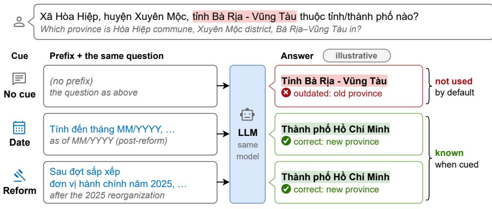
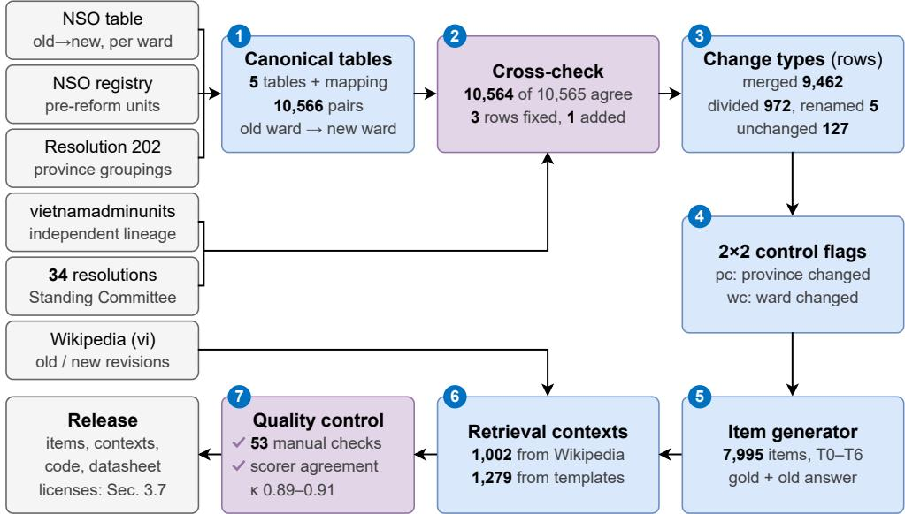
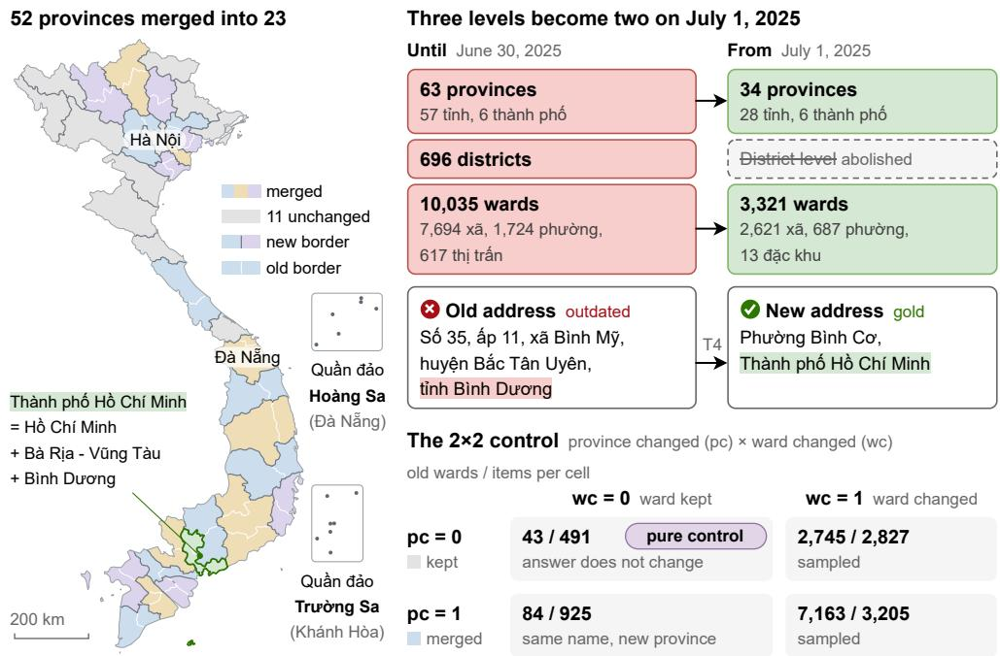
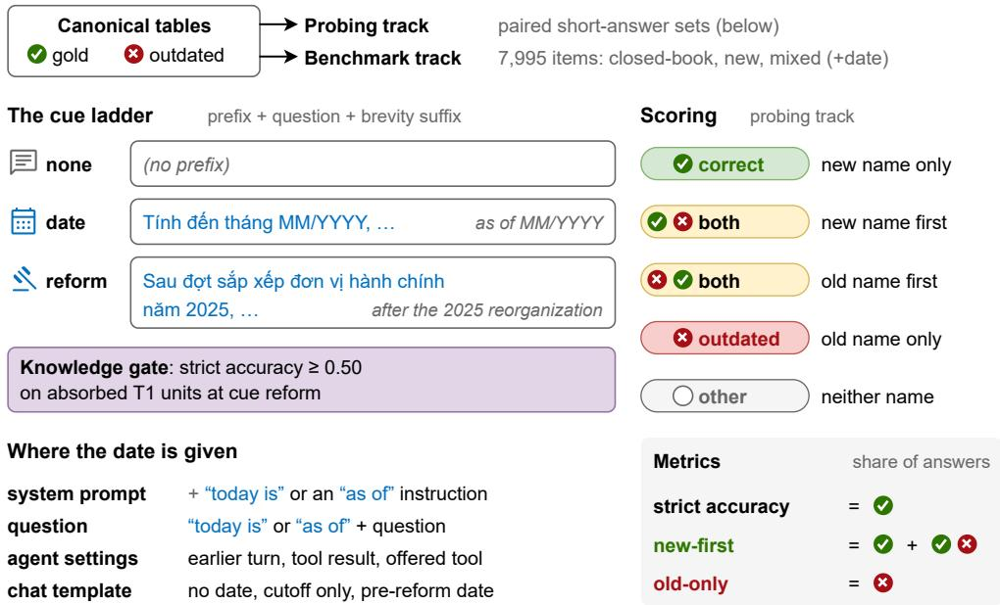
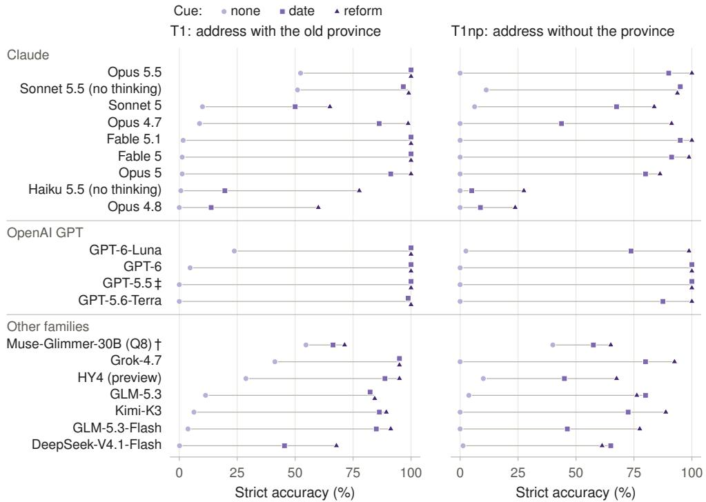
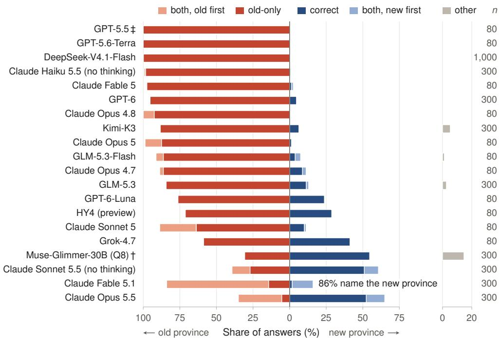
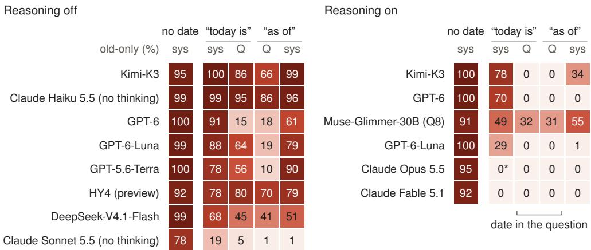
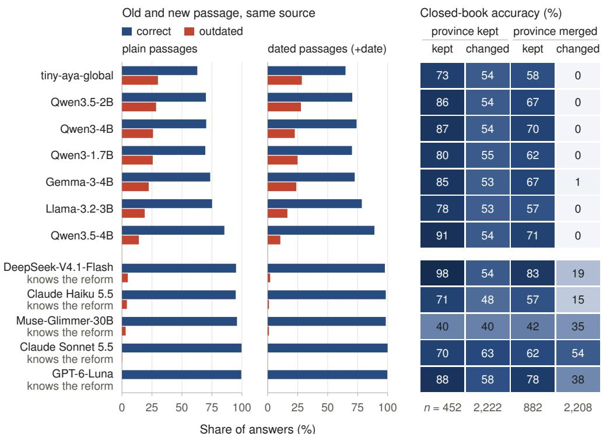

# ViAdminShift: A Vietnamese Benchmark for Event-Level Knowledge Updates Built from the 2025 Administrative Reform Phan Binh Nguyen Lam1 and Nguyen Thai Anh2\*

1Faculty of Information Technology, University of Science, Vietnam National University, Ho Chi Minh City, Vietnam.

2\*Faculty of Information Technology, Van Lang School of Technology, Van Lang University, Ho Chi Minh City, Vietnam.

\*Corresponding author(s). E-mail(s): anh.nt@vlu.edu.vn;   
Contributing authors: 24125014@student.hcmus.edu.vn;

## Abstract

On July 1, 2025, Vietnam reduced its 63 provinces to 34, abolished its 696 districts, and replaced its 10,035 commune-level units (wards) with 3,321. ViAdminShift, a Vietnamese language resource about this event, consists of 7,995 benchmark items, 2,281 retrieval passages from pre- and post-reform Wikipedia revisions and dated templates, and old-to-new tables that a released script rebuilds from the official conversion table (not redistributed). Changed items store the pre-reform answer (except 121 address items), a 2×2 design uses untouched units as controls, and 400 addresses appear without diacritics. The tables agree with an independent lineage on 10,564 of 10,565 official pairs, disagreements were settled against the resolutions, and the probing-track scorer agrees with both authors’ blind labels (Cohen’s κ = 0.91 and 0.89). Data, outputs, code, and a datasheet are released. In the probing track, at least 20 of 67 models know the reform. Fourteen of them give the new province alone for at most 11% of plain questions about old addresses (old province only: 14–100%); a bare date recovers up to 100%. Post hoc (80 province-free addresses, single runs), with reasoning off, today’s date in the system prompt leaves 68–100% oldprovince-only answers for 10 of 12 models; with reasoning, an “as of” prefix in the question leaves none for seven of eight. On the 1,262-item benchmark subset, with same-source old and new passages, small models unaware of the reform give 14–30% outdated answers and the five benchmark-track knowers (also differing in size or provider) 0–5%.

Keywords: Vietnamese language resources, Benchmark dataset, Temporal knowledge, Knowledge updates, Large language models, Administrative divisions

  
14 of the 20 models that know the reform give the new province alone for at most 11% of plain questions about old addresses, while a bare date recovers up to 100%.  
Fig. 1 Most models that know the 2025 update do not use it by default. One model gets the same question with no cue, a bare post-reform date, or the reform named. Red marks the old province, green the new one, blue the cue prefixes, and gray italics the English glosses. The answers are illustrative; Fig. 5 gives the data, and the band the headline result (Section 5.2).

## 1 Introduction

This paper presents ViAdminShift, a Vietnamese language resource built around one real event that changed thousands of facts at once, and reports what it reveals about large language models (LLMs). LLMs are trained on a fixed snapshot of text, while facts keep changing. Many resources sample isolated facts that changed for unrelated reasons, such as a soccer player’s club or an office holder (Section 2). Real updates often arrive as events, and a model that has absorbed an event should update every fact it entails. A model may also hold an update without using it, answering a plain question from the old map and a dated one from the new (Fig. 1).

Vietnam’s 2025 administrative reform is such an event. Adopted on June 12, 2025, Resolution 202/2025/QH15 reduced the 63 provincial-level units to 34: 23 new units were formed by merging two or three old ones, and 11 were left unchanged (Quốc hội nước Cộng hòa xã hội chủ nghĩa Việt Nam 2025b). The Law on the Organization of Local Government left two levels, province and commune, and ended district governments on July 1, 2025 (Quốc hội nước Cộng hòa xã hội chủ nghĩa Việt Nam 2025a). At the commune level, the National Assembly Standing Committee approved 3,321 units in place of 10,035, in principle on June 5 (TTXVN/VietnamPlus 2025) and formally in Resolutions 1654–1687/NQ-UBTVQH15 of June 16, 2025. We call every communelevel unit a ward: xã (rural commune), phường (urban ward), thị trấn (township), or đặc khu (special zone). Every ward of the 52 merged provinces now belongs to a new province, often under another name; almost all wards were merged, renamed, or divided; and every postal address lost its district segment: Phường Bến Nghé, Quận 1, Thành phố Hồ Chí Minh is now Phường Sài Gòn, Thành phố Hồ Chí Minh.

Three properties make the event a good basis for a language resource. Its date is exact, and it was adopted and reported weeks before the new units began to operate on July 1, 2025 (TTXVN/VietnamPlus 2025; Quốc hội nước Cộng hòa xã hội chủ nghĩa Việt Nam 2025b), so a model whose training data end in that window may know the headline without the details. Its consequences are specified by official tables, so gold answers are not a matter of judgment. And the units it left untouched form a built-in control group that separates outdated answers from other errors. The change also matters in practice: services must convert addresses between the two structures, open-source converters appeared soon after the reform (Tran 2025), and pre- and post-reform documents coexist in retrieval stores. Translating an English temporal benchmark cannot produce such a resource: the sources exist only in Vietnamese, and the facts live in Vietnamese administrative naming, with changed unit-type words, recurring names, and omitted diacritics (Section 3.4).

We therefore build ViAdminShift from the official sources: deterministic templates, not an LLM, turn its canonical tables into questions with exact gold and pre-reform answers. The resource supports a sharper question than “does the model know the new map?”: when a model knows the new map, does it use it? We call the behavior in Fig. 1 the temporal default: the model holds both maps and, unless the question is anchored in time, answers from the old one. Log-probability comparisons (Hossain et al. 2026) and answers (Zhao et al. 2024) of pretrained models show a similar preference for older facts; we show it in the generated answers of deployed models, for an event-level change, with premise controls. Alongside strict accuracy (the new name alone), the prespecified headline metric, we report old-only answers (Section 4.5), which give a user no sign of being outdated. Our contributions are:

• Canonical tables of the reform. Tables of the units before and after the reform and 10,566 old-to-new ward pairs, derived from the official conversion table (Cục Thống kê 2025), checked against an independent source lineage and the resolutions, and rebuilt by a released script (Section 3.1).

• A benchmark with built-in controls. Items of seven types, from headline facts to ward-level address conversion, that store the pre-reform answer where it differs (except 121 address items), place ward-level items in a 2×2 design (province changed × ward changed), and include diacritic-free address twins (Sections 3.2–3.4). Eight local models (seven unaware of the reform) and four API models that know it ran all 7,995 items closed-book and, except three API models (1,460), with mixed passages.

• Paired retrieval contexts. Pre- and post-reform revisions of the same Vietnamese Wikipedia articles where they exist, and dated templates for the rest, which supply the new passage of 79% of the items (Section 3.5).

• Evaluation sets, scorers, and documentation. Paired item sets that differ only in a temporal cue, a date’s position, or a dropped address component; rule-based scorers with Vietnamese-specific normalization (the probing-track scorer validated against both authors’ blind labels); and a datasheet (Gebru et al. 2021), a data statement (Bender and Friedman 2018), and a versioning plan (Sections 3.6–3.7).

• What the resource reveals. We probe 67 models (Section 4.2). Of the 20 that know the reform, 14 give the new province alone for at most 11% of plain questions about old addresses, and a bare date recovers up to 100% (Section 5.2). Post hoc, for most models, a date in the question leaves fewer old-only answers than the same date in the system prompt (Section 5.3). In the benchmark track, small models unaware of the reform give outdated answers with mixed passages far more often than the five that know it, which also differ in size or provider (Section 5.4).

## 2 Related Work

## 2.1 Temporal and outdated knowledge

Early work probed facts that change over time (Dhingra et al. 2022) and answers that depend on when a question is asked (Zhang and Choi 2021). TimeQA (Chen et al. 2021) and TempReason (Tan et al. 2023) ask for a Wikidata fact at a time stated in the question (or, in TempReason, relative to another event), TDBench (Kim et al. 2026) generates time-sensitive questions from temporal databases, and other benchmarks follow change through consecutive Wikipedia and Wikidata snapshots (Jang et al. 2022) or regularly refreshed questions (Kasai et al. 2023; Vu et al. 2024).

Closest to our design, EvolvingQA (Kim et al. 2024) scores the outdated answer of each edited fact next to the updated one and adds unchanged facts, as our stored old answers and control units do, but GPT-3.5 writes its questions, and it tests the continual pretraining of T5 rather than the prompting of deployed LLMs. ChroKnow-Bench (Park et al. 2025) contrasts changed facts with independently sampled facts that could have changed but did not; our controls are the units that the same event left untouched. WikiRecentChanges (Wallat et al. 2026) also pairs changed with stable facts. In evolveQA (Nakshatri et al. 2025), models often pick the current answer in multiple choice but an outdated one in free-form answers. LLMs still give outdated answers (Tang et al. 2025), and outdated context misleads them (Zhu et al. 2025).

Hossain et al. (2026) define parametric temporal conflict (PTC): in four openweight base models, the older position holder outscores the newer, still recoverable one for 4.1–10.3% of the retained transitions, and a one-line date prefix restores the newer holder in 61–81% of these. ViAdminShift instead covers one real, event-level update, with stored pre-reform answers and unchanged units as a built-in control.

## 2.2 Where the present date is given

Prior resources fix the present implicitly or state the date in fixed positions (Table 1). A date-and-cutoff prefix brings mostly small gains (Wallat et al. 2026), and a date hint that precedes the model’s cutoff changes accuracy little (Nakshatri et al. 2025). Sanz-Guerrero et al. (2026) show that the chat templates of Llama 3.1 and gpt-oss, and some API providers, insert the current date into the system prompt, and that changing only this date moves scores on time-independent benchmarks by up to 14 points. Herel et al. (2025) compare wordings of a date prefix in one position, and in RT-QA (Zhou et al. 2026), search agents given the timestamp in the system prompt reanchor to past dates that they retrieve. Placement matters for other prompt content, such as the answer instruction of an Italian benchmark (Musacchio et al. 2026); we compare system-prompt, in-question, earlier-turn, and tool placements of the same date on time-sensitive facts (post hoc; Section 5.3).

Table 1 ViAdminShift and resources for temporal and outdated knowledge, as reported in TimeQA (Chen et al. 2021), TempReason (Tan et al. 2023), ChroKnowBench (Park et al. 2025), EvolvingQA (Kim et al. 2024), EvolveBench (Zhu et al. 2025), evolveQA (Nakshatri et al. 2025), WikiRecentChanges (Wallat et al. 2026), PTC (Hossain et al. 2026), FreshQA (Vu et al. 2024), and RT-QA (Zhou et al. 2026). Ctrl.: unchanged facts are scored with the changed ones. Old: an answer correct before the change is scored as outdated for a later time. Present date: where the model is told the current date. n/a: not stated or not verifiable. Licenses: TimeQA, BSD-3-Clause; TempReason, CC BY-SA 3.0; ChroKnowBench, CC BY 4.0; PTC, MIT (dataset card); FreshQA, Apache-2.0. The evolveQA data are not released.
<table><tr><td>Resource</td><td>Lang.</td><td>Size</td><td>Source and construction</td><td>Ctrl.</td><td>Old</td><td>Present date</td></tr><tr><td>TimeQA</td><td>En</td><td>~20k per version</td><td>Crowd-verified Wikidata facts, template questions; year, month</td><td>No</td><td>No</td><td>None (time in question)</td></tr><tr><td>TempReason</td><td>En</td><td>13,823 (test)</td><td>Wikidata 2022 and synthetic date arithmetic; month, year</td><td>No</td><td>Training only</td><td>None (time in question)</td></tr><tr><td>ChroKnow- Bench</td><td>En</td><td>37,606 variant, 27,373 invariant</td><td>Wikidata, UMLS, US federal regulations (variant); CSKG, Math-KG (invariant); yearly</td><td>Yes</td><td>No</td><td>None (year in query)</td></tr><tr><td>EvolvingQA</td><td>En</td><td>23,283 edited, 49,504 unchanged, 198,109 new</td><td>Monthly Wikipedia diffs (2023), QA written by GPT-3.5</td><td>Yes</td><td>Yes</td><td>n/a</td></tr><tr><td>EvolveBench</td><td>En</td><td>1,640 (132 subjects)</td><td>Wikidata histories, partly updated by hand; GPT-4o contexts; day</td><td>No</td><td>No</td><td>User prompt</td></tr><tr><td>evolveQA</td><td>En</td><td>922</td><td>AWS, Azure, and WHO update corpora; LLM-written questions</td><td>Yes</td><td>Yes</td><td>Hint before the cutoff</td></tr><tr><td>WikiRecent- Changes</td><td>En</td><td>~2.4k changed, 2,381 stable</td><td>Wikidata changes of 2025, contexts by Qwen-3-14B</td><td>Yes</td><td>No</td><td>Prefix with date and cutoff (one variant)</td></tr><tr><td>PTC benchmark</td><td>En</td><td>8,746 transitions</td><td>Wikidata, five position-holder No relations, 2010–2024</td><td></td><td>Yes</td><td>None (time in question)</td></tr><tr><td>FreshQA</td><td>En</td><td>600</td><td>Human-written questions, mixed topics</td><td>Partly n/a</td><td></td><td>Few-shot answers, with dated evidence</td></tr><tr><td>RT-QA</td><td>Zh</td><td>320</td><td>Crawling workflows over live websites, checked by hand</td><td>No</td><td>n/a</td><td>(FreshPrompt) System prompt</td></tr><tr><td>VIADMINSHIFT Vi (ours)</td><td></td><td>7,995 items, 10,566 mapping pairs (rebuilt by script)</td><td>Official table of the National Statistics Office (NSO), cross-checked; deterministic templates; real Wikipedia</td><td>Yes (2×2)</td><td>Yes</td><td>None, system prompt, question, earlier turn,</td></tr></table>

## 2.3 Knowledge conflicts, outdated retrieval, and editing

When retrieved context contradicts parametric memory, fine-tuned QA readers overrely on memorized answers under entity substitution (Longpre et al. 2021), while LLMs accept coherent counterevidence but, given both supporting and conflicting evidence, often side with memory (Xie et al. 2024). Outdated documents in a retrieval store distract models from current information (Ouyang et al. 2025), and several versions of a fact in context mislead models (Ozer and Yıldız¨ 2025). Many conflict sets use substituted, constructed, or LLM-generated contexts (Longpre et al. 2021; Xie et al. 2024; Wallat et al. 2026), whereas each of our mixed passages was true at its date: a real Wikipedia revision or, without an article, a dated template (Section 3.5).

Knowledge-editing benchmarks ask whether an injected fact spreads to entailed and multi-hop facts (Cohen et al. 2024), and work on event-level editing (Peng et al. 2024) argues that real updates arrive as events that change many triples at once. Many of these edits are counterfactual or constructed, and even real-change subsets, such as the Recent subset of RippleEdits (Cohen et al. 2024), inject each change as an independent triple. The reform is a real event-level “edit”: we edit nothing and ask whether a model that knows the headline carries it to the entailed ward-level facts.

## 2.4 Vietnamese and Southeast Asian evaluation

Vietnamese LLM benchmarks cover school exams with geography questions (Dao et al. 2023), general multitask understanding (Nguyen et al. 2024; Bui et al. 2025), and law. VLegal-Bench (Nguyen et al. 2026) reports “recency blindness” in article prediction (models pick outdated legislation over 2024–2025 instruments) and includes one task on amendment and replacement relations between legal documents, but none of these benchmarks is built around a real-world knowledge update. AC-IQuAD (Doxolodeo and Krisnadhi 2025) generates Indonesian questions from Wikidata triples and reports that low-content, probably bot-created Wikipedia articles on districts skewed its questions toward administrative units; most Vietnamese wards have no article, so many of our passages are generated from the tables (Section 3.5).

## 3 The ViAdminShift Resource

## 3.1 Sources and canonical tables

The backbone of ViAdminShift (Fig. 2) is the official old-to-new conversion table (Cục Thống kê 2025), which lists the old wards of every new ward. It is published by the National Statistics Office (NSO, Cục Thống kê). The pre-reform units come from the same office’s registry, as distributed with vietnamadminunits (Tran 2025); all its 10,035 wards occur in the NSO table. Province-level groupings were transcribed from Resolution 202/2025/QH15 (Quốc hội nước Cộng hòa xã hội chủ nghĩa Việt Nam 2025b), and the build aborts unless the NSO table implies exactly these groupings. We derive five canonical tables, with 63 provinces, 696 districts, and 10,035 wards before the reform and 34 provinces and 3,321 wards after it (Fig. 3, top right), and a mapping with one row for each of the 10,566 (old ward, new ward) pairs.

For cross-checking we use vietnamadminunits (Tran 2025), a mapping built independently from the composition texts of the government’s merger portal. Two further public mappings copy these lineages: undertheseanlp/address (undertheseanlp 2026) copies vietnamadminunits, and vietaddr (vnwooplugins 2026) the NSO table. The two lineages agree on 10,564 of the 10,565 pairs in the NSO table. We resolved every disagreement against the 34 ward-level resolutions of the National Assembly Standing Committee: we read the relevant clauses in all but five same-name cases, which an automated comparison of every clause with the mapping confirmed. The NSO table was right except for three wrong old-ward codes (corrected) and one omitted pair (added), a ward split between two new wards. The other 32 pairs only in vietnamadminunits contradict the resolutions (mostly same-name confusions).

  
Fig. 2 ViAdminShift is built from official sources (Wikipedia only for the retrieval contexts), cross checked, and released with its documentation; the numbers are those of Sections 3.1–3.7.

## 3.2 Change types and the 2×2 control

Each mapping row from old ward o to new ward n gets the first applicable change type: divided if o maps to more than one new ward (972 rows, 441 old wards), merged if n is formed from more than one old ward (9,462 rows, including 1,641 in which n keeps o’s name), unchanged if the mapping is one-to-one and name and unit type are kept (127), and renamed otherwise (5). Because divided wards have no unique successor, they appear only in items that ask for the new province.

Each ward-level item carries two flags (Fig. 3, bottom right): pc (province changed), true when the old province was merged, even if the new province kept its name, and wc (ward changed), true unless the change type is unchanged. In the pure control (pc = 0, wc = 0) the answer did not change (Xã Mù Cả in Mường Tè, Lai Châu), so an outdated answer about the reform there can only be a T4 address in the pre-reform three-level form. In the cell pc = 1, wc = 0, a ward keeps its name but changes province (Xã Ngọc Long in Yên Minh, Hà Giang, now in Tỉnh Tuyên Quang).

## 3.3 Item types

Table 2 lists the seven item types: T0, T2, and T6 ask about headline and provincelevel facts, and T1, T4, T5, and part of T3 about the facts that the reform entails for individual wards. T1, T5, and T6 items come in three cue variants that differ only in a prefix (Section 4.3). Items whose answer changed also store the pre-reform answer (old\_answer), which multiple-choice items include as a distractor, so a wrong answer can be labeled outdated. The field is empty where the two answers coincide, for 121 T4 items whose ward and province names did not change, and for 87 new-name T1 items about wards whose name did not exist before the reform (2,989 items in all).

  
Fig. 3 The reform merged 52 of the 63 provinces into 23 new ones and removed the district level, and the 2×2 control separates outdated answers from other errors. Left: the 34 provinces since July 1, 2025 (Quốc hội nước Cộng hòa xã hội chủ nghĩa Việt Nam 2025b); merged provinces have pastel fills with their old borders in white, unchanged ones are gray, and the running example of Fig. 1 is green. Top right: the structure on June 30, 2025 (red) and on July 1, 2025 (green), with pre-reform unit types as officially reported (Báo Điện tử Chính phủ 2025), and one T4 item (real unit names; synthetic house number and hamlet). Bottom right: old wards in the full mapping / benchmark items per cell (all ward-level item types, before removing the 779 copyable items of Section 3.3), crossing whether the old province was merged (pc) with whether the ward changed (wc); the pure control is purple. The 547 items about provinces, districts, or headline facts have no cell. Boundaries: geoBoundaries (public domain; Runfola et al. 2020), simplified; Hoàng Sa and Trường Sa are shown schematically.

The control cells (wc = 0) are used in full, and the two changed cells are sampled round-robin over old provinces, using only old wards whose names changed: for pc = 1 the province name, and for wc = 1 the bare name of every successor. Ward-level items (T1, T3–T5) cover 1,708 of the 10,035 old wards and 57 of the 63 old provinces. In 849 T4 and T5 items with a changed answer (109 of the 1,262-item subset of Section 4.1), the new ward’s bare name occurs in the question, compared without diacritics (118 of them are diacritic-free T4 twins). In 779 of them (104 in the subset), the ward was renamed, so the answer can be copied; the other 70 are T4 addresses of wards that kept their name, where only the province changed and nothing is leaked. We remove the 779 items from the 2×2 analysis and the released per-type tables. Elsewhere they are kept, and removing them changes accuracy by at most 4.1 percentage points closedbook and 4.8 points with a retrieved context, for any model and condition (all 849: 4.1 and 5.4).

Table 2 Item types with one real (cue-free) item each and the number of items. Multiple-choice (MCQ) items have four options: the gold, the outdated answer if one exists, and the nearest new provinces (T1, T6) or new wards of the same new province (T5).
<table><tr><td>Type</td><td>Example (Vietnamese; English gloss)</td><td>Gold outdated answer</td><td>Items</td></tr><tr><td>T0 headline (MCQ, short)</td><td>Cå nưc hin có tng cng bao nhiêu tinh và thành phô trc thuc trung ưong? How many provinces and centrally run cities does the country have now?</td><td>34 / 63</td><td>12</td></tr><tr><td>T6 reverse (MCQ, short)</td><td>Đa bàn tinh Bình Dưong thuc đon vi hành chính cp tinh nào? Which provincial-level unit is the area of Binh Duong province in?</td><td>Thành ph Hồ Chí Minh / Tinh Bình Dưong</td><td>378</td></tr><tr><td>T2 composition (MCQ)</td><td>Thành ph Hồ Chí Minh hin nay đưc hình thành t (nhng) đơn v hành chính cp tinh nào trưc đây? Which former provincial units is Ho Chi Minh City (HCMC) now formed from?</td><td>HCMC, Bà Ra-Vūng Tàu, and Bình Dưong / HCMC only</td><td>34</td></tr><tr><td>T1 membership (MCQ)</td><td>Xā Hòa Hip, huyn Xuyên Mc, tinh Bà Ra - Vūng Tàu thuc tinh/thành ph nào? Which province is Hòa Hiêp commune, Xuyên Mc district, Bà Ria−Vūng Tàu in?</td><td>Thành ph Hồ Chí Minh / Tinh Bà Ra - Vūng Tàu</td><td>2,781</td></tr><tr><td>T1 new name (MCQ) T3 existence</td><td>Phưng Thun Giao thuc tinh/thành phô nào? Which province is (the new) Thun Giao ward in? Hin nay, tinh Bình Dương có phi là mt đơn vi</td><td>Thành ph Hồ Chí Minh / Tinh Bình Dưong No / yes, provincial level</td><td>720</td></tr><tr><td>(MCQ)</td><td>hành chính đang tồn ti không? Nu có, đó là đon vi hành chính cp nào? Is Bình Duong province an existing administrative unit today? If so, of which level? Đa chi cū: S 35, p 11, xã Bình My, huyn Bc</td><td></td><td></td></tr><tr><td>(short)</td><td>Tân Uyên, tinh Bình Dưong. Da chi này hin nay đưc vit theo đơn v hành chính hai cp (cp xã, cp tinh) như th nào? Old address: No. 35, hamlet 11, Binh My commune, Båc Tân Uyên district, Binh Duong. How is it written in the two-level structure?</td><td>ph Hồ Chí Minh / (old address)</td><td></td></tr><tr><td>T5 successor (MCQ, short)</td><td>Đa bàn xã Lc An, huyn Bc Tân Uyên, tinh Bình Xā Thưng Tân / Xā Lc 2,562 Dưong thuc đơn v hành chính cp xã nào? Which commune-level unit is the area of Ląc An commune (Båc Tân Uyên, Binh Duong) in?</td><td>An</td><td></td></tr><tr><td>Total</td><td>5,320 MCQ and 2,675 short-answer items, among them 400 diacritic-free T4 twins</td><td></td><td>7,995</td></tr></table>

## 3.4 Vietnamese-specific properties

Counts in this section come from the undertheseanlp/address copy of the independent lineage.

Naming. White space separates every syllable, so it does not mark word boundaries (Nguyen et al. 2018). Both scorers therefore strip the unit-type word before each name (the reform changed this word for some units) and match names as sequences of whole syllables. The benchmark-track scorer also compares that word by level and never accepts thành phố (a city or a district) for a ward. Names recur: 43% of prereform wards share their bare name with another (Tân Thành occurs 34 times), so every item about an old ward names its old district and province.

Spelling. Users often type Vietnamese without diacritics, which makes text ambiguous (Dang and Nguyen 2020): without them, 17.5% of pre-reform wards share their name with a differently spelled ward (Tân Thanh, Tân Thành, Tân Thạnh). Half of the 800 T4 addresses therefore also appear as diacritic-free twins, which the benchmark-track scorer matches without diacritics, mapping đ to d. Tone marks in oa, oe, and uy follow one of two conventions (Hòa or Hoà) that Unicode normalization (NFC) does not unify. Both scorers unify them (and dashes), which changes 147 of 121,324 cue-ladder labels (post hoc).

## 3.5 Retrieval contexts

For each province and district article of Vietnamese Wikipedia, we take the last revision before June 12, 2025, that does not yet describe the reform, and the last revision before January 1, 2026, if it postdates July 15, 2025. Passages are excerpts of at most 1,250 characters from the lead or the administrative section. Most wards have no article, so the other items use template passages generated from the canonical tables in the same format, dated June 1 or October 1, 2025, and citing the relevant resolution. The 2,281 passages used are 1,002 Wikipedia excerpts (575 old, 427 new) and 1,279 templates (277 old, 1,002 new). The new condition shows the relevant new passage(s), and the mixed condition old and new passages in a fixed shuffled order.

## 3.6 Quality control

The adjudication of Section 3.1 used HTML reproductions of the resolutions, not the official scans; the manual checks used the official texts. The authors found no error in 53 manual checks: 30 random mapping rows (seed 13, from 30 different new provinces) with the full composition of their new wards; 11 targeted checks of divided, conflicting, or corrected units; and the gold answers of the 12 T0 items, checked against Resolution 202/2025/QH15. The authors read every cited clause and made each judgment themselves; the checklist was prepared with Claude’s help. Audit code written separately from the generator (both with Claude’s help) rederived the gold and old answers of the other 7,983 items and found no gold error; a linter found no old answer scored as correct and no malformed options.

The two authors, both native speakers, labeled 200 probing-track answers to absorbed T1 and T1np units (Section 4.3; 40 per scorer label when sampled, both split by name order) independently and blind: their sheets showed neither the scorer’s label nor the model and listed the rows in different orders. They agree with each other on 97% (κ = 0.96) and with the scorer on 93% and 92% (κ = 0.91 and 0.89). Most disagreements (13 of 14 and 15 of 17) go against the scoring rules, which the authors know: for an answer that names both provinces, the scorer takes the name given first and the guideline the province the answer commits to. The scorer thus undercounts new-first answers: the annotators read about a third of its sampled old-first answers as new-first, among them long explanations that end on the new province (including all four sampled from Claude Opus 4.8). Besides the copyable items, two item issues remain: 19 T3 items about new wards do not separate outdated from updated models, and three T1 items about Xã Đồng Nai name its new province.

## 3.7 Release, versioning, and maintenance

The release contains the items, the retrieval contexts, the evaluation sets of Section 4 (with the exact prompts), the model outputs behind every result, the scorers, the analysis scripts, and a datasheet (Gebru et al. 2021). Data, model outputs, and annotation sheets are released under CC BY-SA 4.0 (required for the Wikipedia passages; outputs of tiny-aya-global: CC BY-NC-SA 4.0), and the code under the MIT license; users of hosted-model outputs must also follow the providers’ terms. The items contain only unit names, old-to-new assignments, and official unit codes, facts set by public legal acts. The NSO file carries no explicit license; no source file with NSO or government-portal data is redistributed, nor are the canonical tables, which reproduce the NSO file as a whole; the released code downloads these files and, if they match the versions used here, rebuilds the tables byte for byte.

Version 2025-07-01 describes the structure in force on July 1, 2025 (“old” is the structure on June 30, 2025). Items about the present (“now,” hiện nay) refer to this date, and gold answers under the later date cue assume that no name or membership changed in between. Later changes we know of concern unit type only. Between April 30 and September 20, 2026, Đồng Nai, Quảng Ninh, and Bắc Ninh became centrally run cities with the same name and territory (Resolutions 30, 36, and 39/2026/QH16), and 10 xã of Đồng Nai and 12 of Bắc Ninh became phường under the same names (Resolutions 237 and 388/NQ-UBTVQH16). The date in the “as of” cue and in the “today is” sentence (Section 4.3) falls after the 2025 reform and after all of these 2026 changes. Because the scorers strip unit-type words and options differ by name, only T3 items, which name the unit type, are affected: four of them (T3-prov-22, -27, -75, and T3-dist-256) are correct only at the version date, and none about a ward names one of the 22 communes that became phường. Later versions will be rebuilt from then-current official sources, and released versions will remain unchanged. The resource is maintained by the corresponding author; errors can be reported on the repository’s issue tracker, and confirmed corrections are listed in the changelog.

## 4 Experimental Setup

## 4.1 Two evaluation tracks

Both tracks take gold and outdated answers from the canonical tables (Section 3.1; Fig. 4, top). The probing track uses small, paired short-answer sets whose questions exist in versions that differ only in a cue, a system prompt, or one dropped component, so comparisons are paired by unit. The benchmark track runs all 7,995 released items (Section 3.3) or a seeded 1,262-item subset stratified by item type and format, covering every 2×2 cell, closed-book and under the new and mixed conditions of Section 3.5, the latter also with dated passage headers (+date). Eight local models ran it (seven small ones of 1.7B to 4B unaware of the reform, and Muse-Glimmer-30B, which ran new and +date only on the subset), as did four API models aware of it: DeepSeek-V4.1-Flash on all items in all conditions, and GPT-6-Luna, Claude Haiku 5.5, and Sonnet 5.5, which ran with passages only on the subset and the 220 items with a new Wikipedia excerpt and an old template passage (22 of them in the subset; 1,460 in all).

  
Fig. 4 Evaluation design. Top: the gold and outdated answers that both tracks share, and the benchmark track’s conditions. Left: the probing track’s cue ladder, its knowledge gate (purple), and where a date can be given. Right: how probing-track answers are labeled and counted as strict accuracy (prespecified), new-first, and old-only (the last two post hoc). Green, new name; red, old name; yellow, both names; blue, the added cue or date; gray italics, English glosses.

## 4.2 Models and inference

We evaluate 67 distinct models, 26 local and 41 only through APIs, with Qwen3.8-27B on both routes (Table 3); reruns for route and reasoning comparisons are not counted. Local models use Q8\_0 GGUF weights, except gpt-oss-20B (MXFP4) and, in the probing track only, nine that we converted to bf16. The reseller OmniRoute does not name its upstream provider; with no cue, Claude Opus 5.5 answers 41 of the same 80 absorbed T1 units correctly through the first-party API and 44 through the reseller, and Qwen3.8-27B fails the gate on both routes.

Decoding is greedy (temperature 0) where the API accepts it (not for Claude models from Opus 4.7 on), and reasoning is set as low as each route allows (Table 3). Because API flags do not reveal whether a model reasoned, we measure it: an item counts as reasoned if the API returns reasoning text or the reported completion tokens exceed the visible length (UTF-8 bytes/3) by more than 40, which holds for 3,056 of the 3,057 cue-ladder items of Claude Opus 5.5 and for no placement item of DeepSeek-V4.1-Flash. The measure also shows reasoning on most reseller models despite the disabled flag (Table 3); the knowers (Section 4.4) GPT-6, GPT-5.5, Kimi-K3, and GLM-5.3 reasoned on 97–100% of absorbed items with today’s date in the system prompt. GPT-6 and Kimi-K3 were therefore rerun via OpenRouter with reasoning off and on for the date experiments; the other reseller models were not rerun. Benchmark-track answers are capped at 16/64 tokens (MCQ/short; Muse-Glimmer 1,024, without its template date) and scored even if truncated. Claude answers that hit the cap were re-asked at 64/128, then 512 (Sonnet started at 64/128; all cut answers but Haiku’s 296 at 64/128 are released); 85 Sonnet answers remain truncated. Counting as invalid Sonnet’s 221 subset answers longer than any uncut answer of Haiku’s 16/64 pass (12 UTF-8 bytes for MCQ, 153 for short) lowers its closed-book subset accuracy from 71% to 63%. Sonnet ran as in its no-thinking probe, Haiku and GPT-6-Luna via OpenRouter (temperature 0 requested, reasoning off, provider not recorded; Haiku’s gate probe on the first-party API); reasoning was not measured.

Table 3 Evaluated models by access route (number in parentheses). Local model names state the size, except Ling-3.0-tiny; most API models do not disclose it. The last column gives the requested setting and, for three routes, the measured share of cue-ladder items with reasoning (Section 4.2).
<table><tr><td>Route</td><td>Models</td><td>Reasoning setting</td></tr><tr><td>DeepSeek APÍ (2)</td><td>DeepSeek-V4.1-Flash, DeepSeek-V4-Pro</td><td>thinking: {type: disabled}</td></tr><tr><td>Anthropic API, OpenAI- compatible endpoint (13)</td><td>Claude Haiku 4.5, Opus 4.5, Sonnet 4.6, Opus 4.6, Opus 4.7, Opus 4.8, Sonnet 5, Opus 5, Fable 5, Fable 5.1, Haiku 5.5, Sonnet 5.5, Opus 5.5; Sonnet 5.5 (thinking off via between_tools), Haiku 5.5, and Fable 5.1 also run at a second setting</td><td>thinking disabled (measured: Opus 4.8 38%, Haiku 5.5 22% Sonnet 5.5 15%, others ≤8%); reasoning_effort: none for Opus 5.5 (100%), Fable 5 (75%), and Fable 5.1 (82%)</td></tr><tr><td>OmniRoute reseller (20)</td><td>GPT-6, GPT-5.5, gpt-oss-120B, Kimi-K3, Kimi-K2.5, GLM-5.3, GLM-5.3-Flash, Gemini-3.1-Pro, Gemini-3.8-Flash, Gemma-4-31B, MiMo-v2.6-Flash, MiMo- v2.6-Pro, MiniMax-M2.7, MiniMax-M3, Muse-Spark-1.2*, Qwen3.6-27B, Qwen3.8-27B, Qwen3.8-Flash*,</td><td>thinking disabled in the request, yet reasoning on 79–100% of items for GPT-6, GPT-5.5, Kimi-K3, both GLM-5.3, Gemini-3.1-Pro, gpt-oss-120B, MiniMax-M2.7, Qwen3.6-27B. and the invalid runs (*), and</td></tr><tr><td>OpenRouter, default provider routing (7)</td><td>Qwen3.8-Max, Qwen3.8-2.4T* GPT-6-Luna, GPT-5.6-Terra, Tencent HY4 reasoning: {enabled: (preview), Grok-4.7, Gemini-4-Argon, LongCat-2.0, Mistral-Large-4; reruns of GPT-6 and Kimi-K3, the benchmark run of 1ow} where reasoning cannot Claude Haiku 5.5; not counted: Step-5 (preview), stopped for budget after 117 of the 549 base items (gate: 68 of 80 correct)</td><td>on at most 50% for the rest false}, or true for the reasoning-on runs; {effort: be disabled (Grok-4.7, Gemini-4-Argon)</td></tr><tr><td>Local, llama.cpp server on GPU or CPU (26)</td><td>Muse-Glimmer-30B; Qwen3-1.7B, 4B, and 8B; Qwen3.5-2B, 4B, and 9B; Qwen3.5-9B- Kimi-K3-Distilled; Qwen3.6-35B-A3B; Qwen3.8-27B; Qwen-SEA-LION-v4.5-27B; Nemotron-SEA-LION-v4.8-30B-A3B; NVIDIA-Nemotron-3.5-Lightning-30B-A3B; Muse-Glimmer, gpt-oss-20B, SeaLLMs-v3-7B; MiMo-V2.6-Distill-Qwen-9B; Gemma-3-4B; Gemma-4-E4B; Llama-3.2-3B; Ministral-3-8B; Granite-4.2-3B and 8B; LFM2.5-8B-A1B; Ling-3.0-tiny; MiniCPM5-2B; gpt-oss-20B; tiny-aya-global (3.35B)</td><td>enable_thinking: false in the chat template (CPU runs also reasoning_effort: low); Muse-Glimmer at reasoning_strength: none; and LFM2.5-8B-A1B still reason on every cue-ladder item</td></tr></table>

Each cell is a single run (repeats for four models: Section 6.4). Hosted models can change behind a fixed identifier, need not be deterministic under greedy decoding (Atıl et al. 2025), and may add the current date (Sanz-Guerrero et al. 2026), so the released outputs are the reference for every number. Only the reseller was probed for a provideradded date: GPT-5.5 knew today’s date in all seven probes, so its no-cue conditions are not date-free; GPT-6, Kimi-K3, and both GLM-5.3 models did not (one-off recitations of a dated system prompt by Kimi-K3 and GLM-5.3 did not recur).

## 4.3 The cue ladder and date placement

Each question is asked at three cue levels that differ only in a prefix (Fig. 4, left): none; date, “Tính đến tháng ⟨MM/YYYY⟩, . . . ” (as of ⟨month year⟩); and reform, “Sau đợt sắp xếp đơn vị hành chính năm 2025, . . . ” (after the 2025 reorganization). Here and below, the date is a fixed post-reform date close to the time of the runs, the same in every prompt except the pre-reform controls; the exact strings are in the released item files. Every prompt ends with a brevity suffix (answer briefly with the name only; do not explain). Probes are short-answer versions of the T6, T1, and T5 items of Table 2. In T6 and T1, absorbed units (the old province merged into a differently named one) are the test and kept units the control; T1np drops the province and uses only ward– district pairs unique nationwide, so the old province must be recalled, not copied. In T5, renamed wards are the test and unrenamed ones the control, excluding items whose new ward name occurs in the old address (ignoring tone placement post hoc). The base set has 549 items: the 63 old provinces in T6 (29 absorbed, 34 kept) and 120 T1 units (80 absorbed, 40 kept). Knowers also answer 360 T1np items (120 units), some models a 2,589-item extension (63 provinces, 400 T1 and 400 T5 units), and the two DeepSeek models and Qwen3-4B its superset with 1,000 absorbed T1 units.

Date placement (post hoc). On the none questions of T6, T1, and T1np (303 items), a plain system prompt (you are a helpful assistant) is compared with the same prompt plus “Hôm nay là ngày ⟨DD/MM/YYYY⟩.” (today is ⟨date⟩). This “today is” sentence and the “as of” date each appear in the system prompt (there as an instruction) or in the question (four cells), and two controls give a pre-reform date (January 1, 2025, as today’s date in the system prompt, or “as of January 2025” in the question). Six models with reasoning off repeat the four cells on 300 absorbed T1np units from all 29 absorbed provinces. Agent settings give the date in an earlier turn, as a prior get\_current\_date result, or through an offered tool (with or without a call instruction), or let DeepSeek-V4.1-Flash, told the date, rewrite each question first. In Muse-Glimmer’s chat template, the block stating its cutoff and today’s date becomes no date, the cutoff only, or a pre-reform date. Further controls use post-reform ward names (240 wards), “hiện nay” (currently) or a content-free filler as prefix, no brevity suffix (three models), and three repeats of the 80 absorbed T1 units (four models).

## 4.4 Prespecified criteria

After a pilot (284 items, DeepSeek-V4.1-Flash) had suggested the effect, and before scoring the final ladder, we recorded these criteria in writing. A model knows the update (a knower) if its strict accuracy on absorbed T1 units at reform is at least 0.50 (the knowledge gate). Its knowledge is cue-dependent if reform−none on those units is at least 0.30 with a paired bootstrap 95% confidence interval excluding 0; as the gate requires 0.50 at reform, a knower can miss this only with a no-cue accuracy above

0.20. Premise-leak control: in models below the gate, reform−none on absorbed units must stay below 0.15, and in all models |reform−none| on kept units below 0.10; otherwise the cue effect is reported as partly premise-induced. Generality requires at least two model families that know the update to be cue-dependent. A validity rule in the gate script, not part of the recorded criteria, marks runs (one model and setting on one item set) with more than 20% empty outputs as invalid rather than negative. All other analyses, including every date-placement, agent, and template experiment, are post hoc and labeled as such in Section 5; benchmark-track analyses are descriptive.

## 4.5 Scoring

The probing-track scorer (Fig. 4, right; validated in Section 3.6) removes reasoning text and unit-type words (Section 3.4), normalizes answers (Unicode NFC, lowercase), and matches them as whole names against the gold and old names, with a small alias list. An answer is correct if it names only the new unit, outdated if only the old one, both if both, and other if neither (wrong unit, refusal, or empty). Strict accuracy (correct only) is the prespecified headline metric; counting both, which the recorded criteria did not anticipate, as not correct is a deviation that changes no gate decision. Post hoc, we split both by the name given first: new-first is correct plus both with the new name first, and old-only is outdated. The benchmark-track scorer also parses MCQ letters, labels unparsable answers and abstentions invalid, and counts Thừa Thiên Huế (renamed Huế on January 1, 2025) as outdated, which the probing-track scorer does not (kept units only). For short answers, it scores the whole first line, else an address segment by segment (a three-level one is outdated) and any other answer by the clause after a relation verb (unless negated), the first segment, or any name outside past clauses; one whose scored part names both the gold and the old unit is wrong, not both. Post hoc rules read a lone MCQ letter, name, or address on the last line, changing 15 labels of Haiku 5.5, 610 of Sonnet 5.5, and 69 of two small models.

## 4.6 Uncertainty

Absorbed wards of one old province share their old and new province, so unit-level intervals are too narrow (Miller 2024). Every interval is a paired cluster bootstrap (Field and Welsh 2007) over old provinces (B = 10,000; 24 or 29 provinces for absorbed units, 22 to 34 for kept units, and 7 to 11 for those in the 11 unchanged provinces), and an effect counts as established only when this 95% interval excludes zero and a Rademacher wild cluster bootstrap test gives $p \ < \ 0 . 0 5$ (Cameron and Miller 2015). Both postdate the fixed criteria: the prespecified criteria were evaluated with a unit-level paired bootstrap (B = 2,000), and clustering changes no prespecified decision of the 20 knowers. Over their reported runs, it removes the support of 10 cue effects established at the unit level (9 on kept units), and 18 more fail the wild test. At 0% or 100%, resampling intervals collapse (Bowyer et al. 2025); 0/80 is then compatible with true rates up to 14.2% (one-sided 97.5% Clopper–Pearson bound, treating the 24 provinces as the effective sample size). Intervals are not corrected for multiple comparisons, and by our power calculation (after Card et al. 2020, with a design effect of about 2), the 80-unit sets detect only differences of roughly 20 points or more.

## 5 Results

Bracketed intervals are province-clustered 95% intervals in percentage points (added post hoc; Section 4.6), and models run in the reasoning setting of Section 4.2 unless stated otherwise. Per-model tables with unit-level and clustered intervals are released.

## 5.1 Few models know the reform

The prespecified knowledge gate (Section 4.4) leaves 20 knowers among the 67 distinct models (Table 3); Fig. 5 names them. Only one of the 26 local open-weight models, Muse-Glimmer-30B, passes. The others, up to 35B parameters, rarely give the new province under any cue (strict accuracy on absorbed T1 units at most 5%). Three OpenRouter models below the gate answered only its 80 items (Mistral-Large-4, Gemini-4-Argon, and LongCat-2.0), so their no-cue rates and premise leak are unknown. Three runs are invalid (Section 4.4; ∗ in Table 3) and count neither as knowers nor as non-knowers, although two of them pass the gate despite their empty outputs (Muse-Spark-1.2, 97%; Qwen3.8-Flash, 56%), so the knower count is a lower bound. Closed-book on all 7,995 benchmark items (Sections 4.1–4.2; single runs, cues pooled; Claude with larger answer caps), the seven small models answer 32–35% correctly (49–53% outdated) and the five benchmark-track knowers 37–65% (8–47% outdated).

Depth. Models name the new province far more often than the new ward (descriptive). Of the knowers with T5 runs, GPT-6, Claude Opus 5.5, and Fable 5.1 name the successor of all 29 absorbed provinces (T6) with no cue but the new ward (T5) far less often (reform cue: Opus 65%, Fable 46%, GPT-6 40%). DeepSeek, GLM-5.3, Claude Haiku 5.5, and Muse-Glimmer know the new province of 68–84% of absorbed wards but the new ward of at most 4% of renamed wards. Empty answers (up to 45%, Claude Fable 5.1) make the T5 accuracy of reasoning models a lower bound.

## 5.2 Knowers default to the pre-reform map

With no cue (Fig. 5), 14 of the 20 knowers give only the new province for at most 11% of absorbed T1 wards. At most 16% of their answers name it first (post hoc split), and 14–100% are old-only (Fig. 6). GPT-5.5, whose no-cue condition is not date-free (Section 4.2), still answers old-only throughout. The other six sometimes answer the new province unprompted: Muse-Glimmer (55%; its template supplies the date), Claude Opus 5.5 (52%), Sonnet 5.5 (51%), Grok-4.7 (41%), HY4 (29%), and GPT-6-Luna (24%). On T1np, 19 of the 20 knowers stay at or below 11%. Either cue recovers the update: eight knowers reach 100% under the reform cue and six under the date cue. The two cues are within 13 points of each other except for four weaker knowers (date vs. reform cue: DeepSeek, 45 vs. 68%; Claude Haiku 5.5, 20 vs. 78%; Opus 4.8, 14 vs. 60%; Sonnet 5, 50 vs. 65%). Under the date cue, new-first rates lie within 9 points of strict accuracy for all 20 knowers, and old-only answers fall to at most 19%, except for DeepSeek-V4.1-Flash (54%) and Claude Haiku 5.5 (62%).

The prespecified cue-dependence criterion (unit-level paired bootstrap) holds for all 19 API knowers: the gain of the reform cue over no cue, $\Delta _ { \mathrm { { r e f o r m } } } ,$ is +48 to +100 points, and their cluster intervals all start at +38 or higher. With $\Delta _ { \mathrm { d a t e } } ,$ the gain of the date cue (which names no change), substituted after the criteria were fixed, every

  
Fig. 5 Knowers rarely give the new province unprompted; a date alone recovers it for most. Strict accuracy (%) on absorbed units, 20 knowers by family, sorted by T1 accuracy with no cue; left, T1; right, T1np. n = 80 to 1,000 units (T1), 80 (T1np); no intervals shown; coinciding marks are offset. †The chat template supplies the date. ‡On this route the model knew today’s date (Section 4.2).

API knower reaches the 30-point threshold except Claude Haiku 5.5 (+19 [11, 28]) and Opus 4.8 (+14 points), which gain +29 and +39 on the 80 base units with the plain system prompt (Section $4 . 3 ; + 1 5$ and +14 without it). The old-only rate of Opus 4.8 still falls from 92% to 10%, because 72% of its date-cue answers name both provinces, the old one first, in hedged explanations that end on the new one. Muse-Glimmer with its default template fails the criterion $( \Delta _ { \mathrm { r e f o r m } } = + 1 7 \ [ 8 , 2 6 ] , \Delta _ { \mathrm { d a t e } } = + 1 2 \ [ 3 , 2 1 ] )$ because the template supplies the date; without that date it is cue-dependent (post hoc; +61 [46, 76]; Section 5.3).

Premise-leak controls. On absorbed units, most non-knowers do not move under any cue. Three do move under the reform cue (MiniMax-M3 0 → 43%, MiMo-v2.6- Flash 0 → 21%, MiMo-v2.6-Pro $0  1 9 \% )$ and fail the prespecified premise-leak criterion $( < 0 . 1 5 )$ , consistent with guessing a plausible merger partner once a merger is named. Under the date cue, which names no change, they stay at 1–8%. We therefore treat $\Delta _ { \mathrm { d a t e } }$ as the main estimate of the default and $\Delta _ { \mathrm { { r e f o r m } } }$ as an upper bound.

Kept units. Under the prespecified kept-unit rule, the cue effects of 17 of the 41 valid non-knowers with kept data are partly premise-induced: the reform cue changes their kept units by 10 points or more, mostly on T6. Neither cue moves kept T1 and T6 units by over 3 points for DeepSeek, GPT-6, GPT-5.5, and the Claude Sonnet, Opus, and Fable knowers. Kimi-K3 and GLM-5.3 move kept wards to a neighboring province under both cues (−18 to −21 points on T1, −22 to −28 on T1np, all established). Muse-Glimmer does so under the reform cue $\left( - 1 2 \left[ - 2 3 , - 2 \right] \right)$ . On the T5 control (post hoc), the date and reform cues lower the accuracy by 20 points or more for Claude Sonnet 5.5 (−22 and −33), Haiku 5.5 with thinking $( - 2 1 , - 6 1 ;$ without ${ \mathrm { i t ~ } } - 2 , - 6 )$ and Muse-Glimmer (−20, −25). Claude Haiku 5.5 lies near the prespecified threshold without thinking $\left( - 9 \left[ - 1 7 , - 3 \right] \right.$ on T1) and fails it with thinking on T1np (−10 [−24, 0] under the reform cue; −18 [−33, −6] under the date cue). The kept-unit criterion uses point estimates on 34 to 337 units from 22 to 34 provinces, so decisions near ±10 points are uncertain. Six families have a model that passes every control (DeepSeek, Zhipu, Anthropic, OpenAI, Tencent, and xAI), which meets the generality criterion; the Moonshot model (Kimi-K3) and the Meta model (Muse-Glimmer without its template date) are cue-dependent but fail the kept-unit control.

  
Fig. 6 With no cue, most errors are silent old-only answers. Share of answers (%) on absorbed T1 units with no cue, sorted by the old-only rate. Light tints: both names, on the side of the name given first (post hoc). n: units; no intervals shown. †The chat template supplies the date. ‡On this route the model knew today’s date (Section 4.2).

Dual answers (post hoc). Outside the Claude family, almost no answer names both provinces (Fig. 6; GLM-5.3 2%, GLM-5.3-Flash 9%). Claude models often do: Fable 5.1 answers the old province and appends the change in 70% of cases (2% strict accuracy, but 86% of its answers mention the new province), whereas Opus 5.5 gives the new province alone or first in 65% (52% strict) and names both, old first, in 30%.

Generations. Of 13 Claude releases (descriptive), the four oldest do not know the reform (at most 5% of absorbed T1 units under any cue); the nine later ones do but give at most 10% on T1 with no cue, except Sonnet 5.5 and Opus 5.5 (51–52%).

Wording (post hoc). Without the old province in the question (T1np), oldonly answers remain the rule with no cue (DeepSeek 98%), so the old province is recalled rather than copied. The reform cue still helps every knower, by +24 to +100 points, and every cluster interval excludes zero (lowest interval: Claude Opus 4.8, +24 [12, 35]). Without the brevity suffix (three models, plain system prompt), answers grow from a median of 8–9 to 50–61 characters, and old-only answers stay at 95–100%.

Frame (post hoc). Asked for the province of a ward by its post-reform name, with no abolished district in the question, DeepSeek, Claude Haiku 5.5, and Muse-Glimmer without its template date still give the old province for 82%, 49%, and 57% of the 120 names that also existed before the reform (Muse-Glimmer with its template: 23%). Claude Opus 5.5 and Fable 5.1 instead answer the new province first (85–93%, the old one alone for at most 1%) but follow the old map for an old address (85–96% oldonly on T1np): for these models, the default follows the question’s frame. On T1np, a content-free prefix adds at most 5 points to strict accuracy and 8 to the new-first rate, whereas “hiện nay” (currently) matches the date for Claude Sonnet 5.5, Opus 5.5, and Fable 5.1 (92–100% new-first), so there the date cue works as a temporal anchor. On T1, the same prefix raises Sonnet 5.5 from 58% to 78% new-first and Opus 5.5 from 65% to 92%, so part of that cue effect is not temporal.

Reasoning (post hoc). The ladder holds without reasoning (DeepSeek-V4.1- Flash, thinking off, gains +68 [52, 83] under the reform cue). Turning on thinking does not remove the default, and for Claude Sonnet 5.5 it lowers no-cue accuracy (51% without thinking vs. 9% with it, when 42% name both, old first), although it helps a weak knower apply a cue (Claude Haiku 5.5 under the date cue: $2 0  9 4 \%$ . Claude Fable 5.1 gives the same picture at its default setting as at the lowest (T1, no cue: 1 vs. 2% strict, 24 vs. 14% old-only; reasoning on 79 vs. 82% of cue-ladder items).

## 5.3 Date placement changes which map is used (post hoc)

System prompt or question. With a plain system prompt, every model in Fig. 7 gives 78–100% old-only answers. Today’s date in the system prompt (the “today is” sentence) leaves most answers old-only with reasoning off: of the 12 models (the figure’s eight and Claude Opus 4.7, Opus 4.8, Opus 5, and Sonnet 5, not shown because they lack one cell; reasoned on at most 18% of these items), 10 give 68–100% old-only and 0–30% new-first answers; only Claude Sonnet 5.5 (19%) and Opus 4.7 (31%) give fewer. With reasoning, the same date leaves 70–78% old-only answers for GPT-6 and Kimi-K3 and 29–49% for GPT-6-Luna and Muse-Glimmer. Fable 5.1 answers the new province first (90%), and Opus 5.5 names both, almost always the old province first (96%; as in Fig. 4, right), which a parser that takes the first name reads as outdated.

The date works better in the question. Without reasoning, the “as of” prefix in the question lowers the old-only rate relative to today’s date in the system prompt for all eight models in the figure (GPT-6 −74 [−83, −66]; established for all but $\mathrm { H Y 4 , ~ } { - 8 }$ $[ - 2 2 , + 8 ] )$ , and raises the new-first rate to 14–96%. Still, 10–86% of the answers stay old-only for every model except Sonnet (1%). The same “today $\mathrm { i s } ^ { \flat }$ sentence moved into the question helps six of the eight $\mathrm { ( - 1 4 ~ t o ~ - 7 6 ~ }$ , all established), whereas the “as of” instruction in the system prompt helps only three and makes GPT-5.6-Terra worse (+12 [4, 22]). With reasoning, “as of” in the question leaves no old-only answer for seven of eight models (80–100% new-first; Kimi-K3 −66 [−80, −50] relative to reasoning off); the exception is Muse-Glimmer (31%). The seven include GLM-5.3 (80% new-first) and Claude Fable 5 (100%), which ran only some placements and are not in Fig. 7; GPT-5.6-Terra, asked to reason, did so on 1–36% of items in three of five conditions, and HY4’s reasoning runs are invalid in two. On 300 units from all 29 absorbed provinces (six models, reasoning off), “as of” in the question again lowers the old-only rate for every model (−12 [−21, −3] for HY4 to −76 [−82, −70] for GPT-6).

  
Fig. 7 No placement leaves fewer old-only answers than the better of the two in-question dates; with reasoning, a date in the question leaves none except for Muse-Glimmer. Old-only answers (%; darker vermilion, more) on the 80 absorbed T1np units with no cue. Columns: plain system prompt; “today is” in the system prompt (sys) or the question (Q); “as of” as the prefix of Q or an instruction in sys (Section 4.3). Rows: by reasoning and old-only rate, both in the “today is” sys column. No intervals shown. 0∗: Claude Opus 5.5 names both provinces, old first, in 96% of its answers.

Told in the system prompt that today is January 1, 2025, every model gives 80– 100% old-only answers on absorbed T1 wards, including Claude Opus 5.5, which gives 6% old-only answers on the same 80 T1 units under the plain system prompt (Fig. 7 shows T1np). The post-reform date in the same position leaves 41–99% oldonly answers for nine of the 12 models with reasoning off (Claude Opus 4.7, 14%; Opus 5 and Sonnet 5.5, 1%). In the question, “as of January 2025” gives 88–100% old-only answers for nine of 11 models tested but 45–46% for GPT-6-Luna and HY4.

Agent settings and chat template. Offered a get\_current\_date tool without a call instruction, five of six models without reasoning never called it, and GPT-6-Luna called it for 29% of the questions, each time answering with the old province. With the tool result or an earlier turn (reasoning off), 69–99% of answers stay old-only (1–28% new-first), and none of these conditions moves a kept ward. Only with reasoning on and an instruction to call the tool does GPT-6-Luna mostly apply the fetched date (29% old-only). Rewriting the question with DeepSeek lowers the old-only rate for all six answering models but inserts the old province as a premise into 7 of the 80 absorbed questions (9%) and costs 8–12 points on kept units. In Muse-Glimmer’s chat template, the system block stating a knowledge cutoff and today’s date switches the map: without it the model shows the API models’ default (on T1, 9% correct and 89% old-only), and with a pre-reform date it gives 99% old-only answers.

  
Fig. 8 Seven small models unaware of the reform give outdated answers in 14–30% of cases with plain passages, the five that know it in 0–5%; closed-book, the seven answer 0–1% of changed wards in merged provinces correctly. Left: same-source passages, plain or dated (+date), 1,262-item subset, n = 390 per bar. Right: closed-book accuracy (%; darker navy, higher) per 2×2 cell (header rows: province, then ward) on the T1 membership, T4, and T5 items of the full set, without the 779 copyable items; n below (Fig. 3 also counts T1 new-name, T3, and copyable items). Claude rows: no thinking; larger answer caps (Section 4.2). No intervals shown.

## 5.4 Retrieval and the 2×2 control

Retrieval. Figure 8 summarizes the benchmark track (descriptive; single runs of 12 models; cues pooled). On the stratified 1,262-item subset, a post-reform passage lets the small models answer 71–98% of the items correctly, but with old and new passages both from Wikipedia or both templates, 14–30% of their answers are outdated (Fig. 8, left), against 2–19% with the new passage alone, and stating each passage’s date recovers at most 4 points. The five knowers, which also differ from the small models in size or provider, give outdated answers in only 0–5% (0–0.8% with the new passage alone). With a new Wikipedia excerpt and an old template passage, the small models give outdated answers to 32–62% of the 220 such items of the full set (1–34% with the new passage alone), against 1–16% for the knowers (Haiku 16%, Muse-Glimmer 10%, the others 1–6%). Without diacritics, T4 accuracy with the post-reform passage (400 twin pairs) changes by at most 6 points for six of the seven small models; Qwen3.5-2B rises from 5% to 49%, because with diacritics it mostly gives the old address (74%).

The 2×2 control. The small models answer 73–91% of the pure control (pc = 0, wc = 0) correctly but 0–1% of the cell pc = 1, wc = 1 (province merged, ward changed), where 88–95% of their answers are pre-reform (Fig. 8, right). Because each pure-control item names the unit it asks about, this shows that they keep a named unit that did not change, not that they know its geography. In the two middle cells, 54% and 76% of the items ask for an unchanged name, so these cells isolate no province or ward effect. Muse-Glimmer answers only 40% of the pure control correctly (other cells 35–42%); it names another successor for 80% of its pure-control T5 items (the other knowers for 4–44%). DeepSeek, GPT-6-Luna, Haiku 5.5, and Sonnet 5.5 answer 19%, 38%, 15%, and 54% of the cell pc = 1, wc = 1 correctly (70%, 31%, 51%, and 13% outdated), but only 0%, 4%, 1%, and 37% of its cue-free T1 and T5 items (DeepSeek and GPT-6-Luna: 621 and 566 of 624 outdated); on these types, the reform cue lowers Haiku’s pure control from 99% to 33%, and either cue lowers GPT-6-Luna’s from 97% to 81–82%. Sonnet’s 70% (pure control) and 54% would be about 54% and 47% if counted as in Section 4.2, and 63% and 51% without the post hoc last-line rules.

## 6 Discussion

## 6.1 What the default means

A closed-book probe that asks plainly would report most knowers as outdated, mistaking a default for missing knowledge, and one that names the event would report them as updated, overstating what a user typing an old address receives. We do not measure training data. The old map may dominate because effective cutoffs often lag reported ones (Cheng et al. 2024) and older text about it abounds.

## 6.2 How a date takes effect

A date in the system prompt may set the present, and one in the question may scope the query. Reasoning changes how a date is used, but the default persists on items without measured reasoning, though short internal reasoning may go unmeasured.

Prompted earlier cutoffs suppress knowledge causally related to a later event in only about 19% of cases for models without reasoning (Gao et al. 2025). In our runs, a pre-reform date in the system prompt gives 80–100% old-only answers on absorbed T1 units for every model tested, but 12 of these 16 models give 89–100% already without a date. The other four (Claude Opus 5.5, Fable 5.1, Sonnet 5.5, and Muse-Glimmer) also respond to a post-reform date there (6–70% to 0–38% old-only), so these runs do not show that the two directions of a date differ (Section 5.3).

## 6.3 Using the resource

Evaluations on ViAdminShift should report new-first and old-only rates alongside strict accuracy, report whether the model actually reasoned (as measured, not as requested), include the kept units, and cluster intervals by old province. They should exclude the 779 copyable items (listed in the release) from per-type and 2×2 analyses (middle cells: Section 5.4), and the 19 T3 items on new wards from outdated rates.

In our runs, scoping the question in time (“as of ⟨date⟩”) worked better than today’s date in the system prompt or a date tool, so address-handling services may prefer it; they should also check unchanged units, because the date cue makes Kimi-K3 and

GLM-5.3 move kept wards to a neighboring province (Section 5.2). Operators should check the deployed chat template, which may insert a date they never see, and probe each endpoint for a date added by the provider (Sanz-Guerrero et al. 2026). Dual answers are safer than silent old ones only if parsers do not take the first name.

## 6.4 Limitations

• Scope. One reform, one language, and our templates, not user queries: the design transfers to other reorganizations; our numbers may not. A question naming an abolished district also admits the old answer as a literal reading; the post-reform names of Section 5.2 suggest this reading for Claude Opus 5.5 and Fable 5.1, not for DeepSeek and Haiku 5.5. In the cell pc = 1, wc = 1, T1 membership, T4, and T5 items cover only wards whose province name changed, the control cells are small (43 old wards in the pure control, 84 in the other), and the date cue uses one date.

• Data. Gold answers follow the structure of July 1, 2025, not the 2026 unit-type changes, which precede our prompt date (Section 3.7). Divided wards appear in no item whose answer is a new ward, and the five island special zones in no ward-level item. The NSO table determines every pair but one (only two independent lineages exist), manual checks are small samples, and the fine structure of divided wards was hand-checked for four of the 441. Public items may enter later training data.

• Models and the gate. The gate is behavioral: stated cutoffs are rarely available, so whether they predict it could not be checked. Below it, the reform-cue gains of MiniMax-M3 and the two MiMo models (19 to 43 points) may be premise-induced guessing; above it, a model may have seen only coverage of the reform, and accuracies near 0.50 may be partly premise-induced (non-knowers reach 43%). The local-model evidence, including the chat-template experiment, rests on Muse-Glimmer-30B, run at 8 bits with no 16-bit comparison.

• Runs and endpoints. In three repeated runs of the 80 absorbed T1 units for four models, an item gets the same label in all three runs for 80–100% of the items of DeepSeek-V4.1-Flash and Muse-Glimmer (no template date), but for only 56% and 59% in two cells with intermediate rates (Claude Sonnet 5.5 at none, Haiku 5.5 at date) and 74% for Haiku 5.5 at reform, so single-run rates are not properties of items; aggregate rates varied by up to 10 points across repeats, and adding the plain system prompt moved single cells by up to 45 (Section 4.3); the intervals include neither. Ward-level results rest on 24 to 29 province mappings (Section 4.6). API results reflect the models as served, with no record of provider or snapshot, and no-date conditions off the probed reseller may contain a provider-added date (Section 4.2).

• Date experiments. GLM-5.3 ran only with “today is” in the system prompt and “as of” in the question, confounding placement and phrasing. The agent settings use one tool and one system instruction, with reasoning only for GPT-6-Luna.

• Benchmark track. It used seven small models that do not know the reform and five that do, Muse-Glimmer-30B and four API models (Section 4.1), which also differ from them in size or provider; Claude closed-book results depend on answer caps (Sonnet’s most), and most evidence on knowers comes from the probing track. For 79% of the items (6,303 of 7,995), the new passage is a template, cleaner than real documents, so retrieval results likely overstate performance on mixed-date text.

• Scoring. The probing-track scorer was validated only on 200 province answers (T1, T1np), by the two authors, blind but knowing the rules; it undercounts new-first answers. The benchmark-track scorer is not validated, and its last-line rules and the refinements made after all runs (datasheet) are post hoc.

## 7 Conclusion

ViAdminShift turns the 2025 reform into a Vietnamese test of updated knowledge. Its old-to-new tables, checked against an independent lineage, yield 7,995 items with exact post-reform answers, a 2×2 control of unchanged units, diacritic-free address twins, and old and new retrieval passages. Most knowers default to the pre-reform map, and placing the question in time usually switches them to the new one. Post hoc, a date in the question works best, whereas with reasoning off, today’s date in the system prompt, a tool result, or an earlier turn leaves most answers silently outdated. Small models without the update often give outdated answers with mixed passages; the five benchmark-track knowers, which also differ in size or provider, rarely do.

Future work can test other event-level updates and languages, and whether finetuning or knowledge editing can move a model’s default, not only its knowledge.

## Ethics and Data Statement

We use the data statement schema (Bender and Friedman 2018) for a written, template-generated resource; the released datasheet answers the other questions.

Curation rationale. Official tables fix thousands of facts changed on one date. Items cover all 63 old and 34 new provinces and 1,708 old wards in all four 2×2 cells.

Language variety. All text is standard written Vietnamese (vi-VN, Unicode NFC) with official names; only the 400 T4 twins lack diacritics (Section 3.4).

Speakers, annotators, and text. Except for the Wikipedia editors (demographics unknown), no speakers or users are represented. No crowd workers were employed; the manual checks and the scorer-validation labels were done by the two authors, both native speakers (Section 3.6). Items are short, well-formed questions about one unit, so results may not transfer to real queries that drop diacritics, abbreviate names, or mix old and new names. The data contain no personal information; T4 addresses use synthetic house numbers and hamlets.

Speech situation. All text is written and edited: template questions and passages over official unit names, meant for evaluating models, and Wikipedia revisions from before and after the reform (Section 3.5), written for general readers.

Sources and licenses. Wikipedia text is under CC BY-SA (4.0 since June 2023; earlier 3.0 text may be adapted under 4.0), and each passage carries its page title and revision ID. The NSO file, its verbatim copy in VietnamProvinces (Nguyễn 2026, GPL-3.0-or-later), the data files of vietnamadminunits (MIT), undertheseanlp/ address (Apache-2.0), and vietaddr (GPL-3.0-or-later), and the HTML reproductions of the resolutions are downloaded by script, not redistributed (Section 3.7). Legal texts are not protected by copyright (Law on Intellectual Property, Art. 15). Models were used for noncommercial research under their licenses or terms of use.

Collection, compute, and intended use. All sources were retrieved from their public sites (Wikipedia via its API, about two requests per second), and local models ran on a rented four-GPU RTX 4090 server and on CPU servers. ViAdminShift measures model knowledge; it is not an address converter.

## Statements and Declarations

Competing interests. The authors have no competing interests to declare.

Funding. No funding was received for this work.

Ethics approval, consent to participate, and consent for publication. Not applicable: no human participants or personal data are involved (see the Ethics and Data Statement), and the scorer-validation labels are the authors’ own.

Data availability. The ViAdminShift data (JSON Lines), version 2025-07-01, with the exact prompts, annotation sheets, and model outputs behind every result, are available at https://github.com/LLaammTTeerr/ViAdminShift and archived at https://doi.org/10.5281/zenodo.23473403; Section 3.7 and the datasheet describe them and their licenses. Source files with NSO or government-portal data are not redistributed, nor are the canonical tables.

Code availability. All code is in the same release (MIT license).

Author contributions. Phan Binh Nguyen Lam: conceptualization, methodology, software, data curation, formal analysis, investigation, validation, visualization, and writing (original draft). Nguyen Thai Anh: conceptualization, methodology, validation, supervision, and writing (review and editing). Both authors read and approved the final manuscript.

Use of large language models. The authors designed the study, made the manual checks and the scorer-validation labels themselves, checked the data and the results, and take full responsibility for the content of this paper. Claude Opus 5.5 (Anthropic) was used as a coding and writing assistant: it helped write the code and helped draft and edit the text. Claude models are also among the evaluated systems.

## References

Atıl B, Aykent S, Chittams A, et al (2025) Non-determinism of “deterministic” LLM system settings in hosted environments. In: Proceedings of the 5th Workshop on Evaluation and Comparison of NLP Systems. Association for Computational Linguistics, pp 135–148, https://doi.org/10.18653/v1/2025.eval4nlp-1.12

Báo Điện tử Chính phủ (2025) Chính phủ thông qua hồ sơ đề án sắp xếp cấp tỉnh, cấp xã [Government approves the proposal dossiers for rearranging provincial- and commune-level units]. News article, May 21, 2025, reporting Ministry of Home Affairs submission (Tờ trình) No. 2174 of May 8, 2025, URL https://xaydungchi nhsach.chinhphu.vn/chinh-phu-thong-qua-35-ho-so-de-an-sap-xep-cap-tinh-cap-x a-119250510213207534.htm

Bender EM, Friedman B (2018) Data statements for natural language processing: Toward mitigating system bias and enabling better science. Transactions of the

Association for Computational Linguistics 6:587–604. https://doi.org/10.1162/tacl \_a\_00041

Bowyer S, Aitchison L, Ivanova DR (2025) Position: Don’t use the CLT in LLM evals with fewer than a few hundred datapoints. In: Proceedings of the 42nd International Conference on Machine Learning, Proceedings of Machine Learning Research, vol 267. PMLR, pp 81143–81184, URL https://proceedings.mlr.press/v267/bowyer25a .html

Bui CT, Nguyen TS, Truong VT, et al (2025) VMLU benchmarks: A comprehensive benchmark toolkit for Vietnamese LLMs. In: Proceedings of the 63rd Annual Meeting of the Association for Computational Linguistics (Volume 1: Long Papers). Association for Computational Linguistics, pp 11495–11515, https://doi.org/10.1 8653/v1/2025.acl-long.563

Cameron AC, Miller DL (2015) A practitioner’s guide to cluster-robust inference. Journal of Human Resources 50(2):317–372. https://doi.org/10.3368/jhr.50.2.317

Card D, Henderson P, Khandelwal U, et al (2020) With little power comes great responsibility. In: Proceedings of the 2020 Conference on Empirical Methods in Natural Language Processing (EMNLP). Association for Computational Linguistics, pp 9263–9274, https://doi.org/10.18653/v1/2020.emnlp-main.745

Chen W, Wang X, Wang WY (2021) A dataset for answering time-sensitive questions. In: Proceedings of the Neural Information Processing Systems Track on Datasets and Benchmarks, URL https://datasets-benchmarks-proceedings.neurips.cc/pa per\_files/paper/2021/file/1f0e3dad99908345f7439f8ffabdffc4-Paper-round2.pdf, arXiv:2108.06314

Cheng J, Marone M, Weller O, et al (2024) Dated data: Tracing knowledge cutoffs in large language models. In: Proceedings of the First Conference on Language Modeling (COLM), URL https://arxiv.org/abs/2403.12958

Cohen R, Biran E, Yoran O, et al (2024) Evaluating the ripple effects of knowledge editing in language models. Transactions of the Association for Computational Linguistics 12:283–298. https://doi.org/10.1162/tacl\_a\_00644

Cục Thống kê (2025) Chuyển đổi ĐVHC mới-cũ [New-to-old conversion of administrative units]. Spreadsheet, last modified October 23, 2025, URL https://danhmu chanhchinh.nso.gov.vn/TAPTIN/BangChuyendoi%C4%90VHCmoi\_cu\_final.xlsx

Dang TDA, Nguyen TTT (2020) TDP – a hybrid diacritic restoration with transformer decoder. In: Proceedings of the 34th Pacific Asia Conference on Language, Information and Computation. Association for Computational Linguistics, pp 76–83, URL https://aclanthology.org/2020.paclic-1.9/

Dao XQ, Le NB, Vo TD, et al (2023) VNHSGE: VietNamese high school graduation examination dataset for large language models. arXiv:2305.12199

Dhingra B, Cole JR, Eisenschlos JM, et al (2022) Time-aware language models as temporal knowledge bases. Transactions of the Association for Computational Linguistics 10:257–273. https://doi.org/10.1162/tacl\_a\_00459

Doxolodeo K, Krisnadhi AA (2025) AC-IQuAD: Automatically constructed Indonesian question answering dataset by leveraging Wikidata. Language Resources and Evaluation 59(1):135–160. https://doi.org/10.1007/s10579-023-09702-y

Field CA, Welsh AH (2007) Bootstrapping clustered data. Journal of the Royal Statistical Society Series B: Statistical Methodology 69(3):369–390. https://doi.org/ 10.1111/j.1467-9868.2007.00593.x

Gao X, Zhang R, Du D, et al (2025) Can prompts rewind time for LLMs? Evaluating the effectiveness of prompted knowledge cutoffs. In: Proceedings of the 2025 Conference on Empirical Methods in Natural Language Processing. Association for Computational Linguistics, pp 20777–20788, https://doi.org/10.18653/v1/2025.e mnlp-main.1049

Gebru T, Morgenstern J, Vecchione B, et al (2021) Datasheets for datasets. Communications of the ACM 64(12):86–92. https://doi.org/10.1145/3458723

Herel D, Bartek V, Jirak J, et al (2025) Time awareness in large language models: Benchmarking fact recall across time. arXiv:2409.13338

Hossain E, Saha S, Ornee TN, et al (2026) Right knowledge, wrong answer: Characterizing parametric temporal conflict in open-weight language models. arXiv:2606.20959

Jang J, Ye S, Lee C, et al (2022) TemporalWiki: A lifelong benchmark for training and evaluating ever-evolving language models. In: Proceedings of the 2022 Conference on Empirical Methods in Natural Language Processing. Association for Computational Linguistics, pp 6237–6250, https://doi.org/10.18653/v1/2022.emnlp-main.418

Kasai J, Sakaguchi K, Takahashi Y, et al (2023) RealTime QA: What’s the answer right now? In: Advances in Neural Information Processing Systems (Datasets and Benchmarks Track), vol 36. Curran Associates, Inc., pp 49025–49043, https://doi. org/10.52202/075280-2130

Kim S, Wang J, Xie X, et al (2026) Harnessing temporal databases for systematic evaluation of factual time-sensitive question-answering in LLMs. In: International Conference on Learning Representations, pp 26688–26721, URL https://proceedi ngs.iclr.cc/paper\_files/paper/2026/file/2cbeff05cd646fcc09f6c3c48ba56f74-Paper -Conference.pdf, arXiv:2508.02045

Kim Y, Yoon J, Ye S, et al (2024) Carpe diem: On the evaluation of world knowledge in lifelong language models. In: Proceedings of the 2024 Conference of the North American Chapter of the Association for Computational Linguistics: Human Language Technologies (Volume 1: Long Papers). Association for Computational Linguistics, pp 5401–5415, https://doi.org/10.18653/v1/2024.naacl-long.302

Longpre S, Perisetla K, Chen A, et al (2021) Entity-based knowledge conflicts in question answering. In: Proceedings of the 2021 Conference on Empirical Methods in Natural Language Processing. Association for Computational Linguistics, pp 7052–7063, https://doi.org/10.18653/v1/2021.emnlp-main.565

Miller E (2024) Adding error bars to evals: A statistical approach to language model evaluations. arXiv:2411.00640

Musacchio E, Siciliani L, Basile P, et al (2026) Do you understand Italian? Evaluating LVLMs on Italian visual question-answering. Language Resources and Evaluation 60(3):49. https://doi.org/10.1007/s10579-026-09926-8

Nakshatri NS, Roy S, Arivazhagan MG, et al (2025) When facts change: Probing LLMs on evolving knowledge with evolveQA. arXiv:2510.19172

Nguyen QT, Miyao Y, Le HTT, et al (2018) Ensuring annotation consistency and accuracy for Vietnamese treebank. Language Resources and Evaluation 52(1):269– 315. https://doi.org/10.1007/s10579-017-9398-3

Nguyen TD, Nguyen MA, Hoang TD, et al (2026) Benchmarking Vietnamese legal knowledge of large language models. Version 5 (the arXiv listing and versions 1–4 of 2025 are titled “VLegal-Bench: Cognitively grounded benchmark for Vietnamese legal reasoning of large language models”), arXiv:2512.14554v5

Nguyen TH, Le AC, Nguyen VC (2024) ViLLM-Eval: A comprehensive evaluation suite for Vietnamese large language models. arXiv:2404.11086

Nguyễn HQ (2026) VietnamProvinces. GitHub repository, commit 4cc4038, URL ht tps://github.com/sunshine-tech/VietnamProvinces

Ouyang J, Pan T, Cheng M, et al (2025) HoH: A dynamic benchmark for evaluating the impact of outdated information on retrieval-augmented generation. In: Proceedings of the 63rd Annual Meeting of the Association for Computational Linguistics (Volume 1: Long Papers). Association for Computational Linguistics, pp 6036–6063, https://doi.org/10.18653/v1/2025.acl-long.301

Ozer A, Yıldız C¸ (2025) Question answering under temporal conflict: Evaluating and ¨ organizing evolving knowledge with LLMs. arXiv:2506.07270

Park Y, Yoon C, Park J, et al (2025) ChroKnowledge: Unveiling chronological knowledge of language models in multiple domains. In: International Conference on

Learning Representations, pp 5298–5337, URL https://proceedings.iclr.cc/paper files/paper/2025/file/103474f02fe16ba3e64f8ea74e18a285-Paper-Conference.pdf, arXiv:2410.09870

Peng H, Wang X, Li C, et al (2024) Event-level knowledge editing. arXiv:2402.13093

Quốc hội nước Cộng hòa xã hội chủ nghĩa Việt Nam (2025a) Luật Tổ chức chính quyền địa phương, số 72/2025/QH15 [Law on the Organization of Local Government, No. 72/2025/QH15]. Adopted June 16, 2025. Công báo No. 807+808, June 24, 2025, URL https://datafiles.chinhphu.vn/cpp/files/vbpq/2025/7/2025\_807-808\_72-202 5-qh15..pdf

Quốc hội nước Cộng hòa xã hội chủ nghĩa Việt Nam (2025b) Nghị quyết số 202/ 2025/QH15 về việc sắp xếp đơn vị hành chính cấp tỉnh [Resolution 202/2025/QH15 on the rearrangement of provincial-level administrative units]. Adopted June 12, 2025. Full text reproduced by Báo Đại biểu Nhân dân, URL https://daibieunhand an.vn/nghi-quyet-ve-viec-sap-xep-don-vi-hanh-chinh-cap-tinh-10375832.html

Runfola D, Anderson A, Baier H, et al (2020) geoBoundaries: A global database of political administrative boundaries. PLOS ONE 15(4):e0231866. https://doi.org/ 10.1371/journal.pone.0231866

Sanz-Guerrero M, Bui MD, Mager M, et al (2026) Dating the model: Hidden dates in system prompts affect LLM evaluation. In: Proceedings of the 5th Conference of the Asia-Pacific Chapter of the Association for Computational Linguistics and the 15th International Joint Conference on Natural Language Processing (AACL-IJCNLP 2026), to appear, arXiv:2609.36931

Tan Q, Ng HT, Bing L (2023) Towards benchmarking and improving the temporal reasoning capability of large language models. In: Proceedings of the 61st Annual Meeting of the Association for Computational Linguistics (Volume 1: Long Papers). Association for Computational Linguistics, pp 14820–14835, https://doi.org/10.1 8653/v1/2023.acl-long.828

Tang W, Cao Y, Deng Y, et al (2025) EvoWiki: Evaluating LLMs on evolving knowledge. In: Proceedings of the 63rd Annual Meeting of the Association for Computational Linguistics (Volume 1: Long Papers). Association for Computational Linguistics, pp 948–964, https://doi.org/10.18653/v1/2025.acl-long.47

Tran NMH (2025) vietnamadminunits: Vietnam administrative units parser & converter. GitHub repository, commit 7fac8c4, MIT license, URL https://github.com /tranngocminhhieu/vietnamadminunits

TTXVN/VietnamPlus (2025) Ủy ban Thường vụ Quốc hội: Cả nước còn 3.321 đơn vị hành chính cấp xã [National Assembly Standing Committee: 3,321 commune-level units nationwide]. News article, June 5, 2025, URL https://www.vietnamplus.vn /uy-ban-thuong-vu-quoc-hoi-ca-nuoc-con-3321-don-vi-hanh-chinh-cap-xa-post1

undertheseanlp (2026) address: Vietnamese address converter. Hugging Face model repository, revision e6b7d02, URL https://huggingface.co/undertheseanlp/address

vnwooplugins (2026) VietAddr – Vietnam 2-level address for WooCommerce. Plugin for WordPress, SVN revision 3743090, URL https://wordpress.org/plugins/vietad dr

Vu T, Iyyer M, Wang X, et al (2024) FreshLLMs: Refreshing large language models with search engine augmentation. In: Findings of the Association for Computational Linguistics: ACL 2024. Association for Computational Linguistics, pp 13697–13720, https://doi.org/10.18653/v1/2024.findings-acl.813

Wallat J, Nejdl W, Sikdar S (2026) When facts change: Temporal knowledge conflict resolution in LLMs. In: Findings of the Association for Computational Linguistics: ACL 2026. Association for Computational Linguistics, pp 2154–2184, https://doi. org/10.18653/v1/2026.findings-acl.103

Xie J, Zhang K, Chen J, et al (2024) Adaptive chameleon or stubborn sloth: Revealing the behavior of large language models in knowledge conflicts. In: Proceedings of the Twelfth International Conference on Learning Representations (ICLR), pp 35623– 35646, URL https://openreview.net/forum?id=auKAUJZMO6

Zhang M, Choi E (2021) SituatedQA: Incorporating extra-linguistic contexts into QA. In: Proceedings of the 2021 Conference on Empirical Methods in Natural Language Processing. Association for Computational Linguistics, pp 7371–7387, https://doi. org/10.18653/v1/2021.emnlp-main.586

Zhao B, Brumbaugh Z, Wang Y, et al (2024) Set the clock: Temporal alignment of pretrained language models. In: Findings of the Association for Computational Linguistics: ACL 2024. Association for Computational Linguistics, pp 15015–15040, https://doi.org/10.18653/v1/2024.findings-acl.892

Zhou W, Gao Y, Zhou X, et al (2026) Benchmarking real-time question answering via executable code workflows. In: Proceedings of the Thirty-Fifth International Joint Conference on Artificial Intelligence, IJCAI-26. International Joint Conferences on Artificial Intelligence Organization, pp 6127–6135, https://doi.org/10.24963/ijcai.2 026/682

Zhu Z, Liao Y, Chen Z, et al (2025) EvolveBench: A comprehensive benchmark for assessing temporal awareness in LLMs on evolving knowledge. In: Proceedings of the 63rd Annual Meeting of the Association for Computational Linguistics (Volume 1: Long Papers). Association for Computational Linguistics, pp 16173–16188, https: //doi.org/10.18653/v1/2025.acl-long.788