# When Rewards Depend on the Group, GRPO Plays a Tournament

Junyi Gao<sup>1,3,\*</sup> Yu Shi<sup>2,\*</sup> Pingzhao Hu<sup>4,†</sup> Ewen M Harrison<sup>1,†</sup>

<sup>1</sup>Centre for Medical Informatics, University of Edinburgh <sup>2</sup>Biostatistics Division, Dalla Lana School of Public Health, University of Toronto <sup>3</sup>Health Data Research UK <sup>4</sup>Department of Biochemistry, Western University Equal contribution <sup>†</sup>Senior author

## Abstract

Rewards for diversity, coverage and distribution matching make the reward of each sampled response depend on the rest of its group, and they are now routinely optimized with GRPO and RLOO. We prove that in this setting the grouprelative baseline changes the objective. The expected update equals each response’s own reward gradient plus α times its effect on its groupmates’ rewards, with α = −1/(K − 1) for groups of size K, so GRPO trains every response to beat its groupmates in a zero-sum tournament. It cannot see a pairwise diversity bonus when K = 2, sees less than half of it at any $K ,$ and often does worse than using no baseline at all. Setting α = +1 gives Team-GRPO, an unbiased estimator for any group-dependent reward that works with two samples per prompt and requires no extra model calls for pairwise rewards. The theory predicts training quantitatively. It locates the fixed points of a 9B policy to within 0.02 in $\ell _ { 1 }$ and predicts how concentrated trained policies become with Pearson $r = 0 . 9 9 5$ On GlobalOpinionQA, GRPO collapses onto the majority answer and ends further from human opinion than the untrained model, while Team-GRPO cuts the error from 0.20 to 0.08. On NoveltyBench, Team-GRPO avoids the diversity collapse of GRPO and significantly improves set utility.

## 1. Introduction

Group-relative policy gradients are the default way to finetune language models with reinforcement learning. GRPO (Shao et al., 2024) and RLOO (Kool et al., 2019; Ahmadian et al., 2024) sample K responses per prompt and score each against the mean reward of its group, which removes the need for a learned critic (Guo et al., 2025; Liu et al., 2025c). The justification is classical (Williams, 1992; Greensmith et al., 2004). When the reward of a response depends only on that response, its groupmates’ rewards are independent of it, so subtracting their mean lowers variance without changing the expected update.

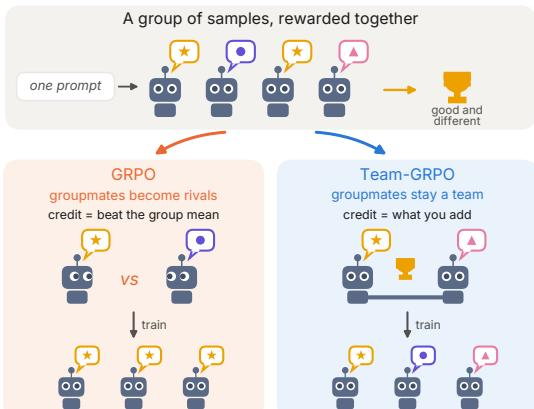  
Figure 1. The problem. An answer helps its group by being good and by being different. GRPO credits each sample with how far it beats the group mean, so groupmates become rivals and converge on one answer. Team-GRPO credits each sample with what it adds to the group, so the group stays diverse.

A fast-growing family of rewards breaks this assumption. To counter the loss of diversity under reinforcement learning (Kirk et al., 2024; Yue et al., 2025), DARLING multiplies each response’s quality by its semantic distance to its groupmates (Li et al., 2025), and other methods add pairwise novelty bonuses (Song et al., 2025; Wan et al., 2026) or reward answers that are rare within the group (Anschel et al., 2025). Distributional alignment penalizes collisions with groupmates so that the group reproduces a target distribution (Arabi et al., 2026), and set-level objectives score the group as a whole (Walder & Karkhanis, 2025; Orney et al., 2026). In each case the reward of response k depends on the whole group, so its baseline depends on it through its groupmates rewards, and the classical argument fails.

We show that the result is not extra noise but a different objective. For any reward that treats groupmates symmetrically, the expected GRPO update is the gradient of a response’s own reward plus α times its externality, the change it causes in its groupmates’ rewards, with $\alpha = - 1 / ( K - 1 )$ (Theorem 1). The true gradient counts the externality with weight +1, so subtracting the group mean does not merely discard it but reverses its sign. GRPO trains each response to beat its groupmates, a zero-sum tournament like the relativepayoff game that governs selection in finite populations (Schaffer, 1988), in which groupmates are rivals rather than a team (Figure 1).

The tournament has closed-form consequences (Figure 2). A pairwise diversity bonus reaches the update with $( K -$ $2 ) / ( 2 ( K - 1 ) )$ of its true weight, which is below one half for every K and zero at $K = 2$ , where GRPO cannot tell two different good answers from one good answer given twice. Larger groups do not rescue it, because as $K$ grows GRPO approaches REINFORCE without a baseline rather than the optimum of the reward. Across six reward structures from recent methods, GRPO is never better than REINFORCE and is often far worse.

Setting $\alpha = + 1$ restores the true gradient. The resulting estimator, Team-GRPO, credits each response with its marginal contribution to the group’s reward, using only quantities the reward already computes (Section 3). It works with two samples per prompt, an efficient regime (Wu et al., 2025) in which GRPO fails completely, and it contains recent specialpurpose estimators for max@k (Walder & Karkhanis, 2025; Takashiro et al., 2026), distribution matching (Arabi et al., 2026) and set-level reinforcement learning (Orney et al., 2026) as special cases.

The theory makes quantitative predictions, each fixed before the corresponding experiment. In a sandbox where the policy of a 9B model can be read off exactly, all 12 runs with a closed-form prediction converge to the fixed point of their estimator’s game (largest $\ell _ { 1 }$ error 0.018). On GlobalOpinionQA (Durmus et al., 2024), the theory predicted that GRPO with two samples per question would collapse onto the majority answer and end worse than the untrained model. It did, raising the squared error to the human distribution from 0.20 to 0.49, while Team-GRPO lowers it to 0.08. Across 13 configurations the closed-form fixed points predict how concentrated the trained policy becomes with Pearson $r = 0 . 9 9 5$ . On NoveltyBench (Zhang et al., 2025) with a quality-times-diversity reward, GRPO collapses in every seed, whereas Team-GRPO keeps the model diverse and raises set utility over GRPO by 1.16 at $K = 2$ and 0.56 at $K = 8$ , gains that persist at matched KL divergence and under an independent LLM judge.

Contributions.

• Diagnosis. An exact identity for group-relative estimators under any exchangeable group reward, its reading as a relative-payoff game, and its closed-form consequences (Section 2).

• Method. Team-GRPO, an unbiased and essentially free estimator for any exchangeable group reward that works at $K = 2$ and unifies recent special-purpose estimators (Section 3).

• Evidence. Quantitative confirmation on a 9B model in distributional alignment and open-ended generation, where Team-GRPO outperforms GRPO and its variants and matches set-level estimators wherever they apply (Section 4).

## 2. What Group-Relative Baselines Optimize

Setup. Fix a prompt, which we drop from the notation. The policy $\pi _ { \theta }$ samples a group $\mathcal { G } = ( y _ { 1 } , \dots , y _ { K } )$ of independent responses, and response k receives a reward $r _ { k }$ that may depend on the whole group but treats the groupmates symmetrically.

Definition 1 (Exchangeable group reward). The reward is exchangeable if $r _ { k } = r \big ( y _ { k } ; \{ y _ { j } \} _ { j \neq k } \big )$ for a fixed function r of a response and the multiset of its groupmates. The group objective is $\begin{array} { r } { J ( \theta ) = \mathbb { E } \big [ \frac { 1 } { K } \sum _ { k } r _ { k } \big ] } \end{array}$

Ordinary rewards $r _ { k } = f ( y _ { k } )$ are the special case in which J is the expected reward, and every reward in Section 1 is exchangeable (Section G). Write $s _ { \theta } ( y ) = \nabla _ { \theta } \log \pi _ { \theta } ( y )$ A group-relative estimator assigns an advantage $A _ { k }$ to each response and uses $\begin{array} { r } { \hat { g } = \sum _ { k } A _ { k } s _ { \theta } ( y _ { k } ) } \end{array}$ . GRPO uses $A _ { k } = r _ { k } - \bar { r }$ with $\begin{array} { r } { \bar { r } = \frac { 1 } { K } \sum _ { i } r _ { j } , } \end{array}$ the mean-centred form adopted by Dr. GRPO and DARLING (Liu et al., 2025c; Li et al., 2025), RLOO uses $\begin{array} { r } { A _ { k } = r _ { k } - \frac { 1 } { K - 1 } \sum _ { j \neq k } r _ { j } } \end{array}$ , and RE-INFORCE uses a baseline that does not depend on the group (standard-deviation normalization is treated in Section E). Two functions of a single response organize everything that follows, its own value and its externality,

$$
\operatorname { o w n } ( y ) = \mathbb { E } { \big [ } r _ { 1 } \mid y _ { 1 } = y { \big ] } , \ \operatorname { e x t } ( y ) = \sum _ { j = 2 } ^ { K } \mathbb { E } { \big [ } r _ { j } \mid y _ { 1 } = y { \big ] } .\tag{1}
$$

The first is the reward a response can expect for itself, and the second is the total reward its groupmates can expect, which is constant for ordinary rewards.

## 2.1. An exact identity

Theorem 1 (The α-identity). For any exchangeable group reward, let $g _ { \alpha } = \mathbb { E } _ { y \sim \pi _ { \theta } } \left[ \left( \mathrm { o w n } ( y ) + \alpha \mathrm { e x t } ( y ) \right) s _ { \theta } ( y ) \right]$ . Then

$$
\begin{array} { r l } { \nabla _ { \theta } J = g _ { 1 } , } & { \quad \mathbb { E } \hat { g } _ { \mathtt { R E I N F O R C E } } = K g _ { 0 } , } \\ { \mathbb { E } \hat { g } _ { \mathtt { R L O O } } = K g _ { - \frac { 1 } { K - 1 } } , } & { \quad \mathbb { E } \hat { g } _ { \mathtt { G R P O } } = ( K - 1 ) g _ { - \frac { 1 } { K - 1 } } . } \end{array}
$$

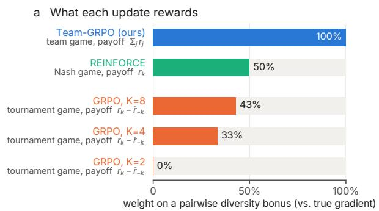

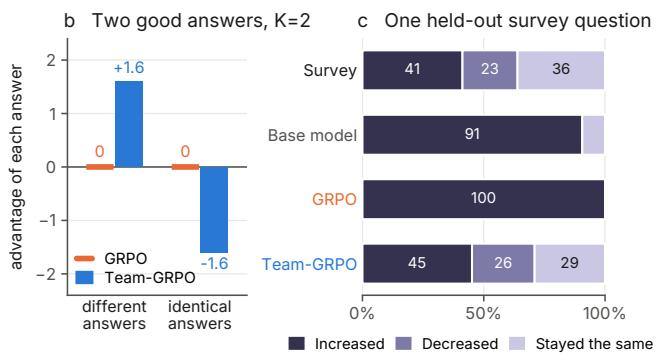  
Figure 2. GRPO plays a tournament. (a) Team-GRPO maximizes the group’s total reward, REINFORCE without a baseline maximizes each response’s own reward (a Nash equilibrium), and GRPO maximizes each response’s reward minus the mean of its groupmates’ (a zero-sum tournament). Bars give the weight of a pairwise diversity bonus in the expected update relative to the true gradient (Theorem 2). (b) Two responses of quality $q = 0 . 8$ under the reward $q ( 1 + \lambda d ) , \lambda = 2 .$ . GRPO assigns zero advantage whether the answers differ $( d = 1 )$ or coincide $( d \bar { = } 0 )$ . Team-GRPO separates the two cases. (c) Answer shares on a held-out GlobalOpinionQA question (whether the gap between rich and poor has grown, Venezuela) after 200 steps with two samples per question.

Proofsketch. For $j \neq k ,$ , conditioning on $y _ { k }$ gives $\mathbb { E } [ r _ { j } s _ { \theta } ( y _ { k } ) ] ~ = ~ \mathbb { E } \big [ \mathbb { E } [ r _ { j } $ | $y _ { k } ] s _ { \theta } ( y _ { k } ) \big ]$ , so the RLOO baseline contributes $- \frac { 1 } { K - 1 }$ ext and a group-independent baseline nothing. The true gradient follows from $\begin{array} { r } { \nabla _ { \theta } \mathbb { E } \big [ \sum _ { j } r _ { j } \big ] \ = \ \sum _ { k } \mathbb { E } \big [ \big ( \sum _ { j } r _ { j } \big ) \overline { { s _ { \theta } } } ( y _ { k } ) \big ] \ = \ K g _ { 1 } } \end{array}$ (Section A). □

The three estimators thus lie on one line indexed by $\alpha ,$ the weight the update gives to externalities, which we call the α-line. Positive multiples only rescale the step, so the estimators differ in direction through α alone. The true gradient counts a response’s effect on others with weight +1, REINFORCE ignores it, and GRPO counts it with weight $- 1 / ( K - 1 )$ , penalizing a response that raises its groupmates’ rewards and rewarding one that lowers them.

Which game is being played. Give player k of a symmetric K-player game the payoff $\begin{array} { r } { U _ { k } ^ { \alpha } = r _ { k } + \alpha \sum _ { j \neq k } r _ { j } } \end{array}$ Then $g _ { \alpha }$ is the gradient of player $k ' s$ expected payoff with respect to its own policy when all players use π<sub>θ</sub>, so training with an α-estimator is self-play with shared parameters and its stationary points are symmetric equilibria of this game (Theorem 7). For $\alpha = 1$ all players share the payoff $\textstyle \sum _ { j } r _ { j }$ , a team game whose optimum maximizes $J ,$ and for $\alpha \stackrel { - } { = } 0$ each response maximizes its own reward, a Nash equilibrium. For GRPO, $U _ { k } = r _ { k } - \bar { r } _ { - k }$ is a response’s reward relative to the mean of its groupmates. These payoffs sum to zero, so GRPO plays a zero-sum tournament, the relative-payoff selection of finite populations that favors spite (Schaffer, 1988; Hamilton, 1970), with the group as the population. As $K  \infty$ its α tends to 0, so larger groups move GRPO toward the Nash solution but never toward the team optimum.

Which weight is intended. The diagnosis does not rest on taking J as the target. A designer may want each response credited for its total effect on the group $( \alpha = 1 )$ or for its own reward against fixed groupmates $( \alpha = 0 )$ , but never for lowering its groupmates’ rewards. GRPO’s α is negative at every K, so it serves neither intention, and at $K = 2$ it gives a pairwise diversity bonus zero weight where both give it positive weight. The methods we study intend $\alpha = 1$ , since each is evaluated by a property of the whole set, such as pass@k, coverage or distance to a target distribution (Table 9). For $\alpha = 0$ the same construction gives an unbiased estimator (Section A.7).

## 2.2. Consequences in closed form

Corollary 2 (Attenuation ladder). Let $r _ { k } = f ( y _ { k } ) + \lambda c _ { k } ,$ where $c _ { k }$ averages a symmetric kernel $\phi ( y _ { k } , y _ { S } )$ over all sets $\textit { S o f m - 1 }$ groupmates $( m \ = \ 2 \ f o r$ pairwise diversity, similarity and collision terms). With $\Phi ( y ) =$ $\mathbb { E } [ \phi ( y , Y _ { 2 } , \dots , Y _ { m } ) ]$

$$
g _ { \alpha } = \mathbb { E } \big [ \big ( f + \lambda ( 1 + \alpha ( m - 1 ) ) \Phi \big ) s _ { \theta } \big ] .\tag{2}
$$

The true gradient weights the interaction by m and GRPO $\frac { K - m } { K - 1 }$ , so GRPO retains a fraction

$$
\rho _ { m } ( K ) = \frac { K - m } { m ( K - 1 ) } < \frac { 1 } { m } .\tag{3}
$$

$I f \sum _ { k } c _ { k }$ is constant, as for within-group win rates, the weight is $1 - \alpha$ and GRPO amplifies the term by $\frac { K } { K - 1 }$ although it cannot change J. If the reward is shared by the whole group, asfor pass@k credited to every member, the weight is $1 + \alpha ( K - 1 )$ and GRPO sees none ofit.

A pairwise bonus thus keeps $0 , \ { \frac { 1 } { 3 } }$ and $\frac { 3 } { 7 }$ of its weight at $K = 2 , 4 , 8$ (Figure 2a), never more than one half, and three-body terms keep less than a third.

Proposition 3 (Pairwise rewards). Let $r _ { k } ~ = ~ f ( y _ { k } ) +$ $\begin{array} { r } { \frac { \lambda } { K - 1 } \sum _ { j \neq k } M ( y _ { k } , y _ { j } ) } \end{array}$ for an arbitrary kernel $M = S + A$ with symmetric part S and antisymmetric part A. With $\bar { S } ( y ) = \mathbb { E } _ { y ^ { \prime } } S ( y , y ^ { \prime } )$ and $\bar { A } ( y ) = \mathbb { E } _ { y ^ { \prime } } A ( y , y ^ { \prime } )$

$$
g _ { \alpha } = \mathbb { E } \big [ \big ( f + \lambda [ ( 1 + \alpha ) \bar { S } + ( 1 - \alpha ) \bar { A } ] \big ) s _ { \theta } \big ] .\tag{4}
$$

The true gradient contains only ${ \bar { S } } ,$ since an antisymmetric interaction moves reward between responses without changing the total. GRPO at $K = 2 ( \alpha = - 1 )$ contains only ${ \bar { A } } ,$ doubled, so every symmetric interaction, including any diversity bonus, is invisible to it. For $K > 2$ , GRPO mixes in $\bar { A }$ with weight $K / ( K - 1 )$ . This part is a rotational field, so the GRPO update is not the gradient of any objective (Section A).

Example. DARLING-style rewards (Li et al., 2025) $r _ { k } =$ $q ( y _ { k } ) ( 1 + \lambda D _ { k } )$ , with $D _ { k }$ the mean distance to the groupmates, have $M ( y , y ^ { \prime } ) = q ( y ) d ( y , y ^ { \prime } )$ . At $K = 2$ the GRPO advantage is

$$
\begin{array} { r } { A _ { 1 } ^ { \mathrm { G R P O } } = \frac { 1 } { 2 } \left( q _ { 1 } - q _ { 2 } \right) ( 1 + \lambda d _ { 1 2 } ) . } \end{array}\tag{5}
$$

It ranks the two responses by quality and uses their distance only to scale the ranking, so two different good answers and two copies of one good answer both receive zero advantage (Figure 2b). Raising λ even hurts, because it amplifies the quality ranking in exactly the most diverse pairs.

Proposition 4 (Fixed points). On afinite answer space with a softmax policy, the expected α-update ascends an explicit potential in two canonical cases.

(a) Diversity bonus. For $\begin{array} { r } { r _ { k } = f ( y _ { k } ) + \frac { \lambda } { K - 1 } \sum _ { j \neq k } \mathbf { 1 } [ y _ { k } \neq } \end{array}$ $y _ { j } ]$ the potential is $\mathbb { E } _ { \pi } f + \kappa _ { \alpha } \lambda ( 1 - \| \pi \| ^ { 2 } )$ with $\kappa _ { \alpha } =$ $\textstyle { \frac { 1 + \alpha } { 2 } }$ , maximized by the water-filling policy $\pi ^ { * } ( y ) =$ $[ ( f ( y ) - \nu ) / ( 2 \kappa _ { \alpha } \lambda ) ] _ { + }$ . GRPO has $\begin{array} { r } { \kappa = \frac { K - 2 } { 2 ( K - 1 ) } } \end{array}$ and at $K = 2$ converges to the single best answerfor every λ.

(b) Distribution matching. For $\begin{array} { r l r } { r _ { k } } & { { } = } & { 2 t ( y _ { k } ) - } \end{array}$ $\begin{array} { r } { \frac { 1 } { K - 1 } \sum _ { j \neq k } \mathbf { 1 } [ y _ { j } = y _ { k } ] } \end{array}$ with target t, the group objective is $J ^ { \ ` } = \| t \| ^ { 2 } - \| \pi - t \| ^ { 2 }$ and the α-update converges to $\pi _ { \alpha } ^ { * } = \mathrm { P r o j } _ { \Delta } ( 2 t / ( 1 + \alpha ) )$ ), the Euclidean projection onto the simplex. Team-GRPO reaches t, REINFORCE reaches Proj $\mathbf { \boldsymbol { \triangle } } \left( 2 t \right)$ , and GRPO reaches Proj $\triangle ^ { ( 2 t \frac { K - 1 } { K - 2 } ) }$ , the mode oft when $K = 2$

GRPO therefore never reaches the target distribution, and the gap is not an optimization failure but the equilibrium of the game it plays. Retuning the reward coefficient is the natural remedy, and the identity says exactly when it works.

Proposition 5 (When retuning suffices). Under Theorem 2, GRPO with coefficien $\begin{array} { r } { \lambda ^ { \prime } = \lambda \frac { m ( K - 1 ) } { K - m } } \end{array}$ has the expected update ofthe true gradient with coefficient $\lambda ,$ and no coefficient does when $K = m$ . Under Theorem 3, ifA<sup>¯</sup> is not an affine function of S<sup>¯</sup>, no coefficient makes GRPO match the true gradient at any $K .$

Retuning thus helps only for symmetric kernels, only with the correct K-dependent multiplier (3× at $K \ = \ 4 , \ { \frac { 7 } { 3 } } \times$ at $K = 8 )$ , and never at $K = 2$ , and quality-weighted diversity, the structure of DARLING, cannot be repaired at any K. With graded quality and embedding distances, the best GRPO coefficient on a grid recovers on average 11%, 89% and 96% of the optimal objective at $K = 2$ , 4 and 8 (Section D).

Beyond the plain update. These consequences are properties of the advantages themselves, so they hold for every loss built on them, including importance ratios, clipping, token-level averaging and several epochs per batch. At $K = 2$ a symmetric pairwise term cancels in $r _ { 1 } - r _ { 2 }$ , so GRPO computes exactly the advantages it would compute without the bonus, and standard-deviation normalization, which keeps only the sign of $r _ { 1 } - r _ { 2 }$ , is equally blind. For a symmetric m-body term with $K > m$ , the GRPO advantage with coefficient λ is, group by group, a positive multiple of the Team-GRPO advantage with coefficient $\rho _ { m } ( K ) \lambda$ (Theorem 8). The fixed points of Theorem 4 also survive clipping, since at a fixed point the ratio stays at one. In simulation, clipped updates with up to eight epochs per batch stay within $0 . 0 7 4$ of them in $\ell _ { 1 }$ , while the fixed points of GRPO and Team-GRPO lie 0.50 to 1.10 apart (Section F).

## 3. Team-GRPO

Theorem 1 says that the gradient of the group objective counts each response’s externality with weight +1. Team-GRPO does so with a baseline that remains independent of the response, so it keeps the variance reduction of grouprelative training while following $\nabla _ { \boldsymbol { \theta } } J .$ . For a set $s$ of responses let $\begin{array} { r } { \bar { R ( S ) } \ = \ \sum _ { y _ { i } \in { \cal S } } r \bar { ( y _ { j } ; { \cal S } \setminus \{ y _ { j } \} ) } } \end{array}$ be its total reward, computed as if S were the whole group. The Team-GRPO advantage is

$$
\begin{array} { r } { A _ { k } ^ { \mathrm { T E A M } } = R ( \mathcal { G } ) - \frac { K } { K - 1 } R ( \mathcal { G } \setminus \{ y _ { k } \} ) , } \end{array}\tag{6}
$$

which equals $K [ \bar { r } ( \mathcal { G } ) - \bar { r } ( \mathcal { G } \backslash \{ y _ { k } \} ) ]$ with $\begin{array} { r l } { \bar { r } ( S ) } & { { } = } \end{array}$ $R ( S ) / | S |$ . Each response is credited with K times the change it causes in the group’s mean reward. This is a difference reward in the sense of multi-agent credit assignment (Wolpert & Tumer, 2001; Foerster et al., 2018), computed exactly and without a critic.

Proposition 6 (Unbiasedness). For any exchangeable group reward and any $\begin{array} { r } { K \ge 2 , \mathbb { E } \Big [ \sum _ { k } A _ { k } ^ { \mathrm { T E A M } } s _ { \theta } ( y _ { k } ) \Big ] = K \bar { \nabla _ { \theta } } J . } \end{array}$

Proof. $R ( \mathcal { G } \setminus \{ y _ { k } \} )$ does not depend on $y _ { k }$ and contributes zero in expectation, and $\begin{array} { r } { \sum _ { k } \mathbb { E } [ R ( \mathcal { G } ) s _ { \theta } ( y _ { k } ) ] \ = \ } \end{array}$ $\nabla _ { \theta } \mathbb { E } [ R ( \mathcal { G } ) ] = K \nabla _ { \theta } J$ □

Cost. For rewards built from pairwise distances, similarities or collisions, $R ( \mathcal { G } \setminus \{ y _ { k } \} )$ follows from deleting row and column k of the matrix the reward already uses (Algorithm 1 in Section B). This is $O ( K ^ { 2 } )$ arithmetic per group with no additional reward-model, embedding or judge calls. Rewards from a judge of the whole set need K extra judge calls per group.

Two samples per prompt. At $K = 2$ the set $\mathcal { G } \backslash \{ y _ { k } \}$ is a single response, for which a diversity term is undefined. Any baseline $b _ { k }$ independent of $y _ { k }$ keeps the estimator unbiased, so we use $A _ { k } = r _ { 1 } + r _ { 2 } - b _ { k }$ with $b _ { k }$ an estimate of $\mathbb { E } [ r _ { 1 } +$ $r _ { 2 } ~ | ~ y _ { j } ]$ from the teammate $y _ { j }$ and the rest of the batch. This lowers $\mathbb { E } [ A ^ { 2 } ]$ by $2 . 6 \times$ relative to setting the missing diversity to zero (Sections B and J).

Symmetric kernels in one line. For a symmetric m-body interaction with $K > m$ , Team-GRPO coincides sample by sample with RLOO whose interaction coefficient is multiplied by $m ( K - 1 ) / ( K - m )$ (Theorem 8), which is $2 ( K - 1 ) / ( K - 2 )$ for collision penalties, frequency rewards and symmetric distance bonuses.

Relation to recent estimators. Unbiased max@k estimators (Walder & Karkhanis, 2025; Takashiro et al., 2026) and SetPO’s leave-one-out diversity bonus (Li et al., 2026) are (6) for their rewards, and the uncentred witness estimator for distribution matching (Arabi et al., 2026) is its symmetrickernel form. The group-mean-centred witness is biased toward concentration by $\begin{array} { r } { \frac { 1 } { K } \nabla \| \pi \| ^ { 2 } } \end{array}$ , as Theorem 1 predicts (Section A.9). Poly-EPO (Orney et al., 2026) averages set advantages over subsets of size n drawn from $N > n$ samples, so it estimates the same gradient but cannot run when the set is the whole group, including at $K = 2$

Normalization and variance. As in Dr. GRPO and DAR-LING we do not divide by the group’s standard deviation (Section E). At matched scale the variance of Team-GRPO is 1.1–2.1 times that of RLOO for $K \geq 4$ (Section C). The extra variance is the externality signal that GRPO cancels, and it shrinks with more prompts per step, whereas GRPO’s bias, a relative error of 39–86% in exact computations, does not.

## 4. Experiments

We test whether the theory predicts where training converges, whether the tournament hurts across reward structures in current use, and whether Team-GRPO yields better models in distributional alignment and open-ended generation. Unless stated otherwise we fine-tune Qwen3.5-9B (Qwen Team, 2026) with rank-16 LoRA (Hu et al., 2022) at temperature 1, with a sequence-level policy-gradient loss, a constant normalizer, no KL penalty and no standarddeviation normalization, identically for all estimators. Each batch is used for one on-policy update, where importance ratios equal one and the clipped surrogate of PPO and GRPO has exactly this gradient (normalization and clipping with several epochs are tested in Sections E and F). Confidence intervals are 95%, from a paired bootstrap over prompts or a t-interval across seeds.

## 4.1. The theory predicts where training converges

Exact enumeration. Enumerating all answer tuples for small answer spaces gives every expectation exactly. For random exchangeable rewards with $K \in \{ 2 , 3 , 4 , 6 , 1 0 \}$ , Theorem 1 holds to a relative error of $6 \cdot 1 0 ^ { - 1 5 }$ , and $g _ { 1 }$ matches a finite-difference gradient of J. The attenuation ladder holds for $m \in \{ 2 , 3 , 4 \}$ and $K \leq 1 2 \mathrm { t o } 1 0 ^ { - 1 5 } ( \mathrm { F i g } .$ ure $3 \mathrm { a ) }$ , and Theorem 3 and the sample-wise identity for symmetric kernels hold to $6 \cdot 1 0 ^ { - 1 4 }$ (Section C).

A 9B policy with exact readout. We let Qwen3.5-9B answer four-option prompts with a single letter, so that its policy can be read off exactly from the logits, and train it with the diversity bonus of Theorem 4(a), with qualities $f = ( 1 , 0 . 5 , 0 . 2 , 0 )$ , on 128 prompts for 500 steps. All 12 runs with a closed-form prediction converge to the fixed point of their estimator’s game, with $\ell _ { 1 }$ error at most 0.018 (Figure 3b,c), and held-out prompts give the same policies (Section H). GRPO at $K = 2$ puts all mass on the best option for $\lambda \in \{ 0 , 1 , 5 \}$ . Team-GRPO reaches the same diversified solution at $K = 2 ,$ 4 and 8, since its objective does not depend on K, and multiplying λ by $2 ( K - 1 ) / ( K -$ $2 ) \ : = \ : 3 \ :$ moves GRPO at $K = 4$ onto it, as Theorem 5 prescribes. GRPO with standard-deviation normalization, which has no closed form, lands within 0.01 per option of its numerical fixed point at K = 4 and 8 (Section E).

## 4.2. The tournament hurts across reward structures

Table 1 computes the exact fixed point of each estimator for six group-reward structures from recent methods and reports the group objective there as a percentage of Team-GRPO’s. The ordering predicted by the α-line, $\mathrm { G R P O } \leq$ REINFORCE ≤ Team-GRPO, holds in all 18 settings, and GRPO is often far worse than no baseline at all. Its objective turns negative for distribution matching at $K = 2$ and reaches 3% of the optimum when only answers unique within the group are credited. The gap need not close with K. On the correctness-times-strategies objective of Poly-EPO, GRPO falls from 67% at $K = 2$ to 44% at $K = 8$ as it settles on a single correct strategy. GRPO matches Team-GRPO only where the optimum is an equilibrium of the tournament, as for pass@K, and standard-deviation normalization closes none of the gaps (Section E).

## 4.3. Distributional alignment

Setup. GlobalOpinionQA (Durmus et al., 2024) pairs survey questions with the answer distributions of respondents in many countries. The model answers as a randomly selected adult of a given country with one option letter, and the target t is that country’s distribution of answers, a central goal of pluralistic alignment (Sorensen et al., 2024). Splitting by question gives 32,372 training items and 1,154 test items from 510 unseen questions. The reward is that of Theorem 4(b), whose group mean estimates $\| t \| ^ { 2 } - \| \pi - t \| ^ { 2 }$ without bias, so every estimator trains on exactly what we evaluate. Runs use 256 rollouts per step for 200 steps, and on test items we report an unbiased estimate of $\| \pi - t \| ^ { 2 }$ from 32 samples. Besides GRPO, GRPO (std) and REINFORCE, we compare with the centred witness estimator of Arabi et al. (2026) and with Poly-EPO (Orney et al., 2026) averaged over all pairs of the K samples, whose optimum t does not depend on the set size. Team-GRPO uses the two-sample baseline of Section 3, and for $K \geq 4$ the symmetric-kernel form with a baseline from other questions.

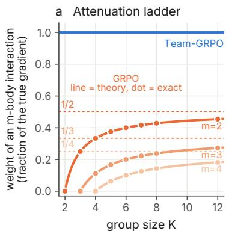

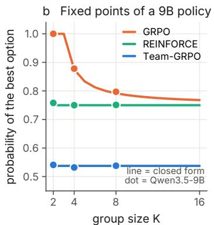

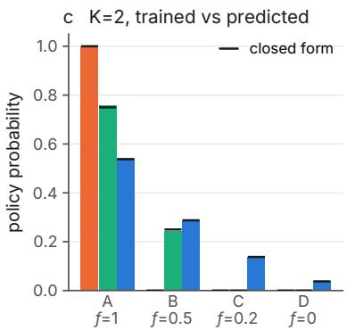  
Figure 3. The theory is exact. (a) Weight GRPO gives an m-body symmetric interaction, relative to the true gradient. Lines are Equation (3), dots are exact enumeration over random kernels, and dashed lines mark the limit 1/m. (b) Probability of the best option at the fixed point of the diversity bonus $( \lambda = 1 )$ . Lines are closed forms and dots are Qwen3.5-9B after 500 steps of LoRA training. (c) Full policies at $K = 2 ,$ , trained (bars) against closed form (black ticks). GRPO collapses onto the best option, REINFORCE reaches the Nash solution, and Team-GRPO reaches the optimum of the group reward.

Table 1. Group objective at each estimator’s fixed point, as a percentage of Team-GRPO (exact computation). Split credit divides a unit of reward among the members that earn it, so the group total is the set metric in parentheses. Shading marks the shortfall.
<table><tr><td rowspan="2">Group reward (used by)</td><td colspan="3">GRPO</td><td colspan="3">REINFORCE</td></tr><tr><td>K=2</td><td>4</td><td>8</td><td>2</td><td>4</td><td>8</td></tr><tr><td>Distribution matching (SWYS)</td><td>-31</td><td>67</td><td>75</td><td>82</td><td>82</td><td>82</td></tr><tr><td>Quality × distance (DARLING)</td><td>83</td><td>90</td><td>96</td><td>98</td><td>98</td><td>98</td></tr><tr><td>Correct × #strategies (Poly-EPO)</td><td>67</td><td>53</td><td>44</td><td>100</td><td>98</td><td>83</td></tr><tr><td>Unique valid answers (coverage)</td><td>3</td><td>94</td><td>40</td><td>100</td><td>94</td><td>40</td></tr><tr><td>Split credit (distinct@ K)</td><td>61</td><td>100</td><td>100</td><td>100</td><td>100</td><td>100</td></tr><tr><td>Split credit (pass@K)</td><td>100</td><td>100</td><td>100</td><td>100</td><td>100</td><td>100</td></tr></table>

Results. Every prediction holds (Table 2 and Figure 4). GRPO collapses at $K = 2 .$ . At least 90% of its samples agree on 97% of test items, and its error of 0.49 is two and a half times that of the untrained model. Standard-deviation normalization changes nothing (0.508, and 0.207 at $K = 4 )$ Team-GRPO matches the target. With the same samples it lowers the error to 0.08, six times below GRPO (difference $- 0 . 4 0 \left[ - 0 . 4 3 , - 0 . 3 8 \right] )$ , and REINFORCE lands in between (0.13), where the α-line places it. Larger groups do not rescue GRPO. At K = 4 and 8 its error stays at 0.18, 2.3– 2.4 times that of Team-GRPO, because its fixed point never reaches t. Where the theory predicts a tie, there is one. Poly-EPO estimates the same gradient as Team-GRPO and ends at similar errors wherever it can run (0.078 against 0.074 at K = 4, 0.074 against 0.077 at $K = 8 )$ . The centred witness is biased by $\textstyle { \frac { 1 } { K } } \nabla \| \pi \| ^ { 2 }$ , which predicts a clear gap at K = 4 and almost none at $K = 8$ . It ends at 0.096 against 0.074 at K = 4 (difference −0.022 [−0.029, −0.015]), and at $K = 8 .$ , where its fixed point lies within 0.0033 of t in squared error, the three estimators finish within 0.005 of each other, no more than the gap between different seeds of Team-GRPO. The predictions are quantitative. Across all 13 configurations with a closed-form fixed point, predicted and measured concentration agree with Pearson $r = 0 . 9 9 5$ (Figure 4c), with measured values on average 0.05 below the predictions. Team-GRPO also wins at equal distance from the base model (Section I).

Table 2. GlobalOpinionQA test error $\| \pi - t \| ^ { 2 }$ after 200 steps (510 unseen questions, mean over seeds, base model 0.197), with K samples per question at 256 rollouts per step. Fixed points follow Theorem 4(b) with $\begin{array} { r } { w _ { K } = \frac { K - 1 } { K - 2 } } \end{array}$ . Grey cells need no run, since at $K = 2$ the centred witness gives exactly GRPO’s advantages, REINFORCE has the same expected update at every K, and Poly-EPO needs more samples than its set size. Here DARLING’s estimator is GRPO, GAPO’s is GRPO (std), and SetPO’s coincides with Team-GRPO. Bold is best per column.
<table><tr><td>Estimator</td><td>Fixed point</td><td>K=2</td><td> $K { = } 4$ </td><td> $K { = } 8$ </td></tr><tr><td>GRPO</td><td> $\mathrm { P r o j } _ { \Delta } ( 2 w \kappa t )$ </td><td>0.491</td><td>0.181</td><td>0.179</td></tr><tr><td>REINFORCE</td><td> $\mathrm { P r o j } _ { \Delta } ( 2 t )$ </td><td>0.131</td><td>same update as K=2</td><td></td></tr><tr><td>Centred witness</td><td> $\mathrm { P r o j } _ { \Delta } ( w _ { K } t )$ </td><td>= GRPO</td><td>0.096</td><td>0.073</td></tr><tr><td>Poly-EPO (pairs)</td><td>t</td><td>needs K&gt;2</td><td>0.078</td><td>0.074</td></tr><tr><td>Team-GRPO</td><td>t</td><td>0.081</td><td>0.074</td><td>0.077</td></tr></table>

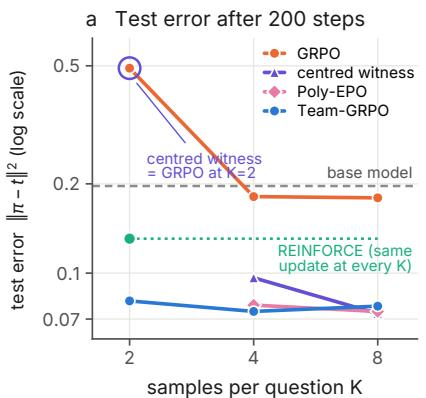

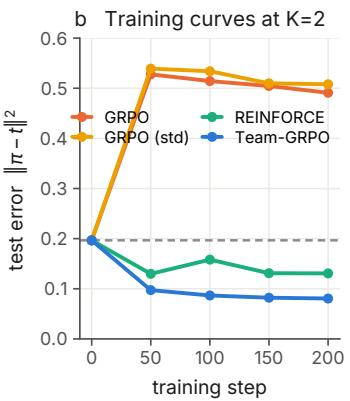

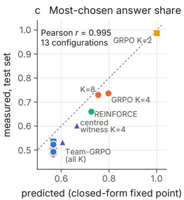  
Figure 4. Distributional alignment on GlobalOpinionQA. (a) Squared error to the human distribution on unseen questions after 200 steps (log scale, means over seeds). Lines start or stop where the theory makes a run redundant (Table 2). The bias of the centred witness shrinks with K as predicted. (b) Test error during training at $K = 2$ (means over seeds). GRPO collapses within 50 steps, with or without standard-deviation normalization. (c) Predicted against measured mass on the most-chosen answer for all 13 configurations with a closed-form fixed point, with Poly-EPO shown separately for 4 and 8 samples (dashed line is equality).

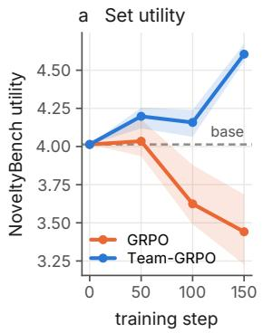

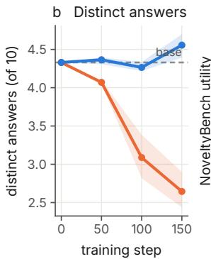

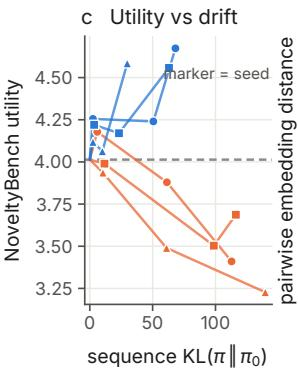

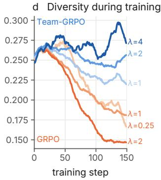  
Figure 5. Open-ended generation on NoveltyBench $( K = 2 , \lambda = 2$ unless noted). (a,b) Set utility and number of distinct answers among 10 samples. Lines are means over three seeds and shading spans the seeds. (c) Utility against sequence-level KL divergence from the base model, per seed. (d) Mean pairwise embedding distance within training groups (smoothed). GRPO collapses faster as the diversity weight λ grows, while Team-GRPO becomes more diverse.

## 4.4. Open-ended generation

Setup. NoveltyBench (Zhang et al., 2025) scores 10 samples per open-ended prompt. Distinct counts the equivalence classes among them and utility sums the quality of novel samples with a patience discount, so both are set-level objectives of the kind J describes. We train on 4,000 WildChat (Zhao et al., 2024) prompts chosen with the benchmark’s recipe and disjoint from its test set, and evaluate on 400 prompts with the official classifier and scorer, whose published numbers our pipeline reproduces. The reward is $r _ { k } = q _ { k } ( 1 + \lambda D _ { k } )$ , with $q _ { k }$ the calibrated score of Skywork-Reward-V2-Llama-3.1-8B (Liu et al., 2025a) and $D _ { k }$ the mean E5 embedding distance (Wang et al., 2022) to the groupmates, the DARLING structure that no retuning can fix (Theorem 5). We use $\lambda = 2 , K \in \{ 2 , 8 \}$ , 64 rollouts per step, 150 steps at learning rate $5 \cdot 1 0 ^ { - 5 }$ , and three seeds for each group size.

GRPO trains a quality-only policy. At K = 2 the GRPO advantage (5) ignores diversity, and in all three seeds the trained model has fewer distinct answers and lower utility than the base model. Averaged over seeds, distinct answers fall from 4.33 to 2.65 and utility from 4.01 to 3.44, while first-sample quality rises from 7.58 to 9.04 (Table 3, Figure 5a,b). This rise is the predicted signature of the failure, not a strength. A policy that sees only quality moves its mass onto its single best answer, which raises the score of any one sample while the set collapses. Team-GRPO makes the trade the reward asks for, giving up 0.53 points of single-sample quality to win on both set metrics.

Team-GRPO optimizes the set. Under the same reward, Team-GRPO keeps the model diverse (4.56 distinct answers) and raises utility to 4.61, significantly above both the base model and GRPO (+1.16 [0.52, 1.80] over GRPO). GRPO drifts further from the base model (sequence KL 123 against 54), so we also evaluate GRPO at the KL each Team-GRPO run reaches at step 150, where Team-GRPO still leads by +0.84 [0.79, 0.90] in utility and +1.12 [0.46, 1.79] in distinct answers (Figure 5c). Single prompts show the difference plainly. Asked to pick a random prime between 1 and 50, GRPO answers 23 in seven of ten samples, while Team-GRPO names six different primes (Table 16).

Table 3. NoveltyBench performance (benchmark scorer, 400 prompts, three seeds). ∆ is Team-GRPO minus GRPO with 95% CIs, and at K = 8 matched KL compares checkpoints within the common observed KL range. Bold is the best trained model on set metrics, and 1st sample scores one response. LLM-judge results are in Table 13.
<table><tr><td></td><td>Utility ↑</td><td>Distinct ↑</td><td>1st sample</td></tr><tr><td>K = 2</td><td></td><td></td><td></td></tr><tr><td>Base model</td><td>4.01</td><td>4.33</td><td>7.58</td></tr><tr><td>GRPO (λ=2)</td><td>3.44</td><td>2.65</td><td>9.04</td></tr><tr><td>GRPO (best λ=1)</td><td>3.83</td><td>3.19</td><td>9.07</td></tr><tr><td>Team-GRPO (λ=2)</td><td>4.61</td><td>4.56</td><td>8.51</td></tr><tr><td>∆, same step</td><td>+1.16 [0.52, 1.80] +1.91 [1.01, 2.81]</td><td></td><td></td></tr><tr><td>∆, matched KL</td><td></td><td>+0.84 [0.79, 0.90] +1.12 [0.46, 1.79]</td><td></td></tr><tr><td colspan="4">K = 8 (same base model)</td></tr><tr><td>GRPO (λ=2)</td><td>4.12</td><td>3.51</td><td>9.07</td></tr><tr><td>Team-GRPO (λ=2)</td><td>4.68</td><td>4.55</td><td>8.70</td></tr><tr><td>∆, same step</td><td></td><td>+0.56 [0.32, 0.81] +1.04 [0.99, 1.09]</td><td></td></tr><tr><td>∆, matched KL</td><td>+0.62 [0.30, 0.95] +0.72 [0.34, 1.11]</td><td></td><td></td></tr></table>

More diversity weight makes GRPO worse. Equation (5) predicts that a larger λ cannot help GRPO at K = 2 and accelerates its collapse. Over the last 25 training steps, GRPO’s mean pairwise distance drops from 0.193 to 0.186 to 0.147 as λ goes from 0.25 to 1 to 2, whereas that of Team-GRPO rises from 0.231 to 0.249 to 0.293 for λ = 1, 2, 4 (Figure 5d). The best GRPO coefficient (λ = 1) reaches only 3.83 utility, below the untrained model.

Larger groups preserve the advantage. With eight samples per prompt at the same 64-rollout budget, GRPO improves to 4.12 utility and 3.51 distinct answers, while Team-GRPO reaches 4.68 and 4.55 (Table 3). The paired differences across three seeds are +0.56 [0.32, 0.81] in utility and +1.04 [0.99, 1.09] in distinct answers, and +0.62 [0.30, 0.95] and +0.72 [0.34, 1.11] at matched KL. Larger groups narrow the gap, as the attenuation ladder predicts, while Team-GRPO retains an advantage on both set metrics.

An independent judge agrees. The training reward model and the benchmark scorer both come from the Skywork family, so we also apply the NoveltyBench v1.1 protocol, in which an external language model (Claude Sonnet 5.5) groups and scores the samples, to a random subset of 100 prompts (Table 13). Team-GRPO beats GRPO in utility and distinct answers at both group sizes, by +0.61 and +2.09 at K = 2 and by +0.26 and +1.34 at K = 8, all with intervals excluding zero, and it is the only trained model above the base model on both set metrics. The differences remain positive at matched KL, and as under the benchmark scorer GRPO’s first sample scores higher while its set scores lower.

## 5. Related Work

Baselines and credit assignment. Baselines reduce variance without bias as long as they do not depend on the action (Williams, 1992; Greensmith et al., 2004). Leave-one-out and group-mean baselines (Kool et al., 2019; Ahmadian et al., 2024; Shao et al., 2024) made critic-free training standard for language models, and later work examined their normalization and length bias (Liu et al., 2025c; Yu et al., 2025; Vojnovic & Yun, 2025). Action-dependent baselines need a correction to stay unbiased (Tucker et al., 2018; Wu et al., 2018), and the bias we characterize is of this kind, entering through the groupmates’ rewards. Counterfactual baselines (Foerster et al., 2018) and difference rewards (Wolpert & Tumer, 2001) credit each agent with its marginal contribution, and Team-GRPO applies this idea to samples of one policy, where the counterfactual is exact. Multi-agent GRPO variants with baselines from independent episodes (Liu et al., 2025b) are unaffected. Selection in finite populations maximizes relative payoff and can reward spite (Schaffer, 1988; Nowak et al., 2004; Hamilton, 1970; Vega-Redondo, 1997), as tournament contracts do (Lazear & Rosen, 1981; Lazear, 1989).

Group-dependent rewards. Diversity methods reward semantic distinctness, embedding distance or rarity within the group (Li et al., 2025; Song et al., 2025; Wan et al., 2026; Anschel et al., 2025; Shi et al., 2026). Distributional and pluralistic alignment ask a policy to match a population of views (Durmus et al., 2024; Sorensen et al., 2024; Arabi et al., 2026), and set-level objectives target pass@k (Walder & Karkhanis, 2025; Takashiro et al., 2026), strategy coverage (Orney et al., 2026; Hamid et al., 2026), marginal diversity (Li et al., 2026) or within-group preferences (Wang et al., 2025). Most feed the group-dependent reward into the standard advantage, and GAPO argues explicitly that this is unbiased because the reward does not contain θ (Anschel et al., 2025). Our analysis shows that the estimator then plays a tournament, and it gives one correction that also holds in the small groups favored for efficiency (Wu et al., 2025).

## 6. Conclusion

Group-relative baselines were introduced to reduce variance. When the reward depends on the group they also change the game, from a team effort into a tournament in which every response is rewarded for beating its groupmates. The change hides diversity from two-sample training, keeps less than half of any pairwise bonus, drives distribution matching toward the majority answer, and leaves a bias that larger groups do not remove. Counting each response’s externality with the right sign restores the true gradient at every group size, without additional model calls for pairwise rewards.

## Impact Statement

This work concerns how reinforcement-learning objectives for language models are optimized when rewards depend on several sampled responses at once. Rewards of this kind are used to keep models diverse, to represent the spread of human opinion rather than its majority, and to cover many valid answers. We show that the standard estimator quietly works against these goals and provide a corrected estimator. A model trained toward a population’s opinion distribution reproduces that distribution, including its disagreements, so practitioners should choose target populations with care. We see no other societal consequence that needs to be highlighted here.

## References

Ahmadian, A., Cremer, C., Gallé, M., Fadaee, M., Kreutzer, J., Pietquin, O., Üstün, A., and Hooker, S. Back to basics: Revisiting REINFORCE-style optimization for learning from human feedback in LLMs. In Proceedings of the 62nd Annual Meeting of the Association for Computational Linguistics (Volume 1: Long Papers), pp. 12248– 12267, 2024. doi: 10.18653/v1/2024.acl-long.662.

Anschel, O., Shoshan, A., Botach, A., Hakimi, S. H., Gendler, A., Ben Baruch, E., Bhonker, N., Kviatkovsky, I., Aggarwal, M., and Medioni, G. Group-aware reinforcement learning for output diversity in large language models. In Proceedings of the 2025 Conference on Empirical Methods in Natural Language Processing, pp. 32394– 32415, 2025. doi: 10.18653/v1/2025.emnlp-main.1649.

Arabi, K., Smith, V., and Yadav, C. Sample what you say: Aligning language models to sample the distributions they state. arXiv preprint arXiv:2609.34929, 2026.

Durmus, E., Nguyen, K., Liao, T. I., Schiefer, N., Askell, A., Bakhtin, A., Chen, C., Hatfield-Dodds, Z., Hernandez, D., Joseph, N., Lovitt, L., McCandlish, S., Sikder, O., Tamkin, A., Thamkul, J., Kaplan, J., Clark, J., and Ganguli, D. Towards measuring the representation of subjective global opinions in language models. In Conference on Language Modeling, 2024.

Foerster, J., Farquhar, G., Afouras, T., Nardelli, N., and Whiteson, S. Counterfactual multi-agent policy gradients. In Proceedings ofthe AAAI Conference on Artificial Intelligence, volume 32, 2018. doi: 10.1609/aaai.v32i1. 11794.

Greensmith, E., Bartlett, P. L., and Baxter, J. Variance reduction techniques for gradient estimates in reinforcement learning. Journal ofMachine Learning Research, 5: 1471–1530, 2004.

Guo, D. et al. DeepSeek-R1 incentivizes reasoning in LLMs through reinforcement learning. Nature, 645:633–638, 2025. doi: 10.1038/s41586-025-09422-z.

Hamid, J. I., Orney, I. H., Li, M. Y., Shaikh, O., Lee, Y., Sadigh, D., Finn, C., and Goodman, N. SPI-RAL: Learning to search and aggregate. arXiv preprint arXiv:2606.23595, 2026.

Hamilton, W. D. Selfish and spiteful behaviour in an evolutionary model. Nature, 228:1218–1220, 1970. doi: 10.1038/2281218a0.

Hu, E. J., Shen, Y., Wallis, P., Allen-Zhu, Z., Li, Y., Wang, S., Wang, L., and Chen, W. LoRA: Low-rank adaptation of large language models. In International Conference on Learning Representations, 2022.

Kirk, R., Mediratta, I., Nalmpantis, C., Luketina, J., Hambro, E., Grefenstette, E., and Raileanu, R. Understanding the effects of RLHF on LLM generalisation and diversity. In International Conference on Learning Representations, 2024.

Kool, W., van Hoof, H., and Welling, M. Buy 4 REIN-FORCE samples, get a baseline for free! In ICLR Workshop on Deep Reinforcement Learning Meets Structured Prediction, 2019.

Lazear, E. P. Pay equality and industrial politics. Journal of Political Economy, 97(3):561–580, 1989. doi: 10.1086/ 261616.

Lazear, E. P. and Rosen, S. Rank-order tournaments as optimum labor contracts. Journal of Political Economy, 89(5):841–864, 1981. doi: 10.1086/261010.

Li, C., Zhang, Y., Wang, B., Ma, G., Tang, W., Huang, H., and Duan, N. SetPO: Set-level policy optimization for diversity-preserving LLM reasoning. arXiv preprint arXiv:2602.01062, 2026.

Li, T. et al. Jointly reinforcing diversity and quality in language model generations. arXiv preprint arXiv:2509.02534, 2025.

Liu, C. Y. et al. Skywork-Reward-V2: Scaling preference data curation via human-AI synergy. arXiv preprint arXiv:2507.01352, 2025a.

Liu, S., Chen, T., Liang, Z., Lyu, X., and Amato, C. LLM collaboration with multi-agent reinforcement learning. arXiv preprint arXiv:2508.04652, 2025b.

Liu, Z., Chen, C., Li, W., Qi, P., Pang, T., Du, C., Lee, W. S., and Lin, M. Understanding R1-Zero-like training: A critical perspective. arXiv preprint arXiv:2503.20783, 2025c.

Nowak, M. A., Sasaki, A., Taylor, C., and Fudenberg, D. Emergence of cooperation and evolutionary stability in finite populations. Nature, 428:646–650, 2004. doi: 10.1038/nature02414.

Orney, I. H., Hamid, J. I., Ramanujam, S. S., Wu, S., Hu, H., Goodman, N., Sadigh, D., and Finn, C. Poly-EPO: Training exploratory reasoning models. arXiv preprint arXiv:2604.17654, 2026.

Qwen Team. Qwen3.5-9B model card, 2026.

Schaffer, M. E. Evolutionarily stable strategies for a finite population and a variable contest size. Journal of Theoretical Biology, 132(4):469–478, 1988. doi: 10.1016/S0022-5193(88)80085-7.

Shao, Z., Wang, P., Zhu, Q., Xu, R., Song, J., Bi, X., Zhang, H., Zhang, M., Li, Y. K., Wu, Y., and Guo, D. DeepSeek-Math: Pushing the limits of mathematical reasoning in open language models. arXiv preprint arXiv:2402.03300, 2024.

Shi, Q., Kang, Z., Zhou, Y., Weng, D., and Wu, Y. SPADER: Step-wise peer advantage with diversity-aware exploration rewards for multi-answer question answering. arXiv preprint arXiv:2606.00593, 2026.

Song, Y., Kempe, J., and Munos, R. Outcomebased exploration for LLM reasoning. arXiv preprint arXiv:2509.06941, 2025.

Sorensen, T. et al. Position: A roadmap to pluralistic alignment. In Proceedings of the 41st International Conference on Machine Learning, pp. 46280–46302, 2024.

Takashiro, S., Nishimori, S., Parmas, P., Kim, Y., Matsutani, K., Minegishi, G., Iwasawa, Y., Kojima, T., and Matsuo, Y. On advantage estimates for Max@K policy gradients. arXiv preprint arXiv:2606.06080, 2026.

Taylor, P. D. and Jonker, L. B. Evolutionary stable strategies and game dynamics. Mathematical Biosciences, 40(1–2): 145–156, 1978. doi: 10.1016/0025-5564(78)90077-9.

Tucker, G., Bhupatiraju, S., Gu, S., Turner, R. E., Ghahramani, Z., and Levine, S. The mirage of action-dependent baselines in reinforcement learning. In Proceedings of the 35th International Conference on Machine Learning, pp. 5015–5024, 2018.

Vega-Redondo, F. The evolution of Walrasian behavior. Econometrica, 65(2):375–384, 1997. doi: 10.2307/ 2171898.

Vojnovic, M. and Yun, S.-Y. What is the alignment objective of GRPO? arXiv preprint arXiv:2502.18548, 2025.

Walder, C. and Karkhanis, D. Pass@K policy optimization: Solving harder reinforcement learning problems. arXiv preprint arXiv:2505.15201, 2025.

Wan, Z., Shen, Y., Dou, Z., Zhou, D., Zhang, Y., Wang, X., Shen, H., Xiong, J., Tao, C., Zhong, Z., Huang, P., and Zhang, M. DSDR: Dual-scale diversity regularization for exploration in LLM reasoning. arXiv preprint arXiv:2602.19895, 2026.

Wang, L., Yang, N., Huang, X., Jiao, B., Yang, L., Jiang, D., Majumder, R., and Wei, F. Text embeddings by weakly-supervised contrastive pre-training. arXiv preprint arXiv:2212.03533, 2022.

Wang, Y., Li, Z., Zang, Y., Zhou, Y., Bu, J., Wang, C., Lu, Q., Jin, C., and Wang, J. Pref-GRPO: Pairwise preference reward-based GRPO for stable text-to-image reinforcement learning. arXiv preprint arXiv:2508.20751, 2025.

Williams, R. J. Simple statistical gradient-following algorithms for connectionist reinforcement learning. Machine Learning, 8:229–256, 1992. doi: 10.1007/BF00992696.

Wolpert, D. H. and Tumer, K. Optimal payoff functions for members of collectives. Advances in Complex Systems, 4(2–3):265–279, 2001. doi: 10.1142/ S0219525901000188.

Wu, C., Rajeswaran, A., Duan, Y., Kumar, V., Bayen, A. M., Kakade, S., Mordatch, I., and Abbeel, P. Variance reduction for policy gradient with action-dependent factorized baselines. In International Conference on Learning Representations, 2018.

Wu, Y., Ma, L., Ding, L., Li, M., Wang, X., Chen, K., Su, Z., Zhang, Z., Huang, C., Zhang, Y., Coates, M., and Nie, J.-Y. It takes two: Your GRPO is secretly DPO. arXiv preprint arXiv:2510.00977, 2025.

Yu, Q. et al. DAPO: An open-source LLM reinforcement learning system at scale. arXiv preprint arXiv:2503.14476, 2025.

Yue, Y., Chen, Z., Lu, R., Zhao, A., Wang, Z., Yue, Y., Song, S., and Huang, G. Does reinforcement learning really incentivize reasoning capacity in LLMs beyond the base model? arXiv preprint arXiv:2504.13837, 2025.

Zhang, Y. et al. NoveltyBench: Evaluating language models for human-like diversity. In Conference on Language Modeling, 2025.

Zhao, W., Ren, X., Hessel, J., Cardie, C., Choi, Y., and Deng, Y. WildChat: 1M ChatGPT interaction logs in the wild. In International Conference on Learning Representations, 2024.

Zuo, Y. et al. TTRL: Test-time reinforcement learning. arXiv preprint arXiv:2504.16084, 2025.

## Appendix

Section A proves the results of Sections 2 and 3, and Section B gives the algorithm. Sections C to F report the exact computations behind Sections 4.1 and 4.2, the limits of retuning, the effect of standard-deviation normalization, and the effect of clipping with several epochs per batch. Section G applies the identity to published methods. Sections H to J give the details and additional results of the three model-training experiments.

## A. Proofs

Throughout, $y _ { 1 } , \ldots , y _ { K }$ are i.i.d. draws from $\pi _ { \boldsymbol { \theta } } , r _ { k } = r ( y _ { k } ; \{ y _ { j } \} _ { j \neq k } )$ is exchangeable, and $s _ { \theta } ( y ) = \nabla _ { \theta } \log \pi _ { \theta } ( y )$ satisfies $\mathbb { E } [ s _ { \theta } ( y ) ] = 0$ . Because the samples are i.i.d. and the reward is exchangeable, the joint law of $\left( y _ { k } , r _ { k } , \{ r _ { j } \} _ { j \neq k } \right)$ does not depend on k, so own and ext in (1) may be defined with any index in place of 1. We write $h _ { \alpha } = \mathrm { o w n } + \alpha \mathrm { e x t }$ , so that $g _ { \alpha } = \mathbb { E } [ h _ { \alpha } ( y ) s _ { \theta } ( y ) ]$

## A.1. Proof of Theorem 1

True gradient. The reward does not depend on θ directly, so

$$
\begin{array} { r } { \nabla _ { \theta } J = \frac { 1 } { K } \nabla _ { \theta } \mathbb { E } \Big [ \displaystyle \sum _ { j } r _ { j } \Big ] = \frac { 1 } { K } \displaystyle \sum _ { k = 1 } ^ { K } \mathbb { E } \Big [ \Big ( \displaystyle \sum _ { j } r _ { j } \Big ) s _ { \theta } ( y _ { k } ) \Big ] . } \end{array}
$$

For each $k , \mathbb { E } [ r _ { k } s _ { \theta } ( y _ { k } ) ] = \mathbb { E } \big [ \mathbb { E } [ r _ { k } \ | \ y _ { k } ] s _ { \theta } ( y _ { k } ) \big ] = \mathbb { E } [ \mathrm { o w n } ( y _ { k } ) s _ { \theta } ( y _ { k } ) ]$ and $\begin{array} { r } { \sum _ { j \neq k } \mathbb { E } [ r _ { j } s _ { \theta } ( y _ { k } ) ] = \mathbb { E } \big [ \sum _ { j \neq k } \mathbb { E } [ r _ { j } | } \end{array}$ $y _ { k } ] s _ { \theta } ( y _ { k } ) \big ] = \mathbb { E } [ \mathrm { e x t } ( y _ { k } ) s _ { \theta } ( y _ { k } ) ]$ . Each of the K terms equals $g _ { 1 }$ , hence $\nabla _ { \theta } J = g _ { 1 }$

REINFORCE. With $A _ { k } ~ = ~ r _ { k } - b _ { k }$ and $b _ { k }$ independent of $y _ { k }$ (a constant, a function of other prompts, or of $y _ { - k } )$ $\mathbb { E } [ b _ { k } s _ { \theta } ( y _ { k } ) ] = \mathbb { E } \big [ b _ { k } \mathbb { E } \big [ s _ { \theta } ( y _ { k } ) \mid b _ { k } ] \big ] = 0$ . Each response contributes $\mathbb { E } [ \mathrm { o w n } s _ { \theta } ] = g _ { 0 }$ , and the sum is $K g _ { 0 }$

RLOO and GRPO. With $\begin{array} { r } {  { A } _ { k } ~ = ~ r _ { k } - \frac { 1 } { K - 1 } \sum _ { j \neq k } r _ { j } } \end{array}$ , the same conditioning gives $\mathbb { E } [ A _ { k } s _ { \theta } ( y _ { k } ) ] ~ = ~ \mathbb { E } [ \mathrm { o w n } s _ { \theta } ] \ -$ $\smash { \frac { 1 } { K - 1 } \mathbb { E } [ \operatorname { e x t } s _ { \theta } ] \ = \ g _ { - 1 / ( K - 1 ) } }$ , and summing over k gives $K g _ { - 1 / ( K - 1 ) }$ . GRPO’s advantage is $\begin{array} { r } { r _ { k } - \bar { r } = \frac { K - 1 } { K } ( r _ { k } - } \end{array}$ $\begin{array} { r } { \frac { 1 } { K - 1 } \sum _ { j \neq k } r _ { j } \ } \end{array}$ , which multiplies the result by $( K - 1 ) / K$ □

## A.2. The game behind each estimator

Proposition 7. Give each of K players its own parameters $\theta _ { k }$ and the payoff $\begin{array} { r } { U _ { k } ^ { \alpha } = r _ { k } + \alpha \sum _ { i \neq k } r _ { j } } \end{array}$ . At the symmetric profile $\theta _ { 1 } = \cdot \cdot \cdot = \theta _ { K } = \theta ,$ , the gradient ofplayer k’s expected payoffwith respect to $\theta _ { k } i s g _ { \alpha } ( \theta )$ . For a softmax policy over a finite answer set with logits θ, the expected α-update on the logits is K $\pi ( \boldsymbol { y } ) \left( h _ { \alpha } ( \boldsymbol { y } ) - \mathbb { E } _ { \pi } h _ { \alpha } \right)$ , which vanishes ifand only $i f h _ { \alpha }$ is constant on the support of π, the first-order condition for π to be a symmetric equilibrium of the game with payoffs $U ^ { \alpha } . { F o r \alpha } = - 1 / ( K - 1 )$ the payoffs satisfy $\textstyle \sum _ { k } U _ { k } = 0$

Proof. $\nabla _ { \theta _ { k } } \mathbb { E } [ U _ { k } ^ { \alpha } ] = \mathbb { E } [ U _ { k } ^ { \alpha } s _ { \theta _ { k } } ( y _ { k } ) ]$ , and the computation in the proof of Theorem 1 gives $\begin{array} { r } { \mathbb { E } [ ( r _ { k } + \alpha \sum _ { j \neq k } r _ { j } ) s _ { \theta } ( y _ { k } ) ] = g _ { \alpha } } \end{array}$ at the symmetric profile. For softmax logits, $\begin{array} { r } { s _ { \theta } ( y ) = e _ { y } - \pi , \ s \circ g _ { \alpha } = \sum _ { u } \pi ( y ) h _ { \alpha } ( y ) ( e _ { y } - \pi ) } \end{array}$ , whose y-th coordinate is $\pi ( \boldsymbol { y } ) ( h _ { \alpha } ( \boldsymbol { y } ) - \mathbb { E } _ { \pi } h _ { \alpha } )$ . Finally $\begin{array} { r } { \sum _ { k } \left( r _ { k } - \frac 1 { K - 1 } \sum _ { j \neq k } r _ { j } \right) = \sum _ { k } r _ { k } - \frac { K - \bar { 1 } } { K - 1 } \sum _ { j } r _ { j } = 0 . } \end{array}$ □

The logit dynamics $\dot { \theta } \propto \pi \odot \left( h _ { \alpha } - \mathbb { E } _ { \pi } h _ { \alpha } \right)$ are a replicator-type dynamics with fitness $h _ { \alpha }$ (Taylor & Jonker, 1978). For $\alpha = - 1 / ( K - 1 )$ the fitness of a strategy is its payoff relative to the mean payoff of the other $K - 1$ members, the quantity that drives selection in a population of size K (Schaffer, 1988).

## A.3. Proof of Theorem 2

Let $\begin{array} { r } { c _ { k } = \binom { K - 1 } { m - 1 } ^ { - 1 } \sum _ { S } \phi ( y _ { k } , y _ { S } ) } \end{array}$ , the sum running over subsets $S$ of m − 1 groupmates of k. Then $\begin{array} { r } { \mathrm { o w n } _ { c } ( y ) = \mathbb { E } [ c _ { 1 } \mid y _ { 1 } = } \end{array}$ $y ] = \Phi ( y )$ . For $j \geq 2 ,$ a fraction $\textstyle { \frac { m - 1 } { K - 1 } }$ of the subsets defining $c _ { j }$ contain index 1. For each of them, symmetry of ϕ gives $\mathbb { E } [ \phi ( y _ { j } , y _ { S } ) \mid y _ { 1 } = y ] = \Phi ( y )$ , while the remaining subsets contribute a constant. Hence $\begin{array} { r } { \mathbb { E } [ c _ { j } \mid y _ { 1 } = y ] = \frac { m - 1 } { K - 1 } \Phi ( y ) } \end{array}$ +const and, summing over the $K - 1$ groupmates, $\mathrm { e x t } _ { c } ( y ) = ( m - 1 ) \Phi ( y ) + \mathrm { c o n s t }$ . Constants vanish against the score, which proves (2). Setting $\alpha = 1$ and $\alpha = - 1 / ( K - 1 )$ gives the weights m and $( K - m ) / ( K - 1 )$ , and their ratio is (3), which is below $1 / m$ because $K - m < K - 1$

$\begin{array} { r } { \operatorname { I f } \sum _ { k } c _ { k } \equiv C } \end{array}$ , then ext $\mathbf { \boldsymbol { \mathsf { z } } } ( y ) = \mathbb { E } [ C - c _ { 1 } \mid y _ { 1 } = y ] = C - \mathbf { \boldsymbol { \mathsf { o w n } } } _ { c } ( y )$ , so the interaction weight is $1 - \alpha$ , equal to $K / ( K - 1 )$ for GRPO and 0 for the true gradient. If $r _ { k } = R ( y _ { 1 } , . . . , y _ { K } )$ for every k, then $\operatorname { e x t } = ( K - 1 ) \mathrm { { o w n } }$ and the weight is $1 + \alpha ( K - 1 )$ , which is 0 for GRPO. □

## A.4. Proof of Theorem 3

own $\begin{array} { r } { \mathbf { \Phi } _ { I } ( y ) = \frac { 1 } { K - 1 } \sum _ { j \neq 1 } \mathbb { E } [ M ( y , y _ { j } ) ] = \bar { S } ( y ) + \bar { A } ( y ) } \end{array}$ . For $j \geq 2 ,$ , the only term of $r _ { j }$ that involves y<sub>1</sub> is $\begin{array} { r } { \frac { 1 } { K - 1 } M ( y _ { j } , y _ { 1 } ) } \end{array}$ whose conditional mean is $\begin{array} { r } { \frac { 1 } { K - 1 } \mathbb { E } _ { y ^ { \prime } } M ( y ^ { \prime } , y ) = \frac { 1 } { K - 1 } \big ( \bar { S } ( y ) - \bar { A } ( y ) \big ) } \end{array}$ . Summing over $j \geq 2 \mathrm { g i v e s } \mathrm { e x t } _ { M } = \bar { S } - \bar { A } + \mathrm { c o n s t }$ and own $_ M + \alpha \mathrm { e x t } _ { M } = ( 1 + \alpha ) \bar { S } + ( 1 - \alpha ) \bar { A }$ up to a constant.

The rotational component. On a finite answer space, $\bar { S } = S \pi$ and $\bar { A } = A \pi$ with S symmetric and A antisymmetric matrices. The interaction field $\pi \mapsto ( 1 + \alpha ) S \pi + ( 1 - \alpha )$ Aπ has Jacobian $( 1 + \alpha ) S + ( 1 - \alpha ) A . \mathrm { ~ A ~ }$ gradient field has a symmetric Jacobian, so the field is a gradient (of $\textstyle { \frac { 1 + \alpha } { 2 } } \pi ^ { \top } S \pi )$ only when $\alpha = 1$ or when A vanishes on the tangent space of the simplex. For GRPO with $K > 2$ the antisymmetric part enters with weight $K / ( K - 1 )$ ), and the update is not the gradient of any function of π. □

## A.5. Proof of Theorem 4

For a softmax policy let $D _ { \pi } = \mathrm { d i a g } ( \pi ) - \pi \pi ^ { \top }$ , which is symmetric positive semidefinite. By Theorem 7 the expected update is $\begin{array} { r } { \dot { \theta } = K D _ { \pi } h _ { \alpha } , { \bf s o } \dot { \pi } = D _ { \pi } \dot { \theta } = K D _ { \pi } ^ { 2 } h _ { \alpha } . \mathrm { ~ I f ~ } h _ { \alpha } = \nabla _ { \pi } \Psi } \end{array}$ up to an additive constant, then $\dot { \Psi } = h _ { \alpha } ^ { \top } \dot { \pi } = K \| D _ { \pi } h _ { \alpha } \| ^ { 2 } \geq 0$ , so Ψ increases along the flow and its stationary points are those where $h _ { \alpha }$ is constant on the support.

(a) Here $\phi ( y , y ^ { \prime } ) = \mathbf { 1 } [ y \neq y ^ { \prime } ]$ is symmetric with $\Phi ( y ) = 1 - \pi ( y )$ , so by Theorem $2 h _ { \alpha } ( y ) = f ( y ) + \lambda ( 1 + \alpha ) ( 1 - \pi ( y ) )$ which is the gradient on the simplex of $\Psi _ { \alpha } = \mathbb { E } _ { \pi } f + \kappa _ { \alpha } \lambda ( 1 - \| \pi \| ^ { 2 } )$ with $\begin{array} { r } { \kappa _ { \alpha } = \frac { 1 + \alpha } { 2 } } \end{array}$ , up to a constant. For $\kappa _ { \alpha } \lambda > 0 , \Psi _ { \alpha }$ is strictly concave and its KKT conditions $f ( y ) - 2 \kappa _ { \alpha } \lambda \pi ( y ) = \nu$ on the support and $f ( y ) \leq \nu$ off it give the water-filling solution. For GRPO, $\begin{array} { r } { \kappa = \frac { 1 } { 2 } \big ( 1 - \frac { 1 } { K - 1 } \big ) = \frac { \tilde { K } - 2 } { 2 ( K - 1 ) } } \end{array}$ , which is zero at $K = 2$ , where Ψ is linear and maximized by the best answer.

(b) The collision kernel $\phi = - { \bf 1 } [ y = y ^ { \prime } ]$ gives $h _ { \alpha } ( y ) = 2 t ( y ) - ( 1 + \alpha ) \pi ( y )$ up to a constant, the gradient of $\Psi _ { \alpha } =$ $\begin{array} { r } { 2 \langle t , \pi \rangle - \frac { 1 + \alpha } { 2 } \| \pi \| ^ { 2 } = - \frac { 1 + \alpha } { 2 } \big \| \pi - \frac { 2 t } { 1 + \alpha } \big \| ^ { 2 } } \end{array}$ + const, whose maximizer on the simplex is $\mathrm { P r o j } _ { \Delta } ( 2 t / ( 1 + \alpha ) )$ . The group objective is $\mathbb { E } [ r _ { k } ] = 2 \langle t , \pi \rangle - \| \pi \| ^ { 2 } = \| t \| ^ { 2 } - \| \pi - t \| ^ { 2 }$ . For ${ \mathrm { G R P O } } , 1 + \alpha = ( K - 2 ) / ( K - 1 ) . { \mathrm { A t } } K = 2$ the potential is $2 \langle t , \pi \rangle$ and is maximized at the mode of t. □

## A.6. Proof of Theorem 5

Under Theorem 2, GRPO with coefficient $\lambda ^ { \prime }$ has $\begin{array} { r } { h = f + \lambda ^ { \prime } \frac { K - m } { K - 1 } \Phi } \end{array}$ and the true gradient has $h = f + \lambda m \Phi$ . They coincide if and only if $\lambda ^ { \prime } ( K - m ) / ( K - 1 ) = \lambda m$ , which has a solution if and only if $K > m$ . Under Theorem 3, GRPO with $\lambda ^ { \prime }$ has $\begin{array} { r } { h = \dot { f } + \lambda ^ { \prime } \big [ \frac { K - 2 } { K - 1 } \bar { S } + \frac { K } { K - 1 } \bar { A } \big ] } \end{array}$ and the true gradient has $h = f + 2 \lambda \bar { S }$ . Equality up to a constant requires $\lambda ^ { \prime } \frac { K } { K - 1 } \bar { A }$ to be an affine function of ${ \bar { S } } ,$ which fails whenever $\bar { A }$ is not, unless $\lambda ^ { \prime } = 0 , \mathrm { ~ A ~ }$ positive rescaling of the whole update does not help, because it would also rescale $f .$ □

## A.7. An unbiased estimator for every point of the line

Let $r _ { j } ^ { ( - k ) } = r ( y _ { j } ; \mathcal { G } \setminus \{ y _ { j } , y _ { k } \} )$ be the reward of $y _ { j }$ recomputed without $y _ { k }$ , which does not depend on $y _ { k }$ . For any $\alpha ,$

$$
A _ { k } ^ { \alpha } = r _ { k } - { \textstyle \frac { 1 } { K - 1 } } \sum _ { j \neq k } r _ { j } ^ { ( - k ) } + \alpha \sum _ { j \neq k } \big ( r _ { j } - r _ { j } ^ { ( - k ) } \big )
$$

satisfies $\begin{array} { r } { \mathbb { E } [ \sum _ { k } A _ { k } ^ { \alpha } s _ { \theta } ( y _ { k } ) ] = K g _ { \alpha } } \end{array}$ , because the terms in $r _ { j } ^ { ( - k ) }$ are independent of $y _ { k }$ and the remaining terms contribute own + α ext as in the proof of Theorem 1. For $\alpha = 1$ the advantage telescopes to $\begin{array} { r } { \sum _ { j } r _ { j } - \frac { K } { K - 1 } \sum _ { j \neq k } r _ { j } ^ { ( - k ) } } \end{array}$ , which is (6). The family separates the two ingredients of the correction. Recomputing the comparators without $y _ { k }$ removes the hidden dependence of the baseline on $y _ { k }$ , and the externality $r _ { j } - r _ { j } ^ { ( - k ) }$ is then added back with the chosen weight. $\alpha = 0$ gives an unbiased estimator of the Nash direction, for a designer who wants each response credited with its groupmates held fixed. Either intention thus has an exact estimator, and GRPO, with its negative weight, serves neither.

## A.8. Sample-wise identity for symmetric kernels

Proposition 8. Under Theorem 2 with $K > m ,$ , the Team-GRPO advantage (6) equals, for every group, the RLOO advantage computed with coefficient $\lambda ^ { \prime } = \lambda m ( K - 1 ) / ( K - m )$ .

Proof. Write $\phi _ { T } = \phi ( y _ { T } )$ for each m-subset T of the group, $\begin{array} { r } { N _ { 1 } = { \binom { K - 1 } { m - 1 } } } \end{array}$ and $\begin{array} { r } { N _ { 2 } = { \binom { K - 2 } { m - 1 } } } \end{array}$ , so $N _ { 2 } / N _ { 1 } = ( K - m ) / ( K -$ 1). Both advantages are linear in $( f _ { j } ) _ { j }$ and $( \phi _ { T } ) _ { T }$ . The f-parts agree, since both equal $\begin{array} { r } { f _ { k } - \frac { 1 } { K - 1 } \sum _ { j \neq k } f _ { j } } \end{array}$ . In the RLOO advantage the coefficient of $\phi _ { T }$ is $\lambda ^ { \prime } \frac { K - m } { ( K - 1 ) N _ { 1 } }$ if $k \in T$ and $- \lambda ^ { \prime } \frac { m } { ( K - 1 ) N _ { 1 } }$ otherwise. In (6), R(G) gives every $\phi _ { T }$ the coefficient $\lambda m / N _ { 1 }$ , and $\frac { K } { K - 1 } R ( \mathcal { G } \setminus \{ y _ { k } \} )$ gives $\begin{array} { r } { \lambda \frac { K } { K - 1 } \frac { m } { N _ { 2 } } = \lambda \frac { \dot { K } m } { ( K - m ) N _ { 1 } } } \end{array}$ to the subsets not containing k. The coefficients are therefore $\lambda m / N _ { 1 }$ for $k \in T$ and $- \lambda m ^ { 2 } / ( ( K - m ) N _ { 1 } )$ otherwise, which match the RLOO coefficients exactly when $\lambda ^ { \prime } = \lambda m ( K - 1 ) / ( K - m )$ □

## A.9. Bias of the centred witness estimator

The witness estimator for distribution matching uses $\begin{array} { r } { w _ { k } = 2 t ( y _ { k } ) - \frac { 2 } { K - 1 } \sum _ { i \neq k } { \bf 1 } [ y _ { j } = y _ { k } ] } \end{array}$ (Arabi et al., 2026). Without centring, $w _ { k }$ doubles the collision term of $r _ { k } .$ , and by Theorem 8 (in expectation) it follows the true gradient. With the group mean subtracted, the term $- \textstyle { \frac { 1 } { K } } \sum _ { j \neq k } w _ { j }$ adds $\begin{array} { r } { - \frac { 1 } { K } \mathrm { e x t } _ { w } . } \end{array}$ , and $\mathrm { e x t } _ { w } ( y ) = - 2 \pi ( y ) +$ const. The expected update is therefore proportional to

$$
\begin{array} { r } { h ( y ) = \frac { K - 1 } { K } \big ( 2 t ( y ) - 2 \pi ( y ) \big ) + \frac { 2 } { K } \pi ( y ) , } \end{array}
$$

the true gradient plus $\begin{array} { r } { \frac { 1 } { K } \nabla _ { \pi } \| \pi \| ^ { 2 } } \end{array}$ , a push toward concentration. Its fixed point is $\begin{array} { r } { \operatorname { P r o j } _ { \Delta } \big ( t \frac { K - 1 } { K - 2 } \big ) } \end{array}$ , which is $\mathrm { P r o j } _ { \Delta } ( { \frac { 3 } { 2 } } t )$ at $K = 4$ and $\mathrm { P r o j } _ { \Delta } ( \frac { 7 } { 6 } t )$ at $K = 8$ (Table 2).

## B. Implementing Team-GRPO

Algorithm 1 computes the Team-GRPO advantages of one group. For rewards built from a pairwise matrix, $R ( \mathcal { G } \setminus \{ y _ { k } \} )$ reuses the matrix with row and column k deleted, so no further reward-model, embedding or judge calls are needed. At $K = 2$ the leave-one-out set holds a single response, and we use the baseline $b _ { k }$ of Section 3, an estimate of $\mathbb { E } [ r _ { 1 } + r _ { 2 } \mid y _ { j } ]$ for the teammate $y _ { j }$ . We evaluate the reward at the batch-mean distance, with the teammate’s quality and, for the missing response, a quality shrunk from the batch mean toward the teammate’s by the within-prompt quality correlation of previous steps (Table 14).

```latex
Algorithm 1 Team-GRPO advantages for one prompt
1: Sample $y _ { 1 } , . . . , y _ { K } \sim \pi _ { \theta }$ and compute the per-response scores and pairwise quantities the reward uses.
2: $\begin{array} { r } { R ( \mathcal { G } )  \sum _ { j } r _ { j } } \end{array}$
3: for $k = 1$ to $K$ do
4: $R ( \mathcal { G } \setminus \{ y _ { k } \} ) $ rewards recomputed with row and column k of the pairwise matrix removed
5: $A _ { k } \gets \bar { R } ( \bar { \mathcal { G } } ) - \frac { K } { K - 1 } R ( \mathcal { G } \setminus \{ y _ { k } \bar { \} ) }$ $\left( K \geq 3 \right)$
6: $A _ { k } \gets R ( \mathcal G ) - \dot { b } _ { k } ^ { \ast } , \dot { b } _ { k }$ from the teammate and the batch $( K = 2 )$
7: end for
8: Use $A _ { k }$ in place of the GRPO advantage.
```

## C. Exact computations

We represent a policy over $n \leq 6$ answers by softmax logits and compute every expectation by enumerating all $n ^ { K }$ answer tuples (or one representative per multiset, weighted by its multinomial coefficient). Advantages, expected updates and second moments are therefore exact up to floating-point error. Fixed points are approximated by deterministic ascent on the exact expected update.

Identities. Table 4 reports the largest relative error of each identity over randomly generated exchangeable rewards, defined by random tables over (own answer, multiset of groupmates’ answers). The ladder coefficients of Theorem 2 were checked for symmetric, all-distinct and constant-sum kernels with $m \in \{ 2 , 3 , 4 \}$ and $K \in \{ m , \ldots , 8 , 1 2 \}$ , with largest

error $9 \cdot 1 0 ^ { - 1 6 }$ . Theorem 3 was checked for random S, A and π at $K \in \{ 2 , 3 , 4 , 8 \}$ and $\alpha \in \{ - \frac { 1 } { K - 1 } , 0 , 1 \}$ (largest error $6 \cdot 1 0 ^ { - 1 4 } )$ , and Theorem 8 for $m \in \{ 2 , 3 , 4 \}$ $K \leq 8$ and four values of α on every answer tuple (largest error $1 . 1 \cdot 1 0 ^ { - 1 5 } )$ .  
Table 4. Largest relative error of Theorem 1 in exact enumeration over random exchangeable rewards.
<table><tr><td>Identity</td><td> $K = 2$ </td><td>3</td><td>4</td><td>6</td><td>10</td></tr><tr><td> $\mathbb { E } \hat { g } _ { \mathtt { R E I N F O R C E } } = K g _ { 0 }$ </td><td> $3 . 1 \cdot 1 0 ^ { - 1 6 }$ </td><td> $3 . 7 \cdot 1 0 ^ { - 1 6 }$ </td><td> $1 . 0 \cdot 1 0 ^ { - 1 5 }$ </td><td> $4 . 4 \cdot 1 0 ^ { - 1 6 }$ </td><td> $2 . 6 \cdot 1 0 ^ { - 1 5 }$ </td></tr><tr><td> $\mathbb { E } \hat { g } _ { \mathrm { { R L O O } } } = K g _ { - 1 / ( K - 1 ) }$ </td><td> $3 . 2 \cdot 1 0 ^ { - 1 6 }$ </td><td> $2 . 2 \cdot 1 0 ^ { - 1 6 }$ </td><td> $2 . 6 \cdot 1 0 ^ { - 1 6 }$ </td><td> $4 . 9 \cdot 1 0 ^ { - 1 6 }$ </td><td> $2 . 1 \cdot 1 0 ^ { - 1 5 }$ </td></tr><tr><td> $\begin{array} { r } { \mathbb { E } \hat { g } _ { \mathrm { G R P O } } = \frac { K - 1 } { K } \mathbb { E } \hat { g } _ { \mathrm { R L O O } } } \end{array}$ </td><td> $1 . 4 \cdot 1 0 ^ { - 1 6 }$ </td><td> $1 . 9 \cdot 1 0 ^ { - 1 6 }$ </td><td> $2 . 7 \cdot 1 0 ^ { - 1 6 }$ </td><td> $3 . 3 \cdot 1 0 ^ { - 1 6 }$ </td><td> $7 . 0 \cdot 1 0 ^ { - 1 6 }$ </td></tr><tr><td> $g _ { 1 } = \nabla J \left( { \mathrm { f i n i t e ~ d i f f e r e n c e s } } \right)$ </td><td> $6 . 1 \cdot 1 0 ^ { - 1 1 }$ </td><td> $2 . 0 \cdot 1 0 ^ { - 1 0 }$ </td><td> $1 . 0 \cdot 1 0 ^ { - 1 0 }$ </td><td> $1 . 1 \cdot 1 0 ^ { - 1 0 }$ </td><td> $9 . 3 \cdot 1 0 ^ { - 1 1 }$ </td></tr></table>

Variance. Table 5 compares the three estimators at a random policy for the diversity bonus of Theorem 4(a) with $\lambda = 1 .$ Variances are normalized by the squared projection of each expected update on a common direction, so that differences in step size do not count. Team-GRPO is the only unbiased estimator of ∇J in the table. Its variance is within a factor of about two of RLOO for $K \geq 4$ , while the bias of GRPO is a large fraction of the gradient at every K. The comparison favours RLOO by construction, because RLOO’s lower variance comes from cancelling the externality term, which is part of ∇J. Averaging over B prompts divides the variance of Team-GRPO by B and leaves the bias of GRPO untouched, so the error of Team-GRPO vanishes with more prompts per step while that of GRPO does not. At $K = 3$ the variance is larger (5.3) because the counterfactual group $\mathcal { G } \setminus \{ y _ { k } \}$ has only two members, and it falls quickly as K grows.

Table 5. Relative error of the expected update with respect to $\nabla J ,$ and variance at matched scale relative to RLOO, at a random policy (exact).
<table><tr><td rowspan="2">K</td><td colspan="2">Team-GRPO</td><td colspan="2">REINFORCE</td><td colspan="2">GRPO / RLOO</td></tr><tr><td>error</td><td>variance</td><td>error</td><td>variance</td><td>error</td><td>variance</td></tr><tr><td>3</td><td> $1 \cdot 1 0 ^ { - 1 0 }$ </td><td>5.33</td><td>0.49</td><td>6.45</td><td>0.78</td><td>1</td></tr><tr><td>4</td><td> $1 \cdot 1 0 ^ { - 1 0 }$ </td><td>1.69</td><td>0.43</td><td>2.26</td><td>0.64</td><td>1</td></tr><tr><td>8</td><td> $4 \cdot 1 0 ^ { - 1 0 }$ </td><td>2.11</td><td>0.31</td><td>4.44</td><td>0.39</td><td>1</td></tr><tr><td>16</td><td> $1 \cdot 1 0 ^ { - 9 } $ </td><td>1.07</td><td>0.80</td><td>6.55</td><td>0.86</td><td>1</td></tr></table>

## D. Retuning the coefficient

Theorem 5 says when a rescaled coefficient can stand in for Team-GRPO. Table 6 tests this on three reward families by exact computation. For each, we give GRPO the default coefficient and the best coefficient on a grid, and report the group objective at its fixed point as a percentage of Team-GRPO’s. For the binary same-class kernel of DARLING, retuning closes the gap at $K \geq 4$ , but only with the unusual, K-dependent multipliers that Theorem 5 predicts (κ = 3 at $K = 4 ,$ , close to $\frac { 7 } { 3 }$ at $K = 8 )$ . With graded quality and continuous embedding distance, the case used in practice, no coefficient closes the gap, and at $K = 2$ no coefficient helps in any family.

Table 6. Group objective reached by GRPO with its default coefficient and with the best coefficient on a grid, as a percentage of Team-GRPO (exact computation). The continuous-distance row averages three random embedding draws.
<table><tr><td>Reward family</td><td> $K = 2$ </td><td> $K = 4$ </td><td> $K = 8$ </td></tr><tr><td>Quality × same-class indicator (DARLING, binary kernel)</td><td>0/0</td><td>88 / 100</td><td>93 / 99.8</td></tr><tr><td>Coverage with shared credit</td><td>73 /73</td><td>91 / 99</td><td>91 / 99.8</td></tr><tr><td>Graded quality × continuous cosine distance</td><td>0.3 / 11</td><td>61 / 89</td><td>70/96</td></tr></table>

## E. Standard-deviation normalization

Standard GRPO divides each advantage by the standard deviation of the group’s rewards. At K = 2 this keeps only the sign of $r _ { 1 } - r _ { 2 }$ , in which a symmetric pairwise term cancels, so normalization inherits GRPO’s blindness exactly, sample by sample. For larger K it adds a second distortion that depends on K non-monotonically and has no closed form, so we compute its fixed point numerically and test it on the 9B model. Table 7 shows the fixed point for the diversity bonus of Theorem 4(a), at which two answers keep positive mass. Normalization moves the fixed point by up to 0.19, and the trained

9B policies land within 0.01 of the numerical prediction at $K = 4$ and $K = 8$ . On GlobalOpinionQA, a trained model again, GRPO with normalization is indistinguishable from GRPO at $K = 2 ( 0 . 5 0 8$ against 0.491) and slightly worse at $K = 4 ( 0 . 2 0 7$ against 0.181, Table 2). In the generality study (Table 1) it changes the GRPO column by at most 9 points and never reaches Team-GRPO where GRPO falls short of it. We therefore use unnormalized advantages for every estimator. Section F treats the remaining components of practical GRPO, clipping and several epochs per batch, including clipping combined with normalization.

Table 7. Mass on the best answer at the fixed point of the diversity bonus $( \lambda = 1 )$ : closed form, numerical ascent using exact expectations, and the 9B sandbox.
<table><tr><td></td><td> $K = 3$ </td><td> $K = 4$ </td><td> $K = 6$ </td><td> $K = 8$ </td></tr><tr><td>GRPO, closed form</td><td>1.000</td><td>0.875</td><td>0.813</td><td>0.792</td></tr><tr><td>GRPO (std), numerical</td><td>1.000</td><td>0.686</td><td>0.814</td><td>0.713</td></tr><tr><td>GRPO (std), Qwen3.5-9B</td><td></td><td>0.695</td><td></td><td>0.717</td></tr></table>

## F. Clipping and several epochs per batch

PPO-style implementations of GRPO draw a batch B from $\pi _ { \mathrm { o l d } }$ and take $\mu$ gradient steps on the clipped surrogate

$$
\begin{array} { r l r l } & { L ( \theta ) = \frac { 1 } { | B | } \sum _ { i \in B } \operatorname* { m i n } \big ( \rho _ { i } A _ { i } , \ \mathrm { c l i p } ( \rho _ { i } , 1 - \epsilon , 1 + \epsilon ) A _ { i } \big ) , } & & { \rho _ { i } = \pi _ { \theta } ( y _ { i } ) / \pi _ { \mathrm { o l d } } ( y _ { i } ) . } \end{array}
$$

Proposition 9. For any advantage, any $\epsilon > 0$ and any number of epochs $\mu ,$ a policy is left unchanged by the expected clipped update with small enough steps ifand only ifthe plain expected update $\begin{array} { r } { \mathbb { E } \big [ \sum _ { k } A _ { k } s _ { \theta } \big ( y _ { k } \big ) \big ] } \end{array}$ vanishes there.

Proof. $\mathrm { A t } \theta = \theta _ { \mathrm { o l d } }$ every ratio equals one, no sample is clipped, and $\begin{array} { r } { \nabla _ { \theta } \mathbb { E } [ L ] = \frac { 1 } { K } \mathbb { E } \big [ \sum _ { k } A _ { k } s _ { \theta } ( y _ { k } ) \big ] } \end{array}$ . If this vanishes, the first step leaves θ unchanged, and so does every later one. Otherwise each small enough step strictly increases $\mathbb { E } [ L ]$ , so after $\mu$ steps the policy differs from $\pi _ { \mathrm { o l d } }$ □

The fixed points of Theorem 4 and the numerical fixed points of normalized GRPO are therefore fixed points of the clipped update as well. Two effects remain open, the transient in which clipping is active and the reuse of a finite batch, whose later epochs fit that batch’s noise. We measure both on the answer space of the sandbox (Section H) with a softmax policy, for all 14 sandbox configurations and for distribution matching (Theorem 4b) with target $t = ( 0 . 4 5 , 0 . 3 0 , 0 . 1 5 , 0 . 1 0 )$ , using $\epsilon = 0 . 2$ throughout. In the exact version the expectation over groups is computed by enumeration, and each of 20,000 iterations takes $\mu = 4$ steps of size $1 0 / ( 1 + n / 5 0 0 )$ at iteration n. In the sampled version each iteration draws 256 rollouts and takes $\mu \in \{ 1 , 4 , 8 \}$ Adam steps with learning rate 0.05, over 3,000 iterations and 3 seeds, and the policy is averaged over the last 1,000 iterations. One epoch is the plain update and measures sampling noise alone.

In the exact version clipping is active on 54–100% of samples early in training, yet every run converges to the fixed point of the plain update (Table 8). The error is below $1 0 ^ { - 8 } \mathrm { i n } \ell _ { 1 }$ where every answer keeps positive mass, and below $1 0 ^ { - \bar { 3 } }$ where some answers die out, since their mass vanishes only slowly under a decaying step. Clipping combined with normalization lands on the numerical fixed point of normalized GRPO in the same way. In the sampled version one epoch stays within 0.008 of the fixed point. Reusing each batch adds a small shift toward concentration that affects every estimator, with largest error 0.025 at $\mu = 4$ and 0.074 at $\mu = 8 ,$ , while up to 2.9% of samples are clipped. The shift is largest for REINFORCE and for Team-GRPO at $K = 2 ,$ and it stays an order of magnitude below the distance between the fixed points of GRPO and Team-GRPO at the same K, which ranges from 0.50 to 1.10. GRPO at $K = 2$ ends on a single answer in every configuration, with or without clipping.

## G. What the identity says about published methods

Table 9 classifies the group-dependent rewards of recent methods by their interaction structure and states what Theorems 2 and 3 imply when they are optimized with GRPO. Rewards are taken from the original papers.

## H. Sandbox with exact readout

Each prompt asks the model to choose one of four labelled options and to reply with its letter. The four letters are the first tokens of the four actions, and the policy on a prompt is read off as the softmax over these tokens. The reward is $\begin{array} { r } { r _ { k } = f ( a _ { k } ) + \lambda \cdot \frac { 1 } { K - 1 } \sum _ { j \neq k } \mathbf { 1 } [ a _ { k } \neq a _ { j } ] } \end{array}$ with $f = ( 1 , 0 . 5 , 0 . 2 , 0 )$ . We train Qwen3.5-9B with LoRA on 128 prompts, 32 prompts per step, for 500 steps, and evaluate on 64 held-out prompts. Table 10 lists all runs. The largest $\ell _ { 1 }$ distance between a trained policy and its closed-form fixed point is 0.018, and held-out prompts reproduce the training prompts to within 0.004 per option.

Table 8. Clipped surrogate $( \epsilon = 0 . 2 )$ against the fixed point of the plain update. The exact columns give the $\ell _ { 1 }$ error at convergence and the largest share of clipped samples during training (%). The sampled columns give the $\ell _ { 1 }$ error of the time-averaged policy for µ epochs per batch and the share of clipped samples at $\mu = 8 ( \% )$ . <sup>∗</sup>Numerical fixed point of the plain update.
<table><tr><td></td><td></td><td></td><td></td><td></td><td colspan="2"> $\operatorname { E x a c t , } \mu = 4$ </td><td colspan="4">Sampled</td></tr><tr><td>Reward</td><td>Estimator</td><td>K</td><td>λ</td><td>Fixed point</td><td> $\ell _ { 1 }$ </td><td>Clipped</td><td>µ = 1</td><td> $\mu = 4$ </td><td> $\mu = 8$ </td><td>Clipped</td></tr><tr><td>Diversity bonus</td><td>GRPO</td><td>2</td><td>0</td><td>(1, 0, 0, 0)</td><td>0.0001</td><td>92</td><td>0.000</td><td>0.000</td><td>0.000</td><td>0.0</td></tr><tr><td></td><td>GRPO</td><td>2</td><td>(1, 0, 0,0)</td><td></td><td>0.0001</td><td>92</td><td>0.000</td><td>0.000</td><td>0.000</td><td>0.0</td></tr><tr><td></td><td>GRPO</td><td>2</td><td>5</td><td>(1,0, 0,0)</td><td>0.0001</td><td>92</td><td>0.000</td><td>0.000</td><td>0.000</td><td>0.0</td></tr><tr><td></td><td>GRPO</td><td>4</td><td></td><td>(.875, .125, 0, 0)</td><td>0.0002</td><td>80</td><td>0.005</td><td>0.013</td><td>0.012</td><td>2.4</td></tr><tr><td></td><td>GRPO</td><td>4</td><td></td><td>(.537, .287, .138, .037)</td><td>0.0000</td><td>79</td><td>0.005</td><td>0.008</td><td>0.011</td><td>2.5</td></tr><tr><td></td><td>GRPO</td><td>8</td><td>1</td><td>(.792, .208, 0, 0)</td><td>0.0002</td><td>87</td><td>0.002</td><td>0.008</td><td>0.011</td><td>1.9</td></tr><tr><td></td><td>GRPO (std)</td><td>4</td><td>1</td><td>(.687, .313, 0, 0)*</td><td>0.0000</td><td>85</td><td>0.001</td><td>0.004</td><td>0.012</td><td>2.1</td></tr><tr><td></td><td>GRPO (std)</td><td>8</td><td></td><td>(.713, .287, 0, 0)*</td><td>0.0000</td><td>100</td><td>0.001</td><td>0.002</td><td>0.009</td><td>2.0</td></tr><tr><td></td><td>REINFORCE</td><td>2</td><td></td><td>(.750, .250, 0, 0)</td><td>0.0009</td><td>54</td><td>0.003</td><td>0.011</td><td>0.063</td><td>0.7</td></tr><tr><td></td><td>REINFORCE</td><td>4</td><td></td><td>(.750, .250, 0, 0)</td><td>0.0009</td><td>54</td><td>0.002</td><td>0.012</td><td>0.061</td><td>0.7</td></tr><tr><td></td><td>REINFORCE</td><td>8</td><td></td><td>(.750, .250, 0, 0)</td><td>0.0009</td><td>54</td><td>0.002</td><td>0.013</td><td>0.054</td><td>0.7</td></tr><tr><td></td><td>Team-GRPO</td><td>2</td><td></td><td>(.537, .287, .138, .037)</td><td>0.0000</td><td>64</td><td>0.005</td><td>0.025</td><td>0.074</td><td>1.8</td></tr><tr><td></td><td>Team-GRPO</td><td>4</td><td></td><td>(.537, .287, .138, .037)</td><td>0.0000</td><td>85</td><td>0.005</td><td>0.008</td><td>0.013</td><td>2.4</td></tr><tr><td>Distribution matching</td><td>Team-GRPO</td><td>8</td><td></td><td>(.537, .287, .138, .037)</td><td>0.0000</td><td>86</td><td>0.003</td><td>0.005</td><td>0.007</td><td>2.6</td></tr><tr><td></td><td>GRPO</td><td>2</td><td>(1, 0, 0, 0)</td><td></td><td>0.0001</td><td>94</td><td>0.000</td><td>0.000</td><td>0.000</td><td>0.0</td></tr><tr><td></td><td>GRPO</td><td>4</td><td></td><td>(.725, .275, 0, 0)</td><td>0.0002</td><td>80</td><td>0.001</td><td>0.009</td><td>0.016</td><td>2.2</td></tr><tr><td></td><td>GRPO</td><td>8</td><td></td><td>(.675, .325, 0, 0)</td><td>0.0008</td><td>87</td><td>0.003</td><td>0.006</td><td>0.014</td><td>2.2</td></tr><tr><td></td><td>REINFORCE</td><td>4</td><td>一</td><td>(.633, .333, .033, 0)</td><td>0.0004</td><td>75</td><td>0.001</td><td>0.006</td><td>0.028</td><td>1.3</td></tr><tr><td></td><td>Team-GRPO</td><td>2</td><td></td><td>(.450, .300, .150, .100)</td><td>0.0000</td><td>90</td><td>0.008</td><td>0.009</td><td>0.011</td><td>2.5</td></tr><tr><td></td><td>Team-GRPO</td><td>4</td><td></td><td>(.450, .300, .150, .100)</td><td>0.0000</td><td>79</td><td>0.002</td><td>0.005</td><td>0.008</td><td>2.6</td></tr><tr><td></td><td>Team-GRPO</td><td>8</td><td></td><td>(.450, .300, .150, .100)</td><td>0.0000</td><td>77</td><td>0.003</td><td>0.003</td><td>0.003</td><td>2.9</td></tr></table>

## I. Distributional alignment details

Data. We use the GlobalOpinionQA release of Durmus et al. (2024). For each (question, country) pair we drop nonsubstantive options (“Don’t know”, “Refused” and similar), renormalize the rest, and keep items with at least two options and at least half of the mass on substantive options. We split by question text with 70% of questions for training, 10% for development and 20% for testing, and keep at most three countries per question in the development and test splits. This yields 32,372 training items, 618 development items and 1,154 test items. The prompt reads “Imagine you are a randomly selected adult living in [country], answering a public opinion survey.”, followed by the question, the lettered options, and the instruction to reply with the letter only.

Training and evaluation. All runs use 256 rollouts per step, learning rate $2 \cdot 1 0 ^ { - 5 }$ , at most 16 new tokens, 200 steps, and checkpoints every 50 steps. Answers that do not parse to a valid letter count as a separate outcome. For each test item we draw 32 samples with counts $n _ { a }$ and estimate the squared error without bias as $\begin{array} { r } { \sum _ { a } \frac { n _ { a } ( n _ { a } - 1 ) } { n ( n - 1 ) } - 2 \sum _ { a } t _ { a } \frac { n _ { a } } { n } + \| t \| ^ { 2 } } \end{array}$ . Paired confidence intervals resample questions with all their countries.

All checkpoints. Table 11 reports checkpoint metrics averaged over seeds for each estimator and group size. Poly-EPO is listed under the number of samples it draws per question. Team-GRPO has lower error than GRPO at every checkpoint and in every seed. Differences between seeds $( \leq 0 . 0 4 2 )$ are an order of magnitude smaller than differences between GRPO and Team-GRPO (≈ 0.4 at $K = 2 )$ . The general and symmetric forms of Team-GRPO have the same expected update, and the symmetric form ends lower (0.074 against 0.086 at $K = 4 )$ with a baseline from other questions that preserves the expected update.

Table 9. Group-dependent rewards in recent work and the consequence of optimizing them with group-relative baselines. Evaluated by is the metric each paper reports for the property its reward targets.
<table><tr><td>Method</td><td>Group-dependent term</td><td>K</td><td>Structure</td><td>Evaluated by</td><td>Under GRPO</td></tr><tr><td>DARLING (Li et al., 2025)</td><td>quality × mean semantic distinctness</td><td>8</td><td>asymmetric pairwise</td><td>quality and novelty, pass@k on math</td><td>not repairable by retuning (Theorem 5)</td></tr><tr><td>Song et al. (Song et al., 2025)</td><td>— mean indicator of equal answers</td><td>8,16</td><td>symmetric pairwise</td><td>pass@k</td><td>keeps  ${ \frac { 3 } { 7 } } , \ { \frac { 7 } { 1 5 } }$  of the weight</td></tr><tr><td>GAPO (Anschel et al., 2025)</td><td>penalty on the answer&#x27;s frequency in the group</td><td>32</td><td>symmetric pairwise</td><td>diversity and coverage of valid answers</td><td>keeps  $\frac { 1 5 } { 3 1 }$  of the weight</td></tr><tr><td>DSDR (Wan et al., 2026)</td><td>embedding distance and formula uniqueness, gated by correctness</td><td>8</td><td>pairwise, gated by own correctness</td><td>pass@k</td><td>diversity term attenuated</td></tr><tr><td>SWYS (Arabi et al., 2026)</td><td>collision with groupmates</td><td>64</td><td>symmetric pairwise</td><td>distance to the target distribution</td><td>fixed by their witness estimator, centred variant biased (Section A.9)</td></tr><tr><td>Pref-GRPO (Wang et al., 2025)</td><td>win rate within the group</td><td></td><td>constant-sum</td><td>per-image quality</td><td>amplified by  $\frac { K } { K - 1 }$  , harmless alone</td></tr><tr><td>pass@k credited to all</td><td>best correctness in the group</td><td></td><td>shared</td><td>pass@k</td><td>invisible to GRPO</td></tr><tr><td>PKPO, L2O (Walder &amp; Karkhanis, 2025; Takashiro et al.,</td><td>max@k</td><td></td><td>shared</td><td>pass@k, max@k</td><td>their estimators are instances of Team-GRPO</td></tr><tr><td>2026) SetPO (Li et al., 2026)</td><td>leave-one-out marginal diversity</td><td></td><td>marginal</td><td>pass@k</td><td>equals Team-GRPO</td></tr><tr><td>Poly-EPO (Orney et al., 2026)</td><td>correctness × number of strategy clusters</td><td>8</td><td>contribution set-level</td><td>pass@k</td><td>own unbiased estimator, needs N &gt; n</td></tr><tr><td>TTRL (Zuo et al., 2025)</td><td>agreement with the majority answer</td><td></td><td>externality anti-aligned</td><td>per-sample accuracy</td><td>only the step size changes</td></tr><tr><td>MAGRPO (Liu et al., shared team reward 2025b)</td><td></td><td></td><td>baseline from other episodes</td><td>team reward</td><td>unaffected</td></tr></table>

Equal distance from the base model. To check that Team-GRPO does not win by moving more or less, we measure how far each checkpoint’s answer distribution has moved from the base model’s (an unbiased estimate of $\| \pi - \pi _ { 0 } \| ^ { 2 }$ , averaged over test items) and interpolate the error of each run at equal distance. Table 12 reports the difference at half and at all of the smaller of the two final distances. GRPO moves furthest from the base model at $K = 2$ and its error increases while it does so, so it is moving in the wrong direction.

## J. Open-ended generation details

Training data and reward. We select 4,000 training prompts from WildChat (Zhao et al., 2024) following the Novelty-Bench recipe and remove every evaluation prompt. The quality score $q$ is the raw reward of Skywork-Reward-V2-Llama-3.1-8B mapped through $\sigma ( ( x - 1 2 . 7 ) / 8 . 8 )$ , with location and scale calibrated on base-model outputs. The distance d is the cosine distance between e5-large-v2 embeddings, linearly rescaled to [0, 1], and $D _ { k }$ averages it over the groupmates. Generations use temperature 1 and at most 512 new tokens.

Evaluation. We evaluate on 400 NoveltyBench prompts, all 100 curated prompts and the first 300 WildChat prompts, with 10 samples per prompt at temperature 1 and at most 512 tokens. Equivalence classes come from the official DeBERTa classifier, and utility uses Skywork-Reward-Gemma-2-27B-v0.2 with the official thresholds and patience 0.8 (Zhang et al., 2025). For the LLM judge we follow the NoveltyBench v1.1 protocol with its official grouping and scoring instructions, using Claude Sonnet 5.5 as the judge. We regenerate with 2,048 tokens, sample 100 prompts in the same curated-to-WildChat proportion, and present samples anonymized and shuffled across models.

The two-sample baseline. Table 14 compares unbiased choices of $b _ { k }$ for Team-GRPO at $K = 2$ on real training batches. All are unbiased because none depends on $y _ { k }$ . Predicting the missing response’s quality from the teammate’s, with the within-prompt correlation of quality (0.74) estimated on earlier steps, gives the lowest second moment. A learned promptlevel regressor reduces it by only a further 7%, so a critic is not worth its cost. GRPO’s smaller second moment does not indicate a better estimator. Its advantage (5) keeps only the quality difference within the pair and cancels the shared diversity term, so its magnitude is smaller exactly by the signal that Team-GRPO carries.

Table 10. All sandbox runs. Policies are averaged over prompts at the end of training.
<table><tr><td>Estimator</td><td>K</td><td>λ</td><td>Trained (train prompts)</td><td>Trained (held-out)</td><td>Closed form</td><td> $\ell _ { 1 }$ </td></tr><tr><td>GRPO</td><td>2</td><td>0</td><td>(1, 0, 0, 0)</td><td>(1, 0, 0, 0)</td><td>(1, 0, 0, 0)</td><td>0.000</td></tr><tr><td>GRPO</td><td>2</td><td>1</td><td>(1, 0, 0, 0)</td><td>(1, 0, 0, 0)</td><td>(1, 0, 0, 0)</td><td>0.000</td></tr><tr><td>GRPO</td><td>2</td><td>5</td><td>(1, 0, 0, 0)</td><td>(1, 0, 0, 0)</td><td>(1, 0, 0, 0)</td><td>0.000</td></tr><tr><td>GRPO</td><td>4</td><td>1</td><td>(.878, .122, 0, 0)</td><td>(.876, .124, 0, 0)</td><td>(.875, .125, 0, 0)</td><td>0.006</td></tr><tr><td>GRPO</td><td>4</td><td>3</td><td>(.538, .286, .130, .046)</td><td>(.538, .286, .130, .046)</td><td>(.537, .287, .138, .037)</td><td>0.018</td></tr><tr><td>GRPO</td><td>8</td><td>1</td><td>(.797, .203, 0, 0)</td><td>(.795, .205, 0, 0)</td><td>(.792, .208, 0, 0)</td><td>0.011</td></tr><tr><td>GRPO (std)</td><td>4</td><td>1</td><td>(.695, .305, 0, 0)</td><td>(.694, .306, 0, 0)</td><td></td><td></td></tr><tr><td>GRPO (std)</td><td>8</td><td>1</td><td>(.717, .283, 0, 0)</td><td>(.714, .286, 0, 0)</td><td></td><td></td></tr><tr><td>REINFORCE</td><td>2</td><td>1</td><td>(.758, .242, 0, 0)</td><td>(.758, .242, 0, 0)</td><td>(.750, .250, 0, 0)</td><td>0.016</td></tr><tr><td>REINFORCE</td><td>4</td><td>1</td><td>(.750, .248, .002, 0)</td><td>(.751, .247, .002, 0)</td><td>(.750, .250, 0, 0)</td><td>0.005</td></tr><tr><td>REINFORCE</td><td>8</td><td>1</td><td>(.751, .248, 0, 0)</td><td>(.752, .248, 0, 0)</td><td>(.750, .250, 0, 0)</td><td>0.003</td></tr><tr><td>Team-GRPO</td><td>2</td><td>1</td><td>(.541, .285, .136, .038)</td><td>(.541, .286, .135, .038)</td><td>(.537, .287, .138, .037)</td><td>0.008</td></tr><tr><td>Team-GRPO</td><td>4</td><td>1</td><td>(.532, .288, .136, .045)</td><td>(.534, .289, .132, .045)</td><td>(.537, .287, .138, .037)</td><td>0.015</td></tr><tr><td>Team-GRPO</td><td>8</td><td>1</td><td>(.538, .287, .135, .040)</td><td>(.538, .289, .133, .039)</td><td>(.537, .287, .138, .037)</td><td>0.005</td></tr></table>

Table 11. Test error $\| \pi - t \| ^ { 2 }$ at each checkpoint, and TV distance and collapse rate after 200 steps, averaged over seeds for each estimator and K. The base model has error 0.197, TV 0.330 and collapse rate 16.6%.
<table><tr><td>K</td><td>Estimator</td><td>50</td><td>100</td><td>150</td><td>200</td><td>TV</td><td>Coll. (%)</td></tr><tr><td>2</td><td>GRPO</td><td>0.528</td><td>0.514</td><td>0.505</td><td>0.491</td><td>0.515</td><td>96.5</td></tr><tr><td>2</td><td>GRPO (std)</td><td>0.539</td><td>0.534</td><td>0.510</td><td>0.508</td><td>0.523</td><td>96.1</td></tr><tr><td>2</td><td>REINFORCE</td><td>0.130</td><td>0.158</td><td>0.131</td><td>0.131</td><td>0.268</td><td>13.3</td></tr><tr><td>2</td><td>Team-GRPO</td><td>0.097</td><td>0.087</td><td>0.082</td><td>0.081</td><td>0.239</td><td>0.5</td></tr><tr><td>4</td><td>GRPO</td><td>0.194</td><td>0.213</td><td>0.196</td><td>0.181</td><td>0.311</td><td>28.8</td></tr><tr><td>4</td><td>GRPO (std)</td><td>0.204</td><td>0.224</td><td>0.200</td><td>0.207</td><td>0.329</td><td>37.8</td></tr><tr><td>4</td><td>Centred witness</td><td>0.111</td><td>0.113</td><td>0.107</td><td>0.096</td><td>0.239</td><td>7.1</td></tr><tr><td>4</td><td>Poly-EPO (pairs)</td><td>0.100</td><td>0.087</td><td>0.086</td><td>0.078</td><td>0.230</td><td>0.6</td></tr><tr><td>4</td><td>Team-GRPO (general form)</td><td>0.099</td><td>0.091</td><td>0.084</td><td>0.086</td><td>0.238</td><td>2.9</td></tr><tr><td>4</td><td>Team-GRPO (symmetric form)</td><td>0.093</td><td>0.085</td><td>0.077</td><td>0.074</td><td>0.228</td><td>0.2</td></tr><tr><td>8</td><td>GRPO</td><td>0.187</td><td>0.159</td><td>0.153</td><td>0.179</td><td>0.308</td><td>31.8</td></tr><tr><td>8</td><td>Centred witness</td><td>0.102</td><td>0.090</td><td>0.085</td><td>0.073</td><td>0.217</td><td>1.8</td></tr><tr><td>8</td><td>Poly-EPO (pairs)</td><td>0.098</td><td>0.095</td><td>0.089</td><td>0.074</td><td>0.225</td><td>0.8</td></tr><tr><td>8</td><td>Team-GRPO (symmetric form)</td><td>0.103</td><td>0.093</td><td>0.090</td><td>0.077</td><td>0.225</td><td>1.6</td></tr></table>

Diversity coefficient. Table 15 reports the λ sweep behind Figure 5d. GRPO collapses more as λ grows. Team-GRPO becomes more diverse as λ grows. At λ = 0.25 the two estimators end close together, as the theory requires, because with so small a diversity weight the optimum of J itself is close to the quality-only policy that GRPO converges to. The curves for λ = 0.25 and λ = 4 average fewer runs than the others, which is why they fluctuate more in Figure 5d.

Examples. Table 16 shows what the three models answer on three prompts from the LLM-judge evaluation. On each, GRPO settles on one answer and repeats it almost verbatim, picking the same “random” prime in seven of ten samples and the same icebreaker in eight. Team-GRPO spreads its ten samples over many good answers, and its first sample is rated at least as high as GRPO’s on all three prompts (8 against 8, 8 against 7 and 5 against 4). On the filly prompt it also leads with one recommended name, as the prompt asks, where the base model and GRPO return lists.

The benchmark scorer shows the same pattern. For the prompt “What is the single best first phone for a teenager?”, which asks for exactly one recommendation, the base model recommends the Google Pixel 8a in six of ten samples and names four phones in total. After training, GRPO recommends the Pixel 7a in seven of ten samples and still names only three phones. Team-GRPO names six different phones across the ten samples (iPhone 13, 15 and 16, Pixel 8a, Galaxy A54 and A55), each with its own justification.

Table 12. Difference in test error at equal distance from the base model (95% CIs over questions).
<table><tr><td>Comparison</td><td>half distance</td><td>full distance</td></tr><tr><td>Team  $\cdot \mathrm { G R P O } - \mathrm { G R P O } , K = 2 , \sec \mathrm { d } 0$ </td><td>-0.115 [  $- 0 . 1 2 2 , - 0 . 1 0 7 ]$ </td><td>-0.207 [-  $- 0 . 2 1 9 , - 0 . 1 9 5 ]$ </td></tr><tr><td>Team-  $\cdot \mathrm { G R P O } - \mathrm { G R P O } , K = 2 , \sec 1$ </td><td> $- 0 . 1 1 0 \ [ - 0 . 1 1 7 , - 0 . 1 0 4 ]$ </td><td>-0.217  $\left[ - 0 . 2 2 9 , - 0 . 2 0 4 \right]$ </td></tr><tr><td>Team-GRPO (general form) – GRPO,  $K = 4$ </td><td>-0.076  $[ - 0 . 0 8 1 , - 0 . 0 7 0 ]$ </td><td>-0.121  $[ - 0 . 1 3 1 , - 0 . 1 1 1 ]$ </td></tr><tr><td>Team-  $\cdot \mathrm { G R P O } - \mathrm { G R P O } , K = 8$ </td><td>-0.071  $\left[ - 0 . 0 7 8 , - 0 . 0 6 4 \right]$ </td><td>-0.088  $[ - 0 . 1 0 0 , - 0 . 0 7 7 ]$ </td></tr></table>

Table 13. NoveltyBench under the LLM judge (NoveltyBench v1.1 protocol, 100 prompts). $\Delta$ is Team-GRPO minus GRPO with 95% CIs. Bold is the best trained model on set metrics.
<table><tr><td rowspan="2"></td><td colspan="3"> $K = 2$ </td><td colspan="3"> $K = 8$ </td></tr><tr><td>Utility ↑</td><td>Distinct ↑</td><td>1st sample</td><td>Utility ↑</td><td>Distinct ↑</td><td>1st sample</td></tr><tr><td>Base model</td><td>2.27</td><td>4.09</td><td>5.11</td><td>2.27</td><td>4.09</td><td>5.11</td></tr><tr><td> $\mathrm { { G R P O } } \left( \lambda { = } 2 \right)$ </td><td>2.10</td><td>2.27</td><td>5.82</td><td>2.35</td><td>2.81</td><td>5.77</td></tr><tr><td>Team-GRPO  $\left( \lambda { = } 2 \right)$ </td><td>2.71</td><td>4.36</td><td>5.50</td><td>2.61</td><td>4.15</td><td>5.55</td></tr><tr><td> $\Delta ,$  same step</td><td>+0.61 [0.36, 0.85]</td><td>+2.09 [1.67, 2.52]</td><td></td><td>+0.26 [0.07, 0.45]</td><td>+1.34 [1.05, 1.63]</td><td></td></tr><tr><td> $\Delta ,$  matched KL</td><td>+0.41 [0.24, 0.58]</td><td>+1.41 [1.13, 1.70]</td><td></td><td>+0.17 [0.03, 0.31]</td><td>+0.79 [0.49, 1.08]</td><td></td></tr></table>

Table 14. Second moment of the Team-GRPO advantage at $K = 2$ for different baselines $( \lambda = 1$ , real batches).
<table><tr><td>Baseline  $b _ { k }$ </td><td> $\mathbb { E } [ A ^ { 2 } ]$ </td></tr><tr><td>Missing response&#x27;s diversity set to zero</td><td>0.145</td></tr><tr><td>Batch means of quality and distance</td><td>0.078</td></tr><tr><td>Batch-mean distance, quality shrunk toward the teammate (used)</td><td>0.056</td></tr><tr><td>GRPO, rescaled to the same scale (reference)</td><td>0.035</td></tr></table>

Table 15. Diversity coefficient sweep with the benchmark scorer at $K = 2 ,$ , step 150. Training diversity is the mean pairwise embedding distance over the last 25 training updates.
<table><tr><td>Estimator</td><td>λ</td><td>Training diversity</td><td>Utility</td><td>Distinct</td><td>First sample</td></tr><tr><td>GRPO</td><td>0.25</td><td>0.193</td><td>3.80</td><td>3.10</td><td>9.12</td></tr><tr><td>GRPO</td><td>1</td><td>0.186</td><td>3.83</td><td>3.19</td><td>9.07</td></tr><tr><td>GRPO</td><td>2</td><td>0.147</td><td>3.44</td><td>2.65</td><td>9.04</td></tr><tr><td>Team-GRPO</td><td>0.25</td><td>0.166</td><td>3.84</td><td>3.18</td><td>9.09</td></tr><tr><td>Team-GRPO</td><td>1</td><td>0.231</td><td>4.25</td><td>4.01</td><td>8.72</td></tr><tr><td>Team-GRPO</td><td>2</td><td>0.249</td><td>4.61</td><td>4.56</td><td>8.51</td></tr></table>

Table 16. All ten samples for three NoveltyBench prompts from the LLM-judge evaluation (K = 2, λ = 2, step 150), summarized by the answer each sample gives, with the judge’s number of distinct answers and set utility. ×n marks an answer given in n samples.
<table><tr><td>Prompt</td><td>Base model</td><td>GRPO</td><td>Team-GRPO</td></tr><tr><td>&quot;Randomly pick a prime number between 1 and 50.&quot;</td><td>29 ×4, 17, 23, 37, 43, 47, and one sample listing four primes. distinct 7, utility 6.42</td><td>23 ×7, 29 ×2, 17. All ten use the same template, and two garble the list of primes they append. distinct 3, utility 3.70</td><td>29 ×3, 19 ×2, 37 ×2, 11, 23, 31, mostly as a bare number. distinct 6, utility 6.45</td></tr><tr><td>“I need you to give me the single best ice breaking question.&quot;</td><td>&quot;If you could instantly master any skill, what would it be?&quot;×4, passionate about right now?&quot;×8, and six other questions. distinct 6, utility 4.64</td><td>&quot;What&#x27;s something you&#x27;re really and the same question with “looking forward to&quot; and “excited about&quot;. distinct 3, utility 2.78</td><td>A small win you had recently ×2, something you&#x27;re quietly excited about this week ×2, a skill you would master instantly ×2, something you&#x27;re learning this year, something you&#x27;re quietly proud of, something that surprised even you, a simple joy. distinct 7, utility 6.29</td></tr><tr><td>“Suggest a name for a dappled-gray filly living in the mountains.&quot;</td><td>A list of names grouped by theme A short bulleted list in every in every sample, six of them headed by Moss. distinct 3, utility 2.27</td><td>sample, six of them headed by Mist, often followed by Fawn and Stone. distinct 2, utility 1.61</td><td>One recommended name with a rationale per sample, Cloudstrider ×2, Ashen Peak, Mistweave, Mistynose, Hemlock Storm, Summit Sprout, Mistborn, Moss Run, Frostbit. Half add a few alternatives. distinct 9, utility 5.69</td></tr></table>