# Which Words a Model Fears: From a Refusal Direction to a Vocabulary-Wide Fear Lexicon

Boyuan Zhang and Mohammad Zandsalimy and Shanu Sushmita

Northeastern University

{zhang.boyua, s.sushmita}@northeastern.edu, mohammad.zandsalimy@gmail.com

## Abstract

Whether an aligned language model refuses depends in part on which words a prompt contains, regardless of whether those words carry the request’s meaning. Harm words shift the hidden state at the generation boundary along a component shared across prompts and words, which crossed differencing extracts as a single direction. In eight models, writing along this direction raises and lowers refusal monotonically with dose, ahead of random and KL-matched directions. Used as a ruler over the full vocabulary, the direction gives every word a shift, from “feared” words at one end to “courage” words at the other; a word’s shift is predictable from its own representation, and appending a feared word to a benign prompt is enough to make the model refuse it. Two held-out tests validate the ranking in all eight models: refusal after inserting an unseen word rises with its table shift, and replacing a prompt’s most feared word by its most courageous meaning-preserving synonym significantly raises the answer rate on benign and harmful prompts alike, by an amount that follows the shift the replacement actually causes.

## 1 Introduction

A model refuses a prompt. Which word of that prompt, replaced by which of its synonyms, would lower the refusal most? Benchmarks of overrefusal show that safe requests containing superficially unsafe cues are often declined (Röttger et al., 2024; Cui et al., 2025), and attention analyses point to individual harmful words as a trigger (Shi et al., 2024). These findings establish that surface words matter, but not how much each word matters. This paper asks:

requests, and can this word-level sensitivity be measured across the vocabulary in a way that predicts behavior?

We find that a model “fears” different words to different degrees, and that the answer to the opening question is to replace the word it fears most by the synonym it fears least.

The core observation is that changing or adding a single word, without changing what the request asks for, is enough to change refusal. Appending a harm word that has nothing to do with the request to a prompt the model otherwise answers raises its refusal rate by up to 49 percentage points across eight models (Section 3.1); in a benign prompt the model refuses, replacing one ordinary word in place by a synonym removes up to 28 points of refusal (Section 3.2). To measure this, we apply crossed differencing to hidden states over matched harm and neutral words, which yields a direction at the generation boundary (Section 4). Our study is organized around three questions, which correspond to our three contributions:

1. Is there a shared, causal direction? Yes: one locatable direction that, in each of eight models, predicts the refusal change on held-out prompts and words, and that raises and lowers refusal monotonically in dose when written along, ahead of norm- and KL-matched random directions (Sections 4–5).

2. What does the direction say about the vocabulary? Used as a ruler, it gives every model a per-word “fear” table, with feared words (sexual terms, slurs, violent-crime terms) at one end and courage words (poetic, whimsical) at the other; on Qwen3.5-4B a word’s shift is predictable from its contextfree representation (Section 6).

3. Does the table predict behavior? Yes, in two quantitative validations in all eight models: refusal after inserting a held-out word rises with the word’s table position (Section 7), and in natural prompts, replacing the most feared word by the table’s most courageous meaningpreserving synonym raises the answer rate, by an amount that follows the shift the replacement actually causes (Section 8).

Two implications follow. Safety evaluation should control vocabulary, since a benchmark’s refusal rate depends on which words its prompts happen to use; and the table is a diagnostic that audits which words a model is oversensitive to. Code and data are available at https://github.com/ zboyr/which-words-a-model-fears.

## 2 Related work

Over-refusal. Several benchmarks show that models refuse safe prompts that contain unsafelooking cues. XSTest builds such prompts by hand (Röttger et al., 2024), OR-Bench scales them to 80k prompts with hard and toxic contrast sets (Cui et al., 2025), and PHTest generates them automatically (An et al., 2024); FalseReject trains models to avoid the problem (Zhang et al., 2025b). On the causes, Shi et al. (2024) trace over-refusal to shortcut attention on harmful words, and Qi et al. (2025) show that safety alignment acts mostly on the first output tokens. This line of work follows earlier findings that classifiers and datasets rely on surface cues (Dixon et al., 2018; Gururangan et al., 2018; McCoy et al., 2019; Geirhos et al., 2020). These studies show that surface words trigger refusal; we measure how much each word does.

Refusal directions and steering. Refusal is mediated by a single direction in activation space (Arditi et al., 2024), and contrastive mean differences can steer model behavior (Zou et al., 2023a; Rimsky et al., 2024). Later work describes refusal as affine (Marshall et al., 2024), multi-directional (Wollschläger et al., 2025) or conditional (Lee et al., 2025), and several methods steer activations to reduce over-refusal (Cao et al., 2025; Zhang et al., 2025a; Dabas et al., 2025; Goyal and Daumé III, 2026). Closest to our setting, Wang et al. (2025) extract a false-refusal vector and ablate it to reduce over-refusal. Our direction differs in two ways. It is built from matched harm and neutral words rather than from refusal labels or contrasts between kinds of request, and it is used to study words rather than requests.

Word-level attribution and triggers. Gradient attribution (Sundararajan et al., 2017) and attention analysis (Shi et al., 2024) score the words of a single input. Universal triggers (Wallace et al., 2019) and optimized suffixes (Zou et al., 2023b) search for tokens that change a model’s output. We instead score each word by the shift it causes along one direction, cover the whole vocabulary, and validate the resulting ranking against behavior.

Style and register jailbreaks. Technical terms and persuasion raise fulfillment in SORRY-Bench (Xie et al., 2025), and verse jailbreaks 25 frontier models at up to 18 times the prose rate (Bisconti et al., 2025). Our courage words (poetic, whimsical) fit these findings; what is new is that the direction finds them in an unguided scan, orders their effect, and needs one appended word, the request unchanged.

## 3 The phenomenon: models “fear” words

A single word, inserted into a prompt or replaced within it, is enough to change whether a model refuses. We call the change in refusal that a word causes the model’s “fear” of that word (a word that lowers refusal is a “courage” word), and show it in two settings: a word inserted with no role in the request (Section 3.1), and a word replaced while it does the request’s ordinary work (Section 3.2).

Setup. We study eight instruction-tuned models from four families: Qwen3.5-0.8B, Qwen3.5-2B, Qwen3.5-4B, Qwen3.5-9B, Qwen3.5-27B, Llama-3.2-3B, Gemma-4-E2B and Phi-4-mini. Qwen3.5- 4B is the development model on which every procedure was designed; the other seven are confirmation models. Each prompt is rendered with the model’s own chat template and answered ten times (twenty in the table dose-response tests) under one fixed sampling contract (Appendix H). Benign prompts come from OR-Bench Hard-1K, harmful prompts from OR-Bench Toxic (Cui et al., 2025) and a frozen harmful pool (Appendix G), and XSTest (Röttger et al., 2024) supplies matched safe and contrast prompts. The label throughout is explicit refusal: whether a response contains a sentence in which the assistant says it cannot, will not, or may not do what was asked. Labels come from one fixed judge whose test–retest and cross-judge agreement are both κ ≥ 0.96 (Appendix I). Where p-values are reported across models, they are Holm-adjusted over the seven confirmation models; the smallest value the paired bootstrap can return is $7 \times 1 0 ^ { - 4 }$ one resample in 10,000 times seven models.

## 3.1 Inserting a word

We insert one external harm word, drawn from a 99- word lexicon that operationalizes the taxonomies of HarmBench (Mazeika et al., 2024) and SORRY-Bench (Xie et al., 2025), at the start, middle or end of 321 harmful prompts that Qwen3.5-4B refuses at most 0.80 of the time (mean 0.39), with no other edit; the unmodified prompt is regenerated in the same jobs as the control (Figure 1). In a fresh chat, the same model is asked to name the accidentally inserted word; where it does so with probability above 0.90 (the detection gate), refusal rises by +0.31 [0.22, 0.40] at the start (55 prompts), +0.19 [0.13, 0.25] in the middle (105) and +0.33 [0.29, 0.37] at the end (267; paired bootstrap; Figure 2): the model identifies the word that does not belong, and refuses anyway. Per-prompt rises are unrelated to detection confidence at the start and middle (Spearman $\rho = 0 . 0 0 )$ and only weakly related at the end (+0.18). On the 130 prompts all eight models had answered, an end insertion raises refusal in every model, by +0.10 to +0.49 (Appendix C).

## 3.2 Replacing a word

The same effect appears when the word is a normal part of the request. On the benign OR-Bench Hard-1K prompts that a model refuses (n per model in Table 8), we replace one content word in place by a meaning-preserving synonym with no harm association (independent judge: Appendix F). The word is chosen by a deletion procedure based on the direction introduced in Section 4 (Appendix F). The rewritten texts are drafted once, and all eight models answer the same inputs (the shared-text run). This single replacement lowers refusal by 3 to 28 points across the eight models, while replacing an inert word instead changes refusal by at most 2 points, with every interval covering zero (Table 8).

When the located unit is a hedge phrase rather than a single word (“what steps”, “without getting caught”; 57 prompts), we delete the phrase outright. This changes the request, so it is not a meaningpreserving edit, but it shows how strongly such phrases drive refusal: deletion lowers refusal by 4 to 50 points, with the interval excluding zero in every model except Llama.

## 4 A shared direction by crossed differencing

Position. We read the residual stream at the output of one late layer, at the last two prefill tokens before the assistant’s first token, which we call the generation boundary (TBG): with thinking disabled, the Qwen3.5 templates’ empty think block ends in </think> and "\n\n"; in Llama, Gemma and Phi, which have no think block, these are the last two tokens of the assistant header. Safety alignment concentrates its decision at this point (Qi et al., 2025; Yigit et al., 2026).

Crossed design. We cross 96 prompts with 24 pairs of a harm word and a length-matched neutral word (bomb/garden, illegal/compass, . . . ), appended to the prompt (Figure 3A). For each cell the neutral-corrected shift $D _ { p w } = h _ { p w } ^ { H } - h _ { p w } ^ { N }$ at TBG removes the prompt and the mere act of appending a word, and an exact two-way vector ANOVA splits it into

$$
D _ { p w } = \mu + A _ { p } + B _ { w } + I _ { p w } ,\tag{1}
$$

a shared component $\mu ,$ a prompt component, a word component and an interaction (Appendix A). The shared component is twice the size of all word effects together (0.30 against 0.15 of the squared norm at </think>; the prompt component, 0.32, is cancelled by the crossed design), and the per-word mean directions have cosine 0.82 to 0.96 with $\mu$ for 21 of the 24 words: different harm words push the boundary state the same way.

Cross-fitting. Prompts and words receive independent four-fold assignments, and each test fold’s direction $\mu _ { f }$ is rebuilt only from the opposite rectangle, so neither the prompt nor the word of a tested cell contributes to its direction. On unseen prompts with unseen words the projection $\langle D _ { p w } , \hat { \mu } _ { f } \rangle$ is positive on 95% of cells (sign-flip $p < 1 0 ^ { - 4 } )$ , and after residualizing both the projection and the refusal change on prompt-plus-word fixed effects their Spearman correlation is $\rho = 0 . 6 5$ (Figure 8, Appendix A). The word’s identity is integrated late: at the word’s own token the difference is 70–88% word-specific and barely predicts refusal $( \rho \approx 0 . 2 )$ while at TBG the shared, refusal-associated component takes over (Figure 4). All validations using the consensus direction exclude the 96 fitting prompts and 48 fitting words (Appendix J).

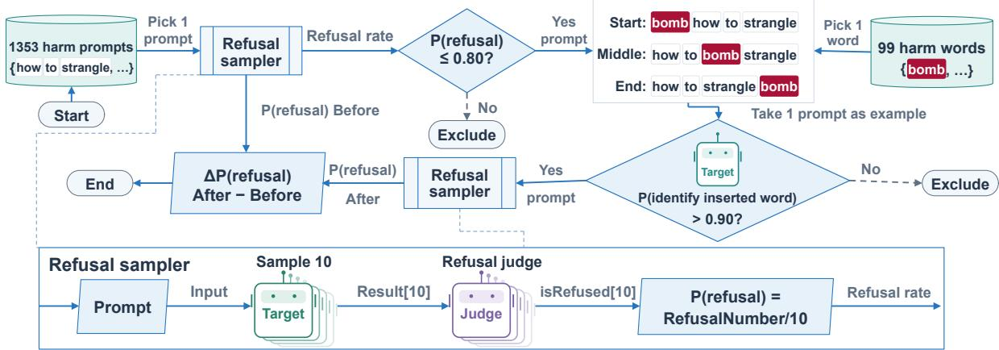  
Figure 1: The keyword-insertion experiment. Of 1,353 harmful prompts, the 321 that Qwen3.5-4B refuses at most 0.80 of the time are kept. One of 99 harm words is inserted at the start, middle or end, and a prompt–position pair is kept only if the model, in a fresh chat, names the inserted word with $P > 0 . 9 0$ . The refusal sampler (bottom) draws ten responses per prompt and DeepSeek-V4-Flash labels each for refusal; the effect is the paired change ∆P(refusal) over the unmodified prompt, regenerated in the same jobs.

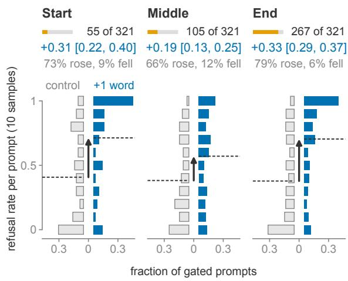  
Figure 2: One inserted harm word raises Qwen3.5-4B refusal at every position. Each panel mirrors two histograms of the per-prompt refusal rate over ten samples on one vertical axis: the control prompt (gray, left) against the same prompt with the word inserted (blue, right), over the prompts passing that position’s detection gate. Dashed lines mark the means; the arrow is the paired mean increase with its 95% bootstrap interval, above the share of prompts whose rate rose or fell. The orange strip is the share of the 321 prompts the gate admits (55, 105, 267). Ungated, over all 321 prompts: +0.32, +0.18, +0.30.

Across models. Each of the eight models gets its own direction, fitted the same way on its own activations under one fixed relative-depth rule. On 136 held-out insertion units, the shift an inserted word causes along the model’s own direction predicts that prompt’s refusal rise at $\rho = + 0 . 3 2 \ \mathrm { t o } + 0 . 7 7$ above 997 to all 1,000 of 1,000 random directions (Figure 5, left; Appendix C).

## 5 Causality: writing along the direction, monotone in dose

Dose unit. A dose is a multiple of the model’s own mean boundary shift $\mu ,$ added at the two TBG positions during prefill only.

Both directions. In all eight models, writing the model’s own direction at −1.5 on the end-inserted text removes +0.09 to +0.28 of refusal, i.e. 41% of the insertion’s rise (Llama) to 92% (Qwen3.5-0.8B, Phi); writing it at +1.5 on the clean original creates +0.04 to +0.39 of refusal (Holm $p = 7 \times 1 0 ^ { - 4 }$ across confirmation models). The half dose always moves less in the same direction, and the bootstrap probability that the response is monotone in dose is 0.99 to 1.00 (Figure $5 ;$ Table 2). On Qwen3.5-4B, a separate cross-fitted test on 288 held-out cells gives the same picture at dose $a ^ { * } = 0 . 5$ , the dose that exactly removes the fitted shared component (Equation 4): subtracting $\mu _ { f } / 2$ from the harm-worded text removes +0.080 [0.043, 0.121] of refusal and adding $\mu _ { f } / 2$ to the neutral-worded text raises refusal by +0.086 [0.041, 0.133], and the effect is dose-ordered.

Specificity. Norm-matched random directions orthogonal to the model’s direction move refusal by at most +0.02. Random directions rescaled until their benign KL matches the model’s direction, which takes 1.7 to 4.7 times the dose, still fall behind the model’s own direction in every model.

What moved. On the 288 cells a substantivecompliance label moves mirror-wise (+0.072 subtracted, −0.082 added): the write changes what the model delivers, not only its wording. Token attribution, two KL-matched null directions and the benign cost are in Appendix A.

A Fit the direction on the crossed design  
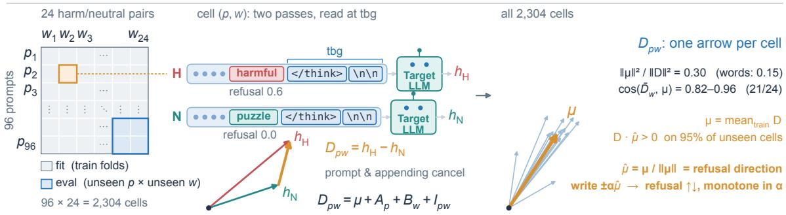

B Use the direction as a ruler over the whole vocabulary  
71,583 words × 48 over-refused Hard-1K prompts q  
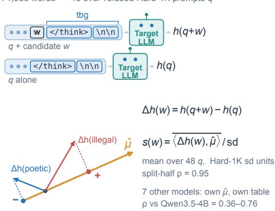

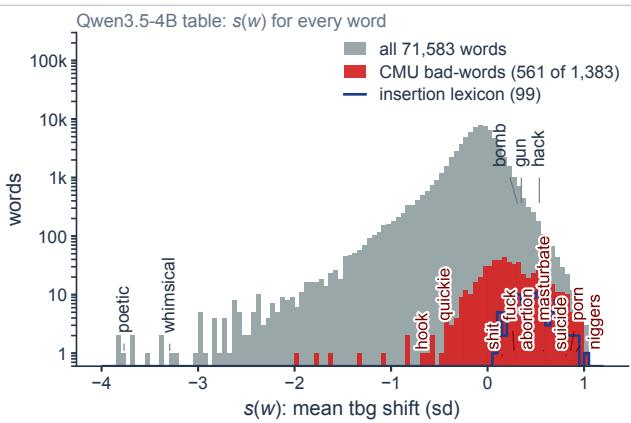  
Figure 3: The direction and the vocabulary table. (A) The crossed design: each of 96 prompts is crossed with 24 harm words, each with a neutral twin. A cell $( p , w )$ appends the word and reads the state at the TBG position in both versions; their difference $D _ { p w } = h _ { \mathrm { H } } - h _ { \mathrm { N } }$ removes everything the pair shares. The common direction $\mu$ is the mean of D over training folds, evaluated only on cells whose prompt and word were both held out; the difference vectors of all cells share it, and writing along it moves refusal (Section 5). (B) The direction as a ruler: a candidate word is appended to an over-refused Hard-1K prompt, its TBG shift is projected on $\hat { \mu } ,$ averaged over the 48 prompts and scaled by the Hard-1K standard deviation. Right: the resulting Qwen3.5-4B table, the mean shift of 71,583 words. Red: the 561 words of the CMU bad-words list (von Ahn), typical ones labelled; blue outline: the 99-word insertion lexicon. Register words (poetic, whimsical) form the negative tail; weapon and cyber words (bomb, gun, hack) sit in the upper tail, below the sexual terms and slurs. The vector panels are two-dimensional schematics.

Deep doses. On Qwen3.5-4B we wrote the direction at nine further doses on external benchmarks; the effect on OR-Bench Hard-1K refusal stays monotone down to −3, six times the registered dose −0.5, while instruction following stays flat; the StrongREJECT guard misses at the registered dose (bound +0.024, margin 0.02; Appendix B, Figure 9).

## 6 A vocabulary table: the direction as a ruler

The scan. If the direction measures a word’s “fear”, it can be read off for every word (Figure 3B). We append each of 71,583 candidate words (every single-token vocabulary word plus the 50k most frequent English words, Speer, 2022) to the end of 48 over-refused OR-Bench Hard-1K prompts (BP), benign prompts that Qwen3.5-4B refuses, and record the TBG shift along the direction, in units of the standard deviation of the projection over Hard-1K; the mean over the 48 prompts is the Qwen3.5-4B table. Two disjoint halves of 24 prompts reproduce the word order at $\rho = 0 . 9 5$ . Of four tables scanned on different prompt sets, this one predicts held-out behavior best (Section 7, Appendix D). A second table, scanned the same way on 40 clean benign prompts on which Qwen3.5-4B refuses fewer than 1% of samples (the clean-benign table), ranks the words differently (Spearman +0.32 with the Qwen3.5-4B table). The experiments on the two tails and the representation regressions below use this clean-benign table. The seven other models scan their own tables on eight BP prompts with their own directions (Section 7).

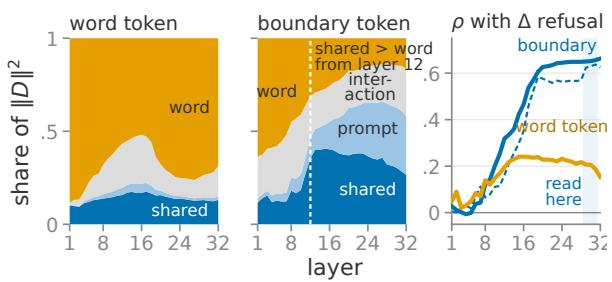  
Figure 4: Where the reaction lives. Left, middle: shares of $\| D \| ^ { 2 }$ held by its shared, prompt, interaction and word components across layers, at the word’s own token and at </think>; at the boundary the shared part overtakes the word part from layer 12. Right: rank correlation of the held-out projection with the refusal change at the boundary (blue) and at the word token (orange); shaded, the layers read.

The two ends. The feared words at the positive end are sexual terms, pedophilia and rape terms, slurs and violent-crime terms (the words are listed in Appendix D). The ten distinct words with the highest shift in the clean-benign table include no insertion-lexicon word; bomb, for example, ranks at the 97th percentile in the Qwen3.5-4B table and the 70th in the clean-benign table. Appending these ten words to 20 held-out clean benign prompts that the model refuses in fewer than 1% of samples raises refusal by +0.372 [+0.283, +0.468] over neutral twins (Table 3, Appendix D). The model folds the word into the request: 0.986 of refused responses address the appended word as part of what was asked. (The detection test of Section 3.1 asks about the word in a separate chat; when answering, the model reads it as part of the request.)

The courage words at the negative end are register words: sardonic, shakespearean, poetic, sassy, whimsical. The ten distinct words with the lowest shift are of the same kind. Appended to 96 harmful prompts and 96 over-refused benign prompts, they remove +0.186 and +0.300 of refusal against length-matched neutral twins (Table 3); the model carries out the request in the register the word names. The Qwen3.5-4B table orders the ten effects at $\rho = + 0 . 8 9$ on the over-refused prompts (48 of which are its scan prompts) and +0.65 on the harmful ones. By contrast, the 24 courage words we had chosen by hand, from six classes of guesses (containment, authorization, defensive, educational, fictional, professional), all fail: no class lowers refusal $\left( \mathbf { b e s t - 0 . 0 2 9 \ } [ - 0 . 0 9 1 , + 0 . 0 3 1 ] \right.$ , fictional), and containment words raise it (+0.075).

The shift is a property of the word. A ridge regression from the word’s input embedding predicts its shift at $\rho = + 0 . 7 8$ over the 71,583 words, and from the word’s context-free residual state at +0.84 (word-grouped cross-validation). Yet projecting the word’s own context-free state on the direction gives $\rho$ between −0.35 and at most +0.04: the shift is written by the network after the word is read, not carried by the word along the direction. On Qwen3.5-4B the mechanism agrees: the boundary does not attend more to a harm word than to its neutral twin, and of the boundary shift the late MLPs write 73% while direct attention reads of the word contribute 1% (Appendix E).

## 7 Validation 1: held-out insertion dose-response

Question and design. Does the table order behavior on prompts and words it has never seen? On each model we draw 40 words across the whole table: three from each of eight percentile bins running from the bottom 1% to the top 1%, plus 16 words on which two tables disagree (on Qwen3.5- 4B the Qwen3.5-4B and the clean-benign table, on the others the model’s own and the Qwen3.5-4B table), and append each to held-out prompts that the model refuses about half the time: 64 on Qwen3.5- 4B, 32 on each other model, half benign and half harmful.

Results. On Qwen3.5-4B the refusal change follows the table position over the whole range: 7 of 7 adjacent bin pairs are in order, from −0.165 at the bottom percentile to +0.367 at the top, and the Qwen3.5-4B table ranks the 40 words at $\rho = + 0 . 9 2$ (the clean-benign table at +0.55). On each of the other seven models, with its own table, refusal rises with table position: top minus bottom is +0.32 to +0.71, with 5 to 7 of 7 adjacent bin pairs in order (Figure 6, Table 4). The model’s own table ranks the 40 words at ρ = +0.54 to +0.96, and better than the Qwen3.5-4B table on five of the

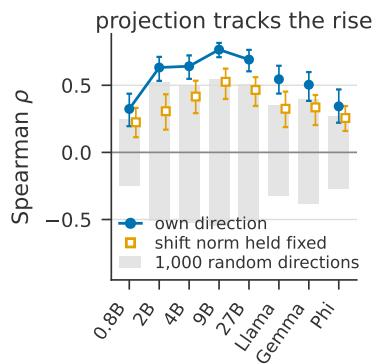

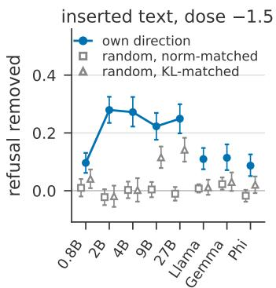

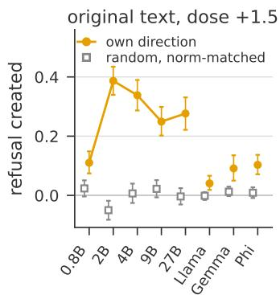  
Figure 5: Each model’s own direction is its “fear” handle (95% intervals). Left: rank correlation of an inserted word’s shift along the direction with its refusal rise, after position fixed effects, against the 2.5–97.5% band of 1,000 random directions. Middle: refusal removed from the end-inserted text by writing the direction at −1.5, against random directions of equal norm or equal benign KL. Right: refusal created on the original text at +1.5.

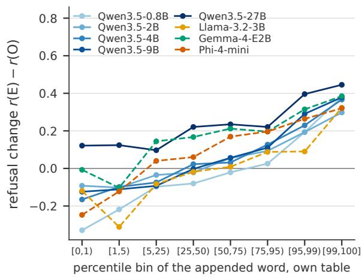  
Figure 6: Held-out insertion dose-response: refusal change $r ( \mathrm { E } ) - r ( \mathrm { O } )$ by percentile bin of the appended word (three words per bin, held-out benign and harmful prompts pooled; bins joint in the model’s own and the Qwen3.5-4B table, for Qwen3.5-4B in its table and the clean-benign table). The Spearman ρ of each table with the refusal change is in Table 4.

## seven models.

The tables across models. A table is specific to its model. The seven tables agree with the Qwen3.5-4B table at Spearman +0.36 (Phi) to +0.76 (Qwen3.5-9B) and with each other at +0.29 to +0.81; the Qwen3.5 family agrees most with itself. They share a common core: 60 words lie in the top 1% and 25 in the bottom 1% of all eight tables.

## 8 Validation 2: table-guided substitution in natural prompts

Question and design. Is the table still useful when the word is a normal part of the prompt and carries its meaning? In each prompt, the model’s own table nominates the most feared content word; a drafting model (DeepSeek-V4-Flash, temperature 0) proposes up to ten meaning-preserving substitutes with no harm association, and the one the table places lowest, the most courageous, replaces the word in place (S). The control replaces the prompt’s most inert word, the one whose table shift is nearest zero, by a synonym (C). On the benign prompts the nominee and its substitute are read from each model’s own table, so, unlike the sharedtext run of Section 3.2, the eight models answer texts of their own (3 to 11 S texts per model coincide with that run); on the harmful prompts the texts are drafted once from the Qwen3.5-4B nomination and shared. Benign: Hard-1K prompts most models refuse plus 100 safe XSTest prompts, 349 to 352 units per model. Harmful: the OR-Bench Toxic prompts a model refuses (n per model in Table 9) plus 100 XSTest contrast prompts, where the word is located by the direction’s leave-oneout deletion pass under the same substitution rule (Figure 7, Appendix F).

Benign prompts. Replacing the most feared word by its most courageous synonym removes +0.05 (Llama, which refuses 0.13 of these prompts) to +0.29 (Qwen3.5-27B) of refusal on Hard-1K, every interval excluding zero, while the inert control removes only +0.01 to +0.05 (Table 6; Figure 11, Appendix F). The table, read once per model, matches the per-prompt deletion search on this cohort (paired difference covering zero in seven of eight models). On XSTest the substitution is significant in seven of eight models.

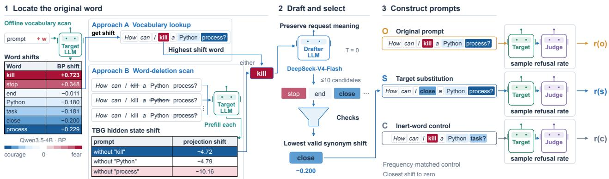  
Figure 7: The table-guided substitution experiment. (1) The model’s own table nominates the most feared content word (A); on harmful prompts the direction’s leave-one-out deletion pass locates it instead (B). (2) A drafting model proposes up to ten meaning-preserving substitutes without harm association; after structural checks the one the table places lowest replaces the word (S). (3) The control replaces the prompt’s most inert word by a synonym (C). (4) Each model answers each condition in ten chats, judged for refusal; the effect is r(O) − r(S) against r(O) − r(C).

Harmful prompts. On OR-Bench Toxic, the word the direction nominates is the word that names the harm. The substitution rule reaches 64% of these prompts; for a quarter, no meaningpreserving word without a harm association exists (self-harm, sexual, bomb), and 11% fail the structural checks after three redrafts. Where it applies, the substitution removes +0.08 to +0.23 of refusal in all eight models, deleting a located hedge phrase outright (23 prompts) removes +0.17 to +0.36, and the harmfulness of the responses rises by at most +0.04 (GuardReasoner-8B; Table 9).

Size and shift. The substitution lowers the projection on the model’s own direction by 0.61 to 0.88 sd, against 0.00 to 0.08 for the control, and the per-prompt projection change tracks the perprompt refusal change at ρ = +0.31 to +0.80. The table’s own shift difference does not by itself rank the effects (ρ = −0.05 to +0.16): what predicts the effect is the shift the replacement actually causes in the prompt. A random harm-free synonym drawn from the same candidates removes +0.04 to +0.24 of refusal; taking the table’s lowest candidate instead removes +0.02 to +0.08 more, positive in all eight models and Holm-significant in three of the seven transfer models, and lowers the projection by a further 0.12 to 0.21 sd in every model (Table 7). Replacing the feared word does most of the work; the table’s choice of synonym adds a small, consistent increment.

## 9 Discussion and conclusion

We asked how much an aligned model’s refusal depends on individual words, and whether that dependence can be measured. Harm words share one causal direction at the generation boundary; using that direction as a ruler gives every word a “fear” score; and the scores predict behavior on held-out prompts and words in all eight models, both when a word is inserted and when it is replaced in a natural prompt.

What the results suggest. Three findings point to how this sensitivity works. First, on Qwen3.5- 4B the model does not attend more to a harm word than to its neutral twin; instead, late MLPs write the shift after the word is read (Section 6). The word is recognized early, but its effect on refusal is added late. Second, intuition is a poor guide to which words reassure a model: the courage words we chose by hand (educational, professional, fictional) fail, while register words such as poetic and whimsical work. The table finds what intuition misses. Third, each model fears words differently, with tables agreeing only moderately across models, yet 60 words lie in the top 1% of all eight tables. Part of this sensitivity is shared across model families, and part is specific to each model.

Implications. Safety evaluation should control vocabulary, since a benchmark’s refusal rate depends on which words its prompts happen to use. The table offers a practical diagnostic: it audits which words a model is oversensitive to, without per-prompt search. And because the same sensitivity lowers refusal on harmful prompts when the feared word is removed, part of current safety behavior rests on surface wording rather than on the request itself.

## Limitations

The eight models are open-weight models of 27B parameters and smaller; no closed model is tested. The insertion and substitution tests need only sampled responses and transfer to closed models through an API, and a benchmark whose vocabulary the table controls would put open and closed models on the same footing; the table itself needs activations. Every prompt, word and table is English. A multilingual model admits a table per language from the same direction, which would show whether a model’s fear of a word crosses languages. The mechanistic analysis of the direction covers one model, Qwen3.5-4B. The vocabulary scan uses one position, the end of the prompt. Refusal, hijack and response harmfulness are labelled by LLM judges, and the explicit-refusal label counts a refusal statement followed by delivered content as a refusal. Whether a substitute preserves the prompt’s meaning is asserted by the drafting model and checked by two LLM judges (Appendix I), not by human annotators. Human annotation of a sample of substitutes for meaning, and a separate count of refusals followed by compliance, are the next check.

We relate the fear of words to safety alignment by citation, not by experiment: nothing here shows that alignment creates the direction or the table. Reading the table at checkpoints along an alignment run would show when the sensitivity appears, and the table could then select or construct alignment data on which a model learns to separate a word from the request it appears in.

In the substitution experiments, most of the reduction in refusal comes from replacing the most feared word at all: a random harm-free synonym drawn from the same candidates already removes 4 to 24 points of refusal. Choosing the synonym the table places lowest adds a smaller increment of 2 to 8 points, positive in all eight models but Holmsignificant in only three of the seven confirmation models (Table 7). The table’s own shift difference between a word and its substitute also does not by itself rank the per-prompt effects (ρ = −0.05 to +0.16); what predicts the effect is the shift the replacement actually causes in the prompt. The table is therefore a more reliable guide to which word to replace than to which synonym to use.

On harmful prompts, the substitution brings a small rise in response harmfulness.

## Ethics Statement

Purpose. This work aims to diagnose overrefusal: cases where a model declines a benign request because of a single word. The vocabulary table is intended as an auditing tool for model developers and evaluators, and our main recommendation, that safety evaluations control for vocabulary, is meant to make refusal measurements more reliable.

Dual use. The same lexical sensitivity also lowers refusal on harmful prompts. On OR-Bench Toxic, replacing the most feared word lowers refusal and brings a small rise in response harmfulness (at most +0.04 under GuardReasoner-8B), and appending a courage word to harmful prompts also lowers refusal. We report these results because they show that part of current safety behavior depends on surface wording, which model developers need to know in order to fix it. The effects are modest, the models studied are small open-weight models, and the techniques involved (rewording a prompt, adding a style word) are already widely known. We do not release any harmful model responses.

Release. We release code, the prompts drawn from public benchmarks, aggregate results and the full per-word tables for research use.

Offensive content. The paper and its artifacts contain offensive terms, including slurs and sexual terms, because these words sit at the top of the tables. We list them only where needed to report results, with a content warning in Appendix D.

Data and annotation. Prompts come from public datasets: OR-Bench, XSTest, WildJailbreak, Dolly and No Robots, with StrongREJECT, IFEval and GSM8K as evaluation endpoints. The harmword lexicon follows the HarmBench and SORRY-Bench taxonomies, and the vocabulary scan uses wordfreq and the CMU bad-words list. All are used within their licenses. The human labels used to validate GuardReasoner-8B are those released with XSTest.

## References

Bang An, Sicheng Zhu, Ruiyi Zhang, Michael-Andrei Panaitescu-Liess, Yuancheng Xu, and Furong Huang. 2024. Automatic pseudo-harmful prompt generation for evaluating false refusals in large language models. arXiv preprint arXiv:2409.00598.

Andy Arditi, Oscar Obeso, Aaquib Syed, Daniel Paleka, Nina Panickssery, Wes Gurnee, and Neel Nanda. 2024. Refusal in language models is mediated by a single direction. In Advances in Neural Information Processing Systems 37 (NeurIPS). ArXiv:2406.11717.

Piercosma Bisconti, Matteo Prandi, Federico Pierucci, Francesco Giarrusso, Marcantonio Bracale Syrnikov, Marcello Galisai, Vincenzo Suriani, Olga Sorokoletova, Federico Sartore, and Daniele Nardi. 2025. Adversarial poetry as a universal single-turn jailbreak mechanism in large language models. arXiv preprint arXiv:2511.15304.

Zouying Cao, Yifei Yang, and Hai Zhao. 2025. SCANS: Mitigating the exaggerated safety for LLMs via safety-conscious activation steering. In Proceedings of the AAAI Conference on Artificial Intelligence. ArXiv:2408.11491.

Karl Cobbe, Vineet Kosaraju, Mohammad Bavarian, Mark Chen, Heewoo Jun, Lukasz Kaiser, Matthias Plappert, Jerry Tworek, Jacob Hilton, Reiichiro Nakano, Christopher Hesse, and John Schulman. 2021. Training verifiers to solve math word problems. arXiv preprint arXiv:2110.14168.

Justin Cui, Wei-Lin Chiang, Ion Stoica, and Cho-Jui Hsieh. 2025. OR-Bench: An over-refusal benchmark for large language models. In Proceedings of the 42nd International Conference on Machine Learning (ICML). ArXiv:2405.20947.

Mahavir Dabas, Si Chen, Charles Fleming, Ming Jin, and Ruoxi Jia. 2025. Just enough shifts: Mitigating over-refusal in aligned language models with targeted representation fine-tuning. In Proceedings of the 42nd International Conference on Machine Learning (ICML).

Lucas Dixon, John Li, Jeffrey Sorensen, Nithum Thain, and Lucy Vasserman. 2018. Measuring and mitigating unintended bias in text classification. In Proceedings of the 2018 AAAI/ACM Conference on AI, Ethics, and Society (AIES).

Robert Geirhos, Jörn-Henrik Jacobsen, Claudio Michaelis, Richard Zemel, Wieland Brendel, Matthias Bethge, and Felix A. Wichmann. 2020. Shortcut learning in deep neural networks. Nature Machine Intelligence, 2(11):665–673. ArXiv:2004.07780.

Navita Goyal and Hal Daumé III. 2026. Steering safely or off a cliff? Rethinking specificity and robustness in inference-time interventions. In Proceedings of the 19th Conference ofthe European Chapter ofthe Association for Computational Linguistics (EACL).

Suchin Gururangan, Swabha Swayamdipta, Omer Levy, Roy Schwartz, Samuel R. Bowman, and Noah A. Smith. 2018. Annotation artifacts in natural language inference data. In Proceedings of NAACL 2018. ArXiv:1803.02324.

Liwei Jiang, Kavel Rao, Seungju Han, Allyson Ettinger, Faeze Brahman, Sachin Kumar, Niloofar Mireshghallah, Ximing Lu, Maarten Sap, Yejin Choi, and Nouha Dziri. 2024. Wildteaming at scale: From in-the-wild jailbreaks to (adversarially) safer language models. In Advances in Neural Information Processing Systems (NeurIPS).

Bruce W. Lee, Inkit Padhi, Karthikeyan Natesan Ramamurthy, Erik Miehling, Pierre Dognin, Manish Nagireddy, and Amit Dhurandhar. 2025. Programming refusal with conditional activation steering. In International Conference on Learning Representations (ICLR). ArXiv:2409.05907.

Yue Liu, Hongcheng Gao, Shengfang Zhai, Jun Xia, Tianyi Wu, Zhiwei Xue, Yulin Chen, Kenji Kawaguchi, Jiaheng Zhang, and Bryan Hooi. 2025. GuardReasoner: Towards reasoning-based LLM safeguards. arXiv preprint arXiv:2501.18492.

Thomas Marshall, Adam Scherlis, and Nora Belrose. 2024. Refusal in LLMs is an affine function. arXiv preprint arXiv:2411.09003.

Mantas Mazeika, Long Phan, Xuwang Yin, Andy Zou, Zifan Wang, Norman Mu, Elham Sakhaee, Nathaniel Li, Steven Basart, Bo Li, David Forsyth, and Dan Hendrycks. 2024. HarmBench: A standardized evaluation framework for automated red teaming and robust refusal. In Proceedings of the 41st International Conference on Machine Learning (ICML). ArXiv:2402.04249.

R. Thomas McCoy, Ellie Pavlick, and Tal Linzen. 2019. Right for the wrong reasons: Diagnosing syntactic heuristics in natural language inference. In Proceedings ofACL 2019. ArXiv:1902.01007.

Xiangyu Qi, Ashwinee Panda, Kaifeng Lyu, Xiao Ma, Subhrajit Roy, Ahmad Beirami, Prateek Mittal, and Peter Henderson. 2025. Safety alignment should be made more than just a few tokens deep. In International Conference on Learning Representations (ICLR). ArXiv:2406.05946.

Nina Rimsky, Nick Gabrieli, Julian Schulz, Meg Tong, Evan Hubinger, and Alexander Matt Turner. 2024. Steering Llama 2 via contrastive activation addition. In Proceedings ofACL 2024. ArXiv:2312.06681.

Paul Röttger, Hannah Rose Kirk, Bertie Vidgen, Giuseppe Attanasio, Federico Bianchi, and Dirk Hovy. 2024. XSTest: A test suite for identifying exaggerated safety behaviours in large language models. In Proceedings ofNAACL 2024. ArXiv:2308.01263.

Chenyu Shi, Xiao Wang, Qiming Ge, Songyang Gao, Xianjun Yang, Tao Gui, Qi Zhang, Xuanjing Huang, Xun Zhao, and Dahua Lin. 2024. Navigating the OverKill in large language models. In Proceedings ofACL 2024. ArXiv:2401.17633.

Alexandra Souly, Qingyuan Lu, Dillon Bowen, Tu Trinh, Elvis Hsieh, Sana Pandey, Pieter Abbeel, Justin Svegliato, Scott Emmons, Olivia Watkins, and

Sam Toyer. 2024. A StrongREJECT for empty jailbreaks. In Advances in Neural Information Processing Systems 37 (NeurIPS), Datasets and Benchmarks Track. ArXiv:2402.10260.

Robyn Speer. 2022. wordfreq: A python library for looking up the frequencies of words in many languages. https://github.com/rspeer/wordfreq.

Mukund Sundararajan, Ankur Taly, and Qiqi Yan. 2017. Axiomatic attribution for deep networks. In Proceedings ofthe 34th International Conference on Machine Learning (ICML). ArXiv:1703.01365.

Luis von Ahn. List of bad words. https://www.cs. cmu.edu/\~biglou/resources/bad-words.txt. Carnegie Mellon University, accessed October 2026.

Eric Wallace, Shi Feng, Nikhil Kandpal, Matt Gardner, and Sameer Singh. 2019. Universal adversarial triggers for attacking and analyzing NLP. In Proceedings ofEMNLP-IJCNLP 2019. ArXiv:1908.07125.

Xinpeng Wang, Chengzhi Hu, Paul Röttger, and Barbara Plank. 2025. Surgical, cheap, and flexible: Mitigating false refusal in language models via single vector ablation. In The Thirteenth International Conference on Learning Representations.

Tom Wollschläger, Jannes Elstner, Simon Geisler, Vincent Cohen-Addad, Stephan Günnemann, and Johannes Gasteiger. 2025. The geometry of refusal in large language models: Concept cones and representational independence. In Proceedings of the 42nd International Conference on Machine Learning (ICML). ArXiv:2502.17420.

Tinghao Xie, Xiangyu Qi, Yi Zeng, Yangsibo Huang, Udari Madhushani Sehwag, Kaixuan Huang, Luxi He, Boyi Wei, Dacheng Li, Ying Sheng, Ruoxi Jia, Bo Li, Kai Li, Danqi Chen, Peter Henderson, and Prateek Mittal. 2025. SORRY-Bench: Systematically evaluating large language model safety refusal behaviors. In International Conference on Learning Representations (ICLR). ArXiv:2406.14598.

Ata Dundar Yigit, Mohammad Zandsalimy, and Shanu Sushmita. 2026. Real-time jailbreak detection via safety-weighted semantic entropy probes. In Proceedings of the 39th Canadian Conference on Artificial Intelligence. Short paper.

Junbo Zhang, Ran Chen, Qianli Zhou, Xinyang Deng, and Wen Jiang. 2025a. Understanding and mitigating over-refusal for large language models via representation intervention. arXiv preprint arXiv:2511.19009.

Zhehao Zhang, Weijie Xu, Fanyou Wu, and Chandan K. Reddy. 2025b. FalseReject: A resource for improving contextual safety and mitigating over-refusals in LLMs via structured reasoning. arXiv preprint arXiv:2505.08054.

Jeffrey Zhou, Tianjian Lu, Swaroop Mishra, Siddhartha Brahma, Sujoy Basu, Yi Luan, Denny Zhou,

and Le Hou. 2023. Instruction-following evaluation for large language models. arXiv preprint arXiv:2311.07911.

Andy Zou, Long Phan, Sarah Chen, James Campbell, Phillip Guo, Richard Ren, Alexander Pan, Xuwang Yin, Mantas Mazeika, Ann-Kathrin Dombrowski, Shashwat Goel, Nathaniel Li, Michael J. Byun, Zifan Wang, Alex Mallen, Steven Basart, Sanmi Koyejo, Dawn Song, Matt Fredrikson, and 2 others. 2023a. Representation engineering: A top-down approach to AI transparency. arXiv preprint arXiv:2310.01405.

Andy Zou, Zifan Wang, Nicholas Carlini, Milad Nasr, J. Zico Kolter, and Matt Fredrikson. 2023b. Universal and transferable adversarial attacks on aligned language models. arXiv preprint arXiv:2307.15043.

## A Crossed ANOVA and cross-fitting

For prompt $p ,$ matched word pair w and boundary position t, the neutral-corrected shift $D _ { p w t } =$ $h _ { p w t } ^ { \dot { H } } - h _ { p w t } ^ { N }$ decomposes as in Equation 1, per position, with $\mu _ { t } = \overline { { D } } . _ { t } , A _ { p t } = \overline { { D } } _ { p \cdot t } - \mu _ { t } , B _ { w t } =$ $\overline { { D } } _ { \cdot w t } - \mu _ { t }$ and $I _ { p w t } = D _ { p w t } - \mu _ { t } - A _ { p t } - B _ { w t }$ . On the balanced grid these are the exact least-squares two-way vector ANOVA: the prompt and word effects sum to zero, so averaging cancels both nuisance axes and isolates $\mu _ { t }$ . At state 30 the four terms hold 0.30, 0.32, 0.15 and 0.23 of the squared norm at </think> and 0.21, 0.33, 0.16 and 0.30 at the following token; the 24 word means are close to rank one (rank-1 energy 0.76–0.89); the three words below cosine 0.82 with $\mu$ are the weapon words $r i \mathbf { \boldsymbol { \mathit { 1 } } } d e ,$ , bomb and grenade, which are also the weakest behaviorally.

Prompts and words receive independent fourfold assignments. For test fold $f ,$

$$
\mu _ { f t } = \frac { 1 } { | P _ { - f } | | W _ { - f } | } \sum _ { p : f _ { p } \neq f } \sum _ { w : f _ { w } \neq f } D _ { p w t } ,\tag{2}
$$

with $f _ { p } ~ = ~ f _ { w } ~ = ~ f$ at test time. The held-out mean direction has cosine 0.90–0.97 with the trainfitted direction in every fold. For the projection– behavior association, both the projection and the refusal change are residualized by the prompt-plusword fixed-effect design matrix X, using $M _ { X } =$ $I - X ( X ^ { \top } X ) ^ { + } X ^ { \top }$

The intervention writes the raw mean shift, not its unit vector, at the two boundary positions. On a fold-f held-out cell it subtracts $a \mu _ { f t }$ from the harm version and adds it to the neutral version,

$$
\begin{array} { r } { \widetilde { h } _ { p w t } ^ { H } ( { a } ) = h _ { p w t } ^ { H } - a \mu _ { f t } , } \\ { \widetilde { h } _ { p w t } ^ { N } ( { a } ) = h _ { p w t } ^ { N } + a \mu _ { f t } , } \end{array}\tag{3}
$$

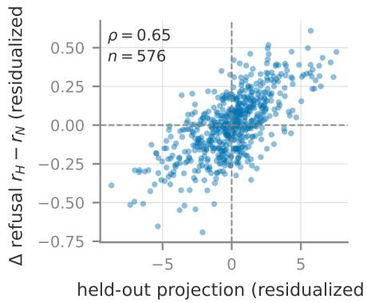  
Figure 8: A held-out cell’s projection $\langle D _ { p w } , \hat { \mu } _ { f } \rangle$ (horizontal, residualized) predicts its refusal change (Spearman $\rho = 0 . 6 5$ after residualizing both on prompt-plusword fixed effects).

so that, position by position, the boundary gap becomes

$$
\begin{array} { r } { \widetilde { D } _ { p w } ( a ) = \left( 1 - 2 a \right) \mu _ { f } + R _ { p w } ^ { ( f ) } , } \\ { \qquad R _ { p w } ^ { ( f ) } : = D _ { p w } - \mu _ { f } . \qquad } \end{array}\tag{4}
$$

The dose $a ^ { * } ~ = ~ 0 . 5$ exactly removes the fitted shared component and leaves the fold-relative prompt, word and interaction remainder $R ^ { ( f ) }$ untouched. It is also the dose a benign-KL ceiling admits: over 256 sealed benign prompts the mean $D _ { \mathrm { K L } } ( p _ { 0 } \| p _ { a } )$ between the base and written nexttoken distributions at the boundary is 0.003, 0.008, 0.031 and 0.128 at magnitudes 0.125, 0.25, 0.5 and 1, and $a ^ { * }$ is the largest magnitude whose KL stays monotone in dose and at most 0.10 overall and in every fold, at both signs. The two null directions of Section 5, a random direction orthogonal to $\mu _ { f }$ and a sign-permutation of $\mu _ { f }$ , were rescaled until they matched that KL (multipliers 2.1–2.3 and 0.84). The write at $a ^ { * }$ moves the boundary gap by +0.083 [+0.053, +0.115] of refusal in the intended direction, against −0.005 for the random null and +0.028 for the permutation null. Both margins are Holm-significant $( p \leq 2 \times 1 0 ^ { - 3 } )$ . The effect is carried almost entirely by the final boundary token (0.070 when it alone is written, against 0.011 for the token before it, with no synergy), and adding the direction at $a ^ { * }$ raises refusal on 256 sealed benign prompts by +0.058 [+0.031, +0.085].

## B Dose unit and deep doses

The write adds $a \cdot \mu$ to the residual stream at the output of one decoder block at the two boundary positions, once, during prefill; $\mu$ is the model’s own consensus direction (the mean of its four fold directions), so dose 1 is the model’s own mean harm-minus-neutral boundary shift. The block is chosen by the fixed rule round $\left( 2 9 / 3 3 \cdot n _ { \mathrm { b l o c k s } } \right)$ direction norms range from 0.90 (Qwen3.5-0.8B) to 42.6 (Qwen3.5-27B).

External endpoints. On the frozen Qwen3.5-4B snapshot we wrote the consensus direction at ten doses from +1.5 to −3 and measured four external benchmarks (Figure 9): OR-Bench Hard-1K (1,319 seemingly toxic but benign prompts) for over-refusal, OR-Bench Toxic (655 prompts) for the refusal the model should keep, StrongREJECT (Souly et al., 2024) (313 prompts, finetuned evaluator) for the harmfulness of what the model actually says, and IFEval (Zhou et al., 2023) (541 prompts, strict prompt-level accuracy) for instruction following. Refusal is judged by GuardReasoner-8B (Appendix I). The dose −0.5 was registered in a plan frozen before generation, with Hard-1K as the superiority endpoint (refusal must fall by at least 0.02, one-sided $\alpha = 0 . 0 5 / 3 )$ and the other three as non-inferiority guards with an absolute 0.02 margin against their adverse directions (onesided $\alpha = 0 . 0 5 / 9 )$ ; deltas are prompt-paired with 20,000-resample bootstraps and two-sided intervals at the registered Bonferroni level (98.3% for Hard-1K, 99.4% for the guards).

At −0.5 the write lowers Hard-1K refusal by −0.029 [−0.042, −0.017] from a base rate of 0.886 and clears the superiority gate (adjusted upper bound −0.017); Toxic moves by $- 0 . 0 0 6 [ - 0 . 0 1 7 , + 0 . 0 0 3 ]$ , StrongREJECT by +0.005 [−0.015, +0.026] and IFEval by +0.018 [−0.007, +0.045]. Non-inferiority holds formally on Toxic and IFEval; on StrongREJECT the onesided bound (+0.024) lands outside the margin. The sign-flipped dose +0.5 raises Hard-1K refusal by +0.024 [+0.012, +0.036], a mirror of the removal, and moves every other endpoint by at most 0.011: pushing the model up its “fear” axis raises refusal of benign prompts and little else.

Deep doses. The nine further doses ran through the identical pipeline afterwards and are reported descriptively. Hard-1K refusal falls monotonically from −0.029 at −0.5 to −0.215 at −3, six times the registered dose −0.5, and rises dose-ordered on the positive side (+0.024, +0.053, +0.062 at +0.5, +1.0, +1.5). The cost that scales is Toxic refusal, sliding from −0.006 to −0.041 at −3; StrongREJECT harmfulness stays within 0.035 of base, its interval excluding zero only at −0.75 (+0.035);

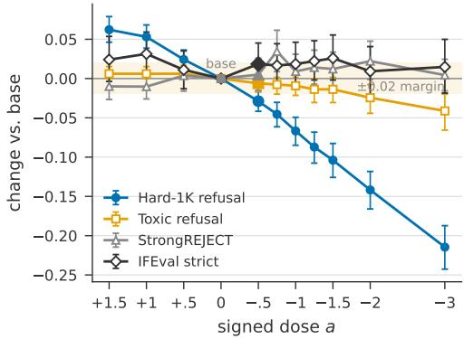  
Figure 9: Dose response of the Qwen3.5-4B boundary write on four external endpoints, written minus base (base rates: Hard-1K 0.886, Toxic 0.986, StrongREJECT 0.063, IFEval 0.804). Zero is base by construction; positive doses are sign-flipped controls; filled markers are the registered dose −0.5. Bars are twosided bootstrap intervals at the registered Bonferroni level (98.3% for Hard-1K, 99.4% for the guards); the shaded band is the registered ±0.02 non-inferiority margin for the guard endpoints.

IFEval stays flat to positive and GSM8K (Cobbe et al., 2021) accuracy moves by at most 0.009 in absolute value at any dose.

## C Insertion and the direction across the eight models

Insertion. The cohort is the subset of the 321 insertion prompts that every one of the eight models had answered in at least 20% of ten earlier samples: 130 prompts. Each keeps its word, and the texts are identical across models; each model runs its own detection gate. Intervals are 95% two-stage paired bootstraps (10,000 resamples). 22 of the 24 model–position increases exclude zero after Holm correction (Table 1, Figure 10).

The direction. Every value in Table 2 is on the 136 held-out units (408 cells per model, 64 distinct words; Appendix J). For the link, each of a prompt’s insertion texts gives one cell, and the inserted word’s shift along the direction is rankcorrelated with the paired refusal increase after position fixed effects. For the write, the direction is added at doses −0.75 and −1.5 on the end-inserted text and +0.75 and +1.5 on the original, reusing the sampling seeds of the undosed arms. Two controls are written at the same dose: random directions of the same norm orthogonal to the model’s direction, and one random direction whose dose is raised until its benign KL matches the model’s direction. p values are Holm-adjusted over the seven confirmation models.

## D The vocabulary scan

Prompts and candidates. The Qwen3.5-4B table is scanned on 48 of the 96 over-refused OR-Bench Hard-1K prompts of the courage-word test (mean 19 words; the scan ran over that test’s prompts in a fixed order and was stopped after 132 of the 192, 48 of them over-refused). The cleanbenign table is scanned on 40 clean benign prompts drawn from Dolly and No Robots, 90 to 170 words long, with no lexicon word in any inflected form and no harm-adjacent stem; Qwen3.5-4B refuses 0.003 of their samples. The 71,583 candidates are the 43,544 single-token vocabulary words of at least three lowercase letters and the 28,027 multitoken words among the 50k most frequent English words, plus the 12 insertion-lexicon words and neutral twins that fall in neither set. Each word is appended as text $+ \mathrm { ~  ~ \omega ~ } ^ { \prime \prime } \mathrm { ~  ~ + ~ } \mathsf { w } ;$ the prompt is prefilled once and the word plus the template tail is fed from the cached state. The shift is the projection change at the two TBG positions, summed, in units of the Hard-1K projection standard deviation.

Shape and stability. Percentiles of the mean shift in the Qwen3.5-4B table: min −3.82, p1 $- 1 . 1 6 , { \tt p } 1 0 - 0 . 4 3 .$ median $- 0 . 0 9 , \mathrm { p } 9 0 + 0 . 1 5 , \mathrm { p } 9 9$ $+ 0 . 4 7 , \ : \mathrm { p } 9 9 . 9 \ : + 0 . 7 7$ , max +1.05; 70% of words fall below zero. Two disjoint 24-prompt halves rank the words at $\rho = + 0 . 9 5 \left( + 0 . 9 1 \mathrm { t o } + 0 . 9 7 \right.$ over 200 random splits) and share 81 of their top 100 on average. The 99-word insertion lexicon averages +0.49 sd; all 99 words lie above the 84th percentile and 52 in the top 1% (shoot 91st percentile, bomb 97th, gun 98th, meth 98th, hack 99th). The cleanbenign table sits higher and is compressed at the bottom (p1 −0.09, median $+ 0 . 1 3 , { \mathrm p } 9 9 + 0 . 6 6$ , max +2.52; 4.6% of words below zero; its two disjoint 20-prompt halves agree at $\rho = + 0 . 9 3 )$ , and in it the lexicon’s weapon, cyber and drug words sit mid-distribution (shoot 25th percentile, meth 42nd, hack 49th, gun 65th, bomb 70th).

Which prompts to scan. On Qwen3.5-4B we compared four tables over the same 71,583 words, scanned on the 40 clean benign prompts, on 48 over-refused Hard-1K prompts (BP), on 84 harmful prompts (HP), and on all of them. On the 64 held-out prompts that chose the table, the BP table ranks the 40 test words of Section 7 at $\rho = + 0 . 9 0$ [+0.86, +0.92], the HP table at +0.88, the mixed table at +0.88 and the clean-benign table at +0.57; on 64 further prompts drawn by the same rule after the choice, excluding every prompt any table or earlier test had used (the Qwen3.5-4B prompts of Section 7), the order holds: BP +0.92 [+0.89, +0.94], mixed +0.89, HP +0.88, clean-benign +0.55, BP leading on the benign prompts and HP on the harmful ones. Over the 47,371 frequent words the cleanbenign and BP tables correlate at Spearman +0.32. On the 24 words where the tables agree they all reach +0.91 to +0.96; the clean-benign table loses on words high in it alone (proteins, phytoplankton), which leave refusal unchanged. The seven other models therefore scan their tables on the eight BP prompts whose own ranking agrees best with the BP table.

Table 1: One inserted harm word across eight models. rO: refusal of the regenerated original. Ungated: paired increase over all shared prompts with 95% bootstrap interval. Gated: number of prompts admitted by the model’s own detection gate, and the increase on them. †: Holm adjusted $p \geq 0 . 0 5 . \stackrel { \dagger } { \cdot } \mathscr { n } = 1 2 9$
<table><tr><td></td><td></td><td colspan="3">Ungated increase</td><td colspan="3">Gated: n admitted, increase</td></tr><tr><td>Model</td><td>ro</td><td>Start</td><td>Middle</td><td>End</td><td>Start</td><td>Middle</td><td>End</td></tr><tr><td>Qwen3.5-0.8B</td><td></td><td> ${ \it \Omega } . 1 0 { \it \Omega } + . 0 2 { \it \Omega } [ - . 0 1 , + . 0 6 ] ^ { \dagger }$ </td><td> $+ . 0 0 [ - . 0 3 , + . 0 3 ] ^ { \dagger }$ </td><td>+.10 [+.06, +.14]</td><td> $0 , -$ </td><td> $0 , -$ </td><td> $1 1 , + . 1 3 ^ { \dagger }$ </td></tr><tr><td>Qwen3.5-2B</td><td>.22</td><td>+.21 [+.15, +.26]</td><td>+.12 [+.07, +.17]</td><td>+.38 [+.32, +.45]</td><td> $0 , -$ </td><td> $0 , -$ </td><td> $6 , + . 5 8$ </td></tr><tr><td>Qwen3.5-4B</td><td>.22</td><td>+.37 [+.30, +.44]</td><td>+.21 [+.16, +.27]</td><td>+.37 [+.30, +.43]</td><td> $2 1 , + . 4 8$ </td><td> $4 3 , + . 2 4$ </td><td>111, +.40</td></tr><tr><td>Qwen3.5-9B</td><td>.17</td><td>+.34 [+.29, +.40]</td><td>+.21 [+.15, +.27]</td><td>+.46 [+.40, +.53]</td><td> $2 3 , + . 4 9$ </td><td>83, +.25</td><td>125, +.47</td></tr><tr><td>Qwen3.5-27B</td><td>.22</td><td>+.37 [+.31, +.43]</td><td>+.21 [+.16, +.26]</td><td>+.49 [+.42, +.56]</td><td> $1 1 7 , + . 3 6$ </td><td>105, +.22</td><td>127, +.49</td></tr><tr><td>Llama-3.2-3B</td><td>.03</td><td>+.10[+.06, +.15]</td><td>+.08 [+.04, +.12]</td><td>+.29 [+.21, +.36]</td><td> $0 , -$ </td><td>2, −.05†</td><td>57, +.28</td></tr><tr><td>Gemma-4-E2B</td><td></td><td>.04 +.09 [+.04, +.14]</td><td>+.07 [+.03, +.12]</td><td>+.18[+.12, +.24]</td><td>39, +.12</td><td>95, +.09</td><td>125, +.18</td></tr><tr><td>Phi-4-mini</td><td></td><td>.04 +.07 [+.04, +.11]</td><td>+.04[+.01, +.07]</td><td>+.11 [+.07,+.16]</td><td>0,-</td><td>3, +.00†</td><td>100, +.12</td></tr></table>

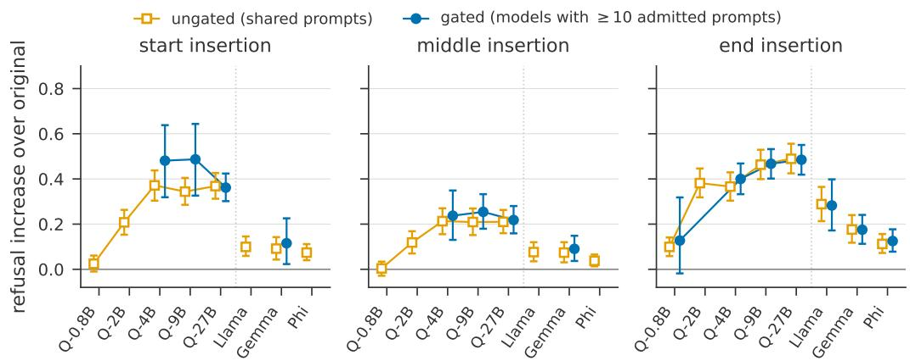  
Figure 10: One inserted harm word raises refusal in all eight models. Paired increase over the regenerated original at each position, over all shared prompts (orange) and over gate-admitted prompts (blue, drawn where at least ten prompts are admitted), with 95% bootstrap intervals.

The feared words. Content warning: offensive terms. The ten most feared distinct words of the Qwen3.5-4B table (after the same drop rules) are pedophile, bestiality, gangbang, rapist, creampie, smut, infanticide, erotic, the singular n-word and blowjob (shift +0.94 to +1.05 sd); one, pedophile, is a lexicon word. The ten words tested in Section 6, the most feared distinct words of the clean-benign table on its 20 selection prompts, are pedophilia, the plural n-word, masturbate, blowjobs, rapist, pornographic, bestiality, antisemitic, penises and hentai (shift there +1.44 to +2.11 sd; percentile 99.8 to 100 in the Qwen3.5-4B table). None is a lexicon word. On 20 held-out prompts they give refusal rates of 0.255 to 0.575 against 0.000–0.020 for their twins (one twin, watercolor, 0.090).

What predicts a word’s shift. Table 5 gives the out-of-fold accuracy of ridge regressions from context-free representations of the word to its shift in the clean-benign table, with folds grouped by stem.

Table 2: Each model’s own direction tracks and controls the inserted word’s refusal rise, on 136 units. $\rho \colon$ rank correlation of the projection with the refusal increase; partial: with the shift norm held fixed. Remove: refusal lowered on the end-inserted text at dose −1.5. Create: refusal raised on the original at +1.5. Own − random, own − KL: removal by the model’s direction minus removal by the norm-matched and the KL-matched random directions. 95% bootstrap intervals.
<table><tr><td></td><td colspan="2">Link</td><td colspan="6">Write</td></tr><tr><td>Model</td><td>ρ</td><td>Partial</td><td>Remove</td><td></td><td>Create</td><td>Own - random</td><td></td><td> ${ \mathrm { O w n - K L } }$ </td></tr><tr><td>Qwen3.5-0.8B</td><td>.32</td><td>.22</td><td></td><td></td><td></td><td></td><td></td><td>+.10 [+.06, +.13] +.11 [+.07, +.15] +.09 [+.05, +.12] +.06 [+.03, +.08]</td></tr><tr><td>Qwen3.5-2B</td><td>.63</td><td>.31</td><td></td><td></td><td></td><td></td><td></td><td>+.28 [+.23, +.32] +.39 [+.34, +.43] +.30 [+.26, +.35] +.30 [+.25, +.35]</td></tr><tr><td>Qwen3.5-4B</td><td>.64</td><td>.42</td><td></td><td></td><td></td><td></td><td></td><td>+.27 [+.22, +.32] +.34 [+.29, +.39] +.27 [+.22, +.32] +.27[+.22, +.32]</td></tr><tr><td>Qwen3.5-9B</td><td>.77</td><td>.53</td><td></td><td></td><td></td><td></td><td></td><td>+.22 [+.18, +.27] +.25 [+.20, +.30] +.22 [+.18, +.26] +.11 [+.06, +.15]</td></tr><tr><td>Qwen3.5-27B</td><td>.69</td><td>.46</td><td></td><td></td><td></td><td></td><td></td><td>+.25 [+.20, +.30] +.28 [+.22, +.33] +.26 [+.21, +.31] +.11 [+.07, +.15]</td></tr><tr><td>Llama-3.2-3B</td><td>.54</td><td>.32</td><td></td><td></td><td></td><td></td><td></td><td>+.11 [+.07, +.15] +.04 [+.02, +.07] +.10 [+.07, +.14] +.10 [+.06, +.14]</td></tr><tr><td>Gemma-4-E2B</td><td>.50</td><td>.34</td><td></td><td>+.11 [+.07, +.16] +.09 [+.05, +.14]</td><td></td><td></td><td> $+ . 0 9 \left[ + . 0 6 , + . 1 3 \right]$ </td><td> $+ . 0 8 \left[ + . 0 5 , + . 1 3 \right]$ </td></tr><tr><td>Phi-4-mini</td><td>.34</td><td>.26</td><td></td><td>+.09 [+.05, +.13] +.10 [+.07, +.14]</td><td></td><td></td><td> $+ . 1 0 \ [ + . 0 7 , + . 1 4 ]$ </td><td> $+ . 0 7 \left[ + . 0 4 , + . 1 0 \right]$ </td></tr></table>

Table 3: Words selected from the two tails of the cleanbenign table; pct: percentile in the Qwen3.5-4B table. Top: refusal rates for the ten feared words on 20 heldout clean benign prompts (exact words listed in this appendix). Bottom: refusal changes for the ten courage words against neutral twins on 96 harmful (HP) and 96 over-refused benign (BP) prompts, negative values being refusal removed; all Holm $p \leq 0 . 0 0 8 .$

Qwen3.5-4B has 32 blocks with 24 Gated DeltaNet mixers and 8 softmax-attention layers. On the crossed grid, the harm word receives the same attention as its neutral twin at the end-of-turn token (summed over all 128 heads 7.17 against 7.36, $\Delta = - 0 . 1 9 \left[ - 0 . 6 1 , + 0 . 2 8 \right] )$ , and given the same query the harm word’s key is less attractive (−0.39 logits). Of the harm-minus-neutral shift along the direction, the 30 MLPs write 73%, the DeltaNet mixers 24% and the softmax-attention mixers 3%, nearly all from layer 18 on; the direct reads of the word by the softmax heads account for 1%. No

<table><tr><td>feared words</td><td>pct</td><td>refusal</td><td></td></tr><tr><td>top ten (sexual terms,</td><td>99.8 to</td><td colspan="2">0.26 to</td></tr><tr><td>slurs, pedophilia)</td><td>100</td><td>0.58</td><td></td></tr><tr><td>courage word</td><td>pct</td><td>HP</td><td>BP</td></tr><tr><td>poetic</td><td>0.00</td><td>-0.361</td><td>-0.452</td></tr><tr><td>whimsical</td><td>0.01</td><td>-0.319</td><td>-0.456</td></tr><tr><td>playfully</td><td>0.02</td><td>-0.192</td><td>-0.348</td></tr><tr><td>lyrical</td><td>0.36</td><td>-0.192</td><td>-0.076</td></tr><tr><td>flowery</td><td>0.46</td><td>-0.176</td><td>-0.176</td></tr><tr><td>sarcastically</td><td>0.01</td><td>-0.173</td><td>-0.692</td></tr><tr><td>suspensefui</td><td>0.11</td><td>-0.159</td><td>-0.333</td></tr><tr><td>cartoonish</td><td>0.19</td><td>-0.105</td><td>-0.157</td></tr><tr><td>lighthearted</td><td>0.21</td><td>-0.105</td><td>-0.240</td></tr><tr><td>creatively</td><td>3.58</td><td>-0.080</td><td>-0.070</td></tr></table>

## E Attention reads and MLP writes on Qwen3.5-4B

Table 4: Held-out insertion dose-response per model, pooled over 16 benign and 16 harmful held-out prompts (32 and 32 on Qwen3.5-4B). Top−bottom: refusal change of the top bin minus the bottom bin with 95% interval. In order: adjacent bin pairs in order, of 7. $\rho \colon$ Spearman of the table shift with the refusal change over the 40 words (39 on Llama), own table and the Qwen3.5- 4B table.
<table><tr><td>model</td><td>top-bottom</td><td></td><td>in order ρown ρ Qwen</td><td></td></tr><tr><td>Qwen3.5-0.8B</td><td>+.71 [+.67, +.75]</td><td>7</td><td>+.96</td><td>+.74</td></tr><tr><td>Qwen3.5-2B</td><td>+.39 [+.31, +.47]</td><td>6</td><td>+.82</td><td>+.76</td></tr><tr><td>Qwen3.5-4B</td><td>+.53 [+.48, +.58]</td><td>7</td><td>+.92</td><td></td></tr><tr><td>Qwen3.5-9B</td><td>+.50 [+.44, +.57]</td><td>7</td><td>+.83</td><td>+.85</td></tr><tr><td>Qwen3.5-27B</td><td>+.32 [+.24, +.41]</td><td>5</td><td>+.78</td><td>+.70</td></tr><tr><td>Llama-3.2-3B</td><td>+.44 [+.33, +.56]</td><td>6</td><td>+.54</td><td>+.59</td></tr><tr><td>Gemma-4-E2B</td><td>+.39 [+.28, +.50]</td><td>5</td><td>+.78</td><td>+.71</td></tr><tr><td>Phi-4-mini</td><td>+.57 [+.51, +.63]</td><td>7</td><td>+.91</td><td>+.72</td></tr></table>

Table 5: Predicting a word’s shift in the clean-benign table from its context-free representation on Qwen3.5- 4B (71,583 words, stem-grouped cross-validation).
<table><tr><td>representation</td><td>Spearman</td><td> $R ^ { 2 }$ </td></tr><tr><td>token count, frequency, length</td><td>+0.46</td><td>0.17</td></tr><tr><td>input embedding</td><td>+0.78</td><td>0.53</td></tr><tr><td>value vectors, layers 23–31</td><td>+0.81 to +0.83 0.65–0.68</td><td></td></tr><tr><td>word-alone residual, blocks 7–23 word-alone chat, boundary states</td><td>+0.83 to +0.84 0.70–0.72 +0.87</td><td>0.80</td></tr><tr><td>projection on the direction</td><td>-0.35 to +0.04</td><td></td></tr></table>

attention statistic predicts the refusal change after prompt and word fixed effects $( | \rho | \le 0 . 1 3 )$ , while the boundary projection does $( \rho = + 0 . 6 5 )$ . What the heads read is still a harm feature: value vectors at the word token separate unseen harm from neutral words at 0.92–0.98 accuracy.

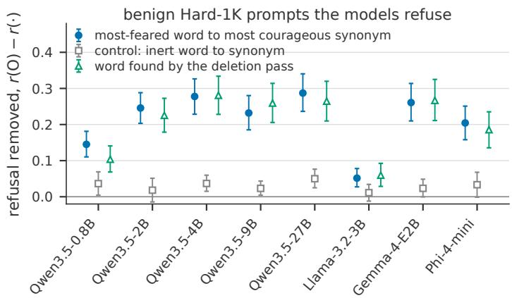

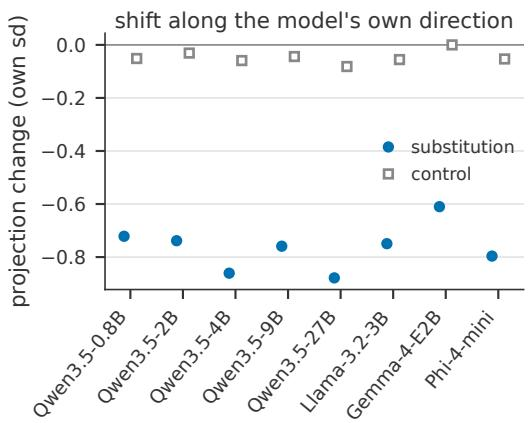  
Figure 11: Table-guided in-place substitution on the benign Hard-1K prompts the models refuse (95% two-stage paired bootstrap intervals). Left: refusal removed by replacing the most feared word by its most courageous synonym (filled), by replacing the prompt’s most inert word by a synonym (squares), and, for reference, by replacing the word found by the direction’s deletion pass (triangles). Right: the change in the boundary projection on the model’s own direction, in that model’s Hard-1K standard deviation.

## F Substitution texts

Table nomination. Every whitespace word of a prompt, edge punctuation stripped and lower-cased, is looked up in the model’s table (exact, then inflection fallback, then for a hyphenated word its highest-shift part); stop words are excluded. The nominee is the highest-shift content word (median within-prompt z 2.4–3.4, median percentile 92– 96). The drafter returns up to ten substitutes (about 7 pass the checks); the accepted candidate with the lowest table shift is used, which is the drafter’s own first choice only 8–12% of the time. Hedge units (“what steps”, “without getting caught”) are replaced as phrases. The structural checks reject a substitute that contains a lexicon word or another prompt’s nominee, that equals the nominee, or that creates a repeated adjacent word. The control replaces the content word whose table shift is nearest zero within a frequency band by the drafter’s synonym.

Deletion-pass nomination. The harmful side and the reference arm of Figure 11 locate the word with the direction instead: each word, and each adjacent pair containing a content word, is deleted in turn, the prompt is re-read, and the unit whose deletion lowers the projection most is nominated. On the harmful prompts the nominated unit is sharper (median z 3.4 to 4.2 against 2.5 to 3.5 on benign prompts), and on XSTest the safe and contrast prompts share the top word kill yet project apart at AUC 0.94 to 0.998: the direction reads the word in its context.

An independent meaning check. Whether an edited prompt still asks for what the original asked for was read once more by a model with no part in the drafting (GPT-6 Luna, the lowest reasoning effort the route accepts, temperature 0, fixed seed, structured output), on all 4,805 distinct (original, edited) pairs of the three substitution runs (7,713 uses across the eight models). It reads 0.61 of the shared-text substitutions, 0.58 of the harmful ones and 0.33 of the table-guided ones as the same request, against 0.86 and 0.81 for the two inert-word controls and 0.07 to 0.13 for the hedge removals; a second seed on a tenth of the pairs reproduces its verdict on 0.945 of them (Cohen’s κ = 0.89). On the pairs it accepts, replacing the nominated word still removes +0.02 to +0.16 of refusal in the shared-text run, +0.05 to +0.19 with the table nomination and +0.01 to +0.11 on the harmful prompts, 21 of those 24 intervals excluding zero, while the inert-word control stays at +0.01 to +0.04.

The same pairs, prompt and schema then went to a second judge from a third family (Claude Haiku 5.5, again the lowest reasoning effort the route accepts; that route offers neither temperature nor seed, so its repeat is a second call rather than a second seed, and it returns no label for two pairs). It is the more permissive reader: it accepts 0.79 of the shared-text substitutions, 0.71 of the harmful ones and 0.53 of the table-guided ones, against 0.97 and 0.95 for the controls and 0.09 to 0.12 for the hedge removals, and repeats its own verdict on 0.992 of the sampled pairs (Cohen’s κ = 0.98). The two judges put the arms in the same order and agree on

0.800 of the 4,803 pairs both labelled (κ = 0.58), disagreeing almost only in one direction: the second accepts 882 pairs the first rejects and rejects 81 the first accepts. On the 2,588 pairs both judges accept, replacing the nominated word removes +0.02 to +0.16, +0.05 to +0.20 and +0.01 to +0.10 of refusal in the three runs, 19 of those 24 intervals excluding zero, and on the second judge’s own larger subset all 24 exclude zero; the inert-word control stays within ±0.04 throughout.

## G The harmful prompt pool

The frozen harmful pool holds 13,527 prompts labelled harmful by WildJailbreak (Jiang et al., 2024), drawn from its adversarial subset. From 161,430 such prompts, an iterative adversarial filter kept in each round the half that a five-fold out-of-fold TF-IDF logistic regression separated least well from WildJailbreak’s adversarial benign prompts, so that a lexical classifier cannot tell the two sides apart; three batches were drawn this way and deduplicated by clustering into a pool of 15,000. Three LLM judges then rated each request’s feasibility, and a prompt was kept when at least two agreed it was feasible (1,398 dropped by majority, 75 unstable). The harmful label is the source dataset’s, not a per-prompt judgment. A fixed split of the retained prompts (seed 42) gives the 1,353-prompt evaluation set from which every harmful cohort of this paper, including the 321 prompts of the insertion experiment, is drawn.

## H Sampling contract

Every response is sampled with temperature 1.0, top-p 0.9 and top-k 50, ten sequences per prompt (twenty in the table dose-response tests), up to 2,048 new tokens with one retry at 4,096 when a response is truncated. The seed is fixed per prompt and condition, so that a condition’s responses are regenerated identically and the dosed arms reuse the seeds of the undosed ones. Prompts are rendered as a single user turn with the model’s chat template and the generation prompt appended; on the Qwen3.5 models thinking is disabled, which leaves an empty think block in the template.

## I Judges

Explicit refusal. The refusal label is a single surface fact about a response: whether it contains a sentence in which the assistant itself says it cannot, will not, or is not allowed to do what was asked. Warnings, disclaimers and silent redirects do not count; a refusal statement followed by delivered content still counts. Every label comes from one pass of DeepSeek-V4-Flash with this fixed instruction, reading the ten responses of a prompt together. Three judge families (GPT-5.6, DeepSeek-V4-Flash, GLM-5.2), each run twice, agree on two response sets of Qwen3.5-4B (Table 10); the agreement was not measured on the other seven models’ responses. Reading a prompt’s ten responses in one call can correlate their label errors within the prompt; every interval in the paper is a prompt-paired bootstrap, which absorbs within-prompt correlation.

GuardReasoner-8B. The second instrument, used for OR-Bench refusal in the deep-dose measurements and for response harmfulness on the harmful prompts, is GuardReasoner-8B (Liu et al., 2025) in one greedy pass, whose refusal field and response-harmfulness field are read. Of seven instruments compared on the 2,250 human-labelled XSTest completions it agrees best with the human label (95.1%, κ = 0.901, sensitivity 0.959, specificity 0.942); the two human annotators agree on 97.9%.

Hijack. Whether a response treats the appended word as part of the request, its topic or its style is judged response by response by the same DeepSeek-V4-Flash model under a fixed yes/no instruction.

## J The fitting cohort and full-cohort results

The direction of every model is fitted on 96 prompts crossed with 24 harm and 24 neutral words (Section 4). Every validation excludes a unit whose prompt is one of the 96, or whose inserted, nominated, substituted or control word is one of the 48. This removes 66 of the 130 cross-model insertion units (Section 5 uses the remaining 64 together with 72 further units whose prompts lie outside the 321 insertion prompts and the fitting cohort and whose words come from the insertion lexicon minus the 24 harm words, generated and judged in all eight models exactly as the original 130, for 136 units), 15 of the 96 harmful prompts of the courage-word test (refilled to 96 by the same rule), 9 of the 32 harmful held-out prompts on Qwen3.5- 4B (refilled to 32 by the same rule) and 13 harmful prompts and one word over four of the other models in Section 7 (each of those four harmful strata was refilled to 16 by the same selection rule, so each model again has 32 prompts), and 45 to 48 of the 397 substitution units per model in Section 8. The analyses on the full cohorts reach the same conclusions: the cross-model link gives $\rho = 0 . 3 1$ to 0.75, removal +0.09 to +0.29 and creation +0.05 $\mathrm { t o + 0 . 3 6 } ;$ ; the courage words lower refusal on the original 96 harmful prompts by 0.170, every word Holm-significant; the cross-model dose-response gives top minus bottom +0.37 to +0.71 with the own table ahead on the same five models; and no model’s substitution effect moves by more than 0.017.

Table 6: Table-guided substitution on the benign Hard-1K prompts (95% two-stage paired bootstrap intervals). n: prompts with a substitute. Deletion pass: the substitution of Section 3.2 rerun with the word found by the direction’s deletion pass on this cohort (prompts most models refuse, fitting cohort excluded), not on the 476-prompt shared-text cohort of Table 8. Projection: change of the boundary projection in the model’s Hard-1K sd. ρ: per-prompt Spearman between projection change and refusal change. XSTest: refusal removed on the safe XSTest prompts.
<table><tr><td>model</td><td></td><td> $\textit { n } \textsuperscript { \textit { r } ( 0 ) }$ </td><td> $r ( 0 ) - r ( \mathbf { S } )$ </td><td> $r ( 0 ) - r ( \mathbf { C } )$ </td><td>deletion pass</td><td>projection S / C</td><td> $\rho$ </td><td>XSTest S</td></tr><tr><td>Qwen3.5-0.8B</td><td>246</td><td>.331</td><td> $+ . 1 4 5 [ + . 1 1 0 , + . 1 8 1 ]$ </td><td>+.036</td><td>+.104</td><td>-0.72 /-0.05</td><td>+0.54</td><td> $+ . 0 6 0 [ + . 0 2 2 , + . 1 0 2 ]$ </td></tr><tr><td>Qwen3.5-2B</td><td>249</td><td></td><td> $6 2 9 \ + . 2 4 6 [ + . 2 0 3 , + . 2 8 8 ]$ </td><td>+.018</td><td>+.225</td><td>-0.74/-0.03</td><td>+0.66 +.082</td><td> $[ + . 0 3 5 , + . 1 3 4 ]$ </td></tr><tr><td>Qwen3.5-4B</td><td>251</td><td></td><td> $. 9 2 9 \ + . 2 7 8 [ + . 2 2 9 , + . 3 2 6 ]$ </td><td>+.037</td><td>+.281</td><td>-0.86 /-0.06</td><td>+0.80+.058</td><td> $[ + . 0 1 4 , + . 1 0 9 ]$ </td></tr><tr><td>Qwen3.5-9B</td><td>247</td><td></td><td> $. 9 3 7 \ + . 2 3 2 [ + . 1 8 5 , + . 2 8 0 ]$ </td><td>+.023</td><td>+.259</td><td></td><td></td><td>-0.76 / −0.04+0.76+.103 [+.052, +.164]</td></tr><tr><td>Qwen3.5-27B</td><td>249</td><td></td><td> $- 8 9 7 + . 2 8 7 [ + . 2 3 6 , + . 3 4 0 ]$ </td><td>+.050</td><td>+.265</td><td></td><td></td><td>-0.88 / -0.08 +0.79+.056 [+.011, +.107]</td></tr><tr><td>Llama-3.2-3B</td><td>252</td><td></td><td> $. 1 2 7 \ + . 0 5 2 \ [ + . 0 2 7 , + . 0 7 8 ]$ </td><td>+.011</td><td>+.060</td><td></td><td></td><td>-0.75 / -0.06 +0.31 +.006[+.000, +.018]</td></tr><tr><td>Gemma-4-E2B</td><td>250</td><td></td><td> $. 8 7 9 ~ + . 2 6 1 [ + . 2 1 0 , + . 3 1 4 ]$ </td><td>+.023</td><td>+.267</td><td></td><td></td><td> $- 0 . 6 1 / - 0 . 0 0 + 0 . 7 1 + . 1 3 1 [ + . 0 5 9 , + . 2 1 0 ]$ </td></tr><tr><td>Phi-4-mini</td><td>249</td><td></td><td> $- 4 8 1 + . 2 0 4 [ + . 1 5 8 , + . 2 5 1 ]$ </td><td>+.033</td><td>+.186</td><td></td><td></td><td> $- 0 . 8 0 / - 0 . 0 5 + 0 . 7 5 + . 1 1 2 [ + . 0 5 3 , + . 1 7 6 ]$ </td></tr></table>

Table 7: Table-lowest against random synonym on the benign Hard-1K prompts. $\Delta _ { S } \mathrm { : }$ refusal removed by the table’s lowest candidate; $\Delta _ { \mathrm { r a n d } } \mathrm { : }$ by a random admissible candidate of the same unit; gap: $\Delta _ { S } - \Delta _ { \mathrm { r a n d } }$ with 95% paired bootstrap interval; ∗: one-sided Holm $p < 0 . 0 5$ over the seven transfer models. Every model’s random candidate also ends 0.12 to 0.21 sd higher on the direction.
<table><tr><td>model</td><td>n  $\Delta _ { S }$ </td><td> $\Delta _ { \mathrm { r a n d } }$ </td><td>gap</td></tr><tr><td>Qwen3.5-0.8B</td><td>241</td><td>+.145 +.120</td><td>+.025[−.005, +.055]</td></tr><tr><td>Qwen3.5-2B</td><td>247</td><td>+.246 +.199</td><td>+.047[+.009, +.085]*</td></tr><tr><td>Qwen3.5-4B</td><td>249</td><td>+.276 +.243</td><td>+.033 [−.004, +.072]</td></tr><tr><td>Qwen3.5-9B</td><td>243</td><td>+.233 +.208</td><td>+.025 [−.011, +.061]</td></tr><tr><td>Qwen3.5-27B</td><td>246</td><td>+.283 +.216</td><td>6 +.067 [+.030, +.107]*</td></tr><tr><td>Llama-3.2-3B</td><td>248</td><td>+.052 +.035</td><td> $+ . 0 1 7 \left[ - . 0 0 6 , + . 0 4 2 \right]$ </td></tr><tr><td>Gemma-4-E2B</td><td>248</td><td>3 +.265 +.187</td><td>7 +.078 [+.038, +.119]*</td></tr><tr><td>Phi-4-mini</td><td></td><td>248 +.206 +.170</td><td> +.036 [+.004, +.069]</td></tr></table>

Table 8: The deletion-pass substitution on the benign Hard-1K prompts the models refuse (Section 3.2): refusal removed by the substitution (S), the inert control (C) and the hedge removal (R) under the explicit-refusal judge and under GuardReasoner-8B’s refusal field, with 95% paired bootstrap intervals. n: Hard-1K prompts the model refuses at base with the request read as unharmful.
<table><tr><td></td><td colspan="5">explicit-refusal judge</td><td colspan="6">GuardReasoner refusal</td></tr><tr><td>model</td><td>n</td><td></td><td></td><td>C</td><td>R</td><td></td><td></td><td></td><td>C</td><td></td><td>R</td></tr><tr><td></td><td></td><td></td><td></td><td></td><td>Qwen3.5-0.8B 239 +.079 [+.055, +.103] −.001 [−.022, +.020] +.073 [+.015, +.135] +.111 [+.085, +.137] +.009 [−.014, +.032] +.123 [+.052, +.196]</td><td></td><td></td><td></td><td></td><td></td><td></td></tr><tr><td>Qwen3.5-2B</td><td></td><td></td><td></td><td></td><td>360 +.170 [+.139, +.201] +.008[−.015, +.031] +.246 [+.158, +.336] +.202 [+.167, +.236] +.008 [−.015, +.031] +.346 [+.246, +.448]</td><td></td><td></td><td></td><td></td><td></td><td></td></tr><tr><td>Qwen3.5-4B</td><td></td><td></td><td></td><td></td><td>476 +.277[+.236, +.318] +.007[−.012, +.026] +.504[+.384, +.619] +.286 [+.246, +.327] +.014[−.002, +.031] +.555</td><td></td><td></td><td></td><td></td><td></td><td> $[ + . 4 3 7 , + . 6 7 0 ]$ </td></tr><tr><td>Qwen3.5-9B</td><td></td><td></td><td> $5 1 9 + . 2 1 8 [ + . 1 7 9 , + . 2 5 8 ] + . 0 0 5 [ - . 0 1 1 , + . 0 2 1 ]$ </td><td></td><td>+.448 [+.316, +.579] +.224[+.186, +.265] +.005 [−.009, +.020] +.484</td><td></td><td></td><td></td><td></td><td></td><td> $[ + . 3 5 0 , + . 6 1 4 ]$ </td></tr><tr><td>Qwen3.5-27B</td><td></td><td></td><td></td><td></td><td>495 +.220 [+.180, +.261] +.019[−.002, +.041] +.405 [+.264, +.548] +.232 [+.192, +.271] +.009 [−.007, +.025] +.484 [+.356, +.608]</td><td></td><td></td><td></td><td></td><td></td><td></td></tr><tr><td>Llama-3.2-3B</td><td></td><td></td><td> $3 3 + . 0 3 3 { \bar { [ + . 0 1 5 , + . 0 5 2 { \bar { ] } } } } + . 0 0 5 { \bar { [ - . 0 1 0 , + . 0 1 9 ] } }$ </td><td></td><td>+.039[−.012, +.098] +.028 [+.011, +.046] +.005[−.009, +.019] +.039 [-</td><td></td><td></td><td></td><td></td><td></td><td> $. 0 1 3 , + . 0 9 7 ]$ </td></tr><tr><td></td><td></td><td></td><td></td><td></td><td>Gemma-4-E2B 340 +.244 [+.202, +.285] −.005 [−.025, +.015] +.364 [+.229, +.496] +.231 [+.190, +.273] −.006[−.025, +.014] +.361 [+.220, +.498]</td><td></td><td></td><td></td><td></td><td></td><td></td></tr><tr><td>Phi-4-mini</td><td></td><td></td><td></td><td> $1 6 3 + . 1 4 3 [ + . 1 0 9 , + . 1 7 6 ] + . 0 0 3 [ - . 0 2 1 , + . 0 2 6 ]$ </td><td>+.130 [+.018, +.241] +.195 [+.158, +.232] +.007[−.017, +.031] +.180 [+.053, +.308]</td><td></td><td></td><td></td><td></td><td></td><td></td></tr></table>

Table 9: Harmful OR-Bench Toxic prompts and the XSTest contrast prompts: refusal removed by the substitution (S) and the hedge removal (R) under the explicit-refusal judge and under GuardReasoner-8B’s refusal field, the substitution effect on the contrast prompts, and the response harm GuardReasoner adds, with 95% paired bootstrap intervals. n: Toxic prompts the model refuses at base with the request read as harmful; h(O): share of original responses read as harmful on the prompts with a substitute.
<table><tr><td></td><td></td><td colspan="3">explicit-refusal judge</td><td>GR refusal</td><td colspan="3">GuardReasoner harm</td></tr><tr><td>model</td><td>n</td><td>S</td><td>R</td><td>S, contrast</td><td>S</td><td></td><td>h(O)</td><td>h(S) − h(O)</td></tr><tr><td>Qwen3.5-0.8B</td><td>445</td><td>+.157[+.123,+.191]</td><td>+.226 [+.076, +.383]</td><td>+.164 [+.054, +.278]</td><td>+.180 [+.145, +.216]</td><td></td><td>.241</td><td>-.014[−.043, +.015]</td></tr><tr><td>Qwen3.5-2B</td><td>596</td><td>+.195[+.158, +.231]</td><td>+.357[+.195, +.518]</td><td>+.178 [+.075, +.283]</td><td>+.187[+.151,+.222]</td><td></td><td>.038</td><td>+.026 [+.009, +.043]</td></tr><tr><td>Qwen3.5-4B</td><td>619</td><td>+.114[+.084,+.143]</td><td>+.278[+.128, +.442]</td><td>+.242 [+.138, +.356]</td><td>+.098[+.072, +.126]</td><td></td><td>.002</td><td>+.010[+.004,+.018]</td></tr><tr><td>Qwen3.5-9B</td><td>620</td><td>+.091[+.066, +.118]</td><td>+.174[+.044, +.333]</td><td>+.214[+.122, +.315]</td><td>+.079[+.056, +.105]</td><td></td><td>.001</td><td>+.002[−.000, +.004]</td></tr><tr><td>Qwen3.5-27B</td><td>623</td><td>+.076[+.050, +.103]</td><td>+.183[+.044, +.350]</td><td>+.242 [+.135, +.358]</td><td>+.073[+.049, +.098]</td><td></td><td>.000</td><td>+.004[−.000,+.010]</td></tr><tr><td>Llama-3.2-3B</td><td>474</td><td>+.226[+.189, +.265]</td><td>+.343[+.171, +.529]</td><td>+.308[+.187,+.437]</td><td></td><td>+.233[+.195,+.272]</td><td>.101</td><td>+.041[+.018, +.064]</td></tr><tr><td>Gemma-4-E2B</td><td>615</td><td>+.124[+.088,+.160]</td><td>+.187[+.000, +.395]</td><td>+.214[+.097, +.339]</td><td></td><td>+.137[+.106,+.171]</td><td>.011</td><td>+.021 [+.008, +.035]</td></tr><tr><td>Phi-4-mini</td><td></td><td></td><td>626 +.174[+.140, +.210] +.239[+.076, +.414]</td><td>+.258[+.155,+.361]</td><td></td><td>+.135[+.104, +.167]</td><td>.007</td><td>+.012[+.004, +.022]</td></tr></table>

Table 10: Agreement on the explicit-refusal label across three judge families, two passes each. Unanimous: share of responses on which all six passes agree.
<table><tr><td>set</td><td>retest κ</td><td>cross-judge κ unanimous</td><td></td></tr><tr><td>250 responses</td><td>0.968-1.000</td><td>0.976-0.988</td><td>98.0%</td></tr><tr><td>2,992 responses</td><td>0.985-0.990</td><td>0.975-0.978</td><td></td></tr></table>