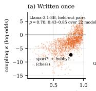
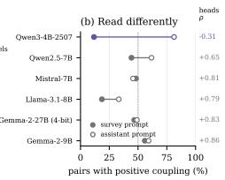
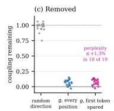
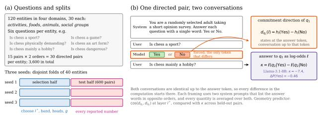
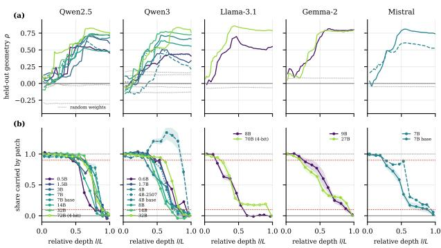
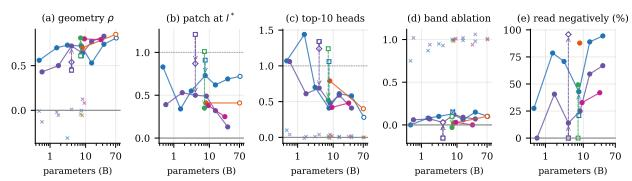
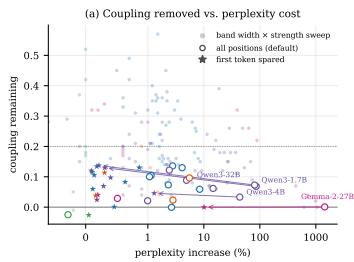
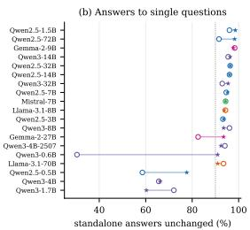

# Written Once, Read Differently: How Language Models’ Own Answers Steer Their Next Ones

Marcus Armstrong 1

## Abstract

When a language model answers a yes/no question, that answer changes how it answers a different question about the same entity. We study this self-commitment in 22 open-weight models from four families (0.5B–72B parameters), fixing the model’s first answer and measuring the shift in its second across 3,600 question pairs about 120 entities. Each answer writes a commitment direction into the residual stream. The similarity of two questions’ directions predicts their coupling on held-out entities (ρ = 0.43–0.85), and ablating a single direction shared across topics leaves at most 17% of the effect in every model. How this direction is read is far less stable: the reading circuit spreads across more attention heads as models grow, instruction tuning makes more questions read it in the opposite sense, and in one model changing only the system prompt reverses the circuit’s sign. Ablating the direction while sparing the attention sink removes most of the coupling at under 1.3% perplexity cost in 18 of 19 instruction-tuned models, though it shifts standalone answers in two. Without the sink spared, the direction’s alignment with the leading principal component of ordinary text predicts which models pay a high cost. Written once, the commitment is read differently across scale, training and prompt.

## 1. Introduction

Language models are now routinely deployed in settings where they make many related judgments in sequence: an assistant answers a series of questions, an agent evaluates the consequences of its own earlier decisions, and a grader scores one item after another. In each case, the model’s earlier outputs sit in context when it produces later ones.

Whether and how those earlier outputs shape later judgments on different questions is a basic reliability question: if an early answer, right or wrong, systematically tilts what follows, errors propagate and evaluation results become order-dependent.

Prior work has documented that question order affects model behaviour (Kang, 2026), and that performance degrades as information is spread across turns (Laban et al., 2025). A related literature on sycophancy studies how models shift toward a user’s stated views (Sharma et al., 2024), and recent work has begun to locate the internal mechanisms responsible (Sun et al., 2026; Baez et al., 2026). The pressure we study originates in the model’s own prior output. Nothing in the conversation asks the model to agree with itself; the earlier answer is only present in context. Whether this self-generated pressure shares a common mechanism across models and scales, and whether it can be removed without cost to general ability, is unknown.

We study self-commitment with a minimal, controlled design. For each of 120 entities in four domains we write six related yes/no judgments (Is chess a sport? Is chess a game? Is chess physically demanding?), forming directed pairs of distinct questions. We place a first answer, Yes or No, in the model’s own prior turn and measure the resulting shift in log-odds for a second, distinct question. We call this shift the coupling. In the primary framing the model answers as a respondent to an opinion survey; an assistant framing and a true/false framing serve as robustness checks. Because the two conditions differ in exactly one token, every difference in the model’s computation is attributable to that token. We apply this design to 22 open-weight models spanning four families (Qwen, Llama-3.1, Gemma-2, and Mistral) and 0.5B to 72B parameters, including three matched base and instruction-tuned pairs. All layers, heads and bands used for analysis are selected on one half of the entities and evaluated on the other; every result is replicated over three independent entity seeds.

The results support a consistent picture: within each model, commitment is written into a single direction shared across topics, and this direction is read differently depending on model size and training. The cosine similarity between two questions’ commitment directions, each estimated from that question alone, predicts the sign and magnitude of their coupling on held-out entities $( \rho = 0 . 4 3 -$ 0.85), and continues to predict it after controlling for the similarity of the two questions’ text and of the model’s states before answering (partial $\rho = 0 . 2 7 \mathrm { - } 0 . 6 8 )$ . This prediction improves with scale (rank correlation with parameter count $0 . 7 0 , p = 0 . 0 0 1$ , across the 19 instruction-tuned models). Mean-ablating that single shared direction across a band of layers chosen from each model’s layer profile leaves at most 17% of the coupling in every model, while ablating a random direction leaves it largely intact. The result holds at every confidence level and in both full and 4-bit precision. The circuit that reads this direction varies. In base models and the three smallest instruction-tuned models, the ten highest-scoring attention heads carry all of the coupling, whereas at 70–72B parameters they carry 28–40%. Instruction tuning also changes the reader. A fixed step along the direction pushes the second answer the opposite way for 0–21% of questions in the three base models, for 14– 49% in their instruction-tuned counterparts, and for 96% in Qwen3-4B-Instruct-2507. Finally, ablation that spares the first token, the attention sink where models concentrate large activations (Xiao et al., 2024; Sun et al., 2024), leaves at most 14% of the coupling, raises perplexity by at most 1.3% in 18 of the 19 instruction-tuned models, and preserves standalone answers to at least 90% of questions in 16 of them.

## Contributions.

1. A controlled causal measurement of self-commitment across 22 open-weight models spanning 0.5B–72B parameters, with exact one-token interventions and heldout evaluation on three independent seeds.

2. Evidence that self-commitment depends on a single direction shared across topics within each model, extending the single-direction structure identified for refusal (Arditi et al., 2024) to a distinct behaviour and replicating it across scale, model families, confidence levels, and numerical precision.

3. A dissociation between a fixed write-side representation and a variable read-side circuit: the direction’s geometry predicts coupling in every model, while the circuit that reads it becomes more distributed with scale and responds negatively for more questions after instruction tuning.

4. A removal of self-commitment by mean-ablation of the direction that spares the attention sink, at a perplexity cost of at most 1.3% in 18 of 19 instruction-tuned models and MMLU changes of at most 3.5 points, together with its limits: it shifts standalone answers in two Qwen3 models, and its cost without sparing the sink is predicted by the direction’s alignment with the leading principal component of ordinary text.

  
cos(dq1, dq2) at l \*

  
Figure 1. Written once, read differently. (a) The similarity of two questions’ commitment directions predicts their coupling on held-out pairs (Llama-3.1-8B; the marked pair is Is chess a sport? followed by Is chess mainly a hobby?). (b) Pairs with positive coupling under two system prompts; numbers give the correlation between the two head-attribution maps. In Qwen3-4B-Instruct-2507 the prompt alone reverses the reading circuit. (c) Coupling remaining in the 19 instruction-tuned models after ablating a random direction, the shared direction g at every position, or g with the first token spared.

## 2. Related Work

Multi-turn reliability and self-correction. Several lines of work document that language model outputs are sensitive to context in ways that degrade reliability. Question order effects in yes/no evaluations have been measured at scale (Kang, 2026), and performance drops when a task’s specification is revealed over several conversation turns instead of at once (Laban et al., 2025). Models also fail to self-correct reasoning errors without external feedback (Huang et al., 2024), so their earlier outputs constrain later ones even when those outputs are wrong. We ask where this constraint is computed and whether it can be removed.

Sycophancy and user-driven context pressure. Sycophancy, the tendency of models to shift their answers toward a user’s expressed views, has been measured behaviourally (Sharma et al., 2024) and more recently located inside the model: attention heads that mediate opinion change under user pressure have been identified (Sun et al., 2026), and linear representations of sycophantic pressure have been characterised (Baez et al., 2026). Self-commitment differs in its source. The earlier answer belongs to the model, and neither the user nor the system prompt asks for consistency, so methods that detect or suppress a user’s influence do not apply to it directly.

Linear representations and directional ablation. A growing body of work finds that functionally important concepts in transformer residual streams are approximately linear. Representation engineering (Zou et al., 2023) treats concepts as directions in activation space and steers them directly. The same approach has identified a single direction mediating refusal in instruction-tuned models (Arditi et al., 2024), structured linear representations of truthfulness (Marks & Tegmark, 2024), and directions encoding incontext task identity (Hendel et al., 2023; Todd et al., 2024; Liu et al., 2024). Bigelow et al. (2026) model in-context learning and activation steering as updates to a shared belief over latent concepts, with in-context examples acting as evidence and steering shifting the prior, and predict sharp transitions when the two are combined. In our setting the model’s own earlier answer plays the role of in-context evidence. Inference-time intervention (Li et al., 2023) applies this structure to elicit truthful responses by patching toward truth-associated directions at inference. We find that removing a single direction per model removes self-commitment in all 22 models we test, which extends this pattern to a cross-question, multi-turn setting. To our knowledge, a direction whose geometry predicts behaviour in every model while the circuit that reads it changes with scale and training has not been reported before.

Mechanistic interpretability and circuit transfer across scale. Mechanistic interpretability characterises model behaviour in terms of attention circuits (Elhage et al., 2021). A recurring practical question is whether such circuits transfer across model sizes or training regimes. Our results separate the two. The geometry of the commitment direction predicts coupling in every model and family we test, while the share of the coupling carried by the ten highest-scoring heads falls from all of it in the three smallest instruction-tuned models and in base models to 28–40% at 70–72B parameters; ten random heads carry between −1% and 10%. Within one model, the head map can also reverse sign when only the system prompt changes (Qwen3-4B-Instruct-2507). Where a behaviour is computed can therefore change across scale and context even when the behaviour itself is stable, which limits how far small-model circuit findings can be assumed to generalise.

Attention sinks and massive activations. Many transformers place a large share of attention on the first token, which Xiao et al. (2024) term the attention sink, and a few activations of very large magnitude appear at the first token and some delimiter tokens, where they act as fixed biases (Sun et al., 2024). We find that this position governs the cost of directional ablation: sparing the first token reduces the perplexity increase from Gemma-2-27B’s 1,440% to 10%, whereas sparing all massive-activation positions reduces it only to 161%.

Language models as survey respondents. Language models are increasingly used to simulate survey respondents (Argyle et al., 2023; Santurkar et al., 2023), and their answers are sensitive to question order, option labelling and wording (Dominguez-Olmedo et al., 2024; Tjuatja et al., 2024). Our primary framing places the model in this role;

we study the mechanism of one order effect and leave its consequences for survey simulation to future work.

## 3. Setup

## 3.1. Questions, Framings and Coupling

We use 120 entities in four domains (activities, foods, animals and social groups; 30 entities each). For each domain we write six yes/no questions that apply to every entity in it, mixing categorical and evaluative judgments (Is chess a sport? Is chess physically demanding? Are most politicians honest?). Every pair of distinct questions about the same entity is asked in both orders, giving 30 directed pairs $( q _ { 1 } , q _ { 2 } )$ per entity and 3,600 in total (Appendix A).

Each conversation contains a system prompt, $q _ { 1 }$ as a user turn, a forced answer $a _ { 1 } \in \{ \mathrm { Y e s } , \mathrm { N o } \}$ as the model’s own turn, and $q _ { 2 }$ as a second user turn, rendered with the model’s chat template. In the primary framing the system prompt asks the model to answer as a randomly selected adult taking a short opinion survey, with a single word, Yes or No. Two further framings serve as robustness checks: a helpfulassistant prompt, and the survey prompt with each question restated as a statement to be answered True or False. Each framing has two system prompts that list the answer words in opposite orders, and every quantity is averaged over the two.

We read the model’s answer to $q _ { 2 }$ as the log-odds

$$
\begin{array} { r } { \ell = \log \sum _ { t \in T _ { \mathrm { Y e s } } } p ( t ) - \log \sum _ { t \in T _ { \mathrm { N o } } } p ( t ) , } \end{array}\tag{1}
$$

where $T _ { \mathrm { Y e s } }$ and $T _ { \mathrm { N o } }$ are the first tokens of the answer words with and without a leading space and in either case. The coupling of a directed pair is

$$
\kappa ( q _ { 1 } , q _ { 2 } ) = \ell ( q _ { 2 } \mid a _ { 1 } = \mathrm { Y e s } ) - \ell ( q _ { 2 } \mid a _ { 1 } = \mathrm { N o } ) .\tag{2}
$$

A positive coupling means the first answer pulls the second in the same direction. For every pair and system prompt we verify that the two conversations differ in exactly one token, the answer, and are identical before it, so any difference in the model’s computation originates at that token.

## 3.2. Commitment Directions

For each question q we run the conversation up to and including the forced answer, for a = Yes and $a = \Nu _ { 0 }$ , and take the residual-stream states at the answer token. The commitment direction of q at hidden layer l is

$$
d _ { q } ( l ) = h _ { l } ( \mathrm { Y e s } ; q ) - h _ { l } ( \mathbf { N o } ; q ) ,\tag{3}
$$

averaged over the two system prompts, where $l = 0$ is the embedding and $l \geq 1$ the output of block l. Because the conversation up to the answer contains only $\textstyle q , d _ { q }$ is estimated from that question alone. Our geometry predictor for a pair is the cosine similarity cos $( d _ { q _ { 1 } } ( l ^ { * } ) , d _ { q _ { 2 } } ( l ^ { * } ) _ { \prime } ^ { \dag }$ ), compared with the coupling by Spearman’s $\rho .$ The layer l∗ maximises $| \rho |$ on the selection half of the entities (§3.5). As a control we also compute the partial correlation after removing the similarity of the two questions’ states before answering and of their question text.

We estimate a shared direction g in two ways. For analyses at $l ^ { * } , g$ is the normalised mean of $d _ { q } ( l ^ { \ast } )$ over questions from the three domains other than the pair’s own (leaveone-domain-out). For interventions across many layers, $g ( l )$ is the normalised mean of $d _ { q } ( l )$ over all questions about selection-half entities, so held-out pairs never contribute to it. Projecting $d _ { q }$ onto g splits it into a shared component $\left( d _ { q } \cdot g \right) g$ and a question-specific remainder.

## 3.3. Interventions and Causal Shares

We report every causal effect as a share: the least-squares slope through the origin of the edited effect on κ across heldout pairs, so that 1 means the edit reproduces, or leaves, the whole coupling. A patch adds a vector at the first answer token at one layer of the No conversation; patching $d _ { q } ( l )$ restores the Yes state at that token from layer l onward. An ablation replaces the projection of the state on a unit direction u with a reference value $m , h \gets h - ( ( h { \cdot } u ) - m )$ u, in both conversations. The layer profile patches $d _ { q }$ at one of 13 evenly spaced layers. Its share is 1 at the embedding and falls as later positions read the commitment from the answer token (Fig. 3). The readout band runs from the last profiled layer with share at least 0.9 to the first later layer with share at most 0.1. For control (§5) we ablate $g ( l )$ at every position and every layer of the band, with m the mean projection over 100 WikiText-2 passages excluding the first token, and measure side effects on perplexity (WikiText-2 test passages of 256 tokens), zero-shot MMLU accuracy, and the answers to each question asked on its own.

## 3.4. Models

We evaluate 22 open-weight models from four families (Qwen2.5 and Qwen3, Llama-3.1, Gemma-2 and Mistral) from 0.5B to 73B parameters: 19 instruction-tuned models and three base models paired with instruction-tuned versions (Table 1). Qwen3 models are hybrid reasoning models, and we disable thinking through the chat template. Qwen3-4B-Instruct-2507 is a later post-trained release built on the same base model as Qwen3-4B. Models up to 32B run in bfloat16 on one or two NVIDIA RTX 6000 Ada GPUs (48 GB each); the 70B and 72B models use 4-bit NF4 weights with bfloat16 computation. Quantisation is weight-only, so each token’s computation is independent of the batch, as the exact checks below require. Five models are also run in 4-bit as a check (Qwen2.5-14B and 32B,

Table 1. Models evaluated. † marks base models; all others are instruction-tuned. ∗ marks models also run with 4-bit weights as a quantisation check. Qwen3-4B-Instruct-2507 is a later post-trained release of the same base model as Qwen3-4B and is discussed in §4.4.
<table><tr><td>Family</td><td>Model</td><td>Params</td><td>Precision</td></tr><tr><td>Qwen2.5</td><td>Qwen2.5-0.5B-Instruct</td><td>0.5B</td><td>bf16</td></tr><tr><td></td><td>Qwen2.5-1.5B-Instruct</td><td>1.5B</td><td>bf16</td></tr><tr><td></td><td>Qwen2.5-3B-Instruct</td><td>3.1B</td><td>bf16</td></tr><tr><td></td><td>Qwen2.5-7B-Instruct</td><td>7.6B</td><td>bf16</td></tr><tr><td></td><td>Qwen2.5-7B†</td><td>7.6B</td><td>bf16</td></tr><tr><td></td><td>Qwen2.5-14B-Instruct*</td><td>14.8B</td><td>bf16</td></tr><tr><td></td><td>Qwen2.5-32B-Instruct*</td><td>32.8B</td><td>bf16</td></tr><tr><td></td><td>Qwen2.5-72B-Instruct</td><td>72.7B</td><td>4-bit</td></tr><tr><td>Qwen3</td><td>Qwen3-0.6B</td><td>0.6B</td><td>bf16</td></tr><tr><td></td><td>Qwen3-1.7B</td><td>1.7B</td><td>bf16</td></tr><tr><td></td><td>Qwen3-4B</td><td>4.0B</td><td>bf16</td></tr><tr><td></td><td>Qwen3-4B-Base†</td><td>4.0B</td><td>bf16</td></tr><tr><td></td><td>Qwen3-4B-Instruct-2507</td><td>4.0B</td><td>bf16</td></tr><tr><td></td><td>Qwen3-8B</td><td>8.2B</td><td>bf16</td></tr><tr><td></td><td>Qwen3-14B</td><td>14.8B</td><td>bf16</td></tr><tr><td></td><td>Qwen3-32B</td><td>32.8B</td><td>bf16</td></tr><tr><td>Llama</td><td>Llama-3.1-8B-Instruct</td><td>8.0B</td><td>bf16</td></tr><tr><td></td><td>Llama-3.1-70B-Instruct</td><td>70.6B</td><td>4-bit</td></tr><tr><td>Gemma-2</td><td>Gemma-2-9B-it</td><td>9.2B</td><td>bf16</td></tr><tr><td></td><td>Gemma-2-27B-it*</td><td>27.2B</td><td>bf16</td></tr><tr><td>Mistral</td><td>Mistral-7B-Instruct-v0.3</td><td>7.2B</td><td>bf16</td></tr><tr><td></td><td>Mistral-7B-v0.3†</td><td>7.2B</td><td>bf16</td></tr></table>

Qwen3-14B and 32B, Gemma-2-27B): held-out $\rho$ differs from bfloat16 by at most 0.09, and coupling remaining after band ablation by at most 0.03 (Appendix F). For the 12 models up to 9B we also evaluate the same architecture with random weights.

## 3.5. Evaluation Protocol

Entities are divided into three disjoint folds of 40 (10 per domain). Each seed uses one fold, so the three seeds are independent replications on different entities, with 1,200 directed pairs each. Within a seed, entities are split at random into a selection half and a test half. The layer l∗, the layer profile and readout band, the attention heads, and the band direction g are chosen on the selection half, and every reported number is computed on the 600 test pairs or a fixed subset of them (Appendix B). The leave-one-domain-out $g$ uses directions, never couplings, of test-half questions from other domains. We report means ± s.d. over the three seeds; 95% intervals from a cluster bootstrap over entities (1,000 resamples) are given in the appendix. Correlations across models use Spearman’s ρ with permutation p-values (10,000 permutations).

  
Figure 2. Experimental design. For each directed pair $\left( q _ { 1 } , q _ { 2 } \right)$ about one entity, the model’s own first answer is fixed to Yes or No, and the coupling κ (Eq. 2) is the difference in the log-odds of its answer to q . The two conversations differ only in the answer token. The commitment direction $d _ { q } \ ( \mathrm { E q } . \ 3 )$ is the difference between the residual-stream states at that token.

## 3.6. Sanity Checks

Two checks confirm that the interventions are exact. Patching $d _ { q } ( 0 )$ into the No conversation turns the answer token’s embedding into that of the Yes conversation and reproduces the coupling (share 0.996–1.011). Ablating $d _ { q }$ at the answer token at every layer removes it (share remaining −0.003 to 0.004). Both are within 0.05 of their targets for every model, framing and seed (Appendix C).

## 4. Results

## 4.1. Geometry Predicts the Coupling

For each held-out pair we compare the cosine similarity of the two questions’ commitment directions at layer $l ^ { * }$ with the pair’s coupling. Across the 22 models the correlation is $\rho = 0 . 4 3 – 0 . 8 5$ (Table 2). It improves with scale across the 19 instruction-tuned models (rank correlation with parameter count 0.70, $p = 0 . 0 0 1 $ ). Within Qwen3 it rises from 0.43 at 0.6B to 0.83 at 32B with one decrease at 8B, and within Llama-3.1 from 0.70 at 8B to 0.85 at 70B. Base models give lower values (0.45–0.61) than their instruction-tuned counterparts (0.72–0.81). The correlation remains after controlling for the similarity of the two questions’ text and of the model’s states before answering (partial $\rho = 0 . 2 7 -$ 0.68), so it is not explained by questions that are merely similar. Models with random weights give $| \rho | \leq 0 . 1 3$ in 10 of 12 cases; the two exceptions, Qwen2.5-3B (−0.31) and Qwen3-4B-Instruct-2507 (0.19), are smaller in magnitude than every trained model.

Figure 3a shows the correlation at every layer. It is near zero at the embedding, rises through the first half of the network and stays high to the last layer; the selected layer l∗ lies inside the readout band in 62 of 66 model–seed runs. Figure 3b shows where the commitment leaves the answer token. In the Qwen models the share carried by a patch stays near 1 until 35–65% of depth and then falls steeply. In Llama-3.1, Gemma-2 and Mistral it begins to fall at 15–30% of depth and declines gradually, which gives these models wide readout bands. In Qwen3-4B-Base the share exceeds 1 at intermediate depth (up to 1.35), and in Llama-3.1-70B about 0.18 of the coupling is still read from the answer token in the final layers.

  
Figure 3. Geometry and location of the commitment by layer. (a) Held-out Spearman correlation between direction similarity and coupling at each layer; dotted grey lines are the same architectures with random weights. (b) Share of the coupling reproduced by patching d at the first answer token at a single layer (selection-half entities; shading ±1 s.d. over seeds). Red dashed lines mark the 0.9 and 0.1 thresholds that define the readout band. Dashed: base models; dotted: Qwen3-4B-2507; hollow markers: 4-bit weights. All curves are means over three seeds.

## 4.2. Removing One Direction Removes the Coupling

We mean-ablate $g ( l )$ at every position and every layer of the readout band and measure the share of the coupling that remains on held-out pairs; as a specificity control we ablate a random unit direction in the same layers. Ablating $g$ leaves between −0.03 and 0.15 of the coupling in the 19 instruction-tuned models, whereas the random direction leaves 0.75–1.06 (Table 2). In the three base models, measured on 200 pairs, ablating g leaves −0.15 to 0.15. The five models run in both precisions agree to within 0.03. Because the ablation acts at every position, including the tokens of the second question, it removes the direction both where the commitment is written and where it is read. Ablating g only at the answer token at $l ^ { * }$ leaves 0.16–0.88 of the coupling, consistent with Figure 3b: by $l ^ { * }$ , later positions have already read part of the commitment.

The shared direction also accounts for nearly all of what a single edit at $l ^ { * }$ can carry. Patching $d _ { q }$ at $l ^ { * }$ carries 0.13– 0.87 of the coupling in instruction-tuned models. When the patch is split into its component along the leave-one-domainout g and the remainder, the question-specific remainder carries between −0.03 and 0.16.

Table 3 stratifies held-out pairs by the model’s standalone confidence in the second answer. Band ablation of $g$ leaves 0.06 of the coupling on average in every bin, and at most 0.17 for any model in any bin, while the random direction leaves 0.99–1.00, so the removal is not an artefact of saturated answers. The geometric prediction is weaker away from saturation: mean held-out $\rho$ is 0.53 for $p < 0 . 9$ and 0.57 for $0 . 9 \leq p < 0 . 9 9$ , against 0.75 above 0.99.

Table 2. Per-model results on held-out pairs (primary framing; means over three seeds, s.d. in Appendix D). $| \Delta P | ;$ mean absolute change in the probability of Yes. Pos.: pairs with positive coupling (%). $\rho \colon$ Spearman correlation between direction similarity and coupling; partial: after controlling for question-text and pre-answer similarity. Patch: share carried by patching d at $l ^ { * }$ . Heads: share carried by the ten highest-scoring heads. $\kappa _ { g } , \kappa _ { \mathrm { r a n d } } \colon$ share remaining after mean-ablating g or a random direction at every position of the readout band. Read neg.: questions for which a fixed step along g moves the answer the opposite way (%). † base model. § 4-bit weights. ‡ from the 200-pair sink-test run; base models have no random-direction control. Dashes: not measured.
<table><tr><td>Family</td><td>Model</td><td>Params (B)</td><td> $| \Delta P |$ </td><td>Pos.</td><td> $\rho$ </td><td>Partial  $\rho$ </td><td>Patch</td><td>Heads</td><td> $\kappa _ { g }$ </td><td> $\kappa _ { \mathrm { r a n d } }$ </td><td>Read neg.</td></tr><tr><td>Qwen2.5</td><td>0.5B-Instruct</td><td>0.5</td><td>0.14</td><td>71</td><td>0.56</td><td>0.50</td><td>0.83</td><td>1.07</td><td>0.00</td><td>0.75</td><td>28</td></tr><tr><td></td><td>1.5B-Instruct</td><td>1.5</td><td>0.22</td><td>18</td><td>0.70</td><td>0.49</td><td>0.34</td><td>1.44</td><td>0.08</td><td>0.87</td><td>79</td></tr><tr><td></td><td>3B-Instruct</td><td>3.1</td><td>0.13</td><td>33</td><td>0.73</td><td>0.36</td><td>0.55</td><td>0.70</td><td>0.10</td><td>0.95</td><td>71</td></tr><tr><td></td><td>7B-Instruct</td><td>7.6</td><td>0.09</td><td>44</td><td>0.72</td><td>0.45</td><td>0.73</td><td>0.41</td><td>0.13</td><td>0.99</td><td>43</td></tr><tr><td></td><td> $7 \mathrm { { B } ^ { \dagger } }$ </td><td>7.6</td><td>0.09</td><td>63</td><td>0.61</td><td>0.52</td><td>0.91</td><td>1.06</td><td> $0 . 1 5 ^ { \ddagger }$ </td><td></td><td>21</td></tr><tr><td></td><td>14B-Instruct</td><td>14.8</td><td>0.12</td><td>16</td><td>0.53</td><td>0.27</td><td>0.62</td><td>0.61</td><td>0.06</td><td>0.99</td><td>89</td></tr><tr><td></td><td>32B-Instruct</td><td>32.8</td><td>0.07</td><td>20</td><td>0.74</td><td>0.54</td><td>0.69</td><td>0.58</td><td>0.15</td><td>0.98</td><td>94</td></tr><tr><td></td><td> $7 2 \mathrm { { B } \mathrm { { - I n s t r u c t } ^ { \ S } } }$ </td><td>72.7</td><td>0.12</td><td>36</td><td>0.81</td><td>0.66</td><td>0.72</td><td>0.28</td><td>0.10</td><td>1.00</td><td>一</td></tr><tr><td>Qwen3</td><td>0.6B</td><td>0.6</td><td>0.71</td><td>100</td><td>0.43</td><td>0.27</td><td>0.39</td><td>1.06</td><td>0.06</td><td>1.02</td><td>0</td></tr><tr><td></td><td>1.7B</td><td>1.7</td><td>0.09</td><td>44</td><td>0.50</td><td>0.45</td><td>0.53</td><td>0.61</td><td>0.07</td><td>0.94</td><td>41</td></tr><tr><td></td><td>4B</td><td>4.0</td><td>0.17</td><td>52</td><td>0.72</td><td>0.64</td><td>0.50</td><td>0.69</td><td>0.03</td><td>0.93</td><td>14</td></tr><tr><td></td><td> $4 \mathrm { B } ^ { \dagger }$ </td><td>4.0</td><td>0.07</td><td>74</td><td>0.45</td><td>0.51</td><td>1.21</td><td>1.34</td><td> $- 0 . 1 5 ^ { \ddagger }$ </td><td></td><td>0</td></tr><tr><td></td><td>4B-Instruct-2507</td><td>4.0</td><td>0.17</td><td>12</td><td>0.54</td><td>0.54</td><td>0.87</td><td>1.24</td><td>0.03</td><td>1.06</td><td>96</td></tr><tr><td></td><td>8B</td><td>8.2</td><td>0.09</td><td>45</td><td>0.64</td><td>0.55</td><td>0.49</td><td>0.48</td><td>0.12</td><td>1.00</td><td>25</td></tr><tr><td></td><td>14B</td><td>14.8</td><td>0.08</td><td>41</td><td>0.77</td><td>0.68</td><td>0.32</td><td>0.59</td><td>0.09</td><td>1.02</td><td>59</td></tr><tr><td></td><td>32B</td><td>32.8</td><td>0.09</td><td>47</td><td>0.83</td><td>0.61</td><td>0.13</td><td>0.41</td><td>0.07</td><td>1.06</td><td>67</td></tr><tr><td>Llama-3.1</td><td>8B-Instruct</td><td>8.0</td><td>0.17</td><td>19</td><td>0.70</td><td>0.56</td><td>0.41</td><td>0.79</td><td>0.02</td><td>0.98</td><td>88</td></tr><tr><td></td><td>70B-Instruct$</td><td>70.6</td><td>0.06</td><td>36</td><td>0.85</td><td>0.63</td><td>0.41</td><td>0.40</td><td>0.10</td><td>1.01</td><td>一</td></tr><tr><td>Gemma-2</td><td>9B-it</td><td>9.2</td><td>0.06</td><td>56</td><td>0.80</td><td>0.55</td><td>0.38</td><td>0.42</td><td>0.03</td><td>1.01</td><td>33</td></tr><tr><td></td><td>27B-it</td><td>27.2</td><td>0.07</td><td>47</td><td>0.79</td><td>0.38</td><td>0.25</td><td>0.48</td><td>0.00</td><td>0.94</td><td>42</td></tr><tr><td>Mistral</td><td>7B-Instruct-v0.3  $7 \mathrm { B } \mathrm { - } \mathrm { v } 0 . 3 ^ { \dagger }$ </td><td>7.2 7.2</td><td>0.09 0.15</td><td>48 93</td><td>0.81 0.61</td><td>0.43 0.46</td><td>0.35 1.01</td><td>0.52 1.24</td><td>-0.03 0.10</td><td>1.00</td><td>49 0</td></tr></table>

Table 3. Held-out pairs by the model’s standalone probability p of its answer to the second question, averaged over the 19 instructiontuned models (bins with fewer than 10 pairs in a model are omitted). $\kappa _ { g }$ and $\kappa _ { \mathrm { r a n d } } \cdot$ share remaining after band ablation of g or a random direction. Per-model values are in Appendix E.
<table><tr><td>Bin</td><td>Models</td><td>Pairs</td><td> $\rho$ </td><td> $\kappa _ { g }$ </td><td> $\kappa _ { \mathrm { r a n d } }$ </td></tr><tr><td>All pairs</td><td>19</td><td>34,200</td><td>0.69</td><td>0.06</td><td>1.00</td></tr><tr><td> $p < 0 . 9 0$ </td><td>19</td><td>7,010</td><td>0.53</td><td>0.06</td><td>1.00</td></tr><tr><td> $0 . 9 0 \leq p < 0 . 9 9$ </td><td>18</td><td>4,140</td><td>0.57</td><td>0.06</td><td>0.99</td></tr><tr><td> $p \geq 0 . 9 9$ </td><td>17</td><td>23,050</td><td>0.75</td><td>0.06</td><td>0.99</td></tr></table>

## 4.3. The Reading Circuit Distributes with Scale

We rank attention heads on the selection half by attribution patching: for each head, the gradient of the answer log-odds in the No conversation times the difference between the head’s outputs in the Yes and No conversations, summed over positions after the first answer and regressed on the pair’s coupling. On held-out pairs we then patch the outputs of the k highest-ranked heads from the Yes into the No conversation at every position after the answer token.

The ten highest-ranked heads carry all of the coupling or more in the three smallest instruction-tuned models (1.06– 1.44), in Qwen3-4B-Instruct-2507 (1.24) and in the three base models (1.06–1.34). In these models, knocking out the same heads leaves a negative coupling $( - 0 . 3 6 { \mathrm { t } } 0 - 0 . 1 5 )$ , so the remaining heads push in the opposite direction. In larger models the share falls to 0.41–0.79 at 7–9B and 0.28–0.40 at 70–72B (Fig. 4c), while ten random heads carry between −0.01 and 0.10 in every model. A patch of $d _ { q }$ at $l ^ { * }$ shows the same trend: it carries 0.91–1.21 in base models but 0.13–0.72 in instruction-tuned models of 14B and above. As models grow, the commitment is read by more heads across more layers, while its geometry continues to predict the coupling (Fig. 4a).

## 4.4. Training Shapes the Reader

To measure how a question reads the direction, we add a step of fixed size along g at $l ^ { * }$ (the median projection of $d _ { q }$ on $g )$ to the No conversation and record the change in the answer to $q _ { 2 } .$ . Averaged over the first questions it is paired with, this is the question’s read gain. Within each model the read gain of a pair predicts its coupling $( \rho = 0 . 4 0 – 0 . 9 5$ in 19 of the 20 models measured; 0.12 in Qwen3-32B), whereas the strength with which $q _ { 1 }$ writes along g does not $( \rho = - 0 . 1 4 \mathrm { t o } 0 . 2 9 )$ ). The read gain of $q _ { 2 }$ estimated from its other first questions also predicts the coupling of a held-out pair $( \rho = 0 . 1 7 – 0 . 7 1 )$ . The sign of the coupling is therefore set mainly by how the second question reads the direction.

  
Figure 4. Scale and training change the reader. Per-model values against parameter count. Lines join the instruction-tuned models of one family; squares are base models with arrows to their instruction-tuned versions; the diamond is Qwen3-4B-Instruct-2507; hollow circles are 4-bit weights; crosses are controls (random weights in ${ \mathrm { a , } }$ ten random heads in c, a random direction in d). (a) Held-out geometry $\rho .$ (b) Share carried by patching d at l∗. (c) Share carried by the ten highest-ranked heads. (d) Share remaining after band ablation of $g .$ (e) Questions read negatively. The 70B and 72B models have no read-gain measurement.

Instruction tuning changes this reader. The share of questions with negative read gain is 0% in base Mistral-7B and Qwen3-4B and 21% in base Qwen2.5-7B. In their instruction-tuned versions it is 49%, 14% and 43%, and in Qwen3-4B-Instruct-2507, built on the same base model as Qwen3-4B, it is 96% (Fig. 4e). The share varies across seeds in some models (Appendix D), but it increases after instruction tuning in all three matched pairs.

The reader can also change with the system prompt alone. For six models we repeat the head attribution under the assistant framing and compare it with the survey framing. In five of them the head maps correlate at $\rho = 0 . 6 5 – 0 . 8 6$ and the survey framing’s ten highest-ranked heads still carry 0.52–0.88 of the coupling. In Qwen3-4B-Instruct-2507 the maps correlate at $\rho = - 0 . 3 1$ , the same ten heads carry −0.70 of the coupling, and the share of pairs with positive coupling rises from 12% under the survey prompt to 81% under the assistant prompt, although the direction’s geometry still predicts the coupling $( \rho = 0 . 6 0 )$ . The same model, given a different persona, reads its earlier answer with the opposite sign.

## 5. Controlling Self-Commitment

Section 4.2 shows that ablating g across the readout band removes the coupling. Here we ask what the intervention costs when applied at inference time, at every position of every forward pass. To keep conditions comparable, all results in this section use the same 200 held-out pairs per seed, 100 WikiText-2 passages and 200 MMLU questions;

Table 2 reports the larger control-stage sample (300 pairs, 200 passages, 500 questions).

Ablation at every position removes the coupling at variable cost. Band ablation of g at every position leaves between −0.03 and 0.14 of the coupling in all 19 instructiontuned models. Perplexity rises by at most 9% in 14 of them and by 15% in Qwen3-0.6B, but by 44% in Qwen3-4B, 81% in Qwen3-32B and 86% in Qwen3-1.7B, and by a factor of 15.4 in Gemma-2-27B, which also loses 23 points of MMLU accuracy. The intervention also changes answers to single questions: the share of standalone answers that keep their sign falls to 30% in Qwen3-0.6B, 59% in Qwen2.5- 0.5B, 66% in Qwen3-4B, 72% in Qwen3-1.7B and 83% in Gemma-2-27B, against 91–98% in the other 14 models.

The perplexity cost comes from the first token. Many models direct most attention to the first token, the attention sink (Xiao et al., 2024), and carry a few activations of very large magnitude there (Sun et al., 2024). Repeating the ablation with the first token left unchanged (Table 4) reduces the perplexity increase to at most 1.3% in 18 of the 19 models and to 10% in Gemma-2-27B, while the coupling remaining stays between −0.03 and 0.14 and MMLU accuracy changes by between −3.5 and +1.3 points. Sparing the first token also lowers the cost in the models that were cheap to begin with, by up to 8 percentage points (Qwen2.5-14B). Sparing every position whose norm exceeds ten times the median is less effective, leaving Gemma-2-27B at 2.61 and Qwen3-1.7B at 1.21 times baseline perplexity, so a threshold on activation magnitude does not isolate the damaging position.

Standalone answers are not fully preserved. Sparing the first token restores standalone answers in Qwen3-0.6B (91% unchanged) and Gemma-2-27B (94%), and 16 of the 19 models keep at least 90% of them (Fig. 5b). The other three do not: Qwen2.5-0.5B keeps 78%, Qwen3-4B 66% and Qwen3-1.7B 60%. In the two Qwen3 models the mean change is 10.8 and 8.6 log-odds, close to their median standalone confidence (13.0 and 8.8). Even where the sign is kept, standalone log-odds change by 0.2 to 5.6 on average. The direction g therefore carries part of the model’s general disposition to answer yes or no, and removing it is not free in every model.

Which models are sensitive. We relate $g$ to the activations of ordinary text (100 WikiText-2 passages, first token excluded). Enrichment is the variance along g relative to the average variance per direction (about 1 for a random direction). Gemma-2-27B has the highest enrichment of any model $( 6 2 . 9 \pm 0 . 4 ,$ , against 0.9 ± 0.1 for a random direction; 1.8–22.8 in the other instruction-tuned models). Across the 19 instruction-tuned models, the squared cosine between g and the first principal component of ordinary-text activations best predicts the perplexity cost of ablation at every position (Spearman $\rho = 0 . 7 3$ , permutation $p = 0 . 0 0 0 6 )$ , followed by enrichment $( \rho = 0 . 5 6 , p = 0 . 0 1 3 )$ . How far the ablation moves the first token along g does not predict the cost $( \rho = 0 . 0 1 )$ , nor does the first token’s norm $( \rho = 0 . 0 6 )$ and no measure predicts the MMLU change $( | \rho | \le 0 . 3 9$ $p \geq 0 . 0 9 7 )$ . Ablation is costly in the models where g is most aligned with the dominant directions of ordinary text, and sparing the first token removes most of that cost; Gemma-2-27B’s remaining 10% is consistent with its much higher enrichment.

Table 4. Band ablation of g at every position, and with the first token (the attention sink) spared. PPL: perplexity ratio to baseline. $\kappa _ { g } \mathrm { : }$ share of coupling remaining. MMLU: change in accuracy (points). Ans.: standalone answers that keep their sign (%). The five models shown have the largest cost at every position; the last row gives the range over the other 14 instruction-tuned models. 200 held-out pairs, 100 passages and 200 MMLU questions per seed; means over three seeds.
<table><tr><td rowspan="2">Model</td><td colspan="4">All positions</td><td colspan="4">First token spared</td></tr><tr><td>PPL</td><td> $\kappa _ { g }$ </td><td>MMLU</td><td>Ans.</td><td>PPL</td><td> $\kappa _ { g }$ </td><td>MMLU</td><td>Ans.</td></tr><tr><td>Gemma-2-27B</td><td>15.40</td><td>0.00</td><td>-23.2</td><td>83</td><td>1.101</td><td>0.00</td><td>-1.7</td><td>94</td></tr><tr><td>Qwen3-1.7B</td><td>1.86</td><td>0.07</td><td>-1.3</td><td>72</td><td>1.003</td><td>0.13</td><td>+0.7</td><td>60</td></tr><tr><td>Qwen3-32B</td><td>1.81</td><td>0.07</td><td>-0.3</td><td>93</td><td>1.002</td><td>0.14</td><td>-0.3</td><td>95</td></tr><tr><td>Qwen3-4B</td><td>1.44</td><td>0.03</td><td>-1.5</td><td>66</td><td>1.013</td><td>0.05</td><td>+1.3</td><td>66</td></tr><tr><td>Qwen3-0.6B</td><td>1.15</td><td>0.06</td><td>-0.8</td><td>30</td><td>1.003</td><td>0.07</td><td>+1.3</td><td>91</td></tr><tr><td>Other 14</td><td>1.00-1.08</td><td>-0.03-0.14</td><td>-3.7-+1.0</td><td>59-98</td><td>1.00-1.01</td><td>-0.03-0.13</td><td>-3.5-+1.2</td><td>78-99</td></tr></table>

Narrower or weaker ablation does not remove the cost. We also sweep the width of the readout band (profile thresholds 0.9–0.1, 0.75–0.25 and 0.6–0.4) and the ablation strength $( \alpha \in \{ 0 . 5 , 0 . 7 5 , 1 \} )$ for the 17 instruction-tuned models up to 32B, with ablation at every position. For each seed we choose, on the other two seeds, the setting with the lowest perplexity cost among those leaving at most 20% of the coupling, and report it on the held-out seed. The chosen settings cost at most 7% perplexity in 13 models, but 17% in Qwen3-4B, 55% in Qwen3-32B, 61% in Qwen3-1.7B and a factor of 3.9 in Gemma-2-27B (Fig. 5a; Appendix I). A narrower band or a weaker ablation trades coupling against perplexity along the same curve; sparing the first token moves these models off it.

## 6. Conclusion

A model’s own earlier answer changes its answer to a different question about the same entity, and the same structure underlies this effect in all 22 models we study. Each answer writes a commitment direction whose geometry predicts the coupling on held-out entities $( \rho = 0 . 4 3 – 0 . 8 5 )$ , and ablating one shared direction across a band of layers leaves at most 17% of it. How the direction is read varies: more heads read it as models grow, more questions read it negatively after instruction tuning, and in one model a change of system prompt reverses the sign of the reading circuit. Sparing the attention sink makes the ablation cheap in perplexity and MMLU accuracy for nearly all models, although it shifts standalone answers in two Qwen3 models. A stable representation therefore does not imply a stable circuit, and circuit-level findings should be rechecked across scale, posttraining and prompts.

  
Figure 5. Cost of removing the coupling. (a) Share of the coupling remaining against perplexity increase for the 19 instructiontuned models. Small points: band width × strength sweep (17 models up to 32B, ablation at every position). Open circles: default band ablation at every position. Stars: the same ablation with the first token spared; arrows mark the four models with the largest cost. (b) Share of single questions whose standalone answer keeps its sign, for the default ablation (circles) and with the first token spared (stars); the dotted line marks 90%. Means over three seeds.

Limitations. First answers are inserted rather than generated, and all questions are binary; generated or graded answers may write the commitment differently. The questions are short judgments about 120 entities in a simulated survey, not conversations from deployment, and what selfcommitment implies for survey simulation is left open. The base-model comparison rests on three pairs, and the 70B and 72B models run only with 4-bit weights and without the read-gain analysis. Read gain is correlational evidence for the role of the reader. Finally, we measure the ablation’s cost on perplexity, MMLU and standalone answers, but not on tasks that require consistency across turns, where removing the coupling may be undesirable.

## Impact Statement

This work studies how a language model’s earlier answers shape its later ones, a factor in the reliability of evaluations, multi-turn assistants and the use of models as simulated survey respondents. Our results suggest that order effects in such uses can come from model internals that differ across models, post-training releases and system prompts, which argues for testing them explicitly before relying on simulated responses. Some stimulus questions ask for evaluations of occupational and social groups (for example, whether most politicians are honest); we analyse the effect of an earlier answer on later ones and draw no conclusions from the answers themselves. The ablation we describe is an analysis tool. It reduces the coupling between answers but also shifts standalone answers in some models, and we do not recommend deploying it without task-specific evaluation.

## Use of AI Assistants

We used an AI assistant (Claude, Anthropic) during this project. It helped write parts of the experiment code, revised text in all sections, and generated the figures. The authors designed the study, ran all experiments, and checked every reported number, figure and table against the result files produced by the experiment code. The authors take full responsibility for the content of the paper.

## References

Arditi, A., Obeso, O., Syed, A., Paleka, D., Panickssery, N., Gurnee, W., and Nanda, N. Refusal in language models is mediated by a single direction. In Proceedings of the 38th International Conference on Neural Information Processing Systems, NIPS ’24, Red Hook, NY, USA, 2024. Curran Associates Inc. ISBN 9798331314385.

Argyle, L. P., Busby, E. C., Fulda, N., Gubler, J. R., Rytting, C., and Wingate, D. Out of one, many: Using language models to simulate human samples. Political Analysis, 31 (3):337–351, February 2023. ISSN 1476-4989. doi: 10. 1017/pan.2023.2. URL http://dx.doi.org/10. 1017/pan.2023.2.

Baez, A., Karny, S., and Pataranutaporn, P. Dissociating the internal representations of sycophancy in llms, 2026. URL https://arxiv.org/abs/2607.07003.

Bigelow, E., Wurgaft, D., Wang, Y., Goodman, N., Ullman, T., Tanaka, H., and Lubana, E. S. Belief dynamics reveal the dual nature of in-context learning and activation steering. In Forty-third International Conference on Machine Learning, 2026. URL https: //openreview.net/forum?id=Tl3ErdWAJf.

Dominguez-Olmedo, R., Hardt, M., and Mendler-Dunner,¨

C. Questioning the survey responses of large language models. In The Thirty-eighth Annual Conference on Neural Information Processing Systems, 2024. URL https: //openreview.net/forum?id=Oo7dlLgqQX.

Elhage, N., Nanda, N., Olsson, C., Henighan, T., Joseph, N., Mann, B., Askell, A., Bai, Y., Chen, A., Conerly, T., DasSarma, N., Drain, D., Ganguli, D., Hatfield-Dodds, Z., Hernandez, D., Jones, A., Kernion, J., Lovitt, L., Ndousse, K., Amodei, D., Brown, T., Clark, J., Kaplan, J., McCandlish, S., and Olah, C. A mathematical framework for transformer circuits. Transformer Circuits Thread, 2021. https://transformercircuits.pub/2021/framework/index.html.

Hendel, R., Geva, M., and Globerson, A. In-context learning creates task vectors. In Bouamor, H., Pino, J., and Bali, K. (eds.), Findings of the Association for Computational Linguistics: EMNLP 2023, pp. 9318–9333, Singapore, December 2023. Association for Computational Linguistics. doi: 10.18653/v1/2023.findings-emnlp. 624. URL https://aclanthology.org/2023. findings-emnlp.624/.

Huang, J., Chen, X., Mishra, S., Zheng, H. S., Yu, A., Song, X., and Zhou, D. Large language models cannot selfcorrect reasoning yet. In Kim, B., Yue, Y., Chaudhuri, S., Fragkiadaki, K., Khan, M., and Sun, Y. (eds.), International Conference on Learning Representations, volume 2024, pp. 32808–32824, 2024.

Kang, P. Auditing question-order effects in large language models with the qq equality: Mechanism characterization and a saturation caveat, 2026. URL https://arxiv. org/abs/2607.17219.

Laban, P., Hayashi, H., Zhou, Y., and Neville, J. Llms get lost in multi-turn conversation. In ICLR 2026, May 2025.

Li, K., Patel, O., Viegas, F., Pfister, H., and Wattenberg,´ M. Inference-time intervention: eliciting truthful answers from a language model. In Proceedings ofthe 37th International Conference on Neural Information Processing Systems, NIPS ’23, Red Hook, NY, USA, 2023. Curran Associates Inc.

Liu, S., Ye, H., Xing, L., and Zou, J. In-context vectors: making in context learning more effective and controllable through latent space steering. In Proceedings of the 41st International Conference on Machine Learning, ICML’24. JMLR.org, 2024.

Marks, S. and Tegmark, M. The geometry of truth: Emergent linear structure in large language model representations of true/false datasets. In First Conference on Language Modeling, 2024. URL https://openreview. net/forum?id=aajyHYjjsk.

Santurkar, S., Durmus, E., Ladhak, F., Lee, C., Liang, P., and Hashimoto, T. Whose opinions do language models reflect?, 2023. URL https://arxiv.org/abs/ 2303.17548.

Sharma, M., Tong, M., Korbak, T., Duvenaud, D., Askell, A., Bowman, S., DURMUS, E., Hatfield-Dodds, Z., Johnston, S., Kravec, S., Maxwell, T., McCandlish, S., Ndousse, K., Rausch, O., Schiefer, N., Yan, D., Zhang, M., and Perez, E. Towards understanding sycophancy in language models. In Kim, B., Yue, Y., Chaudhuri, S., Fragkiadaki, K., Khan, M., and Sun, Y. (eds.), International Conference on Learning Representations, volume 2024, pp. 110–144, 2024.

Sun, M., Chen, X., Kolter, J. Z., and Liu, Z. Massive activations in large language models. arXiv preprint arXiv:2402.17762, 2024.

Sun, X., Kong, L., Zhang, A., Zeng, L., and Wang, T. How llms are persuaded: A few attention heads, rerouted, 2026. URL https://arxiv.org/abs/2605.09314.

Tjuatja, L., Chen, V., Wu, T., Talwalkwar, A., and Neubig, G. Do LLMs exhibit human-like response biases? a case study in survey design. Transactions of the Associationfor Computational Linguistics, 12:1011– 1026, 2024. doi: 10.1162/tacl a 00685. URL https: //aclanthology.org/2024.tacl-1.56/.

Todd, E., Li, M. L., Sharma, A. S., Mueller, A., Wallace, B. C., and Bau, D. Function vectors in large language models. In The Twelfth International Conference on Learning Representations, 2024. URL https://openreview.net/forum? id=AwyxtyMwaG. arXiv:2310.15213.

Xiao, G., Tian, Y., Chen, B., Han, S., and Lewis, M. Efficient streaming language models with attention sinks. In Kim, B., Yue, Y., Chaudhuri, S., Fragkiadaki, K., Khan, M., and Sun, Y. (eds.), International Conference on Learning Representations, volume 2024, pp. 21875– 21895, 2024.

Zou, A., Phan, L., Chen, S., Campbell, J., Guo, P., Ren, R., Pan, A., Yin, X., Mazeika, M., Dombrowski, A.-K., Goel, S., Li, N., Byun, M. J., Wang, Z., Mallen, A., Basart, S., Koyejo, S., Song, D., Fredrikson, M., Kolter, Z., and Hendrycks, D. Representation engineering: A top-down approach to ai transparency, 2023.

## A. Questions, Framings and Pairs

The 120 entities fall into four domains of 30. Each domain has six yes/no question templates that apply to every entity in it (Table 5). For each entity, all 15 pairs of distinct questions are asked in both orders, giving 30 directed pairs per entity and 3,600 in total. The entities are shuffled once with a fixed seed and assigned to three disjoint folds of 40 (10 per domain); seed s uses fold s, so the three seeds share no entities. Within a seed, entities are split at random into a selection half and a test half.

Table 5. Entities and question templates (x is the entity).
<table><tr><td>Domain</td><td>Entities</td><td>Questions</td></tr><tr><td>Activities</td><td>chess, darts, poker, golf, cheerleading, esports, fishing, ballet, yoga, bowling, sailing, hunting, skateboarding, billiards, curling, competitive eating, rock climbing, bodybuilding, horse racing, figure skating, ballroom dancing, archery, motor racing, surfing, parkour, contract bridge, crossword solving, weightlifting, synchronized swimming, birdwatching</td><td>Is x a sport?; Is x a game?; Is x physically demanding?; Is x an art form?; Is x mainly a hobby?; Is x dangerous?</td></tr><tr><td>Foods</td><td>tomato, avocado, peanut, mushroom, rhubarb, corn, olive, cucumber, pumpkin, quinoa, coconut, eggplant, chickpea, almond, bell pepper, sweet potato, popcorn, dark chocolate, honey, seaweed, cashew, zucchini, plantain, granola, tofu, green bean, pistachio, jackfruit, oatmeal, kale</td><td>Would you call x a fruit?; Would you call x a vegetable?; Would you call x a nut?; Is x healthy?; Is x sweet?; Is x a snack food?</td></tr><tr><td>Animals</td><td>penguin, bat, whale, ostrich, platypus, octopus, dolphin, chicken, seal, crocodile, turtle, shark, parrot, rat, pig, horse, goldfish, spider, snake, crow, raccoon, goat, jellyfish, hedgehog, wolf, hamster, pigeon, squid, ferret, cow</td><td>Is a x intelligent?; Is a x dangerous?; Is a x a good pet?; Is a x cute?; Is a x graceful?; Is a x a social animal?</td></tr><tr><td>Social groups</td><td>politicians, lawyers, journalists, car salespeople, doctors, bankers, police officers, teachers, CEOs, social media influencers, scientists, real estate agents, professional athletes, celebrities, economists, nurses, judges, soldiers, landlords, software engineers, pharmacists, union leaders, clergy, accountants, artists, farmers, entrepreneurs, diplomats, insurance agents, university professors</td><td>Are most x honest?; Are most x trustworthy?; Are most x overpaid?; Do most x care about the public good?; Are most x competent?; Are most x respected?</td></tr></table>

Each conversation is rendered with the model’s chat template, with thinking disabled for Qwen3. When a template has no system role, or places the system prompt after the first user turn, the system prompt is prepended to the first user turn so that the instruction precedes the first question. Each framing has two system prompts that differ only in the order of the answer words; every quantity is averaged over the two. In the statement framing the templates are restated as statements (e.g. Statement: x is a sport.) and answered True or False.

Table 6. System prompts. The second prompt of each framing swaps the order of the answer words (“No or Yes”, “False or True”).
<table><tr><td>Framing</td><td>First system prompt</td></tr><tr><td>Survey (primary)</td><td>You are a randomly selected adult taking a short opinion survey. Answer each question with a single word: Yes or No.</td></tr><tr><td>Assistant</td><td>You are a helpful assistant. Answer the user&#x27;s question with a single word: Yes or No.</td></tr><tr><td>Statement</td><td>You are a randomly selected adult taking a short opinion survey. For each statement, answer with a single word: True or False.</td></tr></table>

The answer is read from the first tokens of each answer word, with and without a leading space and in either case; ℓ is the log of the summed probability of the Yes tokens minus that of the No tokens.

## B. Sample Sizes

MMLU questions are a fixed random sample of the cais/mmlu test set, scored zero-shot from the logits of the four answer letters under a helpful-assistant system prompt. Perplexity uses WikiText-2 test passages longer than 300 characters, truncated to 256 tokens.

Table 7. Pairs and general-ability samples per seed. All pairs used for evaluation come from the test half (600 pairs per seed); the profile and head ranking use the selection half.
<table><tr><td>Measurement</td><td>Pairs</td><td>Other data</td></tr><tr><td>Coupling, geometry ρ, patches and ablations at l*</td><td>600 test</td><td></td></tr><tr><td>Layer profile and readout band</td><td>300 selection</td><td>13 layers</td></tr><tr><td>Band removal and read gain (readout stage)</td><td>400 / 600 test</td><td>8 band start points</td></tr><tr><td>Head ranking</td><td>300 selection</td><td>attribution patching</td></tr><tr><td>Head validation</td><td>200 test</td><td>k ∈ {1, 3, 5, 10, 20, 50}</td></tr><tr><td>Control (Table 2)</td><td>300 test</td><td>500 MMLU questions, 200 passages</td></tr><tr><td>Trade-off sweep and sink test (Section 5)</td><td>200 test</td><td>200 MMLU questions, 100 passages</td></tr><tr><td>Confidence bins</td><td>600 test</td><td></td></tr><tr><td>Mean projection µ and entanglement statistics</td><td></td><td>100 passages</td></tr></table>

## C. Checks

For every model, framing and seed, we verify that the Yes and No conversations differ in exactly one token and share an identical prefix up to it, and run the two exactness checks of Section 3. All 3,600 pairs pass in every run.

Table 8. Checks, summed or averaged over three seeds.
<table><tr><td>Model</td><td>Framing</td><td>Pairs kept</td><td>One-token difference (%)</td><td>Patch from embedding (target 1)</td><td>Ablate every layer (target 0)</td></tr><tr><td>Qwen2.5-0.5B-Instruct</td><td>survey</td><td>3600/3600</td><td>100.0 ± 0.0</td><td>0.998 ± 0.005</td><td>0.004 ± 0.004</td></tr><tr><td>Qwen2.5-1.5B-Instruct</td><td>survey</td><td>3600/3600</td><td>100.0 ± 0.0</td><td>0.997 ± 0.001</td><td>0.001 ± 0.002</td></tr><tr><td>Qwen2.5-3B-Instruct</td><td>survey</td><td>3600/3600</td><td> $1 0 0 . 0 \pm 0 . 0$ </td><td>0.997 ± 0.002</td><td>−0.001 ± 0.002</td></tr><tr><td>Qwen2.5-7B-Instruct</td><td>assistant</td><td>3600/3600</td><td>100.0 ± 0.0</td><td>1.002 ± 0.005</td><td>−0.000 ± 0.005</td></tr><tr><td>Qwen2.5-7B-Instruct</td><td>statement</td><td>3600/3600</td><td>100.0 ± 0.0</td><td>0.997 ± 0.010</td><td>0.001 ± 0.001</td></tr><tr><td>Qwen2.5-7B-Instruct</td><td>survey</td><td>3600/3600</td><td>100.0 ± 0.0</td><td>1.005 ± 0.005</td><td>−0.003 ± 0.002</td></tr><tr><td>Qwen2.5-7B†</td><td>survey</td><td>3600/3600</td><td>100.0 ± 0.0</td><td>0.996 ± 0.004</td><td>0.000 ± 0.006</td></tr><tr><td>Qwen2.5-14B-Instruct</td><td>survey</td><td>3600/3600</td><td>100.0 ± 0.0</td><td>0.999 ± 0.005</td><td>0.002 ± 0.001</td></tr><tr><td>Qwen2.5-14B-Instruct (4-bit)</td><td>survey</td><td>3600/3600</td><td>100.0 ± 0.0</td><td>1.001 ± 0.003</td><td>−0.003 ± 0.002</td></tr><tr><td>Qwen2.5-32B-Instruct</td><td>survey</td><td>3600/3600</td><td>100.0 ± 0.0</td><td>1.001 ± 0.001</td><td>0.002 ± 0.001</td></tr><tr><td>Qwen2.5-32B-Instruct (4-bit)</td><td>survey</td><td>3600/3600</td><td>100.0 ± 0.0</td><td>0.999 ± 0.001</td><td>0.000 ± 0.001</td></tr><tr><td>Qwen2.5-72B-Instruct (4-bit)</td><td>survey</td><td>3600/3600</td><td>100.0 ± 0.0</td><td>1.000 ± 0.001</td><td>−0.001 ± 0.001</td></tr><tr><td>Qwen3-0.6B</td><td>survey</td><td>3600/3600</td><td>100.0 ± 0.0</td><td>0.998 ± 0.001</td><td>−0.000 ± 0.001</td></tr><tr><td>Qwen3-1.7B</td><td>survey</td><td>3600/3600</td><td>100.0 ± 0.0</td><td>1.000 ± 0.006</td><td>−0.002 ± 0.008</td></tr><tr><td>Qwen3-4B</td><td>survey</td><td>3600/3600</td><td>100.0 ± 0.0</td><td>0.999 ± 0.002</td><td>−0.000 ± 0.000</td></tr><tr><td>Qwen3-4B-Base†</td><td>survey</td><td>3600/3600</td><td>100.0 ± 0.0</td><td>1.011 ± 0.006</td><td>0.000 ± 0.002</td></tr><tr><td>Qwen3-4B-Instruct-2507</td><td>assistant</td><td>3600/3600</td><td>100.0 ± 0.0</td><td>1.001 ± 0.002</td><td>-0.001 ± 0.004</td></tr><tr><td>Qwen3-4B-Instruct-2507</td><td>statement</td><td>3600/3600</td><td>100.0 ± 0.0</td><td>0.999 ± 0.004</td><td>0.002 ± 0.001</td></tr><tr><td>Qwen3-4B-Instruct-2507</td><td>survey</td><td>3600/3600</td><td>100.0 ± 0.0</td><td>0.999 ± 0.002</td><td>−0.000 ± 0.001</td></tr><tr><td>Qwen3-8B</td><td>survey</td><td>3600/3600</td><td>100.0 ± 0.0</td><td>1.000 ± 0.002</td><td>0.001 ± 0.001</td></tr><tr><td>Qwen3-14B</td><td>survey</td><td>3600/3600</td><td>100.0 ± 0.0</td><td>0.997 ± 0.003</td><td>0.000 ± 0.003</td></tr><tr><td>Qwen3-14B (4-bit)</td><td>survey</td><td>3600/3600</td><td>100.0 ± 0.0</td><td>1.000 ± 0.000</td><td>−0.001 ± 0.002</td></tr><tr><td>Qwen3-32B</td><td>survey</td><td>3600/3600</td><td>100.0 ± 0.0</td><td>1.001 ± 0.004</td><td>0.002 ± 0.001</td></tr><tr><td>Qwen3-32B (4-bit)</td><td>survey</td><td>3600/3600</td><td>100.0 ± 0.0</td><td>0.997 ± 0.000</td><td>−0.001 ± 0.002</td></tr><tr><td>Llama-3.1-8B-Instruct</td><td>assistant</td><td>3600/3600</td><td>100.0 ± 0.0</td><td>1.001 ± 0.001</td><td>−0.000 ± 0.000</td></tr><tr><td>Llama-3.1-8B-Instruct</td><td>statement</td><td>3600/3600</td><td>100.0 ± 0.0</td><td>0.998 ± 0.002</td><td>0.001 ± 0.002</td></tr><tr><td>Llama-3.1-8B-Instruct</td><td>survey</td><td>3600/3600</td><td>100.0 ± 0.0</td><td>0.998 ± 0.001</td><td>−0.000 ± 0.000</td></tr><tr><td>Llama-3.1-70B-Instruct (4-bit)</td><td>survey</td><td>3600/3600</td><td>100.0 ± 0.0</td><td>1.000 ± 0.001</td><td>−0.000 ± 0.002</td></tr><tr><td>Gemma-2-9B-it</td><td>assistant</td><td>3600/3600</td><td> $1 0 0 . 0 \pm 0 . 0$ </td><td>0.999 ± 0.001</td><td>−0.001 ± 0.001</td></tr><tr><td>Gemma-2-9B-it Gemma-2-9B-it</td><td>statement</td><td>3600/3600</td><td> $1 0 0 . 0 \pm 0 . 0$ </td><td>1.000 ± 0.001</td><td>−0.000 ± 0.001</td></tr><tr><td>Gemma-2-27B-it</td><td>survey</td><td>3600/3600</td><td> $1 0 0 . 0 \pm 0 . 0$ </td><td>0.999 ± 0.002</td><td>−0.000 ± 0.001</td></tr><tr><td></td><td>survey</td><td>3600/3600</td><td> $1 0 0 . 0 \pm 0 . 0$ </td><td>0.999 ± 0.001</td><td>0.001 ± 0.002</td></tr><tr><td>Gemma-2-27B-it (4-bit)</td><td>assistant</td><td>3600/3600</td><td>100.0 ± 0.0</td><td>1.001 ± 0.001</td><td>−0.000 ± 0.000</td></tr><tr><td>Gemma-2-27B-it (4-bit) Gemma-2-27B-it (4-bit)</td><td>statement</td><td>3600/3600 3600/3600</td><td> $1 0 0 . 0 \pm 0 . 0$ </td><td>1.000 ± 0.002</td><td>−0.003 ± 0.001</td></tr><tr><td>Mistral-7B-Instruct-v0.3</td><td>survey assistant</td><td>3600/3600</td><td> $1 0 0 . 0 \pm 0 . 0$   $1 0 0 . 0 \pm 0 . 0$ </td><td> $0 . 9 9 9 \pm 0 . 0 0 1$ </td><td>−0.000 ± 0.003</td></tr><tr><td>Mistral-7B-Instruct-v0.3</td><td>statement</td><td>3600/3600</td><td> $1 0 0 . 0 \pm 0 . 0$ </td><td>1.000 ± 0.003</td><td>0.000 ± 0.000</td></tr><tr><td>Mistral-7B-Instruct-v0.3</td><td></td><td>3600/3600</td><td> $1 0 0 . 0 \pm 0 . 0$ </td><td> $0 . 9 9 7 \pm 0 . 0 0 1$   $0 . 9 9 9 \pm 0 . 0 0 1$ </td><td>−0.000 ± 0.001</td></tr><tr><td></td><td>survey</td><td>3600/3600</td><td></td><td></td><td>0.000 ± 0.001</td></tr><tr><td>Mistral-7B-v0.3†</td><td>survey</td><td></td><td>100.0 ± 0.0</td><td>0.999 ± 0.002</td><td>−0.001 ± 0.001</td></tr></table>

## D. Per-Model Results

Tables 9 and 10 give the values summarised in Table 2 with standard deviations over three seeds, together with the selected layer and readout band. Rows marked 4-bit below a bfloat16 row are the quantisation checks.

Table 9. Behaviour, geometry and edits at l∗ (primary framing, held-out pairs). Patch, shared and specific: share carried by adding d, its component along the leave-one-domain-out g, and the remainder, at the first answer token at l . Ablate g at l : share remaining after ablating g at that token and layer only.
<table><tr><td rowspan=1 colspan=4>Model                     |∆P|      Pos. (%)       ρ</td><td rowspan=1 colspan=6>Partial ρ  Random weights ρ   Patch      Shared      Specific    Ablate g at l*</td><td></td></tr><tr><td rowspan=1 colspan=2>Qwen2.5-0.5B-Instruct      0.144 ± 0.002</td><td rowspan=1 colspan=2>70.6 ± 1.1 0.56 ± 0.05</td><td rowspan=1 colspan=1> $0 . 5 0 \pm 0 . 0 4$ </td><td rowspan=1 colspan=2> $- 0 . 0 1 \pm 0 . 0 5$   $0 . 8 3 \pm 0 . 0 1$ </td><td rowspan=1 colspan=3>0.81 ± 0.02  $0 . 0 7 \pm 0 . 0 1$    $0 . 1 8 \pm 0 . 0 3$ </td><td></td></tr><tr><td rowspan=1 colspan=2>Qwen2.5-1.5B-Instruct       $0 . 2 1 6 \pm 0 . 0 1 2$ </td><td rowspan=1 colspan=1> $1 8 . 4 \pm 0 . 6$ </td><td rowspan=1 colspan=1> $0 . 7 0 \pm 0 . 0 3$ </td><td rowspan=1 colspan=1> $0 . 4 9 \pm 0 . 1 0$ </td><td rowspan=1 colspan=1> $- 0 . 0 2 \pm 0 . 0 4$ </td><td rowspan=1 colspan=1> $0 . 3 4 \pm 0 . 0 1$ </td><td rowspan=1 colspan=1> $0 . 3 4 \pm 0 . 0 1$ </td><td rowspan=1 colspan=2> $- 0 . 0 0 \pm 0 . 0 0$   $0 . 6 4 \pm 0 . 0 1$ </td><td></td></tr><tr><td rowspan=1 colspan=2>Qwen2.5-3B-Instruct        $0 . 1 3 2 \pm 0 . 0 1 1$ </td><td rowspan=1 colspan=1> $3 2 . 8 \pm 2 . 0$ </td><td rowspan=1 colspan=1> $0 . 7 3 \pm 0 . 0 2$ </td><td rowspan=1 colspan=1> $0 . 3 6 \pm 0 . 0 9$ </td><td rowspan=1 colspan=1>−0.31 ± 0.08</td><td rowspan=1 colspan=1> $0 . 5 5 \pm 0 . 4 8$ </td><td rowspan=1 colspan=1> $0 . 4 2 \pm 0 . 3 7$ </td><td rowspan=1 colspan=2>0.10 ± 0.09  0.55 ± 0.39</td><td></td></tr><tr><td rowspan=1 colspan=2>Qwen2.5-7B-Instruct        $0 . 0 8 7 \pm 0 . 0 1 8$ </td><td rowspan=1 colspan=1> $4 4 . 3 \pm 2 . 4$ </td><td rowspan=1 colspan=1> $0 . 7 2 \pm 0 . 0 4$ </td><td rowspan=1 colspan=1> $0 . 4 5 \pm 0 . 0 8$ </td><td rowspan=1 colspan=1> $- 0 . 0 0 \pm 0 . 0 7$ </td><td rowspan=1 colspan=1> $0 . 7 3 \pm 0 . 0 8$ </td><td rowspan=1 colspan=1> $0 . 5 6 \pm 0 . 0 5$ </td><td rowspan=1 colspan=1> $0 . 1 6 \pm 0 . 0 1$ </td><td rowspan=1 colspan=1> $0 . 3 6 \pm 0 . 0 4$ </td><td></td></tr><tr><td rowspan=1 colspan=1>Qwen2.5-7B†</td><td rowspan=1 colspan=1> $0 . 0 9 1 \pm 0 . 0 0 1$ </td><td rowspan=1 colspan=1> $6 2 . 9 \pm 2 . 5$ </td><td rowspan=1 colspan=1> $0 . 6 1 \pm 0 . 0 7$ </td><td rowspan=1 colspan=1> $0 . 5 2 \pm 0 . 0 8$ </td><td rowspan=1 colspan=1></td><td rowspan=1 colspan=1> $0 . 9 1 \pm 0 . 0 3$ </td><td rowspan=1 colspan=1> $0 . 8 2 \pm 0 . 0 2$ </td><td rowspan=1 colspan=1> $0 . 0 9 \pm 0 . 0 1$ </td><td rowspan=1 colspan=1>0.17 ± 0.02</td><td></td></tr><tr><td rowspan=1 colspan=1>Qwen2.5-14B-Instruct</td><td rowspan=1 colspan=1> $0 . 1 1 8 \pm 0 . 0 2 5$ </td><td rowspan=1 colspan=1> $1 5 . 9 \pm 0 . 3$ </td><td rowspan=1 colspan=1> $0 . 5 3 \pm 0 . 0 4$ </td><td rowspan=1 colspan=1> $0 . 2 7 \pm 0 . 0 8$ </td><td rowspan=1 colspan=1></td><td rowspan=1 colspan=1> $0 . 6 2 \pm 0 . 0 2$ </td><td rowspan=1 colspan=1> $0 . 5 3 \pm 0 . 0 3$ </td><td rowspan=1 colspan=1> $0 . 0 3 \pm 0 . 0 0$ </td><td rowspan=1 colspan=1>0.41 ± 0.02</td><td></td></tr><tr><td rowspan=1 colspan=1>Qwen2.5-14B-Instruct (4-bit)</td><td rowspan=1 colspan=1> $0 . 1 3 4 \pm 0 . 0 2 5$ </td><td rowspan=1 colspan=1> $8 . 4 \pm 1 . 0$ </td><td rowspan=1 colspan=1> $0 . 4 4 \pm 0 . 0 3$ </td><td rowspan=1 colspan=1> $0 . 2 2 \pm 0 . 0 4$ </td><td rowspan=1 colspan=1></td><td rowspan=1 colspan=1> $0 . 7 8 \pm 0 . 0 2$ </td><td rowspan=1 colspan=1> $0 . 7 2 \pm 0 . 0 3$ </td><td rowspan=1 colspan=1> $0 . 0 3 \pm 0 . 0 0$ </td><td rowspan=1 colspan=1> $0 . 3 0 \pm 0 . 0 2$ </td><td></td></tr><tr><td rowspan=1 colspan=1>Qwen2.5-32B-Instruct</td><td rowspan=1 colspan=1>0.075 ± 0.013</td><td rowspan=1 colspan=1> $2 0 . 2 \pm 0 . 2$ </td><td rowspan=1 colspan=1> $0 . 7 4 \pm 0 . 0 6$ </td><td rowspan=1 colspan=1> $0 . 5 4 \pm 0 . 0 7$ </td><td rowspan=1 colspan=1></td><td rowspan=1 colspan=1> $0 . 6 9 \pm 0 . 0 7$ </td><td rowspan=1 colspan=1> $0 . 5 5 \pm 0 . 0 9$ </td><td rowspan=1 colspan=1> $0 . 0 7 \pm 0 . 0 1$ </td><td rowspan=1 colspan=1> $0 . 3 9 \pm 0 . 0 5$ </td><td></td></tr><tr><td rowspan=1 colspan=1>Qwen2.5-32B-Instruct (4-bit)</td><td rowspan=1 colspan=1> $0 . 0 6 9 \pm 0 . 0 1 4$ </td><td rowspan=1 colspan=1>19.6 ± 0.3</td><td rowspan=1 colspan=1> $0 . 7 5 \pm 0 . 0 5$ </td><td rowspan=1 colspan=1>0.54 ± 0.06</td><td rowspan=1 colspan=1></td><td rowspan=1 colspan=1> $0 . 6 5 \pm 0 . 0 7$ </td><td rowspan=1 colspan=1>0.55 ± 0.08</td><td rowspan=1 colspan=1> $0 . 0 6 \pm 0 . 0 1$ </td><td rowspan=1 colspan=1> $0 . 4 1 \pm 0 . 0 5$ </td><td></td></tr><tr><td rowspan=1 colspan=1>Qwen2.5-72B-Instruct (4-bit)</td><td rowspan=1 colspan=1>0.117 ± 0.022</td><td rowspan=1 colspan=1> $3 5 . 7 \pm 0 . 9$ </td><td rowspan=1 colspan=1>0.81 ± 0.04</td><td rowspan=1 colspan=1> $0 . 6 6 \pm 0 . 0 5$ </td><td rowspan=1 colspan=1></td><td rowspan=1 colspan=1>0.72 ± 0.12</td><td rowspan=1 colspan=1>0.61 ± 0.11</td><td rowspan=1 colspan=1>−0.03 ± 0.01</td><td rowspan=1 colspan=1>0.54 ± 0.05</td><td></td></tr><tr><td rowspan=1 colspan=1>Qwen3-0.6B</td><td rowspan=1 colspan=1> $0 . 7 0 7 \pm 0 . 0 0 1$ </td><td rowspan=1 colspan=1> $1 0 0 . 0 \pm 0 . 0$ </td><td rowspan=1 colspan=1> $0 . 4 3 \pm 0 . 0 4$ </td><td rowspan=1 colspan=1> $0 . 2 7 \pm 0 . 0 3$ </td><td rowspan=1 colspan=1> $- 0 . 1 3 \pm 0 . 0 8$ </td><td rowspan=1 colspan=1> $0 . 3 9 \pm 0 . 2 0$ </td><td rowspan=1 colspan=1>0.39 ± 0.20</td><td rowspan=1 colspan=1> $0 . 0 1 \pm 0 . 0 1$ </td><td rowspan=1 colspan=1> $0 . 5 5 \pm 0 . 2 3$ </td><td></td></tr><tr><td rowspan=1 colspan=1>Qwen3-1.7B</td><td rowspan=1 colspan=1> $0 . 0 8 9 \pm 0 . 0 0 5$ </td><td rowspan=1 colspan=1> $4 4 . 0 \pm 1 . 5$ </td><td rowspan=1 colspan=1>0.50 ± 0.05</td><td rowspan=1 colspan=1> $0 . 4 5 \pm 0 . 0 3$ </td><td rowspan=1 colspan=1> $- 0 . 0 6 \pm 0 . 0 4$ </td><td rowspan=1 colspan=1> $0 . 5 3 \pm 0 . 0 4$ </td><td rowspan=1 colspan=1>0.45 ± 0.04</td><td rowspan=1 colspan=1>0.01 ± 0.01</td><td rowspan=1 colspan=1> $0 . 4 6 \pm 0 . 0 3$ </td><td></td></tr><tr><td rowspan=1 colspan=1>Qwen3-4B</td><td rowspan=1 colspan=1> $0 . 1 7 1 \pm 0 . 0 2 0$ </td><td rowspan=1 colspan=1> $5 1 . 6 \pm 0 . 6$ </td><td rowspan=1 colspan=1> $0 . 7 2 \pm 0 . 0 2$ </td><td rowspan=1 colspan=1> $0 . 6 4 \pm 0 . 0 9$ </td><td rowspan=1 colspan=1> $0 . 0 1 \pm 0 . 0 3$ </td><td rowspan=1 colspan=1> $0 . 5 0 \pm 0 . 1 1$ </td><td rowspan=1 colspan=1> $0 . 4 8 \pm 0 . 1 1$ </td><td rowspan=1 colspan=1> $0 . 0 2 \pm 0 . 0 4$ </td><td rowspan=1 colspan=1> $0 . 5 1 \pm 0 . 0 6$ </td><td></td></tr><tr><td rowspan=1 colspan=1>Qwen3-4B-Base†</td><td rowspan=1 colspan=1> $0 . 0 6 8 \pm 0 . 0 0 2$ </td><td rowspan=1 colspan=1> $7 4 . 1 \pm 2 . 1$ </td><td rowspan=1 colspan=1> $0 . 4 5 \pm 0 . 0 5$ </td><td rowspan=1 colspan=1> $0 . 5 1 \pm 0 . 0 4$ </td><td rowspan=1 colspan=1></td><td rowspan=1 colspan=1> $1 . 2 1 \pm 0 . 0 3$ </td><td rowspan=1 colspan=1> $1 . 1 7 \pm 0 . 0 1$ </td><td rowspan=1 colspan=1> $0 . 0 7 \pm 0 . 0 1$ </td><td rowspan=1 colspan=1> $- 0 . 1 5 \pm 0 . 0 1$ </td><td></td></tr><tr><td rowspan=1 colspan=1>Qwen3-4B-Instruct-2507</td><td rowspan=1 colspan=1> $0 . 1 6 9 \pm 0 . 0 2 4$ </td><td rowspan=1 colspan=1> $1 1 . 7 \pm 1 . 3$ </td><td rowspan=1 colspan=1> $0 . 5 4 \pm 0 . 0 2$ </td><td rowspan=1 colspan=1> $0 . 5 4 \pm 0 . 0 1$ </td><td rowspan=1 colspan=1> $0 . 1 9 \pm 0 . 0 5$ </td><td rowspan=1 colspan=1> $0 . 8 7 \pm 0 . 0 1$ </td><td rowspan=1 colspan=1> $0 . 7 8 \pm 0 . 0 2$ </td><td rowspan=1 colspan=1> $0 . 0 0 \pm 0 . 0 1$ </td><td rowspan=1 colspan=1> $0 . 1 6 \pm 0 . 0 1$ </td><td rowspan=1 colspan=1></td></tr><tr><td rowspan=1 colspan=1>Qwen3-8B</td><td rowspan=1 colspan=1>0.086 ± 0.010</td><td rowspan=1 colspan=1> $4 4 . 8 \pm 0 . 9$ </td><td rowspan=1 colspan=1> $0 . 6 4 \pm 0 . 0 8$ </td><td rowspan=1 colspan=1> $0 . 5 5 \pm 0 . 0 8$ </td><td rowspan=1 colspan=1> $0 . 1 2 \pm 0 . 0 8$ </td><td rowspan=1 colspan=1> $0 . 4 9 \pm 0 . 0 9$ </td><td rowspan=1 colspan=1> $0 . 3 1 \pm 0 . 1 3$ </td><td rowspan=1 colspan=1> $0 . 1 0 \pm 0 . 0 4$ </td><td rowspan=1 colspan=1> $0 . 6 0 \pm 0 . 1 1$ </td><td rowspan=1 colspan=1></td></tr><tr><td rowspan=1 colspan=1>Qwen3-14B</td><td rowspan=1 colspan=1> $0 . 0 7 8 \pm 0 . 0 1 3$ </td><td rowspan=1 colspan=1> $4 1 . 1 \pm 1 . 9$ </td><td rowspan=1 colspan=1> $0 . 7 7 \pm 0 . 0 3$ </td><td rowspan=1 colspan=1> $0 . 6 8 \pm 0 . 0 5$ </td><td rowspan=1 colspan=1></td><td rowspan=1 colspan=1> $0 . 3 2 \pm 0 . 1 6$ </td><td rowspan=1 colspan=1> $0 . 2 1 \pm 0 . 1 4$ </td><td rowspan=1 colspan=1> $0 . 0 5 \pm 0 . 0 3$ </td><td rowspan=1 colspan=1> $0 . 7 5 \pm 0 . 1 0$ </td><td rowspan=1 colspan=1></td></tr><tr><td rowspan=1 colspan=1>Qwen3-14B (4-bit)</td><td rowspan=1 colspan=1> $0 . 0 9 6 \pm 0 . 0 1 6$ </td><td rowspan=1 colspan=1> $3 5 . 1 \pm 1 . 2$ </td><td rowspan=1 colspan=1> $0 . 7 4 \pm 0 . 0 3$ </td><td rowspan=1 colspan=1> $0 . 7 5 \pm 0 . 0 3$ </td><td rowspan=1 colspan=1></td><td rowspan=1 colspan=1> $0 . 4 0 \pm 0 . 0 2$ </td><td rowspan=1 colspan=1> $0 . 3 1 \pm 0 . 0 2$ </td><td rowspan=1 colspan=1>0.08 ± 0.01</td><td rowspan=1 colspan=1> $0 . 7 1 \pm 0 . 0 2$ </td><td rowspan=1 colspan=1></td></tr><tr><td rowspan=1 colspan=1>Qwen3-32B</td><td rowspan=1 colspan=1> $0 . 0 8 5 \pm 0 . 0 0 6$ </td><td rowspan=1 colspan=1> $4 7 . 0 \pm 1 . 2$ </td><td rowspan=1 colspan=1> $0 . 8 3 \pm 0 . 0 3$ </td><td rowspan=1 colspan=1> $0 . 6 1 \pm 0 . 0 7$ </td><td rowspan=1 colspan=1></td><td rowspan=1 colspan=1> $0 . 1 3 \pm 0 . 0 3$ </td><td rowspan=1 colspan=1> $0 . 0 8 \pm 0 . 0 2$ </td><td rowspan=1 colspan=1> $- 0 . 0 1 \pm 0 . 0 3$ </td><td rowspan=1 colspan=1> $0 . 6 9 \pm 0 . 0 1$ </td><td rowspan=1 colspan=1></td></tr><tr><td rowspan=1 colspan=1>Qwen3-32B (4-bit)</td><td rowspan=1 colspan=1> $0 . 0 8 0 \pm 0 . 0 0 7$ </td><td rowspan=1 colspan=1>45.5 ± 2.1</td><td rowspan=1 colspan=1> $0 . 8 4 \pm 0 . 0 2$ </td><td rowspan=1 colspan=1> $0 . 6 6 \pm 0 . 0 8$ </td><td rowspan=1 colspan=1></td><td rowspan=1 colspan=1> $0 . 1 4 \pm 0 . 0 3$ </td><td rowspan=1 colspan=1>0.09 ± 0.02</td><td rowspan=1 colspan=1>0.00 ± 0.02</td><td rowspan=1 colspan=2> $0 . 6 9 \pm 0 . 0 1$ </td></tr><tr><td rowspan=1 colspan=1>Llama-3.1-8B-Instruct</td><td rowspan=1 colspan=1> $0 . 1 7 1 \pm 0 . 0 1 2$ </td><td rowspan=1 colspan=1> $1 8 . 6 \pm 0 . 9$ </td><td rowspan=1 colspan=1> $0 . 7 0 \pm 0 . 0 6$ </td><td rowspan=1 colspan=1> $0 . 5 6 \pm 0 . 0 4$ </td><td rowspan=1 colspan=1> $- 0 . 0 6 \pm 0 . 0 3$ </td><td rowspan=1 colspan=1> $0 . 4 1 \pm 0 . 0 2$ </td><td rowspan=1 colspan=1> $0 . 3 2 \pm 0 . 0 2$ </td><td rowspan=1 colspan=1> $0 . 0 6 \pm 0 . 0 0$ </td><td rowspan=1 colspan=2> $0 . 6 3 \pm 0 . 0 1$ </td></tr><tr><td rowspan=1 colspan=1>Llama-3.1-70B-Instruct (4-bit)</td><td rowspan=1 colspan=1> $0 . 0 5 9 \pm 0 . 0 1 2$ </td><td rowspan=1 colspan=1> $3 6 . 0 \pm 0 . 5$ </td><td rowspan=1 colspan=1> $0 . 8 5 \pm 0 . 0 2$ </td><td rowspan=1 colspan=1> $0 . 6 3 \pm 0 . 0 7$ </td><td rowspan=1 colspan=1></td><td rowspan=1 colspan=1> $0 . 4 1 \pm 0 . 1 7$ </td><td rowspan=1 colspan=1> $0 . 2 8 \pm 0 . 1 4$ </td><td rowspan=1 colspan=1> $0 . 0 1 \pm 0 . 0 6$ </td><td rowspan=1 colspan=1> $0 . 5 2 \pm 0 . 0 9$ </td><td rowspan=1 colspan=1></td></tr><tr><td rowspan=1 colspan=1>Gemma-2-9B-it</td><td rowspan=1 colspan=1>0.056 ± 0.019</td><td rowspan=1 colspan=1> $5 5 . 9 \pm 1 . 1$ </td><td rowspan=1 colspan=1>0.80 ± 0.07</td><td rowspan=1 colspan=1> $0 . 5 5 \pm 0 . 0 1$ </td><td rowspan=1 colspan=1> $0 . 0 8 \pm 0 . 0 9$ </td><td rowspan=1 colspan=1>0.38 ± 0.30</td><td rowspan=1 colspan=1> $0 . 2 6 \pm 0 . 2 3$ </td><td rowspan=1 colspan=2> $0 . 0 6 \pm 0 . 0 4$    $0 . 6 7 \pm 0 . 2 9$ </td><td rowspan=1 colspan=1></td></tr><tr><td rowspan=1 colspan=1>Gemma-2-27B-it</td><td rowspan=1 colspan=1> $0 . 0 7 1 \pm 0 . 0 2 0$ </td><td rowspan=1 colspan=1>47.1 ± 1.5</td><td rowspan=1 colspan=1>0.79 ± 0.04</td><td rowspan=1 colspan=1>0.38 ± 0.03</td><td rowspan=1 colspan=1></td><td rowspan=1 colspan=1> $0 . 2 5 \pm 0 . 1 2$ </td><td rowspan=1 colspan=1>0.12 ± 0.14</td><td rowspan=1 colspan=2> $0 . 1 5 \pm 0 . 0 8$   0.88 ± 0.17</td><td rowspan=1 colspan=1></td></tr><tr><td rowspan=1 colspan=1>Gemma-2-27B-it (4-bit)</td><td rowspan=1 colspan=1>0.077 ± 0.018</td><td rowspan=1 colspan=1> $4 6 . 7 \pm 0 . 5$ </td><td rowspan=1 colspan=1>0.80 ± 0.05</td><td rowspan=1 colspan=1> $0 . 3 7 \pm 0 . 0 1$ </td><td rowspan=1 colspan=1></td><td rowspan=1 colspan=1>0.30 ± 0.14</td><td rowspan=1 colspan=1> $0 . 1 6 \pm 0 . 1 9$ </td><td rowspan=1 colspan=2> $0 . 1 7 \pm 0 . 0 9$    $0 . 8 5 \pm 0 . 1 9$ </td><td rowspan=1 colspan=1></td></tr><tr><td rowspan=1 colspan=1>Mistral-7B-Instruct-v0.3</td><td rowspan=1 colspan=1> $0 . 0 8 7 \pm 0 . 0 2 2$ </td><td rowspan=1 colspan=1> $4 8 . 2 \pm 1 . 0$ </td><td rowspan=1 colspan=1>0.81 ± 0.05</td><td rowspan=1 colspan=1>0.43 ± 0.03</td><td rowspan=1 colspan=1> $- 0 . 0 5 \pm 0 . 0 2$ </td><td rowspan=1 colspan=1> $0 . 3 5 \pm 0 . 0 2$ </td><td rowspan=1 colspan=1> $0 . 2 5 \pm 0 . 0 1$ </td><td rowspan=1 colspan=2> $0 . 0 1 \pm 0 . 0 1$    $0 . 6 6 \pm 0 . 0 3$ </td><td rowspan=1 colspan=1></td></tr><tr><td rowspan=1 colspan=1>Mistral-7B-v0.3†</td><td rowspan=1 colspan=1> $0 . 1 5 2 \pm 0 . 0 0 3$ </td><td rowspan=1 colspan=2>93.3 ± 0.9 0.61 ± 0.08</td><td rowspan=1 colspan=1>0.46 ± 0.09</td><td rowspan=1 colspan=1></td><td rowspan=1 colspan=1>1.01 ± 0.03</td><td rowspan=1 colspan=1>0.99 ± 0.03</td><td rowspan=1 colspan=3>0.01 ± 0.01   $0 . 0 5 \pm 0 . 0 5$ </td></tr></table>

Table 10. Heads, band ablation, reader and layers. Heads: share carried by patching the top-10 or 10 random heads, and share remaining after knocking out the top 10. κg, κrand: control-stage band ablation at every position (base models: from the 200-pair sink test, marked ‡). Read neg.: questions with negative read gain (%). Read, write: within-model Spearman ρ of the pair’s read gain and of the first question’s write strength with coupling; LOO: read gain of q2 from its other first questions. l∗ and band: layer indices (hidden-state index, 0 = embedding), mean over seeds and range of band ends. Dashes: not measured.
<table><tr><td>Model</td><td>Top-10</td><td>Random-10</td><td>Knockout</td><td>κg</td><td>Krand</td><td>Read neg.</td><td>Read</td><td>Write</td><td>LOO</td><td>L l*</td><td>Band</td></tr><tr><td>Qwen2.5-0.5B-Instruct</td><td>1.07 ± 0.03</td><td> $0 . 1 0 \pm 0 . 4 3$ </td><td>-0.17 ± 0.05</td><td>−0.00 ± 0.01</td><td>0.75 ± 0.08</td><td>27.5 ± 0.8</td><td>0.95 ± 0.01</td><td>-0.06 ± 0.02</td><td>0.71 ± 0.04</td><td>24 13.0</td><td>9-19</td></tr><tr><td>Qwen2.5-1.5B-Instruct</td><td>1.44 ± 0.11</td><td> $- 0 . 0 1 \pm 0 . 0 2$ </td><td>−0.36 ± 0.11</td><td>0.08 ± 0.01</td><td>0.87 ± 0.03</td><td>78.6 ± 7.6</td><td>0.58 ± 0.06</td><td>0.29 ± 0.03</td><td>0.43 ± 0.10</td><td>28 21.0</td><td>13-27</td></tr><tr><td>Qwen2.5-3B-Instruct</td><td> $0 . 7 0 \pm 0 . 0 2$ </td><td> $0 . 0 1 \pm 0 . 0 2$ </td><td> $0 . 2 6 \pm 0 . 0 3$ </td><td> $0 . 1 0 \pm 0 . 0 6$ </td><td>0.95 ± 0.07</td><td> $7 0 . 8 \pm 2 0 . 4$ </td><td>0.40 ± 0.37</td><td>−0.05 ± 0.04</td><td>0.27 ± 0.26</td><td>36 28.3</td><td>20/23-32</td></tr><tr><td>Qwen2.5-7B-Instruct</td><td> $0 . 4 1 \pm 0 . 0 7$ </td><td> $0 . 0 0 \pm 0 . 0 0$ </td><td> $0 . 5 0 \pm 0 . 1 0$ </td><td> $0 . 1 3 \pm 0 . 0 3$ </td><td>0.99 ± 0.01</td><td>42.8 ± 2.9</td><td>0.83 ± 0.03</td><td> $- 0 . 0 7 \pm 0 . 0 3$ </td><td>0.33 ± 0.10</td><td>28 20.3</td><td>15-27</td></tr><tr><td>Qwen2.5-7B†</td><td> $1 . 0 6 \pm 0 . 1 5$ </td><td> $- 0 . 0 1 \pm 0 . 0 1$ </td><td> $- 0 . 1 5 \pm 0 . 1 2$ </td><td> $0 . 1 5 \pm 0 . 0 2 ^ { \ddagger }$ </td><td></td><td>20.8 ± 3.0</td><td>0.95 ± 0.00</td><td> $0 . 0 8 \pm 0 . 0 8$ </td><td>0.39 ± 0.06</td><td>28 15.3</td><td>15-25</td></tr><tr><td>Qwen2.5-14B-Instruct</td><td> $0 . 6 1 \pm 0 . 0 3$ </td><td> $0 . 0 0 \pm 0 . 0 0$ </td><td> $0 . 3 2 \pm 0 . 0 5$ </td><td>0.06 ± 0.03</td><td>0.99 ± 0.06</td><td>88.9 ± 3.5</td><td>0.53 ± 0.02</td><td> $- 0 . 0 8 \pm 0 . 0 4$ </td><td>0.40 ± 0.03</td><td>48 30.0</td><td>18/22-39</td></tr><tr><td>Qwen2.5-14B-Instruct (4-bit)</td><td> $0 . 6 4 \pm 0 . 0 2$ </td><td> $0 . 0 0 \pm 0 . 0 0$ </td><td> $0 . 2 5 \pm 0 . 0 1$ </td><td> $0 . 0 3 \pm 0 . 0 1$ </td><td>1.00 ± 0.06</td><td>94.4 ± 1.7</td><td>0.62 ± 0.02</td><td> $- 0 . 0 8 \pm 0 . 0 5$ </td><td>0.54 ± 0.02</td><td>48 30.0</td><td>22/26-39/43</td></tr><tr><td>Qwen2.5-32B-Instruct</td><td> $0 . 5 8 \pm 0 . 0 6$ </td><td> $0 . 0 2 \pm 0 . 0 1$ </td><td> $0 . 3 5 \pm 0 . 0 5$ </td><td>0.15 ± 0.05</td><td>0.98 ± 0.02</td><td>94.4 ± 2.9</td><td>0.67 ± 0.01</td><td>−0.12 ± 0.01</td><td>0.21 ± 0.04</td><td>64 46.7</td><td>40-57</td></tr><tr><td>Qwen2.5-32B-Instruct (4-bit)</td><td>0.59 ± 0.05</td><td> $0 . 0 2 \pm 0 . 0 0$ </td><td>0.35 ± 0.05</td><td>0.16 ± 0.03</td><td>0.98 ± 0.02</td><td> $9 6 . 1 \pm 2 . 4$ </td><td>0.64 ± 0.01</td><td> $- 0 . 1 2 \pm 0 . 0 5$ </td><td>0.16 ± 0.07</td><td>64 46.7</td><td>40-57</td></tr><tr><td>Qwen2.5-72B-Instruct (4-bit)</td><td> $0 . 2 8 \pm 0 . 0 1$ </td><td>−0.00 ± 0.01</td><td> $0 . 7 5 \pm 0 . 0 2$ </td><td>0.10 ± 0.04</td><td>1.00 ± 0.01</td><td></td><td></td><td></td><td></td><td>80 55.0</td><td>44-72/79</td></tr><tr><td>Qwen3-0.6B</td><td> $1 . 0 6 \pm 0 . 0 1$ </td><td> $0 . 0 4 \pm 0 . 0 \dot { 5 }$ </td><td> $- 0 . 1 8 \pm 0 . 0 0$ </td><td>0.06 ± 0.00</td><td>1.02 ± 0.05</td><td> $0 . 0 \pm 0 . 0$ </td><td> $0 . 6 4 \pm 0 . 1 7$ </td><td> $0 . 2 7 \pm 0 . 3 2$ </td><td>0.65 ± 0.06</td><td>28 21.3</td><td>15-27</td></tr><tr><td>Qwen3-1.7B</td><td> $0 . 6 1 \pm 0 . 0 1$ </td><td> $0 . 0 1 \pm 0 . 0 1$ </td><td> $0 . 3 6 \pm 0 . 0 2$ </td><td>0.07 ± 0.00</td><td>0.94 ± 0.16</td><td> $4 0 . 6 \pm 5 . 7$ </td><td> $0 . 7 5 \pm 0 . 0 3$ </td><td>−0.12 ± 0.07</td><td>0.42 ± 0.02</td><td>28 18.0</td><td>13-25</td></tr><tr><td>Qwen3-4B</td><td> $0 . 6 9 \pm 0 . 0 2$ </td><td>0.04 ± 0.04</td><td> $0 . 3 0 \pm 0 . 0 2$ </td><td>0.03 ± 0.00</td><td> $0 . 9 3 \pm 0 . 0 4$ </td><td> $1 3 . 9 \pm 9 . 3$ </td><td> $0 . 6 4 \pm 0 . 0 8$ </td><td>0.08 ± 0.13</td><td>0.50 ± 0.06</td><td>36 21.7</td><td>10-32</td></tr><tr><td>Qwen3-4B-Base†</td><td> $1 . 3 4 \pm 0 . 1 7$ </td><td> $0 . 0 3 \pm 0 . 0 2$ </td><td>−0.31 ± 0.18</td><td>−0.15 ± 0.15‡</td><td></td><td>0.0 ± 0.0</td><td>0.70 ± 0.01</td><td>−0.09 ± 0.02</td><td>0.42 ± 0.03</td><td>36 20.0</td><td>29-35</td></tr><tr><td>Qwen3-4B-Instruct-2507</td><td> $1 . 2 4 \pm 0 . 0 3$ </td><td>−0.01 ± 0.03</td><td> $- 0 . 2 7 \pm 0 . 0 4$ </td><td>0.03 ± 0.01</td><td>1.06 ± 0.08</td><td>95.8 ± 2.2</td><td>0.83 ± 0.03</td><td>0.15 ± 0.06</td><td>0.59 ± 0.04</td><td>36 17.7</td><td>13-29</td></tr><tr><td>Qwen3-8B</td><td>0.48 ± 0.03</td><td>0.04 ± 0.02</td><td>0.44 ± 0.03</td><td>0.12 ± 0.03</td><td>1.00 ± 0.01</td><td>25.0 ± 11.0</td><td>0.67 ± 0.15</td><td>0.14 ± 0.06</td><td>0.56 ± 0.04</td><td>36 21.3</td><td>13/16-26/32</td></tr><tr><td>Qwen3-14B</td><td> $0 . 5 9 \pm 0 . 0 2$ </td><td> $0 . 0 1 \pm 0 . 0 1$ </td><td> $0 . 4 0 \pm 0 . 0 1$ </td><td> $0 . 0 9 \pm 0 . 0 1$ </td><td>1.02 ± 0.03</td><td>59.2 ± 2.9</td><td>0.58 ± 0.20</td><td>−0.05 ± 0.06</td><td>0.35 ± 0.11</td><td>40 24.0</td><td>15-29</td></tr><tr><td>Qwen3-14B (4-bit)</td><td> $0 . 6 4 \pm 0 . 0 1$ </td><td> $0 . 0 1 \pm 0 . 0 0$ </td><td> $0 . 3 6 \pm 0 . 0 2$ </td><td> $0 . 1 1 \pm 0 . 0 2$ </td><td>1.02 ± 0.02</td><td>75.8 ± 1.4</td><td>0.76 ± 0.01</td><td>0.01 ± 0.05</td><td>0.41 ± 0.02</td><td>40 22.0</td><td>15-29</td></tr><tr><td>Qwen3-32B</td><td> $0 . 4 1 \pm 0 . 0 2$ </td><td> $0 . 0 0 \pm 0 . 0 1$ </td><td> $0 . 5 6 \pm 0 . 0 3$ </td><td> $0 . 0 7 \pm 0 . 0 3$ </td><td>1.06 ± 0.01</td><td> $6 6 . 9 \pm 1 2 . 4$ </td><td>0.12 ± 0.04</td><td> $0 . 2 7 \pm 0 . 0 6$ </td><td>0.18 ± 0.03</td><td>64 51.0</td><td>35-52/57</td></tr><tr><td>Qwen3-32B (4-bit)</td><td> $0 . 4 0 \pm 0 . 0 1$ </td><td> $0 . 0 0 \pm 0 . 0 0$ </td><td> $0 . 5 8 \pm 0 . 0 4$ </td><td> $0 . 0 7 \pm 0 . 0 3$ </td><td>1.02 ± 0.02</td><td> $8 1 . 7 \pm 1 0 . 1$ </td><td>0.08 ± 0.06</td><td> $0 . 2 7 \pm 0 . 0 7$ </td><td>0.12 ± 0.05</td><td>64 50.7</td><td>35-52/57</td></tr><tr><td>Llama-3.1-8B-Instruct</td><td> $0 . 7 9 \pm 0 . 0 1$ </td><td> $- 0 . 0 1 \pm 0 . 0 1$ </td><td> $0 . 1 5 \pm 0 . 0 2$ </td><td>0.02 ± 0.00</td><td> $0 . 9 8 \pm 0 . 0 6$ </td><td> $8 7 . 8 \pm 0 . 5$ </td><td>0.61 ± 0.02</td><td> $0 . 0 9 \pm 0 . 0 2$ </td><td>0.45 ± 0.06</td><td>32 15.0</td><td>4-20</td></tr><tr><td>Llama-3.1-70B-Instruct (4-bit) 0.40 ± 0.01 −0.00 ± 0.01</td><td></td><td></td><td> $0 . 5 6 \pm 0 . 0 1$ </td><td>0.10 ± 0.05</td><td> $1 . 0 1 \pm 0 . 0 6$ </td><td></td><td></td><td></td><td></td><td>80 34.7</td><td>15/22-79</td></tr><tr><td>Gemma-2-9B-it</td><td> $0 . 4 2 \pm 0 . 0 2$ </td><td> $0 . 0 2 \pm 0 . 0 3$ </td><td>0.55 ± 0.02</td><td>0.03 ± 0.01</td><td>1.01 ± 0.02</td><td> $3 2 . 8 \pm 3 5 . 2$ </td><td>0.51 ± 0.32</td><td>0.10 ± 0.14</td><td>0.28 ± 0.14</td><td>42 30.3</td><td>8/12-37/41</td></tr><tr><td>Gemma-2-27B-it</td><td> $0 . 4 8 \pm 0 . 0 3$ </td><td> $0 . 0 1 \pm 0 . 0 2$ </td><td> $0 . 5 3 \pm 0 . 0 1$ </td><td>−0.00 ± 0.00</td><td>0.94 ± 0.06</td><td> $4 1 . 9 \pm 4 . 3$ </td><td>0.49 ± 0.20</td><td>0.16 ± 0.21</td><td>0.17 ± 0.06</td><td>46 37.7</td><td>5/9-45</td></tr><tr><td>Gemma-2-27B-it (4-bit)</td><td> $0 . 5 0 \pm 0 . 0 3$ </td><td> $0 . 0 1 \pm 0 . 0 2$ </td><td> $0 . 5 0 \pm 0 . 0 2$ </td><td> $0 . 0 0 \pm 0 . 0 0$ </td><td> $0 . 8 6 \pm 0 . 0 3$ </td><td> $4 4 . 7 \pm 3 . 9$ </td><td>0.51 ± 0.24</td><td>0.12 ± 0.24</td><td>0.21 ± 0.07</td><td>46 37.7</td><td>9-45</td></tr><tr><td>Mistral-7B-Instruct-v0.3</td><td> $0 . 5 2 \pm 0 . 0 5$ </td><td> $0 . 0 2 \pm 0 . 0 5$ </td><td>0.42 ± 0.04</td><td>−0.03 ± 0.01</td><td>1.00 ± 0.04</td><td> $4 9 . 2 \pm 1 . 4$ </td><td>0.61 ± 0.03</td><td>0.16 ± 0.02</td><td>0.37 ± 0.01</td><td>32 17.7</td><td>6-23/31</td></tr><tr><td>Mistral-7B-v0.3†</td><td> $1 . 2 4 \pm 0 . 0 3$ </td><td>0.02 ± 0.04</td><td>−0.19 ± 0.06</td><td> $0 . 1 0 \pm 0 . 1 4 ^ { \ddagger }$ </td><td></td><td>0.0 ± 0.0</td><td>0.71 ± 0.03</td><td>−0.14 ± 0.08</td><td>0.47 ± 0.06</td><td>32 18.0</td><td>6/17-31</td></tr></table>

## E. Confidence Bins

Table 11. Held-out pairs (pooled over seeds) by the model’s standalone probability p of its answer to the second question. For each bin: number of pairs, geometry $\rho ,$ and share remaining after band ablation of g and of a random direction. Bins with fewer than 10 pairs in a seed are left blank.
<table><tr><td></td><td colspan="4"> $p < 0 . 9$ </td><td colspan="4"> $0 . 9 \leq p < 0 . 9 9$ </td><td colspan="4"> $p \geq 0 . 9 9$ </td></tr><tr><td>Model</td><td>n</td><td>ρ</td><td> $\kappa _ { g }$ </td><td> $\kappa _ { \mathrm { r a n d } }$ </td><td>n</td><td>ρ</td><td> $\kappa _ { g }$ </td><td> $\kappa _ { \mathrm { r a n d } }$ </td><td>n</td><td>ρ</td><td> $\kappa _ { g }$ </td><td> $\kappa _ { \mathrm { r a n d } }$ </td></tr><tr><td>Qwen2.5-0.5B-Instruct</td><td>1590</td><td>0.54</td><td>0.00</td><td>0.94</td><td>210</td><td>0.72</td><td>-0.01 1.04</td><td></td><td>0</td><td></td><td></td><td></td></tr><tr><td>Qwen2.5-1.5B-Instruct</td><td>360</td><td>0.59</td><td>0.08</td><td>1.08</td><td>435</td><td>0.65</td><td>0.07</td><td>1.08</td><td>1005</td><td>0.74</td><td>0.07</td><td>1.06</td></tr><tr><td>Qwen2.5-3B-Instruct</td><td>155</td><td>0.58</td><td>0.09</td><td>1.01</td><td>180</td><td>0.76</td><td>0.14</td><td>0.99</td><td>1465</td><td>0.73</td><td>0.10</td><td>1.00</td></tr><tr><td>Qwen2.5-7B-Instruct</td><td>135</td><td>0.72</td><td>0.07</td><td>1.01</td><td>195</td><td>0.50</td><td>0.08</td><td>1.00</td><td>1470</td><td>0.74</td><td>0.14</td><td>0.99</td></tr><tr><td>Qwen2.5-14B-Instruct</td><td>120</td><td>0.38</td><td>-0.01</td><td>1.01</td><td>130</td><td>0.44</td><td>0.04</td><td>1.01</td><td>1550</td><td>0.55</td><td>0.06</td><td>1.01</td></tr><tr><td>Qwen2.5-32B-Instruct</td><td>100</td><td>0.39</td><td>0.10</td><td>1.00</td><td>55</td><td>0.18</td><td>0.07</td><td>1.02</td><td>1645</td><td>0.77</td><td>0.15</td><td>1.01</td></tr><tr><td>Qwen2.5-32B-Instruct (4-bit)</td><td>90</td><td>0.17</td><td>0.06</td><td>1.00</td><td>100</td><td>0.44</td><td>0.09</td><td>1.00</td><td>1610</td><td>0.78</td><td>0.16</td><td>1.00</td></tr><tr><td>Qwen2.5-72B-Instruct (4-bit)</td><td>210</td><td>0.61</td><td>0.16</td><td>0.97</td><td>215</td><td>0.59</td><td>0.15</td><td>0.97</td><td>1375</td><td>0.83</td><td>0.09</td><td>0.97</td></tr><tr><td>Qwen3-0.6B</td><td>1795</td><td>0.44</td><td>0.06</td><td>1.20</td><td>5</td><td></td><td></td><td></td><td>0</td><td></td><td></td><td></td></tr><tr><td>Qwen3-1.7B</td><td>240</td><td>0.43</td><td>0.07</td><td>0.95</td><td>240</td><td>0.39</td><td>0.08</td><td>0.97</td><td>1320</td><td>0.54</td><td>0.06</td><td>0.97</td></tr><tr><td>Qwen3-4B</td><td>205</td><td>0.69</td><td>0.03</td><td>0.96</td><td>170</td><td>0.54</td><td>0.05</td><td>0.96</td><td>1425</td><td>0.74</td><td>0.03</td><td>0.94</td></tr><tr><td>Qwen3-4B-Instruct-2507</td><td>95</td><td>0.49</td><td>0.01</td><td>0.95</td><td>130</td><td>0.37</td><td>0.01</td><td>0.96</td><td>1575</td><td>0.56</td><td>0.02</td><td>0.99</td></tr><tr><td>Qwen3-8B</td><td>175</td><td>0.50</td><td>0.14</td><td>1.01</td><td>155</td><td>0.49</td><td>0.16</td><td>1.01</td><td>1470</td><td>0.67</td><td>0.11</td><td>1.03</td></tr><tr><td>Qwen3-14B</td><td>85</td><td>0.76</td><td>0.08</td><td>0.93</td><td>85</td><td>0.65</td><td>0.08</td><td>0.94</td><td>1630</td><td>0.77</td><td>0.09</td><td>0.97</td></tr><tr><td>Qwen3-32B</td><td>410</td><td>0.40</td><td>0.04</td><td>0.95</td><td>500</td><td>0.76</td><td>0.08</td><td>0.98</td><td>890</td><td>0.90</td><td>0.07</td><td>1.00</td></tr><tr><td>Qwen3-32B (4-bit)</td><td>435</td><td>0.52</td><td>0.04</td><td>0.95</td><td>425</td><td>0.77</td><td>0.08</td><td>0.96</td><td>940</td><td>0.91</td><td>0.07</td><td>0.97</td></tr><tr><td>Llama-3.1-8B-Instruct</td><td>550</td><td>0.61</td><td>0.03</td><td>1.01</td><td>490</td><td>0.69</td><td>0.02</td><td>1.00</td><td>760</td><td>0.80</td><td>0.01</td><td>0.99</td></tr><tr><td>Llama-3.1-70B-Instruct (4-bit)</td><td>365</td><td>0.61</td><td>0.17</td><td>1.00</td><td>335</td><td>0.76</td><td>0.12</td><td>0.98</td><td>1100</td><td>0.89</td><td>0.08</td><td>0.97</td></tr><tr><td>Gemma-2-9B-it</td><td>155</td><td>0.42</td><td>0.04</td><td>1.00</td><td>210</td><td>0.64</td><td>0.05</td><td>0.99</td><td>1435</td><td>0.82</td><td>0.03</td><td>0.99</td></tr><tr><td>Gemma-2-27B-it</td><td>115</td><td>0.32</td><td>0.01</td><td>0.92</td><td>265</td><td>0.35</td><td>-0.00</td><td>0.91</td><td>1420</td><td>0.85</td><td>-0.00</td><td>0.94</td></tr><tr><td>Gemma-2-27B-it (4-bit)</td><td>165</td><td>0.43</td><td>0.00</td><td>0.90</td><td>245</td><td>0.39</td><td>0.01</td><td>0.85</td><td>1390</td><td>0.86</td><td>-0.00</td><td>0.87</td></tr><tr><td>Mistral-7B-Instruct-v0.3</td><td>150</td><td>0.52</td><td>-0.01</td><td>1.04</td><td>135</td><td>0.71</td><td>-0.04</td><td>1.02</td><td>1515</td><td>0.83</td><td>-0.02</td><td>0.99</td></tr></table>

## F. Quantisation Check

Table 12. bfloat16 and 4-bit NF4 runs of the same five models (primary framing; means ± s.d. over seeds). PPL: perplexity ratio under control-stage band ablation of g.
<table><tr><td>Model</td><td>Precision</td><td>Pos. (%)</td><td>ρ</td><td>Patch</td><td>Top-10 heads</td><td> $\kappa _ { g }$ </td><td>PPL</td></tr><tr><td>Qwen2.5-14B-Instruct</td><td>bf16</td><td> $1 5 . 9 \pm 0 . 3$ </td><td> $0 . 5 3 \pm 0 . 0 4$ </td><td> $0 . 6 2 \pm 0 . 0 2$ </td><td> $0 . 6 1 \pm 0 . 0 3$ </td><td> $0 . 0 6 \pm 0 . 0 3$ </td><td> $1 . 0 7 4 \pm 0 . 0 1 7$ </td></tr><tr><td>Qwen2.5-14B-Instruct</td><td>4-bit</td><td> $8 . 4 \pm 1 . 0$ </td><td> $0 . 4 4 \pm 0 . 0 3$ </td><td> $0 . 7 8 \pm 0 . 0 2$ </td><td> $0 . 6 4 \pm 0 . 0 2$ </td><td> $0 . 0 3 \pm 0 . 0 1$ </td><td> $1 . 1 2 8 \pm 0 . 0 7 1$ </td></tr><tr><td>Qwen2.5-32B-Instruct</td><td>bf16</td><td> $2 0 . 2 \pm 0 . 2$ </td><td> $0 . 7 4 \pm 0 . 0 6$ </td><td> $0 . 6 9 \pm 0 . 0 7$ </td><td> $0 . 5 8 \pm 0 . 0 6$ </td><td> $0 . 1 5 \pm 0 . 0 5$ </td><td> $1 . 0 2 6 \pm 0 . 0 0 5$ </td></tr><tr><td>Qwen2.5-32B-Instruct</td><td>4-bit</td><td> $1 9 . 6 \pm 0 . 3$ </td><td> $0 . 7 5 \pm 0 . 0 5$ </td><td> $0 . 6 5 \pm 0 . 0 7$ </td><td> $0 . 5 9 \pm 0 . 0 5$ </td><td> $0 . 1 6 \pm 0 . 0 3$ </td><td> $1 . 0 1 8 \pm 0 . 0 0 7$ </td></tr><tr><td>Qwen3-14B</td><td>bf16</td><td> $4 1 . 1 \pm 1 . 9$ </td><td> $0 . 7 7 \pm 0 . 0 3$ </td><td> $0 . 3 2 \pm 0 . 1 6$ </td><td> $0 . 5 9 \pm 0 . 0 2$ </td><td> $0 . 0 9 \pm 0 . 0 1$ </td><td> $1 . 0 5 0 \pm 0 . 0 0 1$ </td></tr><tr><td>Qwen3-14B</td><td>4-bit</td><td> $3 5 . 1 \pm 1 . 2$ </td><td> $0 . 7 4 \pm 0 . 0 3$ </td><td> $0 . 4 0 \pm 0 . 0 2$ </td><td> $0 . 6 4 \pm 0 . 0 1$ </td><td> $0 . 1 1 \pm 0 . 0 2$ </td><td> $1 . 0 4 1 \pm 0 . 0 0 2$ </td></tr><tr><td>Qwen3-32B</td><td>bf16</td><td> $4 7 . 0 \pm 1 . 2$ </td><td> $0 . 8 3 \pm 0 . 0 3$ </td><td> $0 . 1 3 \pm 0 . 0 3$ </td><td> $0 . 4 1 \pm 0 . 0 2$ </td><td> $0 . 0 7 \pm 0 . 0 3$ </td><td> $1 . 7 8 5 \pm 0 . 3 7 4$ </td></tr><tr><td>Qwen3-32B</td><td>4-bit</td><td> $4 5 . 5 \pm 2 . 1$ </td><td> $0 . 8 4 \pm 0 . 0 2$ </td><td> $0 . 1 4 \pm 0 . 0 3$ </td><td> $0 . 4 0 \pm 0 . 0 1$ </td><td> $0 . 0 7 \pm 0 . 0 3$ </td><td> $1 . 7 8 4 \pm 0 . 3 6 7$ </td></tr><tr><td> $\mathrm { G e m m a } { - } 2 { - } 2 7 \mathrm { B } { - } \mathrm { i } \mathrm { t }$ </td><td>bf16</td><td> $4 7 . 1 \pm 1 . 5$ </td><td> $0 . 7 9 \pm 0 . 0 4$ </td><td> $0 . 2 5 \pm 0 . 1 2$ </td><td> $0 . 4 8 \pm 0 . 0 3$ </td><td> $- 0 . 0 0 \pm 0 . 0 0$ </td><td> $1 3 . 9 2 7 \pm 2 . 5 3 2$ </td></tr><tr><td> $\mathrm { G e m m a } { - } 2 { - } 2 7 \mathrm { B } { - } \mathrm { i } \mathrm { t }$ </td><td>4-bit</td><td> $4 6 . 7 \pm 0 . 5$ </td><td> $0 . 8 0 \pm 0 . 0 5$ </td><td> $0 . 3 0 \pm 0 . 1 4$ </td><td> $0 . 5 0 \pm 0 . 0 3$ </td><td> $0 . 0 0 \pm 0 . 0 0$ </td><td> $1 4 . 7 8 9 \pm 1 . 5 0 5$ </td></tr></table>

## G. Framings and Personas

Six models were also run under the assistant and statement framings (behaviour and causal stages). The persona comparison re-ranks heads under the assistant framing on the selection half and correlates the per-head map with that of the survey framing.

Table 13. Robustness across framings (held-out pairs; means ± s.d. over seeds). Ablate g at $l ^ { * } { : }$ : share remaining after ablating g at the first answer token at l∗.
<table><tr><td>Model</td><td>Framing</td><td>Pos. (%)</td><td>ρ</td><td>Patch</td><td>Shared</td><td> $\mathbf { A b l a t e } \ g \mathrm { a t } \ l ^ { * }$ </td><td> $\mathrm { R a n d o m a t } \ l ^ { * }$ </td></tr><tr><td>Qwen2.5-7B-Instruct</td><td>assistant</td><td> $6 1 . 7 \pm 1 . 5$ </td><td> $0 . 7 4 \pm 0 . 0 1$ </td><td> $0 . 5 5 \pm 0 . 4 1$ </td><td> $0 . 4 5 \pm 0 . 3 4$ </td><td> $0 . 5 3 \pm 0 . 3 5$ </td><td> $1 . 0 0 \pm 0 . 0 0$ </td></tr><tr><td>Qwen2.5-7B-Instruct</td><td>statement</td><td> $4 5 . 8 \pm 0 . 8$ </td><td> $0 . 7 3 \pm 0 . 0 4$ </td><td> $0 . 7 6 \pm 0 . 0 7$ </td><td> $0 . 6 8 \pm 0 . 0 4$ </td><td> $0 . 3 1 \pm 0 . 0 1$ </td><td> $0 . 9 9 \pm 0 . 0 0$ </td></tr><tr><td>Qwen2.5-7B-Instruct</td><td>survey</td><td> $4 4 . 3 \pm 2 . 4$ </td><td> $0 . 7 2 \pm 0 . 0 4$ </td><td> $0 . 7 3 \pm 0 . 0 8$ </td><td> $0 . 5 6 \pm 0 . 0 5$ </td><td> $0 . 3 6 \pm 0 . 0 4$ </td><td> $1 . 0 0 \pm 0 . 0 0$ </td></tr><tr><td>Qwen3-4B-Instruct-2507</td><td>assistant</td><td> $8 1 . 3 \pm 1 . 4$ </td><td> $0 . 6 0 \pm 0 . 0 4$ </td><td> $0 . 4 1 \pm 0 . 3 5$ </td><td> $0 . 4 3 \pm 0 . 3 7$ </td><td> $0 . 6 1 \pm 0 . 3 1$ </td><td> $0 . 9 9 \pm 0 . 0 0$ </td></tr><tr><td>Qwen3-4B-Instruct-2507</td><td>statement</td><td> $1 7 . 8 \pm 0 . 8$ </td><td> $0 . 4 2 \pm 0 . 0 3$ </td><td> $0 . 8 0 \pm 0 . 0 6$ </td><td> $0 . 7 4 \pm 0 . 1 1$ </td><td> $0 . 2 2 \pm 0 . 0 9$ </td><td> $1 . 0 0 \pm 0 . 0 0$ </td></tr><tr><td>Qwen3-4B-Instruct-2507</td><td>survey</td><td> $1 1 . 7 \pm 1 . 3$ </td><td> $0 . 5 4 \pm 0 . 0 2$ </td><td> $0 . 8 7 \pm 0 . 0 1$ </td><td> $0 . 7 8 \pm 0 . 0 2$ </td><td> $0 . 1 6 \pm 0 . 0 1$ </td><td> $1 . 0 0 \pm 0 . 0 0$ </td></tr><tr><td>Llama-3.1-8B-Instruct</td><td>assistant</td><td> $3 3 . 3 \pm 1 . 1$ </td><td> $0 . 7 3 \pm 0 . 0 3$ </td><td> $0 . 4 5 \pm 0 . 0 2$ </td><td> $0 . 3 2 \pm 0 . 0 2$ </td><td> $0 . 6 0 \pm 0 . 0 2$ </td><td> $1 . 0 0 \pm 0 . 0 0$ </td></tr><tr><td>Llama-3.1-8B-Instruct</td><td>statement</td><td> $2 6 . 2 \pm 0 . 5$ </td><td> $0 . 7 5 \pm 0 . 0 5$ </td><td> $0 . 5 6 \pm 0 . 0 1$ </td><td> $0 . 4 0 \pm 0 . 0 0$ </td><td> $0 . 5 9 \pm 0 . 0 0$ </td><td> $1 . 0 0 \pm 0 . 0 0$ </td></tr><tr><td>Llama-3.1-8B-Instruct</td><td>survey</td><td> $1 8 . 6 \pm 0 . 9$ </td><td>0.70 ± 0.06</td><td> $0 . 4 1 \pm 0 . 0 2$ </td><td> $0 . 3 2 \pm 0 . 0 2$ </td><td> $0 . 6 3 \pm 0 . 0 1$ </td><td> $1 . 0 0 \pm 0 . 0 0$ </td></tr><tr><td>Gemma-2-9B-it</td><td>assistant</td><td> $5 9 . 2 \pm 2 . 9$ </td><td>0.77 ± 0.06</td><td> $0 . 2 1 \pm 0 . 2 5$ </td><td> $0 . 1 5 \pm 0 . 2 3$ </td><td> $0 . 8 1 \pm 0 . 2 8$ </td><td> $1 . 0 0 \pm 0 . 0 0$ </td></tr><tr><td>Gemma-2-9B-it</td><td>statement</td><td> $3 4 . 8 \pm 2 . 2$ </td><td>0.77 ± 0.07</td><td> $0 . 3 8 \pm 0 . 0 1$ </td><td> $0 . 2 7 \pm 0 . 0 1$ </td><td> $0 . 6 3 \pm 0 . 0 3$ </td><td> $1 . 0 0 \pm 0 . 0 0$ </td></tr><tr><td>Gemma-2-9B-it</td><td>survey</td><td> $5 5 . 9 \pm 1 . 1$ </td><td> $0 . 8 0 \pm 0 . 0 7$ </td><td> $0 . 3 8 \pm 0 . 3 0$ </td><td> $0 . 2 6 \pm 0 . 2 3$ </td><td> $0 . 6 7 \pm 0 . 2 9$ </td><td> $1 . 0 0 \pm 0 . 0 0$ </td></tr><tr><td>Gemma-2-27B-it (4-bit)</td><td>assistant</td><td> $4 9 . 0 \pm 2 . 0$ </td><td> $0 . 8 0 \pm 0 . 0 5$ </td><td> $0 . 2 0 \pm 0 . 1 9$ </td><td> $0 . 1 2 \pm 0 . 1 6$ </td><td> $0 . 8 9 \pm 0 . 1 6$ </td><td> $1 . 0 0 \pm 0 . 0 0$ </td></tr><tr><td>Gemma-2-27B-it (4-bit)</td><td>statement</td><td> $4 7 . 0 \pm 1 . 1$ </td><td> $0 . 7 8 \pm 0 . 0 5$ </td><td> $0 . 1 8 \pm 0 . 1 8$ </td><td> $0 . 1 1 \pm 0 . 1 8$ </td><td> $0 . 9 0 \pm 0 . 1 7$ </td><td> $1 . 0 0 \pm 0 . 0 0$ </td></tr><tr><td>Gemma-2-27B-it (4-bit)</td><td>survey</td><td> $4 6 . 7 \pm 0 . 5$ </td><td> $0 . 8 0 \pm 0 . 0 5$ </td><td> $0 . 3 0 \pm 0 . 1 4$ </td><td> $0 . 1 6 \pm 0 . 1 9$ </td><td> $0 . 8 5 \pm 0 . 1 9$ </td><td> $1 . 0 0 \pm 0 . 0 0$ </td></tr><tr><td>Mistral-7B-Instruct-v0.3</td><td>assistant</td><td> $4 5 . 6 \pm 0 . 3$ </td><td> $0 . 8 0 \pm 0 . 0 5$ </td><td> $0 . 4 4 \pm 0 . 0 2$ </td><td> $0 . 2 7 \pm 0 . 0 1$ </td><td> $0 . 6 8 \pm 0 . 0 3$ </td><td> $1 . 0 0 \pm 0 . 0 0$ </td></tr><tr><td>Mistral-7B-Instruct-v0.3</td><td>statement</td><td> $3 3 . 3 \pm 0 . 5$ </td><td> $0 . 6 6 \pm 0 . 0 6$ </td><td> $0 . 5 3 \pm 0 . 1 0$ </td><td> $0 . 4 2 \pm 0 . 0 8$ </td><td> $0 . 5 6 \pm 0 . 0 9$ </td><td> $1 . 0 0 \pm 0 . 0 0$ </td></tr><tr><td>Mistral-7B-Instruct-v0.3</td><td>survey</td><td> $4 8 . 2 \pm 1 . 0$ </td><td> $0 . 8 1 \pm 0 . 0 5$ </td><td> $0 . 3 5 \pm 0 . 0 2$ </td><td> $0 . 2 5 \pm 0 . 0 1$ </td><td> $0 . 6 6 \pm 0 . 0 3$ </td><td> $1 . 0 0 \pm 0 . 0 0$ </td></tr></table>

Table 14. Survey-framing heads under the assistant framing. Head-map ρ: Spearman correlation between per-head attribution maps under the two framings. Top-10 share: share of the assistant-framing coupling carried by the survey framing’s top-10 heads.
<table><tr><td>Model</td><td> $\mathrm { P o s . } ( \% ) , \mathrm { s u r v e y }$ </td><td>Pos. (%), assistant</td><td>Head-map ρ</td><td>Top-10 share</td></tr><tr><td>Qwen2.5-7B-Instruct</td><td>44.3 ± 2.4</td><td>61.7 ± 5.5</td><td>0.65 ± 0.06</td><td>0.53 ± 0.21</td></tr><tr><td>Qwen3-4B-Instruct-2507</td><td> $1 1 . 7 \pm 1 . 3$ </td><td> $8 1 . 7 \pm 3 . 7$ </td><td> $- 0 . 3 1 \pm 0 . 0 5$ </td><td> $- 0 . 7 0 \pm 0 . 1 3$ </td></tr><tr><td>Llama-3.1-8B-Instruct</td><td> $1 8 . 6 \pm 0 . 9$ </td><td> $3 0 . 3 \pm 2 . 0$ </td><td> $0 . 7 9 \pm 0 . 0 2$ </td><td> $0 . 8 8 \pm 0 . 0 6$ </td></tr><tr><td>Gemma-2-9B-it</td><td> $5 5 . 9 \pm 1 . 1$ </td><td>57.1 ± 3.7</td><td> $0 . 8 6 \pm 0 . 0 2$ </td><td> $0 . 5 2 \pm 0 . 1 6$ </td></tr><tr><td>Gemma-2-27B-it (4-bit)</td><td> $4 6 . 7 \pm 0 . 5$ </td><td> $4 6 . 8 \pm 2 . 5$ </td><td> $0 . 8 3 \pm 0 . 0 1$ </td><td> $0 . 5 2 \pm 0 . 0 2$ </td></tr><tr><td>Mistral-7B-Instruct-v0.3</td><td> $4 8 . 2 \pm 1 . 0$ </td><td> $4 1 . 9 \pm 0 . 5$ </td><td> $0 . 8 1 \pm 0 . 0 0$ </td><td> $0 . 6 1 \pm 0 . 0 6$ </td></tr></table>

## H. Ablation Cost and Entanglement

All statistics use the band and the band direction g of the control stage. Enrichment is the variance of ordinary text along g divided by the average variance per direction (the trace of the covariance divided by the hidden size), computed over all tokens of 100 WikiText-2 passages except the first; the same quantity for a random unit direction is close to 1 in every model. Sink shift is the mean squared distance between the first token’s projection on g and the mean projection $\mu ,$ relative to the variance of ordinary tokens along g. Principal components are computed from 4,000 ordinary-text token states per layer. All values are band means. Perplexity and MMLU change in Table 15 are from the control stage; Table 17 uses the 200-pair sink-test sample.

Table 15. Predictors of ablation cost (means ± s.d. over seeds). Base models have no control stage.
<table><tr><td>Model</td><td>Enrichment</td><td></td><td>Random dir. Max enrichment</td><td>Sink shift</td><td>First-token norm ratio</td><td> $\cos ^ { 2 } \mathrm { P C 1 }$ </td><td>PPL ratio</td><td>MMLU change</td></tr><tr><td>Qwen2.5-0.5B-Instruct</td><td> $2 . 2 \pm 0 . 0$ </td><td> $1 . 0 \pm 0 . 0$ </td><td> $2 . 4 \pm 0 . 0$ </td><td> $3 2 5 2 . 2 \pm 7 . 5$ </td><td> $8 8 . 1 \pm 0 . 0$ </td><td>0.001 ± 0.000</td><td> $1 . 0 2 8 \pm 0 . 0 0 2$ </td><td> $- 0 . 0 0 1 \pm 0 . 0 0 1$ </td></tr><tr><td>Qwen2.5-1.5B-Instruct</td><td> $2 . 7 \pm 0 . 0$ </td><td> $1 . 0 \pm 0 . 0$ </td><td> $4 . 3 \pm 0 . 1$ </td><td> $1 4 9 1 2 . 0 \pm 5 9 1 . 4$ </td><td> $1 3 7 . 3 \pm 0 . 0$ </td><td> $0 . 0 0 2 \pm 0 . 0 0 0$ </td><td> $1 . 0 2 3 \pm 0 . 0 0 0$ </td><td>-0.022 ± 0.003</td></tr><tr><td>Qwen2.5-3B-Instruct</td><td> $2 . 3 \pm 0 . 3$ </td><td> $1 . 0 \pm 0 . 3$ </td><td> $4 . 9 \pm 1 . 6$ </td><td> $6 3 9 . 0 \pm 2 3 1 . 4$ </td><td> $3 4 . 6 \pm 2 . 5$ </td><td> $0 . 0 0 1 \pm 0 . 0 0 0$ </td><td> $1 . 0 1 1 \pm 0 . 0 0 6$ </td><td> $0 . 0 0 3 \pm 0 . 0 0 3$ </td></tr><tr><td>Qwen2.5-7B-Instruct</td><td> $1 0 . 6 \pm 0 . 5$ </td><td> $1 . 6 \pm 0 . 6$ </td><td> $6 2 . 7 \pm 3 . 4$ </td><td> $5 0 0 . 0 \pm 7 . 6$ </td><td> $8 0 . 2 \pm 0 . 0$ </td><td>0.003 ± 0.000</td><td> $1 . 0 4 0 \pm 0 . 0 0 1$ </td><td> $0 . 0 0 1 \pm 0 . 0 0 3$ </td></tr><tr><td>Qwen2.5-7B†</td><td> $6 . 4 \pm 0 . 1$ </td><td> $1 . 8 \pm 0 . 7$ </td><td> $1 6 . 5 \pm 0 . 4$ </td><td> $5 0 7 . 2 \pm 7 . 5$ </td><td> $8 8 . 8 \pm 0 . 0$ </td><td> $0 . 0 0 2 \pm 0 . 0 0 0$ </td><td></td><td></td></tr><tr><td>Qwen2.5-14B-Instruct</td><td> $4 . 7 \pm 0 . 2$ </td><td> $1 . 0 \pm 0 . 0$ </td><td> $6 . 2 \pm 0 . 3$ </td><td> $9 2 4 8 8 . 8 \pm 8 0 8 8 . 7$ </td><td> $1 4 5 . 3 \pm 7 . 3$ </td><td> $0 . 0 0 4 \pm 0 . 0 0 1$ </td><td> $1 . 0 7 4 \pm 0 . 0 1 7$ </td><td> $- 0 . 0 0 1 \pm 0 . 0 0 4$ </td></tr><tr><td>Qwen2.5-32B-Instruct</td><td>3.5 ± 0.0</td><td> $1 . 0 \pm 0 . 0$ </td><td> $4 . 3 \pm 0 . 1$ </td><td> $1 1 8 5 9 . 6 \pm 2 6 0 2 . 1$ </td><td> $9 8 . 9 \pm 0 . 0$ </td><td> $0 . 0 0 1 \pm 0 . 0 0 0$ </td><td> $1 . 0 2 6 \pm 0 . 0 0 5$ </td><td>-0.001 ± 0.001</td></tr><tr><td>Qwen2.5-72B-Instruct (4-bit)</td><td>2.6 ± 0.1</td><td> $1 . 0 \pm 0 . 0$ </td><td> $3 . 8 \pm 0 . 0$ </td><td>2059.3 ± 194.8</td><td> $2 6 . 2 \pm 2 . 3$ </td><td> $0 . 0 0 1 \pm 0 . 0 0 0$ </td><td> $1 . 0 1 1 \pm 0 . 0 0 4$ </td><td> $- 0 . 0 0 4 \pm 0 . 0 0 0$ </td></tr><tr><td>Qwen3-0.6B</td><td>2.0 ± 0.0</td><td> $1 . 0 \pm 0 . 0$ </td><td> $3 . 3 \pm 0 . 0$ </td><td> $2 1 8 9 . 4 \pm 7 0 . 2$ </td><td> $4 8 . 7 \pm 0 . 0$ </td><td> $0 . 0 0 2 \pm 0 . 0 0 0$ </td><td> $1 . 1 4 8 \pm 0 . 0 0 9$ </td><td> $- 0 . 0 0 5 \pm 0 . 0 0 1$ </td></tr><tr><td>Qwen3-1.7B</td><td>4.2 ± 0.1</td><td> $1 . 0 \pm 0 . 0$ </td><td> $8 . 3 \pm 0 . 4$ </td><td> $1 8 2 8 . 5 \pm 4 1 . 8$ </td><td> $4 2 . 6 \pm 0 . 0$ </td><td> $0 . 0 1 4 \pm 0 . 0 0 1$ </td><td> $1 . 8 4 4 \pm 0 . 0 8 1$ </td><td>-0.009 ± 0.001</td></tr><tr><td>Qwen3-4B</td><td>7.1 ± 0.2</td><td> $1 . 1 \pm 0 . 3$ </td><td> $2 2 . 8 \pm 0 . 9$ </td><td> $3 7 7 2 . 2 \pm 1 1 4 . 4$ </td><td> $9 7 . 8 \pm 0 . 0$ </td><td>0.004 ± 0.000</td><td> $1 . 3 9 5 \pm 0 . 0 1 4$ </td><td> $- 0 . 0 1 8 \pm 0 . 0 0 2$ </td></tr><tr><td>Qwen3-4B-Base†</td><td> $1 . 5 \pm 0 . 0$ </td><td> $1 . 0 \pm 0 . 2$ </td><td> $1 . 9 \pm 0 . 0$ </td><td> $5 9 9 . 7 \pm 1 1 1 . 6$ </td><td> $1 8 . 3 \pm 0 . 0$ </td><td> $0 . 0 0 0 \pm 0 . 0 0 0$ </td><td></td><td></td></tr><tr><td>Qwen3-4B-Instruct-2507</td><td> $3 . 0 \pm 0 . 1$ </td><td> $1 . 1 \pm 0 . 2$ </td><td> $4 . 1 \pm 0 . 2$ </td><td> $2 7 9 2 . 5 \pm 2 6 5 . 6$ </td><td> $7 7 . 0 \pm 0 . 0$ </td><td> $0 . 0 0 1 \pm 0 . 0 0 0$ </td><td> $1 . 0 0 6 \pm 0 . 0 0 5$ </td><td> $0 . 0 0 1 \pm 0 . 0 0 4$ </td></tr><tr><td>Qwen3-8B</td><td> $4 . 5 \pm 0 . 3$ </td><td> $0 . 8 \pm 0 . 0$ </td><td> $1 3 . 5 \pm 0 . 2$ </td><td>8702.5 ± 4194.5</td><td> $8 5 . 5 \pm 1 8 . 0$ </td><td>0.001 ± 0.000</td><td> $1 . 0 2 4 \pm 0 . 0 0 9$ </td><td>−0.011 ± 0.006</td></tr><tr><td>Qwen3-14B</td><td> $6 . 8 \pm 0 . 1$ </td><td> $1 . 0 \pm 0 . 1$ </td><td> $2 9 . 9 \pm 0 . 7$ </td><td> $2 0 0 1 5 . 5 \pm 1 3 8 . 1$ </td><td> $9 1 . 4 \pm 0 . 0$ </td><td>0.002 ± 0.000</td><td> $1 . 0 5 0 \pm 0 . 0 0 1$ </td><td> $- 0 . 0 0 9 \pm 0 . 0 0 1$ </td></tr><tr><td>Qwen3-32B</td><td>22.8 ± 9.6</td><td> $0 . 9 \pm 0 . 1$ </td><td> $8 4 . 9 \pm 2 4 . 4$ </td><td> $3 5 8 6 . 5 \pm 3 4 2 . 2$ </td><td> $7 6 . 0 \pm 6 . 0$ </td><td>0.008 ± 0.004</td><td> $1 . 7 8 5 \pm 0 . 3 7 4$ </td><td>0.003 ± 0.002</td></tr><tr><td>Llama-3.1-8B-Instruct</td><td> $2 . 7 \pm 0 . 0$ </td><td>1.0 ± 0.0</td><td> $4 . 0 \pm 0 . 1$ </td><td>6571.4 ± 90.3</td><td>77.1 ± 0.0</td><td>0.002 ± 0.000</td><td>1.026 ± 0.001</td><td> $\begin{array} { c } { { - 0 . 0 0 7 \pm 0 . 0 0 2 } } \\ { { \textrm { n o n 7 } + \textrm { n o n } } } \end{array}$ </td></tr><tr><td>Llama-3.1-70B-Instruct (4-bit)</td><td> $2 . 6 \pm 0 . 2$ </td><td> $1 . 0 \pm 0 . 0$ </td><td> $9 . 9 \pm 0 . 4$ </td><td> $3 9 3 8 . 0 \pm 3 8 0 . 7$ </td><td> $4 6 . 9 \pm 4 . 6$ </td><td> $0 . 0 0 1 \pm 0 . 0 0 0$ </td><td> $1 . 0 4 6 \pm 0 . 0 0 7$ </td><td>0.007 ± 0.001</td></tr><tr><td>Gemma-2-9B-it</td><td> $4 . 0 \pm 0 . 2$ </td><td> $1 . 0 \pm 0 . 0$ </td><td> $3 3 . 2 \pm 1 . 4$ </td><td> $6 2 5 . 6 \pm 4 2 . 7$ </td><td> $1 5 . 6 \pm 0 . 3$ </td><td>0.003 ± 0.001</td><td> $1 . 0 0 1 \pm 0 . 0 0 6$ </td><td>0.003 ± 0.003</td></tr><tr><td>Gemma-2-27B-it</td><td> $6 2 . 9 \pm 0 . 4$ </td><td> $0 . 9 \pm 0 . 1$ </td><td> $2 4 7 . 2 \pm 2 . 7$ </td><td> $7 5 0 . 3 \pm 6 . 5$ </td><td> $1 0 . 1 \pm 0 . 3$ </td><td> $0 . 0 2 4 \pm 0 . 0 0 1$ </td><td>13.927 ± 2.532</td><td> $- 0 . 2 4 4 \pm 0 . 0 0 4$ </td></tr><tr><td>Mistral-7B-Instruct-v0.3</td><td> $1 . 8 \pm 0 . 1$ </td><td> $1 . 0 \pm 0 . 0$ </td><td> $2 . 5 \pm 0 . 0$ </td><td> $4 8 9 5 . 0 \pm 1 1 9 1 . 3$ </td><td> $5 1 . 2 \pm 9 . 1$ </td><td> $0 . 0 0 0 \pm 0 . 0 0 0$ </td><td>0.998 ± 0.001</td><td>0.001 ± 0.001</td></tr><tr><td>Mistral-7B-v0.3†</td><td> $2 . 1 \pm 0 . 0$ </td><td> $1 . 0 \pm 0 . 0$ </td><td> $2 . 9 \pm 0 . 0$ </td><td> $8 4 3 5 . 9 \pm 3 8 8 4 . 7$ </td><td> $4 1 . 6 \pm 1 9 . 0$ </td><td> $0 . 0 0 1 \pm 0 . 0 0 0$ </td><td></td><td></td></tr></table>

Table 16. Spearman correlation across the 19 instruction-tuned models between each predictor and the control-stage cost (4-bit checks excluded); permutation p-values from 10,000 permutations.
<table><tr><td>Predictor</td><td>ρ (log PPL ratio)</td><td>p</td><td> $\rho$  (MMLU change)</td><td>p</td></tr><tr><td>Enrichment</td><td>0.56</td><td>p0.0131p0.2855Name : 0, dtype : str</td><td>-0.26</td><td>0.2855</td></tr><tr><td>Max enrichment in band</td><td>0.45</td><td>p0.0532p0.9036Name : 1, dtype : str</td><td>-0.03</td><td>0.9036</td></tr><tr><td>Sink shift</td><td>0.01</td><td>p0.9671p0.2383Name : 2, dtype : str</td><td>-0.28</td><td>0.2383</td></tr><tr><td>First-position norm / typical</td><td>0.06</td><td>p0.8063p0.2588Name : 3, dtype : str</td><td>-0.27</td><td>0.2588</td></tr><tr><td> $\cos ^ { 2 }$  with PC1</td><td>0.73</td><td>p0.0006p0.1939Name : 4, dtype : str</td><td>-0.31</td><td>0.1939</td></tr><tr><td> $\cos ^ { 2 }$  with top-10 PCs</td><td>0.60</td><td>p0.0086p0.0971Name : 5, dtype : str</td><td>-0.39</td><td>0.0971</td></tr></table>

Table 17. Band ablation of g at every position, with the first token spared, and with every position whose norm exceeds ten times the median spared (200 held-out pairs, 100 passages, 200 MMLU questions per seed; means over seeds). $\kappa _ { g } \colon$ share of coupling remaining. PPL: perplexity ratio. MMLU: change in accuracy (points). Ans.: standalone answers that keep their sign (%). Massive: positions above the norm threshold (%).
<table><tr><td></td><td colspan="4">All positions</td><td colspan="4">First token spared</td><td colspan="5">Massive positions spared</td></tr><tr><td>Model</td><td> $\kappa _ { g }$ </td><td>PPL</td><td>MMLU</td><td>Ans.</td><td> $\kappa _ { g }$ </td><td>PPL</td><td>MMLU</td><td>Ans.</td><td> $\kappa _ { g }$ </td><td>PPL</td><td>MMLU</td><td>Ans.</td><td>Massive</td></tr><tr><td>Qwen2.5-0.5B-Instruct</td><td>0.00</td><td>1.026</td><td>-0.7</td><td>59</td><td>0.00</td><td>1.005</td><td>-0.3</td><td>78</td><td>0.00</td><td>1.005</td><td>-0.3</td><td>78</td><td>1.32</td></tr><tr><td>Qwen2.5-1.5B-Instruct</td><td>0.07</td><td>1.023</td><td>-3.7</td><td>96</td><td>0.08</td><td>1.006</td><td>-3.5</td><td>99</td><td>0.08</td><td>1.006</td><td>-3.3</td><td>99</td><td>1.24</td></tr><tr><td>Qwen2.5-3B-Instruct</td><td>0.10</td><td>1.011</td><td>-1.0</td><td>93</td><td>0.11</td><td>1.001</td><td>-0.7</td><td>94</td><td>0.11</td><td>1.000</td><td>-0.5</td><td>94</td><td>1.13</td></tr><tr><td>Qwen2.5-7B-Instruct</td><td>0.13</td><td>1.041</td><td>+1.0</td><td>95</td><td>0.13</td><td>1.009</td><td>+1.2</td><td>95</td><td>0.14</td><td>0.999</td><td>+1.3</td><td>96</td><td>1.33</td></tr><tr><td>Qwen2.5-7B†</td><td>0.15</td><td>1.018</td><td>+0.0</td><td>84</td><td>0.15</td><td>1.007</td><td>+0.3</td><td>84</td><td>0.15</td><td>1.003</td><td>+0.0</td><td>87</td><td>1.33</td></tr><tr><td>Qwen2.5-14B-Instruct</td><td>0.06</td><td>1.084</td><td>+1.0</td><td>96</td><td>0.06</td><td>1.001</td><td>+0.8</td><td>96</td><td>0.07</td><td>1.001</td><td>+0.2</td><td>99</td><td>1.32</td></tr><tr><td>Qwen2.5-32B-Instruct</td><td>0.14</td><td>1.028</td><td>-0.2</td><td>96</td><td>0.13</td><td>1.002</td><td>+0.0</td><td>96</td><td>0.13</td><td>1.002</td><td>+0.5</td><td>97</td><td>1.32</td></tr><tr><td>Qwen2.5-72B-Instruct (4-bit)</td><td>0.10</td><td>1.011</td><td>+0.0</td><td>92</td><td>0.12</td><td>1.001</td><td>+0.3</td><td>98</td><td>0.12</td><td>1.002</td><td>+0.3</td><td>98</td><td>1.26</td></tr><tr><td>Qwen3-0.6B</td><td>0.06</td><td>1.146</td><td>-0.8</td><td>30</td><td>0.07</td><td>1.003</td><td>+1.3</td><td>91</td><td>0.07</td><td>1.007</td><td>+1.3</td><td>91</td><td>1.26</td></tr><tr><td>Qwen3-1.7B</td><td>0.07</td><td>1.858</td><td>-1.3</td><td>72</td><td>0.13</td><td>1.003</td><td>+0.7</td><td>60</td><td>0.12</td><td>1.210</td><td>+0.5</td><td>83</td><td>1.16</td></tr><tr><td>Qwen3-4B</td><td>0.03</td><td>1.438</td><td>-1.5</td><td>66</td><td>0.05</td><td>1.013</td><td>+1.3</td><td>66</td><td>0.05</td><td>1.000</td><td>+1.3</td><td>66</td><td>1.28</td></tr><tr><td>Qwen3-4B-Base†</td><td>-0.15</td><td>1.013</td><td>+1.7</td><td>98</td><td>-0.15</td><td>1.001</td><td>+0.5</td><td>100</td><td>-0.15</td><td>1.007</td><td>+0.0</td><td>100</td><td>1.09</td></tr><tr><td>Qwen3-4B-Instruct-2507</td><td>0.02</td><td>1.010</td><td>+0.2</td><td>94</td><td>0.02</td><td>1.002</td><td>+0.5</td><td>92</td><td>0.02</td><td>1.002</td><td>+0.5</td><td>92</td><td>1.33</td></tr><tr><td>Qwen3-8B</td><td>0.12</td><td>1.024</td><td>-3.3</td><td>96</td><td>0.12</td><td>1.001</td><td>-1.5</td><td>94</td><td>0.12</td><td>1.001</td><td>-1.5</td><td>94</td><td>1.27</td></tr><tr><td>Qwen3-14B</td><td>0.09</td><td>1.049</td><td>-1.5</td><td>95</td><td>0.10</td><td>1.004</td><td>-0.8</td><td>96</td><td>0.10</td><td>1.004</td><td>-0.8</td><td>96</td><td>2.04</td></tr><tr><td>Qwen3-32B</td><td>0.07</td><td>1.806</td><td>-0.3</td><td>93</td><td>0.14</td><td>1.002</td><td>-0.3</td><td>95</td><td>0.14</td><td>0.997</td><td>-0.3</td><td>95</td><td>1.27</td></tr><tr><td>Llama-3.1-8B-Instruct</td><td>0.02</td><td>1.028</td><td>+0.3</td><td>94</td><td>0.04</td><td>1.002</td><td>-0.8</td><td>94</td><td>0.04</td><td>1.002</td><td>-0.8</td><td>94</td><td>1.05</td></tr><tr><td>Llama-3.1-70B-Instruct (4-bit)</td><td>0.10</td><td>1.055</td><td>+0.2</td><td>94</td><td>0.11</td><td>1.003</td><td>-0.2</td><td>91</td><td>0.11</td><td>1.003</td><td>-0.2</td><td>91</td><td>1.05</td></tr><tr><td>Gemma-2-9B-it</td><td>0.03</td><td>1.005</td><td>+0.8</td><td>98</td><td>0.04</td><td>1.002</td><td>+1.0</td><td>98</td><td>0.04</td><td>1.002</td><td>+1.0</td><td>98</td><td>1.35</td></tr><tr><td>Gemma-2-27B-it</td><td>0.00</td><td>15.401</td><td>-23.2</td><td>83</td><td>0.00</td><td>1.101</td><td>-1.7</td><td>94</td><td>0.00</td><td>2.606</td><td>-10.5</td><td>91</td><td>0.36</td></tr><tr><td>Mistral-7B-Instruct-v0.3</td><td>-0.02</td><td>0.997</td><td>-1.3</td><td>94</td><td>-0.03</td><td>1.000</td><td>-1.0</td><td>94</td><td>-0.03</td><td>1.001</td><td>-1.2</td><td>94</td><td>2.43</td></tr><tr><td>Mistral-7B-v0.3†</td><td>0.10</td><td>1.014</td><td>-1.2</td><td>88</td><td>0.11</td><td>1.000</td><td>-0.3</td><td>76</td><td>0.11</td><td>1.000</td><td>-1.2</td><td>74</td><td>2.46</td></tr></table>

## I. Trade-off Sweep

The sweep varies the readout band’s profile thresholds (0.9–0.1, the default; 0.75–0.25; 0.6–0.4, narrowest) and the ablation strength α, with ablation at every position (200 held-out pairs, 200 MMLU questions, 100 passages per seed). When two thresholds give the same band in a seed, the setting is evaluated once; a setting without a standard deviation was available in one seed only. The chosen setting is selected by leave-one-seed-out: for each seed, the setting with the lowest mean perplexity ratio over the other two seeds among those whose mean coupling remaining is at most 0.2, reported on the held-out seed.

Table 18. Every setting: share of coupling remaining / perplexity increase (%), means over seeds. Dashes: setting not evaluated.
<table><tr><td></td><td colspan="3">Band 0.9–0.1</td><td colspan="3">Band 0.75–0.25</td><td colspan="3">Band 0.6–0.4</td></tr><tr><td>Model</td><td>α = 0.5</td><td>0.75</td><td>1</td><td>0.5</td><td>0.75</td><td>1</td><td>0.5</td><td>0.75</td><td>1</td></tr><tr><td>Qwen2.5-0.5B-Instruct</td><td>0.14 / 2.0</td><td>0.03 / 2.8</td><td>0.00 / 2.6</td><td>0.33 / 0.6</td><td>0.20 / 1.6</td><td>0.16 / 1.9</td><td>0.36 / 1.5</td><td>0.21 / 1.2</td><td>0.16 / 0.4</td></tr><tr><td>Qwen2.5-1.5B-Instruct</td><td>0.11 /2.5</td><td>0.09 / 2.4</td><td>0.07 / 2.3</td><td>0.35 / 1.4</td><td>0.24 / 1.7</td><td>0.15 / 1.8</td><td>0.42 / 0.7</td><td>0.24 / 1.6</td><td>0.14 / 2.2</td></tr><tr><td>Qwen2.5-3B-Instruct</td><td>0.20 / 0.6</td><td>0.13 / 0.9</td><td>0.10 /1.1</td><td>0.45 / 0.5</td><td>0.35 / 1.2</td><td>0.27 / 2.1</td><td>0.49 / 0.7</td><td>0.37 / 1.4</td><td>0.28 / 2.4</td></tr><tr><td>Qwen2.5-7B-Instruct</td><td>0.16 /2.3</td><td>0.14/3.5</td><td>0.13 / 4.1</td><td>0.38 / 2.2</td><td>0.32/ 3.0</td><td>0.29 / 3.9</td><td>0.57 / 1.5</td><td>0.45 / 2.1</td><td>0.35 / 3.4</td></tr><tr><td>Qwen2.5-14B-Instruct</td><td>0.08 / 6.2</td><td>0.06 / 7.5</td><td>0.06 / 8.4</td><td>0.18 / 6.8</td><td>0.16/7.9</td><td>0.15 / 8.6</td><td>0.28 / 6.2</td><td>0.26 / 7.0</td><td>0.25 / 7.3</td></tr><tr><td>Qwen2.5-32B-Instruct</td><td>0.16 / 1.6</td><td>0.14 / 2.2</td><td>0.14 / 2.8</td><td>0.40 / 1.2</td><td>0.36 / 1.8</td><td>0.35 / 2.2</td><td>0.36 / 0.6</td><td>0.32 / 1.0</td><td>0.31 / 1.5</td></tr><tr><td>Qwen2.5-32B-Instruct (4-bit)</td><td>0.18 / 0.9</td><td>0.15 / 1.5</td><td>0.14 / 1.9</td><td></td><td></td><td></td><td>0.41 / 0.4</td><td>0.36 / 0.6</td><td>0.35 / 0.9</td></tr><tr><td>Qwen3-0.6B</td><td>0.12/9.2</td><td>0.07 / 12.5</td><td>0.06 / 14.6</td><td>0.12 / 7.0</td><td>0.07 / 12.5</td><td>0.06 / 16.7</td><td></td><td></td><td></td></tr><tr><td>Qwen3-1.7B</td><td>0.13 / 53.0</td><td>0.09 / 73.3</td><td>0.07 / 85.8</td><td>0.24 / 11.4</td><td>0.18 / 19.4</td><td>0.15 /26.6</td><td>0.28 / -0.6</td><td>0.22 / -0.9</td><td>0.19 / -1.0</td></tr><tr><td>Qwen3-4B</td><td>0.18 / 30.0</td><td>0.11 /37.9</td><td>0.03 / 43.8</td><td>0.19 / 15.2</td><td>0.12 / 21.8</td><td>0.08 / 26.2</td><td>0.22 / 16.4</td><td>0.18 / 23.2</td><td>0.15 / 27.2</td></tr><tr><td>Qwen3-4B-Instruct-2507</td><td>0.06 / 0.9</td><td>0.04 / 0.9</td><td>0.02 / 1.0</td><td>0.21 / 0.8</td><td>0.15 / 0.8</td><td>0.13 / 0.6</td><td>0.28 / 1.0</td><td>0.21 / 1.1</td><td>0.19 / 1.0</td></tr><tr><td>Qwen3-8B</td><td>0.24 / 0.7</td><td>0.17 / 1.8</td><td>0.12 / 2.4</td><td>0.31 / 0.8</td><td>0.22 / 1.8</td><td>0.15 / 2.5</td><td>0.29 / -0.3</td><td>0.20 / -0.1</td><td>0.15 / -0.1</td></tr><tr><td>Qwen3-14B</td><td>0.28 / 1.8</td><td>0.16/3.2</td><td>0.09 / 4.9</td><td>0.21 / 1.1</td><td>0.12/ 1.5</td><td>0.07 / 2.2</td><td>0.28 / 0.9</td><td>0.19 / 0.6</td><td>0.16 / 0.7</td></tr><tr><td>Qwen3-32B</td><td>0.26 / 49.1</td><td>0.15 / 68.2</td><td>0.07 / 80.6</td><td>0.39 / 18.7</td><td>0.26 / 28.5</td><td>0.18 / 37.0</td><td></td><td></td><td></td></tr><tr><td>Qwen3-32B (4-bit)</td><td>0.25 / 48.2</td><td>0.13 / 67.8</td><td>0.07 / 80.6</td><td>0.34 / 29.6</td><td>0.21 / 44.6</td><td>0.14 /56.8</td><td>0.68 / 12.4</td><td>0.61 / 21.4</td><td>0.54 / 32.1</td></tr><tr><td>Llama-3.1-8B-Instruct</td><td>0.08 / 2.1</td><td>0.04 / 2.6</td><td>0.02 / 2.8</td><td>0.10 / 1.2</td><td>0.05 / 1.5</td><td>0.04 / 1.6</td><td>0.20 / 0.9</td><td>0.13 / 1.1</td><td>0.10 /1.2</td></tr><tr><td>Gemma-2-9B-it</td><td>0.07 / 0.7</td><td>0.04 / 0.6</td><td>0.03 / 0.5</td><td>0.20 / 0.6</td><td>0.18 / 0.6</td><td>0.17 / 0.6</td><td>0.34 / 0.3</td><td>0.32 / 0.2</td><td>0.32 / 0.1</td></tr><tr><td>Gemma-2-27B-it</td><td>0.00 / 616.7</td><td>0.00 / 1048.3</td><td></td><td>0.00 / 1440.1 0.07 / 439.5</td><td>0.04 / 714.2</td><td>0.02 / 995.5</td><td>0.32 / 39.4</td><td>0.26 / 63.4</td><td>0.22 / 89.0</td></tr><tr><td>Gemma-2-27B-it (4-bit)</td><td>0.01 / 714.4</td><td>0.00 / 1120.8</td><td>0.00 / 1527.0</td><td>0.08 / 444.9</td><td>0.06 / 661.5</td><td>0.04 / 897.5</td><td>0.30 / 293.8</td><td>0.27 / 423.8</td><td>0.25 / 518.6</td></tr><tr><td>Mistral-7B-Instruct-v0.3</td><td>0.05 / -0.2</td><td>0.01 / -0.2</td><td>0.02 / -0.3</td><td>0.20 / 0.0</td><td>0.18 / 0.0</td><td>0.17 / 0.0</td><td>0.52 / 0.0</td><td>0.42 / 0.0</td><td>0.37 / -0.1</td></tr></table>

Table 19. Chosen setting per model (leave-one-seed-out; several settings when seeds chose differently) and its effect on the held-out seed. Ans.: standalone answers that keep their sign (%).
<table><tr><td>Model</td><td>Chosen settings</td><td>κg</td><td>PPL ratio</td><td>MMLU change</td><td>Ans.</td><td>Random dir.</td></tr><tr><td>Qwen2.5-0.5B-Instruct</td><td>0.6-0.4 α 1</td><td>0.16 ± 0.03</td><td>1.004 ± 0.000</td><td>–0.025 ± 0.007</td><td>93.2 ± 1.1</td><td>1.02 ± 0.00</td></tr><tr><td>Qwen2.5-1.5B-Instruct</td><td>0.75-0.25 α 1</td><td>0.15 ± 0.03</td><td>1.018 ± 0.001</td><td>-0.017 ± 0.008</td><td>99.4 ± 1.0</td><td>0.95 ± 0.04</td></tr><tr><td>Qwen2.5-3B-Instruct</td><td>0.9-0.1 α 0.5; 0.9-0.1 α 0.75</td><td>0.16 ± 0.10</td><td>1.008 ± 0.006</td><td>−0.012 ± 0.006</td><td>93.8 ± 1.8</td><td>1.01 ± 0.05</td></tr><tr><td>Qwen2.5-7B-Instruct</td><td>0.9-0.1 α 0.5</td><td>0.16 ± 0.01</td><td>1.023 ± 0.001</td><td>0.008 ± 0.003</td><td>91.0 ± 2.1</td><td>0.99 ± 0.03</td></tr><tr><td>Qwen2.5-14B-Instruct</td><td>0.9-0.1 α 0.5</td><td>0.08 ± 0.03</td><td>1.062 ± 0.015</td><td>0.010 ± 0.000</td><td>97.2 ± 1.7</td><td>1.01 ± 0.04</td></tr><tr><td>Qwen2.5-32B-Instruct</td><td>0.9-0.1 α 0.5</td><td>0.16 ± 0.04</td><td>1.016 ± 0.004</td><td>0.000 ± 0.000</td><td>96.1 ± 1.0</td><td>1.00 ± 0.01</td></tr><tr><td>Qwen2.5-32B-Instruct (4-bit)</td><td>0.9-0.1 α 0.5</td><td>0.18 ± 0.02</td><td>1.009 ± 0.005</td><td>−0.005 ± 0.000</td><td>97.2 ± 1.8</td><td>1.00 ± 0.01</td></tr><tr><td>Qwen3-0.6B</td><td>0.75-0.25 α 0.5</td><td>0.12 ± 0.00</td><td>1.070 ± 0.004</td><td>−0.008 ± 0.003</td><td>30.7 ± 1.5</td><td>1.19 ± 0.06</td></tr><tr><td>Qwen3-1.7B</td><td>0.6-0.4 α 1; 0.75-0.25 α 0.75</td><td>0.17</td><td>1.605</td><td>-0.010</td><td>71.4</td><td>0.97 ± 0.02</td></tr><tr><td>Qwen3-4B Qwen3-4B-Instruct-2507</td><td>0.75-0.25 α 0.5; 0.75-0.25 α 0.75</td><td>0.17 ± 0.05</td><td>1.173 ± 0.032</td><td>−0.017 ± 0.008</td><td>65.0 ± 9.7</td><td>0.98 ± 0.11</td></tr><tr><td></td><td>0.75-0.25 α 1</td><td>0.13 ± 0.06</td><td>1.006 ± 0.005</td><td>0.008 ± 0.003</td><td>92.9 ± 1.4</td><td>0.94 ± 0.04</td></tr><tr><td>Qwen3-8B</td><td>0.6-0.4 α 1</td><td>0.15 ± 0.02</td><td>0.999 ± 0.000</td><td>−0.010 ± 0.007</td><td>96.6 ± 1.2</td><td>1.01 ± 0.01</td></tr><tr><td>Qwen3-14B</td><td>0.6-0.4 α 0.75; 0.6-0.4α 1</td><td>0.17 ± 0.01</td><td>1.011 ± 0.013</td><td>0.000 ± 0.005</td><td>87.6 ± 2.6</td><td>0.93 ± 0.04</td></tr><tr><td>Qwen3-32B</td><td>0.75-0.25 α 1; 0.9-0.1 α 0.75</td><td>0.17 ± 0.06</td><td>1.550 ± 0.369</td><td>−0.003 ± 0.008</td><td>94.9 ± 0.9</td><td>1.01 ± 0.05</td></tr><tr><td>Qwen3-32B (4-bit)</td><td>0.75-0.25 α 0.75; 0.75-0.25 α 1; 0.9-0.1 α 0.75</td><td>0.15 ± 0.08</td><td>1.711 ± 0.370</td><td>0.002 ± 0.010</td><td>94.6 ± 1.8</td><td>1.01 ± 0.03</td></tr><tr><td>Llama-3.1-8B-Instruct</td><td>0.6-0.4 α 0.5; 0.6-0.4 α 0.75</td><td>0.16 ± 0.17</td><td>1.010 ± 0.002</td><td>0.002 ± 0.006</td><td>96.6 ± 2.3</td><td>0.97 ± 0.05</td></tr><tr><td>Gemma-2-9B-it Gemma-2-27B-it</td><td>0.75-0.25 α 1; 0.9-0.1 α 1</td><td>0.16 ± 0.12</td><td>1.008 ± 0.004</td><td>0.005 ± 0.000</td><td>97.2 ± 2.0</td><td>1.00 ± 0.01</td></tr><tr><td>Gemma-2-27B-it (4-bit)</td><td>0.6-0.4 α 1; 0.75-0.25 α 0.5</td><td>0.19 ± 0.16</td><td>3.946 ± 3.044</td><td>-0.042 ± 0.046</td><td>92.7 ± 3.9</td><td>0.93 ± 0.05</td></tr><tr><td>Mistral-7B-Instruct-v0.3</td><td>0.75-0.25 α 0.5</td><td>0.08 ± 0.07</td><td>5.449 ± 1.661</td><td>-0.080 ± 0.035</td><td>94.4 ± 5.4</td><td>0.89 ± 0.03</td></tr><tr><td></td><td>0.9-0.1 α 1</td><td>-0.02 ± 0.01</td><td>0.997 ± 0.001</td><td>-0.013 ± 0.003</td><td>94.4 ± 4.2</td><td>1.00 ± 0.02</td></tr></table>

## J. Implementation

The experiments are implemented in a single resumable suite, provided in the supplementary material. Each run is described by a JSON configuration listing models, seeds, framings and stages; every (model, seed, framing, stage) result is stored as a separate file and skipped if present, and a run refuses to mix results computed with different parameters. The stages are behaviour (coupling and geometry), causal (patches and ablations at l∗, layer profile, exactness checks), readout (band removal and read gain), heads (attribution and validation), control (interventions at every position), persona (heads under the assistant framing), tradeoff (band and strength sweep) and pairs (per-pair records and confidence bins). A separate script computes the entanglement statistics and the sink test from the stored results, and a report script aggregates all results into the tables and figures. Models with a heads stage use eager attention. Random-weight controls re-initialise the same architecture with a fixed seed and run the behaviour stage only. Experiments ran on two NVIDIA RTX 6000 Ada GPUs (48 GB each); bfloat16 models of 27B and above were split across both GPUs, and 4-bit models used bitsandbytes NF4 with double quantisation and bfloat16 computation on one GPU.