# ARLOOP: FULLY-OPEN PRE-TRAINED LOOPED TRANS-FORMERS WITH ATTENTION RESIDUALS

Yuekun Yao1,∗ Yupei Du2 Dawei Zhu2 Huan Sun1,∗

1The Ohio State University 2Saarland University

∗Correspondence: {yao.1267,sun.397}@osu.edu

Models: ARLoop-1.2B ARLoop-0.6B PreNormLoop-0.6B Code: github.com/OSU-NLP-Group/ARLoop

## ABSTRACT

Looped transformers increase effective depth by repeatedly applying a shared set of transformer layers, offering a parameter-efficient way to scale computation. However, standard residual connections aggregate information across recurrent depth into a single stream, providing limited control over which intermediate representations from preceding layers should be reused. In this paper, we introduce ARLOOP, a looped transformer architecture based on attention residuals (Kimi Team, 2026), where the input of each layer is selectively aggregated through attention over model depth. Distinct from standard transformers, we find that looped transformers do not require access to the full residual history: sliding-window depth attention matches or outperforms full-history attention at larger recurrent depths. Across controlled experiments with multiple parameter scales (140M and 370M) and recurrent depths (R=1 to 5), ARLOOP consistently outperforms prior residual designs for looped transformers. More importantly, we further scale ARLOOP to 0.6B and 1.2B parameters under a realistic LLM pretraining recipe, demonstrating that the gains transfer to realistic pretraining, with particularly strong improvements on math and coding tasks. Our 1.2B model, pretrained on only 0.5T tokens with three recurrences, outperforms Huginn-3.5B (the only fully-open looped LLM as of our release date) across all evaluated tasks and is competitive with similar-sized non-looped models such as Qwen3.5-2B despite being trained on substantially less data.1

## 1 INTRODUCTION

Looped transformers repeatedly apply a small set of shared transformer layers, increasing effective depth without increasing the number of distinct parameters (Dehghani et al., 2019; Yang et al., 2024; Saunshi et al., 2025). This provides an appealing alternative to conventional depth scaling: the same parameters can be reused for additional computation, and the number of recurrences provides an explicit axis along which training and inference compute can be varied. Recent work has demonstrated that such models can improve generalization on controlled multi-hop reasoning tasks (Kohli et al., 2026). Meanwhile, growing interest has focused on scaling looped transformers for parameter-efficient pretraining of large language models (LLMs) (Geiping et al., 2025; Zhu et al., 2025). A central question, however, is how to make looped transformers effectively exploit the additional computation provided by recurrent depth.

Increasing recurrent depth repeatedly produces new intermediate representations, but standard transformer residual connections, such as PreNorm (Xiong et al., 2020), provide only a limited mechanism for controlling how information produced at earlier depths is reused. Under PreNorm, residual updates from previous depths are accumulated into a single residual stream with fixed unit coefficients. As recurrence increases, more updates are accumulated into the same state, while later computations have no explicit mechanism for selecting which representations produced at earlier depths are useful.

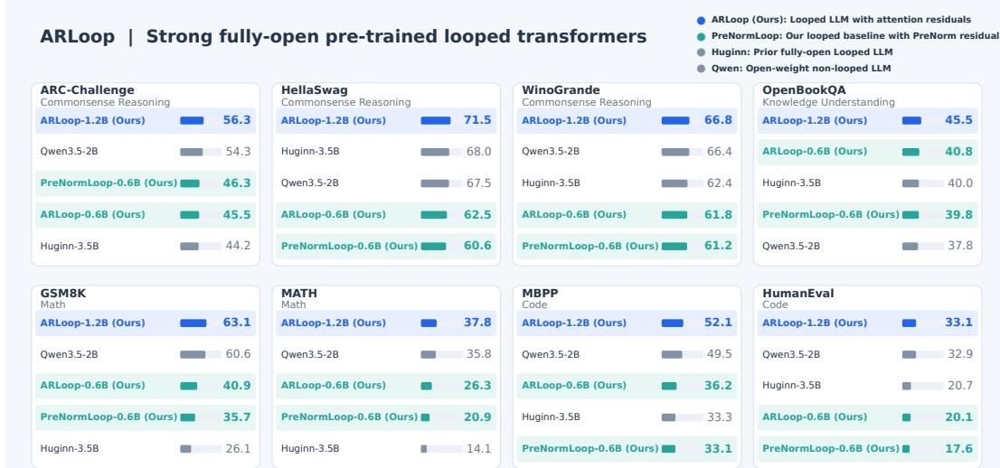  
Figure 1: Performance of ARLOOP on general reasoning, knowledge, mathematics, and coding benchmarks. ARLOOP-1.2B outperforms both Huginn-3.5B and Qwen3.5-2B on all eight benchmarks, while ARLOOP-0.6B outperforms its parameter-matched PRENORMLOOP baseline on seven of eight benchmarks.

Existing work has improved looped transformers through residual scaling or normalization (Geiping et al., 2025; Li et al., 2026; Prairie et al., 2026), but limited systematic comparisons leave it unclear which residual design best enables models to make use of recurrent computation. Moreover, these prior residual designs have mostly been evaluated under relatively small-scale pretraining setups, leaving their effectiveness on more complex generative tasks such as mathematical reasoning and code generation underexplored.

Motivated by recent advances in attention residuals for standard transformers (Kimi Team, 2026), we investigate how selective residual access should be adapted to recurrent depth. Compared with PreNorm, attention residuals replace the uniform aggregation of earlier residual updates with attentionweighted aggregation, allowing each layer to selectively access representations from preceding depths. Unlike standard transformers, however, recurrent depth repeatedly applies the same parameters and can produce highly redundant representations across recurrences (Zeitoun et al., 2026; Wang et al., 2026a), raising the question of whether access to the full residual history is necessary.

Our contributions are twofold. First, we introduce ARLOOP, a looped transformer architecture that adapts attention residuals to recurrent depth. Across multiple parameter scales (140M and 370M) and recurrence depths (R = 1 to R = 5), ARLOOP consistently improves validation perplexity over PreNorm and outperforms prior residual designs (Geiping et al., 2025; Li et al., 2026; Prairie et al., 2026) under our rigorous controlled evaluation setting. Distinct from standard transformers, we find that access to the full residual history is unnecessary for looped transformers: sliding-window depth attention matches or outperforms full-history attention at larger recurrence depths. Our analysis further shows that depth attention concentrates on recent residual sources and that representations across recurrences are highly redundant, explaining the effectiveness of sliding-window attention.

More importantly, we demonstrate that ARLOOP scales to work under a realistic LLM pretraining recipe. Despite using a much smaller training budget (i.e. 0.5T tokens), our strongest ARLOOP-1.2B substantially outperforms Huginn-3.5B (Geiping et al., 2025) (the only fully-open looped LLM as of our release date), and achieves performance competitive with strong non-looped LLMs such as Qwen3.5-2B. At scale, we find that ARLOOP generally outperforms PreNorm, with especially promising improvements on math and coding tasks (e.g. +5.2 points on GSM8K and +3.1 points on MBPP). We release training code and checkpoints, making ARLOOP fully-open for future study.

## 2 RELATED WORK

Looped transformers. Looped transformers, also known as recurrent-depth transformers or universal transformers (Dehghani et al., 2019; Lan et al., 2020; Yang et al., 2024), are widely studied as memory-efficient alternatives to transformers. As they are increasingly scaled to LLM pretraining (Csordas et al., 2024; Geiping et al., 2025; Bae et al., 2025), recent work has explored residua´ designs for better information propagation across recurrent depth, including Parcae, DeepLoop, and HyperLoop (Li et al., 2026; Zeitoun et al., 2026; Prairie et al., 2026; Knupp et al., 2026). Compared with these approaches, ARLOOP consistently matches or outperforms them across parameter and recurrence budgets in our controlled experiments. We further show that these gains extend beyond language modeling perplexity to mathematical reasoning and code generation, which remain underexplored in prior work.

Pretraining looped transformers at scale. Recent work has begun scaling looped transformers for pretraining. Geiping et al. (2025) introduced Huginn, a 3.5B-parameter looped LLM trained with up to 64 recurrences, while Zhu et al. (2025) further scaled the training data with Ouro, a 1.4B model using up to four recurrences. Subsequent work has explored looped LLMs with mixtureof-experts architectures such as Loopies (Gao et al., 2026), SMELT (Wang et al., 2026b), as well as larger data scales for advanced capabilities, including Nanbeige4.2-3B (Lab et al., 2026) and LoopCoder-v2 (Yang et al., 2026). Despite these promising results, many looped LLMs release only model weights or do not release weights at all, leaving the training and data recipe unclear. The only exception is Huginn, which releases all training artifacts. In particular, Huginn reports that PreNorm does not effectively exploit recurrent depth and instead relies on conservative optimization setups for stable training. Our work systematically studies residual design for looped transformers and further validates the resulting architecture under a realistic LLM pretraining recipe, substantially outperforming Huginn despite using smaller parameter, data, and recurrence budgets.

## 3 ARLOOP

We first describe the formulation of our looped transformer and then how we adapt attention residuals for it. We refer to the resulting model as ARLOOP.

## 3.1 PRELIMINARIES

Terminology. Throughout the paper, we use sublayer to refer to either a self-attention or a feedforward network (FFN) module, transformer layer to refer to a pair of self-attention and FFN sublayers, and residual block to refer to a group of consecutive sublayers used as a source in attention residuals, as introduced below.

Standard Transformer with PreNorm residual. We start by defining a standard decoder-only transformer (Vaswani et al., 2017; Radford et al., 2019) with a PreNorm residual stream. Let x be a sequence of tokens, and let $\boldsymbol { h } _ { 0 } \in \mathbb { R } ^ { n \times d }$ denote their embeddings. A standard transformer consists of L layers, each of which contains a self-attention sublayer followed by an FFN. For the i-th sublayer, its input $h _ { i - 1 }$ and output $h _ { i }$ can be written as

$$
\pmb { h } _ { i } = \pmb { h } _ { i - 1 } + f _ { i } ( \mathrm { N o r m } ( \pmb { h } _ { i - 1 } ) ) , \quad i = 1 , \ldots , 2 L\tag{1}
$$

where $f _ { i }$ denotes either a self-attention or an FFN function. We can then define $h _ { i } = \mathscr { F } _ { i } ( h _ { i - 1 } )$ , and the entire transformer can be written as y = LMHead $\circ { \mathcal { F } } _ { 2 L } \circ \cdot \cdot \cdot \circ { \mathcal { F } } _ { 1 } ( h _ { 0 } )$ , where LMHead denotes the language-modeling head that maps the final hidden states to output logits.

Looped transformer. Following the notation above, an L-layer looped transformer reuses the same transformer stack $\mathcal { S } \left( \mathrm { e . g . ~ } \mathcal { F } _ { 4 } \circ \mathcal { F } _ { 3 } \circ \mathcal { F } _ { 2 } \circ \mathcal { F } _ { 1 } \right)$ for R recurrences. Although S can consist of any subset of the L distinct transformer blocks, in this paper we only consider looping the full stack of transformer blocks (i.e. $\pmb { S } = \mathcal { F } _ { 2 L } \circ \cdots \circ \mathcal { F } _ { 1 } )$ . Hence, our looped transformer can be written as $\pmb { y } = \mathrm { L M H e a d } \circ \pmb { S } ^ { ( R ) } \circ \cdots \circ \pmb { S } ^ { ( 1 ) } ( \pmb { h } _ { 0 } )$ , where $S ^ { ( 1 ) } = \cdot \cdot \cdot = S ^ { ( R ) } = S$ , since the same transformer stack is shared across all recurrences. The resulting unrolled network therefore has an effective depth of 2LR sublayers, while containing only 2L distinct transformer sublayers.

Attention Residuals. Unrolling Equation 1 gives us $\begin{array} { r } { \pmb { h } _ { i } = \pmb { h } _ { 0 } + \sum _ { j = 1 } ^ { i } \pmb { f } _ { j } \big ( \mathrm { N o r m } ( \pmb { h } _ { j - 1 } ) \big ) } \end{array}$ , which implies that under PreNorm, every residual update produced at an earlier sublayer contributes to all subsequent residual states with a fixed unit coefficient. Attention Residuals (Kimi Team, 2026)

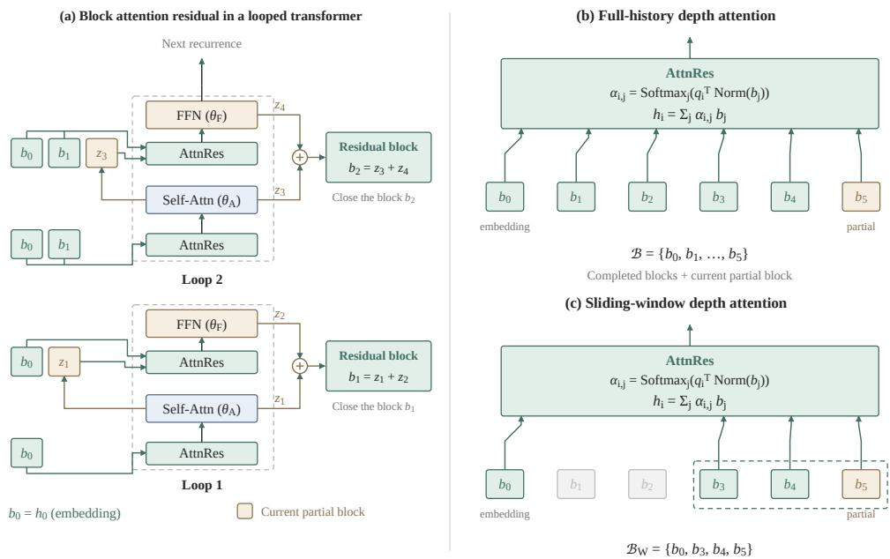  
Figure 2: An example illustrating attention residuals in looped transformers. (a) Each loop contains one transformer layer (i.e. a self-attention and an FFN), with parameters shared across loops. We group every $S = 2$ sublayers into a residual block, yielding $b _ { 1 } = z _ { 1 } + z _ { 2 }$ and $b _ { 2 } = z _ { 3 } + z _ { 4 }$ . (b) Full history depth attention (Kimi Team, 2026) accesses all available residual sources. (c) Sliding-window depth attention retains the embedding and a window of recent residual sources.

replace this fixed aggregation with attention-based aggregation over residual sources across depth. Specifically, we define the input embedding as $z _ { \mathrm { 0 } } : = h _ { \mathrm { 0 } } ,$ , and formulate attention residuals as

$$
z _ { j } = f _ { j } \left( \mathrm { N o r m } ( h _ { j - 1 } ) \right) , \qquad \alpha _ { i , j } = \mathrm { S o f t m a x } _ { j \in \{ 0 , \dots , i \} } \left( q _ { i } ^ { \top } \mathrm { N o r m } ( z _ { j } ) \right) ,\tag{2}
$$

$$
{ \pmb h } _ { i } = \alpha _ { i , 0 } { \pmb h } _ { 0 } + \sum _ { j = 1 } ^ { i } \alpha _ { i , j } \pmb z _ { j } .\tag{3}
$$

where $\pmb { q } _ { i }$ is a learned query vector of the i-th sublayer. Compared with PreNorm (i.e. Equation 1), Attention Residuals (i.e. Equation 3) assign an attention-based coefficient $\alpha _ { i , j }$ to each residual update $z _ { j }$ , rather than aggregating all residual updates with unit coefficients.

Equation 3 introduces a new residual source after every sublayer, causing the number of sources to grow linearly with effective depth. Following Kimi Team (2026), we therefore use block attention residuals, which group consecutive sublayers and aggregate their residual updates into block-level representations. Specifically, for a block of S consecutive sublayers, we define its representation as

$$
b _ { k } = \sum _ { j = ( k - 1 ) S + 1 } ^ { k S } z _ { j }\tag{4}
$$

At each sublayer, attention is computed over the input embedding, the representations of preceding completed blocks, and the partial sum of residual updates within the current block. Thus, residual updates are accumulated additively within a block as in PreNorm, while attention-based aggregation is performed across blocks. This reduces the number of stored residual sources from individual sublayer outputs to block-level representations, substantially reducing the overhead of full attention residuals. We use block attention residuals for all ARLOOP models unless stated otherwise.

## 3.2 APPLYING ATTENTION RESIDUALS TO LOOPED TRANSFORMER

Since attention residuals only change how each sublayer aggregates representations from preceding depths, they can be naturally applied to looped transformers. Figure 2a illustrates a simplified example in which each recurrence contains two sublayers. As the depth grows, residual updates are grouped into one or more residual blocks following Equation 4. Each effective sublayer has its own learned query vector $( \mathrm { i . e . ~ } q _ { i }$ in Figure 2b), which attends over the residual sources available at that depth. Compared with PreNorm-based looped transformers, this allows sublayers at deeper recurrences to selectively access representations produced at earlier recurrent depths.

Sliding window depth attention. Standard attention residuals allow each depth-attention operation to access all preceding residual blocks as candidate sources, which we refer to asfull-history depth attention. In a looped transformer, however, the same set of parameters is repeatedly applied across recurrences, potentially introducing redundancy among representations produced at different recurrent depths. Indeed, prior work has observed high similarity between hidden states across recurrences in looped transformers (Zeitoun et al., 2026). This motivates us to ask whether access to the full residual history is necessary, or whether recent residual states already provide sufficient information.

Specifically, we study if sliding-window depth attention (Figure 2c) can match full-history depth attention. Let $\mathcal { B } = \{ b _ { 0 } , b _ { 1 } , \ldots , \bar { b _ { m } } \}$ } denote the residual sources available to a depth-attention operation, where $b _ { 0 }$ denotes the input embedding and $b _ { m }$ is the most recent residual block. Given a window size $W$ , sliding-window depth attention restricts the source set to $\mathfrak { B } _ { W } = \left\{ b _ { 0 } , b _ { \operatorname* { m a x } ( 1 , m - W + 1 ) } , \dots , b _ { m } \right\}$ Thus, the input embedding remains directly accessible at every depth, while depth attention is performed only over the $W$ most recent residual blocks. Note that sliding-window depth attention has also been studied in standard transformers, where it reduces the gains of attention residuals over PreNorm (Kimi Team, 2026). In contrast, as we will show in Section 4, sliding-window depth attention can match and even outperform full-history attention in looped transformers, particularly at larger recurrence depths. We therefore make sliding-window depth attention the default in ARLOOP for $R > 2$

## 4 CONTROLLED EVALUATION OF ARLOOP

We first use controlled experiments to evaluate how effectively ARLOOP reuses information across recurrent depth, examining both its benefits for language modeling and the contribution of its key design choices.

General setup. We evaluate ARLOOP under a controlled setup using 140M- and 370M-parameter decoder-only transformers with 6 and 12 transformer layers, respectively. Following Prairie et al. (2026), we pretrain these models on 11.2B and 29.6B tokens from FineWeb-Edu (Penedo et al., 2024), respectively, with a context length of 2048. Following the general architecture of Karpathy (2025), each transformer layer uses multi-head attention and a standard MLP. For optimization, we use AdamW (Kingma & Ba, 2017) with a cosine learning rate schedule. Complete architecture and training details are provided in Appendix A.1.

ARLOOP training setup. For all ARLOOP models, we use fixed recurrence, such that the number of recurrences R is fixed throughout training. For the 140M and 370M models, we group every 6 and 12 consecutive sublayers, respectively, into a residual block. Since each recurrence contains 12 sublayers at 140M and 24 sublayers at 370M, this yields two residual blocks per recurrence at both scales. Following the design in Section 3.2, we use full-history depth attention for $R \leq 2$ and sliding-window depth attention for $R > 2$ . For the sliding-window variant, we retain the input embedding and the three most recent residual blocks.

Baselines. We use a PreNorm-based looped transformer with the residual in Equation 1 as our default baseline, which we call PRENORMLOOP. We also compare against previously proposed residual designs for looped transformers, including Sandwich Norm (Geiping et al., 2025; Zhu et al., 2025), DeepLoop (Li et al., 2026), and Parcae (Prairie et al., 2026), both with and without input injection (Bansal et al., 2022). We provide the formulations of these baselines in Appendix E. We train all models with a fixed number of recurrences R = 1, 3, 5 at the 140M scale and R = 1, 3 at the 370M scale due to computational cost. We implement and train these methods under a unified training setup, keeping all training hyperparameters fixed across methods except for the learning rate. Details of learning-rate tuning are provided in Appendix A.1.

<table><tr><td rowspan="2">Model</td><td colspan="3">140M</td><td colspan="2">370M</td></tr><tr><td> $R = 1$ </td><td> $R = 3$ </td><td> $R = 5$ </td><td> $R = 1$ </td><td> $R = 3$ </td></tr><tr><td>Sandwich-Norm (Geiping et al., 2025)</td><td>18.98</td><td>17.19</td><td>16.59</td><td>13.92</td><td>12.97</td></tr><tr><td>DeepLoop (Li et al., 2026)</td><td>18.72</td><td>17.05</td><td>16.52</td><td>13.69</td><td>12.78</td></tr><tr><td>Parcae w/o input injection (Prairie et al., 2026)</td><td>18.37</td><td>16.60</td><td>16.01</td><td>13.55</td><td>12.31</td></tr><tr><td>Parcae w. input injection (Prairie et al., 2026)</td><td>18.37</td><td>16.55</td><td>15.96</td><td>13.55</td><td>12.30</td></tr><tr><td>PRENORMLOOP</td><td>18.37</td><td>16.91</td><td>16.34</td><td>13.55</td><td>12.48</td></tr><tr><td>ARLOOP</td><td>18.26</td><td>16.38</td><td>15.84</td><td>13.32</td><td>12.17</td></tr></table>

Table 1: Validation perplexity (↓) for models at the 140M and 370M scales.

Besides comparison with prior methods, we also train two variants of ARLOOP to better understand our method. Specifically, we train (1) $\mathbf { A R L O O P _ { f u l l } }$ , which applies full-history depth attention; and (2) $\mathbf { A R L O O P _ { \mathrm { s w } } } .$ , which applies sliding-window depth attention, and compare them with the PRENORMLOOP baseline. We train each model with a fixed number of recurrences, using one model for each $R \in \{ 2 , 3 , 4 \}$

Evaluation. We use perplexity (PPL) on a held-out validation set of 10M tokens from Fineweb-Edu as the main evaluation metric. In addition, we also evaluate performance on a broad set of downstream tasks. Our downstream aggregate is the unweighted mean over ARC-Challenge, ARC-Easy (Clark et al., 2018), HellaSwag (Zellers et al., 2019), LAMBADA under both the OpenAI and standard formulations (Paperno et al., 2016), OpenBookQA (Mihaylov et al., 2018), PIQA (Bisk et al., 2019), RACE (Lai et al., 2017), SciQ (Welbl et al., 2017), and WinoGrande (Sakaguchi et al., 2019). We use normalized accuracy for HellaSwag, OpenBookQA, and PIQA, and accuracy for the remaining tasks. Complete evaluation details are provided in Appendix A.2.

## 4.1 RESULTS

ARLOOP consistently outperforms existing residual designs in language modeling. We first compare the validation perplexity of ARLOOP in Table 1 against residual designs proposed in prior work. Across different parameter, data, and recurrence budgets, ARLOOP consistently achieves the lowest validation perplexity among PRENORMLOOP and the other residual designs, demonstrating the effectiveness of selective access to representations from earlier depths. Compared with PRENORMLOOP, ARLOOP yields larger gains at deeper recurrences $( \mathbf { e . g . \ - 0 . 1 1 }$ PPL at $R = 1$ versus −0.53 at $R = 3 )$ , suggesting that ARLOOP makes more effective use of the additional computation provided by recurrent depth.

Sliding-window attention matches full-history attention at shallow recurrence, and even outperforms it in perplexity at deeper recurrences. We next ask whether looped transformers need direct access to the full residual history as recurrent depth increases. Table 2 compares PreNorm (PRENORMLOOP), full-history depth attention $( \mathrm { A R L O O P _ { f u l l } } )$ , and slidingwindow depth attention $( \mathbf { A R L O O P _ { s w } } )$ In terms of perplexity, although $\mathrm { \bf A R - }$ $\mathrm { L O O P _ { s w } }$ performs worse than fullhistory depth attention (i.e. AR-

<table><tr><td rowspan="2">Scale R</td><td rowspan="2"></td><td colspan="3">PPL↓</td><td colspan="3">Downstream ↑</td></tr><tr><td>PRENORMLOOP ARLOOPfull</td><td></td><td> $\mathbf { A R L O O P _ { \mathrm { { s w } } } }$ </td><td>|PRENORMLOOP</td><td> $\mathbf { A R L O O P _ { f u l l } }$ </td><td>ARLOOPsw</td></tr><tr><td rowspan="3">140M 3</td><td>2</td><td>17.48</td><td>17.27</td><td>17.30</td><td>42.22</td><td>41.96</td><td>42.27</td></tr><tr><td></td><td>16.91</td><td>16.46</td><td>16.38</td><td>42.72</td><td>43.69</td><td>43.09</td></tr><tr><td>4</td><td>16.59</td><td>16.07</td><td>16.03</td><td>43.27</td><td>44.09</td><td>43.73</td></tr><tr><td rowspan="3">370M 3</td><td>2</td><td>12.83</td><td>12.68</td><td>12.55</td><td>48.98</td><td>48.70</td><td>49.25</td></tr><tr><td></td><td>12.48</td><td>12.27</td><td>12.17</td><td>49.29</td><td>50.23</td><td>50.67</td></tr><tr><td>4</td><td>12.27</td><td>12.01</td><td>11.99</td><td>50.19</td><td>50.93</td><td>50.76</td></tr></table>

Table 2: Validation perplexity and average zero-shot downstream accuracy (%). Bold marks the best result for each metric within each row.

$\operatorname { L o o P f u l l } )$ at $R = 2$ of 140M scale, it achieves the best performance at larger recurrence depths and large parameter scales. Both variants also generally outperform PRENORMLOOP in downstream accuracy, suggesting that the effectiveness of our method extends to general knowledge and reasoning tasks. Given that the sliding-window variant also reduces computational overhead, we therefore adopt the sliding-window variant $\mathbf { A R L O O P } _ { s w }$ as the default ARLOOP.

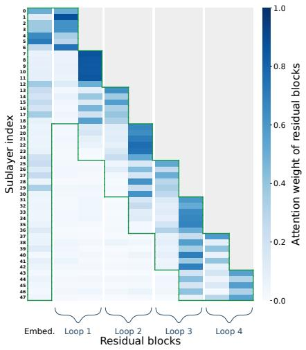

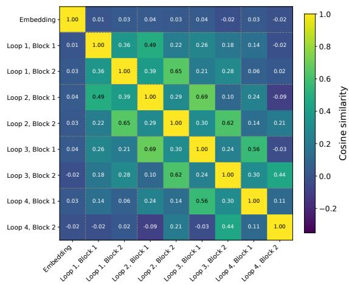  
Figure 3: Left: Attention weights over residual sources (i.e. blocks) at each sublayer for the 140M $\mathbf { A R L O O P _ { f u l l } }$ model with $R = 4 ,$ , averaged over the validation set. Green lines indicate the sliding windows used in the corresponding $\mathbf { A R L O O P _ { s w } }$ variant. Right: Pairwise cosine similarity between residual blocks for the same model.

Why sliding-window depth attention works for looped transformers. To understand why recent residual blocks are sufficient, we visualize the attention weights assigned to each residual source by $\mathbf { A R L O O P _ { f u l l } }$ with $R = 4$ in Figure 3 (Left). Depth attention places most of its mass on recent residual sources (e.g., at sublayer 47, the three most recent residual blocks and the embedding block receive 96% of the total attention weight), suggesting that direct access to distant residual history contributes relatively little to the representations used at deeper recurrences. We hypothesize that this locality arises from parameter sharing across recurrences: repeatedly applying the same transformer layers produces redundant representations, while more recent sources have already undergone refinement through additional recurrent computation. Consequently, retaining direct access to distant residual sources may provide little additional information and could even introduce unnecessary interference.

To examine this hypothesis, we further visualize the pairwise cosine similarity between residual blocks in Figure 3 (Right). Residual sources across recurrences exhibit high similarity, supporting the presence of substantial redundancy across recurrent depth. We observe the same pattern across other parameter scales and recurrence settings, with complete results provided in Appendix A.5. Importantly, this behavior differs from a standard transformer with matched effective depth, where representations exhibit substantially lower cross-depth similarity, and applying the same slidingwindow restriction degrades performance (Appendix A.5). Together, these results suggest that local depth attention is particularly well suited to the recurrent-depth structure of looped transformers.

## 5 SCALING TO PRACTICAL PRETRAINING OF LOOPED TRANSFORMERS

Having established the effectiveness of ARLOOP in controlled experiments, we now scale it to billionparameter models, bringing together carefully curated pretraining data mixtures and a multi-stage training strategy to build strong, fully-open ARLOOP-based LLMs.

Setup. We adopt a pretraining recipe similar to SmolLM (Allal et al., 2025; HuggingFaceTB, 2025). Compared with the controlled experiments in Section 4, we replace multi-head attention with grouped-query attention (Ainslie et al., 2023) and use SwiGLU (Shazeer, 2020) in place of the standard FFN sublayers to better align with modern LLM architectures (Qwen Team, 2025). For pretraining data, we use FineWeb-Edu (Penedo et al., 2024), FineMath, and Stack-Edu (Allal et al., 2025) as the primary sources. We use the same cosine learning rate schedule and adopt a multi-stage training strategy, introducing higher-quality data in later stages following HuggingFaceTB (2025) and Allen Institute for AI (2025). We also extend the context length to 4096 tokens. Such a realistic pretraining recipe enables us to evaluate our models not only on general knowledge and reasoning tasks, but also on mathematical reasoning and code generation. We provide complete architecture, training, and data-mixture details in Appendix B.1.

<table><tr><td>Model</td><td colspan="10">Looped FLOPs Data (T) ARC-C Hella. Wino. OBQA GSM8K MATH MBPP HumanEval</td></tr><tr><td colspan="10">Open-weight LLMs</td></tr><tr><td>Qwen3.5-2B</td><td>None</td><td>432</td><td>36</td><td>54.3</td><td>67.5</td><td>66.4</td><td>37.8</td><td>60.6 35.8</td><td>49.5</td><td>32.9</td></tr><tr><td>Gemma 3-4B</td><td>None</td><td>96</td><td>4.0</td><td>58.4 77.7</td><td>72.3</td><td>43.0 41.4</td><td>38.1</td><td>25.4</td><td>60.1</td><td>34.2</td></tr><tr><td>Ouro-1.4B</td><td>4</td><td>259</td><td>7.7</td><td>59.9</td><td>74.4</td><td>70.5</td><td>78.2</td><td>70.5</td><td>68.3</td><td>52.4</td></tr><tr><td colspan="10">Fully-open LLMs</td></tr><tr><td>OLMo 2-7B</td><td>None</td><td>180</td><td>4.1</td><td>64.6</td><td>82.0</td><td>76.8 45.6</td><td>68.1</td><td>20.9</td><td>32.0</td><td>12.2</td></tr><tr><td>OLMo 3-7B</td><td>None</td><td>252</td><td>5.9</td><td>61.0</td><td>76.4</td><td>73.8</td><td>42.4</td><td>73.8 43.6</td><td>66.1</td><td>14.0</td></tr><tr><td>Huginn-3.5B</td><td>32</td><td>28</td><td>0.18</td><td>33.6</td><td>50.6</td><td>52.7</td><td>33.4</td><td>5.1</td><td>3.7 14.8</td><td>10.3</td></tr><tr><td>Huginn-3.5B</td><td>32</td><td>127</td><td>0.8</td><td>44.2</td><td>68.0</td><td>62.4</td><td>40.0</td><td>26.1</td><td>14.1 33.3</td><td>20.7</td></tr><tr><td>PRENORMLOOP-0.6B (Ours)</td><td>3</td><td>2</td><td>0.18</td><td>46.3</td><td>60.6</td><td>61.2</td><td>39.8</td><td>35.7 20.9</td><td>33.1</td><td>17.6</td></tr><tr><td>ARLOOP-0.6B (Ours)</td><td>3</td><td>2</td><td>0.18</td><td>45.5</td><td>62.5</td><td>61.8</td><td>40.8</td><td>40.9 26.3</td><td>36.2</td><td>20.1</td></tr><tr><td>ARLOOP-1.2B (Ours)</td><td>3</td><td>10</td><td>0.5</td><td>56.3</td><td>71.5</td><td>66.8</td><td>45.5</td><td>63.1 37.8</td><td>52.1</td><td>33.1</td></tr></table>

Table 3: Comparison of open-weight and fully-open language models. Training FLOPs are estimated using the 6ND approximation and reported in units of $\overline { { 1 0 ^ { 2 1 } } }$ . Data (T) denotes pretraining tokens in trillions. Looped denotes the default number of recurrences used by each model. Rows in light blue refer to looped language models, including our fully-open models.

Using this recipe, we train three models: (1) PRENORMLOOP-0.6B, a 0.6B PRENORMLOOP model with 18 transformer layers and $R = 3 ,$ , trained on 180B tokens; (2) ARLOOP-0.6B, a 0.6B ARLOOP model with the same architecture, recurrence, and training budget; and (3) ARLOOP-1.2B, a 1.2B ARLOOP model with 24 transformer layers and R = 3, trained on 500B tokens. For both ARLOOP models, we adopt the sliding-window configuration from Section 4.

Evaluation. We use ARC-Challenge (Clark et al., 2018), HellaSwag (Zellers et al., 2019), Wino-Grande (Sakaguchi et al., 2019), and OpenBookQA (Mihaylov et al., 2018) to evaluate general knowledge and reasoning; GSM8K (Cobbe et al., 2021) and MATH (Hendrycks et al., 2021; Lewkowycz et al., 2022) for mathematical reasoning; and MBPP (Austin et al., 2021) and HumanEval (Chen et al., 2021) for code generation. Complete evaluation details are provided in Appendix B.2.

Baselines. We additionally compare against both existing looped language models and strong non-looped LLMs of similar or larger sizes. The recurrent-depth baselines include Huginn (Geiping et al., 2025) and Ouro (Zhu et al., 2025), while the non-looped open models include Qwen3.5-2B (Qwen Team, 2026), Gemma 3-4B (Gemma Team, 2025), OLMo 2-7B and OLMo 3-7B (Team OLMo et al., 2024; Allen Institute for AI, 2025). The non-looped open models are included mainly as references rather than for head-to-head comparison. For all of these models, we re-evaluate the corresponding base checkpoints using the same evaluation harness to ensure consistent evaluation. Among these models, we particularly focus on Huginn because it is a fully-open looped LLM trained with a comparable data scale, but with substantially larger parameter and recurrence budgets (e.g. 3.5B parameters and up to 64 recurrences).

Note that we do not compare with other residual methods such as Parcae or DeepLoop (Prairie et al., 2026; Li et al., 2026; Zeitoun et al., 2026) in this realistic pretraining comparison. Such previous work generally validates their methods only at small data scales (e.g. below 50B tokens) or with a single pretraining source (e.g. FineWeb-Edu), leaving the capabilities of the resulting models on more complex tasks such as math and coding open. Our contribution specifically targets this question, aiming to show ARLOOP remains effective on such generative tasks under realistic pretraining settings.

## 5.1 RESULTS

ARLOOP scales to realistic LLM pretraining, with substantial improvements on math and coding over PRENORMLOOP. Table 3 reports our large-scale training results. Under the same 0.6B parameter scale, 180B-token training budget, and R = 3 recurrence, ARLOOP-0.6B outperforms PRENORMLOOP-0.6B on 7 of 8 evaluated tasks. The gains are particularly large on mathematical reasoning and code generation, including +5.2 points on GSM8K and +3.1 points on MBPP. These results suggest that the benefits of ARLOOP indeed transfer to a realistic LLM pretraining recipe. Interestingly, while the gains in validation perplexity are relatively modest in the controlled experiments, they become substantially larger on complex generative tasks. This highlights the importance of evaluating residual designs beyond perplexity and multiple-choice benchmarks, which is missing in existing work (Prairie et al., 2026; Li et al., 2026; Zeitoun et al., 2026).

Further scaling makes ARLOOP competitive with strong LLMs at a similar scale. Scaling ARLOOP to 1.2B parameters and 500B training tokens yields substantial improvements across all evaluated benchmarks. In particular, ARLOOP-1.2B outperforms Huginn on every task in Table 3, despite using fewer parameters, fewer training tokens, and substantially fewer recurrent steps. Although ARLOOP-1.2B underperforms Ouro (Zhu et al., 2025) on most tasks, we attribute this gap primarily to their substantially larger pretraining data budget and its use of higher-quality pretraining data sources. Instead, our training recipe relies on open and commonly used data sources. Our model is also competitive with Qwen3.5-2B despite its substantially smaller pretraining budget, matching

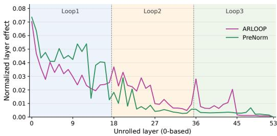  
Figure 4: Layer effects on 50 MATH examples for PRENORMLOOP-0.6B and ARLOOP-0.6B. Shaded regions mark Loop1 (layers 0–17), Loop2 (18–35), and Loop3 (36–53).

or exceeding it on all evaluated benchmarks. ARLOOP-1.2B also outperforms Gemma-3-4B on both math benchmarks and OLMo models on HumanEval, demonstrating competitive math and coding capabilities against substantially larger non-looped LLMs. These results show that attention residuals can substantially strengthen looped LLMs, making them competitive with strong non-looped LLM at similar parameter scales.

Deeper recurrence in ARLOOP contributes more strongly to subsequent computation on math and coding tasks. To better understand the gains of ARLOOP on math and coding tasks, we adopt the layer effect metric from Csordas et al. (2025) to quantify how much each layer contributes´ to representations at subsequent layers. We randomly sample 50 examples from MATH and, for each example, intervene on the representation of a source layer and measure the resulting change in the outputs of deeper layers. Figure 4 compares the layer effects between PRENORMLOOP-0.6B and ARLOOP-0.6B. We find that layers in the second and third recurrences of ARLOOP make substantially larger contributions to subsequent layers than the corresponding deeper layers in PRENORMLOOP-0.6B. This suggests that ARLOOP makes greater use of representations computed at later recurrent depths, consistent with its stronger performance on tasks that benefit from deeper computation. We report the detailed score computation and results on MBPP in Appendix C.

## 6 FURTHER DISCUSSION

Dynamic versus fixed recurrence. Existing looped language models often vary the number of recurrences during training to support multiple effective depths (Geiping et al., 2025; Prairie et al., 2026; Kohli et al., 2026; Bae et al., 2025). We compare such dynamic-recurrence training with fixed R = 4 training and find that fixed recurrence consistently achieves better validation perplexity and downstream performance at both the 140M and 370M scales. We therefore use fixed recurrence in our main experiments. Complete training setups and results are provided in Appendix D.1.

Inference-time scaling. We also investigate whether the improved residual access of ARLOOP enables inference-time recurrence extrapolation, i.e. benefiting from more recurrences than observed during training (Fan et al., 2025; Kohli et al., 2026). Consistent with prior observations for looped language models (Prairie et al., 2026; Zhu et al., 2025), we find that performance improves up to the maximum training recurrence but does not further improve beyond it. This suggests that selective access to earlier representations alone does not unlock recurrence extrapolation: effectively composing information within the trained depth range and generalizing recurrent computation beyond that range appear to be distinct problems. Complete experimental details are provided in Appendix D.2.

Training efficiency. ARLOOP introduces additional computation due to the attention residual calculation for each sublayer. When activation checkpointing (e.g. recomputation of intermediate hidden states) is not enabled, the residual sources used by attention residual are already retained for backpropagation, resulting in negligible additional memory overhead. We report training memory and throughput for our experimental setups in Table 4. Across all model scales, ARLOOP uses essentially the same amount of memory as PreNorm. In terms of throughput, $\mathbf { A R L O O P _ { f u l l } }$ is approximately 15% slower than PreNorm on average, while sliding window attention residual reduces this gap to approximately 10%. We expect that further kernel optimization could reduce this over-

<table><tr><td>Model</td><td>140M</td><td>370M</td><td>0.6B</td><td>1.2B</td></tr><tr><td colspan="5">Memory (GiB) ↓</td></tr><tr><td>PreNorm</td><td>32.8</td><td>80.0</td><td>66.5</td><td>65.4</td></tr><tr><td>ARLOOPfull</td><td>33.0</td><td>80.1</td><td>66.6</td><td>65.4</td></tr><tr><td> $\mathbf { A R L O O P _ { s w } }$ </td><td>32.9</td><td>80.1</td><td>66.6</td><td>65.4</td></tr><tr><td colspan="5">Throughput (tokens/s) ↑</td></tr><tr><td>PreNorm</td><td>131.1k</td><td>45.8k</td><td>28.9k</td><td>15.0k</td></tr><tr><td>ARLOOPfull</td><td>107.5k</td><td>39.1k</td><td>24.8k</td><td>13.0k</td></tr><tr><td> $\mathbf { A R L O O P _ { s w } }$ </td><td>114.5k</td><td>40.9k</td><td>25.9k</td><td>13.6k</td></tr></table>

Table 4: Training memory and throughput at $R =$ 4 on a single NVIDIA H100, with batch sizes of 8, 8, 4, and 2 for the 140M, 370M, 0.6B, and 1.2B models, respectively.

head, as depth attention introduces relatively little additional arithmetic computation but incurs additional high-bandwidth memory traffic.

## 7 CONCLUSION

We introduce ARLOOP, a looped transformer architecture that adapts attention residuals to recurrent depth. Through controlled experiments across multiple parameter scales, ARLOOP consistently outperforms PreNorm and prior residual designs for looped transformers. Distinct from standard transformers, we find that looped transformers do not require access to the full residual history: sliding-window depth attention can match or outperform full-history attention at larger recurrence depths. More importantly, we demonstrate that these gains transfer to realistic LLM pretraining. At the 0.6B scale, ARLOOP substantially improves over a matched PreNorm model, with particularly large gains on math and coding tasks. Our strongest model ARLOOP-1.2B substantially outperforms the fully-open looped LLM Huginn and is competitive with Qwen3.5-2B despite being trained on substantially less data. Together, these results demonstrate that selective residual access provides an effective way for looped transformers to better exploit recurrent computation at scale.

## ACKNOWLEDGMENTS

We thank the OSU NLP group for their thoughtful comments. This research was supported in part by NSF CAREER Award #1942980, Coefficient Giving (formerly Open Philanthropy), gift funding from Amazon, and the Ohio Supercomputer Center (Ohio Supercomputer Center, 1987). The views and conclusions expressed herein are those of the authors and do not necessarily reflect the official policies of the U.S. Government, either expressed or implied. The U.S. Government is authorized to reproduce and distribute reprints for government purposes notwithstanding any copyright notice herein.

## REFERENCES

Wasi Uddin Ahmad, Sean Narenthiran, Somshubra Majumdar, Aleksander Ficek, Siddhartha Jain, Jocelyn Huang, Vahid Noroozi, and Boris Ginsburg. Opencodereasoning: Advancing data distillation for competitive coding. 2025. URL https://arxiv.org/abs/2504.01943.

Joshua Ainslie, James Lee-Thorp, Michiel de Jong, Yury Zemlyanskiy, Federico Lebron, and Sumit´ Sanghai. Gqa: Training generalized multi-query transformer models from multi-head checkpoints, 2023. URL https://arxiv.org/abs/2305.13245.

Loubna Ben Allal, Anton Lozhkov, Elie Bakouch, Gabriel Mart´ın Blazquez, Guilherme Penedo,´ Lewis Tunstall, Andres Marafioti, Hynek Kydl´ ´ıcek, Agustˇ ´ın Piqueres Lajar´ın, Vaibhav Srivastav, et al. Smollm2: When smol goes big—data-centric training of a small language model. arXiv preprint arXiv:2502.02737, 2025.

Allen Institute for AI. Olmo-3-1025-7B model card, 2025. URL https://huggingface.co/ allenai/Olmo-3-1025-7B.

Jacob Austin, Augustus Odena, Maxwell Nye, Maarten Bosma, Henryk Michalewski, David Dohan, Ellen Jiang, Carrie Cai, Michael Terry, Quoc Le, and Charles Sutton. Program synthesis with large language models. arXiv preprint arXiv:2108.07732, 2021.

Sangmin Bae, Yujin Kim, Reza Bayat, Sungnyun Kim, Jiyoun Ha, Tal Schuster, Adam Fisch, Hrayr Harutyunyan, Ziwei Ji, Aaron Courville, and Se-Young Yun. Mixture-of-recursions: Learning dynamic recursive depths for adaptive token-level computation, 2025. URL https://arxiv. org/abs/2507.10524.

Arpit Bansal, Avi Schwarzschild, Eitan Borgnia, Zeyad Emam, Furong Huang, Micah Goldblum, and Tom Goldstein. End-to-end algorithm synthesis with recurrent networks: Extrapolation without overthinking. Advances in Neural Information Processing Systems, 35:20232–20242, 2022.

Yonatan Bisk, Rowan Zellers, Ronan Le Bras, Jianfeng Gao, and Yejin Choi. Piqa: Reasoning about physical commonsense in natural language, 2019. URL https://arxiv.org/abs/1911. 11641.

Mark Chen, Jerry Tworek, Heewoo Jun, Qiming Yuan, Henrique Ponde de Oliveira Pinto, Jared Kaplan, Harri Edwards, Yuri Burda, Nicholas Joseph, Greg Brockman, et al. Evaluating large language models trained on code. arXiv preprint arXiv:2107.03374, 2021.

Peter Clark, Isaac Cowhey, Oren Etzioni, Tushar Khot, Ashish Sabharwal, Carissa Schoenick, and Oyvind Tafjord. Think you have solved question answering? try arc, the ai2 reasoning challenge, 2018. URL https://arxiv.org/abs/1803.05457.

Karl Cobbe, Vineet Kosaraju, Mohammad Bavarian, Mark Chen, Heewoo Jun, Lukasz Kaiser, Matthias Plappert, Jerry Tworek, Jacob Hilton, Reiichiro Nakano, et al. Training verifiers to solve math word problems. arXiv preprint arXiv:2110.14168, 2021.

Robert Csord ´ as, Kazuki Irie, J ´ urgen Schmidhuber, Christopher Potts, and Christopher D Manning.¨ MoEUT: Mixture-of-experts universal transformers. In The Thirty-eighth Annual Conference on Neural Information Processing Systems, 2024. URL https://openreview.net/forum? id=ZxVrkm7Bjl.

Robert Csord´ as, Christopher D. Manning, and Christopher Potts. Do language models use their depth´ efficiently?, 2025. URL https://arxiv.org/abs/2505.13898.

Mostafa Dehghani, Stephan Gouws, Oriol Vinyals, Jakob Uszkoreit, and Lukasz Kaiser. Universal transformers. In International Conference on Learning Representations, 2019. URL https: //openreview.net/forum?id=HyzdRiR9Y7.

Ying Fan, Yilun Du, Kannan Ramchandran, and Kangwook Lee. Looped transformers for length generalization. In The Thirteenth International Conference on Learning Representations, 2025. URL https://openreview.net/forum?id=2edigk8yoU.

Leo Gao, Jonathan Tow, Baber Abbasi, Stella Biderman, Sid Black, Anthony DiPofi, Charles Foster, Laurence Golding, Jeffrey Hsu, Alain Le Noac’h, Haonan Li, Kyle McDonell, Niklas Muennighoff, Chris Ociepa, Jason Phang, Laria Reynolds, Hailey Schoelkopf, Aviya Skowron, Lintang Sutawika, Eric Tang, Anish Thite, Ben Wang, Kevin Wang, and Andy Zou. The language model evaluation harness, 07 2024. URL https://zenodo.org/records/12608602.

Zitian Gao, Yilong Chen, Yihao Xiao, Xinyu Yang, Ran Tao, Joey Zhou, and Bryan Dai. Loop the loopies!, 2026. URL https://arxiv.org/abs/2607.16051.

Jonas Geiping, Sean Michael McLeish, Neel Jain, John Kirchenbauer, Siddharth Singh, Brian R. Bartoldson, Bhavya Kailkhura, Abhinav Bhatele, and Tom Goldstein. Scaling up test-time compute with latent reasoning: A recurrent depth approach. In ES-FoMo III: 3rd Workshop on Efficient Systemsfor Foundation Models, 2025. URL https://openreview.net/forum? id=D6o6Bwtq7h.

Gemma Team. Gemma 3 technical report. arXiv preprint arXiv:2503.19786, 2025.

Dan Hendrycks, Collin Burns, Saurav Kadavath, Akul Arora, Steven Basart, Eric Tang, Dawn Song, and Jacob Steinhardt. Measuring mathematical problem solving with the MATH dataset. arXiv preprint arXiv:2103.03874, 2021.

Benhao Huang, Chufan Shi, Junlin Chen, Shicheng Wen, Zhengzhong Liu, Eric Xing, and Xuezhe Ma. Towards looped models done right, part ii: Rethinking at fixed points, 2026. URL https: //arxiv.org/abs/2610.06833.

HuggingFaceTB. SmolLM3-3B-Base model card, 2025. URL https://huggingface.co/ HuggingFaceTB/SmolLM3-3B-Base.

Andrej Karpathy. nanochat: The best chatgpt that \$100 can buy, 2025. URL https://github. com/karpathy/nanochat.

Kimi Team. Attention residuals, 2026. URL https://arxiv.org/abs/2603.15031.

Diederik P. Kingma and Jimmy Ba. Adam: A method for stochastic optimization, 2017. URL https://arxiv.org/abs/1412.6980.

Jonas Knupp, Jan Hendrik Metzen, Jeremias Bohn, Georg Groh, and Kristian Kersting. Depthrecurrent attention mixtures: Giving latent reasoning the attention it deserves, 2026. URL https: //arxiv.org/abs/2601.21582.

Harsh Kohli, Srinivasan Parthasarathy, Huan Sun, and Yuekun Yao. Loop, think, & generalize: Implicit reasoning in recurrent-depth transformers, 2026. URL https://arxiv.org/abs/ 2604.07822.

Nanbeige Lab, :, Chen Yang, Chengrui Huang, Fufeng Lan, Hanhui Chen, Hao Zhou, Huatong Song, Jiaqi Cao, Jiaying Zhu, Jinlin Niu, Kai Wang, Lisheng Huang, Qiliang Liang, Ran Le, Ruixiang Feng, Shuang Sun, Tao Gu, Tao Zhang, Tianyu Luo, Yang Song, Yun Xing, Yuntao Wen, Ziyao Xu, Zongchao Chen, and Zongqiang Li. Nanbeige4.2-3b: Unlocking agentic capabilities in a compact model, 2026. URL https://arxiv.org/abs/2607.22083.

Guokun Lai, Qizhe Xie, Hanxiao Liu, Yiming Yang, and Eduard Hovy. RACE: Large-scale ReAding comprehension dataset from examinations. In Martha Palmer, Rebecca Hwa, and Sebastian Riedel (eds.), Proceedings ofthe 2017 Conference on Empirical Methods in Natural Language Processing, pp. 785–794, Copenhagen, Denmark, September 2017. Association for Computational Linguistics. doi: 10.18653/v1/D17-1082. URL https://aclanthology.org/D17-1082/.

Zhenzhong Lan, Mingda Chen, Sebastian Goodman, Kevin Gimpel, Piyush Sharma, and Radu Soricut. Albert: A lite bert for self-supervised learning of language representations. In International Conference on Learning Representations, 2020. URL https://openreview.net/forum? id=H1eA7AEtvS.

Aitor Lewkowycz, Anders Andreassen, David Dohan, Ethan Dyer, Henryk Michalewski, Vinay Ramasesh, Ambrose Slone, Cem Anil, Imanol Schlag, Theo Gutman-Solo, Yuhuai Wu, Behnam Neyshabur, Guy Gur-Ari, and Vedant Misra. Solving quantitative reasoning problems with language models, 2022. URL https://arxiv.org/abs/2206.14858.

Shuzhen Li, Yifan Zhang, Jiacheng Guo, Quanquan Gu, and Mengdi Wang. Deeploop: Depth scaling for looped transformers, 2026. URL https://arxiv.org/abs/2607.13491.

Jiawei Liu, Chunqiu Steven Xia, Yuyao Wang, and Lingming Zhang. Is your code generated by chatgpt really correct? rigorous evaluation of large language models for code generation, 2023. URL https://arxiv.org/abs/2305.01210.

Anton Lozhkov, Raymond Li, Loubna Ben Allal, Federico Cassano, Joel Lamy-Poirier, Nouamane Tazi, Ao Tang, Dmytro Pykhtar, Jiawei Liu, Yuxiang Wei, Tianyang Liu, Max Tian, Denis Kocetkov, Arthur Zucker, Younes Belkada, Zijian Wang, Qian Liu, Dmitry Abulkhanov, Indraneil Paul, Zhuang Li, Wen-Ding Li, Megan Risdal, Jia Li, Jian Zhu, Terry Yue Zhuo, Evgenii Zheltonozhskii, Nii Osae Osae Dade, Wenhao Yu, Lucas Krauß, Naman Jain, Yixuan Su, Xuanli He, Manan Dey, Edoardo Abati, Yekun Chai, Niklas Muennighoff, Xiangru Tang, Muhtasham Oblokulov, Christopher Akiki, Marc Marone, Chenghao Mou, Mayank Mishra, Alex Gu, Binyuan Hui, Tri Dao, Armel Zebaze, Olivier Dehaene, Nicolas Patry, Canwen Xu, Julian McAuley, Han Hu, Torsten Scholak, Sebastien Paquet, Jennifer Robinson, Carolyn Jane Anderson, Nicolas Chapados, Mostofa Patwary, Nima Tajbakhsh, Yacine Jernite, Carlos Munoz Ferrandis, Lingming Zhang, Sean Hughes,˜ Thomas Wolf, Arjun Guha, Leandro von Werra, and Harm de Vries. Starcoder 2 and the stack v2: The next generation, 2024.

Todor Mihaylov, Peter Clark, Tushar Khot, and Ashish Sabharwal. Can a suit of armor conduct electricity? a new dataset for open book question answering, 2018. URL https://arxiv. org/abs/1809.02789.

Ivan Moshkov, Darragh Hanley, Ivan Sorokin, Shubham Toshniwal, Christof Henkel, Benedikt Schifferer, Wei Du, and Igor Gitman. Aimo-2 winning solution: Building state-of-the-art mathematical reasoning models with openmathreasoning dataset. arXiv preprint arXiv:2504.16891, 2025.

Ohio Supercomputer Center. Ohio supercomputer center, 1987. URL https://ror.org/ 01apna436.

Denis Paperno, German Kruszewski, Angeliki Lazaridou, Ngoc Quan Pham, Raffaella Bernardi,´ Sandro Pezzelle, Marco Baroni, Gemma Boleda, and Raquel Fernandez. The LAMBADA dataset:´ Word prediction requiring a broad discourse context. In Katrin Erk and Noah A. Smith (eds.), Proceedings ofthe 54th Annual Meeting ofthe Associationfor Computational Linguistics (Volume 1: Long Papers), pp. 1525–1534, Berlin, Germany, August 2016. Association for Computational Linguistics. doi: 10.18653/v1/P16-1144. URL https://aclanthology.org/P16-1144/.

Guilherme Penedo, Hynek Kydl´ıcek, Loubna Ben Allal, Anton Lozhkov, Margaret Mitchell, Colinˇ Raffel, Leandro von Werra, and Thomas Wolf. The FineWeb datasets: Decanting the web for the finest text data at scale. arXiv preprint arXiv:2406.17557, 2024.

Hayden Prairie, Zachary Novack, Taylor Berg-Kirkpatrick, and Daniel Y. Fu. Parcae: Scaling laws for stable looped language models, 2026. URL https://arxiv.org/abs/2604.12946.

Qwen Team. Qwen3 technical report. arXiv preprint arXiv:2505.09388, 2025.

Qwen Team. Qwen3.5-2B-Base model card, 2026. URL https://huggingface.co/Qwen/ Qwen3.5-2B-Base.

Alec Radford, Jeffrey Wu, Rewon Child, David Luan, Dario Amodei, Ilya Sutskever, et al. Language models are unsupervised multitask learners. OpenAI blog, 1(8):9, 2019.

Keisuke Sakaguchi, Ronan Le Bras, Chandra Bhagavatula, and Yejin Choi. Winogrande: An adversarial winograd schema challenge at scale, 2019. URL https://arxiv.org/abs/ 1907.10641.

Nikunj Saunshi, Nishanth Dikkala, Zhiyuan Li, Sanjiv Kumar, and Sashank J. Reddi. Reasoning with latent thoughts: On the power of looped transformers. In The Thirteenth International Conference on Learning Representations, 2025. URL https://openreview.net/forum? id=din0lGfZFd.

Rico Sennrich, Barry Haddow, and Alexandra Birch. Neural machine translation of rare words with subword units. In Katrin Erk and Noah A. Smith (eds.), Proceedings of the 54th Annual Meeting ofthe Associationfor Computational Linguistics (Volume 1: Long Papers), pp. 1715–1725, Berlin, Germany, August 2016. Association for Computational Linguistics. doi: 10.18653/v1/P16-1162. URL https://aclanthology.org/P16-1162/.

Noam Shazeer. Glu variants improve transformer, 2020. URL https://arxiv.org/abs/ 2002.05202.

Team OLMo, Pete Walsh, Luca Soldaini, Dirk Groeneveld, Kyle Lo, Shane Arora, Akshita Bhagia, Yuling Gu, Shengyi Huang, Matt Jordan, et al. 2 OLMo 2 Furious. arXiv preprint arXiv:2501.00656, 2024.

Shubham Toshniwal, Wei Du, Ivan Moshkov, Branislav Kisacanin, Alexan Ayrapetyan, and Igor Gitman. Openmathinstruct-2: Accelerating ai for math with massive open-source instruction data. arXiv preprint arXiv:2410.01560, 2024.

Ashish Vaswani, Noam Shazeer, Niki Parmar, Jakob Uszkoreit, Llion Jones, Aidan N Gomez, Ł ukasz Kaiser, and Illia Polosukhin. Attention is all you need. In I. Guyon, U. Von Luxburg, S. Bengio, H. Wallach, R. Fergus, S. Vishwanathan, and R. Garnett (eds.), Advances in Neural Information Processing Systems, volume 30. Curran Associates, Inc., 2017. URL https://proceedings.neurips.cc/paper\_files/paper/2017/ file/3f5ee243547dee91fbd053c1c4a845aa-Paper.pdf.

Guan Wang, Changling Liu, Chenyu Wang, Cai Zhou, Yuhao Sun, Yifei Wu, Shuai Zhen, Luca Scimeca, and Yasin Abbasi-Yadkori. HRM-Text: Efficient pretraining beyond scaling. arXiv preprint arXiv:2605.20613, 2026a.

Hongyu Wang, Shuming Ma, Li Dong, Shaohan Huang, Dongdong Zhang, and Furu Wei. Deepnet: Scaling transformers to 1,000 layers, 2022. URL https://arxiv.org/abs/2203.00555.

Shaowen Wang, Ge Zhang, Kairong Luo, Yuhao Wu, Shaofan Liu, Jiaheng Liu, Wenhao Huang, Shen Yan, and Jian Li. Smelt: Scaling laws for compute-matched moe looped transformers, 2026b. URL https://arxiv.org/abs/2609.01343.

Johannes Welbl, Nelson F. Liu, and Matt Gardner. Crowdsourcing multiple choice science questions. In Leon Derczynski, Wei Xu, Alan Ritter, and Tim Baldwin (eds.), Proceedings ofthe 3rd Workshop on Noisy User-generated Text, pp. 94–106, Copenhagen, Denmark, September 2017. Association for Computational Linguistics. doi: 10.18653/v1/W17-4413. URL https://aclanthology. org/W17-4413/.

Ruibin Xiong, Yunchang Yang, Di He, Kai Zheng, Shuxin Zheng, Chen Xing, Huishuai Zhang, Yanyan Lan, Liwei Wang, and Tie-Yan Liu. On layer normalization in the transformer architecture, 2020. URL https://arxiv.org/abs/2002.04745.

Jian Yang, Shawn Guo, Wei Zhang, Tianyu Zheng, Yaxin Du, Haau-Sing Li, Jiajun Wu, Yue Song, Yan Xing, Qingsong Cai, et al. Loopcoder-v2: Only loop once for efficient test-time computation scaling. arXiv preprint arXiv:2606.18023, 2026.

Liu Yang, Kangwook Lee, Robert D Nowak, and Dimitris Papailiopoulos. Looped transformers are better at learning learning algorithms. In The Twelfth International Conference on Learning Representations, 2024. URL https://openreview.net/forum?id=HHbRxoDTxE.

Weizhe Yuan, Jane Yu, Song Jiang, Karthik Padthe, Yang Li, Dong Wang, Ilia Kulikov, Kyunghyun Cho, Yuandong Tian, Jason E Weston, and Xian Li. Naturalreasoning: Reasoning in the wild with 2.8m challenging questions, 2025. URL https://arxiv.org/abs/2502.13124.

Abbas Zeitoun, Lucas Torroba-Hennigen, and Yoon Kim. Hyperloop transformers, 2026. URL https://arxiv.org/abs/2604.21254.

Rowan Zellers, Ari Holtzman, Yonatan Bisk, Ali Farhadi, and Yejin Choi. Hellaswag: Can a machine really finish your sentence?, 2019. URL https://arxiv.org/abs/1905.07830.

Zhanchao Zhou, Tianyi Wu, Zhiyun Jiang, Fares Obeid, and Zhenzhong Lan. Value residual learning, 2025. URL https://arxiv.org/abs/2410.17897.

Rui-Jie Zhu, Zixuan Wang, Kai Hua, Tianyu Zhang, Ziniu Li, Haoran Que, Boyi Wei, Zixin Wen, Fan Yin, He Xing, et al. Scaling latent reasoning via looped language models. arXiv preprint arXiv:2510.25741, 2025.

<table><tr><td rowspan="2" colspan="2"></td><td colspan="2">140M</td><td colspan="2">370M</td></tr><tr><td>PreNorm</td><td>ARLOOP</td><td>PreNorm</td><td>ARLOOP</td></tr><tr><td></td><td>Physical Transformer layers L</td><td>6</td><td>6</td><td>12</td><td>12</td></tr><tr><td></td><td>Hidden dimension dmodel</td><td>768</td><td>768</td><td>1,024</td><td>1,024</td></tr><tr><td>Arure</td><td>MLP dimension dintermediate</td><td>3,072</td><td>3,072</td><td>4,096</td><td>4,096</td></tr><tr><td></td><td>Attention heads (query / key-value)</td><td>6/6</td><td>6/6</td><td>8/8</td><td>8/8</td></tr><tr><td></td><td>Head dimension</td><td>128</td><td>128</td><td>128</td><td>128</td></tr><tr><td></td><td>Attention</td><td colspan="4">Causal multi-head attention with QK-Norm</td></tr><tr><td></td><td>MLP activation</td><td colspan="4">ReLU²</td></tr><tr><td></td><td>Position embeddings</td><td colspan="4"> $\mathrm { R o P E } \left( \theta = 5 0 , 0 0 0 \right)$ </td></tr><tr><td>Shatd ils</td><td>Vocabulary size</td><td colspan="4">32,768</td></tr><tr><td></td><td>Normalization</td><td colspan="4"> $\mathrm { R M S N o r m } ( \epsilon = 1 0 ^ { - 5 } )$ </td></tr><tr><td></td><td>Context length</td><td colspan="4"></td></tr><tr><td></td><td>Linear biases</td><td colspan="4">2,048 None</td></tr><tr><td></td><td>Tied input/output embeddings</td><td colspan="4">Yes</td></tr><tr><td></td><td></td><td colspan="4"></td></tr><tr><td>Rence</td><td>Training / evaluation recurrence R Effective Transformer depth L R</td><td>Fixed,  $R \in \{ 1 , 2 , 3 , 4 , 5 \}$ </td><td>6R</td><td>12R</td><td>(depending on comparison)</td></tr><tr><td></td><td></td><td>6R</td><td></td><td></td><td>12R</td></tr><tr><td></td><td>Residual block size (sublayers)</td><td></td><td>6</td><td></td><td>12</td></tr><tr><td></td><td>Transformer layers per AttnRes block Sliding window W</td><td></td><td>3 3 + embedding</td><td></td><td>6 3 + embedding</td></tr></table>

Table 5: Architecture details for the controlled 140M and 370M experiments. Each Transformer layer contains an attention sublayer and an MLP sublayer. The AttnRes block and window settings apply to the corresponding residual variants; Table 2 lists the evaluated configurations. PreNorm uses additive pre-normalized residual updates, while ARLOOP learns the input mixture at each effective sublayer.

## A CONTROLLED EXPERIMENT DETAILS

## A.1 ARCHITECTURE AND TRAINING.

Table 5 specifies the 140M and 370M model families used in Section 4. The table describes the shared backbone of PreNorm, $\mathrm { A R L O O P f u l l } .$ and $\mathbf { A R L O O P _ { s w } } .$ . Each recurrence reuses the entire physical layer stack; increasing R increases the effective depth without adding Transformer layers. Depth-attention queries and normalization parameters are specific to each effective sublayer. At the final effective depth, we apply a separate attention-residual aggregation to produce the representation passed to the language modeling head. We use a scaled-zero initialization, which is the same strategy as Prairie et al. (2026). The additional baselines retain the same model dimensions and use their respective residual updates and initialization rules.

Value residuals. Following the default setup of Karpathy (2025), we use value residuals (Zhou et al., 2025) in all experiments. Specifically, at alternating effective layers (e.g., the 1st, 3rd, and 5th layers), we inject a gated token embedding into the value vectors of the self-attention sublayer. These token-specific embedding parameters are distinct from the input embeddings. Value residual learning has been shown to improve LLM pretraining (Zhou et al., 2025) and has also been adopted in recent looped-transformer architectures (Prairie et al., 2026).

Although value residuals are not a contribution of our work, we find them important for obtaining strong looped-transformer performance, particularly at smaller scales. Importantly, removing value residuals substantially degrades our sliding-window depth-attention variant. They are even more important for Sandwich-Norm looped transformers: without value residuals, training becomes unstable and the loss remains near 7.5 rather than continuing to decrease. This pattern is consistent with the failed Sandwich-Norm training run reported by Geiping et al. (2025, Figure 5, Bad Run 1). We hypothesize that this instability is related to representation collapse at large effective depths, where representations of different tokens become increasingly similar, and repeated injection of token-specific information through value residuals mitigates this effect. Empirically, adding value residuals eliminates the observed training failure and makes the Sandwich-Norm variant trainable in our setting.

Training configuration. We train on 11.2B tokens at 140M and 29.6B tokens at 370M, using a 32,768 vocabulary and packed FineWeb-Edu data. We train the vocabulary using BPE (Sennrich et al.,

<table><tr><td>Benchmark</td><td>Settings / reported metric</td><td>Framework</td></tr><tr><td>FineWeb-Edu (held out)</td><td>Language modeling PPL</td><td></td></tr><tr><td></td><td>Zero-shot downstream evaluation</td><td></td></tr><tr><td>ARC-Challenge</td><td>Log-likelihood, O-shot; accuracy</td><td>lm-eval-harness</td></tr><tr><td>ARC-Easy</td><td>Log-likelihood, 0-shot; accuracy</td><td>lm-eval-harness</td></tr><tr><td>HellaSwag</td><td>Log-likelihood, 0-shot; normalized accuracy</td><td>lm-eval-harness</td></tr><tr><td>LAMBADA (OpenAI)</td><td>Last-word prediction, 0-shot; accuracy</td><td>lm-eval-harness</td></tr><tr><td>LAMBADA (standard)</td><td>Last-word prediction, 0-shot; accuracy</td><td>lm-eval-harness</td></tr><tr><td>OpenBookQA</td><td>Log-likelihood, 0-shot; normalized accuracy</td><td>lm-eval-harness</td></tr><tr><td>PIQA</td><td>Log-likelihood, 0-shot; normalized accuracy</td><td>lm-eval-harness</td></tr><tr><td>RACE</td><td>Log-likelihood, O-shot; accuracy</td><td>1m-eval-harness</td></tr><tr><td>SciQ</td><td>Log-likelihood, O-shot; accuracy</td><td>lm-eval-harness</td></tr><tr><td>WinoGrande</td><td>Log-likelihood, O-shot; accuracy</td><td>lm-eval-harness</td></tr></table>

Table 6: Evaluation protocol for the controlled 140M and 370M experiments.

2016) on FineWeb-Edu data, following Prairie et al. (2026). The global batch size is 256 sequences of length 2,048, or 524,288 tokens per optimizer update. We use AdamW with $\beta _ { 1 } = 0 . 9 , \beta _ { 2 } = 0 . 9 5$ $\epsilon = 1 \bar { 0 } ^ { - 8 }$ , weight decay 0.1, and gradient clipping at 1.0. The cosine learning-rate schedule has 1,000 warmup updates. Runs use BF16 mixed precision. Validation uses a fixed set of 4,096 sequences at the model’s training recurrence, which is approximately 10M tokens.

When comparing against residual designs from related work, we empirically observe that Sandwich-Norm requires a lower learning rate than PreNorm. We therefore sweep learning rates over {8 × $1 0 ^ { - 4 } , 1 \dot { \times } \dot { 1 } 0 ^ { - 3 } , 2 \times 1 0 ^ { - 3 } , 4 \times \mathbf { \breve { 1 } } 0 ^ { - 3 } , 6 \times 1 0 ^ { - 3 } , 8 \times 1 0 ^ { - 3 } $ and select the best learning rate separately for PreNorm and Sandwich-Norm (Geiping et al., 2025). For the 140M models, we use a learning rate of $6 \times 1 0 ^ { - 3 }$ for PreNorm and $2 \times \mathrm { 1 0 ^ { - 3 } }$ for Sandwich-Norm. For the 370M models, we use $4 \times 1 0 ^ { - 3 }$ for PreNorm and $1 \times 1 0 ^ { - 3 }$ for Sandwich-Norm. Parcae (Prairie et al., 2026) and our attention residual methods use the same learning rate as PreNorm to enable comparison against the strongest baseline. DeepLoop (Li et al., 2026) uses the same learning rate as Sandwich-Norm, as both methods apply residual normalization and empirically favor lower learning rates.

## A.2 EVALUATION SETUP

Table 6 specifies the metrics used in Section 4. For downstream evaluation, we use the language model evaluation harness (Gao et al., 2024) with the same task definitions across residual designs. Normalized accuracy divides candidate log-likelihoods by the task’s length normalization before selecting an answer.

## A.3 ABLATION WITHOUT VALUE RESIDUALS

Table 7 reports results for the 140M, R = 3 setting with gated value embeddings disabled. The corresponding results with value residuals enabled are reported in Table 1. Collapse indicates that the training loss fails to decrease, with token representations becoming nearly identical, due to residual normalization. Even without value residuals, ARLOOP continues to outperform prior residual designs, showing that its gains are not attributable to the use of value residuals.

<table><tr><td colspan="2">Model 140M, R = 3, w/o value res. (Val PPL ↓)</td></tr><tr><td>PreNorm</td><td>18.19</td></tr><tr><td>Sandwich-Norm (Geiping et al., 2025)</td><td>Collapse</td></tr><tr><td>DeepLoop (Li et al., 2026)</td><td>18.44</td></tr><tr><td>Parcae + input injection (Prairie et al., 2026)</td><td>17.83</td></tr><tr><td>ARLOOPfull</td><td>17.52</td></tr><tr><td>ARLOOP{sw</td><td>18.20</td></tr></table>

Table 7: Validation perplexity without value residuals. Bold marks the best available result.

## A.4 PER-TASK RESULTS FOR CONTROLLED PRETRAINING

Table 8 reports the individual task accuracies underlying the averages in Table 2, grouped by model scale.
<table><tr><td></td><td colspan="9">LAMBADA LAMBADA</td><td></td><td></td><td></td></tr><tr><td>R Residual design</td><td>ARC-C ARC-E HellaSwag</td><td></td><td></td><td></td><td>OpenAI</td><td>Standard</td><td></td><td></td><td>OBQA PIQA RACE</td><td>SciQ</td><td>WinoGrande</td><td> $\operatorname { A v g } .$ </td></tr><tr><td colspan="10"></td><td></td><td></td><td></td><td></td></tr><tr><td>1</td><td>PreNorm ARLOOPfull</td><td>21.84 23.72</td><td>56.36 55.22</td><td>34.49 33.90</td><td>25.77 25.58</td><td>19.13 18.18</td><td>32.20 32.20</td><td>63.49 64.15</td><td>28.90</td><td>28.33 82.40 83.90</td><td>50.04</td><td>41.41 41.82</td></tr><tr><td></td><td></td><td></td><td></td><td></td><td></td><td></td><td></td><td></td><td></td><td></td><td>52.49</td><td></td></tr><tr><td></td><td>PreNorm</td><td>23.55 23.63</td><td>56.40</td><td>35.40 35.64</td><td>26.97</td><td>21.56</td><td>28.40</td><td>63.93</td><td></td><td>32.3482.30</td><td>51.38</td><td>42.22 41.96</td></tr><tr><td></td><td> $2 \_ \mathrm { A R L O O P _ { f u l l } }$   $\mathbf { A R L O O P _ { s w } }$ </td><td>22.61</td><td>55.51 57.53</td><td>35.77</td><td>27.19 26.99</td><td>19.85 21.35</td><td>29.80 31.80</td><td>63.87 63.11</td><td>30.72 30.53</td><td>83.20 81.80</td><td>50.20 51.22</td><td>42.27</td></tr><tr><td></td><td></td><td></td><td></td><td></td><td></td><td></td><td></td><td></td><td></td><td></td><td></td><td></td></tr><tr><td>3</td><td>PreNorm  $\mathbf { A R L O O P _ { f u l l } }$ </td><td>24.40 24.74</td><td>56.23 58.67</td><td>36.08 36.88</td><td>29.58 29.90</td><td>22.43</td><td>29.80 32.00</td><td>65.13</td><td></td><td>29.95 82.10</td><td>51.46 52.17</td><td>42.72 43.69</td></tr><tr><td></td><td> $\mathbf { A R L O O P _ { s w } }$ </td><td>23.38</td><td>57.95</td><td>37.23</td><td>30.70</td><td>23.04 22.24</td><td>30.60</td><td>64.85 64.85</td><td>30.05</td><td>30.1484.50 85.00</td><td>48.93</td><td>43.09</td></tr><tr><td></td><td></td><td></td><td></td><td></td><td></td><td></td><td></td><td></td><td></td><td></td><td></td><td></td></tr><tr><td>4</td><td>PreNorm</td><td>23.55</td><td>57.74</td><td>37.08</td><td>28.72</td><td>23.54</td><td>32.00</td><td>64.74</td><td>30.81</td><td>83.60</td><td>50.91</td><td>43.27</td></tr><tr><td></td><td> $\mathbf { A R L O O P f u l l }$   $\mathbf { A R L O O P _ { s w } }$ </td><td>24.32 25.26</td><td>58.50 57.83</td><td>38.16 38.12</td><td>31.21 30.31</td><td>23.75</td><td>33.80</td><td>64.80</td><td>30.14</td><td>83.90</td><td>52.33</td><td>44.09</td></tr><tr><td></td><td></td><td></td><td></td><td></td><td></td><td>24.47</td><td>32.00</td><td>64.36</td><td></td><td>31.00 82.70</td><td>51.22</td><td>43.73</td></tr><tr><td colspan="10">370M</td><td></td><td></td><td></td></tr><tr><td>1</td><td>PreNorm</td><td>26.37</td><td>62.08</td><td>43.86</td><td>35.38</td><td>28.57</td><td>35.40</td><td>68.93</td><td></td><td>32.25 85.30</td><td>51.85 47.00</td><td></td></tr><tr><td></td><td> $\mathbf { A R L O O P _ { f u l l } }$ </td><td>28.92</td><td>62.33</td><td>44.20</td><td>36.72</td><td>29.90</td><td>33.20</td><td>67.63</td><td>31.48</td><td>85.50</td><td>54.62</td><td>47.45</td></tr><tr><td></td><td>PreNorm</td><td>30.03</td><td>64.14</td><td>46.57</td><td>37.34</td><td>29.15</td><td>36.40</td><td>70.18</td><td>32.63</td><td>87.50</td><td>55.88</td><td>48.98</td></tr><tr><td></td><td> $2 \_ \mathrm { A R L O O P _ { f u l l } }$ </td><td>28.16</td><td>65.07</td><td>47.15</td><td>37.45</td><td>30.29</td><td>36.60</td><td>68.23</td><td></td><td>32.54 87.10</td><td>54.38</td><td>48.70</td></tr><tr><td></td><td> $\mathbf { A R L O O P _ { s w } }$ </td><td>29.52</td><td>65.45</td><td>47.75</td><td>38.09</td><td>32.51</td><td>36.60</td><td>69.31</td><td>32.44</td><td>85.80</td><td>55.01</td><td>49.25</td></tr><tr><td></td><td>PreNorm</td><td>27.47</td><td>64.94</td><td>48.23</td><td>38.17</td><td>32.64</td><td>38.20</td><td>68.55</td><td>31.77</td><td>88.90</td><td>53.99</td><td>49.29</td></tr><tr><td>3</td><td> $\mathbf { A R L O O P _ { f u l l } }$ </td><td>29.86</td><td>67.42</td><td>49.63</td><td>37.76</td><td>34.56</td><td>37.60</td><td>69.70</td><td>32.92</td><td>88.40</td><td>54.46</td><td>50.23</td></tr><tr><td></td><td> $\mathbf { A R L O O P _ { s w } }$ </td><td>30.89</td><td>65.82</td><td>49.72</td><td>40.35</td><td>34.17</td><td>37.40</td><td>69.80</td><td>32.92</td><td>88.30</td><td>57.38</td><td>50.67</td></tr><tr><td>PreNorm</td><td></td><td>30.46</td><td>64.90</td><td>49.31</td><td>39.12</td><td>34.74</td><td>36.80</td><td>69.10</td><td></td><td>33.88 88.00</td><td>55.56</td><td>50.19</td></tr><tr><td>4</td><td> $\mathbf { A R L O O P _ { f u l l } }$ </td><td>30.89</td><td>65.74</td><td>50.92</td><td>40.29</td><td>34.78</td><td>39.00</td><td>69.48</td><td>33.97</td><td>89.10</td><td>55.09</td><td>50.93</td></tr><tr><td></td><td></td><td></td><td></td><td></td><td></td><td></td><td>38.40</td><td></td><td>32.82</td><td>87.30</td><td>55.49</td><td>50.76</td></tr><tr><td></td><td> $\mathbf { A R L O O P _ { s w } }$ </td><td>30.46</td><td>65.40</td><td>50.30</td><td>41.80</td><td>34.68</td><td></td><td>70.95</td><td></td><td></td><td></td><td></td></tr></table>

Table 8: Zero-shot downstream accuracy (%) for the 140M and 370M models in Table 2. HellaSwag, OpenBookQA (OBQA), and PIQA use normalized accuracy; all other tasks use accuracy. Training and evaluation use the same recurrence R; $R = 1$ is non-recurrent. $\mathbf { A R L O O P _ { f u l l } }$ and $\mathbf { A R L O O P _ { s w } }$ use residual blocks of 6 sublayers at 140M and 12 at $3 7 0 \mathrm { M } ; \mathrm { A R L o o P } _ { \mathrm { s w } }$ retains the input embedding and the three most recent blocks. Bold indicates the highest accuracy within each scale and recurrence group.

## A.5 ADDITIONAL ANALYSIS OF SLIDING-WINDOW DEPTH ATTENTION

Here we present the complete analysis of sliding-window depth attention, extending Figure 3 to other model scales and recurrence settings. We also examine whether sliding-window depth attention is similarly effective for standard non-recurrent transformers under the same controlled experimental setup.

Depth-attention weights and residual block similarity across scales. Figure 5 reports the remaining $\mathbf { A R L O O P _ { f u l l } }$ configurations at 140M, $R = 3 .$ , and 370M, $R \in \{ 3 , \bar { 4 } \}$ . Depth-attention weights are normalized over visible sources for visualization. Gray cells denote unavailable sources. Green outlines identify the sliding window we used in the corresponding $\mathbf { A R L O O P _ { s w } }$ , including the current partial block when present. Cosine similarity is computed token-wise between residual-block representations and averaged over 512 validation sequences of length 2,048. Across model scales and recurrence settings, both the attention weights and pairwise cosine similarities exhibit patterns consistent with those observed in Section 4.1.

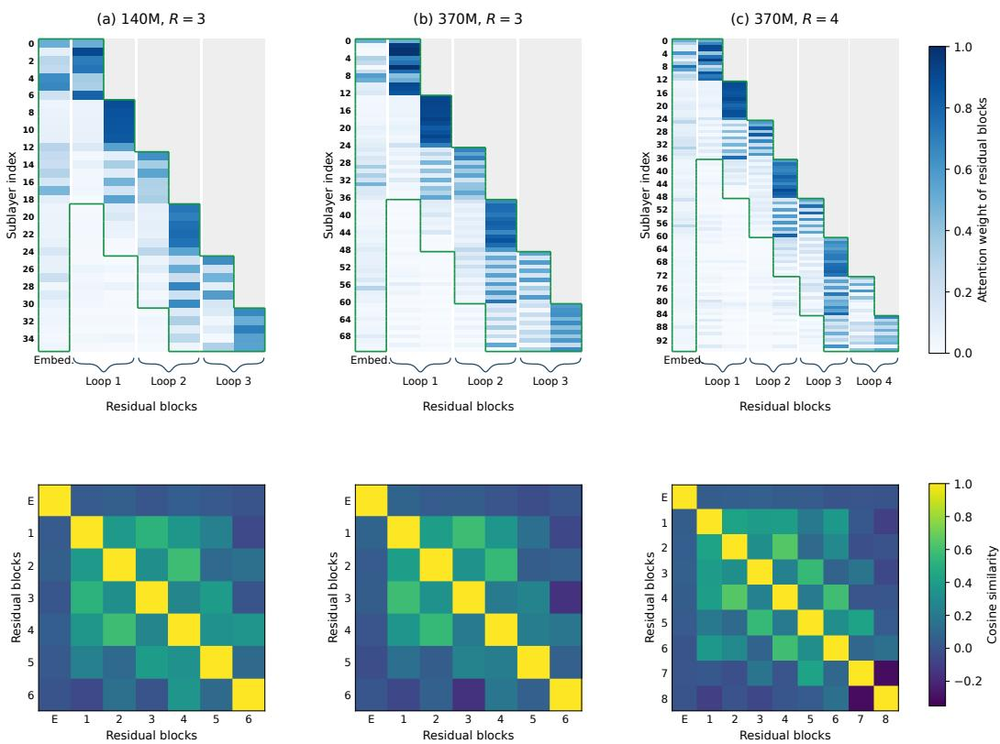  
Figure 5: Additional full-history diagnostics: (a) 140M, R = 3; (b) 370M, R = 3; and (c) 370M, $R = 4$ . Top: residual-source attention weights, with green outlines marking the embedding plus the three most recent blocks. Bottom: pairwise residual-block cosine similarity, with E denoting the embedding.

Non-recurrent comparison at matched effective depth. We additionally evaluate a non-recurrent transformer with 24 distinct layers, matching the 48 effective sublayers of the six-layer 140M looped model with $R = 4$ . It retains the same 768-dimensional hidden states, six attention heads, block size of six sublayers, context length of 2,048, and 11.2B-token training budget. This comparison therefore matches the effective depth and width of the looped model, but not its parameter count.
<table><tr><td>Architecture</td><td>Full history</td><td>Sliding window  $( W = 3 )$ </td><td> $\Delta \mathrm { P P L }$ </td></tr><tr><td>Looped:  $L = 6 , R = 4$ </td><td>16.07</td><td>16.03</td><td>-0.04</td></tr><tr><td>Non-recurrent:  $L = 2 4 , R = 1$ </td><td>13.65</td><td>16.78</td><td>+3.13</td></tr></table>

Table 9: Validation perplexity at matched effective depth. Both models use the same training and architecture setups, except that non-recurrence models use more unique parameters to match the effective depth. The sliding window retains the embedding plus three blocks.

As shown in Table 9, sliding-window depth attention slightly improves the looped model, whereas di rectly applying the same window to the non-recurrent transformer substantially degrades performance. To better understand this difference, we further visualize the pairwise cosine similarity between residual blocks in the non-recurrent model in Figure 6. The non-recurrent transformer exhibits a markedly different pattern from the looped models, with substantially lower similarity across residual blocks. This suggests that distinct depths in standard transformers contain less redundant representations, consistent with our hypothesis that the high redundancy across recurrences in looped transformers makes sliding-window depth attention particularly well suited to their recurrent-depth structure.

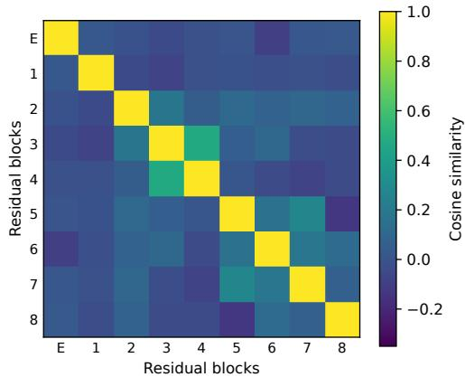

Figure 6: Residual-block similarity for the non-recurrent 24-layer, $W = 3$ model, measured on the same validation positions as the looped-model cosine diagnostics. E is the embedding; blocks 1–8 belong to one forward pass, not separate recurrences.
<table><tr><td>Model</td><td>Recurrence</td><td colspan="3">Residual block size (sublayers)</td></tr><tr><td rowspan="3">140M 6 layers Loop = 4</td><td>Non-recurrent</td><td>2 18.20</td><td>4 18.25</td><td>6</td></tr><tr><td>Loop = 2</td><td>17.19</td><td>17.18</td><td>18.26 17.27</td></tr><tr><td>Loop = 3 16.13</td><td>16.59</td><td>16.48</td><td>16.46</td></tr></table>

Table 10: Validation PPL for completed 140M full-history block-size experiments. The best result within each model and recurrence is bolded.

## A.6 THE EFFECT OF RESIDUAL BLOCK AND SLIDING WINDOW SIZES

We additionally study the effect of residual block size, i.e. the number of sublayers contained in each residual block, and sliding-window size, i.e. the number of recent residual blocks retained by sliding-window depth attention. We primarily use the 140M ARLOOP for these studies.

Table 10 reports the validation perplexities of models trained with different residual block sizes across recurrence settings. We find that using finer-grained residual blocks (i.e. smaller block sizes) does not consistently improve validation perplexity. While finer-grained blocks are beneficial for non-recurrent transformers, consistent with Kimi Team (2026), we find that their benefit diminishes as the number of recurrences increases, and smaller blocks can even hurt performance at larger R. We hypothesize that this is related to the same phenomenon observed in Section 4.1: residual-block representations are highly redundant across recurrences, and using smaller blocks introduces more residual sources from earlier recurrences, potentially further increasing this redundancy.

Table 11 reports the results of $\mathbf { A R L O O P _ { s w } }$ with sliding windows retaining the most recent 2, 3, 4, or 5 residual blocks. Among the settings we evaluate, retaining three residual blocks performs best overall. We leave a more systematic exploration of the optimal sliding-window design to future work.

<table><tr><td>Model</td><td>Recurrence</td><td colspan="4">Sliding-window blocks W</td></tr><tr><td></td><td></td><td>2</td><td>3</td><td>4</td><td>5</td></tr><tr><td>140M  $\mathbf { A R L O O P _ { s w } }$ </td><td>4</td><td>16.17</td><td>16.03</td><td>16.07</td><td>16.14</td></tr></table>

Table 11: Validation PPL versus sliding-window size for 140M $\mathbf { A R L O O P _ { s w } }$ models with residual blocks of six sublayers. W counts retained residual blocks; the input embedding is always retained.

## B LARGE-SCALE PRETRAINING DETAILS

## B.1 ARCHITECTURE AND TRAINING

Architecture. Table 12 details the model backbones used in Section 5. Compared with the controlled setup, we replace multi-head attention with grouped-query attention to reduce the number of key and value heads, and replace the ReLU2 MLP with SwiGLU. The full transformer stack is reused at each recurrence. For both model scales, ARLOOP uses the embedding and the three most recent residual blocks for sliding-window depth attention.

<table><tr><td></td><td>PreNorm 0.6B</td><td>ARLOOP 0.6B</td><td>ARLOOP 1.2B</td></tr><tr><td>Physical Transformer layers L</td><td>18</td><td>18</td><td>24</td></tr><tr><td>Hidden dimension</td><td>1,536</td><td>1,536</td><td>2,048</td></tr><tr><td>SwiGLU intermediate dimension</td><td>4,608</td><td>4,608</td><td>5,632</td></tr><tr><td>Query / key-value heads</td><td>16/4</td><td>16/4</td><td>16/4</td></tr><tr><td>Head dimension</td><td>96</td><td>96</td><td>128</td></tr><tr><td>Residual block size (sublayers)</td><td></td><td>18</td><td>24</td></tr><tr><td>Fixed recurrence R</td><td>3</td><td>3</td><td>3</td></tr><tr><td>Effective depth (sublayers)</td><td>108</td><td>108</td><td>144</td></tr><tr><td>Residual blocks per recurrence</td><td></td><td>2</td><td>2</td></tr><tr><td>Attention</td><td colspan="3">Causal grouped-query attention with QK-Norm</td></tr><tr><td>MLP</td><td colspan="3">SwiGLU RoPE (θ = 50,000)</td></tr><tr><td>Position embeddings</td><td colspan="3">SmolLM2 / 49,152</td></tr><tr><td>Tokenizer / vocabulary</td><td colspan="3"></td></tr><tr><td>Normalization Context length</td><td colspan="3"> $\mathrm { R M S N o r m } ( \epsilon = 1 0 ^ { - 5 } )$  4,096</td></tr><tr><td>Linear biases</td><td colspan="3">None</td></tr><tr><td>Tied input/output embeddings</td><td colspan="3">Yes</td></tr><tr><td>Depth-attention window</td><td colspan="3">Embedding + three recent blocks</td></tr><tr><td></td><td colspan="3"></td></tr><tr><td>Training tokens</td><td>180B</td><td>180B</td><td>500B</td></tr><tr><td>Global batch (sequences) Peak / minimum learning rate</td><td>256  $3 \times 1 0 ^ { - 3 } / 3 \times 1 0 ^ { - 5 }$ </td><td>256  $3 \times 1 0 ^ { - 3 } / 3 \times 1 0 ^ { - 5 }$ </td><td>512  $2 \times 1 0 ^ { - 3 } / 2 \times 1 0 ^ { - 5 }$ </td></tr></table>

Table 12: Architecture and optimization settings for large-scale pretraining. Residual block/window settings apply only to ARLOOP. Each physical layer contains one attention and one MLP sublayer.

Pretraining recipe. We use AdamW with $( \beta _ { 1 } , \beta _ { 2 } ) = ( 0 . 9 , 0 . 9 5 ) , \epsilon = 1 0 ^ { - 8 }$ , weight decay 0.1, and gradient clipping at 1.0. A cosine learning-rate schedule follows 1,000 warmup updates and decays to 1% of the peak learning rate. Table 12 reports the scale-specific peak learning rates and global batch sizes. Training uses BF16 mixed precision with packed sequences of 4,096 tokens.

Our pretraining recipe largely follows SmolLM (HuggingFaceTB, 2025) and consists of three training stages, with progressively larger proportions of math and coding data. Figure 7 summarizes how the domain mixture changes throughout training. The stage boundaries are placed at 60% and 80% of the total token budget. General web data dominate the first stage, while later stages increase the proportions of mathematical and coding data; the final stage additionally introduces reasoningoriented data sources. The learning-rate schedule runs continuously across the full training budget, without restarting warmup or cosine decay at stage transitions.

Pretraining Recipe  
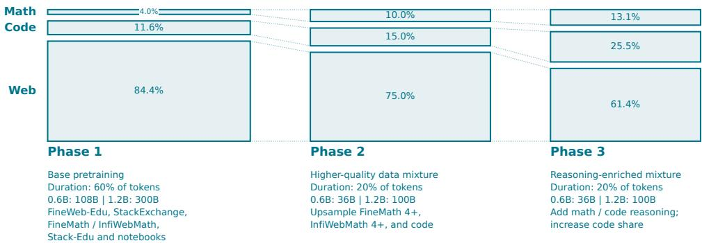

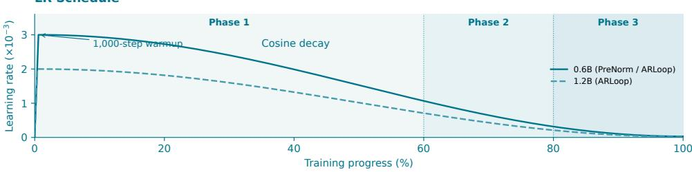  
Figure 7: Three-stage pretraining recipe. The upper panels show the domain sampling shares at each stage. The lower panel shows the learning rate schedules: 1,000 warmup updates followed by cosine decay to 1% of the peak. Source-level allocations are listed in Table 14.

Data source mixture. The 0.6B and 1.2B models use the same data-source proportions within each stage, with total training budgets of 180B and 500B tokens, respectively. Stage 1 accounts for 60% of each training run, while Stages 2 and 3 each account for 20%. Table 14 reports the resulting per-stage token allocations. StackExchange is grouped with general data, while notebooks, GitHub issues, OpenCodeReasoning, and Stack-Edu are grouped with coding data. Dolmino Math aggregates several of its mathematical sub-sources, and Stack-Edu aggregates 15 programming-language subsets.

## B.2 EVALUATION SETUP

Table 13 summarizes the benchmark-specific evaluation settings. For ARC-Challenge, HellaSwag, and WinoGrande, we use few-shot evaluation to follow commonly used evaluation protocols for existing LLMs (Zhu et al., 2025). We use lm-evaluation-harness for evaluating general and mathematical reasoning tasks, and EvalPlus (Liu et al., 2023) for coding tasks.

For our models, lm-evaluation-harness evaluation is performed in BF16 with a 4,096-token context length, and no chat template. For mathematical reasoning and coding generation, we use greedy decoding with a maximum of 1,024 new tokens. GSM8K reports the flexible-extract exact-match metric, while MATH reports Math-Verify scores. MBPP and HumanEval use the original EvalPlus completion prompts, stop conditions, and sanitization procedures. For the re-evaluated scores of prior LLMs reported in Table 3, we use each model’s native tokenizer and the same task protocols specified in Table 13.

## C LAYER EFFECTS AND OUTPUT EFFECTS ON MBPP AND MATH

We follow the causal-intervention formulation of Csordas et al. (2025), adapted to our recurrent´ architecture. We compare the final ARLOOP-0.6B and PRENORMLOOP-0.6B checkpoints, each with 18 physical layers and three recurrences, yielding 54 effective layers. Within each task, both models are evaluated on the same randomly sampled 50 test examples, drawn from 378 examples for MBPP and 5,000 for MATH. We use zero-shot prompts and teacher forcing over the canonical solution code for MBPP or the full reference solution for MATH. For each unrolled layer s, we perform an intervention by ablating its self-attention and MLP sublayer contributions and rerun the forward pass on the same input.

<table><tr><td>Benchmark</td><td>Settings / reported metric</td><td>Framework</td></tr><tr><td colspan="3">General knowledge and reasoning</td></tr><tr><td>ARC-Challenge</td><td>Log-likelihood, 25-shot; normalized accuracy</td><td>lm-eval-harness</td></tr><tr><td>HellaSwag</td><td>Log-likelihood, 10-shot; normalized accuracy</td><td>lm-eval-harness</td></tr><tr><td>WinoGrande</td><td>Log-likelihood, 5-shot; accuracy</td><td>lm-eval-harness</td></tr><tr><td>OpenBookQA</td><td>Log-likelihood, 0-shot; normalized accuracy</td><td>lm-eval-harness</td></tr><tr><td colspan="3">Mathematical reasoning</td></tr><tr><td>GSM8K</td><td>Generation, 5-shot CoT; flexible-extract EM</td><td>lm-eval-harness</td></tr><tr><td>MATH</td><td>Generation, 4-shot Minerva; Math-Verify</td><td>lm-eval-harness</td></tr><tr><td colspan="3">Code generation</td></tr><tr><td>MBPP</td><td>Generation, 0-shot; pass @ 1</td><td>EvalPlus</td></tr><tr><td>HumanEval</td><td>Generation, 0-shot; pass@ 1</td><td>EvalPlus</td></tr></table>

Table 13: Evaluation setup for large-scale pretraining. We evaluate pretrained base checkpoints without chat templates. CoT denotes chain-of-thought demonstrations. MATH uses the full 5,000- example test set. These settings also apply to the external checkpoints re-evaluated for Table 3.
<table><tr><td rowspan="2">Domain Dataset source</td><td rowspan="2"></td><td colspan="4">0.6B model (180B tokens)</td><td colspan="4">1.2B model (500B tokens)</td></tr><tr><td>Stage 1</td><td>Stage 2</td><td>Stage 3</td><td>Total</td><td>Stage 1</td><td>Stage 2</td><td>Stage 3</td><td>Total</td></tr><tr><td rowspan="2">General</td><td rowspan="2">FineWeb-Edu (Penedo et al., 2024) StackExchange</td><td>89.02</td><td>26.36</td><td>22.06</td><td>137.44</td><td>247.29</td><td>73.22</td><td>61.27</td><td>381.78</td></tr><tr><td>2.16</td><td>0.64</td><td>0.04</td><td>2.84</td><td>6.00</td><td>1.78</td><td>0.10</td><td>7.88</td></tr><tr><td rowspan="8">Math</td><td>FineMath 3+ (Allal et al., 2025)</td><td>1.08</td><td>0.36</td><td>0.07</td><td>1.51</td><td>3.00</td><td>1.00</td><td>0.20</td><td>4.20</td></tr><tr><td>InfiWebMath 3+ (Allal et al., 2025)</td><td>1.08</td><td>0.36</td><td>0.07</td><td>1.51</td><td>3.00</td><td>1.00</td><td>0.20</td><td>4.20</td></tr><tr><td>FineMath 4+ (Allal et al., 2025)</td><td>1.08</td><td>1.96</td><td>0.90</td><td>3.94</td><td>3.00</td><td>5.44</td><td>2.50</td><td>10.94</td></tr><tr><td>InfiWebMath 4+ (Allal et al., 2025)</td><td>1.08</td><td>0.92</td><td>0.72</td><td>2.72</td><td>3.00</td><td>2.56</td><td>2.00</td><td>7.56</td></tr><tr><td>OpenMathReasoning (Moshkov et al., 2025)</td><td></td><td></td><td>0.36</td><td>0.36</td><td></td><td></td><td>1.00</td><td>1.00</td></tr><tr><td>Natural Reasoning (Yuan et al., 2025)</td><td></td><td></td><td>0.36</td><td>0.36</td><td></td><td></td><td>1.01</td><td>1.01</td></tr><tr><td>OpenMathInstruct2 (Toshniwal et al., 2024)</td><td></td><td></td><td>2.04</td><td>2.04</td><td></td><td></td><td>5.66</td><td>5.66</td></tr><tr><td>Dolmino Math (Team OLMo et al., 2024)</td><td></td><td></td><td>0.18</td><td>0.18</td><td>一</td><td></td><td>0.51</td><td>0.51</td></tr><tr><td rowspan="5">Coding</td><td>OpenCodeReasoning (Ahmad et al., 2025)</td><td></td><td></td><td>2.47</td><td>2.47</td><td></td><td></td><td>6.87</td><td>6.87</td></tr><tr><td>Kaggle notebooks (Lozhkov et al., 2024)</td><td>0.37</td><td>0.02</td><td>0.02</td><td>0.41</td><td>1.02</td><td>0.07</td><td>0.06</td><td>1.15</td></tr><tr><td>Stack v2 Jupyter (Lozhkov et al., 2024)</td><td>1.08</td><td>0.36</td><td>0.54</td><td>1.98</td><td>3.00</td><td>1.00</td><td>1.51</td><td>5.51</td></tr><tr><td>GitHub Issues (Lozhkov et al., 2024)</td><td>0.18</td><td>0.04</td><td>0.07</td><td>0.30</td><td>0.51</td><td>0.12</td><td>0.20</td><td>0.83</td></tr><tr><td>Stack-Edu (Allal et al., 2025)</td><td>10.87</td><td>4.97</td><td>6.09</td><td>21.93</td><td>30.19</td><td>13.82</td><td>16.91</td><td>60.91</td></tr><tr><td>Total</td><td></td><td>108.00</td><td>36.00</td><td>36.00</td><td>180.00</td><td>300.00</td><td>100.00</td><td>100.00</td><td>500.00</td></tr></table>

Table 14: Source-level allocation (billion tokens for each cell) for large-scale pretraining.

Layer effect metric. Following Csordas et al. (2025), we quantify the effect of an intervention by´ measuring the change it induces relative to the original run. Let ${ \mathbf { } } _ { \alpha , t }$ and ${ m } _ { \ell , t }$ denote the attention and MLP sublayer outputs, respectively, at unrolled layer ℓ and token position t. We define the local layer contribution as

$$
\pmb { c } _ { \ell , t } = \pmb { a } _ { \ell , t } + \pmb { m } _ { \ell , t } .\tag{5}
$$

For PreNorm, this corresponds to the additive update contributed by the transformer layer. We use the same quantity for ARLOOP so that the two architectures are compared using the same local computation, independently of how residual sources are subsequently aggregated.

Let $\bar { \mathbf { c } } _ { \ell , t } ^ { ( s ) }$ denote the corresponding contribution after ablating layer s. For each later layer $\ell > s ,$ we measure the relative change in its computation as

$$
E _ { s \to \ell , t } ^ { \mathrm { l a y e r } } = \frac { \left\| c _ { \ell , t } - \bar { c } _ { \ell , t } ^ { ( s ) } \right\| _ { 2 } } { \left\| c _ { \ell , t } \right\| _ { 2 } } .\tag{6}
$$

This measures the effect of intervening on layer s on the local contribution of a subsequent layer ℓ. For an example e, let $\mathcal { T } _ { e }$ denote its teacher-forced solution positions. For each pair of intervention and later layers $( s , \ell )$ , we first take the maximum $E _ { s  \ell , t } ^ { \mathrm { l a y e r } }$ over these positions, and then the maximum across the 50 examples. The layer effect of intervention layer s is then obtained by averaging these values over all strictly later layers.

Output effect metric We additionally measure how each intervention affects the model output. Let $\mathbf { \nabla } _ { \pmb { p } _ { t } }$ and $\bar { p } _ { t } ^ { ( s ) }$ denote the full-vocabulary probability distributions before and after ablating layer s. Following Csordas et al. (2025), we measure the output effect using their´ $L _ { 2 }$ distance:

$$
E _ { s , t } ^ { \mathrm { o u t } } = \left\| p _ { t } - \bar { p } _ { t } ^ { ( s ) } \right\| _ { 2 } .\tag{7}
$$

As above, we take the maximum over teacher-forced solution positions and then across the 50 examples for each intervention layer.

Finally, for both metrics, we normalize the resulting 54-dimensional effect vector by its sum across intervention layers. The resulting curves therefore show how the effects are distributed across the 54 unrolled layers rather than their absolute magnitudes.

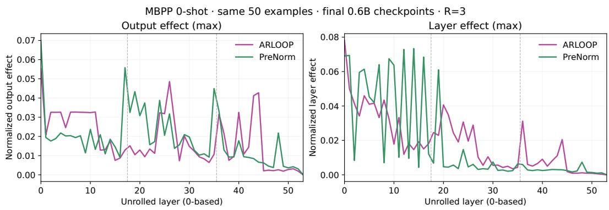  
Figure 8: Output influence (left) and layer-contribution influence (right) on 50 shared zero-shot MBPP examples. Curves compare the ARLOOP-0.6B and PRENORMLOOP-0.6B checkpoints at $R = 3$ , using max aggregation and normalization by each curve’s total influence. Dashed lines separate the three recurrences.

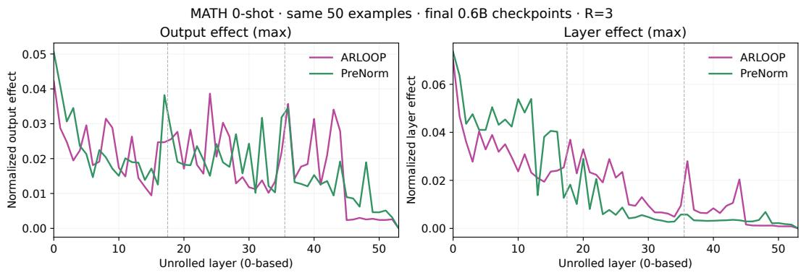  
Figure 9: Output influence (left) and layer-contribution influence (right) on 50 shared zero-shot MATH examples, with the same aggregation and normalization as Figure 8. The right panel supplies the data for Figure 4. Dashed lines separate the three recurrences.

## D DYNAMIC RECURRENCE AND RECURRENCE EXTRAPOLATION

This section provides the setup and detailed results for the investigations summarized in Section 6.

<table><tr><td rowspan="2">Eval R</td><td rowspan="2">Training recurrence</td><td colspan="2">140M</td><td colspan="2">370M</td></tr><tr><td>Val PPL ↓</td><td>downstream avg. ↑</td><td>Val PPL ↓</td><td>downstream avg. ↑</td></tr><tr><td rowspan="3">4</td><td> $\mathrm { A R L O O P f u l l } ~ ( R = 4 )$ </td><td>16.07</td><td>44.09</td><td>12.01</td><td>50.93</td></tr><tr><td>ARLOOP-POISSON-SEQ</td><td>16.69</td><td>43.24</td><td>12.33</td><td>49.62</td></tr><tr><td>ARLOOP-POISSON-BATCH</td><td>16.52</td><td>43.30</td><td>12.36</td><td>50.53</td></tr></table>

Table 15: Fixed versus dynamic recurrence training. Dynamic Poisson draws have mean 4 and are clamped to [1, 4]. Bold marks the best result at each scale.

## D.1 TRAINING SETUP AND FIXED-VERSUS-DYNAMIC RESULTS

Setup. The models use the controlled-pretraining architectures and data described in Appendix A.1, with 140M and 370M models, except that the recurrence number is not fixed across training. We con sider three recurrence-training strategies: $\mathbf { A R L O O P _ { f u l l } }$ (i.e. fixed recurrences), ARLOOP-POISSON-SEQ, and ARLOOP-POISSON-BATCH. ARLOOP uses full-history depth attention trained with fixed $R = 4 .$ , rather than the default sliding-window variant used for deep recurrence in the main comparison. For dynamic recurrence, we consider two strategies: (1) per-sequence recurrence sampled from a Poisson distribution (Prairie et al., 2026); and (2) per-batch recurrence sampled from a Poisson distribution (Geiping et al., 2025).

For the Poisson variants, we sample

$$
\tilde { R } \sim \mathrm { P o i s s o n } ( 4 ) , \qquad R = \operatorname* { m i n } \Bigl ( 4 , \operatorname* { m a x } \Bigl ( 1 , \tilde { R } \Bigr ) \Bigr ) ,\tag{8}
$$

In the per-sequence setting, recurrence depth is sampled independently for each sequence, whereas the per-batch variants use a single sampled depth for the entire batch. Because per-batch dynamic training requires fewer FLOPs on updates that sample shallow recurrence depths, we train these models on proportionally more tokens so that the total training FLOPs are matched. Fixed and per-sequence runs use 11.2B/29.6B tokens at 140M/370M. Per-batch Poisson runs use 13.6B/36.2B tokens.

Results. Table 15 presents the results of this comparison. At evaluation recurrence R = 4, fixeddepth training achieves the best validation perplexity and downstream average among the tested configurations at each scale. Hence we adopt fixed recurrences in our main experiment setups. Despite the negative results of dynamic recurrences, we do not claim that it should be replaced by fixed recurrences. Such dynamic variants allow flexible computation allocation during inference, and are still a popular choice for looped LLMs.

## D.2 INFERENCE-TIME RECURRENCE EXTRAPOLATION

We present the details of the study on inference-time recurrence extrapolation of ARLOOP.

Setup. We evaluate the per-sequence Poisson model described above at each recurrence $R =$ $1 , \ldots , 8 ,$ using the same validation set as in Section 4. During training, the recurrence is bounded by $R \leq 4 ;$ evaluation at $R > 4$ therefore requires computation at effective depths that are never encountered during the original training. Since our attention-residual mechanism uses a learned query for each effective sublayer, evaluating beyond the maximum training recurrence introduces queries at previously unseen depths. We randomly initialize these additional queries and train only their parameters on an additional 0.5B FineWeb-Edu tokens, while freezing all other model parameters. This provides a favorable setting for recurrence extrapolation: rather than requiring the model to reuse or extrapolate query parameters to unseen depths, the newly introduced queries are explicitly optimized to aggregate the residual history available at those depths.

Results. Figure 10 shows that perplexity does not continue to improve beyond the maximum training recurrence at either model scale. This remains the case even when the query parameters at unseen depths are explicitly trained to learn the optimal aggregation of information from preceding depths. These results support the conclusion in Section 6: in our experiments, improved access to residual history alone is insufficient to produce useful recurrence extrapolation beyond the depth encountered during training.

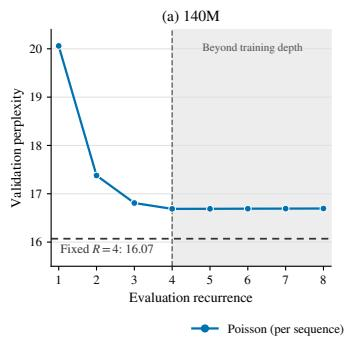

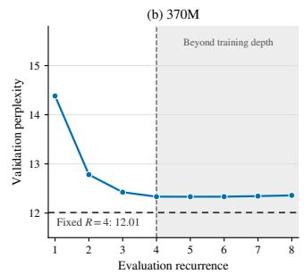  
Figure 10: Validation perplexity versus evaluation recurrence for the per-sequence Poisson dynamic full-history ARLOOP models in Table 15. Each curve evaluates the same completed checkpoint at $R = 1 , \ldots , 8 .$ . The vertical dashed line at $R = 4$ marks the maximum training recurrence; the gray shaded region denotes evaluation beyond this depth. Horizontal dashed lines retain the fixed- $R = 4$ baseline reference levels (16.07 at 140M and 12.01 at 370M), not recurrence sweeps of the fixed models. Panels use separate vertical scales.

## E BASELINES FROM PRIOR WORK

We describe the residual designs used as baselines in Section 4, following the notation in Section 3.

Sandwich Norm. Sandwich Norm (Geiping et al., 2025; Zhu et al., 2025) adds an output normalization to each PreNorm residual update:

$$
h ^ { ( i ) } = \operatorname { N o r m } \Big ( h ^ { ( i - 1 ) } + f _ { i } ( \operatorname { N o r m } ( h ^ { ( i - 1 ) } ) ) \Big )\tag{9}
$$

This normalizes the residual stream after every sublayer, preventing uncontrolled growth across recurrent depth.

DeepLoop. DeepLoop (Li et al., 2026) extends DeepNorm (Wang et al., 2022) to looped transformers by scaling the skip connection:

$$
h ^ { ( i ) } = \operatorname { N o r m } \left( \alpha h ^ { ( i - 1 ) } + f _ { i } ( \operatorname { N o r m } ( h ^ { ( i - 1 ) } ) ) \right) ,\tag{10}
$$

where $\alpha = ( 2 L R ) ^ { 1 / 2 }$ for $L$ physical layers and $R$ recurrences. DeepLoop further scales the initialization of selected residual-branch weight matrices by $\beta = ( 8 L R ) ^ { - 1 / 2 }$ . Unlike DeepNorm, which uses an exponent of $1 / 4$ , DeepLoop uses $1 / 2$ to account for parameter sharing across recurrences.

Parcae. Parcae (Prairie et al., 2026) introduces a stable state transition across recurrences. Let $s ^ { ( r ) } = h ^ { ( 2 L r ) }$ denote the output of recurrence r. The recurrent update takes the form

$$
s ^ { ( r ) } = S \left( \bar { A } s ^ { ( r - 1 ) } + \bar { B } e \right) ,\tag{11}
$$

where $e$ denotes the normalized input embedding. Parcae parameterizes the transition matrices as

$$
A = \mathrm { D i a g } ( - \exp ( a ) ) , \qquad \bar { A } = \exp ( \Delta A ) , \qquad \bar { B } = \Delta B ,\tag{12}
$$

where $a , \Delta ,$ , and $B$ are learnable parameters, with $\Delta$ constrained to be positive. This ensures that $\bar { A }$ has eigenvalues smaller than one in magnitude, stabilizing the recurrent state. Intuitively, the hidden state is decayed by a learnable diagonal matrix between recurrences, while the input embedding is injected into the state before the next recurrence. The latter mechanism, known as input injection (Bansal et al., 2022), has been shown to benefit looped transformers (Geiping et al., 2025; Huang et al., 2026), but is not used in our ARLOOP. We evaluate Parcae both with and without input injection (by setting B¯ = 0 in the latter). Notably, the original Parcae architecture applies recurrence only to the middle layers, leaving the initial and final layers outside the recurrent stack. For a fair comparison, our implementation instead applies recurrence to the full transformer stack, consistent with the other models in our experiments.

## F TRAINING COST

We train our models on NVIDIA A100 80GB, H100, and B200 GPUs. The controlled experiments require approximately 12K GPU hours in total, including early-stage exploration. Pretraining the PRENORMLOOP-0.6B and ARLOOP-0.6B models takes approximately one week on 8 H100 GPUs. The ARLOOP-1.2B model is trained on 16 B200 GPUs for approximately two weeks.