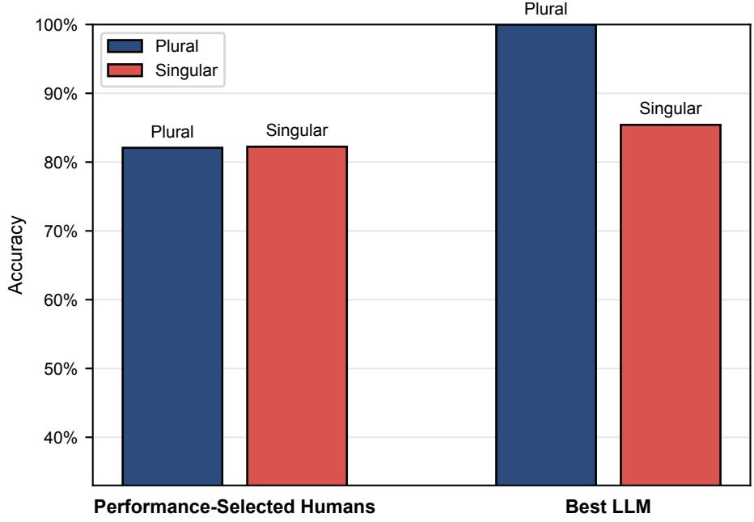
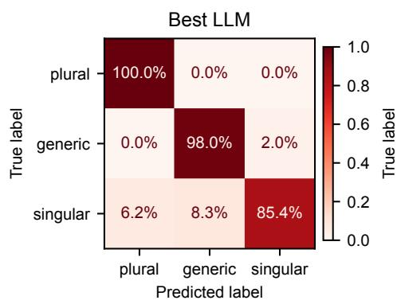
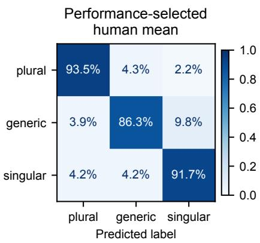
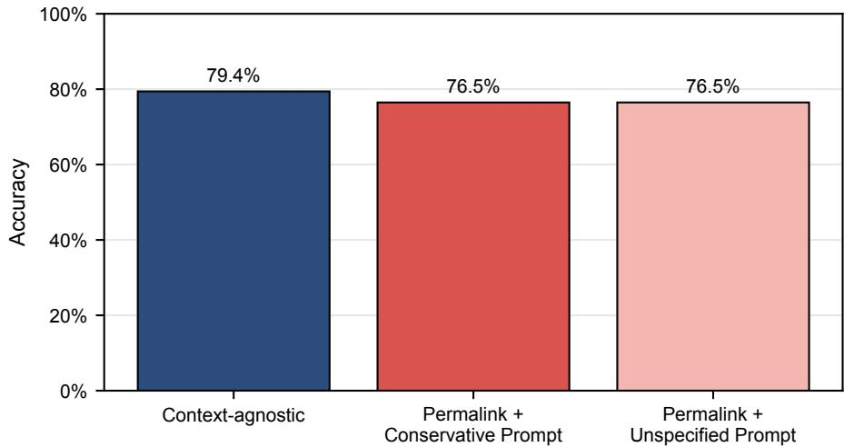

Who is the Pronoun Pro? Comparing LLMs and Humans at Number-Disambiguation of they

Carlos Hartmann

University of Zurich

carlos.hartmann@es.uzh.ch

ORCID: 0009-0007-6930-2284

## Abstract

This study evaluates whether large language models (LLMs) can reliably replace or complement human research assistants in linguistically complex annotation. In a controlled annotation task, 73 human annotators (local students and crowdworkers with and without a background in linguistics) and more than 40 LLM configurations number-disambiguated 174 authentic uses of they from Reddit, including innovative and context-sensitive cases. The best LLM, Kimi K3, reached 94.5% accuracy, above the human majority vote (86.2%) and the mean of the top half of human annotators (78.5%); only the single best human annotator scored higher (95.7%). LLMs also ofer substantial practical advantages in cost and speed. However, qualitative error analysis reveals a crucial complementarity: human reasoning in low-agreement cases exposes inconsistencies in the annotation typology and thereby improves the methodological framework itself. The study contributes (i) a benchmark-style human–LLM comparison for a semantically demanding task, (ii) transparent cost and time evidence, and (iii) a methodological argument against a purely replacement-oriented view of automation. LLMs are viable for large-scale annotation support in linguistics, but their responsible use requires human critical oversight. The dataset with its goldstandard labels, all human and LLM annotations, and the fully reproducible code are openly available as a Quarto-based, public repository.

Keywords: large language models; reasoning models; corpus annotation; singular they; AI ethics

## 1 Introduction

Large Language Models (LLMs) are changing the methodological landscape in the humanities and social sciences, and linguistics more specifically. The promise of the team developing GPT-3 was that Natural Language Processing (NLP) as a whole would shift away from models specially-created for specific tasks “to using task-agnostic pre-training and task-agnostic architectures” (Brown et al., 2020, p. 1), i.e. general-purpose language models able to perform a wide range of tasks without task-specific training. Almost instantly, LLMs began to find their way into diferent areas of linguistics research, among them morphological pattern matching (Jubelius, 2025), authorship verification (Huang & Grieve, 2024), semantics-based corpus extraction (Divjak et al., 2024), and the annotation of pragmatic and discourse features (Yu et al., 2024).

The present work is the continuation of an older, anticipatory efort (Hartmann, 2022), which tested the then-new GPT-3 for its ability to disambiguate plural and singular uses of the pronoun they. This is, in essence, a coreference resolution (CRR) and classification task, as the number-disambiguation of they hinges on the pronoun’s referent1. CRR as a field precedes LLMs (see Gan et al., 2025; Jurafsky & Martin, 2026), though it struggled with the persistent challenges posed by the nature of coreference, such as real-world knowledge required for textual understanding and context-dependency (Novák et al., 2025; Seminck et al., 2025). What is more, English pronoun use has shifted in recent years (Newman, 1997; Paterson, 2014), most notably with the extension of they as a personal pronoun for people of non-binary gender (Conrod, 2019), but also with the growing visibility of neologistic pronouns (Baron, 2020; Remsö et al., 2026; Rose et al., 2023). Such innovative language posed yet another challenge that established CRR techniques struggled to overcome (Cao & Daumé III, 2020). LLMs, on the other hand, showed promise in their context-sensitivity and advanced textual understanding (Brown et al., 2020; Pavlovic & Poesio, 2024), and would perhaps also overcome the challenge of language innovations such as the one posed by they. This hope was at first not confirmed in an early study (Hartmann, 2022, Section 5.6), but testing continued to monitor progress in LLM performance. When Anthropic’s LLM Claude Sonnet reached both recall and precision of over 80% on the same dataset in late 2024, it seemed plausible that LLMs may have reached human-like performance in this task. In order to assess this performance reliably and accurately, the present study focuses on this research question: “To what extent are number-annotations of authentic uses of they by LLMs reliable when compared to trained human annotators?” Beyond the case of they, the answer bears on how annotated language resources are built: whether, and for which cases, LLMs can take over annotation work from trained human annotators.

This research is situated in the broader context of LLMs expanding in uses far beyond the original purpose of solving one-of tasks. Through the development of techniques like hidden prompts, chain-of-thought prompting, and reasoning models more generally, LLMs have attained the status of assistants who take over entire workflows. They perform research assistance work at the level of a typical research intern, if not in output quality, then certainly in monetary cost and speed – although the true cost of LLMs goes beyond the cost of tokens. Still, the consequences of this technology on workflows in academia, and elsewhere, especially as concerns the role of human labor, are likely significant, though yet unclear. The present research is thus not only about the performance of LLMs on a specific task, but about the broader question on the viability of employing them as one would human research assistants. The study is conceived as a simulation of handing of an annotation task to a student assistant, reflected in the recruitment strategy and task design. As the assessment of annotation quality demands more nuance than a simple scored performance can provide, this study investigates both quantitative and qualitative measures.

Three falsifiable, quantitative hypotheses were formulated at the outset, addressing three levels of performance:

Hypothesis 1: the most accurate number-disambiguator of they will be an LLM.

Hypothesis 2: the most accurate LLM at number-disambiguating they will perform at a significantly higher accuracy than the mean human accuracy.

Hypothesis 3: the performance of the most accurate LLM will not be significantly worse at rare and innovative uses of they than the mean human performance.

The hypotheses form a cascade: should Hypothesis 1 not be confirmed, Hypothesis 2 would still attest that LLMs largely outperform humans; should that fail as well, Hypothesis 3 would still justify the use of LLMs for semantically complex tasks such as the resolution of innovative pronouns.

“Rare and innovative uses of they” in Hypothesis 3 are defined as uses in which the referent of they is one specific person both semantically and grammatically, i.e. ‘specific singular they’ (see Section 2.2).

## 2 Coreference resolution and the changing pronoun they

This study draws on research from two main areas: NLP research on CRR and linguistics research on the history of change of the pronoun they. Both inform the design of the task, and results will be relevant to both topics. More broadly, however, this research is relevant for any task in linguistics that surpasses the written surface level and is thus dependent on the availability of trained human annotators.

## 2.1 CRR as performed by LLMs

The task of CRR requires a deep understanding of the text. The first step is to identify all ‘mentions’ of real-world entities (i.e. specific linguistic material denoting or even implying entities) and then to identify which of these mentions refer to the same entity, i.e. which of these mentions ‘corefer’ (Jurafsky & Martin, 2026, p. 1). As with many tasks in NLP, early rule-based approaches gave way to machine learning (ML)-based approaches (Gan et al., 2025). The most complete history of automatic CRR is provided in Seminck et al. (2025). Current research increasingly involves LLMs, though these have yet to outperform traditional approaches across the board (Novák et al., 2025, Section 5).

Traditional approaches are computationally cheaper than LLMs (Seminck et al., 2025, Section 3.1.2), lending them a significant advantage in many applications. Their disadvantages, however, have proven dificult to overcome: ML systems require highly specialized training material, which is not only scarce but often varies in annotation standards, making generalizable training dificult (Seminck et al., 2025, Section 3.1.2). This makes it dificult to expand to other languages or to language innovations such as singular they, which are absent from popular datasets such as OntoNotes (Webster et al., 2018, Section 2.1; Weischedel et al., 2013). Like in other areas of NLP, LLMs2 ofer a great deal of flexibility at a remarkably high cost of computation.

State-of-the-art research on LLM-based CRR was presented at the CRAC 2025 workshop of the Association for Computational Linguistics, whose shared task on multilingual CRR had separate tracks for traditional and LLM-based systems. Traditional approaches clearly won (Novák et al., 2025, Section 5), and Seminck et al. (2025, Section 4) contributed the winning LLM system.

Seminck et al. (2025) frame context management as a central bottleneck: shorter prompts worked better, plausibly because they leave more room for input context and, in my interpretation, reduce over-determination of the task, while overly long inputs led to “disastrously bad” outcomes, with the model appearing to lose track of the objective (2025, Section 3.2.2). Adding information is thus often necessary, but careful context window management remains critical (2025, Section 5). The trade-of is also practical: a traditional pipeline processed their data in 16 minutes, the LLM-based approach in roughly 1.5 days (2025, Section 4). Novák et al. (2025) nonetheless see clear potential for LLMs on tasks that require a broad spectrum of real-world knowledge.

Whether to prompt or to fine-tune LLMs remains an open methodological question: the winning LLM system was fine-tuned (Seminck et al., 2025), but the second-best was purely prompting-based and only 1% lower in F1 (Novák et al., 2025, Section 5). The present study relies on prompting, as all-purpose, outof-the-box LLMs are more directly comparable to human annotators, who also encounter task instructions and data without prior task-specific adaptation.

To my knowledge, only one other study compared the performance of LLMs and humans on a CRR task. Using the AmbiCoref dataset of template-generated minimal pairs, Shore et al. (2025) demonstrate a persistent trade-of: while LLMs can achieve high accuracy on unambiguous sentences or strong ambiguity detection, they cannot achieve both simultaneously. Crucially, they found that models fail to shift their response patterns between ambiguous and unambiguous text samples as humans naturally do. This means that models fare well at recognizing ambiguity when this is what is asked of them; but when the task is to find coreference, they will force an answer without considering first if the language might be ambiguous and thus not have a clear coreference in the first place. The present study will likewise demand diferent behavior depending on ambiguity of the input.

Outside CRR, Yu et al. (2024) ofered one of the first direct comparisons of an LLM and a human coder in corpus linguistics, annotating apologies – like the number of they, a discourse-level phenomenon that hinges on language understanding in context rather than on form. $G P T \mathrm { - } 4$ came close to the human coder (92.7% vs. 95.4% accuracy), though both struggled with categories realized by a diverse range of forms, and the human clearly outperformed the model in recognizing uses of sorry that were not apologies (2024, Section 4). Morin & Marttinen Larsson (2026) have since scaled up such annotation to over 140,000 concordance lines from COHA with $G P T _ { \bf - } 5 ,$ at 98–99% accuracy against their own manual annotation.

## 2.2 Three kinds of they

The typology of they used in this study is that of Hartmann (2026a), diferentiating between plural, generic singular, and specific singular they. Plural they refers to a group of people. Generic singular they refers to multiple potential referents via a singular expression and thus lacks a specific referent (e.g. any expert worth their salt); in the research literature, it is often simply called ‘singular they’. Specific singular they, also known as ‘referential they’, refers to a specific individual whose gender is unknown or non-binary (e.g. our lawyer and their trainees or Judith Butler defended their stance). For the purposes of this study, I do not diferentiate between the gender-obfuscating use when referring to the hearer-unknown lawyer and the overtly non-binary-gendered use when referring to Judith Butler. In the present article, the terms ‘generic they’ and ‘singular they’ signify generic singular and specific singular they, respectively. Further distinctions could be made between diferent kinds of generic and referential usage, see Newman (1997), but these pertain more to a detailed linguistic analysis than to a typical annotation task.

## 3 Data and methods

The present research focuses on a specific aspect of CRR: the numberdisambiguation of they. Mention detection in classical CRR is precluded, as the mention is defined as any instances of the pronoun they. The goal is thus not necessarily to point to the antecedent in the text, but rather to identify the number of the referent.

## 3.1 Task design

Participants, human and LLM-based, had to determine the number of the referent of the pronoun they in a given Reddit comment, using the provided context when necessary, and select the appropriate category (plural, generic, or singular).

Each participant (see Section 4 below) was given a 250-word explanation of my typology of they (see Section 2.2)3, followed by ten example items in random order, curated so that each category was represented at least once and a few required looking up the context to disambiguate. ‘Context’ here refers to the Reddit thread in which a comment was originally written, not to the text immediately surrounding the pronoun. The examples used the same interface as the actual annotation, including access to the Reddit context via URL.

They then assigned each of the 174 Reddit comments (48 for each human participant) to one of the three categories, with the option to explore the context whenever they could not immediately identify the referent of the pronoun. For each item, they could comment on their reasoning (required for the first ten items, optional thereafter) and indicate if they felt uncertain of their choice.

Example (1), an item from the initial sample sentences, illustrates the task design:

(1) Not hip-hop related, and probably shouldn’t say in case anything does happen, just kinda bummed and not sure what I did to get essentially ghosted. Pretty discouraging seeing them post on social media but not reply to their personal email (emphasis mine; item ID ma\_era\_306411 from the study dataset)

The text alone only reveals that a person or persons with a social media account and personal email are no longer responding to the commenter. The context on Reddit4 contains the commenter’s prior comment about “an artist,” confirming that the them in question is specific singular.

The task design was identical for LLMs, except that they were not shown the ten examples, which mostly served to explain the annotation interface to human participants and would have overloaded the context window with redundant text.

LLMs received the same text explaining the goal of the task, the availability of the context, and the three categories of they with their definitions and illustrative examples. It covered the same theory as the ten examples, and LLMs generally fare well with just one explanation. In lieu of the comment function, LLMs were prompted not to withhold reasoning, and their full responses were recorded, though these should not be over-interpreted as true “reasoning”. As uncertainty is not truly available to current LLMs, a drawback of LLM-based CRR discussed by Seminck et al. (2025, Section 5.4), the present study does not compare uncertainty between humans and LLMs.

The role of context difered for human annotators and LLMs. For humans, context-dependent items were assumed to add time without posing a real challenge, so only a few were included, serving to filter out inattentive participants (see Section 5.2.3). For LLMs, however, context-dependency adds relevant complexity, given the apparent trade-of between accuracy and the recognition of ambiguous cases (Shore et al., 2025). Asked whether Example (1) requires further context, an LLM may correctly say so; asked directly for the referent, it may guess a band or an agency instead of a single artist rather than first critically assessing knowability. These trade-of efects are tested in Section 5.4.1.

## 3.2 Dataset

This study uses data from previously unpublished research that randomly sampled instances of any form of they5 from the social media website Reddit. 69% of the dataset was sampled without any subreddit constraints from the two months of October 2019 and June 2021. Each instance of a form of they was treated as a separate item and considered by the sampling algorithm. Each item is thus centered around a single instance of they and its surrounding context. 31% were sampled from British6 and Australian7 subreddits from the entire year 2013 and the month of October 2022. The 2013 and 2022 data was sampled with a length restriction of 50–450 characters but not the 2019 and 2021 data. The 174 items in this study were sampled to ensure a balance of items between plural, generic, and singular they. Importantly, perfectly ambiguous instances due to lacking context or unclear pronoun reference were disregarded for this study. I re-annotated the dataset according to the modified annotation scheme of this study and computed the inter-annotator agreement (IAA) between myself and a colleague with expertise in linguistics. A near-perfect agreement of 0.83 in Cohen’s kappa confirmed the robustness of the annotation scheme.

Reddit data were chosen for the naturalistic and contemporary nature of their language. Although OntoNotes is often a popular data source, it does not contain innovative uses of they (Webster et al., 2018, Section 2.1; Weischedel et al., 2013) and is thus unsuitable for this study. Annotating Reddit comments more accurately simulates authentic tasks in linguistics research involving jargon and other domain-specific language and where context may be needed for correct annotation. The present dataset thus addresses artificiality concerns while remaining suitable for a task centering on innovative language use.

Social media data are a grey area for research ethics: Reddit comments are publicly accessible, but their authors may not necessarily have been aware when signing of on the Terms of Service, and may not truly consent to the use of their data. The sampling procedures collected no personal details beyond what Reddit attaches to each comment, and they targeted no individuals or groups along any identifiable lines; the only constraint beyond the random sampling of they was the broad geographical one of the British and Australian subreddits. The published dataset contains no account names, user flairs, timestamps, or links to the original comments, which were all removed before publication. It thus meets § 9(2) of the Information and Data Protection Act of the Canton of Zurich (IDG), which applies to the University of Zurich and allows personal data to be processed for purposes that do not concern particular persons if the data are anonymised and the analyses allow no inferences about the persons concerned. As the annotation task depends on their exact wording, the comments are quoted verbatim and could in principle be traced through a web search; the dataset itself, however, links no comment to its author.

The dataset was divided into four blocks to manage study duration and mitigate fatigue efects while maintaining large sample size to ensure statistical power and diversity in the dataset. Each block contained an overlapping set of examples common to all participants, supplemented with block-specific items, and example distribution across blocks was randomized while maintaining a balance of referent types within blocks. This resulted in four blocks of 48 items, each of which contained at least 12 examples of plural, 15 examples of generic, and 13 examples of singular they. Four items in each block were context-dependent, serving as attention checks (see Section 5.2.3). The order of the items was randomized across participants to avoid order efects8. LLMs were shown an additional 28 context-dependent items (12 plural, 5 generic, 11 singular) to test their ability to handle such cases (see Section 5.4.1); these are excluded in direct LLM-to-human comparisons in the Results section. The dataset is available in the study repository as a CSV file (Hartmann, 2026b).

## 3.3 Methods

Both human and LLM annotators were scored for accuracy against the ground truth, calculated as the proportion of correct annotations over the total number of annotations. F1 score and Matthews correlation coeficient (MCC) were additionally considered, but accuracy proved a suitable comparison metric as the three classes (plural, generic, singular) are balanced in the dataset. Since natural class distribution is strongly imbalanced (plural being by far the most common class), MCC was later calculated on a projected estimation (Section 5.4.2). For the non-inferiority analysis in Hypothesis 3, the margin was set to $\Delta = 0 . 0 2$ (two percentage points in label-specific accuracy) as a practical tolerance threshold: smaller diferences are treated as operationally negligible for assistant-like annotation quality in this task, while larger deficits would be substantively relevant for downstream linguistic analysis.

The present study is designed as a confirmatory and quasi-experimental study: research questions and hypotheses are pre-specified based on previous research, with an experimental design that reflects the practical constraints of working with human participants (i.e. study duration and fatigue efects) and LLMs. Each annotation instance was treated as an item-level trial for scoring, and condition-wise breakdowns were computed descriptively at the item level. Nearly all inferential comparisons were made on aggregated participant- or run-level performance.

Apart from the LLMs under study, I used AI assistants in preparing this study and article. GitHub Copilot and, later, Claude Code (Anthropic) helped check my existing analysis code and write new code for the analysis and for rendering this article. Claude Code also assisted in editing the manuscript, mainly by condensing passages and adapting it to journal style requirements. The text was only edited by LLM-based tools after receiving thorough, paid copy-editing from Jessica Roady. I reviewed all changes to code and text and take full responsibility for the content of this article.

## 4 Participants

Two groups of annotators took part in this study, LLMs and humans, which are described in turn below.

## 4.1 LLMs

In the present study, LLMs are grouped into commercial and open-source families; within each family, each model-prompting strategy combination (with three-fold cross-validation) is treated as one participant.

## 4.1.1 Prompt design

The prompts follow the question-answering (QA) template described by Gan et al. (2024) and formalized in Gan et al. (2025), structured as [Instruction + Sentences + Question]: a short instruction, a set of sentences containing context, and a question targeting a specific mention. Although prompts with a speciallydevised annotation syntax yield higher coreference scores, the QA template better preserves language-understanding behavior, as it requires direct textual reasoning instead of providing mention annotations (Gan et al., 2025, Section 7.2). It is also closest to the vision in Brown et al. (2020) of general-purpose language models that perform a wide range of tasks with minimal pre-processing of data.

The QA template in this study included a theoretical explanation with short examples, the Reddit comment as context, and a question asking for the type of they in the comment9. A simple system message instructed the models to approach the task as knowledgeable about linguistics and especially English pronouns, to respond thoughtfully and precisely, and to remain aware of potentially relevant context without inferring beyond what was explicitly stated. The model was then prompted to output one of three categories: “plural,” “generic,” or “singular.” The full prompt is provided in the study repository (Hartmann, 2026b). As this approach showed great promise in preliminary tests, it was used for all LLMs without further experimentation on prompting techniques. This contrasts with earlier work: for Yu et al. (2024, Section 3.2), prompt engineering was a central step, with exemplars, their order, and even category labels iteratively adjusted to steer GPT-4. The present results suggest that current reasoning models depend far less on such careful prompt crafting, although the question is not settled: even with GPT-5, Morin & Marttinen Larsson (2026, pp. 10, 16–17) still invested considerable efort in prompts that anticipate edge cases.

The only variation in prompting strategy concerned access to the Reddit context, to test the models’ ability to handle context-dependent cases (see Section 5.4.1). Models were prompted context-agnostically (i.e. without information about the context), with context “on demand” (i.e. instructed to request it if needed), or with the context’s permalink. For the most recent additions to the study (GPT-5.4, Claude Sonnet 5.5, Claude Haiku 5.5, Kimi K3, and MiMo V2.6 Pro), each request also came with a web search tool to open the permalink, and these models are reported “with Web Search”. The search was mandatory for GPT-5.4, as it was for the GPT-5 runs with context access, while the other models could decide whether to use it. Models were instructed to end their response with the chosen category as a single word, which allowed automatic evaluation without structured output libraries.

## 4.1.2 Models

The commercial models include the largest available systems from the Claude, GPT, and Gemini families. For open-source models, selection was guided by Xu (2026) to prioritize important and commonly known options; they include DeepSeek models (DeepSeek Chat, DeepSeek V3.1 Terminus, and DeepSeek V3.2 Speciale), Qwen models (Qwen3, Qwen3-VL, Qwen3.5, and Qwen-Max variants), Llama models (Llama 3.1 405B and Llama 4 Maverick/Scout), Kimi models (Kimi K2, K2 Thinking, K2.5, and K3), GLM models (GLM 4.7, GLM

4.7 Flash, and GLM 5.1), GPT-OSS 120B, MiMo V2 Flash, and MiMo V2.6 Pro. Open-source models ofer reliable replicability as all changes are clearly recorded in the documentation, while it is never clear exactly which parameters and hidden steering settings are used when a request is sent to a commercial provider. Results for all models can be found in the study repository (Hartmann, 2026b). For concision, only the best-performing models are reported in the present article.

## 4.2 Humans

Local students with high performance in linguistics classes were recruited as participants for the pilot study (henceforth ‘pilots’) to avoid the ethical concerns of crowdsourced labor and to maintain a controlled environment for evaluating task design and prompting strategies. All but one pilot participants performed the study under the same conditions (as concerns task design and duration) as the later participants and thus their data, except one, are included in the main analysis. However, nearly all available participants were L2 speakers of English, an uncommon demographic for experiments in which experts, typically L1 speakers, are preferred. Therefore, two additional groups of participants were recruited through Prolific: one of self-identified linguists who were L1 speakers of English, and another of non-linguist L1 English speakers. The human annotators are thus either linguists or non-linguists, and either L1 or L2 speakers of English. Results thus bear additional methodological questions regarding the comparison of these demographic groups as well as that of humans and LLMs.

Blocks A–D of the self-identified linguistics experts on Prolific comprised 11, 12, 10, and 8 participants respectively, with the pilot group comprising seven participants. The non-linguist control group, also stratified into the same A–D blocks, comprised six, six, six, and seven participants respectively. All participants annotated 48 examples, yielding a study duration of approximately one hour per participant. The locals were paid a flat rate of 30 CHF each and the Prolific participants were given an hourly rate of £15, considered very high on the platform. Participants could take breaks at any point and were able to visually tell how far along in the study they were10. The order of the three choices (plural, generic, singular) was fixed. The study pilots conducted the survey via Microsoft Excel in which I had specially built a template to easily read and annotate the items (included in the study repository, Hartmann, 2026b).

## 4.2.1 Demographics

All participants, whether recruited locally or through Prolific, had to be female and between the ages of 20 and 27 to choose the participants most likely to excel at this task: it is well established that young women are the most innovative speakers (Nevalainen, 2000, p. 38; Tagliamonte, 2012, pp. 62–63), more aware of gender in language, and more likely to use singular they (Laitinen, 2007, p. 236). Such sampling also controls for the potential confounds of age and gender. An additional filter for L1 English and education in “English language” (see next section) were also set, depending on study group.

## 4.2.2 Expertise

The greatest conceptual challenge of the study lies in the comparison of LLMs with hypothetical student assistants, who are usually selected purposively: they are screened for academic performance and then chosen through an application and interview process. The present study likewise uses a purposive, nonprobability sample, designed to approximate the participants a researcher might select for an annotation task rather than to represent student assistants statistically. Local participants were chosen based on their availability and willingness to participate, the Prolific participants by the criteria described above. These choices introduce selection bias, but they reflect the study’s focus on potentially suitable human annotators rather than on population-level human performance. On Prolific, expertise was established through self-identification as having skills in “English language,” which was assumed to mean linguistics, as the only other comparable category read “English literature.” The category is broad, however, and the demographic requirements left too few participants to further restrict the pool to those with a linguistics degree, though several had evidently studied it judging by their comments. Expertise was therefore also established post hoc (see Section 5.2.3).

## 5 Results

The results are reported by hypothesis in Sections 5.1–5.3, followed by additional metrics in Section 5.4.

## 5.1 Hypothesis 1

The first hypothesis tests if any LLM-based approach would yield the highest overall performance. As the results in Table 1 demonstrate, the highestperforming participant was, in fact, not an LLM. Table 1 shows accuracy, which is a measure of the proportion of correct responses. However, various LLMs fill the next few places,11 outperforming all 72 of the other human annotators.

Table 1: The ten highest-performing participants by accuracy. Human participants are named according to their block and participant number, while LLM participants are named according to their LLM and prompting strategy.
<table><tr><td>Rank</td><td>Participant</td><td>Accuracy</td></tr><tr><td>1</td><td>Human Pilot Nr. 5</td><td>95.7%</td></tr><tr><td>2</td><td>Kimi K3 with Web Search</td><td>94.5%</td></tr><tr><td>3</td><td>Gemini 3 Pro Preview with Context Access</td><td>93.6%</td></tr><tr><td>4</td><td>GPT-5 Context on Demand</td><td>93.1%</td></tr><tr><td>5</td><td>Claude Sonnet 5.5 with Web Search</td><td>91.7%</td></tr><tr><td>6</td><td>MiMo V2.6 Pro with Web Search</td><td>91.0%</td></tr><tr><td>7</td><td>Claude Haiku 5.5 with Web Search</td><td>90.8%</td></tr><tr><td>8</td><td>GPT-5 Context-Agnostic</td><td>90.7%</td></tr><tr><td>9</td><td>GPT-5 with Context Access</td><td>89.7%</td></tr><tr><td>10</td><td>Human A-8</td><td>89.6%</td></tr></table>

One concern is that no human participant annotated the whole dataset, while all the LLM systems did. To see if Pilot Nr. 5 truly outperformed all LLMs, LLM accuracies were recalculated on the subset of items that Pilot Nr. 5 annotated. Interestingly, the LLMs’ aggregate performance is worse on this subset than on the full dataset, as shown in Table 2. Pilot Nr. 5’s subset may have been particularly challenging, emphasizing this participant’s expertise. Hypothesis 1 is thus rejected based on this result.

Table 2: Best human participant compared to best LLMs when scored only on the human participant’s annotated subset.
<table><tr><td>Rank</td><td>Participant</td><td>Accuracy (subset)</td></tr><tr><td>1</td><td>Human Pilot Nr. 5</td><td>95.7%</td></tr><tr><td>2</td><td>Claude Opus 4.1</td><td>89.9%</td></tr><tr><td>3</td><td>GPT-5 with Context</td><td>89.1%</td></tr><tr><td>4</td><td>Access GPT-5 Context on Demand</td><td>87.0%</td></tr></table>

The accuracies of the three best-performing open-source LLMs are shown in Table 3, in which Kimi K3 with Web Search leads with an overall rank of 2. Researchers may prefer an open-source model for their work if replicability is a concern, since commercial models may covertly change their parameters and hidden steering settings over time. Considering this very competitive performance of Kimi K3, open-weight models do not lag behind the commercial ones, at least not in this task.

Table 3: Top three open-source LLMs by accuracy.
<table><tr><td>Overall rank</td><td>Open-source LLM</td><td>Accuracy</td></tr><tr><td>2</td><td>Kimi K3 with Web Search</td><td>94.5%</td></tr><tr><td>6</td><td>MiMo V2.6 Pro with Web Search</td><td>91.0%</td></tr><tr><td>17</td><td>GLM 5.1</td><td>88.3%</td></tr></table>

## 5.2 Hypothesis 2

Hypothesis 2 posits that the highest-performing LLM outperforms the mean human accuracy. As the human annotators difer in linguistics expertise and English proficiency, and crowdsourcing carries a risk of inattentive annotation, “mean human accuracy” can be defined in several ways. These factors are examined first, before Hypothesis 2 is answered.

## 5.2.1 Non-experts vs. English language experts

Table 4: Overall accuracy of the three human groups.
<table><tr><td>Group</td><td>Accuracy</td></tr><tr><td>L1 Crowdworkers, English-language experts</td><td>68.5%</td></tr><tr><td>L2 Local Student Pilots, English-language</td><td>80.8%</td></tr><tr><td>experts L1 Crowdworkers, non-experts</td><td>69.0%</td></tr></table>

Table 4 shows that the crowdworkers annotated significantly less accurately than the local annotators and, strikingly, that one group’s self-identification as having expertise in English language made almost no diference in performance as opposed to the other. The implication is probably less that knowledge in linguistics is not helpful for this task, but rather that Prolific’s explanation of expertise on “English language” did not clearly communicate the meaning of linguistics as a discipline. For the intended purpose of comparing student assistants to LLMs, the crowdworkers are thus unlikely to be a suitable control group.

## 5.2.2 L1 vs. L2 speakers

Table 4 also suggests that the local students, who were all L2 English speakers, outperform the crowdworkers. However, a Mann-Whitney U test indicates that this diference is not statistically significant $( p = 0 . 1 0 4$ $\alpha = 0 . 0 5$ , two-sided). As the associated efect size was small (rank-biserial $r = - 0 . 3 9$ , 95% CI [-0.70, -0.03]), a larger sample of local students would be needed to produce a more robust result. The possible implications are twofold: English proficiency is either not as important as often assumed for this kind of task, and/or the sampling of local students by their linguistics expertise was more efective than Prolific’s system of self-reported expertise12.

## 5.2.3 Filtered human performance

To make use of the ample data from Prolific despite the quality issues caused by inattentiveness, they are manipulated post-hoc to better simulate the performance of student assistants. This is done in two ways: by taking a human majority vote and by applying performance-based selection using context-dependent accuracy.

The human majority vote is generated by taking the most common annotation for each data point across the Prolific-sourced, self-identified experts in English and the local students. This simulates a scenario in which multiple student assistants collaborate and reach a consensus annotation for each data point. The human data were also subjected to performance-based selection: participants with below-chance accuracy for context-dependent items were excluded, and the top half of the remaining participants by accuracy was retained. This simulates a scenario in which a researcher would select the most attentive and high-performing student assistants.

This performance-based selection yielded a group of 20 participants, of which 2 are local students and 18 are crowdworkers. Their performance is shown in Table 5 below.

Table 5: The overall accuracy of the two human groups that result from qualitybased participant selection.
<table><tr><td>Benchmark</td><td>Participants Accuracy</td><td></td></tr><tr><td>Human Majority Vote (all linguist</td><td></td><td>4886.2%</td></tr><tr><td>humans) Performance-Selected Human Mean</td><td></td><td>2078.5%</td></tr></table>

With an accuracy of 94.5%, the highest-performing LLM, Kimi K3, outperforms all human benchmarks including the human majority vote and the performanceselected participants in Table 5. Items exclusive to LLM-testing were disregarded for this direct comparison. Hypothesis 2 is thus supported: the highestperforming LLM does outperform the mean human accuracy, even when considering a more stringent benchmark of performance-selected participants.

## 5.3 Hypothesis 3

Hypothesis 3 asserted that the most accurate LLM does not perform significantly worse than the mean human on rare and innovative uses of they (i.e. specific singular they). Plural they, the most common type, serves for comparison, and confusion matrices show both groups’ performance per category.

  
Fig. 1: Accuracy diference between plural/singular they and LLMs/humans

  
Fig. 2: Confusion matrices $f o r$ the best $L L M$ and performance-selected human mean

Fig. 1 indicates that the singular/plural distinction did not afect humans, who had little to no dificulty disambiguating innovative forms of they. The best LLM, however, performed significantly worse on singular than on plural they (p $= 0 . 0 3 8 , \alpha = 0 . 0 5 ;$ one-sided Mann-Whitney U test; efect size: rank-biserial r $= - 1 . 0 0$ , 95% CI $[ - 1 . 0 0 , ~ - 1 . 0 0 ] \rangle$ , consistent with various observations of LLMs bias towards common and standard language (Pan et al., 2025; Zhou et al., 2025). Still, its performance on singular they was not significantly worse than the performance-selected human mean, as shown by two one-sided t-tests (TOST) for non-inferiority $( p \_ l o w e r = 0 . 0 3 7$ , � = 0.05, $\Delta = 0 . 0 2 )$ , supporting Hypothesis 3.

The confusion matrices in Fig. 2 again show singular they as the best LLM’s most challenging category, whereas humans erred most with generic they. The participants’ comments suggest that one source of confusion is the referents everyone and no one, which the instructions explicitly label as plural, along with nobody. Many participants instead seem to have retained the rule that statements “that [apply] to all $\mathrm { X } '$ are generic, or based their judgment on the singular verb agreement, leading me to revise the typology for future work.13 This reveals a key diference between human and LLM annotators: LLMs tend to excel at reproducing instructed patterns even when the instructions are internally inconsistent, whereas humans often infer the underlying logic, potentially drawing on their past education, and may override inconsistent instructions. In a real-world annotation setting, participants might have asked for clarification, thereby exposing inconsistencies and improving the annotation scheme. Their quantitative weakness can thus also be interpreted as a qualitative strength.

## 5.4 Additional metrics

Three further analyses complete the comparison of the two groups: performance on context-(in)dependent items, a projection onto naturalistic data, and cost.

## 5.4.1 Context (in-)dependence

  
Fig. 3: Three diferent runs of the same GPT-5 model, exclusively on contextdependent data, with diferent context access and prompt configurations. Dark bars indicate models that were unable to access the online context, lighter bars indicate models that were able to. Of the lighter bars, the conservative prompt told the model to be cautious and to access context less liberally (medium shade) compared to the unspecified prompt (light shade)

Fig. 3 displays the run-level accuracies for the three GPT-5 configurations: context-agnostic, permalink + conservative prompt, and permalink + unspecified prompt. It is notable that the two setups with access to the items’ discoursecontext from Reddit performed worse than the context-agnostic one, reinforcing the findings of Shore et al. (2025) that models struggle with the complexity of such a combined task.

Closer analysis of results from the conservative prompting of GPT-5 with full URL access shows that of the 34 items marked as context-dependent, less than half (14) successfully triggered the model to access the context. In turn, of the 25 items that did cause the model to check context, I had only marked 14 as context-dependent. Among the items that the model had considered contextindependent and I had considered context-dependent, however, the model’s accuracy still lies at a relatively high 80.0% – very close to the average accuracy of the local study pilots over all items at 80.8%. Among the items for which the model had correctly decided to access context, its accuracy was only 76.0%, indicating that it struggles with heterogeneous and complex contexts. This is precisely the boundary that Morin & Marttinen Larsson (2026, p. 31) anticipate for their own GPT-5 pipeline, which classified concordance lines of 15 words on either side of the target rather than entire discussion threads: tasks “requiring extremely nuanced semantic distinctions, extensive discourse context, or specialised domain knowledge may prove challenging even with careful prompt engineering.”

When the model is not instructed to be conservative with context access, it accordingly demonstrates a clear tendency to access it more often: 28 of the 34 context-dependent cases were checked for context, indicating a high sensitivity (i.e. recall) of 82%. However, the model checked a total of 106 cases for context, of which only 28 were actually context-dependent, yielding a precision of only 26%. This means that while the model is relatively good at correctly identifying cases that require context, it also checks for context in many cases in which the context can actually introduce unnecessary information that leads to confusion. In this study, the accuracy decreased by 10% (from 94% to 84%) when the model accessed context vs. when it did not, hence the decrease in accuracy observed in Fig. 3 for the two runs that had access to context.

This analysis reveals that the model’s behavior does not fully align with my expectations regarding which items require context for disambiguation. It is not clear exactly what causes this diference in behavior, but it does suggest that LLMs’ annotation capabilities difer from those of humans, generally to the detriment of the results. In terms of study design, it also suggests that LLMs fare better without researching information on their own in order to complete a task, as correctly identifying ambiguity seems to remain too great a challenge for such models. Their applicability may thus be limited in the study of especially complex linguistic phenomena that require multi-step decision-making.

## 5.4.2 Projection onto naturalistic data

Table 6: Naturalistic projection using class frequencies from old annotated data (file ma-era-wth-lores.xlsx in the study repository).
<table><tr><td>Group</td><td>Projected accuracy</td><td>Projected MCC</td></tr><tr><td>Performance-selected human</td><td>92.3%</td><td>0.809</td></tr><tr><td>mean</td><td></td><td></td></tr><tr><td>Best LLM</td><td>98.6%</td><td>0.961</td></tr></table>

Using naturalistic class frequencies from the original source data of previous projects (Hartmann, 2022 and unpublished material) (N = 1,116), projected accuracy remains high for both approaches: 92.3% for the performance-selected human mean and 98.6% for the best LLM. The corresponding projected MCC values are 0.809 (humans) and 0.961 (LLM), indicating very strong overall quality for both when class balance is made more realistic. The non-negligible superiority of the LLMs’ MCC value derives from their perfect performance on plural they items, which are the most frequent class in naturalistic data – though the MCC is designed to correct for class imbalance, this diference is still apparent. This suggests that LLMs have a clear advantage in common items and thus reach better overall scores. However, research must also satisfactorily address edge cases; these results should not be over-interpreted as a blanket endorsement of LLMs over humans, but rather as a hint towards how humans and LLMs can collaborate: in a complementary fashion, the latter can process the multitudes of easily-classified and common instances and the former can be left with the more challenging and rare cases, which are often the most relevant ones in linguistics research. This approach leverages the strengths of both humans and LLMs while mitigating their respective weaknesses.

## 5.4.3 Cost

The cost of crowdworkers is dificult to estimate because of their inattentiveness and the overall quality of their annotations: 23 out of 41 crowdworkers, or 56.1%, had to be disregarded. Nominally, the crowdworkers cost \$40.98 per 100 examples. However, since all of them had to be paid but only the responses of the retained crowdworkers were used, the efective cost rises to \$93.33 per 100 usable examples. This illustrates a risk of crowdsourcing: inadequate vetting can cause significant ineficiencies and costs. By comparison, the local student pilots cost \$68.75 per 100 examples, more than the crowdworkers’ nominal cost. In exchange, the locals annotated more accurately than the crowdworkers who self-identified as English-language experts (80.8% vs. 68.5%; see Table 4), although this diference was not statistically significant given the small pilot sample. Measured per 100 correctly annotated examples, the crowdworkers were cheaper (\$59.82 vs. \$85.13), but per usable example, the carefully recruited local students were the cheaper option.

Humans needed one to two hours per 100 examples and can work only about eight hours a day, whereas LLM inference, though untimed here, takes seconds to minutes per item, around the clock. The “cost” of LLMs is contentious: though far less was spent on them than on humans, concrete values would be misleading. Firstly, AI companies are currently providing their services at a considerable loss (see Ren et al., 2024, pp. 4–5), so usage through a universityhosted cluster would cost more than was spent here. Secondly, cost does not equal pricing; the former expresses the more fundamental consequences of resource allocation and of deploying such models. Methodological work nonetheless tends to treat API pricing as the cost of annotation: Morin & Marttinen Larsson (2026, p. 4) present the \$104 they spent in API fees as showing that large-scale annotation “is financially viable even for modestly funded studies”, and weigh this against research-assistant wages (2026, p. 29). There are also energy costs and the broader environmental and ethical considerations of largescale computing. Morin & Marttinen Larsson (2026, p. 30) counter, citing Ren et al. (2024), that LLM inference uses far less energy, water, and carbon than equivalent human labor. Ren et al.’s estimates, however, were made for a mid-sized, non-reasoning model writing a 500-word text, and they attribute an amortized share of a human’s entire footprint to the task, an approach the authors themselves concede (2024, p. 4) “may seem unconventional”. They also caution (2024, p. 4) that with growing model sizes, LLMs “may be more energy-consuming than human labor”. Future projects employing LLMs should therefore transparently report how they address the issue of true cost (see Section 8).

## 6 Discussion

Hypothesis 1, that an LLM would outperform the highest-ranked human, was rejected due to one especially strong human participant (who outperformed even the study author and their peer considered in IAA testing; Section 5.1). Hypotheses 2 and 3, that LLMs outperform any generalized human metric (Hypothesis 2; Section 5.2) despite the dificulty with innovative language (Hypothesis 3; Section 5.3), were supported by Kimi K3’s superior accuracy even when compared to the highest-performing humans. The cost and speed comparison (Section 5.4.3) may seem like the final nail in the cofin for the human assistant, as LLMs appear far cheaper and faster. But not only should we be careful about not confusing pricing with actual cost, the results also indicated the strength of complementary human–LLM approaches. Namely, the human participants apparent weakness was revealed to be a valuable strength: their “underperformance” was related to an inconsistency in the annotation scheme. The human reasoning that revealed this inconsistency ultimately improved the methodology, a common outcome in cases of initial low agreement scores (see Aroyo & Welty, 2015, among other work by Aroyo and associates). LLMs, on the other hand, were simply very good at executing instructions exactly as formulated, inconsistencies notwithstanding. Morin & Marttinen Larsson (2026, p. 31) likewise insist that their pipeline “requires human researchers to conceptualise the annotation task, recognise relevant edge cases, interpret validation results, and take responsibility for data quality.” The present results suggest that this conceptual work does not rest with the researcher alone: the annotators’ reasoning contributed to it as well.

## 7 Limitations

Study results are interpreted in light of the following limitations, which are grouped into three categories: internal validity, external validity, and operational validity.

## 7.1 Internal validity

The first limitation to internal validity is that the inferential analyses were primarily based on aggregated accuracies rather than a full item-level hierarchical model. Residual item-dificulty efects (i.e. some items may be inherently easier or harder than others) may thus have influenced results. However, this reflects data retrieval work in linguistics where examples from natural language show strong variation. Fully ambiguous cases were not included in this study, which continue to pose a challenge to LLMs when simultaneously instructed to detect ambiguity and classify unambiguous items. The removal of 31% of the items in the dataset for length may also have simplified the task for LLMs, which are known to be sensitive to input length. However, the pronoun-antecedent distance across investigated written genres is on average shorter than three sentences away from their antecedent (Aktaş & Stede, 2020, Section 4.4; Aktaş & Stede, 2022, Section 2), so this limitation may not be very consequential.

## 7.2 External validity

As with all studies, these results are limited in their generalizability to other contexts. Natural languages are in a state of constant evolution; some aspects like gender-inclusive language change particularly quickly, as does LLM-based technology. Researchers applying LLM-based annotation protocols must consider the unique qualities of each model, annotation scheme and task, and dataset and adapt their methods accordingly. Furthermore, context-sensitivity was only tested for LLMs and not for humans for the sake of experiment brevity. It could be worthwhile to study human annotators’ annotation performance when faced with ambiguous data.

## 7.3 Operational validity

A valuable test of operational validity would be to design a human–LLM cooperative approach and compare its performance to that of each group alone, especially given the complementary strengths and weaknesses of humans and LLMs in this study. Public discourse often asserts that human labor is not threatened by AI as long as they work together (i.e. the human-in-the-loop, or HITL, principle), a claim worth testing in a scientific setting. It is also important to acknowledge that confidence scores are not available when operationalizing LLMs for data retrieval (unlike in previous approaches to most NLP tasks), meaning that researchers cannot manipulate recall/precision trade-ofs when processing large corpora. Given that multi-step reasoning remains a challenge for LLMs, prompt design must also be rigorously tested and piloted before being applied to large corpora.

## 8 Conclusions

Results indicate that LLMs have largely reached human-level performance in complex annotation tasks (see Section 6). For corpus retrieval tasks like this one, four lessons emerge: open-weight and transparent models facilitate reproducibility; processing steps should be separated (ambiguity assessment first, then classification); performance should be validated on data samples at each stage (see Morin & Marttinen Larsson, 2026, pp. 10–14); and human oversight remains crucial for quality and for edge cases (see Yu et al., 2024, Section 5), often the most crucial part of the research. Open Science further lets the research community see and address potential shortcomings.

The growing role of LLMs in research gives these findings clear ethical implications for linguistics and the humanities more generally. LLMs’ pricing and speed advantages afect research funding, which dictates our field as much as any other and may not suficiently incentivize environmentally friendly research design. Morin & Marttinen Larsson (2026, p. 29) even call on funding bodies to “recognise API access as essential research infrastructure”. LLM use should indeed be budgeted for, but university-hosted infrastructure running open-weight models would be the more sustainable investment, also addressing Morin and Marttinen Larsson’s own data-sovereignty concerns (2026, p. 30). The “cost” of LLMs is far-reaching, not least environmentally, while the value of humans is often unforeseeable: they improve research in small but crucial ways, as they did in this study in several ways, including the methodology’s underlying logic and not least through excellent copy-editing.

My central claim is that the humanities can indeed profit from AI, but only through ethical and responsible use. True intelligence, a deeply complex and nuanced concept, encompasses more than pattern prediction (Pope Leo XIV, 2026, Sections 99, 100). The social sciences and humanities are especially wellsuited to measure the impact of new technologies and shape them in a socially responsible way (2026, Section 23). Morin & Marttinen Larsson (2026, p. 4) argue that their approach “redefines the linguist’s role in the design and execution of research projects”, counting junior scholars among its main beneficiaries (2026, p. 30): true, perhaps, for junior scholars leading their own projects, but not for the student assistants whose work is being automated. Replacing human labor with AI may appear cost-eficient but comes at the hidden cost of depriving early-career knowledge workers of foundational skill development and practical training. If LLMs are to become “copilots for linguists” (Torrent et al., 2023), the next generation of pilots still needs to be trained. Redefining the role of student assistants, for instance to suit the new digital reality and leverage the strengths of both humans and AI, will ultimately improve research outcomes and the quality of scholarly work. AI is only ever as powerful as the human intelligence it extends. At least for now.

## Statements and Declarations

Funding This study received no third-party funding. It was funded by the English Department of the University of Zurich as part of the author’s employment.

Competing interests The author has no relevant financial or non-financial interests to disclose.

Ethics approval The study did not undergo review by an ethics committee. It involved no health-related data or interventions and thus falls outside the scope of the Swiss Human Research Act (HRA, SR 810.30), which governs mandatory ethics review in Switzerland. On the handling of the Reddit data, see Section 3.2.

Consent to participate All participants were informed about the content of the task and its potential risks before taking part: the local participants by e-mail, the crowdworkers through the Prolific study description. All items had been screened by the author beforehand; the only identified risk was exposure to controversial political opinions expressed in potentially uncomfortable ways. Participation was voluntary, and participants could withdraw at any time.

Data availability The dataset (the Reddit items with their ground-truth labels), all human and LLM annotations, the prompts, and the survey materials are available in the study repository on OSF at https://doi.org/10.17605/OSF.IO/VEB2J (Hartmann, 2026b). The links to the original comments, which repeating the runs with context access requires, are available from the author for research purposes on request.

Code availability The analysis code and the source of this article are available in the same repository.

## References

Aktaş, B., & Stede, M. (2020). Variation in coreference strategies across genres and production media. Proceedings of the 28th International Conference on Computational Linguistics, 5774–5785. https://doi.org/10.18653/v1/2020.c oling-main.508

Aktaş, B., & Stede, M. (2022). Anaphoric distance in oral and written language: Experimental evidence. Discours, 31. https://doi.org/10.4000/discours.123 83

Aroyo, L., & Welty, C. (2015). Truth is a lie: Crowd truth and the seven myths of human annotation. AI Magazine, 36(1), 15–24. https://doi.org/10.1609/ aimag.v36i1.2564

Baron, D. E. (2020). What’s your pronoun? Beyond he & she. Liveright.

Brown, T. B., Mann, B., Ryder, N., Subbiah, M., Kaplan, J., Dhariwal, P., Neelakantan, A., Shyam, P., Sastry, G., Askell, A., Agarwal, S., Herbert-Voss, A., Krueger, G., Henighan, T., Child, R., Ramesh, A., Ziegler, D. M., Wu, J., Winter, C., … Amodei, D. (2020). Language models are few-shot learners (arXiv:2005.14165). arXiv. http://arxiv.org/abs/2005.14165

Cao, Y. T., & Daumé III, H. (2020). Toward gender-inclusive coreference resolution. Proceedings of the 58th Annual Meeting of the Association for Computational Linguistics, 4568–4595. https://doi.org/10.18653/v1/2020.aclmain.418

Conrod, K. (2019). Pronouns raising and emerging [Doctoral dissertation, University of Washington]. https://linguistics.washington.edu/research/gradua te/pronouns-raising-and-emerging

Divjak, D., Testini, I., & Milin, P. (2024). On the nature and organisation of morphological categories: Verbal aspect through the lens of associative learning. Morphology, 34(3), 243–280. https://doi.org/10.1007/s11525-024- 09423-0

Gan, Y., Liang, Y., Lin, Y., Yu, J., & Poesio, M. (2025). Improving LLMs’ learning for coreference resolution. arXiv. https://doi.org/10.48550/ARX IV.2509.11466

Gan, Y., Poesio, M., & Yu, J. (2024). Assessing the capabilities of large language models in coreference: An evaluation. In N. Calzolari, M.-Y. Kan, V. Hoste, A. Lenci, S. Sakti, & N. Xue (Eds.), Proceedings of the 2024 Joint International Conference on Computational Linguistics, Language Resources and Evaluation (LREC-COLING 2024) (pp. 1645–1665). ELRA; ICCL. https://aclanthology.org/2024.lrec-main.145/

Hartmann, C. (2022). Shifting pronouns and disruptive technology: Studying singular they with GPT-3 [M.A. Thesis, University of Zurich]. https://ww w.zora.uzh.ch/id/eprint/231828/

Hartmann, C. (2026a). Singular they becoming even more singular: The themselves/themself variation on Reddit. Applied Corpus Linguistics, 6(2), 100199. https://doi.org/10.1016/j.acorp.2026.100199

Hartmann, C. (2026b). Study repository for “Who is the pronoun pro?” [Data set]. OSF. https://doi.org/10.17605/OSF.IO/VEB2J

Huang, W., & Grieve, J. (2024). Authorial language models for AI authorship verification. CEUR Workshop Proceedings, 3740, 2645–2652.

Jubelius, L. (2025). Coding corpus data with LLMs. A case study on German double superlatives [Unpublished manuscript].

Jurafsky, D., & Martin, J. H. (2026). Coreference resolution and entity linking. In Speech and language processing: An introduction to natural language processing, computational linguistics, and speech recognition with language models (3rd ed.). https://web.stanford.edu/\~jurafsky/slp3/

Laitinen, M. (2007). Agreement patterns in English: Diachronic corpus studies on common-number pronouns [PhD thesis]. Société néophilologique.

Morin, C., & Marttinen Larsson, M. (2026). A large-scale pipeline for LLMassisted corpus annotation: Variation and change in the English consider construction. International Journal of Corpus Linguistics. https://doi.org/ 10.1075/ijcl.25162.mor

Nevalainen, T. (2000). Gender diferences in the evolution of Standard English: Evidence from the Corpus of Early English Correspondence. Journal of English Linguistics, 28(1), 38–59. https://doi.org/10.1177/00754240022004 866

Newman, M. (1997). Epicene pronouns: The linguistics of a prescriptive problem. Garland.

Novák, M., Konopik, M., Nedoluzhko, A., Popel, M., Prazak, O., Sido, J., Straka, M., Žabokrtský, Z., & Zeman, D. (2025). Findings of the fourth shared task on multilingual coreference resolution: Can LLMs dethrone traditional approaches? Proceedings of the Eighth Workshop on Computational Models of Reference, Anaphora and Coreference, 95–118. https: //doi.org/10.18653/v1/2025.crac-1.9

Pan, E., Choi, A. S. G., Hoeve, M. ter, Seto, S., & Koenecke, A. (2025). Analyzing dialectical biases in LLMs for knowledge and reasoning benchmarks. arXiv. https://doi.org/10.48550/ARXIV.2510.00962

Paterson, L. L. (2014). British pronoun use, prescription, and processing: Linguistic and social influences afecting “they” and “he”. Palgrave Macmillan.

Pavlovic, M., & Poesio, M. (2024). The efectiveness of LLMs as annotators: A comparative overview and empirical analysis of direct representation. In G. Abercrombie, V. Basile, D. Bernadi, S. Dudy, S. Frenda, L. Havens, & S. Tonelli (Eds.), Proceedings of the 3rd Workshop on Perspectivist Approaches to NLP (NLPerspectives) @ LREC-COLING 2024 (pp. 100–110). ELRA; ICCL. https://aclanthology.org/2024.nlperspectives-1.11/

Pope Leo XIV. (2026). Magnifica humanitas: On safeguarding the human person in the time of artificial intelligence. The Holy See. https://www.vatica n.va/content/leo-xiv/en/encyclicals/documents/20260515-magnificahumanitas.html

Remsö, A., Bäck, H., & Renström, E. A. (2026). Gender-inclusive pronouns and mental representation of nonbinary individuals: The role of political orientation. Journal of Language and Social Psychology, 0261927X261430393. https://doi.org/10.1177/0261927X261430393

Ren, S., Tomlinson, B., Black, R. W., & Torrance, A. W. (2024). Reconciling

the contrasting narratives on the environmental impact of large language models. Scientific Reports, 14(1), 26310. https://doi.org/10.1038/s41598- 024-76682-6

Rose, E., Winig, M., Nash, J., Roepke, K., & Conrod, K. (2023). Variation in acceptability of neologistic English pronouns. Proceedings of the Linguistic Society of America, 8(1). https://doi.org/10.3765/plsa.v8i1.5526

Seminck, O., Bourgois, A., Dupont, Y., Dehouck, M., & Delaborde, M. (2025). GLaRef@CRAC2025: Should we transform coreference resolution into a text generation task? Proceedings of the Eighth Workshop on Computational Models of Reference, Anaphora and Coreference, 119–129. https://doi.org/ 10.18653/v1/2025.crac-1.10

Shore, A., Scheinberg, R., Agrawal, A., & Lee, S. Y. (2025). Correct-Detect: Balancing performance and ambiguity through the lens of coreference resolution in LLMs. arXiv. https://doi.org/10.48550/ARXIV.2509.14456

Tagliamonte, S. A. (2012). Variationist sociolinguistics: Change, observation, interpretation. Wiley-Blackwell.

Torrent, T. T., Hofmann, T., Almeida, A. L., & Turner, M. (2023). Copilots for linguists: AI, constructions, and frames (1st ed.). Cambridge University Press. https://doi.org/10.1017/9781009439190

Webster, K., Recasens, M., Axelrod, V., & Baldridge, J. (2018). Mind the GAP: A balanced corpus of gendered ambiguous pronouns (arXiv:1810.05201). arXiv. http://arxiv.org/abs/1810.05201

Weischedel, R., Palmer, M., Marcus, M., Hovy, E., Pradhan, S., Ramshaw, L., Xue, N., Taylor, A., Kaufman, J., Franchini, M., El-Bachouti, M., Belvin, R., & Houston, A. (2013). OntoNotes release 5.0. Linguistic Data Consortium. https://doi.org/10.35111/XMHB-2B84

Xu, S. (2026, June 16). The best open-source LLMs in 2026. BentoML blog. https://www.bentoml.com/blog/navigating-the-world-of-open-sourcelarge-language-models

Yu, D., Li, L., Su, H., & Fuoli, M. (2024). Assessing the potential of LLMassisted annotation for corpus-based pragmatics and discourse analysis: The case of apology. International Journal of Corpus Linguistics, 29(4), 534–561. https://doi.org/10.1075/ijcl.23087.yu

Zhou, R., Wan, G., Gabriel, S., Li, S., Gates, A. J., Sap, M., & Hartvigsen, T. (2025). Disparities in LLM reasoning accuracy and explanations: A case study on African American English. arXiv. https://doi.org/10.48550/ARX IV.2503.04099