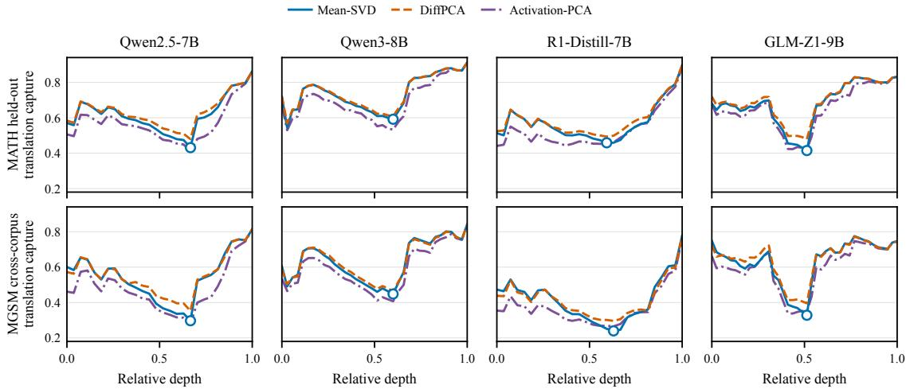
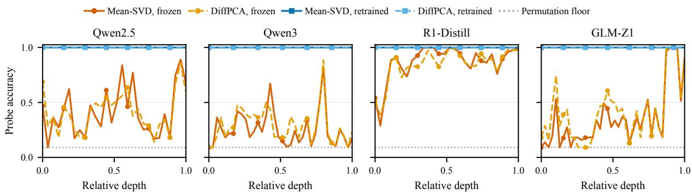
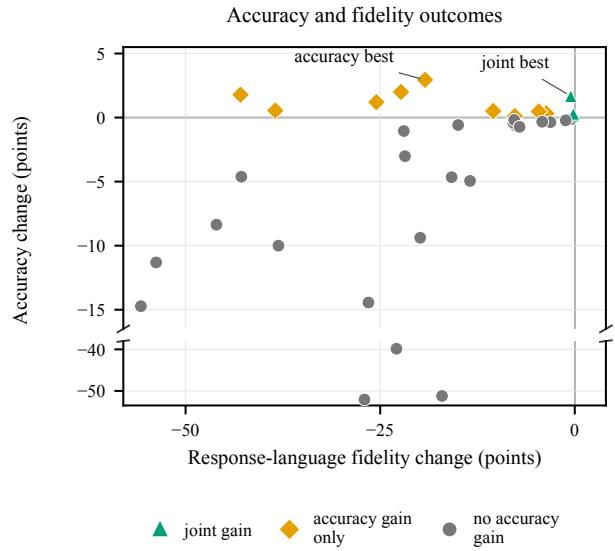
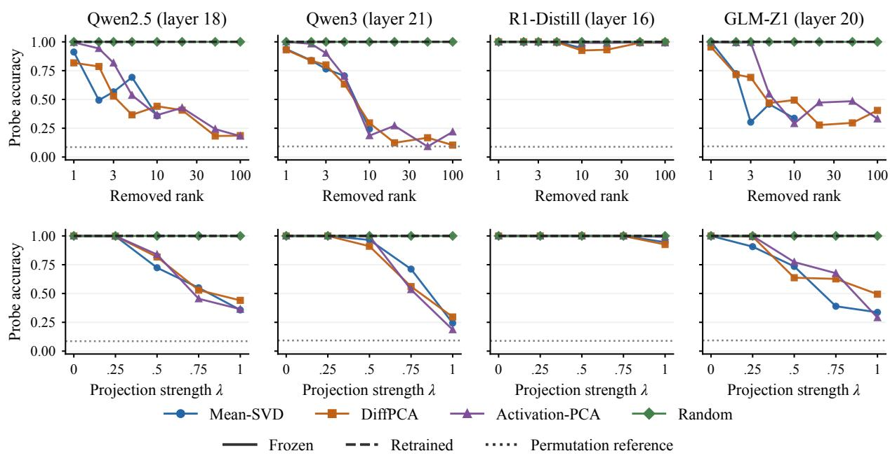
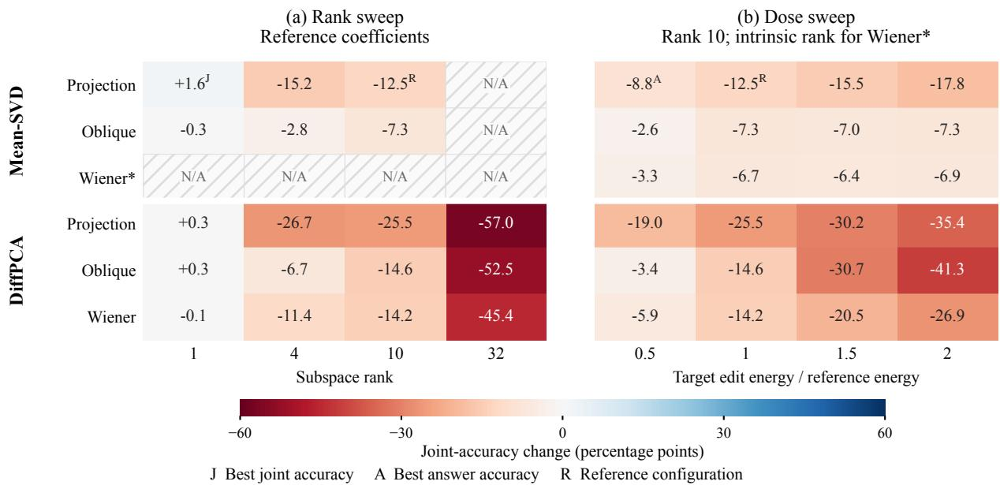

# Beyond Accuracy: What Language-Subspace Interventions Capture, Remove, and Improve

Shaanil Punglia1, Dadhichi Telwadkar1, Vaibhav Rathore2,1,

Siddharth Sureka1, Neha Bhargava1

1Motilal Oswal Financial Services, India

2Indian Institute of Technology Bombay, India

## Abstract

Language-subspace interventions aim to improve multilingual reasoning by suppressing language-related components in mid-layer ac tivations. Using MATH and MGSM across four open-weight LLMs, we ask three questions: do estimated language subspaces capture translation-associated variation? Does projecting them out remove language information? And do they improve accuracy without compromising response language? For the first question, we build subspaces using the existing MEAN-SVD construction and our DIFFPCA. Both capture substantial translationassociated variation and show similar patterns across model depth. For the second, we project out each subspace and train linear probes to classify language from the projected activa tions. The probes still identify language almost perfectly, showing that neither subspace exhaustively captures language information. For the third, we evaluate several intervention configurations on Qwen2.5-7B, by varying subspace creation methods and intervention operators. We find that the intervention that most improves MGSM accuracy sacrifices responselanguage fidelity, with only one intervention improving joint accuracy–answers that are correct and in the target language–slightly, by 1.60 points. Interestingly, subtle changes in the prompt alone can reproduce the accuracy gains albeit with significant damage to language fidelity. We argue that causal interventions must be judged on more than accuracy, to fully ac count for language substitution trade-offs.

## 1 Introduction

Mechanistic interventions can produce the desired metric improvement for an unintended reason. In multilingual reasoning, an intervention can raise accuracy simply by moving generation into English or Chinese. The answer may be mathematically correct, yet the model has silently changed the task. Multilingual reasoning therefore offers a useful stress test for causal interpretability: a behavioral gain need not validate the mechanism an intervention was designed to target.

Language-subspace ablation makes the distinction concrete. Zhao et al. (2025a) estimate a lowrank span from multilingual activation means, suppress it in middle layers, and amplify it near the output. This raises three separate questions: Does the span track language variation? Does removing the span eliminate linearly decodable language information? Does editing it improve the requested behavior? These are questions of geometry, containment, and behavioral effect, and each requires its own evidence.

We test those properties separately. We compare mean-based and translation-difference subspaces, probe what projection disrupts and what language information survives, and evaluate generation with joint accuracy: an answer must be correct and remain in the problem language. Additionally, we construct prompt-language controls that leave the problem untouched but switch its worked examples and answer cue to English or Chinese, testing whether contextual language alone can reproduce the apparent gain.

The evidence reveals a consistent split. The subspaces summarize translation structure without containing language exhaustively, and the accuracymaximizing edit performs worse once output language is part of the task. Prompt-language switches reproduce the trade-off, suggesting that the gain comes from changing the elicited linguistic regime rather than from activation editing itself. The broader lesson is methodological: a clean intervention in activation space is not yet a clean causal explanation. A strong causal account requires evidence connecting the edited geometry, the information affected, and the resulting behavioral change.

## 2 Related work

Language-subspace interventions grow from evidence that multilingual representations contain both shared and language-sensitive geometry. Lowrank analyses recover language-associated structure (Xie et al., 2022; Chang et al., 2022), while neuron-level studies identify units that predict or steer output language (Tang et al., 2024; Zhao et al., 2024). Intermediate states can also favor English concept realizations even when the input is not English (Wendler et al., 2024). Activation-patching results separately suggest that concept representations can be partially decoupled from output language (Dumas et al., 2025). Together, these results motivate compact language directions, but do not show that such directions contain language exhaustively or control how they are used.

Activation steering turned this descriptive geometry into an intervention surface: low-dimensional edits can redirect high-level behavior (Turner et al., 2023; Rimsky et al., 2024). Zhao et al. (2025a) turn this idea into an intervention: they estimate a language subspace from translated mathematics problems, suppress it in middle layers, amplify it near the output, and evaluate its effects across multilingual tasks. Their work is the direct premise of ours, while leaving open how effects depend on the subspace construction and removal operator.

Removal, however, is not automatically explanation. Probe accuracy can reflect readout capacity rather than representation quality (Hewitt and Liang, 2019), and information accessible to a readout need not be behaviorally used by the model (Elazar et al., 2021). Iterative Nullspace Projection (INLP) introduced repeated removal of probe directions to guard representations from linear prediction (Ravfogel et al., 2020), and amnesic probing connected removal to behavioral counterfactuals (Elazar et al., 2021). LEACE later provided closedform linear erasure (Belrose et al., 2023); subsequent comparisons stress that a useful causal intervention must remove the target selectively rather than broadly distort the representation (Dobrzeniecka et al., 2025). This lineage motivates our retrained probes and operator comparison: defeating a fixed probe, exhausting linearly decodable information, and changing generation are distinct claims.

Behavioral evaluation adds a final complication. In multilingual mathematics, the language of demonstrations and cues affects accuracy, and determines the language the model is prompted to reason in (Shi et al., 2023). Accordingly, an intervention cannot be judged by correctness alone when remaining in the problem language is part of the task. Prior work motivates each link in this chain, but usually examines them separately. We compare mean-based and translation-difference subspaces, expand the operator axis beyond orthogonal projection, probe what survives removal, evaluate complete task success, and ask whether prompt language reproduces the same pattern without activation editing.

## 3 Setup

## 3.1 Datasets

We use the same mathematical problems expressed in multiple languages, so that problem content stays fixed while language changes. The MATH dataset contains 12,500 competition-level problems (Hendrycks et al., 2021). Following Zhao et al. (2025a), we use its 7,500-problem training split and aligned machine translations from English into ten additional languages to estimate language subspaces. MGSM provides 250 grade-school problems professionally translated across the same eleven languages, with native-language worked examples for generation (Shi et al., 2023; Cobbe et al., 2021). We use it to test the subspaces on a different corpus and to measure their behavioral effects. Thus MATH supplies scale for finding directions, while MGSM asks whether those directions transfer and matter during generation.

We use four open-weight models of similar scale to carry out our study: Qwen2.5-7B (Qwen Team, 2024), Qwen3-8B (Qwen Team, 2025), R1-Distill-7B (DeepSeek-AI, 2025), distilled from DeepSeek-R1 (Guo et al., 2025), and GLM-Z1-9B (Z.ai, 2025).

## 3.2 Language subspaces

The same problem expressed in two languages lets us ask a clean geometric question: how does its representation move when the linguistic realization changes? Let $h _ { i , k } ^ { \ell } \in \mathbb { R } ^ { d }$ be the residual-stream activation at the final prompt token for problem i, language ℓ, and layer k. We fit a rank-r basis U independently at each layer and omit the layer index from the notation below.

Translation differences. For two renderings of the same problem, define

$$
v _ { i } ^ { s  t } = h _ { i } ^ { t } - h _ { i } ^ { s } .\tag{1}
$$

These vectors hold problem identity fixed. They are therefore a direct test of whether a proposed subspace follows translation. Because translation also changes tokenization, wording, and possibly the representation of the mathematics, we call this language-associated variation, not pure language.

Mean-based subspace (MEAN-SVD). MEAN-SVD compresses each language to one mean activation, then factorizes the resulting matrix into a shared anchor and leading directions that distinguish the language means (Piratla et al., 2020; Xie et al., 2022; Zhao et al., 2025a). Averaging suppresses individual problems and emphasizes stable offsets between languages. With eleven language means, its language-varying component has rank at most ten.

Within-problem subspace (DIFFPCA). DIFF-PCA instead keeps problem identity explicit. For each problem, it subtracts the mean of its translations and normalizes the remaining languagespecific residuals:

$$
R _ { i } ^ { \ell } = h _ { i } ^ { \ell } - \frac { 1 } { L } \sum _ { t = 1 } ^ { L } h _ { i } ^ { t } , \qquad z _ { i } ^ { \ell } = \frac { R _ { i } ^ { \ell } } { \operatorname* { m a x } ( \| R _ { i } ^ { \ell } \| , \epsilon ) } .\tag{2}
$$

Its basis is the top r principal components of the centered $z _ { i } ^ { \ell } .$ . This favors directions repeatedly traversed by translations rather than differences between languages only in the aggregate, and it permits ranks above ten. The two estimators therefore encode different ideas: MEAN-SVD treats language as a stable population offset, whereas DIFFPCA treats it as a recurring within-problem movement. Agreement across them suggests that the observed translation-associated geometry is not an artifact of either construction.

Controls. We compare both with high-variance directions learned without language labels (ACTIVATION-PCA) and a random orthonormal span (RANDOM). ACTIVATION-PCA asks whether the apparent language structure is specific, or merely a consequence of projecting onto the model’s dominant directions. Full algorithms and fitting details appear in Appendix A.

## 4 How much translation variation is captured?

For a translation vector v defined in Equation 1, we measure the fraction of its squared norm captured by a subspace with orthonormal basis U:

$$
\rho _ { U } ( v ) = \frac { \| U ^ { \top } v \| ^ { 2 } } { \| v \| ^ { 2 } } .\tag{3}
$$

We average over evaluation problems and all 55 unordered language pairs. Appendix B gives the data partitions and full results.

Figure 1 shows a decline in rank-10 capture through intermediate layers followed by an increase toward the output. Both estimators exhibit this pattern across all four models on held-out MATH and cross-corpus MGSM. Their interior minima coincide within each model–corpus pair, at 51–67% of model depth. On MGSM, MEAN-SVD captures 24.0–44.8% of translation variation at these minima, and DIFFPCA captures 29.6–46.2%. Thus, on this corpus, more than half of the variation remains outside either rank-10 span.

ACTIVATION-PCA provides a stronger comparison than random directions. At the MGSM minima, it captures 26.5% for R1-Distill and 34.6% for GLM, exceeding MEAN-SVD’s 24.0% and 32.8%, respectively. DIFFPCA captures more than ACTIVATION-PCA at all four models’ MGSM minima, but substantial capture is already obtained without language labels or within-problem residualization. Translation differences therefore overlap substantially with high-variance activation directions; capture alone does not establish language specificity.

Increasing DIFFPCA’s rank extends coverage beyond the rank-ten limit of MEAN-SVD. At Qwen2.5 layer 18 on held-out MATH, capture rises from 47.9% at rank ten to 74.0% at rank 100, compared with 2.8% for a rank-100 random span. We next test whether language remains linearly decodable after removing these spans.

## 5 Language decodability after projection

We test whether language identity remains linearly decodable after removing the estimated subspaces. Using subspaces fitted on MATH, we ablate zeroshot MGSM activations at each layer:

$$
\begin{array} { r } { h ^ { \prime } = h - \lambda U U ^ { \top } h , } \end{array}\tag{4}
$$

where U is an orthonormal subspace basis. At λ = 1, the component within the subspace is removed completely. For $0 \leq \lambda < 1$ , the transformation is invertible and preserves linear separability in principle. We evaluate each layer independently, without propagating edited activations through subsequent blocks.

  
Figure 1: Rank-10 capture of translation differences over model depth. Columns are models and rows are held-out MATH and cross-corpus MGSM. Circles mark the MEAN-SVD interior minima.

  
Figure 2: The retrained probe’s accuracy curves remain near the ceiling even where the frozen probe’s accuracy curves approach the permutation floor (gray). Although the gap varies irregularly with layer depth, it remains pronounced for all models except R1-Distill, whose frozen probe is comparatively robust.

We train eleven-way logistic-regression classifiers using five-fold cross-validation, keeping all translations of each problem in the same fold. A frozen probe trains on unedited activations and evaluates on ablated activations. A retrained probe trains and evaluates on ablated activations, using the same partitions. The former measures sensitivity of the original classifier to ablation; the latter tests whether language can still be decoded after ablation (Elazar et al., 2021). Appendix B.3 gives the fitting details.

Figure 2 shows that the accuracy of the retrained probe remains above 99.7% across the tested depth, rank, and strength settings, while the accuracy of the frozen probe varies substantially. After ablation of the language components, successful classification uses the component outside the removed span. Frozen-probe sensitivity also differs across models: at the designated MATH capture minima, rank-10 MEAN-SVD projection reduces accuracy to 24.3– 35.7% for Qwen2.5, Qwen3, and GLM, whereas R1-Distill retains 94.6% (Table 5).

ACTIVATION-PCA also reduces frozen accuracy substantially for the first three models, while the rank-matched random control retains 100% accuracy at the designated layers. Disrupting a frozen classifier therefore does not distinguish the language-based subspaces from directions fitted without language labels. Across depth, frozen MEAN-SVD accuracy is lowest at layer 0 or 1, rather than at the intermediate-layer capture minima.

Language identity thus remains linearly decodable after full ablation of either estimated subspace. These local measurements do not establish whether the surviving information contributes to generation. We examine generation outcomes next.

Figure 3: Accuracy gains usually lie far to the left: the intervention appears to reason better precisely when it abandons the requested language. Only a narrow corner improves the joint objective.
<table><tr><td>Setting</td><td>Accuracy (%)↑</td><td>Fidelity (%)↑</td><td>Joint (%) ↑</td></tr><tr><td>No intervention MEAN-SVD, rank 10</td><td>62.80</td><td>99.82</td><td>62.62</td></tr><tr><td>projection, dose 0.5 MEAN-SVD, rank 1</td><td>65.75</td><td>80.58</td><td>53.82</td></tr><tr><td>projection, dose 1</td><td>64.47</td><td>99.31</td><td>64.22</td></tr></table>

Table 1: No intervention and the MEAN-SVD configurations with the highest accuracy and joint accuracy on Qwen2.5 across eleven languages.

## 6 Influencing generation through language subspaces

We now turn from representation to behavior: what changes when these subspaces are edited during generation? We map the intervention design space, reassess earlier results under a stricter task criterion, and compare configurations by answer accuracy, response-language fidelity, and joint success. Appendix C gives the complete intervention and generation protocol.

## 6.1 Defining the intervention design space

We construct the intervention in stages. First, we estimate a language-specific subspace using either MEAN-SVD or DIFFPCA. For each construction, we vary the rank to test how large the subspace must be: a low-rank edit targets a compact language-related direction, whereas a higher-rank edit removes a broader span of activation variation.

Given a subspace, we then vary how it is edited during generation. Qwen2.5 has 28 transformer layers, numbered 0–27. Following Zhao et al. (2025a), layers 10–19 form the middle band and layers 20– 27 the upper band. This split treats mid-network language variation as interference to reasoning, while reserving the upper layers for expressing the result in a particular language. At each edited layer, we apply

$$
h ^ { \prime } = h - \lambda \delta ( h ) ,\tag{5}
$$

where δ is the intervention operator and λ its signed dose. The reference schedule uses $\lambda = 0 . 3$ in the middle band and $\lambda = - 0 . 3$ in the upper band, so the selected language component is diminished in the middle layers and amplified in the upper layers. Orthogonal projection sets $\delta ( h ) = U U ^ { \top } h ;$ LEACE motivates covariance-aware oblique removal with minimal distortion under its guardedness objective (Belrose et al., 2023), while our WIENER-style operator shrinks directions according to their estimated language signal-to-noise ratio. We vary the operator and dose, calibrating dose on MATH activations without observing MGSM outcomes. This design lets us ask whether an effect is robust to how the subspace is defined, how much of it is retained, and how aggressively it is edited, rather than being tied to one particular intervention recipe. Appendix A.2 defines the operators and complete grid.

## 6.2 Interpreting prior intervention results

On Qwen2.5, Zhao et al. (2025a) report gains in both mean MGSM accuracy and responselanguage fidelity using language-wise coefficient tuning under a composite objective (Appendix C). We instead evaluate fixed configuration procedures by whether correctness and target-language output improve on the same responses; because the protocols differ, our fidelity losses do not reinterpret their published gains.

## 6.3 Accuracy gains can mask language substitution

Figure 3 reveals that accuracy gains concentrate where response-language fidelity falls. The accuracy-maximizing configuration exemplifies this trade-off (Table 1). Accuracy alone therefore cannot tell whether an intervention makes the model more capable or merely changes the language in which that capability is expressed. To diagnose the difference, we define joint accuracy: a response succeeds only when its answer is correct and it remains in the original problem language.

<table><tr><td></td><td colspan="2">Causal intervention *</td><td colspan="2">English switch</td><td colspan="2">Chinese switch</td></tr><tr><td>Model</td><td>Accuracy</td><td>Fidelity</td><td>Accuracy</td><td>Fidelity</td><td>Accuracy</td><td>Fidelity</td></tr><tr><td>Qwen2.5</td><td>+0.94</td><td>+4.69</td><td>+1.78</td><td>-64.71</td><td>+3.42</td><td>-95.45</td></tr><tr><td>Qwen3 (thinking)</td><td>+1.27</td><td>+0.03</td><td>+1.87</td><td>-80.44</td><td>-1.73</td><td>-77.33</td></tr><tr><td>Qwen3 (no thinking)</td><td></td><td></td><td>+1.42</td><td>-72.36</td><td>+0.36</td><td>-50.89</td></tr><tr><td>R1-Distill</td><td>+2.40</td><td>+1.20</td><td>+1.07</td><td>-22.49</td><td>+2.58</td><td>-31.09</td></tr><tr><td>GLM-Z1</td><td>+1.52</td><td>+0.08</td><td>+6.53</td><td>-76.76</td><td>-0.27</td><td>-72.76</td></tr></table>

Table 2: Accuracy and fidelity changes under causal intervention and prompt-language switches. \*Causalintervention values are imported from Zhao et al. (2025a); switch values average the nine non-English/Chinese MGSM languages. Comparable accuracy gains thus conceal radically different language behavior.

Viewed through this joint criterion, the accuracymaximizing intervention loses its apparent practical advantage: its gain in numerical correctness is accompanied by enough language drift that it produces fewer answers satisfying the task as posed. The intervention has not simply improved behavior; it has traded one part of the task contract against another.

The reversal is most striking for the simplest configuration. A rank-one MEAN-SVD subspace with ordinary orthogonal projection yields a modest joint gain, whereas broader or more elaborate edits do not. This cautions against equating stronger erasure with a cleaner causal intervention. A narrow edit may perturb a behaviorally relevant direction while preserving the distributed features that route generation into the requested language; a broader removal may cut across features jointly involved in reasoning and language control. The grid does not by itself identify that mechanism, but it points to selectivity, rather than intervention strength, as the quantity that matters. Appendix Figure 5 shows the joint criterion across all 37 configurations.

## 7 Prompt language as a behavioral control

Language-subspace ablation is motivated by a mechanistic hypothesis: language-specific variation in middle-layer activations may behave as noise relative to a shared reasoning computation. If that shared computation is disproportionately shaped by high-resource languages, removing the source-language component could move lowerresource activations toward a regime the model uses more effectively in English or Chinese. The same movement, however, has an obvious failure mode: it may pull the language of the output toward that high-resource anchor as well.

We test this possibility without editing activations. In a prompt-language switch, the math problem remains in its original language, but its worked examples and answer cue are replaced with English or Chinese versions. This asks whether placing the model in a high-resource linguistic context is sufficient to reproduce both sides of the intervention: greater access to reasoning behavior and drift away from the requested output language. Appendix D illustrates the exact prompt transformation and gives the generation protocol.

Table 2 places these prompt-language switches beside the gains reported for the best causal interventions of Zhao et al. (2025a). The comparison is diagnostic rather than a leaderboard because the generation protocols differ. Its significance is that an accuracy gain of comparable scale can be produced by contextual language routing alone. Yet the resulting answers follow the switched prompt language, so accuracy rises while joint accuracy falls. A better numerical score therefore does not, by itself, identify a better reasoning mechanism; it may instead reveal that the model has entered a linguistic regime in which it is easier to answer but less able to satisfy the original task.

This raises a simple question: what if we explicitly ask the model to answer in the target language? We test this on GLM-Z1 while retaining the English prompt-language switch. Relative to the nativeprompt reference, whose accuracy and fidelity are 70.76% and 94.53%, the explicit instruction yields 74.62% accuracy and 97.02% fidelity. The result suggests that the linguistic context used to elicit computation and the language used to realize the answer can be partially decoupled at inference time. We do not optimize the instruction further, since that would turn the analysis into prompt engineering; here, it serves as evidence that language substitution is not inevitable.

## 8 Conclusion

Estimated language subspaces are easy to overinterpret. Subspaces built from multilingual means or paired translation differences recover translationassociated structure, yet projection leaves language linearly decodable, and geometric salience does not predict behavioral leverage. A subspace can therefore be a useful coordinate system without being a container for the feature, or the mechanism controlling it.

The behavioral results expose the consequence. The edit that appears to improve reasoning most also abandons the requested language; prompt switches reproduce this pattern, and an explicit instruction can reverse it. Apparent gains may thus reflect entry into an easier linguistic regime rather than improved language-independent computation. Multilingual interventions must be judged against the whole task contract. The goal is not to make models reason in one privileged language, but to separate access to useful computation from the language in which users receive it.

## Limitations

Our conclusions are bounded by task and model scope. MATH and MGSM are both mathematical reasoning benchmarks, and all four models are similarly scaled at 7–9 billion parameters. Whether the findings generalize across domains or to larger models remains open.

Additionally, the rank-one intervention was selected and evaluated on the same benchmark. Its apparent joint advantage therefore requires heldout confirmation.

## Ethical considerations

Our analysis of Zhao et al.’s coefficient-selection procedure is based on their released analyzer. Because the release does not identify the exact code revision used for the paper, we treat this as a finding about the public implementation—not a claim about how the published numbers were produced.

## Declaration on Generative AI

Generative AI systems, including Claude and OpenAI Codex, assisted with manuscript editing and verification. They did not conduct the experiments; the authors remain responsible for the work.

## References

Nora Belrose, David Schneider-Joseph, Shauli Ravfogel, Ryan Cotterell, Edward Raff, and Stella Biderman. 2023. LEACE: Perfect linear concept erasure in closed form. In Advances in Neural Information Processing Systems, volume 36, pages 66044–66063.

Tyler Chang, Zhuowen Tu, and Benjamin Bergen. 2022. The geometry of multilingual language model representations. In Proceedings ofthe 2022 Conference on Empirical Methods in Natural Language Processing, pages 119–136.

Karl Cobbe, Vineet Kosaraju, Mohammad Bavarian, Mark Chen, Heewoo Jun, Lukasz Kaiser, Matthias Plappert, Jerry Tworek, Jacob Hilton, Reiichiro Nakano, Christopher Hesse, and John Schulman. 2021. Training verifiers to solve math word problems. Preprint, arXiv:2110.14168.

DeepSeek-AI. 2025. DeepSeek-R1-Distill-Qwen-7B. Model card.

Alicja Dobrzeniecka, Antske Fokkens, and Pia Sommerauer. 2025. Improving causal interventions in amnesic probing with mean projection or LEACE. In Findings of the Association for Computational Linguistics: ACL 2025, pages 12981–12993.

Clément Dumas, Chris Wendler, Veniamin Veselovsky, Giovanni Monea, and Robert West. 2025. Separating tongue from thought: Activation patching reveals language-agnostic concept representations in transformers. In Proceedings ofthe 63rd Annual Meeting of the Association for Computational Linguistics (Volume 1: Long Papers), pages 31822–31841.

Yanai Elazar, Shauli Ravfogel, Alon Jacovi, and Yoav Goldberg. 2021. Amnesic probing: Behavioral explanation with amnesic counterfactuals. Transactions of the Association for Computational Linguistics, 9:160– 175.

Daya Guo, Dejian Yang, Haowei Zhang, Junxiao Song, Peiyi Wang, et al. 2025. DeepSeek-R1 incentivizes reasoning in LLMs through reinforcement learning. Nature, 645(8081):633–638.

Dan Hendrycks, Collin Burns, Saurav Kadavath, Akul Arora, Steven Basart, Eric Tang, Dawn Song, and Jacob Steinhardt. 2021. Measuring mathematical problem solving with the MATH dataset. In Advances in Neural Information Processing Systems Datasets and Benchmarks Track.

John Hewitt and Percy Liang. 2019. Designing and interpreting probes with control tasks. In Proceedings of the 2019 Conference on Empirical Methods in Natural Language Processing and the 9th International Joint Conference on Natural Language Processing (EMNLP-IJCNLP), pages 2733–2743.

Vihari Piratla, Praneeth Netrapalli, and Sunita Sarawagi. 2020. Efficient domain generalization via commonspecific low-rank decomposition. In Proceedings

of the 37th International Conference on Machine Learning, volume 119, pages 7728–7738. PMLR.

Qwen Team. 2024. Qwen2.5 technical report. Preprint, arXiv:2412.15115.

Qwen Team. 2025. Qwen3 technical report. Preprint, arXiv:2505.09388.

Shauli Ravfogel, Yanai Elazar, Hila Gonen, Michael Twiton, and Yoav Goldberg. 2020. Null it out: Guarding protected attributes by iterative nullspace projection. In Proceedings ofthe 58th Annual Meeting of the Associationfor Computational Linguistics, pages 7237–7256.

Nina Rimsky, Nick Gabrieli, Julian Schulz, Meg Tong, Evan Hubinger, and Alexander Turner. 2024. Steering Llama 2 via contrastive activation addition. In Proceedings ofthe 62nd Annual Meeting ofthe Association for Computational Linguistics (Volume 1: Long Papers), pages 15504–15522.

Freda Shi, Mirac Suzgun, Markus Freitag, Xuezhi Wang, Suraj Srivats, Soroush Vosoughi, Hyung Won Chung, Yi Tay, Sebastian Ruder, Denny Zhou, Dipanjan Das, and Jason Wei. 2023. Language models are multilingual chain-of-thought reasoners. In International Conference on Learning Representations.

Tianyi Tang, Wenyang Luo, Haoyang Huang, Dongdong Zhang, Xiaolei Wang, Xin Zhao, Furu Wei, and Ji-Rong Wen. 2024. Language-specific neurons: The key to multilingual capabilities in large language models. In Proceedings of the 62nd Annual Meeting of the Association for Computational Linguistics (Volume 1: Long Papers), pages 5701–5715.

Alexander Matt Turner, Lisa Thiergart, Gavin Leech, David Udell, Juan J. Vazquez, Ulisse Mini, and Monte MacDiarmid. 2023. Steering language models with activation engineering. Preprint, arXiv:2308.10248.

Chris Wendler, Veniamin Veselovsky, Giovanni Monea, and Robert West. 2024. Do llamas work in English? on the latent language of multilingual transformers. In Proceedings of the 62nd Annual Meeting of the Associationfor Computational Linguistics (Volume 1: Long Papers), pages 15366–15394.

Zhihui Xie, Handong Zhao, Tong Yu, and Shuai Li. 2022. Discovering low-rank subspaces for languageagnostic multilingual representations. In Proceedings ofthe 2022 Conference on Empirical Methods in Natural Language Processing, pages 5617–5633.

Z.ai. 2025. GLM-Z1-9B-0414. Model card.

Weixiang Zhao, Jiahe Guo, Yang Deng, Tongtong Wu, Wenxuan Zhang, Yulin Hu, Xingyu Sui, Yanyan Zhao, Wanxiang Che, Bing Qin, Tat-Seng Chua, and Ting Liu. 2025a. When less language is more: Language–reasoning disentanglement makes LLMs better multilingual reasoners. In Advances in Neural Information Processing Systems, volume 38, pages 43235–43269.

Weixiang Zhao et al. 2025b. Language– reasoning disentanglement: Released gridsearch analyzer. GitHub repository. Commit 059b57d8895a7ce5b525431b0abbff620ebd33f1.

Yiran Zhao, Wenxuan Zhang, Guizhen Chen, Kenji Kawaguchi, and Lidong Bing. 2024. How do large language models handle multilingualism? In Advances in Neural Information Processing Systems, volume 37, pages 15296–15319.

## A Subspace and operator details

## A.1 Subspace construction

As Table 3 makes explicit, the MEAN-SVD output is the orthonormal language basis $\smash { \widetilde { U } _ { r } }$ , not the shared anchor a. Our implementation matches the released implementation we inspected for Zhao et al. (2025a). DIFFPCA is an angular construction because each problem–language residual has equal norm before centering; this prevents a few unusually large activations from dominating the fit. ACTIVATION-PCA applies the same normalized PCA to all activation rows without residualizing problem identity or observing language labels. RANDOM is obtained by QR decomposition of a Gaussian matrix with a fixed seed. All bases are fitted independently at each layer.

## A.2 Edit operators

All generation edits have the affine form $h ^ { \prime } = h -$ $\lambda \delta ( h )$ . Orthogonal projection uses $\delta ( h ) = U U ^ { \top } h$ Our LEACE-style operator estimates the pooled covariance $\Sigma ,$ shrinks it by 0.1 toward a scaled identity, and orthonormalizes the target span after whitening. Writing $\mu$ for the pooled mean and $Q$ for the resulting orthonormal basis, it applies

$$
\delta ( h ) = \Sigma ^ { 1 / 2 } Q Q ^ { \top } \Sigma ^ { - 1 / 2 } ( h - \mu ) .\tag{6}
$$

With the centered language-mean span and full rank, this is the minimal-MSE linear guardedness map of Belrose et al. (2023). With a supplied DIFF-PCA basis, it is an oblique removal of that span and does not inherit the supervised guardedness guarantee.

The WIENER operator uses the random-effects decomposition $h = \mu + c _ { i } + g _ { \ell } + q _ { i \ell } + \epsilon$ , where $c _ { i } ,$ $g _ { \ell } , q _ { i \ell } ,$ and ϵ denote problem, language, problem– language interaction, and residual effects. For the mean-based target, its edit is

$$
\delta ( h ) = \Sigma _ { g } ( \Sigma _ { g } + \Sigma _ { c } + \Sigma _ { \epsilon } ) ^ { - 1 } ( h - \mu ) ,\tag{7}
$$

with the covariance terms estimated from the parallel MATH activations. This attenuates directions according to their estimated signal-to-noise ratio instead of assigning every direction the same coefficient. For the DIFFPCA cross, the basis directions are scaled by their residual-covariance energy before the same marginal-covariance shrinkage. Mean-based WIENER is intrinsically rank at most $L - 1$ and has no separate rank knob. Consequently the cross is deliberately unbalanced: the 37 cells comprise 6 mean-projection, 6 mean-oblique, 4 mean-Wiener, and 7 cells for each DIFFPCA operator. It should not be read as a complete factorial comparison of estimator and operator.

## B Representation analyses: protocols and supplementary results

## B.1 Activation extraction and data partitions

Representation analyses use zero-shot residualstream activations at the final prompt token; the eight demonstrations used in generation are absent. Layers are indexed from zero over transformer block outputs, with relative depth $k / ( K - 1 )$ for a model with K blocks. Qwen3 uses non-thinking mode. GLM’s chat template appends an opening thinking prefix, so its final prompt token follows that prefix. Section B.5 examines this choice.

For held-out MATH capture, we split the 7,500 problems into 3,750 fitting and 3,750 evaluation problems using seed zero. All translations of each problem stay in the same partition. For crosscorpus capture, we fit on all 7,500 MATH problems and evaluate on 250 MGSM problems. The fitting sample size and evaluation corpus both change between these tests, so their absolute capture levels do not isolate a corpus effect.

The probe experiment uses a third partitioning scheme: subspaces are fitted on all 7,500 MATH problems, but classifiers are trained and evaluated within MGSM using grouped cross-validation. Thus the subspace transfers across corpora; the classifier itself is not trained on MATH and transferred to MGSM.

## B.2 Translation-capture results

Capture is the mean of the per-vector squarednorm fractions in Equation 3, with equal weight for every evaluation problem and each of the 55 unordered language pairs. It is not a ratio of pooled squared norms. Table 4 reports both estimators at the layer minimizing rank-10 MEAN-SVD capture within $0 . 1 5 \le k / ( K - 1 ) \le 0 . 9 5$ , selected separately for each model and evaluation corpus. Only Qwen3/MATH differs from the unrestricted minimum, which occurs at layer 1. The correlations summarize agreement between full depth profiles, not alignment of the underlying subspace directions.

Rank sensitivity. At Qwen2.5 layer 18 on heldout MATH, ranks 10, 20, and 100 yield DIFFPCA capture of 0.479, 0.565, and 0.740, versus 0.0028, 0.0056, and 0.0276 for random spans.

<table><tr><td colspan="2">In: At fixed layer  $k ,$  activations  $h _ { i , k } ^ { \ell }$  for n problems and L languages; rank r  $( r \leq L - 1$  for (a)). Method (b) requires parallel activations.</td></tr><tr><td>(a) MEAN-SVD:</td><td>(b) DIFFPCA:</td></tr><tr><td>Common-specific decomposition</td><td>Within-problem PCA</td></tr><tr><td>Approximate the language means at rank  $^ { r } \cdot$ </td><td>Remove each problem&#x27;s mean and normalize its translation residuals.</td></tr><tr><td>1  $\begin{array} { r } { m _ { \ell } \gets \frac { 1 } { n } \sum _ { i } h _ { i , k } ^ { \ell } ; W \gets [ m _ { 1 } , \dots , m _ { L } ] . } \end{array}$  2  $\begin{array} { r } { a _ { 0 } \gets \frac { 1 } { L } W \mathbf { 1 } ; ~ U \Sigma V ^ { \top } \gets \mathrm { S V D } ( W - a _ { 0 } \mathbf { 1 } ^ { \top } ) . } \end{array}$ </td><td>1  $\begin{array} { r } { \bar { h } _ { i }  \frac { 1 } { L } \sum _ { \ell } h _ { i , k } ^ { \ell } . } \end{array}$ </td></tr><tr><td> $\widehat { \boldsymbol { W } } \gets \boldsymbol { a } _ { 0 } \mathbf { 1 } ^ { \top } + U _ { r } \boldsymbol { \Sigma } _ { r } \boldsymbol { V } _ { r } ^ { \top } .$  3</td><td> $R _ { i } ^ { \ell } \gets h _ { i , k } ^ { \ell } - \bar { h } _ { i } ; ~ z _ { i } ^ { \ell } \gets \frac { R _ { i } ^ { \ell } } { \operatorname* { m a x } ( \| R _ { i } ^ { \ell } \| , \epsilon ) } .$  2</td></tr><tr><td>Refine the shared anchor and recover the language basis.</td><td>Fit centered PCA to the normalized residuals.</td></tr><tr><td> $a \gets ( \widehat { W } ^ { + } ) ^ { \top } { \bf 1 } ; ~ a \gets \frac { a } { a ^ { \top } a } .$  4</td><td>3 Stack the  $z _ { i } ^ { \ell }$  as rows of  $Z ;$   $Z _ { c } \gets Z - { \bf 1 } \bar { z } ^ { \top }$  </td></tr><tr><td> $\widetilde U \widetilde \Sigma \widetilde { V } ^ { \top }  \mathrm { S V D } ( \widehat W - a \mathbf { 1 } ^ { \top } ) .$  5</td><td>4  $\begin{array} { r } { A \Sigma V ^ { \top }  \mathrm { S V D } ( Z _ { c } ) . } \end{array}$ </td></tr><tr><td>6 Return the first r columns of  ${ \widetilde { U } } .$ </td><td>5 Return the first r columns of  $V .$ </td></tr><tr><td>Out: Orthonormal language basis  $\mathcal { \widetilde { U } } _ { r } \in \mathbb { R } ^ { d \times r } .$ </td><td> $V _ { r } \in \mathbb { R } ^ { d \times r }$ </td></tr></table>

Table 3: Layerwise construction of MEAN-SVD and DIFFPCA subspaces. Subscript r selects the leading r singular components; $W ^ { + }$ is the Moore–Penrose pseudoinverse and $\epsilon > 0$ is a numerical norm floor.

  
Figure 4: Probe sensitivity at each model’s held-out MATH capture minimum. Top: rank varies at full projection. Bottom: strength varies at rank ten. Solid curves are frozen probes; dashed curves are retrained probes and overlap near 1. The dotted gray line is the measured permutation reference at that layer. MEAN-SVD ends at rank ten.

## B.3 Language-probe protocol

We classify eleven languages using logistic regression on unscaled activations. The implementation calls scikit-learn’s LogisticRegression with $C = 1 . 0 \mathrm { { ; } }$ , max\_iter=3000, and random\_state=0; other arguments use library defaults. Five-fold GroupKFold partitions the 250 MGSM problem indices. Each fold trains on 200 problems (2,200 activations) and evaluates on 50 (550 activations), keeping all eleven translations together. Accuracy is averaged over the five held-out folds.

The clean probe trains and evaluates on unedited activations. Within the same folds, the frozen probe trains on clean training activations and evaluates on projected held-out activations; the retrained probe trains and evaluates on projected activations. Every edit is applied analytically at the measured layer using Equation 4. No edited state is propagated through subsequent blocks. Subspace fitting never uses the held-out probe examples.

<table><tr><td>Model/data</td><td>MEAN-SVD DIFFPCA k/depth</td><td></td><td>rp</td></tr><tr><td>Qwen2.5/MATH</td><td>0.431</td><td>0.47918/0.670.9971</td><td></td></tr><tr><td>Qwen2.5/MGSM</td><td>0.297</td><td>0.35218/0.67 0.9918</td><td></td></tr><tr><td>Qwen3/MATH</td><td>0.592</td><td>0.608 21/0.60 0.9995</td><td></td></tr><tr><td>Qwen3/MGSM</td><td>0.448</td><td>0.46221/0.600.9972</td><td></td></tr><tr><td>R1/MATH</td><td>0.459</td><td>0.49416/0.590.9940</td><td></td></tr><tr><td>R1/MGSM</td><td>0.240</td><td>0.29617/0.63 0.9882</td><td></td></tr><tr><td>GLM-Z1/MATH</td><td>0.415</td><td>0.47920/0.51 0.9976</td><td></td></tr><tr><td>GLM-Z1/MGSM</td><td>0.328</td><td>0.395 20/0.510.9911</td><td></td></tr></table>

Table 4: Rank-10 translation capture at each model– corpus pair’s MEAN-SVD interior minimum. k is the block index; depth is $k / ( K - 1 )$ . r is the Pearson correlation between the two estimators’ full depth profiles.

The three sweeps vary one factor at a time:

• Depth: every block, with rank ten and $\lambda = 1$ for MEAN-SVD and DIFFPCA.

• Rank: $r \in \{ 1 , 2 , 3 , 5 , 1 0 , 2 0 , 5 0 , 1 0 0 \}$ at the designated layer and λ = 1, for both estimators and the ACTIVATION-PCA and RAN-DOM controls. MEAN-SVD is restricted to $r \leq 1 0 .$

• Strength: $\lambda \in \{ 0 , 0 . 2 5 , 0 . 5 , 0 . 7 5 , 1 \}$ at the designated layer and rank ten, for both estimators and both controls.

The designated layers are the rank-10 MEAN-SVD interior minima on held-out MATH: 18, 21, 16, and 20 for Qwen2.5, Qwen3, R1-Distill, and GLM, respectively. In particular, R1-Distill’s probe sweeps use layer 16, even though its MGSM capture minimum is at layer 17. The sweeps do not cover the full depth–rank–strength product.

For the permutation reference, we globally shuffle the language-label vector five times using seed zero and repeat grouped cross-validation on clean activations. We measure this reference at the first, designated, and final layers. In Figure 2, unmeasured layers use the mean of these three measured values; the gray reference is therefore not independently measured at every layer. The references in Table 5 and Figure 4 are measured at the designated layer. They provide an empirical chance reference, not a statistical lower bound on accuracy.

## B.4 Probe results and controls

Table 5 reports the model-level results. The rank sweeps in Figure 4 show that frozen accuracy need not fall monotonically with the number of removed dimensions: R1-Distill’s frozen DIFFPCA probe has accuracy 0.925 at rank ten and 0.995 at rank 100. Across all tested intervention cells, retrained accuracy remains at least 0.9971, and the random control retains 1.000 accuracy in every tested rank and strength condition.

## B.5 GLM extraction-boundary sensitivity

GLM’s forced-thinking template ends with an opening <think> prefix. On 64 MGSM problems per language, we compare block outputs at the token immediately before this prefix with those at the final token after it, within the same forward pass. For representations a and b at these positions, the diagnostics are cosine similarity and relative change $\| b - a \| / \| a \|$ We first average over problems within each language and layer, then equally over all eleven languages and 40 layers.

The mean cosine similarity is 0.645 and the mean relative change is 0.865. Per-language cosine similarities, averaged over layers, range from 0.634 to 0.661. Capture and probe analyses use the post-prefix position; their robustness across the two extraction positions was not tested.

## C Intervention selection and evaluation

The reference schedule uses the middle/high layer bands of Zhao et al. (2025a) and one fixed point within their coefficient search grid: +0.3 at layers 10–19 and −0.3 at layers 20–27. Their Appendix F specifies the coefficient grid for Qwen2.5-7B. The released analyzer, pinned to the inspected revision in Zhao et al. (2025b), takes the no-intervention cell as the baseline and, among intervention cells, selects a separate pair for each language by maximizing

$$
2 ( A - A _ { 0 } ) + ( F - F _ { 0 } ) ,\tag{8}
$$

where all scores are proportions and $A _ { 0 }$ and $F _ { 0 }$ are the no-intervention scores. Selection excludes the baseline and is performed independently for each language. Thus “reference” in our grid means our single fixed $+ 0 . 3 / - 0 . 3$ schedule applied to every language, not a coefficient pair reported as universal by Zhao et al. Off-center schedules are calibrated using activation-edit energy on MATH, without observing MGSM outcomes.

For each construction–operator pair, dose 1 is the reference energy. The other dose rungs target 0.5, 1.5, and 2 times that energy by changing the coefficient magnitude for each language. Both layer bands are scaled together. Rank rungs are evaluated at the central coefficients; dose rungs use rank ten.

<table><tr><td>Model</td><td>k</td><td>MEAN-SVD</td><td>DIFFPCA</td><td>ACTIVATION-PCA</td><td>RANDOM</td><td>Perm.</td><td>Min. retr.</td></tr><tr><td>Qwen2.5</td><td>18</td><td>0.357 / 1.000</td><td> $0 . 4 4 1 / 1 . 0 0 0$ </td><td>0.364 / 1.000</td><td>1.000 / 1.000</td><td>0.086</td><td>0.9993</td></tr><tr><td>Qwen3</td><td>21</td><td>0.243 / 1.000</td><td> $0 . 2 9 6 / 1 . 0 0 0$ </td><td>0.186 / 1.000</td><td>1.000 / 1.000</td><td>0.092</td><td>0.9971</td></tr><tr><td>R1-Distill</td><td>16</td><td>0.946 / 1.000</td><td> $0 . 9 2 5 / 1 . 0 0 0$ </td><td>0.992 / 1.000</td><td>1.000 / 1.000</td><td>0.089</td><td>0.9985</td></tr><tr><td>GLM-Z1</td><td>20</td><td>0.337 / 1.000</td><td> $0 . 4 9 4 / 1 . 0 0 0$ </td><td>0.291 / 1.000</td><td>1.000 / 1.000</td><td>0.093</td><td>0.9993</td></tr></table>

Table 5: Language probes at the held-out MATH capture minimum, using rank ten and full projection $( \lambda = 1 )$ . Each method cell gives frozen / retrained held-out accuracy. Clean accuracy is 1.000 for every model. The permutation reference uses shuffled labels on clean activations. The final column is the lowest retrained accuracy over all tested intervention cells across the depth, rank, and strength sweeps, reported to four decimals.

DIFFPCA additionally admits rank 32, whereas MEAN-SVD is capped at ten. All intervention generations use a 512-token limit. Edits operate on every prompt token during prefill and are removed before autoregressive decoding begins.

## C.1 Scoring and uncertainty

Answers are extracted after any completed visible reasoning block. Native decimal digits are mapped to ASCII, and the last localized answerfield number is compared numerically with the gold answer. To classify response language, we first strip mathematics. Kana identifies Japanese, while dominant Han, Cyrillic, Bengali, Telugu, or Thai script identifies the corresponding language. Remaining Latin prose must contain at least eight alphabetic characters; we then take the highest-ranked langdetect candidate among German, English, Spanish, French, and Swahili, with DetectorFactory.seed=0. A missing or unidentifiable label receives $F _ { i } = 0$ in the strict metric.

Each pooled statistic first averages problem indices within a language and then averages languages equally. For intervals and tests, 4,000 paired bootstrap replicates resample the 250 matched problem indices; every draw carries together all languages and all conditions being contrasted for an index. Reported 95% intervals are pointwise percentile intervals, not simultaneous intervals over the grid. Approximate two-sided bootstrap pvalues compare each intervention with baseline using twice the smaller proportion of nonpositive or nonnegative bootstrap differences, capped at one. For the reported all-language comparisons, Holm adjustment uses one family of 37 intervention arms for each of accuracy, fidelity, and joint accuracy. We flag a cell when its truncation rate differs from baseline by more than 0.05; this is a sensitivity gate, not a correction for high truncation shared with the baseline.

## C.2 Grid-wide outcomes and truncation sensitivity

Across the 407 configuration–language cells, 152 have positive accuracy changes and 110 have positive joint changes. After averaging all eleven languages, 12 of 37 configurations exceed baseline accuracy and three exceed baseline joint accuracy. One comparison for each metric survives Holm correction. Selection and evaluation use the same benchmark; no independent confirmation set is used.

Baseline Telugu and Bengali responses reach the 512-token limit in 78.8% and 36.8% of cases, respectively. Of the 407 cells, 112 change truncation by more than five percentage points.

## D Prompt-language experiments

## D.1 Prompt conditions and evaluation set

All conditions use eight worked examples. The native condition presents the examples, question, and answer cue in the original problem language. A switch replaces the examples and cue with English or Chinese while leaving the question in its original language. Translate-test also translates the question into the switch language, using the benchmark’s existing translations. In the cue control, the examples remain in the switch language but the cue is restored to the native language. The targetinstruction control retains the switched examples and cue and prepends an explicit request for the final answer and explanation in the native language.

Table 6 uses the same nine languages as the prompt-switch columns of main-text Table 2: Bengali, German, Spanish, French, Japanese, Russian, Swahili, Telugu, and Thai. Each condition contains 250 problems per language. Excluding both English and Chinese fixes the evaluation set across the two switches. Scores average languages equally; each change is relative to that model and mode’s native-prompt baseline on these same problems.

Joint-accuracy change from no intervention Qwen2.5-7B · MGSM · 11-language mean  
  
\* Mean-SVD/Wiener has no rank knob; its reference appears at dose 1. N/A: unavailable.

Figure 5: Joint-accuracy changes across 37 intervention configurations. Both panels use the same symmetric color scale. Five reference settings appear in both sweeps; Mean-SVD/Wiener’s intrinsic-rank reference appears only at dose 1. Letters identify the best joint accuracy (J), best answer accuracy (A), and reference projection (R).
<table><tr><td></td><td colspan="3">Prompt-language switch</td><td colspan="3">Translate-test</td></tr><tr><td>Model</td><td>Accuracy</td><td>Fidelity</td><td>Joint</td><td>Accuracy</td><td>Fidelity</td><td>Joint</td></tr><tr><td>English</td><td></td><td></td><td></td><td></td><td></td><td></td></tr><tr><td>Qwen2.5</td><td>+1.78</td><td>-64.71</td><td>-40.49</td><td>+27.02</td><td>-99.82</td><td>-61.33</td></tr><tr><td>Qwen3 (thinking)</td><td>+1.87</td><td>-80.44</td><td>-65.24</td><td>+14.09</td><td>-99.60</td><td>-82.04</td></tr><tr><td>Qwen3 (non-thinking)</td><td>+1.42</td><td>-72.36</td><td>-53.29</td><td>+20.04</td><td>-99.96</td><td>-74.89</td></tr><tr><td>R1-Distill</td><td>+1.07</td><td>-22.49</td><td>-6.71</td><td>+32.58</td><td>-97.85</td><td>-48.71</td></tr><tr><td>GLM-Z1</td><td>+6.53</td><td>-76.76</td><td>-55.73</td><td>+25.91</td><td>-94.49</td><td>-70.40</td></tr><tr><td>Chinese</td><td></td><td></td><td></td><td></td><td></td><td></td></tr><tr><td>Qwen2.5</td><td>+3.42</td><td>-95.45</td><td>-58.22</td><td>+19.51</td><td>-99.82</td><td>-61.33</td></tr><tr><td>Qwen3 (thinking)</td><td>-1.73</td><td>-77.33</td><td>-63.16</td><td>+6.36</td><td>-99.60</td><td>-82.04</td></tr><tr><td>Qwen3 (non-thinking)</td><td>+0.36</td><td>-50.89</td><td>-37.87</td><td>+10.84</td><td>-99.96</td><td>-74.89</td></tr><tr><td>R1-Distill</td><td>+2.58</td><td>-31.09</td><td>-9.47</td><td>+28.53</td><td>-97.85</td><td>-48.71</td></tr><tr><td>GLM-Z1</td><td>-0.27</td><td>-72.76</td><td>-52.76</td><td>+17.51</td><td>-94.53</td><td>-70.44</td></tr></table>

Table 6: Prompt-language switches and translate-test on the same nine MGSM languages. Values are percentagepoint changes from the matched native-prompt baseline. Fidelity and joint accuracy are scored against the original problem language, including for translate-test.

## D.2 Generation and scoring

Qwen2.5 uses greedy decoding with a 1,024-token limit. Qwen3, R1-Distill, and GLM use sampling with a 16,384-token limit; Qwen3’s thinking and non-thinking settings are reported separately. GLM uses vLLM 0.8.5.post1, temperature 0.6, and topp 0.95. These budgets differ from the 512-token intervention runs, so comparisons use changes from each protocol’s own baseline.

Accuracy measures numerical correctness, fidelity measures output in the original problem language, and joint accuracy requires both on the same response. Unidentified responses count as fidelity and joint failures, using the scoring procedure in Appendix C.1.

## D.3 Switch and translate-test results

Table 6 extends the main comparison with joint accuracy and both translate-test conditions. Every prompt-language switch reduces joint accuracy, including settings that improve numerical accuracy.

Translate-test increases accuracy for every model and mode in both languages.

## D.4 Target-language instruction and answer cue

<table><tr><td>Prompt</td><td>Seed 0</td><td>Seed 1</td></tr><tr><td>Native prompt</td><td>70.44</td><td>73.78</td></tr><tr><td>English switch</td><td>14.71</td><td>15.47</td></tr><tr><td>English + target instruction</td><td>72.49</td><td>72.04</td></tr><tr><td>Chinese switch</td><td>17.69</td><td>17.47</td></tr><tr><td>Chinese + target instruction</td><td>59.69</td><td>57.60</td></tr></table>

Table 7: GLM joint accuracy (%) on the same nine languages, with and without an explicit target-language instruction.

The target-language instruction restores much of the lost joint accuracy in both GLM seeds (Table 7).

Changing only the answer cue also affects language fidelity. With English examples, accuracy changes by −0.44 to +2.36 points and fidelity falls by 3.97–48.80 points; with Chinese examples, the corresponding ranges are −0.44 to +2.18 and 18.57–48.22 points.