# CARDIOVASCBENCH: PRIORITIZED DIAGNOSIS GENER-ATION FROM REAL-WORLD CHINESE CARDIOVASCULAR RECORDS

Minghao Kong1, 2, † Muyao Chen2, † Jianhao Wu2 Yuqiang Zhang2 Xiangbin Meng2 Zirong Liu2 Ting Cao2 Kaida Ning2 Zhen Song2, ∗ Rongjie Wang2, ∗

1School of Electronics and Communication Engineering, Sun Yat-sen University, Shenzhen Campus, Shenzhen, China

2Department of Network Intelligence, Pengcheng Laboratory, Shenzhen, China

†These authors contributed equally to this work. Corresponding authors: Zhen Song and Rongjie Wang. songzh01@pcl.ac.cn; wangrj@pcl.ac.cn

## ABSTRACT

Identifying the primary diagnosis alone does not fully characterize a model’s diagnosis-generation performance. We introduce CardioVascBench, a retrospective benchmark for prioritized diagnosis generation from real-world Chinese cardiovascular inpatient records. It contains 3,262 de-identified cases, with 2,174 for training and 1,088 for evaluation, linking clinical narratives and textual ECG reports to expert-verified, ordered discharge diagnoses standardized to ICD-10. An English translation of the evaluation set supports aligned cross-lingual comparison. Our evaluation protocol combines terminology normalization and rank-aware scoring to separately assess primary-diagnosis identification, reference-diagnosis coverage, and list precision. Evaluation across 36 systems shows that higher primarydiagnosis accuracy does not necessarily imply higher list precision against discharge references. We also provide CardioKG-Agent, a knowledge-enhanced baseline combining entity normalization, constrained graph retrieval, and guideline evidence. In a staged comparison of three baseline models, supervised fine-tuning plus the agent achieves a 73.5% higher mean composite score than fine-tuning alone, representing a system-level gain. These results measure retrospective agreement with recorded diagnoses; agreement between metric rankings and physician judgments remains to be validated. CardioVascBench supports research on diagnosis prioritization and knowledge-enhanced generation.

## 1 INTRODUCTION

Generating diagnoses from clinical records requires identifying the primary condition while deciding which additional diagnoses to include and how to order them. In cardiovascular care, this task draws on patient history, examination findings, and ECG reports (Wang et al., 2024b; Tripathi et al., 2022; Yagi et al., 2024; Braunwald, 1997). Large language models (LLMs) have shown promise on medical examinations and clinical questions (Singhal et al., 2023; Wang et al., 2024a; Nori et al., 2023), but primary-diagnosis accuracy alone leaves the coverage and precision of the remaining diagnosis list unexamined. CardioVascBench studies these dimensions using real-world Chinese cardiovascular inpatient records.

Clinical-record evaluation also requires a clear distinction between agreement with a recorded diagnosis and clinical correctness. Prior studies report limitations in clinical reasoning and free-text recommendations, while tool-augmented systems show benefits on calculation and risk-prediction tasks (Hager et al., 2024; Williams et al., 2024; Tordjman et al., 2025; Goodell et al., 2025; Jin et al., 2025). These findings motivate evaluating the specific outputs and information access of each system. Here, we assess diagnosis lists against discharge references; this agreement does not by itself establish reasoning fidelity or clinical safety.

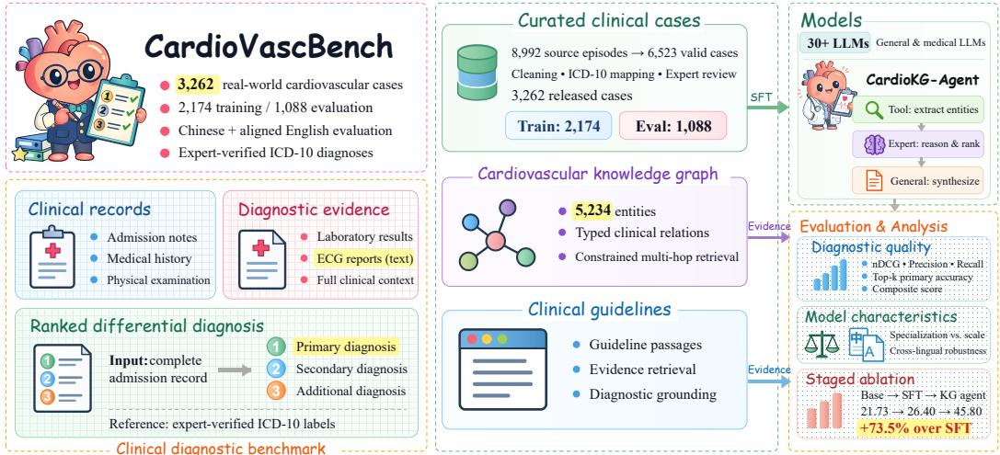  
Figure 1: Overview of CardioVascBench. Clinical records undergo cleaning, ICD-10 mapping, and expert adjudication to form training and evaluation sets. General and medical-specialized LLMs, together with the CardioKG-Agent baseline, are evaluated on prioritized diagnosis generation. The agent incorporates a cardiovascular knowledge graph and clinical guidelines.

We introduce CardioVascBench, a retrospective benchmark of Chinese cardiovascular inpatient records with ordered, ICD-10-standardized discharge diagnoses. Its 3,262 cases include 2,174 training and 1,088 evaluation cases. The benchmark retains variation in clinical narratives, specialist information in ECG reports, and primary–secondary diagnosis structure. A structure-preserving English translation provides an aligned evaluation setting (Appendix A).

A model may identify the primary diagnosis yet produce an imprecise or incomplete list of additional diagnoses. We therefore evaluate primary-diagnosis identification, coverage, and list precision separately, alongside a position-aware composite score motivated by diagnosis prioritization (Li et al., 2025; Nath et al., 2023). Discharge references support evaluation of prioritized diagnosis generation, but are not exhaustive sets of plausible diferential diagnoses. CardioKG-Agent serves as a baseline for studying knowledge augmentation (Figure 1).

We ask three research questions: (RQ1) how well models generate ordered discharge-diagnosis lists from real Chinese cardiovascular records; (RQ2) how primary-diagnosis identification, coverage, and precision difer across models and afect aggregate rankings; and (RQ3) what system-level improvements accompany structured knowledge and guideline evidence.

Our contributions are threefold: (1) a retrospective benchmark combining real Chinese clinical narratives, cardiovascular information, and ordered diagnosis labels; (2) an evaluation protocol separating primary-diagnosis identification, coverage, and list precision while accounting for terminology and rank; and (3) empirical comparisons of general, medical, and knowledge-enhanced systems, with CardioKG-Agent as a reproducible knowledge-enhanced baseline. The protocol is clinically motivated; its agreement with physician assessment remains an open validation question.

## 2 RELATED WORK

## 2.1 MEDICAL REASONING BENCHMARKS AND AGENTS

Established benchmarks assess medical knowledge through exam questions (MedQA (Jin et al., 2021)), biomedical research question answering (PubMedQA (Jin et al., 2019)), multitask knowledge tests (MMLU (Hendrycks et al., 2021)), and clinical natural language inference (MedNLI (Romanov & Shivade, 2018)). More recent evaluations cover broader medical tasks, clinical cases, and automated reasoning assessment (Wu et al., 2025; Qiu et al., 2025; Zhou et al., 2026). AnesSuite evaluates specialty reasoning in anesthesiology at multiple levels of complexity (Feng et al., 2026), while LiveClin uses periodically refreshed case reports to evaluate clinical pathways and reduce contamination risk (Wang et al., 2026). These developments motivate stating precisely which clinical task a benchmark measures

Clinical-record and signal benchmarks provide complementary perspectives. MIMIC-III supports research with intensive-care records (Johnson et al., 2016); Context Clues studies context length and robustness when modeling longitudinal sequences of EHR events (Wornow et al., 2025). Cardiovascular evaluations include ECG-based mortality and risk estimation (Sau et al., 2024) and comparisons of ECG foundation models across diverse clinical tasks (Al-Masud et al., 2026). CardioVascBench instead evaluates ordered diagnosis generation from Chinese inpatient narratives and ECG reports, with separate measures of primary-diagnosis identification, coverage, and list precision.

Agent evaluations also distinguish answer quality from successful interaction with an environment. MedicalAgentsBench compares reasoning models and agent frameworks on challenging medical questions (Shao et al., 2026); MedAgentBench tests clinical tasks in an interactive EHR environment (Jiang et al., 2025), and MedAgentGym provides executable biomedical data-science tasks with verifiable feedback (Xu et al., 2026a). AMEGA evaluates guideline adherence through openended clinical scenarios (Fast et al., 2024). These settings assess capabilities beyond diagnosis-list agreement: our knowledge-enhanced baseline is evaluated on its final diagnoses, without claiming to measure environment interaction or guideline adherence directly.

## 2.2 MULTILINGUAL CLINICAL EVALUATION

Language coverage remains an important dimension of medical evaluation. Widely used resources such as MIMIC-IV (Johnson et al., 2023), PubMedQA, and MedQA include English clinical or biomedical content, while documentation practices and diagnostic terminology vary across languages. MMedC/MMedBench extends multilingual medical QA and rationale generation (Qiu et al., 2024); MedAraBench contributes Arabic medical multiple-choice questions across specialties (Abu-Daoud et al., 2026). Chinese biomedical understanding and clinical information extraction are supported by CBLUE and unified annotation frameworks (Zhang et al., 2022; Zhu et al., 2023). CardioVascBench complements these resources with authentic Chinese cardiovascular inpatient records and ordered diagnosis references; its English translation provides an aligned evaluation setting rather than an independent English patient cohort.

## 3 CARDIOVASCBENCH DATASET

## 3.1 DATASET OVERVIEW AND CLINICAL TASK

CardioVascBench contains 3,262 released, de-identified cardiovascular cases: 2,174 for training and 1,088 for evaluation (Table 1). Each case represents a clinical episode with admission notes, medical history, physical examinations, laboratory results, ECG reports, and expert-verified ICD-10 diagnoses. The evaluation cases exhibit high completeness for demographics and core history, with an average case length of 554.79 Chinese characters. Detailed statistics and dificulty analyses are provided in Appendix A. Reference-list cardinality is summarized in Table 1; Figure 2 shows primarydiagnosis groups. Figure 3 shows input and reference-diagnosis text lengths for the aligned Chinese and English evaluation sets; these are character counts, not token counts.

The task is prioritized diagnosis generation: given the available narrative and examination reports for an inpatient episode, generate an ordered diagnosis list with the primary diagnosis first, followed by secondary conditions. The reference is the expert-verified hospital discharge-diagnosis list. A plausible diferential candidate absent from that list is a non-match under this protocol, but is not necessarily clinically incorrect.

It is important to distinguish between clinical reasoning and coding. In this benchmark, ICD-10 codes serve as the standardized label space for evaluation purposes, enabling rigorous quantitative alignment between model outputs and expert-verified hospital discharge diagnoses. We acknowledge that ICD-10 is a classification system for epidemiological and billing purposes, which may not fully capture the granular nuance of clinical pathophysiology. However, it provides a necessary, fixed vocabulary for automated benchmarking.

<table><tr><td>Dataset</td><td>Max</td><td>Mean</td></tr><tr><td>Train-ZH</td><td>10</td><td>1.12</td></tr><tr><td>Eval-ZH</td><td>5</td><td>1.09</td></tr><tr><td>Eval-EN</td><td>5</td><td>1.09</td></tr></table>

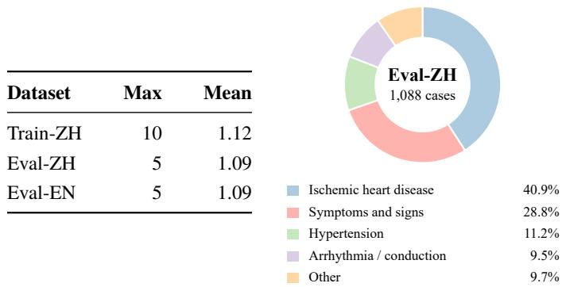

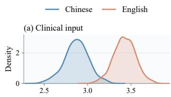

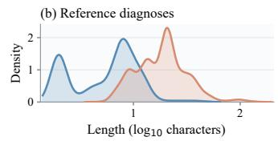  
Table 1: Diagnosis counts. Figure 2: Primary diagnoses. ICD-10 Figure 3: Text lengths. Chinese Maximum and mean entries groups in the evaluation set. and English evaluation records; nonper case. whitespace characters.

Scope and Boundaries. This benchmark focuses exclusively on the diagnostic phase of clinical care. It does not evaluate downstream clinical tasks such as treatment planning (medication selection, dosage adjustment), procedural recommendations (e.g., PCI vs. CABG), or prognostic assessment. Models are assessed solely on their ability to integrate clinical narratives and examination reports into an accurate and prioritized diagnostic list.

Clinical reasoning foundation. The protocol is motivated by clinical information integration and diagnosis prioritization (Singhal et al., 2023; Bowen, 2006; Moor et al., 2023). It assesses resulting diagnosis lists against discharge references, without directly evaluating intermediate reasoning. CardioKG-Agent implements a structured baseline workflow; similarity to a clinical workflow does not establish reasoning fidelity.

## 3.2 DATASET CURATION

The source cohort comprises 8,992 de-identified inpatient episodes from a tertiary cardiology department in China. Records are assembled from admission notes, ECG examination reports, medication and test orders, and structured discharge diagnoses. Cleaning and quality control yield 6,523 valid cases (Figure 1).

DiagnosisICD10Matcher combines semantic matching with SapBERT (Liu et al., 2021), keyword matching, fuzzy matching, and rule-based matching. A multi-LLM voting system assists candidate refinement, while experienced cardiologists make the final adjudications. This process yields the released training set and 1,088 high-confidence evaluation cases. Appendix A details the processing pipeline and source tables.

Multilingual evaluation. All evaluation cases are translated into English using a structurepreserving LLM pipeline, preserving the data schema, diagnosis ordering, and gold-standard ICD-10 labels. Disease names are normalized against an oficial English ICD-10 reference. The English data are used exclusively for evaluation, enabling controlled cross-lingual comparison.

## 4 BENCHMARK EVALUATION

## 4.1 EVALUATION PROTOCOL

Benchmarked LLMs. We evaluated 30+ state-of-the-art models, categorizing them into General-Purpose (e.g., GPT-4o (OpenAI et al., 2024), DeepSeek-V3.2 (DeepSeek-AI et al., 2025)) and Medical-Specialized models (e.g., Lingshu-7B (Xu et al., 2026b), HuatuoGPT-o1-72B (Chen et al., 2025)). Models were tasked with generating an ordered diagnosis list for each case. Table 2 reports representative models used in our comparisons; Appendix D preserves the complete results. Evaluation prompts are provided in Appendix F.

Table 2: Main evaluation results on CardioVascBench. Representative models spanning the groups and comparisons discussed in the text. Values retain the original reporting scale; bold and underlined entries mark the highest and second-highest values per column in this table. Complete results for all 36 systems are in Appendix D.
<table><tr><td>Model</td><td>nDCG @10</td><td>Precision @10</td><td>Recall @10</td><td>Top-1</td><td>Top-3</td><td>Score</td></tr><tr><td colspan="7">Medical-specialized LLMs</td></tr><tr><td>BioMistral-7B</td><td>49.2</td><td>14.2</td><td>13.5</td><td>7.6</td><td>7.6</td><td>11.4</td></tr><tr><td>HuatuoGPT-o1-7B</td><td>59.7</td><td>28.7</td><td>37.1</td><td>24.3</td><td>27.1</td><td>25.4</td></tr><tr><td>Lingshu-7B</td><td>61.9</td><td>32.0</td><td>40.9</td><td>24.7</td><td>27.7</td><td>28.2</td></tr><tr><td>II-Medical-8B</td><td>58.9</td><td>32.1</td><td>38.7</td><td>22.3</td><td>23.9</td><td>28.0</td></tr><tr><td>HuatuoGPT-o1-72B</td><td>62.2</td><td>18.3</td><td>45.0</td><td>36.6</td><td>41.3</td><td>19.5</td></tr><tr><td>OpenBioLLM-70B</td><td>58.8</td><td>30.8</td><td>34.8</td><td>14.6</td><td>16.5</td><td>25.6</td></tr><tr><td colspan="7">General-purpose open-source LLMs</td></tr><tr><td>Qwen2.5-7B-Instruct</td><td>58.2</td><td>30.8</td><td>36.3</td><td>25.1</td><td>27.8</td><td>26.8</td></tr><tr><td>Qwen2.5-VL-7B-Instruct</td><td>60.9</td><td>28.4</td><td>39.5</td><td>29.2</td><td>32.8</td><td>25.7</td></tr><tr><td>Llama3-8B-Instruct</td><td>57.7</td><td>15.3</td><td>29.2</td><td>16.0</td><td>19.3</td><td>15.2</td></tr><tr><td>Qwen3-8B</td><td>59.4</td><td>24.8</td><td>38.5</td><td>25.9</td><td>29.4</td><td>22.9</td></tr><tr><td>Llama3-70B-Instruct</td><td>60.0</td><td>10.7</td><td>38.7</td><td>19.3</td><td>23.1</td><td>12.7</td></tr><tr><td>Deepseek-v3.2</td><td>61.9</td><td>16.0</td><td>43.4</td><td>33.9</td><td>40.7</td><td>17.2</td></tr><tr><td>Kimi-K2</td><td>60.8</td><td>22.0</td><td>41.3</td><td>32.0</td><td>34.9</td><td>21.4</td></tr><tr><td colspan="7">Proprietary LLMs</td></tr><tr><td>GPT-40</td><td>63.8</td><td>12.6</td><td>44.6</td><td>30.6</td><td>36.3</td><td>14.9</td></tr><tr><td>GPT-5.2</td><td>66.1</td><td>11.9</td><td>48.8</td><td>39.0</td><td>45.8</td><td>14.8</td></tr><tr><td>Grok-4</td><td>63.6</td><td>13.9</td><td>45.5</td><td>34.9</td><td>39.2</td><td>16.1</td></tr><tr><td>Claude-sonnet-4.5</td><td>65.0</td><td>11.4</td><td>53.0</td><td>47.1</td><td>55.6</td><td>15.1</td></tr><tr><td>Qwen3-max</td><td>62.8</td><td>14.7</td><td>45.3</td><td>32.5</td><td>39.0</td><td>16.7</td></tr><tr><td colspan="7">Agent-enhanced systems</td></tr><tr><td>Lingshu-7B + Agent</td><td>65.2</td><td>50.9</td><td>49.7</td><td>43.9</td><td>43.9</td><td>44.3</td></tr><tr><td>HuatuoGPT-o1-7B + Agent</td><td>65.7</td><td>53.4</td><td>52.2</td><td>46.3</td><td>46.3</td><td>46.4</td></tr><tr><td> $\mathrm { O p e n B i o L L M - 7 0 B + A g e n t }$ </td><td>66.0</td><td>53.8</td><td>52.4</td><td>46.5</td><td>46.5</td><td>46.7</td></tr></table>

Diagnosis-list metrics. Diagnostic texts are normalized, and SapBERT matches predictions to reference diagnoses or ICD-10 aliases using a cosine-similarity threshold of 0.80. Predictions are discounted by rank, while earlier gold diagnoses receive higher importance. We report nDCG, precision, recall, and top-k primary-diagnosis accuracy. The composite score is

$$
\mathrm { F i n a l S c o r e } = \mathrm { n D C G } \left( 0 . 7 + 0 . 3 \mathrm { P r i m a r y H i t } \right) \mathrm { P r e c i s i o n } ^ { \beta } ,\tag{1}
$$

where PrimaryHit indicates a match to the primary diagnosis and $\beta$ controls the precision penalty.   
Appendix B gives the full definitions and clinical rationale.

## 4.2 KNOWLEDGE-ENHANCED BASELINE

We include CardioKG-Agent as a knowledge-enhanced baseline for the benchmark. It combines entity normalization, constrained retrieval from a cardiovascular knowledge graph, and guideline evidence to generate an ordered diagnosis list. Architecture and implementation details are provided in Appendix C (Figure 10).

Comparison scope. This baseline has access to external knowledge and guidelines, whereas the base models rely on parametric memory. Comparisons measure system-level performance under diferent information access and inference budgets; they do not isolate an architectural contribution.

## 4.3 MAIN EVALUATION RESULTS

Primary diagnosis versus list quality (RQ2). Claude-sonnet-4.5 has higher Top-1 accuracy and Recall@10 than Lingshu-7B (47.1 versus 24.7, and 53.0 versus 40.9), but lower Precision@10 (11.4 versus 32.0) and final score (15.1 versus 28.2; Table 2). The ranking reversal illustrates that primarydiagnosis accuracy and reference-based list quality capture diferent aspects of model performance. Whether the composite ranking better agrees with physician judgment remains to be evaluated.

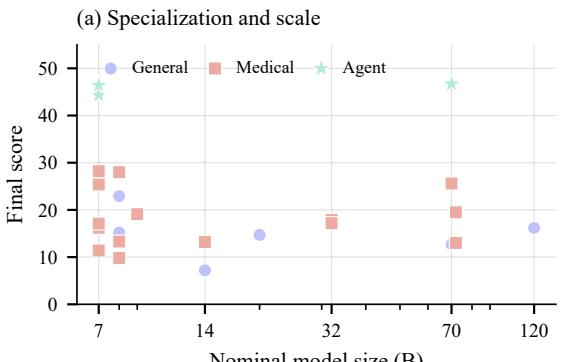  
Nominal model size (B)

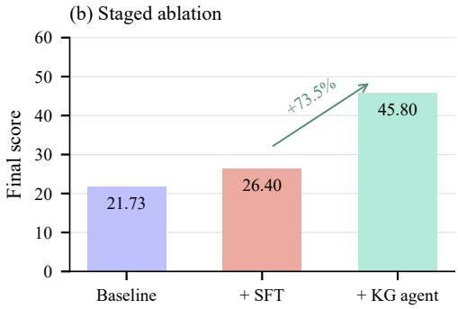

Figure 4: Model scale and staged ablation. (a) Final scores for models with a stated parameter count, using the original table values and medical-model classifications. Agent markers use the base model’s nominal size. (b) Mean scores for the three ablation configurations. The +73.5% gain compares SFT with SFT plus the KG agent.  
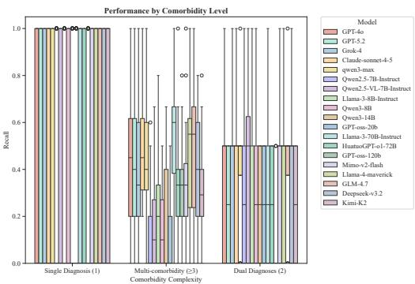  
(a) General LLMs

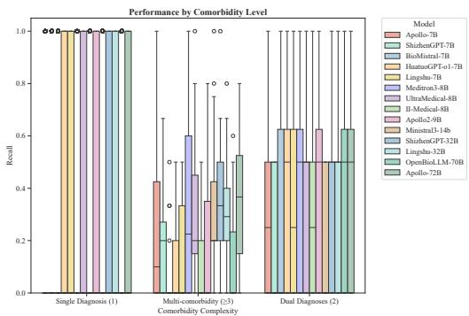  
(b) Medical LLMs  
Figure 5: Performance across reported diagnosis-count groups. General and medical LLMs are compared using the groupings in the original analysis. Stored reference-diagnosis counts do not establish clinical comorbidity prevalence; correspondence between the plotted groups and the prepared evaluation labels requires verification.

Specialization and scale. Smaller medical models can obtain higher composite scores: HuatuoGPTo1-7B scores 25.4 versus 19.5 for its 72B counterpart. Lingshu-7B and II-Medical-8B score 28.2 and 28.0 versus 15.2 for Llama3-8B-Instruct. These are metric-specific associations across systems with diferent training and output behavior, rather than evidence that specialization dominates all diagnostic abilities.

## 5 ABLATION AND ANALYSIS

## 5.1 MODEL CHARACTERISTICS

Specialization and scale. Figure 4(a) summarizes the relationship between model size and final score. Larger parameter counts do not guarantee better performance on this specialized task. Medical models at smaller scales can outperform much larger general-purpose models, while the agentenhanced systems obtain the highest composite scores in the reported table.

Figure 5 presents the original comparison across reported diagnosis-count groups. These results are descriptive and do not isolate an efect of domain-specific training. The prepared evaluation set contains only 36 cases with multiple reference entries (Appendix A), limiting conclusions about multi-diagnosis coverage. The plotted group assignments also require reconciliation with these labels before clinical comorbidity diferences can be inferred.

Table 3: Staged ablation results. Mean values across the three original baselines; ∆Score is relative to the preceding stage.
<table><tr><td>Config.</td><td>NDCG@10 Precision@10 Recall@10</td><td></td><td></td><td></td><td> Top-1 Score ∆Score</td><td></td></tr><tr><td>Baseline (base LLMs)</td><td>59.70</td><td>23.30</td><td>38.17</td><td>24.53</td><td>21.73</td><td></td></tr><tr><td>+SFT</td><td>60.13</td><td>30.50</td><td>37.60</td><td>21.20</td><td>26.40</td><td>+21.5%</td></tr><tr><td>+SFT + KG_agent</td><td>65.63</td><td>52.70</td><td>51.43</td><td></td><td>45.57 45.80+73.5%</td><td></td></tr></table>

## 5.2 STAGED ABLATION

The staged comparison evaluates Qwen2.5-VL-7B-Instruct, Qwen2.5-7B-Instruct, and Llama3-70B-Instruct on 1,088 cases. The mean final score increases from 21.73 for base LLMs to 26.40 with SFT, and to 45.80 with SFT plus the KG agent (Table 3). The last change is a 73.5% relative gain over SFT. This is a system-level improvement (RQ3); it does not isolate graph retrieval from guidelines, orchestration, or additional inference budget. Attribution requires the same backbone and comparable budgets across text RAG, graph retrieval, guideline retrieval, and the full system. All reported metrics are in Appendix E.

## 5.3 MISDIAGNOSIS PATTERNS

We compare Qwen2.5-VL-7B-Instruct, Lingshu-7B, and Lingshu-7B-AGENT using confusion matrices and diagnostic-flow diagrams (Appendix E.3). The general model displays scattered errors, while the medical model has a tighter diagnostic focus but retains confusion between clinically similar conditions. The agent shows clearer diagonal alignment and more consistent flows toward correct diagnoses. These patterns motivate physician review and confirmatory evidence for high-risk diferential diagnoses; they do not establish readiness for autonomous clinical deployment.

## 6 LIMITATIONS

Discharge references are not exhaustive diferential-diagnosis sets, and unmatched candidates are not necessarily hallucinations. Output length, matching rules, and metric weights may influence rankings. Blinded physician assessment, controlled output counts, and weight/matching sensitivity studies are needed to validate the protocol. Historical audits found ECG diagnostic-conclusion fields in all 1,088 evaluation records; absent timestamps and patient linkage prevent certification of a prospective index time or patient-disjoint evaluation. Results are retrospective and episode-level, with input-version provenance requiring verification (Appendix B). Single-center data limit generalization, and translation can afect cross-lingual comparisons. Agent gains involve diferent information access and budgets. Neither safety nor reasoning fidelity has been directly evaluated.

## 7 CONCLUSION

CardioVascBench studies prioritized diagnosis generation from real Chinese cardiovascular records. Its evaluation separates primary-diagnosis identification, coverage, and list precision, exposing differences hidden by a single hit rate. CardioKG-Agent serves as a baseline for knowledge-enhanced generation, with gains over the reported SFT configuration. Physician validation of metric rankings and controlled component comparisons remain necessary next steps.

## ETHICS STATEMENT

This retrospective study was approved by the Institutional Review Board of the First Hospital of Hebei Medical University (Protocol: HDYY-LW-25002). Informed consent was waived because the records were retrospectively collected and de-identified. Patient identifiers were removed before analysis. The evaluated models are for research purposes and are not diagnostic-grade systems. Clinical use requires physician oversight and consideration of patient safety and equitable access.

## REPRODUCIBILITY STATEMENT

Dataset curation and statistics are described in Section 3 and Appendix A; the task and evaluation equations are in Section 4 and Appendix B. Appendix C describes the agent, Appendix D reports complete results, and Appendix F provides the original evaluation prompts.

## DATA AND CODE AVAILABILITY

The evaluation scripts, agent implementation, and data processing pipelines are available on GitHub at https://github.com/muyaoc/CardioVascBench. The dataset can be downloaded from OpenI at https://openi.pcl.ac.cn/datasets/detail/cindyc/CardioVascBench.

## ACKNOWLEDGEMENTS

This work is supported by the Major Key Project of Pengcheng Laboratory (PCL2025A12-3) and the National Natural Science Foundation for Young Scholars of China (No. 62103206). This work is also supported by the China Hebei International Joint Research Center for Structural Heart Disease, the Science and Technology Program of Hebei Province (Grant No. 22377719D), the Hebei Province Finance Department Project (Grant No. LS202101), the Hebei Province Higher Education Science and Technology Research Project (Grant No. CXZX2025030), the Hebei Provincial Government-Funded Clinical Talent Project (Grant No. ZF2025062), the Research on Clinical Application of Medical Artificial Intelligence Program of the Hospital Management Institute of the National Health Commission (Grant Nos. YLXX24AIA008 and YLXX24AIA026), the National Natural Science Foundation of China (Grant No. 62202248), and the Science and Technology Planning Project of Guangdong Science and Technology Department under Grant Guangdong Key Laboratory of Advanced IntelliSense Technology (2019B121203006).

## COMPETING INTERESTS

The authors declare no competing interests.

## AI USE STATEMENT

The first draft was written by the authors. GPT-5.2 was used for copy-editing (grammar, spelling) assistance and research queries on related work and references. Prototypes of some icons in the architecture diagram were generated by Gemini-3-Pro, and the authors modified these prototypes into suitable vector graphics. OpenAI Codex assisted with editorial restructuring, LaTeX formatting, figure layout, preparation of an overview schematic, and redrawing plots from the reported tables.

## REFERENCES

Mouath Abu-Daoud, Leen Kharouf, Omar El Hajj, Dana El Samad, Mariam Al-Omari, Jihad Mallat, Khaled Saleh, Nizar Habash, and Farah E. Shamout. MedAraBench: Large-scale Arabic medical question answering dataset and benchmark. In The Fourteenth International Conference on Learning Representations, 2026. URL https://proceedings.iclr.cc/paper\_files/ paper/2026/hash/16db78d4400e15d4ae26d6852265eb22-Abstract-Conference.html.

M. A. Al-Masud, Juan Miguel Lopez Alcaraz, and Nils Strodthof. Benchmarking ECG FMs: A reality check across clinical tasks. In The Fourteenth International Conference on Learning Representations, 2026. URL https://proceedings.iclr.cc/paper\_files/paper/2026/hash/ ed49dc4569d0c93dab63c6e0a045f6c5-Abstract-Conference.html.

Judith L Bowen. Educational strategies to promote clinical diagnostic reasoning. New England Journal ofMedicine, 355(21):2217–2225, 2006. doi: 10.1056/NEJMra054782.

Eugene Braunwald. Cardiovascular medicine at the turn of the millennium: Triumphs, concerns, and opportunities. New England Journal ofMedicine, 337(19):1360–1369, 1997. doi: 10.1056/ nejm199711063371906.

Junying Chen, Zhenyang Cai, Ke Ji, Xidong Wang, Wanlong Liu, Rongsheng Wang, and Benyou Wang. Towards medical complex reasoning with LLMs through medical verifiable problems. In Findings of the Association for Computational Linguistics: ACL 2025, pp. 14552–14573, 2025. doi: 10.18653/v1/2025.findings-acl.751.

DeepSeek-AI, Aixin Liu, Aoxue Mei, Bangcai Lin, Bing Xue, Bingxuan Wang, Bingzheng Xu, Bochao Wu, Bowei Zhang, Chaofan Lin, et al. DeepSeek-V3.2: Pushing the frontier of open large language models. arXiv preprint arXiv:2512.02556, 2025. URL https://arxiv.org/ abs/2512.02556.

Dennis Fast, Lisa C. Adams, Felix Busch, Conor Fallon, Marc Huppertz, Robert Siepmann, Philipp Prucker, Nadine Bayerl, Daniel Truhn, Marcus Makowski, et al. Autonomous medical evaluation for guideline adherence of large language models. npj Digital Medicine, 7(1):358, 2024. doi: 10.1038/s41746-024-01356-6.

Xiang Feng, Wentao Jiang, Zengmao Wang, Yong Luo, Pingbo Xu, Baosheng Yu, Hua Jin, and Jing Zhang. AnesSuite: A comprehensive benchmark and dataset suite for anesthesiology reasoning in LLMs. In The Fourteenth International Conference on Learning Repre sentations, 2026. URL https://proceedings.iclr.cc/paper\_files/paper/2026/hash/ e55b33430e344a1ee23710415b1c9d87-Abstract-Conference.html.

Alex J. Goodell, Simon N. Chu, Dara Rouholiman, and Larry F. Chu. Large language model agents can use tools to perform clinical calculations. npj Digital Medicine, 8(1):163, 2025. doi: 10.1038/ s41746-025-01475-8.

Paul Hager, Friederike Jungmann, Robbie Holland, Kunal Bhagat, Inga Hubrecht, Manuel Knauer, Jakob Vielhauer, Marcus Makowski, Rickmer Braren, Georgios Kaissis, et al. Evaluation and mitigation of the limitations of large language models in clinical decision-making. Nature Medicine, 30(9):2613–2622, 2024. doi: 10.1038/s41591-024-03097-1.

Dan Hendrycks, Collin Burns, Steven Basart, Andy Zou, Mantas Mazeika, Dawn Song, and Jacob Steinhardt. Measuring massive multitask language understanding. In International Conference on Learning Representations, 2021. URL https://openreview.net/forum?id=d7KBjmI3GmQ.

Yixing Jiang, Kameron C. Black, Gloria Geng, Danny Park, James Zou, Andrew Y. Ng, and Jonathan H. Chen. MedAgentBench: A virtual EHR environment to benchmark medical LLM agents. NEJM AI, 2(9), 2025. doi: 10.1056/AIdbp2500144.

Di Jin, Eileen Pan, Nassim Oufattole, Wei-Hung Weng, Hanyi Fang, and Peter Szolovits. What disease does this patient have? a large-scale open domain question answering dataset from medical exams. Applied Sciences, 11(14):6421, 2021. doi: 10.3390/app11146421.

Qiao Jin, Bhuwan Dhingra, Zhengping Liu, William Cohen, and Xinghua Lu. PubMedQA: A dataset for biomedical research question answering. In Proceedings ofthe 2019 Conference on Empirical Methods in Natural Language Processing and the 9th International Joint Conference on Natural Language Processing (EMNLP-IJCNLP), pp. 2567–2577, 2019. doi: 10.18653/v1/d19-1259. URL https://aclanthology.org/D19-1259/.

Qiao Jin, Zhizheng Wang, Yifan Yang, Qingqing Zhu, Donald Wright, Thomas Huang, Nikhil Khandekar, Nicholas Wan, Xuguang Ai, W. John Wilbur, et al. AgentMD: Empowering language agents for risk prediction with large-scale clinical tool learning. Nature Communications, 16(1): 9377, 2025. doi: 10.1038/s41467-025-64430-x.

Alistair E. W. Johnson, Lucas Bulgarelli, Lu Shen, Alvin Gayles, Ayad Shammout, Steven Horng, Tom J. Pollard, Sicheng Hao, Benjamin Moody, Brian Gow, et al. MIMIC-IV, a freely accessible electronic health record dataset. Scientific Data, 10(1):1, 2023. doi: 10.1038 s41597-022-01899-x.

Alistair E.W. Johnson, Tom J. Pollard, Lu Shen, Li-wei H. Lehman, Mengling Feng, Mohammad Ghassemi, Benjamin Moody, Peter Szolovits, Leo Anthony Celi, and Roger G. Mark. MIMIC-III, a freely accessible critical care database. Scientific Data, 3(1):160035, 2016. doi: 10.1038/sdata. 2016.35.

Ruochen Li, Jun Li, Bailiang Jian, Kun Yuan, and Youxiang Zhu. ReEvalMed: Rethinking medical report evaluation by aligning metrics with real-world clinical judgment. In Proceedings of the 2025 Conference on Empirical Methods in Natural Language Processing, pp. 11812–11826. Association for Computational Linguistics, 2025. doi: 10.18653/v1/2025.emnlp-main.598. URL https://aclanthology.org/2025.emnlp-main.598/.

Fangyu Liu, Ehsan Shareghi, Zaiqiao Meng, Marco Basaldella, and Nigel Collier. Self-alignment pretraining for biomedical entity representations. In Proceedings of the 2021 Conference of the North American Chapter of the Association for Computational Linguistics: Human Language Technologies, pp. 4228–4238, 2021. doi: 10.18653/v1/2021.naacl-main.334.

Michael Moor, Oishi Banerjee, Zahra Shakeri Hossein Abad, Harlan M. Krumholz, Jure Leskovec, Eric J. Topol, and Pranav Rajpurkar. Foundation models for generalist medical artificial intelligence. Nature, 616(7956):259–265, 2023. doi: 10.1038/s41586-023-05881-4.

Karl A. Nath, Lori A. Erickson, and Vesna D. Garovic. Primary and secondary diagnoses in medicine: Insights from Mayo Clinic consensus report on membranous nephropathy—executive summary. Mayo Clinic Proceedings, 98(11):1599–1601, 2023. doi: 10.1016/j.mayocp.2023.08.010.

Harsha Nori, Nicholas King, Scott Mayer McKinney, Dean Carignan, and Eric Horvitz. Capabilities of GPT-4 on medical challenge problems. arXiv preprint arXiv:2303.13375, 2023. URL https: //arxiv.org/abs/2303.13375.

OpenAI, Aaron Hurst, Adam Lerer, Adam P Goucher, Adam Perelman, Aditya Ramesh, Aidan Clark, AJ Ostrow, Akila Welihinda, Alan Hayes, et al. GPT-4o system card. arXiv preprint arXiv:2410.21276, 2024. URL https://arxiv.org/abs/2410.21276.

Pengcheng Qiu, Chaoyi Wu, Xiaoman Zhang, Weixiong Lin, Haicheng Wang, Ya Zhang, Yanfeng Wang, and Weidi Xie. Towards building multilingual language model for medicine. Nature Communications, 15(1):8384, 2024. doi: 10.1038/s41467-024-52417-z.

Pengcheng Qiu, Chaoyi Wu, Shuyu Liu, Yanjie Fan, Weike Zhao, Zhuoxia Chen, Hongfei Gu, Chuanjin Peng, Ya Zhang, Yanfeng Wang, et al. Quantifying the reasoning abilities of LLMs on clinical cases. Nature Communications, 16(1):9799, 2025. doi: 10.1038/s41467-025-64769-1.

Alexey Romanov and Chaitanya Shivade. Lessons from natural language inference in the clinical domain. In Proceedings of the 2018 Conference on Empirical Methods in Natural Language Processing, pp. 1586–1596. Association for Computational Linguistics, 2018. doi: 10.18653/v1/ d18-1187. URL https://aclanthology.org/D18-1187/.

Arunashis Sau, Libor Pastika, Ewa Sieliwonczyk, Konstantinos Patlatzoglou, Antônio H Ribeiro, Kathryn A McGurk, Boroumand Zeidaabadi, Henry Zhang, Krzysztof Macierzanka, Danilo Mandic, et al. Artificial intelligence-enabled electrocardiogram for mortality and cardiovascular risk estimation: A model development and validation study. The Lancet Digital Health, 6(11): e791–e802, 2024. doi: 10.1016/s2589-7500(24)00172-9.

Yanjun Shao, Xiangru Tang, Jiwoong Sohn, Jiapeng Chen, Yuxuan Liao, Jiayi Zhang, Jinyu Xiang, Fang Wu, Yilun Zhao, Chenglin Wu, et al. MedicalAgentsBench for complex medical reasoning: Comparing internalized reasoning models versus externalized agent-based frameworks. Patterns, pp. 101610, 2026. doi: 10.1016/j.patter.2026.101610.

Aaditya Singh, Adam Fry, Adam Perelman, Adam Tart, Adi Ganesh, Ahmed El-Kishky, Aidan McLaughlin, Aiden Low, AJ Ostrow, Akhila Ananthram, et al. OpenAI GPT-5 system card. arXiv preprint arXiv:2601.03267, 2026. URL https://arxiv.org/abs/2601.03267.

Karan Singhal, Shekoofeh Azizi, Tao Tu, S. Sara Mahdavi, Jason Wei, Hyung Won Chung, Nathan Scales, Ajay Tanwani, Heather Cole-Lewis, Stephen Pfohl, et al. Large language models encode clinical knowledge. Nature, 620(7972):172–180, 2023. doi: 10.1038/s41586-023-06291-2.

Mickael Tordjman, Zelong Liu, Murat Yuce, Valentin Fauveau, Yunhao Mei, Jerome Hadjadj, Ian Bolger, Haidara Almansour, Carolyn Horst, Ashwin Singh Parihar, et al. Comparative benchmarking of the DeepSeek large language model on medical tasks and clinical reasoning. Nature Medicine, 31(8):2550–2555, 2025. doi: 10.1038/s41591-025-03726-3.

Prashant Mani Tripathi, Ashish Kumar, Rama Komaragiri, and Manjeet Kumar. A review on computational methods for denoising and detecting ECG signals to detect cardiovascular diseases. Archives of Computational Methods in Engineering, 29(3):1875–1914, 2022. doi: 10.1007/s11831-021-09642-2.

Bowen Wang, Jiuyang Chang, Yiming Qian, Guoxin Chen, Junhao Chen, Zhouqiang Jiang, Jiahao Zhang, Yuta Nakashima, and Hajime Nagahara. DiReCT: Diagnostic reasoning for clinical notes via large language models. In Advances in Neural Information Processing Systems, volume 37, pp. 74999–75011, 2024a. doi: 10.52202/079017-2386. URL https://proceedings.neurips.cc/paper\_files/paper/2024/hash/ 892850bf793e03b5c410dfd9425b94c8-Abstract-Datasets\_and\_Benchmarks\_Track. html.

Xidong Wang, Shuqi Guo, Yue Shen, Junying Chen, Jian Wang, Jinjie Gu, Ping Zhang, Lei Liu, and Benyou Wang. LiveClin: A live clinical benchmark without leakage. In The Fourteenth International Conference on Learning Representations, 2026. URL https://proceedings.iclr.cc/paper\_files/paper/2026/hash/ 9f45b2d4ace7ae425e40c7c1d0d37e64-Abstract-Conference.html.

Yan-Ran Wang, Kai Yang, Yi Wen, Pengcheng Wang, Yuepeng Hu, Yongfan Lai, Yufeng Wang, Kankan Zhao, Siyi Tang, Angela Zhang, et al. Screening and diagnosis of cardiovascular disease using artificial intelligence-enabled cardiac magnetic resonance imaging. Nature Medicine, 30(5): 1471–1480, 2024b. doi: 10.1038/s41591-024-02971-2.

Christopher Y. K. Williams, Brenda Y. Miao, Aaron E. Kornblith, and Atul J. Butte. Evaluating the use of large language models to provide clinical recommendations in the Emergency Department. Nature Communications, 15(1):8236, 2024. doi: 10.1038/s41467-024-52415-1.

Michael Wornow, Suhana Bedi, Miguel Angel Fuentes Hernandez, Ethan Steinberg, Jason Alan Fries, Christopher Ré, Sanmi Koyejo, and Nigam H. Shah. Context Clues: Evaluating long context models for clinical prediction tasks on EHRs. In The Thirteenth International Conference on Learning Representations, 2025. URL https://proceedings.iclr.cc/paper\_files/ paper/2025/hash/2a246ec4437808525a088abae744c2d3-Abstract-Conference.html.

Chaoyi Wu, Pengcheng Qiu, Jinxin Liu, Hongfei Gu, Na Li, Ya Zhang, Yanfeng Wang, and Weidi Xie. Towards evaluating and building versatile large language models for medicine. npj Digital Medicine, 8(1):58, 2025. doi: 10.1038/s41746-024-01390-4.

xAI. Grok 4. Online, 2025. URL https://x.ai/news/grok-4. Accessed: 2026-09-26.

Ran Xu, Yuchen Zhuang, Yishan Zhong, Yue Yu, Zifeng Wang, Xiangru Tang, Hang Wu, May D. Wang, Peifeng Ruan, Donghan Yang, et al. MedAgentGym: A scalable agentic training environment for code-centric reasoning in biomedical data science. In The Fourteenth International Conference on Learning Representations, 2026a. URL https://proceedings.iclr.cc/paper\_files/paper/2026/hash/ 911ca386fecaf7ebac35bb64733050fc-Abstract-Conference.html.

Weiwen Xu, Hou Pong Chan, Long Li, Mahani Aljunied, Ruifeng Yuan, Jianyu Wang, Chenghao Xiao, Guizhen Chen, Chaoqun Liu, Zhaodonghui Li, et al. Lingshu: Generalist foundation model for unified multimodal medical understanding and reasoning. IEEE Transactions on Pattern Analysis and Machine Intelligence, pp. 1–18, 2026b. doi: 10.1109/tpami.2026.3730310. Early Access.

Ryuichiro Yagi, Yuichiro Mori, Shinichi Goto, Taku Iwami, and Kosuke Inoue. Routine electrocardiogram screening and cardiovascular disease events in adults. JAMA Internal Medicine, 184(9): 1035–1044, 2024. doi: 10.1001/jamainternmed.2024.2270.

An Yang, Anfeng Li, Baosong Yang, Beichen Zhang, Binyuan Hui, Bo Zheng, Bowen Yu, Chang Gao, Chengen Huang, Chenxu Lv, et al. Qwen3 technical report. arXiv preprint arXiv:2505.09388, 2025. URL https://arxiv.org/abs/2505.09388.

Ningyu Zhang, Mosha Chen, Zhen Bi, Xiaozhuan Liang, Lei Li, Xin Shang, Kangping Yin, Chuanqi Tan, Jian Xu, Fei Huang, et al. CBLUE: A Chinese biomedical language understanding evaluation benchmark. In Proceedings of the 60th Annual Meeting of the Association for Computational Linguistics (Volume 1: Long Papers), pp. 7888–7915, 2022. doi: 10.18653/v1/2022.acl-long.544.

Shuang Zhou, Wenya Xie, Jiaxi Li, Zaifu Zhan, Meijia Song, Han Yang, Cheyenna Espinoza, Lindsay Welton, Xinnie Mai, Yanwei Jin, et al. Automating expert-level medical reasoning evaluation of large language models. npj Digital Medicine, 9(1):34, 2026. doi: 10.1038/s41746-025-02208-7.

Enwei Zhu, Qilin Sheng, Huanwan Yang, Yiyang Liu, Ting Cai, and Jinpeng Li. A unified framework of medical information annotation and extraction for Chinese clinical text. Artificial Intelligence in Medicine, 142:102573, 2023. doi: 10.1016/j.artmed.2023.102573.

## Appendix

A Dataset Construction and Statistics 14   
A.1 Source cohort and processing 14   
A.2 Dataset characteristics 15   
A.3 Dificulty Analysis . 16   
B Clinical Task and Evaluation Protocol 17   
B.1 Clinical reasoning foundation . 17   
B.2 Clinical task definition . 17   
B.3 Evaluation framework . 18   
B.4 Clinical motivation for prioritization 19   
C Knowledge-Enhanced Baseline: CardioKG-Agent 20   
D Complete Benchmark Results 20   
E Additional Analyses 22   
E.1 Original ablation visualization . 22   
E.2 Diagnosis-count group comparison 22   
E.3 Misdiagnosis patterns and diagnostic flows 23   
E.4 Additional experimental results 23   
F Benchmark Prompts 25   
F.1 System Prompt . 25   
F.2 User Prompt Template . 25   
G Extended Discussion 26

## A DATASET CONSTRUCTION AND STATISTICS

## A.1 SOURCE COHORT AND PROCESSING

The dataset comprises 8,992 de-identified cardiovascular inpatient episodes collected from the cardiology department of a tertiary hospital in China. Each episode is indexed by a unique anonymized identifier and assembled from four hospital tables: (1) admission record text, including admission note title, chief complaint, present illness, and past medical history; (2) ECG examination reports (7,362 episodes, 18,463 reports in total), containing examination items, findings, and ECG diagnoses when available; (3) medication and test orders (583,712 orders across all episodes), including order category, type, name, frequency, dose count, and administration route; and (4) structured discharge diagnoses (6,713 episodes, 7,786 diagnosis entries) with ordered ranks.

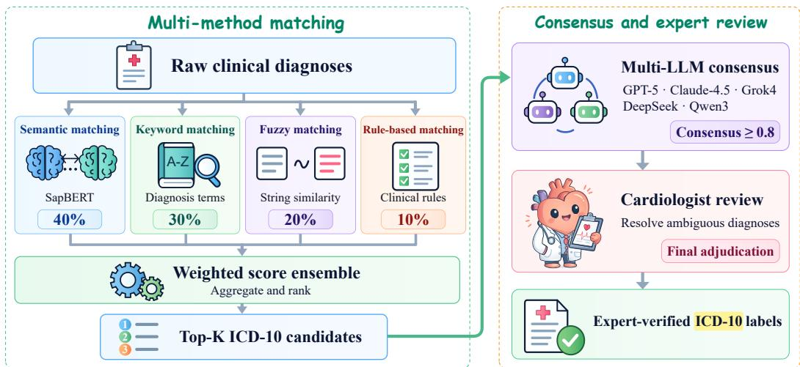  
Figure 6: Multi-Method ICD-10 Matching Architecture. The framework integrates four distinct matching strategies—Semantic Matching (using SapBERT embeddings), Keyword Matching, Fuzzy Matching, and Rule-Based Matching—to map raw hospital diagnoses to standardized ICD-10 codes. A Multi-LLM voting mechanism (comprising GPT-5, Claude-4.5, Grok4, DeepSeek, and Qwen3) is subsequently employed to resolve ambiguities and refine candidate matches, ensuring high-precision diagnostic labeling for the benchmark. Ultimately, the final adjudications, particularly for controversial or ambiguous diagnoses, were determined by experienced cardiologists.

Ethical Approval and Data Governance. This study was approved by the Institutional Review Board of the First Hospital of Hebei Medical University (Protocol: HDYY-LW-25002). Given the retrospective nature of the study and complete de-identification of patient records, the requirement for informed consent was waived. All data were processed in compliance with relevant data protection regulations. Patient identifiers were removed prior to analysis, and the de-identified dataset underwent additional review to ensure no re-identification risk.

To map raw hospital diagnoses to ICD-10 codes, we developed an ensemble algorithm, DiagnosisICD10Matcher, integrating multi-matching strategies: Semantic Matching (SapBERT (Liu et al., 2021) embeddings), Keyword Matching, Fuzzy Matching, and Rule-Based Matching. We further implemented a multi-LLM voting system (GPT-5 (Singh et al., 2026), Claude-4.5, Grok4 (xAI, 2025), DeepSeek, Qwen3 (Yang et al., 2025)) to assist in refining candidates ( Figure 6). From the initial 8,992 episodes, we identified 6,523 valid cases. The results in question shall be determined by experienced doctors and experts. The final dataset comprises 2,174 cases for training and 1,088 high-confidence (exact match) cases for evaluation (total 3,262).

Multilingual (English) Evaluation Data. To support multilingual evaluation, we further construct an English evaluation dataset derived from the original Chinese benchmark. All evaluation cases are translated into English using a structure-preserving large language model pipeline, ensuring identical data schema, diagnostic ordering, and gold-standard ICD-10 labels.

To reduce translation-induced variability in disease naming, ICD-10 codes in the translated data are aligned with an oficial English ICD-10 reference, and disease names are normalized accordingly.

The resulting English dataset is used exclusively for evaluation, enabling controlled cross-lingual comparison without introducing additional data heterogeneity.

## A.2 DATASET CHARACTERISTICS

Descriptive-statistics convention. The training set has 2,174 cases, a maximum of 10 reference diagnosis entries, and a mean of 1.12. Both evaluation-language files contain the same 1,088 case IDs and reference-list cardinalities (maximum 5, mean 1.09). Within the evaluation set, 1,052 cases contain one entry, 12 contain two, and 24 contain three or more. Counts refer to stored reference entries without deduplication, not to inferred comorbidity prevalence. The primary-diagnosis composition in Figure 2 uses the first reference entry and mutually exclusive ICD-10 groups: I20–I25 (ischemic heart disease), R00–R99 (symptoms and signs), I10–I15 (hypertension), I44–I49 (arrhythmia/conduction disorders), and all remaining codes (other). These are code-based descriptive groups, not new clinical annotations. For Figure 3, input length sums non-whitespace Unicode characters in string values of the medical-record and ECG-report fields, excluding keys, IDs, and outputs. Reference length includes diagnosis names only, excluding ICD codes and aliases. Curves are Gaussian kernel density estimates of log lengths. These descriptive statistics use the existing prepared data files; they do not resolve the per-run input provenance discussed in Appendix B.

CardioVascBench contains 3,262 released, de-identified cardiovascular cases: 2,174 training cases and 1,088 evaluation cases. They were selected from 8,992 source episodes and 6,523 cases retained after cleaning. The records combine clinical narratives and ECG reports with ICD-10-standardized discharge references. Section 3 describes the cleaning, standardization, and adjudication process.

The evaluation set has reported completeness of 100% for demographics and core history, with an average case length of 554.79 Chinese characters. Of its 1,088 cases, 24 (2.2%) contain three or more stored reference entries; these counts describe reference-list cardinality rather than clinical comorbidity prevalence. The diagnosis-frequency summaries and input-characteristic analyses are shown below. Their source populations and input versions should be distinguished from the prepared evaluation-set statistics above.

We present the detailed distribution of the top 20 diagnoses in our study population (Table 4) and visualize the characteristic long-tail disease distribution of the CardioVascBench dataset (Figure 7). These data illustrate the complexity and real-world nature of the clinical scenarios included in our benchmark.

Table 4: Distribution of Top 20 Diagnoses in the Study Population
<table><tr><td>Rank</td><td>Diagnosis Name</td><td>Count</td><td>Proportion</td></tr><tr><td>1</td><td>Coronary Heart Disease</td><td>2,054</td><td>26.4%</td></tr><tr><td>2</td><td>Coronary Atherosclerotic Heart Disease</td><td>592</td><td>7.6%</td></tr><tr><td>3</td><td>Chest Pain</td><td>491</td><td>6.3%</td></tr><tr><td>4</td><td>Chest Tightness</td><td>444</td><td>5.7%</td></tr><tr><td>5</td><td>Unstable Angina</td><td>439</td><td>5.6%</td></tr><tr><td>6</td><td>Hypertension Stage 3</td><td>326</td><td>4.2%</td></tr><tr><td>7</td><td>Palpitations</td><td>211</td><td>2.7%</td></tr><tr><td>8</td><td>Arrhythmia</td><td>171</td><td>2.2%</td></tr><tr><td>9</td><td>Hypertension Stage 3 (Very High Risk)</td><td>154</td><td>2.0%</td></tr><tr><td>10</td><td>Syncope</td><td>137</td><td>1.8%</td></tr><tr><td>11</td><td>Hypertension</td><td>132</td><td>1.7%</td></tr><tr><td>12</td><td>Chronic Heart Failure</td><td>131</td><td>1.7%</td></tr><tr><td>13</td><td>Paroxysmal Atrial Fibrillation</td><td>117</td><td>1.5%</td></tr><tr><td>14</td><td>Hyperlipidemia</td><td>108</td><td>1.4%</td></tr><tr><td>15</td><td>Atrial Fibrillation [Atrial Flutter]</td><td>96</td><td>1.2%</td></tr><tr><td>16</td><td>Dizziness</td><td>95</td><td>1.2%</td></tr><tr><td>17</td><td>Acute Exacerbation of Chronic Cardiac Dysfunction</td><td>91</td><td>1.2%</td></tr><tr><td>18</td><td>Hypertension Stage 2</td><td>76</td><td>1.0%</td></tr><tr><td>19</td><td>Cardiac Function Class I (NYHA Classification)</td><td>74</td><td>1.0%</td></tr><tr><td>20</td><td>Type 2 Diabetes Mellitus</td><td>73</td><td>0.9%</td></tr></table>

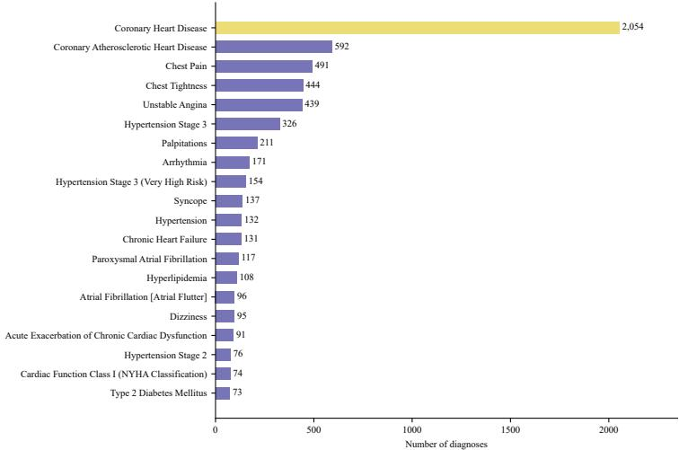  
Figure 7: Diagnosis distribution nature style. The CardioVascBench is characterized by a high concentration of common cardiovascular diseases and a significant long-tail of infrequent diagnoses. This skewed distribution provides a rigorous testbed for evaluating model reliability, as it requires the agent to navigate both data-rich ”head” scenarios and data-sparse ”tail” cases, the latter being where traditional parametric LLMs often fail due to knowledge gaps.

## A.3 DIFFICULTY ANALYSIS

Figures 8 and 9 present the reported dificulty scores grouped by ECG-report availability and plotted against clinical-note length. These are descriptive associations: report availability and text length alone do not establish clinical reasoning dificulty.

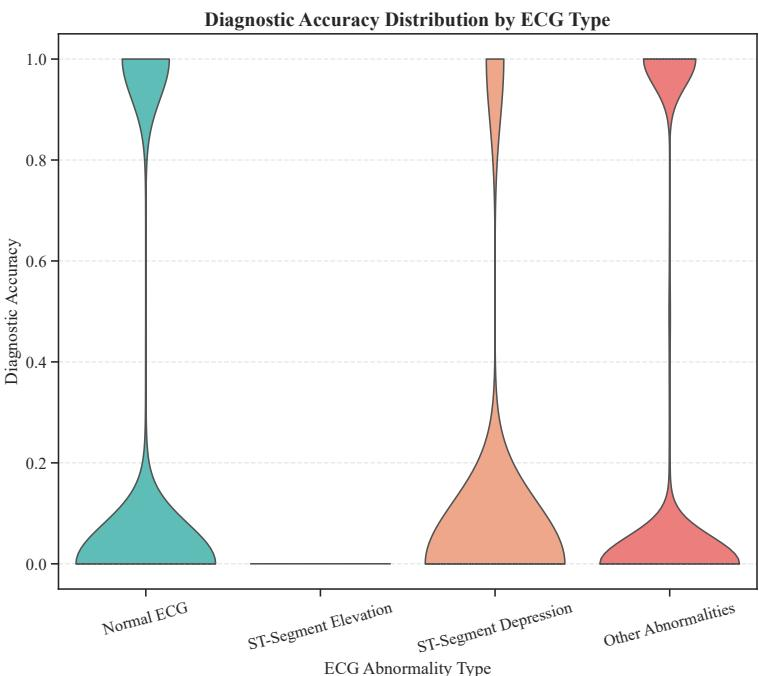  
Figure 8: Reported dificulty by ECG-report availability. Distributions are shown for the groups in the original analysis. ECG reports are textual inputs; the grouping does not establish a multimodal reasoning requirement.

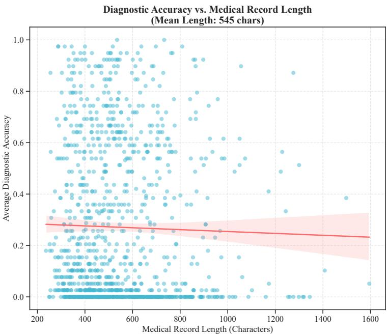  
Figure 9: Clinical-note length and reported dificulty. Each point relates note length (x-axis) to the reported dificulty score (y-axis). This descriptive plot does not isolate the efect of information volume on diagnostic performance.

## B CLINICAL TASK AND EVALUATION PROTOCOL

Input-version boundary. The historical input audit found a nonempty ECG diagnostic-conclusion field in all 1,088 evaluation records. This is not itself proof of temporal leakage, but event timestamps and patient linkage are unavailable to certify temporal eligibility or patient separation. Tables retain historical reported results; their per-run mapping to a frozen input version has not been established in this manuscript. They must not be interpreted as a newly field-filtered or prospective evaluation. Changing inputs requires new predictions.

Unresolved reporting details. The historical protocol describes up to five generated diagnoses, result tables use @10, and the retained Chinese prompt asks for the final primary diagnosis. These contracts require reconciliation against actual run configurations. Numeric rank-weight and β settings also require reporting. Historical prompts and scores are retained without assuming equivalence between configurations.

## B.1 CLINICAL REASONING FOUNDATION

The protocol is motivated by clinical information integration and diagnosis prioritization (Singhal et al., 2023; Bowen, 2006; Moor et al., 2023). It assesses resulting diagnosis lists against discharge references, without directly evaluating intermediate reasoning. CardioKG-Agent implements a structured baseline workflow; similarity to a clinical workflow does not establish reasoning fidelity.

## B.2 CLINICAL TASK DEFINITION

The task is prioritized diagnosis generation from the available inpatient narrative and examination reports. Models generate an ordered diagnosis list evaluated against expert-verified discharge diagnoses, with the primary diagnosis first. Plausible diferential candidates absent from the discharge reference are non-matches under this protocol, not necessarily clinical errors.

It is important to distinguish between clinical reasoning and coding. In this benchmark, ICD-10 codes serve as the standardized label space for evaluation purposes, enabling rigorous quantitative alignment between model outputs and expert-verified hospital discharge diagnoses. We acknowledge that ICD-10 is a classification system for epidemiological and billing purposes, which may not fully capture the granular nuance of clinical pathophysiology. However, it provides a necessary, fixed vocabulary for automated benchmarking.

Scope and Boundaries. This benchmark focuses exclusively on the diagnostic phase of clinical care. It does not evaluate downstream clinical tasks such as treatment planning (medication selection, dosage adjustment), procedural recommendations (e.g., PCI vs. CABG), or prognostic assessment. Models are assessed solely on their ability to integrate clinical narratives and examination reports into an accurate and prioritized diagnostic list.

## B.3 EVALUATION FRAMEWORK

For each clinical case, the model is provided with the complete medical record, including admission notes, medical history, physical examination findings, laboratory results, and ECG reports. The model is required to generate an ordered list of up to five diagnoses.

To rigorously assess diagnostic performance against expert-annotated gold standards, we adopt a standardized evaluation framework consisting of text normalization, semantic matching, and positionaware ranked metric computation, explicitly designed to reflect real-world clinical diagnostic priorities.

Normalization and Semantic Matching. All diagnostic texts—including model predictions, goldstandard diagnoses, and their corresponding ICD-10 aliases—are first normalized to remove punctuation and unify formatting.

We employ SapBERT, a medical-domain semantic representation model, to compute the semantic similarity between predicted and reference diagnoses. A predicted diagnosis is considered a valid match if the cosine similarity between its embedding and either the gold-standard diagnosis or its ICD-10 alias exceeds a threshold of 0.80. This semantic matching strategy enables robust evaluation under synonymous or clinically equivalent diagnostic expressions.

Position-Aware Ranked Evaluation. In clinical practice, diagnoses are not equally important: the primary diagnosis determines treatment decisions and patient management, while secondary diagnoses provide complementary clinical context. To reflect this structure, our evaluation explicitly incorporates rank-dependent weighting on both the gold-standard diagnoses and the model predictions.

Position-Aware Ranked Evaluation. For a predicted diagnosis at rank j, we apply a logarithmic position discount function:

$$
w _ { \mathrm { p r e d } } ( j ) = \frac { 1 } { \log _ { 2 } ( j + 1 ) }\tag{2}
$$

This discount assigns substantially higher weight to diagnoses ranked earlier by the model, reflecting the clinical expectation that the most likely diagnosis should be presented first.

Gold-Standard Diagnosis Priority. Gold standard diagnoses are provided as an ordered list, where the first diagnosis represents the clinically confirmed primary diagnosis, followed by secondary or comorbid conditions. We therefore assign an importance weight to each gold diagnosis based on its position:

$$
w _ { \mathrm { g t } } ( i ) = \exp \left( - \lambda ( i - 1 ) \right)\tag{3}
$$

where i denotes the index of the diagnosis in the gold-standard list, and λ controls the strength of prioritization toward the primary diagnosis.

Ranking-based Evaluation. For a predicted diagnosis $p _ { j }$ and a gold diagnosis $g _ { i }$ , the relevance contribution is defined as:

$$
\operatorname { r e l } ( p _ { j } , g _ { i } ) = \sin ( p _ { j } , g _ { i } ) \cdot w _ { \mathrm { g t } } ( i )\tag{4}
$$

where sim( ) is the semantic similarity score computed by SapBERT, and $w _ { \mathrm { g t } } ( i )$ is a rank-sensitive weight reflecting the clinical importance of the i-th gold diagnosis. This design prioritizes the accurate identification of higher-ranking gold diagnoses, particularly the primary diagnosis.

The Discounted Cumulative Gain (DCG) at rank K is then computed as:

$$
\mathrm { D C G @ K } = \sum _ { j = 1 } ^ { K } \operatorname* { m a x } _ { i } \left( \mathrm { r e l } ( p _ { j } , g _ { i } ) \right) \cdot w _ { \mathrm { p r e d } } ( j )\tag{5}
$$

where $w _ { \mathrm { p r e d } } ( j )$ is the positional discount factor for the j-th prediction. Thus, semantically correct diagnoses ranked earlier receive greater rewards.

To normalize for cases with diferent numbers of gold diagnoses and diferent relevance distributions, we further compute the normalized DCG:

$$
\mathrm { n D C G @ } \mathbb { C } = { \frac { \mathrm { D C G @ } \mathbb { K } } { \mathrm { I D C G @ } \mathbb { K } } }\tag{6}
$$

where IDCG@K is the maximum achievable DCG under an ideal ordering of the gold diagnoses. This normalization enables a fair comparison across samples with diferent numbers and rankings of gold diagnoses.

Additional Metrics. To complement nDCG and provide interpretable diagnostic indicators, we also report:

• Top-k Accuracy $( k = 1 , 2 , 3 )$ , measuring whether the primary diagnosis appears within the top-k predictions.

• Precision@K and Recall@K, evaluating the correctness and coverage of predicted diagnoses.

• PrimaryHit, a binary metric specifically designed to assess whether the model successfully identifies the primary diagnosis. PrimaryHit equals 1.0 if any of the top-k predictions semantically matches the gold-standard primary diagnosis, and 0.0 otherwise.

Final Composite Score. To summarize the selected ranking and precision dimensions, we define a composite final score:

$$
{ \mathrm { F i n a l S c o r e } } = { \mathrm { n D C G } } \times ( 0 . 7 + 0 . 3 \times { \mathrm { P r i m a r y H i t } } ) \times { \mathrm { P r e c i s i o n } } ^ { \beta }\tag{7}
$$

where $\beta$ is a hyperparameter controlling the influence of precision.

Rationale and interpretation. The composite combines ranking, primary-diagnosis recognition, and precision. When PrimaryHit = 0, its multiplier is 0.7; when it is 1, the multiplier is 1. This is a bonus for recognizing the primary diagnosis, not a veto. For $\beta > 0$ , Precisionβ penalizes unmatched predictions. Non-matches are defined against discharge references and do not independently establish hallucination or harm. Clinical validity of this scoring choice requires separate assessment.

Rationale for Position-Aware Weighting. The proposed evaluation framework is motivated by realworld clinical diagnostic practice. In cardiovascular and cerebrovascular diseases, failure to correctly identify or prioritize the primary diagnosis can lead to severe clinical consequences, even if secondary diagnoses are correctly mentioned. Therefore, evaluation metrics that treat all diagnoses equally fail to capture clinically meaningful performance diferences.

Rank-aware weighting distinguishes primary and secondary reference diagnoses and discounts later predictions. Component metrics remain necessary to interpret the composite. A clinically motivated weighting scheme does not itself establish agreement with physician judgment.

## B.4 CLINICAL MOTIVATION FOR PRIORITIZATION

The evaluation measures diagnosis-list agreement after terminology normalization, motivated by primary-diagnosis prioritization (Li et al., 2025; Nath et al., 2023). It does not measure reasoning fidelity or safety. Validation should compare metrics with blinded physician judgments while controlling output count and varying matching thresholds and score weights.

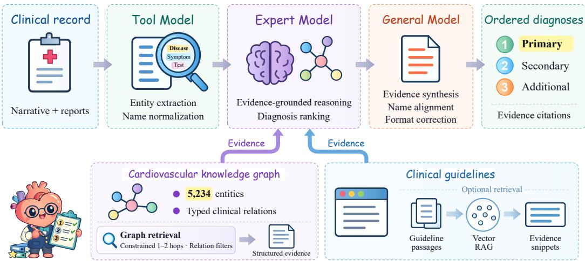  
Figure 10: CardioKG-Agent Architecture. The diagram illustrates the integration of the Tool Model (extraction), Expert Model (reasoning via KG and Vector RAG), and General Model (synthesis). By combining constrained multi-hop graph traversal with guideline snippet retrieval, the baseline generates an ordered diagnosis list supported by retrieved evidence.

## C KNOWLEDGE-ENHANCED BASELINE: CARDIOKG-AGENT

We include CardioKG-Agent as a knowledge-enhanced benchmark baseline (Figure 10). CardioKG-Agent consists of an LLM Core, a cardiovascular knowledge graph (5,234 entities) with a typed schema (e.g., Disease, Symptom, Test, Drug, Treatment, RiskFactor, Complication, Population) and standardized edge labels, and a KG retriever.

Given a full case record, CardioKG-Agent first performs clinical entity extraction and normalization, then retrieves evidence from the KG via constrained multi-hop traversal (e.g., 1–2 hops, relationtype filtered), optionally consults guideline passages for key decision points, and finally synthesizes a prioritized diagnosis list with explicit citations to retrieved evidence. All components are executed in a fixed pipeline to enable reproducibility and ablation.

CardioKG-Agent primarily requires three models: Tool Model, Expert Model, and General Model. The Core Function of the Tool Model is responsible for tasks such as Entity and Extraction. The Core Function of the Expert Model involves activating its own medical knowledge, medical reasoning, and sorting. The General Model is responsible for summarizing the content retrieved from the KG, performing name alignment, and format correction. The models within the Agent perform their respective functions and cooperate with each other, which is an important factor in achieving high scores. The CardioKG-Agent architecture is explicitly designed to emulate and augment human expert diagnostic reasoning. Like how cardiologists mentally traverse pathophysiological relationships (e.g., ’chest pain  rule out ACS  check troponin and ECG  consider unstable angina vs. NSTEMI’), our agent performs constrained multi-hop traversal through the knowledge graph. The integration of clinical guideline retrieval mirrors how experienced physicians cross-reference authoritative recommendations during complex diagnostic scenarios.

## D COMPLETE BENCHMARK RESULTS

This section retains all systems and numerical values from the original manuscript. The main-text table is a representative subset; the table below includes the full proprietary, open-source, medicalspecialized, and agent-enhanced results.

Table 5: CardioVascBench Answering Results
<table><tr><td>Model</td><td>NDCG @10</td><td>Precision @10</td><td>Recall @10</td><td>Top-1 Acc</td><td>Top-3 Acc</td><td>Final Score</td></tr><tr><td colspan="7">Proprietary Models</td></tr><tr><td>GPT-40</td><td>63.8</td><td>12.6</td><td>44.6</td><td>30.6</td><td>36.3</td><td>14.9</td></tr><tr><td>GPT-5.2</td><td>66.1</td><td>11.9</td><td>48.8</td><td>39.0</td><td>45.8</td><td>14.8</td></tr><tr><td>Grok-4</td><td>63.6</td><td>13.9</td><td>45.5</td><td>34.9</td><td>39.2</td><td>16.1</td></tr><tr><td>Claude-sonnet-4.5</td><td>65.0</td><td>11.4</td><td>53.0</td><td>47.1</td><td>55.6</td><td>15.1</td></tr><tr><td>Qwen3-max</td><td>62.8</td><td>14.7</td><td>45.3</td><td>32.5</td><td>39.0</td><td>16.7</td></tr><tr><td colspan="7">Open-source Models (&lt;10B)</td></tr><tr><td>Apollo-7B*</td><td>55.6</td><td>18.2</td><td>28.9</td><td>8.9</td><td>11.4</td><td>16.2</td></tr><tr><td>ShizhenGPT-7B*</td><td>59.8</td><td>15.1</td><td>41.7</td><td>35.3</td><td>41.5</td><td>17.1</td></tr><tr><td>BioMistral-7B*</td><td>49.2</td><td>14.2</td><td>13.5</td><td>7.6</td><td>7.6</td><td>11.4</td></tr><tr><td>HuatuoGPT-o1-7B*</td><td>59.7</td><td>28.7</td><td>37.1</td><td>24.3</td><td>27.1</td><td>25.4</td></tr><tr><td>Lingshu-7B*</td><td>61.9</td><td>32.0</td><td>40.9</td><td>24.7</td><td>27.7</td><td>28.2</td></tr><tr><td>Qwen2.5-7B-Instruct</td><td>58.2</td><td>30.8</td><td>36.3</td><td>25.1</td><td>27.8</td><td>26.8</td></tr><tr><td>Qwen2.5-VL-7B-Instruct</td><td>60.9</td><td>28.4</td><td>39.5</td><td>29.2</td><td>32.8</td><td>25.7</td></tr><tr><td>Llama3-8B-Instruct</td><td>57.7</td><td>15.3</td><td>29.2</td><td>16.0</td><td>19.3</td><td>15.2</td></tr><tr><td>Meditron3-8B*</td><td>58.3</td><td>13.0</td><td>31.8</td><td>11.0</td><td>13.8</td><td>13.3</td></tr><tr><td>Qwen3-8B</td><td>59.4</td><td>24.8</td><td>38.5</td><td>25.9</td><td>29.4</td><td>22.9</td></tr><tr><td>UltraMedical-8B*</td><td>56.7</td><td>8.4</td><td>28.6</td><td>16.6</td><td>23.3</td><td>9.8</td></tr><tr><td>II-Medical-8B*</td><td>58.9</td><td>32.1</td><td>38.7</td><td>22.3</td><td>23.9</td><td>28.0</td></tr><tr><td>Apollo2-9B*</td><td>57.9</td><td>21.9</td><td>31.0</td><td>11.9</td><td>14.0</td><td>19.1</td></tr><tr><td>Lingshu-7B-AGENT</td><td>65.2</td><td>50.9</td><td>49.7</td><td>43.9</td><td>43.9</td><td>44.3</td></tr><tr><td>HuatuoGPT-o1-7B-AGENT</td><td>65.7</td><td>53.4</td><td>52.2</td><td>46.3</td><td>46.3</td><td>46.4</td></tr><tr><td colspan="7">Open-source Models (&gt;10B)</td></tr><tr><td>Ministral3-14B*</td><td>61.1</td><td>10.7</td><td>41.4</td><td>33.7</td><td>41.4</td><td></td></tr><tr><td>Qwen3-14B</td><td>36.4</td><td>6.5</td><td>19.7</td><td>12.2</td><td>15.3</td><td>13.2 7.2</td></tr><tr><td>GPT-oss-20B</td><td>58.2</td><td>16.0</td><td>26.1</td><td>11.9</td><td>15.5</td><td>14.7</td></tr><tr><td>ShizhenGPT-32B*</td><td>62.2</td><td>16.0</td><td>44.2</td><td>39.5</td><td>47.1</td><td>17.9</td></tr><tr><td>Lingshu-32B*</td><td>61.0</td><td>16.1</td><td>39.8</td><td>31.1</td><td>36.7</td><td>17.2</td></tr><tr><td>Llama3-70B-Instruct</td><td>60.0</td><td>10.7</td><td>38.7</td><td>19.3</td><td>23.1</td><td>12.7</td></tr><tr><td>OpenBioLLM-70B*</td><td>58.8</td><td>30.8</td><td>34.8</td><td>14.6</td><td>16.5</td><td>25.6</td></tr><tr><td>Apollo-72B*</td><td>57.3</td><td>12.7</td><td>32.0</td><td>12.2</td><td>15.2</td><td>13.0</td></tr><tr><td>HuatuoGPT-o1-72B</td><td>62.2</td><td>18.3</td><td>45.0</td><td>36.6</td><td>41.3</td><td>19.5</td></tr><tr><td>GPT-oss-120B</td><td>61.6</td><td>15.1</td><td>39.3</td><td>28.2</td><td>33.6</td><td>16.2</td></tr><tr><td>Mimo-v2-flash</td><td>64.7</td><td>13.1</td><td>51.7</td><td>43.3</td><td>50.2</td><td>16.2</td></tr><tr><td>Llama4-maverick</td><td>64.2</td><td>13.5</td><td>48.1</td><td>40.7</td><td>45.8</td><td>16.1</td></tr><tr><td>GLM-4.7</td><td>63.3</td><td>11.1</td><td>49.9</td><td>43.7</td><td>49.1</td><td>14.4</td></tr><tr><td>Deepseek-v3.2</td><td>61.9</td><td>16.0</td><td>43.4</td><td>33.9</td><td>40.7</td><td>17.2</td></tr><tr><td>Kimi-K2</td><td>60.8</td><td>22.0</td><td>41.3</td><td>32.0</td><td>34.9</td><td>21.4</td></tr><tr><td>OpenBioLLM-70B-AGENT</td><td>66.0</td><td>53.8</td><td>52.4</td><td>46.5</td><td>46.5</td><td>46.7</td></tr></table>

Note: Bold values indicate the best result within each model block for the corresponding metric. ‘\*’ denotes medical-specialized models. Blue-shaded rows denote agent-enhanced systems.

CardioVascBench: Model Size vs Performance Trade-off  
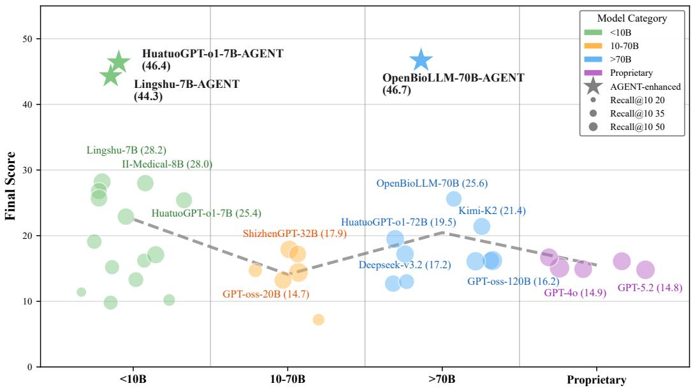  
Figure 11: Composite scores by model size and type. Agent-enhanced systems obtain higher composite scores than the compared base models under the reported settings. These comparisons reflect system-level diferences in knowledge access and inference configuration.

## E ADDITIONAL ANALYSES

## E.1 ORIGINAL ABLATION VISUALIZATION

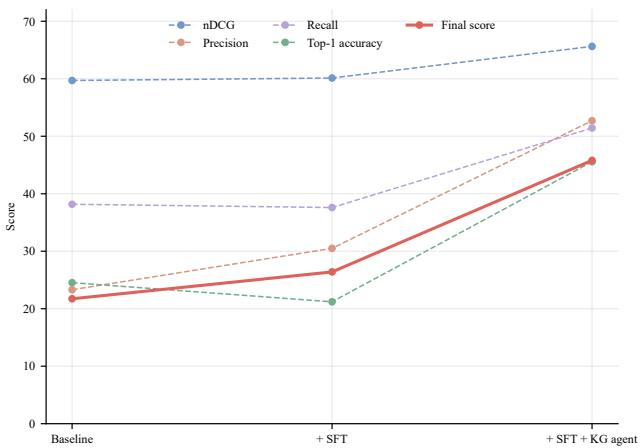  
Figure 12: Ablation Study Results. Systematic ablation study results on three baselines (Qwen2.5-VL-7B-Instruct, Qwen2.5-7B-Instruct, and Llama3-70B-Instruct) are presented, with values averaged across models (N=1088). The SFT-plus-agent configuration improves the mean score by 73.5% relative to SFT; this does not isolate graph retrieval.

## E.2 DIAGNOSIS-COUNT GROUP COMPARISON

Figure 5 presents the original comparison across reported diagnosis-count groups. These results are descriptive and do not isolate an efect of domain-specific training. The prepared evaluation set contains only 36 cases with multiple reference entries (Appendix A), limiting conclusions about multi-diagnosis coverage. The plotted group assignments also require reconciliation with these labels before clinical comorbidity diferences can be inferred.

## E.3 MISDIAGNOSIS PATTERNS AND DIAGNOSTIC FLOWS

To describe diagnosis-label confusions across models, we conducted a comparative analysis of misdiagnosis patterns for the top 10 diseases using Confusion Matrices (Figure 13) and Sankey diagrams (Figure 14). We selected three representative models for horizontal comparison: Qwen2.5-VL-7B-Instruct (General), Lingshu-7B (Medical), and Lingshu-7B-AGENT (Agent).

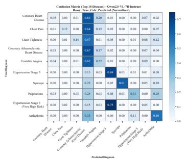

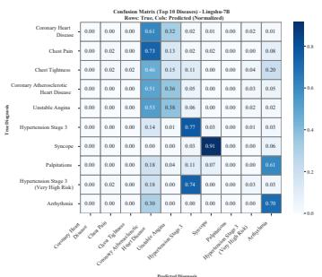

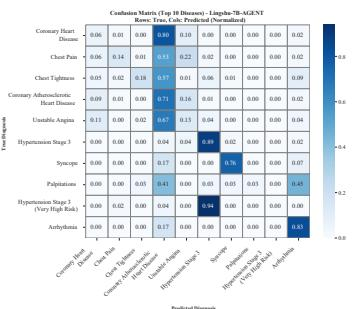  
Figure 13: Horizontal Comparison of Misdiagnosis Patterns (Confusion Matrices). From left to right: Qwen2.5-VL-7B-Instruct, Lingshu-7B, and Lingshu-7B-AGENT. The general model exhibits dispersed error patterns, while the agent shows fewer of-diagonal label confusions in these examples.

Pattern Analysis and Safety Risks. Qwen2.5-VL shows more dispersed label confusions, whereas Lingshu-7B has a narrower pattern with persistent confusion between related conditions. The agent shows clearer diagonal alignment in these examples. These descriptive plots do not establish hallucination rates, reasoning correctness, or safety improvements.

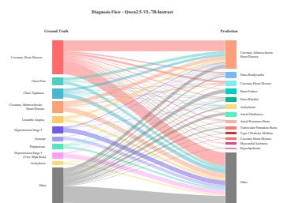

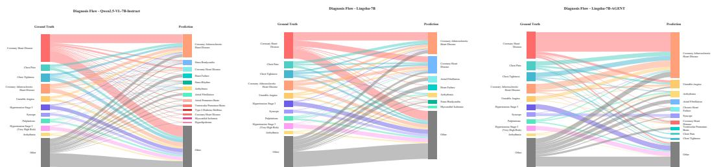

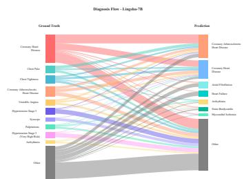

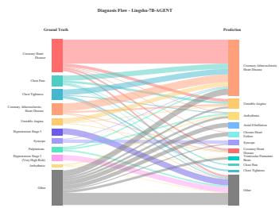  
Figure 14: Horizontal Comparison of Diagnostic Flows (Sankey Diagrams). From left to right: Qwen2.5- VL-7B-Instruct, Lingshu-7B, and Lingshu-7B-AGENT. The diagrams visualize the flow from Ground Truth (left side of each plot) to Model Predictions (right side). The Agent model shows thicker, more consistent flows towards correct diagnoses compared to the fragmented flows of the baseline models.

Interpretation. Persistent confusion pairs can guide physician review and further error analysis. Whether retrieved evidence improves clinical decisions or reduces harm requires direct assessment beyond these plots.

## E.4 ADDITIONAL EXPERIMENTAL RESULTS

The following figures describe general and medical LLM performance across the reported diagnosiscount groups, disease categories, other subgroups, and symptom-clarity categories. These comparisons are exploratory and do not isolate the efects of model training.

## E.4.1 DIAGNOSIS-COUNT GROUPS

The diagnosis-count comparison is summarized in Figure 5. Interpretation depends on the definition and size of each group. Multiple stored reference entries should not be treated as a complete measure of a patient’s comorbidities.

## E.4.2 DISEASE TYPE ANALYSIS

Figure 15 compares the reported performance of general and medical LLMs across disease categories. The heatmaps describe category-specific variation and can help identify groups for further error analysis. They do not establish that a model has a deeper understanding of the corresponding diseases.

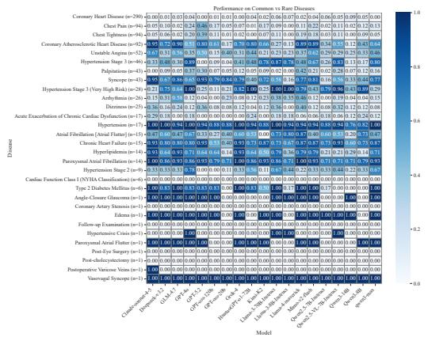  
(a) General LLMs

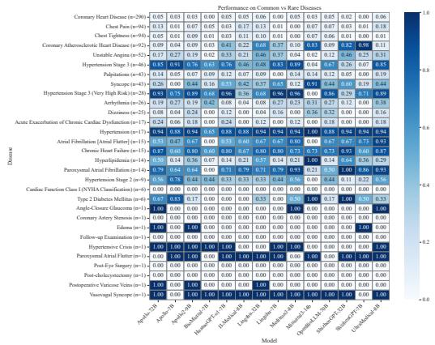  
(b) Medical LLMs  
Figure 15: Disease Type Performance Heatmap. These heatmaps display the performance of General and Medical LLMs across various cardiovascular disease types. The color intensity represents the accuracy, allowing for a visual comparison of strengths and weaknesses in diagnosing specific conditions.

## E.4.3 SUBGROUP CAPABILITIES

Figure 16 summarizes reported performance across the selected subgroups. The profiles describe variation within this evaluation; establishing fairness or robustness would require explicit subgroup definitions, sample sizes, and uncertainty estimates.

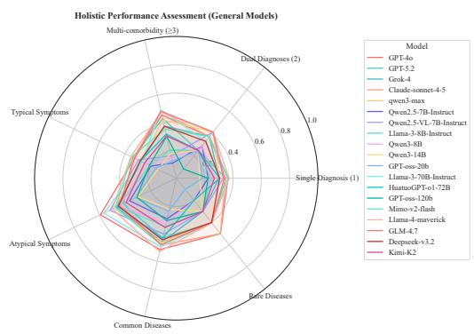  
(a) General LLMs

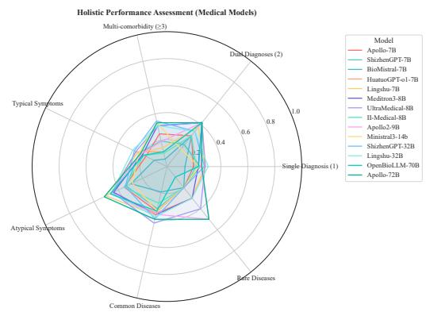  
(b) Medical LLMs  
Figure 16: Subgroup Performance Radar Chart. The radar charts provide a multidimensional comparison of General and Medical LLMs across diferent clinical subgroups. This visualization helps identify specific areas where one model type may outperform the other.

## E.4.4 SYMPTOM CLARITY

Clinical notes vary in the explicitness of symptom descriptions. Figure 17 compares reported performance across symptom-clarity categories. Diferences between groups are descriptive and do not establish that specialization causes better inference from implicit clinical cues.

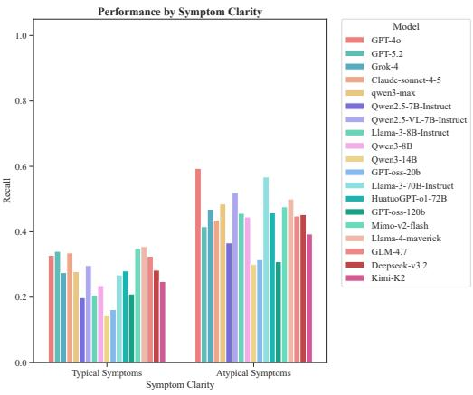  
(a) General LLMs

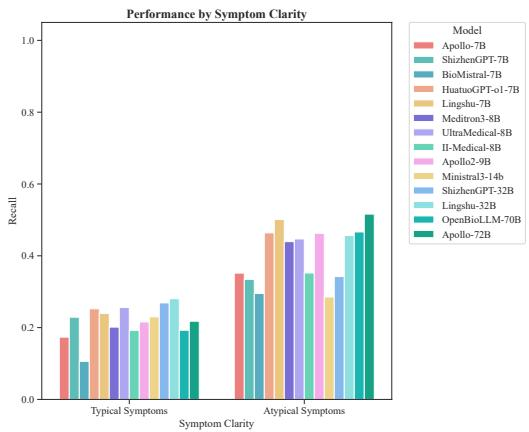  
(b) Medical LLMs  
Figure 17: Symptom Clarity Performance Comparison. This figure compares general and medical LLM performance across the symptom-clarity categories in the original analysis.

## F BENCHMARK PROMPTS

To ensure standardized evaluation, we utilized specific prompts for the large language models. The prompts were designed to guide the models in generating structured diagnostic outputs based on the provided clinical notes and ECG results.

## F.1 SYSTEM PROMPT

The system prompt establishes the role and output format for the model.

System Prompt (English)   
\`\`You are a clinical cardiologist responsible for generating a structured   
final diagnosis based on the provided medical records and ECG results. Please   
strictly output a JSON object and do not output superfluous text. Output in   
Chinese, with standardized fields and values.'   
System Prompt (Original Chinese)   
\`\`你是一名心血管内科的临床医生，负责根据给定的病历文书和心电检查结果，生成结构化的最   
终诊断。请严格输出 JSON 对象，不要输出多余文本。中文输出，字段与取值尽量标准化。''

## F.2 USER PROMPT TEMPLATE

The user prompt provides the specific case data and reiterates the output requirements.

User Prompt Template (English)   
\`\`Task: Final Diagnosis. Input medical records and ECG items, findings, and   
diagnoses; output the final diagnosis.   
Medical Record (Summary): {medical\_record}   
ECG Results: {ecg\_results}   
Please return only JSON, containing these keys: - Diagnosis: Array, where each   
item is an object containing only the key 'Diagnosis Name' (standardized Chinese   
primary diagnosis)   
Strict Requirements: 1) Return a valid JSON object, with key names and types   
meeting requirements 2) Do not add explanations or extra fields''

## User Prompt Template (Original Chinese)

\`\`任务：最终诊断。输入病历文书和心电检查项目、所见、诊断，输出最终诊断。病历文书（摘要）：{medical\_record}  
ECG 结果：{ecg\_results}  
请仅返回 JSON，包含这些键：  
- 诊断: 数组，每项为对象，仅包含键' 诊断名称'（规范中文主诊断）  
严格要求：  
1) 返回合法 JSON 对象，键名与类型符合要求  
2) 不要加入解释或额外字段''

## G EXTENDED DISCUSSION

Primary-diagnosis identification and full-list quality need separate examination. A higher composite score reflects the balance imposed by matching, prediction rank, reference priority, and precision weighting; it is not an established ordering of clinical utility.

Evaluation validation. Future work should obtain blinded physician ratings of anonymized lists, covering primary-diagnosis correctness, coverage, and inappropriate additions. Agreement with individual metrics and the composite should be assessed on the same cases. Fixed-output-count comparisons and sensitivity analyses for matching thresholds, reference weights, and β would help distinguish clinical agreement from length or scoring artifacts. These studies have not been reported here.

Knowledge augmentation. The 26.40-to-45.80 gain compares SFT with SFT plus the full agent. A follow-up should hold the backbone and approximate token/tool budget fixed across no retrieval, text RAG, graph retrieval, guideline retrieval, and the combined workflow. Present results provide a knowledge-enhanced baseline without isolating graph retrieval’s causal contribution.

Input protocol. Historical records contain diagnostic interpretations of examinations. Timestamped inputs and patient linkage are needed before prospective or patient-independent claims. Removing fields defines a diferent input protocol and requires new predictions; historical results must not be relabeled as cleaned-input results. Multi-center validation and review of reference ambiguity would further strengthen the benchmark.