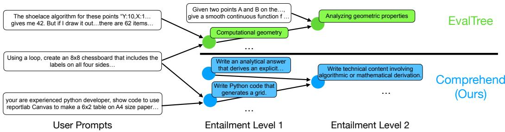
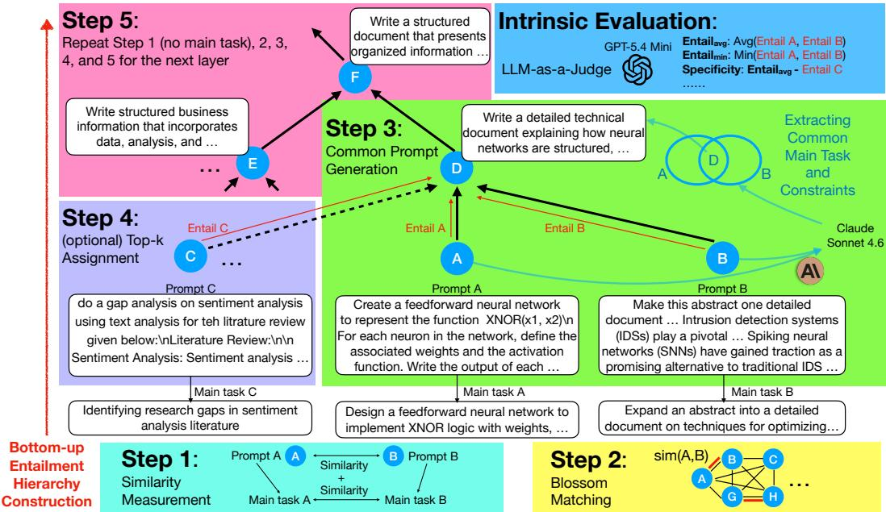
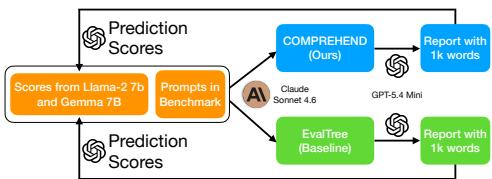
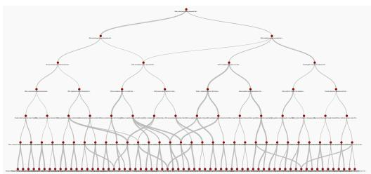
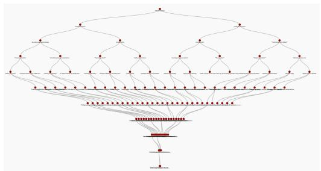
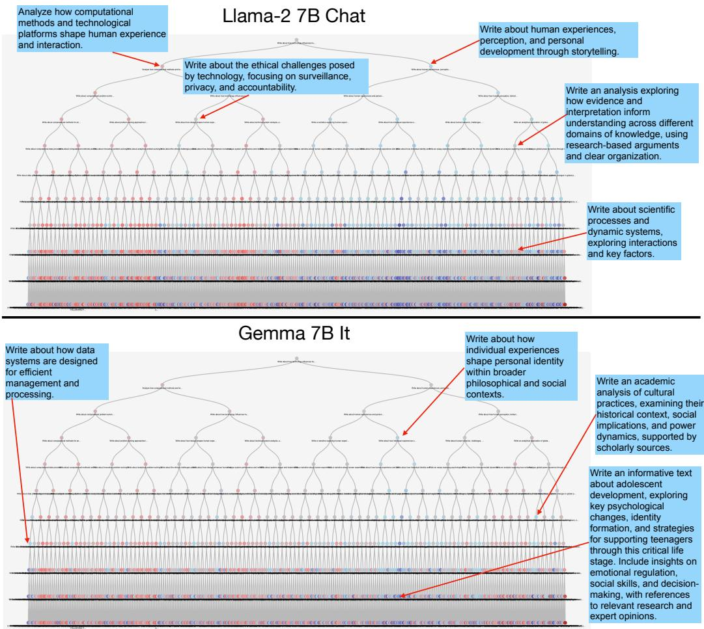
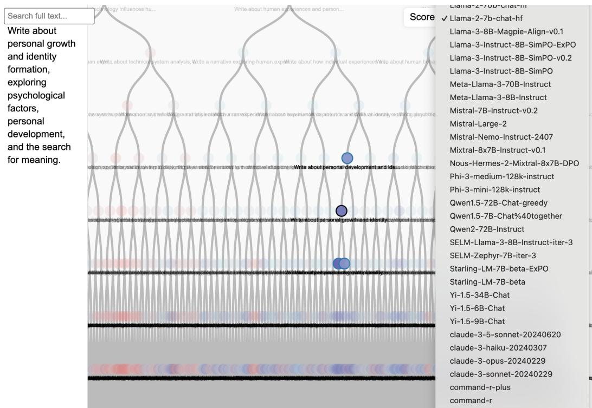
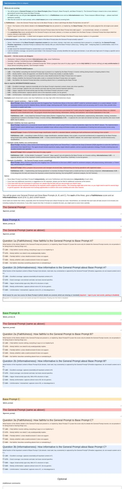

# COMPREHEND: Ultra-Fine-Grained Benchmark Understanding by Entailment Hierarchy

Sivaraaman Balakrishnan∗1 Prakriti Shetty∗1 Jeremiah Hong1 Hamed Zamani1 Haw-Shiuan Chang∗2 1University of Massachusetts, Amherst, USA 2University of Arizona, Tucson, USA {psshetty,sivaraamanba,jshong}@umass.edu, zamani@cs.umass.edu, hawshiuan@arizona.edu

## Abstract

Understanding what kind of prompts users typically ask and how well an LLM performs on these prompt categories is crucial for LLM practitioners. The existing methods satisfy the demand by hierarchically clustering the user prompts and synthesizing the cluster names using an LLM to build a taxonomy. However, the cluster names from these methods are usually too general for humans to understand the detailed prompt distributions and identify the exact strengths and weaknesses of LLMs. In this study, we propose COMPREHEND, which automatically constructs an ultra-fine-grained entailment hierarchy for the prompts. The entailment hierarchy replaces the cluster names in the taxonomy with sentences to provide more precise cluster descriptions for more fine-grained categorization. Compared with Eval-Tree, a state-of-the-art taxonomy construction method, COMPREHEND improves an entailment/faithfulness metric from 22.6 to 41.7 and an informative metric from 16.3 to 39.1 in WildBench. Our experiments also show that the weakness report generated based on our entailment hierarchy is much more informative than EvalTree in terms of predicting the response scores in the benchmark. All the code is released in https://github.com/JackNapier20/COMPREHEND\_public.

## 1 Introduction

A great tool that can analyze a large number of prompts and LLMs’ performances on these prompts is demanded by many LLM practitioners. For instance, product managers or safety researchers sometimes have to monitor millions of user prompts to identify users’ needs or discover misuse patterns [26]. One daily job of LLM developers is using benchmarks to discover the weaknesses or blind spots of LLMs, compare their performances with the competitors, and understand the effect of training strategies. Moreover, many LLM users want to select the LLMs for their tasks using more fine-grained LLM characteristics than the categories such as math reasoning and creative writing from existing benchmarks.

To address this challenge, a common approach is hierarchically clustering (the summary of) the prompts and asking an LLM to generate the category name of each cluster [26, 7, 32, 30]. The resulting taxonomy has many applications. For example, the approach could cluster the prompts about neural network together and if the average performance of the target LLM in this cluster is worse than competing LLMs, the developer could identify the weakness and mine the related training data to fix the weakness in the next round.

Although widely used, the approach has four major limitations. First, the synthesized category names are usually coarse-grained phrases or very short sentences. This decreases the granularity of the weakness analyses. Second, the resulting trees from previous approaches are often shallow or imbalanced. The number of descendants (i.e., cluster size) of a tree node at a higher level could be much smaller than the node at a lower level and have a much more specific cluster name. Third, clustering and category name generation are often two separate steps in their pipeline, so clustering could group very diverse prompts together, which makes it hard for LLMs to generate any informative category name. Finally, previous studies lack intrinsic metrics to compare different tree construction methods without the ground truth of clustering.

  
Figure 1: Comparison between EvalTree [32] and COMPREHEND. Given the prompt of Creating a chess board using python in the middle, COMPREHEND groups it with another more relevant prompt and generates a more specific prompt as the group name.

To address the limitations, we propose COMPREHEND (COMmon PRompt Entailment Hierarchy for Evaluation aNd Development). Figure 1 highlights the differences between COMPREHEND and EvalTree [32], a representative state-of-the-art approach. Unlike a typical taxonomy from EvalTree, where each category is represented by a short phrase and an arrow means the child node belongs to the parent node, the nodes in the entailment hierarchy are represented by a sentence or even a passage, and an arrow means the child node entails the parent node.

The entailment hierarchy is constructed bottom up, and the nodes in the lowest level are the user prompts in the benchmark of interest. At each level, we first use sentence BERT [23] and the Blossom algorithm [11] to match similar prompts in pairs. Then, we ask an LLM to generate the common summary of two similar prompts as a node in the next level and repeat the process recursively. By interleaving the generation and clustering at each level, we reduce the difficulty of generating the specific category description for the LLM, which results in a more fine-grained hierarchy.

Comparing different prompt categorization methods is challenging because there is usually no ground truth clustering annotations and different methods could have very different hierarchical structures. We propose several low-cost intrinsic metrics by adapting the metrics from summarization tasks and specificity scores from Chang et al. [5] and use them to evaluate how well the entailment hierarchy can help an LLM (as a human proxy) write a performance report. In WildBench [21] and UltraFeedback [8], we demonstrate each component of COMPREHEND makes the cluster descriptions significantly more faithful and informative summaries of the prompts in the cluster.

## MAIN CONTRIBUTIONS

• We derive ultra-fine-grained categories of prompts using an entailment hierarchy and propose a novel bottom-up construction method COMPREHEND.

• We propose general evaluation metrics that allow researchers to compare different tree structures and node representations. We also conduct comprehensive experiments and examine the performance of each proposed component.

• We release our code that allows researchers to build an entailment hierarchy from a corpus.

## 2 Related Work

Several prior studies build a taxonomy on prompts to facilitate our understanding of users or LLMs. The taxonomy could be constructed manually by humans [3, 18] or automatically by LLMs [26, 7, 32, 30]. The LLM-based taxonomy construction methods are also used to categorize scientific papers [14, 19, 12], social media claims [33], model errors [28, 1, 16, 20], and other types of text data [27, 37]. However, the resulting taxonomies are often shallow and coarse-grained.

  
Figure 2: The COMPREHEND bottom-up construction pipeline. Step 1 and Step 2: Pairing nodes A and B using similarity measurement and Blossom matching algorithm. Step 3: Generating the common prompt as upper-layer node D from node A and B. Step 4: Optionally retrieve node C that is similar to A and assign it to node D if its entailment score is high. Step 5 : Repeating the steps by generating the next-layer node F from the similar node E and D. Intrinsic Evaluation: We evaluate the quality of common prompt not only by the entailment score average $( \mathrm { E n t a i l } _ { a v g } )$ but also by the lowest entailment score $( \mathrm { E n t a i l } _ { m i n } )$ to penalize only summarizing one of the prompts.

Building the entailment or summarization structure among texts is also explored in several applications. For example, entailment tree [9, 31, 24] discovers the entailment relationship between multiple pieces of evidence and the claims. Building hierarchical summaries of corpus could also improve the retrieval performance [6, 25, 13, 35, 15, 36]. Nevertheless, their goal is not creating categories that are easily understandable to humans, so the text of one node could often include information that is not relevant to some of its descendants.

Our motivation for finding ultra-fine-grained categories is inspired by Frick et al. [10], Tjuatja and Neubig [29], whose goal is to predict the LLM performance difference in a very specific case, but they cannot provide high-level and navigable comparison for any benchmark as we do. Methodologically, our entailment hierarchy for prompts is inspired by Chang et al. [5], which proposes to use a very shallow entailment hierarchy to improve interactive story generation. Besides the motivation differences, their paper focuses on improving the efficiency of fine-tuning data collection, while our paper builds the entailment hierarchy construction system based on LLMs.

## 3 Methods

In our common prompt entailment hierarchy, the leaves are the benchmark’s user prompts. The internal nodes are sentence- to passage-length prompts, each entailed by every prompt beneath it [4, 5]. Every internal node should be entailed by all of its descendants due to the transitivity of entailment and represents a cluster of the leaf descendant prompts. The entailment is a generalization of the is-a relation in a taxonomy, so similarly, the nodes at the higher level are more general.

## 3.1 Construction Overview

COMPREHEND builds the entailment hierarchy of a benchmark from bottom to top, as summarized in Figure 2. At each level, we match every node to a similar partner, summarize each pair into one common prompt that both partners entail, and repeat the process at the next-level common prompts; the recursion continues until reaching the single root node. At each layer, we can optionally assign more nodes that are similar to a child node to the parent node, which augments the full binary tree into a directed acyclic graph (DAG). Our goal is to maximize the entailment scores of both nodes A and B (i.e., Entail A and Entail B) while keeping the common prompt specific enough so that other nodes would have a low entailment score (e.g., Entail C). The entailment score is how much the description of their parent (e.g., node D) is entailed by the lower-level node and is judged by an evaluation LLM in our experiments.

## 3.2 Matching Similar Nodes

In step 1 of Figure 2, we measure the pairwise similarity between every two nodes. The prompts from real users could be noisy: the actual request is sometimes buried under contexts, including background, pasted data, and formatting instructions. To group two prompts only when both their context and their underlying task are similar, we extract a one-sentence main task per prompt X, task , with an LLM at the leaf level and add its similarity to the full-text similarity:

$$
\operatorname { s i m } ( A , B ) = \operatorname { s i m } ( { \mathrm { p r o m p t } } _ { A } , { \mathrm { p r o m p t } } _ { B } ) + \operatorname { s i m } ( \operatorname { t a s k } _ { A } , \operatorname { t a s k } _ { B } ) ,\tag{1}
$$

where the similarity function sim(, ) is computed by the cosine similarity between the embeddings of the two texts from Sentence-BERT [23] (all-mpnet-base-v2). The internal nodes usually do not contain lots of context information, so the full-text similarity sim(common $\mathrm { p r o m p t } _ { A }$ , common $\mathrm { p r o m p t } _ { B } )$ alone is sufficient.

In step 2 of Figure 2, we pair the nodes using the pairwise similarity. To maximize the total similarity, we formulate a maximum-weight matching problem in a complete graph $G = ( V , E )$ with weights $w ( i , j ) = \sin ( i , j )$ and all nodes at a level V. A matching $M \subseteq E$ is a set of vertex-disjoint edges with maximum size $( { \mathrm { i . e . , } } | M | = \lfloor { \frac { | V | } { 2 } } \rfloor )$ ; we take the one of greatest total weight among all matchings,

$$
M ^ { \star } = \arg \operatorname* { m a x } _ { M \in \mathcal { M } } \sum _ { ( i , j ) \in M } \sin ( i , j ) ,\tag{2}
$$

which Blossom algorithm [11] could solve exactly in $O \left( | V | ( | E | + | V | \log | V | ) \right)$

## 3.3 Common Prompt Generation

In step 3 of Figure 2, our goal is to generate a specific common prompt of the two similar prompts matched in steps 1 and 2. Given a prompt pair $( A , B )$ , an LLM writes a common prompt D that is as specific as possible and generalizes both A and B. D is their intersection, not their union: it may state only what A and B both ask for, and nothing particular to one of them. In the example of Figure 2, prompt A implements an XNOR network and B expands an abstract on intrusion detection; their common prompt asks to “write a detailed technical document explaining how neural networks are structured,” not the union “create afeed-forward neural network and extend an abstract,” which would carry constraints that neither prompt demands of the other.

The intersection requirement is what makes entailment transitive along the tree. Once A and B both entail D, the edges $\bar { A }  D$ and $B  D$ hold; imposed at every node, this closes the relation so that a leaf entails not only its parent but every ancestor up to the root. A union would break the closure: a parent that kept a detail unique to A would no longer be entailed by B, nor by anything beneath B. We discard and regenerate a common prompt whenever its lowest child entailment score falls below the threshold 0.4, for up to two retries.

## 3.4 Optional Assignment

Step 2 and step 3 leave two potential problems. First, if the number of nodes $| V |$ in a layer is odd, there must be one unmatched node left in step 2. Second, some prompt nodes could entail multiple nodes in the upper layer, but step 3 allows each node to have only one parent.

To solve the problems, we create more entailment arrows at each layer, which allows the entailment hierarchy to be a directed acyclic graph (DAG) rather than a binary tree. First, when $| V |$ is odd at each layer, we assign the unmatched node to the node with the highest entailment score in the next layer. Second, evaluating the entailment scores of all possible parent-child pairs is expensive, so we retrieve the 3 nearest neighbors of the node A (other than its matched node B) according to the all-mpnet-base-v2 embeddings. If the entailment score between the retrieved node and the parent of A is above $\tau = 0 . 7 .$ , we add an arrow between them as shown in Figure 2 step 4. The very similar prompts are more likely to create similar parents and entail multiple parents, so another benefit of the DAG structure is to let the user easily visualize the groups of very similar prompts.

## 3.5 Bottom-up Construction

After all the common prompts are extracted, the common prompts become the next level’s prompt nodes. Next, we repeat matching, generation, and optional assignment until a single root remains (Figure 2, Step 5). The result is a deep, fine-grained hierarchy whose every internal node is a prompt entailed by the entire sub-DAG below it.

Our bottom-up and layer-by-layer construction has several advantages. First, the common prompts are usually much shorter than the original user prompts, so building the top layers in our deep tree is faster and cheaper. Second, generating the specific common prompt is challenging. The LLM is often forced to output very general common prompts when it must generate a common prompt from more than two prompts, or if one of the prompts is not similar to the rest. Our method reduces the difficulty of generating very specific common prompt by ensuring that each common prompt is generated by two similar prompts.

## 4 Experiments

To facilitate the future development of prompt understanding approaches, we first propose several intrinsic evaluation metrics and conduct ablation studies in Section 4.1-4.5. Next, we evaluate how well COMPREHEND helps another LLM as a human proxy to write the report of LLMs’ strengths and weaknesses in Section 4.6.

## 4.1 Intrinsic Evaluation Metrics

Our intrinsic metrics should allow us to compare the hierarchical categorization methods with different structures and the different specificity of their node descriptions. Different structures have different numbers of levels, so we evaluate the entailment scores from two randomly selected descendant leaf nodes rather than from its immediate children2 to measure how much the leaf user prompts actually belong to the cluster.

Besides the average of two entailment scores called $\mathrm { E n t a i l } _ { a v g } .$ , we also compute their minimum $\mathrm { E n t a i l } _ { m i n }$ to measure how likely the method only summarizes one of the child nodes. The evaluation directly tests the faithfulness of each cluster description to their leaf members and the transitivity of the entailment relation in the hierarchy. Taking Figure 2 as an example, we evaluate the node $F$ using the entailment score of $A  F$ rather than $\overline { { D } }  F$ because the score of $D  F$ tends to be higher than the score from $A  D$ . Assuming we want to compute the entailment score for node F and two descendant leaf nodes are A and B, Entai $\displaystyle | _ { a v g } ^ { F } \stackrel { . } { = } ( e _ { A  F } + e _ { B  F } ) / 2$ and Entai $\boldsymbol { \mathrm { \Sigma } } _ { m i n } ^ { F } = \mathop { \operatorname* { m i n } } ( \boldsymbol { e } _ { A \to F } , \boldsymbol { e } _ { B \to F } )$

Entailment scores alone are not enough because a method could output a very general cluster description (e.g., always output Solving a problem) to get very high entailment scores. To solve the problem, we use the informativeness metrics from summarization and the specificity metric from Chang et al. [5]. That is, a good cluster description should be specific enough to contain important information of their descendant leaf nodes and have low entailment scores for non-descendant leaf nodes $( \mathrm { i . e . , }$ , the specific description should reduce the extra assignment links in step 4 in Figure 2). We use GPT 5.4 Mini with low reasoning effort to estimate both entailment score / faithfulness and informativeness. In short, we define the following metrics:

<table><tr><td>Methods</td><td>Clustering</td><td>Leaf Main Task</td><td>Parent Generation</td></tr><tr><td>EvalTree</td><td>Recursive Kmeans</td><td>Capability</td><td>Capability</td></tr><tr><td> $\mathrm { E v a l T r e e + O u r P r o m p t s }$ </td><td>Recursive Kmeans</td><td>Main Task</td><td>Common Prompt</td></tr><tr><td> ${ \mathrm { E v a l T r e e } } + { \mathrm { O u r P r o m p t s } } + { \mathrm { O r g } } .$ </td><td>Recursive Kmeans</td><td>Original</td><td>Common Prompt</td></tr><tr><td> $\mathrm { C O M P R E H E N D \cdot M a i \bar { n } \cdot E v a l }$ </td><td>Match</td><td>Original</td><td>Common Prompt</td></tr><tr><td> $\mathbf { C o M P R E H E N D - M a i n }$ </td><td>Match + Assignment</td><td>Original</td><td>Common Prompt + Regen.</td></tr><tr><td>COMPREHEND</td><td>Match + Main + Assignment</td><td>Original</td><td>Common Prompt + Regen.</td></tr><tr><td>COMPREHEND on Capability</td><td>Match + Main + Assignment</td><td>Capability</td><td>Common Prompt + Regen.</td></tr><tr><td>COMPREHEND on Main Task</td><td>Match + Main + Assignment</td><td>Main Task</td><td>Common Prompt + Regen.</td></tr><tr><td>EvalTree + Long Prompt</td><td>Recursive Kmeans</td><td>Long Capability</td><td>Long Capability</td></tr><tr><td>EvalTree (MiniLM)</td><td>Recursive Kmeans</td><td>Capability</td><td>Capability</td></tr><tr><td>EvalTree + Long Prompt (MiniLM)</td><td>Recursive Kmeans</td><td>Long Capability</td><td>Long Capability</td></tr></table>

Table 1: Differences of our ablation methods. The Assignment in clustering means Step 4. The Main means extracting the main task of the leaf nodes to improve similarity measurement in Step 1.

$\mathrm { E n t a i l } _ { a v g / m i n }$ : The average/minimum of the entailment scores from two randomly selected descendant leaf nodes. The entailment score is the percentage of information in the upper node that is faithfully grounded in the lower node.

$\operatorname { I n f o } _ { a v g / m i n } ;$ The average/minimum percentage of the important information in the lower node that is retained by the upper node.

• Specificity: $\mathrm { E n t a i l } _ { a v g } \cdot \mathrm { E n t a i l } _ { o t h e r } .$ , where $\mathrm { E n t a i l } _ { o t h e r }$ is the average entailment score from the non-descendant leaf node that is most similar to one of the descendant leaf nodes (e.g., C in Figure 2).

• Len (length): The average number of words in non-leaf nodes.

## 4.2 Setup

We conduct our experiments in WildBench [21], which contains more than a thousand complicated real user queries, and UltraFeedback [8], which is one of the best LLM alignment datasets [17]. It is costly to evaluate on all prompts, so we randomly select a subset with 256 samples for each dataset.

Both COMPREHEND and EvalTree use all-mpnet-base-v2 to measure similarity and Claude Sonnet 4.6 to generate the node description or main tasks. We set $k = 2$ in recursive Kmeans in EvalTree to make it more comparable to our hierarchy structure. During hierarchy construction, we predict the entailment scores using GPT-4o Mini rather than GPT-5.4 mini to avoid overfitting to our LLM evaluator.

## 4.3 Baseline and Ablations

The existing state-of-the-art prompt tree construction methods usually hierarchically cluster the user prompts and then ask LLMs to generate the short description of each cluster [26, 32]. EvalTree [32] is a representative open-source method among them, so we adopt it as our primary baseline and conduct an ablation study by gradually adding the proposed components to EvalTree [32]. We summarize the differences of baseline/ablations in Table 1 and describe each method below:

• EvalTree: The method extracts the capability from the user prompts, clusters the prompts using recursive Kmeans, and generates a short capability description for each node.

• EvalTree + Our Prompts: Replace EvalTree’s prompt for capability extraction with our main task extraction and common prompt generation in Section 3.3.

• EvalTree + Our Prompts + Org.: After recursive Kmeans, directly extract the common prompts from the original user prompts rather than their summaries.

• COMPREHEND - Main - Eval: Instead of performing Kmeans, we interleave the matching and common prompt generation as described in Section 3.2.

• COMPREHEND - Main: Adding the steps that need another LLM for evaluation, including regeneration in Section 3.3 and the optional assignment in Section 3.4.

• COMPREHEND: Adding the similarity estimation using main tasks in Section 3.2 to get our full method.

<table><tr><td>Data</td><td>Methods</td><td> $\mathrm { E n t a i l } _ { a v g }$ </td><td> $\mathrm { E n t a i l } _ { m i n }$ </td><td> $\mathrm { I n f o } _ { a v g }$ </td><td> $\operatorname { I n f o } _ { m i n }$ </td><td>Specificity</td><td>Len (words)</td></tr><tr><td rowspan="10">WB256</td><td>EvalTree</td><td> $3 6 . 3 _ { \pm 1 . 7 }$ </td><td> $2 2 . 6 _ { \pm 1 . 6 }$ </td><td> $2 2 . 9 _ { \pm 1 . 0 }$ </td><td> $1 6 . 3 { \scriptstyle \pm 0 . 9 }$ </td><td> $1 3 . 0 { \scriptstyle \pm 2 . 2 }$ </td><td> $5 . 7 _ { \pm 0 . 1 }$ </td></tr><tr><td>EvalTree + Our Prompts</td><td> $4 7 . 1 _ { \pm 1 . 6 }$ </td><td> $3 2 . 9 _ { \pm 1 . 8 }$ </td><td> $3 6 . 3 _ { \pm 1 . 4 }$ </td><td> $2 6 . 3 _ { \pm 1 . 4 }$ </td><td> $2 5 . 4 _ { \pm 2 . 1 }$ </td><td> $1 5 . 8 { \scriptstyle \pm 0 . 3 }$ </td></tr><tr><td> $\mathrm { E v a l T r e e + O u r P r o m p t s + O r g . }$ </td><td> $5 0 . 4 _ { \pm 1 . 7 }$ </td><td> $3 5 . 5 { \scriptstyle \pm 1 . 9 }$ </td><td> $4 1 . 0 { \scriptstyle \pm 1 . 6 }$ </td><td> $3 1 . 6 _ { \pm 1 . 6 }$ </td><td> $2 3 . 8 { \scriptstyle \pm 2 . 2 }$ </td><td> $2 1 . 4 _ { \pm 0 . 9 }$ </td></tr><tr><td> $\mathrm { C O M P R E H E N D \cdot M a i n \mathrm { - E v a l } }$ </td><td> $5 3 . 5 { \scriptstyle \pm 1 . 7 }$ </td><td> $3 8 . 8 { \scriptstyle \pm 1 . 9 }$ </td><td> $4 4 . 2 _ { \pm 1 . 5 }$ </td><td> $3 4 . 9 _ { \pm 1 . 6 }$ </td><td> $2 6 . 4 _ { \pm 2 . 4 }$ </td><td> $2 1 . 3 { \scriptstyle \pm 1 . 0 }$ </td></tr><tr><td>COMPREHEND - Main</td><td> $5 5 . 4 _ { \pm 1 . 7 }$ </td><td> $4 0 . 7 _ { \pm 2 . 0 }$ </td><td> $4 5 . 6 _ { \pm 1 . 6 }$ </td><td> $3 6 . 0 { \scriptstyle \pm 1 . 7 }$ </td><td> $2 9 . 3 _ { \pm 2 . 3 }$ </td><td> $2 1 . 1 _ { \pm 0 . 9 }$ </td></tr><tr><td>COMPREHEND</td><td> ${ \pm } 5 5 . 9 { \scriptstyle \pm 1 . 7 }$ </td><td> ${ \bf 4 1 . 7 \mathrm { _ { \pm 1 . 9 } } }$ </td><td> ${ \bf 4 9 . 1 _ { \pm 1 . 5 } }$ </td><td> ${ \bf 3 9 . 1 _ { \pm 1 . 7 } }$ </td><td> $3 2 . 5 _ { \pm 2 . 3 }$ </td><td> $2 1 . 6 _ { \pm 1 . 0 }$ </td></tr><tr><td>COMPREHEND on Capability</td><td> $5 0 . 8 { \scriptstyle \pm 1 . 7 }$ </td><td> $3 5 . 7 _ { \pm 1 . 8 }$ </td><td> $3 7 . 8 _ { \pm 1 . 3 }$ </td><td> $2 7 . 9 _ { \pm 1 . 2 }$ </td><td> $2 4 . 6 _ { \pm 2 . 1 }$ </td><td> $1 2 . 3 _ { \pm 0 . 2 }$ </td></tr><tr><td>COMPREHEND on Main Task</td><td> $5 0 . 4 _ { \pm 1 . 6 }$ </td><td> $3 5 . 7 _ { \pm 1 . 8 }$ </td><td> $3 7 . 9 _ { \pm 1 . 4 }$ </td><td> $2 8 . 6 _ { \pm 1 . 4 }$ </td><td> $2 7 . 8 _ { \pm 2 . 3 }$ </td><td> $1 5 . 3 _ { \pm 0 . 3 }$ </td></tr><tr><td>EvalTree + Long Prompt</td><td> $2 9 . 9 _ { \pm 1 . 4 }$ </td><td> $1 7 . 6 { \scriptstyle \pm 1 . 3 }$ </td><td> $4 1 . 7 _ { \pm 1 . 4 }$ </td><td> $2 9 . 5 _ { \pm 1 . 5 }$ </td><td> $1 7 . 3 _ { \pm 1 . 7 }$ </td><td> $1 9 . 4 _ { \pm 0 . 1 }$ </td></tr><tr><td>EvalTree (MiniLM)</td><td> $3 9 . 7 _ { \pm 1 . 9 }$ </td><td> $2 4 . 8 _ { \pm 1 . 9 }$ </td><td> $2 1 . 2 _ { \pm 1 . 0 }$ </td><td> $1 4 . 0 { \scriptstyle \pm 0 . 8 }$ </td><td> $1 7 . 7 _ { \pm 2 . 2 }$ </td><td> $5 . 5 { \scriptstyle \pm 0 . 1 }$ </td></tr><tr><td rowspan="10"></td><td>EvalTree + Long Prompt (MiniLM)</td><td> $3 0 . 6 { \scriptstyle \pm 1 . 5 }$ </td><td> $1 7 . 5 { \scriptstyle \pm 1 . 3 }$ </td><td> $3 7 . 4 _ { \pm 1 . 4 }$ </td><td> $2 6 . 8 { \scriptstyle \pm 1 . 5 }$ </td><td> $1 8 . 0 { \scriptstyle \pm 1 . 6 }$ </td><td> $1 9 . 5 _ { \pm 0 . 1 }$ </td></tr><tr><td>EvalTree</td><td> $3 6 . 2 _ { \pm 1 . 9 }$ </td><td> $2 3 . 1 _ { \pm 1 . 9 }$ </td><td> $2 6 . 1 _ { \pm 1 . 4 }$ </td><td> $1 8 . 5 _ { \pm 1 . 2 }$ </td><td> $1 4 . 4 _ { \pm 2 . 4 }$ </td><td> $5 . 4 _ { \pm 0 . 1 }$ </td></tr><tr><td>EvalTree + Our Prompts</td><td> $4 1 . 5 _ { \pm 1 . 7 }$ </td><td> $2 6 . 9 { \scriptstyle \pm 1 . 7 }$ </td><td> $3 1 . 6 _ { \pm 1 . 4 }$ </td><td> $2 2 . 0 { \scriptstyle \pm 1 . 3 }$ </td><td> $2 0 . 0 { \scriptstyle \pm 2 . 1 }$ </td><td> $1 2 . 5 { \scriptstyle \pm 0 . 3 }$ </td></tr><tr><td> ${ \mathrm { E v a l T r e e } } + { \mathrm { O u r P r o m p t s } } + { \mathrm { O r g } } .$  COMPREHEND - Main - Eval</td><td> $5 2 . 0 _ { \pm 1 . 8 }$ </td><td> $3 7 . 6 _ { \pm 2 . 0 }$ </td><td> $3 6 . 8 _ { \pm 1 . 5 }$ </td><td> $2 7 . 3 _ { \pm 1 . 5 }$ </td><td> $2 4 . 0 _ { \pm 2 . 4 }$ </td><td> $1 4 . 5 _ { \pm 0 . 4 }$ </td></tr><tr><td></td><td> ${ \pm 5 5 . 6 } _ { \pm 1 . 7 }$ </td><td> $4 1 . 1 _ { \pm 1 . 9 }$ </td><td> $4 1 . 1 _ { \pm 1 . 5 }$ </td><td> $3 1 . 8 _ { \pm 1 . 6 }$ </td><td> $2 8 . 4 _ { \pm 2 . 4 }$ </td><td> $1 4 . 3 _ { \pm 0 . 3 }$ </td></tr><tr><td>COMPREHEND - Main COMPREHEND</td><td> $5 4 . 4 _ { \pm 1 . 7 }$ </td><td> $4 0 . 3 _ { \pm 2 . 0 }$ </td><td> $4 3 . 7 _ { \pm 1 . 6 }$ </td><td> $3 4 . 5 _ { \pm 1 . 6 }$ </td><td> $3 1 . 1 _ { \pm 2 . 5 }$ </td><td> $1 4 . 5 _ { \pm 0 . 3 }$ </td></tr><tr><td></td><td> $5 5 . 3 _ { \pm 1 . 7 }$ </td><td> ${ \bf 4 1 . 8 _ { \pm 2 . 0 } }$ </td><td> $4 4 . 5 _ { \pm 1 . 6 }$ </td><td> $3 5 . 5 _ { \pm 1 . 7 }$ </td><td> ${ \bf 3 1 . 4 } _ { \pm 2 . 4 }$ </td><td> $1 4 . 0 { \scriptstyle \pm 0 . 4 }$ </td></tr><tr><td>COMPREHEND on Capability</td><td> $4 9 . 2 _ { \pm 1 . 7 }$ </td><td> $3 2 . 9 _ { \pm 1 . 9 }$ </td><td> $3 6 . 9 { \scriptstyle \pm 1 . 4 }$ </td><td> $2 6 . 4 _ { \pm 1 . 3 }$ </td><td> $2 2 . 1 _ { \pm 2 . 4 }$ </td><td> $1 0 . 8 { \scriptstyle \pm 0 . 2 }$ </td></tr><tr><td>COMPREHEND on Main Task</td><td> $4 6 . 9 { \scriptstyle \pm 1 . 8 }$ </td><td> $3 3 . 0 { \scriptstyle \pm 2 . 0 }$ </td><td> $3 3 . 8 _ { \pm 1 . 5 }$ </td><td> $2 5 . 7 _ { \pm 1 . 4 }$ </td><td> $2 5 . 7 _ { \pm 2 . 2 }$ </td><td> $1 2 . 1 _ { \pm 0 . 3 }$ </td></tr><tr><td>EvalTree + Long Prompt</td><td> $3 0 . 2 { \scriptstyle \pm 1 . 6 }$ </td><td> $1 9 . 9 { \scriptstyle \pm 1 . 5 }$ </td><td> $4 2 . 8 _ { \pm 1 . 7 }$ </td><td> $3 1 . 9 { \scriptstyle \pm 1 . 7 }$ </td><td> $1 4 . 9 _ { \pm 1 . 9 }$ </td><td> $1 8 . 9 { \scriptstyle \pm 0 . 1 }$ </td></tr><tr><td>EvalTree (MiniLM) EvalTree + Long Prompt (MiniLM)</td><td> $3 7 . 6 _ { \pm 1 . 9 }$   $3 1 . 6 _ { \pm 1 . 6 }$ </td><td> $2 4 . 5 _ { \pm 1 . 9 }$   $1 9 . 3 _ { \pm 1 . 5 }$ </td><td> $2 5 . 5 { \scriptstyle \pm 1 . 3 }$   $4 0 . 7 _ { \pm 1 . 6 }$ </td><td> $1 8 . 0 { \scriptstyle \pm 1 . 2 }$   $2 8 . 8 { \scriptstyle \pm 1 . 7 }$ </td><td> $1 5 . 9 _ { \pm 2 . 4 }$   $1 8 . 2 { \scriptstyle \pm 1 . 8 }$ </td><td> $5 . 6 _ { \pm 0 . 1 }$   $1 8 . 9 { \scriptstyle \pm 0 . 1 }$ </td></tr></table>

Table 2: Comparison of EvalTree, COMPREHEND, and its ablations on 256 randomly sampled prompts from WildBench (WB) and UltraFeedback (UF). Values are mean ± standard error. Entailment and informativeness are percentages, Specificity is in percentage points, and Len is in words. The best score for each metric within each dataset is highlighted.

<table><tr><td rowspan="2"></td><td colspan="2">In-Cluster</td><td colspan="2">Out-of-Cluster</td></tr><tr><td> $\mathrm { E n t a i l } _ { a v g }$ </td><td> $\operatorname { I n f o } _ { a v g }$ </td><td>Entail</td><td>Info</td></tr><tr><td>Human</td><td> $6 6 . 4 _ { \pm 3 . 3 }$ </td><td> $4 3 . 4 _ { \pm 2 . 5 }$ </td><td> $5 8 . 9 _ { \pm 2 . 9 }$ </td><td> $3 9 . 2 _ { \pm 2 . 5 }$ </td></tr><tr><td>LLM</td><td> $6 5 . 7 _ { \pm 5 . 4 }$ </td><td> $3 7 . 3 _ { \pm 3 . 9 }$ </td><td> $5 9 . 8 { \scriptstyle \pm 5 . 1 }$ </td><td> $4 0 . 6 { \scriptstyle \pm 3 . 5 }$ </td></tr></table>

Table 3: Comparison between the average scores from humans and from our LLM judge. The outof-cluster scores come from the non-descendant node that is most similar to one of the cluster nodes.

<table><tr><td></td><td colspan="2">Human</td><td colspan="2">Human Clean</td></tr><tr><td></td><td>Entail</td><td>Info</td><td>Entail</td><td>Info</td></tr><tr><td>r(H,H)</td><td>0.12</td><td>0.16</td><td>0.31</td><td>0.55</td></tr><tr><td>r(H, LLM)</td><td>0.29</td><td>0.42</td><td>0.21</td><td>0.59</td></tr><tr><td>r(H avg, LLM)</td><td>0.43</td><td>0.59</td><td>0.31</td><td>0.69</td></tr></table>

Table 4: The average Pearson correlations between two workers, r(H,H), between one worker and our LLM judge score, r(H, LLM), and between the average score of all workers and the LLM score, r(H avg, LLM).

• COMPREHEND on Capability: COMPREHEND built on the same capability leaf compared to EvalTree.

• COMPREHEND on Main Task: COMPREHEND built on the main task.

• EvalTree + Long Prompt: Instruct the LLM to generate a longer capability description for each non-leaf node.

• EvalTree (MiniLM): To make sure the low performance of EvalTree does not come from an incompatible embedding model, we use all-MiniLM-L6-v2 to replace all-mpnet-base-v2 in EvalTree.

• EvalTree + Long Prompt (MiniLM): EvalTree + Long Prompt using the MiniLM embeddings.

## 4.4 Results

Table 2 shows that COMPREHEND performs drastically better than EvalTree in all metrics.It even doubles the specificity and informativeness metrics of EvalTree in WildBench. In both WildBench and UltraFeedback, COMPREHEND improves the Entai $1 _ { a v g }$ of EvalTree by almost 20. The performance of EvalTree + Long Prompt demonstrates that simply increasing the summary lengths of EvalTree by naive prompt engineering could only increase the informativeness at the cost of the faithfulness/entailment score. The similar performances of EvalTree (MiniLM) and EvalTree show that their worse performances do not come from their sensitivity to the clustering embedding space.

  
Figure 3: Our evaluation workflow using an LLM agent.

<table><tr><td></td><td>RMSE (↓)</td><td>Pearson (%)</td></tr><tr><td colspan="3">Llama-2 7B</td></tr><tr><td>EvalTree</td><td>1.83±0.17</td><td>36.0</td></tr><tr><td>COMPREHEND</td><td>1.74±0.17</td><td>45.0</td></tr><tr><td colspan="3">Gemma 7B</td></tr><tr><td>EvalTree</td><td>2.26±0.16</td><td>18.9</td></tr><tr><td>COMPREHEND</td><td>2.18±0.17</td><td>20.2</td></tr></table>

Table 5: The comparison using an LLM agent. Lower RMSE and higher Pearson correlation mean that the report derived from the analysis tool is better at predicting the original LLM score.

The ablation methods suggest where the improvements come from. The first big gap between EvalTree and EvalTree + Our Prompts + Org. indicates that generating the longer and more specific descriptions using our prompt improves all the metrics, and starting from the original user prompts usually makes descriptions more specific (i.e., increasing the informativeness). The much better performances of COMPREHEND compared to COMPREHEND on Capability and COMPREHEND on Main Task also support this observation.

COMPREHEND on Main Task is better than EvalTree + Our Prompts. Furthermore, COMPRE-HEND - Main - Eval often wins more over EvalTree + Our Prompts + Org. in almost all metrics. These demonstrate that our construction method, which alternatively matches and generates the common prompts, creates not only a more balanced hierarchy but also better cluster descriptions, which is especially important for the longer prompts.

The similar or slightly better performances of COMPREHEND - Main compared with COMPRE-HEND - Main - Eval demonstrate that our main improvements do not come from the optional assignment and the evaluation-based regeneration.

## 4.5 Human Evaluation

We conduct a human study using Amazon Mechanical Turk (MTurk) to verify the entailment and informativeness scores in WildBench from the LLM as a judge. Each task asks the human worker to score the entailment/faithfulness and informativeness of A, B, and C to their common prompt parent in Figure 2 that is generated by COMPREHEND, where A and B are in-cluster nodes and C is the out-of-cluster node. Thirty tasks with different common prompts are launched, and each task is done by at least 3 workers. We control the quality first using the master worker labels and manually rejecting the obviously unqualified responses. Next, we use Claude Code to identify low-quality workers.

In Table 3, we compare the average scores from humans and the GPT-5.4 mini LLM judge. The LLM provides very similar average scores for other metrics except for underestimating in-cluster informativeness. The left two columns of Table 4 show that the correlation between the LLM and humans, r(H, LLM), is higher than inter-annotator agreement, r(H, H). Furthermore, the correlation would be even higher if we reduce the human personal biases by averaging their scores, r(H avg, LLM). If we remove the borderline annotations, the inter-annotator agreements increase but their informativeness is still lower than the r(H avg, LLM). The result validates the effectiveness of our LLM judge.

## 4.6 Benchmark Understanding by an LLM

One main goal of COMPREHEND is to let humans discover the strengths and weaknesses of LLMs. In this section, we use an LLM as an agent to compare COMPREHEND and EvalTree for analyzing the performance of Gemma 7b It or Llama-2 7b Chat in a WildBench subset with 64 prompts. As shown in Figure 3, we ask GPT-5.4 Mini to write a report with around 1000 words from a json file of COMPREHEND or EvalTree that stores 63 cluster descriptions, average performance of Gemma or Llama-2, and the edges between the nodes (see our visualizations of a 1024 prompts in Figure 6).

Next, we evaluate the quality of the reports by predicting the raw scores of 64 user prompts. A faithful and informative hierarchy should help the GPT-5.4 Mini to write a report that can reconstruct the original scores well and thus have a low RMSE (Root Mean Square Error) and high Pearson correlation coefficient in its score prediction. The results in Table 5 show that COMPREHEND gains large improvements in the Pearson correlation over EvalTree in Llama-2.

## 5 Conclusion

Prior work such as EvalTree hierarchically clusters the prompts and generates the short and general description of the clusters to facilitate humans’ understanding of LLMs’ performances on user prompts. Each description could be viewed as a summary of all the user prompts in the cluster, so we propose to evaluate the description using entailment/faithfulness and informativeness. Our experiments demonstrate that both instructing an LLM to generate more specific common prompt and iteratively conducting matching and description generation from bottom to top not only lead to a more balanced hierarchy but also drastically improve the faithfulness and informativeness of the cluster descriptions, which helps an LLM agent to generate a better performance report in a benchmark.

## Acknowledgments

This work was supported in part by the Center for Intelligent Information Retrieval, in part by the National Science Foundation grant #2106391, and in part by Cisco. Any opinions, findings and conclusions or recommendations expressed in this material are those of the authors and do not necessarily reflect those of the sponsor.

## References

[1] S. Ashury-Tahan, Y. Mai, E. Bandel, M. Shmueli-Scheuer, and L. Choshen. Errormap and erroratlas: Charting the failure landscape of large language models. arXiv preprint arXiv:2601.15812, 2026.

[2] N. Bhuiya, S. S. Dasgupta, A. McCallum, and H.-S. Chang. Prompt2box: Uncovering entailment structure among llm prompts. arXiv preprint arXiv:2603.21438, 2026.

[3] D. Budagam, A. Kumar, M. Khoshnoodi, S. KJ, V. Jain, and A. Chadha. Hierarchical prompting taxonomy: A universal evaluation framework for large language models aligned with human cognitive principles. In First International KDD Workshop on Prompt Optimization, 2025.

[4] A. Cattan, T. Hope, D. Downey, R. Bar-Haim, L. Eden, Y. Kantor, and I. Dagan. Champ: Efficient annotation and consolidation of cluster hierarchies. In Proceedings of the 2023 Conference on Empirical Methods in Natural Language Processing: System Demonstrations, pages 403–412, 2023.

[5] H.-S. Chang, N. Peng, M. Bansal, and T. Chung. Fine-to-coarse entailment hierarchy construction for coarse-to-fine story generation. In Bridging Human-Computer Interaction and Natural Language Processing (HCI+NLP), 2024.

[6] H. Chen, R. Pasunuru, J. Weston, and A. Celikyilmaz. Walking down the memory maze: Beyond context limit through interactive reading. arXiv preprint arXiv:2310.05029, 2023.

[7] J. Cheng, Y. Lu, X. Gu, P. Ke, X. Liu, Y. Dong, H. Wang, J. Tang, and M. Huang. Autodetect: Towards a unified framework for automated weakness detection in large language models. In Findings ofthe Associationfor Computational Linguistics: EMNLP 2024, pages 6786–6803, 2024.

[8] G. Cui, L. Yuan, N. Ding, G. Yao, B. He, W. Zhu, Y. Ni, G. Xie, R. Xie, Y. Lin, Z. Liu, and M. Sun. Ultrafeedback: boosting language models with scaled ai feedback. In Proceedings of the 41st International Conference on Machine Learning, ICML’24. JMLR.org, 2024.

[9] B. Dalvi, P. Jansen, O. Tafjord, Z. Xie, H. Smith, L. Pipatanangkura, and P. Clark. Explaining answers with entailment trees. In Proceedings of the 2021 Conference on Empirical Methods in Natural Language Processing, pages 7358–7370, 2021.

[10] E. Frick, C. Chen, J. Tennyson, T. Li, W.-L. Chiang, A. N. Angelopoulos, and I. Stoica. Prompt-to-leaderboard. arXiv preprint arXiv:2502.14855, 2025.

[11] H. N. Gabow. Data structures for weighted matching and nearest common ancestors with linking. In Proceedings ofthefirst annual ACM-SIAM symposium on Discrete algorithms, pages 434–443, 1990.

[12] M. Gao, J. Shah, W. Wang, K.-H. Huang, and D. Khashabi. Science hierarchography: Hierarchical organization of science literature. arXiv preprint arXiv:2504.13834, 2025.

[13] N. Gupta, W.-C. Chang, N. Bui, C.-J. Hsieh, and I. S. Dhillon. Llm-guided hierarchical retrieval. arXiv preprint arXiv:2510.13217, 2025.

[14] C.-C. Hsu, E. Bransom, J. Sparks, B. Kuehl, C. Tan, D. Wadden, L. L. Wang, and A. Naik. Chime: Llm-assisted hierarchical organization of scientific studies for literature review support. Findings of the Association for Computational Linguistics: ACL 2024, pages 118–132, 2024.

[15] H. Huang, Y. Huang, J. Yang, Z. Pan, Y. Chen, K. Ma, H. Chen, and J. Cheng. Retrievalaugmented generation with hierarchical knowledge. arXiv preprint arXiv:2503.10150, 2025.

[16] Y. Huang, Z. Jiang, Y. Ma, Y. Jiang, X. Wang, Y. Zhou, Y. Hao, K. Guo, P.-Y. Chen, M. Ghassemi, et al. Probellm: Automating principled diagnosis of llm failures. In International Conference on Machine Learning, 2026.

[17] H. Ivison, Y. Wang, J. Liu, Z. Wu, V. Pyatkin, N. Lambert, N. A. Smith, Y. Choi, and H. Hajishirzi. Unpacking dpo and ppo: Disentangling best practices for learning from preference feedback. Advances in neural information processing systems, 37:36602–36633, 2024.

[18] L. Jiang, Y. Chai, M. Li, M. Liu, R. Fok, N. Dziri, Y. Tsvetkov, M. Sap, and Y. Choi. Artificial hivemind: The open-ended homogeneity of language models (and beyond). Advances in Neural Information Processing Systems, 38, 2026.

[19] P. Kargupta, N. Zhang, Y. Zhang, R. Zhang, P. Mitra, and J. Han. Taxoadapt: Aligning llm-based multidimensional taxonomy construction to evolving research corpora. In Proceedings ofthe 63rd Annual Meeting of the Association for Computational Linguistics (Volume 1: Long Papers), pages 29834–29850, 2025.

[20] T. S. Kim, H. Lee, Y. Lee, J. Seering, and J. Kim. Evalet: Evaluating large language models through functional fragmentation. In Proceedings of the 2026 CHI Conference on Human Factors in Computing Systems, pages 1–27, 2026.

[21] B. Y. Lin, Y. Deng, K. Chandu, A. Ravichander, V. Pyatkin, N. Dziri, R. Le Bras, and Y. Choi. Wildbench: Benchmarking llms with challenging tasks from real users in the wild. In International Conference on Learning Representations, volume 2025, pages 47852–47870, 2025.

[22] M. Okamoto, A. K. Erol, and G. Matlin. Trust by design: Skill profiles for transparent, cost-aware llm routing. arXiv preprint arXiv:2602.02386, 2026.

[23] N. Reimers and I. Gurevych. Sentence-bert: Sentence embeddings using siamese bert-networks. In Proceedings ofthe 2019 conference on empirical methods in natural language processing and the 9th international joint conference on natural language processing (EMNLP-IJCNLP), pages 3982–3992, 2019.

[24] K. Sanders, N. Weir, and B. Van Durme. Tv-trees: Multimodal entailment trees for neurosymbolic video reasoning. In Proceedings of the 2024 Conference on Empirical Methods in Natural Language Processing, pages 19009–19028, 2024.

[25] P. Sarthi, S. Abdullah, A. Tuli, S. Khanna, A. Goldie, and C. Manning. Raptor: Recursive abstractive processing for tree-organized retrieval. In International Conference on Learning Representations, volume 2024, pages 32628–32649, 2024.

[26] A. Tamkin, M. McCain, K. Handa, E. Durmus, L. Lovitt, A. Rathi, S. Huang, A. Mountfield, J. Hong, S. Ritchie, et al. Clio: Privacy-preserving insights into real-world ai use. arXiv preprint arXiv:2412.13678, 2024.

[27] C. Tian, M. B. Blaschko, W. Yin, M. Xing, Y. Yue, and M. F. Moens. A generic method for fine-grained category discovery in natural language texts. In Proceedings of the 2024 Conference on Empirical Methods in Natural Language Processing, pages 3548–3566, 2024.

[28] Y. Tian, J. Sun, N. Peng, and Z. Zhang. Skillverse: Assessing and enhancing llms with tree evaluation. arXiv preprint arXiv:2506.00319, 2025.

[29] L. Tjuatja and G. Neubig. Behaviorbox: Automated discovery of fine-grained performance differences between language models. In Proceedings of the 63rd Annual Meeting of the Association for Computational Linguistics (Volume 1: Long Papers), pages 18851–18873, 2025.

[30] Z. Wang, T. Gu, C. Gong, X. Tian, S. Bao, and Y. Yang. Scan: Structured capability assessment and navigation for llms. In Proceedings of the 64th Annual Meeting of the Association for Computational Linguistics (Volume 1: Long Papers), pages 2760–2799, 2026.

[31] N. Weir, P. Clark, and B. Van Durme. Nellie: a neuro-symbolic inference engine for grounded, compositional, and explainable reasoning. In Proceedings of the Thirty-Third International Joint Conference on Artificial Intelligence, pages 3602–3612, 2024.

[32] Z. Zeng, Y. Wang, H. Hajishirzi, and P. W. Koh. Evaltree: Profiling language model weaknesses via hierarchical capability trees. arXiv preprint arXiv:2503.08893, 2025.

[33] H. Zhang, Z. Zhu, Z. Zhang, and C. Li. Llmtaxo: Leveraging large language models for constructing taxonomy of factual claims from social media. In Findings of the Association for Computational Linguistics: ACL 2025, pages 19627–19641, 2025.

[34] L. Zhang, Y. Zhang, W. Hu, and L. Wang. Skill-aware data selection and fine-tuning for data-efficient reasoning distillation. arXiv preprint arXiv:2601.10109, 2026.

[35] N. Zhang, P. K. Choubey, A. Fabbri, G. Bernadett-Shapiro, R. Zhang, P. Mitra, C. Xiong, and C.-S. Wu. Sirerag: Indexing similar and related information for multihop reasoning. In International Conference on Learning Representations, volume 2025, pages 100413–100432, 2025.

[36] Z. Zhao and M. Yang. Hierarchical abstract tree for cross-document retrieval-augmented generation. arXiv preprint arXiv:2605.00529, 2026.

[37] M. Zhong, P. Wang, and A. Field. Hicode: Hierarchical inductive coding with llms. In Proceedings of the 2025 Conference on Empirical Methods in Natural Language Processing, pages 31048–31066, 2025.

  
Figure 4: COMPREHEND for the dissimilar subset (i.e., 64 randomly sampled prompts in Wild-Bench).

  
Figure 5: EvalTree for the dissimilar subset.

  
Figure 6: Example of analyzing the strengths and weaknesses of LLMs. Blue represents a high score while red means lower performance.

## A Visualization

In Figure 1, we compare cluster descriptions of COMPREHEND and EvalTree qualitatively. Here, we visualize their structures in Figure 4 and Figure 5, where a thicker edge indicates a larger entailment score. The construction of COMPREHEND makes the same-level nodes to be the clusters of similar sizes, while EvalTree could have small clusters at a high level. Furthermore, some regions of COMPREHEND have more assignment links, which suggest that prompts in the region are more similar to each other as described in Section 3.4.

  
Figure 7: Our visualization tool allows users to easily analyze the performance of different LLMs on different prompts in the entailment hierarchy.

<table><tr><td>Data</td><td>Generation model</td><td>Method</td><td> $\mathrm { E n t a i l } _ { a v g }$ </td><td> $\mathrm { E n t a i l } _ { m i n }$ </td><td> $\operatorname { I n f o } _ { a v g }$ </td><td> $\operatorname { I n f o } _ { m i n }$ </td><td>Specificity</td><td>Len (words)</td></tr><tr><td rowspan="3"></td><td>Claude Sonnet 4.6</td><td>EvalTree EvalTree (MiniLM) COMPREHEND</td><td> $3 6 . 3 _ { \pm 1 . 7 }$   $3 9 . 7 _ { \pm 1 . 9 }$   $5 5 . 9 _ { \pm 1 . 7 }$ </td><td> $2 2 . 6 _ { \pm 1 . 6 }$   $2 4 . 8 _ { \pm 1 . 9 }$   $4 1 . 7 _ { \pm 1 . 9 }$ </td><td> $2 2 . 9 _ { \pm 1 . 0 }$   $2 1 . 2 _ { \pm 1 . 0 }$   ${ \bf 4 9 . 1 _ { \pm 1 . 5 } }$ </td><td> $1 6 . 3 _ { \pm 0 . 9 }$   $1 4 . 0 _ { \pm 0 . 8 }$   $3 9 . 1 _ { \pm 1 . 7 }$ </td><td> $1 3 . 0 { \scriptstyle \pm 2 . 2 }$   $1 7 . 7 _ { \pm 2 . 2 }$   $3 2 . 5 _ { \pm 2 . 3 }$ </td><td> $5 . 6 9 _ { \pm 0 . 1 3 }$   $5 . 4 6 _ { \pm 0 . 1 2 }$   $2 1 . 6 4 _ { \pm 1 . 0 2 }$ </td></tr><tr><td>GLM 5.2</td><td>EvalTree EvalTree (MiniLM) COMPREHEND</td><td> $3 8 . 3 { \scriptstyle \pm 1 . 9 }$   $3 6 . 9 { \scriptstyle \pm 2 . 0 }$   ${ \bf 6 0 . 5 _ { \pm 1 . 8 } }$ </td><td> $2 3 . 8 _ { \pm 1 . 9 }$   $2 2 . 5 _ { \pm 1 . 9 }$   $\mathbf { 4 7 . 9 _ { \pm 2 . 0 } }$ </td><td> $1 6 . 1 _ { \pm 0 . 8 }$   $1 4 . 5 _ { \pm 0 . 7 }$   $4 0 . 7 _ { \pm 1 . 5 }$ </td><td> $1 1 . 2 _ { \pm 0 . 6 }$   $1 0 . 5 { \scriptstyle \pm 0 . 5 }$ </td><td> $1 3 . 8 _ { \pm 2 . 3 }$   $7 . 7 _ { \pm 2 . 6 }$   $3 3 . 5 _ { \pm 2 . 6 }$ </td><td> $2 . 9 6 _ { \pm 0 . 0 4 }$   $2 . 9 6 _ { \pm 0 . 0 4 }$ </td></tr><tr><td>DeepSeek V4 Flash</td><td>EvalTree EvalTree (MiniLM) COMPREHEND</td><td> $3 5 . 6 _ { \pm 1 . 9 }$   $3 9 . 1 _ { \pm 2 . 0 }$   $5 2 . 8 _ { \pm 1 . 7 }$ </td><td> $2 1 . 7 _ { \pm 1 . 8 }$   $2 4 . 2 _ { \pm 1 . 9 }$   $3 8 . 3 _ { \pm 1 . 9 }$ </td><td> $1 5 . 0 { \scriptstyle \pm 0 . 8 }$   $1 3 . 0 { \scriptstyle \pm 0 . 6 }$   $3 6 . 5 _ { \pm 1 . 5 }$ </td><td> $3 2 . 2 _ { \pm 1 . 5 }$   $1 0 . 0 { \scriptstyle \pm 0 . 5 }$   $8 . 6 _ { \pm 0 . 4 }$   $2 9 . 1 _ { \pm 1 . 5 }$ </td><td> $1 0 . 7 _ { \pm 2 . 4 }$   $1 2 . 5 _ { \pm 2 . 4 }$   $3 0 . 9 _ { \pm 2 . 4 }$ </td><td> $1 5 . 3 3 _ { \pm 1 . 1 9 }$   $2 . 7 7 _ { \pm 0 . 0 4 }$   $2 . 8 5 _ { \pm 0 . 0 4 }$   $1 7 . 1 5 _ { \pm 0 . 8 4 } ^ { - }$ </td></tr><tr><td rowspan="2">UF256</td><td>Claude Sonnet 4.6</td><td>EvalTree EvalTree (MiniLM) COMPREHEND</td><td> $3 6 . 2 { \scriptstyle \pm 1 . 9 }$   $3 7 . 6 _ { \pm 1 . 9 }$   $5 5 . 3 _ { \pm 1 . 7 }$ </td><td> $2 3 . 1 _ { \pm 1 . 9 }$   $2 4 . 5 _ { \pm 1 . 9 }$   ${ \bf 4 1 . 8 _ { \pm 2 . 0 } }$ </td><td> $2 6 . 1 _ { \pm 1 . 4 }$   $2 5 . 5 { \scriptstyle \pm 1 . 3 }$   $4 4 . 5 _ { \pm 1 . 6 }$ </td><td> $1 8 . 5 { \scriptstyle \pm 1 . 2 }$   $1 8 . 0 { \scriptstyle \pm 1 . 2 }$   $3 5 . 5 _ { \pm 1 . 7 }$ </td><td> $1 4 . 4 _ { \pm 2 . 4 }$   $1 5 . 9 _ { \pm 2 . 4 }$   $3 1 . 4 _ { \pm 2 . 4 }$ </td><td> $5 . 4 1 _ { \pm 0 . 1 2 }$   $5 . 5 9 _ { \pm 0 . 1 0 }$   $1 3 . 9 7 _ { \pm 0 . 3 7 }$ </td></tr><tr><td>GLM 5.2</td><td>EvalTree EvalTree (MiniLM) COMPREHEND</td><td> $4 2 . 1 _ { \pm 2 . 0 }$   $4 1 . 4 _ { \pm 2 . 1 }$   $5 1 . 2 _ { \pm 1 . 8 }$ </td><td> $2 6 . 7 _ { \pm 2 . 0 }$   $2 7 . 1 _ { \pm 2 . 1 }$   $3 8 . 1 _ { \pm 2 . 0 }$ </td><td> $1 9 . 5 _ { \pm 1 . 1 }$   $1 6 . 6 { \scriptstyle \pm 1 . 0 }$   $3 5 . 3 _ { \pm 1 . 6 }$ </td><td> $1 3 . 5 _ { \pm 0 . 9 }$   $1 1 . 3 _ { \pm 0 . 8 }$ </td><td> $1 1 . 1 _ { \pm 2 . 7 }$   $1 1 . 3 _ { \pm 2 . 6 }$ </td><td> $2 . 9 9 _ { \pm 0 . 0 5 }$   $2 . 7 8 _ { \pm 0 . 0 4 }$   $1 0 . 1 3 _ { \pm 0 . 3 5 }$ </td></tr><tr><td></td><td>DeepSeek V4 Flash</td><td>EvalTree EvalTree (MiniLM) COMPREHEND</td><td> $4 1 . 6 _ { \pm 2 . 0 }$   $4 1 . 4 _ { \pm 2 . 1 }$   $5 3 . 6 _ { \pm 1 . 8 }$ </td><td> $2 7 . 1 _ { \pm 2 . 0 }$   $2 6 . 8 { \scriptstyle \pm 2 . 2 }$   $3 8 . 8 { \scriptstyle \pm 2 . 1 }$ </td><td> $1 8 . 7 _ { \pm 1 . 1 }$   $1 6 . 8 { \scriptstyle \pm 0 . 9 }$   $3 9 . 8 _ { \pm 1 . 7 }$ </td><td> $2 7 . 3 _ { \pm 1 . 5 }$   $1 3 . 2 _ { \pm 1 . 0 }$   $1 1 . 3 _ { \pm 0 . 7 }$   $3 0 . 9 { \scriptstyle \pm 1 . 7 }$ </td><td> $2 8 . 3 _ { \pm 2 . 4 }$   $1 0 . 4 { \scriptstyle \pm 2 . 8 }$   $1 1 . 5 { \scriptstyle \pm 2 . 8 }$   $2 8 . 4 _ { \pm 2 . 5 }$ </td><td> $2 . 6 9 _ { \pm 0 . 0 4 }$   $2 . 6 6 _ { \pm 0 . 0 4 }$   $1 3 . 4 8 _ { \pm 0 . 4 5 } ^ { - }$ </td></tr></table>

Table 6: Cross-model comparison on 256 randomly sampled prompts from WildBench (WB256) and UltraFeedback (UF256). Values are mean ± standard error. Entailment, informativeness, and Specificity are percentages, and Len is the number of words in each summary. The best score within each dataset is highlighted.

We also implement a simple weakness analysis tool and show its screenshot in Figure 7. The user can choose the LLMs they want to analyze and its average score in every cluster would be visualized using color (Dark blue is high and dark red is low). The sidebar will show the description of the clicked node and their neighbors will be highlighted. In Figure $^ { 6 , }$ we compare the Gemma and Llama-2 on the 1024 user prompts in WildBench. We can see that high-performance blue nodes are clustered together and Llama 2 has better creative writing and worse reasoning ability compared to Gemma. You can download our visualization from the ./demo\_trees folder in our GitHub repository.

## B Sensitivity to Summary-Generation LLMs

Although Claude Sonnet 4.6 performs well, its API could be expensive for building a large entailment hierarchy. We compare GLM 5.2 and DeepSeek V4 Flash with Claude Sonnet 4.6 on WB256 and UF256 in Table 6. All comparisons use $k = 2$ for EvalTree, and GPT-5.4-mini evaluation. Within every comparison of models and datasets, COMPREHEND has higher mean entailment, informativeness, and Specificity than EvalTree. This shows that our conclusion holds across LLMs and proprietary models such as Claude Sonnet 4.6 often outperform strong open models by a little.

## C Sensitivity to EvalTree Cluster Size

To examine whether the comparison depends on EvalTree’s cluster-size setting, we evaluate $k \in$ {2, 4, 6, 8} on the same fixed random sample of 64 WildBench prompts (WB64). We use MPNet embeddings, Claude Sonnet 4.6 generation, and GPT-5.4 Mini evaluation with two sampled descendant leaves per internal node.This experiment is separate from the WB256/UF256 evaluations.
<table><tr><td>Method</td><td>Parents</td><td> $\mathrm { E n t a i l } _ { a v g }$ </td><td> $\mathrm { E n t a i l } _ { m i n }$ </td><td> $\mathrm { I n f o } _ { a v g }$ </td><td> $\operatorname { I n f o } _ { m i n }$ </td><td>Specificity 1</td><td>Len (words)</td></tr><tr><td>EvalTree  $( k = 2 )$ </td><td>63</td><td> $3 1 . 2 _ { \pm 3 . 5 }$ </td><td> $1 9 . 9 _ { \pm 3 . 2 }$ </td><td> ${ \bf 2 0 . 6 _ { \pm 2 . 0 } }$ </td><td> $1 3 . 2 _ { \pm 1 . 4 }$ </td><td> $2 5 . 5 _ { \pm 3 . 7 }$ </td><td> $6 . 5 { \scriptstyle \pm 0 . 3 }$ </td></tr><tr><td>EvalTree  $( k = 4 )$ </td><td>30</td><td> ${ \bf 3 2 . 1 _ { \pm 5 . 5 } }$ </td><td> ${ \bf 2 0 . 2 _ { \pm 5 . 0 } }$ </td><td> $1 9 . 9 _ { \pm 2 . 7 }$ </td><td> $\pm \mathbf { 4 . 0 } _ { \pm 2 . 1 }$ </td><td> $2 7 . 4 _ { \pm 5 . 2 }$ </td><td> $7 . 1 _ { \pm 0 . 4 }$ </td></tr><tr><td>EvalTree  $( k = 6 )$ </td><td>20</td><td> $2 8 . 8 { \scriptstyle \pm 5 . 9 }$ </td><td> $1 7 . 6 _ { \pm 5 . 2 }$ </td><td> $1 8 . 1 _ { \pm 2 . 2 }$ </td><td> $1 2 . 7 _ { \pm 1 . 9 }$ </td><td> $2 4 . 3 _ { \pm 5 . 7 }$ </td><td> $7 . 8 _ { \pm 0 . 5 }$ </td></tr><tr><td>EvalTree  $( k = 8 )$ </td><td>13</td><td> $2 4 . 5 _ { \pm 8 . 9 }$ </td><td> $1 9 . 9 { \scriptstyle \pm 8 . 8 }$ </td><td> $1 3 . 7 _ { \pm 1 . 4 }$ </td><td> $1 0 . 9 { \scriptstyle \pm 1 . 7 }$ </td><td> $2 2 . 0 _ { \pm 9 . 4 }$ </td><td> $7 . 8 _ { \pm 0 . 7 }$ </td></tr></table>

Table 7: EvalTree cluster-size sensitivity on WB64. Values are mean ± descriptive standard error across evaluated non-leaf nodes. Entailment, informativeness, and Specificity are percentages. Bold marks the highest mean in each score column.

To make the comparison fair, we set $k = 2$ for EvalTree. As shown in Table 7, EvalTree’s average entailment is highest at $k = 4$ , while its average informativeness is highest at $k = 2 ,$ . The similar performances suggest that the observed entailment and informativeness advantages is unlikely to come from the choice of the k value.

## D Limitations

In theory, COMPREHEND could derive an ultra-fine-grained understanding of any corpus after choosing the proper LLM, similarity model, and the LLM prompts. For example, when the corpus is the execution log of LLM agents, we can use COMPREHEND to understand when the agents fail. Furthermore, COMPREHEND might be used to help LLM routing [22] and select fine-tuning examples [7, 32, 34]. However, we currently only evaluate COMPREHEND on WildBench and UltraFeedback.

The common prompt generation task is difficult. The LLMs still sometimes output the union of the two input prompts or the summary of just one of the two prompts. To fix the problem, we might need some more human examples to further fine-tune the LLMs.

Finally, some prompts might be more specific than the others [2] and our method places all prompts at the bottom level. Besides, we always output the full hierarchy regardless of the similarity distribution of the prompts in the benchmark. If there are many very similar prompts in a benchmark, some of their parent nodes might be redundant.

## E Method Details

We present our main task extraction prompt for step 1 in Template E.1 and the common prompt generation prompt for step 3 in Template E.2. Step 4 is optional because we can skip this step to save cost by subsampling the dataset to be the closest ${ \bar { 2 } } ^ { n }$ when the dataset size is large and estimating the accurate entailment score could be expensive. Finally, as shown in Figure 7, using our visualization tool, the users can choose the LLM at the top right corner to visualize their response scores, and search text at the top left corner. When the user clicks one node, its description is shown on the left and its parent and children will be highlighted.

Template E.1.   
Main Task Extraction (Batch Mode)   
You will be given a JSON object with key "texts" whose value is an array of texts.   
For EACH text, extract the single most important main idea in ONE short sentence.   
Output MUST be a JSON array of strings, same length and same order as the input   
texts.   
Do NOT include any extra keys or commentary.

You are a professional editor who writes quality summary that generalizes two prompts A and B in as much specific detail as possible, while making sure that whatever is summarised is still true for both prompt A and B collectively (don t be too specific to one prompt, but while doing that also don't just union both prompts as a summary). No matter the content of prompts A & B, you must write a summary. DO NOT respond with messages that you can't or won't write a summary. That is simply not allowed, under any circumstances.

You will be given prompts A and B. Your task is to generate a prompt C where prompt C is implied by BOTH prompt A and prompt B. This means every detail in prompt C is directly mentioned in BOTH prompt A and B. Your prompt C should be as concise as possible with the following caveats: the more similar prompt A and B are too each other, the longer prompt C should be as it would include more details common to both prompt A and B. The more broad prompt A and B are, the more concise and general your prompt C should be. If your prompt A and B are so general, instead of summarizing prompt A and B, find a one sentence category that encapsulates the two prompts that includes the medium and the topic the user requests. Understand that you have to be as detailed as possible, while also not being too specific to just one prompt. Be detailed, but both children prompts should be entailed as much as possible by the summary you make (so high recall). Your summary should also be discriminative: always include the shared medium (writing/coding/analysis/etc.), the shared subject domain, and any key constraints common to both A and B –- so that a prompt on a completely different topic could NOT plausibly imply your summary. Begin your prompt C with "(start)" and end it with "(end)."

(start) Write a structured piece of creative or analytical writing in English that explores thematic and human experiences using a specific literary form. (end)

2. (Dissimilar – Coding in Different Languages)   
Prompt A:   
"Can you implement a Python script that scrapes product data from an e-commerce   
website (like titles, prices, and availability) using BeautifulSoup? Please   
also save the data into a CSV file with properly labeled columns."   
Prompt B:

"I’d like a C++ program that simulates a basic banking system, allowing users to   
create accounts, deposit money, withdraw money, and view balances. The program   
should be menu-driven and use object-oriented design."   
Prompt C:   
(start) Write a program that processes and manages structured data, implementing   
user-facing operations with organized output. (end)   
3. (Moderately Similar – Writing)   
Prompt A:   
"Write a 2,000-word research paper about how social media influences political   
polarization in the United States. Discuss both positive and negative effects,   
provide examples from the past decade, and include at least five scholarly   
sources formatted in APA style."   
Prompt B:   
"Create a detailed argumentative essay about how modern technology (including   
social media, smartphones, and online forums) affects democracy. Focus on both   
risks and opportunities, use evidence from real-world examples, and cite at   
least three academic sources."   
Prompt C:   
(start) Write an essay on how social media affects politics and democracy,   
addressing both risks and benefits and including academic sources. (end)   
4. (Moderately Similar – Coding)   
Prompt A:   
"Please create a Python script that takes a CSV file of sales transactions and   
generates summary statistics, including total revenue, average order value, and   
number of unique customers. Output the results to the terminal and also save   
them to a new CSV file."   
Prompt B:   
"Can you write a Python program that reads data from a JSON file containing   
customer purchases, calculates metrics like total sales and number of customers   
, and then produces a summary report saved to a text file?"   
Prompt C:   
(start) Write a Python script that reads purchase data, calculates total sales and   
customer counts, and outputs a summary report. (end)   
5. (Very Similar – Writing)   
Prompt A:   
"Draft a 1,200-word persuasive essay arguing why renewable energy should replace   
fossil fuels as the dominant global energy source. The essay should include an   
introduction, three body sections (environmental benefits, economic advantages,   
and long-term sustainability), and a conclusion. Use real-world data and cite   
at least three credible sources."   
Prompt B:   
"Please write a well-structured essay, around 1,200 words, making the case for   
transitioning from fossil fuels to renewable energy. Discuss the environmental   
necessity, economic opportunities, and sustainable future benefits. Provide at   
least three reliable citations and organize the essay with intro, body, and   
conclusion."   
Prompt C:   
(start) Write a 1,200-word essay on why renewable energy should replace fossil   
fuels, discussing environmental benefits, economic advantages, and   
sustainability. Include at least three credible sources, with a structured   
introduction, body, and conclusion. (end)   
6. (Very Similar – Coding)   
Prompt A:   
"Write a Python program that implements a REST API using Flask. The API should   
support basic CRUD operations for a task management app, including creating   
tasks, listing tasks, updating tasks, and deleting tasks. Store tasks in an in  
memory dictionary for simplicity, and return JSON responses with appropriate   
HTTP status codes. Include comments and error handling."   
Prompt B:

"I need a Python REST API built with Flask that can handle a simple to-do list. It should let users create tasks, retrieve all tasks, update them, and delete them . Use a dictionary to store tasks (no database needed), respond with JSON, and make sure to handle errors gracefully. Please comment the code clearly."   
Prompt C:

(start) Write a Python REST API using Flask for a to-do app with CRUD operations, storing tasks in a dictionary, returning JSON responses, and including error handling and comments. (end)

Example 7   
Prompt A (generalized)   
Write about how different programming paradigms influence the way developers design and structure their code. Discuss the benefits and drawbacks of these approaches and how they affect maintainability and performance.   
Prompt B (generalized)   
Explain how programming paradigms shape software development. Highlight the tradeoffs each paradigm brings and how they influence scalability and readability.   
Prompt C (very broad)   
(start) Write about how programming paradigms affect software design and development. (end)

Discuss the impact of artificial intelligence on fields traditionally driven by humans. Include opportunities, risks, and ethical implications.

Write about the role of AI in human-centered domains, focusing on how it changes processes, raises ethical questions, and creates new forms of collaboration.

(start) Write about the influence of AI on human-driven fields and its ethical implications. (end)

Example 9   
Prompt A (generalized)   
Explain methods that improve software reliability, focusing on techniques for finding and fixing errors in code.   
Prompt B (generalized)   
Write about practices that enhance code quality, particularly approaches to identifying problems and ensuring correctness.   
Prompt C (very broad)   
(start) Write about techniques for improving code quality and reliability. (end) Prompt A (highly abstracted)   
Write about how different approaches to problem solving affect outcomes in technology and society.   
Prompt B (highly abstracted)   
Explain how methodologies shape the way humans build systems and solve challenges. Prompt C (extremely broad)   
(start) Write about how approaches influence outcomes. (end)   
Example 11   
Prompt A (highly abstracted)   
Discuss the role of emerging technologies in reshaping human activity, including benefits and challenges.   
Prompt B (highly abstracted)   
Write about how innovations impact the way people live and work, considering risks and opportunities.   
Prompt C (extremely broad)   
(start) Write about how technology influences human activity. (end)   
Example 12   
Prompt A (highly abstracted)   
Explain how humans improve the systems they create to make them more effective and reliable.   
Prompt B (highly abstracted)

Write about methods for refining processes to achieve better performance and   
consistency.   
Prompt C (extremely broad)   
(start) Write about how humans refine systems to improve them. (end)   
Example 13   
Prompt A:   
Write a poem that reflects on natural landscapes, using imagery and metaphor to   
highlight the relationship between humans and the environment.   
Prompt B:   
Compose a poem exploring the power of nature, focusing on themes of transformation,   
resilience, and human connection to the earth.   
Prompt C:   
(start)Poem on Nature(end)   
Example 14   
Prompt A:   
Write an essay examining how revolutions throughout history have transformed   
societies, paying attention to causes, consequences, and cultural shifts.   
Prompt B:   
Compose a structured essay analyzing historical uprisings, their impact on   
leadership, governance, and social identity.   
Prompt C:   
(start)Essay on Revolutions(end)   
Example 15   
Prompt A:   
Write a program that processes user input, applies logical conditions, and outputs   
meaningful results, ensuring clear structure and readability.   
Prompt B:   
Compose code that implements basic algorithms with input handling, decision-making,   
and structured output, emphasizing clarity and functionality.   
Prompt C:   
(start)Code on Input Processing(end)   
Now carry out this task and output a prompt C with the following prompts A & B:   
Prompt A: {story1}   
Prompt B: {story2}

## F Experiment Details

We adopt the original implementation of EvalTree at https://github.com/zhiyuan-zeng/ evaltree and use their default hyperparameters except for setting k = 2. We report our LLM-asa-judge prompt for faithfulness in Template F.1 and our prompt for informativeness in Template F.2.

## F.1 Human Experiments

We sample 30 common summaries from our entailment hierarchy. Our MTurk task instruction and questions can be seen in Figure 8. The order of A, B, and C are randomized in the task. In the template, we ask the workers to justify their scores for the first prompt pair and reject the responses without a reason. We set the reward of each task to be \$1 - \$1.3 to make their hourly wage more than \$12. Among 111 annotated tasks from 53 workers, Claude filters 23 tasks from 3 workers and further suggests 29 borderline annotations from 2 workers.

## F.2 Agentic Evaluation

Judging which hierarchy could help researchers to find weaknesses is challenging and subjective. Getting stable human evaluation for this application requires recruiting a sufficient number of experts, which is very expensive and whose results are hard to reproduce. So we use LLM agent as a human proxy to write the performance report.

  
Figure 8: Our MTurk task template

We choose to analyze gemma-7b-it and Llama-2-7b-chat-hf because they are famous, their average response scores are similar (5.5625 for Gemma and 5.5156 for Llama 2), and they have more obvious weaknesses than most of other models in WildBench.

Template F.1. Faithfulness Evaluation Prompt (Posthoc)   
System message:   
You are a professional editor. Read the following prompt carefully and respond to   
the best of your ability.   
User message:   
You will be given a prompt A (child) and a general prompt B (parent) that is meant   
to be a generalization of prompt A. Your task is to determine how FAITHFUL   
prompt B is to prompt A.   
Faithfulness measures whether everything prompt B asks for is actually grounded in   
prompt A. Calculate a score between 0 and 1 for what fraction of the distinct   
details in prompt B (the parent) are present in, or implied by, prompt A (the   
child).   
Important:   
This is a check for the ABSENCE of hallucination. A faithful parent introduces no   
task, domain, constraint, or detail that prompt A does not support.   
Do NOT penalize abstraction or omission. It is expected and correct for B to drop   
specifics from A (e.g., specific libraries, datasets, or minor constraints)   
even to keep only A's topic or domain and drop A's task or format. Leaving   
things out never lowers faithfulness –- a parent that drops detail but invents   
nothing is fully faithful (1.0) –- and "B omits A's requirements" is an   
informativeness concern, not grounds to lower this score. This protects only   
what B keeps: B is still penalized as usual for any detail it states that A   
does not support.   
ONLY penalize content in B that does not come from A –- constraints B invents, or   
a task/domain B assigns that A is not actually about.   
Implicit support counts fully. A detail in B does NOT need to appear verbatim in   
A –- if A clearly implies it, treat it as supported and do not deduct for it.   
Never lower the score just because A does not state B's wording explicitly. An   
abstract summary whose details are all implied (not stated) by A is well  
grounded (0.6 and above), not a mismatch.   
Implication can be partial. If a detail in B is typically but not necessarily   
implied by A (it usually follows but is not guaranteed), give it partial credit   
rather than full credit, rather than treating it as fully grounded.   
A very broad or vague parent can still be faithful, as long as the little it does   
say is supported by the child.   
Base your score on the ratio of B's distinct details that are supported by A, out   
of the total distinct details in B.   
Scoring guidance:   
0.85-1.0 (Fully Grounded): Every detail, task, and constraint in Prompt B is   
present in or directly implied by Prompt A. B may be far more abstract than A,   
but it adds nothing A does not support.   
0.6-0.85 (Mostly Grounded): Nearly all of B is supported by A –- explicitly or   
implicitly –- with only a minor unsupported nuance, a slight shift in framing,   
or a detail that is typically but not necessarily implied by A. An abstract   
summary whose details are all implied by A (even if never stated verbatim)   
belongs here.   
0.3-0.6 (Partially Grounded): B mixes supported content with a noticeable detail   
or constraint that A does not support even implicitly. (Reserve this for   
genuinely absent or invented content –- not for details that A merely implies   
rather than states.)   
0.0-0.3 (Hallucinated / Mismatched): B introduces a task, domain, or constraint   
that is absent from or contradicts A (e.g., A trains an ML model, but B   
describes user-facing CRUD operations).   
## Examples   
Prompt A (child): Implement a convolutional neural network (CNN) from scratch using   
PyTorch to classify handwritten digits from MNIST, with custom layers,   
training/validation loops without torchvision.models, and loss/accuracy curves   
in Matplotlib. Prompt B (parent): Write a Python program to train a deep   
learning model for image classification. Score: 1.0 Reason: Every claim in B –-   
Python, training a deep learning model, image classification –- is fully   
present in A. B abstracts away CNNs, MNIST, and Matplotlib, but omission is   
never penalized, and B invents nothing, so faithfulness is perfect.

Prompt A (child): Develop a deep reinforcement learning agent. Implement the Deep Q-Network (DQN) algorithm to solve the CartPole-v1 environment from OpenAI Gym. Prompt B (parent): Writing code. Score: 0.75 Reason: B's only claim is "writing code," which is usually –- but not strictly –- implied by developing a reinforcement-learning agent (one could develop an agent conceptually, or with no-code/configuration tools). Because the detail is probable rather than guaranteed, it is mostly grounded rather than fully grounded. (B is also extremely vague, but that is an informativeness issue, not a faithfulness one.)   
Prompt A (child): Write a Python web scraper using requests and BeautifulSoup that collects book titles and prices from an online bookstore's catalog pages and writes them to a CSV file. Prompt B (parent): Write a Python program that gathers information from a website and saves it for later use. Score: 0.7 Reason: None of B's wording appears verbatim in A, but A clearly implies all of it: "gathers information from a website" is exactly what the scraper does, and "saves it" is implied by writing to a CSV –- implicit support counts, so these are grounded, not absent. "For later use" is a probable but not guaranteed purpose, so it earns partial rather than full credit. B is an abstract but well -grounded generalization, so it is mostly grounded –- not the 0.3 a strict "not stated explicitly" reading would give.   
Prompt A (child): Write a 1,000-word op-ed arguing that city councils should expand protected bike lanes, citing reduced traffic fatalities and lower carbon emissions. Prompt B (parent): Write an opinion piece that argues for a local policy change and backs it up with concrete benefits. Score: 0.65 Reason: Every detail of B is implied by A rather than stated outright: "opinion piece" covers an op-ed, "argues for a local policy change" is implied by advocating that city councils expand bike lanes, and "concrete benefits" is implied by citing fewer fatalities and lower emissions. Implicit support counts, so none of this is invented. Only a small penalty applies –- for the abstraction and for "concrete benefits" being a loose generalization of A's specific reasons –- leaving it mostly grounded rather than a 0.3.   
Prompt A (child): Write a Python script that uses Hugging Face Transformers to finetune a BERT model for sentiment analysis, including preprocessing, tokenization , a Trainer training loop, and accuracy/F1 evaluation. Prompt B (parent): Write a program that processes and manages structured data, implementing user-facing operations with organized output. Score: 0.30 Reason: "Processes structured data" is loosely supported, but "implementing user-facing operations" is a hallucinated constraint –- A trains a model and has no user-facing/CRUD component. The low score is for this invented task, NOT for B dropping A's specifics (BERT, sentiment analysis, F1) –- that omission alone would not lower faithfulness.   
## Prompt A (child)   
{prompt\_a}   
## Prompt B (parent)   
{prompt\_b}   
Output your score in the following format:   
Score: [SCORE]   
Template F.2. Informativeness Evaluation Prompt (Posthoc)   
System message:   
You are a professional editor. Read the following prompt carefully and respond to the best of your ability.   
User message:   
You will be given a prompt A (child) and a general prompt B (parent) that is meant to be a generalization of prompt A. Your task is to determine how INFORMATIVE prompt B is about prompt A.   
Informativeness measures whether prompt B retains the important content of prompt A. Calculate a score between 0 and 1 for what fraction of the important contents of prompt A (the child) are present in, or implied by, prompt B (the parent).   
Important: First identify the IMPORTANT contents of A: its core intent, domain, primary task, and key constraints. Ignore trivial or incidental details. We are looking for SEMANTIC COVERAGE, not strict detail preservation. If B correctly identifies the type of task and domain of A (e.g., "write an analytical essay about climate policy" or "code a data-processing script"), it

should score highly even if it abstracts away specific tools or minor   
constraints.   
Penalize VAGUENESS: a parent so abstract that it gives almost no structural or   
topical guidance about A (e.g., "writing code", "analyzing data") is   
uninformative, even if technically true.   
- Do NOT reward B for content not in A; only the important content of A that B   
actually captures counts.   
Base your score on the ratio of A's important contents that are captured by B, out   
of A's total important contents.   
Scoring guidance:   
0.85-1.0 (Excellent Coverage): B captures essentially all of A's important   
content –- its domain, primary task, and key constraints –- dropping only minor   
specifics (a particular library, dataset, or metric).   
0.6-0.85 (Good Coverage): B captures A's core domain and primary task but loses   
several important specifics or constraints (e.g., keeps "train a deep learning   
model for image classification" but drops "from scratch", the dataset, and the   
visualization requirement).   
0.3-0.6 (Vague / Gerund Phrase): B is extremely abstract (e.g., "Analyzing data",   
"Writing content"). It captures the broad activity type but almost none of A's   
structural or topical content.   
0.0-0.3 (Uninformative / Mismatched): B captures essentially none of A's   
important content, because it is far too generic or it miscategorizes the task.   
## Examples   
Prompt A (child): Implement a convolutional neural network (CNN) from scratch using   
PyTorch to classify handwritten digits from MNIST, with custom layers,   
training/validation loops without torchvision.models, and loss/accuracy curves   
in Matplotlib. Prompt B (parent): Write a Python program to train a deep   
learning model for image classification. Score: 0.75 Reasoning (for your   
understanding only): B captures A's core content –- Python, training a deep   
learning model, image classification –- but loses several important specifics:   
the "from scratch" constraint, the MNIST dataset, and the visualization   
requirement. Good coverage of the core, not excellent.   
Prompt A (child): Develop a deep reinforcement learning agent using Python and   
TensorFlow 2. Implement the Deep Q-Network (DQN) algorithm to solve the   
CartPole-v1 environment from OpenAI Gym. Prompt B (parent): Writing code. Score   
: 0.15 Reasoning (for your understanding only): B conveys none of A's important   
content –- not the reinforcement-learning domain, the DQN algorithm,   
TensorFlow, or CartPole. Technically true, but uninformative.   
Prompt A (child): Write a Python script that uses Hugging Face Transformers to fine  
tune a BERT model for sentiment analysis, including preprocessing, tokenization   
, a Trainer training loop, and accuracy/F1 evaluation. Prompt B (parent): Write   
a program that processes and manages structured data, implementing user-facing   
operations with organized output. Score: 0.15 Reasoning (for your   
understanding only): B miscategorizes A. It captures none of A's important   
content –- machine learning, fine-tuning BERT, sentiment analysis, the NLP   
domain –- describing a different kind of program entirely.   
## Prompt A (child)   
{prompt\_a}   
## Prompt B (parent)   
{prompt\_b}   
Output your score in the following format:   
Score: [SCORE]

## G AI Usage

We use Claude Code to generate some analysis code and MTurk templates. We also use Claude and ChatGPT to help us search for some related work, or provide writing suggestions.