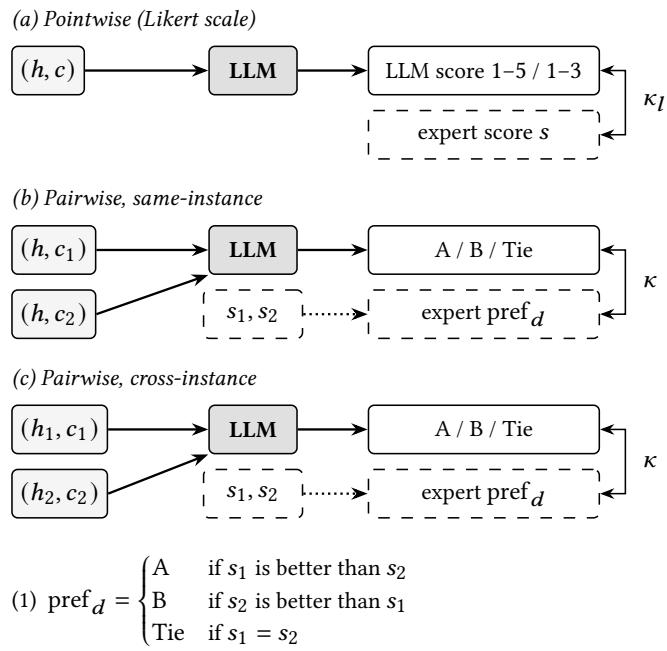

# Evaluating LLMs as Judges of Counterspeech Quality Against Online Hate Speech

## Abstract

Johnny Alali alalijohnny@gmail.com Vrije Universiteit Amsterdam Amsterdam, The Netherlands

Nicolás Benjamín Ocampo n.b.ocampo@cwi.nl Centrum Wiskunde & Informatica Amsterdam, The Netherlands

Davide Ceolin davide.ceolin@cwi.nl Centrum Wiskunde & Informatica Amsterdam, The Netherlands

Prolonged exposure to hate speech on social media can cause lasting psychological distress among users. Counterspeech has emerged as an efective, non-censorial mitigation strategy, but its deployment requires rigorous quality assessment. Manual assessment is unscalable due to the large volume of content on the Web and imposes severe emotional strain on human annotators. Large Language Models (LLMs) ofer a scalable alternative, yet concerns remain regarding their reliability. In this paper, we investigate the extent to which LLMs can efectively perform this task. We test 12 open-weight LLMs of diferent sizes and families under zero-shot, few-shot, and chain-of-thought prompting, to approximate pointwise and pairwise human expert assessment of counterspeech quality across four dimensions: relevance, coherence, aggressiveness, and suitableness. We find that (i) LLMs show low agreement and moderate rank correlations with human experts: our best configuration, Qwen 2.5 72B on coherence, achieves up to a linear-weighted Cohen’s �� = 0.19 and Spearman’s � = 0.42 in pointwise evaluation and an unweighted Cohen’s � = 0.25 in pairwise evaluation. (ii) Converting pointwise scores into pairwise labels substantially improves human–LLM agreement for selected configurations. For same-instance coherence, Qwen 2.5 72B under zero-shot prompting achieves � = 0.35 with converted labels, compared with � = 0.25 when judging pairs directly, and Mixtral 8×7B under few-shot prompting improves from $\kappa = 0 . 0 7$ to � = 0.34. (iii) LLMs agree more with one another than with human experts, particularly in pairwise evaluation, where the strongest model pair, OLMo 2 32B and Llama 3.3 70B on coherence, reaches substantial agreement with $\kappa = 0 . 7 6$ , whereas their agreement with the experts in the same configuration does not exceed � = 0.21.

## Keywords

LLM-as-a-Judge, Human–LLM Agreement, Expert Annotation, Counterspeech, Hate Speech

## 1 Introduction

Online platforms have become a major channel for the dissemination of hate speech, which has been linked to ofline violence [33] and to psychological distress among those exposed to it [36]. Counterspeech has emerged as an efective mitigation strategy to oppose online hate. Rather than suppressing hateful content, it challenges it through a non-censorial response [4, 10, 31]. Evidence of its effectiveness was shown on Twitter users who received empathic counterspeech as a response to xenophobic posts and were less likely to produce hateful content over a four-week period [19].

However, deploying counterspeech requires rigorous human assessment, involving several factors such as evaluation criteria, rating scales, quality dimensions, and annotator expertise [6]. In this context, two main evaluation approaches have been adopted: Likert or continuous-scale ratings ofhate speech and counterspeech message pairs [7, 11, 21, 24, 38], and pairwise comparisons, in which the better of two counterspeech responses to a given hate speech message is selected [38, 43]. These approaches ofer diferent advantages and limitations. Likert scales are convenient because they assign a direct score to each counterspeech response, but annotators may struggle to distinguish between intermediate values [25], and the resulting ordinal ratings are often treated as interval-scale measurements [27]. In contrast, pairwise comparisons simplify the task for human annotators by requiring them to choose between two responses, but they come at the cost of requiring a larger number of comparisons [39, 43]. With either approach, manual assessment is dificult to scale to the volume of content on the Web and repeatedly exposes annotators to hateful content.

  
Figure 1: Overview of the evaluation settings. In setting (a), a single counterspeech item for one hateful instance is evaluated on a Likert scale. In settings (b) and (c), two items are compared: in (b) on the same hateful instance, while in (c) on two diferent instances matched by target group and counterspeech strategy.

Large language models (LLMs) have emerged as a scalable alternative, including fine-tuned evaluators such as JudgeLM [42], used in the shared task of the First Workshop on Multilingual Counterspeech Generation [8], and ArgJudge [29], which scores the argumentative quality of counter-arguments. However, the conditions under which these models perform reliably remain unclear, and findings regarding their capabilities are contrasting: while LLM evaluators correlate more strongly with human judgments of counter-narratives than reference-based metrics [24, 43], their agreement with human judgments varies widely across models, datasets, and evaluated properties [3], and open-weight models correlate substantially less with expert judgments than GPT-4 [21]. Moreover, a systematic comparison of LLMs across pointwise and pairwise evaluation setups remains lacking.

This study uses CSEval [21] as a benchmark to evaluate LLMs on counterspeech quality assessment, comparing their judgments with the expert human annotations it provides. Since counterspeech quality is multidimensional, we examine each quality dimension separately. We aim to address the following research question:

How well can LLMs reproduce expert evaluation of counterspeech quality against hate speech on social media?

Our contribution is an extensive evaluation of 12 open-weight LLMs from six model families, ranging in size from 7B to 141B, under zero-shot, few-shot, and chain-of-thought prompting to assess counterspeech quality across four dimensions: relevance, coherence, aggressiveness, and suitableness. We evaluate LLMs in both pointwise and pairwise settings (Figure 1). For pairwise evaluation, we consider two settings: same-instance comparisons, which com pare counterspeech responses to the same hate speech message, and cross-instance comparisons, which compare responses to different hate speech messages sharing the same target group and counterspeech strategy. Leveraging this contribution, we derive the following insights: (i) LLMs show low agreement and moderate rank correlations with human experts: our best configuration, Qwen 2.5 72B on coherence, achieves up to a linear-weighted Cohen’s $\kappa _ { l } = 0 . 1 9$ and Spearman’s $\rho = 0 . 4 2$ in pointwise evaluation and an unweighted Cohen’s $\kappa = 0 . 2 5$ in pairwise evaluation. (ii) Converting pointwise scores into pairwise labels substantially improves human–LLM agreement for selected configurations. For same-instance coherence, Qwen 2.5 72B under zero-shot prompting achieves $\kappa = 0 . 3 5$ with converted labels, compared with � = 0.25 when judging pairs directly, and Mixtral 8×7B under few-shot prompting improves from $\kappa = 0 . 0 7$ to $\kappa = 0 . 3 4 .$ . (iii) LLMs agree more with one another than with human experts, particularly in pairwise evaluation, where the strongest model pair, OLMo 2 32B and Llama 3.3 70B on coherence, reaches substantial agreement with $\kappa = 0 . 7 6 ,$ , whereas their agreement with the experts in the same configuration does not exceed $\kappa = 0 . 2 1$

The remainder of this paper is organized as follows. Section 2 reviews related work on counterspeech evaluation and LLMs as judges. Section 3 describes the pointwise and pairwise evaluation settings, Section 4 the dataset, and Section 5 the models, prompting strategies, and agreement measures. Section 6 presents and discusses the results, and Section 7 concludes.

## 2 Related Work

Counterspeech ofers a constructive alternative to restrictive approaches for addressing hate speech on social media. Assessing counterspeech quality is important for efective intervention, but human evaluation can become a bottleneck at scale. We review existing approaches to intrinsic counterspeech evaluation, which assess generated responses independently of their downstream effects, ranging from automatic metrics to human and LLM-based judgments.

## 2.1 Metrics for Counterspeech Evaluation

Reference-based metrics such as BLEU [34], ROUGE [28], ME-TEOR [2], and BERTScore [40] assess generated counterspeech through lexical or semantic similarity to reference texts. However, multiple valid responses may exist for the same hate speech message [21], and reference similarity does not necessarily capture specific quality dimensions [6]. Other automatic metrics assess individual properties rather than overall quality, including repetitiveness, measured with the repetition rate [5, 9] as in counterspeech generation studies [11, 38], safety [7, 30], and knowledge overlap [11].

Human evaluation often assesses counterspeech pointwise using Likert scales [12, 24] across dimensions such as coherence [11, 21], grammaticality [38], aggressiveness [21], informativeness [7, 11], cogency [7], and suitableness [21, 38]. However, distinguishing intermediate scores can be challenging [25]. Pairwise evaluation instead selects the preferred response from two alternatives [43]. While this simplifies the judgment, it does not directly quantify the magnitude of quality diferences, and exhaustive comparisons grow quadratically with the number of systems compared [39, 43]. Hybrid approaches combine pointwise ratings with comparative selection among responses to the same hate speech message [38].

Overall, counterspeech evaluation remains methodologically heterogeneous, with studies combining reference-based, propertybased, and human evaluations [6, 11, 38]. The reliance on human judgments also presents scalability challenges, motivating the investigation of automated evaluation methods.

## 2.2 LLMs as Evaluators

LLM-based evaluation ofers a potential alternative to human assessment of counterspeech quality, although evidence of its reliability remains mixed. Several studies report encouraging results for evaluating responses to hate speech. LLM evaluators achieve stronger correlations with human judgments than reference-based metrics in counter-narrative evaluation [24], and an LLM that compares the outputs of diferent counter-narrative generation systems in pairs produces system rankings that correlate strongly with human preferences [43]. Auto-CSEval, which calibrates evaluation instructions using expert judgments, improves correlation with human ratings of counterspeech over conventional metrics and LLM-based baselines [21].

These studies nevertheless leave open how closely LLM judg ments agree with human judgments. The strong correlation reported by Zubiaga et al. concerns rankings of generation systems rather than agreement on individual responses to hate speech [43], and on CSEval, the open-weight models evaluated by Hengle et al. achieve substantially lower correlations with expert judgments than GPT-4 [21]. Findings on prompting vary as well: chain-of-thought (CoT)-based evaluation improves correlation with expert judgments across all four dimensions for GPT-4 on CSEval, while improvements are less consistent across dimensions for the open-weight models examined [21]. LLMs may also sufer from position bias in pairwise evaluation [41]. Together, these findings highlight the importance of validating LLM evaluators against human judgments for each model, prompting strategy, evaluation setting, and quality dimension. The LLM-based counterspeech evaluation studies discussed above primarily report correlations with human judgments rather than chance-corrected agreement measures such as Cohen’s �, and focus on specific evaluation settings. Our work builds on CSEval’s expert annotations and addresses these gaps in three ways: First, we examine both pointwise and pairwise evaluation of counterspeech responses, including same-instance and crossinstance comparisons, and compare pairwise judgments with labels converted from pointwise scores. Second, we evaluate 12 openweight LLMs from six model families and of diferent sizes under zero-shot, few-shot, and chain-of-thought prompting, and measure agreement with the experts using Cohen’s �, which corrects for chance agreement. Third, we compare LLM–LLM agreement with human–LLM agreement to examine whether agreement among LLMs corresponds to agreement with experts.

## 3 Methodology

We test LLMs as counterspeech evaluators under pointwise and pairwise evaluation, varying the model, the prompting strategy, and the quality dimension, and compare their judgments with expert human annotations.

Figure 1 illustrates the two evaluation settings: pointwise evalu ation (Figure 1a) and pairwise evaluation with same-instance and cross-instance comparisons (Figure 1b–c). In the pointwise setting, the model receives a hate speech message ℎ and a single counterspeech response $c ,$ and assigns an integer score � on the rating scale of the evaluated quality dimension. Each quality dimension is evaluated independently, and the model’s scores are compared with the expert scores for the same instances. In the pairwise setting, the model receives two counterspeech responses $c _ { 1 }$ and $c _ { 2 } ,$ presented as Counterspeech A and Counterspeech $\mathrm { B , }$ and judges which of the two is better on the evaluated quality dimension. It returns one of three labels: A or B if one response is better, or Tie if neither response is clearly better than the other. We consider two types of comparisons: in same-instance comparisons, counterspeech $c _ { 1 }$ and $c _ { 2 }$ address the same hate speech message $h ,$ whereas in crossinstance comparisons, $h _ { 1 }$ and $h _ { 2 }$ are distinct hate speech messages targeting the same group, addressed by counterspeech $c _ { 1 }$ and $c _ { 2 } ,$ respectively.

Pointwise scores on a rating scale can be converted into pairwise labels. Given the scores � and � of two responses on dimension �, the counterspeech with the better score is preferred, and equal scores yield a tie (Eq. (1) in Figure 1). We use this rule to convert each model’s pointwise scores into pairwise labels for the same response pairs judged in the pairwise setting. Both settings then share the {A, B, Tie} classes, so pointwise and pairwise evaluation can be compared directly on the same pairs. The same rule, applied to expert scores, provides the reference labels for evaluating both pointwise-derived and direct pairwise judgments.

## 4 Dataset

We use CSEval [21], a benchmark for multidimensional counterspeech evaluation annotated by domain experts. CSEval was built by sampling hate speech messages from IntentCONAN [18], a dataset in which each message has several valid counterspeech responses, and contains 2,223 unique hate speech messages, 4,318 human written reference counterspeech responses, and 7,926 responses generated by models [21]. Five expert annotators with research backgrounds in hate speech and counterspeech scored hate speech– counterspeech pairs along four quality dimensions: relevance, which measures how well the counterspeech addresses the hate speech; coherence, which captures whether it provides specific and coherent arguments that counter the hate speech; aggressiveness, which measures confrontational or inflammatory language; and suitableness, which assesses whether the response could be used as counterspeech without editing. Relevance, coherence, and aggressiveness are scored on 1–5 Likert scales, whereas suitableness uses a 1–3 scale, since it is close to a yes/no judgment of whether a response can be used as is [38]. Higher scores indicate better quality for all dimensions except aggressiveness, for which lower scores are preferred, as less aggressive counterspeech is considered more effective [21].

CSEval contains expert scores for two types of counterspeech: human-written reference responses, which form its gold-standard subset, and responses generated by five systems [21]. We evaluate only human-written counterspeech: the human-written reference responses form our evaluation set, and their expert scores serve as the expert reference. The model-generated responses and their expert scores are used only to select few-shot demonstrations and are never evaluated. We draw demonstrations from this subset for two reasons: it keeps the demonstrations disjoint from the evaluated instances, avoiding any overlap between examples and test items, and it covers the full range of scores, including clearly poor responses that illustrate the lower end of each scale. Because these demonstrations are model-generated, they may difer in style from the human-written responses being evaluated, which could afect few-shot performance.

CSEval marks missing annotations with a value of 0, outside the defined rating scales; we exclude these values and remove instances without any valid annotation. The pointwise evaluation uses 1,400 hate speech–counterspeech instances spanning 1,056 unique hate speech messages. Because some instances lack an annotation for individual dimensions, the number of evaluable instances varies by dimension. Table 1 reports the number of evaluable instances and the distribution of expert scores for each dimension.

Table 1: Expert score distribution in the pointwise evaluation set (1,400 instances). Suitableness uses a 1–3 scale.
<table><tr><td>Dimension</td><td>n</td><td>1</td><td>2</td><td>3</td><td>4</td><td>5</td></tr><tr><td>Relevance</td><td>1,389</td><td>296</td><td>811</td><td>217</td><td>65</td><td>0</td></tr><tr><td>Coherence</td><td>1,397</td><td>612</td><td>712</td><td>57</td><td>16</td><td>0</td></tr><tr><td>Aggressiveness</td><td>1,092</td><td>91</td><td>225</td><td>568</td><td>194</td><td>14</td></tr><tr><td>Suitableness</td><td>1,386</td><td>693</td><td>542</td><td>151</td><td>一</td><td>一</td></tr></table>

Since CSEval provides no pairwise annotations, we construct pairwise datasets from these pointwise instances and derive reference labels for each pair from the expert scores of its two responses using the rule in Eq. (1) (Section 3): the response with the better expert score is preferred, and equal scores yield a Tie. The pairwise datasets are built from 1,398 instances: two of the 1,400 instances have exactly the same text as another instance and difer only in their identifier, so we remove them to avoid pairing a response with itself. The same-instance dataset compares alternative counterspeech responses addressing the same hate speech message: 269 of the 1,056 unique hate speech messages have between two and ten responses, and pairing these responses yields 454 comparisons. The cross-instance dataset compares responses addressing diferent hate speech messages. To construct comparable pairs, we pair instances only when they share the same target group and counterspeech strategy, which yields 7,047 comparisons.

Target-group labels were obtained by matching each hate speech message to its source dataset: 964 instances were matched to IntentCONANv2 [20], which pairs hate speech with counterspeech written for diferent intents (e.g., informative, questioning, denouncing, positive), and 323 to MultiCONAN [17], a multi-target dataset of hate speech–counterspeech pairs collected with a human-inthe-loop procedure. The remaining 113 instances, which appear in neither dataset, were assigned to a target group used in the source datasets by one of the authors, based on the content of each hate speech message; these labels were not checked by a second annotator. The instances cover 15 target groups. The six largest are Muslims (463 instances), women (226), Black people (177), LGBTQ+ people (152), immigrants (135), and Jews (118); the remaining nine, including Asian people, refugees, and people with disabilities, each have fewer than 25 instances and are combined as Other (129 instances).

If either response has no score for the evaluated dimension, the comparison is excluded for that dimension. Table 2 reports the resulting number of comparisons per dimension and the distribution of reference labels.

Table 2: Number of pairwise comparisons per dimension and distribution of reference labels.
<table><tr><td></td><td colspan="4">Same-instance</td><td colspan="4">Cross-instance</td></tr><tr><td>Dimension</td><td>n</td><td>A</td><td>B</td><td>Tie</td><td>n</td><td>A</td><td>B</td><td>Tie</td></tr><tr><td>Relevance</td><td>441</td><td>104</td><td>106</td><td>231</td><td>6,978</td><td>1,884</td><td>2,007</td><td>3,087</td></tr><tr><td>Coherence</td><td>450</td><td>115</td><td>111</td><td>224</td><td>7,047</td><td>1,626</td><td>1,703</td><td>3,718</td></tr><tr><td>Aggressiveness</td><td>263</td><td>68</td><td>66</td><td>129</td><td>5,963</td><td>1,890</td><td>1,826</td><td>2,247</td></tr><tr><td>Suitableness</td><td>447</td><td>102</td><td>104</td><td>241</td><td>6,890</td><td>2,050</td><td>1,850</td><td>2,990</td></tr></table>

## 5 Experimental Setup

We evaluate twelve open-weight LLMs from six model families: Llama [1], OLMo 2 [37], Qwen 2.5 [35], Mistral [22, 32], Mixtral [23], and Command R [15, 16]. We have excluded closed models due to replicability concerns. For each family, we include a smaller and a larger variant to examine whether model scale is associated with agreement with human judgments. For analysis, we group models into small (7–8B), medium (13–39B active parameters), and large (70–104B) models. Table 3 lists the model identifiers, parameter counts, and size groups.

Table 3: Evaluated open-weight LLMs. For the Mixtral mixture-of-experts models, size groups are based on active parameters.
<table><tr><td>Family</td><td>Model</td><td>Size</td><td>Group</td><td>Identifier</td></tr><tr><td>Llama</td><td>Llama 3.1 8B</td><td>8B</td><td>Small</td><td>Llama-3.1-8B-Instruct</td></tr><tr><td></td><td>Llama 3.3 70B</td><td>70B</td><td>Large</td><td>Llama-3.3-70B-Instruct</td></tr><tr><td>OLMo 2</td><td>OLMo 2 7B</td><td>7B</td><td>Small</td><td>OLMo-2-1124-7B-Instruct</td></tr><tr><td></td><td>OLMo 2 32B</td><td>32B</td><td>Medium</td><td>OLMo-2-0325-32B-Instruct</td></tr><tr><td>Qwen 2.5</td><td>Qwen 2.5 7B</td><td>7B</td><td>Small</td><td>Qwen2.5-7B-Instruct</td></tr><tr><td></td><td>Qwen 2.5 72B</td><td>72B</td><td>Large</td><td>Qwen2.5-72B-Instruct</td></tr><tr><td>Mistral</td><td>Mistral 7B</td><td>7B</td><td>Small</td><td>Mistral-7B-Instruct-v0.3</td></tr><tr><td></td><td>Mistral 22B</td><td>22B</td><td>Medium</td><td>Mistral-Small-Instruct-2409</td></tr><tr><td>Mixtral</td><td>Mixtral 8×7B</td><td>47B</td><td>Medium</td><td>Mixtral-8x7B-Instruct-v0.1</td></tr><tr><td></td><td>Mixtral 8×22B</td><td>141B</td><td>Medium</td><td>Mixtral-8x22B-Instruct-v0.1</td></tr><tr><td>Command R</td><td>Command R 7B</td><td>7B</td><td>Small</td><td>Command-R7B-12-2024</td></tr><tr><td></td><td>Command R+ 104B</td><td>104B</td><td>Large</td><td>Command-R+-08-2024</td></tr></table>

We evaluate each model under zero-shot, few-shot, and chainof-thought (CoT) prompting. Zero-shot uses the CSEval definition of the target quality dimension without demonstrations. Few-shot adds target-group-specific demonstrations. In pointwise evaluation, five demonstrations cover the 1–5 scale for relevance, coherence, and aggressiveness, while three cover the 1–3 suitableness scale. In pairwise evaluation, three demonstrations illustrate the three possible outcomes: A, B, and Tie. CoT adds predefined dimension-specific criteria that decompose each dimension into a sequence of evaluation questions. We used a temperature of 0 following Bavaresco et al. [3], which reduces sampling randomness. Outputs are constrained to the valid score or pairwise labels, so the model returns only the final score or label and no reasoning trace is generated.

For pointwise evaluation, our primary agreement measure is linear-weighted Cohen’s � [14], which accounts for chance agreement while weighting disagreements by their ordinal distance. We additionally report Spearman’s rank correlation (�).

For pairwise evaluation, pairwise labels are treated as nominal categories, so we use unweighted Cohen’s � [13] against the reference labels. For the converted labels derived from each model’s pointwise scores, we compute the same unweighted � against the reference labels, denoted $\kappa _ { \mathrm { p w } }$ , so that pointwise and pairwise evaluation can be compared on the same pairs. LLM–LLM agreement is computed with the same measures between two models. We interpret � values following Landis and Koch [26], who label agreement as slight for � ≤ 0.20, fair for 0.21–0.40, moderate for 0.41–0.60, substantial for 0.61–0.80, and almost perfect above 0.80.

As reference points, we report a majority baseline, which always predicts the most frequent expert score or label and therefore yields � = 0: since it always predicts the same label, its observed agreement equals the proportion of that label among the expert annotations, which is exactly the agreement expected by chance. We also report a random baseline, which predicts scores or labels uniformly at random. Since random predictions yield � values scattered around zero, we report the upper bound of the 95% range of � over 2,000 random draws: a configuration that exceeds this value is unlikely to reflect chance agreement.

## 6 Results and Discussion

We test three comparisons between configurations with non-parametric tests on paired agreement values: (i) zero-shot vs. few-shot vs. chain-of-thought prompting, paired by model and quality dimension, using the Friedman test, the non-parametric equivalent of a repeated-measures analysis of variance for three or more related conditions, followed by Wilcoxon signed-rank tests of few-shot vs. zero-shot and chain-of-thought vs. zero-shot prompting; (ii) the larger vs. the smaller model of each family, paired by prompting strategy and quality dimension, using the Wilcoxon signed-rank test; and (iii) direct pairwise judgments vs. labels converted from pointwise scores, paired by model, prompting strategy, and quality dimension, using the Wilcoxon signed-rank test. Confidence intervals are obtained with a cluster bootstrap that resamples hate speech messages together with all their responses (10,000 resamples). For a single configuration, we compare � and $\kappa _ { \mathrm { p w } }$ with the same bootstrap, applied to their diference. Per-family comparisons are adjusted for multiple testing with the Benjamini–Hochberg procedure (Appendix B).

## 6.1 Human–LLM Agreement in Pointwise Evaluation

Table 4 reports agreement for all 144 pointwise configurations, covering 12 models, three prompting strategies, and four quality dimensions.

No pointwise configuration exceeds slight agreement on the Landis–Koch scale $( \kappa _ { l } \le 0 . 2 0 )$ , although rank correlations are moderate for some dimensions. The highest agreement is obtained by Qwen 2.5 72B for coherence under few-shot prompting, with $\kappa _ { l } ~ = ~ 0 . 1 9 1$ , 95% CI [0.163, 0.219], followed by OLMo 2 32B for coherence under CoT prompting, with $\kappa _ { l } = 0 . 1 8 8 \left[ 0 . 1 6 2 , 0 . 2 1 3 \right]$ Spearman correlations reach $\rho = 0 . 4 3 1$ , obtained by Mixtral 8×22B for aggressiveness under zero-shot prompting, and $\rho = 0 . 4 2 1$ , obtained by Qwen 2.5 72B for coherence under zero-shot prompting. These values are higher than the corresponding $\kappa _ { l }$ of 0.069 and 0.171 because $\rho$ reflects only the relative ordering of responses, whereas $\kappa _ { l }$ also requires the assigned scores to match. Coherence yields the highest agreement across models, whereas suitableness remains close to zero, with $\rho$ not exceeding 0.053. Llama 3.1 8B, Mistral 22B, and both Command R models assign a score of 1 to every instance in 47 of their 48 configurations, which yields $\kappa _ { l } = 0 ,$ so they perform no better than a majority baseline. Only 38 of the 144 configurations exceed the 95% upper bound of the random baseline, which is $\kappa _ { l } = 0 . 0 2 3$ for relevance, 0.015 for coherence, 0.033 for aggressiveness, and 0.035 for suitableness. No configuration exceeds this bound for suitableness. While prior work reports rank correlations, such as Spearman’s $\rho$ and Kendall’s �, between LLM and human judgments of counterspeech [21, 24], our results show that moderate rank correlations, with $\rho$ up to 0.43, can coexist with low agreement on the scores themselves, with $\kappa _ { l }$ not exceeding 0.19.

No prompting strategy yields consistently higher agreement in pointwise evaluation. A Friedman test shows no significant difference in $\kappa _ { l }$ between zero-shot, few-shot, and CoT prompting, $p = 0 . 2 3 1$ . Descriptively, zero-shot prompting yields the highest mean $\kappa _ { l }$ across models and dimensions, 0.022, followed by few-shot prompting with 0.018 and CoT prompting with 0.013, and zero-shot prompting gives the highest �� for three of the four dimensions, with few-shot prompting doing so for coherence. CoT prompting yields the lowest agreement, as many models assign the same score to every instance under this strategy.

Larger models tend to achieve slightly higher agreement than the smaller model of the same family. A Wilcoxon signed-rank test comparing the two variants of each family under the same prompting strategy and dimension shows that this diference is not significant, $p = 0 . 0 6 4 \mathrm { . }$ , with the larger model achieving higher $\kappa _ { l }$ in 32 of 72 cases and lower $\kappa _ { l }$ in 20. Lastly, comparing the mean $\kappa _ { l }$ of the three size groups shows that agreement does not increase steadily with size: medium models achieve the highest group mean for relevance, aggressiveness, and suitableness, and large models only for coherence. Under CoT prompting, all large models assign the same score to every instance for relevance, coherence, and aggressiveness, which lowers their mean.

Table 4: Pointwise human–LLM agreement. Avg.: group mean; � is averaged over models for which it is defined. –: same score for every instance. Bold: highest $\kappa _ { l }$ per dimension. Majority: most frequent expert score per dimension. Random (95% UB): upper end of the range covering 95% of the $\kappa _ { l }$ values from 2,000 runs of random scoring; higher values are unlikely to arise by chance.
<table><tr><td></td><td></td><td colspan="2">Relevance</td><td colspan="2">Coherence</td><td colspan="2">Aggressiveness</td><td colspan="2">Suitableness</td></tr><tr><td>Model</td><td>Prompt</td><td>Kl</td><td>ρ</td><td>Kl</td><td>ρ</td><td>Kl</td><td>ρ</td><td>Kl</td><td>ρ</td></tr><tr><td>OLMo 7B</td><td>Zero-shot Few-shot</td><td>.026 .060</td><td>.065 .048</td><td>.077 .058</td><td>.264 .201</td><td>.001 -.025</td><td>.014 -.067</td><td>.000 -.098</td><td>-.142</td></tr><tr><td>Qwen 7B</td><td>CoT Zero-shot</td><td>.062 .070</td><td>.125 .122</td><td>.143 .161</td><td>.320 .378</td><td>.000 .064</td><td>.307</td><td>.000 -.021</td><td>-.037</td></tr><tr><td></td><td>Few-shot CoT Zero-shot</td><td>.037 .000 .001</td><td>.067 一</td><td>.149 .000</td><td>.320</td><td>.063 .000</td><td>.296 一</td><td>-.056 .000</td><td>-.101 I</td></tr><tr><td>Mistral 7B</td><td>Few-shot CoT</td><td>-.005 .000</td><td>.028 -.017</td><td>-.029 -.141 .003</td><td>-.071 -.232</td><td>.003 .000</td><td>.031 -.035</td><td>-.001 -.001 .001</td><td>-.026 -.026 .020</td></tr><tr><td>Cmd R 7B</td><td>Zero-shot Few-shot</td><td>.000 .000</td><td></td><td>.000 .000</td><td>.049 一</td><td>-.001 .000 .000</td><td>-.038 一</td><td>.000 .000</td><td>一</td></tr><tr><td>Llama 8B</td><td>CoT Zero-shot Few-shot</td><td>.000 .000</td><td></td><td>.000 .000</td><td></td><td>.000 .000</td><td></td><td>.000 .000</td><td></td></tr><tr><td>Small avg.</td><td>CoT Zero-shot</td><td>.000 .000 .019</td><td>.072</td><td>.000 .000 .042</td><td>一</td><td>.000 .000</td><td>一</td><td>.000 .000 -.004</td><td>一 -.032</td></tr><tr><td></td><td>Few-shot CoT</td><td>.018 .012</td><td>.033 .125</td><td>.013 .029</td><td>.190 .096 .184</td><td>.014 .008 .000</td><td>.117 .065 -.038</td><td>-.031 .000</td><td>-.090 .020</td></tr><tr><td>Mixtral 8×7B</td><td>Zero-shot Few-shot CoT</td><td>.004 .058 .002</td><td>.219 .100 .055</td><td>.027 .059 .130</td><td>.404 .313 .355</td><td>.106 .016 .074</td><td>.375 .072 .258</td><td>.029 -.002 -.024</td><td>-.014 -.002 -.066</td></tr><tr><td>Mistral 22B</td><td>Zero-shot Few-shot CoT</td><td>.000 .000 .000</td><td></td><td>.000 .000 .000</td><td>一</td><td>.000 .000</td><td></td><td>.000 .000</td><td>一</td></tr><tr><td>OLMo 32B</td><td>Zero-shot Few-shot CoT</td><td>.024 .052 .005</td><td>.198 .132 .028</td><td>.136 .103</td><td>.368 .371</td><td>.000 .042 .095</td><td>.273 .258</td><td>.000 .031 -.015</td><td>.053 -.024</td></tr><tr><td>Mixtral 8×22B</td><td>Zero-shot Few-shot CoT</td><td>.023 .043 .000</td><td>.204 .194</td><td>.188 .037 .042</td><td>.382 .337 .338</td><td>.009 .069 .016</td><td>.178 .431 .164</td><td>.000 -.008 .011</td><td>-.122 -.013</td></tr><tr><td>Medium avg.</td><td>Zero-shot Few-shot CoT</td><td>.013 .038 .002</td><td>一 .207 .142</td><td>.003 .050 .051</td><td>.028 .370 .341</td><td>.014 .054 .032</td><td>.194 .360 .165</td><td>.000 .013 -.002</td><td>一 -.028 -.013</td></tr><tr><td>Llama 70B</td><td>Zero-shot Few-shot</td><td>-.022 .047</td><td>.042 -.132 .057</td><td>.080 .002 .099</td><td>.255 .029 .212</td><td>.024 .000 .009</td><td>.210 .006 .163</td><td>-.006 .001 -.071</td><td>-.066 .008 -.093</td></tr><tr><td>Qwen 72B</td><td>CoT Zero-shot Few-shot</td><td>.000 .096 .046</td><td>.151 .027</td><td>.000 .171 .191</td><td>.421 .359</td><td>.000 .105 .087</td><td>.387 一 .187</td><td>.005 -.191 -.046</td><td>.053 -.266 -.071</td></tr><tr><td>Cmd R+ 104B</td><td>CoT Zero-shot Few-shot</td><td>.000 .000</td><td>一</td><td>.000 .000</td><td>一</td><td>.000 .000</td><td></td><td>.000 .000</td><td></td></tr><tr><td>Large avg.</td><td>CoT Zero-shot</td><td>-.004 .000 .025</td><td>-.071 一 .009</td><td>.000 .000 .058</td><td>1 1</td><td>.000 .000</td><td>一</td><td>.000 .000</td><td>一</td></tr><tr><td></td><td>Few-shot CoT</td><td>.030 .000</td><td>.004</td><td>.097 .000</td><td>.225 .285 一</td><td>.035 .032 .000</td><td>.197 .175</td><td>-.063 -.039 .002</td><td>-.129 -.082 .053</td></tr></table>

## 6.2 Human–LLM Agreement in Pairwise Evaluation

Tables 5 and 6 report agreement for the same 144 configurations in same- and cross-instance comparisons, respectively.

Table 5: Same-instance comparisons: pairwise human–LLM agreement. Bold: highest � and $\kappa _ { \mathrm { p w } }$ per dimension. Avg.: group mean. Majority and Random (95% UB): as in Table 4.
<table><tr><td></td><td></td><td colspan="2">Relevance</td><td colspan="2">Coherence</td><td colspan="2">Aggressiveness</td><td colspan="2">Suitableness</td></tr><tr><td>Model</td><td>Prompt</td><td>K</td><td>Kpw</td><td>K</td><td>Kpw</td><td>K</td><td>Kpw</td><td>K</td><td>Kpw</td></tr><tr><td>OLMo 7B</td><td>Zero-shot Few-shot</td><td>.080 .008</td><td>.040 .150</td><td>.159 -.003</td><td>.216 .217</td><td>.010 -.002</td><td>-.003 .069</td><td>-.014 -.001</td><td>.000 -.049</td></tr><tr><td>Qwen 7B</td><td>CoT Zero-shot</td><td>.091 .073</td><td>.086 .017</td><td>.099 .192</td><td>.264 .305</td><td>.056 .010</td><td>.000 .176</td><td>-.001 -.019</td><td>.000 .036</td></tr><tr><td></td><td>Few-shot CoT</td><td>.056 .083</td><td>.097 .000</td><td>.178 .195</td><td>.251 .000</td><td>.029 .077</td><td>.169 .000</td><td>-.030 -.016</td><td>.036 .000</td></tr><tr><td>Mistral 7B</td><td>Zero-shot Few-shot CoT</td><td>.111 .039 .040</td><td>.000 -.016 .000</td><td>.167 .055</td><td>-.025 -.063</td><td>-.008 .033</td><td>-.006 -.048</td><td>.035 .002</td><td>.002 .000</td></tr><tr><td>Cmd R 7B</td><td>Zero-shot Few-shot</td><td>.064 .031</td><td>.000 .000</td><td>.163 .185 .181</td><td>.000 .000</td><td>.072 .036</td><td>.000 .000</td><td>.014 .017</td><td>.000 .000</td></tr><tr><td>Llama 8B</td><td>CoT Zero-shot</td><td>.111 .008</td><td>.000 .000</td><td>.218 .078</td><td>.000 .000 .000</td><td>.000 .054</td><td>.000 .000</td><td>-.020 .001 -.008</td><td>.000 .000 .000</td></tr><tr><td></td><td>Few-shot CoT</td><td>-.005 .086</td><td>.000 .000</td><td>.075 .196</td><td>.000 .000</td><td>.000 .040 .014</td><td>.000 .000 .000</td><td>.024 -.006</td><td>.000 .000</td></tr><tr><td>Small avg.</td><td>Zero-shot Few-shot CoT</td><td>.067 .026 .082</td><td>.011 .046 .017</td><td>.156 .097 .174</td><td>.099 .081</td><td>.010 .020</td><td>.033 .038</td><td>.002 -.005 -.002</td><td>.008 -.003</td></tr><tr><td>Mixtral 8×7B</td><td>Zero-shot Few-shot</td><td>.082 -.004</td><td>.104 .091</td><td>.207</td><td>.053 .305</td><td>.055 -.002</td><td>.000 .163</td><td>.013</td><td>.000 .032</td></tr><tr><td>Mistral 22B</td><td>CoT Zero-shot</td><td>.092 .033</td><td>.068 .000</td><td>.074 .206 .017</td><td>.343 .233 .000</td><td>.009 .066 .000</td><td>.025 .051 .000</td><td>-.045 .009 .000</td><td>.000 -.031 .000</td></tr><tr><td>OLMo 32B</td><td>Few-shot CoT Zero-shot</td><td>.049 .003 .088</td><td>.000 .000 .111</td><td>.043 .012</td><td>.000 .000</td><td>-.001 .000</td><td>.000 .000</td><td>.001 .009</td><td>.000 .000 -.012</td></tr><tr><td></td><td>Few-shot CoT Zero-shot</td><td>.093 .100</td><td>.118 -.021</td><td>.214 .203 .204</td><td>.284 .305 .276</td><td>.159 .118 .130</td><td>.134 .223 .019</td><td>-.004 -.012 -.007</td><td>-.020 .000</td></tr><tr><td>Mixtral 8×22B</td><td>Few-shot CoT</td><td>.100 .174 .098</td><td>.215 .150 .000</td><td>.226 .174 .177</td><td>.245 .275 .029</td><td>.116 .019 .132</td><td>.197 .056 .068</td><td>.005 -.011 -.018</td><td>.014 .071 .000</td></tr><tr><td>Medium avg.</td><td>Zero-shot Few-shot</td><td>.076 .078</td><td>.107 .090</td><td>.166 .123</td><td>.208 .231</td><td>.068 .036</td><td>.123 .076</td><td>.003 -.017</td><td>.009 .013</td></tr><tr><td>Llama 70B</td><td></td><td></td><td></td><td>.181</td><td>.000</td><td></td><td>.000</td><td>-.018</td><td>-.010</td></tr><tr><td></td><td></td><td></td><td></td><td>.179</td><td>.000</td><td>.073</td><td>.000</td><td>−.021</td><td>.019</td></tr><tr><td></td><td>Few-shot</td><td></td><td>.185</td><td>.245</td><td>.353</td><td>.061</td><td>.234</td><td>.001</td><td></td></tr><tr><td></td><td></td><td>.089</td><td>.128</td><td>.214</td><td>.292</td><td>.082</td><td>.112</td><td>-.014</td><td>.015</td></tr><tr><td></td><td></td><td></td><td></td><td></td><td></td><td></td><td></td><td></td><td>-.078</td></tr><tr><td>Qwen 72B</td><td></td><td></td><td></td><td></td><td></td><td></td><td></td><td></td><td></td></tr><tr><td></td><td>Few-shot</td><td>.086</td><td></td><td></td><td></td><td></td><td></td><td></td><td></td></tr><tr><td></td><td>Zero-shot</td><td></td><td>-.032</td><td></td><td></td><td></td><td></td><td></td><td></td></tr><tr><td></td><td></td><td></td><td></td><td></td><td></td><td></td><td></td><td></td><td>-.008</td></tr><tr><td></td><td></td><td></td><td></td><td></td><td></td><td></td><td></td><td></td><td></td></tr><tr><td></td><td>CoT</td><td>.073</td><td>.012</td><td>.150</td><td>.135</td><td>.082</td><td></td><td></td><td></td></tr><tr><td></td><td></td><td></td><td></td><td></td><td></td><td></td><td>.035</td><td>-.002</td><td></td></tr><tr><td></td><td></td><td></td><td></td><td></td><td></td><td></td><td></td><td></td><td></td></tr><tr><td></td><td></td><td></td><td></td><td></td><td></td><td></td><td></td><td></td><td></td></tr><tr><td></td><td></td><td>.101</td><td></td><td></td><td></td><td>.098</td><td></td><td></td><td></td></tr><tr><td></td><td></td><td></td><td></td><td></td><td></td><td></td><td></td><td></td><td></td></tr><tr><td></td><td></td><td></td><td>.149</td><td>.170</td><td>.257</td><td>.061</td><td>.052</td><td>-.016</td><td>-.012</td></tr><tr><td></td><td>CoT</td><td>.095</td><td>.000</td><td></td><td></td><td></td><td></td><td></td><td></td></tr><tr><td></td><td>Zero-shot</td><td>.104</td><td></td><td></td><td></td><td></td><td></td><td></td><td></td></tr><tr><td></td><td></td><td></td><td></td><td></td><td></td><td></td><td></td><td></td><td></td></tr><tr><td></td><td></td><td></td><td></td><td></td><td></td><td></td><td></td><td></td><td></td></tr><tr><td></td><td>CoT</td><td>.108</td><td>.000</td><td>.232</td><td>.000</td><td>.101</td><td>.000</td><td>-.011</td><td>.000</td></tr><tr><td>Cmd R+ 104B</td><td>Zero-shot</td><td>.102</td><td>.000</td><td>.205</td><td>.000</td><td>-.034</td><td>.000</td><td>.015</td><td>.000</td></tr><tr><td></td><td>Few-shot</td><td>.134</td><td>.003</td><td>.196</td><td>.000</td><td>-.013</td><td>.000</td><td>.015</td><td>.000 .000</td></tr><tr><td>Large avg.</td><td>CoT Zero-shot</td><td>.102 .102</td><td>.000 .051</td><td>.188 .210</td><td>.000 .118</td><td>-.025 .042</td><td>.000 .078</td><td>-.012 -.001</td></table>

No pairwise configuration exceeds fair agreement in same-instance comparisons or slight agreement in cross-instance comparisons on the Landis–Koch scale. In same-instance comparisons, the highest agreement per dimension is obtained for coherence by Qwen 2.5 72B under zero-shot, with � = 0.245, 95% CI [0.198, 0.301], for relevance by Mixtral 8×22B under few-shot, with � = 0.174, for aggressiveness by OLMo 2 32B under zero-shot, with � = 0.159, and for suitableness by Mistral 7B under zero-shot, with � = 0.035. Coherence is the only dimension that reaches fair agreement, for Qwen 2.5 72B under all three prompting strategies and for Mixtral 8×22B, OLMo 2 32B, and Command R 7B under one strategy each. In cross-instance comparisons, the highest agreement per dimen sion is obtained for aggressiveness by Qwen 2.5 72B under few-shot, with � = 0.130 [0.073, 0.186], for relevance by Mixtral 8×22B under zero-shot, with � = 0.107, for coherence by Qwen 2.5 72B under zero-shot, with � = 0.059, and for suitableness by OLMo 2 32B under

Table 6: Cross-instance comparisons: pairwise human–LLM agreement. Bold: highest � and $\kappa _ { \mathrm { p w } }$ per dimension. Avg.: group mean. Majority and Random (95% UB): as in Table 4.
<table><tr><td></td><td></td><td colspan="2">Relevance</td><td colspan="2">Coherence</td><td colspan="2">Aggressiveness</td><td colspan="2">Suitableness</td></tr><tr><td>Model</td><td>Prompt</td><td>K</td><td>Kpw</td><td>K</td><td>Kpw</td><td>K</td><td>Kpw</td><td>K</td><td>Kpw</td></tr><tr><td rowspan="3">OLMo 7B</td><td>Zero-shot</td><td>.029</td><td>.012</td><td>-.025</td><td>.037</td><td>.011</td><td>-.003</td><td>-.011</td><td>.000</td></tr><tr><td>Few-shot</td><td>-.001</td><td>-.012</td><td>.000</td><td>-.046</td><td>.002</td><td>-.008</td><td>.000</td><td>.002</td></tr><tr><td>CoT</td><td>-.004</td><td>.045</td><td>-.006</td><td>.029</td><td>.028</td><td>.000</td><td>-.005</td><td>.000</td></tr><tr><td rowspan="3">Qwen 7B</td><td>Zero-shot</td><td>.038</td><td>.070</td><td>.042</td><td>.037</td><td>.039</td><td>.129</td><td>.011</td><td>.025</td></tr><tr><td>Few-shot</td><td>.033</td><td>.059</td><td>.036</td><td>.034</td><td>-.016</td><td>.119</td><td>-.023</td><td>.054</td></tr><tr><td>CoT</td><td>.024</td><td>.000</td><td>.040</td><td>.000</td><td>.061</td><td>.000</td><td>.008</td><td>.000</td></tr><tr><td rowspan="3">Mistral 7B</td><td>Zero-shot</td><td>.002</td><td>-.002</td><td>.046</td><td>-.066</td><td>-.014</td><td>-.002</td><td>-.014</td><td>.000</td></tr><tr><td>Few-shot</td><td>.008</td><td>-.007</td><td>.031</td><td>-.034</td><td>-.001</td><td>-.037</td><td>-.010</td><td>.000</td></tr><tr><td>CoT</td><td>-.004</td><td>.000</td><td>.043</td><td>.000</td><td>-.004</td><td>.000</td><td>-.006</td><td>.000</td></tr><tr><td rowspan="3">Cmd R 7B</td><td>Zero-shot</td><td>.012</td><td>.000</td><td>.006</td><td>.000</td><td>.002</td><td>.000</td><td>.004</td><td>.000</td></tr><tr><td>Few-shot</td><td>.032</td><td>.000</td><td>.024</td><td>.000</td><td>.017</td><td>.000</td><td>.006</td><td>.000</td></tr><tr><td>CoT</td><td>.003</td><td>.000</td><td>.001</td><td>.000</td><td>-.004</td><td>.000</td><td>.000</td><td>.000</td></tr><tr><td rowspan="3">Llama 8B</td><td>Zero-shot</td><td>.001</td><td>.000</td><td>.003</td><td>.000</td><td>.000</td><td>.000</td><td>.000</td><td>.000</td></tr><tr><td>Few-shot</td><td>-.001</td><td>.000</td><td>.001</td><td>.000</td><td>-.002</td><td>.000</td><td>-.002</td><td>.000</td></tr><tr><td>CoT</td><td>.000</td><td>.000</td><td>.000</td><td>.000</td><td>.000</td><td>.000</td><td>.000</td><td>.000</td></tr><tr><td rowspan="3">Small avg.</td><td>Zero-shot</td><td>.016</td><td>.016</td><td>.014</td><td>.002</td><td>.008</td><td>.025</td><td>-.002</td><td>.005</td></tr><tr><td>Few-shot</td><td>.014</td><td>.008</td><td>.018</td><td>-.009</td><td>.000</td><td>.015</td><td>-.006</td><td>.011</td></tr><tr><td>CoT</td><td>.004</td><td>.009</td><td>.016</td><td>.006</td><td>.016</td><td>.000</td><td>-.001</td><td>.000</td></tr><tr><td rowspan="3">Mixtral 8×7B</td><td>Zero-shot</td><td>.049</td><td>.054</td><td>.039</td><td>.066</td><td>.010</td><td>.149</td><td>-.014</td><td>.038</td></tr><tr><td>Few-shot</td><td>.002</td><td>.058</td><td>.005</td><td>.024</td><td>.000</td><td>.045</td><td>-.048</td><td>.014</td></tr><tr><td>CoT</td><td>.041</td><td>.020</td><td>.045</td><td>.044</td><td>.020</td><td>.077</td><td>.009</td><td>-.011</td></tr><tr><td rowspan="3">Mistral 22B</td><td>Zero-shot</td><td>.010</td><td>.000</td><td>-.005</td><td>.000</td><td>.002</td><td>.000</td><td>-.008</td><td>.000</td></tr><tr><td>Few-shot</td><td>.014</td><td>.000</td><td>-.022</td><td>.000</td><td>.018</td><td>.000</td><td>-.010</td><td>.000</td></tr><tr><td>CoT</td><td>.003</td><td>.000</td><td>-.004</td><td>.000</td><td>.003</td><td>.000</td><td>-.004</td><td>.000</td></tr><tr><td rowspan="3">OLMo 32B</td><td>Zero-shot</td><td>.050</td><td>.045</td><td>.034</td><td>.061</td><td>.078</td><td>.076</td><td>.031</td><td>.071</td></tr><tr><td>Few-shot</td><td>.041</td><td>.037</td><td>.055</td><td>.088</td><td>.071</td><td>.143</td><td>.042</td><td>.071</td></tr><tr><td>CoT</td><td>.049</td><td>.005</td><td>.032</td><td>.060</td><td>.091</td><td>.027</td><td>.037</td><td>.000</td></tr><tr><td rowspan="3">Mixtral 8×22B</td><td>Zero-shot</td><td>.107</td><td>.082</td><td>.051</td><td>.018</td><td>.091</td><td>.143</td><td>.041</td><td>.019</td></tr><tr><td>Few-shot</td><td>.066</td><td>.078</td><td>.046</td><td>.007</td><td>.063</td><td>.023</td><td>.028</td><td>.126</td></tr><tr><td>CoT</td><td>.092</td><td>.000</td><td>.037</td><td>.001</td><td>.107</td><td>.016</td><td>.039</td><td>.000</td></tr><tr><td rowspan="3">Medium avg.</td><td>Zero-shot</td><td>.054</td><td>.045</td><td>.030</td><td>.036</td><td>.045</td><td>.092</td><td>.013</td><td>.032</td></tr><tr><td>Few-shot</td><td>.031</td><td>.043</td><td>.021</td><td>.030</td><td>.038</td><td>.053</td><td>.003</td><td>.053</td></tr><tr><td>CoT</td><td>.046</td><td>.006</td><td>.028</td><td>.026</td><td>.055</td><td>.030</td><td>.020</td><td>-.003</td></tr><tr><td rowspan="3">Llama 70B</td><td></td><td></td><td></td><td></td><td></td><td></td><td></td><td></td><td></td></tr><tr><td>Zero-shot Few-shot</td><td>.046 .035</td><td>-.017 .049</td><td>.010 .018</td><td>.005 -.001</td><td>.111</td><td>-.001</td><td>-.009 -.002</td><td>.063</td></tr><tr><td>CoT</td><td>.037</td><td>.000</td><td>.025</td><td>.000</td><td>.100 .093</td><td>.030 .000</td><td>-.005</td><td>.074 .001</td></tr><tr><td rowspan="3">Qwen 72B</td><td>Zero-shot</td><td>.067</td><td>.075</td><td>.059</td><td>.076</td><td>.102</td><td>.151</td><td>.025</td><td>.013</td></tr><tr><td>Few-shot CoT</td><td>.022</td><td>.079</td><td>.041</td><td>.036</td><td>.130</td></table>

few-shot, with � = 0.042. As in pointwise evaluation, suitableness yields the lowest agreement in both comparison types, whereas coherence yields the highest agreement only in same-instance comparisons. Only 63 of the 144 same-instance configurations exceed the 95% upper bound of the random baseline, which is � = 0.062 for relevance, 0.065 for coherence, 0.082 for aggressiveness, and 0.063 for suitableness; no configuration exceeds this bound for suitableness. Only 65 of the 144 cross-instance configurations exceed this bound, which is $\kappa = 0 . 0 1 6$ for relevance, 0.016 for coherence, 0.017 for aggressiveness, and 0.017 for suitableness; only seven configurations exceed it for suitableness.

No prompting strategy yields consistently higher agreement in pairwise evaluation either. In same-instance comparisons, fewshot prompting yields lower agreement than the other two strategies: mean � is 0.054 under few-shot, compared with 0.073 under zero-shot and 0.079 under CoT. This diference is significant (Friedman test, $\textstyle p < 0 . 0 0 1 )$ : zero-shot outperforms few-shot (� = 0.012), whereas zero-shot and CoT do not difer (� = 0.582), both with the Wilcoxon signed-rank test. In cross-instance comparisons, the three strategies do not difer significantly (Friedman test, � = 0.408), with mean � of 0.024 under zero-shot, 0.019 under few-shot, and 0.025 under CoT. The strategy that yields the highest � also varies by dimension, as reported above: in cross-instance comparisons, zeroshot for relevance and coherence and few-shot for aggressiveness and suitableness.

Larger models achieve higher agreement than the smaller model of the same family in pairwise evaluation. A Wilcoxon signed-rank test comparing the two variants of each family under the same prompting strategy and dimension shows that this diference is significant in both same-instance comparisons, $\mathnormal { p } = 0 . 0 0 3$ , with the larger model achieving higher � in 46 of 72 cases, and cross-instance comparisons, $\cdot p < 0 . 0 0 1$ , with the larger model achieving higher � in 59 of 72 cases. Mistral and Command R are the exceptions in sameinstance comparisons, where the smaller model achieves higher � in most cases. Lastly, large models achieve the highest mean � for relevance and coherence in same-instance comparisons, and for coherence and aggressiveness in cross-instance comparisons, while small models achieve the lowest mean � in nearly all cases.

## 6.3 Pointwise vs. Pairwise Evaluation

The preceding results use linear-weighted $\kappa _ { l }$ for pointwise evaluation and unweighted � for pairwise evaluation. To compare the two settings directly, we use $\kappa _ { \mathrm { p w } }$ in Tables 5 and $^ { 6 , }$ the agreement of labels converted from each model’s pointwise scores into pairwise labels for the same response pairs (Section 3). Since $\kappa _ { \mathrm { p w } }$ and � are both unweighted � against the same reference labels on the same pairs, they are directly comparable.

A Wilcoxon signed-rank test shows no significant diference between pairwise and pointwise evaluation, $p = 0 . 0 7 3$ for sameinstance and $p = 0 .$ .188 for cross-instance comparisons. Neither setting is consistently better. This is partly because many models give the same pointwise score to every instance, which turns all their pairs into ties and yields $\kappa _ { \mathrm { p w } } = 0 .$ . When models do vary their scores, pointwise evaluation can perform clearly better: for same-instance coherence under zero-shot prompting, Qwen 2.5 72B reaches $\kappa _ { \mathrm { p w } } = 0 . 3 5 3$ , 95% CI [0.284, 0.425], compared with $\kappa = 0 . 2 4 5$ for its pairwise judgments, and a paired cluster bootstrap shows that this diference of 0.107 is significant, 95% CI [0.053, 0.163].

## 6.4 Agreement Between LLMs

We now examine LLM–LLM agreement, the agreement between two LLMs judging the same responses. We take OLMo 2 32B as the reference model, since it achieves the highest mean agreement with the experts across prompting strategies and dimensions in pointwise evaluation, $\kappa _ { l } = 0 . 0 5 6$ , and same-instance comparisons, $\kappa = 0 . 1 0 7$ , and the third highest in cross-instance comparisons, $\kappa = 0 . 0 5 1$ . For each of the three prompting strategies and each quality dimension, we compare the agreement of OLMo 2 32B with each of the other 11 LLMs to its agreement with the experts under the same strategy and dimension. Table 7 reports the results per model and the mean agreement per size group.

LLMs agree more with one another than with the experts in pairwise evaluation. In same-instance comparisons, OLMo 2 32B reaches a mean $\kappa = 0 . 3 9 0$ with the other LLMs, compared with $\kappa = 0 . 1 0 7$ with the experts, and agrees more with another LLM than with the experts in 109 of 132 comparisons. In cross-instance comparisons, it reaches a mean $\kappa = 0 . 2 0 7$ with the other LLMs, compared with $\kappa = 0 . 0 5 1$ with the experts, and agrees more with another LLM in 94 of 132 comparisons. In pointwise evaluation, the diference is smaller: its mean agreement with the other LLMs is $\kappa _ { l } = 0 . 1 1 8$ , and it agrees more with another LLM in only 50 of 124 comparisons, partly because many models assign the same pointwise score to every instance, which yields zero agreement. Pairwise agreement tends to increase with the size of the other model: for same-instance coherence under zero-shot prompting, OLMo 2 32B reaches a mean $\kappa = 0 . 7 1 7$ with large models, compared with 0.477 with medium and 0.440 with small models, and its highest agreement, $\kappa = 0 . 7 6 4$ , 95% CI [0.710, 0.827], is with Llama 3.3 70B, whereas it reaches only $\kappa = 0 . 2 1 4$ with the experts in the same configuration. The gap is largest for suitableness: agreement with the experts on this dimension does not exceed $\kappa = 0 . 0 4 2$ in any setting, whereas agreement with other LLMs reaches $\kappa _ { l } = 0 . 6 3 3$ with Qwen 2.5 72B under few-shot in pointwise evaluation, $\kappa =$ 0.746 with Qwen 2.5 72B under CoT in same-instance comparisons, and $\kappa = 0 . 5 3 7$ with Mixtral 8×22B under zero-shot in cross-instance comparisons.

Table 7: Agreement of OLMo 2 32B with the experts and each of the other 11 LLMs. Avg.: group mean, excluding OLMo 2 32B. –: both models give the same score to every instance. Bold: highest LLM–LLM � per column. Rel./Coh./Agg./Suit.: relevance, coherence, aggressiveness, suitableness.
<table><tr><td></td><td></td><td colspan="4">Pointwise</td><td colspan="4">Same-instance</td><td colspan="4">Cross-instance</td></tr><tr><td>Model</td><td>Prompt</td><td>Rel.</td><td>Coh.</td><td>Agg.</td><td>Suit.</td><td>Rel. Coh. Agg.</td><td></td><td></td><td>Suit.</td><td>Rel.</td><td>Coh.</td><td>Agg. Suit.</td><td></td></tr><tr><td>Experts</td><td>Zero-shot Few-shot CoT</td><td>.024 .052 .005</td><td>.136 .103 .188</td><td>.042 .095 .009</td><td>.031 -.015 .000</td><td>.088 .093 .100</td><td>.214 .203 .204</td><td> $. 1 5 9 \mathrm { ~ - } . 0 0 4$  .118-.012 .130 -.007</td><td></td><td>.050 .041 .049</td><td>.034 .055 .032</td><td>.078.031 .071 .042 .091 .037</td><td></td></tr><tr><td>OLMo 7B</td><td>Zero-shot Few-shot CoT</td><td>.136 .322 .073</td><td>.449 .481 .652</td><td>.006 .019 .000</td><td>.000 .231 1</td><td>.374 .016 .181</td><td>.461 .009 .247</td><td>.020 .008 .050</td><td>.427 .003 .208</td><td>.333 .001 .208</td><td>.295 .002 .034</td><td>.068.169 .000 .000 .028 .038</td><td></td></tr><tr><td>Qwen 7B</td><td>Zero-shot Few-shot CoT</td><td>.016 .091 .000</td><td>.570 .393 .000</td><td>.351 .162 .000</td><td>.472 .471</td><td>.625 .568 .547</td><td>.657 .616 .234 .681 .320</td><td>.136</td><td>.663 .533 .656</td><td>.432 .344 .283</td><td>.501 .233 .364</td><td>.227 .405 .157 .338 .317 .426</td><td></td></tr><tr><td>Mistral 7B</td><td>Zero-shot Few-shot CoT</td><td>.000 .001 -.097 .000</td><td>.003 .003</td><td>.194 -.077</td><td>.001 .001</td><td>.346 .501</td><td>.391.172 .199</td><td>.208</td><td>.217 .394</td><td>.195 .100</td><td>.307 .298</td><td>.198.151 .083 .110</td><td></td></tr><tr><td>Cmd R 7B</td><td>Zero-shot Few-shot</td><td>.000 .000 .000</td><td>.000 .000</td><td>.128 .000 .000</td><td>.000 .000 .000</td><td>.217 .493 .311</td><td>.484 .327 .551 .456 .099</td><td>.109</td><td>.294 .579 .350</td><td>.067 .008 .051</td><td>.202 .006 .033</td><td>.187 .138 .003 .009 .046 .043</td><td></td></tr><tr><td>Llama 8B</td><td>CoT Zero-shot Few-shot CoT</td><td>.000 .000 .000</td><td>.000 .000 .000 .000</td><td>.000 .000 .000 .000</td><td>.000 .000</td><td>.325 .014.139 .095</td><td>.494 .192 .333</td><td>.116 .011 .291 .021</td><td>.447 .039 .217 .089</td><td>.002 .006 .052 .002</td><td>.010 .008 .009 -.001</td><td>.002 .004 .000.002 .012 .008 -.001 .000</td><td></td></tr><tr><td>Small avg.</td><td>Zero-shot Few-shot CoT</td><td>.030 .083 .015</td><td>.204 .155 .131</td><td>.110 .021 .026</td><td>.095 .141 .000</td><td>.163 .370 .298 .287</td><td>.440 .294 .448</td><td>.090 .168 .167</td><td>.385 .299 .339</td><td>.195 .110 .112</td><td>.223 .115 .122</td><td>.099.147 .060 .100 .107</td><td>.121</td></tr><tr><td>Mixtral 8×7B</td><td>Zero-shot Few-shot CoT</td><td>.152 .280 .002</td><td>.289 .446 .468</td><td>.436 .114 .190</td><td>.358 .003 .000</td><td>.674 .384 .561</td><td>.687 .234 .633</td><td>.202 .294 .344</td><td>.695 .455 .692</td><td>.371 .125 .255</td><td>.372 .073 .226</td><td>.180.163 .022 .105 .174 .212</td><td></td></tr><tr><td>Mistral 22B</td><td>Zero-shot Few-shot CoT</td><td>.000 .000 .000</td><td>.000 .000 .000</td><td>.000 .000 .000</td><td>.000 .000</td><td>.195 .210</td><td>.038 .124 .009 .027 .000</td><td>.000</td><td>.163 .215 .042</td><td>.065 .123 .013</td><td>.021 .027 .008</td><td>.071 .080 .003 .017</td><td>.001 .065</td></tr><tr><td>Mixtral 8×22B Zero-shot</td><td>Few-shot CoT</td><td>.467 .559 .000</td><td>.376 .484 .003</td><td>.275 .059 .348</td><td>一 .345 .594</td><td>.011 .654 .501 .552</td><td>.706.565 .462 .293 .590.565</td><td></td><td>.719 .509 .648</td><td>.505 .332 .462</td><td>.482 .371 .467</td><td>.437 .537 .261 .358 .450 .499</td><td></td></tr><tr><td>Medium avg.</td><td>Zero-shot Few-shot CoT</td><td>.206 .280 .001</td><td>.222 .310 .157</td><td>.237 .058 .179</td><td>.234 .199 .000</td><td>.508 .365 .375</td><td>.477.256 .273 .417</td><td>.199 .303</td><td>.526 .393 .461</td><td>.314 .193 .243</td><td>.292 .157 .234</td><td>.206.255 .118 .181 .209 .243</td><td></td></tr><tr><td>Llama 70B</td><td>Zero-shot -.009 -.001 -.002 Few-shot CoT</td><td>.108 .000</td><td>.218 .000</td><td>.048 .000</td><td>-.060 .158</td><td>.736 .764 .357 .622</td><td>.624</td><td>.274</td><td>.742 .522</td><td>.461 .333</td><td>.473 .411 .406</td><td>.431.438 .295 .470 .386.394</td><td></td></tr><tr><td>Qwen 72B</td><td>Zero-shot Few-shot CoT</td><td>.177 .223 .000</td><td>.493 .346 .000</td><td>.370 .296 .000</td><td>.000 .280 .633</td><td>.564 .746 .613 .607</td><td>.670 .759 .647 .741</td><td>.246 .367 .453 .448</td><td>.667 .745 .658 .746</td><td>.290 .481 .332 .386</td><td>.422 .360 .437</td><td>.406.489 .332 .372 .494.431</td><td></td></tr><tr><td>Cmd R+ 104B</td><td>Zero-shot Few-shot CoT</td><td>.000 .000 .000</td><td>.000 .000 .000</td><td>.000 .000 .000</td><td>.000 .000</td><td>.513 .527 .507</td><td>.629 .598 .611 .178</td><td>.126 .229</td><td>.563 .521 .600</td><td>.126 .332 .060</td><td>.319 .130</td><td>.304 -.001.120 .162 .385 .001 .121</td><td></td></tr><tr><td>Large avg.</td><td>Zero-shot Few-shot CoT</td><td>.056 .110 .000</td><td>.164 .188 .000</td><td>.123 .115 .000</td><td>.073 .264 .000</td><td>.665 .587 .559</td><td>.717 .623 .674 .291</td><td>.283 .319</td><td>.683 .567 .671</td><td>.356 .332 .245</td><td>.400 .363 .324</td><td></td><td>.263 .409 .294 .315</td><td>.279.349</td></tr></table>

## 6.5 Human–LLM Agreement Across Target Groups

We examine whether agreement difers across the groups targeted by the hate speech, using OLMo 2 32B under zero-shot prompting, with target groups as described in Section 4. Table 8 reports agreement per target group for all dimensions and settings, with the number of annotated instances or pairs per dimension.

Table 8: Human–LLM agreement of OLMo 2 32B per target group under zero-shot prompting. �: instances or pairs annotated for the dimension. Bold: highest �� or � per dimension and setting.
<table><tr><td rowspan="2">Pointwise</td><td colspan="3">Relevance</td><td colspan="3">Coherence</td><td colspan="3">Aggressiveness</td><td colspan="3">Suitableness</td></tr><tr><td>n</td><td>Kl</td><td>ρ</td><td>n</td><td>Kl</td><td>ρ</td><td>n</td><td>Kl</td><td>ρ</td><td>n</td><td>Kl</td><td>ρ</td></tr><tr><td>All</td><td>1389</td><td>.024</td><td>.198 1397.136</td><td></td><td></td><td></td><td></td><td>.368 1092 .042</td><td>.273 1386</td><td></td><td>.031</td><td>.053</td></tr><tr><td>Muslims</td><td>460</td><td>.013</td><td>.148</td><td></td><td>463.132</td><td>.363</td><td></td><td>393 .012</td><td>.099</td><td>459</td><td>.057</td><td>.112</td></tr><tr><td>Women</td><td>224</td><td>.023</td><td>.207</td><td></td><td>226.083</td><td>.250</td><td></td><td>168.069</td><td>.418</td><td></td><td>225 -.025</td><td>-.049</td></tr><tr><td>Black people</td><td>173</td><td>.030</td><td>.126</td><td></td><td>176.149</td><td>.491</td><td></td><td>89.069</td><td>.264</td><td></td><td>175-.024</td><td>-.042</td></tr><tr><td>LGBTQ+</td><td>151</td><td>.056</td><td>.354</td><td></td><td>151.165</td><td>.433</td><td></td><td>113.065</td><td>.344</td><td>149</td><td>.049</td><td>.073</td></tr><tr><td>Immigrants</td><td>135</td><td>.016</td><td>.114</td><td></td><td>135.091</td><td>.226</td><td></td><td>117 .049</td><td>.307</td><td>134</td><td>.007</td><td>.019</td></tr><tr><td>Jews Other</td><td>117</td><td>.015</td><td>.144</td><td></td><td>117.164</td><td>.379</td><td></td><td>114.019</td><td>.237</td><td>118</td><td>.098</td><td>.162</td></tr><tr><td></td><td>129</td><td>.038</td><td>.367</td><td></td><td>129.178</td><td>.451</td><td></td><td>98.113</td><td>.376</td><td>126</td><td>.041</td><td>.090</td></tr><tr><td>Same-inst.</td><td>n</td><td>K</td><td>Kpw</td><td>n</td><td>K</td><td>Kpw</td><td>n</td><td>K</td><td>Kpw</td><td>n</td><td>K</td><td>Kpw</td></tr><tr><td>All</td><td>441</td><td>.088</td><td>.111</td><td></td><td>450.214</td><td>.284</td><td></td><td>263.159</td><td>.134</td><td></td><td></td><td>447 -.004 -.012</td></tr><tr><td>Muslims</td><td>174</td><td>.029</td><td>.090</td><td></td><td>176.194</td><td>.248</td><td></td><td>129.109</td><td>.109</td><td></td><td></td><td>172 -.006 -.002</td></tr><tr><td>Women</td><td>69</td><td>.046</td><td>.313</td><td></td><td>72.136</td><td>.163</td><td></td><td>34.310</td><td>.038</td><td></td><td></td><td>72 -.078 -.124</td></tr><tr><td>Black people</td><td>68</td><td>.039 -.051</td><td></td><td></td><td>71.325</td><td>.473</td><td></td><td>21.125</td><td>-.024</td><td></td><td>72 .059</td><td>.062</td></tr><tr><td>LGBTQ+</td><td>55</td><td>.406</td><td>.156</td><td></td><td>55.289</td><td>.363</td><td></td><td>27.211</td><td>.285</td><td>55</td><td>.004</td><td>.020</td></tr><tr><td>Immigrants</td><td>16</td><td>.111</td><td>.075</td><td></td><td>16.264</td><td>.264</td><td></td><td>10.324</td><td>.194</td><td>16</td><td></td><td>.000-.208</td></tr><tr><td>Jews</td><td>27</td><td>.076</td><td>6-.067</td><td></td><td>28.080</td><td>-.072</td><td></td><td>26.023</td><td>-.059</td><td>29</td><td></td><td>.017 -.022</td></tr><tr><td>Other</td><td>32</td><td>.150</td><td>.003</td><td></td><td>32.254</td><td>.492</td><td></td><td>16.269</td><td>.325</td><td></td><td>31 -.016</td><td>.116</td></tr><tr><td>Cross-inst.</td><td>n</td><td>K</td><td>Kpw</td><td>n</td><td>K</td><td>Kpw</td><td>n</td><td>K</td><td>Kpw</td><td>n</td><td>K</td><td>Kpw</td></tr><tr><td>All</td><td>6978</td><td>.050</td><td>.045 7047</td><td></td><td>.034</td><td>.061 5963 .078</td><td></td><td></td><td></td><td>.076 6890</td><td>.031</td><td>.071</td></tr><tr><td>Muslims</td><td>3598</td><td>.064</td><td>.123 3667</td><td></td><td>.027</td><td>.057 3311 .041</td><td></td><td></td><td></td><td>.043 3557</td><td>.057</td><td>.126</td></tr><tr><td>Women</td><td>1237</td><td>-.012</td><td>2-.048</td><td>1237</td><td>.031</td><td>-.035</td><td></td><td>827.195</td><td>.2061221</td><td></td><td>-.090</td><td>-.036</td></tr><tr><td>Black people</td><td>346</td><td>.043-.014</td><td></td><td></td><td>346 .032</td><td>.191</td><td></td><td></td><td>236 .091 -.027</td><td>336</td><td>.132</td><td>.177</td></tr><tr><td>LGBTQ+</td><td>369</td><td>.130-.033</td><td></td><td></td><td>369.077</td><td>.101</td><td></td><td>300.087</td><td>.011</td><td>357</td><td>.071</td><td>.108</td></tr><tr><td>Immigrants</td><td>887</td><td>.030-.014</td><td></td><td></td><td>887 .013</td><td>.087</td><td></td><td>764.081</td><td>.095</td><td>880</td><td>.003</td><td>-.038</td></tr><tr><td>Jews</td><td>467</td><td>.085-.050</td><td></td><td></td><td>467.062</td><td>.092</td><td></td><td>463.108</td><td>.080</td><td>467</td><td>.095</td><td>.038</td></tr><tr><td>Other</td><td>74</td><td>.128</td><td>.072</td><td></td><td>74.211</td><td>.268</td><td></td><td>62.087</td><td>.013</td><td>72</td><td>.077</td><td>.140</td></tr></table>

Agreement varies across target groups, but no group shows consistently higher or lower agreement across all dimensions and settings. Counterspeech addressing LGBTQ+ people yields the highest relevance agreement in all three settings, $\kappa _ { l } = 0 . 0 5 6$ in pointwise evaluation, $\kappa = 0 . 4 0 6$ in same-instance comparisons, and $\kappa = 0 . 1 3 0$ in cross-instance comparisons, whereas counterspeech addressing women yields the lowest suitableness agreement in all three settings, with negative values throughout. For coherence in pointwise evaluation, �� ranges from 0.083 for women to 0.178 for the Other group, and $\rho$ from 0.226 for immigrants to 0.491 for Black people. Same-instance values vary most, as several groups contain few pairs, for example 16 for immigrants and 28 for Jews, so these estimates are less reliable.

## 7 Conclusion

This work investigated whether LLMs can reliably evaluate the quality of counterspeech against online hate speech as a scalable alternative to expert assessment on the Web. Across 144 model– prompting–dimension configurations per evaluation setting, spanning pointwise, same-instance pairwise, and cross-instance pairwise evaluation, agreement with human experts is low: no configuration exceeds fair agreement, and the best, Qwen 2.5 72B on coherence, reaches $\kappa _ { l } = 0 . 1 9 1$ in pointwise and $\kappa = 0 . 2 4 5$ in pairwise evaluation, whereas its rank correlation reaches $\rho = 0 . 4 2 1$ Agreement is highest for coherence in pointwise evaluation and same-instance comparisons, and lowest for suitableness, where it remains close to zero in pointwise evaluation, same-instance comparisons, and cross-instance comparisons.

A Wilcoxon signed-rank test shows no significant diference between pairwise and pointwise evaluation, $p = 0 . 0 7 3$ for sameinstance and $ { p } = 0 . 1 8 8$ for cross-instance comparisons. No evaluation setting is consistently better, partly because many models give the same pointwise score to every instance, which turns all their pairs into ties. When models do vary their scores, pointwise evaluation can perform clearly better: for same-instance coherence under zero-shot prompting, Qwen 2.5 72B reaches $\kappa _ { \mathrm { p w } } = 0 . 3 5 3$ when its pointwise scores are converted into pairwise labels, compared with $\kappa = 0 . 2 4 5$ when it judges the pairs directly. A paired cluster bootstrap shows that this diference of 0.107 is significant, 95% CI [0.053, 0.163]. Neither few-shot nor CoT prompting consistently improves agreement over zero-shot, and the highest agreement for each dimension is obtained with zero-shot or few-shot. Larger models tend to achieve slightly higher agreement, with significant diferences only in pairwise evaluation.

LLMs agree more with one another than with the experts, particularly in pairwise evaluation. OLMo 2 32B and Llama 3.3 70B reach substantial agreement on same-instance coherence, $\kappa = 0 . 7 6 4 ,$ whereas OLMo 2 32B’s agreement with the experts in the same configuration is 0.214. The gap is largest for suitableness, where LLMs agree with one another while their agreement with the experts is close to zero.

Agreement also varies across hate speech target groups, but no group shows consistently higher or lower agreement, and these diferences should not be read as evidence of systematic targetgroup bias.

In our evaluation, neither larger models nor more elaborate prompting raised agreement with experts above fair. These findings should be interpreted in light of the evaluation design: pairwise reference labels were derived from expert pointwise ratings rather than elicited as direct preferences, and chain-of-thought prompting provided structured evaluation criteria without generating explicit reasoning. The results therefore do not establish performance against directly annotated preferences or under unrestricted chain-of-thought reasoning, and their generalizability beyond the evaluated dataset, models, and prompts remains to be tested.

Future work will look further in this direction. Despite the low agreement with the experts, these results could still be leveraged to filter and reduce part of the human work in counterspeech evaluation. The goal would not be to replace human evaluation entirely but to identify those items where human work may be less needed or, vice versa, to highlight those requiring intervention. This may result from an in-depth analysis of the agreement among LLMs: while this is higher than the human–LLM agreement, this is not perfect. Items showing higher disagreement may be worth further investigation. Additionally, since counterspeech efectiveness depends on the specific recipient of such messages, we plan to evaluate the use of personas to prompt, aiming to obtain more tailored assessments.

## References

[1] AI @ Meta Llama Team. 2024. The Llama 3 Herd of Models. arXiv:2407.21783 [1] AI @ Meta Llama Team. 2024. The Llama 3 Herd of Models. arXiv:2407.21783

[2] Satanjeev Banerjee and Alon Lavie. 2005. METEOR: An Automatic Metric for MT Evaluation with Improved Correlation with Human Judgments. In Proceedings ofthe ACL Workshop on Intrinsic and Extrinsic Evaluation Measures for Machine Translation and/or Summarization. Association for Computational Linguistics, Ann Arbor, Michigan, 65–72.

[3] Anna Bavaresco, Rafaella Bernardi, Leonardo Bertolazzi, et al. 2025. LLMs instead of Human Judges? A Large Scale Empirical Study across 20 NLP Evaluation Tasks. In Proceedings ofthe 63rd Annual Meeting ofthe Association for Computational Linguistics (Volume 2: Short Papers). Association for Computational Linguistics, 238–255. doi:10.18653/v1/2025.acl-short.20

[4] Susan Benesch. 2014. Countering Dangerous Speech: New Ideas for Genocide Prevention. Technical Report. United States Holocaust Memorial Museum, Washington, DC, USA.

[5] Nicola Bertoldi, Mauro Cettolo, and Marcello Federico. 2013. Cache-based Online Adaptation for Machine Translation Enhanced Computer Assisted Translation. In Proceedings ofMachine Translation Summit XIV: Papers. Nice, France.

[6] Helena Bonaldi, Yi-Ling Chung, Gavin Abercrombie, and Marco Guerini. 2024. NLP for Counterspeech against Hate: A Survey and How-to Guide. In Findings of the Association for Computational Linguistics: NAACL 2024. Association for Computational Linguistics, Mexico City, Mexico, 3480–3499. doi:10.18653/v1 2024.findings-naacl.221

[7] Helena Bonaldi, Greta Damo, Nicolás Benjamín Ocampo, Elena Cabrio, Serena Villata, and Marco Guerini. 2024. Is Safer Better? The Impact of Guardrails on the Argumentative Strength of LLMs in Hate Speech Countering. In Proceedings of the 2024 Conference on Empirical Methods in Natural Language Processing. Association for Computational Linguistics, Miami, Florida, USA, 3446–3463. doi:10.18653/v1/ 2024.emnlp-main.201

[8] Helena Bonaldi, María Estrella Vallecillo-Rodríguez, Irune Zubiaga, Arturo Montejo-Ráez, Aitor Soroa, María-Teresa Martín-Valdivia, Marco Guerini, and Rodrigo Agerri. 2025. The First Workshop on Multilingual Counterspeech Gen eration at COLING 2025: Overview of the Shared Task. In Proceedings ofthe First Workshop on Multilingual Counterspeech Generation.

[9] Mauro Cettolo, Nicola Bertoldi, and Marcello Federico. 2014. The Repetition Rate of Text as a Predictor of the Efectiveness of Machine Translation Adaptation. In Proceedings ofthe 11th Conference ofthe Association for Machine Translation in the Americas: MT Researchers Track. Vancouver, Canada, 166–179.

[10] Yi-Ling Chung, Gavin Abercrombie, Florence Enock, Jonathan Bright, and Verena Rieser. 2024. Understanding Counterspeech for Online Harm Mitigation. Northern European Journal ofLanguage Technology 10 (2024), 30–49. doi:10.3384/nejlt.2000- 1533.2024.5203

[11] Yi-Ling Chung, Serra Sinem Tekiroglu, and Marco Guerini. 2021. Towards Knowledge-Grounded Counter Narrative Generation for Hate Speech. In Findings ofthe Association for Computational Linguistics: ACL-IJCNLP 2021. Association for Computational Linguistics, 899–914. doi:10.18653/v1/2021.findings-acl.79

[12] Lorenzo Cima, Alessio Miaschi, Amaury Trujillo, Marco Avvenuti, Felice Dell’Orletta, and Stefano Cresci. 2025. Contextualized Counterspeech: Strategies for Adaptation, Personalization, and Evaluation. In Proceedings ofthe ACM on Web Conference 2025. Association for Computing Machinery, New York, NY, USA, 5022–5033. doi:10.1145/3696410.3714507

[13] Jacob Cohen. 1960. A Coeficient of Agreement for Nominal Scales. Educational and Psychological Measurement 20, 1 (1960), 37–46. doi:10.1177/ 001316446002000104

[14] Jacob Cohen. 1968. Weighted Kappa: Nominal Scale Agreement Provision for Scaled Disagreement or Partial Credit. Psychological Bulletin 70, 4 (1968), 213–220.

[15] Cohere. 2024. Command R7B. Hugging Face Model Card. https://huggingface. co/CohereLabs/c4ai-command-r7b-12-2024

[16] Cohere. 2024. Introducing Command R+: A Scalable LLM Built for Business. Cohere Blog Post / Model Card. https://cohere.com/blog/command-r-plusmicrosoft-azure

[17] Margherita Fanton, Helena Bonaldi, Serra Sinem Tekiroglu, and Marco Guerini. 2021. Human-in-the-Loop for Data Collection: A Multi-Target Counter Narrative Dataset to Fight Online Hate Speech. In Proceedings of the 59th Annual Meeting of the Association for Computational Linguistics and the 11th International Joint Conference on Natural Language Processing (Volume 1: Long Papers). Association for Computational Linguistics, 3226–3240. doi:10.18653/v1/2021.acl-long.250

[18] Rishabh Gupta, Shaily Desai, Manvi Goel, Anil Bandhakavi, Tanmoy Chakraborty, and Md. Shad Akhtar. 2023. Counterspeeches up my Sleeve! Intent Distribution Learning and Persistent Fusion for Intent-Conditioned Counterspeech Genera tion. In Proceedings ofthe 61st Annual Meeting ofthe Association for Computational Linguistics (Volume 1: Long Papers). Association for Computational Linguistics, Toronto, Canada, 5792–5809. doi:10.18653/v1/2023.acl-long.318

[19] Dominik Hangartner, Gloria Gennaro, Sary Alasiri, Nicholas Bahrich, Alexandra Bornhoft, Joseph Boucher, Buket Buse Demirci, Laurenz Derksen, Aldo Hall, Matthias Jochum, Maria Murias Munoz, Marc Richter, Franziska Vogel, Salomé

Wittwer, Felix Wüthrich, Fabrizio Gilardi, and Karsten Donnay. 2021. Empathybased Counterspeech Can Reduce Racist Hate Speech in a Social Media Field Experiment. Proceedings of the National Academy of Sciences 118, 50 (2021), e2116310118. doi:10.1073/pnas.2116310118

[20] Amey Hengle, Aswini Kumar, Sahajpreet Singh, Anil Bandhakavi, Md Shad Akhtar, and Tanmoy Chakraborty. 2024. Intent-conditioned and Non-toxic Counterspeech Generation using Multi-Task Instruction Tuning with RLAIF. In Proceedings ofthe 2024 Conference ofthe North American Chapter ofthe Association for Computational Linguistics: Human Language Technologies (Volume 1: Long Papers). Association for Computational Linguistics, Mexico City, Mexico, 6716–6733. doi:10.18653/v1/2024.naacl-long.374

[21] Amey Hengle, Aswini Kumar Padhi, Anil Bandhakavi, and Tanmoy Chakraborty. 2025. CSEval: Towards Automated, Multi-Dimensional, and Reference-Free Counterspeech Evaluation using Auto-Calibrated LLMs. In Proceedings ofthe 2025 Conference of the Nations of the Americas Chapter of the Association for Computational Linguistics: Human Language Technologies (Volume 1: Long Papers). Association for Computational Linguistics, Albuquerque, New Mexico, 5402–5419. doi:10.18653/v1/2025.naacl-long.279

[22] Albert Q. Jiang, Alexandre Sablayrolles, Arthur Mensch, Chris Bamford, Devendra Singh Chaplot, Diego de las Casas, et al. 2023. Mistral 7B. arXiv:2310.06825 [23] Albert Q. Jiang, Alexandre Sablayrolles, Antoine Roux, Arthur Mensch, Blanche Savary, Chris Bamford, et al. 2024. Mixtral of Experts. arXiv:2401.04088

[24] Jaylen Jones, Lingbo Mo, Eric Fosler-Lussier, and Huan Sun. 2024. A Multi-Aspect Framework for Counter Narrative Evaluation using Large Language Models. In Proceedings ofthe 2024 Conference ofthe North American Chapter ofthe Association for Computational Linguistics: Human Language Technologies (Volume 2: Short Papers). Association for Computational Linguistics, Mexico City, Mexico, 147–168. doi:10.18653/v1/2024.naacl-short.14

[25] Svetlana Kiritchenko and Saif M. Mohammad. 2017. Best–Worst Scaling More Reliable than Rating Scales: A Case Study on Sentiment Intensity Annotation. In Proceedings of the 55th Annual Meeting of the Association for Computational Linguistics (Volume 2: Short Papers). Association for Computational Linguistics, Vancouver, Canada, 465–470. doi:10.18653/v1/P17-2074

[26] J. Richard Landis and Gary G. Koch. 1977. The Measurement of Observer Agreement for Categorical Data. Biometrics 33, 1 (1977), 159–174. doi:10.2307/2529310

[27] Torrin M. Liddell and John K. Kruschke. 2018. Analyzing ordinal data with metric models: What could possibly go wrong? Journal of Experimental Social Psychology 79 (2018), 328–348.

[28] Chin-Yew Lin. 2004. ROUGE: A Package for Automatic Evaluation of Summaries. In Text Summarization Branches Out. Association for Computational Linguistics, Barcelona, Spain, 74–81.

[29] Jiayu Lin, Rong Ye, Meng Han, Qi Zhang, Ruofei Lai, Xinyu Zhang, Zhao Cao, Xuanjing Huang, and Zhongyu Wei. 2023. Argue with Me Tersely: Towards Sentence-Level Counter-Argument Generation. In Proceedings of the 2023 Conference on Empirical Methods in Natural Language Processing. 16705–16720.

[30] Todor Markov, Chong Zhang, Sandhini Agarwal, Florentine Eloundou Nekoul, Theodore Lee, Steven Adler, Angela Jiang, and Lilian Weng. 2023. A Holistic Approach to Undesired Content Detection in the Real World. In Proceedings of the AAAI Conference on Artificial Intelligence, Vol. 37. 15009–15018. doi:10.1609/ aaai.v37i12.26752

[31] Binny Mathew, Punyajoy Saha, Hardik Tharad, Subham Rajgaria, Prajwal Sing hania, Suman Kalyan Maity, Pawan Goyal, and Animesh Mukherjee. 2019. Thou Shalt Not Hate: Countering Online Hate Speech. In Proceedings ofthe International AAAI Conference on Web and Social Media, Vol. 13. AAAI Press, 369–380. doi:10.1609/icwsm.v13i01.3237

[32] Mistral AI. 2024. Mistral-Small-Instruct-2409. Hugging Face Model Card. https: //huggingface.co/mistralai/Mistral-Small-Instruct-2409

[33] Karsten Müller and Carlo Schwarz. 2021. Fanning the Flames of Hate: Social Media and Hate Crime. Journal ofthe European Economic Association 19, 4 (2021), 2131–2167.

[34] Kishore Papineni, Salim Roukos, Todd Ward, and Wei-Jing Zhu. 2002. BLEU: A Method for Automatic Evaluation of Machine Translation. In Proceedings ofthe 40th Annual Meeting ofthe Association for Computational Linguistics. Association for Computational Linguistics, Philadelphia, Pennsylvania, USA, 311–318. doi:10. 3115/1073083.1073135

[35] Qwen Team, An Yang, Baosong Yang, Beichen Zhang, Binyuan Hui, Bo Zheng, et al. 2024. Qwen2.5 Technical Report. arXiv:2412.15115

[36] Koustuv Saha, Eshwar Chandrasekharan, and Munmun De Choudhury. 2019. Prevalence and Psychological Efects of Hateful Speech in Online College Com munities. In Proceedings ofthe 10th ACM Conference on Web Science. 255–264. doi:10.1145/3292522.3326032

[37] Team OLMo, Pete Walsh, Luca Soldaini, Dirk Groeneveld, Kyle Lo, Shane Arora, Akshita Bhagia, et al. 2025. 2 OLMo 2 Furious. arXiv:2501.00656

[38] Serra Sinem Tekiroglu, Helena Bonaldi, Margherita Fanton, and Marco Guerini. 2022. Using Pre-Trained Language Models for Producing Counter Narratives Against Hate Speech: A Comparative Study. In Findings of the Association for Computational Linguistics: ACL 2022. Association for Computational Linguistics, Dublin, Ireland, 3099–3114. doi:10.18653/v1/2022.findings-acl.245

[39] Chris van der Lee, Albert Gatt, Emiel van Miltenburg, Sander Wubben, and Emiel Krahmer. 2019. Best Practices for the Human Evaluation of Automatically Generated Text. In Proceedings ofthe 12th International Conference on Natural Language Generation. Association for Computational Linguistics, Tokyo, Japan, 355–368. doi:10.18653/v1/W19-8643

[40] Tianyi Zhang, Varsha Kishore, Felix Wu, Kilian Q. Weinberger, and Yoav Artzi. 2020. BERTScore: Evaluating Text Generation with BERT. In International Conference on Learning Representations (ICLR).

[41] Lianmin Zheng, Wei-Lin Chiang, Ying Sheng, Siyuan Zhuang, Zhanghao Wu, Yonghao Zhuang, Zi Lin, Zhuohan Li, Dacheng Li, Eric P. Xing, Hao Zhang, Joseph E. Gonzalez, and Ion Stoica. 2023. Judging LLM-as-a-Judge with MT Bench and Chatbot Arena. In Advances in Neural Information Processing Systems, Vol. 36.

[42] Lianghui Zhu, Xinggang Wang, and Xinlong Wang. 2025. JudgeLM: Fine-tuned Large Language Models are Scalable Judges. In International Conference on Learning Representations (ICLR).

[43] Irune Zubiaga, Aitor Soroa, and Rodrigo Agerri. 2024. A LLM-based Ranking Method for the Evaluation of Automatic Counter-Narrative Generation. In Findings of the Association for Computational Linguistics: EMNLP 2024. Association for Computational Linguistics, Miami, Florida, USA, 9572–9585. doi:10.18653/v1/ 2024.findings-emnlp.559

## A Prompt and Experimental Details

All evaluations consider one quality dimension independently. The prompts share a common task structure, with the corresponding CSEval dimension definition, scale or label rule, and prompting strategy substituted as appropriate.

## A.1 Prompt Templates

Pointwise evaluation. The LLM receives a hate speech message and one counterspeech response and assigns a score for a single quality dimension. Relevance, coherence, and aggressiveness use a 1–5 scale, while suitableness uses a 1–3 scale. For aggressiveness, lower scores indicate better quality; for the remaining dimensions, higher scores indicate better quality. The input structure is:

HATE SPEECH (HS): {hatespeech}

COUNTERSPEECH (CS): {counterspeech}

Pairwise evaluation. The LLM compares two counterspeech responses on one quality dimension and outputs A, B, or Tie. The counterspeech responses, rather than the hate-speech–counterspeech pairs as complete units, are the evaluation targets.

For same-instance comparisons, both responses share the same hate-speech context:

HATE SPEECH: {hatespeech}

COUNTERSPEECH A: {cs\_a}

COUNTERSPEECH B: {cs\_b}

For cross-instance comparisons, each response is presented with its corresponding hate-speech context:

HATE SPEECH A: {hate\_a}

COUNTERSPEECH A: {cs\_a}

HATE SPEECH B: {hate\_b}

COUNTERSPEECH B: {cs\_b}

Prompting strategies. Zero-shot prompting contains the task instructions and the dimension-specific definition. Pointwise few-shot prompting adds target-group-specific demonstrations selected from the model-generated portion of CSEval: five demonstrations covering scores 1–5 for relevance, coherence, and aggressiveness, and three demonstrations covering scores 1–3 for suitableness. Pairwise few-shot prompting uses three demonstrations representing the possible outcomes A, B, and Tie.

CoT prompting supplements the task definition with fixed dimensionspecific criteria and decomposes each dimension into several evaluation questions. For example, the aggressiveness criteria consider whether the counterspeech contains abusive or ofensive language, expresses strong disagreement with the hateful content, or uses an impolite or disrespectful tone or personal attacks. These criteria are fixed across models and instances rather than automatically calibrated from human-annotated examples. Guided decoding restricts the observable output to a valid score or pairwise label; no free-form reasoning trace is generated.

## B Statistical Tests

Table 9 summarizes the aggregate tests for prompting strategy, model size, and pairwise vs. converted labels. We report $\chi ^ { 2 }$ for Friedman tests and � for Wilcoxon signed-rank tests, which exclude zero diferences. These tests report unadjusted �-values. Table 10 reports model-size comparisons within families, with �-values adjusted using the Benjamini–Hochberg procedure within each setting. Confidence intervals are obtained with the cluster bootstrap described in Section 6.

Table 9: Aggregate statistical tests. +/−: positive/negative differences; F: Friedman; W: Wilcoxon; ZS/FS: zero-shot/fewshot; PW: pointwise; CL: converted labels.
<table><tr><td>Test</td><td>Setting</td><td>+/-</td><td>Statistic</td><td>p</td></tr><tr><td colspan="5">Prompting strategy (48 model-dimension combinations)</td></tr><tr><td>F: ZS vs. FS vs. CoT</td><td>PW</td><td></td><td> $\chi ^ { 2 } = 2 . 9 3$ </td><td>.231</td></tr><tr><td>F: ZS vs. FS vs. CoT</td><td>Same</td><td>一</td><td> $\chi ^ { \dot { 2 } } = 1 4 . 2 3$ </td><td>&lt;.001</td></tr><tr><td>F: ZS vs. FS vs. CoT</td><td>Cross</td><td></td><td> $\chi ^ { 2 } = 1 . 7 9$ </td><td>.408</td></tr><tr><td>W: FS - ZS</td><td>PW</td><td>13/19</td><td>227</td><td>.500</td></tr><tr><td>W: CoT - ZS</td><td>PW</td><td>11/20</td><td>182</td><td>.202</td></tr><tr><td>W: FS - ZS</td><td>Same</td><td>16/32</td><td>344</td><td>.012</td></tr><tr><td>W: CoT - ZS</td><td>Same</td><td>24/23</td><td>511</td><td>.582</td></tr><tr><td> $\mathrm { W } \colon \mathrm { F S } - \mathrm { Z S }$ </td><td>Cross</td><td>19/29</td><td>447</td><td>.151</td></tr><tr><td>W: CoT - ZS</td><td>Cross</td><td>22/26</td><td>584</td><td>.972</td></tr><tr><td colspan="5">Model size (72 matched small/large pairs)</td></tr><tr><td>W: large - small</td><td>PW</td><td>32/20</td><td>486</td><td>.064</td></tr><tr><td>W: large – small</td><td>Same</td><td>46/26</td><td>783</td><td>.003</td></tr><tr><td>W: large – small</td><td>Cross</td><td>59/13</td><td>338</td><td>&lt;.001</td></tr><tr><td colspan="5">Pairwise vs. converted labels (144 configurations)</td></tr><tr><td>W: pairwise - CL</td><td>Same</td><td>79/65</td><td>4320</td><td>.073</td></tr><tr><td>W: pairwise – CL</td><td>Cross</td><td>84/59</td><td>4495</td><td>.188</td></tr></table>

Table 10: Model size within families: configurations in which the larger model has higher/lower $\kappa ,$ with Benjamini– Hochberg adjusted �-values in parentheses. PW: pointwise.
<table><tr><td>Family</td><td>PW</td><td>Same</td><td>Cross</td></tr><tr><td>Llama</td><td>7/2 (.431)</td><td>8/4 (.077)</td><td>9/3 (.014)</td></tr><tr><td>OLMo 2</td><td>8/3 (.322)</td><td>10/2 (.019)</td><td>12/0 (.003)</td></tr><tr><td>Qwen 2.5</td><td>7/1 (.407)</td><td>12/0 (.003)</td><td>10/2 (.014)</td></tr><tr><td>Mistral</td><td>6/5 (.431)</td><td>2/10 (.019)</td><td>9/3 (.677)</td></tr><tr><td>Mixtral</td><td>4/8 (.407)</td><td>9/3 (.077)</td><td>11/1 (.003)</td></tr><tr><td>Command R</td><td>0/1 (1.000)</td><td>5/7 (.970)</td><td>8/4 (.622)</td></tr></table>